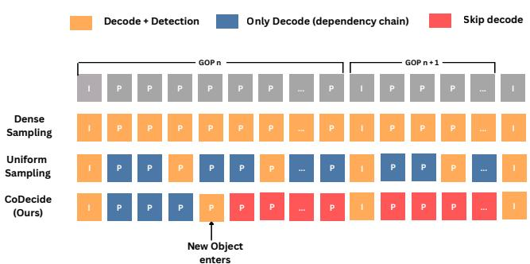
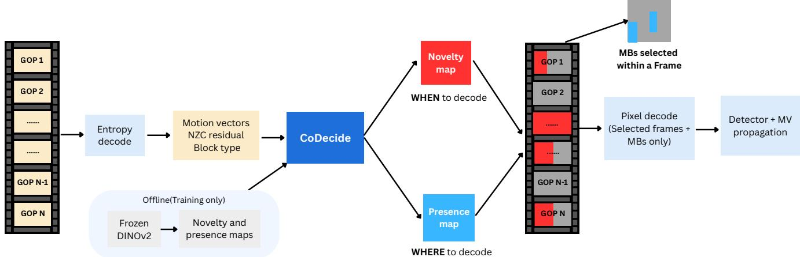
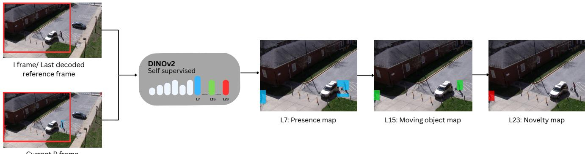
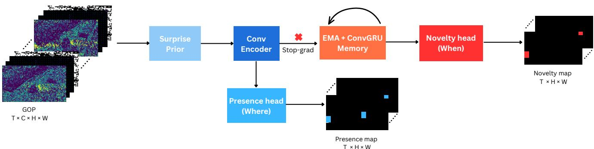
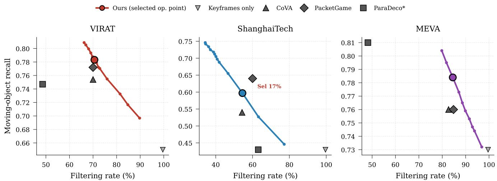
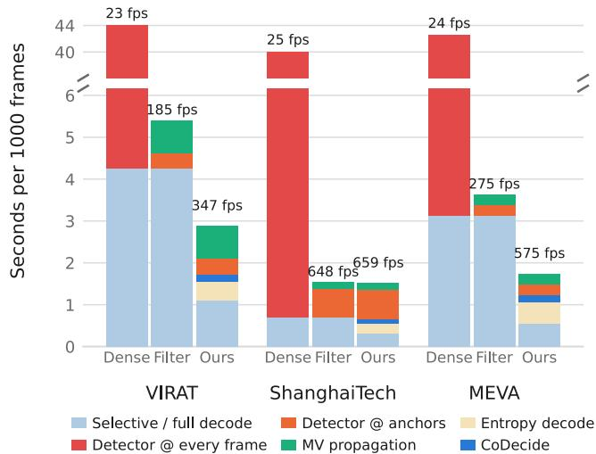
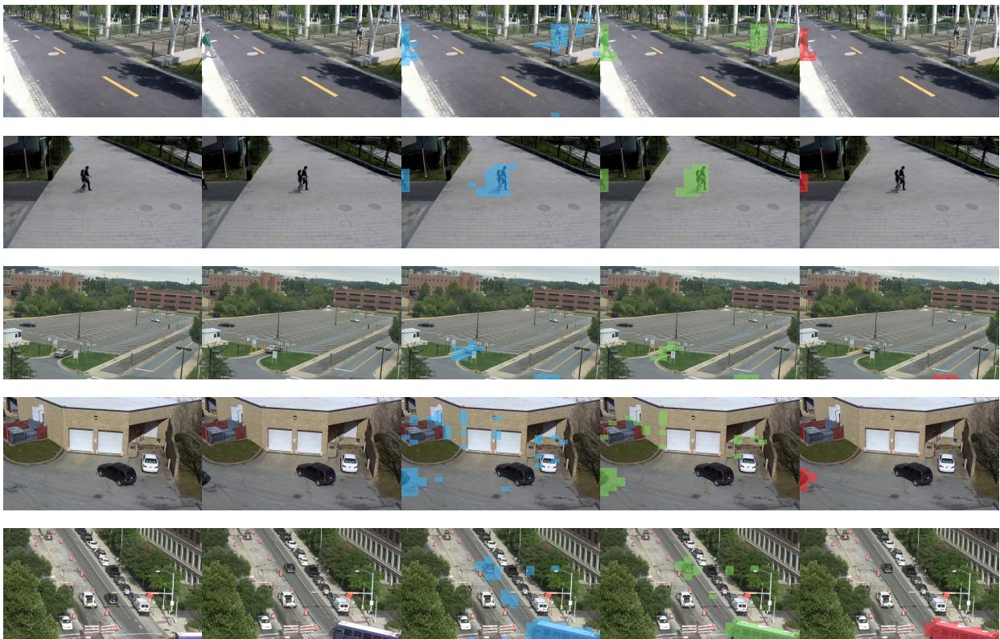

# CoDecide: Content-Adaptive Video Decoding for High-Throughput Video Analytics

Shristy Shah   
Aalborg University, Denmark   
Milestone Systems, Denmark ssha@create.aau.dk

Thomas B. Moeslund Aalborg University, Denmark tbm@create.aau.dk

Kamal Nasrollahi   
Aalborg University, Denmark   
Milestone Systems, Denmark kn@create.aau.dk

## Abstract

Analytics on video archives are bottlenecked by decoding. In a dense pipeline that runs a detector on everyframe, decoding is a smallfraction ofthe runtime, but once the detector is restricted to selected frames, decoding takes over as the main cost. We introduce CoDecide, a retrospective analytics system that only decodes theframes where new content appears, using signals from the compressed bitstream to find them. Motion tells us something is moving, but not whether it is new to the scene or has been there the whole time. To make that distinction, we supervise a lightweight compressed-domain student on a label-free novelty signal from a frozen DINOv2 teacher, which fires on semantically new regions rather than on any motion. Consequently, the student model generalizes to new camera deployments without requiring per-camera retraining. At inference, it decides which frames to decode and which regions to reconstruct. Detections from the decodedframes are propagated to the skipped frames using motion vectors. We evaluate CoDecide with a leave-one-dataset-out protocol on VIRAT, MEVA, and ShanghaiTech. Against a dense per-frame detector, CoDecide recovers more moving-object detections than prior compressed-domain selectors at an equivalent decoding budget, outperforming even a competitor trained directly on the target camera. CoDecide runs 15 to 24× faster than a pipeline that decodes and detects every frame. Code is available at github.com/shristy51/CoDecide.

## 1. Introduction

Retrospective video analysis runs vision models on large amounts of video recorded across many cameras over long durations. Common archival applications are modeling long-term traffic patterns in smart cities, analyzing customer behavior in retail environments, and conducting forensic reconstruction for security systems. These archives are analyzed repeatedly, as different downstream tasks evaluate the same footage over time. Decoding them once and caching is not an option, since that would require huge storage, and that is the reason the archive is compressed.

  
Figure 1. Decoding strategies over a video stream. Dense processing analyzes every frame. Uniform sampling reduces model inference but still traverses the codec dependency chain and risks missing sudden object arrivals. CoDecide (Ours) predicts novelty from compressed signals, decoding only up to the frame where new content appears.

This decoding of every frame to the pixel domain introduces a bottleneck, particularly in retrospective settings. Standard video codecs organize a video into chunks called groups of pictures (GOPs) [34], each beginning with an independently decodable intra-coded frame (I-frame) followed by dependent inter-coded P-frames, which reference past frames and optionally, bi-directionally predicted B-frames. I-frames have a large data footprint and contribute minimal novel information in highly static surveillance videos. Consequently, large-scale archival networks use longer GOPs to optimize storage efficiency. In our measurement on a 1080p H.264 video, the cost of reaching an inter frame accumulates with its depth in the GOP. For example, accessing the last inter-frame of a 250-frame GOP incurs roughly 45× latency overhead compared to accessing the initial inter-frame.

Uniform sampling fails to save decoding cost because of this accumulation as shown in Figure 1. Within a GOP of length L, sampling at any stride shorter than L still places a sample near the end of the chain, and reaching that sample decodes almost all L frames.

To avoid running expensive vision models on every frame, prior works with database-driven video analytics engines use cascades of cheap specialized proxies or statistical filters to skip frames [3, 9, 14–16, 23, 28]. Frame selection methods select a subset of frames that is important for a given downstream task and skip the rest [19, 37, 38, 41]. With few exceptions, both approaches still operate on fully decoded RGB frames.

To compress a frame, the encoder records how each block of pixels moved since the last frame, and flags the blocks it could not predict from what came before. Yet, pure motion is not equivalent to new semantic content. An object that entered the camera feed may continue moving for hundreds of frames, producing continuous motion vectors and residuals even though its visual identity is no longer new. The key challenge is determining whether a structural change represents content that has not been observed.

The proposed model, CoDecide, treats selective decoding as novelty prediction in the compressed domain. In archival footage, most GOPs contain no new content, so traversal can stop at the I-frame; the cost is worth paying only where something arrives. For the tasks that archives are queried with, such as object detection, counting, and binary predicates, pixels are needed only when something new arrives; in between, motion vectors already describe how known objects move and can be used to propagate the results. We define novelty offline using patch features from a frozen DINOv2 backbone [25], marking a region novel when its representation finds no match in a semantic memory of what has already been decoded. This definition is used for supervision of the lightweight compresseddomain model.

We implement CoDecide on a modified FFmpeg [1] decoder that exposes per-macroblock motion vectors, nonzero coefficient counts, and macroblock types during entropy decoding, and that supports reconstructing a selected subset of macroblocks. Full reconstruction is performed in two cases: for I-frames, which have no dependencies, and for frames that the predictor flags as novel. We evaluate our system in terms of accuracy and throughput while performing three archival tasks.

Our contributions are as follows:

• Label-free semantic novelty. We define novelty within a GOP as dissimilarity in DINOv2 feature space against what has already been decoded. Because supervision uses no class labels, detector outputs, or per-camera background models, one trained student transfers across surveillance datasets.

• Codec-domain student with memory. We show that motion vectors, non-zero coefficient counts, and macroblock types are jointly useful to separate arrivals from persistent motion when read through a recurrent predictor that carries GOP-level history.

• Spatio-temporal selective decoding. We introduce a policy that stops chain decoding at the last frame flagged novel and reconstructs only the macroblocks selected by the presence head, with detections propagated along motion vectors in between.

## 2. Related Work

Efficient video analytics and frame selection. Prior work uses lightweight filters to select frames for heavy downstream models; however, nearly all rely on decoding fully reconstructed frames. NoScope [15] trains a smaller specialized model to imitate the target architecture and drops static frames via a difference detector. To handle complex queries, probabilistic predicates [23] learn optimized proxy filters that guarantee user-defined accuracy targets without requiring per-query retraining. Meanwhile, BlazeIt [16] uses neural networks as control variates to accelerate approximate object counting. Tahoma [3] works by optimizing the input representation (e.g., resolution and color depth) to maintain accuracy using the cheapest viable representation. Focus [9] proposes indexing the objects in a video by running a network once over the whole archive and using this information for later queries. Frame selection in the video recognition literature chooses which subset of frames reaches the classifier. AdaFrame [37] uses a recurrent memory network to sample frames adaptively for fast video recognition. MGSampler [41] samples by motion rather than by time, giving busier parts of a video more frames. OCSampler [21] skims every candidate frame at a lower resolution before picking a subset in one shot for the full-resolution classifier. SCSampler [19] selects a few salient clips that are sufficient to recognize the action in a whole video. Because a variant of this method operates directly on compressed data, rejected clips are never decoded. However, the underlying task semantics differ fundamentally. Video recognition requires a single label for an entire video sequence, whereas retrospective analysis must account for events across every frame.

Compressed-domain video analysis. Prior works have explored using codec signals as model input rather than as a filter. CoViAR [35] proposes to add motion vectors and residuals as input along with I-frames for action recognition. It uses accumulated motion vectors back to the I-frame so each frame can be handled on its own. DMC-Net [29] works on predicting optical flow using motion vectors and residuals as optical flow is computationally expensive.

CompViT [36] uses an asymmetric transformer network with I-frames for appearance features and motion vectors and residuals for motion features. In surveillance, motion vectors have long been used for moving-object detection and tracking [12, 17, 26, 31, 39], usually by thresholding or clustering the vector field on the macroblock grid. DMC-Net is the closest of these to our design as it is a cheap codec-domain network trained against a signal too expensive to run at deployment. In all of this work, the codec signal feeds the task model directly, whereas we use it to decide which frames the task model should see in full.

  
Figure 2. CoDecide system architecture. An incoming video bitstream is entropy-decoded into compressed features (MVs, NZC, mac roblock types). The CoDecide network uses these to generate presence and novelty maps, filtering the video both spatially and temporally (indicated by grayed-out regions). Only selected un-grayed frames undergo pixel decoding and object detection, with bounding boxes propagated to skipped frames using motion vectors.

Decode-aware video systems. CoVA [10] is closest to our objective. It learns background modeling in the compressed domain by training a small U-Net on labels from a Mixtureof-Gaussians background model. It then groups the predicted regions into blobs and tracks them using SORT. Every new track triggers one anchor frame to be decoded, propagating the detection along the track. This network is trained at query time for each video and does not transfer to a camera it was not trained on. PacketGame [40] uses bitstream metadata (packet sizes and picture types) and learns to predict which packets a downstream model needs to maintain accuracy. Its predictor is trained from inference records for one task, and degrades when it is applied to a domain it was not trained on. Furthermore, packet size provides no spatial information regarding where content resides; consequently, the filtering decision is strictly temporal. ParaDeco [33] examines systems like CoVA and observes that selecting few frames saves little decoding when those frames occupy late positions within a GOP, since all preceding frames must still be reconstructed. To eliminate this dependency, ParaDeco roots motion vectors back to an intra-coded block, measures frame contribution using these rooted vectors, and replaces selected inter-frames with pseudo-frames generated by a conditional GAN [11].

Self-supervised features for label-free supervision. Selfsupervised vision models learn features that carry semantic structure without class labels. DINO [6] showed that the features of a self-supervised ViT contain explicit information about the semantic segmentation of an image, and Amir et al. [2] showed that DINO’s patch descriptors can be used directly, without training, for co-segmentation, part cosegmentation, and semantic correspondence. DINOv2 [25] extends this to features that transfer across image distributions without finetuning, at the pixel level as well as the image level. We use this feature space to define novelty offline without deciding in advance what kind of objects we are looking for.

## 3. Methodology

Background on codecs. As described in Section 1, video encoding works by grouping consecutive frames into Groups of Pictures (GOPs) to reduce redundancy. In the H.264/AVC [34] standard, each frame is divided into a grid of 16×16 pixel blocks called macroblocks. Instead of full pixel values, these macroblocks store a variety of low-level syntax elements that are available immediately after entropy decoding. For our pipeline, the key features of interest are motion vectors, which specify displacement relative to the closest match in a reference frame; the residual, which captures the remaining prediction error; and the macroblock type, which specifies how the block was encoded. Inter blocks are predicted using the reference frame, while intra blocks are directly coded, and static blocks containing no unique data are flagged as skip. Extracting these features requires no pixel-domain information. Newer codecs like HEVC [30] and VVC [5] provide similar information, but they organize it using tree-structured blocks rather than fixed macroblocks. We focus on H.264/AVC here because it is still the most widely deployed video codec.

## 3.1 System Overview

Figure 2 illustrates the system architecture of CoDecide, which consists of three main components: a teacher model, a student network, and a decode policy. During offline training, the teacher measures frame-level novelty using a frozen DINOv2 backbone without manual annotation. At runtime, only the student network and decode policy are active. For each GOP, the bitstream is entropy-decoded to extract a macroblock-level feature grid containing motion vectors, non-zero coefficient counts (NZC), and macroblock types without performing any pixel-level reconstruction.

  
Figure 3. The teacher’s three stages. Layer 7 dissimilarity against the reference set marks everything that changed (Presence map). Layer 15 compares those patches against the static background of the same frame and drops the shadow, which is the same material as the road. Layer 23 matches what remains against the reference one-to-one, and the patches left without a counterpart are novel (Novelty map).

From these compressed-domain features, the student network predicts two outputs: a novelty map to identify frames containing new content, and a presence map to mark macroblocks whose content has changed since the I-frame. Both maps are required because the downstream detector must evaluate all active content within a reconstructed frame, not just newly arrived objects. The decode policy then evaluates the student’s predicted frame-level novelty score against a threshold θ. This threshold is user-tunable; adjusting θ sets the frame filtration rate and thus the trade-off between accuracy and compute.

When the predicted novelty score exceeds θ, the frame is marked as novel, and decoding is triggered up to the farthest novel frame in the GOP. Within this decoded chain, CoDecide performs selective reconstruction: we decode only the macroblocks flagged by the presence map and any intra-coded macroblocks that lack a temporal reference, while populating the remaining regions via co-located blocks from the reference frame. Finally, the object detector runs on the I-frame and the selected novel frames. The resulting bounding boxes are then propagated to the skipped frames using their underlying motion vectors. If no frame in a GOP exceeds θ, only the I-frame is decoded, and its detections are propagated across the entire GOP.

## 3.2 Setup

We re-encode all video sequences with a GOP length of L=250 frames, matching the standard archival footprint [10]. The I-frame of each GOP is always decoded. For each P-frame, the extracted macroblock-level feature grid contains four discrete numerical channels: two representing the orthogonal motion vector components $( M V _ { x }$ and $M V _ { y } )$ , one tracking the non-zero coefficient counts $\mathrm { ( N Z C ) }$ and one specifying the macroblock type. The initial spatial dimensions of this four-channel grid scale directly with the source resolution, varying across our datasets.

In contrast, the teacher network operates on a fixed spatial topology. Its novelty targets are derived from the patch tokens of a frozen DINOv2 [25] ViT-L/14 backbone fed with $3 3 6 \times 3 3 6$ resolution images, which align to a $2 4 \times 2 4$ grid. To optimize the student network against these spatial targets during training, we average-pool the four macroblock channels down to this matching $2 4 \times 2 4$ grid and temporally downsample the GOP into $T { = } 3 2$ bins of approximately eight frames each. This spatial pooling standardizes the input dimensions, enabling a single student architecture to evaluate all datasets regardless of native resolution. At inference time, the student’s predicted maps are upscaled back to the native macroblock resolution to guide the selective reconstruction pipeline.

## 3.3 Label-free novelty teacher

The aim of the label-free novelty teacher is to isolate semantic novelty from transient pixel variations such as illumination shifts, shadows, sensor noise, or simple object displacement. We use a frozen DINOv2 [25] ViT-L/14 backbone as our feature extractor. Unlike architectures like CLIP [27] which is optimized for caption alignment or MAE [8] whose features are trained for pixel reconstruction, DINOv2’s self-supervised training yields dense features with strong empirical performance on downstream semantic benchmarks [25]. Consequently, the cosine similarity between its patch tokens aligns with dense semantic correspondences rather than surface textures, as earlier shown for DINO features [2].

Figure 3 illustrates the three steps used by the teacher to measure novelty for a given frame within a GOP, utilizing features extracted from layers 7, 15, and 23. Given a normalized patch token $f _ { i } ^ { \ell } ( t )$ from layer ℓ of frame t and a step-specific set of normalized reference tokens $\{ r _ { j } ^ { \ell } \}$ , the local patch dissimilarity is scored as:

$$
d _ { i } ^ { \ell } ( t ) = 1 - \operatorname* { m a x } _ { i } \ : \big \langle f _ { i } ^ { \ell } ( t ) , r _ { j } ^ { \ell } \big \rangle .\tag{1}
$$

The maximization step identifies the most semantically corresponding token from the reference set using cosine similarity, where $j$ indexes through all tokens in the reference set regardless of spatial location.

The shallow layer, Layer 7, describes low-level visual appearances. When this layer is compared against the Iframe of the GOP, all dissimilar patches are flagged. This defines the presence map region $R _ { 7 }$ . Beyond the foreground object, $R _ { 7 }$ captures contextual background alterations like moving shadows or newly uncovered regions.

Layer 15 is subsequently used to filter out these transient background elements, isolating the core moving objects into a refined object region, $R _ { 1 5 }$ . At this depth, features represent abstract object concepts. Using the static regions outside $R _ { 7 }$ as the reference set, newly uncovered or shadowed background patches find semantic matches and are discarded, while unmatched moving foreground objects are retained. This refined set of dynamic object patches constitutes $R _ { 1 5 }$

Finally, these isolated object patches are grouped into spatially connected regions, where Layer 23 features are used to evaluate true semantic novelty, yielding the final novelty region $R _ { 2 3 } \subseteq R _ { 1 5 }$ . At this deep layer, features capture semantic identity, and the reference set consists of the features of the same region in the I-frame and prior novel frames. To isolate true structural novelty, the Hungarian algorithm [20] enforces a strict one-to-one patch mapping against historical references, preventing new objects from duplicating matches.

At this final stage, the token-level dissimilarity values are aggregated into a region-level novelty score, defined as the fraction of patches within the connected region that lack a high-confidence semantic match. Layer 15 processing is essential to this final alignment; without it, newly uncovered background patches would enter Layer 23, compete with the banked object patches under the Hungarian assignment, and record mismatches. Consequently, an object leaving the frame would incorrectly trigger a novelty alert.

Bank-on-decode. When a region triggers a novelty event in a GOP, that frame is appended to the reference set. As a result, subsequent frames successfully match against the banked object, suppressing redundant alerts. This design ensures the teacher emits a single pulse near an object’s arrival, satisfying the requirements of the downstream decode policy. The reference set resets to the I-frame at the beginning of each GOP. All presence and novelty maps are pre-computed in a single offline pass and cached. All hyperparameter thresholds are shared across all datasets and are detailed in the supplementary material.

## 3.4 Compressed-domain student

Figure 4 shows the student model. It takes the four macroblock channels as input and learns to predict the same two maps as the teacher. These labels are sparse because a GOP contains hundreds of frames, and the teacher fires once, or

not at all, per GOP.

We derive a fifth input channel, the surprise prior, from these four. Motion on its own says little about novelty, because the codec produces motion vectors for anything that shifts, including content it went on to predict well. What is really important is the motion that cannot be explained by the codec. This is achieved by multiplying the magnitude of movement by the residual proxy. This isolates blocks that move but are poorly predicted. The presence head predicts where content changed in each bin. The teacher’s presence map is the target for this head.

Novelty cannot be predicted using just the current bin. The novelty head calculates the drift of the bin from the two references: a non-learning exponential moving average (EMA) [32] and a recurrent ConvGRU [4], which decides what has to be kept in memory. They both have the same initial state as the I-frame bin; hence, the drift at the beginning of the GOP is zero. The drift rises when a new object enters and falls back as the references absorb it. Gradients from the novelty head do not reach the shared encoder. Letting the sparse novelty signal shape the features destabilized them, so the encoder is trained by the presence loss alone. The EMA is detached as well, so drift from it falls only when the features themselves stop changing. The ConvGRU, in contrast, learns from the novelty loss how quickly to absorb a new object. Every bin depends only on the bins before it, so running a whole GOP in one pass gives the same result as feeding the bins one at a time.

## 3.5 Distillation objective

The distillation objective minimizes

$$
{ \mathcal { L } } = { \mathcal { L } } _ { \mathrm { p r e s } } + { \mathcal { L } } _ { \mathrm { n o v } } + \lambda _ { s } { \mathcal { L } } _ { \mathrm { s p a r s e } } + \lambda _ { g } { \mathcal { L } } _ { \mathrm { g o p } } .\tag{2}
$$

$\mathcal { L } _ { \mathrm { p r e s } }$ and ${ \mathcal { L } } _ { \mathrm { n o v } }$ are cross-entropy losses over both maps. Within ${ \mathcal { L } } _ { \mathrm { n o v } } .$ , we heavily weight bins containing content but lacking novelty to penalize the false alerts the teacher avoids. $\mathcal { L } _ { \mathrm { s p a r s e } }$ is an $L _ { 1 }$ penalty on the novelty output, which stops the head staying on once it has fired.

$\mathcal { L } _ { \mathrm { g o p } }$ compares a smooth maximum of the novelty map over the GOP against whether there was an arrival in this GOP at all, so the decode decision is supervised directly. The weights are in the supplementary.

## 4. Experiments

Datasets. We evaluate on three surveillance datasets: VI-RAT [24] (parking lots and roads), ShanghaiTech [22] (campus pedestrian pathways), and MEVA [7] (multi-view vehicular and pedestrian traffic). These scenes consist of stationary vehicles, fast, non-rigid human motion, and standard traffic. ShanghaiTech is evaluated as a standard surveillance dataset rather than an anomaly benchmark, as its busier scenes heavily stress the system compared to VI-RAT or MEVA.

  
Figure 4. Student architecture. The encoder maps each temporal bin to features on its own. The presence head predicts where content changed. The novelty head compares the current bin against an EMA baseline and a ConvGRU memory, both started from the I-frame bin so it responds to arrival rather than to presence.

Evaluation protocol. We use a strict leave-one-dataset-out (LODO) protocol. We trained three students with the same configuration (architecture and augmentations), with one dataset held out. This is done to check whether the unsupervised novelty signal generalizes across scenes and object categories without per-view training. Because novelty distributions vary by dataset, a static threshold yields inconsistent filtration rates. To compare under identical resource constraints, we calibrate θ on each held-out dataset to match the decode budget of the competitors. This uses only the student’s scores, with no labels or accuracy, so a new camera can be calibrated the same way without retraining.

Reference pipeline. The upper limit is dense detection, YOLO11x [13, 18] on each frame. We compute fidelity, defined as the percentage of dense-detector boxes recovered by the selective pipeline, on all datasets.

rather than the original systems.

Tasks and metrics. We measure the performance on three downstream tasks. For object detection, the metric is moving-object recall using IoU of 0.5; for the binary predi cate task, it is the per-frame accuracy of predicting whether a moving object exists, and for the counting task, it is the accuracy of counting the moving objects. We report only moving-object metrics because static objects are detected identically by all methods at the I-frame. Cost is measured using Sel, the fraction of frames sent to the detector, and Dec, the fraction of the GOP the codec must decode.

Implementation. All experiments are conducted using a single machine equipped with an NVIDIA RTX 2000 Ada Generation GPU, an Intel Core Ultra 9 285 CPU, and 125 GB RAM. The student model is trained using AdamW for 40 epochs, while the cache of the teacher is pre-computed before training. Entropy decoding during inference is done by our modified FFmpeg decoder.

## 4.1 Comparison with baselines

All methods use the same detector (YOLO11x), the same cost accounting, and our motion vector propagation (‘+ prop.’), and so Table 1 compares selection policies

‘Keyframes only’ decodes the I-frame and propagates using the detections from that frame alone, which is the baseline with no selection. ‘CoVA’ [10] uses tracking information of moving blobs in the compressed domain based on a per-camera background model. ‘PacketGame’ [40] applies a trained predictor to metadata of the bitstream, and gates packets before decoding based on predicted importance. The selection mechanism of ‘ParaDeco∗’ [33] is based on rooted motion vector contribution. The full model does not follow the dependency chain and creates pseudoframes using a generative predictor. Hence, the decode cost of the full model is not comparable to the cost of a pipeline where true pixels are reconstructed. We remove the generative component and retain the ranking component to create a selector we can score on the same axes as the others. The selector takes a decode budget, but in our reimplementation the contribution scores did not spread finely enough to support fine-grained budgets. We report the cheapest of them. Both CoVA and PacketGame see the target dataset during training. CoDecide does not.

Results. The difference between the methods lies clearly in the object detection task, and CoDecide achieves superior results on both the VIRAT and MEVA datasets. It detects more of the moving objects from the dense detector compared to CoVA on all three datasets, 0.78 versus 0.75 on VIRAT, 0.60 versus 0.54 on ShanghaiTech, and 0.78 versus 0.76 on MEVA, using an equal or smaller decoding budget.

PacketGame achieves 0.64 on ShanghaiTech compared to our 0.60, sending 8.8× more frames to the detector (16.8% vs. 1.9%). PacketGame actually uses a slightly smaller decode budget compared to our method, meaning that this is a detector cost improvement rather than a decode cost improvement. ParaDeco∗ achieves 0.81 on MEVA compared to our 0.78, while decoding 3.3× more frames from the GOP. On ShanghaiTech, the selector of ParaDeco∗ fails to outperform the keyframe-only baseline across all tasks despite still decoding 36.9% of frames. The other two tasks are more dataset-dependent. On VIRAT and MEVA,

<table><tr><td></td><td colspan="5">VIRAT</td><td colspan="5">ShanghaiTech</td><td colspan="5">MEVA</td></tr><tr><td>Method</td><td>OD</td><td>BP</td><td>Cnt</td><td>Sel</td><td>Dec</td><td>OD</td><td>BP</td><td>Cnt</td><td>Sel</td><td>Dec</td><td>OD</td><td>BP</td><td>Cnt</td><td>Sel</td><td>Dec</td></tr><tr><td>Keyframes only + prop.</td><td>0.65</td><td>0.99</td><td>0.94</td><td>0.4%</td><td>0.4%</td><td>0.43</td><td>0.92</td><td>0.62</td><td>0.4%</td><td>0.4%</td><td>0.73</td><td>0.99</td><td>0.88</td><td>0.4%</td><td>0.4%</td></tr><tr><td>CoVA [10] + prop.</td><td>0.75</td><td>1.00</td><td>0.95</td><td>0.7%</td><td>30.0%</td><td>0.54</td><td>0.95</td><td>0.68</td><td>1.4%</td><td>45.7%</td><td>0.76</td><td>0.99</td><td>0.89</td><td>0.7%</td><td>17.3%</td></tr><tr><td>PacketGame [40] + prop.</td><td>0.77</td><td>1.00</td><td>0.96</td><td>3.5%</td><td>30.0%</td><td>0.64†</td><td>0.96</td><td>0.74</td><td>16.8%</td><td>40.0%</td><td>0.76</td><td>0.99</td><td>0.90</td><td>1.0%</td><td>15.2%</td></tr><tr><td>ParaDeco* [33] + prop.</td><td>0.75</td><td>1.00</td><td>0.95</td><td>0.8%</td><td>51.4%</td><td>0.43</td><td>0.92</td><td>0.62</td><td>0.8%</td><td>36.9%</td><td>0.81†</td><td>0.99</td><td>0.92</td><td>0.8%</td><td>51.8%</td></tr><tr><td>CoDecide (ours)</td><td>0.78</td><td>1.00</td><td>0.95</td><td>1.0%</td><td>29.4%</td><td>0.60</td><td>0.98</td><td>0.74</td><td>1.9%</td><td>45.5%</td><td>0.78</td><td>0.99</td><td>0.92</td><td>0.7%</td><td>15.5%</td></tr></table>

Table 1. Fidelity to dense detection across datasets and tasks, read at comparable decode budget. All numbers are the fraction of dense YOLO11x output the selective pipeline reproduces, so 1.0 is the ceiling everywhere. “+ prop.” pairs each selector with our box propagation. † marks an entry above CoDecide, but with much higher cost. ∗Our reimplementation without Frame Predictor.

  
Figure 5. Recall vs. Filtration rate. Each point on our curve (colored) corresponds to a threshold θ; the bold marker is the operating point from Table 1. Baselines (gray) are plotted at their reported chain-decode cost.

BP is nearly saturated, with the keyframe-only baseline already achieving 0.99, whereas ShanghaiTech ranges from 0.92 to 0.98, with CoDecide achieving the highest score. Counting is similar: methods are close on VIRAT and MEVA but range from 0.62 to 0.74 on ShanghaiTech, where CoDecide achieves 0.74, tied with PacketGame. Selection therefore helps most on active content and approaches keyframe-only behavior when the scene is predictable.

Figure 5 shows the full recall-against-filtration rate curve. On VIRAT and MEVA our curve lies above CoVA and PacketGame at matched or lower cost. On VIRAT (the only dataset with box annotations), scoring against ground truth reproduces the same ranking. The full comparison is in the supplementary.

## 4.2 System efficiency

The pipeline runs five stages. Entropy decoding reads the macroblock channels from the bitstream; the student produces the two maps; the selected frames and macroblocks are reconstructed; the detector runs on those frames; and motion vectors propagate the predicted bounding boxes across the remaining frames. Decoding is only a minor component of the dense pipeline but the most costly step in the filtered one. Decoding takes up 9.6% of the dense detection costs for VIRAT and 7.4% for MEVA. When the detector operates only on the selected frames, the very same decoding takes up 78.5% and 86.0% of the costs that remain.

Figure 6 illustrates two types of improvements. Filtering frames for the detector while still decoding every frame yields 8.1× and 11.5× on VIRAT and MEVA, respectively. CoDecide achieves a speedup of 15.1× and 24×, which is roughly double the gain of filtering alone.

However, the existence of such a second saving is contingent upon the relative cost of decoding to detection. The detector operates at a constant input size in our tests and thus takes 40 ms per frame on each of the three datasets, whereas decoding takes 4.2, 0.7 and 3.1 ms, respectively, scaling with both the image resolution and the underlying scene activity, which increases encoder complexity and subsequent decoding overhead. Consequently, ShanghaiTech (480p) starts off with 57× more detection cost than decoding, so filtering already captures nearly all of the available saving and CoDecide matches it. The reasoning runs the other way too. A faster detector shifts the balance towards decoding, which widens the gap rather than closing it. The overheads are low. Entropy decoding the video takes roughly one-tenth of full decoding, and the student runs at about 20,000 frames per second. Propagation is the largest stage after decoding itself, at 27% of CoDecide’s runtime on VIRAT.

  
Figure 6. Where the time goes. Wall clock times stacked per 1000 input frames, summed up for each dataset, with end-to-end throughput on top of each bar. The filter decodes all frames and performs detection only on the selected ones, setting a limit to any selector working in the pixel space. Detection is filtered out, and the main time-consuming step is reduced by CoDecide.

<table><tr><td rowspan="2">Variant</td><td colspan="2">VIRAT</td><td colspan="2">ShanghaiTech</td><td colspan="2">MEVA</td></tr><tr><td>OD</td><td>Dec</td><td>OD</td><td>Dec</td><td>OD</td><td>Dec</td></tr><tr><td>CoDecide (ours)</td><td>0.78</td><td>29.4%</td><td>0.60</td><td>45.5%</td><td>0.78</td><td>15.5%</td></tr><tr><td>w/o memory</td><td>0.66</td><td>4.0%</td><td>0.49</td><td>40.9%</td><td>0.75</td><td>4.9%</td></tr><tr><td>MV only</td><td>0.66</td><td>1.2%</td><td>0.52</td><td>39.6%</td><td>0.73</td><td>1.8%</td></tr><tr><td>NZC only</td><td>0.71</td><td>11.4%</td><td>0.57</td><td>52.0%</td><td>0.80</td><td>11.5%</td></tr><tr><td>w/o surprise prior</td><td>0.77</td><td>27.1%</td><td>0.60</td><td>46.1%</td><td>0.76</td><td>7.1%</td></tr></table>

Table 2. Component ablation. For each variant, the decision threshold $\theta \in [ 0 . 5 , 1 )$ is swept to match the full model’s decode budget as closely as possible. Variants that cannot reach this budget are reported at their maximum coverage (θ = 0.5).

## 4.3 Ablations

We evaluate the contribution of each component by sequentially omitting them from the pipeline: the memory module, individual input channels, and the surprise prior. Table 2 reports the results. For each ablated variant, we sweep the decision threshold to match the full model’s decode budget as closely as possible. Most variants fail to reach the full bud get; however, their maximum coverage is as informative as their accuracy at that operational point. The memory module proves critical for reachability. Without the ConvGRU, no threshold configuration on VIRAT or MEVA selects a comparable number of frames to the full model, because lacking a historical record prevents novelty scores from separating sufficiently. On ShanghaiTech, where the coverage does approach the baseline budget, performance degrades to 0.49 compared to the full model’s 0.60. Similarly, neither input channel is sufficient in isolation, and the primary signal carrier depends heavily on the dataset content. While residual occupancy alone suffices on MEVA, slightly exceeding the full model at a lower budget, it underperforms on VIRAT and ShanghaiTech. Conversely, motion alone underperforms across all evaluation sets. Ultimately, combining both input channels is necessary to ensure robust performance across all three datasets.

The surprise prior is a product of channels the model already receives, so it adds no information of its own. On VIRAT and ShanghaiTech, where the variant operates at a comparable budget, it makes no difference to accuracy. This directly impacts threshold selection, which is critical for MEVA; without it, the sweep peaks at a 7.1% decode rate and fails to reach the full model’s budget.

Spatial selection reconstructs only the macroblocks the presence map flags. That footprint is 13% of macroblocks on MEVA, 38% on VIRAT, and 81% on ShanghaiTech, where activity is spread across the frame. The composited frames are close to full reconstruction, at PSNR 41.96 and SSIM 0.985, and the saving is a further 6 to 10% of decode time per novel GOP.

## 4.4 Limitations

Propagation drift dominates the distance to dense detection. In VIRAT, roughly two-thirds of the missed moving boxes were properly seeded initially but drifted below IoU 0.5 since the macroblock motion vectors are quantized, and this error builds up over a GOP. One-third were never seeded. A better propagator would do more than a better novelty head, since it is currently a major share of our cost and error. Two failure modes remain: an arriving object too small to cover enough patches for the teacher to mark it, and a novel object too small for the downstream detector.

## 5. Conclusion

In this work we show that selective video decoding can be reduced to novelty prediction in the compressed domain. A frozen DINOv2 teacher measures novelty without any human annotation, and the codec-domain student it supervises decides, from motion vectors, non-zero coefficient counts, and macroblock types, when and where to decode. Because supervision uses no class labels and no per-camera background models, the same trained student applies to unseen cameras and scenes. Under leave-one-dataset-out evaluation, CoDecide matches or exceeds CoVA at equal or lower decode cost while reaching 15 to 24× dense-detection throughput. The remaining accuracy gap is dominated by propagator drift over long GOPs rather than by selection, so any better propagator can slot into the pipeline without retraining our predictor. Finally, the gain grows with the decoding-to-inference cost ratio, which faster detectors and higher resolutions both raise.

## References

[1] FFmpeg. https://ffmpeg.org. Accessed 2026. 2, 11

[2] Shir Amir, Yossi Gandelsman, Shai Bagon, and Tali Dekel. Deep ViT Features as Dense Visual Descriptors. arXiv preprint arXiv:2112.05814, 2021. 3, 4

[3] Michael R. Anderson, Michael Cafarella, German Ros, and Thomas F. Wenisch. Physical Representation-Based Predicate Optimization for a Visual Analytics Database. In 2019 IEEE 35th International Conference on Data Engineering (ICDE), pages 1466–1477. IEEE, 2019. 2

[4] Nicolas Ballas, Li Yao, Chris Pal, and Aaron Courville. Delving Deeper into Convolutional Networks for Learning Video Representations. arXiv preprint arXiv:1511.06432, 2015. 5

[5] Benjamin Bross, Ye-Kui Wang, Yan Ye, Shan Liu, Jianle Chen, Gary J Sullivan, and Jens-Rainer Ohm. Overview of the Versatile Video Coding (VVC) Standard and its Applications. IEEE Transactions on Circuits and Systems for Video Technology, 31(10):3736–3764, 2021. 3

[6] Mathilde Caron, Hugo Touvron, Ishan Misra, Herve J´ egou,´ Julien Mairal, Piotr Bojanowski, and Armand Joulin. Emerging Properties in Self-Supervised Vision Transformers. In 2021 IEEE/CVF international conference on computer vision (ICCV), pages 9630–9640. IEEE, 2021. 3

[7] Kellie Corona, Katie Osterdahl, Roderic Collins, and Anthony Hoogs. MEVA: A Large-Scale Multiview, Multimodal Video Dataset for Activity Detection. In 2021 IEEE Winter Conference on Applications ofComputer Vision (WACV), pages 1059–1067. IEEE, 2021. 5

[8] Kaiming He, Xinlei Chen, Saining Xie, Yanghao Li, Piotr Dollar, and Ross Girshick. Masked Autoencoders Are Scal-´ able Vision Learners. In 2022 IEEE/CVF conference on computer vision and pattern recognition (CVPR), pages 15979– 15988. IEEE, 2022. 4

[9] Kevin Hsieh, Ganesh Ananthanarayanan, Peter Bodik, Shivaram Venkataraman, Paramvir Bahl, Matthai Philipose, Phillip B. Gibbons, and Onur Mutlu. Focus: Querying Large Video Datasets with Low Latency and Low Cost. In Proceedings of the 13th USENIX Conference on Operating Systems Design and Implementation, pages 269–286. USENIX Association, 2018. 2

[10] Jinwoo Hwang, Minsu Kim, Daeun Kim, Seungho Nam, Yoonsung Kim, Dohee Kim, Hardik Sharma, and Jongse Park. CoVA: Exploiting Compressed-Domain Analysis to Accelerate Video Analytics. In 2022 USENIX annual technical conference (USENIX ATC 22), pages 707–722, 2022. 3, 4, 6, 7, 12

[11] Phillip Isola, Jun-Yan Zhu, Tinghui Zhou, and Alexei A. Efros. Image-to-Image Translation with Conditional Adversarial Networks. In 2017 IEEE Conference on Computer Vision and Pattern Recognition (CVPR), pages 5967–5976, 2017. 3

[12] Sami Jaballah and Mohamed-Chaker Larabi. Fast Object Detection in H264/AVC and HEVC Compressed Domains for Video Surveillance. In 2019 8th European Workshop on Visual Information Processing (EUVIP), pages 123–128. IEEE, 2019. 2

[13] Glenn Jocher and Jing Qiu. Ultralytics YOLO11. https: / / github . com / ultralytics / ultralytics, 2024. 6

[14] Gaurav Tarlok Kakkar, Jiashen Cao, Pramod Chunduri, Zhuangdi Xu, Suryatej Reddy Vyalla, Prashanth Dintyala, Anirudh Prabakaran, Jaeho Bang, Aubhro Sengupta, Kaushik Ravichandran, Ishwarya Sivakumar, Aryan Rajoria, Ashmita Raju, Tushar Aggarwal, Abdullah Shah, Sanjana Garg, Shashank Suman, Myna Prasanna Kalluraya, Subrata Mitra, Ali Payani, Yao Lu, Umakishore Ramachan dran, and Joy Arulraj. EVA: An End-to-End Exploratory Video Analytics System. In Proceedings of the Seventh Workshop on Data Management for End-to-End Machine Learning. Association for Computing Machinery, 2023. 2

[15] Daniel Kang, John Emmons, Firas Abuzaid, Peter Bailis, and Matei Zaharia. NoScope: Optimizing Neural Network Queries over Video at Scale. Proc. VLDB Endow., 10(11): 1586–1597, 2017. 2

[16] Daniel Kang, Peter Bailis, and Matei Zaharia. BlazeIt: Opti mizing Declarative Aggregation and Limit Queries for Neural Network-Based Video Analytics. Proc. VLDB Endow., 13(4):533–546, 2019. 2

[17] Christian Kas and Henri Nicolas. An Approach to Trajectory¨ Estimation of Moving Objects in the H. 264 Compressed Do main. In Pacific-Rim Symposium on Image and Video Tech nology, pages 318–329. Springer, 2009. 2

[18] Rahima Khanam and Muhammad Hussain. YOLOv11: An Overview of the Key Architectural Enhancements. arXiv preprint arXiv:2410.17725, 2024. 6

[19] Bruno Korbar, Du Tran, and Lorenzo Torresani. SCSampler: Sampling Salient Clips from Video for Efficient Action Recognition. In 2019 IEEE/CVF International Conference on Computer Vision (ICCV), pages 6231–6241. IEEE, 2019. 2

[20] Harold W Kuhn. The Hungarian method for the assignment problem. Naval research logistics quarterly, 2(1-2):83–97, 1955. 5

[21] Jintao Lin, Haodong Duan, Kai Chen, Dahua Lin, and Limin Wang. OCSampler: Compressing Videos to One Clip with Single-step Sampling. In 2022 IEEE/CVF Conference on Computer Vision and Pattern Recognition (CVPR), pages 13884–13893. IEEE, 2022. 2

[22] Wen Liu, Weixin Luo, Dongze Lian, and Shenghua Gao. Future Frame Prediction for Anomaly Detection – A New Baseline. In 2018 IEEE Conference on Computer Vision and Pattern Recognition (CVPR), 2018. 5

[23] Yao Lu, Aakanksha Chowdhery, Srikanth Kandula, and Surajit Chaudhuri. Accelerating Machine Learning Inference with Probabilistic Predicates. In Proceedings of the 2018 International Conference on Management of Data, pages 1493–1508. Association for Computing Machinery, 2018. 2

[24] Sangmin Oh, Anthony Hoogs, Amitha Perera, Naresh Cuntoor, Chia-Chih Chen, Jong Taek Lee, Saurajit Mukherjee, Jake K Aggarwal, Hyungtae Lee, Larry Davis, et al. A largescale benchmark dataset for event recognition in surveillance video. In CVPR 2011, pages 3153–3160. IEEE, 2011. 5

[25] Maxime Oquab, Timothee Darcet, Th ´ eo Moutakanni, Huy´ Vo, Marc Szafraniec, Vasil Khalidov, Pierre Fernandez,

Daniel Haziza, Francisco Massa, Alaaeldin El-Nouby, et al. DINOv2: Learning Robust Visual Features without Supervision. arXiv preprint arXiv:2304.07193, 2023. 2, 3, 4, 11

[26] Chris Poppe, Sarah De Bruyne, Tom Paridaens, Peter Lambert, and Rik Van de Walle. Moving object detection in the H.264/AVC compressed domain for video surveillance applications. Journal of Visual Communication and Image Representation, 20(6):428–437, 2009. 2

[27] Alec Radford, Jong Wook Kim, Chris Hallacy, Aditya Ramesh, Gabriel Goh, Sandhini Agarwal, Girish Sastry, Amanda Askell, Pamela Mishkin, Jack Clark, et al. Learning Transferable Visual Models From Natural Language Supervision. In International conference on machine learning, pages 8748–8763. PmLR, 2021. 4

[28] Francisco Romero, Johann Hauswald, Aditi Partap, Daniel Kang, Matei Zaharia, and Christos Kozyrakis. Optimizing Video Analytics with Declarative Model Relationships. Proc. VLDB Endow., 16(3):447–460, 2022. 2

[29] Zheng Shou, Xudong Lin, Yannis Kalantidis, Laura Sevilla-Lara, Marcus Rohrbach, Shih-Fu Chang, and Zhicheng Yan. DMC-Net: Generating Discriminative Motion Cues for Fast Compressed Video Action Recognition. In 2019 IEEE/CVF Conference on Computer Vision and Pattern Recognition (CVPR), pages 1268–1277. IEEE, 2019. 2

[30] Gary J Sullivan, Jens-Rainer Ohm, Woo-Jin Han, and Thomas Wiegand. Overview of the High Efficiency Video Coding (HEVC) Standard. IEEE Transactions on circuits and systems for video technology, 22(12):1649–1668, 2012. 3

[31] Krzysztof Szczerba, Søren Forchhammer, Jesper Stottrup-Andersen, and Peder Tanderup Eybye. Fast Compressed Domain Motion Detection in H.264 Video Streams for Video Surveillance Applications. In 2009 Sixth IEEE International Conference on Advanced Video and Signal Based Surveillance, pages 478–483. IEEE, 2009. 2

[32] Antti Tarvainen and Harri Valpola. Mean teachers are better role models: Weight-averaged consistency targets improve semi-supervised deep learning results. Advances in neural information processing systems, 30, 2017. 5

[33] Xiaokun Wang, Yuting Yan, Sheng Zhang, Andong Zhu, Ning Chen, Yu Chen, Zhuzhong Qian, Sanglu Lu, and Yu Liang. Decode-What-Matters: Frame-Level Parallel Generative Decoding to Accelerate Large-Scale Video Analytics. In Proceedings of the 33rd ACM International Conference on Multimedia, pages 11805–11814, 2025. 3, 6, 7, 12

[34] Thomas Wiegand, Gary J Sullivan, Gisle Bjontegaard, and Ajay Luthra. Overview of the H.264/AVC Video Coding Standard. IEEE Transactions on circuits and systems for video technology, 13(7):560–576, 2003. 1, 3

[35] Chao-Yuan Wu, Manzil Zaheer, Hexiang Hu, R Manmatha, Alexander J Smola, and Philipp Krahenb ¨ uhl. Compressed ¨ Video Action Recognition. In 2018 IEEE/CVF conference on computer vision and pattern recognition, pages 6026– 6035. IEEE, 2018. 2

[36] Tao Wu, Shaowei Cen, Liang Mi, Weijun Wang, Haipeng Dai, and Limin Wang. CompViT: Real-Time Compressed Video Action Recognition with Asymmetric Transformer

Networks. International Journal of Computer Vision, 134 (4):189, 2026. 2

[37] Zuxuan Wu, Caiming Xiong, Chih-Yao Ma, Richard Socher, and Larry S Davis. AdaFrame: Adaptive frame selection for fast video recognition. In 2019 IEEE/CVF Conference on Computer Vision and Pattern Recognition (CVPR), pages 1278–1287. IEEE, 2019. 2

[38] Yanchao Xu, Dongxiang Zhang, Shuhao Zhang, Sai Wu, Zexu Feng, and Gang Chen. Predictive and Near-Optimal Sampling for View Materialization in Video Databases. Proc. ACM Manag. Data, 2(1), 2024. 2

[39] Takanori Yokoyama, Toshiki Iwasaki, and Toshinori Watanabe. Motion Vector Based Moving Object Detection and Tracking in the MPEG Compressed Domain. In 2009 Sev enth International Workshop on Content-Based Multimedia Indexing, pages 201–206. IEEE, 2009. 2

[40] Mu Yuan, Lan Zhang, Xuanke You, and Xiang-Yang Li. PacketGame: Multi-stream Packet Gating for Concurrent Video Inference at Scale. In Proceedings of the ACM SIG COMM 2023 Conference, pages 724–737, 2023. 3, 6, 7, 12

[41] Yuan Zhi, Zhan Tong, Limin Wang, and Gangshan Wu. MGSampler: An Explainable Sampling Strategy for Video Action Recognition. In 2021 IEEE/CVF International Con ference on Computer Vision (ICCV), pages 1493–1502. IEEE, 2021. 2

## Acknowledgements

This work was supported by Milestone Research Program at AAU and Innovation Fund Denmark’s grant 5304-00055B.

# CoDecide: Content-Adaptive Video Decoding for High-Throughput Video Analytics

Supplementary Material

## A. Implementation Details

## Hyperparameters of the teacher model

The frozen DINOv2 [25] teacher uses the G=24 patch grid. The L7 presence map is formed with $R _ { \mathrm { T H R } } { = } 0 . 0 8 $ ; within this region, L15 Object scores above $O _ { \mathrm { T H R } } { = } 0 . 2 0$ are retained for the novelty stage. L23 matching uses the one-toone cost $c = 1 - \langle f _ { i } ^ { 2 3 } , r _ { j } ^ { 2 3 } \rangle$ and marks a patch as unmatched when $c \geq M _ { \mathrm { T H R } } { = } 0 . 3 \breve { 5 }$ . An object is marked novel when the fraction of its constituent patches left unmatched by L23 exceeds $F _ { \mathrm { T H R } } { = } 0 . 4 0$ . Blobs with fewer than 3 DINO cells are not scored (MIN BLOB=3), which suppresses unstable single-cell responses from tiny image fragments. The reference bank is reset at each GOP boundary and updated only after a novelty fire.

## Student model

Table 3 details the CoDecide student. The five input channels are the four macroblock signals $( M V _ { x } , M V _ { y }$ , NZC, macroblock type) and the surprise prior

$$
s = \operatorname { t a n h } ( | M V | ) \cdot { \widehat { \mathrm { N Z C } } } ,
$$

where $\widehat { \mathrm { N Z C } }$ is the per-frame max-normalized NZC channel used as a residual proxy. All convolutions are 3×3 except the two 1×1 output projections. GroupNorm uses 8 groups.

<table><tr><td>Module</td><td>Params</td><td>Configuration</td></tr><tr><td>Encoder</td><td>15,504</td><td>5→32→48, GN+ReLU</td></tr><tr><td>Presence head</td><td>20,833</td><td>48→48→1</td></tr><tr><td>Novelty adapter</td><td>13,920</td><td>48→32, GN+ReLU</td></tr><tr><td>ConvGRU (mem)</td><td>55,392</td><td>in=32, hid=32, k=3</td></tr><tr><td>Novelty head</td><td>36,929</td><td>128→32→1</td></tr><tr><td>Total</td><td>142,578</td><td></td></tr></table>

Table 3. CoDecide student parameter counts.  
The student is trained with the four-term objective

$$
\mathcal { L } = \mathcal { L } _ { \mathrm { p r e s } } + \mathcal { L } _ { \mathrm { n o v } } + \lambda _ { s } \mathcal { L } _ { \mathrm { s p a r s e } } + \lambda _ { g } \mathcal { L } _ { \mathrm { g o p } } ,\tag{3}
$$

with $\lambda _ { s } = 0 . 2$ and $\lambda _ { g } { = } 0 . 3$ . The presence and novelty BCE terms have unit weights. Present-but-not-novel cells receive a hard-negative multiplier of 5.0, while positive BCE weights are computed from the training-set class frequency and capped at 20 for both presence and novelty. The sparsity term suppresses novelty responses after an event has been observed, and the GOP term trains the temporal keep/skip decision.

## Spatially selective FFmpeg reconstruction

Our modified FFmpeg [1] decoder separates compresseddomain parsing from pixel reconstruction. It still entropydecodes every macroblock to obtain motion vectors, residual statistics, and macroblock types, but it applies a spatial mask only to the subsequent pixel-reconstruction stage. The student’s $G \times G$ Presence map is upsampled with nearestneighbor interpolation to the codec’s macroblock grid. For a GOP containing a novelty event, this mask is unioned with the intra-coded macroblocks along the decoded chain, since intra blocks contain self-contained content that cannot be recovered by motion compensation.

For an ROI macroblock, FFmpeg performs the usual inverse transform, motion-compensation, and pixel reconstruction. For a non-ROI inter-coded macroblock, it skips those pixel operations and fills the location from the colocated macroblock in the reference frame. The ROI mask is GOP-constant and is therefore carried through the entire I-frame-to-P-frame dependency chain; this preserves the reference pixels needed by later selected frames. The temporal decision separately sets the last reconstructed frame $f _ { \mathrm { s t o p } } ;$ frames after this point are not reconstructed. Thus the method saves pixel-reconstruction work while retaining the codec’s normal entropy-decode path and the dependency structure required for valid P-frame decoding.

## B. Ground-truth comparison for VIRAT

VIRAT is the only evaluated dataset with box-level human annotations. We therefore complement the main-paper fidelity table with a direct comparison against the VIRAT annotations in Table 4. OD measures moving-object recall at IoU = 0.5, BP is binary moving-object presence accuracy, Cnt is moving-object counting accuracy, Sel is the fraction of frames sent to the detector, and Dec is the fraction of the GOP reconstructed by the codec. All methods use the same YOLO11x detector and motion-vector box propagation; only the frame selection policy changes.

Table 4 provides results of VIRAT dataset against human annotated ground truth. For OD, the dense-YOLO fidelity scores and the human-GT scores are, respectively: CoDecide 0.78 → 0.64, Keyframes $0 . 6 5  0 . 5 4$ , PacketGame $0 . 7 7  0 . 6 3 , \mathrm { C o V A 0 . 7 5  0 . 6 2 }$ , and ParaDeco∗ $0 . 7 5  0 . 6 1$ . Thus CoDecide remains the best method under both evaluations, and its advantage over keyframes is 0.13 in dense-detector fidelity and 0.10 in human-GT OD. The absolute values diverge because the main-paper metric evaluates fidelity to the dense YOLO output, whereas the supplementary metric assesses alignment with human annotations. The cost measurements are directly comparable: CoDecide and CoVA use 1.0% and 0.7% detector-selected frames, respectively, while their chain reconstruction costs are 29.4% and 30.0%. PacketGame sends 3.5% of frames to the detector at the same 30.0% reconstruction cost, and ParaDeco∗ incurs 51.4% reconstruction. BP and Cnt are not identical across the two tables: Keyframes-only BP is 0.99 against dense YOLO and 1.00 against human GT, and CoDecide Cnt is 0.95 and 0.85. This reflects differences between detector outputs and human annotations, particularly detector flicker and track/count ambiguity, since the selected frames are identical in both evaluations. The agreement in OD ranking, together with the comparable Sel/Dec costs, is the intended validation against the independent VI-RAT annotations.

Figure 7. Qualitative teacher behavior across datasets. L7 Presence maps intentionally include extra motion detections beyond the target object. L15 Object maps remove most of the background selected by Presence; Row 4 retains some background in its L15 map, but L23 Novelty still gives the correct result. Rows 1–3 show successful teacher novelty localization; Row 4 shows a newly entering car localized by the teacher although YOLO11x assigns it only about 0.20 confidence because it is partially visible; Row 5 shows a bus that is barely visible at the I-frame boundary and becomes substantially visible later, with the revealed content marked as novel.
<table><tr><td rowspan="2">Method</td><td colspan="4">VIRAT</td></tr><tr><td>OD</td><td>BP Cnt</td><td>Sel</td><td>Dec</td></tr><tr><td>Keyframes only + prop.</td><td>0.54 1.00</td><td>0.85</td><td>0.4%</td><td>0.4%</td></tr><tr><td>CoVA [10] + prop.</td><td>0.62 1.00</td><td>0.85</td><td>0.7%</td><td>30.0%</td></tr><tr><td>PacketGame [40] + prop.</td><td>0.63 1.00</td><td>0.85</td><td>3.5%</td><td>30.0%</td></tr><tr><td>ParaDeco* [33] + prop.</td><td>0.61 1.00</td><td>0.85</td><td>0.8%</td><td>51.4%</td></tr><tr><td>CoDecide (ours)</td><td>0.64 1.00</td><td>0.85</td><td>1.0%</td><td>29.4%</td></tr></table>

Table 4. Evaluation against ground truth on the VIRAT dataset. While Table 1 in the main text evaluates fidelity by comparing performance directly against a full YOLO per-frame detector, we present a direct comparison against the actual VIRAT humanannotated ground truth here. Each method is evaluated at the same operating point as in Table 1 of the main text.

## C. Qualitative Teacher Examples

This section provides qualitative examples of the DINOv2 teacher across ShanghaiTech, MEVA, and VIRAT. Figure 7 shows the same five outputs for each case: the GOP I-frame, a representative P-frame, the L7 Presence map, the L15 Object map, and the L23 Novelty map. The maps are maxpooled over one temporal bin. Presence, Object, and Novelty use light blue, green, and red overlays, respectively.

Rows 4 and 5 show that novelty and detectability are different signals. In Row 4, YOLO11x gives the partially occluded car only about 0.20 confidence, yet the teacher flags it as novel, because novelty is judged by appearance dissimilarity from the reference bank and not by detector confidence. The frame is therefore kept, and whether the detector then recognizes the car is a separate question. In Row 5, part of the bus is visible at the I-frame and the rest is revealed later. L23 matches at the patch level, so the newly uncovered pixels have no match in the bank and are marked novel, even though the object was already partly present.