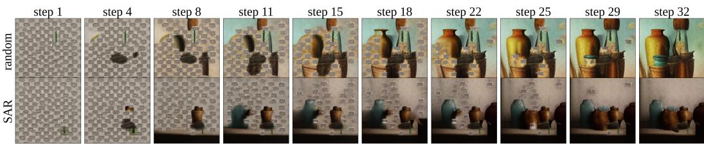
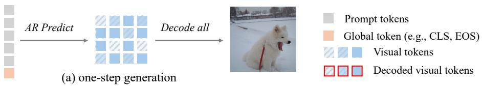
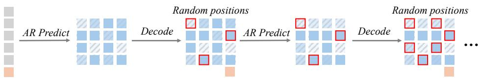
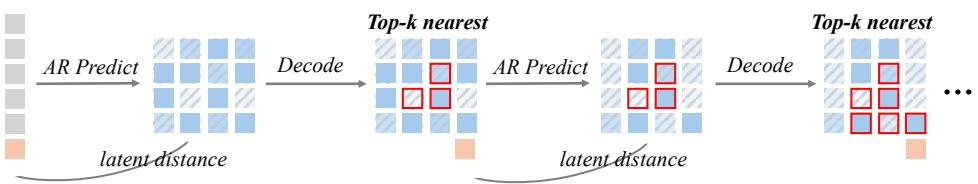
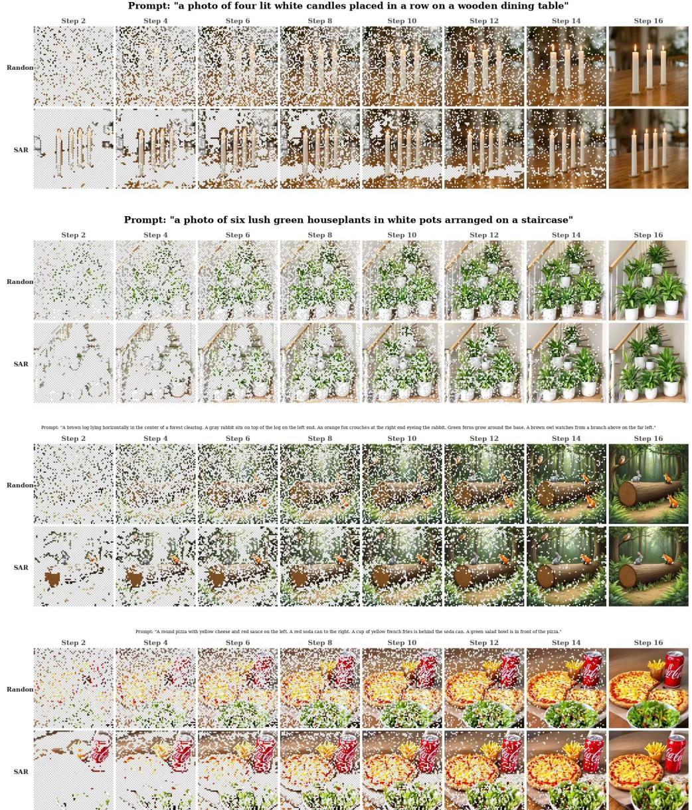
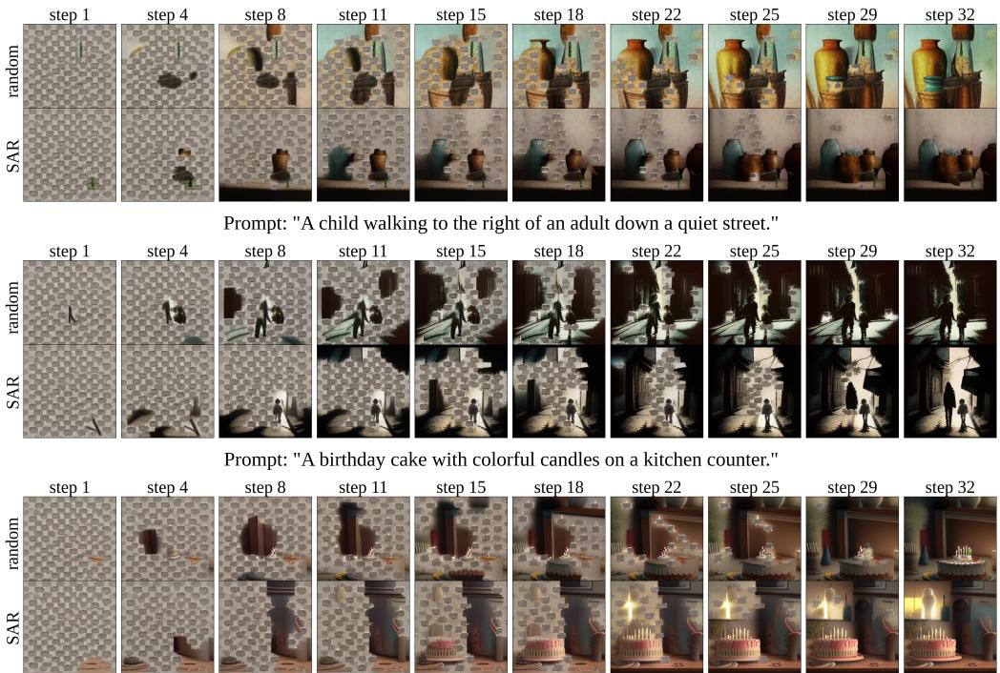

# Context-Aware Autoregressive Image Generation for Emerging Reasoning Properties

Jixuan Ying1,2,∗, Haoyu Liu2,∗,†, Timing Yang1, Tingyu Zhu2 Predrag Neskovic4, Anand Bhattad1, Cihang Xie3 Zeyu Zheng2,†, Alan Yuille1, Feng Wang1,†

1Johns Hopkins University

2University of California, Berkeley 3University of California, Santa Cruz 4Office of Naval Research

\*Equal contribution †Corresponding authors

haoyuliu@berkeley.edu zyzheng@berkeley.edu wangf3014@gmail.com

## Abstract

Autoregressive image generation has recently emerged as a competitive visual generation paradigm, yet its generation order is often predefined or heuristic, such as next-patch prediction, random-order prediction, or one-step generation for specific scales. We observe that these strategies can cause models to overlook important structural dependencies in images, thereby limiting both structural robustness and reasoning capability. In this work, we propose a context-aware autoregressive generation framework, where the model dynamically determines the next token location based on global context and current local information. Rather than following a fixed or random order, our method allows the generation process to adapt to image structure and semantic dependencies. Extensive experiments show that context-aware generation significantly improves structural robustness across different image AR paradigms, including masked autoregressive and scale-wise autoregressive models. Beyond quantitative improvements, we further observe emerging reasoning properties: the model can better understand complex semantic instructions and generate images that more faithfully follow the given guidance. These findings suggest that generation order is a critical yet underexplored factor in image autoregressive modeling, and that context-aware decoding can unlock stronger reasoning-aware visual generation capabilities. Code is available at https://github.com/Hpesojyjx/Saccades-AR.

## 1 Introduction

Inspired by the success of next-token prediction in natural language processing, recent years have witnessed a growing interest in autoregressive (AR) image generation. Early efforts directly transferred the language modeling recipe to visual generation by flattening 2D images, pixels, or discrete visual tokens into 1D sequences and modeling them with standard autoregressive Transformers, following a raster or otherwise fixed token order (Chen et al., 2020; Ramesh et al., 2021; Esser et al., 2021; Yu et al., 2022; Sun et al., 2024). While conceptually simple and scalable, this direct transfer is not perfectly aligned with the spatial nature of images. Unlike text, where the generation order often follows a natural linguistic progression, images contain dense 2D structures and longrange spatial dependencies that do not naturally conform to a single left-to-right sequence. As a result, fixed-order AR generation can easily underutilize important structural cues, leading to visible artifacts such as row-wise or column-wise misalignment, distorted object layouts, and weakened global coherence. To alleviate these limitations, subsequent works explored more flexible generation schemes, including masked generative modeling that predicts randomly masked tokens or iteratively refines token sets (Chang et al., 2022, 2023; Li et al., 2023, 2024c; Kim et al., 2025b), as well as scale-wise autoregressive generation that predicts visual tokens progressively from coarse to fine resolutions (Tian et al., 2024b; Ma et al., 2024; Han et al., 2025b), which reduce the rigidity of raster decoding and improve visual fidelity and structural stability.

Prompt: "a photo of four vases"  
  
Figure 1: Generation order shapes reasoning-like behaviors in autoregressive image generation. With random-order decoding (top), intermediate predictions remain scattered and incomplete, weakening feedback for counting (e.g., “four vases") and often causing over-generation. With context-aware location selection (bottom), the same model and seed tend to complete objects more coherently (roughly one-by-one) and stop adding new ones once the count is met.

Nonetheless, although random-order and scale-wise generation alleviate the structural distortion, the reasoning logic behind patch-level generation remains largely overlooked. For example, when humans draw an image patch bypatch, they can usually decide where to draw next based on the existing context. This allows them to build a more coherent spatial organization and progressively reason over the partially completed content. In contrast, masked AR models generate patches in a random order, while scale-wise AR models generate all tokens within a given spatial scale in one step. Both strategies can easily miss an important intermediate reasoning process. We illustrate this issue with an intuitive example in Fig. 1, where the model is asked to generate four vases. In Case 2, when the model is allowed to determine the next prediction location according to context, an emerging reasoning behavior can be observed. The model generates the vases in an organized manner, roughly one by one, and obtains self-feedback during the generation process. For instance, before step 22, it has already generated three vases. In the following steps, the model appears to recognize that one vase is still missing, and completes the fourth vase by step 25. After the required count is satisfied, the remaining steps are mainly used to fill in the background. In contrast, in Case 1, the random-order AR model selects prediction locations randomly at each step. As a result, most objects remain incomplete during the intermediate generation process, making it difficult for the model to receive reliable feedback about the object count. Consequently, it keeps generating new vase-like regions and fails to align with the required number.

Motivated by this observation, we propose Saccade AR (SAR)1, a simple yet surprisingly effective context-aware decoding strategy for AR image generation. In detail, at each decoding step, an AR model typically produces candidate predictions for all editable token positions, after which existing methods commit tokens according to a random, predefined, or scale-wise schedule. Instead, SAR ranks candidate token locations by their semantic relevance to the global context. Specifically, we measure the distance between each candidate token representation and the global conditioning signal, such as the class token in class-conditional generation or text embeddings in text-to-image generation, and prioritize locations from semantically close to semantically distant. In this way, SAR first generates regions that are strongly related to the global intent, and then fills in less critical details. SAR is training-free, lightweight, and broadly applicable. It can be plugged into pretrained AR image models at inference time without changing model parameters, and it introduces almost no additional computation because it only reorders which candidate predictions are committed. Moreover, SAR applies to different AR paradigms, including masked autoregressive models (MAR (Li et al., 2024c)) and scale-wise autoregressive models (VAR (Tian et al., 2024b)). Importantly, SAR does not change the model architecture or supervision; it changes the generation trajectory. Our central thesis is that this trajectory matters: when the model generates in a context-aware order, it can better exploit intermediate visual feedback and exhibit stronger structural robustness and reasoning-related instruction following.

Extensive experiments validate this hypothesis. On text-to-image benchmarks such as GenEval (Ghosh et al., 2023) and DPG-Bench (Hu et al., 2024), SAR consistently improves pretrained AR generators including MaskGen (Kim et al., 2025b) and Infinity (Han et al., 2025b), with especially clear gains on reasoning-related dimensions such as counting, relative positioning, and compositional instruction following. To further evaluate reasoning ability, we construct a long-prompt text-to-image benchmark involving complex combinations of object counts, spatial relations, and fine-grained attribute assignments. On this benchmark, SAR brings even larger improvements, supporting our claim that generation order is a critical factor behind the reasoning limitations of existing AR image models.

## 2 Related Work

Autoregressive models in language and multimodal generation. Recent advances in large language models (LLMs) (Brown et al., 2020; Touvron et al., 2023a,b; Gemini Team, Google, 2023; OpenAI, 2024; Yang et al., 2024) have made autoregressive (AR) models central to modern generative modeling, due to their flexibility and wide use in predicting each next token from prior tokens. First developed for text, AR models are now also widely used for visual generation (Chen et al., 2020; Esser et al., 2021; Sun et al., 2024; Tian et al., 2024a; Li et al., 2024b), where each image is treated as a sequence of discrete tokens. The same idea has further led to unified vision–language models that handle both multimodal understanding and generation, such as Emu3 (Emu3 Team, BAAI, 2024), LaVIT (Jin et al., 2023),and VILA-U (Wu et al., 2024). In these models, one shared AR backbone reads and writes mixed text and image tokens.

Autoregressive image generation with raster-scan token order. Early research on AR visual modeling adopts language model architectures to generate images pixel by pixel (Chen et al., 2020). With the help of image tokenizers (Van Den Oord et al., 2017; Esser et al., 2021), later AR models produce images as discrete token sequences in a next-token manner, where each image is flattened into a 1D sequence and predicted by a decoder-only transformer, similar to language modeling. This pipeline has been scaled up to large-scale text-conditioned generation, such as DALL-E (Ramesh et al., 2021), CogView (Ding et al., 2021, 2022), Make-A-Scene (Gafni et al., 2022), Parti (Yu et al., 2022), LlamaGen (Sun et al., 2024), and Lumina-mGPT (Liu et al., 2024), with parallel extensions to text-to-video models such as VideoPoet (Kondratyuk et al., 2023). However, these methods produce image tokens in raster-scan order, which does not fully use the 2D structure of natural images, leading to structural artifacts and weakened coherence under complex semantic instructions.

Improved generation orders for autoregressive image synthesis. Beyond raster-scan generation, recent works explore two complementary directions. Mask-based methods predict multiple tokens per step in a non-fixed order: MaskGIT (Chang et al., 2022) predicts groups of tokens jointly at each step, cutting the inference cost; Muse (Chang et al., 2023) extends this idea to text-to-image generation; MAGE (Li et al., 2023) unifies representation learning and synthesis under the same masked-token objective. MAR (Li et al., 2024b) brings masked prediction to continuous-valued tokens via a small diffusion head, replacing the discrete codebook, and MaskGen (Kim et al., 2025a) compresses images into compact 1D tokens for masked text-to-image generation. Scale-wise methods replace the spatial axis with a coarse-to-fine scale axis: VAR (Tian et al., 2024a) sums predictions across scales so the inference step count equals the number of scales, with follow-ups in STAR (Ma et al., 2024) and Infinity (Han et al., 2025a). While both directions alleviate the rigidity of raster-scan, the resulting order is still either fixed a priori (a predetermined scale schedule, as in VAR) or determined stochastically (random or confidence-based unmasking, as in MaskGIT and MAR)—no existing method dynamically chooses the next step based on the semantic context already produced. This motivates our context-aware generation order, in which the model itself decides where to attend and generate next, analogous to the saccadic behaviour of the human visual system.

## 3 Method

## 3.1 Image Autoregressive Models

Modern image autoregressive models can be grouped into two families that differ in the unit of generation. Patch-wise models tokenize the image into a flat sequence of spatial (or 1D-compressed)

  
(b) random-order generation

  
(c) SAR, contextual-order generation  
Figure 2: Comparison to one-step and random-order generation paradigms. Our SAR model decides the generation order based on each token’s latent distance to a global token. This is only a minimal changefor image AR models, but wefind it crucialfor the AR model’s reasoning behavior.

latent tokens and predict them one or a few at a time. Scale-wise models predict the image at progressively finer resolutions, generating a coarse-to-fine pyramid of tokens. We describe the patch-wise scale-wise formulations below, and then explain how SAR adapt with them.

Patch-wise masked autoregressive models. We adopt the masked-autoregressive (MAR) formulation (Li et al., 2024b), encoding an image x into $N$ continuous latent tokens $z \doteq \{ z _ { i } \} _ { i = 1 } ^ { N }$ and factorizing the conditional distribution over a generation order π:

$$
p _ { \theta } ( z \mid c ) = \prod _ { t = 1 } ^ { T } p _ { \theta } ( z _ { S _ { t } } \mid z _ { S _ { < t } } , c ) ,\tag{1}
$$

Here c is a conditioning signal, and $\{ S _ { t } \} _ { t = 1 } ^ { T }$ partitions token indices according to π. At step t, the model predicts $S _ { t }$ in parallel given $z _ { S _ { < t } } ,$ unmasking $\lvert S _ { t } \rvert$ tokens with the cosine schedule above. Each per-token conditional is implemented by an MAE-style transformer decoder with a lightweight denoising-diffusion head, and we apply classifier-free guidance (CFG) with a linear schedule across AR steps at inference.

Scale-wise autoregressive models. We also consider scale-wise AR as in VAR (Tian et al., 2024a) and Infinity (Han et al., 2025a), which generates a coarse-to-fine pyramid $z = \{ \dot { z } ^ { ( k ) } \} _ { k = 1 } ^ { K }$ (with $N _ { k }$ tokens at scale k):

$$
p _ { \theta } ( z \mid c ) = \prod _ { k = 1 } ^ { K } p _ { \theta } \Big ( z ^ { ( k ) } \Big | z ^ { ( < k ) } , c \Big ) ,\tag{2}
$$

At scale k, the model predicts the next finer tokens conditioned on coarser scales $z ^ { ( < k ) }$ and $c ,$ progressively refining details. Instantiations differ across models: VAR uses discrete next-scale tokens, while Infinity predicts bits with a multi-scale residual tokenizer.

## 3.2 Saccade Autoregressive Generation

The order π in Eq. 1 is typically fixed (e.g., raster/zigzag) or sampled uniformly at random (Li et al., 2024b). Neither leverages image spatial semantics. Inspired by human saccades, we instead choose the order adaptively at inference time, generating the tokens most relevant to the conditioning first, with saliency decided by the model rather than a hand-designed scan. Let $h _ { i } ^ { ( t ) } \in \mathbb { R } ^ { d }$ denote the model-specific candidate representation used for ranking at masked position $i \in \mathcal { M } _ { t }$ and AR step t. Let $\bar { \mathcal { A } } ^ { ( t ) } \subset \mathbb { R } ^ { d }$ be conditioning anchors in the same embedding space: the conditioning tokens visible before any image token is generated (class tokens for class-conditional, prompt tokens for text-conditional). Model-specific details are in Sec. 4. Because the generation pipeline produces candidate representations for all masked positions at each step, we can rank positions on the fly. We score each still-masked position by its average cosine similarity to anchors,

$$
s _ { i } ^ { ( t ) } = \frac { 1 } { \vert \mathcal { A } ^ { ( t ) } \vert } \sum _ { a \in \mathcal { A } ^ { ( t ) } } \frac { \langle h _ { i } ^ { ( t ) } , a \rangle } { \Vert h _ { i } ^ { ( t ) } \Vert \Vert a \Vert } , \qquad i \in \mathcal { M } _ { t } ,\tag{3}
$$

then unmask the $\mathrm { t o p } { - } | S _ { t } |$ positions (same cosine schedule as Eq. 1). Recomputing $h ^ { ( t ) }$ each step yields an adaptive, context-dependent order. SAR changes only inference-time ranking and adds a single similarity computation per (masked token, anchor, step).

MAR feature selection. For MAR, position selection is performed after token-wise diffusion denoising, rather than directly on the deterministic masked-prediction features. At each step, the model first predicts candidates for unresolved positions from the current visible context, and then samples denoised candidate tokens before SAR selects which positions to commit. Diffusion sampling introduces seed-dependent variation, so the first selected position need not be fixed for a given class condition. After each commitment, the updated partial image conditions the next round of candidate generation and ranking.

SAR for scale-wise generation. Scale-wise AR (Eq. 2) generates all $N _ { k }$ tokens at a scale in one shot, so there is no intra-scale order. We introduce an order by decoding only the final scale K over $M { > } 1$ steps (scales $1 \ldots K { - 1 }$ unchanged), since the last scale has the highest spatial resolution and contains most fine details. We split the $N _ { K }$ final-scale positions into $\bar { M }$ equal groups and commit one group per step. At step m, committed positions use their decoded embeddings and the rest keep the coarse features from scales $1 \ldots K { - 1 } ;$ a non-causal pass produces fresh hidden states $h _ { i } ^ { ( m ) }$ for all uncommitted positions. We rank positions by squared L2 distance to an anchor a,

$$
s _ { i } ^ { ( m ) } \ = \ \left\| h _ { i } ^ { ( m ) } - a \right\| _ { 2 } ^ { 2 } ,\tag{4}
$$

and commit the $N _ { K } / M$ positions with smallest scores. We reuse the model’s existing conditioning embedding as a (class embedding $c _ { \mathrm { c l a s s } }$ or pooled text embedding $c _ { \mathrm { p o o l } } )$ , computed once and fixed across steps, so this adds essentially no extra overhead.

Overall, scale-wise SAR is an inference-time re-ranking on top of M-step last-scale decoding; it requires no parameter updates and adds one similarity per uncommitted position per step. We instantiate it on VAR (Tian et al., 2024a) (class-conditional; Appendix B) and Infinity (Han et al., 2025a) (text-to-image; Sec. 4.2). Table 7 compares inference-time orders on shared checkpoints. Separately, Table 8 studies VAR retrained using SAR ordering at the last scale, followed by evaluation under different inference orders.

## 4 Experiments

In this section, we evaluate SAR across both patch-wise and scale-wise AR. Sec. 4.1 qualitatively visualizes the intermediate decoded image at every AR step under random vs. SAR; Sec. 4.2 reports our main text-to-image results on MaskGen and Infinity, covering GenEval, DPG-Bench, MJHQ-30K FID, and a complex long-prompt reasoning benchmark we construct (Sec. 4.2.1); Sec. 4.3 presents ablations on alternative orders and on the VAR retraining. We also provide class-conditional ImageNet results on MAR and VAR in Appendix B.

## 4.1 Qualitative Analysis

Before the quantitative results we build intuition for how SAR helps by visualizing the intermediate decoded image at every AR step under random vs. SAR, with the checkpoint and prompt held fixed. We use one representative model per AR family: Infinity-8B (scale-wise) and MaskGen-XL (patch-wise). Implementation details are provided in Sec. 4.2. The two realize SAR’s improvement through different reasoning behaviors that converge on the same effect.

Infinity: outline first, details later. On Infinity-8B (Fig. 3), SAR commits to the prompt-correct global outline (count, object identity, and overall geometry) within the first few last-scale steps, and uses subsequent steps only to fill in textures. Random ordering scatters partial textures before any outline is established and often fails to recover those structural decisions by the final step.

MaskGen: one object at a time. On MaskGen-XL (Fig. 4), SAR instead commits one full object at a time, moving on only once the previous object is complete; counting, spatial relations, and compositional hierarchy all fall out of this sequential commitment. Random ordering grows all parts concurrently and resolves identity and layout only in the last few steps.

The two families realize SAR through complementary mechanisms (outline-to-detail vs. object-byobject), but in both cases SAR’s prompt-grounded ordering turns AR decoding into a sequence of legible, prompt-aligned commitments rather than a soup of half-formed concepts. This implicit visual planning emergesforfree, and the quantitative results across all 8 models in Sec. 4.2 and Appendix B confirm that this behavioral change translates into consistent benchmark gains.

## 4.2 Text-to-image generation

Setup. We evaluate text-to-image SAR on two AR families that span the dominant design choices in the literature: MaskGen (Kim et al., 2025a) (patch-wise; MaskGen-L and MaskGen-XL) and Infinity (Han et al., 2025a) (scale-wise; Infinity-2B and Infinity-8B). MaskGen takes the SAR anchor to be the singleton $\{ W c _ { \mathrm { p o o l } } \}$ , with $\dot { W }$ the same linear projection MaskGen already uses to inject pooled text conditioning; Infinity takes the SAR anchor to be $a = c _ { \mathrm { p o o l } }$ , the attentive-pooled text embedding already consumed by AdaLN. We use T=32 AR steps for MaskGen and M=16 equal groups at the last scale for Infinity. All other implementation details follow the original recipes and are listed in Appendix A.

Evaluation. We use three complementary benchmarks: GenEval (Ghosh et al., 2023) for compositional capability, with 4 samples per prompt and the prompt-level pass criterion; DPG-Bench (Hu et al., 2024) for fine-grained prompt alignment, scored by the mPLUG-VQA evaluator on a 2×2 image grid; and MJHQ-30K FID (Li et al., 2024a) for distribution-level aesthetic quality on a 30Kprompt subset. Following the original Infinity protocol, GenEval is run with prompt rewriting on Infinity; all other settings use raw prompts. All three are averaged over 3 seeds.

Results. Tables 2 and 3 show that the inference-only SAR change improves compositional capability at every scale across both paradigms. On GenEval, the Overall pass rate rises consistently, with the largest gains on sub-categories that require global consistency such as Counting, Colors, and Position. On DPG-Bench, the per-category L1 breakdown is mixed but the aggregate Overall score also improves at every scale. On MJHQ-30K FID (Table 4), SAR is statistically tied with random at every scale, indicating that the compositional gains do not come at the price of distribution-level aesthetic quality. Together these results demonstrate that a single inference-time intervention generalizes across both patch-wise and scale-wise text-to-image AR. For the scale-wise setting, Appendix C additionally studies SAR-order last-scale retraining of VAR and compares inference orders on the resulting checkpoints.

## 4.2.1 Complex long-prompt benchmark

To complement GenEval and DPG-Bench, we further build a complex long-prompt benchmark to better evaluate reasoning-intensive instruction following. The benchmark contains 2,000 prompts with dense compositional constraints, including object counts, spatial relations, attribute binding, object existence, compositional ordering, and view consistency. A typical prompt is: “A vertical stack of four different items: a wooden donut at the bottom, a metallic sphere in the middle, and a miniature cactus on the very top. This stack is placed inside a hollow red ring. To the front-left of the stack is a spilled glass of milk, and to the back-right is a closed leather book. Cinematic top-down 45-degree angle view.”

For evaluation, we generate images from each prompt using different AR models and decoding orders. We then use Gemini 2.5 Pro (Gemini Team, Google, 2025) as a VLM judge. For each image, we construct 10 question-answer pairs from the prompt, with ground-truth answers directly extracted from the prompt constraints. Gemini is asked to score the match between the generated image and each question on a 1–5 scale. We report the average scores under six reasoning-related categories.

  
Figure 3: Infinity-8B: outline-to-detail reasoning under SAR. In each strip, the top row is random ordering and the bottom row is SAR; columns are AR steps. Within the first few SAR steps the global outline already encodes the correct count (four candles, six houseplants), the correct object set with no hallucinated extras (fox+rabbit), and the correct global geometry (circular pizza). Subsequent steps fill in textures without changing those structural decisions. Random ordering instead grows partial textures everywhere and frequently fails to recover count, identity, or shape by the final step.

Prompt: "a photo of four vases"  
  
Figure 4: MaskGen-XL: object-by-object reasoning under SAR. Top to bottom: “four vases”, “a child walking to the right of an adult down a quiet street”, and “a birthday cake with colorful candles on a kitchen counter”. SAR completes one object before starting the next (counting), commits one entity before introducing the other (spatial relation), and follows scene → main object → parts (compositional hierarchy); random ordering grows everything concurrently and only resolves identity and layout in the last few steps.

Table 1: Results on our complex long-prompt benchmark. Scores are judged by Gemini 2.5 Pro on a 1–5 scale.
<table><tr><td>Model</td><td>Order</td><td>Cnt.</td><td>Spat.</td><td>Attr.</td><td>Exist.</td><td>Ord.</td><td>View</td><td>Avg.</td></tr><tr><td>MaskGen-XL</td><td>random SAR</td><td>2.55 3.08</td><td>2.24 2.78</td><td>2.39 2.94</td><td>2.51 3.01</td><td>2.32 2.82</td><td>2.51 2.89</td><td>2.42 2.92</td></tr><tr><td>Infinity-2B</td><td>random SAR</td><td>2.76 3.27</td><td>2.43 2.98</td><td>2.64 3.16</td><td>2.72 3.22</td><td>2.49 2.99</td><td>2.68 3.10</td><td>2.62 3.12</td></tr><tr><td>Infinity-8B</td><td>random SAR</td><td>3.09 3.61</td><td>2.74 3.31</td><td>2.94 3.45</td><td>3.02 3.49</td><td>2.82</td><td>2.91 3.36</td><td>2.92 3.42</td></tr></table>

Table 1 shows that SAR consistently improves complex instruction following across all three evaluated AR models, raising the average score by roughly +0.5 on each. The largest gains tend to appear on categories that require global consistency (counting, spatial relation, and compositional ordering) where random-order decoding fails to maintain reliable intermediate feedback about how many objects have already been generated or where they should be placed. This supports our hypothesis that generation order is not merely a low-level sampling detail but directly affects whether an AR image model can use partially generated content as feedback and reason over the remaining constraint during generation.

Table 2: GenEval pass rate (%, ↑) for both AR paradigms. Best per (model, metric) pair in bold.
<table><tr><td>Model</td><td>Method</td><td>S.Obj</td><td>T.Obj</td><td>Count</td><td>Colors</td><td>Pos.</td><td>C.Attr</td><td>Overall</td></tr><tr><td rowspan="2">MaskGen-L</td><td>Random</td><td>100.00</td><td>54.55</td><td>40.00</td><td>85.11</td><td>18.00</td><td>26.00</td><td>53.94</td></tr><tr><td>SAR</td><td>100.00</td><td>56.57</td><td>50.00</td><td>89.36</td><td>20.00</td><td>29.00</td><td>57.49</td></tr><tr><td rowspan="2">MaskGen-XL</td><td>Random</td><td>98.75</td><td>58.59</td><td>43.75</td><td>87.23</td><td>21.00</td><td>28.00</td><td>56.22</td></tr><tr><td>SAR</td><td>98.75</td><td>64.65</td><td>46.25</td><td>88.30</td><td>25.00</td><td>37.00</td><td>59.99</td></tr><tr><td rowspan="2">Infinity-2B</td><td>Random</td><td>100.00</td><td>82.62</td><td>64.38</td><td>82.77</td><td>42.10</td><td>58.88</td><td>71.79</td></tr><tr><td>SAR</td><td>100.00</td><td>83.34</td><td>65.27</td><td>85.42</td><td>41.00</td><td>60.38</td><td>72.57</td></tr><tr><td rowspan="2">Infinity-8B</td><td>Random</td><td>100.00</td><td>92.04</td><td>68.69</td><td>86.03</td><td>66.76</td><td>70.24</td><td>80.63</td></tr><tr><td>SAR</td><td>100.00</td><td>91.76</td><td>73.21</td><td>86.74</td><td>66.76</td><td>69.57</td><td>81.34</td></tr></table>

Table 3: DPG-Bench L1 category breakdown (%, ↑) for both AR paradigms. Best per (model, metric) pair in bold.
<table><tr><td>Model</td><td>Method</td><td>Entity</td><td>Attribute</td><td>Relation</td><td>Global</td><td>Other</td><td>Overall</td></tr><tr><td rowspan="2">MaskGen-L</td><td>Random</td><td>81.82</td><td>80.04</td><td>80.91</td><td>76.12</td><td>81.08</td><td>70.11</td></tr><tr><td>SAR</td><td>78.30</td><td>80.84</td><td>82.91</td><td>82.75</td><td>81.70</td><td>70.51</td></tr><tr><td rowspan="2">MaskGen-XL</td><td>Random</td><td>79.33</td><td>80.98</td><td>81.63</td><td>80.81</td><td>80.52</td><td>71.00</td></tr><tr><td>SAR</td><td>81.53</td><td>79.82</td><td>82.83</td><td>82.81</td><td>81.08</td><td>71.57</td></tr><tr><td rowspan="2">Infinity-2B</td><td>Random</td><td>89.14</td><td>86.19</td><td>92.50</td><td>83.18</td><td>82.67</td><td>82.71</td></tr><tr><td>SAR</td><td>89.24</td><td>86.23</td><td>92.51</td><td>82.88</td><td>82.93</td><td>82.76</td></tr><tr><td rowspan="2">Infinity-8B</td><td>Random</td><td>91.38</td><td>88.75</td><td>94.24</td><td>83.99</td><td>86.80</td><td>86.09</td></tr><tr><td>SAR</td><td>91.45</td><td>88.87</td><td>94.25</td><td>85.01</td><td>86.67</td><td>86.27</td></tr></table>

## 4.3 Ablation Study

To check that the gains of SAR are not a trivial side-effect of merely abandoning the random baseline, we compare it against two deterministic alternatives: Sequential, which generates tokens one by one in their natural index order, and Inside-out, which starts from the middle token and expands outward symmetrically. We evaluate them on one representative model from each AR family: MaskGen-XL (patch-wise) and Infinity-8B (scale-wise). Table 5 reports GenEval and DPG-Bench Overall scores under all four orders. SAR consistently outperforms all three alternative orderings on both benchmarks and on both models, indicating that what matters is conditioning the choice of next position on the prompt itself, rather than simply imposing a structural pattern.

Controlled comparison with confidence scheduling. MaskGIT (Chang et al., 2022) selects positions using prediction confidence, whereas SAR explicitly ranks candidate representations by their alignment with the conditioning anchor. Both rules can depend on the current context; the distinction is the scoring criterion, not dynamic selection alone. We replace the confidence selector in a pretrained MaskGIT-Base checkpoint with SAR, keeping the checkpoint, 12-step cosine schedule, classifier-free guidance setting, and 50K class-conditional ImageNet 256 × 256 sample count fixed, without retraining. Table 6 shows lower FID and higher recall under SAR, isolating the benefit of the selection criterion.

Inference cost and matched-budget comparisons. We measure VAR end-to-end generation latency on one NVIDIA H100 80GB GPU with BF16 and batch size 1. After 20 warm-up generations, we time 1,000 ImageNet images, including VAE decoding but excluding model loading and image saving. Random and SAR use the same retrained checkpoint and identical four-step last-scale decoding, differing only in position selection. Table 9 in Appendix D reports mean latency and population standard deviation alongside generation quality. Across all four VAR sizes, Random and SAR have identical mean latency at the reported precision, although their timing variability can differ. This indicates no measurable additional overhead from SAR’s ranking in this setup, rather than zero computational cost. The increase relative to one-step decoding comes from the shared multi-step last-scale procedure; the matched four-step comparison isolates the effect of the ordering rule.

Table 4: MJHQ-30K FID (↓) for both AR paradigms. Across all four scales, SAR is statistically tied with the random-order baseline, indicating that context-aware ordering does not change the distribution-level aesthetic quality of the generated images.
<table><tr><td rowspan="2">Order</td><td colspan="2">Patch-wise (MaskGen)</td><td colspan="2">Scale-wise (Infinity)</td></tr><tr><td>MaskGen-L</td><td>MaskGen-XL</td><td>Infinity-2B</td><td>Infinity-8B</td></tr><tr><td>Random</td><td>6.79</td><td>6.75</td><td>10.867</td><td>9.332</td></tr><tr><td>SAR</td><td>6.79</td><td>6.74</td><td>10.970</td><td>9.317</td></tr></table>

Table 5: Ablation on the inference-time generation order, on one representative model from each AR family. “Sequential” generates tokens one by one in their natural index order; “Inside-out” starts from the middle token and expands outward. Higher is better for all columns; best per column in bold.
<table><tr><td rowspan="2">Order</td><td colspan="2">MaskGen-XL</td><td colspan="2">Infinity-8B</td></tr><tr><td>GenEval (↑)</td><td>DPG-Bench (↑)</td><td>GenEval (↑)</td><td>DPG-Bench (↑)</td></tr><tr><td>Random</td><td>0.55</td><td>71.00</td><td>0.804</td><td>86.05</td></tr><tr><td>Sequential</td><td>0.57</td><td>71.00</td><td>0.799</td><td>86.01</td></tr><tr><td>Inside-out</td><td>0.55</td><td>71.30</td><td>0.808</td><td>86.25</td></tr><tr><td>SAR (ours)</td><td>0.58</td><td>71.57</td><td>0.815</td><td>86.36</td></tr></table>

Table 6: Controlled MaskGIT-Base comparison: only the position-selection criterion changes.
<table><tr><td>Selection rule</td><td>FID↓</td><td>Recall ↑</td></tr><tr><td>Confidence (original)</td><td>6.48</td><td>0.41</td></tr><tr><td>SAR</td><td>5.95</td><td>0.43</td></tr></table>

## 5 Conclusion

We introduced SAR, a context-aware generation order that, at every AR step, ranks the stilluncommitted positions by similarity to a prompt-derived anchor (the conditioning embedding the base model already maintains) and commits the most relevant ones first; SAR introduces no new parameters and runs purely at inference. Across 8 checkpoints spanning both AR paradigms (MAR, MaskGen, VAR, Infinity) and four standard benchmarks plus our complex long-prompt benchmark, SAR consistently improves prompt alignment and compositional reasoning while preserving distribution-level aesthetic quality, and qualitatively elicits two complementary reasoning behaviors: outline-first decoding in scale-wise models and object-by-object decoding in patch-wise models. The fact that this implicit visual planning emerges for free from the model’s own representations suggests that generation order is a critical and underexplored axis of AR image modeling, with richer anchors and combinations with aesthetic-aware criteria as natural directions for further gains.

## Acknowledgments and Disclosure of Funding

Authors from Johns Hopkins University are supported by ONR grants N000142512132 and N000142412696.

## References

Tom Brown, Benjamin Mann, Nick Ryder, Melanie Subbiah, Jared D Kaplan, Prafulla Dhariwal, Arvind Neelakantan, Pranav Shyam, Girish Sastry, Amanda Askell, et al. Language models are few-shot learners. Advances in neural information processing systems, 33:1877–1901, 2020. 3

Huiwen Chang, Han Zhang, Lu Jiang, Ce Liu, and William T. Freeman. MaskGIT: Masked generative image transformer. In Proceedings of the IEEE/CVF Conference on Computer Vision and Pattern Recognition, 2022. 1, 3, 9

Huiwen Chang, Han Zhang, Jarred Barber, AJ Maschinot, Jose Lezama, Lu Jiang, Ming-Hsuan Yang, Kevin Murphy, William T. Freeman, Michael Rubinstein, Yuanzhen Li, and Dilip Krishnan. Muse: Text-to-image generation via masked generative transformers. In International Conference on Machine Learning, 2023. 1, 3

Mark Chen, Alec Radford, Rewon Child, Jeffrey Wu, Heewoo Jun, David Luan, and Ilya Sutskever. ImageGPT: Generative pretraining from pixels. In International Conference on Machine Learning, 2020. 1, 3

Jia Deng, Wei Dong, Richard Socher, Li-Jia Li, Kai Li, and Li Fei-Fei. Imagenet: A large-scale hierarchical image database. In 2009 IEEE Conference on Computer Vision and Pattern Recognition, pages 248–255, 2009. 14

Prafulla Dhariwal and Alexander Nichol. Diffusion models beat gans on image synthesis. Advances in neural information processing systems, 34:8780–8794, 2021. 14

Ming Ding, Zhuoyi Yang, Wenyi Hong, Wendi Zheng, Chang Zhou, Da Yin, Junyang Lin, Xu Zou, Zhou Shao, Hongxia Yang, et al. CogView: Mastering text-to-image generation via transformers. Advances in Neural Information Processing Systems, 34:19822–19835, 2021. 3

Ming Ding, Wendi Zheng, Wenyi Hong, and Jie Tang. CogView2: Faster and better text-to-image generation via hierarchical transformers. Advances in Neural Information Processing Systems, 35: 16890–16902, 2022. 3

Emu3 Team, BAAI. Emu3: Next token prediction is all you need. https://baai-solution. ks3-cn-beijing.ksyuncs.com/emu3/Emu3-tech-report.pdf, 2024. 3

Patrick Esser, Robin Rombach, and Björn Ommer. VQGAN: Taming transformers for high-resolution image synthesis. In Proceedings of the IEEE/CVF Conference on Computer Vision and Pattern Recognition, 2021. 1, 3

Oran Gafni, Adam Polyak, Oron Ashual, Shelly Sheynin, Devi Parikh, and Yaniv Taigman. Makea-scene: Scene-based text-to-image generation with human priors. In European Conference on Computer Vision, pages 89–106. Springer, 2022. 3

Gemini Team, Google. Gemini: a family of highly capable multimodal models. arXiv preprint arXiv:2312.11805, 2023. 3

Gemini Team, Google. Gemini 2.5: Pushing the frontier with advanced reasoning, multimodality, long context, and next generation agentic capabilities. arXiv preprint arXiv:2507.06261, 2025. 6

Dhruba Ghosh, Hannaneh Hajishirzi, and Ludwig Schmidt. Geneval: An object-focused framework for evaluating text-to-image alignment. Advances in Neural Information Processing Systems, 36: 52132–52152, 2023. 3, 6

Jian Han, Jinlai Liu, Yi Jiang, Bin Yan, Yuqi Zhang, Zehuan Yuan, Bingyue Peng, and Xiaobing Liu. Infinity: Scaling bitwise autoregressive modeling for high-resolution image synthesis. In Proceedings ofthe IEEE/CVF Conference on Computer Vision and Pattern Recognition, 2025a. 3, 4, 5, 6, 14

Jian Han, Jinlai Liu, Yi Jiang, Bin Yan, Yuqi Zhang, Zehuan Yuan, Bingyue Peng, and Xiaobing Liu. Infinity: Scaling bitwise autoregressive modeling for high-resolution image synthesis. In Proceedings of the IEEE/CVF Conference on Computer Vision and Pattern Recognition, 2025b. 2, 3

Martin Heusel, Hubert Ramsauer, Thomas Unterthiner, Bernhard Nessler, and Sepp Hochreiter. Gans trained by a two time-scale update rule converge to a local nash equilibrium. Advances in neural information processing systems, 30, 2017. 14

Xiwei Hu, Rui Wang, Yixiao Fang, Bin Fu, Pei Cheng, and Gang Yu. Ella: Equip diffusion models with llm for enhanced semantic alignment. arXiv preprint arXiv:2403.05135, 2024. 3, 6

Yang Jin, Kun Xu, Kun Xu, Liwei Chen, Chao Liao, Jianchao Tan, Yadong Mu, et al. Unified language-vision pretraining in LLM with dynamic discrete visual tokenization. arXiv preprint arXiv:2309.04669, 2023. 3

Dongwon Kim, Ju He, Qihang Yu, Chenglin Yang, Xiaohui Shen, Suha Kwak, and Liang-Chieh Chen. Democratizing text-to-image masked generative models with compact text-aware one-dimensional tokens. arXiv preprint arXiv:2501.07730, 2025a. 3, 6, 14

Dongwon Kim, Ju He, Qihang Yu, Chenglin Yang, Xiaohui Shen, Suha Kwak, and Liang-Chieh Chen. MaskGen: Democratizing text-to-image masked generative models with compact text-aware one-dimensional tokens. arXiv preprint arXiv:2501.07730, 2025b. 1, 3

Dan Kondratyuk, Lijun Yu, Xiuye Gu, José Lezama, Jonathan Huang, Rachel Hornung, Hartwig Adam, Hassan Akbari, Yair Alon, Vighnesh Birodkar, et al. VideoPoet: A large language model for zero-shot video generation. arXiv preprint arXiv:2312.14125, 2023. 3

Daiqing Li, Aleks Kamko, Ehsan Akhgari, Ali Sabet, Linmiao Xu, and Suhail Doshi. Playground v2. 5: Three insights towards enhancing aesthetic quality in text-to-image generation. arXiv preprint arXiv:2402.17245, 2024a. 6

Tianhong Li, Huiwen Chang, Shlok Kumar Mishra, Han Zhang, Dina Katabi, and Dilip Krishnan. MAGE: Masked generative encoder to unify representation learning and image synthesis. In Proceedings ofthe IEEE/CVF Conference on Computer Vision and Pattern Recognition, 2023. 1, 3

Tianhong Li, Yonglong Tian, He Li, Mingyang Deng, and Kaiming He. Autoregressive image generation without vector quantization. arXiv preprint arXiv:2406.11838, 2024b. 3, 4, 14

Tianhong Li, Yonglong Tian, He Li, Mingyang Deng, and Kaiming He. MAR: Autoregressive image generation without vector quantization. In Advances in Neural Information Processing Systems, 2024c. 1, 2

Dongyang Liu, Shitian Zhao, Le Zhuo, Weifeng Lin, Yu Qiao, Hongsheng Li, and Peng Gao. LuminamGPT: Illuminate flexible photorealistic text-to-image generation with multimodal generative pretraining. arXiv preprint arXiv:2408.02657, 2024. 3

Xiaoxiao Ma, Mohan Zhou, Tao Liang, Yalong Bai, Tiejun Zhao, Biye Li, Huaian Chen, and Yi Jin. STAR: Scale-wise text-conditioned autoregressive image generation. arXiv preprint arXiv:2406.10797, 2024. 2, 3

OpenAI. Hello GPT-4o. https://openai.com/index/hello-gpt-4o/, 2024. 3

Aditya Ramesh, Mikhail Pavlov, Gabriel Goh, Scott Gray, Chelsea Voss, Alec Radford, Mark Chen, and Ilya Sutskever. DALL-E: Zero-shot text-to-image generation. In International Conference on Machine Learning, 2021. 1, 3

Peize Sun, Yi Jiang, Shoufa Chen, Shilong Zhang, Bingyue Peng, Ping Luo, and Zehuan Yuan. LlamaGen: Autoregressive model beats diffusion. arXiv preprint arXiv:2406.06525, 2024. 1, 3

Keyu Tian, Yi Jiang, Zehuan Yuan, Bingyue Peng, and Liwei Wang. Visual autoregressive modeling: Scalable image generation via next-scale prediction. arXiv preprint arXiv:2404.02905, 2024a. 3, 4, 5, 14

Keyu Tian, Yi Jiang, Zehuan Yuan, Bingyue Peng, and Liwei Wang. VAR: Visual autoregressive modeling via next-scale prediction. In Advances in Neural Information Processing Systems, 2024b. 2

Hugo Touvron, Thibaut Lavril, Gautier Izacard, Xavier Martinet, Marie-Anne Lachaux, Timothée Lacroix, Baptiste Rozière, Naman Goyal, Eric Hambro, Faisal Azhar, et al. Llama: Open and efficient foundation language models. arXiv preprint arXiv:2302.13971, 2023a. 3

Hugo Touvron, Louis Martin, Kevin Stone, Peter Albert, Amjad Almahairi, Yasmine Babaei, Nikolay Bashlykov, Soumya Batra, Prajjwal Bhargava, Shruti Bhosale, et al. Llama 2: Open foundation and fine-tuned chat models. arXiv preprint arXiv:2307.09288, 2023b. 3

Aaron Van Den Oord, Oriol Vinyals, et al. Neural discrete representation learning. Advances in Neural Information Processing Systems, 30, 2017. 3

Yecheng Wu, Zhuoyang Zhang, Junyu Chen, Haotian Tang, Dacheng Li, Yunhao Fang, Ligeng Zhu, Enze Xie, Hongxu Yin, Li Yi, et al. VILA-U: a unified foundation model integrating visual understanding and generation. arXiv preprint arXiv:2409.04429, 2024. 3

An Yang, Baosong Yang, Binyuan Hui, Bo Zheng, Bowen Yu, Chang Zhou, Chengpeng Li, Chengyuan Li, Dayiheng Liu, Fei Huang, et al. Qwen2 technical report. arXiv preprint arXiv:2407.10671, 2024. 3

Jiahui Yu, Yuanzhong Xu, Jing Yu Koh, Thang Luong, Gunjan Baid, Zirui Wang, Vijay Vasudevan, Alexander Ku, Yinfei Yang, Burcu Karagol Ayan, Ben Hutchinson, Wei Han, Zarana Parekh, Xin Li, Han Zhang, Jason Baldridge, and Yonghui Wu. Parti: Scaling autoregressive models for content-rich text-to-image generation. arXiv preprint arXiv:2206.10789, 2022. 1, 3

## A Implementation Details

Code for the VAR and Infinity implementations is publicly available at https://github.com/ Hpesojyjx/Saccades-AR.

## A.1 Text-to-image generation (Sec. 4.2)

MaskGen. We use the public MaskGen-L and MaskGen-XL checkpoints (Kim et al., 2025a), both built on the KL variant of the TATiTok 1D image tokenizer that compresses an image into $N { = } 3 2$ continuous latent tokens. A frozen CLIP ViT-L/14-336 text encoder produces a per-token text feature sequence and a pooled embedding $c _ { \mathrm { p o o l } } ;$ the linear projection W used to form the SAR anchor is the same one MaskGen already uses to inject pooled text conditioning into its decoder. We sample with T=32 AR steps, CFG scale 3.0 with a linear schedule, and an aesthetic micro-conditioning score of 6.5, matching the original MaskGen recipe.

Infinity. We use Infinity-2B and Infinity-8B (Han et al., 2025a), both built on the BSQ-VAE tokenizer with $K { = } 1 3$ coarse-to-fine scales at 1024×1024 resolution; the final scale alone contains 4096 spatial positions and accounts for the bulk of the token budget. A frozen FLAN-T5-XL text encoder produces a per-token feature sequence consumed by cross-attention and a learned attentivepooled embedding $c _ { \mathrm { p o o l } }$ used for AdaLN modulation. We run multi-step inference at the final scale only, with M=16 equal groups, leaving scales 1 through K−1 unchanged. CFG is 4.0 for Infinity-2B and 3.0 for Infinity-8B with sampling temperature $\tau { = } 1$ , matching the original Infinity recipe.

## A.2 Class-conditional generation (Appendix B)

MAR. We use MAR-Base (208M) and MAR-Large (479M) (Li et al., 2024b). The image is encoded by a KL-regularized 2D VAE into N=256 continuous spatial tokens of dimension 16, and the class label is injected as a buffer of class-token embeddings prepended to the decoder input. We sample with T=256 AR steps, 100 diffusion sampling steps inside the per-token diffusion head, and CFG with a linear schedule (CFG scale 2.9 for MAR-Base, 3.0 for MAR-Large), all matching the original MAR recipe.

VAR. We use VAR-d16 (310M) and VAR-d20 (600M) (Tian et al., 2024a). Each image is encoded by a multi-scale residual VQ tokenizer into a coarse-to-fine pyramid of K=10 token maps with final resolution 16×16 at 256×256 output, and the class label is injected as a class embedding $c _ { \mathrm { c l a s s } } { = } \mathrm { C l a s s } { \mathrm { E m b } } ( y )$ driving AdaLN modulation. We run last-scale multi-step inference with M=4 equal groups, leaving scales 1 through K−1 unchanged, and adopt the CFG schedule and sampling temperature of the original VAR recipe.

## B Class-conditional Generation Results

Setup. We evaluate class-conditional SAR on two AR families: MAR (Li et al., 2024b) (patch-wise; MAR-Base and MAR-Large) and VAR (Tian et al., 2024a) (scale-wise; VAR-d16 and VAR-d20). MAR takes the SAR anchor to be the decoder’s representation of the class-token buffer prepended to its decoder input; VAR takes the SAR anchor to be $a = c _ { \mathrm { c l a s s } } { = } \mathrm { C l a s s } \mathrm { E m b } ( y )$ , the class embedding already consumed by AdaLN modulation. We use T=256 AR steps for MAR and M=4 equal groups at the last scale for VAR. The VAR multi-step inference is enabled by an order-agnostic random-order retraining of each VAR variant; this retraining is shared by the random and SAR rows of Table 7 and is itself ablated in Appendix C. All other implementation details follow the original recipes and are listed in Appendix A.

Evaluation. We evaluate on class-conditional ImageNet-1K (Deng et al., 2009) at 256×256, reporting Fréchet Inception Distance (FID) (Heusel et al., 2017) computed against the ADM reference statistics (Dhariwal and Nichol, 2021).

Results. Table 7 reports class-conditional FID. SAR yields a consistent improvement over the random-order baseline at every model size and across both paradigms, despite changing only the inference-time order. Ranking tokens by similarity to the class embedding provides a more informative early context than uniform random selection.

Table 7: Class-conditional FID (↓) on ImageNet 256×256 across both AR paradigms. Within each column, both rows share the same checkpoint (the VAR rows use a retrained checkpoint with M=4 multi-step inference at the last scale) and the same sampling configuration; only the inference-time generation order differs.
<table><tr><td></td><td colspan="2">Patch-wise (MAR)</td><td colspan="2">Scale-wise (VAR)</td></tr><tr><td>Order</td><td>MAR-Base</td><td>MAR-Large</td><td>VAR-d16</td><td>VAR-d20</td></tr><tr><td>Random</td><td>2.29</td><td>1.78</td><td>3.56</td><td>2.77</td></tr><tr><td>SAR (class similarity)</td><td>2.21</td><td>1.75</td><td>3.48</td><td>2.73</td></tr></table>

Table 8: Results of retraining VAR models with different generation orders. For each VAR model, we apply the SAR order at the last scale during retraining. The superscript ∗ indicates the original setting where both training and evaluation generate all tokens within each scale in one step.
<table><tr><td>Model</td><td>Order</td><td>FID↓</td><td>IS↑</td><td>Precision ↑</td><td>Recall ↑</td></tr><tr><td rowspan="5">VAR-d16</td><td>1-step*</td><td>3.30</td><td>274.4</td><td>0.84</td><td>0.51</td></tr><tr><td>1-step</td><td>3.42</td><td>268.5</td><td>0.83</td><td>0.49</td></tr><tr><td>random</td><td>3.24</td><td>278.2</td><td>0.84</td><td>0.52</td></tr><tr><td>SAR</td><td>3.05</td><td>286.2</td><td>0.86</td><td>0.54</td></tr><tr><td>1-step*</td><td>2.57</td><td>302.6</td><td>0.83</td><td>0.56</td></tr><tr><td rowspan="4">VAR-d20</td><td>1-step</td><td>2.68</td><td>297.0</td><td>0.82</td><td>0.54</td></tr><tr><td>random</td><td>2.53</td><td>304.8</td><td>0.84</td><td>0.57</td></tr><tr><td>SAR</td><td>2.35</td><td>314.5</td><td>0.85</td><td>0.59</td></tr><tr><td>1-step*</td><td>2.09</td><td>312.9</td><td>0.82</td><td>0.59</td></tr><tr><td rowspan="4">VAR-d24</td><td>1-step</td><td>2.20</td><td>307.4</td><td>0.81</td><td>0.57</td></tr><tr><td>random</td><td>2.06</td><td>315.4</td><td>0.83</td><td></td></tr><tr><td>SAR</td><td>1.88</td><td>325.3</td><td>0.84</td><td>0.60</td></tr><tr><td></td><td></td><td></td><td></td><td>0.62</td></tr><tr><td rowspan="4">VAR-d30</td><td>1-step *</td><td>1.92</td><td>323.1</td><td>0.82</td><td>0.59</td></tr><tr><td>1-step</td><td>2.03</td><td>317.2</td><td>0.81</td><td>0.57</td></tr><tr><td>random</td><td>1.90</td><td>325.9</td><td>0.82</td><td>0.60</td></tr><tr><td>SAR</td><td>1.74</td><td>335.5</td><td>0.84</td><td>0.62</td></tr></table>

## C VAR Retraining Ablation

Table 8 reports a separate training-time experiment from the inference-order comparison in Table 7. Here, VAR-d16, d20, d24, and d30 are retrained using SAR ordering at the last scale. The 1-step∗ row reports the original VAR setting, in which training and inference generate all tokens within each scale in one step. The remaining rows evaluate the retrained checkpoint under different inference procedures: 1-step generates all tokens within each scale at once, while random and SAR use fourstep last-scale decoding with their respective position-selection rules. The 1-step results remain close to the original baseline. Under the same retrained checkpoint and four-step inference budget, SAR improves FID, IS, precision, and recall over random ordering at every model size. Thus, the random-versus-SAR comparison measures the effect of inference order after SAR-order retraining; improvements relative to the original VAR baseline reflect the combined training and inference changes and should not be attributed solely to inference-time reordering.

## D Inference Latency

Table 9: VAR generation quality and end-to-end inference latency. Times are mean ± population standard deviation over 1,000 images. Random and SAR share the retrained checkpoint and four-step last-scale budget.
<table><tr><td>Model</td><td>Order</td><td>Time (s/image) ↓</td><td>FID↓</td><td>IS↑</td><td>Prec. ↑</td><td>Rec. ↑</td></tr><tr><td>VAR-d16</td><td>1-step</td><td> $0 . 0 7 3 \pm 0 . 0 0 2$ </td><td>3.42</td><td>268.5</td><td>0.83</td><td>0.49</td></tr><tr><td>VAR-d16</td><td>random</td><td> $0 . 0 9 3 \pm 0 . 0 0 2$ </td><td>3.24</td><td>278.2</td><td>0.84</td><td>0.52</td></tr><tr><td>VAR-d16</td><td>SAR</td><td> $0 . 0 9 3 \pm 0 . 0 0 2$ </td><td>3.05</td><td>286.2</td><td>0.86</td><td>0.54</td></tr><tr><td>VAR-d20</td><td>1-step</td><td> $0 . 0 8 8 \pm 0 . 0 0 2$ </td><td>2.68</td><td>297.0</td><td>0.82</td><td>0.54</td></tr><tr><td>VAR-d20</td><td>random</td><td> $0 . 1 1 3 \pm 0 . 0 0 2$ </td><td>2.53</td><td>304.8</td><td>0.84</td><td>0.57</td></tr><tr><td>VAR-d20</td><td>SAR</td><td> $0 . 1 1 3 \pm 0 . 0 0 2$ </td><td>2.35</td><td>314.5</td><td>0.85</td><td>0.59</td></tr><tr><td>VAR-d24</td><td>1-step</td><td> $0 . 1 0 5 \pm 0 . 0 0 2$ </td><td>2.20</td><td>307.4</td><td>0.81</td><td>0.57</td></tr><tr><td>VAR-d24</td><td>random</td><td> $0 . 1 3 5 \pm 0 . 0 0 3$ </td><td>2.06</td><td>315.4</td><td>0.83</td><td>0.60</td></tr><tr><td>VAR-d24</td><td>SAR</td><td> $0 . 1 3 5 \pm 0 . 0 0 3$ </td><td>1.88</td><td>325.3</td><td>0.84</td><td>0.62</td></tr><tr><td>VAR-d30</td><td>1-step</td><td> $0 . 1 3 3 \pm 0 . 0 0 3$ </td><td>2.03</td><td>317.2</td><td>0.81</td><td>0.57</td></tr><tr><td>VAR-d30</td><td>random</td><td> $0 . 1 7 5 \pm 0 . 0 0 4$ </td><td>1.90</td><td>325.9</td><td>0.82</td><td>0.60</td></tr><tr><td>VAR-d30</td><td>SAR</td><td> $0 . 1 7 5 \pm 0 . 0 0 3$ </td><td>1.74</td><td>335.5</td><td>0.84</td><td>0.62</td></tr></table>