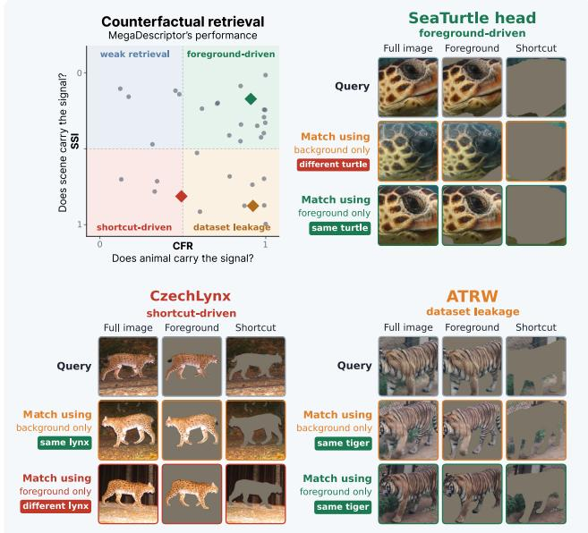
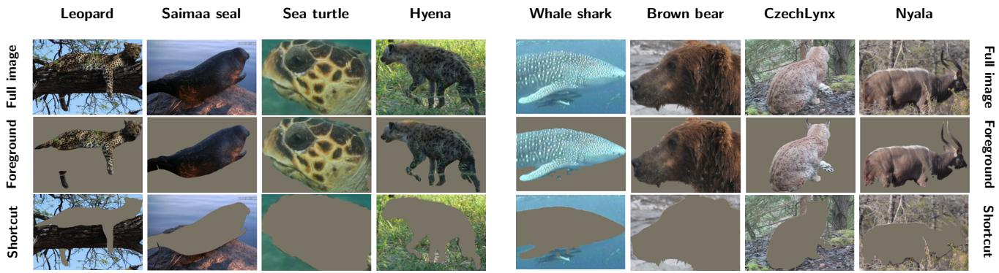
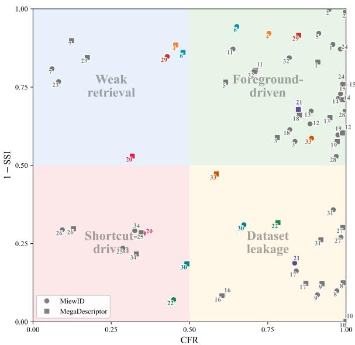
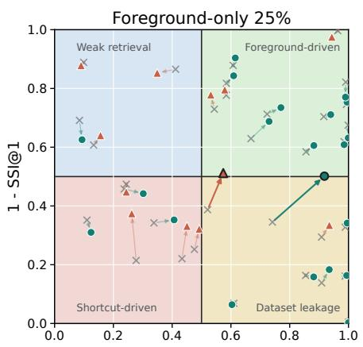
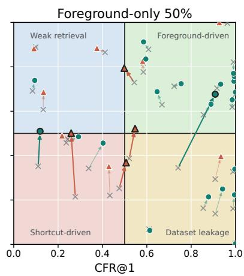
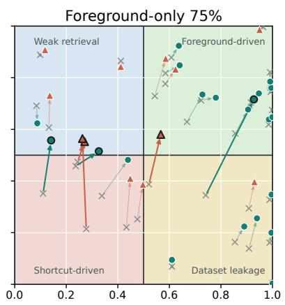
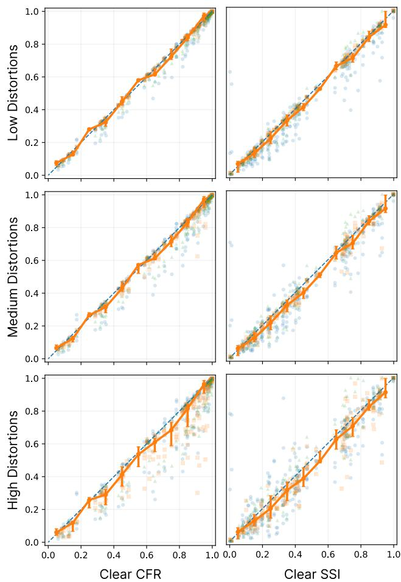

# CounterFactual Retrieval for Evidence-Aware Individual Animal Identification

Ankit K. Upadhyay1, Aleksandr Algasov2,3, Ekaterina Nepovinnykh2, Fedor Zolotarev4, Tuomas Eerola2, Heikki Kalvi¨ ainen¨ 2,3, Charles V. Stewart1, Lukas Picek5,6

1Rensselaer Polytechnic Institute 2LUT University, 3Brno University of Technology, 4University of Helsinki, 5MIT, 6University of West Bohemia

## Abstract

Automated identification of individual animals is moving from small curated studies toward shared benchmarks and reusable foundation models. This progress is useful, but current evaluation leaves the evidence behind a match unresolved, i.e., high retrieval accuracy does not show whether a model used animal features or identity-correlated shortcuts. We address this with Counterfactual Foreground Retrieval (CFR), an evidence-aware evaluation protocol. CFR evaluates the same query-gallery task under different views: full image, foreground-only, and shortcut-only. The full-image measures standard retrieval performance; the foreground-only measures foreground-supported retrieval; and shortcut-only view measure how much identity signal is recoverable from background, or silhouette. This turns a retrieval score into an evidence profile: how well the model performs on the original images, how much of that performance remains when only the animal is visible, and how much identity signal remains recoverable when the animal is removed. We release around 0.5M masks for 34 datasets and codefor mask generation and CFR evaluation.1

## 1. Introduction

Identifying individual animals across time and space is central to many ecological studies, e.g., population estimation, survival, and movement [26, 36]. Automating this task is increasingly important as manual photo-identification is slow, unreliable, labor-intensive, and hard to scale [42]. As a result, the field is moving from proprietary design and deployment towards open benchmarks and reusable foundation models [12, 30]. This shift has made methods easier to compare and potentially deploy, but it has also exposed a weakness in their evaluation. A correct retrieval does not necessarily mean that the model used the biometric the dataset was built around, such as a coat pattern, an arrangement of facial scales, or a fin contour. It may also be driven by background, capture context, near-duplicates, training-set overlap, or by body outline in species whose identity comes from a surface pattern (see Tab. 1).

  
Figure 1. Strong retrieval scores depend on different evidence. Standard retrieval reports whether the correct individual is retrieved, but not which visual evidence supports it. We therefore introduce the Shortcut Signal Indicator (SSI), which measures how much of the full-image retrieval signal can be recovered from shortcut-only inputs. Among otherwise strong results, SSI ranges from almost zero to almost one, showing why retrieval performance should be evaluated along with the evidence behind it.

This ambiguity matters because the settings in which the methods for automated identification are used are usually far from the benchmark. Field images vary across cameras, observers, locations, seasons, and capture conditions. If an evaluation rewards context that correlates with identity, its accuracy can overstate the model’s reliability once deployed. The core evaluation question should therefore not only be whether a model retrieves the correct individual, but what evidence makes it possible.

We address this with Counterfactual Foreground Retrieval (CFR), a leakage-aware evaluation protocol. CFR evaluates the same query-gallery retrieval task on matched full-image, foreground-only, and shortcut-only. These views separate standard retrieval performance from animalvisible evidence and shortcut evidence. CFR summarizes how much of the full-image retrieval score remains supported by the foreground, while the shortcut signal indicator (SSI) measures how much of the full-image signal is recoverable from the background or from the animal’s body outline, which we isolate with a silhouette-only view. Outline is excluded from the shortcut signal for species whose identity is carried by shape, such as whale flukes and dorsal fins. CFR does not replace full-image accuracy or treat foreground-only retrieval as leakage-free; together, CFR and SSI report the evidence profile behind the score.

Alongside the CFR protocol, we update the Wildlife-Datasets library [12] into a leakage-auditable benchmark suite. We add the missing segmentation and evaluation layer on top of existing datasets: foreground masks for roughly 0.5M images from 34 datasets, mask-generation code for future use, and CFR-related evaluation code. All this allows testing whether retrieval is supported by animalvisible evidence, background context, or silhouette cues, whereas previously, only full-image retrieval was reported.

Finally, we use CFR to audit selected models on a wide variety of datasets. The results show that fullimage Retrieval@k can hide very different evidence profiles. Some model–dataset pairs are strongly foregroundsupported, with high CFR and low SSI. Others are overdetermined, i.e., the animal foreground supports retrieval, but background or silhouette cues are also predictive. In the most confounded cases, shortcut-only inputs recover a large fraction of the full-image signal. These results show why full-image accuracy is not enough. It reports only whether retrieval succeeds, but not whether the success comes from the animal or from the dataset shortcuts.

Contributions. Our work shifts the existing evaluation of individual animal identification towards a more reliable one:

• We show that standard scores can be incomplete. We provide evidence across multiple datasets and models, that full-image retrieval hides shortcut reliance by retaining identity signals from background and/or silhouette.

• We introduce Counterfactual Foreground Retrieval. CFR evaluates the same retrieval task under matched full-image, foreground- and shortcut-only views, separating operational performance from animal-visible evidence and shortcut signal.

• We make existing benchmarks auditable. We add accurate masks to around 0.5M images across 34 publicly available datasets and code to generate them, enabling CFR where it was previously not possible.

<table><tr><td>Dataset</td><td>Model</td><td>Random</td><td>Full image</td><td>Foreg.</td><td>Shortcut</td></tr><tr><td rowspan="2">WhaleSharkID [19]</td><td>DINOv3</td><td>0.5</td><td>35.3</td><td>30.3</td><td>19.1</td></tr><tr><td> $\mathbf { M e g a D } ^ { C }$ </td><td>0.5</td><td>30.5</td><td>24.8</td><td>16.3</td></tr><tr><td rowspan="2">LeopardID2022 [47]</td><td>DINOv3</td><td>1.1</td><td>57.4</td><td>52.2</td><td>46.3</td></tr><tr><td> $\mathbf { M e g a D } ^ { C }$ </td><td>1.1</td><td>51.6</td><td>44.0</td><td>40.5</td></tr><tr><td rowspan="2">Saimaa seal [41]</td><td> $\mathrm { D I N O v } 3$ </td><td>0.7</td><td>46.6</td><td>24.4</td><td>39.1</td></tr><tr><td> $\mathbf { M e g a D } ^ { C }$ </td><td>0.7</td><td>36.7</td><td>28.3</td><td>28.9</td></tr><tr><td rowspan="2">SeaTurtleID2022 [1]</td><td> $\begin{array} { c } { { \mathrm { D I N O v } 3 } } \\ { { \mathrm { M e g a D } ^ { C } } } \end{array}$ </td><td>0.5</td><td>59.0</td><td>57.3</td><td>18.8</td></tr><tr><td></td><td>0.5</td><td>60.6</td><td>58.6</td><td>13.9</td></tr><tr><td rowspan="2">StripeSpotter [24]</td><td> $\mathrm { D I N O v } 3$ </td><td>3.0</td><td>82.1</td><td>81.6</td><td>3.2</td></tr><tr><td> $\mathbf { M e g a D } ^ { C }$ </td><td>3.0</td><td>96.6</td><td>96.5</td><td>3.3</td></tr><tr><td rowspan="2">HyenaID2022 [46]</td><td> $\mathrm { D I N O v } 3$ </td><td>0.7</td><td>63.7</td><td>60.6</td><td>44.1</td></tr><tr><td> $\mathbf { M e g a D } ^ { C }$ </td><td>0.7</td><td>62.8</td><td>52.4</td><td>38.8</td></tr><tr><td rowspan="2">BrownBearHeads [34]</td><td> $\begin{array} { c } { { \mathrm { D I N O v } 3 } } \\ { { \mathrm { M e g a D } ^ { C } } } \end{array}$ </td><td>1.6</td><td>99.0</td><td>98.7</td><td>72.4</td></tr><tr><td></td><td>1.6</td><td>93.6</td><td>91.0</td><td>66.6</td></tr><tr><td rowspan="2">CzechLynx [33]</td><td> $\mathrm { D I N O v } 3$ </td><td>1.9</td><td>68.1</td><td>55.7</td><td>56.6</td></tr><tr><td> $\mathbf { M e g a D } ^ { C }$ </td><td>1.9</td><td>60.4</td><td>48.6</td><td>45.7</td></tr><tr><td rowspan="2">NyalaData [14]</td><td> $\mathrm { D I N O v } 3$ </td><td>0.7</td><td>14.8</td><td>15.8</td><td>5.9</td></tr><tr><td> $\mathbf { M e g a D } ^ { C }$ </td><td>0.7</td><td>15.2</td><td>13.9</td><td>6.4</td></tr></table>

Table 1. Standard evaluation hides shortcut signal. Even in the zero-shot setting, the shortcut-only view can retrieve correct identities above random chance. This indicates that full-image Retrieval@k can reflect not only animal-visible evidence, but also identity-correlated background or silhouette cues. C–not trained on any datasets in this table.

## 2. Related Work

Animal re-identification has moved from matching handdesigned visual patterns to learning reusable embeddings. Early systems such as StripeCodes [24], HotSpotter [13], MantaMatcher [39], the modified Groth algorithm [7], and ALFRE-ID [29] relied on local features, geometric verification, and database search over markings such as stripes, spots, scars, fins, and contours. Recent work scales this idea with larger benchmarks (e.g., WildlifeReID-10k [2]) and multi-species models, including MegaDescriptor [12], MiewID [30]. This progress has made animal re-ID easier to benchmark and reuse, but the evaluation signal remains narrow: rank-k accuracy and mAP say whether retrieval worked, not what visual evidence made it work.

Leakage in benchmark design. The limits of rank-k accuracy are especially clear when benchmark construction leaks information across evaluation examples. Prior work has addressed this mainly through better split design, including similarity-aware protocols that reduce overlap from repeated, near-duplicate, or visually similar captures [1, 2].

Foreground, background, and shortcut cues. The same issue also appears at the pixel level and models can use visual correlations that are predictive in a benchmark but outside the intended identity signal [18]. Background is a well-known example. It can support prediction on its own, and changing it can change model decisions even when the foreground object is fixed [49]. In animal re-ID, recent work has addressed this by removing backgrounds, modeling foreground and background separately, or diagnosing whether retrieval relies on coat pattern, background, or laterality cues [32, 35, 50]. Related foreground/background studies in wildlife behavior recognition show the same pattern outside individual identification [8].

Segmentation masks for benchmark auditing. Separating animal-visible evidence from surrounding context in an existing benchmark requires a foreground mask for every evaluated image. Most animal re-ID benchmarks, however, were built for retrieval evaluation and provide images, identity labels, and evaluation protocols rather than segmentation annotations. A few datasets include masks or part annotations, such as SeaTurtleID2022 [1], SealID [28], and CzechLynx [33], but this is not yet standard. Promptable segmentation with SAM has made mask generation more accessible [23], with SAM3 extending this direction to concept-prompted segmentation from text or visual exemplars [10].

## 3. Counterfactual Foreground Retrieval

Standard evaluation with full-image Retrieval@k measures whether the correct individual is retrieved, but not what visual evidence made the retrieval possible. With that in mind, we introduce Counterfactual Foreground Retrieval to make such evidence more explicit. CFR keeps the task fixed and changes only the visual input. For each image, we construct matched counterfactual views (full image, foreground-only, and shortcut-only) under the same identity labels, querygallery structure, model, and scoring protocol.

## 3.1. Evaluation Setup

Let $\mathcal { D } = \{ ( x _ { i } , y _ { i } , m _ { i } ) \} _ { i = 1 } ^ { N }$ be an evaluation dataset, where $x _ { i } \in \mathbb { R } ^ { H \times \dot { W } \times 3 }$ is an image crop, $y _ { i }$ is the individual identity label, and $m _ { i } ~ \in ~ \{ 0 , 1 \} ^ { H \times W }$ is a binary foreground mask for the animal. Let Q be the set of valid query images. For each query $i \in \mathcal { Q } .$ , let $\mathcal { G } _ { i }$ be the valid gallery under the benchmark protocol. The gallery excludes the query annotation itself and follows the same validity rules as the standard evaluation. The positive set for query i is

$$
{ \mathcal { P } } _ { i } = \{ j \in { \mathcal { G } } _ { i } : y _ { j } = y _ { i } \} .\tag{1}
$$

We evaluate only queries with $| \mathcal { G } _ { i } | > 0$ and $| \mathcal { P } _ { i } | > 0$ . CFR keeps $\mathcal { Q } , \mathcal { G } _ { i } , \mathcal { P } _ { i }$ , identity labels, and validity rules fixed across all counterfactual inputs.

## 3.2. Counterfactual Inputs

The counterfactual inputs isolate different sources of retrieval evidence while keeping the same images, labels, and query-gallery protocol. Each original image is transformed into a foreground-only view and one or more shortcutonly views (see Fig. 2). The foreground-only view keeps animal-visible pixels and removes the surrounding image. Shortcut-only views remove animal texture while retaining non-foreground cues such as scene context or silhouette.

Let mi˜ $\in ~ 0 , 1 ^ { H \times W \times 3 }$ be $m _ { i }$ broadcast across color channels, and let $c \in \mathbb { R } ^ { H \times W \times 3 }$ be a constant neutral fill image. The full-image input is

$$
T _ { \mathrm { f u l l } } ( x _ { i } , m _ { i } ) = x _ { i } .\tag{2}
$$

The foreground-only input is

$$
T _ { \mathrm { f g } } ( x _ { i } , m _ { i } ) = \tilde { m } _ { i } \odot x _ { i } + ( 1 - \tilde { m } i ) \odot c .\tag{3}
$$

The texture-removed shortcut input is

$$
T _ { \mathrm { s c } } ( x _ { i } , m _ { i } ) = ( 1 - \tilde { m } _ { i } ) \odot x _ { i } + \tilde { m } _ { i } \odot c .\tag{4}
$$

The silhouette-only view is

$$
T _ { \mathrm { s i l } } ( x _ { i } , m _ { i } ) = \tilde { m } _ { i } \odot s + ( 1 - \tilde { m } _ { i } ) \odot c ,\tag{5}
$$

where $s \in \mathbb { R } ^ { H \times W \times 3 }$ is a constant silhouette fill image. We construct this view for every dataset; Sec. 3.5 fixes whether it counts as shortcut evidence.2

## 3.3. Retrieval Under Counterfactual Views

Each counterfactual view is evaluated with the same retrieval protocol. Let T denote one of the CFR input views defined in Sec. 3.2: full image, foreground-only, textureremoved shortcut, or, when valid, silhouette-only. Let f be the model being evaluated, and let $a ( \cdot , \cdot )$ be its retrieval scoring function, with larger values indicating more similar images. For query i and gallery image $j \in \mathcal G _ { i }$ , the viewspecific retrieval score is

$$
r _ { T } ( i , j ) = a \left( f ( T ( x _ { i } , m _ { i } ) ) , f ( T ( x _ { j } , m _ { j } ) ) \right) ,\tag{6}
$$

where $r _ { T } ( i , j )$ is used to rank gallery image $j$ for query i under view $T .$ After ranking gallery images in decreasing order of $r _ { T } ( i , j )$ , let $\mathrm { T o p K } T ( i )$ denote the top-k ranked gallery set. The top-k retrieval rate under view $T$ is

$$
R _ { T } @ k = { \frac { 1 } { | \mathcal { Q } | } } \sum i \in \mathcal { Q } \mathbf { 1 } \left[ \exists j \in \mathrm { T o p K } T ( i ) \mathrm { s . t . } y _ { j } = y _ { i } \right] .\tag{7}
$$

In the following, $R _ { \mathrm { f u l l } } @ k , R _ { \mathrm { f g } } @ k , R _ { \mathrm { s c } } @ k ,$ , and $R _ { \mathrm { s i l } } @ k$ denote retrieval rates for the full-image, foreground-only, shortcut-only, and silhouette-only views, respectively.

## 3.4. Random Retrieval Rate

Raw retrieval rates are not directly comparable across datasets because gallery size and the number of positives per query can vary. We therefore compute a random baseline using the same query-gallery structure as the evaluated model. For each query i, let $K _ { i } = \operatorname* { m i n } ( k , | \mathcal { G } i | )$ . A random ranking succeeds if at least one of the |Pi| positives appears in the top $K _ { i }$ positions. Averaging this probability over valid queries gives

$$
{ \mathrm { R r a n d @ } } k = { \frac { 1 } { | { \mathcal { Q } } | } } \sum i \in { \mathcal { Q } } \left[ 1 - { \frac { { \binom { | { \mathcal { G } } _ { i } | - | { \mathcal { P } } _ { i } | } { K _ { i } } } } { { \binom { | { \mathcal { G } } _ { i } | } { K _ { i } } } } } \right] ,\tag{8}
$$

where the numerator is set to zero when $| \mathcal { G } i | - | \mathcal { P } i | < K _ { i }$ For $k = 1$ , this reduces to

$$
R { \mathrm { r a n d @ 1 } } = { \frac { 1 } { | { \boldsymbol { \mathcal { Q } } } | } } \sum i \in { \boldsymbol { \mathcal { Q } } } { \frac { | { \boldsymbol { \mathcal { P } } } _ { i } | } { | { \boldsymbol { \mathcal { G } } } _ { i } | } } .\tag{9}
$$

## 3.5. Foreground and Shortcut Signal

Raw retrieval rates depend on the query-gallery structure, so we express each view-specific score relative to the random baseline from Sec. 3.4:

$$
S _ { T } \mathbb { O } k = \operatorname* { m a x } \left( 0 , R _ { T } \mathbb { O } k - R _ { \operatorname { r a n d } } \mathbb { O } k \right) .\tag{10}
$$

This removes expected random retrieval and clips belowrandom values to zero. The full-image and foreground signals are $S _ { \mathrm { f u l l } } @ k = S _ { T _ { \mathrm { f u l l } } } @ k , S _ { \mathrm { f g } } @ k = S _ { T _ { \mathrm { f g } } }$ @k. The shortcut signal is computed from shortcut-only inputs:

$$
S _ { \mathrm { s h o r t c u t } } @ k = \left\{ \begin{array} { l l } { S _ { T _ { \mathrm { s c } } } @ k , } \\ { \operatorname* { m a x } \left( S _ { T _ { \mathrm { s c } } } @ k , S _ { T _ { \mathrm { s i l } } } @ k \right) . } \end{array} \right.\tag{11}
$$

The first case is used when silhouette is not considered a shortcut. The second is used when silhouette is treated as a shortcut. This choice is fixed per dataset based on the intended biometric rather than the model. Datasets identified by surface patterns use the second (max) case, whereas datasets identified by outline (e.g., whale flukes) use the first case and report silhouette separately. Appendix S3 lists the silhouette role for each dataset.

## 3.6. CFR Score

We define CFR around a simple requirement: a retrieval score should remain high when the model is forced to rely on the animal foreground. Full-image retrieval gives the standard benchmark score, but it does not show whether the match was supported by the animal, by shortcut cues, or by both. CFR keeps the full-image score in the metric, but requires it to be matched by foreground-only retrieval.

Before combining the two views, we normalize their above-random signals by the available headroom:

$$
A _ { \mathrm { f u l l } } @ k = \frac { S _ { \mathrm { f u l l } } @ k } { 1 - R _ { \mathrm { r a n d } } @ k } , \qquad A _ { \mathrm { f g } } @ k = \frac { S _ { \mathrm { f g } } @ k } { 1 - R _ { \mathrm { r a n d } } @ k } .\tag{12}
$$

The CFR score is then defined for $R _ { \mathrm { r a n d } } @ k < 1$ as

$$
\mathrm { C F R @ } k = \operatorname* { m i n } \left( A _ { \mathrm { f u l l } } @ k , A _ { \mathrm { f g } } @ k \right) .\tag{13}
$$

The minimum makes the score conservative. A method receives high CFR only when it retrieves well under the original full-image input and when retrieval remains strong under the foreground-only input. If full-image retrieval is weak, CFR is low. If full-image retrieval is high but foreground-only retrieval drops, CFR is also low. Thus, CFR measures foreground-supported retrieval performance rather than foreground-only performance alone.

CFR does not subtract or penalize shortcut signal. High shortcut-only retrieval can mean that the benchmark contains identity-correlated context, even when the model also retrieves correctly from animal-visible evidence. We therefore report shortcut recoverability separately with the shortcut signal indicator:

$$
\mathrm { S S I @ } k = \operatorname* { m i n } \left( 1 , \frac { S _ { \mathrm { s h o r t c u t } } @ k } { S _ { \mathrm { f u l l } } @ k } \right) ,\tag{14}
$$

defined for $S _ { \mathrm { f u l l } } @ k > 0$ . SSI measures how much of the full-image retrieval signal is recoverable from shortcut-only inputs. Values near zero indicate little shortcut recoverability, while values near one indicate that shortcut-only inputs recover an identity signal comparable to the full image. SSI is therefore just an evidence-confounding indicator, not a direct measure of method failure.

## 3.7. Interpretation

The proposed evaluation protocol should be read in the same way as standard Retrieval@k, with one important difference. Retrieval@k reports performance under the original benchmark, whereas CFR and SSI repeat the same evaluation after controlled interventions that selectively remove different sources of visual evidence. The resulting evidence profile distinguishes changes in retrieval performance caused by removing the animal from those caused by removing the surrounding visual context. Neither CFR nor SSI should be interpreted in isolation. A decrease in CFR is informative only together with SSI. For example, a lower CFR accompanied by low SSI indicates that removing the foreground reduces retrieval while shortcut information remains uninformative. In contrast, a similar decrease together with high SSI indicates that shortcut-only inputs preserve much of the original retrieval signal. Likewise, high SSI should not be interpreted as model failure. It simply indicates that the evaluated benchmark contains shortcut cues that are predictive under the proposed intervention.

Beyond that, the provided evidence profile can help prioritize future improvements. For example, evidenceconfounded and shortcut-driven profiles indicate the need for better train/test splits, more diverse data collection, explicit foreground-aware training, or benchmark curation that reduces identity-correlated shortcut cues. We evaluate some of the ideas below.

  
ID cD n cDe xHy oaI NFigure 2. CounterFactual views. For each image, the provided mask allows us to generate matched full-image, foreground-only, and en aren nHyshortcut-only inputs. Such views alter the available visual evidence and enable evidence-aware evaluation.

## yeH4. Benchmarking Suite

To enable CFR evaluation at scale, we provide segmentation masks for 34 datasets (roughly 0.5M annotations), release the code used to generate them, and substantially extend WildlifeDatasets [12] so that masks can be loaded in a standardized way for all datasets along the original image, identity label, and annotation metadata.

## 4.1. Segmentation Masks

To enable high-quality mask generation at scale (see example masks in Fig. 2), we design a pipeline that combines prompt-based segmentation, conservative candidate selection, and manual quality assurance. Here we provide a short description; more details are available in Appendix S1.

Mask generation. We generate foreground candidates using SAM3 [10, 23]. For each dataset, we use a simple dataset-level prompt, such as the species name, a common group name, or the annotated body part for part-based datasets. This keeps mask generation scalable while allowing datasets focused on heads, flanks, or other body parts to use prompts that match the relevant visual evidence.

Mask acceptance. We select one individual foreground mask for each image whenever a reliable candidate is available. If an annotation has a source bounding box, the selected mask must correspond to the annotated region rather than another animal or background object in the image. If the annotation is already a cropped image or full-image record, use the highest-scoring SAM3 candidate unless dataset-specific checks reject it. We retain rejected candidates and their metadata for audit and debugging. As masks and counterfactual views are constructed per annotation, we handle images with multiple animals or different annotated body parts by following the original annotations.

Quality assurance. To verify that the selected masks support reliable foreground and background interventions, we NyhL N lacompare them against 400 manually drawn reference masks ax laec(50 per random dataset). The agreement is high: median Ly yIoU is 98.2%, mean IoU is 96.1%, and 95.1% of samples N alexceed 90% IoU. Rejected low-confidence candidates prolavide an additional sanity check: many come from difficult images with occlusion, device artifacts, multiple animals, yamissing foreground, or ambiguous background.

Coverage. Across the 34 datasets, the final release contains accepted masks for 457,238 of 484,674 eligible annotations (94.3% coverage). Since the pipeline prioritizes mask quality over complete coverage, annotations without an accepted mask are excluded from the main CFR evaluation. For dataset-level coverage statistics, see Appendix S1.

Resource Format and Loading. Accepted masks are released as compact, run-length-encoded, and in one JSON file per dataset. Counterfactual views are generated on demand from each image–mask pair, ensuring that all views are derived from the same original annotation.

## 5. Evidence Profiles Revealed by CFR

We use the CFR-ready benchmarking suite to demonstrate what standard full-image retrieval scores hide. The goal is not to rank MiewID and MegaDescriptor by unseen-dataset generalization. Instead, the goal is diagnostic. When a model retrieves the correct individual, does the retrieval remain supported by animal signature, or just background?

Standard evaluation hides different evidence profiles. A central finding is that similar full-image Retrieval@1 values correspond to different sources of evidence. Some datasets have both high full-image retrieval and high CFR, meaning that the animal foreground is sufficient for identification (see Tab. 2). This is the cleanest case for interpreting standard retrieval performance as animal-visible identity matching. However, high full-image retrieval can also occur when shortcut-only views are predictive. OpenCows2020,

AAUZebraFish, and ATRW have strong full-image performance and high CFR, but also high SSI. These datasets are therefore overdetermined: the animal foreground supports retrieval, but identity-correlated shortcut evidence as well. Standard Retrieval@1 alone would not distinguish that.

Shortcut signal does not always lead to method failure. High SSI should not be interpreted as a direct failure of the model. In datasets such as OpenCows2020 and AAUZebraFish, CFR remains high. This means that the model can retrieve the correct individual from the animal foreground, even though shortcut-only inputs are also predictive. The issue is therefore not simply that the method ignores the animal; rather, the benchmark contains additional identitycorrelated evidence. A concerning pattern appears when high SSI is paired with low CFR. Saimaa seal and NDD20 show modest full-image retrieval, weaker foreground-only retrieval, and high shortcut recoverability. In this case, fullimage Retrieval@1 is weak evidence of animal-foreground identification, because much of the recoverable signal is also present in shortcut-only views. This is the case where standard evaluation is most misleading.

Model comparisons reveal evidence differences. CFR also shows that models with similar full-image performance can rely on different evidence profiles (see Fig. 3). For example, on HumpbackWhaleID, MiewID and MegaDescriptor have similar full-image Retrieval@1, but MiewID has substantially higher shortcut recoverability, while MegaDescriptor retains comparable foreground support with much lower SSI. The standard metric suggests similar retrieval performance, whereas CFR shows that the supporting evidence differs. Other datasets show the opposite. On IPanda50 and NDD20, MegaDescriptor obtains much higher full-image Retrieval@1 than MiewID, but this improvement is only partly reflected in CFR and is accompanied by high shortcut recoverability. These cases show why model comparison should not be based only on full-image retrieval: an apparent performance gain may improve foreground or shortcut recoverability, or both.

  
Figure 3. CFR vs. SSI. Seemingly similarly performing models can use different types of evidence (colored samples). Numbered points correspond to the dataset indices in Tab. S4.

<table><tr><td>Dataset</td><td>Model</td><td>Random</td><td>Full Frg.</td><td>SC</td><td>SSI</td><td>CFR</td></tr><tr><td colspan="5">High shortcut recoverability</td><td></td></tr><tr><td>OpenCows2020 [6]</td><td>MiewID</td><td>3.7</td><td>99.1 98.4</td><td>73.3 73.0</td><td>98.4</td></tr><tr><td rowspan="2">AAUZebraFish [9]</td><td>MegaDes.</td><td>3.7</td><td>100.0 99.0</td><td>70.9 69.9</td><td>99.0</td></tr><tr><td>MiewID MegaDes.</td><td>16.7 16.7</td><td>98.3 97.6</td><td>90.2 90.1</td><td>97.1</td></tr><tr><td rowspan="2">ATRW [25]</td><td></td><td></td><td>100.0 99.3</td><td>89.6 87.5</td><td>99.1</td></tr><tr><td>MiewID</td><td>1.2</td><td>94.1 91.0</td><td>86.0 91.4</td><td>90.9</td></tr><tr><td rowspan="2"></td><td>MegaDes.</td><td>1.2</td><td>95.9 92.4</td><td>84.4 87.8</td><td>92.3</td></tr><tr><td>MiewID MegaDes.</td><td>2.2 2.2</td><td>90.6 84.5</td><td>76.2 83.7</td><td>84.1</td></tr><tr><td rowspan="2">FriesianCattle2017 [5]</td><td></td><td></td><td>99.2 87.5</td><td>87.4 87.7</td><td>87.2</td></tr><tr><td>MiewID</td><td>1.9</td><td>75.6 68.0</td><td>52.8 69.0</td><td>67.4</td></tr><tr><td rowspan="2">CzechLynx [33]</td><td>MegaDes.</td><td>1.9</td><td>61.3 50.2</td><td>50.3 81.5</td><td>49.2</td></tr><tr><td>MiewID</td><td>2.5</td><td>56.1 46.3</td><td>52.3</td><td>44.9</td></tr><tr><td rowspan="2">IPanda50 [43]</td><td>MegaDes.</td><td>2.5</td><td>97.3 78.8</td><td>92.9 67.3 68.3</td><td>78.3</td></tr><tr><td>MiewID</td><td>0.7</td><td>43.9 33.0</td><td></td><td>32.5</td></tr><tr><td rowspan="2">Saimaa seal [28]</td><td>MegaDes.</td><td>0.7</td><td>41.5 33.5</td><td>31.3 70.9 32.6 78.3</td><td>33.0</td></tr><tr><td>MiewID</td><td>1.6</td><td>45.8 29.9</td><td></td><td>28.7</td></tr><tr><td>NDD20 [40]</td><td>MegaDes.</td><td>1.6</td><td>85.2 35.6</td><td>35.4 76.4 61.4 71.5</td><td>34.5</td></tr><tr><td>Mixed evidence</td><td></td><td></td><td></td><td></td><td></td></tr><tr><td>Cows2021 [17]</td><td>MiewID MegaDes.</td><td>0.7 0.7</td><td>98.7 98.3 99.8 99.7</td><td>27.3 27.1 24.7 24.2</td><td>98.3 99.7</td></tr><tr><td rowspan="2">Giraffes [27]</td><td>MiewID MegaDes.</td><td>0.6</td><td>98.3 97.4 39.9</td><td>40.3</td><td>97.4</td></tr><tr><td></td><td>0.6</td><td>98.4 97.2</td><td>42.1 42.4</td><td>97.2</td></tr><tr><td rowspan="2">BrownBearHeads [34]</td><td>MiewID MegaDes.</td><td>1.6 1.6 92.1</td><td>96.5 96.0 92.4</td><td>62.6 64.2</td><td>95.9</td></tr><tr><td>MiewID</td><td></td><td></td><td>68.4 73.8</td><td>92.0</td></tr><tr><td rowspan="2">HumpbackWhaleID [20]</td><td>MegaDes.</td><td>0.1 0.1</td><td>88.8 83.6 88.2 84.8</td><td>72.1 81.2</td><td>83.6</td></tr><tr><td>MiewID</td><td></td><td></td><td>28.4 32.2</td><td>84.8</td></tr><tr><td rowspan="2">HappyWhale [21]</td><td>MegaDes.</td><td>0.1 0.1 63.1</td><td>45.2 35.3 31.8</td><td>32.4 71.7</td><td>35.3</td></tr><tr><td>MiewID</td><td></td><td></td><td>29.7 47.0</td><td>31.7</td></tr><tr><td rowspan="2">LeopardID2022 [47]</td><td>MegaDes.</td><td>1.1 92.5 1.1 78.4</td><td>89.1 59.1</td><td>38.9 41.3</td><td>89.0</td></tr><tr><td></td><td></td><td></td><td>41.9 52.8</td><td>58.6</td></tr><tr><td rowspan="2">HyenaID2022 [46]</td><td>MiewID MegaDes.</td><td>0.7 0.7 92.5</td><td>87.4 83.8 78.2</td><td>37.4 42.4</td><td>83.7</td></tr><tr><td></td><td></td><td></td><td>38.5 41.1</td><td>78.0</td></tr><tr><td>CTai [16]</td><td>MiewID MegaDes.</td><td>2.7 2.7</td><td>94.0 89.2 98.0 95.0</td><td>32.5 32.6 35.9 34.8</td><td>88.9 94.9</td></tr><tr><td>Low shortcut recoverability</td><td></td><td></td><td></td><td></td><td></td></tr><tr><td rowspan="2">MacaqueFaces [48]</td><td>MiewID</td><td>2.9</td><td>98.9 98.2</td><td></td><td></td></tr><tr><td>MegaDes.</td><td>2.9</td><td>99.4 99.0</td><td>15.3 12.8 26.2 24.1</td><td>98.2 99.0</td></tr><tr><td rowspan="2">WhaleSharkID [19]</td><td>MiewID MegaDes.</td><td>0.5</td><td>88.7 82.0</td><td>14.3 15.6</td><td>81.9</td></tr><tr><td></td><td>0.5</td><td>83.4 70.9</td><td>17.2 20.1</td><td>70.7</td></tr><tr><td rowspan="2">BelugaID [45]</td><td>MiewID MegaDes.</td><td>0.4</td><td>77.4 64.0</td><td>10.3 12.8</td><td>63.9</td></tr><tr><td>MiewID</td><td>0.4</td><td>84.1 71.2</td><td>16.8 19.6</td><td>71.1</td></tr><tr><td rowspan="2">Reunion turtles [3]</td><td>MegaDes.</td><td>0.9 0.9</td><td>92.0 91.4 61.9 64.0</td><td>8.0 7.8 15.2 23.4</td><td>91.3 61.6</td></tr><tr><td>MiewID</td><td>0.5</td><td>96.9 95.8</td><td>11.4 11.4</td><td>95.8</td></tr><tr><td rowspan="2">SeaTurtleID2022 [1]</td><td>MegaDes.</td><td>0.5</td><td>92.4 91.0</td><td>16.1 17.0</td><td>91.0</td></tr><tr><td>MiewID</td><td>1.5</td><td>65.6 70.8</td><td>5.1 5.6</td><td>65.1</td></tr><tr><td rowspan="2">Amvrakikos turtles [3]</td><td>MegaDes.</td><td>1.5 49.7</td><td>48.7</td><td>8.2 13.9</td><td>47.9</td></tr><tr><td>MiewID</td><td></td><td></td><td>7.4 7.8</td><td></td></tr><tr><td rowspan="2">NyalaData [14]</td><td>MegaDes.</td><td>0.7</td><td>87.2 75.5 77.2 46.0</td><td>9.5 11.5</td><td>75.4 45.6</td></tr><tr><td></td><td>0.7</td><td></td><td></td><td></td></tr><tr><td rowspan="2">StripeSpotter [24]</td><td>MiewID</td><td></td><td></td><td></td><td></td></tr><tr><td>MegaDes.</td><td>3.0 3.0</td><td>94.7 94.7 99.9 99.9</td><td>3.2 0.2 4.2 1.2</td><td>94.6 99.9</td></tr></table>

Table 2. Counterfactual foreground retrieval performance. Reevaluating MiewID and MegaDescriptor on selected representative datasets shows that full-image Retrieval@1 often hides qualitatively different evidence profiles. Some datasets are cleanly foreground-supported, some are overdetermined by both animal and shortcut evidence, and others show weak foreground support despite high shortcut recoverability. See full results in Tab. S4.

  
Figure 4. Evidence-profile changes under foreground-mixed training. For each of the 34 datasets, × marks the full-image baseline and its arrow ends at the corresponding foreground-mixed checkpoint. ⃝ denotes the 22 represented datasets and △ the 12 unseen datasets. Darker arrows and outlined endpoints mark transitions across the descriptive 0.5 boundaries.

Low shortcut signal gives cleaner interpretation. Datasets with low SSI provide the cleanest interpretation of standard retrieval performance. StripeSpotter, Sea-TurtleID2022, Reunion turtles, Amvrakikos turtles, Whale-SharkID, BelugaID, and MacaqueFaces have low shortcut recoverability relative to their full-image performance. On these datasets, foreground-only retrieval largely preserves the useful signal, while shortcut-only retrieval contributes little. Full-image Retrieval@1 is therefore more directly supported by animal-visible evidence. Low shortcut signal should not be confused with high retrieval performance. NyalaData has low SSI, but MegaDescriptor has substantially lower CFR than MiewID. This shows that low SSI only indicates that the observed signal is not primarily recoverable from shortcut-only inputs; it does not imply that the method retrieves individuals accurately.

Takeaway. Our evaluation shows that full-image Retrieval@k is not sufficient to interpret animal identification results. Similar scores can arise from foregroundsupported matching, overdetermined benchmarks where both animal and shortcut evidence are predictive, or cases where foreground support is weak. CFR and SSI keep the standard retrieval task intact, but turn a single performance number into an evidence profile that shows whether the retrieved identity is supported by the animal foreground and/or shortcut.

## 6. Foreground-Mixed Training as Mitigation

One possible explanation for low foreground retrieval is that foreground-only inputs are unfamiliar to models trained only on full images. If so, exposing a model to masked inputs during training should improve CFR and reduce SSI. If shortcut cues remain predictive after this intervention, they are more likely to reflect properties of the data than the foreground-only input itself.

Experimental setup. We compare four MegaDescriptor-L-384 checkpoints trained on the same 22-dataset collection. The reference checkpoint, MegaDC , uses only full images. The other checkpoints use a foreground-only input with probability 0.25, 0.50, or 0.75, and the full image otherwise. If a selected sample has no accepted mask, we retain its full image. All checkpoints are evaluated using the same accepted annotations and CFR protocol. We report results for the 22 represented datasets and 12 unseen datasets to distinguish adaptation from transfer.

Results. Foreground mixing generally lowers shortcut recoverability, with clearer changes at 50% and 75% exposure (Fig. 4). The number of shortcut-driven datasets is unchanged at 25%, but falls from seven under the baseline to four at 50% and three at 75%; no mixture moves a dataset into that regime. IPanda50 moves from the high-CFR, high-SSI region to foreground-supported retrieval, while HyenaID2022 makes the same transition despite being unseen during training. The intervention is not a complete solution. Some datasets leave the shortcut-driven regime because SSI decreases while CFR remains low, indicating weaker shortcut recoverability rather than strong foreground recognition. AerialCattle2017 remains high in both CFR and SSI at every exposure level, showing that foreground-mixed training does not remove all identity-correlated dataset cues. Thus, unfamiliar masked inputs explain part, but not all, of the foreground deficit. CFR and SSI can therefore guide mitigation while also revealing when the remaining issue lies in the data.

## 7. Discussion

One of the main goals of evaluation is to guide future development. A benchmark score tells us whether a model performs well, but it rarely tells us where to spend the next six months of work. Should we build a better model? Collect more data? Or rethink the benchmark itself? Counterfactual retrieval addresses this gap by asking not only whether retrieval was correct, but also what visual evidence supported it. By separating foreground-supported retrieval from shortcut-supported retrieval, it provides information that standard retrieval metrics cannot, making it easier to decide what to investigate next.

The evidence profile, however, is only the starting point. By itself, it does not tell us what to change. Instead, it turns a single benchmark score into a more focused set of questions. Is the model struggling to recognize individuals? Is the benchmark making the task artificially easy? Or are both contributing? Different answers naturally lead to different solutions. Weak foreground support points toward the recognition model, training data, or species-specific representations. Strong shortcut recoverability shifts attention to the benchmark itself, raising questions about data split, repeated backgrounds, acquisition conditions, or other identity-correlated cues. In many cases, both the model and the benchmark deserve closer attention.

In any case, answering these questions requires looking beyond any metric. Inspecting representative examples, reviewing dataset metadata, examining train/test splits, or using feature-level interpretability methods such as Grad-CAM [37] and attention visualization [11] can help identify where the recovered evidence comes from. Together, these analyses can reveal whether the observed behavior reflects shortcut cues, benchmark design, or genuine visual representations. We see these methods as complementary. Counterfactual retrieval highlights that shortcut exists at the benchmark level, while feature-level analysis helps explain where it comes from and why.

## 8. Conclusion

Standard retrieval metrics tell us whether the correct individual was retrieved, but not what evidence made that retrieval possible. With that in mind, we introduced Counterfactual Foreground Retrieval that make the evaluation evidence measurable rather than implicit. Across a wide range of datasets, we show that similar retrieval performance can reflect fundamentally different evidence profiles. Rather than introducing another score to optimize, CFR and SSI provide information that helps guide model development, benchmark design, and future investigation. We hope this encourages evaluation that asks not only whether retrieval is accurate, but also what evidence makes it accurate.

However, evidence-aware evaluation is only one part of this process. CFR is a diagnostic rather than a causal explanation of model behavior. It reveals whether retrieval remains supported by animal-visible evidence under the proposed counterfactual protocol, but it does not identify the exact source of shortcut cues or explain why they arise. Understanding those mechanisms still benefits from complementary analyses, such as feature-level interpretability, dataset inspection, and ecological expertise. We see these directions as natural next steps toward more reliable and interpretable wildlife identification systems.

## Acknowledgments

This work was supported by the Imageomics Institute through the U.S. National Science Foundation’s Harnessing the Data Revolution program (Award No. 2118240). We also acknowledge the Ohio Supercomputer Center for providing the computational and storage resources used in this study.

## References

[1] Luka´s Adam, Vojt ˇ ech ˇ Cerm ˇ ak, Kostas Papafitsoros, and ´ Lukas Picek. Seaturtleid2022: A long-span dataset for reliable sea turtle re-identification. In Proceedings of the IEEE/CVF winter conference on applications of computer vision, pages 7146–7156, 2024. 2, 3, 6, 11, 13

[2] Lukas Adam, Vojtech Cermak, Kostas Papafitsoros, and´ Lukas Picek. Wildlifereid-10k: Wildlife re-identification dataset with 10k individual animals. In Proceedings of the IEEE/CVF Conference on Computer Vision and Pattern Recognition, pages 2124–2134, 2025. 2

[3] Luka´s Adam, Kostas Papafitsoros, Claire Jean, ALan F Rees,ˇ and Vojtechˇ Cermˇ ak. Exploiting facial side similarities to im-´ prove ai-driven sea turtle photo-identification systems. Ecological Informatics, 89:103158, 2025. 6, 11, 13

[4] William Andrew, Sion Hannuna, Neill Campbell, and Tilo Burghardt. Automatic individual holstein friesian cattle identification via selective local coat pattern matching in rgb-d imagery. In IEEE International Conference on Image Processing, pages 484–488, 2016. 11, 13

[5] William Andrew, Colin Greatwood, and Tilo Burghardt. Visual localisation and individual identification of holstein friesian cattle via deep learning. In IEEE international conference on computer vision workshops, pages 2850–2859, 2017. 6, 11, 13

[6] William Andrew, Jing Gao, Siobhan Mullan, Neill Campbell, Andrew W Dowsey, and Tilo Burghardt. Visual identi fication of individual holstein-friesian cattle via deep metric learning. Computers and Electronics in Agriculture, 185: 106133, 2021. 6, 11, 13

[7] Zaven Arzoumanian, Jason Holmberg, and Brad Norman. An astronomical pattern-matching algorithm for computeraided identification of whale sharks rhincodon typus. Journal ofApplied Ecology, 42(6):999–1011, 2005. 2

[8] Otto Brookes, Maksim Kukushkin, Majid Mirmehdi, Colleen Stephens, Paula Dieguez, Thurston C Hicks, Sorrel Jones, Kevin Lee, Maureen S McCarthy, Amelia Meier, et al. The panaf-fgbg dataset: Understanding the impact of backgrounds in wildlife behaviour recognition. In Proceedings of the IEEE/CVF Conference on Computer Vision and Pattern Recognition, pages 5433–5443, 2025. 3

[9] Joakim Bruslund Haurum, Anastasija Karpova, Malte Pedersen, Stefan Hein Bengtson, and Thomas B Moeslund. Re-identification of zebrafish using metric learning. In IEEE/CVF winter conference on applications of computer vision workshops, pages 1–11, 2020. 6, 11, 13

[10] Nicolas Carion, Laura Gustafson, Yuan-Ting Hu, Shoubhik Debnath, Ronghang Hu, Didac Suris, Chaitanya Ryali, Kalyan Vasudev Alwala, Haitham Khedr, Andrew Huang, et al. SAM 3: Segment anything with concepts. arXiv preprint arXiv:2511.16719, 2025. 3, 5, 11

[11] Mathilde Caron, Hugo Touvron, Ishan Misra, Herve J´ egou,´ Julien Mairal, Piotr Bojanowski, and Armand Joulin. Emerging properties in self-supervised vision transformers. In Proceedings of the IEEE/CVF international conference on computer vision, pages 9650–9660, 2021. 8

[12] Vojtech ˇ Cerm ˇ ak, Lukas Picek, Luk ´ a´s Adam, and Kostas Pa- ˇ pafitsoros. Wildlifedatasets: An open-source toolkit for animal re-identification. In Proceedings of the IEEE/CVF Winter Conference on Applications of Computer Vision, pages 5953–5963, 2024. 1, 2, 5, 13

[13] Jonathan P Crall, Charles V Stewart, Tanya Y Berger-Wolf, Daniel I Rubenstein, and Siva R Sundaresan. Hotspotter—patterned species instance recognition. In 2013 IEEE workshop on applications of computer vision (WACV), pages 230–237. IEEE, 2013. 2

[14] Nkosikhona Dlamini and Terence L Van Zyl. Automated identification of individuals in wildlife population using siamese neural networks. In 2020 7th international conference on soft computing & machine intelligence (ISCMI), pages 224–228. IEEE, 2020. 2, 6, 11, 13

[15] Andre C Ferreira, Liliana R Silva, Francesco Renna, Hanja B´ Brandl, Julien P Renoult, Damien R Farine, Rita Covas, and Claire Doutrelant. Deep learning-based methods for individual recognition in small birds. Methods in Ecology and Evolution, 11(9):1072–1085, 2020. 11, 13

[16] Alexander Freytag, Erik Rodner, Marcel Simon, Alexander Loos, Hjalmar S Kuhl, and Joachim Denzler. Chimpanzee¨ faces in the wild: Log-euclidean cnns for predicting identities and attributes of primates. In German conference on pattern recognition, pages 51–63. Springer, 2016. 6, 11, 13

[17] Jing Gao, Tilo Burghardt, William Andrew, Andrew W Dowsey, and Neill W Campbell. Towards self-supervision for video identification of individual holstein-friesian cattle: The cows2021 dataset. arXiv preprint arXiv:2105.01938, 2021. 6, 11, 13

[18] Robert Geirhos, Jorn-Henrik Jacobsen, Claudio Michaelis,¨ Richard Zemel, Wieland Brendel, Matthias Bethge, and Fe-

lix A Wichmann. Shortcut learning in deep neural networks. Nature Machine Intelligence, 2(11):665–673, 2020. 2

[19] Jason Holmberg, Bradley Norman, and Zaven Arzoumanian. Estimating population size, structure, and residency time for whale sharks rhincodon typus through collaborative photoidentification. Endangered Species Research, 7(1):39–53, 2009. 2, 6, 11, 13

[20] Kaggle. Humpback Whale Identification. Kaggle competi tion, 2019. Accessed 2026-06-24. 6, 11, 13

[21] Kaggle. Happywhale—Whale and Dolphin Identification. Kaggle competition, 2022. Accessed 2026-06-24. 6, 11, 13

[22] Kaggle and NOAA Fisheries. NOAA Right Whale Recogni tion. Kaggle competition, 2015. Accessed 2026-06-24. 11, 13

[23] Alexander Kirillov, Eric Mintun, Nikhila Ravi, Hanzi Mao, Chloe Rolland, Laura Gustafson, Tete Xiao, Spencer Whitehead, Alexander C Berg, Wan-Yen Lo, et al. Segment anything. In Proceedings of the IEEE/CVF international con ference on computer vision, pages 4015–4026, 2023. 3, 5, 11

[24] Mayank Lahiri, Chayant Tantipathananandh, Rosemary Warungu, Daniel I Rubenstein, and Tanya Y Berger-Wolf. Biometric animal databases from field photographs: identifi cation of individual zebra in the wild. In Proceedings of the 1st ACM international conference on multimedia retrieval, pages 1–8, 2011. 2, 6, 11, 13

[25] Shuyuan Li, Jianguo Li, Hanlin Tang, Rui Qian, and Weiyao Lin. Atrw: A benchmark for amur tiger re-identification in the wild. arXiv preprint arXiv:1906.05586, 2019. 6, 11, 13

[26] Paul M Lukacs and Kenneth P Burnham. Review of capture– recapture methods applicable to noninvasive genetic sam pling. Molecular ecology, 14(13):3909–3919, 2005. 1

[27] Vincent Miele, Gaspard Dussert, Bruno Spataro, Simon Chamaille-Jammes, Dominique Allain´ e, and Christophe Bo-´ nenfant. Revisiting animal photo-identification using deep metric learning and network analysis. Methods in Ecology and Evolution, 12(5):863–873, 2021. 6, 11, 13

[28] Ekaterina Nepovinnykh, Tuomas Eerola, Vincent Biard, Piia Mutka, Marja Niemi, Mervi Kunnasranta, and Heikki Kalvi¨ ainen. Sealid: Saimaa ringed seal re-identification¨ dataset. Sensors, 22(19):7602, 2022. 3, 6, 11, 13

[29] Ekaterina Nepovinnykh, Ilia Chelak, Tuomas Eerola, Veikka Immonen, Heikki Kalvi¨ ainen, Maksim Kholiavchenko, and¨ Charles V Stewart. Species-agnostic patterned animal reidentification by aggregating deep local features. International Journal ofComputer Vision, 132(9):4003–4018, 2024. 2

[30] Lasha Otarashvili, Tamilselvan Subramanian, Jason Holm berg, JJ Levenson, and Charles V Stewart. Multispecies animal re-id using a large community-curated dataset. arXiv preprint arXiv:2412.05602, 2024. 1, 2

[31] Jason Parham, Jonathan Crall, Charles Stewart, Tanya Berger-Wolf, and Daniel I Rubenstein. Animal population censusing at scale with citizen science and photographic identification. In AAAI spring symposium-technical report, 2017. 11, 13

[32] Lukas Picek, Luka´s Neumann, and Jiˇ ˇr´ı Matas. Animal identification with independent foreground and background modeling. In DAGM German Conference on Pattern Recognition, pages 241–257. Springer, 2024. 3

[33] Lukas Picek, Jakub Straka, Miroslav Jirik, Elisa Belotti, Martin Dul’a, Josefa Krausova, Michal Bojda, Vojtech Cer-´ mak, Ludek Bufka, Rostislav Dvoˇ ˇrak, et al. Czechlynx: A´ dataset for individual identification and pose estimation of the eurasian lynx. Scientific Data, 2026. 2, 3, 6, 11, 13

[34] Beth Rosenberg, Mu Zhou, Nathan Wolf, Mackenzie Weygandt Mathis, Bradley P Harris, and Alexander Mathis. Individual identification of brown bears using pose-aware metric learning. Current Biology, 2026. 2, 6, 11, 13

[35] Antonio Rueda-Toicen, Abigail Allen Martin, Daniil Morozov, Matin Mahmood, Alexandra Schild, Shahabeddin Dayani, Davide Panza, and Gerard de Melo. Are we recognizing the jaguar or its background? a diagnostic framework for jaguar re-identification. arXiv preprint arXiv:2604.09690, 2026. 3

[36] Gail Schofield, Marcel Klaassen, Kostas Papafitsoros, Martin KS Lilley, Kostas A Katselidis, and Graeme C Hays. Long-term photo-id and satellite tracking reveal sex-biased survival linked to movements in an endangered species. Ecology, 101(7):e03027, 2020. 1

[37] Ramprasaath R. Selvaraju, Michael Cogswell, Abhishek Das, Ramakrishna Vedantam, Devi Parikh, and Dhruv Batra. Grad-cam: Visual explanations from deep networks via gradient-based localization. In 2017 IEEE International Conference on Computer Vision (ICCV), pages 618–626, 2017. 8

[38] TK Sørdalen, K Malde, C Sauvaitre, AB Skiftesvik, C Beyan, T Larsen, and KT Halvorsen. A wild fish image dataset for individual re-identification and phenotyping. Scientific Data, 2026. 11, 13

[39] Christopher Town, Andrea Marshall, and Nutthaporn Sethasathien. M anta m atcher: automated photographic identification of manta rays using keypoint features. Ecology and evolution, 3(7):1902–1914, 2013. 2

[40] Cameron Trotter, Georgia Atkinson, Matt Sharpe, Kirsten Richardson, A Stephen McGough, Nick Wright, Ben Burville, and Per Berggren. NDD20: A large-scale few-shot dolphin dataset for coarse and fine-grained categorisation. arXiv preprint arXiv:2005.13359, 2020. 6, 11, 13

[41] University of Eastern Finland. Saimaa ringed seal photo-id catalogue. Wildbook database, 2026. Data downloaded 28 August 2026. 2

[42] Maxime Vidal, Nathan Wolf, Beth Rosenberg, Bradley P Harris, and Alexander Mathis. Perspectives on individual animal identification from biology and computer vision. Integrative and comparative biology, 61(3):900–916, 2021. 1

[43] Le Wang, Rizhi Ding, Yuanhao Zhai, Qilin Zhang, Wei Tang, Nanning Zheng, and Gang Hua. Giant panda identification. IEEE Transactions on Image Processing, 30:2837– 2849, 2021. 6, 11, 13

[44] Wei Wang. Advanced auto labeling solution with added features. https://github.com/CVHub520/X-AnyLabeling, 2023. 11

[45] Wild Me and LILA BC. Beluga ID 2022. Dataset, 2022. Accessed 2026-06-24. 6, 11, 13

[46] Wild Me and LILA BC. Hyena ID 2022. Dataset, 2022. Accessed 2026-06-24. 2, 6, 11, 13

[47] Wild Me and LILA BC. Leopard ID 2022. Dataset, 2022. Accessed 2026-06-24. 2, 6, 11, 13

[48] Claire L Witham. Automated face recognition of rhesus macaques. Journal of neuroscience methods, 300:157–165, 2018. 6, 11, 13

[49] Kai Xiao, Logan Engstrom, Andrew Ilyas, and Aleksander Madry. Noise or signal: The role of image backgrounds in object recognition. In International Conference on Learning Representations, 2021. 2

[50] Yingxue Yu, Vidit Vidit, Andrey Davydov, Martin Engilberge, and Pascal Fua. Addressing the elephant in the room: Robust animal re-identification with unsu pervised part-based feature alignment. arXiv preprint arXiv:2405.13781, 2024. 3

[51] Zindi. Turtle Recall: Conservation Challenge. Zindi competition, 2022. Accessed 2026-06-24. 11, 13

[52] Silvia Zuffi, Angjoo Kanazawa, Tanya Berger-Wolf, and Michael J Black. Three-d safari: Learning to estimate zebra pose, shape, and texture from images” in the wild”. In IEEE/CVF International Conference on Computer Vision, pages 5359–5368, 2019. 11, 13

# CounterFactual Retrieval for Evidence-Aware Individual Animal Identification

Supplementary Material

## S1. Masks and Counterfactual Inputs

Mask generation details: Given that the available datasets span diverse species and annotations, mask generation cannot simply rely on a single prompt and strategy. We therefore generated SAM3 [10, 23]-mask using dataset-specific prompts matched to the species and dataset. Depending on the dataset, prompts referred either to the whole animal (e.g., “cow” and “fish”) or to the annotated body part (e.g., “sea turtle head” and “bear head”). To get the best mask possible, we also included alternative prompts, when appropriate, and selected the highest-confidence one. For more details about the prompts used, see Table S1. For datasets with available bounding boxes, we compared all SAM3 boxes with the annotation and selected the one with the highest IoU. We discarded all masks with IoU < 0.5.

<table><tr><td>Dataset</td><td>Prompt(s)</td><td>Masks [%]</td></tr><tr><td>AAUZebraFish [9]</td><td>zebrafish, fish</td><td>6,671 100</td></tr><tr><td>ATRW [25]</td><td>tiger</td><td>5,398 99.7</td></tr><tr><td>AerialCattle2017 [5]</td><td>cow, cattle</td><td>30,010 64.8</td></tr><tr><td>Amvrakikos turtles [3]</td><td>sea turtle head, sea turtle, turtle</td><td>195 97.5</td></tr><tr><td>BelugaID [45]</td><td>beluga whale, whale</td><td>4,916 83.3</td></tr><tr><td>BirdIndividualID [15]</td><td>bird</td><td>52,076 98.7</td></tr><tr><td>BrownBearHeads [34]</td><td>bear head, brown bear, bear</td><td>72,930 100</td></tr><tr><td>CTai [16]</td><td>chimpanzee</td><td>5,043 99.3</td></tr><tr><td>CZoo [16]</td><td>chimpanzee</td><td>2,105 99.8</td></tr><tr><td>Cows2021 [17]</td><td>cow, cattle</td><td>7,915 91.3</td></tr><tr><td>CzechLynx [33]</td><td>lynx, Eurasian lynx</td><td>33,858 85.2</td></tr><tr><td>FriesianCattle2015 [4]</td><td>cow, cattle</td><td>325 86.2</td></tr><tr><td>FriesianCattle2017 [5]</td><td>cow, cattle</td><td>938 99.8</td></tr><tr><td>GiraffeZebraID [31]</td><td>giraffe, zebra</td><td>6,917 99.9</td></tr><tr><td>Giraffes [27]</td><td>giraffe</td><td>1,392 99.9</td></tr><tr><td>HappyWhale [21]</td><td>whale</td><td>78,851 99.8</td></tr><tr><td>HumpbackWhaleID [20]</td><td>humpback whale, whale</td><td>33,156 99.5</td></tr><tr><td>HyenaID2022 [46]</td><td>hyena</td><td>2,992 95.6</td></tr><tr><td>IPanda50 [43]</td><td>giant panda, panda</td><td>6,874 100</td></tr><tr><td>LeopardID2022 [47]</td><td>leopard</td><td>4,516 98.9</td></tr><tr><td>LionData [14]</td><td>lion</td><td>705 95.3</td></tr><tr><td>MacaqueFaces [48]</td><td>macaque, monkey</td><td>6,280</td></tr><tr><td>Melops [38]</td><td>fish</td><td>24,578 100</td></tr><tr><td>NDD20 [40]</td><td>dolphin</td><td>6,090 99.8</td></tr><tr><td>NOAARightWhale [22]</td><td>right whale, whale</td><td>11,437 99.7</td></tr><tr><td>NyalaData [14]</td><td>animal</td><td>1,942 100</td></tr><tr><td>OpenCows2020 [6]</td><td>cow, cattle</td><td>3,276 69.2</td></tr><tr><td>Reunion turtles [3]</td><td>sea turtle, turtle</td><td>336 100</td></tr><tr><td>SMALST [52]</td><td>zebra</td><td>12,808 99.7</td></tr><tr><td>Saimaa seal [28]</td><td>seal</td><td>2,850 97.1</td></tr><tr><td>SeaTurtleID2022 [1]</td><td>sea turtle head, sea turtle</td><td>8,143 95.5</td></tr><tr><td>StripeSpotter [24]</td><td>zebra</td><td>824</td></tr><tr><td>WhaleSharkID [19]</td><td>whale shark</td><td>100 7,603 98.8</td></tr><tr><td>ZindiTurtleRecall [51]</td><td>sea turtle, turtle</td><td>13,288 100</td></tr><tr><td>Total</td><td></td><td>457,238 94.3</td></tr></table>

Table S1. SAM3-assisted mask extraction details. Prompts used for each dataset, together with the number of accepted masks.

Mask quality assurance details: To further assess mask quality, we manually annotated the visible foreground (i.e., the body of the animal) for 50 randomly sampled images from eight representative datasets using X-AnyLabeling [44] and compared the resulting masks with the corresponding SAM3 predictions using IoU. Median IoU exceeded 96% for every audited dataset and reached 98.2% overall (Table S2). The main failure mode occurred in NyalaData, where the generic “animal” prompt occasionally selected the wrong individual in multi-animal scenes. Overall, the audited masks are highly accurate, with errors substantially smaller than the controlled low- and mediumseverity mask perturbations under which CFR and SSI remain stable (Sec. S2). This more than suggests that the observed mask quality is well within the range needed for reliable CFR evaluation.

Making counterfactual inputs: All accepted masks were used to construct the counterfactual inputs evaluated by CFR. All views were generated from the original annotation crop used for the standard retrieval evaluation. The full-image view was left unchanged. The foreground-only view retained pixels inside the accepted mask, whereas the shortcut-only view retained those outside it. The silhouetteonly view replaced the foreground texture with a solid black silhouette. All removed regions were filled with the ImageNet RGB mean before applying each model’s standard resizing and normalization. Consequently, every view shared the same image crop, identity labels, query–gallery protocol, and preprocessing, differing only in the visual evidence available to the retrieval model. To allow reproducibility and future use, we made the code publicly available.

<table><tr><td>Median IoU Mean IoU IoU &gt; 90% Dataset (%)</td></tr><tr><td>(%) BrownBearHeads [34]</td></tr><tr><td>99.3 98.9 100.0 94.0</td></tr><tr><td>CzechLynx [33] 98.3 97.6 HyenaID2022 [46]</td></tr><tr><td>97.9 97.2 96.0</td></tr><tr><td>LeopardID2022 [47] 96.2 95.1 92.0</td></tr><tr><td>NyalaData [14] 97.0 87.3 90.0 Saimaa seal 98.9 97.6 96.0</td></tr><tr><td>97.2 95.1</td></tr><tr><td>SeaTurtleID2022 [1] 92.0 WhaleSharkID [19] 97.8 96.2 96.0</td></tr><tr><td>Overall 98.2 96.1 95.1</td></tr></table>

Table S2. Manual mask-quality audit of SAM masks. IoU > 90% reports the percentage of manual reference masks whose SAM mask exceeds 90% IoU.

## S2. Sensitivity to Mask and Image Corruptions

CFR and SSI rely on counterfactual image views generated from segmentation masks. Their practical usefulness therefore depends on whether these evidence profiles remain stable under realistic annotation errors and common image degradations. We evaluate this directly by applying controlled perturbations to the masks and images while keeping the retrieval task, annotations, gallery, and models fixed. We consider nine deterministic perturbations at three severity levels across all 34 datasets and both evaluated models, resulting in $3 \times 9 \times 3 4 \times 2 = 1 8 3 6$ paired evaluations.

Experimental setup. We consider four mask perturbations and five image perturbations. Mask perturbations modify approximately 5%, 10%, or 20% of the accepted foreground area by applying erosion, dilation, interior false negatives, or exterior false positives. Image perturbations include Gaussian noise, Gaussian blur, JPEG compression, foreground CutOut, and background CutOut at low, medium, and high severity levels.

Boundary errors have little effect. Across all datasets, both metrics remain close to the identity line under low and medium perturbations (Fig. S1), indicating that mod erate segmentation inaccuracies have little influence on the resulting evidence profiles. Boundary erosion, dilation, and exterior false positives consistently produce only small changes, even at the highest severity. These results suggest that CFR and SSI are robust to the level of mask imprecision expected from modern automatic segmentation models.

Removing animal parts changes the metrics as expected. The largest mask-induced changes occur for interior false negatives, which remove regions from the animal itself rather than perturbing its boundary. Likewise, among image perturbations, Foreground CutOut consistently produces larger changes than Background CutOut. This behavior matches the intended interpretation of both metrics. CFR decreases when discriminative foreground appearance is removed, while SSI changes according to how evidence is redistributed between the foreground and shortcut views. In contrast, Background CutOut removes contextual information while leaving the animal appearance intact, producing substantially smaller changes.

Common image degradations have limited impact. Gaussian noise, blur, and JPEG compression have little effect at low and medium severity and produce noticeable changes only under strong degradation. Importantly, these perturbations affect the entire image rather than selectively removing identity evidence, making their impact substantially smaller than Foreground CutOut. This indicates that the proposed evidence profiles are more sensitive to the loss of discriminative animal information than to typical imagequality degradation.

Overall evaluation. Our experiments show that the conclusions drawn from CFR and SSI are largely insensitive to realistic imperfections in the counterfactual construction. Moderate mask errors and common image degradations have little or no influence on the resulting evidence profiles, whereas perturbations that remove discriminative animal appearance produce the expected changes in both metrics. This gives us confidence that CFR and SSI capture meaningful differences in the visual evidence supporting retrieval rather than artifacts from imperfect masks.

  
Figure S1. Robustness of CFR and SSI to controlled mask and image perturbations. CFR and SSI remain stable under moderate perturbations and change primarily when discriminative animal evidence is removed, consistent with their intended interpre tation. Each point represents one paired evaluation on 34 datasets using two models (e.g., MegaDescriptor and MiewID), comparing the clean metric with its perturbed counterpart. Rows correspond to increasing perturbation severity (low, medium, high), and columns show Clear CFR and SSI. ⃝ indicates mask perturbations, □ generic image degradations, and $\bigtriangleup$ targeted evidence removal (e.g., foreground / background CutOut). The orange curve shows the median perturbed value in ten equal-width bins of the clean metric, with interquartile-range error bars.

<table><tr><td>Dataset</td><td>Species or group</td><td>Image conditions</td><td>CFR unit</td><td>Intended biometric</td><td>Silhouette role</td></tr><tr><td>AAUZebraFish [9]</td><td>Zebrafish (teleost fish)</td><td>Controlled tank video</td><td>Image/crop</td><td>Stripe pattern, color, morphology</td><td>Ambiguous</td></tr><tr><td>ATRW [25]</td><td>Amur tiger (felid)</td><td>Zoo video, varied pose</td><td>Image/crop</td><td>Coat stripe pattern</td><td>Shortcut</td></tr><tr><td>AerialCattle2017 [5]</td><td>Holstein-Friesian cattle (bovid)</td><td>Outdoor drone video</td><td>Image/crop</td><td>Coat pattern</td><td>Ambiguous</td></tr><tr><td>Amvrakikos turtles [3]</td><td>Loggerhead turtle (reptile)</td><td>Boat-based head photographs</td><td>Head bbox</td><td>Facial scale pattern</td><td>Shortcut</td></tr><tr><td>BelugaID [45]</td><td>Beluga whale (cetacean)</td><td>Aerial/field top-view images</td><td>Image/crop</td><td>Scars, pigmentation, dorsal ridge</td><td>Ambiguous</td></tr><tr><td>BirdIndividualID [15]</td><td>Three bird species</td><td>Feeder cameras, captive images</td><td>Image/crop</td><td>Plumage and facial appearance</td><td>Ambiguous</td></tr><tr><td>BrownBearHeads [34]</td><td>Brown bear (ursid)</td><td>Longitudinal wild head photos</td><td>Head crop</td><td>Facial appearance, head morphology</td><td>Ambiguous</td></tr><tr><td>CTai [16]</td><td>Chimpanzee (primate)</td><td>Face recordings, variable quality</td><td>Face crop</td><td>Facial appearance and geometry</td><td>Ambiguous</td></tr><tr><td>CZoo [16]</td><td>Chimpanzee (primate)</td><td>Captive high-quality face images</td><td>Face crop</td><td>Facial appearance and geometry</td><td>Ambiguous</td></tr><tr><td>Cows2021 [17]</td><td>Holstein-Friesian cattle (bovid)</td><td>Fixed overhead farm video</td><td>Image/crop</td><td>Coat pattern</td><td>Ambiguous</td></tr><tr><td>CzechLynx [33]</td><td>Eurasian lynx (felid)</td><td>Long-term camera-trap images</td><td>Image/crop</td><td>Coat and spot pattern</td><td>Shortcut</td></tr><tr><td>FriesianCattle2015 [4]</td><td>Holstein-Friesian cattle (bovid)</td><td>Overhead milking-area video</td><td>Image/crop</td><td>Coat pattern</td><td>Ambiguous</td></tr><tr><td>FriesianCattle2017 [5]</td><td>Holstein-Friesian cattle (bovid)</td><td>Overhead milking-area video</td><td>Image/crop</td><td>Coat pattern</td><td>Ambiguous</td></tr><tr><td>GiraffeZebraID [31]</td><td>Masai giraffe &amp; plains zebra</td><td>Citizen-science field census</td><td>Image/crop</td><td>Coat or stripe pattern</td><td>Shortcut</td></tr><tr><td>Giraffes [27]</td><td>Giraffe (giraffid)</td><td>Wild field photographs</td><td>Image/crop</td><td>Coat pattern</td><td>Shortcut</td></tr><tr><td>HappyWhale [21]</td><td>Multiple cetaceans</td><td>Marine survey images</td><td>Image/crop</td><td>Fin or fluke contour, scars</td><td>Identity</td></tr><tr><td>HumpbackWhaleID [20]</td><td>Humpback whale (cetacean)</td><td>Tail flukes above water</td><td>Image/crop</td><td>Fluke contour and pigmentation</td><td>Identity</td></tr><tr><td>HyenaID2022 [46]</td><td>Spotted hyena (hyaenid)</td><td>Wild day and night photographs</td><td>Body bbox</td><td>Spot pattern and scars</td><td>Shortcut</td></tr><tr><td>IPanda50 [43]</td><td>Giant panda (ursid)</td><td>Captive streaming-video frames</td><td>Image/crop</td><td>Facial and coat appearance</td><td>Ambiguous</td></tr><tr><td>LeopardID2022 [47] LionData [14]</td><td>Leopard (felid) Lion (felid)</td><td>Wild day and night photographs</td><td>Body bbox</td><td>Rosette pattern and scars</td><td>Shortcut</td></tr><tr><td></td><td></td><td>Wild photos of body parts</td><td>Part crop</td><td>Ear, nose, facial markings</td><td>Ambiguous</td></tr><tr><td>MacaqueFaces [48]</td><td>Rhesus macaque (primate) Corkwing wrasse (teleost fish)</td><td>Indoor facility video Capture-recapture side photographs</td><td>Face crop Head/body crop</td><td>Facial appearance and geometry Asymmetric facial color pattern</td><td>Ambiguous</td></tr><tr><td>Melops [38] NDD20 [40]</td><td>Two dolphin species (cetacean)</td><td>Boat photos and underwater video</td><td>Image/crop</td><td>Dorsal-fin contour, markings</td><td>Shortcut</td></tr><tr><td>NOAARightWhale [22]</td><td>Right whale (cetacean)</td><td>Distant aerial survey images</td><td>Image/crop</td><td>Callosity pattern and scars</td><td>Identity</td></tr><tr><td>NyalaData [14]</td><td>Nyala (bovid)</td><td>Uniform wild whole-body images</td><td></td><td>Coat stripes, markings, scars</td><td>Ambiguous</td></tr><tr><td>OpenCows2020 [6]</td><td>Holstein-Friesian cattle (bovid)</td><td>Combined farm video</td><td>Image/crop Image/crop</td><td>Coat pattern</td><td>Shortcut</td></tr><tr><td>Reunion turtles [3]</td><td>Green &amp; hawksbill turtles (reptile)</td><td>Citizen-diver head profiles</td><td>Head crop</td><td>Facial scale pattern</td><td>Ambiguous</td></tr><tr><td>SMALST [52]</td><td>Grevy&#x27;s zebra (synthetic)</td><td>Synthetic 3D animals</td><td>Rendered crop</td><td></td><td>Shortcut</td></tr><tr><td></td><td></td><td></td><td></td><td>Stripe texture and geometry</td><td>Ambiguous</td></tr><tr><td>Saimaa seal [28]</td><td>Saimaa ringed seal (pinniped)</td><td>Boat and game-camera field images</td><td>Crop; some bbox</td><td>Fur-ring pelage pattern</td><td>Shortcut</td></tr><tr><td>SeaTurtleID2022 [1]</td><td>Loggerhead turtle (reptile)</td><td>Long-term underwater field photos</td><td>Head bbox</td><td>Lateral/dorsal head-scale pattern</td><td>Shortcut</td></tr><tr><td>StripeSpotter [24]</td><td>Plains zebra (equid)</td><td>Vehicle-based field photography</td><td>Flank region</td><td>Flank stripe pattern</td><td>Shortcut</td></tr><tr><td>WhaleSharkID [19]</td><td>Whale shark (elasmobranch)</td><td>Underwater marine survey photos</td><td>Body bbox</td><td>Spot pattern and scars</td><td>Shortcut</td></tr><tr><td>ZindiTurtleRecall [51]</td><td>Green turtle (reptile)</td><td>Rehabilitation and field close-ups</td><td>Eye/scute crop</td><td>Post-ocular scute pattern</td><td>Shortcut</td></tr></table>

Table S3. Characteristics of the CFR benchmark datasets. A systematic summary of the evaluation datasets, complementing the maskcoverage details in Table S1. CFR unit is the localized region actually embedded (whole image, body/head crop, or bounding box), not every annotation released with the source dataset. Intended biometric is the animal-intrinsic evidence each dataset targets; the foreground only view is the input, and identity is carried by this evidence inside it. Silhouette role records whether body outline is a shortcut (outline is not the intended biometric), identity (outline is the biometric, e.g., a fin or fluke contour), or ambiguous (both readings are plausible); i sets how silhouette enters $S _ { \mathrm { s h o r t c u t } }$ and SSI (Sec. 3.5). Descriptions follow the WildlifeDatasets overview [12].

## S3. Other Characteristics and Silhouette Roles

The CFR benchmark spans 34 datasets with very different species, acquisition setups, and annotation types. Table S3 summarizes each by species or group, image conditions, the CFR unit we embed, the intended biometric, and the silhouette role. They cover fish, reptiles, birds, and a range of mammals, under conditions from zoo video to camera traps, drones, aerial surveys, and underwater photography.

Species- and dataset-dependent silhouette role. The foreground-only view is the input, not the identity cue: identity is carried by a biometric inside that view, such as a coat or stripe pattern, facial scales, or a fin contour, which the Intended biometric column names. Whether body outline is a shortcut or legitimate evidence depends on the species. For animals identified by an outline, such as a dorsal fin or whale fluke, silhouette is part of the intended biometric; for animals identified by a surface pattern it is a shortcut. We label each dataset shortcut, identity, or ambiguous, and this label sets how silhouette enters the shortcut signal (Sec. 3.5): shortcut datasets include it through $S _ { \mathrm { s h o r t c u t } } = \operatorname* { m a x } ( S _ { T _ { \mathrm { s c } } } @ k , S _ { T _ { \mathrm { s i l } } } @ k )$ , identity datasets use only $S _ { T _ { \mathrm { s c } } } @ k$ and report silhouette separately, and ambiguous datasets are reported under both definitions with the choice fixed before results are seen. The labels describe the intended biometric, not a model’s internal features.

The shortcut view retains a negative silhouette. The texture-removed shortcut view $T _ { \mathrm { s c } }$ replaces animal pixels with a neutral fill but keeps the animal-shaped region in place, so it measures scene context together with a negative silhouette, not pure background. A low SSI therefore narrows an outline-only or context-only explanation without fully removing outline information from the shortcut view. This is also why silhouette is scored as a separate view $T _ { \mathrm { s i l } }$ rather than assumed absent from $T _ { \mathrm { s c } }$

<table><tr><td># Dataset</td><td>Model</td><td>Rand.</td><td>Full</td><td>Frg.</td><td>SC</td><td>Sil</td><td>SSI</td><td>CFR</td></tr><tr><td rowspan="2">1 SeaTurtleID2022</td><td rowspan="2">MiewID MegaD</td><td rowspan="2">0.5</td><td rowspan="2">96.9 92.4</td><td rowspan="2">95.8 91.0</td><td rowspan="2">11.4</td><td rowspan="2">16.1</td><td rowspan="2">5.7 11.4 4.9 17.0</td><td rowspan="2"></td></tr><tr><td></td></tr><tr><td rowspan="2">2 StripeSpotter</td><td>MiewID</td><td rowspan="2">3.0</td><td rowspan="2">94.7</td><td rowspan="2">94.7</td><td rowspan="2"></td><td rowspan="2">3.2</td><td rowspan="2">3.2 0.2</td><td rowspan="2">94.6</td></tr><tr><td>MegaD</td></tr><tr><td rowspan="2"></td><td rowspan="2">MiewID</td><td rowspan="2"></td><td rowspan="2">99.9 87.4</td><td rowspan="2">99.9</td><td rowspan="2">4.2</td><td rowspan="2">3.2</td><td rowspan="2">1.2</td><td rowspan="2">99.9 83.7</td></tr><tr><td>0.7</td></tr><tr><td rowspan="2">3 HyenaID2022</td><td rowspan="2">MegaD</td><td rowspan="2"></td><td rowspan="2">92.5</td><td rowspan="2">83.8 78.2</td><td rowspan="2">37.4 38.5</td><td rowspan="2">22.0 42.4</td><td rowspan="2">16.1 41.1</td><td rowspan="2">78.0</td></tr><tr><td></td></tr><tr><td rowspan="2">4NyalaData</td><td rowspan="2">MiewID MegaD</td><td rowspan="2">0.7</td><td rowspan="2">87.2</td><td rowspan="2">75.5</td><td rowspan="2">7.4</td><td rowspan="2"></td><td rowspan="2">5.3 7.8 3.3 11.5</td><td rowspan="2">75.4 45.6</td></tr><tr><td>77.2</td></tr><tr><td rowspan="2">5 Reunion turtles</td><td rowspan="2">MiewID</td><td rowspan="2">0.9</td><td rowspan="2">92.0</td><td rowspan="2">46.0 91.4</td><td rowspan="2"></td><td rowspan="2">9.5</td><td rowspan="2">5.7 7.8</td><td rowspan="2">91.3</td></tr><tr><td></td></tr><tr><td rowspan="2"></td><td rowspan="2">MegaD MiewID</td><td rowspan="2">1.5</td><td rowspan="2">61.9 65.6</td><td rowspan="2">64.0</td><td rowspan="2">15.2</td><td rowspan="2"></td><td rowspan="2">6.0 23.4</td><td rowspan="2">61.6</td></tr><tr><td></td></tr><tr><td rowspan="2">6 Amvrakikos turtles</td><td rowspan="2">MegaD</td><td rowspan="2"></td><td rowspan="2">49.7</td><td rowspan="2">70.8 48.7</td><td rowspan="2"></td><td rowspan="2">5.1 8.2</td><td rowspan="2">3.1 5.6 2.6 13.9</td><td rowspan="2">65.1 47.9</td></tr><tr><td></td></tr><tr><td rowspan="2">7 Melops</td><td rowspan="2">MiewID MegaD</td><td rowspan="2">0.0</td><td rowspan="2">6.3 12.9</td><td rowspan="2">6.1</td><td rowspan="2">1.3</td><td rowspan="2">1.2</td><td rowspan="2">1.0 19.2 0.6 10.2</td><td rowspan="2">12.3</td></tr><tr><td>12.3</td></tr><tr><td rowspan="2">8 AAUZebraFish</td><td rowspan="2">MiewID MegaD</td><td rowspan="2">16.7</td><td rowspan="2">98.3 100.0</td><td rowspan="2">97.6</td><td rowspan="2">90.2</td><td rowspan="2"></td><td rowspan="2">88.9 90.1 84.7 87.5</td><td rowspan="2">97.1 99.1</td></tr><tr><td>99.3</td></tr><tr><td rowspan="2">9 ATRW</td><td rowspan="2">MiewID MegaD</td><td rowspan="2">1.2</td><td rowspan="2">94.1 95.9</td><td rowspan="2">91.0 86.0 65.8 91.4</td><td rowspan="2"></td><td rowspan="2"></td><td rowspan="2"></td><td rowspan="2">90.9 92.3</td></tr><tr><td>92.4</td></tr><tr><td rowspan="2">10 AerialCattle2017</td><td rowspan="2">MiewID MegaD</td><td rowspan="2">7.9</td><td rowspan="2">100.0 100.0</td><td rowspan="2">100.0</td><td rowspan="2">99.9</td><td rowspan="2">84.4 54.7</td><td rowspan="2">87.8 99.8 99.9</td><td rowspan="2">100.0</td></tr><tr></table>

<table><tr><td># Dataset</td><td>Model</td><td>Rand.</td><td>Full</td><td>Frg.</td><td>SC</td><td>Sil</td><td>SSI CFR</td></tr><tr><td rowspan="2">18 GiraffeZebraID</td><td>MiewID MegaD</td><td rowspan="2">0.1</td><td rowspan="2">82.1 92.4</td><td>82.9</td><td>31.7</td><td>27.2 16.3</td><td rowspan="2">38.6 33.9</td><td rowspan="2">82.0 85.1</td></tr><tr><td></td><td></td><td>85.1</td><td>31.4</td><td></td></tr><tr><td rowspan="2">19 Giraffes</td><td>MiewID</td><td rowspan="2">0.6</td><td>98.3</td><td></td><td>97.4</td><td>39.9 30.2</td><td rowspan="2">40.3</td><td rowspan="2">97.4 97.2</td></tr><tr><td>MegaD</td><td></td><td>98.4</td><td>97.2</td><td>42.1</td><td>20.5 42.4</td></tr><tr><td rowspan="2">20 HappyWhale</td><td>MiewID</td><td rowspan="2">0.1</td><td>45.2</td><td></td><td>35.3</td><td>32.4 23.4</td><td rowspan="2">71.7</td><td rowspan="2">35.3 31.7</td></tr><tr><td>MegaD</td><td></td><td>63.1</td><td>31.8</td><td>29.7</td><td>15.5 47.0</td></tr><tr><td rowspan="2">21 HumpbackWhaleID</td><td>MiewID</td><td rowspan="2">0.1</td><td>88.8</td><td></td><td>83.6</td><td>72.1 70.5</td><td rowspan="2">81.2</td><td rowspan="2">83.6 84.8</td></tr><tr><td>MegaD</td><td></td><td>88.2</td><td>84.8</td><td>28.4</td><td>39.7 32.2</td></tr><tr><td rowspan="2">22 IPanda50</td><td rowspan="2">MiewID MegaD</td><td rowspan="2">2.5</td><td rowspan="2">97.3</td><td>56.1</td><td>46.3</td><td>52.3</td><td rowspan="2">19.1 92.9 68.3</td><td rowspan="2">44.9 78.3</td></tr><tr><td></td><td>78.8</td><td>67.3 17.2</td></tr><tr><td rowspan="2">23 LionData</td><td rowspan="2">MiewID MegaD</td><td rowspan="2">1.0</td><td rowspan="2">10.2 43.1</td><td rowspan="2"></td><td></td><td>3.1</td><td rowspan="2">1.6 23.2 1.6 15.5</td><td rowspan="2">8.2 17.4</td></tr><tr><td>9.1 18.2</td><td>7.5</td></tr><tr><td rowspan="2">24 MacaqueFaces</td><td rowspan="2">MiewID MegaD</td><td rowspan="2">2.9</td><td rowspan="2">99.4</td><td rowspan="2">98.9</td><td></td><td>15.3</td><td rowspan="2">12.3 12.8</td><td rowspan="2">98.2 99.0</td></tr><tr><td>98.2 99.0</td><td>26.2</td></tr><tr><td rowspan="2">25 NDD20</td><td rowspan="2">MiewID MegaD</td><td rowspan="2">1.6</td><td rowspan="2">45.8 85.2</td><td rowspan="2"></td><td></td><td></td><td rowspan="2">12.0 24.1 19.1 76.4</td><td rowspan="2">28.7</td></tr><tr><td>29.9 35.6</td><td>35.4 61.4</td></tr><tr><td rowspan="2">26 NOAARightWhale</td><td rowspan="2">MiewID MegaD</td><td rowspan="2">0.3</td><td rowspan="2">28.9</td><td rowspan="2"></td><td></td><td></td><td rowspan="2">17.2 71.5 4.5 70.6</td><td rowspan="2">34.5 9.4</td></tr><tr><td>9.6 13.2</td><td>20.5</td></tr><tr><td rowspan="2">27 OpenCows2020</td><td rowspan="2">MiewID</td><td rowspan="2">3.7</td><td rowspan="2">99.1</td><td rowspan="2">53.2</td><td></td><td>37.5</td><td rowspan="2">4.5 70.3 65.2 73.0</td><td rowspan="2">12.9 98.4</td></tr><tr><td>98.4 99.0</td><td>73.3</td></tr><tr><td rowspan="2">28 SMALST</td><td rowspan="2">MegaD MiewID</td><td rowspan="2">10.0</td><td rowspan="2">98.1</td><td rowspan="2">100.0</td><td></td><td>70.9</td><td rowspan="2">52.6 69.9 51.5 47.1</td><td rowspan="2">99.0 96.9</td></tr><tr><td>97.2 99.7</td><td>46.3</td></tr><tr><td rowspan="2">29 ZindiTurtleRecall</td><td rowspan="2">MegaD MiewID</td><td rowspan="2">0.1</td><td rowspan="2">42.9</td><td rowspan="2">100.0</td><td></td><td>39.5</td><td rowspan="2">35.3 32.8 3.3 15.2</td><td rowspan="2">99.7 42.9</td></tr><tr><td>43.6</td><td>6.6</td></tr><tr><td rowspan="2">30 CzechLynx</td><td rowspan="2">MegaD MiewID</td><td rowspan="2"></td><td rowspan="2">75.6</td><td rowspan="2">88.6</td><td>84.9</td><td>7.5</td><td rowspan="2">2.6 8.4 25.7 69.0</td><td rowspan="2">84.9</td></tr><tr><td>68.0</td><td>52.8</td></tr><tr><td rowspan="2">31 BrownBearHeads</td><td rowspan="2">MegaD MiewID</td><td rowspan="2"></td><td rowspan="2">1.9 1.6 96.5</td><td rowspan="2">61.3</td><td>50.2</td><td>50.3</td><td rowspan="2">23.0 81.5 58.2 64.2</td><td rowspan="2">67.4 49.2 95.9</td></tr><tr><td>96.0 92.4</td><td>62.6 68.4 43.9</td></tr><tr><td rowspan="2"></table>

Table S4. CFR evaluation for all datasets. Values are percentages. The # column matches Fig. 3; Full, Frg., SC, and Sil are retrieval on the full-image, foreground-only, shortcut-only, and silhouette-only views, respectively. SSI and CFR follow Sec. 3.6.