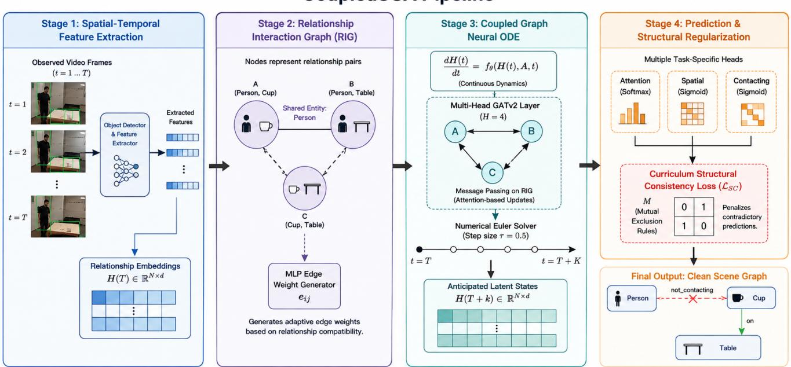
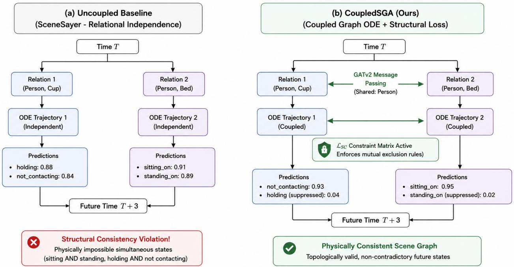

# Coupled Scene Graph Anticipation: When With-Constraint Recall Hides Structural Inconsistency

Nongmaithem Zeno School of Engineering Jawaharlal Nehru University New Delhi, India nongma45\_soe@jnu.ac.in

Apoorv Sisodia   
School of Engineering   
Jawaharlal Nehru University   
New Delhi, India   
apoorv14\_soe@jnu.ac.in   
Anushttha Srivastava   
School of Engineering   
Jawaharlal Nehru University   
New Delhi, India   
anusht71\_soe@jnu.ac.in

Suman Chowdhury∗†‡ Academy of Scientific and Innovative Research Ghaziabad, Uttar Pradesh, India suman.cmeri21a@acsir.res.in

Rajesh P. Barnwal§¶   
AI & IoT Lab, IT Group   
CSIR-Central Mechanical Engineering   
Research Institute   
Durgapur, West Bengal, India   
r\_barnwal@cmeri.res.in   
Anshit Sinha   
School of Engineering   
Jawaharlal Nehru University   
New Delhi, India   
anshit81\_soe@jnu.ac.in   
Prerana Mukherjee   
School of Engineering   
Jawaharlal Nehru University   
New Delhi, India   
prerana@jnu.ac.in

## Abstract

Scene Graph Anticipation (SGA) predicts relationships between objects in future video frames. Continuous-time SGA models typically represent each subject–object pair using an independent Neu ral Ordinary Diferential Equation (Neural ODE). Consequently, relationships that share an entity cannot influence one another during temporal integration, and nothing prevents mutually exclu sive predictions, such as sitting on and standing on, for the same subject–object pair. To address these limitations, we introduce Cou-pledSGA, which connects relationships sharing an entity through a Relationship Interaction Graph (RIG), incorporates graph attention into the ODE vector field, and adds a Structural Consistency Loss $( \mathcal { L } _ { \mathrm { S C } } )$ based on a matrix of mutually exclusive predicates.

Developing CoupledSGA revealed a fundamental limitation in the evaluation protocol. Under the With-Constraint protocol, the evaluator retains only one predicate from each predicate group for every subject–object pair. Consequently, the evaluated output cannot contain both predicates involved in an exclusion rule when those predicates belong to the same group. Since all exclusion rules considered in our study satisfy this condition, With-Constraint Recall@� (R@�) and mean Recall@� (mR@�) cannot capture

∗Both authors contributed equally to this research.   
†Also with AI & IoT Lab, IT Group, CSIR-Central Mechanical Engineering Research Institute.   
‡Also with School of Computing Technologies, RMIT University.   
§Corresponding author.   
¶Also with Academy of Scientific and Innovative Research.

the violations targeted by $\mathcal { L } _ { \mathrm { S C } }$ . We formally establish that these metrics remain unchanged when the winning predicate and its score within each group are held fixed, regardless of whether a structural violation exists.

We further derive the gradient of $\mathcal { L } _ { \mathrm { S C } }$ and show that it depends on the scores of conflicting predicates rather than their ground- truth labels. For a two-predicate exclusion rule, the loss amplifies the ordering already established by the model. When all scores in a group are equal, predicates involved in more exclusion rules are suppressed more strongly, irrespective of their correctness. These properties explain why the penalty may reduce recall even as it improves structural consistency.

Experiments on Action Genome support this analysis. Under a matched training budget, CoupledSGA achieves 40.48% R@20, compared with 44.78% for SceneSayerODE. In a controlled com parison, activating LSC after two warm-up epochs reduces R@20 from 42.21% to 35.18%, while lowering the contradiction rate under the No-Constraint protocol from 45.92% to 4.07%. These results are not intended to establish state-of-the-art performance. Rather, CoupledSGA serves as a testbed for exposing the limitations of the evaluation protocol. Our findings demonstrate that With-Constraint recall captures the cost of enforcing structural consistency but fails to reflect the corresponding improvement. We therefore recom- mend reporting No-Constraint results alongside a contradiction rate when evaluating methods that explicitly constrain predicate co-activation.

## CCS Concepts

• Computing methodologies → Computer vision; Neural networks; Machine learning.

## Keywords

Scene Graph Anticipation, Neural ODE, Graph Attention Networks, Structural Constraints, Evaluation Protocols, Video Understanding

## ACM Reference Format:

Nongmaithem Zeno, Anushttha Srivastava, Anshit Sinha, Apoorv Siso- dia, Suman Chowdhury, Prerana Mukherjee, and Rajesh P. Barnwal. 2026. Coupled Scene Graph Anticipation: When With-Constraint Recall Hides Structural Inconsistency. In Indian Conference on Computer Vision, Graphics, and Image Processing (ICVGIP 2026), December 21–24, 2026, Kolkata, India. ACM, New York, NY, USA, 9 pages.

## 1 Introduction

Scene Graph Anticipation (SGA) [16] aims to predict the future relationships between entities in a video, representing them as ⟨subject, predicate, object⟩ triplets. Its evaluation protocols inherit established metrics from Scene Graph Generation (SGG) [21, 24] and Video Scene Graph Generation (VidSGG) [6, 7]. In particular, Recall@� (R@�) reduces the penalty associated with correct predictions that are not annotated in the ground truth [21], while mean Recall@� (mR@�) mitigates the dominance of frequent predicate classes [5]. These metrics are commonly reported under two evaluation protocols: With Constraint, which restricts the number of predicates that each subject–object pair can contribute to the evaluation, and No Constraint, which permits multiple predicates per pair [15, 16]. Although these protocols provide complementary views of predictive performance, their ability to measure structural consistency has received less attention.

Structural consistency is important in applications that require reliable predictions before an interaction occurs [8, 9]. For example, a person cannot simultaneously be sitting on and standing on the same chair in the same relational context. Nevertheless, a scene graph anticipation model may assign high scores to both predicates for the same subject–object pair. For the Spatial and Contacting groups of Action Genome [11], predicates are decoded using independent sigmoid outputs. Consequently, mutually exclusive predicates are not necessarily forced to compete, and the decoder can produce structurally inconsistent predictions. Whether such inconsistencies afect the reported evaluation results depends on the predictions retained by the evaluation protocol.

In the evaluation implementation released with SceneSayer [16], the With-Constraint protocol retains the highest-scoring predicate from each predicate group for a given subject–object pair, whereas the No-Constraint protocol allows multiple predicates to be retained. As a result, With-Constraint evaluation may discard evidence of a contradiction before the predictions are scored. For example, sitting on and standing on both belong to the Contacting group, so retaining only the highest-scoring predicate prevents both from appearing in the evaluated output. Thus, a prediction may violate a structural exclusion rule before filtering, yet the violation may remain invisible to the reported recall metrics after filtering.

This issue emerged during the development of CoupledSGA, illustrated in Figure 1. CoupledSGA extends SceneSayerODE, the Neural Ordinary Diferential Equation (Neural ODE) variant of SceneSayer [16], in which each subject–object pair is modelled by an independent Neural ODE [4]. Because the trajectories are integrated independently, relationships that share an entity cannot directly influence one another during temporal evolution. CoupledSGA introduces two complementary mechanisms. First, a Relationship Interaction Graph (RIG) connects relationships that share an entity, and graph attention [3] within the ODE vector field enables their representations to interact during integration. Second, a Structural Consistency Loss $( \mathcal { L } _ { \mathrm { S C } } )$ penalises the simultaneous activation of predicate pairs specified as mutually exclusive in an exclusion matrix. The RIG facilitates interaction between related relationships, whereas $\mathcal { L } _ { S C }$ explicitly regularises predicate co-activation.

The central finding of this work concerns the limitations of the evaluation protocol rather than a claim of improved predictive performance. Every exclusion rule considered in our matrix relates two predicates within the same predicate group. Consequently, the With-Constraint protocol cannot retain both predicates involved in any of these violations for the same subject–object pair. We formally prove that, when the winning predicate and its score in each group remain fixed, With-Constraint R@� and mR@� are unchanged regardless of whether a within-group exclusion rule is violated (Proposition 1). Therefore, these metrics alone cannot quantify the structural improvements targeted by $\mathcal { L } _ { \mathrm { S C } }$ . This result has an important implication: improvements in structural consistency cannot be established solely through With-Constraint recall.

We further analyse the gradient of $\mathcal { L } _ { S C }$ with respect to predi-cate scores and show that the penalty depends on the scores of mutually exclusive predicates rather than their ground-truth la- bels (Proposition 2). For a two-predicate exclusion rule, the loss reinforces the ordering that the model already assigns to the two predicates. When all scores in a group are equal, predicates in-volved in a greater number of exclusion rules are suppressed more strongly, irrespective of whether they are correct. These properties explain why enforcing structural consistency may reduce recall, particularly when the penalty is introduced before the model has learned reliable predicate rankings.

Experiments on Action Genome are consistent with this analysis. Under a matched training budget, CoupledSGA achieves an R@20 of 40.48%, compared with 44.78% for SceneSayerODE. In a controlled comparison, activating $\mathcal { L } _ { \mathrm { S C } }$ after two warm-up epochs reduces R@20 from 42.21% to 35.18%. Under the No-Constraint protocol, the same change reduces the contradiction rate from 45.92% to 4.07%, while coupling alone reduces it from 54.40% to 45.92%. These results are not intended to establish state-of-the-art performance. Rather, they illustrate the trade-of between recall and structural consistency and show that With-Constraint recall captures the cost of enforcing consistency without reflecting the corresponding structural improvement.

The findings motivate a more informative evaluation practice for SGA methods that explicitly regularise predicate co-activation. In addition to standard With-Constraint metrics, evaluations should report No-Constraint results and a contradiction rate, defined as the proportion of (subject–object pair, predicate group) instances in which the two highest-scoring predicates form an excluded pair. Reporting these complementary measures would help distinguish predictive recall from structural validity and provide a clearer as- sessment of the efects of consistency constraints.

  
Figure 1: CoupledSGA. Observed frames give one embedding per subject–object relationship. The Relationship Interaction Graph connects relationships that share an entity. Graph attention inside the ODE vector field couples their trajectories during integration. Decoded predicates are regularised by the Structural Consistency Loss $\mathcal { L } _ { S C }$

The contributions of this work are summarised as follows:

(1) An analysis of evaluation limitations. We prove that With-Constraint R@� and mR@� cannot detect within group structural violations when the winning predicate and its score in each group remain unchanged (Section 5).

(2) A coupled SGA framework. We introduce CoupledSGA, which uses a Relationship Interaction Graph and graph attention within a Neural ODE vector field to couple relationships that share entities, together with a Structural Consistency Loss to penalise mutually exclusive predicate co-activation (Section 4).

(3) An analysis of the consistency penalty. We derive the gradient of LSC and establish how its label-independent behaviour can reinforce existing predicate-score orderings in two-predicate rules and, when all scores in a group are equal, disproportionately suppress predicates involved in multiple exclusion rules (Section 5).

(4) An empirical evaluation and reporting recommendation. Experiments on Action Genome demonstrate the trade of between recall and structural consistency, motivating the joint reporting of recall metrics and contradiction rates (Section 6).

## 2 Related Work

Video scene graphs and anticipation. Static SGG extracted relationships from single images using message passing [21] and frequency priors [24]. STTran [6] added factorised spatial and tem-poral attention for video, and DSG-DETR [7] modelled long-term dependencies over object tracklets. These models label frames they have observed, so their numbers are not a target for anticipation. SceneSayer [16] introduced SGA and solved it with per-pair Neural ODEs and Neural SDEs. Action anticipation [8, 9] predicts coarse labels rather than relational structure.

Recent SGA. ImparTail [15] applies curriculum-driven loss masking to VidSGG and SGA and reports SGA results under both With-Constraint and No-Constraint settings. FDSG [22] forecasts entity labels, boxes and relationships jointly. FORESCENE [1] predicts full future graphs with a latent difusion model. The last two extend SGA beyond the fixed object set and the predicate-only prediction we study here, and none of the three is a direct numerical baseline for our matched PredCLS budget. We note them because our eval- uation argument applies to any of them that adds a co-activation constraint.

Coupled dynamics on graphs. Graph Neural ODEs [17], CG-ODE [10] and Graph-Coupled Oscillator Networks [18] model interacting units in continuous time. They couple over the entity graph and predict a continuous state. We couple over a graph of relationships, which is where mutual exclusion is defined, and our target is a discrete symbolic output.

Structural constraints and scheduled objectives. Symbolic structure has been added to visual predictors through knowledge graphs [23], probabilistic logic [13] and energy-based penalties on invalid subgraphs [20]. TEMPURA [14] addresses long-tailed predicates with memory-guided training. Our schedule borrows the idea of curriculum learning [2], which presents easier training examples before harder ones, and applies it to an auxiliary objec tive; ImparTail [15] uses a curriculum to mask head-class predicate losses. Our penalty does not act on the class distribution, and it is narrower than the symbolic approaches: it constrains only which predicates may be simultaneously active on one pair.

## 3 Task and Evaluation Protocol

## 3.1 Scene Graph Anticipation

Let $I _ { 1 } , \ldots , I _ { T }$ be observed frames. SGA predicts the relationships holding in � later frames $I _ { T + 1 } , \dots , I _ { T + K } . A$ relationship pair is an ordered pair of entities $( s , o ) ;$ a predicate is a relation class assigned to that pair. We write $P _ { T }$ for the set of pairs active at the last observed frame and $N = | P _ { T } |$

We use Predicate Classification (PredCLS): entity identities and boxes are given for all frames, and only the predicate must be predicted. The released Action Genome annotations [11] define 26 predicates in three predicate groups: Attention (3 classes, de coded with a softmax and so single-label by construction), Spatial (6 classes, multi-label) and Contacting (17 classes, multi-label). Spatial and Contacting are decoded with independent sigmoids, so nothing forces the classes inside a group to compete.

## 3.2 The With-Constraint Emission Rule

Our main result depends on the exact scoring rule, so we state it before anything else. Under With Constraint, for each pair � and each predicate group �, the evaluator keeps only the top-scoring predicate of that group:

$$
\hat { p } _ { i } ^ { g } = \underset { u \in g } { \arg \operatorname* { m a x } } \ \hat { y } _ { i , u } ,\tag{1}
$$

where $\hat { y } _ { i , u }$ is the predicted score of predicate � for pair �. The kept triplets are ranked by score, and R@� is the fraction of ground-truth triplets in the top �. Under No Constraint, several predicates per group are kept, so co-activated predicates can both appear. We use the emission rule implemented in the Action Genome evaluation code released with prior SGA work [16]; the results in Section 5 concern the rule itself and not any historical label attached to it.

## 3.3 Two Notions of Consistency

Let $M \in \{ 0 , 1 \} ^ { C \times C }$ be a symmetric, zero-diagonal exclusion matrix over the � Spatial and Contacting classes, with $M _ { u v } = 1$ when � and � cannot both hold of one pair. Call $( u , v )$ an excluded pair, and call the rule within-group when � and � belong to the same predicate group. We keep two notions separate throughout, because conflating them is easy and misleading.

Structural validity is a property of a decoded graph: no pair is assigned both members of any excluded pair. It is evaluated after emission.

Co-activation mass is a property of the continuous scores, before emission:

$$
c _ { i } = \sum _ { u < v } M _ { u v } \ : \hat { y } _ { i , u } \ : \hat { y } _ { i , v } \geq 0 .\tag{2}
$$

It is zero exactly when, for every excluded pair, at least one of the two scores is zero.

The two do not coincide. A decoded graph can be structurally valid while $c _ { i } > 0 ,$ and a small $c _ { i }$ does not certify validity. Our loss

minimises co-activation mass; what a downstream consumer cares about is validity. Keeping the distinction visible is what makes the analysis in Section 5 precise.

## 4 CoupledSGA

## 4.1 Relation Encoder

For each observed frame � and pair (�, �), a spatial-temporal backbone [6] pools RoIAlign features for the subject box, the object box and their union, concatenates a relative-box encoding and learned class embeddings, and refines the result with spatial attention across pairs and temporal attention across frames. This yields $h _ { s o } ^ { ( t ) } \in \mathbb { R } ^ { d }$ with $d = 1 9 3 6$ . Stacking the pairs active at frame $T$ gives the initial state $H ( T ) \in \mathbb { R } ^ { N \times d }$ for integration.

## 4.2 Relationship Interaction Graph

The RIG is a graph whose nodes are the � relationship pairs. Two nodes are joined when the underlying pairs share an entity:

$$
A _ { i j } = \left\{ \begin{array} { l l } { 1 , } & { \mathrm { i f } \ : s _ { i } = s _ { j } \lor s _ { i } = o _ { j } \lor o _ { i } = s _ { j } \lor o _ { i } = o _ { j } , } \\ { 0 , } & { \mathrm { o t h e r w i s e } , } \end{array} \right.\tag{3}
$$

with self-loops added, $\tilde { A } = A + I _ { N }$ . We also learn a scalar weight per edge from the two incident embeddings,

$$
e _ { i j } = \mathrm { M L P _ { e d g e } } \big ( \left[ h _ { i } ( T ) \left| \right. \right| h _ { j } ( T ) \left. \right] \big ) ,\tag{4}
$$

which enters the attention score in Equation 6. Action Genome annotates person–object relations, so most pairs in a frame share the same actor and the RIG is close to complete. Topology alone therefore carries little information on this dataset. Which neigh- bours matter is decided by $e _ { i j }$ and by the attention weights, not by the adjacency. On multi-agent data, the same rule would produce a block-structured graph.

## 4.3 Coupled Graph Neural ODE

We integrate the relationship states from � to the prediction horizon by solving ${ d H ( t ) } / { d t } = f _ { \theta } ( H ( t ) , \tilde { A } , t )$ with $H ( T )$ as the initial condition. The point of CoupledSGA is that $f _ { \theta }$ does not act row by row. At every solver step, each relationship updates its state from its RIG neighbours:

$$
\frac { d h _ { i } ( t ) } { d t } = \sigma \Bigg ( \sum _ { j \in N ( i ) } \alpha _ { i j } ( t ) W _ { v } h _ { j } ( t ) \Bigg ) - \gamma h _ { i } ( t ) ,\tag{5}
$$

where $N ( i )$ are the neighbours of � in $\tilde { A } , W _ { v }$ is a shared value projection, � is SiLU, and $- \gamma h _ { i } ( t )$ with $\gamma = 1$ damps the state, which helps keep trajectories bounded over the rollout. The attention weights are GATv2 [3] scores, extended with the learned edge weight and a time embedding:

$$
\begin{array} { r } { \alpha _ { i j } ( t ) = \mathrm { s o f t m a x } _ { j \in N ( i ) } \Big ( \mathrm { L e a k y R e L U } \big ( a ^ { \top } [ W _ { q } h _ { i } ( t ) \mid \mid W _ { k } h _ { j } ( t ) } \\ { \mid \mid \phi ( t ) ] + w _ { e } e _ { i j } \big ) \Big ) , } \end{array}\tag{6}
$$

with $\phi ( t )$ a Fourier embedding of the integration time and $w _ { e }$ a scalar parameter. Including $\phi ( t )$ lets the coupling strength change along the horizon rather than staying fixed at its value at $t = T .$ . We use two layers and four heads, averaged to preserve �.

Table 1: Exclusion rules in �. Deg. is the number of rules the predicates of that row appear in. Every rule is withingroup, which Proposition 1 uses; the uneven degrees are what Corollary 2 uses.
<table><tr><td>Group</td><td>Excluded pair</td><td>Deg.</td></tr><tr><td>Spatial</td><td>above / beneath</td><td>1/1</td></tr><tr><td>Spatial</td><td>in front of / behind</td><td>1/1</td></tr><tr><td>Contacting</td><td>sitting on / standing on</td><td>1/1</td></tr><tr><td>Contacting</td><td>wiping / drinking from</td><td>1/1</td></tr><tr><td>Contacting</td><td>holding / not contacting</td><td>1/3</td></tr><tr><td>Contacting</td><td>touching / not contacting</td><td>1/3</td></tr><tr><td>Contacting</td><td>carrying / not contacting</td><td>1/3</td></tr></table>

We solve the system with explicit Euler at a fixed step $\tau = 0 . 5 ,$ , so the number of derivative evaluations is $S = K / \tau$ , set by the horizon and not by the scene.

Cost. Each solver step costs $O ( N d ^ { 2 } )$ for the projections and $O ( | \mathcal { E } _ { \mathrm { R I G } } | d )$ for message passing, against $O ( N d ^ { 2 } )$ per step for an uncoupled model. The marginal cost of coupling is the second term. With $d = 1 9 3 6$ and few active pairs per frame, it is dominated by the projections. This is an analytical statement; we do not report measured runtime.

## 4.4 Structural Consistency Loss

Let $\hat { Y } \in [ 0 , 1 ] ^ { N \times C }$ hold the sigmoid scores of the Spatial and Con- tacting heads at a predicted timestep, $C = 2 3$ . Summing the co-activation mass of Equation 2 over pairs gives

$$
\mathcal { L } _ { \mathrm { S C } } = \frac { 1 } { N } \operatorname { T r } \left( \hat { Y } M \hat { Y } ^ { \top } \right) = \frac { 2 } { N } \sum _ { i = 1 } ^ { N } c _ { i } ~ \ge ~ 0 ,\tag{7}
$$

which is zero exactly when every excluded pair has at least one score of zero. This is the co-activation condition of Section 3.3, not discrete structural validity. The loss adds no cost at inference. Table 1 lists the rules in �. Two columns matter later: every rule is within-group, and not contacting appears in three rules while every other predicate appears in one.

Schedule. Section 5 shows that $\mathcal { L } _ { S C }$ reinforces the ordering the network already holds. That argues for delaying it until the ordering is reliable, so we gate it by epoch: $\lambda _ { \mathrm { S C } } ^ { ( e ) } = 0$ for $e \mathrm { ~ < ~ } e _ { \mathrm { s t a r t } }$ and $\lambda _ { S C }$ afterwards. The full objective is

$$
\begin{array} { r } { \mathcal { L } _ { \mathrm { t o t a l } } = \mathcal { L } _ { \mathrm { o b s } } + \mathcal { L } _ { \mathrm { a n t } } + \beta _ { 1 } \mathcal { L } _ { \mathrm { r e c o n } } + \beta _ { 2 } \mathcal { L } _ { \mathrm { b b o x } } + \lambda _ { \mathrm { S C } } ^ { ( e ) } \mathcal { L } _ { \mathrm { S C } } , } \end{array}\tag{8}
$$

where $\mathcal { L } _ { \mathrm { o b s } }$ and $\mathcal { L } _ { \mathrm { a n t } }$ are cross-entropy and binary cross-entropy terms on observed and predicted predicates, $\scriptstyle { \mathcal { L } } _ { \mathrm { r e c o n } }$ is an $L _ { 1 }$ latent reconstruction term and ${ \mathcal { L } } _ { \mathrm { b b o x } }$ is a smooth-�1 box term $( \beta _ { 1 } = 1$ $\beta _ { 2 } = 0 . 1 )$ . Algorithm 1 gives the loop.

## 5 Why With-Constraint Recall Misses Structural Violations

This section contains the paper’s two analytical results. Both fol- low from definitions already given, and neither depends on our experiments.

Algorithm 1 CoupledSGA training   
Require: observed frames, entities, horizon $K ,$ step $\tau ,$ threshold   
�start, weight $\lambda _ { S C }$   
1: for $e = 0$ to $E - 1$ do   
2: $\lambda _ { \mathrm { S C } } ^ { ( e ) }  \lambda _ { \mathrm { S C } }$ i $\textbf { f } e \ge e _ { \mathrm { s t a r t } }$ else 0   
3: for each video batch do   
4: encode observed frames; form $H ( T )$   
5: build �˜ and $e _ { i j }$ ⊲ Eq. 3, 4   
6: for $k = 1$ to � do   
7: integrate Eq. 5 by Euler steps of size � to $T + k$   
8: decode $\hat { Y } _ { T + k }$   
9: end for   
10: update by AdamW on $\mathcal { L } _ { \mathrm { t o t a l } }$ ⊲ Eq. 8   
11: end for   
12: end for

## 5.1 The Evaluator Discards the Evidence

A contradiction needs two predicates to be present at once. With Constraint keeps one predicate per group, so the evaluator removes the evidence of the contradiction before recall is computed.

Proposition 1 (Within-group violations are invisible). Let (�, �) be an excluded pair with �, � in the same predicate group �. For any score matrix �ˆ, the With-Constraint output of Equation 1 contains at most one of� and � for any pair �. Consequently, R@� and mR@� computed under With Constraint depend on the scores ofgroup � only through its arg max and the score ofthat arg max: changing the score ofthe other member ofan excluded pair, with the arg max and its score held fixed, leaves both metrics unchanged.

Proof. Equation 1 keeps a single element of � per pair, namely arg max $\boldsymbol { w } \in g \hat { y } _ { i , w } .$ . Since $u , v \in g ,$ at most one of them is kept. The scored candidate set therefore never contains both, for any values of $\hat { y } _ { i , u }$ and $\hat { y } _ { i , v }$ . It holds only the arg max of each group and its score, so a statistic computed from that set cannot depend on the score of a predicate that is not kept. □

Every rule in Table 1 is within-group. The quantity $\mathcal { L } _ { S C }$ minimises is thus one that With-Constraint recall does not respond to. The violations are nonetheless real and do appear under No Constraint, where more than one predicate per group is kept. A study that claims to improve predicate co-activation consistency therefore cannot support that claim with With-Constraint recall alone.

## 5.2 The Penalty Does Not Know Which Predicate Is Correct

Proposition 2 (Gradient of the exclusion penalty). Define the conflict mass of predicate � at pair � as $m _ { i , u } = \sum _ { \tau }$ ��� $\hat { y } _ { i , v } .$ Then

$$
\frac { \partial \mathcal { L } _ { \mathrm { S C } } } { \partial \hat { y } _ { i , u } } = \frac { 2 } { N } m _ { i , u } .\tag{9}
$$

Writing $\hat { y } _ { i , u } = \sigma ( z _ { i , u } )$ for the head logits and $g _ { i , u } = \hat { y } _ { i , u } \big ( 1 - \hat { y } _ { i , u } \big )$ , a gradient step of size � on $\mathcal { L } _ { \mathrm { S C } }$ changes the logit gap of an excluded pair (�, �) by

$$
\Delta { \left( z _ { i , u } - z _ { i , v } \right) } = \frac { 2 \eta } { N } \left( m _ { i , v } g _ { i , v } - m _ { i , u } g _ { i , u } \right) .\tag{10}
$$

No term depends on the ground-truth label.

Proof. � is symmetric with zero diagonal, so diferentiating Equation 7 gives Equation 9. The chain rule through the sigmoid gives

$$
\frac { \partial \mathcal { L } _ { \mathrm { S C } } } { \partial z _ { i , u } } = \frac { 2 } { N } m _ { i , u } g _ { i , u } , \qquad \Delta z _ { i , u } = - \frac { 2 \eta } { N } m _ { i , u } g _ { i , u }
$$

under gradient descent. Subtracting the two updates gives Equation 10. Equation 7 contains no label term. □

Two consequences follow, and they cover the two kinds of rows in Table 1.

Corollary 1 (Two-predicate rules: the ordering is reinforced). If� and � are each other’s only excluded partner, then $m _ { i , u } = \hat { y } _ { i , v }$ and $m _ { i , v } = \hat { y } _ { i , u } ;$ and Equation 10 reduces to

$$
\Delta { \left( z _ { i , u } - z _ { i , v } \right) } = \frac { 2 \eta } { N } \hat { y } _ { i , u } \hat { y } _ { i , v } \left( \hat { y } _ { i , u } - \hat { y } _ { i , v } \right) ,\tag{11}
$$

which has the sign o $\hat { y } _ { i , u } - \hat { y } _ { i , v } .$ The penalty widens whichever gap already exists.

Concretely, if the model scores sitting on at 0.8 and standing on at 0.2 for one pair, the penalty pushes the 0.2 down harder than the 0.8. It would do exactly the same if standing on were the correct label. The loss removes a contradiction by amplifying whichever side is currently ahead.

Corollary 2 (Multi-partner rules: a bias by degree). Let � and � be excluded partners with $\hat { y } _ { i , u } = \hat { y } _ { i , { u } } ,$ so $g _ { i , u } ~ = ~ g _ { i , v } .$ Then Equation 10 has the sign of $\mathbf { \dot { \varphi } } m _ { i , v } - m _ { i , u } \mathbf { : }$ the tie is broken toward the predicate with the smaller conflict mass. If all scores in the group are equal, $m _ { i , u }$ is proportional to the number of rules � appears in, so ties break toward predicates oflower degree in �.

In our matrix, not contacting has degree three and its three partners have degree one (Table 1). The penalty therefore breaks ties away from not contacting and toward the contact predicates, inde-pendently of which is correct. This is a property of the quadratic form, not of the data. It suggests that an exclusion penalty of this shape should be normalised by degree, or replaced by a within- group softmax over excluded sets. We did not test either variant.

Hypothesis 1 (Expected effect on With-Constraint recall). Under With Constraint, R@� depends on the scores only through the within-group arg max and the ranking of kept triplets. By Corollaries 1 and 2, LSC moves the arg max for reasons unrelated to the label. Applied while the ordering is unreliable, it consolidates whichever errors are present; applied once the ordering is largely correct, its efect on the arg max is small. We therefore hypothesise that its contribution to With-Constraint recall is non-positive early in training and near zero later; this does not follow from the gradient alone, since recall also depends on the supervised terms.

We separate three things here. The intended role of $\mathcal { L } _ { \mathrm { S C } }$ is to reduce co-activation mass. Its unintended optimisation efect is to reinforce the current ordering and to penalise high-degree predicates. Hypothesis 1 is a prediction about recall, not a measurement: it says that enabling the penalty early should depress With-Constraint recall relative to leaving it of. Section 6.3 measures the efect of enabling it after two warm-up epochs.

Table 2: Experimental conditions, shared by every run.  
Dataset / task Action Genome, PredCLS   
Split 600 train / 200 test videos   
Prediction horizon � = 3 frames   
Sequence cap 20 frames   
Optimiser AdamW [12]   
Learning rate $1 \times 1 0 ^ { - 5 } ,$ , weight decay $1 0 ^ { - 4 }$   
Gradient clipping norm 5.0   
Epochs 4   
Runs 1 (Table 3); 3 seeds (Table 4)   
ODE solver explicit Euler, � = 0.5   
Baseline SceneSayerODE [16]   
Protocol With Constraint; No Constraint (Table 4)

Table 3: Matched-budget comparison (Action Genome, Pred-CLS, With Constraint). Both models use the conditions of Table 2. These are small-subset results under a four-epoch budget and are not a full-benchmark comparison.
<table><tr><td>Method</td><td>K</td><td>R@K</td><td>mR@K</td><td>hR@K</td></tr><tr><td rowspan="3">SceneSayerODE [16]</td><td>10</td><td>43.22</td><td>10.79</td><td>17.27</td></tr><tr><td>20</td><td>44.78</td><td>11.47</td><td>18.26</td></tr><tr><td>50</td><td>44.78</td><td>11.48</td><td>18.27</td></tr><tr><td rowspan="3">CoupledSGA (ours)</td><td>10</td><td>38.96</td><td>9.51</td><td>15.29</td></tr><tr><td>20</td><td>40.48</td><td>10.10</td><td>16.16</td></tr><tr><td>50</td><td>40.49</td><td>10.10</td><td>16.17</td></tr></table>

## 6 Experiments

## 6.1 Setup

We use Action Genome [11], built on Charades [19]. Compute was one NVIDIA RTX 3060 with 12 GB, which bounds what these experiments can establish. We fix an 800-video subset and train every model on it with identical features, optimiser and evaluation code, so the comparison is like-for-like even though the absolute numbers are not comparable to published full-split results. Table 2 lists the conditions.

The 600 training and 200 test videos are drawn from the oficial Action Genome train and test partitions, respectively, so no test video is seen during training.1

We compare against SceneSayerODE, the Neural ODE variant of SceneSayer [16], since it difers from CoupledSGA in precisely the property we study: whether the vector field acts on each pair inde- pendently. We report R@�, mR@� averaged over the 26 predicate classes, and their harmonic mean hR@�, for cutofs � ∈ {10, 20, 50} (unrelated to the horizon $K = 3 )$ . Proposition 1 says that none of these responds to the violations $\mathcal { L } _ { \mathrm { S C } }$ targets. We report them because R@� and mR@� are the standard SGA metrics [16], and hR@� combines the two. Section 6.3 adds a structural measure- ment under No Constraint, and Section 6.4 returns to what should accompany them.

  
Figure 2: Illustration of the target failure mode; the scores shown are illustrative and are not model outputs. Left: an uncoupled ODE evolves each relationship alone, and nothing in it prevents high scores on mutually exclusive predicates such as siting on and standing on. Right: CoupledSGA couples the trajectories and penalises co-activation. By Proposition 1, this diference does not appear in With-Constraint recall (Table 3); the contradiction rate of Table 4 measures it.

## 6.2 Matched-Budget Comparison

On our matched 600/200 split, CoupledSGA does not outperform SceneSayerODE under With-Constraint recall. Table 3 gives the numbers. The baseline leads by 4.30 points of R@20, 1.37 points of mR@20 and 2.10 points of hR@20, and by similar margins at $K = 1 0$

The gap mixes coupling and penalty. The CoupledSGA row of Ta ble 3 is taken after $\mathcal { L } _ { S C }$ was switched of, from a run in which it was active $( \lambda _ { \mathrm { S C } } = 0 . 1 )$ in epochs 0–1. The diference in Table 3 therefore does not isolate the coupled vector field. Section 6.3 separates the two efects with controlled runs.

Capacity and budget are confounded. The GATv2 field adds three � × � projections per head per layer at $d = 1 9 3 6 ,$ many times the parameters of the row-wise field it replaces. Four epochs at a learn- ing rate of $1 0 ^ { - 5 }$ is a short schedule for that many new parameters, and the added capacity is what is least likely to be trained under it. We cannot separate a real deficit of the coupled formulation from an undertrained one, and we do not claim to.

� = 50 is saturated. R@20 and R@50 agree to within 0.01 points for both models, because each pair contributes one triplet per group, and a frame with few active pairs yields a candidate set that top-20 already exhausts. Only � = 10 discriminates at this scale.

Table 4: Controlled comparison (Action Genome, PredCLS; conditions of Table 2). R@20 is computed under With Constraint and the contradiction rate CR (Equation 12) under No Constraint, on anticipated frames. Runs B and C difer only in whether $\mathcal { L } _ { \mathrm { S C } } \left( \lambda _ { \mathrm { S C } } = 0 . 1 \right)$ is active in epochs 2–3; A and B difer only in coupling. Mean ± standard deviation over three seeds.
<table><tr><td></td><td>Model</td><td> $\mathcal { L } _ { \mathrm { S C } }$ </td><td>R@20 (%) ↑</td><td>CR (%) ↓</td></tr><tr><td>A</td><td>SceneSayerODE</td><td></td><td> $\mathbf { 4 4 . 1 5 \pm 0 . 5 1 }$ </td><td> $5 4 . 4 0 \pm 1 . 2 1 $ </td></tr><tr><td>B</td><td>CoupledSGA</td><td>off</td><td> $4 2 . 2 1 \pm 0 . 7 5$ </td><td> $4 5 . 9 2 \pm 1 . 4 4$ </td></tr><tr><td>C</td><td>CoupledSGA</td><td>epochs 2-3</td><td> $3 5 . 1 8 \pm 1 . 1 0$ </td><td> ${ \bf 4 . 0 7 \pm 0 . 4 6 }$ </td></tr></table>

## 6.3 Controlled Comparison under Both Protocols

Section 6.2 leaves two questions open: how much of the gap in Table 3 is due to coupling and how much to the penalty, and whether $\mathcal { L } _ { S C }$ reduces contradictions at all. We answer both with three runs trained under the conditions of Table 2: SceneSayerODE (A), Cou-pledSGA with $\lambda _ { \mathrm { S C } } ~ = ~ 0$ throughout (B), and CoupledSGA with $\lambda _ { S C } = 0 . 1$ 1 from $e _ { \mathrm { s t a r t } } = 2 \left( \mathrm { C } \right)$ , which is the schedule of Section 4.4. B and C share the architecture, settings and budget, and difer only in whether $\mathcal { L } _ { \mathrm { S C } }$ is active in epochs 2–3; A and B difer only in coupling.

Each run is scored twice. R@20 is computed under With Con- straint, as in Table 3. Contradictions are measured under No Con-straint, where they can reach the output, by the contradiction rate (CR), a rank-based proxy for structural validity. For pair � and group � (Spatial or Contacting), let $u _ { 1 } ^ { i , g }$ and $u _ { 2 } ^ { i , g }$ be the two highest-scoring predicates of �. Then

$$
\mathrm { C R } = \frac { 1 0 0 } { \left| \mathcal { I } \right| } \sum _ { \left( i , g \right) \in \mathcal { I } } M _ { u _ { 1 } ^ { i , g } u _ { 2 } ^ { i , g } } \left( \% \right) ,\tag{12}
$$

where I collects all (pair, group) instances over the anticipated frames. CR uses ranks only, so it needs no threshold. Table 4 reports the results. Its runs were trained separately from those of Table 3; SceneSayerODE reaches 44.15 R@20 here (mean of three seeds) and 44.78 there under identical conditions.

The loss reduces contradictions. Between B and C, enabling $\mathcal { L } _ { S C }$ lowers CR from 45.92% to 4.07%, roughly elevenfold, and lowers R@20 by 7.03 points, from 42.21 to 35.18. This is Proposition 1 made measurable: With-Constraint recall registers the cost of the loss but not its structural gain, and Table 4 reports both.

Coupling alone reduces contradictions. Without any knowledge of excluded pairs, the RIG lowers CR from 54.40% to 45.92% (A to B), at a cost of 1.94 points of R@20.

The schedule does not avoid the cost. Hypothesis 1 predicts that the cost shrinks once the ordering within excluded pairs is largely correct. The measured cost suggests that, at our budget, two warm- up epochs did not reach that regime.

## 6.4 Implications for Evaluation

Figure 2 illustrates the failure mode the loss targets. With-Constraint recall shows only the cost ofthe penalty, because it does not respond to co-activation; the benefit appears only under No Constraint (Table 4). What follows is a recommendation for any SGA study that constrains which predicates may be simultaneously active.

Report results under No Constraint as well, since that is where co-activated predicates reach the scored output at all. Alongside recall, report two quantities computable from stored predictions without further training. A contradiction rate (Equation 12) is the fraction of (pair, group) instances whose two highest-scoring predicates form an excluded pair; it compares ranks, so it needs no threshold. A structural consistency score is the fraction of predicted graphs containing no excluded co-activation; it is stricter and closer to what a downstream consumer needs, since consumers read graphs rather than single edges. We did not find either reported alongside With-Constraint recall in the SGA studies cited here. We report the first in Table 4 and leave the second to future work.

## 7 Discussion and Limitations

The empirical claims are bounded by scale. All results come from an 800-video subset and a four-epoch budget; Table 3 comes from a single seed and Table 4 from three seeds. Propositions 1 and 2 do not depend on scale. The four-epoch budget leaves the capac- ity confound of Section 6.2 unresolved, and two warm-up epochs were not enough for the schedule of Section 4.4 to avoid the recall cost (Section 6.3). Structural validity is assessed only through the top-two contradiction rate; the structural consistency score of Section 6.4 is not reported. The exclusion matrix is hand-curated, and its coverage of the Action Genome ontology is unknown, so the contradiction rate inherits that coverage. Explicit Euler at $\tau = 0 . 5$ is first-order, and its truncation error is not quantified against an adaptive solver.

Two failure patterns recur in the predicted graphs. Under heavy occlusion, the backbone features degrade before the RIG is built, and coupling then spreads the resulting noise across neighbouring trajectories instead of damping it. For the rarest contacting predi-cates, which have fewer than ten training instances in the 600-video split, neither model predicts transitions reliably.

Because Action Genome is built from Charades [19], whose activity videos participants recorded in their own homes, models that forecast human interactions could be repurposed for surveillance. We use only existing annotations and collect no new data.

## 8 Conclusion

We set out to remove independent relation trajectories from continuous-time Scene Graph Anticipation, and built CoupledSGA: a graph over relationships, coupled into the vector field of a Neural ODE, with a penalty on mutually exclusive predicates. Building it exposed a problem with the measurement rather than the model.

What we prove: under the With-Constraint emission rule, a scored output can never contain both members of a within-group exclusion rule, so recall computed under that protocol cannot reg- ister those violations. What we derive: the gradient of a quadratic exclusion penalty is label-free, it widens whichever ordering a two- predicate rule already has, and it breaks ties against predicates that appear in many rules. What we observe: on a matched 600/200 split, CoupledSGA reaches 40.48% R@20 against 44.78% for Scene- SayerODE, and in a controlled comparison, enabling the penalty after two warm-up epochs lowers R@20 from 42.21% to 35.18%. The second, which isolates the penalty, has the sign the analysis predicts. Under No Constraint, the same change lowers the contradiction rate from 45.92% to 4.07%, and coupling alone lowers it from 54.40% to 45.92%. On this measure, the penalty reduces contradictions at a recall cost, and With-Constraint recall reports only the cost.

Two next steps follow: a graph-level structural consistency score reported alongside the contradiction rate, and the degree- normalised form of the penalty suggested by Corollary 2.

## Acknowledgments

Suman Chowdhury and Rajesh P. Barnwal acknowledge partial financial support from CSIR-CMERI, Durgapur, under Project MLP002613. Suman Chowdhury also acknowledges financial support from the Council of Scientific and Industrial Research (CSIR), India, through a Senior Research Fellowship (GATE), Grant No. GATE31/0019(15628)/2022-EMR-I. AI-based tools were used for copy-editing only; the authors take full responsibility for the content.

## References

[1] Antonio Alliegro, Francesca Pistilli, Tatiana Tommasi, and Giuseppe Averta. 2025. FORESCENE: FOREcasting Human Activity via Latent SCENE Graphs Difusion. arXiv:2503.06182 [cs.CV]

[2] Yoshua Bengio, Jérôme Louradour, Ronan Collobert, and Jason Weston. 2009. Curriculum Learnin . In Proceedings ofthe 26th Annual International Conference on Machine Learning (ICML). ACM, New York, NY, USA, 41–48. doi:10.1145 1553374.1553380

[3] Shaked Brody, Uri Alon, and Eran Yahav. 2022. How Attentive Are Graph Attention Networks?. In International Conference on Learning Representations (ICLR). OpenReview.net.

[4] Ricky T. Q. Chen, Yulia Rubanova, Jesse Bettencourt, and David K. Duvenaud. 2018. Neural Ordinary Diferential Equations. In Advances in Neural Information Processing Systems (NeurIPS), Vol. 31. Curran Associates, Inc., Red Hook, NY, USA, 6571–6583.

[5] Tianshui Chen, Weihao Yu, Riquan Chen, and Liang Lin. 2019. Knowledge-Embedded Routing Network for Scene Graph Generation. In Proceedings ofthe IEEE/CVF Conference on Computer Vision and Pattern Recognition (CVPR). IEEE, Piscataway, NJ, USA, 6163–6171.

[6] Yuren Cong, Wentong Liao, Hanno Ackermann, Bodo Rosenhahn, and Michael Ying Yang. 2021. Spatial-Temporal Transformer for Dynamic Scene Graph Generation. In Proceedings ofthe IEEE/CVF International Conference on Computer Vision (ICCV). IEEE, Piscataway, NJ, USA, 16372–16382.

[7] Shengyu Feng, Hesham Mostafa, Marcel Nassar, Somdeb Majumdar, and Subarna Tripathi. 2023. Exploiting Long-Term Dependencies for Generating Dynamic Scene Graphs. In Proceedings ofthe IEEE/CVF Winter Conference on Applications ofComputer Vision (WACV). IEEE, Piscataway, NJ, USA, 5130–5139.

[8] Antonino Furnari and Giovanni Maria Farinella. 2019. What Would You Expect? Anticipating Egocentric Actions with Rolling-Unrolling LSTMs and Modality Attention. In Proceedings of the IEEE/CVF International Conference on Computer Vision (ICCV). IEEE, Piscataway, NJ, USA, 6252–6261.

[9] Harshala Gammulle, Simon Denman, Sridha Sridharan, and Clinton Fookes. 2019. Predictin the Future: A Jointl Learnt Model for Action Antici ation. In Proceedings of the IEEE/CVF International Conference on Computer Vision (ICCV). IEEE, Piscataway, NJ, USA, 5562–5571.

[10] Zijie Huang, Yizhou Sun, and Wei Wang. 2021. Coupled Graph ODE for Learning Interacting System Dynamics. In Proceedings ofthe 27th ACM SIGKDD Conference on Knowledge Discovery and Data Mining (KDD). ACM, New York, NY, USA, 705–715. doi:10.1145/3447548.3467385

[11] Jingwei Ji, Ranjay Krishna, Li Fei-Fei, and Juan Carlos Niebles. 2020. Action Genome: Actions as Compositions of Spatio-Temporal Scene Graphs. In Proceedings ofthe IEEE/CVF Conference on Computer Vision and Pattern Recognition (CVPR). IEEE, Piscataway, NJ, USA, 10236–10247.

[12] Ilya Loshchilov and Frank Hutter. 2019. Decoupled Weight Decay Regularization. In International Conference on Learning Representations (ICLR). OpenReview.net.

[13] Robin Manhaeve, Sebastijan Dumančić, Angelika Kimmig, Thomas Demeester, and Luc De Raedt. 2018. DeepProbLog: Neural Probabilistic Logic Programming.

In Advances in Neural Information Processing Systems (NeurIPS), Vol. 31. Curran Associates, Inc., Red Hook, NY, USA, 3749–3759.

[14] Sayak Nag, Kyle Min, Subarna Tripathi, and Amit K. Roy-Chowdhury. 2023. Unbiased Scene Graph Generation in Videos. In Proceedings of the IEEE/CVF Conference on Computer Vision and Pattern Recognition (CVPR). IEEE, Piscataway, NJ, USA, 22803–22813.

[15] Rohith Peddi, Saurabh, Ayush Abhay Shrivastava, Parag Singla, and Vibhav Gogate. 2025. Towards Unbiased and Robust Spatio-Temporal Scene Graph Generation and Anticipation. In Proceedings ofthe IEEE/CVF Conference on Computer Vision and Pattern Recognition (CVPR). IEEE, Piscataway, NJ, USA, 8648–8657.

[16] Rohith Peddi, Saksham Singh, Saurabh, Parag Singla, and Vibhav Gogate. 2024. Towards Scene Graph Anticipation. In Computer Vision – ECCV 2024 (Lecture Notes in Computer Science, Vol. 15146). Springer, Cham, 159–175. doi:10.1007/978- 3-031-73223-2\_10

[17] Michael Poli, Stefano Massaroli, Junyoung Park, Atsushi Yamashita, Hajime Asama, and Jinkyoo Park. 2019. Graph Neural Ordinary Diferential Equations. arXiv:1911.07532 [cs.LG]

[18] T. Konstantin Rusch, Ben Chamberlain, James Rowbottom, Siddhartha Mishra, and Michael Bronstein. 2022. Gra h-Cou led Oscillator Networks. In Proceeding ofthe 39th International Conference on Machine Learning (ICML) (Proceedings of Machine Learning Research, Vol. 162). PMLR, 18888–18909.

[19] Gunnar A. Sigurdsson, Gül Varol, Xiaolong Wang, Ali Farhadi, Ivan Laptev, and Abhinav Gupta. 2016. Hollywood in Homes: Crowdsourcing Data Collection for Activity Understanding. In Computer Vision – ECCV 2016 (Lecture Notes in Computer Science, Vol. 9905). Springer, Cham, 510–526. doi:10.1007/978-3-319- 46448-0\_31

[20] Mohammed Suhail, Abhay Mittal, Behjat Siddiquie, Chris Broaddus, Jayan Eledath, Gerard Medioni, and Leonid Sigal. 2021. Energy-Based Learning for Scene Gra h Generation. In Proceedings ofthe IEEE/CVF Conference on Computer Vision and Pattern Recognition (CVPR). IEEE, Piscatawa , NJ, USA, 13936–13945.

[21] Danfei Xu, Yuke Zhu, Christopher B. Choy, and Li Fei-Fei. 2017. Scene Graph Generation by Iterative Message Passing. In Proceedings of the IEEE Conference on Computer Vision and Pattern Recognition (CVPR). IEEE, Piscataway, NJ, USA, 5410–5419.

[22] Yi Yang, Yuren Cong, Hao Cheng, Bodo Rosenhahn, and Michael Ying Yang. 2025. FDSG: Forecasting Dynamic Scene Graphs. arXiv:2506.01487 [cs.CV]

[23] Alireza Zareian, Svebor Karaman, and Shih-Fu Chang. 2020. Bridging Knowledge Graphs to Generate Scene Graphs. In Computer Vision – ECCV 2020. Springer, Cham 606–623. doi:10.1007/978-3-030-58592-1 36

[24] Rowan Zellers, Mark Yatskar, Sam Thomson, and Yejin Choi. 2018. Neural Motifs: Scene Graph Parsing with Global Context. In Proceedings ofthe IEEE Conference on Computer Vision and Pattern Recognition (CVPR). IEEE, Piscataway, NJ, USA, 5831–5840.