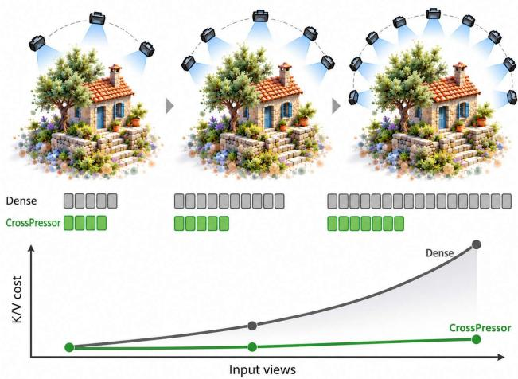
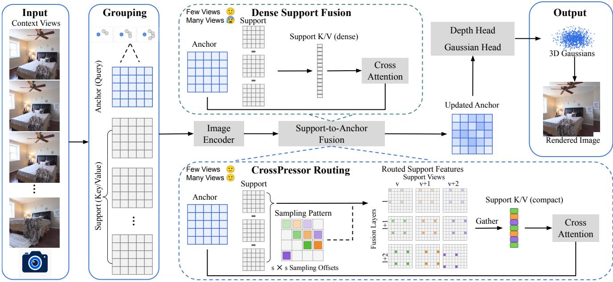
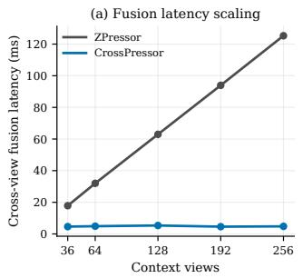
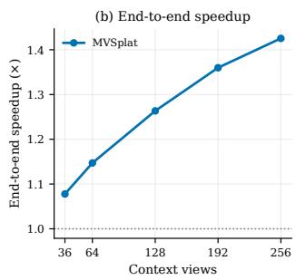
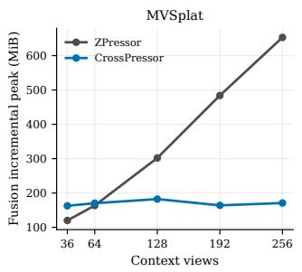
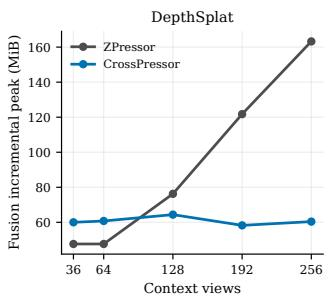

# CrossPressor: Scalable Cross-View Fusion for Feed-Forward 3D Gaussian Splatting

Yuxi Hu1 Wenhao Dong2 Jun Zhang1 Friedrich Fraundorfer1

1Graz University of Technology 2Ghent University

{yuxi.hu, jun.zhang, friedrich.fraundorfer}@tugraz.at {Wenhao.Dong}@UGent.be

## Abstract

Feed-forward 3D Gaussian Splatting (3D-GS) becomes increasingly difficult to scale to long multi-view sequences. Anchor-based compression methods such as ZPressor alleviate representation growth by decoding Gaussians only from a compact set of anchor feature maps, but keeping these anchors fixed forces each one to aggregate an increasing number of support views. We identify this representation–fusion mismatch and introduce CrossPressor, a training-free method for scalable anchor-based fusion. CrossPressor preserves all decoder-facing anchor queries while constraining the view-growing support sequence through coverage-cycled evidence routing, distributing retained spatial evidence across support views and fusion layers while keeping all support views represented. Routing before K/V projection, together with joint context packing, further reduces support-side fusion cost without retraining. CrossPressor maintains reconstruction quality close to dense fusion while achieving up to 26.12× faster cross-view fusion and 1.43× end-to-end acceleration on long input sequences. Our project page is at: https: //yuhsihu.github.io/CrossPressor.

## 1. Introduction

Feed-forward 3D Gaussian Splatting (3D-GS) is an effective paradigm for generalizable novel view synthesis. Given a set of calibrated images, recent methods directly predict an explicit Gaussian representation in a single forward pass [3, 5, 28], avoiding scene-specific optimization while retaining the efficient rendering properties of 3D-GS [12]. However, as feed-forward reconstruction expands from sparse observations to longer sequences, both the reconstructed representation and the cross-view computation used to construct it become increasingly difficult to scale. A model that is efficient for a few input images may therefore become impractical when processing tens or hundreds of views.

  
Figure 1. Representation–fusion mismatch and CrossPressor. ZPressor [25] bounds the decoder-facing representation by decoding Gaussians only from a compact set of anchor feature maps. As more context views are assigned to these anchors, the dense support features used to construct each anchor continue to grow. CrossPressor keeps the anchor representation unchanged while routing a bounded support sequence across cameras and spatial locations, with spatial sampling offsets varied across fusion layers. Gray tokens denote dense support evidence, while green tokens indicate routed evidence from different support views.

Recent methods [25, 26] have begun to address the issue of scaling in representation size. For instance, ZPressor [25] partitions the input images into a fixed number of groups using camera poses. It selects one anchor view from each group and fuses the remaining support views into the corresponding anchor feature maps. Only these updated anchor features are passed to the pixel-aligned Gaussian decoder. Since the number of anchor views remains constant, adding additional support views to provide further scene information does not directly increase the input to the Gaussian decoder or the number of Gaussians.

This divide-and-conquer strategy, however, introduces a new scaling dilemma. Increasing the number of camera groups reduces the support burden per anchor, but also increases the number of decoder-facing anchors and generated Gaussians. Keeping the anchor set fixed instead preserves representation size while forcing each anchor to aggregate an increasing number of support views. This exposes a growing support-to-anchor fusion bottleneck even though the decoder-facing representation remains fixed.

We refer to this contradiction as the representation– fusion mismatch: bounding the decoder-facing anchor representation does not bound the support evidence required to construct it. As more views are assigned to a fixed set of anchors, the representation remains compact while supportside K/V projection and cross-attention continue to grow.

Token reduction offers a direct way to reduce this cost. Learned methods adapt token selection to individual inputs and tasks [1, 14, 19], but typically require task-specific training or fine-tuning. When inserted into a feed-forward reconstruction pipeline, such modules may also require the host model to be jointly adapted, which is particularly costly for generalizable 3D-GS models trained on largescale multi-view data. We therefore focus on inference-time reduction that can be applied directly to released checkpoints. Training-free methods [2, 13, 22] prune or merge redundant visual tokens, while Spark3R [20] shows that K/V tokens can often tolerate stronger reduction than queries. In anchor-based fusion, however, the decoder-facing queries are already bounded by construction. The remaining challenge is to control the growing support-side K/V sequence while preserving evidence from all support views.

We therefore introduce CrossPressor, a training-free method for scalable cross-view fusion in feed-forward 3D Gaussian Splatting. CrossPressor constrains the growing support sequence through coverage-cycled evidence routing: it assigns different spatial sampling offsets across support views and varies them across fusion layers, so additional views contribute evidence without proportionally increasing the K/V sequence. Routing is applied before K/V projection, and routed contexts are packed jointly across fusion layers. The original camera grouping, anchor representation, attention modules, and Gaussian decoder remain unchanged. Our main contributions are:

• We identify the representation–fusion mismatch: bounding the decoder-facing representation does not prevent support-to-anchor fusion from growing with the number of views.

• We propose CrossPressor with coverage-cycled evidence routing, which bounds the support-side sequence while distributing spatial evidence across support views and fusion layers.

• We route support features before K/V projection, reducing both support-side projection and attention cost without retraining. Experiments across multiple backbones and datasets demonstrate strong long-context acceleration while maintaining reconstruction quality.

## 2. Related Work

## 2.1. Feed-Forward 3D Gaussian Splatting

3D Gaussian Splatting (3D-GS) [12] represents a scene using explicit anisotropic Gaussian primitives and enables high-quality novel-view rendering through an efficient differentiable rasterizer. While the standard approach [12] relies on scene-by-scene optimization to generate a separate set of Gaussian parameter representations for each scene, feed-forward methods [3, 5, 10, 17, 18, 28] directly predict scene representations from input images and thereby support novel-view synthesis without scene-specific optimization. This feed-forward paradigm is inspired by previous neural rendering methods [4, 24, 30]. These generalizable NeRF models are also capable of performing novel-view synthesis based on features extracted from input images, without requiring per-scene optimization. PixelSplat [3] predicts pixel-aligned Gaussians from sparse image pairs. MVSplat [5] further incorporates plane-sweep cost volumes and cross-view feature aggregation for geometric reconstruction, following the broader use of multi-view correspondence reasoning in learning-based MVS [8, 9, 11, 21, 29, 32]. DepthSplat [28] additionally integrates pretrained monocular depth features to strengthen geometric reasoning and cross-dataset generalization. This type of pixel-aligned method suffers from an inherent issue: the number of decoded Gaussians increases with the number of input viewpoints, as additional viewpoint-aligned feature maps lead to the prediction of more Gaussian primitives.

ZPressor [25] reduces representation growth by compressing multiple input views into a compact set of decoderfacing anchor features. However, its support-to-anchor fusion still processes view-growing support evidence, so the cost of constructing the retained representation continues to increase with the number of input views. Our work is complementary to this representation compression. Cross-Pressor keeps the original anchor representation and downstream Gaussian prediction pipeline unchanged, while making the support-to-anchor fusion more scalable.

## 2.2. Visual Token Reduction

Token reduction has been extensively studied for accelerating Vision Transformers [6]. One class of methods learns input- or task-dependent token selection policies jointly with the model. For example, DynamicViT [19] learns lightweight prediction modules for dynamic token sparsification, while more recent methods such as Token Cropr [1] learn task-aware token retention through auxiliary prediction objectives. Such learned reduction can adapt to the target task, but generally requires additional training or finetuning, and therefore does not directly preserve compatibility with existing reconstruction checkpoints.

Training-free methods instead modify token processing at inference time. Adaptive Token Sampling (ATS) [7] performs parameter-free sampling using attention responses, but the attention information used for filtering must first be obtained. ToMe [2] merges similar tokens through bipartite matching, while Zero-TPrune [22] performs zero-shot token pruning without retraining. These methods provide general-purpose mechanisms for reducing visual tokens, but do not explicitly address how multi-view evidence should be distributed when many support cameras jointly construct a fixed decoder-facing representation. Spark3R [20] also studies training-free asymmetric token reduction for feedforward 3D reconstruction methods [15, 23] and observes that Key/Value tokens can often be reduced more aggressively than queries. The scenario we address concerns a different type of bottleneck. In ZPressor-style anchor fusion, the decoder-facing anchor queries are already bounded by design, while the support evidence used to construct these queries continues to grow with the number of input views. Rather than selecting only a small subset of complete support views, CrossPressor keeps every support camera represented and bounds the support-side K/V sequence by distributing preserved spatial evidence across support views and fusion layers. Furthermore, routing is applied to the raw support features before K/V projection, reducing both projection and cross-attention costs while remaining checkpoint-compatible and training-free.

## 3. Method

Given posed images, the host reconstruction model first extracts view-aligned feature maps. ZPressor [25], as an inserted fusion module, groups these views around a fixed number of anchors and fuses support-view features into the corresponding anchor features, after which the host model continues with its original depth estimation and Gaussian parameter prediction. CrossPressor modifies only this support-to-anchor fusion stage without retraining. Instead of presenting the full support sequence to every fusion layer, it constructs a view-normalized routed sequence whose sampling offsets are distributed across support views and varied across fusion layers. Routing is performed before K/V projection, while the anchor queries, fusion blocks, downstream prediction modules, and output representation remain unchanged.

## 3.1. Anchor-Based Fusion and Its Bottleneck

We build on ZPressor [25], an anchor-based feature compression module integrated into pixel-aligned feed-forward 3D-GS pipelines such as PixelSplat [3], MVSplat [5] and DepthSplat [28]. ZPressor [25] selects K anchor views using farthest-point sampling (FPS) over camera positions and assigns each remaining view to its nearest anchor, forming K camera clusters. For each cluster c, let $a _ { c }$ denote the anchor-view index and $S _ { c }$ the ordered list of support views, with cluster size $m _ { c } = 1 + \left| S _ { c } \right|$ . The support features are fused into the corresponding anchor feature, after which only the K updated anchor maps continue through the original downstream reconstruction pipeline.

Let $\mathbf { \bar { \mathcal { F } } } _ { v } \in \mathbb { R } ^ { H \times W \times C }$ denote the feature map of view v, where H and W are the image dimensions and C is the feature dimension. With $T = H W$ , we denote its spatially flattened token sequence by $\mathbf { F } _ { v } \in \mathbb { R } ^ { T \times C }$ . Thus, with K fixed, additional support views can contribute multi-view evidence without directly increasing the number of decoderfacing feature maps or Gaussian predictions. We now isolate the support-to-anchor fusion. The initial anchor state $\mathbf { Q } _ { c } ^ { 0 } \in \mathbb { R } ^ { T \times \bar { C } }$ is

$$
\mathbf { Q } _ { c } ^ { 0 } = \mathbf { F } _ { a _ { c } } .\tag{1}
$$

The support features are concatenated in their supportlist order into the dense cross-view memory $\mathbf { M } _ { c } \in \mathbf { \Omega }$ $\mathbb { R } ^ { ( m _ { c } - 1 ) T \times C }$

$$
\mathbf { M } _ { c } = \operatorname * { c o n c a t } _ { v \in S _ { c } } \mathbf { F } _ { v } .\tag{2}
$$

Across the L fusion layers, $\ell \in \ \{ 0 , \ldots , L - 1 \}$ , the raw support memory M remains unchanged, whereas the anchor state $\mathbf { Q } _ { c } ^ { \ell } \in \mathbb { R } ^ { T \times C }$ is progressively updated. Let $\mathbf { Y } _ { c } ^ { \ell } \in \mathbb { R } ^ { T \times C }$ denote the output of the dense cross-attention residual branch. Abstracting the layer-specific normalization and projection operations, we write

$$
\mathbf { Y } _ { c } ^ { \ell } = \mathbf { Q } _ { c } ^ { \ell } + \mathrm { C r o s s A t t n } ^ { \ell } \left( \mathbf { Q } _ { c } ^ { \ell } , \mathbf { M } _ { c } \right) .\tag{3}
$$

The remaining operations of the original ZPressor block are unchanged and produce the next anchor state $\mathbf { Q } _ { c } ^ { \ell + 1 }$ . The $T$ anchor queries therefore preserve the spatial extent of the decoder-facing representation, while the support sequence provides cross-view evidence used to refine it.

This design exposes a scaling tension. Increasing K reduces the support burden per anchor but also increases the number of decoder-facing anchor maps and generated Gaussians. Keeping K compact instead preserves representation size while forcing each anchor to try to aggregate more support views. For a cluster of $m _ { c }$ views, the anchor retains T queries whereas the dense support memory contains $( m _ { c } \mathrm { ~ - ~ } 1 ) T$ tokens. Thus, bounding the decoded representation does not bound the support-side computation required to construct it. We call this inconsistency representation–fusion mismatch.

## 3.2. CrossPressor

CrossPressor addresses this mismatch by leaving the decoder-facing anchor representation unchanged and routing the view-growing support features into a compact support sequence. Camera grouping, anchor selection, attention parameters, residual paths, and the downstream Gaussian predictor are unchanged. CrossPressor therefore introduces no learnable parameters and can be applied to the corresponding pretrained checkpoint without retraining.

  
Figure 2. Overview of CrossPressor. We keep the original ZPressor [25] pipeline unchanged, including anchor selection, anchor–support grouping, the anchor-query pathway, and the downstream prediction modules. One representative anchor–support group is expanded to compare the fusion stage. The original dense fusion (top) uses all support features as K/V evidence for cross-attention, whereas CrossPressor (bottom) preserves the full anchor-query pathway and routes only the support-side features before K/V projection. For cluster stride $s _ { c } .$ the $s _ { c } \times s _ { c }$ grid enumerates the $s _ { c } ^ { 2 }$ possible spatial sampling offsets. We index the offset assigned to support view v at fusion layer ℓ by $p _ { c , v } ^ { \ell } = ( r _ { c } ( v ) + \kappa \ell )$ mod $s _ { c } ^ { 2 } .$ , where $r _ { c } ( v )$ is the support-view rank and κ is the layer-wise increment. Moving across support views advances the sampling pattern by one offset, while moving across fusion layers advances it by $\kappa ,$ distributing the retained spatial evidence across both dimensions. The selected support features are gathered and packed into a compact sequence before the original K/V projection and cross-attention, producing the same updated-anchor interface for the unchanged downstream prediction pipeline

View-normalized support length. A fixed token count does not transfer well across feature resolutions. We therefore express the routed support length relative to one dense feature map:

$$
N _ { K V } ^ { \mathrm { m a x } } = \beta _ { K V } T ,\tag{4}
$$

where $\beta _ { K V } ~ > ~ 0$ controls the target support length in dense-view equivalents. We realize this target using a cluster-specific spatial stride $s _ { c } \in \mathcal { D } ,$ where D is a discrete set of power-of-two strides $\{ 1 , 2 , 4 , 8 , 1 6 , 3 2 , 6 4 \}$ . The routing stride $s _ { c }$ is selected once for cluster c and shared across all fusion layers; within the routing policy, only the spatial sampling offset varies with ℓ. The stride policy chooses the smallest available $s _ { c }$ satisfying

$$
m _ { c } \left\lceil \frac { H } { s _ { c } } \right\rceil \left\lceil \frac { W } { s _ { c } } \right\rceil \leq N _ { K V } ^ { \mathrm { m a x } } .\tag{5}
$$

The stride selection conservatively counts the full cluster of $m _ { c }$ views, while the actual K/V sequence contains only the $m _ { c } - 1$ support views. As the number of support views grows, this rule selects a coarser stride, reducing the spatial density retained from each view instead of letting the support sequence grow proportionally.

Coverage-cycled evidence routing. The stride determines how many support tokens are retained, but not which spatial locations they come from. Selecting only a few complete support views reduces camera participation, while applying the same sparse grid to every support view and fusion layer repeatedly selects the same spatial locations. We instead vary the spatial sampling pattern across both support views and fusion layers.

After removing the anchor, support views retain the ascending order of their original input-view indices. Let $r _ { c } ( v ) \in \{ 0 , \ldots , | S _ { c } | - 1 \}$ denote the zero-based rank of support view $v \in S _ { c }$ . For stride $s _ { c } ,$ there are $s _ { c } ^ { 2 }$ possible sampling offsets. We index the offset assigned to support view v at fusion layer ℓ by the sampling offset

$$
p _ { c , v } ^ { \ell } = \left( r _ { c } ( v ) + \kappa \ell \right) \bmod s _ { c } ^ { 2 } ,\tag{6}
$$

where $p _ { c , v } ^ { \ell } \in \{ 0 , \ldots , s _ { c } ^ { 2 } - 1 \}$ and κ is a fixed layer-wise increment. We use $L = 6$ fusion layers and $\kappa = 5$ (see supplementary Tab. 14 for sensitivity).

The two terms in Eq. (6) control variation across views and layers, respectively. Within a fusion layer, increasing the support rank by one advances the sampling offset by one modulo $s _ { c } ^ { 2 } .$ , so consecutive support views use different spatial offsets. For a fixed support view, moving to the next fusion layer advances the offset by $\kappa ,$ changing the sampled spatial subset across layers. Thus, support views cover different spatial patterns within a layer, while each view contributes different locations across fusion layers.

We map the offset index to row and column offsets $a _ { c , v } ^ { \ell } , b _ { c , v } ^ { \ell } \in \{ 0 , \ldots , s _ { c } - 1 \}$ :

$$
a _ { c , v } ^ { \ell } = \left\lfloor \frac { p _ { c , v } ^ { \ell } } { s _ { c } } \right\rfloor ,\tag{7}
$$

$$
b _ { c , v } ^ { \ell } = p _ { c , v } ^ { \ell } \ \mathrm { m o d } \ s _ { c } .\tag{8}
$$

These offsets define the retained spatial locations

$$
\Omega _ { c , v } ^ { \ell } = \left\{ ( i , j ) \left| \begin{array} { l } { 0 \leq i < H , 0 \leq j < W , } \\ { i \equiv a _ { c , v } ^ { \ell } ( \bmod s _ { c } ) , } \\ { j \equiv b _ { c , v } ^ { \ell } ( \bmod s _ { c } ) } \end{array} \right. \right\} .\tag{9}
$$

For the evaluated feature layouts, the selected strides divide both H and $W ,$ , so each sampling offset selects exactly $T / s _ { c } ^ { 2 }$ spatial locations. The routed support length is therefore independent of the fusion layer:

$$
\widetilde { N } _ { c } = \lvert S _ { c } \rvert \frac { T } { s _ { c } ^ { 2 } } \le N _ { K V } ^ { \mathrm { m a x } } .\tag{10}
$$

Dense fusion instead uses $N _ { c } ^ { \mathrm { d e n s e } } = | S _ { c } | T$ support tokens. For these divisible layouts, the retained fraction within cluster c is therefore

$$
\rho _ { c } = \frac { \widetilde { N } _ { c } } { N _ { c } ^ { \mathrm { d e n s e } } } = \frac { 1 } { s _ { c } ^ { 2 } } .\tag{11}
$$

This fraction is defined per cluster. The QK retention reported in our experiments instead aggregates the actual query–key interactions across clusters and scenes, whose strides may differ. The reduction is spatial rather than viewwise: every support camera remains represented, with each contributing $T / s _ { c } ^ { 2 }$ spatial tokens.

At layer ℓ, the selected feature vectors are concatenated in support-list order to form $\widetilde { \mathbf { M } } _ { c } ^ { \ell } \in \mathbb { R } ^ { \widetilde { N } _ { c } \times C }$

$$
\widetilde { \mathbf { M } } _ { c } ^ { \ell } = \operatorname * { c o n c a t } _ { v \in { \cal S } _ { c } } \mathcal { F } _ { v } \left[ \Omega _ { c , v } ^ { \ell } \right] .\tag{12}
$$

Here, $\mathcal { F } _ { v } [ \Omega ] \ \in \ \mathbb { R } ^ { | \Omega | \times C }$ denotes the feature vectors at the selected spatial locations, stacked in row-major order.

Within a layer, support views cycle through the $s _ { c } ^ { 2 }$ possible sampling phases, with phases repeating when $| S _ { c } | > s _ { c } ^ { 2 }$ Across layers, the sampling offset of each support view is cyclically shifted by $\kappa$ over the $s _ { c } ^ { 2 }$ possible offsets, varying the spatial evidence presented to the anchor without changing the routed sequence length. Setting $p _ { c , v } ^ { \ell } = 0$ for all support views and fusion layers gives the Fixed variant used in our routing ablation.

Pre-projection routing. Routing is applied directly to the raw support features before the layer-specific K/V normalization and projection. Suppressing the internal attentionhead decomposition, the projected query has shape $\widehat { \mathbf { Q } } _ { c } ^ { \ell } \in$ $\mathbb { R } ^ { T \times C }$ , while the routed keys and values satisfy $\mathbf { K } _ { c } ^ { \ell } , \mathbf { V } _ { c } ^ { \bar { \ell } } \in$ R $\mathrm { \nabla } [ \widetilde { N } _ { c } \times C$ . They are computed using the original learned operators:

$$
\widehat { \mathbf { Q } } _ { c } ^ { \ell } = \mathrm { P r o j } _ { Q } ^ { \ell } \left( \mathrm { N o r m } _ { Q } ^ { \ell } \left( \mathbf { Q } _ { c } ^ { \ell } \right) \right) ,\tag{13}
$$

$$
{ \bf K } _ { c } ^ { \ell } , { \bf V } _ { c } ^ { \ell } = \mathrm { P r o j } _ { K V } ^ { \ell } \left( \mathrm { N o r m } _ { K V } ^ { \ell } \left( \widetilde { \bf M } _ { c } ^ { \ell } \right) \right) ,\tag{14}
$$

$$
\widetilde { { \bf Y } } _ { c } ^ { \ell } = { \bf Q } _ { c } ^ { \ell } + \mathrm { A t t n } ^ { \ell } \left( \widehat { { \bf Q } } _ { c } ^ { \ell } , { \bf K } _ { c } ^ { \ell } , { \bf V } _ { c } ^ { \ell } \right) .\tag{15}
$$

The resulting residual output $\smash { \widetilde { \mathbf { Y } } _ { c } ^ { \ell } \in \mathbb { R } ^ { T \times C } }$ is the routed counterpart of $\mathbf { Y } _ { c } ^ { \ell }$ in Eq. (3). The remaining ZPressor operations are unchanged and produce $\mathbf { Q } _ { c } ^ { \ell + 1 }$ as in the dense model. Because routing precedes K/V normalization and projection, discarded support tokens avoid K/V normalization, projection, and attention computation without requiring dense attention scores or learned selection modules.

## 3.3. Efficient Realization and Complexity

The anchor state changes across fusion layers, but the raw support features $\{ { \mathcal { F } } _ { v } \} _ { v \in S }$ remain unchanged. We therefore materialize all layer-specific routed contexts jointly before entering the fusion-layer loop:

$$
\left\{ \widetilde { \mathbf { M } } _ { c } ^ { \ell } \right\} _ { \ell = 0 } ^ { L - 1 } = \mathrm { P a c k } \left( \{ \mathcal { F } _ { v } \} _ { v \in { \mathcal { S } } _ { c } } , \left\{ \Omega _ { c , v } ^ { \ell } \right\} _ { v , \ell } \right) .\tag{16}
$$

Equivalently, the packed contexts can be viewed as a tensor in $\mathbb { R } ^ { L \times \widetilde { N } _ { c } \times C }$ . This prepacking step gathers the routed raw features for all layers, while each layer still performs its own normalization, K/V projection, and attention. The optimized backend changes only this data movement: it preserves the selected values and their ordering and does not reuse projected K/V features across layers. The routing rule therefore changes the support dimension of the cross-attention problem from $( m _ { c } \mathrm { ~ - ~ } 1 ) T$ dense tokens to $\widetilde { N } _ { c }$ routed tokens, while leaving the T anchor queries unchanged. Ignoring terms independent of the number of support views, the support-dependent K/V projection and cross-attention cost of dense fusion per layer is

$$
\mathcal { O } \left( \left( m _ { c } - 1 \right) \left( T C ^ { 2 } + T ^ { 2 } C \right) \right) .\tag{17}
$$

For CrossPressor, the corresponding support-dependent terms are

$$
\mathcal { O } \left( \widetilde { N } _ { c } C ^ { 2 } + T \widetilde { N } _ { c } C \right) .\tag{18}
$$

Since $\widetilde { N } _ { c } \le \beta _ { K V } T$ in the evaluated layouts, these terms are bounded by

$$
\mathcal { O } \left( \beta _ { K V } \left( T C ^ { 2 } + T ^ { 2 } C \right) \right) .\tag{19}
$$

Thus, CrossPressor removes support-view-count dependence from the dominant layer-specific K/V projection and cross-attention terms. The overall pipeline is not entirely independent of the number of input views: routing metadata still scales with the support count, and inherently per-view operations such as feature extraction remain unchanged.

CrossPressor leaves the feature dimensionality, normalization and projection layers, camera grouping, anchor representation, and Gaussian prediction modules unchanged. When $s _ { c } = 1$ , every support token is retained in its original order, exactly recovering the dense ZPressor computation and output. The corresponding pretrained checkpoint can therefore be used without retraining.

## 4. Experiments

## 4.1. Experimental Setup

Models and dataset. We evaluate CrossPressor on the pretrained models released by ZPressor [25], where ZPressor is integrated into and jointly trained with several feed-forward Gaussian-splatting pipelines, including PixelSplat [3], MVSplat [5], and DepthSplat [28]. We use the released MVSplat–ZPressor checkpoint as our primary model and additionally evaluate the method on the released DepthSplat–ZPressor checkpoint. Starting from these pretrained pipeline-specific checkpoints, we apply CrossPressor directly at inference time and evaluate different variants without any retraining. For MVSplat–ZPressor, the model processes images at $2 5 6 \times 2 5 6$ resolution, partitions the context views into 6 camera clusters, and therefore decodes the 6 anchor feature maps into 393,216 Gaussians. Unless otherwise stated, CrossPressor uses $\beta _ { K V } ~ = ~ 1 . 5$ with the coverage-cycled routing policy described in Sec. 3.

We evaluate on the RealEstate10K (RE10K) [33] dataset using the official data loader and a paired long-context protocol with $V \in \{ 3 6 , 6 4 , 1 2 8 , 1 9 2 , 2 5 6 \}$ context views. The context sets are nested, and the same 8 held-out target views are used across all context lengths. We additionally evaluate cross-dataset generalization on ACID [16] using the same model and settings.

Metrics and baselines. We report PSNR, SSIM [27], and LPIPS [31] for novel-view synthesis, together with cross-view fusion latency, encoder latency, and end-to-end latency. For each backbone, we use the corresponding released ZPressor model as the reference and denote its unmodified dense execution as Exact. Thus, Exact always refers to the original dense support cross-attention of the backbone-specific ZPressor checkpoint, without any inference-time token reduction. We report p5 ∆PSNR, the fifth percentile of the per-scene PSNR difference relative to Exact, to characterize lower-tail robustness, and QK Ret., the ratio of total retained to dense query–key interactions over the evaluation set. All compared methods on MVSplat–ZPressor use the same released checkpoint without retraining and preserve the decoder-facing anchor representation and Gaussian count.

We compare against training-free token-reduction baselines on the same pretrained MVSplat–ZPressor model, including ToMe [2] and Zero-TPrune [22]. We adapt ToMe [2] to the support K/V stream while preserving all anchor queries, and reimplement Zero-TPrune [22] from the published method since no official code is available. For routing analysis, Fixed, View-only, Layer-only, and View+Layer use identical support views, K/V tokens, and QK interactions, differing only in sampling pattern assignment.

Runtime protocol. Runtime is measured on a single NVIDIA RTX 4090 (24G) with batch size one. Inputs are preloaded on the GPU, and data loading, metric computation, file I/O, compilation, and initial cache construction are excluded. For each evaluated backbone and context length, we run 5 fresh paired processes. Within each process, methods are measured in 20 alternating cycles after 10 warm-up iterations per mode, using CUDA events and explicit synchronization. We take the median over the 20 measurements within each process and then the median over the 5 processlevel values.

## 4.2. Long-Context Scaling and Quality

Efficiency at 256 views. At the longest evaluated context, the low-interaction operating points exhibit different quality–efficiency trade-offs. ToMe [2] retains only 1.56% of the dense QK interactions and preserves rendering quality, but its measured cross-view latency increases to 317.50 ms, exceeding Exact. Our Zero-TPrune [22] reimplementation converts a similarly small interaction ratio (1.60%) into substantial acceleration, reducing cross-view latency to 6.91 ms (18.12×). However, its lower-tail quality degrades considerably, with p5 ∆PSNR reaching −0.1666 dB. In comparison, CrossPressor retains 1.85% of dense QK interactions and achieves the lowest cross-view latency, 4.80 ms (26.12×), while maintaining near-exact rendering quality with only −0.0063 dB p5 ∆PSNR. Zero-TPrune [22] and CrossPressor reach essentially identical end-to-end latency, as the remaining runtime is dominated by components outside the modified fusion path. These results show that CrossPressor combines low fusion latency with strong lower-tail robustness at a small retained interaction ratio.

Table 1. Training-free cross-view reduction at 256 context views on MVSplat–ZPressor. All methods use the same pretrained checkpoint and preserve the decoder-facing anchor representation and 393{,}216 output Gaussians. Cross-view and E2E entries report latency and speedup relative to Exact. Speedups are computed from the underlying unrounded latency measurements.
<table><tr><td></td><td colspan="4">Rendering Quality</td><td>Attention Load</td><td colspan="2">Efficiency</td></tr><tr><td>Method</td><td>PSNR ↑</td><td>SSIM ↑</td><td>LPIPS↓</td><td>p5 ∆PSNR ↑</td><td>QK Ret. ↓</td><td>Cross-view ms / speedup</td><td>E2E ms / speedup</td></tr><tr><td>ZPressor [25]</td><td>23.1204</td><td>0.81310</td><td>0.18285</td><td></td><td>100.00%</td><td>125.28/1.00×</td><td>432.16/1.00×</td></tr><tr><td>+ ToMe [2]</td><td>23.1205</td><td>0.81310</td><td>0.18284</td><td>-0.0032</td><td>1.56%</td><td>317.50/0.40×</td><td>630.32/0.69×</td></tr><tr><td>+ Zero-TPrune [22]</td><td>23.0966</td><td>0.81282</td><td>0.18306</td><td>-0.1666</td><td>1.60%</td><td>6.91/18.12×</td><td>303.14/1.43×</td></tr><tr><td>+ CrossPressor</td><td>23.1203</td><td>0.81311</td><td>0.18284</td><td>-0.0063</td><td>1.85%</td><td>4.80/26.12×</td><td>303.18/1.43×</td></tr></table>

Efficiency scaling. Fig. 3 and Tab. 2 show that the advantage of CrossPressor grows with context length. As the number of views increases from 36 to 256, dense cross-view fusion becomes progressively more expensive, whereas the routed fusion latency remains nearly flat. Consequently, the cross-view speedup grows from 3.85× to 26.12×. At 256 views, CrossPressor retains only 1.85% of the dense QK interactions, confirming that the dominant view-growing attention workload is strongly reduced. This fusion-level gain also translates to the full reconstruction pipeline in Fig. 3: the end-to-end speedup increases from 1.08× at 36 views to 1.43× at 256 views. The smaller system-level gain is expected because substantial computation outside cross-view fusion remains unchanged. Overall, CrossPressor keeps the dominant support-side K/V projection and cross-attention workload bounded, with measured fusion latency remaining nearly flat over the evaluated context range. Complete runtime measurements are provided in the supplementary.

Memory scaling. A similar trend appears in fusion memory (Fig. 4 and Tab. 2). Routing and packing incur some additional memory at short contexts, but their cost changes little as more views are added. Dense fusion memory, in contrast, grows steadily with context length, and CrossPressor reduces the fusion-only peak by 73.8% at 256 views. The full-model peak changes little because most of the memory is used by components outside cross-view fusion. Detailed results for MVSplat [5] and DepthSplat [28] are provided in the supplementary material.

## 4.3. Routing and K/V Ablations

We first isolate the effect of sampling offset assignment at 256 views. All routing variants use identical support views,

Figure 3. Runtime scaling on MVSplat–ZPressor. As the number of context views increases, dense cross-view fusion becomes progressively more expensive, whereas CrossPressor remains nearly flat. The resulting end-to-end speedup reaches 1.43× at 256 views.  

  
Figure 4. Fusion-memory scaling on MVSplat–ZPressor and DepthSplat–ZPressor. As the number of context views increases, dense fusion memory grows steadily, whereas the fusion-only incremental peak of CrossPressor remains nearly flat. On MVSplat– ZPressor, the resulting reduction reaches 73.8% at 256 views.

K/V token counts, and QK interactions, differing only in how the sampling offset is assigned across views and fusion layers. As shown in Tab. 3, View-only provides most of the lower-tail improvement, reducing the p5 degradation from −0.0204 to −0.0064 dB, whereas Layer-only is less effective. Combining both retains the View-only p5 behavior while improving the worst case to −0.0478 dB and eliminating failures below −0.05 dB. Thus, view-wise staggering is the main source of robustness, with layer-wise cycling providing a complementary improvement in the extreme tail.

Table 2. Long-context scaling on MVSplat–ZPressor. We report cross-view latency, its speedup over Exact, and the fusion-only incremental peak memory (Fusion mem.) as the number of context views increases. Cross-view latency and fusion memory are reported as Exact / CrossPressor. Speedups are computed from the underlying unrounded latency measurements.
<table><tr><td colspan="2"></td><td>Cross-view speedup ↑</td><td>Fusion mem. (MiB)↓</td></tr><tr><td>Views</td><td>Cross-view (ms)</td><td>3.85×</td><td>120.0 / 162.8</td></tr><tr><td>36 64</td><td>17.86 / 4.64 31.98 / 4.90</td><td> $6 . 5 3 \times$ </td><td>163.5 / 170.3</td></tr><tr><td>128</td><td>62.95 / 5.33</td><td>11.80×</td><td>302.0 / 182.3</td></tr><tr><td>192</td><td>93.95 / 4.60</td><td> $2 0 . 4 3 \times$ </td><td>484.0 / 164.0</td></tr><tr><td>256</td><td>125.28 / 4.80</td><td>26.12×</td><td> $6 5 3 . 0 / 1 7 0 . 8$ </td></tr></table>

Table 3. Routing decomposition at 256 context views. All variants use identical support views, K/V token counts, and QK interactions, differing only in the sampling phase. $N _ { < - . 0 5 }$ counts scenes with ∆PSNR below −0.05 dB.
<table><tr><td>Routing p5 ∆PSNR ↑ Worst ∆PSNR ↑</td><td> $N _ { < - . 0 5 }$  →</td></tr><tr><td>Fixed</td><td>-0.0204 -0.1055 10</td></tr><tr><td>View-only</td><td>-0.0064 -0.0640 1</td></tr><tr><td>Layer-only</td><td>-0.0154 -0.1071 2</td></tr><tr><td>View+Layer</td><td>-0.0063 -0.0478 0</td></tr></table>

Table 4. Sensitivity to the K/V target multiplier at 256 context views. Results are evaluated on a fixed 200-scene subset. QK Ret. denotes the ratio of total retained to dense query–key interactions over this subset, and p5 ∆PSNR is the fifth percentile of per-scene PSNR differences relative to Exact.
<table><tr><td> $\beta _ { K V }$ </td><td>QK Ret. ↓</td><td>p5 ∆PSNR ↑</td></tr><tr><td>0.5</td><td>0.57%</td><td>-0.0137</td></tr><tr><td>1.0</td><td>1.46%</td><td>-0.0072</td></tr><tr><td>1.5</td><td>1.86%</td><td>-0.0059</td></tr><tr><td>2.0</td><td>2.28%</td><td>-0.0049</td></tr><tr><td>3.0</td><td>3.85%</td><td>-0.0025</td></tr></table>

We next vary $\beta _ { K V }$ to control the amount of retained support evidence. As shown in Tab. 4, larger values generally improve lower-tail robustness while retaining more QK interactions. Power-of-two strides may under-utilize the K/V budget, causing stepwise changes in QK retention as $\beta _ { K V }$ varies. We use $\beta _ { K V } = 1 . 5$ as the default trade-off between support-side computation and robustness.

## 4.4. Transfer Across Backbones and Datasets

We further apply CrossPressor to DepthSplat–ZPressor [25, 28] without retraining. As shown in Tab. 5, the p5 ∆PSNR remains above −0.011 dB across all context lengths. The long-context scaling behavior transfers as well: routed cross-view latency remains nearly flat, while the dense counterpart grows with the number of views, increasing the cross-view speedup from 1.06× to 2.95×.

Table 5. Transfer to DepthSplat–ZPressor. We apply CrossPressor without retraining. Quality changes are relative to Exact over the same 1,034 scenes; cross-view latency is reported as Exact / CrossPressor in milliseconds.
<table><tr><td colspan="2"></td><td rowspan="2">Cross-view speedup ↑</td></tr><tr><td>Views</td><td>p5 ∆PSNR ↑ Cross-view (ms)</td></tr><tr><td>36</td><td>-0.0052</td><td>5.76 / 5.44 1.06×</td></tr><tr><td>64</td><td>-0.0060 6.49 / 5.52</td><td>1.18×</td></tr><tr><td>128</td><td>-0.0110 8.77 / 5.58</td><td>1.57×</td></tr><tr><td>192</td><td>-0.0087 12.67 / 5.64</td><td>2.25×</td></tr><tr><td>256</td><td>-0.0065</td><td>16.40 / 5.55 2.95×</td></tr></table>

The smaller system-level gain on DepthSplat [28] reflects its runtime composition. MVSplat [5] performs ZPressor [25] fusion on $6 4 \times 6 4$ features, whereas Depth-Splat [28] uses a $3 2 \times 3 2$ support layout; at 256 views, dense cross-view fusion accounts for 29.0% and 7.1% of their end-to-end latency, respectively. Consequently, the end-toend speedup is smaller, and the full-model memory peak remains nearly unchanged, as both are dominated by components outside the modified fusion stage ( Tab. 10).

We also evaluate the same MVSplat–ZPressor checkpoint on ACID [16] dataset without adaptation. Over 599 scenes at 256 context views, CrossPressor remains close to Exact, with a p5 ∆PSNR of −0.0079 dB and a worstcase degradation of −0.0410 dB. Its cross-view latency decreases from 125.15 ms to 5.02 ms (24.91×), with a 1.43× end-to-end speedup. These results show a similar quality– efficiency trade-off on a different image distribution. Detailed results are provided in the supplementary material.

## 5. Conclusion

We propose CrossPressor for scalable cross-view fusion in feed-forward 3D-GS. By identifying the representation– fusion mismatch, we show that bounding the decoder-facing anchor representation does not prevent the support-side fusion cost from growing with the number of views. Cross-Pressor addresses this issue through training-free coveragecycled evidence routing while leaving the anchor representation and downstream prediction pipeline unchanged. Across long-context evaluations, it substantially reduces cross-view computation and fusion memory while maintaining rendering quality. These results suggest that scalable feed-forward reconstruction requires controlling not only the final representation size, but also the cost and coverage of the multi-view evidence used to construct it.

Acknowledgements We appreciate the Austrian Scientific Computing (ASC) infrastructure for computing resources.

## References

[1] Benjamin Bergner, Christoph Lippert, and Aravindh Mahendran. Token cropr: Faster vits for quite a few tasks. In 2025 IEEE/CVF Conference on Computer Vision and Pattern Recognition, pages 9740–9750. IEEE, 2025. 2

[2] Daniel Bolya, Cheng-Yang Fu, Xiaoliang Dai, Peizhao Zhang, Christoph Feichtenhofer, and Judy Hoffman. Token merging: Your ViT but faster. In International Conference on Learning Representations, 2023. 2, 3, 6, 7, 12, 13, 14

[3] David Charatan, Sizhe Lester Li, Andrea Tagliasacchi, and Vincent Sitzmann. pixelsplat: 3d gaussian splats from image pairs for scalable generalizable 3d reconstruction. In Proceedings of the IEEE/CVF Conference on Computer Vision and Pattern Recognition, pages 19457–19467, 2024. 1, 2, 3, 6

[4] Anpei Chen, Zexiang Xu, Fuqiang Zhao, Xiaoshuai Zhang, Fanbo Xiang, Jingyi Yu, and Hao Su. Mvsnerf: Fast generalizable radiance field reconstruction from multi-view stereo. In Proceedings of the IEEE/CVF Conference on Computer Vision and Pattern Recognition, pages 14124–14133, 2021. 2

[5] Yuedong Chen, Haofei Xu, Chuanxia Zheng, Bohan Zhuang, Marc Pollefeys, Andreas Geiger, Tat-Jen Cham, and Jianfei Cai. Mvsplat: Efficient 3d gaussian splatting from sparse multi-view images. In Proceedings of the European Conference on Computer Vision, pages 370–386, 2024. 1, 2, 3, 6, 7, 8, 11, 14

[6] Alexey Dosovitskiy, Lucas Beyer, Alexander Kolesnikov, Dirk Weissenborn, Xiaohua Zhai, Thomas Unterthiner, Mostafa Dehghani, Matthias Minderer, Georg Heigold, Sylvain Gelly, Jakob Uszkoreit, and Neil Houlsby. An image is worth 16x16 words: Transformers for image recognition at scale, 2021. 2

[7] Mohsen Fayyaz, Soroush Abbasi Kouhpayegani, Farnoush Rezaei Jafari, Eric Sommerlade, Hamid Reza Vaezi Joze, Hamed Pirsiavash, and Juergen Gall. Adaptive token sampling for efficient vision transformers. In European Conference on Computer Vision, 2022. 3

[8] Xiaodong Gu, Zhiwen Fan, Siyu Zhu, Zuozhuo Dai, Feitong Tan, and Ping Tan. Cascade cost volume for high-resolution multi-view stereo and stereo matching. In Proceedings of the IEEE/CVF Conference on Computer Vision and Pattern Recognition, pages 2495–2504, 2020. 2

[9] Yuxi Hu, Taimeng Fu, Guanchong Niu, Zixiao Liu, and Man-On Pun. 3d map reconstruction using a monocular camera for smart cities. The Journal of Supercomputing, 78(14): 16512–16528, 2022. 2

[10] Yuxi Hu, Jun Zhang, Kuangyi Chen, Zhe Zhang, and Friedrich Fraundorfer. c3-gs: Learning context-aware, crossdimension, cross-scale feature for generalizable gaussian splatting. In 36th British Machine Vision Conference 2025, BMVC 2025, Sheffield, UK, November 24-27, 2025. BMVA, 2025. 2

[11] Yuxi Hu, Jun Zhang, Zhe Zhang, Rafael Weilharter, Yuchen Rao, Kuangyi Chen, Runze Yuan, and Friedrich Fraundorfer. Icg-mvsnet: Learning intra-view and cross-view relationships for guidance in multi-view stereo. In Proceedings of the IEEE International Conference on Multimedia and Expo, 2025. 2

[12] Bernhard Kerbl, Georgios Kopanas, Thomas Leimkuhler,¨ and George Drettakis. 3d gaussian splatting for real-time radiance field rendering. ACM Transactions on Graphics, 42 (4), 2023. 1, 2

[13] Samir Khaki and Konstantinos Plataniotis. The need for speed: Pruning transformers with one recipe. In Interna tional Conference on Learning Representations, 2024. 2

[14] Zhenglun Kong, Peiyan Dong, Xiaolong Ma, Xin Meng, Wei Niu, Mengshu Sun, Xuan Shen, Geng Yuan, Bin Ren, Hao Tang, et al. Spvit: Enabling faster vision transformers via latency-aware soft token pruning. In European Conference on Computer Vision, pages 620–640. Springer, 2022. 2

[15] Haotong Lin, Sili Chen, Jun Hao Liew, Donny Y. Chen, Zhenyu Li, Guang Shi, Jiashi Feng, and Bingyi Kang. Depth anything 3: recovering the visual space from any views. arXiv preprint arXiv:2511.10647, 2025. 3

[16] Andrew Liu, Richard Tucker, Varun Jampani, Ameesh Makadia, Noah Snavely, and Angjoo Kanazawa. Infinite nature: Perpetual view generation of natural scenes from a single image. In Proceedings of the IEEE/CVF International Conference on Computer Vision, pages 14458–14467, 2021. 6, 8, 13, 14

[17] Tianqi Liu, Guangcong Wang, Shoukang Hu, Liao Shen, Xinyi Ye, Yuhang Zang, Zhiguo Cao, Wei Li, and Ziwei Liu. Mvsgaussian: Fast generalizable gaussian splatting recon struction from multi-view stereo. In European Conference on Computer Vision, pages 37–53. Springer, 2024. 2

[18] Yifan Liu, Keyu Fan, Weihao Yu, Chenxin Li, Hao Lu, and Yixuan Yuan. Monosplat: Generalizable 3d gaussian splatting from monocular depth foundation models. In Proceedings of the Computer Vision and Pattern Recognition Con ference, pages 21570–21579, 2025. 2

[19] Yongming Rao, Wenliang Zhao, Benlin Liu, Jiwen Lu, Jie Zhou, and Cho-Jui Hsieh. Dynamicvit: Efficient vision transformers with dynamic token sparsification. In Advances in Neural Information Processing Systems, 2021. 2

[20] Zecheng Tang, Jiaye Fu, Qiankun Gao, Haijie Li, Yanmin Wu, Jiaqi Zhang, Siwei Ma, and Jian Zhang. Spark3r: Asym metric token reduction makes fast feed-forward 3d recon struction. arXiv preprint arXiv:2605.06270, 2026. 2, 3

[21] Fangjinhua Wang, Silvano Galliani, Christoph Vogel, Pablo Speciale, and Marc Pollefeys. Patchmatchnet: Learned multi-view patchmatch stereo. In Proceedings of the IEEE/CVF Conference on Computer Vision and Pattern Recognition, pages 14194–14203, 2021. 2

[22] Hongjie Wang, Bhishma Dedhia, and Niraj K Jha. Zerotprune: Zero-shot token pruning through leveraging of the attention graph in pre-trained transformers. In 2024 IEEE/CVF Conference on Computer Vision and Pattern Recognition, pages 16070–16079. IEEE, 2024. 2, 3, 6, 7, 12, 13, 14

[23] Jianyuan Wang, Minghao Chen, Nikita Karaev, Andrea Vedaldi, Christian Rupprecht, and David Novotny. Vggt:

Visual geometry grounded transformer. In 2025 IEEE/CVF Conference on Computer Vision and Pattern Recognition, pages 5294–5306. IEEE, 2025. 3

[24] Qianqian Wang, Zhicheng Wang, Kyle Genova, Pratul Srinivasan, Howard Zhou, Jonathan T. Barron, Ricardo Martin-Brualla, Noah Snavely, and Thomas Funkhouser. Ibrnet: Learning multi-view image-based rendering. In Proceedings of the IEEE/CVF Conference on Computer Vision and Pattern Recognition, 2021. 2

[25] Weijie Wang, Donny Y Chen, Zeyu Zhang, Duochao Shi, Akide Liu, and Bohan Zhuang. Zpressor: Bottleneck-aware compression for scalable feed-forward 3dgs. Advances in Neural Information Processing Systems, 38:113407– 113436, 2025. 1, 2, 3, 4, 6, 7, 8, 11, 12, 13, 14

[26] Yunsong Wang, Tianxin Huang, Hanlin Chen, and Gim Hee Lee. Freesplat: Generalizable 3d gaussian splatting towards free view synthesis of indoor scenes. Advances in Neural Information Processing Systems, 37:107326–107349, 2024. 1

[27] Zhou Wang, Alan C Bovik, Hamid R Sheikh, and Eero P Simoncelli. Image quality assessment: from error visibility to structural similarity. IEEE Transactions on Image Processing, 13(4):600–612, 2004. 6

[28] Haofei Xu, Songyou Peng, Fangjinhua Wang, Hermann Blum, Daniel Barath, Andreas Geiger, and Marc Pollefeys. Depthsplat: Connecting gaussian splatting and depth. In Proceedings of the Computer Vision and Pattern Recognition Conference, pages 16453–16463, 2025. 1, 2, 3, 6, 7, 8, 11, 14

[29] Yao Yao, Zixin Luo, Shiwei Li, Tian Fang, and Long Quan. Mvsnet depth inference for unstructured multi-view stereo. In Proceedings ofthe European Conference on Computer Vision, pages 767–783, 2018. 2

[30] Alex Yu, Vickie Ye, Matthew Tancik, and Angjoo Kanazawa. pixelNeRF: Neural radiance fields from one or few images. In Proceedings of the IEEE/CVF Conference on Computer Vision and Pattern Recognition, 2021. 2

[31] Richard Zhang, Phillip Isola, Alexei A Efros, Eli Shechtman, and Oliver Wang. The unreasonable effectiveness of deep features as a perceptual metric. In Proceedings of the IEEE/CVF Conference on Computer Vision and Pattern Recognition, pages 586–595, 2018. 6

[32] Zhe Zhang, Rui Peng, Yuxi Hu, and Ronggang Wang. Geomvsnet: Learning multi-view stereo with geometry perception. In Proceedings of the IEEE/CVF Conference on Computer Vision and Pattern Recognition, pages 21508–21518, 2023. 2

[33] Tinghui Zhou, Richard Tucker, John Flynn, Graham Fyffe, and Noah Snavely. Stereo magnification: learning view synthesis using multiplane images. ACM Transactions on Graphics (TOG), 37(4):1–12, 2018. 6, 11, 13, 14

This supplementary material complements the main paper with additional implementation details, evaluation protocols, and experimental results.

## 6. Implementation and Evaluation Details

## 6.1. Implementation Details

Feature interface and routing configuration. We apply CrossPressor at the ZPressor [25] fusion interface without modifying the pretrained host backbone [5, 28] or downstream Gaussian prediction modules. For MVSplat– ZPressor, each view provides $1 6 4 \times 6 4$ feature map with $C \ = \ 1 2 8$ , giving $\begin{array} { l } { T \ = \ 4 0 9 6 } \end{array}$ tokens per view. For DepthSplat–ZPressor, the corresponding feature map is $3 2 \times 3 2$ with $C = 1 2 8$ and $T = 1 0 2 4$ . Both integrations use 6 anchor clusters and 6 fusion layers. Unless otherwise stated, we use $\beta _ { K V } = 1 . 5$ and $\kappa = 5$

Anchor selection follows the original ZPressor [25] implementation: FPS is performed on camera positions, followed by nearest-anchor assignment. After removing the anchor from each cluster, support views retain the ascending order of their original input-view indices; this order defines the zero-based rank $r _ { c } ( v )$ used by the routing rule. The spatial stride $s _ { c }$ is selected once per cluster from {1, 2, 4, 8, 16, 32, 64} and is shared by all six fusion layers, while the sampling pattern, which indexes the spatial offset, varies across layers. For the $6 4 \times 6 4$ and $3 2 \times 3 2$ feature grids used in our experiments, the selected powerof-two strides divide the spatial dimensions exactly, so each routed phase contains $T / s _ { c } ^ { 2 }$ tokens per support view.

Pre-projection packing. Routing is applied to the raw support features before the layer-specific K/V normalization and projection. Because the raw support memory is shared across the six fusion layers, the optimized implementation constructs the routed indices for all layers and jointly gathers the corresponding contexts into a layermajor packed representation equivalent to $[ L , \widetilde { N } _ { c } , C ]$ . Each fusion layer then independently applies its original normalization, K/V projection, and attention operation; projected K/V features are not shared across layers. Within a packed context, tokens follow support-view order and row-major spatial order within each selected phase.

We additionally verify the optimized packing implementation against the reference routing path. A 36-view equivalence test gives zero maximum difference between the reference and optimized packed contexts, with identical intermediate anchor states, Gaussian parameters, and rendered outputs. At $s _ { c } = 1$ , the packed context recovers the complete ordered support sequence and the resulting output matches Exact.

## 6.2. Evaluation Protocol

Rendering quality. The main quality evaluation uses 1,034 RealEstate10K (RE10K) [33] scenes with 256 context views and 8 target views per scene, for a total of 8,272 target renders. The same evaluation scope is used for the MVSplat–ZPressor and DepthSplat–ZPressor quality experiments. PSNR, SSIM, and LPIPS are first computed for individual target views, then averaged over the 8 targets within each scene, and finally averaged over scenes for the aggregate metrics.

For paired quality statistics, we first compute the scenelevel difference

$$
\Delta _ { i } = \overline { { \mathrm { P S N R } } } _ { i , \mathrm { m e t h o d } } - \overline { { \mathrm { P S N R } } } _ { i , \mathrm { E x a c t } } ,\tag{20}
$$

where the bar denotes the mean over the 8 target views of scene i. Mean, fifth-percentile (p5), worst-case ∆PSNR, and the reported degradation counts are computed over these scene-level differences. The $\beta _ { K V }$ and sampling offsets sensitivity studies use the same fixed 200-scene subset sampled uniformly over the frozen 1,034-scene evaluation order.

QK interaction accounting. QK Ret. measures the fraction of dense query–key interactions retained over the evaluation scope:

$$
\mathrm { Q K R e t . } = \frac { \sum _ { i , c , \ell } N _ { Q , i c \ell } N _ { K , i c \ell } ^ { \mathrm { r o u t e d } } } { \sum _ { i , c , \ell } N _ { Q , i c \ell } N _ { K , i c \ell } ^ { \mathrm { d e n s e } } } , \qquad N _ { Q , i c \ell } = T .\tag{21}
$$

The ratio is accumulated globally over the scenes, clusters, and fusion layers included in each experiment. Consequently, values reported for the full evaluation set, the fixed 200-scene subset, and the runtime-scaling benchmark correspond to their respective evaluation scopes.

Runtime scaling. The long-context runtime experiments use $V \in \{ 3 6 , 6 4 , 1 2 8 , 1 9 2 , 2 5 6 \}$ context views. The context sets are nested according to a consistent view ordering, and the target views remain unchanged across context lengths. Exact and CrossPressor use identical context and target indices at each setting. The DepthSplat [28] runtime experiment follows the same scaling protocol.

Memory measurement. We report allocated GPU memory rather than allocator-reserved memory. For the fusiononly measurement, we record the live allocated memory immediately before fusion, reset the CUDA peak-memory statistics, and measure the maximum allocated memory during synchronized fusion execution. The reported fusiononly incremental peak is the difference between this peak and the live allocation immediately before fusion, and therefore includes the routing and packing workspace used by CrossPressor.

For the full-model measurement, peak-memory statistics are reset after warm-up and the maximum allocated memory is recorded over the complete forward execution. Memory values are converted from bytes to MiB using $2 ^ { 2 0 }$ bytes per MiB. Reported memory reductions are computed from the underlying unrounded measurements.

## 6.3. Baseline and Ablation Settings

Baseline configurations. For each backbone, we start from the corresponding officially released ZPressor [25] checkpoint. All compared reduction methods for that backbone use the same released checkpoint and leave the learned ZPressor weights and downstream Gaussian prediction modules unchanged. For each backbone, “Exact” denotes the unmodified dense execution of the corresponding released ZPressor checkpoint.

Our ToMe [2] adaptation preserves the anchor-query pathway and applies token merging to the projected support K/V sequence. The operating point used in the main comparison retains 1.56% of the dense QK interactions. For Zero-TPrune [22], we adapt its token-selection rule to the ZPressor support path: anchor queries remain unchanged, while complete support views are selected before the standard K/V projection. The operating point used in the main comparison retains 1.60% of dense QK interactions. Neither baseline requires additional training. CrossPressor uses $\beta _ { K V } = 1 . 5$ , View+Layer routing, and $\kappa = 5$ , also without retraining.

Routing decomposition. The routing ablations differ only in how the sampling pattern is assigned. For support rank $r _ { c } ( v )$ and fusion layer ℓ, we use

$$
\mathrm { F i x e d : } \qquad p _ { c , v } ^ { \ell } = 0 ,\tag{22}
$$

$$
\mathrm { V i e w - o n l y : } \qquad p _ { c , v } ^ { \ell } = r _ { c } ( v ) \mathrm { m o d } s _ { c } ^ { 2 } ,\tag{23}
$$

$$
\mathrm { L a y e r - o n l y : } \qquad p _ { c , v } ^ { \ell } = \kappa \ell \mathrm { m o d } s _ { c } ^ { 2 } ,\tag{24}
$$

$$
\begin{array} { r l } { \mathrm { V i e w } { + } \mathrm { L a y e r } ; \qquad p _ { c , v } ^ { \ell } = \bigl ( r _ { c } ( v ) + { \kappa \ell } \bigr ) \bmod s _ { c } ^ { 2 } . } \end{array}\tag{25}
$$

We use $\kappa ~ = ~ 5$ whenever layer-wise cycling is enabled. Across these variants, the support assignments, cluster strides, routed token counts, and total QK interactions are unchanged; only the offset differs.

In Tab. 13, we additionally report two phase-coverage statistics to characterize the routing patterns. For each scene–cluster–layer block, View Cov. measures the fraction of the $s _ { c } ^ { 2 }$ sampling offsets represented across its support views, averaged equally over all such blocks. Layer Cov. measures, for each support view, the fraction of sampling offsets visited across the six fusion layers, averaged equally over support views. These two quantities respectively characterize offset diversity across support cameras and across fusion layers.

## 7. Additional Experimental Results

## 7.1. Detailed Quality and Runtime Results

## 7.1.1. Rendering-Quality Results

We provide a more detailed rendering-quality evaluation at 256 context views in Tab. $^ { 6 , }$ as a supplement to the contents of Tab. 1. In addition to the PSNR, SSIM, and LPIPS metrics reported in the main paper, we report paired scenelevel quality changes relative to Exact, including mean, lower-tail, and worst-case ∆PSNR together with the number of scenes falling below predefined degradation thresholds. These statistics distinguish reduction methods that achieve similar average rendering quality but differ in their robustness on difficult scenes.

The paired statistics reveal different quality–efficiency trade-offs among the training-free reduction methods. ToMe [2] preserves rendering quality while retaining only a small fraction of the dense QK interactions, but its measured cross-view latency remains higher than Exact. Zero-TPrune [22] instead achieves substantial fusion-leve speedup at a similarly low interaction ratio, but exhibits a pronounced lower tail: a small subset of scenes suffers considerably larger degradation despite competitive average quality. Together, these results show that effective longcontext reduction must be both computationally inexpensive and robust in how it preserves multi-view evidence.

CrossPressor provides this combination through structured pre-projection routing. It turns the reduced support sequence into actual wall-clock acceleration without contentdependent token matching, while distributing the retained spatial evidence across support views to avoid severe lowertail failures. Consequently, both aggregate rendering quality and per-scene degradation remain close to Exact. This motivates evaluating reduction methods jointly by interaction count, measured runtime, and lower-tail quality rather than by QK reduction alone.

## 7.1.2. Runtime Breakdown

We provide the complete runtime breakdown at 256 context views in Tab. 7. For each method, we report latency and speedup at four nested scopes: cross-view fusion, the complete ZPressor [25] module, the encoder, and the end-to-end reconstruction pipeline. These measurements show how acceleration within cross-view fusion propagates through the surrounding reconstruction system.

The difference between fusion-level and end-to-end speedups reflects the amount of computation left unchanged by the reduction. The measurements also show that a small retained QK interaction ratio does not by itself imply low wall-clock fusion latency. We therefore report both QK retention and measured cross-view latency rather than using interaction count alone as a proxy for efficiency. Even large fusion-level savings translate to a more modest end-toend gain once feature extraction, geometry estimation, and Gaussian prediction are included.

Table 6. Detailed rendering-quality comparison at 256 context views on RE10K [33]. All methods are evaluated on the same 1{,}034 RE10K scenes and 8{,}272 paired target views. Paired PSNR statistics are computed scene-wise relative to Exact. Failures report the number of scenes with \Delta \mathrm {PSNR}<-0.01/-0.03/-0.05 dB, respectively.
<table><tr><td></td><td colspan="3">Rendering Quality</td><td colspan="4">Paired PSNR Robustness</td></tr><tr><td>Method</td><td>PSNR↑</td><td>SSIM↑</td><td>LPIPS ↓</td><td>Mean ∆</td><td>p5 ∆</td><td>Worst ∆</td><td>Failures (.01/.03/.05)</td></tr><tr><td>ZPressor [25]</td><td>23.12037</td><td>0.813096</td><td>0.182849</td><td></td><td></td><td></td><td></td></tr><tr><td>+ ToMe [2]</td><td>23.12052</td><td>0.813099</td><td>0.182839</td><td>+0.0002</td><td>-0.0032</td><td>-0.1041</td><td>6 /1/ 1</td></tr><tr><td>+ Zero-TPrune [22]</td><td>23.09657</td><td>0.812823</td><td>0.183055</td><td>-0.0238</td><td>-0.1666</td><td>-1.5052</td><td>536 / 418 / 334</td></tr><tr><td>+ CrossPressor</td><td>23.12029</td><td>0.813105</td><td>0.182836</td><td>-0.0001</td><td>-0.0063</td><td>-0.0478</td><td>21 / 2 / 0</td></tr></table>

Table 7. Detailed runtime breakdown at 256 context views on RE10K [33]. We report latency at four nested execution scopes: crossview fusion, the complete ZPressor module, the encoder, and the end-to-end pipeline. Cross-view entries reproduce the fusion-region measurements used in the main comparison. Speedups are computed from the underlying unrounded latency measurements.
<table><tr><td></td><td colspan="4">Latency (ms)</td><td colspan="4">Speedup over Exact</td></tr><tr><td>Method</td><td>Cross-view↓</td><td>ZPressor ↓</td><td>Encoder ↓</td><td>E2E↓</td><td>Cross-view ↑</td><td>ZPressor ↑</td><td>Encoder ↑</td><td>E2E↑</td></tr><tr><td>ZPressor [25]</td><td>125.28</td><td>142.80</td><td>418.59</td><td>432.16</td><td>1.00×</td><td>1.00×</td><td>1.00×</td><td>1.00×</td></tr><tr><td>+ ToMe [2]</td><td>317.50</td><td>342.19</td><td>616.68</td><td>630.32</td><td>0.40×</td><td>0.42×</td><td>0.68×</td><td>0.69×</td></tr><tr><td>+ Zero-TPrune [22]</td><td>6.91</td><td>14.21</td><td>289.49</td><td>303.14</td><td>18.12×</td><td>10.05×</td><td>1.45×</td><td>1.43×</td></tr><tr><td>+ CrossPressor</td><td>4.80</td><td>14.12</td><td>289.64</td><td>303.18</td><td>26.12×</td><td>10.11×</td><td>1.45×</td><td>1.43×</td></tr></table>

Table 8. Detailed rendering-quality comparison at 256 context views on ACID [16]. All methods are evaluated on the same 599 ACID scenes and 4{,}792 paired target views. Paired PSNR statistics are computed scene-wise relative to Exact. Failures report the number of scenes with \Delta \mathrm {PSNR}<-0.01/-0.03/-0.05 dB, respectively.
<table><tr><td rowspan="2">Method</td><td colspan="3">Rendering Quality</td><td colspan="4">Paired PSNR Robustness</td></tr><tr><td>PSNR↑</td><td>SSIM↑</td><td>LPIPS ↓</td><td>Mean ∆</td><td>p5 ∆</td><td>Worst ∆</td><td>Failures (.01/.03/.05)</td></tr><tr><td>ZPressor [25]</td><td>24.63131</td><td>0.763763</td><td>0.213089</td><td></td><td></td><td></td><td></td></tr><tr><td>+ ToMe [2]</td><td>24.63146</td><td>0.763766</td><td>0.213085</td><td>+0.0002</td><td>-0.0039</td><td>-0.0204</td><td>3/0/0</td></tr><tr><td>+ Zero-TPrune [22]</td><td>24.60262</td><td>0.763369</td><td>0.213654</td><td>-0.0287</td><td>-0.2983</td><td>-0.7663</td><td>309 / 253 / 205</td></tr><tr><td>+ CrossPressor</td><td>24.63128</td><td>0.763764</td><td>0.213084</td><td>0.0000</td><td>-0.0079</td><td>-0.0410</td><td>17 / 3 / 0</td></tr></table>

Table 9. Detailed runtime breakdown at 256 context views on ACID [16]. We report latency at four nested execution scopes: cross-view fusion, the complete ZPressor module, the encoder, and the end-to-end pipeline. Speedups are computed from the underlying unrounded latency measurements relative to the same dense ZPressor execution.
<table><tr><td></td><td colspan="4">Latency (ms)</td><td colspan="4">Speedup over Exact</td></tr><tr><td>Method</td><td>Cross-view↓</td><td>ZPressor ↓ Encoder ↓</td><td></td><td>E2E↓</td><td>Cross-view ↑</td><td>ZPressor ↑ Encoder ↑</td><td></td><td>E2E↑</td></tr><tr><td>ZPressor [25]</td><td>125.15</td><td>142.77</td><td>417.66</td><td>427.78</td><td>1.00×</td><td>1.00×</td><td>1.00×</td><td>1.00×</td></tr><tr><td>+ ToMe [2]</td><td>319.14</td><td>343.74</td><td>617.77</td><td>627.92</td><td>0.39×</td><td>0.42×</td><td>0.68×</td><td>0.68×</td></tr><tr><td>+ Zero-TPrune [22]</td><td>6.96</td><td>14.27</td><td>289.59</td><td>299.64</td><td>17.98×</td><td>10.01×</td><td>1.44×</td><td>1.43×</td></tr><tr><td>+ CrossPressor</td><td>5.02</td><td>14.30</td><td>289.11</td><td>299.18</td><td>24.91×</td><td>9.98×</td><td>1.44×</td><td>1.43×</td></tr></table>

## 7.2. Cross-Dataset Evaluation on ACID

We additionally evaluate the same pretrained MVSplat– ZPressor model on ACID [16]. We retain 599 scenes satisfying the 256-context-view protocol, yielding 4,792 paired target views. All methods use the same scene list and identical context and target indices.

As shown in Tab. 8, the quality trends observed on RE10K [33] persist on ACID [16]. Both ToMe [2] and CrossPressor preserve the aggregate rendering quality of Exact. CrossPressor maintains a bounded lower tail, with a worst-case ∆PSNR of −0.0410 dB and no scene degrading by more than 0.05 dB. In contrast, Zero-TPrune [22] exhibits substantially larger degradation, with a p5 ∆PSNR of −0.2983 dB and 205 of 599 scenes falling below −0.05 dB.

The runtime ordering is also consistent with RE10K [33] (Tab. 9). ToMe [2] remains slower than dense ZPressor despite aggressive interaction reduction, while Zero-TPrune and CrossPressor both achieve about 1.43× end-toend acceleration. At the cross-view level, CrossPressor reduces latency from 125.15 to 5.02 ms, compared with 6.96 ms for Zero-TPrune [22]. Overall, ACID [16] shows the same quality–efficiency pattern observed on RE10K [33]: ToMe [2] preserves quality but remains slower than Exact, Zero-TPrune [22] is faster but less robust, whereas Cross-Pressor maintains near-Exact rendering quality with low cross-view latency.

## 7.3. Extended Scaling Results

## 7.3.1. Runtime and Memory Scaling

We provide the complete runtime and memory measurements underlying the scaling analysis (Figs. 3 and 4 and Tab. 2) in the main paper. Tab. 10 reports cross-view fusion, ZPressor [25], encoder, and end-to-end latency for both MVSplat [5] and DepthSplat [28] over increasing context lengths. Tab. 11 reports the corresponding fusion-only incremental peak memory together with full-model peak allocated memory.

Across both backbones, dense cross-view fusion becomes progressively more expensive as the context grows, whereas the routed latency changes only modestly. The resulting end-to-end gain is larger on MVSplat [5] because cross-view fusion constitutes a larger fraction of its overall runtime. DepthSplat [28] spends a larger fraction of computation in unchanged components, so similar fusion-level scaling produces a smaller system-level improvement.

The memory results in Tab. 11 show the same distinction between the modified fusion path and the complete model. Our routing and packing introduce additional overhead at short contexts, but the fusion-only incremental peak remains approximately stable as more views are added. Dense fusion memory instead grows with context length, so the relative memory advantage of CrossPressor becomes increasingly significant. The full-model allocated peak changes little between Exact and CrossPressor, indicating that the overall peak is dominated by components outside the cross-view fusion stage.

## 7.3.2. Routing-Load Scaling

To examine the mechanism behind the nearly flat routed latency, Tab. 12 reports exact routing statistics for the MVSplat [5] runtime scaling benchmark.

From 36 to 256 context views, the dense support-token count grows by 8.33×, whereas the mean routed K/V length remains between 2432.0 and 3541.3 tokens. This behavior follows directly from the view-normalized routing rule: as more support views are assigned to each anchor, the selected spatial stride becomes coarser, reducing the number of retained locations per view while keeping every support camera represented. Accordingly, QK retention decreases from 11.88% to 1.69%, while the routed cross-view latency remains within 4.60–5.33 ms.

The routed workload is not strictly monotonic because stride selection is discrete and support views are not distributed perfectly evenly across anchor clusters. At 128 views, four of the six clusters still use $s _ { c } ~ = ~ 4$ and only two use $s _ { c } = 8 ,$ producing the largest mean routed length in the sweep. By 192 views, five clusters use $s _ { c } = 8 ,$ reducing the routed workload despite the larger number of support views. The stride distribution therefore explains the modest non-monotonicity in both routed token count and latency while preserving the overall bounded scaling behavior. The 1.69% QK retention reported here corresponds to the runtime-scaling workload at 256 views. The corresponding evaluation-set global ratio over all 1,034 scenes is 1.85%.

## 7.4. Routing Ablations and Sensitivity

## 7.4.1. Full Routing Decomposition

The main paper reports a compact comparison of Fixed, View-only, Layer-only, and View+Layer routing in Tab. 3. Here, Tab. 13 expands this comparison with phase coverage statistics and additional lower-tail quality measurements. All variants use identical support views, K/V token counts, and QK interactions, isolating the effect of sampling offsets.

The coverage statistics confirm that the ablations isolate the intended routing dimensions: View-only increases phase coverage across support views while leaving layerwise coverage unchanged, whereas Layer-only changes the coverage across fusion layers without staggering support views. View-wise staggering provides the dominant robustness improvement. Compared with Fixed routing, Viewonly substantially improves both p5 and worst-case ∆PSNR and reduces the number of scenes below the reported degradation thresholds.

Layer-only routing provides a weaker improvement. Although it reduces several failure counts, its worst case is slightly worse than Fixed, showing that varying spatial locations only across fusion layers cannot replace distributing the available evidence across support views. Adding layer cycling to View-only leaves the $\mathsf { p 5 }$ behavior nearly unchanged but further improves the extreme tail. In particular, the worst-case degradation improves from −0.0640 dB to −0.0478 dB and $N _ { < - . 0 5 }$ decreases from 1 to 0. These results support the default View+Layer design: view-wise staggering is the primary source of robustness, while layerwise variation provides a complementary refinement for difficult scenes.

Table 10. Detailed runtime scaling on MVSplat–ZPressor and DepthSplat–ZPressor. We report latency for cross-view fusion, the complete ZPressor module, encoder, and end-to-end reconstruction at increasing context lengths. For each backbone, “Exact” denotes the unmodified dense execution of the corresponding released ZPressor model. All latency measurements are in milliseconds. Speedups are computed from the underlying unrounded latency measurements.
<table><tr><td rowspan="2">Backbone</td><td rowspan="2">Views</td><td colspan="3">Cross-view</td><td colspan="3">ZPressor</td><td colspan="3">Encoder</td><td colspan="3">End-to-end (E2E)</td></tr><tr><td>Exact</td><td>Ours</td><td>Speedup</td><td>Exact</td><td>Ours</td><td>Speedup</td><td>Exact</td><td>Ours</td><td>Speedup</td><td>Exact</td><td>Ours</td><td>Speedup</td></tr><tr><td rowspan="5">MVSplat</td><td>36</td><td>17.86</td><td>4.64</td><td>3.85×</td><td>27.32 13.29</td><td></td><td>2.05×</td><td>178.09</td><td>164.24</td><td>1.08×</td><td>191.97</td><td>178.12</td><td>1.08×</td></tr><tr><td>64</td><td>31.98</td><td>4.90</td><td>6.53×</td><td>42.33</td><td>13.70</td><td>3.09×</td><td>210.05</td><td>181.39</td><td>1.16×</td><td>224.01</td><td>195.29</td><td>1.15×</td></tr><tr><td>128</td><td>62.95</td><td>5.33</td><td>11.80×</td><td>75.60</td><td>14.29</td><td>5.29×</td><td>279.21</td><td>218.33</td><td>1.28×</td><td>291.33</td><td>230.59</td><td>1.26×</td></tr><tr><td>192</td><td>93.95</td><td>4.60</td><td>20.43×</td><td>108.9813.65</td><td></td><td>7.98×</td><td>348.56</td><td>252.96</td><td>1.38×</td><td>361.05</td><td>265.51</td><td>1.36×</td></tr><tr><td>256</td><td>125.28</td><td>4.80</td><td>26.12×</td><td>142.80</td><td>14.12</td><td>10.11×</td><td>418.59</td><td>289.64</td><td>1.45×</td><td>432.16</td><td>303.18</td><td>1.43×</td></tr><tr><td rowspan="5">DepthSplat</td><td>36</td><td>5.76</td><td>5.44</td><td>1.06×</td><td>11.08</td><td>10.50</td><td>1.06×</td><td>101.45</td><td>100.84</td><td>1.01×</td><td>118.33</td><td>117.74</td><td>1.01×</td></tr><tr><td>64</td><td>6.49</td><td>5.52</td><td>1.18×</td><td>11.19</td><td>10.60</td><td>1.05×</td><td>114.28</td><td>113.80</td><td>1.00×</td><td>131.19</td><td>130.71</td><td>1.00×</td></tr><tr><td>128</td><td>8.77</td><td>5.58</td><td>1.57×</td><td>12.88</td><td>10.70</td><td>1.20×</td><td>145.76</td><td>143.63</td><td>1.01×</td><td>161.11</td><td>158.95</td><td>1.01×</td></tr><tr><td>192</td><td>12.67</td><td>5.64</td><td>2.25×</td><td>17.28</td><td>10.93</td><td>1.58×</td><td>179.94</td><td>173.53</td><td>1.04×</td><td>195.91</td><td>189.48</td><td>1.03×</td></tr><tr><td>256</td><td>16.40</td><td>5.55</td><td>2.95×</td><td></td><td>21.57 10.89</td><td>1.98×</td><td>213.56</td><td>202.79</td><td>1.05×</td><td>230.38</td><td>219.60</td><td>1.05×</td></tr></table>

Table 11. Detailed memory scaling on MVSplat–ZPressor and DepthSplat–ZPressor. We report the fusion-only incremental peak memory used in the scaling analysis, together with the full-model peak allocated memory. For each backbone, “Exact” denotes the unmodified dense execution of the corresponding released ZPressor model. All values are reported in MiB. Reduction is computed as 1 − CrossPressor/Exact for the fusion-only peak from the underlying unrounded memory measurements; negative values therefore indicate additional routing and packing workspace at short contexts
<table><tr><td rowspan="2">Backbone</td><td rowspan="2">Views</td><td colspan="3">Fusion incremental peak</td><td colspan="2">Full-model peak allocated</td></tr><tr><td>Exact</td><td>Ours</td><td>Reduction</td><td>Exact</td><td>Ours</td></tr><tr><td rowspan="5">MVSplat</td><td>36</td><td>120.0</td><td>162.8</td><td>-35.6%</td><td>3422.8</td><td>3424.2</td></tr><tr><td>64</td><td>163.5</td><td>170.3</td><td>-4.1%</td><td>3442.8</td><td>3444.1</td></tr><tr><td>128</td><td>302.0</td><td>182.3</td><td>39.7%</td><td>3490.9</td><td>3492.0</td></tr><tr><td>192</td><td>484.0</td><td>164.0</td><td>66.1%</td><td>4194.5</td><td>4195.9</td></tr><tr><td>256</td><td>653.0</td><td>170.8</td><td>73.8%</td><td>5570.5</td><td>5572.1</td></tr><tr><td rowspan="5">DepthSplat</td><td>36</td><td>47.6</td><td>60.0</td><td>-26.0%</td><td>2425.1</td><td>2425.9</td></tr><tr><td>64</td><td>47.6</td><td>60.8</td><td>-27.6%</td><td>2459.1</td><td>2458.5</td></tr><tr><td>128</td><td>76.2</td><td>64.4</td><td>15.6%</td><td>3413.5</td><td>3413.8</td></tr><tr><td>192</td><td>121.8</td><td>58.3</td><td>52.1%</td><td>4789.4</td><td>4789.6</td></tr><tr><td>256</td><td>163.2</td><td>60.4</td><td>63.0%</td><td>6165.5</td><td>6165.8</td></tr></table>

Table 12. Routing-load scaling for the MVSplat–ZPressor runtime benchmark. Routing statistics are exact offline counts for the corresponding runtime-scaling workloads. Nec denotes the routed support-token length per cluster. Stride columns report the number of the six anchor clusters assigned to each stride. Cross-view latency is reported as Exact / CrossPressor in ms.
<table><tr><td rowspan="2">Views</td><td rowspan="2">Mean support views/cluster</td><td rowspan="2">Mean routed K/V length</td><td colspan="3">Stride count</td><td rowspan="2"></td><td rowspan="2">Cross-view (ms) QK Ret. ↓ Exact / CrossPressor</td></tr><tr><td> $s _ { c } = 2$ </td><td> $s _ { c } = 4$ </td><td> $s _ { c } = 8$ </td></tr><tr><td></td><td></td><td></td><td></td><td></td><td></td><td></td><td></td></tr><tr><td>36 64</td><td>5.00</td><td>2432.0 2858.7</td><td>3</td><td>3</td><td>0</td><td>11.88% 7.22%</td><td>17.86 / 4.64 31.98 / 4.90</td></tr><tr><td>128</td><td>9.67 20.33</td><td>3541.3</td><td>1 0</td><td>5 4</td><td>0 2</td><td>4.25%</td><td>62.95 / 5.33</td></tr><tr><td>192</td><td>31.00</td><td>2464.0</td><td>0</td><td>1</td><td>5</td><td>1.94%</td><td>93.95 / 4.60</td></tr><tr><td>256</td><td>41.67</td><td>2890.7</td><td>0</td><td>1</td><td>5</td><td>1.69%</td><td>125.28 / 4.80</td></tr></table>

Table 13. Full routing decomposition at 256 context views. All variants use identical support views, K/V token counts, and QK interactions, differing only in spatial phase assignment $( \kappa = 5$ for layer cycling). View Cov. measures the fraction of spatial phases covered across support views within a cluster and layer, averaged equally over cluster–layer pairs; Layer Cov. measures the corresponding coverage of each support view across the six fusion layers. Quality statistics are computed from per-scene ∆PSNR relative to Exact over 1,034 scenes, with eight target views averaged within each scene. $N _ { < - \tau }$ counts scenes with ∆PSNR below −τ dB.
<table><tr><td>Routing</td><td>View Cov.</td><td>Layer Cov.</td><td>Mean ∆PSNR ↑</td><td> $\mathsf { p 5 }$  ∆PSNR ↑</td><td>Worst ∆PSNR ↑</td><td> $N _ { < - . 0 1 } \downarrow$ </td><td> $N _ { < - . 0 3 } \downarrow$ </td><td> $N _ { < - . 0 5 } \downarrow$ </td></tr><tr><td>Fixed</td><td>2.41%</td><td>1.85%</td><td>+0.0027</td><td>-0.0204</td><td>-0.1055</td><td>140</td><td>24</td><td>10</td></tr><tr><td>View-only</td><td>74.11%</td><td>1.85%</td><td>+0.0005</td><td>-0.0064</td><td>-0.0640</td><td>25</td><td>2</td><td>1</td></tr><tr><td>Layer-only</td><td>2.41%</td><td>11.10%</td><td>+0.0005</td><td>-0.0154</td><td>-0.1071</td><td>100</td><td>15</td><td>2</td></tr><tr><td>View+Layer</td><td>74.11%</td><td>11.10%</td><td>-0.0001</td><td>-0.0063</td><td>-0.0478</td><td>21</td><td>2</td><td>0</td></tr></table>

Table 14. Sensitivity to the layer-wise phase increment at 256 context views. Results are evaluated on the same fixed 200-scene subset used for the K/V sensitivity study. All settings use identical routed token counts and phase-coverage statistics; only κ is varied.
<table><tr><td>Mean κ ∆PSNR↑</td><td> $\mathsf { p 5 }$  ∆PSNR ↑</td><td>Worst  $\Delta \mathrm { P S N R } ~ $  人  $N _ { < - . 0 1 } \downarrow$ </td></tr><tr><td>1 +0.0001</td><td>-0.0045</td><td>-0.0333 1</td></tr><tr><td>3 -0.0002</td><td>-0.0066</td><td>-0.0239 2</td></tr><tr><td>5 -0.0002</td><td>-0.0059</td><td>-0.0143 2</td></tr><tr><td>7 -0.0002</td><td>-0.0055</td><td>-0.0090 0</td></tr></table>

## 7.4.2. Sampling Offset Sensitivity

Having established that varying the sampling offsets across fusion layers improves the extreme tail, we examine whether this benefit depends on the particular layer-wise increment κ. Tab. 14 compares several odd increments while keeping the routed token count, support views, and all other routing settings fixed.

For the power-of-two strides used in our experiments, $s _ { c } ^ { 2 }$ is also a power of two. Any odd κ is therefore coprime to $s _ { c } ^ { 2 } ,$ so repeatedly adding κ modulo $s _ { c } ^ { 2 }$ gives a maximal-length phase cycle. Changing κ consequently changes the order in which sampling offsets are visited, but not the number of distinct phases that can be reached. This is consistent with the identical phase-coverage statistics observed for all tested settings.

The reconstruction results show that the particular traversal order has only a minor effect. Across the tested increments, the mean ∆PSNR remains essentially unchanged, and the p5 values stay within a narrow range. The worst case varies somewhat more, but remains small for all settings and does not correspond to a consistent advantage in the average or $\mathsf { p 5 }$ metrics. In particular, $\kappa = 5$ is not selected as the best-performing value in this sweep. We use it as a fixed offset because it provides the intended layer-wise phase variation while behaving similarly to the other odd choices. The effectiveness of the routing therefore comes from varying spatial evidence across fusion layers, rather than from tuning a specific phase increment.