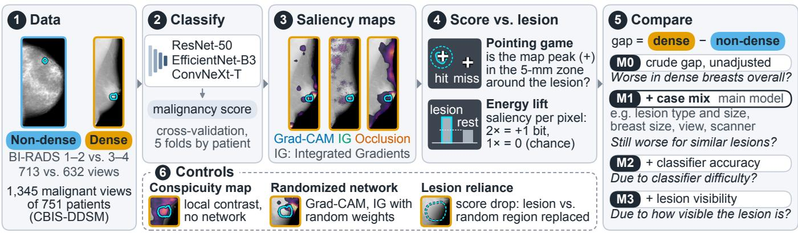
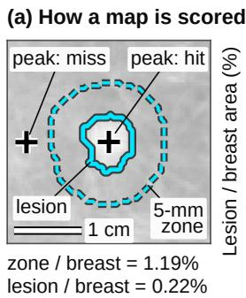
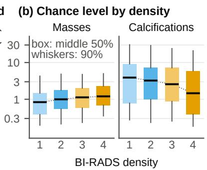
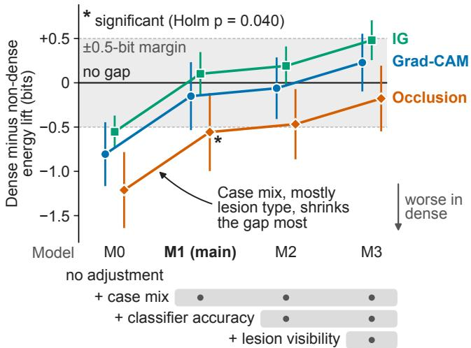
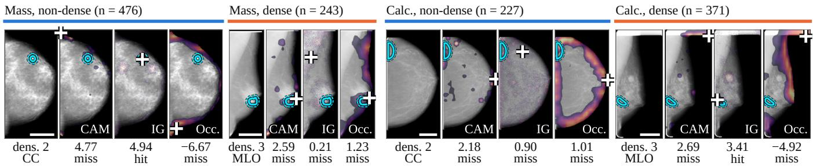

# DO SALIENCY MAPS FAIL DENSE BREASTS? A CHANCE-NORMALIZED,CONFOUNDER-AWARE AUDIT OF EXPLANATION FAIRNESS IN MAMMOGRAPHY

Ahmed Jaheen

New York University, New York, NY, USA

## ABSTRACT

Saliency maps, offered as evidence that mammography classifiers use the cancer, are untested in dense breasts, which can hide cancers. We tested whether they locate cancers worse there, and why. On 1,345 malignant CBIS-DDSM views, we scored three CNNs’ Grad-CAM, Integrated Gradients and occlusion maps by whether their peak hits the lesion and a chance-normalized lesion-to-background saliency ratio (bits; +1 doubles it). Unadjusted gaps were large: Grad-CAM peaks hit 44% of dense vs. 58% of non-dense lesions. Case mix, chiefly more calcifications in dense breasts, explained about half or more of each gap. Occlusion kept a significant average of −0.56- bit gap. Controls also implicate the classifiers: unadjusted gaps exceeded an image-only conspicuity map’s, and models relied less on dense-breast lesions. We recommend reporting density gaps before and after case-mix adjustment, per classifier, with conspicuity and lesion-reliance controls.

Index Terms— Explainable AI, fairness, mammography, breast density, saliency evaluation

## 1. INTRODUCTION

A saliency map is a heat map of the image regions that most influenced a classifier’s output. Such maps are routinely shown with mammography classifiers: a map that lights up the lesion is read as evidence that the malignancy score rests on the cancer [1]. Breast density, the share of fibroglandular tissue, is graded in four BI-RADS (Breast Imaging Reporting and Data System) categories, from 1 (almost entirely fatty) to 4 (extremely dense). Dense tissue looks white on a mammogram, as many lesions do, and can hide them (masking) [2]. Deep models detect and classify lesions less reliably in dense breasts [3, 4]. Unlike demographic attributes, density changes the image itself. If saliency maps also degrade with density, the patients whose images are hardest to read would receive the least reliable visual evidence.

Studies of saliency maps in mammography compare them with lesion annotations only in aggregate or per finding type [5, 6]. Per tuz et al. [5] called for analyses by density, and a 2026 systematic review [1] found none. Group gaps in explanation quality occur in tabular and text data [7,8] and can stem from the data rather than from the saliency method [9]. In medical imaging, saliency maps have been compared between demographic groups [10, 11], but without lesion-level ground truth, so a difference between maps cannot be read as a difference in quality. Subgroup audits in mammography that adjust for case differences cover classifier performance only [4].

Two common localization scores are the pointing game (does the map’s peak fall on the lesion?) and the share of saliency inside the lesion mask, the radiologist’s outline of the lesion. A fair comparison across density must handle two problems. First, each score has a chance level, the value that a map with no information reaches, which depends on lesion area and location [12]. A map of typical lesion locations can outscore trained classifiers [13], and small lesions are harder to localize [14]. Second, dense and non-dense breasts hold different cases. Among malignant CBIS-DDSM [15] views, dense breasts are smaller (median 159 vs. 198 cm2). Their lesions are more often calcifications (58.7% vs. 31.8%), clusters of tiny calcium specks, and less often masses, which are solid lumps. Such differences in case mix, the kinds of lesions and images in each group, are confounders: they differ between the groups and also affect the score.

We test whether saliency maps are fair across density: whether, for comparable lesions, they locate the cancer equally well, beyond chance, in dense (BI-RADS 3 or 4) and non-dense (1 or 2) breasts. Localization alone is a weak proxy for explanation quality [16], since a map can mark the lesion while the classifier relies elsewhere. We therefore also test whether the maps are faithful (mark the pixels the classifier uses) and whether the classifier relies on the lesion. Fig. 1 outlines the study. Our contributions are:

• To our knowledge, the first audit of post-hoc saliency maps of mammography classifiers against per-lesion masks across breast density, for Grad-CAM, Integrated Gradients (IG) and occlusion. Maps are scored against chance [12, 17] with the pointing game and the energy lift, a lesion-to-background saliency ratio in bits. We add a faithfulness test (ROAD [18]) and a lesion-reliance test.

• Large crude gaps for every method (Grad-CAM: 14 fewer lesion hits per 100 cancers). Case mix, chiefly lesion type, explains most of the Grad-CAM and IG energy-lift gaps and about half of occlusion’s. Occlusion keeps a significant gap in our primary test, concentrated in one architecture; with method-specific case-mix adjustment (exploratory), no gap is significant.

• An audit recipe: crude and adjusted gaps with three controls. The crude gaps exceed a model-free conspicuity map’s, vanish with randomized network weights (Grad-CAM; IG on ResNet-50) and come with lower lesion reliance, so they partly reflect what the classifiers use.

## 2. METHODS

## 2.1. Data and classifiers

CBIS-DDSM [15, 19] provides 3,568 radiologist-outlined lesions on 3,103 digitized film images of 1,566 patients. A view is one breast imaged from above (craniocaudal, CC) or from the side (mediolateral oblique, MLO); merging 71 duplicates leaves 3,032 views. A view is malignant if any of its lesions is; its lesion mask M combines its malignant outlines. The primary set P holds the 1,345 malignant views with known density (751 patients). Density was graded with the BI-RADS lexicon that preceded the 5th edition; categories 1 and 2 are non-dense (713 views), 3 and 4 dense (632). The breast mask B is the largest region above 2% of the intensity range, joined with M.

Three convolutional neural networks (CNNs), ResNet-50 [20],

  
Fig. 1. Study overview. Cyan: lesion (solid) and 5-mm zone (dashed). Images: the two mass views of Fig. 4, selected by its rule; steps 3 and 6 show the dense view (orange frame), with network maps from ResNet-50. M0 to M3 add factors one at a time and re-estimate the gap (Fig. 3).

  
Fig. 2. (a) One view (mass, density 2) with two illustrative map peaks. Zone/breast is the pointing-game chance level $\pi _ { \mathrm { P G } } ;$ lesion/breast is the energy-lift chance level π. (b) π by BI-RADS density. Calcification outlines enclose the whole cluster, so their π is larger. π varies more within groups than between densities, so each view is scored against its own chance level.

EfficientNet-B3 [21] and ConvNeXt-T [22], start from ImageNet weights. Each outputs a malignancy logit z, the score before the sigmoid. Every view holds a lesion that a radiologist found, so the task is to tell malignant from benign lesions. It is not screening: cancers fully hidden by dense tissue are absent. Patient-grouped 5-fold cross-validation gives 15 classifiers (one per architecture and fold), so each view is classified and explained by a classifier that never saw its patient. Training used AdamW with early stopping on the area under the receiver operating characteristic curve (AUC) of a validation split inside the training folds; settings were tuned on one fold. A temperature T, which calibrates the scores, and a decision threshold t are fitted on the validation logits.

## 2.2. Saliency maps and how we score them

Each map explains the logit z. Grad-CAM [23] weights the last con volutional feature maps by their gradients, giving a coarse map with cells of about 6 mm. Integrated Gradients (IG) [24] sums gradients along a straight path from a black image to the view, with 64 to 512 steps, aiming for attributions that add up to the change in z within 5% (completeness). Occlusion [25] records how much z drops when a 12.5-mm window, moved in 6-mm steps, is blurred. Only the positive part $S \geq 0$ of each map is scored, inside B.

The pointing game [26] asks whether the peak of the map, after 1-mm smoothing, lies within 5 mm of the lesion, inside the zone $D _ { 5 }$ (Fig. 2a). If so, the map scores a hit. A peak at a random breast pixel hits with probability $\bar { \pi _ { \mathrm { P G } } } = | D _ { 5 } | / | B |$ , the chance level. The energy lift $\lambda _ { E }$ asks how much more saliency per pixel the lesion gets than the rest of the breast. Let $\begin{array} { r } { E _ { \mathrm { i n } } = \sum _ { M } \dot { S } / \sum _ { B } } \end{array}$ S be the lesion’s share of the saliency and $\pi = | M | / | B |$ its share of the breast area, which is what a uniform map would give (Fig. 2b). Then

$$
\lambda _ { E } = \log _ { 2 } \frac { E _ { \mathrm { i n } } ^ { \prime } / | M | } { ( 1 - E _ { \mathrm { i n } } ^ { \prime } ) / | B \setminus M | } , \qquad E _ { \mathrm { i n } } ^ { \prime } = \frac { E _ { \mathrm { i n } } + \alpha \pi } { 1 + \alpha } .\tag{1}
$$

Mixing in 1% of a uniform map $( \alpha = 0 . 0 1 )$ keeps $\lambda _ { E }$ finite when the lesion gets no saliency; it then sits at its floor, about −6.7 bit. A uniform map scores $\lambda _ { E } = 0$ at any lesion size; λE is therefore chance-normalized [12, 17]. Each bit is a factor of two: at 1 bit the lesion gets twice the background saliency per pixel, and a gap of −0.5 bit means a 29% lower lesion-to-background ratio. The ceiling of $\lambda _ { E }$ still rises as lesions shrink, so M1 to M3 adjust for lesion area.

## 2.3. Comparing dense and non-dense breasts

A gap is the dense-group value minus the non-dense value; a negative gap means worse maps in dense breasts. The crude gap is the plain difference of the group means (views averaged over architectures). It describes the maps that dense-breast patients receive. Its 95% confidence interval (CI) comes from 2,000 bootstrap resamples of patients.

To separate density from case mix, we regress each score on density and other factors with generalized estimating equations (GEE) [27], a regression that gives valid CIs when several views come from one patient. One regression, with exchangeable correlation and bias-reduced standard errors [28], covers all architectures and methods, with one intercept per classifier and method. Its density coefficient θ is the adjusted gap, an association and not a causal effect. Each factor’s coefficient (slope) is shared across methods, so all three get the same case-mix adjustment and their gaps are directly comparable; method-specific slopes are a sensitivity analysis. Four nested models add factors, and each answers one question (Fig. 3):

• M0 has density only: how much worse are maps in dense breasts?

• M1 adds case mix: log lesion and breast area, lesion type (mass or calcification), view, multiple lesions, an ill-defined margin, and an acquisition proxy (image stored left-right flipped, a marker of scanner or site). Among comparable lesions, does density still matter? M1 is the main model.

• M2 adds classifier accuracy on the view: whether the classifier was correct and how confident it was (calibrated margin $| z - t | / T )$ Is the gap explained by how hard the view was for the classifier?

• M3 adds lesion visibility: the radiologist’s subtlety rating and how much the lesion stands out in the image (the DoG map’s $\lambda _ { E } .$ Sec. 2.4). Is the gap explained by how visible the lesion is?

Masking makes lesions harder to see and to classify, so the M2 and M3 factors may lie on the path from density to the map. Their gaps describe what remains once these factors are held equal. Masking also affects which lesions are detected, so lesion type, margin, lesion area and multiple lesions may follow from density too, whereas acquisition, view and breast area precede it. M1 may therefore remove part of a real density effect, and an exploratory confounder-only model keeps only these three. For the pointing game, a logistic GEE gives the adjusted gap in hits per 100 cancers (percentage points, pp) by g-computation [29], which compares predicted hit rates with all views set to dense and then to non-dense. We also refit M1 within masses and within calcifications (28 mixed views excluded).

The primary test is each method’s M1 λ gap, Holm-corrected over the three methods [30]. Holm’s method raises p-values so that the chance of any false positive stays at most 5%. A second Holm family of 25 tests covers the pointing-game and faithfulness (SRG) gaps, the density × type interaction and the chance-level and control contrasts. A non-significant gap is not proof of no gap, so two onesided tests (TOST) [31] check equivalence: an M1 gap is equivalent to zero if its 90% CI lies within ±0.5 bit (a 1.41-fold ratio) for $\lambda _ { E } ,$ or ±10 pp for the pointing game. Analyses added after the main analysis are marked exploratory. All results use one training seed, plus two more seeds for Grad-CAM.

## 2.4. Controls: image, classifier or saliency method?

The difference-of-Gaussians (DoG) conspicuity map, max(0, I ∗ $g _ { 1 } - I * g _ { 8 } )$ , subtracts the image I blurred at 8 mm from I blurred at 1 mm. It marks small spots that stand out from their surroundings and uses no classifier, so a method’s gap larger than the DoG gap is not explained by the image alone. Randomized networks, with every learned weight replaced by a random one [32], test whether a gap needs learned weights (Grad-CAM, all classifiers; IG, ResNet-50).

Faithfulness asks whether a map marks the pixels the classifier uses. ROAD (RemOve And Debias) [18] replaces 1% to 20% of the breast pixels with values interpolated from neighbours, most- or leastsalient pixels first (the median lesion covers 1.3%). The symmetric relevance gain (SRG) [33] is how much more the calibrated score $z / T$ drops when the most-salient pixels are removed first than when the least-salient are, averaged over five removal fractions. A faithful map has SRG above 0; an uninformative one, 0. Lesion-specific reliance (LSR) asks whether the classifier uses the lesion. It is the drop in $z / T$ when $D _ { 5 }$ is filled in from the surrounding tissue, minus the mean drop for up to five same-shaped regions elsewhere in $B .$ LSR above 0 means the classifier relies on the lesion more than on random tissue.

## 3. RESULTS

All CIs are 95% and uncorrected; Holm p-values are corrected. On all 3,032 views, held-out AUC averaged 0.79 and was lower in dense breasts for every architecture (0.755 vs. 0.820). TOST could not place this gap of −0.065 (−0.098 to −0.032) within ±0.05.

  
Fig. 3. Energy-lift gap in each model; the rows under the axis show the factors each model adds. Bars: 95% CIs; case-mix slopes shared across methods. With method-specific slopes (exploratory), no M1 gap is significant. Grey band: ±0.5-bit equivalence margin, tested at M1 with 90% CIs. M0 is the crude gap as the regression estimates it, so it differs slightly from Table 1.

## 3.1. Crude gaps

Before adjustment, both scores were worse in dense breasts for every method (Table 1). Grad-CAM peaks hit 44% of dense-breast lesions and 58% of non-dense ones, 14.1 fewer hits per 100 cancers. Chance does not explain this: a peak placed at random would hit slightly more often in dense breasts (+1.2 pp, −0.2 to 2.5). Grad-CAM’s crude λE gap of −0.86 bit means a 45% lower lesion-to-background ratio.

## 3.2. Case mix and adjusted gaps

Adding case mix (M0 to M1, Fig. 3) removed 81% of the Grad-CAM $\lambda _ { E } { \mathrm { ~ g a p } } .$ , all of IG’s (118%, leaving a slightly positive gap) and about half of occlusion’s (54%). On the pointing game it removed about half (45% to 64%). Lesion type carried 88% of the $\lambda _ { E }$ change (68% to 114%; exploratory): calcifications, more common in dense breasts, scored 1.81 bit lower than masses (Fig. 4). The exploratory confounder-only model left Grad-CAM −0.51 bit (−0.90 to −0.12), 63% of its M0 gap (−0.81 bit). Adding classifier accuracy (M2) explained little: each λE gap moved up by about 0.1 bit. Adding lesion visibility (M3) explained most of the rest, moving the gaps to −0.18 bit for occlusion and above 0 for the others.

Table 1. Density gaps, dense minus non-dense [95% CI]; below 0: worse in dense breasts. Crude: group-mean difference. Adjusted: M1 with shared case-mix slopes. LSR: lesion-specific reliance (1,276 views with a comparison region); adjusted LSR exploratory.
<table><tr><td>Crude gap</td><td>Adjusted gap (M1)</td></tr><tr><td>Energy lift λE (bit)</td><td>-0.15 [-0.53, 0.23]</td></tr><tr><td>Grad-CAM -0.86 [-1.23, -0.51] IG -0.62 [−0.80, −0.45]</td><td>+0.10[-0.14, 0.35]</td></tr><tr><td>Occlusion -1.27 [-1.72, -0.84] Pointing game (hits per 100 cancers)</td><td>-0.56[-1.00, -0.12]</td></tr><tr><td>Grad-CAM</td><td></td></tr><tr><td>-14.1 [-19.3, -9.2] IG -10.4 [-14.9, -5.9]</td><td>-7.6[−12.4, -2.0] -3.7 [-8.5, 1.3]</td></tr></table>

  
Fig. 4. Rule-selected examples. For each density and lesion-type group (n views; Calc.: calcification): the view whose ResNet-50 Grad-CAM λ is closest to the group median, with its positive Grad-CAM (CAM), IG and occlusion (Occ.) maps, cropped to the breast. Cyan: lesion (solid) and 5-mm zone (dashed); +: map peak. Below each map: λE (bits; floor about −6.7) and hit or miss. Bar: 5 cm.

In the primary test, occlusion kept a significant M1 gap of −0.56 bit (Holm $p = 0 . 0 4 0 )$ , a 32% lower lesion-to-background ratio. The Grad-CAM and IG gaps were small (−0.15 and +0.10 bit; Holm p = 0.83 each); their 90% CIs lay inside ±0.5 bit, so TOST rated both equivalent to zero on λE in this model, and IG also on the pointing game. A specification test of whether the case-mix slopes differ between methods favoured method-specific slopes $( \chi _ { 1 6 } ^ { 2 } = 2 0 1 )$ With these slopes (exploratory), the three gaps were small and did not differ between methods $( p = 0 . 8 9 )$ . They were −0.17 bit for Grad-CAM (−0.57 to 0.23), −0.19 for IG (−0.39 to 0.02) and −0.24 for occlusion (−0.71 to 0.23). None was significant (Holm p 0.63, 0.22 and 0.63).

Occlusion’s M1 gap was concentrated in EfficientNet: −1.19 bit, against −0.07 for ResNet-50 and −0.52 for ConvNeXt. Without EfficientNet it was −0.27 bit (−0.72 to 0.17; exploratory). Efficient-Net’s occlusion maps put no positive saliency on the lesion (λ at its floor) 17.3 pp more often in dense views (11.4 to 23.4). With two more training seeds (Grad-CAM; exploratory), the M1 gaps varied as much between seeds as between architectures (standard deviation 0.19 bit each), and EfficientNet’s was negative in every seed (−0.25 to −0.41 bit).

After adjustment, Grad-CAM peaks missed 7.6 more densebreast lesions per 100 cancers and occlusion peaks 6.8 more (Table 1). Their CIs exclude 0, but their Holm p-values (second family) are 0.33 and 0.61. The remaining gaps lay in masses: there, occlusion’s M1 λE gap was −0.72 bit (−1.37 to −0.07), and Grad-CAM peaks missed 12.0 more lesions per 100 (3.0 to 19.3; exploratory). No CI within calcifications excluded 0 (density × type interaction for hits, Holm $p = 0 . 0 5 3 )$ .

## 3.3. Controls

The DoG map scored 0.44 bit lower in dense breasts, so lesions there stand out less. Every method’s crude λE gap was larger than the DoG gap, by 0.42 (Grad-CAM), 0.18 (IG) and 0.83 bit (occlusion). All three CIs excluded 0; after Holm correction in the second family, p was 0.33, 0.67 and 0.0125. Randomized-network maps showed no density gap; the trained gaps were larger by 0.84 bit for Grad-CAM and 0.67 bit for IG on ResNet-50 (both Holm $p = 0 . 0 1 2 5 )$ . Classifiers relied less on dense-breast lesions (lower LSR) before and after adjustment (Table 1; adjusted gap exploratory). SRG was above 0 in 94% to 99% of views. Crude SRG gaps were negative for Grad-CAM (−0.20) and occlusion (−0.24), but no adjusted SRG gap was Holm-significant $( p \ge 0 . 3 3 )$

## 4. DISCUSSION AND CONCLUSION

In our data, dense-breast patients received worse maps, in large part because their cancers were more often calcifications, which scored lower than masses. Lesion type may be a confounder or, through masking and detection, a step on the path from density to the map. If it is a confounder, the M1 gap is the fair comparison; if it lies on that path, the confounder-only gap is.

Limitations. We used a single digitized-film dataset with readerassigned density; label noise likely biases θ toward 0, and replication on digital mammograms is future work.

In conclusion, (i) the crude gaps were large for every method. (ii) Accounting for case mix, chiefly lesion type, removed about half or more of each gap; occlusion’s primary-test gap was concentrated in one architecture, and with method-specific slopes (exploratory) all three adjusted λE gaps were about −0.2 bit, none significant. (iii) The controls point partly to the classifiers: the crude gaps exceeded the conspicuity map’s, needed trained weights (Grad-CAM; IG on ResNet-50) and came with lower lesion reliance. Audits should report crude, confounder-only and adjusted gaps per classifier, with conspicuity, randomized-network and lesion-reliance controls.

## 5. COMPLIANCE WITH ETHICAL STANDARDS

This research study was conducted retrospectively using de-identified human subject data made available in open access by The Cancer Imaging Archive (CBIS-DDSM collection [15, 19], CC BY 3.0). Ethical approval was not required as confirmed by the license attached with the open access data.

## 6. ACKNOWLEDGMENTS

The authors declare no conflicts of interest; no funding was received. Claude was used to help in re-writing the draft. The authors verified all content and take full responsibility for it.

## 7. REFERENCES

[1] Filippo Pesapane et al., “Explainable artificial intelligence in mammography: A systematic review of methods, evaluation

practices, and clinical readiness,” Diagnostics, vol. 16, no. 9, pp. 1412, 2026.

[2] Norman F. Boyd et al., “Mammographic density and the risk and detection of breast cancer,” N. Engl. J. Med., vol. 356, no. 3, pp. 227–236, 2007.

[3] Lidia Garrucho et al., “High-resolution synthesis of high density breast mammograms: Application to improved fairness in deep learning based mass detection,” Front. Oncol., vol. 12, pp. 1044496, 2023.

[4] MinJae Woo et al., “Subgroup evaluation to understand performance gaps in deep learning-based classification of regions of interest on mammography,” PLOS Digit. Health, vol. 4, no. 4, pp. e0000811, 2025.

[5] Said Pertuz et al., “Saliency of breast lesions in breast cancer detection using artificial intelligence,” Sci. Rep., vol. 13, pp. 20545, 2023.

[6] Esma Cerekci et al., “Quantitative evaluation of saliencybased explainable artificial intelligence (XAI) methods in deep learning-based mammogram analysis,” Eur. J. Radiol., vol. 173, pp. 111356, 2024.

[7] Aparna Balagopalan et al., “The road to explainability is paved with bias: Measuring the fairness of explanations,” in Proc. ACM FAccT, 2022, pp. 1194–1206.

[8] Jessica Dai et al., “Fairness via explanation quality: Evaluating disparities in the quality of post hoc explanations,” in Proc. AAAI/ACM AIES, 2022, pp. 203–214.

[9] Vishwali Mhasawade et al., “Understanding disparities in post hoc machine learning explanation,” in Proc. ACM FAccT, 2024, pp. 2374–2388.

[10] Emma A. M. Stanley et al., “Fairness-related performance and explainability effects in deep learning models for brain image analysis,” J. Med. Imaging, vol. 9, no. 6, pp. 061102, 2022.

[11] Matteo Haupt, Elena Jolkver, and Anne Schwerk, “Explainable AI for chest radiographs: Sex-stratified fairness auditing in CNN-based pneumonia detection,” Sci. Rep., vol. 16, pp. 22709, 2026.

[12] Nishanth Arun et al., “Assessing the trustworthiness of saliency maps for localizing abnormalities in medical imaging,” Radiol. Artif. Intell., vol. 3, no. 6, pp. e200267, 2021.

[13] Ashajyothi Bathineni et al., “The metric, not the model: Anatomy confounds attention faithfulness in coronary calcium,” in Proc. MICCAI Workshops (MI4MedFM), 2026.

[14] Adriel Saporta et al., “Benchmarking saliency methods for chest X-ray interpretation,” Nat. Mach. Intell., vol. 4, no. 10, pp. 867–878, 2022.

[15] Rebecca Sawyer Lee et al., “A curated mammography data set for use in computer-aided detection and diagnosis research,” Sci. Data, vol. 4, pp. 170177, 2017.

[16] Andrea Ciardiello et al., “Beyond the black box: Lessons in explainability from AI in mammography,” Artif. Intell. Rev., vol. 59, pp. 130, 2026.

[17] Maximilian Kohlbrenner et al., “Towards best practice in explaining neural network decisions with LRP,” in Proc. IJCNN, 2020, pp. 1–7.

[18] Yao Rong et al., “A consistent and efficient evaluation strategy for attribution methods,” in Proc. ICML, 2022, pp. 18770– 18795.

[19] Rebecca Sawyer-Lee, Francisco Gimenez, Assaf Hoogi, and Daniel Rubin, “Curated Breast Imaging Subset

of Digital Database for Screening Mammography (CBIS-DDSM),” The Cancer Imaging Archive [Data set], 2016, doi:10.7937/K9/TCIA.2016.7O02S9CY.

[20] Kaiming He et al., “Deep residual learning for image recognition,” in Proc. CVPR, 2016, pp. 770–778.

[21] Mingxing Tan and Quoc V. Le, “EfficientNet: Rethinking model scaling for convolutional neural networks,” in Proc. ICML, 2019, pp. 6105–6114.

[22] Zhuang Liu et al., “A ConvNet for the 2020s,” in Proc. CVPR, 2022, pp. 11966–11976.

[23] Ramprasaath R. Selvaraju et al., “Grad-CAM: Visual explanations from deep networks via gradient-based localization,” in Proc. ICCV, 2017, pp. 618–626.

[24] Mukund Sundararajan, Ankur Taly, and Qiqi Yan, “Axiomatic attribution for deep networks,” in Proc. ICML, 2017, pp. 3319– 3328.

[25] Matthew D. Zeiler and Rob Fergus, “Visualizing and understanding convolutional networks,” in Proc. ECCV, 2014, pp. 818–833.

[26] Jianming Zhang et al., “Top-down neural attention by excitation backprop,” Int. J. Comput. Vis., vol. 126, no. 10, pp. 1084–1102, 2018.

[27] Kung-Yee Liang and Scott L. Zeger, “Longitudinal data analysis using generalized linear models,” Biometrika, vol. 73, no. 1, pp. 13–22, 1986.

[28] Lloyd A. Mancl and Timothy A. DeRouen, “A covariance estimator for GEE with improved small-sample properties,” Biometrics, vol. 57, no. 1, pp. 126–134, 2001.

[29] James Robins, “A new approach to causal inference in mortality studies with a sustained exposure period—application to control of the healthy worker survivor effect,” Math. Model., vol. 7, no. 9–12, pp. 1393–1512, 1986.

[30] Sture Holm, “A simple sequentially rejective multiple test procedure,” Scand. J. Stat., vol. 6, no. 2, pp. 65–70, 1979.

[31] Donald J. Schuirmann, “A comparison of the two one-sided tests procedure and the power approach for assessing the equivalence of average bioavailability,” J. Pharmacokinet. Biopharm., vol. 15, no. 6, pp. 657–680, 1987.

[32] Julius Adebayo et al., “Sanity checks for saliency maps,” in Proc. NeurIPS, 2018, pp. 9505–9515.

[33] Stefan Blucher, Johanna Vielhaben, and Nils Strodthoff, “De-¨ coupling pixel flipping and occlusion strategy for consistent XAI benchmarks,” Trans. Mach. Learn. Res., 2024.