# DSRS: Teaching MLLMs to Perceive, Reason, and Segment in Complex Driving Scenes

Sicen Guo , Zhengfei Song , Kuanhsun Chen , Xu Huang ,

Ping Zhong , Wei Ye , Shaoyi Du , Rui Fan , Senior Member, IEEE

Abstract—Existing reasoning segmentation frameworks typically employ multimodal large language models (MLLMs) with broad world knowledge to extract semantics in a humanlike manner and generate corresponding segmentation masks. Nevertheless, these frameworks lack the necessary scene-specific awareness. This paper introduces driving scene reasoning segmentation (DSRS), a scene-specific task that requires models to interpret implicit instructions, infer spatial relations, detect potential risks, handle challenging conditions, and comprehend underlying traffic rules, ultimately generating accurate segmentation masks. Meanwhile, we establish a benchmark dataset to facilitate future research on the DSRS task. To pioneer this task, we propose DSRS-Net, a novel architecture with advanced reasoning segmentation capability for automated driving. Specifically, DSRS-Net seamlessly infuses geometric features for deeper reasoning segmentation, without compromising the original multimodal fusion mechanism. This strategy effectively mitigates the modality representation mismatch in MLLMs caused by RGBonly pretraining, while enhancing the integration of geometric, contextual, and linguistic features. Extensive experiments demonstrate the superior performance of DSRS-Net in both

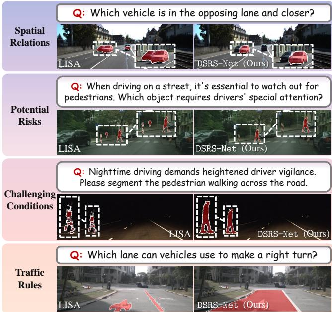  
Fig. 1. Comparison of the segmentation masks by LISA [1] and our Text Query RGB Image Segmentation ResultDSRS-Net, facing the challenges in the driving scene reasoning segmentation (a)task.

driving scene reasoning segmentation and other language-driven segmentation tasks across various public datasets. The source Q: Could you please code and dataset will be released upon publication.

Index Terms—Multimodal large language models, reasoning segmentation, data-fusion.

## I. INTRODUCTION

seen walking across?The ultimate ambition of automated driving is to develop Q: What object on (d) vehicles whose scene-specific awareness and decision-making capabilities rival and ultimately surpass those of human drivers [2], enabling safe and efficient interaction with vehicles of (e)varying automation levels and other road users in mixed traffic environments. Such coexistence poses profound challenges in terms of safety, efficiency, and interaction dynamics. Although current advances have made remarkable strides in fundamental perception tasks such as semantic segmentation, their scene understanding of complex mixed traffic remains superficial, lacking deeper contextual reasoning. Today’s vehicles can recognize basic elements, but they often struggle to reason about real-world mixed traffic scenarios involving shared road usage, implicit intentions, and interactive behaviors [3], [4]. This

This research was supported by the National Natural Science Foundation of China under Grant 62473288, the National Key Laboratory of Human-Machine Hybrid Augmented Intelligence, Xi’an Jiaotong University (No. HMHAI-202406), the Fundamental Research Funds for the Central Universities, NIO University Programme (NIO UP), and the Xiaomi Young Talents Program. The research leading to these results has also received partial funding from the European Commission - European Union (under HORIZON EUROPE (HORIZON Research and Innovation Actions) under grant agreement 101093003 (TEMA) HORIZON-CL4-2022-DATA-01-01). Views and opinions expressed are, however, those of the authors only and do not necessarily reflect those of the European Union - European Commission. Neither the European Commission nor the European Union can be held responsible for them. (Corresponding author: Rui Fan)

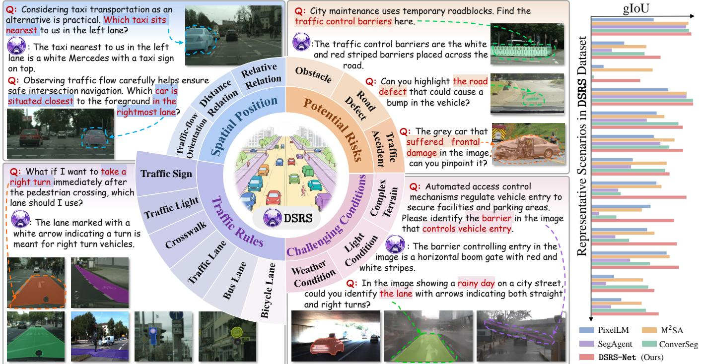  
Fig. 2. Overview of the proposed DSRS benchmark and DSRS-Net. The left part illustrates representative driving-scene reasoning segmentation scenarios. The right part reports quantitative comparisons on the DSRS dataset.

underscores a fundamental gap between low-level perceptual recognition and the high-level scene reasoning required for automated vehicles [5].

To bridge this gap, we advocate for a paradigm shift away from conventional, purely perception tasks. Instead of merely supervising models to recognize what they see, we should empower them to reason in a human-like, instruction-driven manner [1]. The development of multimodal large language models (MLLMs) offers a compelling glimpse into this future, which reframes visual understanding as an interactive, language-driven process [6]. Nevertheless, despite the remarkable progress of these MLLMs [7] in general vision-language benchmarks, the field of reasoning segmentation in complex mixed traffic scenes remains largely underexplored. Traditional reasoning segmentation tasks have largely focused on broad representations of world knowledge and exhibit limited scenespecific awareness in driving scenes [8]. As illustrated in Fig. 1, LISA [1] lacks the capacity for driving scene reasoning and thus cannot generate correct segmentation outputs.

As illustrated in Fig. 2, this limitation motivates us to introduce a scene-specific, multimodal perception task for automated vehicle systems: Driving Scene Reasoning Segmentation (DSRS). Since automated vehicles operate in mixed traffic environments involving dynamic interactions with multiple road users, the DSRS task integrates six core capabilities: (1) interpreting abstract, often implicit, human instructions, (2) comprehending traffic rules, e.g., functions of different lanes, traffic lights, and traffic signs, (3) inferring spatial relations, (4) detecting potential risks in complex driving scenes, including traffic accidents and both positive and negative obstacles, (5) handling challenging conditions, e.g., complex terrain, extreme light and weather conditions, and (6) generating the corresponding segmentation masks.

Endowing neural networks with scene-specific reasoning capabilities requires unleashing the power of MLLMs [9]. A commonly adopted architecture [10] maps RGB images and text instructions into a shared linguistic-contextual space [9], followed by a segmentation head [11] to generate pixel-level predictions. However, this coarse-grained strategy of simply connecting modules often proves insufficient for the finegrained reasoning required in complex mixed traffic scenes [12]. Accurately inferring spatial relations, such as occlusion, direction, and distance, cannot rely solely on RGB images [13]. Incorporating geometric clues, such as relative depth maps, offers a more reliable option. Moreover, in low-visibility or texture-less environments, and when object-level properties such as size and shape information are required, the incorporation of geometric clues can substantially enhance the model’s reasoning capabilities [14].

While integrating geometric clues is a logical next step, existing approaches are superficial and predominantly limited to text generation tasks [13], [15]–[17]. These approaches often simply concatenate depth maps and RGB images as inputs to MLLMs for superficial geometric understanding. However, their neglect of the inherent modality gap that large language models (LLMs) are typically pretrained with RGB visual inputs, prevents them from effectively utilizing such geometric features [18], [19]. Moreover, the mismatch between geometric and contextual representations may introduce noise into the original alignment between visual and linguistic features in the MLLM, ultimately compromising the reasoning performance. This leads us to ask: can a model truly enhance its reasoning capabilities without explicitly aligning geometric features with contextual semantics?

To answer this question and pioneer the DSRS task, we propose the driving scene reasoning segmentation network (DSRS-Net), a novel framework that seamlessly infuses geometric features into MLLM for deeper scene-specific reasoning. Its core is our proposed depth-guided hierarchical feature interaction (DHFI) strategy. By projecting geometric priors into the hierarchical vision features, the DHFI strategy enforces a contextually aligned integration of appearance-based perception and geometric structure. For instance, DSRS-Net learns to continuously correlate the concept of $\mathrm { ~ \ r ~ { ~ a ~ } ~ } ^ { 6 6 } \mathrm { c a r } ^ { 5 }$ not merely through visual texture cues, but through its geometric structure and spatial positioning within the scene. This capability enables the model to holistically comprehend and infer scene semantics across color, texture, and geometric domains. In a nutshell, our contributions are threefold:

• We introduce the DSRS task, a scene-specific extension of reasoning segmentation that explicitly evaluates trafficrule understanding, spatial reasoning, hazard awareness, and perception under challenging driving conditions. To catalyze research in this direction, we release a benchmark dataset comprising over 1,500 image-instructionmask samples tailored for automated vehicles.

• We propose the DSRS-Net, which establishes a pioneering pathway for integrating geometric priors into an MLLM-based segmentation model.

• We propose the DHFI strategy, a specialized mechanism that effectively projects geometric priors into the hierarchical vision feature space.

## II. RELATED WORK

## A. Language-Driven Segmentation Tasks

Image segmentation has evolved from predefined pixel-wise prediction toward more intuitive and interactive paradigms [20]. Referring expression segmentation [21] enables object localization through natural language but largely depends on explicit visual attributes, limiting its ability to interpret implicit human intent in complex real-world scenarios [10]. Reasoning segmentation [1] addresses this limitation by requiring multi-step inference and external knowledge. Representative methods such as LISA [1] decode segmentation masks from MLLM-generated embeddings, while GSVA [6] further handles cases where the referred object is absent. Nevertheless, existing models [22]–[24] mainly rely on broad, general-purpose knowledge and remain limited in scenarios requiring finegrained, scene-specific understanding. Therefore, we introduce the scene-specific DSRS task and benchmark, which require models to interpret implicit instructions in complex driving scenes, supporting safer and more intelligent automated driving.

## B. MLLM-Based Models for Automated Driving

Integrating language prompts into driving tasks provides a promising avenue for improving reasoning and generalization in automated driving systems [25]. For instance, DiLU [26] learns from prior driving experiences, while DriveMLM [27] and LMDrive [28] integrate multimodal inputs, such as images and point clouds, to generate control signals from language instructions. However, these methods mainly address highlevel decisions and lack the pixel-level localization required for safety-critical perception. This gap is also evident in existing benchmarks. nuScenes [29] and BDD100K [30] benchmarks lack reasoning-oriented question–answer annotations, whereas DriveLM-Data [31] and Impromptu VLA [32] benchmark lack pixel-level labels for fine-grained scene understanding. To this end, we develop the DSRS benchmark.

## III. METHODOLOGY

## A. Overall Workflow

As illustrated in Fig. 3, in the CLIP-based vision encoder branch, the RGB image $\mathbf { x } _ { \mathrm { i m g } } \in \mathbb { R } ^ { H \times W \times 3 }$ is first divided into non-overlapping $1 4 \times 1 4$ patches. These patches are flattened and projected into D-dimensional tokens, which are then passed through the vision encoder $\mathcal { F } _ { \mathrm { V } }$ for further contextualized representation learning. Simultaneously, the correspond ing depth map $\mathbf { x } _ { \mathrm { g e o } } \in \mathbb { R } ^ { H \times W }$ passes through the GPE module $\mathcal { F } _ { \mathrm { G P E } }$ to generate the geometric prior $\bar { \pmb { F } } _ { 0 } ^ { S }$ for subsequent feature interactions. Specifically, we evenly split the CLIPbased vision encoder into four blocks. At the i-th stage, the geometric prior $\mathbf { \mathcal { F } } _ { i } ^ { S }$ interacts with the vision feature $\bar { \mathbf { \mathbf { F } } } _ { i } ^ { V }$ via the DHFI module, thereby improving the model’s overall comprehension and contextual reasoning ability. Subsequently, two separate projectors are employed to map the vision and geometric features into their corresponding visual tokens $\pmb { T } ^ { V }$ and $\pmb { T } ^ { S }$ . Then, the downstream LLM $\mathcal { F } _ { \mathrm { L L M } }$ processes the fused tokens and generates the textual response $\mathbf { Y } _ { \mathrm { t x t } }$ autoregressively. The generation of binary segmentation masks is indicated by the presence of designated <MASK> tokens within $\mathbf { Y } _ { \mathrm { t x t } }$ . The hidden representation associated with image tokens is extracted from the LLM output and yields the image embeddings $H _ { \mathrm { i m g } }$ . Finally, $H _ { \mathrm { i m g } }$ is fed to the segmentation head $\mathcal { F } _ { \mathrm { S } }$ to predict the ultimate binary segmentation mask.

## B. Multimodal Vision Encoder

1) CLIP-Based Vision Encoder: We leverage a CLIP-based vision encoder $\mathcal { F } _ { \mathrm { V } }$ to extract contextual visual features. Given an input RGB image $\mathbf { x } _ { \mathrm { i m g } } ,$ the encoder first extracts the hierarchical vision features $\mathbf { \bar { \mathbf { F } } } _ { i } ^ { V } \in \mathbb { R } ^ { \frac { H W } { 1 4 ^ { 2 } } \times D }$ . Subsequently, a projection layer maps the extracted features into the visual token $T ^ { V } \in \bar { \mathbb { R } } ^ { \frac { H W } { 1 4 ^ { 2 } } \times \bar { C } }$ , aligning them with the input embedding space of the LLM.

2) Geometric Prior Extractor: Recent studies have demonstrated that embedding convolutional mechanisms into Transformer-based architectures can significantly improve the model’s capacity for fine-grained scene inference and precise boundary modeling [34], [35]. Building on this idea, we propose the GPE module $\mathcal { F } _ { \mathrm { G P E } }$ , which utilizes ResNet blocks to extract structured geometric priors $\boldsymbol { F } _ { 0 } ^ { S } \in \mathbb { R } ^ { \frac { H W } { 1 4 ^ { 2 } } \times D }$ from the relative depth map $\mathbf { x } _ { \mathrm { g e o } }$

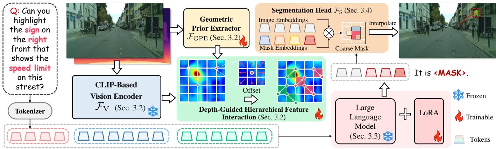  
Fig. 3. An illustration of our proposed DSRS-Net. Given the RGB image, depth map, and text query, DSRS-Net generates text output and segmentation masks. We use the lightweight LoRA strategy [33] for efficient fine-tuning.

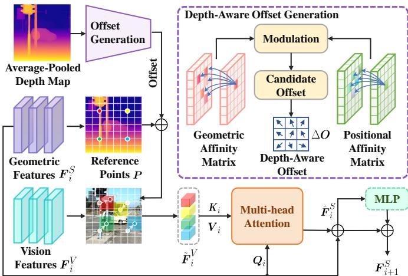  
Fig. 4. An illustration of our proposed depth-aware deformable attention module.

3) Depth-Guided Hierarchical Feature Interaction: Most existing MLLMs are pretrained predominantly on RGB images, restricting their capacity to comprehend unfamiliar geometric modalities such as depth maps [36], [37]. Consequently, the straightforward concatenation of depth and RGB images [13], [15] has shown limited effectiveness in enhancing reasoning capabilities, and may even disrupt the original visuallanguage alignment established within MLLMs. To address these limitations, we design the DHFI strategy to explicitly project geometric priors into the visual-semantic space, thereby enhancing reasoning capabilities in MLLMs. Such an integration allows the model to capitalize on geometric priors without learning unfamiliar input modalities from scratch, thus improving efficiency and generalization.

The DHFI strategy comprises four stacked depth-aware deformable attention $\mathrm { ( D A ^ { 2 } ) }$ blocks, which preserve the hierarchical structure of the vision pipeline and progressively align semantic and geometric representations. As illustrated in Fig. 4, in each $\mathrm { D A } ^ { \mathrm { \tilde { 2 } } }$ module, given the input geometric prior $\mathbf { \mathcal { F } } _ { i } ^ { S }$ , a uniform grid of reference points $\pmb { P } \in \mathbb { R } ^ { \frac { \ 7 H } { 1 4 } \times \frac { W } { 1 4 } \times 2 }$ is generated. These points are initialized as linearly 2D coordinates ranging from (0, 0) to $\begin{array} { r } { \left( \frac { H } { 1 4 } - 1 , \frac { W } { 1 4 } - 1 \right) } \end{array}$ , forming a regular grid of size ${ \frac { H } { 1 4 } } \times { \frac { W } { 1 4 } }$ . These coordinates are subsequently normalized to the range [0, 1] along both axes, where (0, 0) corresponds to the top-left corner and (1, 1) to the bottom-right corner of the grid. Existing deformable attention frameworks [38] often rely on a multi-layer perceptron (MLP) to learn sampling offsets from scratch. While MLPs are theoretically capable of modeling complex functions, their unconstrained learning schemes often demand large-scale training data to achieve reliable generalization. To this end, we decompose the offset generation process into a two-stage process:

In the first stage, the depth-aware offset generation module leverages the average-pooled depth map along with positional priors to produce a set of modulated geometric-aware offset candidates. Specifically, we first calculate the geometric affinity matrix $\pmb { { \cal D } } ^ { \ll } \in \mathbb { R } ^ { \frac { H W } { 1 4 ^ { 2 } } \times \frac { H W } { 1 4 ^ { 2 } } }$ by calculating pairwise relative depth differences between each depth patch, expressed as follows:

$$
D _ { i j , i ^ { \prime } j ^ { \prime } } = d _ { i j } - d _ { i ^ { \prime } j ^ { \prime } } ,\tag{1}
$$

where each element $D _ { i j , i ^ { \prime } j ^ { \prime } }$ represents the depth distance between the patches at locations $( i , j )$ and $( i ^ { \prime } , j ^ { \prime } )$ . Since the offsets depend on both geometric structure and positional layout, we further compute a positional affinity matrix $\textbf { \em L } \in$ $\mathbb { R } ^ { \frac { H W } { 1 4 ^ { 2 } } \times \frac { H W } { 1 4 ^ { 2 } } \times 2 }$ among patch-wise 2D coordinates to enhance location-sensitive sampling, expressed as follows:

$$
\begin{array} { r } { l _ { i j , i ^ { \prime } j ^ { \prime } } = p _ { i j } - p _ { i ^ { \prime } j ^ { \prime } } , } \end{array}\tag{2}
$$

where $\begin{array} { l l l } { { \displaystyle l _ { i j , i ^ { \prime } j ^ { \prime } } } } & { { \in } } & { { \mathbb { R } ^ { 2 } } } \end{array}$ represents the relative 2D positional distance vector in L and $\pmb { p } _ { i j }$ represents absolute 2D position at locations $( i , j )$ . Accordingly, the modulated candidate offsets are generated by applying an MLP to the channelwise concatenation of the affinity matrices D and L. Such an explicitly encoding geometric relations process can capture explicit object-level dependencies, facilitating more transparent decision-making over purely data-driven offset prediction.

In the second stage, the $\mathrm { D A } ^ { \dot { 2 } }$ employs an MLP to select a subset of candidate offsets $\Delta O$ . This selection strategy filters out unstable offset candidates, reducing noise sensitivity and stabilizing downstream attention computation.

Subsequently, the vision features $\mathbf { \bar { \mathbf { F } } } _ { i } ^ { V }$ are sampled at the locations of the deformed points $P + \Delta O$ , generating the deformed vision features $\tilde { \mathbf { \boldsymbol { F } } } _ { i }$ . To realize cross-modal alignment, $\mathrm { D A } ^ { 2 }$ employs a multi-head cross-attention mechanism [39] conditioned on learned offsets, followed by an MLP for nonlinear feature integration. This process can be formulated as follows:

(b) Instruction Length (c) Word Distribution  
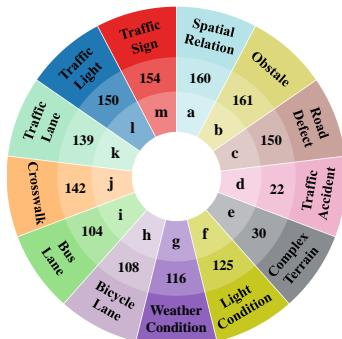  
(a) Category Composition

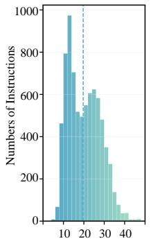

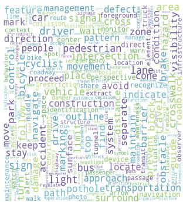

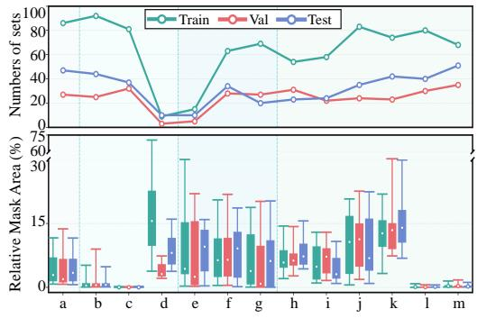  
(d) Category Statistics

Fig. 5. A comprehensive analysis of our proposed DSRS dataset: (a) category composition; (b) distribution of instruction lengths, with the dashed line indicating the mean length; (c) frequency-weighted word cloud; and (d) category-wise sample counts (top) and relative mask-scale distributions, with category indices corresponding to those in (a).
<table><tr><td rowspan="3">Method</td><td rowspan="3">MLLM</td><td colspan="4">Zero-shot (zs)</td><td colspan="4">Fine-tuned (ft)</td></tr><tr><td colspan="2">Val</td><td colspan="2">Test</td><td colspan="2">Val</td><td colspan="2">Test</td></tr><tr><td>gloU</td><td>cIoU</td><td>gloU</td><td>cIoU</td><td>gIoU</td><td>cIoU</td><td>gloU</td><td>cIoU</td></tr><tr><td>ReLA [41]</td><td></td><td>13.1</td><td>9.1</td><td>17.1</td><td>12.3</td><td>43.6</td><td>50.8</td><td>44.4</td><td>53.3</td></tr><tr><td>X-Decoder [42]</td><td></td><td>24.1</td><td>14.3</td><td>26.3</td><td>15.1</td><td>56.5</td><td>48.8</td><td>51.4</td><td>46.2</td></tr><tr><td>SEEM [43]</td><td></td><td>23.9</td><td>16.2</td><td>29.7</td><td>14.9</td><td>42.1</td><td>34.1</td><td>42.4</td><td>33.2</td></tr><tr><td>Grounded-SAM [44]</td><td></td><td>6.6</td><td>26.2</td><td>10.0</td><td>28.6</td><td>20.4</td><td>32.8</td><td>17.0</td><td>31.8</td></tr><tr><td>LISA [1]</td><td>LLaVAv1 7B</td><td>22.7</td><td>20.3</td><td>30.5</td><td>28.3</td><td>55.7</td><td>52.5</td><td>56.8</td><td>55.1</td></tr><tr><td>GSVA [6]</td><td>LLaVAv1 7B</td><td>26.1</td><td>19.4</td><td>31.1</td><td>26.3</td><td>59.7</td><td>60.8</td><td>59.9</td><td>61.0</td></tr><tr><td>PixelLM [45]</td><td>LLaVAv1 7B</td><td>25.0</td><td>16.5</td><td>31.3</td><td>22.3</td><td>39.3</td><td>53.8</td><td>40.1</td><td>53.8</td></tr><tr><td>M2SA [22]</td><td>LLaVAv1 7B</td><td>22.2</td><td>22.7</td><td>30.2</td><td>29.0</td><td>54.6</td><td>54.7</td><td>57.5</td><td>61.1</td></tr><tr><td>SegAgent [46]</td><td>Qwen-VL 7B</td><td>23.6</td><td>11.4</td><td>31.2</td><td>16.9</td><td>24.7</td><td>12.3</td><td>30.3</td><td>17.7</td></tr><tr><td>Seg-R1 [47]</td><td>Qwen2.5-VL 7B</td><td>43.4</td><td>29.4</td><td>47.9</td><td>35.1</td><td>50.8</td><td>39.8</td><td>51.8</td><td>40.8</td></tr><tr><td>ConverSeg-Net [48]</td><td>Qwen2.5-VL 3B</td><td>18.6</td><td>23.4</td><td>28.4</td><td>34.0</td><td>43.2</td><td>45.9</td><td>47.9</td><td>47.9</td></tr><tr><td>DSRS-Net</td><td>LLaVA1.5 7B</td><td>37.4</td><td>35.0</td><td>47.5</td><td>50.2</td><td>56.0</td><td>70.3</td><td>61.1</td><td>77.8</td></tr><tr><td>DSRS-Net</td><td>InternVL2.5 8B</td><td>45.8</td><td>40.5</td><td>54.9</td><td>53.1</td><td>67.2</td><td>76.7</td><td>71.2</td><td>79.7</td></tr></table>

TABLE I  
COMPARATIVE RESULTS ON DRIVING SCENE SEGMENTATION. $^ { \circ } Z \boldsymbol { S } ^ { \prime }$ DENOTES ZERO-SHOT EVALUATION, AND $^ { \circ } \mathrm { F T } ^ { \prime }$ INDICATES FINE-TUNING ON THE DSRS DATASET. IN ADDITION, THE DSRS DATASET HAS NO OVERLAP WITH THE INITIAL TRAINING DATASET.

$$
\pmb { Q } _ { i } = \pmb { F } _ { i } ^ { S } W _ { q } , \pmb { K } _ { i } = \tilde { \pmb { F } } _ { i } ^ { V } W _ { k } , \pmb { V } _ { i } = \tilde { \pmb { F } } _ { i } ^ { V } W _ { v } ,\tag{3}
$$

$$
\hat { \pmb { F } } _ { i } ^ { S } = { \pmb { F } } _ { i } ^ { S } + \mathrm { M H A } \left( \pmb { Q } _ { i } , \pmb { K } _ { i } , \pmb { V } _ { i } \right) ,\tag{4}
$$

$$
\boldsymbol { F } _ { i + 1 } ^ { S } = \boldsymbol { \hat { F } } _ { i } ^ { S } + \operatorname { M L P } \left( \operatorname { L N } \left( \boldsymbol { \hat { F } } _ { i } ^ { S } \right) \right) ,\tag{5}
$$

where $^ { 6 6 } \mathrm { M H A } ( \cdot ) ^ { 5 }$ denotes the multi-head attention operation [39], $W _ { q } , W _ { k }$ , and $W _ { v }$ are learnable projection matrices for the query, key, and value, and $\mathrm { ^ { 6 6 } L N } ( \cdot ) ^ { 5 }$ represents the layer normalization operation [40]. To ensure compatibility with downstream LLM, the geometric feature $\pmb { F } _ { 4 } ^ { S }$ is mapped into the semantic token space using a projection layer, resulting in the visual token $\pmb { T } ^ { S }$

## C. Large Language Model

Receiving both the visual representations $\pmb { T } ^ { V }$ and $\pmb { T } ^ { S }$ , as well as the textual instruction token $\pmb { T } ^ { T }$ , the LLM $\mathcal { F } _ { \mathrm { L L M } }$ jointly processes these inputs to generate the output token embeddings $\mathbf { Y } _ { t x t }$ . To obtain the textual output, the token embeddings $\mathbf { Y } _ { \mathrm { t x t } }$ are projected into the vocabulary space via a learnable linear layer. A special token, <MASK>, is introduced into the vocabulary, activating the LLM to switch from text generation to a segmentation-aware mode. Subsequently, the output embedding corresponding to the <MASK> token, denoted as $Y _ { \mathrm { t x t } } [ < \mathrm { M A S K } > ]$ and the image embeddings $H _ { \mathrm { i m g } }$ are passed to the downstream segmentation head.

## D. Segmentation Head

To recover fine spatial details from low-resolution visual features, the model autoregressively predicts multiple $\mathbf { \sigma } _ { \mathrm { i } } \mathbf { M A S K } _ { i }$ tokens, each corresponding to a position in the image. The hidden embeddings of the <MASK> tokens are used as queries over the processed image embeddings $H _ { \mathrm { i m g } }$ , and a scaled dot-product similarity map is computed to identify pixels semantically aligned with the target region. Positive responses in this similarity map are then converted into the predicted binary mask. The resulting similarity maps are concatenated and reshaped into a higher-resolution mask, enabling dynamic, image-conditioned upsampling.

<table><tr><td rowspan="2">Method</td><td colspan="3">RefCOCO</td><td colspan="3">RefCOCO+</td><td rowspan="2">RefCOCOg Val.</td><td rowspan="2">Test</td></tr><tr><td>Val.</td><td>TestA</td><td>TestB</td><td>Val.</td><td>TestA</td><td>TestB</td></tr><tr><td>CRIS [49]</td><td>70.5</td><td>73.2</td><td>66.1</td><td>62.3</td><td>68.1</td><td>53.7</td><td>59.9</td><td>60.4</td></tr><tr><td>ReLA [41]</td><td>73.8</td><td>76.5</td><td>70.2</td><td>66.0</td><td>71.0</td><td>57.7</td><td>65.0</td><td>66.0</td></tr><tr><td>LISA [1]</td><td>74.1</td><td>76.5</td><td>71.1</td><td>62.4</td><td>67.4</td><td>56.5</td><td>66.4</td><td>68.5</td></tr><tr><td>LISA (ft) [1]</td><td>74.9</td><td>79.1</td><td>72.3</td><td>65.1</td><td>70.8</td><td>58.1</td><td>67.9</td><td>70.6</td></tr><tr><td>GSVA [6]</td><td>76.4</td><td>77.4</td><td>72.8</td><td>64.5</td><td>67.7</td><td>58.6</td><td>71.1</td><td>72.0</td></tr><tr><td>GSVA (ft) [6]</td><td>77.2</td><td>78.9</td><td>73.5</td><td>65.9</td><td>69.6</td><td>59.8</td><td>72.7</td><td>73.3</td></tr><tr><td>PixelLM [45]</td><td>73.0</td><td>76.5</td><td>68.2</td><td>66.3</td><td>71.7</td><td>58.3</td><td>69.3</td><td>70.5</td></tr><tr><td>M2SA [22]</td><td>74.0</td><td>76.8</td><td>69.7</td><td>63.1</td><td>67.2</td><td>56.1</td><td>67.0</td><td>68.3</td></tr><tr><td>SegAgent (ft) [46]</td><td>79.7</td><td>81.4</td><td>76.6</td><td>72.5</td><td>75.8</td><td>66.9</td><td>75.1</td><td>75.2</td></tr><tr><td>Seg-R1 [47]</td><td>74.3</td><td>78.7</td><td>67.6</td><td>62.6</td><td>70.9</td><td>57.9</td><td>71.0</td><td>71.4</td></tr><tr><td>POPEN [50]</td><td>78.5</td><td>79.9</td><td>73.0</td><td>70.3</td><td>74.4</td><td>62.4</td><td>73.8</td><td>74.6</td></tr><tr><td>SAM 3 Agent [51]</td><td>75.5</td><td>77.6</td><td>71.0</td><td>67.3</td><td>71.1</td><td>63.4</td><td>73.4</td><td>74.0</td></tr><tr><td>READ [52]</td><td>78.1</td><td>80.2</td><td>73.2</td><td>68.4</td><td>73.7</td><td>60.4</td><td>70.1</td><td>71.4</td></tr><tr><td>WISE [53]</td><td></td><td>79.1</td><td></td><td></td><td>74.0</td><td></td><td></td><td>71.8</td></tr><tr><td>ConverSeg-Net [48]</td><td>78.2</td><td>80.3</td><td>74.7</td><td>72.0</td><td>77.5</td><td>66.3</td><td>74.1</td><td>73.9</td></tr><tr><td>DSRS-Net-LLaVA1.5 DSRS-Net-LLaVA1.5 (ft)</td><td>76.3</td><td>79.1</td><td>74.8</td><td>70.2</td><td>76.5</td><td>69.3</td><td>73.2</td><td>72.6</td></tr><tr><td></td><td>78.5</td><td>79.6</td><td>75.3</td><td>72.8</td><td>78.0</td><td>70.7</td><td>74.1</td><td>73.4</td></tr><tr><td>DSRS-Net-InternVL2.5</td><td>77.0</td><td>79.5</td><td>73.8</td><td>72.5</td><td>77.1</td><td>67.7</td><td>73.3</td><td>73.7</td></tr><tr><td>DSRS-Net-InternVL2.5 (ft)</td><td>80.9</td><td>82.1</td><td>77.2</td><td>74.3</td><td>78.2</td><td>71.2</td><td>75.4</td><td>76.2</td></tr><tr><td></td><td></td><td></td><td></td><td></td><td></td><td></td><td></td><td></td></tr></table>

TABLE II  
REFERRING EXPRESSION SEGMENTATION RESULTS ON THE REFCOCO, REFCOCO+, AND REFCOCOG DATASETS, WHERE “FT” DENOTES FINE-TUNING ON TRAINING SAMPLES FROM THE REFERRING SEGMENTATION DATASETS.

<table><tr><td>Method</td><td colspan="2">Val. gIoU cIoU</td><td colspan="2">Test gIoU cIoU</td></tr><tr><td>OVSeg [54] ReLA [41]</td><td>28.5 22.4</td><td>18.6 19.9</td><td>26.1 21.3</td><td>20.8 22.0</td></tr><tr><td>X-Decoder [42]</td><td>22.6</td><td>17.9</td><td>21.7</td><td>16.3</td></tr><tr><td>SEEM [43]</td><td>25.5</td><td>21.2 14.5</td><td>24.3 21.3</td><td>18.7</td></tr><tr><td>Grounded-SAM [44]</td><td>26.0</td><td>46.0</td><td>36.8</td><td>16.4</td></tr><tr><td>LISA-7B [1]</td><td>44.4 52.9</td><td>54.0</td><td>47.3</td><td>34.1</td></tr><tr><td>LISA-7B (ft) [1] PixelLM [45]</td><td>44.4</td><td>32.1</td><td>41.1</td><td>48.4 38.1</td></tr><tr><td>M²SA-7B [22]</td><td>30.5</td><td>35.2</td><td>24.7</td><td>28.0</td></tr><tr><td>Seg-R1 [47]</td><td>58.6</td><td>41.2</td><td>56.7</td><td>53.7</td></tr><tr><td>SegAgent [46]</td><td>34.4</td><td>28.7</td><td>34.5</td><td>31.2</td></tr><tr><td>OISA-1B [55]</td><td></td><td>61.2</td><td>1</td><td>50.8</td></tr><tr><td>ConverSeg-Net [48]</td><td>56.4</td><td></td><td>52.2</td><td></td></tr><tr><td>Text4Seg++ [23]</td><td>59.1</td><td>- 49.5</td><td>57.1</td><td>- 52.1</td></tr><tr><td>UniPixel [24]</td><td>60.5</td><td>58.7</td><td></td><td></td></tr><tr><td>DSRS-Net-LLaVA1.5</td><td>53.9</td><td>57.7</td><td>54.5</td><td>56.8</td></tr><tr><td>DSRS-Net-LLaVA1.5(ft) DSRS-Net-InternVL2.5 DSRS-Net-InternVL2.5(ft)</td><td>54.1 57.0 62.5</td><td>60.5 57.2 66.8</td><td>55.0 60.5 65.2</td><td>58.1 63.3 69.4</td></tr></table>

TABLE III  
REASONING SEGMENTATION RESULTS, WHERE “FT” DENOTESFINE-TUNING ON 239 SAMPLES FROM THE REASONSEGTRAINING SET.

## IV. EXPERIMENTS

## A. DSRS Dataset and Implementation Details

We establish the DSRS dataset, with each sample containing an RGB image, a corresponding relative depth map, implicit reasoning instructions, and pixel-level masks. The entire dataset is split into three sets for training (832 pairs), validation (312 pairs), and testing (417 pairs). The images are selected from several real-world driving datasets [29], [56]–[58]. Fig. 5 presents a detailed analysis of the dataset statistics. As shown in Fig. 5(a), with 1,561 annotated samples, DSRS is larger than the widely used ReasonSeg [1] and provides broad coverage of instruction complexities, mask scales, and driving-specific reasoning categories: spatial relations, potential risks, challenging conditions, and traffic rules. Fig. 5(b) shows that instructions range in length and complexity from straightforward logical reasoning (e.g., “areas where parking is allowed”) to more complex multi-hop reasoning involving spatial relations (e.g., “Considering taxi transportation as an alternative is practical. Which taxi sits nearest to us in the left lane?”). The frequencyweighted word cloud in Fig. 5(c) highlights a diverse and domain-specific vocabulary involved in driving scenes. As shown in Fig. 5(d), the substantial variation in mask scales, ranging from small traffic signs to large lanes, demonstrates that the proposed dataset requires models to perform robust reasoning across diverse semantic categories and object scales.

Our DSRS-Net was trained for 120,000 iterations on an A800 GPU with a batch size of two, utilizing the DeepSpeed engine to enable efficient memory management. For optimization, we employed the AdamW optimizer with a learning rate of 0.0002. We quantify the segmentation performance of the model using the gIoU and cIoU metrics.

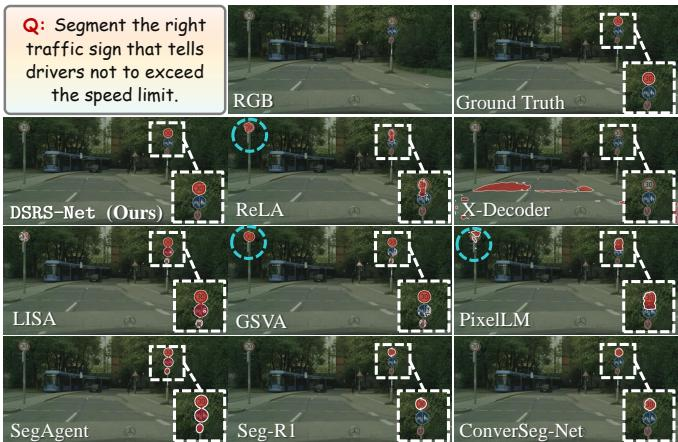  
Fig. 6. Qualitative comparisons on the DSRS dataset, where ground-truth areas are highlighted with white dashed boxes and wrong areas are highlighted with blue dashed circles.

## B. Driving Scene Segmentation Results

We compare our proposed DSRS-Net with representative language-driven segmentation networks on the DSRS dataset, as presented in Table I. To evaluate the generalizability of DSRS-Net, we first conduct a zero-shot test using the pretrained weights obtained from the mixed-source training data. Our proposed DSRS-Net outperforms existing SoTA methods in zero-shot driving scene reasoning segmentation, demonstrating its exceptional generalizability. This is primarily due to the richer geometric prior knowledge embedded in our DSRS-Net, so that familiar geometric features can also be captured effectively when encountering unseen scenes. Moreover, it can be observed that finetuned DSRS-Net consistently outperforms other language-driven segmentation networks in the DSRS task, demonstrating its superior reasoning capabilities in automated driving. As illustrated in Fig. 6, it is evident that our proposed DSRS-Net significantly outperforms existing approaches in driving scene reasoning segmentation. In scenarios involving multiple visually similar candidates that necessitate deep reasoning and scene-specific knowledge, our method demonstrates superior inference capabilities and robustness.

<table><tr><td>RGB Branch</td><td>Depth CLIP Branch</td><td>GPE</td><td>DHFI</td><td>gIoU</td><td>cIoU</td></tr><tr><td>√</td><td>√</td><td></td><td></td><td>53.00 55.25</td><td>50.42</td></tr><tr><td>√</td><td></td><td>√</td><td></td><td>37.39</td><td>52.12</td></tr><tr><td>√</td><td></td><td></td><td></td><td></td><td>36.67</td></tr><tr><td>√</td><td></td><td></td><td>√</td><td>53.28</td><td>55.10</td></tr><tr><td>√</td><td></td><td>√</td><td>√</td><td>55.40</td><td>56.97</td></tr></table>

TABLE IV  
ABLATION STUDIES ON THE CORE DESIGNS OF DSRS-Net.

<table><tr><td>Contextual Features</td><td>Geometric Features</td><td>Fusion Strategies</td><td> $\mathrm { g I o U }$ </td><td>cIoU</td></tr><tr><td>√</td><td>√ √</td><td>Self-Attention Element-wise</td><td>44.56 50.47</td><td>44.08 51.12</td></tr><tr><td></td><td></td><td>Summation Channel-wise</td><td></td><td></td></tr><tr><td>√</td><td>√</td><td>Concatenation</td><td>51.09</td><td>51.86</td></tr><tr><td>√</td><td>√</td><td>Cross-Attention</td><td>52.78</td><td>54.05</td></tr><tr><td>√</td><td>√</td><td>DA²</td><td>55.40</td><td>56.97</td></tr></table>

TABLE V  
ABLATION STUDIES ON THE DHFI STRATEGY.

## C. Language-Driven Segmentation Results

In this section, we present additional experiments to demonstrate the versatility of DSRS-Net in handling other languagedriven segmentation tasks. As presented in Table II, we first evaluate the methods on the validation and test sets of RefCOCO, RefCOCO+ [59], and RefCOCOg [60]. DSRS-Net achieves superior performance across these referring expression segmentation benchmarks. As shown in Table III, we further evaluate the effectiveness of DSRS-Net on the ReasonSeg [1] dataset. Specifically, DSRS-Net-InternVL2.5 (ft) outperforms previous SoTA approaches, achieving an improvement of over 2.0% in gIoU and 5.6% in cIoU. These results highlight the robustness and generalizability of the DSRS-Net framework in handling language-driven segmentation tasks with varying levels of instruction complexity.

## D. Ablation Studies

In this section, we conduct comprehensive ablation experiments by training DSRS-Net for 80k iterations to investigate the individual contributions of key components within DSRS-Net. As presented in Table IV, removing any of them leads to a performance deterioration. Directly feeding the depth map into the vision encoder brings only a limited improvement, suggesting that RGB-pretrained MLLMs cannot effectively leverage unfamiliar geometric modalities without explicit alignment. In contrast, incorporating both the GPE and

DHFI modules substantially improves driving scene reasoning segmentation. The degradation observed when only the GPE module is used further shows the representational incompatibility between geometric and contextual features, which may introduce conflicts within the LLM. These results demonstrate that the performance gain primarily stems from the effective alignment and interaction of geometric and contextual features, rather than merely from the inclusion of an additional depth input.

Moreover, Table V shows that simple fusion strategies such as element-wise summation and channel-wise concatenation provide limited gains, whereas attention-based interaction is more effective. The proposed $D A ^ { 2 }$ module achieves superior performance, demonstrating that depth-aware offsets help the model focus on contextually and geometrically relevant regions during feature interaction.

## V. ADDITIONAL DISCUSSION AND EXPERIMENTS

Further discussions, experiments, and video are provided in the supplementary material. We first distinguish DSRS from other language-driven segmentation tasks, and further compare the proposed benchmark with existing spatial-reasoning and autonomous-driving datasets. Additional dataset analyses describe its category definitions, instruction distributions, and the dataset construction pipeline. We also provide detailed descriptions of the model architecture, loss, training datasets, evaluation metrics, depth map generation pipeline, and competitor configurations. Moreover, we discuss the challenges of spatial reasoning in MLLMs, the extensibility of our contributions to other multimodal tasks, current limitations, and failure cases of DSRS-Net. Finally, additional quantitative and qualitative experiments, including fair comparisons using the same LLM backbone, robustness experiments with perturbed depth maps, resource consumption and efficiency analyses, category-wise evaluations on the DSRS dataset, and further ablation studies, consistently demonstrate that effective extraction and contextual alignment of geometric priors are essential for reliable reasoning segmentation in complex driving scenes.

## VI. CONCLUSION AND FUTURE WORK

This paper introduced driving scene reasoning segmentation, a novel multimodal perception task, and released a mixedtraffic benchmark dataset specifically designed for complex driving scenarios. Additionally, we proposed DSRS-Net, a novel framework that effectively infuses geometric features for deeper scene reasoning. Extensive experiments and comprehensive analyses validate the effectiveness of our novel contributions and the superior performance of DSRS-Net. We hope our work offers new insights into the integration of MLLMs with vision tasks, paving the way for future advancements in automated driving.

## REFERENCES

[1] X. Lai et al., “LISA: reasoning segmentation via large language model,” in Proceedings of the IEEE/CVF Conference on Computer Vision and Pattern Recognition (CVPR), 2024, pp. 9579–9589.

[2] W. Pan et al., “Cooperative driving at multiple unsignalized intersections in fully autonomous driving scenarios,” IEEE Transactions on Intelligent Transportation Systems, vol. 26, no. 12, pp. 23 298–23 313, 2025.

[3] R. Wang et al., “Traffic scenario logic: a spatial-temporal logic for modeling and reasoning of urban traffic scenarios,” in Proceedings of the AAAI Conference on Artificial Intelligence (AAAI), vol. 39, no. 14, 2025, pp. 15 195–15 202.

[4] X. Jia et al., “Think twice before driving: towards scalable decoders for end-to-end autonomous driving,” in Proceedings of the IEEE/CVF Conference on Computer Vision and Pattern Recognition (CVPR), 2023, pp. 21 983–21 994.

[5] S. Jiang et al., “A survey on vision-language-action models for autonomous driving,” Computing Research Repository (CoRR), vol. abs/2506.24044, 2025. [Online]. Available: https://arxiv.org/abs/2506. 24044

[6] Z. Xia et al., “GSVA: Generalized segmentation via multimodal large language models,” in Proceedings of the IEEE/CVF Conference on Computer Vision and Pattern Recognition (CVPR), 2024, pp. 3858– 3869.

[7] S. Yang et al., “An improved baseline for reasoning segmentation with large language model,” CoRR, 2023.

[8] ——, “A safe and efficient self-evolving algorithm for decision-making and control of autonomous driving systems,” IEEE Transactions on Intelligent Transportation Systems, vol. 26, no. 8, pp. 11 466–11 478, 2025.

[9] H. Liu et al., “Visual instruction tuning,” in Advances in Neural Information Processing Systems (NeurIPS), vol. 36. Curran Associates, Inc., 2023, pp. 34 892–34 916. [Online]. Available: https://proceedings.neurips.cc/paper files/paper/2023/file/6dcf277ea32c e3288914faf369fe6de0-Paper-Conference.pdf

[10] Y. Shen et al., “Reasoning segmentation for images and videos: a survey,” Computing Research Repository (CoRR), vol. abs/2505.18816, 2025. [Online]. Available: https://arxiv.org/abs/2505.18816

[11] A. Kirillov et al., “Segment anything,” in Proceedings of the IEEE/CVF international conference on computer vision (ICCV), 2023, pp. 4015– 4026.

[12] K. Ranasinghe et al., “Learning to localize objects improves spatial reasoning in Visual-LLMs,” in Proceedings ofthe IEEE/CVF Conference on Computer Vision and Pattern Recognition (CVPR), 2024, pp. 12 977– 12 987.

[13] Cheng, An-Chieh et al., “SpatialRGPT: grounded spatial reasoning in vision-language models,” in Advances in Neural Information Processing Systems (NeurIPS), vol. 37. Curran Associates, Inc., 2024, pp. 135 062– 135 093.

[14] R. Fan et al., “SNE-RoadSeg: incorporating surface normal information into semantic segmentation for accurate freespace detection,” in Proceedings of the European Conference on Computer Vision (ECCV). Springer, 2020, pp. 340–356.

[15] W. Cai et al., “SpatialBot: precise spatial understanding with vision language models,” Computing Research Repository (CoRR), vol. abs/2406.13642, 2024. [Online]. Available: https://arxiv.org/abs/2406. 13642

[16] J. Zha et al., “How to enable LLM with 3D capacity? a survey of spatial reasoning in LLMs,” Computing Research Repository (CoRR), vol. abs/2504.05786, 2025. [Online]. Available: https: //arxiv.org/abs/2504.05786

[17] J. Feng et al., “A survey of large language model-powered spatial intelligence across scales: advances in embodied agents, smart cities, and earth science,” Computing Research Repository (CoRR), vol. abs/2504.09848, 2025. [Online]. Available: https: //arxiv.org/abs/2504.09848

[18] N. Nadeem et al., “MaskAdapt: unsupervised geometry-aware domain adaptation using multimodal contextual learning and RGB-Depth masking,” in Proceedings of the IEEE/CVF Conference on Computer Vision and Pattern Recognition (CVPR), 2025, pp. 5422–5432.

[19] Z. Wang et al., “SpatialCLIP: learning 3D-aware image representations from spatially discriminative language,” in Proceedings ofthe IEEE/CVF Conference on Computer Vision and Pattern Recognition (CVPR), 2025.

[20] S.-A. Liu et al., “ReferSAM: unleashing segment anything model for referring image segmentation,” IEEE Transactions on Circuits and Systems for Video Technology, 2025.

[21] R. Hu et al., “Segmentation from natural language expressions,” in European Conference on Computer Vision (ECCV). Springer, 2016, pp. 108–124.

[22] D. Jang et al., “MMR: A large-scale benchmark dataset for multitarget and multi-granularity reasoning segmentation,” in International Conference on Learning Representations (ICLR), 2025, pp. 67 406– 67 431.

[23] M. Lan et al., “Text4seg++: Advancing image segmentation via generative language modeling,” IEEE Transactions on Pattern Analysis and Machine Intelligence, 2026.

[24] Y. Liu et al., “UniPixel: Unified object referring and segmentation for pixel-level visual reasoning,” Advances in Neural Information Processing Systems (NeurIPS), vol. 38, pp. 126 078–126 108, 2026.

[25] Y. Feng and J. Li, “Auto-prompting SAM for container detection and localization in container yards,” IEEE Transactions on Intelligent Transportation Systems, vol. 26, no. 8, pp. 11 504–11 514, 2025.

[26] L. Wen et al., “DiLu: a knowledge-driven approach to autonomous driving with large language models,” Computing Research Repository (CoRR), vol. abs/2309.16292, 2023. [Online]. Available: https: //arxiv.org/abs/2309.16292

[27] W. Wang et al., “DriveMLM: aligning multi-modal large language models with behavioral planning states for autonomous driving,” Computing Research Repository (CoRR), vol. abs/2312.09245, 2023. [Online]. Available: https://arxiv.org/abs/2312.09245

[28] H. Shao et al., “LMDrive: closed-loop end-to-end driving with large language models,” in Proceedings of the IEEE/CVF Conference on Computer Vision and Pattern Recognition (CVPR), 2024, pp. 15 120– 15 130.

[29] H. Caesar et al., “nuScenes: a multimodal dataset for autonomous driving,” in Proceedings of the IEEE/CVF Conference on Computer Vision and Pattern Recognition (CVPR), 2020, pp. 11 621–11 631.

[30] F. Yu et al., “BDD100k: a diverse driving dataset for heterogeneous multitask learning,” in Proceedings of the IEEE/CVF Conference on Computer Vision and Pattern Recognition (CVPR), 2020, pp. 2636– 2645.

[31] C. Sima et al., “DriveLM: driving with graph visual question answering,” in European Conference on Computer Vision (ECCV). Springer, 2024, pp. 256–274.

[32] H. Chi et al., “Impromptu VLA: open weights and open data for driving vision-language-action models,” Computing Research Repository (CoRR), vol. abs/2505.23757, 2025. [Online]. Available: https://arxiv.org/abs/2505.23757

[33] E. J. Hu et al., “LoRA: low-rank adaptation of large language models,” in International Conference on Learning Representations (ICLR), 2022. [Online]. Available: https://openreview.net/forum?id=nZeVKeeFYf9

[34] P. Gu et al., “ConvFormer: combining CNN and Transformer for medical image segmentation,” in 2023 IEEE 20th International Symposium on Biomedical Imaging (ISBI). IEEE, 2023, pp. 1–5.

[35] K. Yuan et al., “Incorporating convolution designs into visual Transformers,” in Proceedings of the IEEE/CVF International Conference on Computer Vision (ICCV), 2021, pp. 579–588.

[36] Y. Wang et al., “Generative AI for autonomous driving: frontiers and opportunities,” Computing Research Repository (CoRR), vol. abs/2505.08854, 2025. [Online]. Available: https://arxiv.org/abs/2505. 08854

[37] F. Han et al., “ControlThinker: unveiling latent semantics for controllable image generation through visual reasoning,” Computing Research Repository (CoRR), vol. abs/2506.03596, 2025. [Online]. Available: https://arxiv.org/abs/2506.03596

[38] Z. Xia et al., “Vision Transformer with deformable attention,” in Proceedings of the IEEE/CVF Conference on Computer Vision and Pattern Recognition (CVPR), 2022, pp. 4794–4803.

[39] B. Cheng et al., “Masked-attention mask Transformer for universal image segmentation,” in Proceedings of the IEEE/CVF Conference on Computer Vision and Pattern Recognition (CVPR), 2022, pp. 1290– 1299.

[40] J. L. Ba et al., “Layer normalization,” Computing Research Repository (CoRR), vol. abs/1607.06450, 2016. [Online]. Available: https://arxiv.org/abs/1607.06450

[41] C. Liu et al., “GRES: generalized referring expression segmentation,” in Proceedings of the IEEE/CVF Conference on Computer Vision and Pattern Recognition (CVPR), 2023, pp. 23 592–23 601.

[42] X. Zou et al., “Generalized decoding for pixel, image, and language,” in Proceedings of the IEEE/CVF Conference on Computer Vision and Pattern Recognition (CVPR), 2023, pp. 15 116–15 127.

[43] Zou, Xueyan et al., “Segment everything everywhere all at once,” in Advances in Neural Information Processing Systems (NeurIPS), vol. 36, 2023, pp. 19 769–19 782.

[44] S. Liu et al., “Grounding DINO: marrying DINO with grounded pretraining for open-set object detection,” in European Conference on Computer Vision (ECCV). Springer, 2024, pp. 38–55.

[45] Z. Ren et al., “PixelLM: Pixel reasoning with large multimodal model,” in Proceedings of the IEEE/CVF Conference on Computer Vision and Pattern Recognition (CVPR), 2024, pp. 26 374–26 383.

[46] M. Zhu et al., “SegAgent: exploring pixel understanding capabilities in MLLMs by imitating human annotator trajectories,” in Proceedings of the IEEE/CVF Conference on Computer Vision and Pattern Recognition (CVPR), 2025, pp. 3686–3696.

[47] Z. You et al., “Seg-R1: Segmentation can be surprisingly simple with reinforcement learning,” Computing Research Repository (CoRR), vol. abs/2506.22624, 2025. [Online]. Available: https://arxiv.org/abs/2506. 22624

[48] A. Sahoo et al., “Conversational image segmentation: Grounding abstract concepts with scalable supervision,” in Proceedings of the IEEE/CVF Conference on Computer Vision and Pattern Recognition (CVPR), 2026, pp. 39 476–39 485.

[49] Z. Wang et al., “CRIS: Clip-driven referring image segmentation,” in Proceedings of the IEEE/CVF Conference on Computer Vision and Pattern Recognition (CVPR), 2022, pp. 11 686–11 695.

[50] L. Zhu et al., “POPEN: Preference-based optimization and ensemble for LVLM-based reasoning segmentation,” in Proceedings of the IEEE/CVF Conference on Computer Vision and Pattern Recognition (CVPR), 2025, pp. 30 231–30 240.

[51] N. Carion et al., “SAM 3: Segment anything with concepts,” Computing Research Repository (CoRR), vol. abs/2511.16719, 2025. [Online]. Available: https://arxiv.org/abs/2511.16719

[52] R. Qian et al., “Reasoning to attend: Try to understand how ¡SEG¿ token works,” in Proceedings ofthe IEEE/CVF Conference on Computer Vision and Pattern Recognition (CVPR), 2025, pp. 24 722–24 731.

[53] Q. Zhou et al., “Efficient reasoning via thought compression for language segmentation,” Computing Research Repository (CoRR), vol. abs/2604.02040, 2026. [Online]. Available: https://arxiv.org/abs/2604. 02040

[54] F. Liang et al., “Open-vocabulary semantic segmentation with maskadapted CLIP,” in Proceedings of the IEEE/CVF Conference on Computer Vision and Pattern Recognition (CVPR), 2023, pp. 7061–7070.

[55] K. Ying et al., “Towards omnimodal expressions and reasoning in referring audio-visual segmentation,” in Proceedings of the IEEE/CVF International Conference on Computer Vision (ICCV), 2025, pp. 22 575– 22 585.

[56] M. Cordts et al., “The CityScapes dataset for semantic urban scene understanding,” in Proceedings of the IEEE/CVF Conference on Computer Vision and Pattern Recognition (CVPR), 2016, pp. 3213–3223.

[57] M. Menze et al., “Object scene flow for autonomous vehicles,” in Proceedings of the IEEE/CVF Conference on Computer Vision and Pattern Recognition (CVPR), 2015, pp. 3061–3070.

[58] P. Wang et al., “The ApolloScape open dataset for autonomous driving and its application,” IEEE Transactions on Pattern Analysis and Machine Intelligence, vol. 1, 2019.

[59] S. Kazemzadeh et al., “ReferItGame: referring to objects in photographs of natural scenes,” in Proceedings of the 2014 conference on empirical methods in natural language processing (EMNLP), 2014, pp. 787–798.

[60] J. Mao et al., “Generation and comprehension of unambiguous object descriptions,” in Proceedings ofthe IEEE/CVF Conference on Computer Vision and Pattern Recognition (CVPR), 2016, pp. 11–20.

[61] X. Ma et al., “SQA3D: situated question answering in 3D scenes,” in International Conference on Learning Representations (ICLR), 2023.

[62] X. Linghu et al., “Multi-modal situated reasoning in 3D scenes,” in Advances in Neural Information Processing Systems (NeurIPS), 2024, pp. 140 903–140 936.

[63] H. Zhang et al., “VLA-3D: a dataset for 3D semantic scene understanding and navigation,” Computing Research Repository (CoRR), vol. abs/2411.03540, 2024. [Online]. Available: https://arxiv.org/abs/ 2411.03540

[64] Y. Chen et al., “Grounded 3D-LLM with referent tokens,” Computing Research Repository (CoRR), vol. abs/2405.10370, 2024. [Online]. Available: https://arxiv.org/abs/2405.10370

[65] A. Abdelreheem et al., “ScanEnts3D: exploiting phrase-to-3D object correspondences for improved visio-linguistic models in 3D scenes,” Computing Research Repository (CoRR), vol. abs/2212.06250, 2022. [Online]. Available: https://arxiv.org/abs/2212.06250

[66] T. Wang et al., “EmbodiedScan: a holistic multi-modal 3D perception suite towards embodied AI,” in Proceedings of the IEEE/CVF Conference on Computer Vision and Pattern Recognition (CVPR), 2024.

[67] Y. Hong et al., “3D-LLM: injecting the 3D world into large language models,” in Advances in Neural Information Processing Systems (NeurIPS), vol. 36. Curran Associates, Inc., 2023, pp. 20 482–20 494. [Online]. Available: https://proceedings.neurips.cc/paper files/paper /2023/file/413885e70482b95dcbeeddc1daf39177-Paper-Conference.pdf

[68] S. He et al., “SegPoint: segment any point cloud via large language model,” in Proceedings of the European Conference on Computer Vision (ECCV), 2024, pp. 349–367.

[69] C. Zhu et al., “ScanReason: empowering 3D visual grounding with reasoning capabilities,” Computing Research Repository (CoRR), vol. abs/2407.01525, 2024. [Online]. Available: https://arxiv.org/abs/2407. 01525

[70] K.-C. Huang et al., “Reason3D: searching and reasoning 3D segmentation via large language model,” in International Conference on 3D Vision 2025 (3DV), 2025. [Online]. Available: https: //openreview.net/forum?id=w1M87lE7D2

[71] J. Huang et al., “SURPRISE3D: a dataset for spatial understanding and reasoning in complex 3D scenes,” Computing Research Repository (CoRR), vol. abs/2507.07781, 2025. [Online]. Available: https: //arxiv.org/abs/2507.07781

[72] J. Kim et al., “Textual explanations for self-driving vehicles,” in Proceedings of the European Conference on Computer Vision (ECCV), 2018, pp. 577–593.

[73] X. Jia et al., “Bench2Drive: towards multi-ability benchmarking of closed-loop end-to-end autonomous driving,” in Advances in Neural Information Processing Systems (NeurIPS), vol. 37, 2024, pp. 819–844.

[74] M. Nie et al., “Reason2Drive: towards interpretable and chain-based reasoning for autonomous driving,” 2024. [Online]. Available: https://arxiv.org/abs/2312.03661

[75] Z. Zhao et al., “Extending large vision-language model for diverse interactive tasks in autonomous driving,” Computing Research Repository (CoRR), vol. abs/2505.08725, 2025. [Online]. Available: https://arxiv.org/abs/2505.08725

[76] Y. Hao et al., “DriveAction: a benchmark for exploring human-like driving decisions in VLA models,” Computing Research Repository (CoRR), vol. abs/2506.05667, 2025. [Online]. Available: https: //arxiv.org/abs/2506.05667

[77] P. Young et al., “From image descriptions to visual denotations: new similarity metrics for semantic inference over event descriptions,” Transactions of the Association for Computational Linguistics, vol. 2, pp. 67–78, 02 2014.

[78] B. A. Plummer et al., “Flickr30k Entities: collecting region-to-phrase correspondences for richer image-to-sentence models,” in Proceedings of the IEEE International Conference on Computer Vision (ICCV), 2015, pp. 1576–1584.

[79] R. Krishna et al., “Visual Genome: connecting language and vision using crowdsourced dense image annotations,” International Journal of Computer Vision, vol. 123, no. 1, pp. 32–73, 2017.

[80] T.-Y. Lin et al., “Visualizing and understanding deep texture representations,” in Proceedings of the IEEE Conference on Computer Vision and Pattern Recognition (CVPR), 2016.

[81] S. Kurita et al., “RefEgo: referring expression comprehension dataset from first-person perception of Ego4D,” in Proceedings of the IEEE/CVF International Conference on Computer Vision (ICCV), 2023, pp. 15 214– 15 224.

[82] B. Zhou et al., “Scene parsing through ADE20K dataset,” in Proceedings of the IEEE/CVF Conference on Computer Vision and Pattern Recognition (CVPR), 2017, pp. 633–641.

[83] Z. Bai et al., “One Token to Seg Them All: Language Instructed Reasoning Segmentation in Videos,” Computing Research Repository (CoRR), vol. abs/2409.19603, 2024. [Online]. Available: https: //arxiv.org/abs/2409.19603

[84] S. Yun et al., “StAR: Segment anything reasoner,” Computing Research Repository (CoRR), vol. abs/2603.14382, 2026. [Online]. Available: https://arxiv.org/abs/2603.14382

[85] T. Liang et al., “Seg-ReSearch: Segmentation with interleaved reasoning and external search,” Computing Research Repository (CoRR), vol. abs/2602.04454, 2026. [Online]. Available: https: //arxiv.org/abs/2602.04454

[86] J. Wu et al., “Towards open vocabulary learning: A survey,” IEEE Transactions on Pattern Analysis and Machine Intelligence, vol. 46, no. 7, pp. 5092–5113, 2024.

[87] I. Kabir et al., “Logic-RAG: augmenting large multimodal models with visual-spatial knowledge for road scene understanding,” Computing Research Repository (CoRR), vol. abs/2503.12663, 2025. [Online]. Available: https://arxiv.org/abs/2503.12663

[88] L. Yang et al., “Depth anything v2,” Advances in Neural Information Processing Systems (NeurIPS), vol. 37, pp. 21 875–21 911, 2024.

[89] R. Ding et al., “PLA: language-driven open-vocabulary 3D scene understanding,” in Proceedings of the IEEE/CVF Conference on Computer Vision and Pattern Recognition (CVPR), 2023, pp. 7010–7019.

[90] G. Neuhold et al., “The mapillary vistas dataset for semantic understanding of street scenes,” in Proceedings of the IEEE International Conference on Computer Vision (ICCV), Oct 2017.

[91] H. Caesar et al., “Coco-stuff: Thing and stuff classes in context,” in Proceedings of the IEEE conference on computer vision and pattern recognition, 2018, pp. 1209–1218.

[92] B. Li et al., “Llava-onevision: Easy visual task transfer,” arXiv preprint arXiv:2408.03326, 2024.

[93] S. Yang et al., “LISA++: An improved baseline for reasoning segmentation with large language model,” Computing Research Repository (CoRR), vol. abs/2312.17240, 2023. [Online]. Available: https://arxiv.org/abs/2312.17240

[94] Y. Lu et al., “RSVP: Reasoning segmentation via visual prompting and multi-modal chain-of-thought,” in Proceedings of the Annual Meeting of the Association for Computational Linguistics (ACL), 2025, pp. 14 699– 14 716.

Inputs: <IMAGE>, <LABEL> Outputs: <MASK>

Semantic Segmentation Task Referring Expression Segmentation Task Reasoning Segmentation Task  
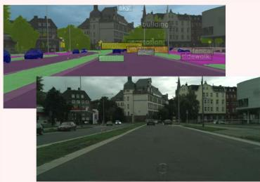  
Inputs: <IMAGE>, <TEXT QUERY> Woman on top left tennis player.  
Outputs: <MASK>

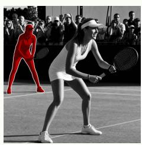  
Inputs: <IMAGE>, < TEXT QUERY > Who is the founder of Alibaba in the image? Outputs: The man wearing a dark red tie is the founder of Alibaba.

## DSRS Task (Ours)

Inputs: <IMAGE>, < TEXT QUERY > Which car is on the leftmost side of the picture? Outputs: The parked black car is on the leftmost side of the picture.

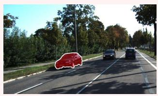  
Spatial Relations

Inputs: <IMAGE>, < TEXT QUERY > Drivers should be aware of cyclists while driving on the street. Please help me isolate the cyclist signaling a gesture in front of us. Outputs: The cyclist signaling a gesture can pose a potential risk on drivers.

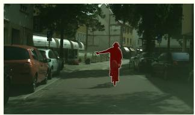  
Potential Risks

Inputs: <IMAGE>, < TEXT QUERY > We can never be too careful while driving through a tunnel with dim lights. Please help me segment the car directly ahead of us. Outputs: The car directly in front of us has been segmented

Inputs: <IMAGE>, < TEXT QUERY >   
Could you help me segment the lane that allows for left turns?   
Outputs: The left-turn lane in the image has been isolated.

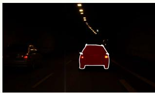  
Challenging Conditions

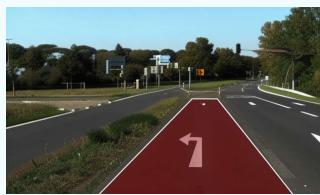  
Traffic Rules

Fig. 7. Comparisons between driving scene reasoning segmentation and other segmentation tasks.

## Appendix

A Ethics . 11   
B Additional Details on the DSRS Task and Dataset. . 11   
B.1 Comparisons with Various Perception Tasks . . 11   
B.2 Comparison with Existing Benchmark Datasets . 12   
B.3 Comprehensive Analysis of DSRS Dataset . 13   
C Additional Methodological Details . . 15   
C.1 Implementation Details for DSRS-Net Architecture . 15   
C.2 Depth-Aware Deformable Attention Blocks . . 15   
C.3 Overall Loss . 16   
D Additional Discussion . 16   
D.1 Spatial Relation Inferring in MLLM-Based Models . 16   
D.2 Failure Cases. . 16   
D.3 Extensibility and Broader Applications . . 17   
D.4 Future Directions . . 17   
E Technical Details . . 17   
E.1 Implementation Details . 17   
E.2 Training Datasets . . 17   
E.3 Evaluation Metrics. 17   
E.4 Competitors and Implementation Details . . . 17   
F Additional Quantitative Experimental Results . 19   
F.1 Depth Source, Quality, and Robustness Analysis . . . . 19   
F.2 Fair Comparison with Depth-Enhanced Baselines . . . 21   
F.3 Computational Efficiency and Deployment Analysis . 22   
F.4 Additional Comparison on the ReasonSeg Benchmark 23   
F.5 Per-Category Results on the DSRS Dataset . . 23   
F.6 Additional Ablation Studies . . 24   
G Additional Qualitative Experimental Results . . . 24

In this research, we utilize ten public datasets for the development and evaluation of computer vision models: ADE20K [82], RefCOCO, RefCOCO+ [59], RefCOCOg [60], SpatialQA [15], ReasonSeg [1], Cityscapes [56], KITTI Semantics [57], nuScenes [29], and ApolloScape [58]. It is important to emphasize that we adhere strictly to the terms of usage for each dataset. We acknowledge that these datasets may contain images with visible faces and other personal data collected without consent. However, we assure that no biometric information has been processed. All images are used in accordance with the CC-BY license or in a manner compatible with the Data Analysis Permission.

## A. Comparisons with Various Perception Tasks

Semantic segmentation offers pixel-level predictions, facilitating fine-grained scene understanding in applications such as medical imaging. However, its fundamental limitation lies in its closed-set training paradigm, which restricts the model to a fixed vocabulary of predefined classes [86]. This inherent inflexibility prevents it from accommodating user-specific requirements or interpreting ambiguous, open-world instructions that lie outside its training distribution.

To overcome these limitations, referring expression segmentation [21] has been introduced, which leverages natural language expressions to guide the segmentation of a specific object within an image. It enables more interactive and contextaware segmentation that aligns better with human intent. For instance, as illustrated in Fig. 7 in the supplementary material, instead of segmenting all instances of “women” in an image, a referring expression segmentation model can isolate “woman on top left tennis player”.

Existing referring expression segmentation models are optimized for relatively simple expressions and often struggle with complex descriptions. This has motivated the research on reasoning segmentation, which requires reasoning capabilities to identify regions that satisfy abstract or indirect requirements specified in text queries.

<table><tr><td>Dataset</td><td>Input</td><td>Output</td><td>Lang. Source</td><td>Scene</td><td>Spatial Reasoning</td><td>Traffic Rule</td></tr><tr><td>SQA3D [61]</td><td>Lang, Image, Point cloud, Video</td><td>Lang</td><td>Human</td><td>IS</td><td>√</td><td>x</td></tr><tr><td>MSQA [62]</td><td>Lang, Image, Point cloud</td><td>Lang</td><td>Human, LLM</td><td>IS</td><td>√</td><td>x</td></tr><tr><td>VLA-3D [63]</td><td>Lang, Point cloud, Scene graph</td><td>Lang</td><td>Template</td><td>IS</td><td>√</td><td>x</td></tr><tr><td>Grounded 3D-LLM [64]</td><td>Lang, Point cloud</td><td>Mask</td><td>Template, LLM</td><td>IS</td><td>√</td><td>x</td></tr><tr><td>ScanEnts3D [65]</td><td>Lang, Point cloud</td><td>BBox</td><td>Human</td><td>IS</td><td></td><td>x</td></tr><tr><td>EmbodiedScan [66]</td><td>Lang, RGB-D image</td><td>BBox</td><td>Template, LLM</td><td>IS</td><td>V</td><td>x</td></tr><tr><td>3D-LLM [67]</td><td>Lang, Point cloud</td><td>Lang, BBox</td><td>LLM</td><td>IS</td><td></td><td>x</td></tr><tr><td>SegPoint [68]</td><td>Lang, Point cloud</td><td>Mask</td><td>LLM</td><td>IS</td><td>√</td><td>x</td></tr><tr><td>ScanReason [69]</td><td>Lang, RGB-D image</td><td>BBox</td><td>LLM</td><td>IS</td><td>√</td><td>x</td></tr><tr><td>Reason3D [70]</td><td>Lang, Point cloud</td><td>Mask</td><td>LLM</td><td>IS</td><td>√</td><td>x</td></tr><tr><td>Surprise3D [71]</td><td>Lang, Point cloud</td><td>Mask</td><td>Human, LLM</td><td>IS</td><td>√</td><td>x</td></tr><tr><td>nuScenes [29]</td><td>LiDAR, Image, Radar</td><td>BBox</td><td></td><td>Real DS</td><td>x</td><td>x</td></tr><tr><td>BDD100K [30]</td><td>Video</td><td>Mask, BBox</td><td></td><td>Real DS</td><td>x</td><td>x</td></tr><tr><td>BDD-X [72]</td><td>Lang, Video</td><td>Lang</td><td>Human</td><td>Real DS</td><td>√</td><td>√</td></tr><tr><td>DriveLM-Data [31]</td><td>Lang, Image</td><td>Lang</td><td>Template, Human</td><td>Real, Sim DS</td><td>√</td><td>√</td></tr><tr><td>Apollo [58]</td><td>LiDAR, Image, Point cloud</td><td>Mask</td><td></td><td>Real DS</td><td>x</td><td>x</td></tr><tr><td>Bench2Drive [73]</td><td>LiDAR, Image</td><td>Action</td><td></td><td>Sim DS</td><td>x</td><td>x</td></tr><tr><td>Reason2Drive [74]</td><td>Video</td><td>Lang</td><td>Human,LLM</td><td>Real DS</td><td>√</td><td>x</td></tr><tr><td>ImpromptuVLA [32]</td><td>Video, State</td><td>Lang, Action</td><td>Human, LLM</td><td>Real DS</td><td>√</td><td>√</td></tr><tr><td>NuInteract [75]</td><td>LiDAR, Image</td><td>Lang</td><td>Human, LLM</td><td>Real DS</td><td>√</td><td>x</td></tr><tr><td>DriveAction [76]</td><td>Lang, Video</td><td>Action</td><td></td><td>Real DS</td><td>x</td><td>x</td></tr><tr><td>RefCLEF [59]</td><td>Lang, Image</td><td>BBox</td><td>Human</td><td>MS</td><td>√</td><td>x</td></tr><tr><td>RefCOCO [59]</td><td>Lang, Image</td><td>Mask, BBox</td><td>Human</td><td>MS</td><td>V</td><td>x</td></tr><tr><td>RefCOCO+ [59]</td><td>Lang, Image</td><td>Mask, BBox</td><td>Human</td><td>MS</td><td>x</td><td>x</td></tr><tr><td>gRefCOCO [41]</td><td>Lang, Image</td><td>Mask, BBox</td><td>Human</td><td>MS</td><td>x</td><td>x</td></tr><tr><td>SpatialQA [15]</td><td>Lang, RGB-D image</td><td>Lang</td><td>Human</td><td>MS</td><td>√</td><td>x</td></tr><tr><td>Flickr30k [77]</td><td>Image</td><td>Lang</td><td>Human</td><td>MS</td><td>x</td><td>x</td></tr><tr><td>Flickr 30k entities [78]</td><td>Lang, Image</td><td>BBox</td><td>Human</td><td>MS</td><td>√</td><td>x</td></tr><tr><td>ReasonSeg [1]</td><td>Lang, Image</td><td>Lang, Mask</td><td>Human, LLM</td><td>MS</td><td>x</td><td>x</td></tr><tr><td>Visual Genome [79]</td><td>Lang, Image</td><td>BBox</td><td>Human</td><td>MS</td><td>√</td><td>x</td></tr><tr><td>VGPhraseCut [80]</td><td>Lang, Image</td><td>Mask</td><td>Human</td><td>MS</td><td>x</td><td>x</td></tr><tr><td>RefEgo [81]</td><td>Video, Lang</td><td>BBox</td><td>Human</td><td>MS</td><td>x</td><td>x</td></tr><tr><td>DSRS (ours)</td><td>Lang, RGB-D image</td><td>Lang, Mask</td><td>Human, LLM</td><td>Real DS</td><td>✓</td><td>√</td></tr></table>

COMPARISON WITH OTHER VISION DATASETS. ‘LANG’ DENOTES LANGUAGE QUERIES, ‘LANG SOURCE’ DENOTES WHETHER LANGUAGE QUERIES ARE HUMAN-ANNOTATED OR GENERATED VIA TEMPLATE OR LLM. 'IS’ DENOTES INDOOR SCENES. ‘DS’ DENOTES DRIVING SCENES. AND ‘MS’ DENOTES MULTI-SCENE

<table><tr><td>Dataset</td><td>Task type</td><td>Number of samples</td></tr><tr><td>ReasonSeg [1]</td><td>Open-domain reasoning segmentation</td><td>1,218</td></tr><tr><td>ReasonVOS [83]</td><td>Video reasoning segmentation</td><td>458</td></tr><tr><td>FCoT [47]</td><td>Foreground reasoning and segmentation-prompt generation</td><td>1,500</td></tr><tr><td>ConverSeg [48]</td><td>Conversational image segmentation</td><td>1,687</td></tr><tr><td>ReasonSeg-X [84]</td><td>Extended reasoning segmentation</td><td>1,169</td></tr><tr><td>OK-VOS [85]</td><td>Outside-knowledge video object segmentation</td><td>1,000</td></tr><tr><td>DSRS (ours)</td><td>Driving scene reasoning segmentation</td><td>1,561</td></tr></table>

SCALE COMPARISON WITH REPRESENTATIVE REASONING AND INSTRUCTION SEGMENTATION DATASETS.

Nevertheless, the reasoning segmentation task has largely focused on broad representations of world knowledge and exhibits limited scene-specific awareness in driving scenarios [87]. This limitation motivates us to introduce the driving scene reasoning segmentation, a new multimodal perception task specifically designed to address the scene-specific challenges in automated driving contexts, as illustrated in Fig. 7 in the supplementary material.

## B. Comparison with Existing Benchmark Datasets

As illustrated in Table VI in the supplementary material, most existing multimodal datasets that support spatial reasoning are primarily focused on indoor environments, where geometric priors are typically obtained from point clouds or bird’s eye view (BEV) images, such as in SQA3D [61] and MSQA [62]. Although these datasets have contributed valuable insights into 3D spatial reasoning, they are limited in terms of object diversity and scene complexity, making them insufficient for modeling the rich, dynamic environments of the real world. For instance, in driving scenes, spatial relation inference is particularly critical, as it underpins essential tasks such as estimating object distances, interpreting road structures, and predicting dynamic behaviors.

(a) Noun Distribution of Instructions  
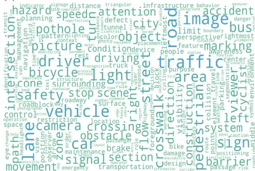

(b) Frequency Distribution of Nouns in DSRS Instructions  
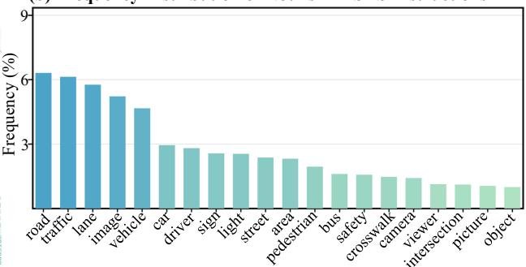  
(d) Frequency Distribution of Verbs in DSRS Instructions

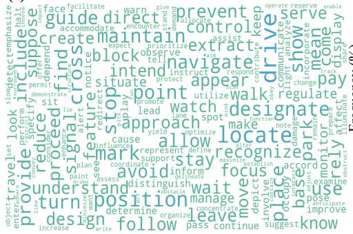

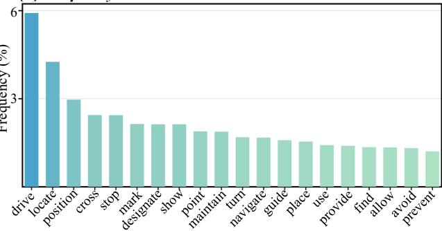  
Fig. 8. Word distribution of instructions in the DSRS dataset. (a) and (c) illustrate word clouds of nouns and verbs appearing in the instructions of the DSRS dataset, respectively. (b) and (d) show the frequency distributions of representative nouns and verbs, respectively.

In scene parsing tasks, pixel-level mask prediction serves as a critical foundation for precise object localization. For instance, given a text query such as “Avoid the maintenance roads with irregular shapes”, the absence of pixel-level output makes it challenging for the system to precisely localize the referenced areas within the scene. While existing languagedriven datasets, e.g., RefCOCO [59] and VGPhraseCut [80], offer segmentation masks, such resources remain scarce in the context of automated driving. Datasets such as DriveLM-Data [31] and BDD-X [72] incorporate language prompts but only support coarse-grained textual outputs. Conversely, datasets like nuScenes [29] and BDD100K [30] provide segmentation masks but lack alignment with language inputs. To date, there is no multimodal dataset that simultaneously supports natural language input and pixel-level mask output in real-world mixed traffic scenarios. This remains a critical bottleneck in advancing automated driving systems.

To fill the gap in existing multimodal datasets, we introduce the DSRS dataset. To the best of our knowledge, it is the first dataset in real-world mixed traffic scenes to jointly provide both text queries and segmentation masks, thereby filling a critical gap in the advancement of multimodal automated driving systems.

Dataset scale should be interpreted in relation to annotation granularity and intended usage. DSRS dataset is not intended as the sole corpus for training a 7B–8B MLLM from scratch, rather, it is a high-quality, domain-specific benchmark for evaluating and adapting pretrained MLLMs. Unlike largescale pretraining corpora, constructing a pixel-level reasoning segmentation benchmark requires every sample to combine an unambiguous instruction, a reasoning-grounded target, and an accurate pixel-level mask, making annotation and multistage manual verification substantially more expensive. This is especially true for driving scenes, where annotations must also preserve traffic semantics, spatial relations, and safety-critical context. As shown in Table VII, several representative imagebased and video-based reasoning or instruction segmentation benchmarks are constructed within a comparable 1K-scale range, with some being substantially smaller. Following this high-quality benchmark setting, DSRS provides 1,561 carefully curated samples for evaluating pretrained MLLMs and supporting their parameter-efficient adaptation to driving-scene reasoning segmentation.

## C. Comprehensive Analysis of DSRS Dataset

1) Fine-Grained Category Definitions: To comprehensively represent diverse road conditions encountered in complex driving scenarios, the dataset is categorized into the following categories:

• Spatial relations. This category includes samples that involve diverse spatial relations among objects within complex driving environments.

• Potential risks. This category comprises samples involving traffic accidents and various potential hazards on the road, including both positive and negative obstacles, e.g., obstacles and road surface defects.

• Challenging conditions. This category includes samples captured under adverse environmental conditions, such as extreme lighting, severe weather, and complex terrain.

• Traffic rules. This category includes samples that reflect traffic rule enforcement via regulatory infrastructure elements, including dedicated lanes, crosswalks, traffic lights, and traffic signs.

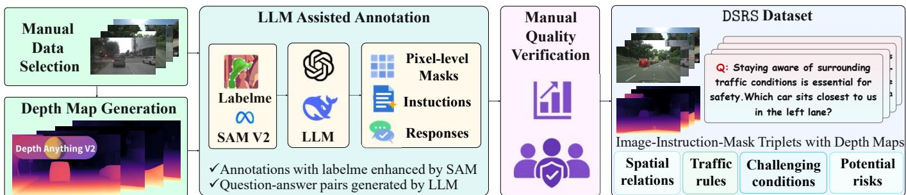  
Fig. 9. Construction and Annotation Pipeline of Our DSRS Dataset.

Manual LLM Assisted AnnotationThe proposed DSRS dataset offers a comprehensive benchmark Data for evaluating and advancing the reasoning capabilities of Selectionmodels in automated driving scenarios.

2) Word Distribution ofInstructions: To further analyze the language features of the DSRS dataset, Fig. 8 presents the Responword distribution of nouns and verbs in the instructions of the DSRS dataset. As shown in Figs. 8(a) and (b), the noun Annotations with labelme enhanced by distribution reveals that instructions primarily involve road structures and road users. In particular, “road” and “traffic” account for approximately 6.3% and 6.1% of all nouns in the instructions, respectively. Other frequent nouns, including “lane”, “vehicle”, “pedestrian”, “sign”, and “crosswalk”, indicate that instructions comprehensively reflect the complex road conditions in real-world driving scenes. In parallel, the verb distributions illustrated in Figs. 8(c) and (d) show that these instructions are strongly associated with driving behaviors, operational requirements, and safety-critical scenarios. “Drive” accounts for 5.9% of all verbs in the instructions, followed by “locate” at 4.3% and “position” at 3.0%. Verbs such as “turn”, “navigate”, and “guide” further demonstrate that models are required to interpret implicit instructions, identify the referred regions, and understand corresponding driving scenes. Overall, the word distribution depicted in Fig. 8 demonstrates that instructions of the DSRS dataset extend beyond explicit object descriptions and capture contextual details, which makes the DSRS dataset well-suited for evaluating models in automated driving scenarios. The dataset contains both concise queries and long compositional queries. Concise queries assess direct grounding, while long queries require multiple reasoning steps over spatial relations, traffic rules, and potential risks. For example, the prompt, “In conditions of reduced visibility, what element above in the picture helps regulate traffic flow and ensure safety?”, requires the model to identify candidate objects in the image, infer which object serves to regulate traffic flow and enhance road safety, and accurately segment the corresponding region. This variation helps distinguish genuine reasoning from superficial matching between words and visible objects.

3) DSRS Dataset Construction and Annotation Pipeline: As illustrated in Fig. 9, we present the construction pipeline of the DSRS dataset, which consists of five stages: image selection and depth map generation, pixel-level annotation, instruction and response generation, manual quality verification, and sample categorization. We exclude adjacent frames from different splits and assign every continuous scene to only one of the training, validation, and test sets. This scene-Manual Datasetlevel separation prevents visual overlap and eliminates leakage caused by temporally neighboring observations. To compre the road and closest to the viewer? often indicate stopping or slowing behaviorhensively cover diverse scenes and complex conditions in reallights illuminated and closest to thethe intersection?Q: Staying aware of surrounding traffic world driving scenarios, we select RGB images from multiple car sits closest to us in the left lane?autonomous driving datasets and employ Depth Anything sV2 [88] to obtain corresponding relative depth maps. To reduce dependence on country-specific road conventions, we retain samples whose answers are supported by explicit visual indicators such as lane markings, traffic lights, traffic signs, and clearly visible road structures. Samples that could produce ambiguous masks under different regional conventions are excluded during manual verification. We then use LabelMe, which is assisted by SAM 2, to manually annotate the target regions in the selected images, producing pixel-level masks with accurate target boundaries. After completing pixel-level annotations, we utilize large language models such as GPT-4o and DeepSeek-V3 to generate multiple implicit reasoning instructions for each target region. Subsequently, we generate corresponding responses for these instructions and organize them into question-answer pairs for reasoning chains. To ensure the accuracy of the outputs produced in the preceding stages, we further conduct multiple rounds of manual quality verification on pixel-level masks, natural language instructions, and corresponding responses. Specifically, we check whether masks completely cover the target regions and whether the target boundaries are accurate. Meanwhile, we also verify whether the instructions are semantically consistent with the annotated regions while checking for repetition, ambiguity, and factual errors. For samples that do not pass verifica tion, inaccurate masks are reannotated, while instructions or responses are revised accordingly. Once all samples have passed manual quality verification, we categorize them into four high-level categories: Spatial Relations, Potential Risks, Challenging Conditions, and Traffic Rules. These categories comprise 13 fine-grained categories, which comprehensively represent diverse road conditions in real-world driving scenes. By completing the five stages above, we obtain the DSRS dataset, which contains more than 1,500 image-instructionmask samples, together with corresponding relative depth maps. Unlike existing datasets, our proposed DSRS dataset integrates implicit reasoning instructions, relative depth maps, and pixel-level annotations, thereby enabling scene-specific reasoning and accurate segmentation in complex driving scenarios.

4) Mask Scale Distribution: Fig. 10 presents the distribution of relative mask scales across 13 fine-grained categories of the DSRS dataset, where the relative mask scale is defined as the ratio of the annotated region to the entire image. The mask scale distribution demonstrates significant differences among categories. Most categories occupy less than 15% of the entire image, which indicates that DSRS dataset contains many small targets and requires models to perform fine-grained scene inference and precise boundary modeling. Specifically, the mask scales of “Road defect”, “Traffic light”, “Traffic sign”, and “Obstacle” range from approximately 0.04% to 0.51% of the entire image, placing greater demands on localizing targets precisely and extracting boundaries accurately. In contrast, the pixel-level annotated masks of categories such as “Traffic lane”, “Crosswalk”, “Traffic accident” cover larger scales of entire images, requiring models to understand traffic rules in more complex real-world road conditions. Notably, “Traffic accident” demonstrates the widest range of mask scales, ranging from 2.02% to 72.06% of the entire image. Moreover, “Complex Terrain”, “Light Condition”, and “Weather Condition” also exhibit broad mask scale distributions, reflecting pronounced differences in the mask scales of targets under challenging conditions. Overall, we form a challenging benchmark with diverse mask scales for evaluating scene-specific reasoning and accurate segmentation tasks in real-world automated driving scenarios.

<table><tr><td rowspan="2">Model</td><td colspan="3">Multimodal Encoder</td><td rowspan="2">LLM</td><td rowspan="2">Segmentation Head</td></tr><tr><td>Vision Encoder</td><td>Text Encoder</td><td>Projector</td></tr><tr><td>LISA [1]</td><td>CLIP ViT-L/14, SAM ViT-H</td><td>LLaMA Tokenizer</td><td>MLP</td><td>Vicuna 7B</td><td>SAM decoder</td></tr><tr><td>GSVA [6]</td><td>CLIP ViT-L/14, SAM ViT-H</td><td>LLaMA Tokenizer</td><td>MLP</td><td>Vicuna 7B</td><td>SAM decoder</td></tr><tr><td>PixelLM [45]</td><td>CLIP ViT-L/14</td><td>LLaMA Tokenizer</td><td>MLP</td><td>Vicuna 7B</td><td>PixelLM decoder</td></tr><tr><td>M²SA [22]</td><td>CLIP ViT-L/14, SAM ViT-H</td><td>LLaMA Tokenizer</td><td>MLP</td><td>Vicuna 7B</td><td>SAM decoder</td></tr><tr><td>SegAgent [46]</td><td>Qwen-VL, SClick ViT-L</td><td>Qwen-VL Tokenizer</td><td>Qwen-VL adapter, SClick prompt embedding</td><td>Qwen-VL 7B</td><td>SClick decoder</td></tr><tr><td>Seg-R1 [47]</td><td>Qwen2.5-VL, SAM2 Hiera-L</td><td>Qwen2.5-VL Tokenizer</td><td>Qwen2.5-VL visual merger</td><td>Qwen2.5-VL 7B</td><td>SAM2 decoder</td></tr><tr><td>ConverSeg-Net [48]</td><td>Qwen2.5-VL, SAM2 Hiera-L</td><td>Qwen2.5-VL Tokenizer</td><td>MLP</td><td>Qwen2.5-VL 3B</td><td>SAM2 decoder</td></tr><tr><td>DSRS-Net-LLaVA1.5</td><td>CLIP ViT-L/14, GPE, DHFI</td><td>LLaMA Tokenizer</td><td>MLP</td><td>Vicuna1.5 7B</td><td>DSRS-Net decoder</td></tr><tr><td>DSRS-Net-InternVL2.5</td><td>InternViT, GPE, DHFI</td><td>InternVL2.5 Tokenizer</td><td>MLP</td><td>InternLM2.5 7B</td><td>DSRS-Net decoder</td></tr></table>

ARCHITECTURAL COMPARISON OF REPRESENTATIVE LANGUAGE-GUIDED SEGMENTATION MODELS.

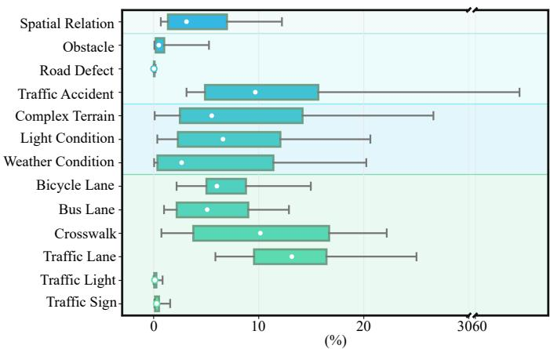  
Fig. 10. Mask scale distribution across 13 fine-grained categories of our proposed DSRS dataset. White circles denote the median mask scale for each category. The lower extreme and the upper extreme represent the 5th and 95th percentiles, respectively. The horizontal axis is truncated between 30% and 60% for clarity.

## D. Implementation Details for DSRS-Net Architecture

As shown in Table VIII, our DSRS-Net architecture comprises three key components: (1) a multimodal encoder, (2) an LLM, and (3) a segmentation head. The multimodal encoder consists of a vision encoder and a text encoder. The vision encoder extracts complementary information from the RGB-D images, which consists of an MLLM vision encoder, a geometric prior extractor (GPE), a depth-guided hierarchical feature interaction (DHFI) module, and projectors for modality alignment. Unlike conventional depth-guided segmentation methods that fuse RGB and depth features without an LLM, our design must preserve the visual-language balance already learned by the MLLM. GPE extracts structured geometric cues, while DHFI aligns them with hierarchical visual semantics before they enter the language space. This process enables the MLLM to interpret relative depth information such as spatial ordering, object boundaries, and scene layout without disrupting its original image-text alignment.

## E. Depth-Aware Deformable Attention Blocks

For reproducibility, given N patch tokens, we concatenate the normalized pairwise depth differences and 2D relative positions to form candidate descriptors of shape $B { \times } N { \times } N { \times } 3 ,$ such that each query has N candidates. A learned linear layer with 0.1 dropout regresses the flattened descriptors into offsets of shape $B \times N \times M \times L \times K \times 2$ . We use M = 8 heads, L = 1 feature level, and K = 4 sampling points, yielding 32 two-dimensional offsets per query. Although the offsets are not directly clipped, the depth differences are bounded by tanh, and the final sampling coordinates are clamped to [0, 1]. Bilinear interpolation is applied to value features projected from 1024 to 512 channels (64 channels per head), after which the output is projected back to 1024 channels. Four $\mathrm { D A } ^ { 2 }$ blocks are stacked in total.

## F. Overall Loss

In summary, the overall loss function can be formulated as a weighted combination of the text generation loss ${ \mathcal { L } } _ { \mathrm { t x t } }$ and the segmentation mask loss $\mathcal { L } _ { \mathrm { m a s k } }$ , as follows:

$$
\mathcal { L } = \lambda _ { \mathrm { t x t } } \mathcal { L } _ { \mathrm { t x t } } + \lambda _ { \mathrm { m a s k } } \mathcal { L } _ { \mathrm { m a s k } } ,\tag{6}
$$

where $\lambda _ { \mathrm { t x t } }$ and $\lambda _ { \mathrm { m a s k } }$ balance the contributions of the text generation and segmentation losses, respectively. Specifically, we adopt the standard token-level cross-entropy loss ${ \mathcal { L } } _ { \mathrm { t x t } }$ for autoregressive text generation. For the segmentation branch, we define $\mathcal { L } _ { \mathrm { m a s k } }$ as a weighted sum of the sigmoid focal loss and the Dice loss, with weights $\lambda _ { \mathrm { f o c a l } }$ and $\lambda _ { \mathrm { d i c e } }$ . Given the ground-truth text tokens $\mathbf { Y } _ { \mathrm { t x t } }$ and segmentation mask M, the losses are formulated as follows:

$$
\begin{array} { r l r } & { } & { \mathcal { L } _ { \mathrm { t x t } } = \mathrm { C E } \left( \widetilde { Y } _ { \mathrm { t x t } } , Y _ { \mathrm { t x t } } \right) , } \\ & { } & { \mathcal { L } _ { \mathrm { m a s k } } = \lambda _ { \mathrm { f o c a l } } \mathrm { F o c a l } \left( \widetilde { M } , M \right) + \lambda _ { \mathrm { d i c e } } \mathrm { D i c e } \left( \widetilde { M } , M \right) . } \end{array}\tag{7}
$$

Here, the sigmoid focal loss is implemented using binary cross-entropy with logits and a focal modulation term. By minimizing Eq. (6), our DSRS-Net is jointly optimized for autoregressive text generation and accurate segmentation mask prediction.

## G. Spatial Relation Inferring in MLLM-Based Models

Although recent advancements in MLLMs have demonstrated impressive performance in language-driven tasks, their abilities to infer spatial relations remain a critical challenge. Early efforts [67], [89] first reconstruct 3D scenes from multiview inputs like point clouds or neural fields, then feed these volumetric representations or scene graphs into language models to support spatial understanding. However, such pipelines are typically resource-intensive and require dense multi-view annotations, which are often unavailable in real-world scenarios. To this end, other approaches [13], [15] incorporate depth maps alongside RGB images within standard visionlanguage pipelines, thereby bypassing explicit 3D reconstruction and enabling coarse-grained spatial relations inference. These methods are adequate for high-level textual reasoning but are inadequate for fine-grained vision tasks like pixel-level segmentation [10]. This limitation arises primarily because they often overlook the unique geometric properties required for accurate spatial reasoning and introduce modalities that remain unfamiliar to LLMs. To address these limitations, we propose DSRS-Net, which leverages the DHFI module to structurally integrate hierarchical visual cues and geometric priors, thereby enhancing the model’s capacity for scene cognitive segmentation in complex driving environments.

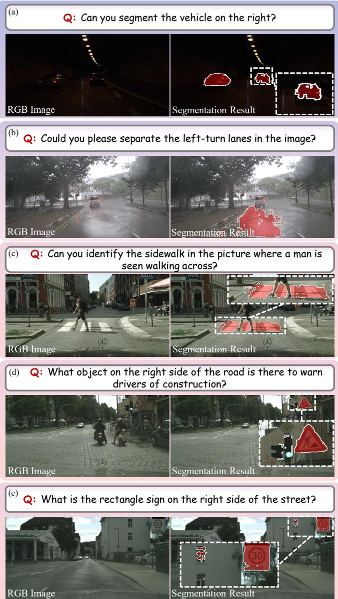  
Fig. 11. Unsatisfactory results on the DSRS dataset: (a) areas with insufficient illumination; (b) blurred scene under rainy conditions; (c) areas with indistinct boundaries; (d) additional areas of erroneous segmentation; (e) contextual confusions. Challenging areas are highlighted with white dashed boxes.

## H. Failure Cases

While DSRS-Net demonstrates significant progress, it still faces challenges in several scenarios. As illustrated in Fig. 11(a), segmentation performance degrades in low-light regions, where objects cannot be clearly distinguished. In challenging weather conditions, such as the blurred rainy scene in Fig. 11(b), the network struggles to effectively integrate geometric features for robust scene reasoning. Furthermore, when targets lack well-defined boundaries, such as the sidewalk in Fig. 11(c), the model can localize the region but fails to produce accurate boundaries. A similar issue arises in Fig. 11(d), where although the traffic sign is correctly segmented, additional areas of erroneous segmentation appear around it. In addition to segmentation quality, the network’s contextual reasoning also requires improvement. For instance, in Fig.

11(e), DSRS-Net mistakenly segments a window together with the traffic sign, likely due to confusion caused by the textual cue “rectangle”. Addressing these limitations in both segmentation precision and contextual understanding presents promising directions for future research and optimization.

## I. Extensibility and Broader Applications

Moreover, the modular nature of the DHFI module allows it to be readily extended beyond DSRS-Net and applied to other related tasks. Serving as an auxiliary branch, it effectively incorporates spatial information and can be seamlessly embedded into various backbone architectures. For instance, it can be incorporated into LLM-based frameworks to strengthen multimodal feature alignment. Additionally, its $\mathrm { D A } ^ { 2 }$ submodule can serve as a depth-aware alternative to conventional crossattention mechanisms, thereby strengthening the interaction of spatial features within transformer-based backbones. Furthermore, the integration of spatial cues benefits a wide range of vision tasks, including 3D scene reasoning, embodied visual question answering, and vision-language navigation, where explicitly modeling spatial dependencies is critical for precise perception and reliable reasoning.

## J. Future Directions

Looking ahead, advancements in LLMs present new opportunities for robust scene reasoning and decision-making in automated driving. Drawing inspiration from DriveLM’s [31] graph-based reasoning for sequential decision-making, a promising future direction for DSRS-Net lies in an evolution from a static reasoning framework to a dynamic system capable of localization, prediction, and action planning. Such an evolution would not only enhance DSRS-Net’s adaptability and responsiveness to dynamic real-time challenges but also pave the way for more intelligent and interactive automated driving systems.

## K. Implementation Details

For instruction tuning, we optimize DSRS-Net using AdamW with an initial learning rate of $2 \times 1 0 ^ { - 4 }$ and a weight decay of 0.01. We adopt a cosine learning-rate schedule with 1K warm-up iterations and clip the gradient norm to 1.0. The model is trained with a batch size of 2 and 16 gradientaccumulation steps. We employ LoRA to efficiently finetune the LLMs. All experiments are conducted using BF16 precision on an NVIDIA A800 GPU.

## L. Training Datasets

Our training data comprises four primary dataset types: (1) For the semantic segmentation dataset, we use ADE20K [82], Mapillary [90] and COCO-Stuff [91]; (2) For the referring expression segmentation dataset, we use RefCOCO, RefCOCO+ [59], and RefCOCOg [60]; (3) Visual question answering (VQA) datasets [9], [92]; (4) For the reasoning segmentation dataset, we use the ReasonSeg [1]. Notably, to ensure a zeroshot evaluation shown in Table 1 in the main text, the above training data excludes all samples from the DSRS dataset and is used exclusively for fine-tuning.

## M. Evaluation Metrics

We quantify the DSRS performance of models using the variations of intersection over union (IoU) metric, specifically cumulative intersection over union (cIoU) and generalized intersection over union (gIoU) metrics.

1) cIoU: The cIoU metric aims to evaluate segmentation performance at the dataset level. For a given prediction mask $_ { r }$ and its corresponding ground truth mask G, the IoU metric is calculated as the ratio of their intersection to the area of their union as follows:

$$
\operatorname { I o U } = { \frac { | P \cap G | } { | P \cup G | } } .\tag{8}
$$

The cIoU extends IoU by aggregating intersection and union values across all samples before computing their ratio expressed as follows:

$$
\mathrm { c I o U } = \frac { \sum _ { i = 1 } ^ { N } \left| \boldsymbol { P } _ { i } \cap \boldsymbol { G } _ { i } \right| } { \sum _ { i = 1 } ^ { N } \left| \boldsymbol { P } _ { i } \cup \boldsymbol { G } _ { i } \right| } ,\tag{9}
$$

where N represents the total number of samples in the dataset, and $P _ { i }$ and $G _ { i }$ denote the prediction and ground truth masks for the i-th sample, respectively. This cumulative computation can prevent individual samples with small regions from disproportionately affecting the overall performance metric.

2) gIoU: The gIoU metric offers a complementary perspective to cIoU by evaluating segmentation performance at the instance level. Unlike cIoU, which provides a datasetlevel assessment and favors larger objects, gIoU computes the mean IoU across all samples, treating each instance equally regardless of its size, formulated as follows:

$$
\mathrm { g I o U } = \frac { 1 } { N } \sum _ { i = 1 } ^ { N } \frac { | \boldsymbol { P } _ { i } \cap \boldsymbol { G } _ { i } | } { | \boldsymbol { P } _ { i } \cup \boldsymbol { G } _ { i } | } ,\tag{10}
$$

This metric can, therefore, evaluate the model’s consistency across different instances and scales, as it gives equal weight to each prediction regardless of the object’s size. In cases where the ground truth mask is empty, and the model correctly predicts no object $( | P _ { i } \cup G _ { i } | = 0 )$ ), the instance is assigned a perfect score of $\frac { | P _ { i } \rangle \langle \negthickspace } { | P _ { i } \cup G _ { i } | } = 1 . 0$ to avoid penalizing the model for a correct negative prediction.

## N. Competitors and Implementation Details

In this section, we provide a detailed summary of the models evaluated in Table 1 of the main text.

ReLA [41] proposes a region-based baseline for generalized referring expression segmentation, where one expression may refer to single, multiple, or no target objects. It adaptively divides an image into regions with sub-instance clues and explicitly models both region-region and region-language dependencies to handle complex relational expressions. For implementation, we follow the official repository with the Swin-Base backbone and default inference pipeline. We obtain the zero-shot results using the released model weights, while the fine-tuned results are obtained by supervised fine-tuning on our DSRS dataset under its default training configuration.

X-Decoder [42] presents a generalized decoding model that jointly predicts pixel-level segmentation masks and language tokens in a unified semantic space. It uses generic nonsemantic queries and text-induced semantic queries to support diverse segmentation and vision-language tasks, enabling transferable pixel-level visual-semantic understanding across zero-shot and fine-tuning settings. For implementation, we follow the official repository with the Focal-L backbone and default evaluation pipeline. In the zero-shot setting, we directly evaluate the released X-Decoder checkpoint; for the fine-tuned setting, we initialize from this checkpoint and adapt the model on our DSRS dataset using its standard training setup.

SEEM [43] presents a promptable and interactive segmentation model that aims to segment everything in an image through a unified multimodal prompt interface. It introduces a decoding mechanism that supports diverse prompts, including points, boxes, scribbles, masks, text, and their combinations, while learning a joint visual-semantic space and using memory prompts to preserve interaction history for multi-round segmentation. For implementation, we follow the official repository and use SEEM v1 with the SAM-ViT-L backbone. The zero-shot setting evaluates the released SEEM checkpoint, and the fine-tuned setting applies supervised fine-tuning on our DSRS dataset under its default training configuration.

Grounded-SAM [44] assembles Grounding DINO and Segment Anything Model into an open-world detection-andsegmentation pipeline, where arbitrary text inputs are first grounded as object boxes and then converted into pixel-level masks by SAM. This modular design enables text-guided segmentation of open-set regions and can be further connected with other vision models for automatic annotation, image editing, and multimodal visual analysis. For implementation, we follow the official repository and use Grounding DINO with the Swin-T backbone and SAM with the ViT-H backbone as the detector-segmenter pipeline. For zero-shot evaluation, we feed each instruction as the text prompt and follow the default inference pipeline for box prediction and mask generation. In the fine-tuned setting, we adapt the detector-segmenter pipeline to our DSRS dataset with the official training setup.

LISA [1] proposes a large language instructed segmentation assistant for reasoning segmentation, which produces segmentation masks from complex and implicit queries requiring visual reasoning and world knowledge. Architecturally, LISA consists of a vision branch and an MLLM branch. In the vision branch, a SAM vision backbone extracts dense, highresolution visual features for the mask decoder. In the MLLM branch, LLaVA jointly processes the input image and text query using a visual encoder, a linear projector for feature alignment, and a language model for reasoning and response generation. To connect the two branches, LISA adds a [SEG] token and projects its last-layer MLLM embedding into the SAM prompt space via an MLP, following an embedding-asmask paradigm. The SAM mask decoder combines this prompt with the SAM visual features to predict the final mask. For implementation, we follow the official repository and use the LISA-7B checkpoint. Its MLLM is LLaVA-Lightning-7B-v1-

1, which uses CLIP ViT-L/14 as its visual encoder and Vicuna 7B as its language model, while SAM ViT-H serves as the segmentation backbone. The zero-shot setting evaluates this checkpoint through the default evaluation pipeline, while the fine-tuned setting performs supervised fine-tuning on our DSRS dataset following the official training recipe.

GSVA [6] proposes a generalized segmentation vision assistant for generalized referring expression segmentation, targeting cases where one expression may refer to multiple objects or no valid target in the image. Architecturally, GSVA follows LISA and couples an MLLM branch with a Segmentation Foundation Model (SFM) branch. In the MLLM branch, LLaVA processes the input image and text using a vision encoder, a linear projector for feature alignment, and a decoder-based language model. In the SFM branch, a frozen high-resolution vision encoder extracts dense features, and a trainable mask decoder predicts masks from segmentation queries. GSVA extends the embedding-as-mask mechanism by generating multiple weight-sharing [SEG] tokens, each guided by its preceding referent phrase, and [REJ] tokens for absent targets. An MLP projects the embeddings of all [SEG] tokens into the SFM prompt space for mask decoding, whereas [REJ] tokens are discarded and assigned all-zero masks. For implementation, we follow the official repository and use GSVA-7B with LLaVA-Lightning-7B-v1-1 as the prompt encoder and SAM ViT-H as the segmentation model. LLaVA-Lightning-7B-v1-1 uses CLIP ViT-L/14 as its visual encoder and Vicuna 7B as its language model. The zero-shot setting evaluates the released pretrained GSVA-7B weights with the default evaluation pipeline, and the fine-tuned setting further applies supervised fine-tuning on our DSRS dataset under its default configuration.

PixelLM [45] proposes an efficient large multimodal model for pixel-level reasoning and understanding. Architecturally, it comprises a CLIP-ViT vision encoder, a language model, a segmentation codebook, and a lightweight pixel decoder. The final-layer visual features are aligned with the language space through a vision-to-language projector, while multi-scale features are mapped to the pixel decoder through a separate vision-to-decoder projector. The hidden embeddings of the generated codebook tokens encode target-specific information at different visual scales, and the pixel decoder combines them with the corresponding image features to progressively refine and fuse scale-wise masks. This design avoids an additional segmentation model such as SAM, while a target refinement loss further improves multi-target discrimination and mask quality. For implementation, we follow the official PixelLM repository and use PixelLM-7B initialized from LLaVA-Lightning-7B-v1-1. Its MLLM uses CLIP ViT-L as the vision encoder, an MLP projector for feature alignment, and Vicuna 7B as the language model, while the segmentation codebook and PixelLM decoder are used for mask generation. The zeroshot setting evaluates the released PixelLM-7B checkpoint, while the fine-tuned setting applies supervised fine-tuning on our DSRS dataset using the default training configuration.

M2SA [22] extends LISA for multi-target and multigranularity reasoning segmentation with early local feature fusion and multiple [SEG] tokens. Architecturally, it consists of a vision branch and an MLLM branch. In the vision branch, the SAM vision encoder extracts both early-layer local features and last-layer global features. Two convolutional layers align the local features with the global features, which are then fused to provide fine-grained visual representations for mask decoding. In the MLLM branch, LLaVA encodes the image using a CLIP vision encoder, maps the visual features into the language embedding space through a vision-to-text projector, and jointly processes them with the text query using a language model. The MLLM generates a separate [SEG] token for each target, and an MLP prompt projector maps their hidden states into the SAM prompt space. The SAM mask decoder then combines these prompt embeddings with the fused SAM visual features to predict the corresponding segmentation masks. For implementation, we follow the official repository and use the M2SA-7B checkpoint. Its MLLM is LLaVA-Lightning-7B-v1- 1, which uses CLIP ViT-L/14 as its visual encoder and Vicuna 7B as its language model, while SAM ViT-H serves as the segmentation backbone. For zero-shot evaluation, we evaluate the released M2SA-7B checkpoint with the default validation pipeline, and the fine-tuned setting further adapts the model on our DSRS dataset under its default training configuration.

SegAgent [46] introduces the Human-Like Mask Annotation Task (HLMAT), which formulates segmentation as a multistep decision-making process that imitates human annotation trajectories. Architecturally, SegAgent couples an MLLM policy with an interactive segmentation model without introducing implicit mask tokens or modifying the MLLM output space. At each step, the current mask is overlaid on the original image and encoded by the frozen Qwen-VL ViT. A Qwen-VL vision-language adapter maps the resulting visual tokens into the language space, where Qwen jointly reasons over the visual state and target description to generate the next positive or negative click as text coordinates. SClick then uses its ViT-L visual backbone to update the segmentation mask from the accumulated clicks and previous mask, and the resulting mask is fed back to the MLLM for the next decision. For implementation, we follow the official two-stage pipeline and use SegAgent-Qwen initialized from Qwen-VL-Chat together with the pretrained SClick model. For the finetuned setting, since our DSRS dataset is not annotated in the HLMAT trajectory format, we freeze SegAgent-Qwen to retain its prompt-conditioned point selection ability while adapting the segmentation module.

Seg-R1 [47] uses reinforcement learning to enhance pixellevel understanding in large multimodal models by reducing dense mask prediction to sparse prompt generation. Architecturally, it couples a Qwen2.5-VL policy model with a SAM2 segmentation branch. In the MLLM branch, the Qwen2.5- VL vision encoder extracts image features, and its built-in visual merger maps them into the language space. Qwen then autoregressively generates a reasoning trace together with bounding boxes, foreground and background points, and their labels as ordinary text tokens. In the segmentation branch, the SAM2 image encoder extracts dense visual features, while its prompt encoder converts the generated boxes and points into prompt embeddings. The SAM2 mask decoder combines these embeddings with the image features to predict the final mask. Seg-R1 trains this prompt-generation policy with Group Relative Policy Optimization using format and segmentation rewards. For implementation, we follow the official repository and use the Seg-R1-7B checkpoint with Qwen2.5-VL as the policy model and SAM2 Hiera-L as the segmentation model. For zero-shot evaluation, we test the released checkpoint under the official Reasoning Segmentation protocol. For the finetuned setting, we start from Seg-R1-7B and conduct supervised fine-tuning on our DSRS dataset.

ConverSeg-Net [48] targets conversational image segmentation by grounding intent-driven concepts involving functional and physical reasoning into pixel-accurate masks. Architecturally, it couples a SAM2 vision branch with a compact Qwen2.5-VL prompt encoder. In the vision branch, the frozen SAM2 image encoder processes the image once to produce a spatial embedding. In the vision-language branch, Qwen2.5- VL jointly encodes the image and conversational prompt and extracts final-layer hidden states for the text tokens and the end-of-sequence (EOS) token. A linear projector maps the text-token states to sparse prompt embeddings, while a twolayer MLP with a SiLU activation maps the EOS state to a dense prompt embedding that captures global image-text context. The SAM2 mask decoder uses bidirectional crossattention to fuse these language-conditioned prompts with the spatial image embedding and predicts the final mask. For implementation, we follow the official repository and use the open-source ConverSeg-Net-3B checkpoint with Qwen2.5-VL as the prompt encoder. The zero-shot inference is performed with ConverSeg-Net-3B, and the fine-tuned setting initializes from this checkpoint and applies supervised fine-tuning on our DSRS dataset.

## O. Depth Source, Quality, and Robustness Analysis

We generate all depth maps offline using the Large variant of Depth Anything V2 [88]. The generated maps represent monocular relative depth rather than metric depth and are directly fed into our DSRS-Net. Additionally, Table 4 of the main paper demonstrates that relative depth provides effective geometric cues. Compared with the RGB-only baseline, incorporating relative depth through GPE and DHFI improves gIoU from 53.0 to 55.4. Moreover, commonly used segmentation datasets, including ADE20K [82], COCO-Stuff [91], referring-segmentation benchmarks [59], [60], and ReasonSeg [1], do not provide ground-truth depth. Offline relative depth is therefore a more realistic and broadly applicable choice than assuming access to metric-depth annotations.

We further evaluate DSRS-Net using relative-depth maps generated by the Small, Base, and Large variants of Depth Anything V2 and perturb the Large-model depth maps with zero-mean Gaussian noise at different intensities. As shown in Fig. 12 and Table IX, all three depth variants yield positive results over RGB-only inference, indicating that the benefit is not restricted to the highest-capacity depth estimator. The model also remains robust under small perturbations because GPE and DHFI can tolerate moderate local depth errors. Under severe corruption, however, performance falls below the RGB-only baseline. Heavily distorted geometric relationships conflict with the appearance features and disrupt the original balance learned by the LLM and interaction modules. This analysis shows that DSRS-Net is robust to variations in depthestimation quality and moderate noise, but is not invariant to severely corrupted geometric inputs.

<table><tr><td>Depth input</td><td>Perturbation</td><td>gIoU</td></tr><tr><td>None (RGB-only)</td><td>一</td><td>53.0</td></tr><tr><td>Depth Anything V2-Small</td><td>None</td><td>54.2</td></tr><tr><td>Depth Anything V2-Base</td><td>None</td><td>54.9</td></tr><tr><td>Depth Anything V2-Large</td><td>None</td><td>55.4</td></tr><tr><td>Depth Anything V2-Large</td><td>Gaussian (σ = 0.2)</td><td>53.5</td></tr><tr><td>Depth Anything V2-Large</td><td>Gaussian (σ = 0.5)</td><td>48.8</td></tr><tr><td>Depth Anything V2-Large</td><td>Gaussian (σ = 0.8)</td><td>40.2</td></tr></table>

TABLE IX  
INFLUENCE OF DEPTH SOURCES AND GAUSSIAN PERTURBATIONS ON THE DSRS DATASET. GAUSSIAN NOISE IS APPLIED TO RELATIVE-DEPTH MAPS NORMALIZED TO [0, 1].

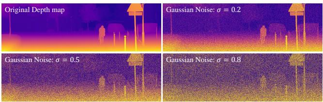  
Fig. 12. Visualizations of noisy depth maps.

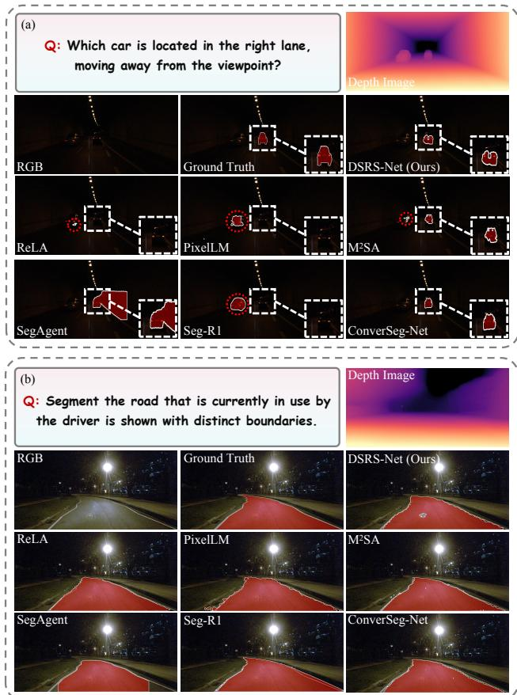

Fig. 13. Qualitative results of depth quality analysis under low illumination.  
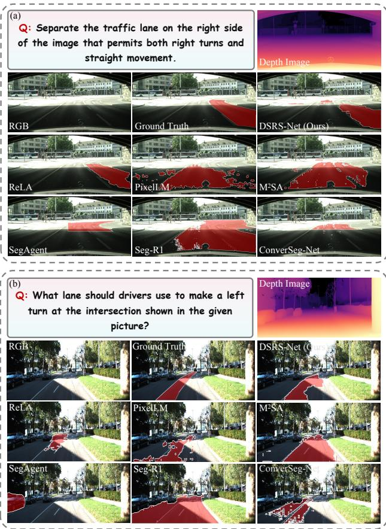

Fig. 14. Qualitative results of depth quality analysis under strong illumination.
<table><tr><td rowspan="3">Method</td><td colspan="4">Zero-shot (zs)</td><td colspan="3">Fine-tuned (ft)</td></tr><tr><td>Val</td><td colspan="2">Test</td><td colspan="2">Val</td><td colspan="2">Test</td></tr><tr><td>gIoU cIoU</td><td>gIoU</td><td>cIoU</td><td>gloU</td><td>cIoU</td><td>gIoU</td><td>cIoU</td></tr><tr><td>LISA-LLaVAv1 [1]</td><td>22.7</td><td>20.3</td><td>30.5</td><td>28.3</td><td>55.7 52.5</td><td>56.8</td><td>55.1</td></tr><tr><td>GSVA-LLaVAv1 [6]</td><td>26.1</td><td>19.4</td><td>31.1</td><td>26.3</td><td>59.7 60.8</td><td>59.9</td><td>61.0</td></tr><tr><td>DSRS-Net-LLaVAv1</td><td>27.3</td><td>22.7 TABLE X</td><td>34.2</td><td>29.1</td><td>61.6 64.5</td><td>61.0</td><td>65.0</td></tr></table>

SAME-BACKBONE COMPARISON ON THE DSRS DATASET.  
DSRS-Net-LLAVAV1 ADOPTS THE LISA BACKBONE AUGMENTED WITH OUR GPE AND DHFI COMPONENTS.

To examine the performance of existing models on the DSRS task when estimated depth is degraded, we qualitatively evaluate these models under five representative challenging conditions: low illumination, strong illumination, visual blur, background clutter, and targets with small spatial extent. The qualitative results under these conditions correspond to Figs. 13–17, respectively.

Figs. 13–15 show that extreme illumination and adverse weather simultaneously degrade RGB visibility and monocular depth quality. In dark tunnels and nighttime scenes, low appearance contrast and imprecise depth boundaries around roads and pedestrians often result in localization errors and incomplete segmentation masks. Conversely, overexposed road regions distort local depth and interfere with lane localization. Fog and rain further obscure small structures and reduce depth contrast among vehicles, roads, and roadside objects, resulting in imprecise contours.

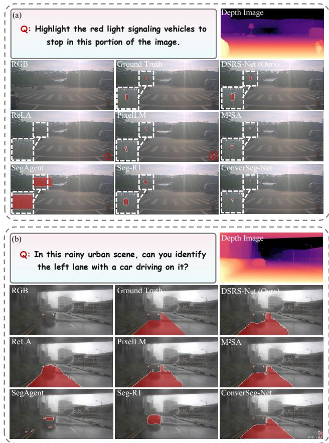

Fig. 15. Qualitative results of depth quality analysis under visual blur.
<table><tr><td>Metric</td><td>DSRS-Net- LLaVA1.5</td><td>DSRS-Net- InternVL2.5</td><td>Depth Generation</td></tr><tr><td>Input resolution</td><td>336 × 336</td><td>896 × 896</td><td>518 × 518</td></tr><tr><td>Total parameters (B)</td><td>7.12</td><td>8.14</td><td>0.34</td></tr><tr><td>Trainable parameters (M)</td><td>318.46</td><td>82.43</td><td>N/A</td></tr><tr><td>FLOPs (T/image)</td><td>17.31</td><td>36.06</td><td>1.30</td></tr><tr><td>Latency (s/image)</td><td>2.07</td><td>3.81</td><td>0.12</td></tr><tr><td>Throughput (images/s)</td><td>0.48</td><td>0.26</td><td>8.65</td></tr><tr><td>Peak GPU memory (GB)</td><td>28.43</td><td>34.68</td><td>1.75</td></tr><tr><td>Test GPU</td><td>A800</td><td>A800</td><td>RTX 3090</td></tr><tr><td>Execution mode</td><td>Online</td><td>Online</td><td>Offline</td></tr></table>

COMPUTATIONAL EFFICIENCY OF DSRS-Net AND THE OFFLINE DEPTH GENERATION PIPELINE. BOTH DSRS-Net VARIANTS ARE EVALUATED ON AN A800 GPU WITH BATCH SIZE 1. RELATIVE DEPTH MAPS ARE GENERATED IN ADVANCE WITH DEPTH ANYTHING V2-LARGE ON AN RTX 3090 GPU.

Background clutter and small target scale introduce similar difficulties. As shown in Fig. 16, nearby windows, walls, and vegetation blur the depth boundaries of traffic signs. In Fig. 17, potholes occupy only a few pixels and exhibit weak depth differences from the surrounding road, increasing both missed detections and false positives. These cases indicate that unreliable depth is harmful when the RGB appearance is already ambiguous or the target geometry is too fine-grained to be preserved.

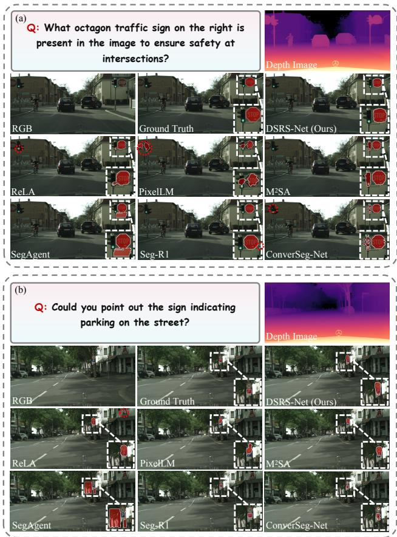  
Fig. 16. Qualitative results of depth quality analysis under background clutter.

Importantly, these failures cannot be attributed solely to the geometric branch. The conditions that produce poor depth maps are themselves highly challenging for RGB-only reasoning segmentation. For example, in Fig. 13(b), competing RGB-based models without explicit geometric priors also fail to identify the correct drivable road because illumination and lane-boundary cues are severely degraded. Thus, depth degradation and RGB ambiguity jointly limit performance, while corrupted geometry may further disturb the learned balance between appearance and geometric features. In future work, we will introduce depth-confidence estimation and uncertainty-aware adaptive fusion, allowing the model to suppress unreliable geometric cues and fall back to RGB features when necessary. We will also incorporate depth-corruption augmentation during training to improve robustness under low light, adverse weather, clutter, and small-target scenarios.

## P. Fair Comparison with Depth-Enhanced Baselines

As shown in Table X, to isolate the contribution of our architectural innovations from that of the MLLM backbone, we integrate GPE and DHFI into LISA while retaining the same LLaVA-v1 7B backbone. The controlled gains are smaller than the headline improvements in the main comparison because the backbone advantage is removed. Even under this stricter setting, DSRS-Net raises test gIoU from 30.5 to 34.2 in zeroshot evaluation and from 56.8 to 61.0 after fine-tuning. These positive results show that depth-aware geometric modeling and hierarchical feature interaction remain effective independently of backbone strength. The fine-tuned test cIoU also rises from 55.1 to 65.0, providing further evidence that our method improves mask quality under a matched backbone.

<table><tr><td rowspan="2">Method</td><td rowspan="2">MLLM</td><td colspan="2">Val</td><td colspan="5">Test</td></tr><tr><td colspan="2">Overall</td><td colspan="2">Short Query</td><td colspan="2">Long Query</td><td colspan="2">Overall</td></tr><tr><td></td><td></td><td>gIoU</td><td>cIoU</td><td>gIoU</td><td>cIoU</td><td>gIoU</td><td>cIoU</td><td>gIoU</td><td>cIoU</td></tr><tr><td>OVSeg [54]</td><td></td><td>28.5</td><td>18.6</td><td>18.0</td><td>15.5</td><td>28.7</td><td>22.5</td><td>26.1</td><td>20.8</td></tr><tr><td>ReLA [41]</td><td></td><td>22.4</td><td>19.9</td><td>17.6</td><td>15.0</td><td>22.6</td><td>23.8</td><td>21.3</td><td>22.0</td></tr><tr><td>X-Decoder [42]</td><td></td><td>22.6</td><td>17.9</td><td>20.4</td><td>11.6</td><td>22.2</td><td>17.5</td><td>21.7</td><td>16.3</td></tr><tr><td>SEEM [43]</td><td></td><td>25.5</td><td>21.2</td><td>20.1</td><td>11.5</td><td>25.6</td><td>20.8</td><td>24.3</td><td>18.7</td></tr><tr><td>Grounded-SAM [44]</td><td></td><td>26.0</td><td>14.5</td><td>17.8</td><td>10.8</td><td>22.4</td><td>18.6</td><td>21.3</td><td>16.4</td></tr><tr><td>LLaVA-7B + OVSeg</td><td>LLaVA-NeXT-7B</td><td>38.2</td><td>23.5</td><td>24.2</td><td>18.7</td><td>44.6</td><td>37.1</td><td>39.7</td><td>31.8</td></tr><tr><td>LLaVA-7B + CoT + OVSeg</td><td>LLaVA-NeXT-7B LLaVA-v1 7B</td><td>42.1</td><td>26.6</td><td>27.5</td><td>19.6</td><td>44.6</td><td>40.2</td><td>40.4</td><td>34.0</td></tr><tr><td>LISA-7B [1] LISA-7B (ft) [1]</td><td>LLaVA-v1 7B</td><td>44.4</td><td>46.0</td><td>37.6</td><td>34.4</td><td>36.6</td><td>34.7</td><td>36.8</td><td>34.1</td></tr><tr><td>LISA-7B [1]</td><td>LLaVA-1.5 7B</td><td>52.9</td><td>54.0 52.3</td><td>40.6 47.1</td><td>40.6 48.5</td><td>49.4</td><td>51.0</td><td>47.3</td><td>48.4</td></tr><tr><td>LISA-7B (ft) [1]</td><td>LLaVA-1.5 7B</td><td>53.6</td><td></td><td>48.3</td><td></td><td>49.2</td><td>48.9</td><td>48.7</td><td>48.8</td></tr><tr><td>LISA++-7B (ft) [93]</td><td>LLaVA-1.5 7B</td><td>61.3</td><td>62.9</td><td>49.6</td><td>46.3</td><td>57.9</td><td>59.7</td><td>55.6</td><td>56.9</td></tr><tr><td></td><td>LLaVA-v1 7B</td><td>64.2</td><td>68.1 32.1</td><td></td><td>51.1</td><td>59.3</td><td>61.7</td><td>57.0</td><td>59.5</td></tr><tr><td>PixelLM [45] M²SA-7B [22]</td><td>LLaVA-v1 7B</td><td>44.4 30.5</td><td>35.2</td><td></td><td></td><td></td><td></td><td>41.1</td><td>38.1</td></tr><tr><td>Seg-R1 [47]</td><td>Qwen2.5-VL 7B</td><td>58.6</td><td>41.2</td><td></td><td></td><td></td><td></td><td>24.7</td><td>28.0</td></tr><tr><td>SegAgent [46]</td><td>Qwen-VL 7B</td><td>34.4</td><td>28.7</td><td></td><td></td><td></td><td></td><td>56.7</td><td>53.7</td></tr><tr><td>RSVP-LLaVA [94]</td><td>LLaVA-NeXT-7B</td><td>59.2</td><td>56.7</td><td>47.9</td><td>42.0</td><td></td><td>53.0</td><td>34.5</td><td>31.2</td></tr><tr><td>RSVP-Qwen [94]</td><td>Qwen2-VL 7B</td><td>58.6</td><td>48.5</td><td>48.5</td><td>44.3</td><td>58.4 57.1</td><td>53.8</td><td>55.9</td><td>50.7</td></tr><tr><td>RSVP-Gemini [94]</td><td>Gemini-Flash</td><td>56.9</td><td>49.2</td><td>47.3</td><td>40.2</td><td>60.2</td><td>65.6</td><td>56.6 57.1</td><td>51.6</td></tr><tr><td>RSVP-GPT [94]</td><td>GPT-40</td><td>64.7</td><td>63.1</td><td>55.4</td><td>50.4</td><td>61.9</td><td>62.5</td><td>60.3</td><td>59.2</td></tr><tr><td>ConverSeg-Net [48]</td><td>Qwen2.5-VL 3B</td><td>56.4</td><td>-</td><td>53.8</td><td></td><td>51.7</td><td></td><td></td><td>60.0</td></tr><tr><td></td><td></td><td></td><td></td><td></td><td></td><td></td><td>-</td><td>52.2</td><td></td></tr><tr><td>DSRS-Net</td><td>LLaVA1.5 7B</td><td>53.9</td><td>57.7</td><td>40.6</td><td>34.8</td><td>57.0</td><td>63.8</td><td>54.5</td><td>56.8</td></tr><tr><td>DSRS-Net (ft)</td><td>LLaVA1.5 7B InternVL2.5 8B</td><td>54.1</td><td>60.5 57.2</td><td>43.2 51.6</td><td>40.2 46.1</td><td>58.7 63.4</td><td>64.0 68.8</td><td>55.0</td><td>58.1</td></tr><tr><td>DSRS-Net</td><td></td><td>57.0</td><td></td><td>54.6</td><td></td><td></td><td>74.9</td><td>60.5</td><td>63.3</td></tr><tr><td>DSRS-Net (ft)</td><td>InternVL2.5 8B</td><td>62.5</td><td>66.8</td><td></td><td>51.1</td><td>68.6</td><td></td><td>65.2</td><td>69.4</td></tr></table>

TABLE XII  
SUPPLEMENTARY COMPARISON ON THE REASONSEG BENCHMARK UNDER DIFFERENT QUERY LENGTHS.

<table><tr><td rowspan="2">Methods</td><td rowspan="2">Spatoal Rtons</td><td colspan="2">Potential Risks</td><td colspan="3">Challenging Conditions</td><td colspan="6">Traffic Rules</td><td rowspan="2">Oeral</td></tr><tr><td>Obstacle</td><td>Roa Deet</td><td>Traci Acdent</td><td>Comprex erain Lis ion</td><td>weadier ciion</td><td>Biy ane</td><td>Bu ane</td><td>Crosswalk</td><td>Tra  ane</td><td>Trac Liieht</td><td>Tiaf SSign</td><td></td></tr><tr><td>PixelLM [45]</td><td>53.0</td><td>27.9</td><td>10.4</td><td>65.4</td><td>55.5</td><td>53.0</td><td>35.2</td><td>55.3</td><td>50.3</td><td>47.4</td><td>64.0</td><td>19.2</td><td>25.4</td><td>40.1</td></tr><tr><td>M2SA [22]</td><td>82.5</td><td>46.7</td><td>52.1</td><td>81.0</td><td>62.1</td><td>70.7</td><td>64.1</td><td>59.6</td><td>42.9</td><td>53.6</td><td>66.5</td><td>43.9</td><td>42.8</td><td>57.5</td></tr><tr><td>SegAgent [46]</td><td>80.5</td><td>17.4</td><td>0.4</td><td>80.9</td><td>47.1</td><td>58.7</td><td>33.7</td><td>22.8</td><td>6.4</td><td>20.4</td><td>32.9</td><td>12.6</td><td>16.7</td><td>30.3</td></tr><tr><td>ConverSeg-Net [48]</td><td>83.1</td><td>45.2</td><td>2.0</td><td>86.5</td><td>74.0</td><td>66.1</td><td>62.7</td><td>25.0</td><td>21.2</td><td>32.1</td><td>49.9</td><td>48.4</td><td>46.3</td><td>47.9</td></tr><tr><td>DSRS-Net (Ours)</td><td>85.0</td><td>58.8</td><td>41.5</td><td>86.5</td><td>77.8</td><td>77.9</td><td>66.5</td><td>80.9</td><td>70.4</td><td>72.6</td><td>74.5</td><td>53.6</td><td>57.3</td><td>71.2</td></tr></table>

PER-CATEGORY RESULTS ON THE DSRS DATASET.

## Q. Computational Efficiency and Deployment Analysis

We evaluate the computational efficiency of DSRS-Net with both LLaVA1.5-7B and InternVL2.5-8B backbones. Both model variants are tested on an A800 GPU with batch size one. The relative depth maps are generated and tested in advance using Depth Anything V2-Large on an RTX 3090 GPU. We report the total and trainable parameters, floating-point operations (FLOPs), end-to-end inference latency, throughput, and peak GPU memory. Latency is averaged over 100 inference runs after 10 warm-up runs, and throughput is measured without data-loading time. Since the relative-depth maps are generated offline by Depth Anything V2, depth estimation is excluded from the online latency and memory measurements. The reported overhead therefore reflects the deployable reasoning-segmentation network itself.

As shown in Table XI, the LLaVA1.5 configuration provides a lighter deployment option, whereas the InternVL2.5 configuration targets stronger reasoning performance with a larger computational budget. The comparison enables practitioners to select a suitable configuration according to available memory and latency constraints. Moreover, offline depth generation avoids introducing an additional depth-estimation network into the online inference path, making DSRS-Net applicable to systems in which relative-depth maps can be precomputed or supplied by an independent perception module.

<table><tr><td rowspan="2">RGB Branch</td><td rowspan="2">Depth CLIP Branch</td><td rowspan="2">GPE</td><td rowspan="2">DHFI</td><td colspan="4">gIoU</td><td colspan="4">cIoU</td></tr><tr><td>Run 1</td><td>Run 2</td><td>Run 3</td><td> $\mathbf { M e a n } _ { \pm \mathrm { S t d } }$ </td><td>Run 1</td><td>Run 2</td><td>Run 3</td><td>Mean+Std</td></tr><tr><td>√</td><td></td><td></td><td></td><td>52.82</td><td>53.18</td><td>53.00</td><td> $5 3 . 0 0 { \scriptstyle \pm 0 . 1 8 }$ </td><td>50.66</td><td>50.18</td><td>50.42</td><td> $5 0 . 4 2 { \scriptstyle \pm 0 . 2 4 }$ </td></tr><tr><td>√</td><td>√</td><td></td><td></td><td>55.04</td><td>55.46</td><td>55.25</td><td> $5 5 . 2 5 { \scriptstyle \pm 0 . 2 1 }$ </td><td>52.12</td><td>51.95</td><td>52.29</td><td> $5 2 . 1 2 { \scriptstyle \pm 0 . 1 7 }$ </td></tr><tr><td>√</td><td></td><td>√</td><td></td><td>37.66</td><td>37.12</td><td>37.39</td><td> $3 7 . 3 9 { \scriptstyle \pm 0 . 2 7 }$ </td><td>36.48</td><td>36.67</td><td>36.86</td><td> $3 6 . 6 7 { \scriptstyle \pm 0 . 1 9 }$ </td></tr><tr><td>√</td><td></td><td></td><td>√</td><td>53.42</td><td>53.28</td><td>53.14</td><td> $5 3 . 2 8 _ { \pm 0 . 1 4 }$ </td><td>54.88</td><td>55.32</td><td>55.10</td><td> $5 5 . 1 0 { \scriptstyle \pm 0 . 2 2 }$ </td></tr><tr><td>√</td><td></td><td>√</td><td>√</td><td>55.24</td><td>55.40</td><td>55.56</td><td> ${ \pm 5 5 . 4 0 } _ { \pm 0 . 1 6 }$ </td><td>57.10</td><td>56.84</td><td>56.97</td><td> ${ \bf 5 6 . 9 7 _ { \pm 0 . 1 3 } }$ </td></tr></table>

TABLE XIV  
COMPONENT-WISE ABLATION RESULTS OVER THREE INDEPENDENT RUNS ON THE DSRS DATASET. ±STD DENOTES THE SAMPLE STANDARD DEVIATION ACROSS THE THREE RUNS.

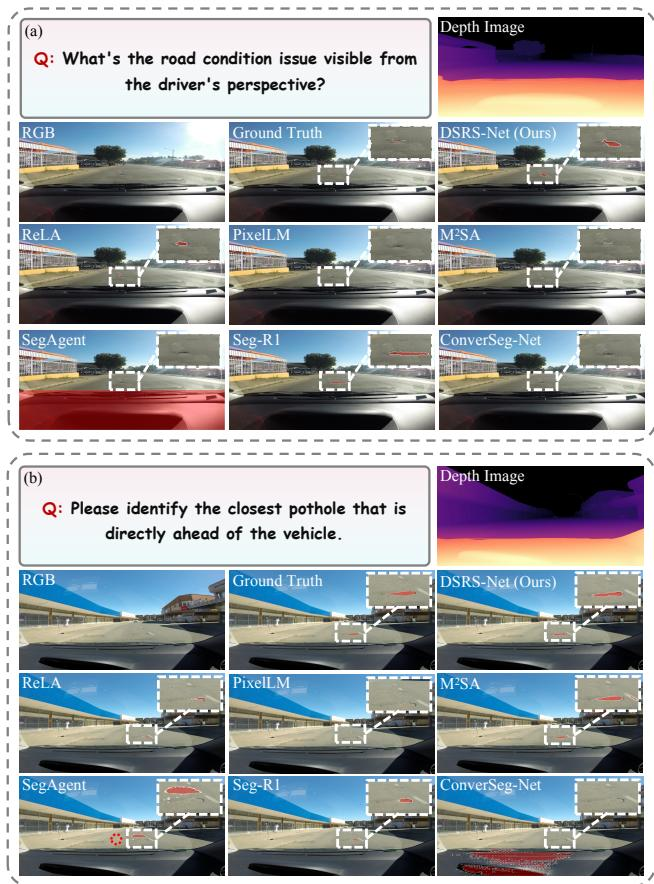  
Fig. 17. Qualitative results of depth quality analysis for targets with small spatial extent.

## R. Additional Comparison on the ReasonSeg Benchmark

Table XII further analyzes performance with respect to query length. For short queries, DSRS-Net-InternVL2.5 (ft) achieves 54.6 gIoU and 51.1 cIoU, improving the gIoU of

<table><tr><td>Contextual Features</td><td>Geometric Features</td><td>Fusion Strategies</td><td>gIoU</td><td>cIoU</td></tr><tr><td rowspan="3"> $\checkmark$ </td><td>√</td><td>Self-Attention</td><td>44.56</td><td>44.08</td></tr><tr><td>√</td><td>Element-wise Summation</td><td>50.47</td><td>51.12</td></tr><tr><td>√</td><td>Channel-wise</td><td>51.09</td><td>51.86</td></tr><tr><td>√ √</td><td>√</td><td>Concatenation Cross-Attention</td><td>52.78</td><td>54.05</td></tr><tr><td> $\checkmark$ </td><td>√</td><td> $D A ^ { 2 }$ </td><td>55.40</td><td>56.97</td></tr></table>

ABLATION STUDIES ON THE DHFI STRATEGY.

LISA++ by 5.0 points while matching its cIoU, and remaining competitive with the strongest RSVP-GPT result. The advantage becomes substantially larger for long queries. DSRS-Net-InternVL2.5 (ft) reaches 68.6 gIoU and 74.9 cIoU, outperforming LISA++ by 9.3 and 13.2 points and RSVP-GPT by 6.7 and 12.4 points, respectively. This pattern indicates that DSRS-Net is particularly effective for long, compositional instructions that require multi-step semantic reasoning, spatialrelation understanding, and precise grounding of the inferred target. We attribute this strength to the explicit interaction between contextual appearance features and geometric priors, which helps preserve target-relevant spatial evidence throughout complex reasoning. Consequently, DSRS-Net obtains the best overall test performance of 65.2 gIoU and 69.4 cIoU, demonstrating its advantage in resolving complex queries without sacrificing performance on concise instructions.

## S. Per-Category Results on the DSRS Dataset

Table XIII shows that DSRS-Net achieves the best overall gIoU of 71.2, demonstrating broad gains across different driving-scene reasoning categories. The model is particularly effective at spatial relations, traffic accidents, complex terrain, and adverse illumination, where correct predictions require jointly reasoning about scene context and geometric layout. It also performs strongly on traffic-rule categories involving spatially structured regions, including bicycle lanes, bus lanes, crosswalks, and traffic lanes, indicating that geometric priors help associate implicit functional descriptions with the correct road areas. Nevertheless, substantial room for improvement remains for road defects, traffic lights, traffic signs, and obstacles. Road defects often exhibit weak depth and appearance contrast with the surrounding road, while traffic lights and signs occupy very small regions and require fine-grained recognition of state, shape, and semantics. Weather conditions also remain challenging because rain and fog simultaneously degrade visual details and depth quality. Future work should therefore strengthen small-object representation, boundary refinement, uncertainty-aware geometric fusion, and categoryspecific reasoning for ambiguous or visually degraded targets.

## T. Additional Ablation Studies

As a further analysis of the ablation results reported in the main text, we examine how geometric priors and featureinteraction strategies contribute to DSRS-Net. As shown in Table XIV, we first feed the depth map into the CLIP-based vision encoder alongside the RGB image, resulting in a limited increase of 1.70% in cIoU compared to that of the RGBonly baseline. We attribute this phenomenon to the RGBonly pretraining mechanism of the MLLM, which renders it incapable of leveraging prior knowledge to effectively process geometric features. As discussed earlier, scene inference requires a specific mechanism to align geometric features with their underlying contextual representations. By incorporating the proposed GPE and DHFI modules, we observe a significant positive performance improvement in driving scene reasoning segmentation. Notably, gIoU and cIoU increase by 1.4% and 6.6%, respectively. These findings lend further support to our hypothesis stated earlier.

As observed, the improvement cannot be achieved without the contribution of the GPE module, which leads to an increase of approximately 2.1% in gIoU. However, when the GPE module is applied without the support of an interaction mechanism, performance significantly degrades to 36.7% in cIoU. This performance degradation likely arises from the representational incompatibility between the geometric features and the contextual features, thereby causing integration conflicts within the LLM. The effectiveness of the convolutional GPE module is significantly enhanced only when it follows the DHFI module. These experimental results underscore that the successful utilization of geometric features depends critically on both their effective extraction and proper alignment with contextual information.

As shown in Table XV, to investigate the most effective structure for the DHFI strategy, we substitute the basic $D A ^ { 2 }$ blocks with alternatives. We first construct baseline architectures utilizing self-attention blocks exclusively on geometric features. As expected, such a baseline architecture fails to achieve performance comparable to other fusion strategies. We then investigate the effectiveness of aligning geometric features with contextual vision features. It is evident that simple fusion strategies such as element-wise summation and channel-wise concatenation yield limited performance improvements, while attention-based strategies significantly improve the framework’s reasoning performance. Specifically, our proposed $D A ^ { 2 }$ module achieves an increase of 2.6% in gIoU and 2.9% in cIoU compared to the deformable crossattention strategy. These results demonstrate the efficacy of depth-aware offsets in guiding the model to focus more on contextually and geometrically relevant regions during the feature interaction process.

We compare the proposed DSRS-Net with existing language-driven segmentation networks on the DSRS dataset. Qualitative results are provided in Figs. 18 and 19 of the supplementary material. The evaluated scenarios are visually complex and involve multiple aspects, including spatial relations, potential risks, challenging conditions, and traffic rules. Moreover, the referred segmentation targets are highly diverse, encompassing a wide range of objects commonly encountered in driving scenes.

As illustrated in Figs. 18 and 19, it is evident that our proposed DSRS significantly outperforms existing approaches in driving scene reasoning segmentation. When the text query refers to the function of an object rather than its explicit appearance, most competing approaches struggle to associate it with the correct visual target. Furthermore, the performance gap becomes even more pronounced under challenging environmental conditions. For instance, as shown in the second example of Fig. 18 in the supplementary material, although scene visibility is reduced due to rain, DSRS accurately localizes the traffic light and yields accurate segmentation results. In contrast, other methods misidentify small twinkling elements as traffic lights and struggle to extract accurate object boundaries. Moreover, in scenarios involving multiple visually similar candidates that necessitate deep reasoning, as illustrated in the third example of Fig. 19 in the supplementary material, our method demonstrates superior inference capabilities and robustness.

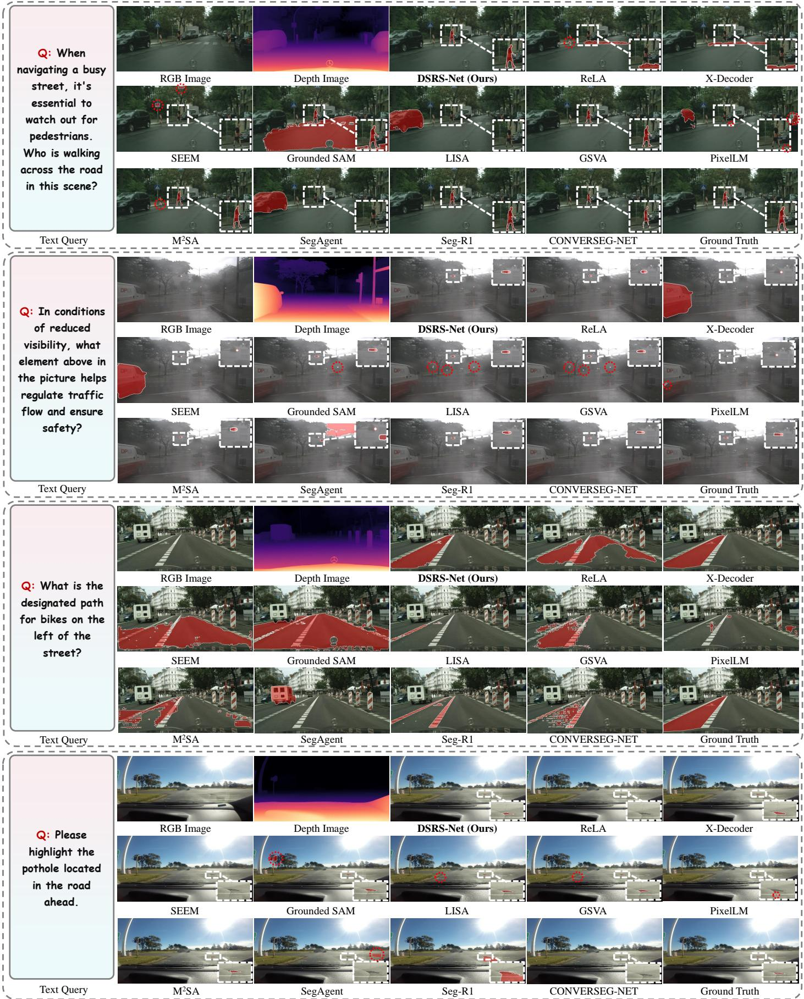  
Fig. 18. Qualitative comparisons between DSRS-Net and existing language-driven segmentation networks on the DSRS dataset, where ground-truth areas are highlighted with white dashed boxes and wrong areas are highlighted with red dashed circles.

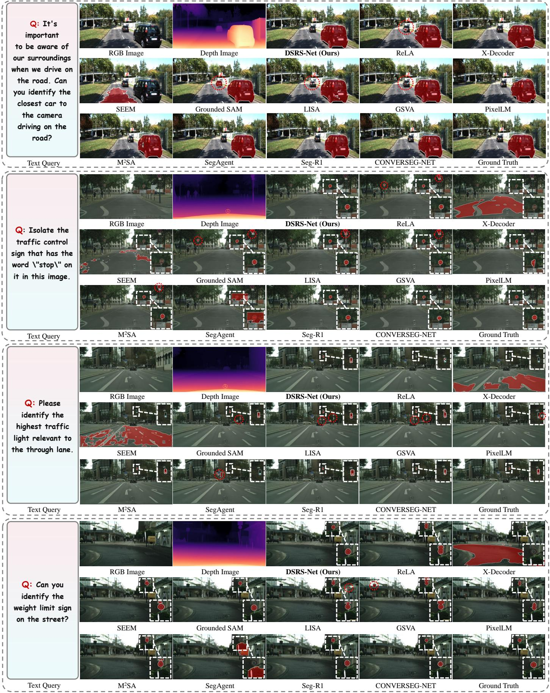  
Fig. 19. Qualitative comparisons between DSRS-Net and existing language-driven segmentation networks on the DSRS dataset.