# DYNAMICAL STATE-SPACE DIFFUSION FOR SPATIOTEMPORAL PREDICTION

Woojun Lee∗ Hankyeol Kim∗ Pilsung Kang†

Department of Industrial Engineering, Seoul National University Seoul, Republic of Korea

{woojun lee, hankyeol, pilsung kang}@snu.ac.kr

∗Equal contribution. †Corresponding author.

## ABSTRACT

Diffusion models for temporal prediction typically corrupt each future frame with independent noise, leaving temporal dependence entirely to the denoiser. We propose Dynamical State-Space Diffusion (DSSD), which learns the temporal structure of the corruption process itself. DSSD builds a temporal kernel from the damped oscillatory modes of a stable diagonal state-space model, whose learned decay rates and frequencies let the corruption capture multiple timescales and oscillatory correlations, while the denoiser architecture remains unchanged. Running this model on a finite clip, however, requires the state before the first frame, which is unobserved; starting from a zero state leaves the early frames with less noise than the diffusion schedule prescribes. We avoid this by using the Cholesky factor of the model’s stationary covariance as the temporal operator. We prove that this operator is causal, exactly invertible, keeps each frame’s noise variance equal to that of standard diffusion, and reduces to the identity at the clean end of the process, and that it is exactly the Kalman innovations form of the state-space model. The denoiser is trained to predict the temporally correlated noise, and sampling removes and reapplies the temporal mixing at each step. On scientificfield and robot-video datasets, DSSD outperforms diffusion baselines that share its denoiser, and the evolution of its learned modes during training shows that the temporal operator adapts to each dataset.

## 1 INTRODUCTION

Diffusion models generate data by learning to reverse a forward process that gradually corrupts clean samples with Gaussian noise. This denoising view has led to strong image and video generators (Ho et al., 2020; Song et al., 2021; Rombach et al., 2022; Ho et al., 2022; Blattmann et al., 2023), and it has also become attractive for temporal prediction (Voleti et al., 2022; Gao et al., 2023; Rasul et al., 2021; Tashiro et al., 2021). In forecasting, a model must represent not one future but a distribution over plausible futures conditioned on an observed history, making diffusion a natural fit for uncertain spatiotemporal signals such as video, weather, and multivariate time series.

Most diffusion frameworks for temporal prediction use a forward process that adds temporally independent noise to each future frame, relying on the denoising network to learn temporal dependencies (Voleti et al., 2022; Gao et al., 2023). However, neighboring states are often temporally coupled through motion, transport, or oscillation. This motivates incorporating temporal structure into the forward process itself, exposing the denoiser to temporally structured signal and noise.

Dynamical Diffusion (DyDiff) (Guo et al., 2025) incorporates temporal dependence into diffusion by applying an exponential moving average (EMA) operator to both the clean sequence and the diffusion noise. This introduces temporal correlations while preserving a closed-form Gaussian forward process and an invertible temporal operator for sampling. However, at each diffusion step, the EMA operator imposes a single exponential decay across frames. Its decay rate follows a predefined schedule rather than being learned from data, limiting the operator to one memory scale and preventing it from expressing oscillatory correlations.

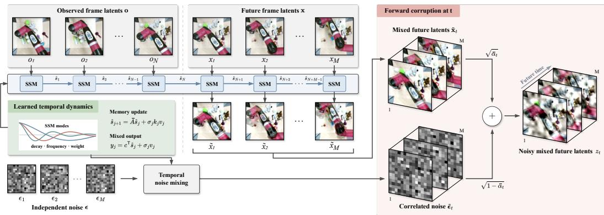  
Figure 1: DSSD forward process. Learned state-space dynamics causally mix observed and future latents and separately correlate noise within the future window. The mixed future latents and correlated noise are combined at diffusion step t to form $\mathbf { z } _ { t }$

We propose Dynamical State-Space Diffusion (DSSD), a novel diffusion algorithm that incorporates a learnable state-space operator into forward corruption and reverse sampling. Inspired by S4D (Gu et al., 2022b), the model combines multiple damped oscillatory modes whose decay rates, frequencies, and mixture weights are learned jointly with the denoiser. As illustrated in Figure 1, DSSD uses these learned dynamics to causally mix observed and future latents and to introduce temporal correlations into the diffusion noise. The state-space parameters are shared across sequences and spatial locations, while the denoiser architecture remains unchanged.

Constructing a finite-window temporal operator from this learned kernel requires care at the start of the prediction window. Each output depends on both current and past noise inputs, including those preceding the window. Initializing the state-space model at zero omits the contribution of these earlier inputs, leaving the early frames with less noise variance than prescribed. This violates the requirement that every future frame receive the same noise variance at a given diffusion step. DSSD avoids this problem by using the Cholesky factor of the kernel’s stationary finite-window covariance, yielding a causal and exactly invertible operator with unit marginal noise variance. We use corresponding factors to transform the signal and noise, train the denoiser to predict the resulting correlated noise, and adapt each sampling step to undo and reapply the temporal transform.

Our contributions are summarized as follows:

• We introduce DSSD, a dynamics-aware diffusion framework that uses a learnable diagonal state-space operator to define the temporal coordinates of the forward and reverse processes, rather than placing all temporal modeling burden on the denoiser.

• We construct a stationary-covariance Cholesky operator that avoids finite-window boundary effects, is causal and exactly invertible, and preserves unit marginal noise variance. This is equivalent to a Kalman innovations realization, with DyDiff’s EMA operator recovered as a single-mode case.

• Experiments on scientific-field (SEVIR, Turbulence) and robot-video (BAIR, RoboNet) datasets show that DSSD outperforms diffusion baselines sharing the same denoiser. Analysis of mode evolution during training shows that DSSD’s temporal operator adapts to each dataset.

## 2 RELATED WORK

Diffusion models for temporal prediction. Conditional diffusion models have been applied to video prediction (Voleti et al., 2022; Ho et al., 2022), precipitation nowcasting (Gao et al., 2023), and probabilistic time-series forecasting (Rasul et al., 2021; Tashiro et al., 2021; Lopez Alcaraz & Strodthoff, 2023). These methods usually model temporal dependence through the conditioning scheme and the denoiser, for example by masking past frames, generating autoregressively, or adding temporal attention and convolution layers. The forward process remains standard, where each future time step receives independent noise. DSSD instead changes the temporal geometry of the forward process and leaves the denoiser unchanged, so it applies to existing diffusion algorithms.

Structured and learned forward processes. For video generation, temporally correlated noise priors share noise components across frames (Ge et al., 2023) or warp noise along optical flow (Chang et al., 2024); these methods structure the noise but do not apply a matched temporal transform to the clean signal. Blurring and inverse heat dissipation apply a fixed linear operator to the signal, but along the spatial frequency axis rather than the prediction horizon (Hoogeboom & Salimans, 2023; Rissanen et al., 2023). Other works learn part of the forward process, such as the noise schedule (Kingma et al., 2021) or a data-dependent transformation of the corruption (Bartosh et al., 2024). DYffusion (Ruhling Cachay et al., 2023) replaces diffusion steps with a learned temporal¨ interpolator, so its reverse process advances physical time, whereas DSSD keeps Gaussian diffusion and changes only its covariance. DyDiff (Guo et al., 2025) applies a fixed EMA operator to both signal and noise, limiting its ability to represent multi-scale or oscillatory temporal correlations. DSSD learns this operator as a state-space model jointly with the denoiser, keeps the forward process causal, invertible and variance preserving, and recovers DyDiff as an exact special case.

State-space models. Structured state-space models parameterize linear recurrences with stable, structured transition matrices and scale to long sequences (Gu et al., 2022a;b), and selective variants make these dynamics input dependent (Gu & Dao, 2024). In diffusion models, SSMs have mainly served as network layers, either as attention-free backbones (Yan et al., 2024) or as temporal layers of time-series denoisers (Lopez Alcaraz & Strodthoff, 2023). Linear-Gaussian state-space models also underlie probabilistic forecasting, where they describe how the data are generated (Rangapuram et al., 2018). In contrast, DSSD uses an SSM to define the temporal covariance of the forward process, whose stationary innovations factor gives the diffusion forward operator.

## 3 PRELIMINARIES

## 3.1 CONDITIONAL DIFFUSION FOR TEMPORAL PREDICTION

Given N observed frames of a spatiotemporal signal, we predict the next M. Frames are encoded by a pretrained autoencoder (Rombach et al., 2022) into observed latents $\pmb { o } \in \mathbb { R } ^ { N \times d }$ and future latents $\pmb { x } \in \mathbb { R } ^ { M \times d }$ , where d is the dimension of a flattened latent frame. We model $p ( { \pmb x } \mid { \pmb o } )$ by diffusing only the future while conditioning the denoiser on the clean observations.

Diffusion models (Ho et al., 2020) corrupt x with Gaussian noise. For a variance-preserving schedule $\alpha _ { t } \in ( 0 , 1 ) , t = 1 , \ldots , T$ , whose product $\begin{array} { r } { \bar { \alpha } _ { t } = \prod _ { s = 1 } ^ { t } \alpha _ { s } } \end{array}$ decreases from nearly 1 to 0,

$$
\begin{array} { r } { z _ { t } = \sqrt { \bar { \alpha } _ { t } } \pmb { x } + \sqrt { 1 - \bar { \alpha } _ { t } } \epsilon , \qquad \epsilon \sim \mathcal { N } ( \mathbf { 0 } , I ) . } \end{array}\tag{1}
$$

A denoiser $f _ { \theta }$ is trained to predict the added noise by minimizing $\mathbb { E } _ { \pmb { x } , \pmb { o } , t , \pmb { \epsilon } } \| f _ { \theta } ( \pmb { z } _ { t } , \pmb { o } , t ) - \pmb { \epsilon } \| _ { 2 } ^ { 2 }$ , with t sampled uniformly. The added noise is independent across future frames, while the denoising network learns temporal dependencies from the data.

Futures are generated from Gaussian noise by repeated denoising, for example with the deterministic DDIM step (Song et al., $2 0 2 1 ) \ z _ { t ^ { \prime } } = \sqrt { \bar { \alpha } _ { t ^ { \prime } } } \hat { x } + \sqrt { 1 - \bar { \alpha } _ { t ^ { \prime } } } \hat { \epsilon }$ for $t ^ { \prime } < t ,$ , where $\hat { \epsilon } = f _ { \theta } ( z _ { t } , o , t )$ and $\hat { \pmb { x } } = ( \pmb { z } _ { t } - \sqrt { 1 - { \bar { \alpha } } _ { t } } \hat { \epsilon } ) / \sqrt { { \bar { \alpha } } _ { t } }$ . Throughout, temporal matrices act along the frame axis and apply the same transformation independently to each latent coordinate.

## 3.2 STATE-SPACE MODELS

Structured state-space models (SSMs) (Gu et al., 2022a;b) describe a sequence through a hidden state that summarizes its past. For the continuous-time linear system $\dot { \pmb { h } } ( \tau ) = \pmb { A } \pmb { h } ( \tau ) + \pmb { b } \pmb { e } ( \tau )$ $y ( \tau ) = c ^ { \top } h ( \tau )$ , zero-order-hold discretization with step size $\Delta > 0$ gives the recurrence

$$
\begin{array} { r } { h _ { k } = \bar { A } h _ { k - 1 } + \bar { b } e _ { k } , \qquad y _ { k } = c ^ { \top } h _ { k } , \qquad \bar { A } = e ^ { \Delta A } , } \end{array}\tag{2}
$$

with $\bar { b }$ the discretized input vector. From a zero initial state, unrolling gives a causal convolution $\begin{array} { r } { y _ { k } = \sum _ { \ell \geq 0 } \bar { K } _ { \ell } e _ { k - \ell } } \end{array}$ whose kernel $\bar { K } _ { \ell } = c ^ { \top } \bar { A } ^ { \ell } \bar { b }$ weights the input ℓ steps in the past.

S4D (Gu et al., 2022b) makes A diagonal. Taking $P$ eigenvalues together with their complex conjugates, $\pmb { A } = \mathrm { d i a g } ( \lambda _ { 1 } , \ldots , \lambda _ { P } , \lambda _ { 1 } ^ { * } , \ldots , \lambda _ { P } ^ { * } )$ ) with Re $\lambda _ { n } < 0$ , and conjugate coefficients for conjugate states, the kernel becomes a real-valued sum of damped oscillatory modes,

$$
\bar { K } _ { \ell } = \sum _ { n = 1 } ^ { P } r _ { n } e ^ { \ell \Delta \mathrm { R e } \lambda _ { n } } \cos \bigl ( \ell \Delta \mathrm { I m } \lambda _ { n } + \psi _ { n } \bigr ) ,\tag{3}
$$

where the amplitude $r _ { n } \geq 0$ and phase $\psi _ { n }$ are determined by $\bar { \pmb { b } }$ and $^ { c . }$ Each mode is a damped oscillation with decay rate $- \operatorname { R e } \lambda _ { n }$ and frequency Im $\lambda _ { n } \colon$ one zero-frequency mode gives a geometric decay, and several modes combine decay rates and oscillations in one kernel.

When driven by i.i.d. zero-mean, unit-variance inputs from the infinite past, a stable SSM has a stationary output whose covariance depends only on the lag $\delta \geq 0$

$$
\operatorname { C o v } ( y _ { k } , y _ { k + \delta } ) = \sum _ { \ell \geq 0 } \bar { K } _ { \ell } \bar { K } _ { \ell + \delta } .\tag{4}
$$

## 4 DYNAMICAL STATE-SPACE DIFFUSION

We first define how a temporal operator enters the forward process, then build it from a learned SSM kernel through its stationary covariance and Cholesky factor, and finally describe training, sampling and the scope of the guarantees.

## 4.1 DYNAMICS-AWARE FORWARD PROCESS

Following Guo et al. (2025), we couple the strength of temporal mixing to the noise level through a dynamics schedule $\bar { \gamma } _ { t } = 1 - \eta \left( 1 - \bar { \alpha } _ { t } \right) \in [ 1 - \eta , 1 ]$ with $\eta \in [ 0 , 1 ]$ , so that $\bar { \gamma } _ { t } \to 1$ (no mixing) as the data become clean and mixing is strongest at high noise. Let $W _ { \gamma } ^ { ( L ) } \in \mathbb { R } ^ { L \times L }$ denote a temporal operator on $L$ frames at dynamics level $\gamma \in ( 0 , 1 ]$ , and partition the operator on the full window as

$$
W _ { \gamma } ^ { ( N + M ) } = \left[ \frac { W _ { \gamma } ^ { o o } } { W _ { \gamma } ^ { f o } } \quad { \bf 0 } _ { \gamma } \right] .\tag{5}
$$

The blocks act on the $N$ observed and M future frames of Section 3.1: $W _ { \gamma } ^ { f o }$ carries the observed history into the future window, $W _ { \gamma } ^ { f f }$ mixes future frames with one another, and the zero block keeps the observations free of any influence from the future. DSSD replaces equation 1 by

$$
z _ { t } = \sqrt { \bar { \alpha } _ { t } } \left( W _ { \bar { \gamma } _ { t } } ^ { f o } o + W _ { \bar { \gamma } _ { t } } ^ { f f } x \right) + \sqrt { 1 - \bar { \alpha } _ { t } } W _ { \bar { \gamma } _ { t } } ^ { ( M ) } \epsilon , \qquad \epsilon \sim \mathcal { N } ( \mathbf { 0 } , I ) .\tag{6}
$$

The clean future is mixed together with the observed history, so the first future frame inherits the temporal state of the observations, whereas the noise is mixed within the future window alone, without an observed prefix. For fixed dynamics parameters, $q ( \boldsymbol { z } _ { t } \ \mid \ o , \boldsymbol { x } )$ is Gaussian with mean $\sqrt { \bar { \alpha } _ { t } } ( W ^ { f o } o + W ^ { f f } x )$ and covariance $\left( 1 - \bar { \alpha } _ { t } \right) \pmb { W } ^ { ( M ) } \pmb { W } ^ { ( M ) \top }$ , so training inputs are still sampled in closed form, and $\dot { W } = I$ recovers equation 1. As in DDIM (Song et al., 2021), the process is specified by these marginals and a coupling in which all diffusion steps share the same $( x , \epsilon ) ;$ ; a Markov forward chain is not required.

We require the operator to be (i) causal, mixing a frame only with itself and preceding frames, i.e., lower triangular; (ii) invertible, so that clean frames and noise can be recovered during sampling; (iii) of unit per-frame variance, diag $\mathbf { W } W ^ { \top } ) = \mathbf { 1 }$ , so that every frame receives noise of variance $1 - \bar { \alpha } _ { t }$ exactly as in equation 1 and the single noise level t given to the denoiser describes every frame; and (iv) the identity at $\gamma = 1$ , so that the clean end of the process is unchanged. These are design requirements for DSSD, rather than necessary conditions for diffusion models in general.

## 4.2 STATE-SPACE TEMPORAL KERNEL

DSSD describes the temporal correlation of the mixed frames with a diagonal SSM (Section 3.2) whose discretization step is set by the dynamics level. For $P$ modes with learnable decay rates $a _ { n } > 0$ and frequencies $\omega _ { n } \geq 0$ , we set

$$
\begin{array} { r } { \lambda _ { n } = - \frac { a _ { n } } { 2 } + i \omega _ { n } , \qquad \Delta _ { \gamma } = - \log ( 1 - \gamma ) . } \end{array}\tag{7}
$$

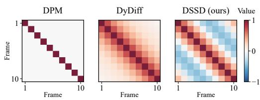  
(a) Noise correlations

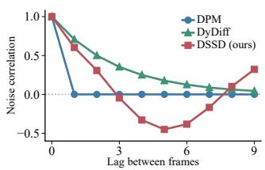  
(b) Noise correlation by lag

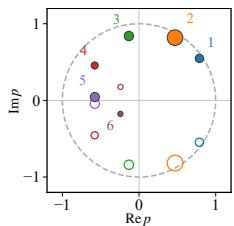  
(c) Mode poles  
Figure 2: Noise correlations and state-space modes in DSSD. (a) Illustrative noise correlation matrices for DPM, DyDiff, and DSSD. (b) Corresponding noise correlations by lag: DyDiff’s EMA decays exponentially, whereas DSSD can express oscillatory correlations. (c) An illustrative sixmode DSSD configuration shows discrete poles $p _ { n } = e ^ { \Delta _ { \gamma } \bar { \lambda _ { n } } }$ and their conjugates inside the unit circle. Filled and hollow markers denote conjugate partners.

For $0 < \gamma < 1$ , each discrete pole $p _ { n } = e ^ { \Delta _ { \gamma } \lambda _ { n } }$ has modulus $( 1 - \gamma ) ^ { a _ { n } / 2 } < 1$ . Figure 2(c) illustrates these stable poles and their conjugate pairs. $\mathrm { A s } \gamma \to 1$ the step $\Delta _ { \gamma }$ grows without bound and every mode forgets immediately, whereas at high noise the step is smallest and memory is longest. The step is determined by the dynamics schedule, while the learned rates and frequencies control individual modes; $a _ { n } = 1$ reproduces the EMA decay $\sqrt { 1 - \gamma }$ of DyDiff. We use amplitudes $r = \operatorname { s o f t m a x } ( \rho )$ and set every phase $\psi _ { n }$ in equation 3 to zero, giving positive real modal coefficients, and normalize the resulting kernel to unit $\ell _ { 2 }$ norm,

$$
\tilde { u } _ { \ell } = \sum _ { n = 1 } ^ { P } r _ { n } e ^ { \ell \Delta _ { \gamma } \mathrm { R e } \lambda _ { n } } \cos \bigl ( \ell \Delta _ { \gamma } \mathrm { I m } \lambda _ { n } \bigr ) , \qquad u _ { \ell } = \tilde { u } _ { \ell } \Big / \Big ( \sum _ { \ell ^ { \prime } \geq 0 } \tilde { u } _ { \ell ^ { \prime } } ^ { 2 } \Big ) ^ { 1 / 2 } .\tag{8}
$$

This zero-phase choice fixes $\begin{array} { r } { \tilde { u } _ { 0 } = \sum _ { n } r _ { n } = 1 } \end{array}$ , which keeps the normalization bounded away from zero. We use this kernel for memory of past inputs and add a separate current-input term. The resulting impulse response is

$$
\begin{array} { r } { w _ { 0 } = \sqrt { \gamma } , \qquad w _ { k } = \sqrt { 1 - \gamma } \ u _ { k - 1 } \quad ( k \geq 1 ) , \qquad \sum _ { k \geq 0 } w _ { k } ^ { 2 } = 1 . } \end{array}\tag{9}
$$

Thus the SSM kernel is delayed by one frame: $w _ { 0 }$ weights the current input and $w _ { k }$ weights an input k frames in the past. For independent unit-variance inputs, $\gamma$ is the variance contributed by the current input, while the kernel distributes the remaining variance $1 - \gamma$ over the past. At $\gamma = 1$ , we define $w = ( 1 , 0 , \dots )$ by its limit. The dynamics parameters $\phi = \{ \log a _ { n } , \omega _ { n } , \bar { \rho } _ { n } \} _ { n = 1 } ^ { P }$ comprise only $3 P$ scalars, shared across frames, pixels, samples and diffusion steps. Learning these parameters jointly with the denoiser allows the noise correlations to adapt to the data’s temporal structure beyond a fixed exponential decay.

## 4.3 CAUSAL INNOVATIONS OPERATOR

Applying the impulse response equation 9 as a convolution over a finite window requires inputs preceding that window, or their accumulated state. Starting from a zero state discards the memory of earlier inputs, so the early frames have variance below one and (iii) fails: the first frame has variance $w _ { 0 } ^ { 2 ^ { - } } = \gamma$ . For example, at $\gamma = 0 . 5$ it receives only half of the prescribed noise variance. DSSD instead assumes that the SSM has reached its stationary regime. By equation 4, driving the impulse response equation 9 with i.i.d. unit-variance inputs yields a stationary unit-variance process, and DSSD uses the causal factor of the covariance of $\dot { L }$ consecutive outputs,

$$
\kappa _ { \delta } ( \gamma ) = \sum _ { k \geq 0 } w _ { k } w _ { k + \delta } , \qquad \big [ \pmb { J } _ { \gamma } ^ { ( L ) } \big ] _ { i j } = \kappa _ { | i - j | } ( \gamma ) , \qquad \pmb { W } _ { \gamma } ^ { ( L ) } = \mathrm { c h o l } \big ( \pmb { J } _ { \gamma } ^ { ( L ) } \big ) ,\tag{10}
$$

where chol returns the unique lower-triangular factor with positive diagonal satisfying $W W ^ { \top } =$ J, and all infinite sums admit closed forms (Appendix $\mathbf { A } . 2 )$ . For Gaussian inputs, row $j$ of W expresses output $j$ as the part predictable from preceding outputs plus an independent innovation, whose scale is $[ \dot { W } ] _ { j j }$ . Thus $u$ defines the memory kernel, $w$ includes the current-input term, J records stationary correlations, and W realizes them on a finite window. Figure 2(a–b) compares these noise correlations with those of standard diffusion and DyDiff.

Proposition 1 (Admissibility). For every $\gamma \in ( 0 , 1 ]$ window length L and parameters $\begin{array} { r l } { \phi \colon } & { { } ( a ) ~ J _ { \gamma } ^ { ( L ) } } \end{array}$ is positive definite, so $W _ { \gamma } ^ { ( L ) }$ exists and is causal and invertible; (b) diag $\left( W _ { \gamma } ^ { ( L ) } W _ { \gamma } ^ { ( L ) \top } \right) \ = \ \mathbf { 1 } ; \ ( c ) \ [ W _ { \gamma } ^ { ( L ) } ] _ { j j } \ \geq \ \sqrt { \gamma }$ for all j, hence $[ W _ { \bar { \gamma } _ { t } } ^ { ( L ) } ] _ { j j } \ \ge \ \sqrt { 1 - \eta }$ at every diffusion step; (d) the leading $N \times N$ block of $W _ { \gamma } ^ { ( N + M ) }$ equals ${ \cal W } _ { \gamma } ^ { ( N ) }$ , and $W _ { \gamma } ^ { f o } { W _ { \gamma } ^ { f o } } ^ { \dagger } + { W _ { \gamma } ^ { f f } } { W _ { \gamma } ^ { f f } } ^ { \top } = { W _ { \gamma } ^ { ( M ) } } { W _ { \gamma } ^ { ( M ) \top } } ; a n d ( e ) W _ { \gamma } ^ { ( \bar { L } ) }  { W _ { 1 } ^ { ( L ) } } = \bar { I } a s \gamma  \mathrm { { 1 } } .$

Properties (a), (b) and (e) establish requirements (i)–(iv), and (c) bounds from below every divisor in the triangular solves used during sampling. The schedule-wide bound is strictly positive when $\eta < 1 ;$ ; for $\eta = 1$ , invertibility requires $\bar { \alpha } _ { t } > 0$ . These bounds do not guarantee a well-conditioned inverse, which we check numerically (Appendix $\mathsf { A } . 1 0 )$ The first part of (d) makes the operator consistent with the observed history, so the signal branch transforms o and continues into the future; the second part is used in Section 4.5. All proofs are given in Appendix $\mathbf { A } .$

The Cholesky factor also has a state-space realization. It is an innovations representation of the stationary process defined by $w ,$ rather than the original S4D convolution matrix.

Proposition 2 (State-space recurrence). For $\gamma \in ( 0 , 1 ) , W _ { \gamma } ^ { ( L ) }$ is the finite-window Kalman innovations realization (Kailath et al., 2000) ofthe SSM ofSection 4.2, started at its stationary state covariance and zero prior state mean: ${ \bf \Sigma } _ { y } = { \bf W } _ { \gamma } ^ { ( L ) } { \bf \Sigma } _ { e }$ is computed by a linear recurrence with a 2P-dimensional state (Appendix A.4) whose innovation scales satisfy $\sigma _ { j } = [ W _ { \gamma } ^ { ( L ) } ] _ { j j } ,$ $\sigma _ { 0 } = 1$ and $\sigma _ { j + 1 } \leq \sigma _ { j }$

The state is the best estimate of the SSM state given the frames read so far, and the innovation scale shrinks as the state becomes better determined. In this view the two branches of equation 6 use different histories: the signal branch runs the recurrence with the observed latents as inputs and continues with the future latents, whereas the noise branch restarts from the stationary initialization. For long windows, this recurrence reduces the cost of applying the operator to linear in L (Appendix A.4).

Proposition 3 (EMA and richer correlations). Let $\gamma \in \mathsf { \Gamma } ( 0 , 1 )$ With a single mode, $a _ { 1 } = 1$ and $\omega _ { 1 } = 0 , W _ { \gamma } ^ { ( L ) }$ is the EMA operator of DyDiff (Guo et al., 2025), $y _ { 0 } ~ = ~ e _ { 0 }$ and $y _ { j } =$ $\sqrt { 1 - \gamma } y _ { j - 1 } + \sqrt { \gamma } e _ { j }$ , whose autocorrelation $\kappa _ { \delta } ( \gamma ) = ( 1 - \gamma ) ^ { \delta / 2 }$ is positive at every lag δ. In contrast, the DSSD family admits a single oscillating mode with $\kappa _ { 1 } ( \gamma ) < 0$

At each fixed dynamics level, the unrestricted DSSD covariance family therefore includes the EMA covariance (Corollary 1) and correlations beyond it: an oscillating mode can make neighboring frames anticorrelated, a pattern that a monotonically decaying memory cannot produce (Appendix A.5).

## 4.4 TRAINING AND SAMPLING

Training. The denoiser parameters $\theta$ and the dynamics parameters $\phi$ are trained jointly by regressing the mixed noise,

$$
\begin{array} { r } { \mathcal { L } ( \theta , \phi ) = \mathbb { E } _ { \boldsymbol { x } , o , t , \epsilon } \big \| f _ { \theta } ( z _ { t } , o , t ) - W _ { \bar { \gamma } _ { t } } ^ { ( M ) } \epsilon \big \| _ { 2 } ^ { 2 } , } \end{array}\tag{11}
$$

with ${ \boldsymbol { z } } _ { t }$ given by equation 6 and t sampled uniformly. For a fixed operator, the minimizer is the posterior mean of the mixed noise. Because the noise enters $\scriptstyle { z _ { t } }$ only through ${ W } _ { \bar { \gamma } _ { t } } ^ { ( M ) } \epsilon$ , the score of $q ( z _ { t } \mid o )$ is a fixed linear transform of this posterior mean (Appendix $\mathbf { A . } 8 )$ , so the correlated target requires no whitening. Since every coordinate of the target has unit variance for every $\phi ,$ learning ϕ cannot lower the loss by shrinking the noise. Because $\phi$ enters both the corrupted input and the target, learning $\phi$ selects the temporal coordinates in which the denoiser operates rather than identifying the physical dynamics of the data. Initialization and numerical checks are given in Appendices A.9 and A.10. Algorithm 1 summarizes joint training of the denoiser and dynamics parameters.

Sampling. We use deterministic DDIM steps that undo the mixing of the current step and reapply that of the next one. Given the prediction $\hat { \epsilon } _ { c } = f _ { \theta } ( z _ { t } , o , t )$ at step t and the next step $t ^ { \prime } < t ,$

$$
\begin{array} { r l r l } & { \hat { \pmb x } = \big ( { \pmb W } _ { \widetilde { \gamma } _ { t } } ^ { f f } \big ) ^ { - 1 } \bigg ( \frac { 1 } { \sqrt { \bar { \alpha } _ { t } } } \big ( z _ { t } - \sqrt { 1 - \bar { \alpha } _ { t } } \hat { \epsilon } _ { c } \big ) - { \pmb W } _ { \widetilde { \gamma } _ { t } } ^ { f o } o \bigg ) , } & & { \hat { \pmb \epsilon } = \big ( { \pmb W } _ { \widetilde { \gamma } _ { t } } ^ { ( M ) } \big ) ^ { - 1 } \hat { \epsilon } _ { c } , } \\ & { z _ { t ^ { \prime } } = \sqrt { \bar { \alpha } _ { t ^ { \prime } } } \big ( { \pmb W } _ { \widetilde { \gamma } _ { t ^ { \prime } } } ^ { f o } o + { \pmb W } _ { \widetilde { \gamma } _ { t ^ { \prime } } } ^ { f f } \hat { \pmb x } \big ) + \sqrt { 1 - \bar { \alpha } _ { t ^ { \prime } } } { \pmb W } _ { \widetilde { \gamma } _ { t ^ { \prime } } } ^ { ( M ) } \hat { \epsilon } . } \end{array}\tag{12}
$$

Sampling starts from $z _ { T } = { \cal W } _ { \bar { \gamma } _ { T } } ^ { ( M ) } \xi$ with $\xi \sim \mathcal { N } ( 0 , I )$ , and the last step uses $\bar { \alpha } = \bar { \gamma } = 1$ , where the operator is the identity and xˆ is returned. Both inverses are triangular solves whose positive divisors satisfy Proposition 1(c), and with $W = I$ the update reduces to the standard DDIM step. Algorithm 2 gives the complete sampling procedure, including initialization and the clean endpoint. The following result justifies this update.

Proposition 4 (Sampler consistency). Fix the dynamics parameters ϕ, assume finite second moments ofthe data, and let $f _ { \theta }$ be the unrestricted minimizer of equation 11. $F o r 0 < \bar { \alpha } _ { t } < 1 ,$ $\hat { \pmb { x } } = \mathbb { E } [ \pmb { x } \mid z _ { t } , o ] , \hat { \pmb { \epsilon } } = \mathbb { E } [ \pmb { \epsilon } \mid z _ { t } , o ] ,$ and equation 12 returns $\mathrm { \mathbb { E } } [ \bar { z } _ { t ^ { \prime } } \mid z _ { t } , o ]$ under the shared (x, ϵ) coupling. On an interior time interval where α¯ is twice continuously differentiable and $0 < \bar { \alpha } < 1 , z _ { t ^ { \prime } } = z _ { t } + ( t ^ { \prime } - t ) v _ { t } ( z _ { t } ) + O \big ( ( t ^ { \prime } - t ) ^ { 2 } \big )$ for a velocity field ${ \mathbf { } } v _ { t }$ whose continuity equation is solved by the marginals $q ( z _ { t } \mid o )$

Under the flow regularity conditions in Appendix A.6, equation 12 is a first-order discretization of a flow that transports the marginals of the forward process (Albergo et al., 2025), as DDIM is for standard diffusion. With the ideal denoiser, its last step returns the posterior mean of the future.

## 4.5 WHAT THE TEMPORAL OPERATOR CHANGES

Since every operator is invertible, one may ask whether DSSD merely reparameterizes standard diffusion. It does not: the mixing varies with the diffusion step and differs between the signal and noise branches of equation 6. Let ${ \cal F } _ { t } = \big ( { \cal W } _ { \bar { \gamma } _ { t } } ^ { ( M ) } \big ) ^ { - 1 } { \cal W } _ { \bar { \gamma } _ { t } } ^ { f f }$ , and let $z _ { t } ^ { \mathrm { s t d } } = \sqrt { \bar { \alpha } _ { t } } x + \sqrt { 1 - \bar { \alpha } _ { t } }$ ϵ be the standard corruption equation 1 at the same noise level.

Proposition 5 (Information ordering). For every $t , F _ { t } F _ { t } ^ { \top } \preceq I .$ Consequently, given o, a variable with the same joint distribution with x as ${ \boldsymbol { z } } _ { t }$ can be generatedfrom $\boldsymbol { z } _ { t } ^ { \mathrm { s t d } }$ and independent noise without access to x, and, for data with finite second moments,

$$
\operatorname* { m i n } _ { g } \mathbb { E } \big \| x - g ( z _ { t } ^ { \mathrm { s t d } } , o ) \big \| ^ { 2 } \ \leq \ \operatorname* { m i n } _ { g } \mathbb { E } \big \| x - g ( z _ { t } , o ) \big \| ^ { 2 } .\tag{13}
$$

Temporal mixing therefore creates no information about the future at any single noise level; for the EMA operator, $\pmb { F } _ { t } = \mathrm { d i a g } ( \sqrt { \bar { \gamma } _ { t } } , 1 , \dots , 1 )$ attenuates only the direction of the first future frame (Appendix A.7). DSSD instead changes the geometry of the regression problem that a finite denoiser solves across noise levels, and the path along which samples are generated. These changes may help a finite denoiser and sampler, but the proposition does not establish such a benefit; whether they help is tested empirically in Section 5.

## 5 EXPERIMENTS

Proposition 5 rules out an information advantage from temporal mixing at a fixed noise level. We therefore test whether learning the temporal operator improves finite-step forecasting over standard diffusion DPM and DyDiff. We evaluate scientific fields from SEVIR (Veillette et al., 2020) and Turbulence (Wang et al., 2020), and robot videos from BAIR (Ebert et al., 2017) and RoboNet (Dasari et al., 2019).

## 5.1 EXPERIMENTAL SETUP

Within each dataset, all methods use the same frozen framewise VAE and Stable Video Diffusioninspired video U-Net (Blattmann et al., 2023). We train for 50,000 optimizer updates and use a shared 50-step DDIM sampling grid (Song et al., 2021). Task windows and training settings are detailed in Appendix C, and example forecasts for all four datasets in Appendix D.1. Metrics include the continuous ranked probability score (CRPS), critical success index (CSI) and Frechet video ´ distance (FVD); all are defined in Appendix C.3. In Tables 1 and 2, bold and underline mark the best and second-best scores for each dataset and metric.

Table 1: Scientific-field prediction results.
<table><tr><td rowspan="2">Dataset</td><td rowspan="2">Method</td><td colspan="3">CRPS↓</td><td rowspan="2">CSI w5 ↑</td><td rowspan="2">Temporal variogram ↓</td><td rowspan="2">Energy score ↓</td><td rowspan="2">RMSE↓</td></tr><tr><td>Raw</td><td> $\mathrm { w 8 _ { a v g } }$ </td><td> $\mathrm { w } 8 _ { \mathrm { m a x } }$ </td></tr><tr><td rowspan="3">SEVIR</td><td>DPM</td><td>4.174</td><td>2.737</td><td>6.599</td><td>0.5518</td><td>2.339</td><td>10.862</td><td>15.420</td></tr><tr><td>DyDiff</td><td>4.642</td><td>3.169</td><td>7.955</td><td>0.3911</td><td>4.492</td><td>13.024</td><td>25.540</td></tr><tr><td>DSSD (Ours)</td><td>3.975</td><td>2.421</td><td>5.995</td><td>0.5707</td><td>2.129</td><td>10.263</td><td>14.585</td></tr><tr><td rowspan="3">Turbulence</td><td>DPM</td><td>0.01148</td><td>0.00751</td><td>0.01065</td><td>0.9641</td><td>0.00262</td><td>0.01920</td><td>0.02600</td></tr><tr><td>DyDiff</td><td>0.01100</td><td>0.00752</td><td>0.01123</td><td>0.9674</td><td>0.00260</td><td>0.01791</td><td>0.02427</td></tr><tr><td>DSSD (Ours)</td><td>0.00756</td><td>0.00440</td><td>0.00757</td><td>0.9779</td><td>0.00147</td><td>0.01178</td><td>0.01582</td></tr></table>

Table 2: Robot-video prediction results.
<table><tr><td rowspan="2">Dataset</td><td rowspan="2">Method</td><td colspan="4">Forecast metrics</td><td colspan="4">Video metrics</td></tr><tr><td>CRPS↓</td><td>RMSE↓</td><td>Energy ↓</td><td>Vario. ↓</td><td>PSNR ↑</td><td>SSIM ↑</td><td>LPIPS ↓</td><td>FVD↓</td></tr><tr><td rowspan="3">BAIR</td><td>DPM</td><td>17.788</td><td>42.907</td><td>30.176</td><td>11.078</td><td>15.036</td><td>0.5938</td><td>0.2246</td><td>1329.2</td></tr><tr><td>DyDiff</td><td>17.691</td><td>42.815</td><td>30.092</td><td>11.412</td><td>15.149</td><td>0.5999</td><td>0.2220</td><td>1417.4</td></tr><tr><td>DSSD (Ours)</td><td>16.825</td><td>42.367</td><td>29.661</td><td>8.548</td><td>15.717</td><td>0.6205</td><td>0.2007</td><td>766.0</td></tr><tr><td rowspan="3">RoboNet</td><td>DPM</td><td>8.782</td><td>23.523</td><td>15.130</td><td>5.939</td><td>22.680</td><td>0.7889</td><td>0.1370</td><td>659.2</td></tr><tr><td>DyDiff</td><td>8.383</td><td>23.735</td><td>14.705</td><td>6.504</td><td>22.630</td><td>0.7865</td><td>0.1377</td><td>770.6</td></tr><tr><td>DSSD (Ours)</td><td>8.108</td><td>23.485</td><td>14.548</td><td>4.409</td><td>22.693</td><td>0.7858</td><td>0.1379</td><td>430.2</td></tr></table>

## 5.2 SCIENTIFIC-FIELD PREDICTION

DSSD has the lowest scores on all three CRPS variants, temporal variogram, energy score, and RMSE, and the highest CSI on both datasets. Its raw CRPS is 3.975 versus 4.174 for the strongest SEVIR baseline (DPM), and 0.00756 versus 0.01100 for the strongest Turbulence baseline (DyDiff).

## 5.3 ROBOT-VIDEO PREDICTION

On BAIR, DSSD outperforms both DPM and DyDiff across all eight reported metrics. On RoboNet, DSSD leads six of eight metrics, while DPM achieves the best SSIM and LPIPS. On both datasets, DSSD shows substantial improvements in FVD and temporal variogram scores, whereas RMSE gains are modest.

## 5.4 PREDICTION QUALITY ACROSS HORIZONS

Figure 3 compares prediction quality across horizons on BAIR. Panel (a) shows an example predicted sequence and absolute-error maps for each method. In this example, DSSD produces more accurate predictions throughout the sequence, with particularly smaller absolute errors than DyDiff at intermediate time steps. Panel (b) reports frame-wise $\mathrm { C R P S } ( \mathrm { w } 8 _ { \mathrm { m a x } } )$ and temporal variogram scores, averaged over all BAIR test windows at each prediction horizon. DSSD maintains lower scores than both baselines throughout the evaluated horizons, with its advantage persisting into the later frames. These results indicate sustained improvements in probabilistic prediction and closer agreement with ground-truth changes between consecutive frames.

## 5.5 ANALYSIS OF LEARNED TEMPORAL MODES

The learned operator is compact, with only $3 P = 1 8$ parameters (Section 4.2). Figure 4 tracks these modes from 10,000 to 50,000 updates through the centered residue logits $| \rho _ { n } - \bar { \rho } |$ , their $L _ { 2 }$ norm (the residue-logit norm), and the normalized entropy of $r = \mathrm { s o f t m a x } ( \rho )$ (Appendix C.4). The residue-logit norm measures logit spread around the mean, whereas lower entropy indicates more concentrated residue weights across modes. On SEVIR, the residue-logit norm increases from 1.53 to 4.11 while entropy decreases. Entropy also decreases on BAIR and RoboNet: SEVIR and RoboNet concentrate residue weight on the first mode, and BAIR on the second (Appendix D.3). On Turbulence, the residue shares remain nearly uniform, yet the modes continue to evolve: at $\gamma = 0 . 5 ,$ , the first mode’s pole radius decreases from 0.937 to 0.889, indicating faster decay and shorter temporal memory. These observations indicate dataset-dependent adaptation of both mode weights and timescales.

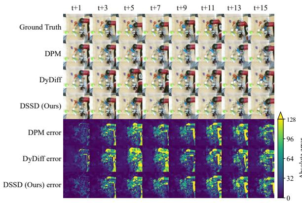  
(a) Predictions and absolute errors

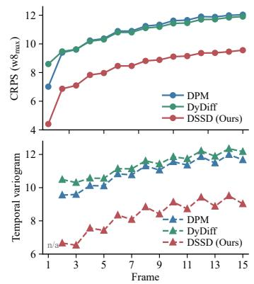  
(b) Frame-wise CRPS w8max and variogram

Figure 3: BAIR forecast quality across future frames. (a) Example predictions and absolute-error maps. (b) Test-set frame-wise pooled CRPS and temporal variogram scores; lower is better.  
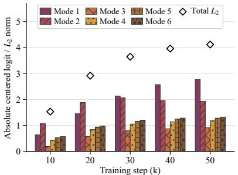  
(a) Centered residue logits and norm (SEVIR)

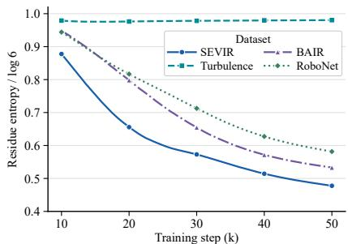  
(b) Normalized residue entropy (four datasets)  
Figure 4: DSSD mode-parameter diagnostics. (a) SEVIR centered residue logits and their norm. (b) Normalized residue entropy on four datasets.

## 6 CONCLUSION

We introduce DSSD, the novel diffusion framework for spatiotemporal prediction to make the coupling between spatial denoising and temporal dynamics jointly learnable. Its forward process adds noise while mixing frames through a learnable state-space operator, and its reverse process combines learned denoising with inversion of the temporal mixing. Joint training of the state-space dynamics and denoiser allows this coupled process to adapt to the data without changing the denoiser architec ture. We establish a theoretical foundation through a stationary-covariance construction that ensures causal, invertible temporal mixing with the prescribed noise variance, together with a consistency analysis of the sampling update. Experiments on scientific fields and robot videos show improved probabilistic forecasts and temporal consistency, while analysis of the learned modes demonstrates dataset-dependent adaptation. We expect this framework to help accelerate the development of dynamics-aware video foundation models at higher resolutions and larger scales. Its learnable temporal dynamics may also support online adaptation to changing temporal patterns in streaming data, with potential applications in robotics.

## AI USE STATEMENT

We used OpenAI Codex and Anthropic Claude to assist with implementing training, sampling, evaluation, and experiment-management code based on our specifications. These tools also assisted with typesetting and editing proofs, writing numerical verification scripts, providing feedback on experimental design, drafting and editing the manuscript, searching and summarizing literature, and formatting references.

The theoretical model, operator construction, mathematical claims, and proofs were developed by the authors. AI assistance with proofs was limited to presentation and numerical checks; it did not supply proof arguments. AI tools were not used to develop the conceptual framework, propose or refine hypotheses, generate synthetic datasets, or conduct qualitative and thematic data analysis. Translation was not applicable.

We reviewed all AI-assisted work, checked the proofs against our derivations, and verified the algebra through independent numerical implementations. We tested the code and checked citations against primary sources. The authors take responsibility for the final text, claims, code, and other artifacts.

## ETHICS STATEMENT

This work involves no human subjects, crowdsourced annotation, or personally identifiable information; no institutional review was required.

## REPRODUCIBILITY STATEMENT

Section 4 specifies the method and theoretical assumptions; Appendix A provides complete proofs, and Appendix A.10 details initialization and numerical implementation. Appendix C specifies the data processing, model and optimization settings, evaluation protocols, and compute resources used in our experiments.

We use publicly accessible datasets—SEVIR, BAIR, and RoboNet—and a simulation-based benchmark, Turbulence. Third-party datasets are used in accordance with their terms and are not redis tributed.

We will release model weights, training and sampling code, and configurations for the models and datasets used in this paper. The release will include environment specifications and instructions for data preparation and reproducing the experiments. Run records and numerical tests support verification of the experimental settings and theoretical identities.

## REFERENCES

Michael Albergo, Nicholas M. Boffi, and Eric Vanden-Eijnden. Stochastic interpolants: A unifying framework for flows and diffusions. Journal ofMachine Learning Research, 26(209):1–80, 2025.

Alexander Alexandrov, Konstantinos Benidis, Michael Bohlke-Schneider, Valentin Flunkert, Jan Gasthaus, Tim Januschowski, Danielle C. Maddix, Syama Rangapuram, David Salinas, Jasper Schulz, Lorenzo Stella, Ali Caner Turkmen, and Yuyang Wang. GluonTS: Probabilistic and¨ neural time series modeling in Python. Journal of Machine Learning Research, 21(116):1–6, 2020.

Grigory Bartosh, Dmitry Vetrov, and Christian A. Naesseth. Neural Flow Diffusion Models: Learnable forward process for improved diffusion modelling. In Advances in Neural Information Processing Systems (NeurIPS), 2024.

Andreas Blattmann, Tim Dockhorn, Sumith Kulal, Daniel Mendelevitch, Maciej Kilian, Dominik Lorenz, Yam Levi, Zion English, Vikram Voleti, Adam Letts, Varun Jampani, and Robin Rombach. Stable Video Diffusion: Scaling latent video diffusion models to large datasets. arXiv preprint arXiv:2311.15127, 2023.

Joao Carreira and Andrew Zisserman. Quo Vadis, action recognition? A new model and the Kinetics˜ dataset. In IEEE/CVF Conference on Computer Vision and Pattern Recognition (CVPR), 2017.

Pascal Chang, Jingwei Tang, Markus Gross, and Vinicius C. Azevedo. How I warped your noise: a temporally-correlated noise prior for diffusion models. In International Conference on Learning Representations (ICLR), 2024.

Kaiyuan Chen, Xingzhuo Guo, Yu Zhang, Jianmin Wang, and Mingsheng Long. CogDPM: Diffusion probabilistic models via cognitive predictive coding. In International Conference on Machine Learning (ICML), 2024.

Sudeep Dasari, Frederik Ebert, Stephen Tian, Suraj Nair, Bernadette Bucher, Karl Schmeckpeper, Siddharth Singh, Sergey Levine, and Chelsea Finn. RoboNet: Large-scale multi-robot learning. In Conference on Robot Learning (CoRL), volume 100 of PMLR, 2019.

Frederik Ebert, Chelsea Finn, Alex X. Lee, and Sergey Levine. Self-supervised visual planning with temporal skip connections. In Conference on Robot Learning (CoRL), volume 78 of PMLR, 2017.

Zhihan Gao, Xingjian Shi, Boran Han, Hao Wang, Xiaoyong Jin, Danielle Maddix, Yi Zhu, Mu Li, and Yuyang Wang. PreDiff: Precipitation nowcasting with latent diffusion models. In Advances in Neural Information Processing Systems (NeurIPS), 2023.

Songwei Ge, Seungjun Nah, Guilin Liu, Tyler Poon, Andrew Tao, Bryan Catanzaro, David Jacobs, Jia-Bin Huang, Ming-Yu Liu, and Yogesh Balaji. Preserve your own correlation: A noise prior for video diffusion models. In IEEE/CVF International Conference on Computer Vision (ICCV), 2023.

Tilmann Gneiting and Adrian E. Raftery. Strictly proper scoring rules, prediction, and estimation. Journal ofthe American Statistical Association, 102(477):359–378, 2007.

Albert Gu and Tri Dao. Mamba: Linear-time sequence modeling with selective state spaces. In Conference on Language Modeling (COLM), 2024.

Albert Gu, Karan Goel, and Christopher Re. Efficiently modeling long sequences with structured´ state spaces. In International Conference on Learning Representations (ICLR), 2022a.

Albert Gu, Ankit Gupta, Karan Goel, and Christopher Re. On the parameterization and initialization´ of diagonal state space models. In Advances in Neural Information Processing Systems (NeurIPS), 2022b.

Xingzhuo Guo, Yu Zhang, Baixu Chen, Haoran Xu, Jianmin Wang, and Mingsheng Long. Dynamical Diffusion: Learning temporal dynamics with diffusion models. In International Conference on Learning Representations (ICLR), 2025.

Agrim Gupta, Stephen Tian, Yunzhi Zhang, Jiajun Wu, Roberto Mart´ın-Mart´ın, and Li Fei-Fei. MaskViT: Masked visual pre-training for video prediction. In International Conference on Learning Representations (ICLR), 2023.

Jonathan Ho, Ajay Jain, and Pieter Abbeel. Denoising diffusion probabilistic models. In Advances in Neural Information Processing Systems (NeurIPS), 2020.

Jonathan Ho, Tim Salimans, Alexey Gritsenko, William Chan, Mohammad Norouzi, and David J. Fleet. Video diffusion models. In Advances in Neural Information Processing Systems (NeurIPS), 2022.

Emiel Hoogeboom and Tim Salimans. Blurring diffusion models. In International Conference on Learning Representations (ICLR), 2023.

Thomas Kailath, Ali H. Sayed, and Babak Hassibi. Linear Estimation. Prentice Hall, 2000.

Diederik P. Kingma and Jimmy Ba. Adam: A method for stochastic optimization. In International Conference on Learning Representations (ICLR), 2015.

Diederik P. Kingma and Max Welling. Auto-encoding variational Bayes. In International Confer ence on Learning Representations (ICLR), 2014.

Diederik P. Kingma, Tim Salimans, Ben Poole, and Jonathan Ho. Variational diffusion models. In Advances in Neural Information Processing Systems (NeurIPS), 2021.

Juan Miguel Lopez Alcaraz and Nils Strodthoff. Diffusion-based time series imputation and forecasting with structured state space models. Transactions on Machine Learning Research (TMLR), 2023.

Alexander Quinn Nichol and Prafulla Dhariwal. Improved denoising diffusion probabilistic models. In International Conference on Machine Learning (ICML), 2021.

William Peebles and Saining Xie. Scalable diffusion models with transformers. In IEEE/CVF International Conference on Computer Vision (ICCV), 2023.

Syama Sundar Rangapuram, Matthias W. Seeger, Jan Gasthaus, Lorenzo Stella, Yuyang Wang, and Tim Januschowski. Deep state space models for time series forecasting. In Advances in Neural Information Processing Systems (NeurIPS), 2018.

Kashif Rasul, Calvin Seward, Ingmar Schuster, and Roland Vollgraf. Autoregressive denoising diffusion models for multivariate probabilistic time series forecasting. In International Conference on Machine Learning (ICML), 2021.

Severi Rissanen, Markus Heinonen, and Arno Solin. Generative modelling with inverse heat dissipation. In International Conference on Learning Representations (ICLR), 2023.

Robin Rombach, Andreas Blattmann, Dominik Lorenz, Patrick Esser, and Bjorn Ommer. High-¨ resolution image synthesis with latent diffusion models. In IEEE/CVF Conference on Computer Vision and Pattern Recognition (CVPR), 2022.

Olaf Ronneberger, Philipp Fischer, and Thomas Brox. U-Net: Convolutional networks for biomedical image segmentation. In Medical Image Computing and Computer-Assisted Intervention (MIC-CAI), 2015.

Salva Ruhling Cachay, Bo Zhao, Hailey Joren, and Rose Yu. DYffusion: A dynamics-informed ¨ diffusion model for spatiotemporal forecasting. In Advances in Neural Information Processing Systems (NeurIPS), 2023.

David Salinas, Michael Bohlke-Schneider, Laurent Callot, Roberto Medico, and Jan Gasthaus. High-dimensional multivariate forecasting with low-rank Gaussian copula processes. In Advances in Neural Information Processing Systems (NeurIPS), 2019.

Michael Scheuerer and Thomas M. Hamill. Variogram-based proper scoring rules for probabilistic forecasts of multivariate quantities. Monthly Weather Review, 143(4):1321–1334, 2015.

Jiaming Song, Chenlin Meng, and Stefano Ermon. Denoising diffusion implicit models. In International Conference on Learning Representations (ICLR), 2021.

Yusuke Tashiro, Jiaming Song, Yang Song, and Stefano Ermon. CSDI: Conditional score-based diffusion models for probabilistic time series imputation. In Advances in Neural Information Processing Systems (NeurIPS), 2021.

Thomas Unterthiner, Sjoerd van Steenkiste, Karol Kurach, Raphael Marinier, Marcin Michalski, and¨ Sylvain Gelly. Towards accurate generative models of video: A new metric & challenges. arXiv preprint arXiv:1812.01717, 2018.

Mark Veillette, Siddharth Samsi, and Chris Mattioli. SEVIR: A storm event imagery dataset for deep learning applications in radar and satellite meteorology. In Advances in Neural Information Processing Systems (NeurIPS), 2020.

Vikram Voleti, Alexia Jolicoeur-Martineau, and Christopher Pal. MCVD: Masked conditional video diffusion for prediction, generation, and interpolation. In Advances in Neural Information Processing Systems (NeurIPS), 2022.

Rui Wang, Karthik Kashinath, Mustafa Mustafa, Adrian Albert, and Rose Yu. Towards physicsinformed deep learning for turbulent flow prediction. In ACM SIGKDD International Conference on Knowledge Discovery and Data Mining (KDD), 2020.

Zhou Wang, Alan C. Bovik, Hamid R. Sheikh, and Eero P. Simoncelli. Image quality assessment: From error visibility to structural similarity. IEEE Transactions on Image Processing, 13(4): 600–612, 2004.

Jialong Wu, Shaofeng Yin, Ningya Feng, Xu He, Dong Li, Jianye Hao, and Mingsheng Long. iVideoGPT: Interactive VideoGPTs are scalable world models. In Advances in Neural Information Processing Systems (NeurIPS), 2024.

Jing Nathan Yan, Jiatao Gu, and Alexander M. Rush. Diffusion models without attention. In IEEE/CVF Conference on Computer Vision and Pattern Recognition (CVPR), 2024.

Michael Zamo and Philippe Naveau. Estimation of the continuous ranked probability score with¨ limited information and applications to ensemble weather forecasts. Mathematical Geosciences, 50(2):209–234, 2018.

Richard Zhang, Phillip Isola, Alexei A. Efros, Eli Shechtman, and Oliver Wang. The unreasonable effectiveness of deep features as a perceptual metric. In IEEE/CVF Conference on Computer Vision and Pattern Recognition (CVPR), 2018.

## A MATHEMATICAL DETAILS AND PROOFS

We first derive the stationary covariance, then prove the operator properties and its state-space realization, and finally analyze regression and sampling. Throughout, the dynamics parameters ϕ are fixed unless joint optimization is explicitly discussed; $a _ { n } > 0 , \omega _ { n } \geq 0$ and $r _ { n } > 0$ with $\textstyle \sum _ { n } r _ { n } = 1$ For $\gamma \in \mathsf { \Gamma } ( 0 , 1 )$ , we omit $\gamma$ and ϕ when no confusion arises and write $\nu = \sqrt { 1 - \gamma } , \Delta = \Delta _ { \gamma } ,$ $R _ { n } = | e ^ { \Delta \lambda _ { n } } | = \nu ^ { a _ { n } }$ and $\vartheta _ { n } = \Delta \omega _ { n }$ , so that $\begin{array} { r } { \tilde { u } _ { \ell } = \sum _ { n } r _ { n } R _ { n } ^ { \ell } \cos ( \ell \vartheta _ { n } ) } \end{array}$ in equation 8. As in the main text, matrices act on the time axis and are shared by all coordinates of each frame. The endpoint $\gamma = 1$ is defined by $w = ( 1 , 0 , \dots )$ and $W = I ;$ expressions involving $\Delta$ are evaluated only for $\gamma < 1$ . We distinguish the SSM memory kernel $u _ { \ell } ,$ , the full impulse response $w _ { k }$ , its stationary covariance J, and the finite-window innovations factor $W$

## A.1 NOTATION

Table 3 collects the symbols used in Sections 3 and 4 and in this appendix, grouped in the order in which they appear. Bold lowercase letters denote vectors or stacked latent frames, bold uppercase letters denote matrices, and all temporal matrices act along the frame axis, identically for every latent coordinate. A few auxiliary symbols local to a single proof step, such as $y _ { j } ^ { \mathrm { p r e } }$ in Appendix ${ \dot { \mathbf { A } } } . 3 ,$ are defined where they appear.

Table 3: Notation.
<table><tr><td>Symbol</td><td>Meaning</td><td>Defined in</td></tr><tr><td>Data and diffusion</td><td></td><td></td></tr><tr><td> $N , M$ </td><td>Numbers of observed and future frames</td><td>§3.1</td></tr><tr><td> $L$ </td><td>Length of the window on which a temporal operator acts;  $L \in$   $\{ N , \mathbf { \bar { \it M } } , N + \it M \}$ </td><td>§4.1</td></tr><tr><td> $d$ </td><td>Dimension of a flattened latent frame</td><td>§3.1</td></tr><tr><td> $\pmb { o } \in \mathbb { R } ^ { N \times d }$ </td><td>Observed latents (clean conditioning history)</td><td>§3.1</td></tr><tr><td> $\pmb { x } \in \mathbb { R } ^ { M \times d }$ </td><td>Future latents to be predicted</td><td>§3.1</td></tr><tr><td> $T , t$ </td><td>Number of diffusion steps; current step  $t \in \{ 1 , \ldots , T \}$ </td><td>Eq. (1)</td></tr><tr><td> $t ^ { \prime }$ </td><td>Next, less noisy step of a sampling update,  $t ^ { \prime } < t$ </td><td>§3.1</td></tr><tr><td> $\alpha _ { t } , \bar { \alpha } _ { t }$ </td><td>Noise schedule and signal level  $\begin{array} { r } { \bar { \alpha } _ { t } = \prod _ { s \leq t } \alpha _ { s } } \end{array}$ </td><td>Eq. (1)</td></tr><tr><td>€</td><td>White Gaussian noise,  $\mathcal { N } ( \mathbf { 0 } , \pmb { I } )$  , before temporal mixing</td><td>Eq. (1)</td></tr><tr><td> ${ \boldsymbol { z } } _ { t }$ </td><td>Noisy future latents at step t</td><td>Eq. (1), Eq. (6)</td></tr><tr><td> $f _ { \theta } , \theta$ </td><td>Denoiser and its parameters</td><td>§3.1</td></tr><tr><td> $p ( { \pmb x } \mid { \pmb o } )$ </td><td>Conditional distribution of the future given the history</td><td>§3.1</td></tr><tr><td> $q ( z _ { t } \mid o )$ </td><td>Marginal of the forward process at step t</td><td>§4.4</td></tr><tr><td colspan="3">State-space models (generic)</td></tr><tr><td> $\tau$ </td><td>Continuous time</td><td>§3.2</td></tr><tr><td> $\boldsymbol { h } , \boldsymbol { e } , \boldsymbol { y }$ </td><td>State, scalar input and scalar output of an SSM</td><td>Eq. (2)</td></tr><tr><td> $A , b , c$ </td><td>State, input and output parameters</td><td>§3.2</td></tr><tr><td> $\Delta , { \bar { \cal A } } , { \bar { \cal b } }$ </td><td>Step size and zero-order-hold discretization,  $\bar { A } = e ^ { \Delta A }$ </td><td>Eq. (2)</td></tr><tr><td> $\bar { K } _ { \ell }$ </td><td>Convolution kernel of the discretized SSM; weight of the input l steps in the past</td><td>Eq. (3)</td></tr><tr><td> $P$ </td><td>Number of complex-conjugate mode pairs</td><td>§3.2</td></tr><tr><td> $\lambda _ { n }$ </td><td>Continuous-time eigenvalue of mode  $n ,$   $\lambda _ { n } < 0 ;$  in DSSD, Re  $- a _ { n } / 2 + i \omega _ { n }$ </td><td>§3.2, Eq. (7)</td></tr><tr><td> $r _ { n } , \psi _ { n }$ </td><td>Amplitude and phase of mode n</td><td>Eq.(3)</td></tr><tr><td colspan="3">Dynamics schedule and learned modes</td></tr><tr><td> $\eta$ </td><td>Mixing strength,  $\eta \in [ 0 , 1 ]$ </td><td>§4.1</td></tr><tr><td> $\bar { \gamma } _ { t }$ </td><td>Dynamics schedule.  $1 - \eta ( 1 - \bar { \alpha } _ { t } ) \in [ 1 - \eta , 1 ] ; 1$  mixing</td><td>§4.1</td></tr><tr><td> $\gamma$ </td><td>Generic dynamics level,  $\gamma \in ( 0 , 1 ]$ </td><td>§4.1</td></tr><tr><td> $a _ { n } , \omega _ { n }$ </td><td>Learned decay rate  $( > 0 )$  and frequency  $( \geq 0 )$  of mode n</td><td>Eq. (7)</td></tr><tr><td> $\rho _ { n }$ </td><td>Learned residue logit of mode  $n ; r = { \mathfrak { s } }$  softmax  $\operatorname { \rho } _ { \operatorname { \rho } } ( \rho )$ </td><td>§4.2</td></tr><tr><td> $\phi$ </td><td>Dynamics parameters  $\{ \log a _ { n } , \omega _ { n } , \rho _ { n } \} _ { n = 1 } ^ { P } , 3 P$  scalars</td><td>§4.2</td></tr><tr><td> $\Delta _ { \gamma }$ </td><td>Discretization step tied to the dynamics level,  $- \log ( 1 - \gamma )$ </td><td>Eq. (7)</td></tr><tr><td> $p _ { n }$ </td><td>Discrete pole of mode  $n , e ^ { \Delta _ { \gamma } \lambda _ { n } }$  , with modulus  $( 1 - \gamma ) ^ { a _ { n } / 2 }$ </td><td>§4.2</td></tr><tr><td colspan="3">Kernel, covariance and operator</td></tr><tr><td> $\tilde { u } _ { \ell } , u _ { \ell }$ </td><td>Memory kernel before and after normalization to unit  $\ell _ { 2 }$  norm Impulse response:  $w _ { 0 } = \sqrt { \gamma }$  weights the current input,  $w _ { k } =$ </td><td>Eq. (8)</td></tr><tr><td>Wk</td><td> $\sqrt { 1 - \gamma } u _ { k - 1 }$  the input k frames earlier</td><td>Eq. (9)</td></tr><tr><td> $\kappa _ { \delta } ( \gamma )$ </td><td>Stationary autocorrelation at lag  $\begin{array} { r } { \delta , \sum _ { k } w _ { k } w _ { k + \delta } ; \kappa _ { 0 } = 1 } \end{array}$ </td><td>Eq. (10)</td></tr><tr><td> ${ \mathbf { } } J _ { \gamma } ^ { ( L ) }$ </td><td>Stationary covariance of L consecutive outputs,  $[ J ] _ { i j } = \kappa _ { | i - j | }$ </td><td>Eq. (10)</td></tr><tr><td>chol  ${ W } _ { \gamma } ^ { ( L ) }$ </td><td>Lower-triangular Cholesky factor with positive diagonal</td><td>Eq. (10)</td></tr><tr><td> $W ^ { o o } , W ^ { f o } , W ^ { f f }$ </td><td>Temporal operator,  $\mathrm { c h o l } ( J _ { \gamma } ^ { ( L ) } )$   $\dot { W } _ { \gamma } ^ { ( N + M ) }$ </td><td>Eq. (10)</td></tr><tr><td></td><td>Blocks of : history on history, history into future, fu- ture on future</td><td>Eq. (5)</td></tr><tr><td> ${ \pmb W } _ { \gamma } ^ { ( M ) }$ </td><td>Operator applied to the noise, on the future window alone</td><td>Eq. (6)</td></tr><tr><td colspan="3">Innovations recurrence (Proposition 2)</td></tr><tr><td> $e , e _ { j }$ </td><td>Input sequence of the recurrence,  ${ \pmb y } = { \pmb W } _ { \gamma } ^ { ( L ) } { \pmb e }$ </td><td>Prop. 2</td></tr><tr><td> ${ \mathbf { \it { y } } } , { \mathit { \it { y } } } _ { j }$ </td><td>Output sequence of the operator</td><td>Prop. 2</td></tr><tr><td> $\sigma _ { j }$ </td><td>Innovation scale,  $[ W _ { \gamma } ^ { ( L ) } ] _ { j j }$ </td><td>Prop. 2</td></tr><tr><td> $\mathbf { \boldsymbol { s } } _ { j }$ </td><td>Pre-input SSM state, containing only inputs before frame j</td><td>Eq. (20)</td></tr><tr><td> $\hat { \mathbf { \boldsymbol { s } } } _ { j }$ </td><td>State estimate given  $y _ { 0 } , \ldots , y _ { j - 1 }$ </td><td>Eq. (22)</td></tr><tr><td> $\pmb { \Sigma }$ </td><td>Stationary state covariance</td><td>App. A.4</td></tr><tr><td> $S _ { j }$ </td><td>Conditional state covariance given</td><td>Eq. (21)</td></tr><tr><td> $k _ { j }$ </td><td>Kalman gain</td><td>Eq. (21)</td></tr><tr><td> $D$ </td><td>Direct current-input term of the realization,</td><td>Eq. (20)</td></tr><tr><td colspan="3">Training and sampling</td></tr><tr><td> ${ \mathcal { L } } ( \theta , \phi )$ </td><td>Mixed-noise regression loss</td><td>Eq. (11)</td></tr><tr><td> $\hat { \epsilon } _ { c }$ </td><td>Denoiser prediction of the mixed noise,  $f _ { \theta } ( z _ { t } , o , t )$ </td><td>Eq. (12)</td></tr><tr><td> $\hat { \boldsymbol { x } } , \hat { \boldsymbol { \epsilon } }$ </td><td>Estimates of the clean future and of the white noise at step t</td><td>Eq. (12)</td></tr><tr><td> $\boldsymbol { \xi }$ </td><td>White Gaussian noise that initializes sampling,  $z _ { T } = { \cal W } _ { \bar { \gamma } _ { T } } ^ { ( M ) } \xi$ </td><td>§4.4</td></tr><tr><td> ${ \mathbf { } } v _ { t }$ </td><td>Velocity field transported by the sampler</td><td>Prop. 4</td></tr><tr><td colspan="3">Analysis (Proposition 5)</td></tr><tr><td> $\boldsymbol { z } _ { t } ^ { \mathrm { s t d } }$ </td><td>Standard corruption Eq. (1) at the same noise level</td><td>§4.5</td></tr><tr><td> $\pmb { F } _ { t }$ </td><td> $( \mathbf { { \cal { W } } } _ { \bar { \gamma } _ { t } } ^ { ( M ) } ) ^ { - 1 } \mathbf { { \cal { W } } } _ { \bar { \gamma } _ { t } } ^ { f f }$  , future signal in whitened noise coordinates</td><td>§4.5</td></tr><tr><td>g</td><td>Estimator of x</td><td>Eq. (13)</td></tr><tr><td colspan="3">Appendix-only notation</td></tr><tr><td>ν</td><td> $\sqrt { 1 - \gamma }$ </td><td>App. A</td></tr><tr><td> $R _ { n } , \vartheta _ { n }$ </td><td>Pole modulus  $\nu ^ { a _ { n } }$  and angle  $\Delta _ { \gamma } \omega _ { n }$  of mode n</td><td>App. A</td></tr><tr><td> $Z$ </td><td>Normalizer of the kernel,  $\textstyle ( \sum _ { \ell } \tilde { u } _ { \ell } ^ { 2 } ) ^ { 1 / 2 } \geq 1$ </td><td>App. A.2</td></tr><tr><td> $V _ { \delta }$ </td><td>Unnormalized kernel autocorrelation,  $\sum _ { \ell } \tilde { u } _ { \ell } \tilde { u } _ { \ell + \delta }$ </td><td>App. A.2</td></tr><tr><td> $\mathcal { C } ( R , \vartheta , \psi )$ </td><td>Closed form of  $\begin{array} { r } { \sum _ { \ell } R ^ { \ell } \cos ( \ell \vartheta + \psi ) } \end{array}$ </td><td>Eq. (14)</td></tr><tr><td> $\varepsilon _ { j }$ </td><td>Scalar i.i.d.  $\mathcal { N } ( 0 , 1 )$  inputs of the stationary process,  $j \in \mathbb Z$ </td><td>App. A.3</td></tr><tr><td> $\pmb { \cal E }$ </td><td>Matrix of the EMA recurrence</td><td>Cor. 1</td></tr><tr><td> $\tilde { W }$ </td><td>Lower-triangular matrix of the unrolled recurrence</td><td>App. A.4</td></tr><tr><td> $\beta _ { t }$ </td><td>Noise variance  $1 - \bar { \alpha } _ { t }$ </td><td>App. A.6</td></tr><tr><td> $\mathbf { \delta } _ { B _ { t } }$ </td><td>Noise operator  ${ \pmb W } _ { \bar { \gamma } t } ^ { ( M ) }$ </td><td>App. A.6</td></tr><tr><td> $m _ { t } , M _ { t } , C _ { t }$ </td><td>Coefficients of  ${ \pmb z } _ { t } = { \pmb m } _ { t } + M _ { t } { \pmb x } + C _ { t } { \pmb \epsilon }$ </td><td>Eq. (23)</td></tr><tr><td> $f ^ { \star }$ </td><td>Unrestricted minimizer of  $\operatorname { E q . } \left( 1 1 \right)$ </td><td>App. A.6</td></tr><tr><td> $\chi$ </td><td>Smooth, compactly supported test function</td><td>App. A.6</td></tr><tr><td> $U$ </td><td> $( \mathbf { W } _ { \bar { \gamma } _ { t } } ^ { ( M ) } ) ^ { - 1 } \bar { \mathbf { W } } _ { \bar { \gamma } _ { t } } ^ { f o }$ </td><td>App. A.7</td></tr><tr><td> $\zeta$ </td><td>Auxiliary white noise independent of all other variables</td><td>App. A.7</td></tr><tr><td> $\pmb { \mu } ( \pmb { x } )$ </td><td>Mean of  $q ( \boldsymbol { z } _ { t } \mid \boldsymbol { o } , \boldsymbol { x } )$ </td><td>App. A.8</td></tr><tr><td colspan="3">Shorthand in Algorithms 1 and 2</td></tr><tr><td>H, G, B</td><td> $W _ { \gamma } ^ { f o } , W _ { \gamma } ^ { f f }$  and  $\pmb { W } _ { \gamma } ^ { ( M ) }$  returned by BuildOperators(γ)</td><td>App. B</td></tr><tr><td> $\varepsilon , \mathcal { D }$ </td><td>Frozen encoder and decoder of the autoencoder</td><td>App. B</td></tr><tr><td> $N _ { \mathrm { b } }$ </td><td>Minibatch size</td><td>Alg. 1</td></tr><tr><td> $\tilde { \mathbf { \ b { x } } } _ { i } , \tilde { \mathbf { \epsilon } } _ { i }$ </td><td>Mixed signal and mixed noise of training example i</td><td>Alg. 1</td></tr><tr><td> $t _ { S } > \cdots > t _ { 0 }$ </td><td>Sampling grid of S denoising steps,  $t _ { 0 } = 0$ </td><td>Alg. 2</td></tr><tr><td colspan="3">Indices</td></tr><tr><td> $j$ </td><td>Frame (row) index within a window</td><td></td></tr><tr><td> $k$ </td><td>Delay of an input in the impulse response</td><td></td></tr><tr><td> $\ell$ </td><td>Delay of an input in the memory kernel</td><td></td></tr><tr><td> $\delta$ </td><td>Lag between two frames</td><td></td></tr><tr><td> $n , m$ </td><td>Mode indices</td><td></td></tr></table>

## A.2 CLOSED-FORM SUMS

For $0 \leq R < 1$ and real $\vartheta , \psi ,$ the real part of the geometric series $\begin{array} { r } { \sum _ { \ell \geq 0 } R ^ { \ell } e ^ { i ( \ell \vartheta + \psi ) } = e ^ { i \psi } / ( 1 - } \end{array}$ $R e ^ { i \vartheta } )$ gives

$$
\mathcal { C } ( R , \vartheta , \psi ) = \sum _ { \ell > 0 } R ^ { \ell } \cos ( \ell \vartheta + \psi ) = \frac { \cos \psi - R \cos ( \psi - \vartheta ) } { ( 1 - R ) ^ { 2 } + 4 R \sin ^ { 2 } ( \vartheta / 2 ) } ,\tag{14}
$$

where the denominator equals $1 - 2 R \cos \vartheta + R ^ { 2 }$ and is written in a form that avoids cancellation. Using cos x cos $y = { \textstyle { \frac { 1 } { 2 } } } [ \cos ( x - y ) + \cos ( x + y ) ]$ with $x = \ell \vartheta _ { n }$ and $\boldsymbol { y } = ( \ell + \delta ) \vartheta _ { m }$

$$
Z ^ { 2 } = \sum _ { \ell \ge 0 } \tilde { u } _ { \ell } ^ { 2 } = \frac { 1 } { 2 } \sum _ { n , m } r _ { n } r _ { m } \left[ \mathcal { C } ( R _ { n } R _ { m } , \vartheta _ { n } - \vartheta _ { m } , 0 ) + \mathcal { C } ( R _ { n } R _ { m } , \vartheta _ { n } + \vartheta _ { m } , 0 ) \right] ,\tag{15}
$$

$$
V _ { \delta } = \sum _ { \ell \geq 0 } \tilde { u } _ { \ell } \tilde { u } _ { \ell + \delta } = \frac { 1 } { 2 } \sum _ { n , m } r _ { n } r _ { m } R _ { m } ^ { \delta } \left[ \mathcal { C } ( R _ { n } R _ { m } , \vartheta _ { n } - \vartheta _ { m } , - \delta \vartheta _ { m } ) + \mathcal { C } ( R _ { n } R _ { m } , \vartheta _ { n } + \vartheta _ { m } , \delta \vartheta _ { m } ) \right] .\tag{16}
$$

For $\delta \geq 1$ , the definition of $\kappa _ { \delta }$ in equation 10 splits into the term $w _ { 0 } w _ { \delta }$ and the terms with $k \geq 1$ and $\begin{array} { r } { \sum _ { k \geq 1 } w _ { k } w _ { k + \delta } = ( 1 - \gamma ) \sum _ { \ell \geq 0 } u _ { \ell } u _ { \ell + \delta } . } \end{array}$ . Since $u _ { \ell } = \tilde { u } _ { \ell } / Z$ , this gives

$$
\kappa _ { 0 } = 1 , \qquad \kappa _ { \delta } = \sqrt { \gamma ( 1 - \gamma ) } u _ { \delta - 1 } + ( 1 - \gamma ) V _ { \delta } / Z ^ { 2 } \quad ( \delta \geq 1 ) .\tag{17}
$$

Because the amplitudes are positive and sum to one, $\tilde { u } _ { 0 } = 1$ and $Z \geq 1 . \mathrm { A s } \gamma  1$ , every $R _ { n } \to 0$ so $\tilde { u } _ { \ell } \to 0$ for $\ell > 0$ while $\tilde { u } _ { 0 } = 1$ , giving the endpoint $\boldsymbol { w } = ( 1 , 0 , 0 , \dots )$

## A.3 ADMISSIBILITY (PROPOSITION 1)

ProofofProposition 1. Let $( \varepsilon _ { j } ) _ { j \in \mathbb { Z } }$ be i.i.d. $\mathcal { N } ( 0 , 1 )$ and $\begin{array} { r } { y _ { j } = \sum _ { k > 0 } w _ { k } \varepsilon _ { j - k } } \end{array}$ . Since $\textstyle \sum _ { k } w _ { k } ^ { 2 } = 1$ ， the series converges in mean square, $( y _ { j } )$ is a stationary Gaussian process, and $\mathrm { C o v } ( y _ { i } , y _ { j } ) = \kappa _ { | i - j | } ;$ hence $\pmb { J } ^ { ( L ) }$ is the covariance of $\left( y _ { 0 } , \dots , y _ { L - 1 } \right)$

(a) For $0 \leq j < L$ , split $\begin{array} { r } { y _ { j } = \sum _ { k = 0 } ^ { j } w _ { j - k } \varepsilon _ { k } + y _ { j } ^ { \mathrm { p r e } } } \end{array}$ , where $y _ { j } ^ { \mathrm { p r e } }$ depends only on $\left( \varepsilon _ { k } \right) _ { k < 0 }$ . The first term equals $Q \left( \varepsilon _ { 0 } , \ldots , \varepsilon _ { L - 1 } \right) ^ { \top }$ with Q lower triangular and diagonal entries $w _ { 0 } = \sqrt { \gamma } > 0$ , and it is independent of $y ^ { \mathrm { p r e } }$ . Thus $\pmb { J } ^ { ( L ) } = \pmb { Q } \pmb { Q } ^ { \top } + \mathrm { C o v } ( y ^ { \mathrm { p r e } } ) \succeq \pmb { Q } \pmb { Q } ^ { \top } \succ 0 .$ A positive definite matrix has a unique Cholesky factor, which is lower triangular with a positive diagonal and therefore causal and invertible.

$$
\begin{array} { r } { ( \mathbf { b } ) \operatorname { d i a g } ( W W ^ { \top } ) = \operatorname { d i a g } ( \pmb { J } ) = \kappa _ { 0 } = \sum _ { k } w _ { k } ^ { 2 } = 1 . } \end{array}
$$

(c) A conditional variance of a Gaussian vector depends only on its covariance, so we may compute it for $( y _ { 0 } , \ldots , y _ { L - 1 } ) ^ { \top } = W e$ with $\mathbf { \boldsymbol { e } } \sim \mathcal { N } ( \mathbf { \mathbf { 0 } } , I )$ . Because W is lower triangular with a positive diagonal, $( e _ { 0 } , \dotsc , e _ { j - 1 } )$ is an invertible linear function of $\left( y _ { 0 } , \ldots , y _ { j - 1 } \right)$ , and $e _ { j }$ is independent of it. Hence $\operatorname { V a r } ( y _ { j } \mid \mathcal { Y } _ { 0 } , . . . , y _ { j - 1 } ) = [ W ] _ { j j } ^ { 2 }$ . For the process itself, $y _ { 0 } , \ldots , y _ { j - 1 }$ are functions of $\left( \varepsilon _ { k } \right) _ { k \le j - 1 }$ , whereas $y _ { j } = w _ { 0 } \varepsilon _ { j } + y _ { i } ^ { \mathrm { p a s t } }$ with $y _ { i } ^ { \mathrm { p a s t } }$ a function of $\left( \varepsilon _ { k } \right) k { \le } j { - } 1$ and $\varepsilon _ { j }$ independent of the past. For jointly Gaussian variables, conditioning on more information cannot increase the conditional variance, so $[ W ] _ { j j } ^ { 2 } = \mathrm { V a r } ( y _ { j } \mid y _ { < j } ) \geq \mathrm { V a r } \left( y _ { j } \mid ( \varepsilon _ { k } ) _ { k \leq j - 1 } \right) = w _ { 0 } ^ { 2 } = \gamma$ . Finally, $\bar { \gamma } _ { t } = 1 - \eta ( 1 - \bar { \alpha } _ { t } ) \geq 1 - \eta$ . This gives a positive uniform lower bound if $\eta < 1$ . For $\eta = 1$ , each finite step with $\bar { \alpha } _ { t } > 0$ remains admissible, but the zero-signal endpoint would have $\bar { \gamma } _ { T } = 0$ and lies outside the construction.

(d) The leading $N \times N$ block of the Toeplitz matrix $\pmb { J } ^ { ( N + M ) } \operatorname { i s } \pmb { J } ^ { ( N ) }$ . In the block form equation 5, $W ^ { o o } W ^ { o o \top } = \ J ^ { ( N ) }$ and $W ^ { o o }$ is lower triangular with a positive diagonal, so $W ^ { o o } = W ^ { ( N ) }$ by uniqueness. The trailing $M \times M$ block of $\scriptstyle { \bar { J } } ^ { ( N + M ) }$ is likewise $\pmb { J } ^ { ( M ) }$ ; multiplying out the block form yields

$$
W ^ { f o } W ^ { f o \top } + W ^ { f f } W ^ { f f \top } = \pmb { J } ^ { ( M ) } = \pmb { W } ^ { ( M ) } \pmb { W } ^ { ( M ) \top } .\tag{18}
$$

Moreover, the first row of $W ^ { ( M ) } { \mathrm { i s } } ( 1 , 0 , \dots , 0 ) $ because $\kappa _ { 0 } = 1$ , so the noise branch of equation 6 leaves its first frame unchanged.

(e) At $\gamma = 1 , w = ( 1 , 0 , \dots )$ by Appendix $\mathbf { A . } 2 .$ , so $\pmb { J } ^ { ( L ) } = \pmb { I }$ and $W ^ { ( L ) } = I$ . As $\gamma  1$ , both coefficients in equation 17 tend to zero, while $| u _ { \delta - 1 } | \le 1$ and $\begin{array} { r } { | V _ { \delta } / Z ^ { 2 } | = | \sum _ { \ell } u _ { \ell } u _ { \ell + \delta } | \le 1 } \end{array}$ by the unit norm of u and the Cauchy–Schwarz inequality. Hence $\kappa _ { \delta }  0$ for every $\delta \geq 1 , \mathrm { s o } J _ { \gamma } ^ { ( L ) }  I$ and continuity of the Cholesky factor on positive definite matrices gives $W _ { \gamma } ^ { ( L ) } \to I .$ □

Corollary 1 (EMA special case). I ${ } ^ { \mathrm { { } ~ \stackrel { \cdot } { ~ } } P = 1 , ~ a _ { 1 } = 1 ~ a n d ~ \omega _ { 1 } = 0 } \mathrm { { } }$ , then for every $\gamma \in \mathsf { ( 0 , 1 ] }$ the operator $W _ { \gamma } ^ { ( L ) }$ is the matrix of the recurrence $y _ { 0 } = e _ { 0 } , y _ { j } = \nu y _ { j - 1 } + \sqrt { \gamma } e _ { j } ,$ , i.e., the exponential moving average operator ofDyDiff(Guo et al., 2025).

Proof. $\mathrm { A t } \gamma = 1$ both matrices are the identity. For $\gamma < 1 , R _ { 1 } = \nu , \tilde { u } _ { \ell } = \nu ^ { \ell } , Z ^ { 2 } = 1 / ( 1 - \nu ^ { 2 } ) =$ $1 / \gamma , u _ { \ell } = \sqrt { \gamma } \nu ^ { \ell }$ and $w _ { k } = \sqrt { \gamma } \nu ^ { k }$ , so $\kappa _ { \delta } \dot { \mathbf { \Omega } } = \gamma \sum _ { k } \nu ^ { 2 k + \delta } = \nu ^ { \delta }$ . Let E be the matrix of the recurrence, with $E _ { j 0 } = \nu ^ { j }$ and $E _ { j k } = \sqrt { \gamma } \nu ^ { j - k }$ for $1 \le k \le j$ . For $i \geq j .$

$$
( E E ^ { \top } ) _ { i j } = \nu ^ { i + j } + \gamma \sum _ { k = 1 } ^ { j } \nu ^ { i + j - 2 k } = \nu ^ { i + j } + \nu ^ { i - j } \big ( 1 - \nu ^ { 2 j } \big ) = \nu ^ { i - j } = \kappa _ { i - j } ,
$$

using $\gamma = 1 - \nu ^ { 2 }$ . Since E is lower triangular with a positive diagonal, $E = \mathrm { c h o l } ( J ^ { ( L ) } )$ □

## A.4 STATE-SPACE RECURRENCE (PROPOSITION 2)

State-space realization. Unlike the post-input state $h _ { k }$ in equation 2, we use a pre-input state $s _ { j }$ that contains only inputs before frame j. This convention implements the one-frame delay in equation 9, with a separate direct term for the current input. For $\gamma \in ( 0 , 1 )$ , define the $2 P \cdot$ -dimensional

real system

$$
\begin{array} { r l } & { \bar { \pmb { A } } = \mathrm { b l o c k d i a g } _ { n } \bigg ( R _ { n } \left[ \cos \vartheta _ { n } \quad - \sin \vartheta _ { n } \right] \bigg ) , \qquad D = \sqrt { \gamma } , } \\ & { \pmb { b } = ( 1 , 0 , \ldots , 1 , 0 ) ^ { \top } , \qquad \pmb { c } = \frac { \sqrt { 1 - \gamma } } { Z } \left( r _ { 1 } , 0 , \ldots , r _ { P } , 0 \right) ^ { \top } . } \end{array}\tag{19}
$$

Each block rotates $( 1 , 0 ) ^ { \top }$ by $\ell \vartheta _ { n }$ and scales it by $R _ { n } ^ { \ell } ,$ , so $\begin{array} { r } { \pmb { c } ^ { \top } \bar { \pmb { A } } ^ { \ell } \pmb { b } = \sqrt { 1 - \gamma } \pmb { u } _ { \ell } = \pmb { w } _ { \ell + 1 } } \end{array}$ . Hence, with $\begin{array} { r } { \pmb { s } _ { j } = \sum _ { k > 1 } \bar { \pmb { A } } ^ { k - 1 } \pmb { \dot { b } } \varepsilon _ { j - k } } \end{array}$ , the process of Appendix A.3 satisfies

$$
\pmb { s } _ { j + 1 } = \pmb { \bar { A } s } _ { j } + \pmb { b } \varepsilon _ { j } , \qquad \pmb { y } _ { j } = \pmb { c } ^ { \top } \pmb { s } _ { j } + D \varepsilon _ { j } .\tag{20}
$$

Because the spectral radius $\operatorname* { m a x } _ { n } R _ { n }$ is below one, $s _ { j }$ is stationary with covariance Σ solving $\Sigma = \bar { A } \Sigma \bar { A } ^ { \top } + b b ^ { \top }$ , and $s _ { j }$ is independent of $\left( \varepsilon _ { k } \right) _ { k \geq j }$

Innovations. Let $\hat { \pmb { s } } _ { j } = \mathbb { E } [ { \pmb { s } } _ { j } \ | \ y _ { 0 } , \ldots , y _ { j - 1 } ]$ and $\begin{array} { r } { { S _ { j } } = \mathrm { C o v } ( \pmb { \mathscr { s } } _ { j } \ \vert \ y _ { 0 } , \dotsc , y _ { j - 1 } ) } \end{array}$ , so $\hat { s } _ { 0 } = \mathbf { 0 }$ and $S _ { 0 } = \Sigma$ . Conditional on $y _ { < j }$ , the pair $( s _ { j + 1 } , y _ { j } )$ is Gaussian with means $( \bar { A } \hat { \pmb { s } } _ { j } , { \pmb { c } } ^ { \top } \hat { \pmb { s } } _ { j } )$ , variance $\sigma _ { i } ^ { 2 } = \mathrm { V a r } ( y _ { j } \mid y _ { < j } ) = c ^ { \top } \bar { S _ { j } } c + D ^ { 2 }$ and cross-covariance $\mathrm { C o v } ( s _ { j + 1 } , y _ { j } \mid y _ { < j } ) = \bar { A } S _ { j } c + b D$ because $\varepsilon _ { j }$ is independent of $s _ { j }$ and of $y _ { < j }$ . Gaussian conditioning gives the Kalman recursion

$$
k _ { j } = \frac { \bar { A } S _ { j } c + b D } { \sigma _ { j } ^ { 2 } } , \qquad \hat { s } _ { j + 1 } = \bar { A } \hat { s } _ { j } + k _ { j } \left( y _ { j } - c ^ { \top } \hat { s } _ { j } \right) , \qquad S _ { j + 1 } = \bar { A } S _ { j } \bar { A } ^ { \top } + b b ^ { \top } - \sigma _ { j } ^ { 2 } k _ { j } k _ { j } ^ { \top } .\tag{21}
$$

Let $e _ { j } = ( y _ { j } - c ^ { \top } \hat { s } _ { j } ) / \sigma _ { j }$ . By the defining property of conditional expectation, $e _ { j }$ is uncorrelated with every function of $y _ { < j }$ , and each $e _ { k }$ with $k \ < \ j$ is such a function. The $e _ { j }$ are therefore uncorrelated, jointly Gaussian and of unit variance, hence i.i.d. $\mathcal { N } ( 0 , 1 )$ . Substituting $\boldsymbol { y } _ { j } = \boldsymbol { c } ^ { \intercal } \hat { \boldsymbol { s } } _ { j } +$ $\sigma _ { j } e _ { j }$ into equation 21 gives the recurrence of Proposition 2,

$$
y _ { j } = c ^ { \top } { \hat { \pmb { s } } } _ { j } + \sigma _ { j } e _ { j } , \qquad { \hat { \pmb { s } } } _ { j + 1 } = { \hat { \pmb { A } } } { \hat { \pmb { s } } } _ { j } + \sigma _ { j } { \pmb { k } } _ { j } e _ { j } , \qquad { \hat { \pmb { s } } } _ { 0 } = \mathbf { 0 } ,\tag{22}
$$

whose input sequence is $\boldsymbol { e } = \left( e _ { 0 } , \ldots , e _ { L - 1 } \right)$ . Both $s _ { j }$ and its estimate $\hat { s } _ { j }$ precede the current output;   
the latter is initialized at zero mean with uncertainty ${ \bf \dot { S } } _ { 0 } = { \bf \dot { \Sigma } }$ , not at a known zero physical state.

ProofofProposition 2. Unrolling equation 22 gives $( y _ { 0 } , \ldots , y _ { L - 1 } ) ^ { \top } = \tilde { W } \left( e _ { 0 } , \ldots , e _ { L - 1 } \right) ^ { \top }$ for a lower-triangular $\tilde { W }$ with diagonal entries $\sigma _ { j } \geq D = \sqrt { \gamma } > 0$ . Then $\begin{array} { r } { \pmb { J } ^ { ( L ) } = \mathrm { C o v } ( y ) = \tilde { \pmb { W } } \tilde { \pmb { W } } ^ { \top } } \end{array}$ and uniqueness of the Cholesky factor gives $\tilde { \mathbf { W } } = \mathbf { W } ^ { ( L ) }$ , in particular $\sigma _ { j } = [ \pmb { W } ^ { ( L ) } ] _ { j j }$ . Since the recurrence is linear and its coefficients do not depend on the input, it computes $W ^ { ( L ) } e$ for any input sequence e. Furthermore, $\sigma _ { 0 } ^ { 2 } = c ^ { \top } \Sigma c \dot { + } D ^ { 2 } = \mathrm { V a r } \widetilde { ( y _ { 0 } ) } = 1$ , and by stationarity $\sigma _ { j } ^ { 2 } = \bar { \mathrm { V a r } } ( y _ { 0 } \bar { \mid } y _ { - j } , \dots , y _ { - 1 } )$ , which cannot increase as the conditioning set grows. □

In the setting of Corollary 1, y0 determines the state, so $S _ { 1 } ~ = ~ \mathbf { 0 }$ and the recurrence closes on the previous output. The gains depend only on $( \gamma , \phi , j )$ and cost $O ( L P ^ { 3 } )$ per dynamics level, after which applying the recurrence to d-dimensional frames costs $O ( L P d )$ , compared with $O ( L ^ { 3 } + L ^ { 2 } d )$ for equation 10.

## A.5 STRICTLY RICHER CORRELATIONS (PROPOSITION 3)

ProofofProposition 3. The EMA special case follows from Corollary 1, whose proof gives $\kappa _ { \delta } =$ $\nu ^ { \delta } = ( 1 - \gamma ) ^ { \delta / 2 } > 0$ . To exhibit a correlation outside that family, fix $\gamma \in ( 0 , 1 )$ , take $P = 1$ and $\omega _ { 1 } = \pi / \Delta ,$ , so that $\vartheta _ { 1 } = \pi$ , and write $R = R _ { 1 } = \nu ^ { a _ { 1 } } \in ( 0 , 1 )$ ). Then $\tilde { u } _ { \ell } = \dot { R } ^ { \ell } \cos ( \ell \pi ) = ( - R ) ^ { \ell }$ $\begin{array} { r } { Z ^ { 2 } = \sum _ { \ell } R ^ { 2 \ell } = 1 / ( 1 - R ^ { 2 } ) } \end{array}$ and $u _ { \ell } = \sqrt { 1 - R ^ { 2 } } ( - R ) ^ { \ell }$ , so

$$
\sum _ { \ell \geq 0 } u _ { \ell } u _ { \ell + 1 } = ( 1 - R ^ { 2 } ) \sum _ { \ell \geq 0 } ( - R ) ^ { 2 \ell + 1 } = - R \left( 1 - R ^ { 2 } \right) \sum _ { \ell \geq 0 } R ^ { 2 \ell } = - R .
$$

By equation 17 with $\begin{array} { r } { V _ { 1 } / Z ^ { 2 } = \sum _ { \ell } u _ { \ell } u _ { \ell + 1 } } \end{array}$ and $u _ { 0 } = \sqrt { 1 - R ^ { 2 } }$

$$
\kappa _ { 1 } = \sqrt { \gamma ( 1 - \gamma ) } \sqrt { 1 - R ^ { 2 } } - ( 1 - \gamma ) R = \sqrt { 1 - \gamma } \Bigl ( \sqrt { \gamma } \sqrt { 1 - R ^ { 2 } } - \sqrt { 1 - \gamma } R \Bigr ) ,
$$

which is negative if and only if $( 1 - \gamma ) R ^ { 2 } > \gamma ( 1 - R ^ { 2 } )$ , that is, $R ^ { 2 } > \gamma$ . Since $R ^ { 2 } = ( 1 - \gamma ) ^ { a _ { 1 } }$ and $\log ( 1 - \gamma ) { \overline { { < } } } 0 .$ , this holds exactly when $a _ { 1 } < \log \gamma / \log ( 1 - \gamma )$ , and such $a _ { 1 } > 0$ exists because the right-hand side is positive. □

For example, $\gamma = 0 . 5$ and $a _ { 1 } = 0 . 5$ give $\kappa _ { 1 } \approx - 0 . 1 5 0$ . The required frequency $\omega _ { 1 } = \pi / \Delta _ { \gamma }$ lies within the clipping range $[ 0 , 2 \pi ]$ of Appendix A.10 whenever $\Delta _ { \gamma } \geq { \frac { 1 } { 2 } } , \operatorname { i . e . , } \gamma \geq 1 - e ^ { - 1 / 2 }$ ≈ 0.39, which covers every $\bar { \gamma } _ { t }$ when $\eta \leq e ^ { - 1 / 2 }$ , including $\eta = 0 . 5$

## A.6 SAMPLER CONSISTENCY (PROPOSITION 4)

Write $\beta _ { t } = 1 - \bar { \alpha } _ { t } , B _ { t } = W _ { \bar { \gamma } _ { t } } ^ { ( M ) } , m _ { t } = \sqrt { \bar { \alpha } _ { t } } W _ { \bar { \gamma } _ { t } } ^ { f o } o , M _ { t } = \sqrt { \bar { \alpha } _ { t } } W _ { \bar { \gamma } _ { t } } ^ { f f } \mathrm { ~ a n d ~ } C _ { t } = \sqrt { \beta _ { t } } B _ { t }$ , so that equation 6 reads

$$
z _ { t } = m _ { t } + M _ { t } x + C _ { t } \epsilon ,\tag{23}
$$

with the same $( { \pmb x } , { \pmb \epsilon } )$ for every t. For $0 < \bar { \alpha } _ { t } < 1 , M _ { t }$ and $C _ { t }$ are invertible by Proposition 1(a).

ProofofProposition 4. Posterior means. The minimizer of equation 11 at step t is $f ^ { \star } = \mathbb { E } | B _ { t } \epsilon ~ |$ $z _ { t } , o ]$ Taking the conditional expectation of equation 23 given $( z _ { t } , o )$ , and using $\mathbb { E } [ z _ { t } \mid z _ { t } , o ] = z _ { t } .$ yields $z _ { t } = \mathbf { \bar { \textit { m } } } _ { t } + M _ { t } \mathbb { E } [ \textbf { \textit { x } } | \mathbf { \bar { \textit { z } } } _ { t } , o ] + \sqrt { \beta _ { t } } \mathbf { \beta } f ^ { \star }$ . Solving for the first expectation gives exactly xˆ in equation 12 with $\hat { \epsilon } _ { c } = f ^ { \star }$ , and $\mathbb { E } [ \boldsymbol { \epsilon } \mid \boldsymbol { z } _ { t } , \boldsymbol { o } ] = B _ { t } ^ { - 1 } f ^ { \star } = \hat { \boldsymbol { \epsilon } }$ . By linearity of equation 23 at step $t ^ { \prime } ,$ $\mathbb { E } [ z _ { t ^ { \prime } } \mid z _ { t } , o ] = m _ { t ^ { \prime } } + \bar { M } _ { t ^ { \prime } } \hat { x } + \dot { C } _ { t ^ { \prime } } \dot { \hat { \epsilon } }$ , which is the update equation 12.

Transport. The entries of ${ \mathbf { } } J _ { \gamma } ^ { ( L ) }$ are smooth in $\gamma \in \mathsf { \Gamma } ( 0 , 1 )$ by Appendix A.2, the Cholesky factor is smooth on positive definite matrices, and $\bar { \gamma } _ { t }$ is affine in ${ { \bar { \alpha } } _ { t } } ;$ hence $m _ { t } , M _ { t }$ and $C _ { t }$ are twice continuously differentiable on interior time intervals for $\eta > 0$ . For $\eta = 0$ , the operator is identically I and the same conclusion follows directly. Define $\pmb { v } _ { t } ( z ) = \dot { m } _ { t } + \dot { M } _ { t } \mathbb { E } [ \pmb { x } \ | \ z _ { t } = z , \pmb { o } ] + \dot { C } _ { t } \mathbb { E } [ \epsilon \ | $ $\boldsymbol { z } _ { t } = \boldsymbol { z } , o \mathrm { l }$ . For a smooth, compactly supported test function $\chi$ and data with finite second moments,

$$
\frac { d } { d t } \mathbb { E } \big [ \chi ( z _ { t } ) \mid o \big ] = \mathbb { E } \big [ \nabla \chi ( z _ { t } ) ^ { \top } ( \dot { m } _ { t } + \dot { M } _ { t } \boldsymbol { x } + \dot { C } _ { t } \epsilon ) \big | o \big ] = \mathbb { E } \big [ \nabla \chi ( z _ { t } ) ^ { \top } \boldsymbol { v } _ { t } ( z _ { t } ) \big | o \big ] ,
$$

by the tower property, which is the weak form of the continuity equation $\begin{array} { r } { \partial _ { t } q _ { t } + \nabla \cdot ( q _ { t } \pmb { v } _ { t } ) = 0 } \end{array}$ for $q _ { t } = q ( \boldsymbol { z } _ { t } \mid \boldsymbol { o } )$

Consistency. By the first part $, z _ { t } = m _ { t } + M _ { t } { \hat { x } } + C _ { t } { \hat { \epsilon } } , \operatorname { s o } z _ { t ^ { \prime } } - z _ { t } = ( m _ { t ^ { \prime } } - m _ { t } ) + ( M _ { t ^ { \prime } } - M _ { t } ) { \hat { x } } +$ $( C _ { t ^ { \prime } } - C _ { t } ) \hat { \epsilon } = ( t ^ { \prime } - t ) v _ { t } ( z _ { t } ) + O \big ( ( t ^ { \prime } - t ) ^ { 2 } \big )$ by Taylor’s theorem, where the remainder is uniform wherever the posterior means are bounded. □

Assuming the velocity admits a unique flow and the continuity equation has a unique solution in the considered class, integrating $\dot { z } = v _ { t } ( z )$ backward from the exact terminal marginal reproduces every marginal $q _ { t }$ on the interior interval, and equation 12 is its first-order discretization. Extension to a degenerate endpoint requires separate control of the flow limit. At the last step, $\bar { \alpha } _ { t ^ { \prime } } = \bar { \gamma } _ { t ^ { \prime } } = 1$ gives ${ m } _ { t ^ { \prime } } = 0 , { M } _ { t ^ { \prime } } = { I }$ and $C _ { t ^ { \prime } } = \mathbf { 0 }$ , so the update returns $\hat { \pmb { x } } = \mathbb { E } [ \pmb { x } \mid z _ { t } , \pmb { o } ]$ . Two approximations remain, and both are shared with DDIM. First, by the law of total covariance, $\operatorname { C o v } ( z _ { t ^ { \prime } } \mid o )$ exceeds the covariance of $\mathbb { E } [ z _ { t ^ { \prime } } \mid z _ { t } , o ]$ by $\mathbb { E } [ \mathrm { C o v } ( z _ { t ^ { \prime } } \mid \mathsf { \bar { z } } _ { t } , \pmb { \mathscr { o } } ) \mid \pmb { \mathscr { o } } ] \succeq 0 ,$ , so a large step omits conditional variance. Second, the initialization $\bar { B } _ { T } \pmb { \xi }$ matches $q _ { T }$ for arbitrary data distributions at $\bar { \alpha } _ { T } = 0 $ provided $\bar { \gamma } _ { T } > 0$ , since then $m _ { T } = \mathbf { 0 }$ and $M _ { T } = { \bf 0 } . \mathrm { A t } \bar { \alpha } _ { T } > 0$ it is generally approximate; special data distributions can still yield equality. These statements concern the ideal denoiser under the forward marginals, not errors along a learned sampler’s trajectories.

## A.7 INFORMATION ORDERING (PROPOSITION 5)

ProofofProposition 5. Fix t, write $B = W _ { \bar { \gamma } _ { \epsilon } } ^ { ( M ) } , F = B ^ { - 1 } W ^ { f f }$ and $U = B ^ { - 1 } W ^ { f o }$ , and let $\beta = 1 - \bar { \alpha } _ { t }$ . Multiplying equation 18 by $B ^ { - 1 }$ on the left and by $B ^ { - \top }$ on the right gives $F F ^ { \top } +$ $U U ^ { \top } = I$ , hence $\begin{array} { r } { \dot { \boldsymbol { F } } \dot { \boldsymbol { F } } ^ { \top } = \dot { \boldsymbol { I } } - \boldsymbol { U } \boldsymbol { U } ^ { \top } \dot { \preceq } \boldsymbol { I } } \end{array}$

Given $^ { o , }$ the map $z _ { t } \mapsto \tilde { z } _ { t } = B ^ { - 1 } ( z _ { t } - \sqrt { \bar { \alpha } _ { t } } W ^ { f o } o ) = \sqrt { \bar { \alpha } _ { t } } F x + \sqrt { \beta }$ ϵ is invertible, so estimators based on $( z _ { t } , o )$ and on $( \tilde { z } _ { t } , o )$ achieve the same errors. Let $\varsigma \sim \mathcal { N } ( 0 , I )$ be independent of everything else and define $\tilde { z } _ { t } ^ { \prime } = F z _ { t } ^ { \mathrm { s t d } } + \sqrt { \beta } ( I - F F ^ { \top } ) ^ { 1 / 2 } \zeta .$ Conditional on $( \mathbf { \boldsymbol { x } } , o ) , \tilde { z } _ { t } ^ { \prime }$ is Gaussian with mean $\sqrt { \bar { \alpha } _ { t } } F x$ and covariance $\beta F \dot { F } ^ { \top } + \beta ( I - \mathbf { \dot { F } } F ^ { \top } ) = \beta I$ , which is the conditional law of $\tilde { z } _ { t } .$ . Hence $( \pmb { x } , \pmb { o } , \tilde { z } _ { t } ^ { \prime } )$ and $( \pmb { x } , \pmb { o } , \tilde { \pmb { z } } _ { t } )$ have the same joint distribution, and $\tilde { z } _ { t } ^ { \prime }$ is computed from $\boldsymbol { z } _ { t } ^ { \mathrm { s t d } }$ and $\zeta$ without x. For any estimator g with finite risk, $g ( \tilde { z } _ { t } ^ { \prime } , o )$ is a function of $( z _ { t } ^ { \mathrm { s t d } } , \zeta , o )$ , so $\begin{array} { r } { \mathbb { E } \| \boldsymbol { x } - \boldsymbol { g } ( \widetilde { \boldsymbol { z } } _ { t } , \boldsymbol { o } ) \| ^ { 2 } = \mathbb { E } \| \boldsymbol { x } - \widetilde { \boldsymbol { g } } ( \widetilde { \boldsymbol { z } } _ { t } ^ { \prime } , \boldsymbol { o } ) \| ^ { 2 } \overset { \sim } 2 \mathbb { E } \| \boldsymbol { x } - \mathbb { E } [ \boldsymbol { x } \mid \boldsymbol { z } _ { t } ^ { \mathrm { s t d } } , \widetilde { \boldsymbol { \zeta } } , \boldsymbol { o } ] \| ^ { 2 } = \mathbb { E } \| \boldsymbol { x } - \mathbb { E } [ \boldsymbol { x } \mid \boldsymbol { z } _ { t } ^ { \mathrm { s t d } } , \boldsymbol { o } ] \| ^ { 2 } . } \end{array}$ where the inequality holds because the conditional mean minimizes the squared error for data with finite second moments, and the last equality uses the independence of $\zeta .$ . Minimizing over ${ g } \ \mathrm { { y i e l d s } }$ equation 13. □

For the EMA operator of Corollary 1 with $N \geq 1$ , every future column of $W ^ { ( N + M ) }$ has global index at least one, so its entries are $\sqrt { \gamma } \nu ^ { j - k }$ , whereas $\dot { \pmb { W } } ^ { ( M ) }$ has first column $( \nu ^ { j } ) _ { j }$ and the same entries elsewhere. Hence $W ^ { f f } = \dot { W } ^ { ( M ) } \mathrm { d i a g } ( \sqrt \gamma , 1 , \dots , 1 )$ and $\pmb { F } = \mathrm { d i a g } ( \sqrt { \gamma } , 1 , \dots , 1 )$ : only the first future frame is attenuated. For a general DSSD operator, $\pmb { I } - \pmb { F } \pmb { F } ^ { \top } = \pmb { U } \pmb { U } ^ { \top }$ has rank at most min $( N , M )$

## A.8 COLORED-NOISE REGRESSION AND THE SCORE

Fix t and $\phi ,$ and write $\beta = 1 - \bar { \alpha } _ { t } , B = W _ { \bar { \gamma } _ { t } } ^ { ( M ) }$ and $\pmb { \mu } ( \pmb { x } ) = \sqrt { \bar { \alpha } _ { t } } \left( \pmb { W } ^ { f o } \pmb { o } + \pmb { W } ^ { f f } \pmb { x } \right)$ . For each t, the minimizer of equation 11 over unrestricted functions is $f ^ { \star } ( z , o , t ) = \mathbb { E } [ B \epsilon \mid z _ { t } = z , o ]$ . The marginal is the mixture $\begin{array} { r } { q ( \boldsymbol { z } \mid \boldsymbol { o } ) = \int p ( \boldsymbol { x } \mid \boldsymbol { o } ) \mathcal { N } \big ( \boldsymbol { z } ; \boldsymbol { \mu } ( \boldsymbol { x } ) , \beta B B ^ { \intercal } \big ) } \end{array}$ dx. Differentiating under the integral, which is valid under standard integrability conditions,

$$
\nabla _ { z } \log { q ( z \mid o ) } = \mathbb { E } { \left[ - ( \beta B B ^ { \top } ) ^ { - 1 } { \left( z - \mu ( x ) \right) } \mid z _ { t } = z , o \right] } = - \beta ^ { - 1 / 2 } ( B B ^ { \top } ) ^ { - 1 } f ^ { \star } ( z , o , t ) ,\tag{24}
$$

since $z _ { t } - \mu ( { \pmb x } ) = \sqrt { \beta } B \epsilon$ . For any fixed operator, the colored target therefore determines the score, and the correlation between target coordinates requires no whitening of equation 11. Whitening would regress on $B ^ { - 1 }$ times the target, that is, on ϵ itself; since conditional expectation commutes with the fixed matrix $\mathbf { \delta } _ { B }$ , the unrestricted minimizers of the two losses are related by $\mathbb { E } [ \boldsymbol { \epsilon } \mid \boldsymbol { z } _ { t } , \boldsymbol { o } ] =$ $B ^ { - 1 } f ^ { \star }$ , so they carry the same information, and the unwhitened minimizer is the one that enters the sampling update equation 12 directly. The two losses do weight the coordinates of the residual differently, which can matter for a finite denoiser; this is part of the regression geometry discussed in Section 4.5. This statement concerns a fixed $\phi ;$ the value of $\phi$ that minimizes equation 11 need not minimize a forecasting error.

## A.9 NONZERO-FREQUENCY INITIALIZATION

For $\ell \geq 0 , \partial \tilde { u } _ { \ell } / \partial \omega _ { n } = - r _ { n } R _ { n } ^ { \ell } \ell \Delta \sin ( \ell \Delta \omega _ { n } )$ , which vanishes for every ℓ and $\gamma$ when $\omega _ { n } = 0$ . The normalized kernel, the autocorrelation, the operator equation 10 and the loss equation 11 depend on $\omega _ { n }$ only through $( \widetilde { u } _ { \ell } ) _ { \ell \geq 0 } , \operatorname { s o } \partial \mathcal { L } / \partial \omega _ { n } = 0 \mathrm { a t } \omega _ { n } = 0$ . With a zero gradient, first-order optimizers such as Adam leave both the parameter and its moment estimates unchanged, so a mode initialized at zero frequency remains non-oscillatory throughout training. This motivates the nonzero initial frequencies of Appendix A.10.

## A.10 STABLE PARAMETERIZATION AND OPTIMIZATION

Bounded modes. Decay rates and frequencies are clipped to log $a _ { n } \in [ - 9 , 3 ]$ and $\omega _ { n } \in [ 0 , 2 \pi ]$ and amplitudes are kept positive by the softmax. The closed-form sums and the Cholesky factorization are computed in double precision.

Initialization. Decay rates are log-spaced in [0.12, 3], frequencies are set to $\omega _ { n } = 2 \pi ( n - \textstyle { \frac { 1 } { 2 } } ) / P$ and amplitudes are uniform. Nonzero initial frequencies are necessary by the argument of $\mathsf { A p } \cdot$ pendix $\mathrm { A } . 9$

Operator certificates. Proposition 1 holds exactly, but finite-precision inverses can still amplify errors when a learned operator is ill conditioned. Before training and at every evaluation, we therefore check the operator on a fixed grid of 33 dynamics levels taken from the schedule, at window lengths M and $N + M \colon$ the reconstruction error of the full and history-conditioned inverses, unit variance, causality, the identity at $\gamma = 1$ , and a condition number below $1 0 ^ { 3 }$ . The checks are run in single and double precision, and training stops if any of them fails. These checks certify only the tested dynamics levels and checkpoints, not every possible parameter value or every point between grid levels.

## B TRAINING AND SAMPLING ALGORITHMS

Algorithms 1 and 2 summarize the mixed-noise training objective and deterministic sampler. The pretrained encoder E and decoder D are frozen. All temporal matrices act independently on each latent coordinate.

Shared operator construction. Both algorithms use BuildOperators(γ), with the current dynamics parameters ϕ and window lengths N, M understood. It returns three matrices: H, which maps the observed history into the future; G, which mixes future signal frames; and B, which mixes future noise. The routine constructs the normalized SSM kernel and impulse response in equation 8 and equation 9, computes their stationary covariance matrices for lengths $N + M$ and M using Appendix $\bar { \mathbf { A } } . 2 .$ , and takes their lower-triangular Cholesky factors as in equation 10. The blocks $H = W _ { \gamma } ^ { f o }$ and $G = W _ { \gamma } ^ { f f }$ come from the length- $N + M$ factor, while $B = W _ { \gamma } ^ { ( M ) }$ . In general, $G \neq B ;$ signal mixing includes the observed history, whereas noise mixing uses a separate future window. $\mathbf { A } \mathbf { t } \gamma = 1$ , the routine returns $( \mathbf { 0 } , \pmb { I } _ { M } , \pmb { I } _ { M } )$ ). Parameter bounds and double-precision covariance calculations follow Appendix A.10. The construction is differentiable in ϕ during training.

Algorithm 1 Training of DSSD Algorithm 2 Sampling of DSSD   
Require: Training sequences; frozen encoder E; Require: Observed frames O; frozen encoder E and   
window lengths $N , M ;$ batch size $N _ { \mathrm { b } } ;$ schedule decoder D; trained $( \theta , \phi ) ;$ prediction length M;   
$\{ \bar { \alpha } _ { t } \} _ { t = 1 } ^ { T } ;$ mixing strength η; optimizer and up- schedule α¯ and mixing strength η; grid $T \geq t _ { S } >$   
date budget $> t _ { 1 } > t _ { 0 } = 0$   
Ensure: Trained parameters $( \theta , \phi )$ Ensure: Predicted future frames Xˆ   
1: Initialize $( \theta , \hat { \phi } )$ as in Appendix $_ { \mathrm { A . 1 0 } }$ 1: ${ \pmb { o } } \gets { \pmb { \mathcal { E } } } ( O ) ; N \gets$ number of frames in o   
2: while update budget remains do 2: Set $\bar { \alpha } _ { 0 } \dot {  } 1$ and $\bar { \gamma } _ { 0 }  1$   
3: Sample a minibatch $\{ ( O _ { i } , X _ { i } ) \} _ { i = 1 } ^ { N _ { \mathrm { b } } }$ 3: for $j = 0 , \ldots , S$ do   
4: $\pmb { o } _ { i }  \pmb { \mathcal { E } } ( O _ { i } ) ; \pmb { x } _ { i }  \dot { \pmb { \mathcal { E } } } ( X _ { i } )$ 4: $\bar { \gamma } _ { t _ { j } }  1 - \eta ( 1 - \bar { \alpha } _ { t _ { j } } )$   
5: for $i = 1 , \ldots , N _ { \mathrm { b } }$ do 5: $( \check { H } _ { t _ { j } } , G _ { t _ { j } } , \check { B } _ { t _ { j } } )$ ← BuildOperators $( \bar { \gamma } _ { t _ { j } } )$   
6: Sample $t _ { i } \sim$ Uniform $\{ 1 , \ldots , T \}$ 6: end for   
7: Sample $\epsilon _ { i } \sim \mathcal { N } ( 0 , I )$ 7: Draw ${ \pmb \xi } \sim \mathcal { N } ( { \bf 0 } , { \pmb I } )$ of shape $M \times d$   
8: $\gamma _ { i }  1 - \eta ( 1 - \bar { \alpha } _ { t _ { i } } )$ 8: $z _ { t _ { S } } \gets B _ { t _ { S } } \pmb { \xi }$   
9: $( H _ { i } , G _ { i } , \dot { B _ { i } } )  \mathrm { B u i l d O p e r a t o r s } ( \gamma _ { i } )$ 9: for $j = S , \dotsc , 1$ do   
10: $\pmb { \tilde { x } } _ { i }  \pmb { H } _ { i } \pmb { o } _ { i } + \pmb { G } _ { i } \pmb { x } _ { i }$ 10: $t \gets t _ { j } ; t ^ { \prime } \gets t _ { j - 1 }$   
11: $\tilde { \epsilon } _ { i } \gets B _ { i } \epsilon _ { i }$ 11: $\hat { \epsilon } _ { c } \gets \hat { f } _ { \theta } ( z _ { t } , o , t )$   
12: $z _ { i } \gets \sqrt { \bar { \alpha } _ { t _ { i } } } \tilde { \pmb { x } } _ { i } + \sqrt { 1 - \bar { \alpha } _ { t _ { i } } } \tilde { \pmb { \epsilon } } _ { i }$ 12: Solve $\pmb { \hat { G } } _ { t } \pmb { \hat { x } } = ( z _ { t } - \sqrt { 1 - \bar { \alpha } _ { t } } \hat { \epsilon } _ { c } ) / \sqrt { \bar { \alpha } _ { t } } - \pmb { H } _ { t } o$   
13: $\hat { \epsilon } _ { c , i } \gets \hat { f } _ { \boldsymbol { \theta } } ( z _ { i } , o _ { i } , t _ { i } )$ for xˆ   
14: end for 13: Solve $B _ { t } \hat { \pmb { \epsilon } } = \hat { \pmb { \epsilon } } _ { c }$ for ϵˆ   
15: $\begin{array} { r } { \mathcal { L } \gets N _ { \mathrm { b } } ^ { - 1 } \sum _ { i = 1 } ^ { N _ { \mathrm { b } } } \lVert \hat { \epsilon } _ { c , i } - \tilde { \epsilon } _ { i } \rVert _ { 2 } ^ { 2 } } \end{array}$ 14: $z _ { t ^ { \prime } } \gets \sqrt { \bar { \alpha } _ { t ^ { \prime } } } ( H _ { \underline { { t ^ { \prime } } } } o + G _ { t ^ { \prime } } \hat { \pmb x } )$   
16: Compute $\nabla _ { \boldsymbol { \theta } , \dot { \boldsymbol { \phi } } } \dot { \mathcal { L } }$ through zi and $\tilde { \epsilon } _ { i }$ 15: $z _ { t ^ { \prime } } \gets z _ { t ^ { \prime } } + \sqrt { 1 - \bar { \alpha } _ { t ^ { \prime } } } B _ { t ^ { \prime } } \hat { \epsilon }$   
17: Update $( \theta , \phi )$ 16: end for   
18: end while 17: return $\hat { X }  \mathcal { D } ( z _ { 0 } )$   
19: return (θ, ϕ)

Training details. The noise target is not detached from the dynamics parameters. The loss is written as a batch average of squared norms; the implementation additionally averages over latent coordinates. Operator checks are performed before training and at evaluation checkpoints as described in Appendix A.10.

Sampling details. All model-evaluation steps satisfy $0 < \bar { \alpha } _ { t _ { i } } < 1$ and $\bar { \gamma } _ { t _ { j } } > 0$ . The parameters remain fixed, so the operators can be precomputed; no gradients or new noise draws are needed inside the sampling loop. At $t ^ { \prime } = 0 , ( \mathbf { \dot { H } } _ { 0 } , G _ { 0 } ^ { \cdot } , B _ { 0 } ) = ( \mathbf { \bar { 0 } } , \mathbf { { \cal I } } _ { M } , \mathbf { { \cal I } } _ { M } )$ , and the update returns $z _ { \mathrm { 0 } } ~ =$ xˆ. The initial colored Gaussian is generally an approximation to the terminal forward marginal at nonzero $\bar { \alpha } _ { t _ { S } } ,$ as discussed in Appendix A.6. We use steps $1 , \ldots , T$ and the clean endpoint 0; the implementation uses array indices $0 , \ldots , T - 1$ and a clean-endpoint sentinel −1.

## C EXPERIMENTAL DETAILS

## C.1 DATA AND FORECASTING TASKS

Table 4 specifies the input and prediction windows. All models forecast future frames from observed frames. We map SEVIR and RGB inputs from [0, 255] to [−1, 1] and divide both Turbulence velocity components by four, without clipping.

Table 4: Forecasting tasks. N and M are the numbers of observed and future frames.
<table><tr><td>Dataset</td><td>Input</td><td>Resolution</td><td> $\overline { { N \to M } }$ </td><td>Input transform</td></tr><tr><td>SEVIR</td><td>VIL, 1 channel</td><td> $\overline { { 1 2 8 ^ { 2 } } }$ </td><td> $7  6$ </td><td> $\overline { { x \mapsto x / 1 2 7 . 5 - 1 } }$ </td></tr><tr><td>Turbulence</td><td>Velocity, 2 channels</td><td> $6 4 ^ { 2 }$ </td><td> $4 \to 1 1$ </td><td> $x \mapsto x / 4$ </td></tr><tr><td>BAIR</td><td>RGB video</td><td> $6 4 ^ { 2 }$ </td><td> $1  1 5$ </td><td> $x \mapsto x / 1 2 7 . 5 - 1$ </td></tr><tr><td>RoboNet</td><td>RGB video</td><td> $6 4 ^ { 2 }$ </td><td> $2  1 0$ </td><td> $x \mapsto x / 1 2 7 . 5 - 1$ </td></tr></table>

## C.2 ARCHITECTURE, OPTIMIZATION, AND SAMPLING

Within each dataset, all methods use the same pretrained, frozen, framewise VAE (Kingma & Welling, 2014), including its EMA weights. The VAE reduces each spatial dimension by a factor of four, outputs three latent channels, and uses a latent scale factor of 0.18215. During training, latent frames are sampled from the VAE posterior; evaluation encodes observations using its posterior mode. The U-Net takes clean observed latents and noisy future latents as conditioning and prediction inputs, respectively. We use a video U-Net (Ronneberger et al., 2015) inspired by Stable Video Diffusion (Blattmann et al., 2023), configured identically for all three methods.

Table 5: Shared model, optimization, and sampling settings.
<table><tr><td>Component</td><td>Setting</td></tr><tr><td>Video U-Net</td><td>64 base channels; channel multipliers (1, 2, 4, 4); two residual blocks per level.</td></tr><tr><td>Attention and time mixing</td><td>Attention at downsampling factors (4, 2, 1); four heads; transformer depth 1; dropout 0; temporal convolution kernel (3, 1, 1) and learned spatial/temporal mixing.</td></tr><tr><td>Diffusion</td><td>1,000 timesteps; cosine schedule (Nichol &amp; Dhariwal, 2021) with  $s = 0 . 0 0 8 ;$  € prediction.</td></tr><tr><td>Optimization</td><td>Adam (Kingma &amp; Ba, 2015),  $( \beta _ { 1 } , \beta _ { 2 } ) \ = \ ( 0 . 9 , 0 . 9 9 9 )$   $\epsilon _ { \mathrm { A d a m } } =$   $1 0 ^ { - 8 } ,$  weight decay 0; effective batch size 16; FP32. No denoiser- weight EMA.</td></tr><tr><td>Sampling</td><td>50 deterministic DDIM steps on the same released_uniform timestep grid.</td></tr></table>

Table 6: Method-specific temporal operator and learning-rate schedule.
<table><tr><td>Method</td><td>Temporal operator</td><td>Learning rate</td></tr><tr><td>DPM</td><td>Identity (no temporal mixing).</td><td> $1 0 ^ { - 4 } .$ </td></tr><tr><td>DyDiff</td><td>Fixed EMA,  $\eta = 0 . 5 .$ </td><td> $1 0 ^ { - 4 } .$ </td></tr><tr><td>DSSD</td><td>Learned stationary SSM operator, state size 12 (six conjugate pairs),  $\eta = 0 . 5$ </td><td> $1 0 ^ { - 4 } .$ </td></tr></table>

The DSSD operator parameters form a separate optimizer group; the learning-rate schedule applies to both groups. DSSD’s stationary covariance and Cholesky factor are computed in double precision, with the parameter bounds and numerical operator checks detailed in Appendix A.10.

DiT backbone. For the SEVIR backbone ablation (Appendix D.2), we replace the U-Net with a DiT-S/4 (Peebles & Xie, 2023): 12 blocks of width 384 with six attention heads, MLP ratio 4 and no dropout. Each latent frame is split spatially into 4 × 4 patches, giving 64 tokens per frame and 832 tokens for the 13 frames, and attention runs jointly over all frames with fixed sine–cosine spatial and temporal position embeddings. The inputs are the same as for the U-Net, the timestep enters through adaLN-Zero, and only the outputs at future-frame positions are used. The DiT has

32,529,840 parameters; all other settings, including the method-specific learning rates, match the U-Net runs on SEVIR.

Compute. Each model is trained on a single NVIDIA A100 80GB GPU, using the PCIe variant for SEVIR and Turbulence and the SXM4 variant for BAIR and RoboNet. Within each dataset, the three methods share the same GPU type and batch configuration. DSSD adds 18 trainable parameters for its six conjugate mode pairs to the 60,982,185-parameter denoiser shared by all methods, whereas DyDiff’s fixed EMA operator adds none. Table 7 reports the training cost of the first 50,000 updates. Relative to the faster baseline, DSSD’s median time per update is 1.4% higher on SEVIR and 2.0% higher on BAIR, is the lowest on Turbulence, and is 4.9% higher on RoboNet, computed from the values in Table 7. All three methods reserve the same GPU memory on every dataset. Learning the temporal operator therefore adds little training cost.

Table 7: Training cost over the first 50,000 updates on one A100 80GB GPU. s/upd.: median time per update (s); Total: wall-clock time (h); Mem.: reserved GPU memory (GiB).
<table><tr><td rowspan="2">Method</td><td colspan="3">SEVIR</td><td colspan="3">Turbulence</td><td colspan="3">BAIR</td><td colspan="3">RoboNet</td></tr><tr><td>s/upd.</td><td>Total</td><td>Mem.</td><td>s/upd.</td><td>Total</td><td>Mem.</td><td>s/upd.</td><td>Total</td><td>Mem.</td><td>s/upd.</td><td>Total</td><td>Mem.</td></tr><tr><td>DPM</td><td>2.22</td><td>31.8</td><td>48.8</td><td>1.06</td><td>14.8</td><td>18.4</td><td>0.98</td><td>21.5</td><td>11.5</td><td>0.82</td><td>17.4</td><td>9.2</td></tr><tr><td>DyDiff</td><td>2.19</td><td>31.3</td><td>48.8</td><td>1.07</td><td>15.0</td><td>18.4</td><td>0.98</td><td>21.9</td><td>11.5</td><td>0.83</td><td>17.8</td><td>9.2</td></tr><tr><td>DSSD (Ours)</td><td>2.22</td><td>31.9</td><td>48.8</td><td>1.02</td><td>14.8</td><td>18.4</td><td>1.00</td><td>22.7</td><td>11.5</td><td>0.86</td><td>17.7</td><td>9.2</td></tr></table>

## C.3 EVALUATION METRICS

Evaluation protocol. The number K of generated futures per input follows the evaluation protocol of DyDiff (Guo et al., 2025), which adopts the prevailing convention of each domain. For SEVIR and Turbulence, the $K = 8$ generated futures form a probabilistic ensemble, as in Chen et al. (2024). The finite-ensemble CRPS estimator below accounts for ensemble size, and $K = 8$ keeps sampling tractable on the 128 × 128 SEVIR test set. For BAIR and RoboNet, we follow the video-prediction protocol of Gupta et al. (2023) and Wu et al. (2024), which selects among $K = 1 0 0$ generated videos per input. Because this selection improves with K, we retain $K = 1 0 0$ for comparability. Within each dataset, all methods share the same K and 50-step DDIM sampler, so method rankings are comparable. Scores are not comparable between the two dataset groups.

CRPS. For target y and generated futures $x ^ { ( 1 ) } , \ldots , x ^ { ( K ) }$ , the finite-ensemble probabilityweighted-moment CRPS (Gneiting & Raftery, 2007; Zamo & Naveau, 2018) at a pixel is

$$
{ \widehat { \mathrm { C R P S } } } ( y , x ^ { ( 1 : K ) } ) = { \frac { 1 } { K } } \sum _ { k = 1 } ^ { K } | x ^ { ( k ) } - y | - { \frac { 1 } { K ( K - 1 ) } } \sum _ { 1 \leq i < j \leq K } | x ^ { ( i ) } - x ^ { ( j ) } | .
$$

Unpooled CRPS averages this score over pixels, channels, and forecast times, and is reported on all four datasets. On SEVIR and Turbulence, we also report pooled variants: we pool the target and each generated future spatially, using either $8 \times 8$ average or maximum pooling with stride 2, then compute the same CRPS. The subscripts in $\mathrm { w 8 _ { a v g } }$ and $\mathrm { w } 8 _ { \mathrm { m a x } }$ identify these two pooling operations. To retain compatibility with the reference evaluation, the pooled Turbulence variants include only pooling windows whose target velocities are all nonnegative; unpooled CRPS uses the full field. The per-horizon BAIR curves in Figure 3 use frame-wise CRPS after $8 \times 8$ spatial max pooling, averaged over the full BAIR test set.

CSI. CSI is reported on SEVIR and Turbulence. We threshold the fields before applying a $5 \times 5$ maximum neighborhood operator with stride 2. SEVIR uses raw VIL thresholds $1 6 , 7 4 , 1 3 3 , 1 6 0 , 1 8 1 , 2 1 9$ ; Turbulence uses threshold zero for each velocity component. Each CSI is $\mathrm { T P } / ( \mathrm { T P } + \mathrm { F P } + \mathrm { F N } )$ , and the reported score is macro-averaged over defined threshold–horizon– channel cells; cells without an observed or predicted event are excluded. We follow the implemented maximum-neighborhood convention, which differs from an average-pooling description of CSI in the DyDiff paper (Guo et al., 2025).

Temporal variogram score. The temporal variogram score (Scheuerer & Hamill, 2015) averages, over lags 1–4, the squared discrepancies between the target’s absolute temporal increments raised to power $1 / 2$ and the ensemble mean of the corresponding powered absolute increments. The perhorizon BAIR curves use only consecutive future-frame pairs and therefore start at the second future frame, because the first has no preceding future frame.

Energy score. Let dist $( a , b ) = \| a - b \| _ { 2 } / \sqrt { M C H W }$ denote the root-mean-square distance over a complete $M \times C \times H \times W$ future video. We report the energy score (Gneiting & Raftery, 2007)

$$
\operatorname { E S } ( y , x ^ { ( 1 : K ) } ) = \frac { 1 } { K } \sum _ { k = 1 } ^ { K } \operatorname { d i s t } ( x ^ { ( k ) } , y ) - \frac { 1 } { 2 K ^ { 2 } } \sum _ { i = 1 } ^ { K } \sum _ { j = 1 } ^ { K } \operatorname { d i s t } ( x ^ { ( i ) } , x ^ { ( j ) } ) .
$$

RMSE. RMSE is defined differently for the two dataset groups. On SEVIR and Turbulence, it is the RMSE of the ensemble mean of the K generated futures. On BAIR and RoboNet, it is the square root of the mean per-input minimum full-video MSE, so a generated future is selected for each input; the BAIR entries are computed as square roots of the corresponding MSE scores.

PSNR, SSIM, and LPIPS. These metrics are reported on BAIR and RoboNet. For each of the $K = 1 0 0$ generated videos, we average framewise PSNR, SSIM (Wang et al., 2004), and VGGbased LPIPS (Zhang et al., 2018) over future time. We then report the maximum PSNR and SSIM and the minimum LPIPS for each input, selecting independently for each metric, so the selected video can differ across the three metrics. PSNR and SSIM are evaluated on the [0, 255] RGB scale; LPIPS uses RGB in [−1, 1].

FVD. Unlike the selection-based metrics above, FVD (Unterthiner et al., 2018) compares the distribution of all 100 generated videos per input with the real videos. We prepend the observed frames to every generated future and to its real counterpart, then compute the Frechet distance between´ I3D (Carreira & Zisserman, 2017) feature distributions. LPIPS and FVD are computed offline from saved predictions. Their implementation follows the stated aggregation protocol, but exact numerical identity with an unspecified upstream feature extractor is not assumed.

## C.4 LEARNED-MODE DIAGNOSTICS

Each temporal mode corresponds to one complex-conjugate pole pair, so the six residue weights index six modes. Figure 4(a) reports the absolute centered residue logits $| \rho _ { n } - \bar { \rho } |$ and their $L _ { 2 }$ norm, the residue-logit norm, on SEVIR. Figure 7 additionally shows the residue shares $r _ { n } = \mathrm { s o f t m a x } ( \rho ) _ { n }$ for all four datasets. These quantities are computed from checkpoints saved every $1 0 { , } 0 0 0$ updates from 10,000 to 50,000 updates. Centering removes the common logit shift that leaves the shares unchanged. The residue-logit norm measures the spread of the logits around their mean; absolute centered logits alone do not indicate whether a mode gains or loses weight. The shares directly show how relative weight is redistributed.

Figure 4(b) reports normalized residue entropy, $\textstyle - \sum _ { n = 1 } ^ { 6 } r _ { n } \log r _ { n } / \log 6 .$ , computed from logged training values over the same update range. Values near one indicate nearly uniform shares, while lower values indicate greater concentration. These shares are mixture weights, not independent mode energies; their entropy does not measure pole decay or frequency. As a separate check on the near-constant Turbulence entropy, we reconstruct the discrete pole of its first mode at fixed $\gamma = 0 . 5 \mathrm { : }$ its radius is 0.937 at 10,000 updates and 0.889 at 50,000 updates, indicating faster decay at that dynamics level despite little redistribution of residue weight. These parameter changes do not establish physical mode identification or a causal contribution to forecasting quality.

## D ADDITIONAL RESULTS

## D.1 QUALITATIVE FORECASTS

Figures 5 and 6 show one test sequence per dataset. We select the sequence on which DSSD most improves on the better baseline in per-sequence $8 \times 8$ average-pooled CRPS. For SEVIR, we take the highest-ranked sequence whose last two observations and target each have at most 5% saturated pixels and a standard deviation of at least 30 VIL units, because nearly saturated fields are hard to read. Each method row shows the generated future with the lowest full-video MAE among its K samples, and the error rows show that sample’s absolute error.

Table 8: Backbone ablation on SEVIR. Results with a U-Net and a DiT denoiser. Bold: best; underline: second best within each backbone.
<table><tr><td rowspan="2">Backbone</td><td rowspan="2">Method</td><td colspan="3">CRPS↓</td><td rowspan="2">CSI w5 ↑</td><td rowspan="2">Temporal variogram ↓</td><td rowspan="2">Energy score ↓</td><td rowspan="2">RMSE↓</td></tr><tr><td>Raw</td><td> $\mathrm { w 8 _ { a v g } }$ </td><td> $\mathrm { w } 8 _ { \mathrm { m a x } }$ </td></tr><tr><td rowspan="3">U-Net</td><td>DPM</td><td>4.174</td><td>2.737</td><td>6.599</td><td>0.5518</td><td>2.339</td><td>10.862</td><td>15.420</td></tr><tr><td>DyDiff</td><td>4.642</td><td>3.169</td><td>7.955</td><td>0.3911</td><td>4.492</td><td>13.024</td><td>25.540</td></tr><tr><td>DSSD (Ours)</td><td>3.975</td><td>2.421</td><td>5.995</td><td>0.5707</td><td>2.129</td><td>10.263</td><td>14.585</td></tr><tr><td rowspan="3">DiT</td><td>DPM</td><td>5.425</td><td>3.862</td><td>7.453</td><td>0.4314</td><td>3.559</td><td>10.437</td><td>23.689</td></tr><tr><td>DyDiff</td><td>5.260</td><td>3.789</td><td>7.327</td><td>0.4383</td><td>3.326</td><td>10.777</td><td>24.905</td></tr><tr><td>DSSD (Ours)</td><td>5.211</td><td>3.706</td><td>7.188</td><td>0.5118</td><td>2.784</td><td>10.302</td><td>23.375</td></tr></table>

In all four examples, errors concentrate in moving structures: storm cells in SEVIR, shear regions in Turbulence, and the robot arm in BAIR and RoboNet. The baselines’ errors spread more with lead time. This is most visible from t+5 to t+9 in Turbulence, and against DyDiff in the robot videos. DSSD’s errors stay more localized, although they also grow at the final RoboNet frame.

## D.2 BACKBONE ABLATION ON SEVIR

Table 8 compares the three methods with either a video U-Net or a Diffusion Transformer (DiT) denoiser (Peebles & Xie, 2023), described in Appendix C.2. Within each backbone and metric, bold and underlined values indicate the best and second-best methods, respectively.

DSSD obtains the best score on all seven reported metrics within both backbone groups. With DiT, it achieves a higher CSI w5 than DyDiff, the strongest baseline on this metric (0.5118 vs. 0.4383), and a lower temporal variogram score (2.784 vs. 3.326). Its raw CRPS is also lower (5.211 vs. 5.260). Thus, the favorable within-backbone ranking observed with the U-Net also holds for the transformer denoiser on SEVIR.

## D.3 MODE-RESOLVED TEMPORAL ADAPTATION

Each temporal mode corresponds to one complex-conjugate pair of poles, so the six residue weights index six modes. Figure 7 tracks how the size and share of each mode change during training, revealing which modes the model comes to rely on and which it suppresses. Concretely, it shows the softmax residue shares $r _ { n } = \operatorname { s o f t m a x } ( \rho ) _ { \mathit { \tau } }$ n at the saved 10,000–50,000-update checkpoints, together with $| \rho _ { n } - \bar { \rho } |$ for each mode and the $L _ { 2 }$ norm of the centered six-vector. Centering removes the common logit shift, which leaves the residue shares unchanged.

The trajectories differ across datasets. SEVIR’s first-mode share increases from 0.255 to 0.664, BAIR’s second-mode share from 0.329 to 0.744, and RoboNet’s first-mode share from 0.234 to 0.667. Turbulence retains similar shares across the five checkpoints, and its residue-logit norm remains near 0.7. These observations explain the differing entropy trends in Figure 4; they measure residue reweighting, not independent mode energies. In particular, nearly fixed Turbulence residue shares do not imply fixed poles, as the pole-radius comparison in Section 5.5 illustrates. Mode indices are tracked within each run and do not identify matching physical modes across datasets.

## D.4 MULTIVARIATE TIME-SERIES FORECASTING

We evaluate multivariate forecasting on six datasets distributed through GluonTS (Alexandrov et al., 2020), following TimeGrad’s dataset and prediction length setting (Salinas et al., 2019; Rasul et al., 2021). The datasets are Exchange, Solar, Electricity, Traffic, Taxi, and Wikipedia. To hold the representation and denoiser fixed across methods, DPM, DyDiff, and DSSD use the same temporal 1D dilated-convolution network: a pointwise channel projection followed by eight residual blocks with 128 hidden channels, which jointly processes observed values and noisy future values.

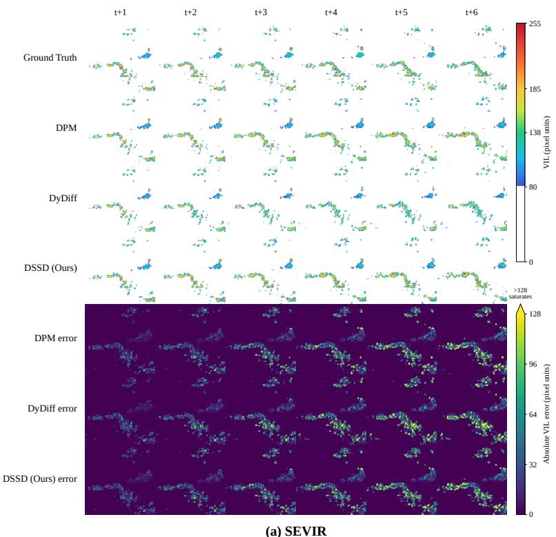

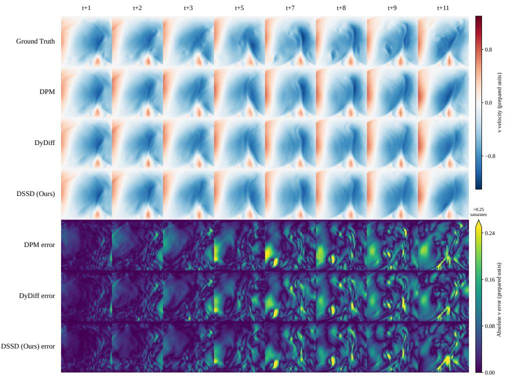  
(b) Turbulence  
Figure 5: Example scientific-field forecasts and absolute errors on (a) SEVIR and (b) Turbulence. Turbulence shows the v velocity component. Errors above the color-bar maximum saturate.

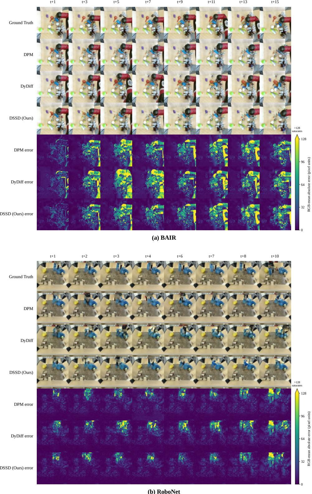  
Figure 6: Example robot-video forecasts and RGB-mean absolute errors on (a) BAIR and (b) RoboNet. Errors above the color-bar maximum saturate.

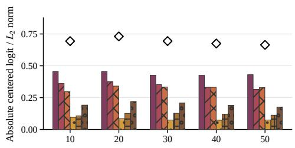

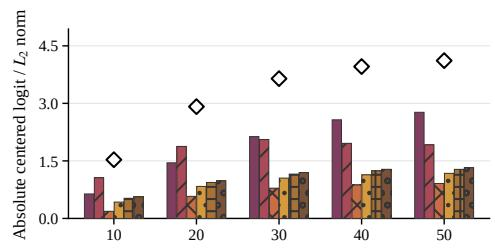

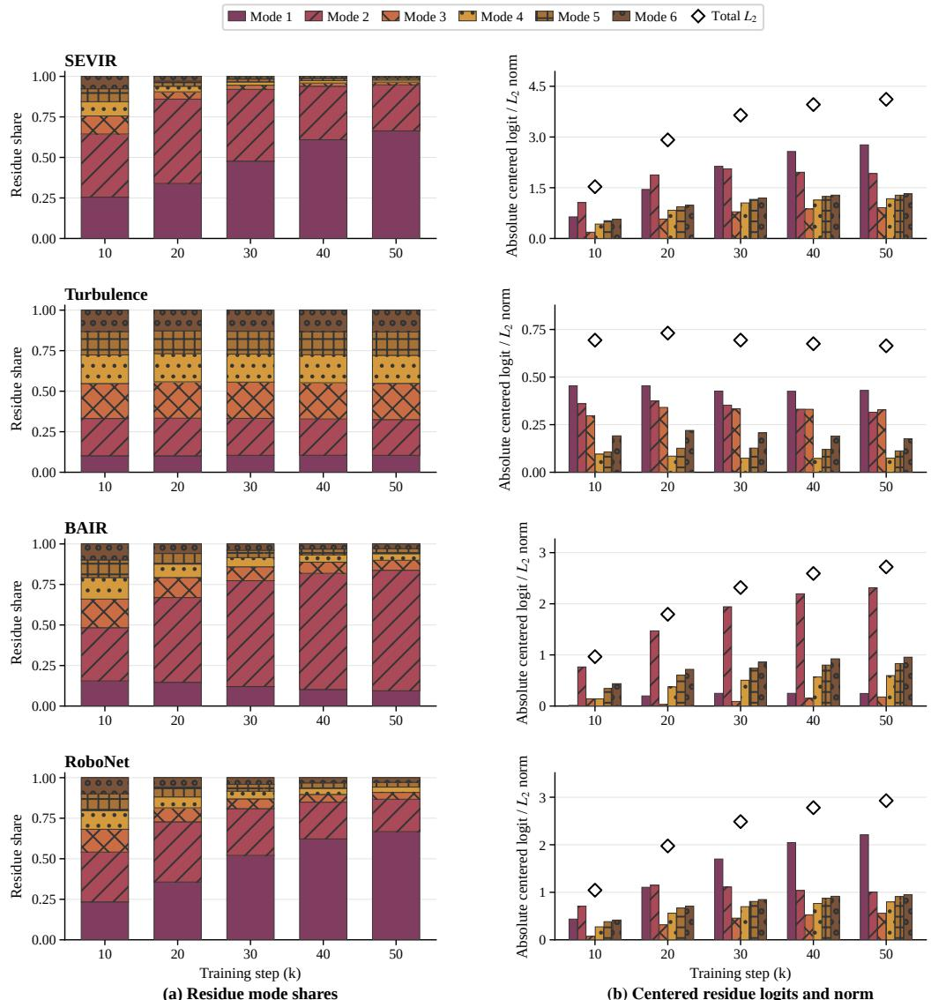

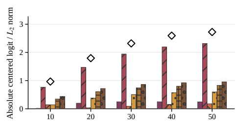

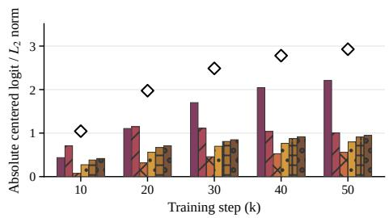  
Figure 7: Mode-resolved residue diagnostics on the four datasets, measured every 10k training steps (10k–50k) from saved DSSD checkpoints. (a) Softmax residue shares of the six temporal modes, each corresponding to a conjugate pair. (b) Absolute centered residue logits of each mode (bars) and their total $L _ { 2 }$ norm (diamonds).

Each dataset is one multivariate sequence with D channels. We compute a mean and standard deviation for each channel from the training sequence and apply the same normalization to test data. For each GluonTS test window, we forecast its future M points from the preceding N points. Table 9 gives these dimensions and window lengths.

All methods are trained from scratch for 50,000 optimizer updates with batch size 16, Adam at a constant learning rate of $1 0 ^ { - 5 }$ , a 1,000-step cosine diffusion schedule, and seed 42. DyDiff uses the fixed EMA operator with $\eta = 0 . 5$ . For DSSD, we use three conjugate SSM mode pairs (state size six), compared with six pairs in the video experiments. The time-series representation has no spatial latent feature maps, so we use fewer temporal modes as a modest capacity choice. All methods share the same denoiser. We use 50-step deterministic DDIM with a linearly spaced timestep grid.

Table 9 reports channel- and time-averaged finite-ensemble PWM CRPS, ensemble-mean RMSE and MAE, energy score, and temporal variogram score. Metric definitions follow Appendix C.3.

At 50,000 updates, DSSD has the lowest CRPS, RMSE, and energy score on five of six datasets, with DPM leading CRPS on Wikipedia and DyDiff leading its RMSE and energy score. The temporal

Table 9: Multivariate time-series test results at 50,000 updates. Bold and underlined values are best and second best within each dataset. All scores use training-set normalization; lower is better. D is the number of jointly modeled series; N and M are observed and predicted time steps.
<table><tr><td>Dataset</td><td>D</td><td>N</td><td>M</td><td>Method</td><td>CRPS↓</td><td>RMSE↓</td><td>MAE↓</td><td>Energy ↓</td><td>Variogram ↓</td></tr><tr><td rowspan="3">Exchange</td><td rowspan="3">8</td><td rowspan="3">30</td><td rowspan="3">30</td><td>DPM</td><td>0.37573</td><td>0.68591</td><td>0.56123</td><td>0.59404</td><td>0.78559</td></tr><tr><td>DyDiff</td><td>0.37640</td><td>0.76033</td><td>0.64038</td><td>0.54593</td><td>0.60261</td></tr><tr><td>DSSD (Ours)</td><td>0.29896</td><td>0.61315</td><td>0.51080</td><td>0.46610</td><td>0.44125</td></tr><tr><td rowspan="3">Solar</td><td rowspan="3">137</td><td rowspan="3">24</td><td rowspan="3">24</td><td>DPM</td><td>1.43163</td><td>2.31897</td><td>1.95040</td><td>1.89547</td><td>2.25310</td></tr><tr><td>DyDiff</td><td>1.48259</td><td>2.34964</td><td>1.97462</td><td>1.92896</td><td>2.37242</td></tr><tr><td>DSSD (Ours)</td><td>1.41653</td><td>2.31678</td><td>1.95240</td><td>1.88563</td><td>2.26805</td></tr><tr><td rowspan="3">Electricity</td><td rowspan="3">370</td><td rowspan="3">24</td><td rowspan="3">24</td><td>DPM</td><td>7.12656</td><td>7.08183</td><td>5.72460</td><td>6.72375</td><td>8.66073</td></tr><tr><td>DyDiff</td><td>7.17127</td><td>7.10774</td><td>5.74584</td><td>6.74831</td><td>8.67150</td></tr><tr><td>DSSD (Ours)</td><td>7.04436</td><td>7.05699</td><td>5.70272</td><td>6.69563</td><td>8.87129</td></tr><tr><td rowspan="3">Traffic</td><td rowspan="3">963</td><td rowspan="3">24</td><td rowspan="3">24</td><td>DPM</td><td>7.12199</td><td>10.90963</td><td>9.67041</td><td>8.47188</td><td>6.88153</td></tr><tr><td>DyDiff</td><td>7.14840</td><td>10.91133</td><td>9.66698</td><td>8.47718</td><td>6.85649</td></tr><tr><td>DSSD (Ours)</td><td>7.08377</td><td>10.90212</td><td>9.66832</td><td>8.46117</td><td>7.08459</td></tr><tr><td rowspan="3">Taxi</td><td rowspan="3">1,214</td><td rowspan="3">24</td><td rowspan="3">24</td><td>DPM</td><td>4.40064</td><td>5.75505</td><td>4.91774</td><td>4.65397</td><td>3.57764</td></tr><tr><td>DyDiff</td><td>4.41067</td><td>5.75627</td><td>4.91771</td><td>4.65638</td><td>3.57039</td></tr><tr><td>DSSD (Ours)</td><td>4.37568</td><td>5.75023</td><td>4.91415</td><td>4.64667</td><td>3.68216</td></tr><tr><td rowspan="3">Wikipedia</td><td rowspan="3">9,535</td><td rowspan="3">30</td><td rowspan="3">30</td><td>DPM</td><td>10.35604</td><td>16.95278</td><td>11.20462</td><td>12.66044</td><td>9.40709</td></tr><tr><td>DyDiff</td><td>10.41862</td><td>16.70496</td><td>11.03162</td><td>12.54705</td><td>9.47266</td></tr><tr><td>DSSD (Ours)</td><td>10.41440</td><td>16.93813</td><td>11.19473</td><td>12.65975</td><td>9.52240</td></tr></table>

variogram score is mixed: DSSD is best on Exchange and second on Solar, but has the highest score of the three methods on Electricity, Traffic, Taxi, and Wikipedia.