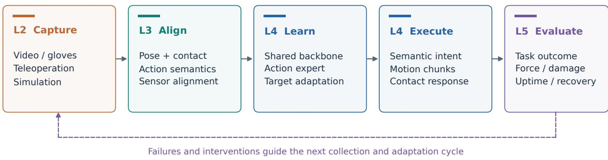
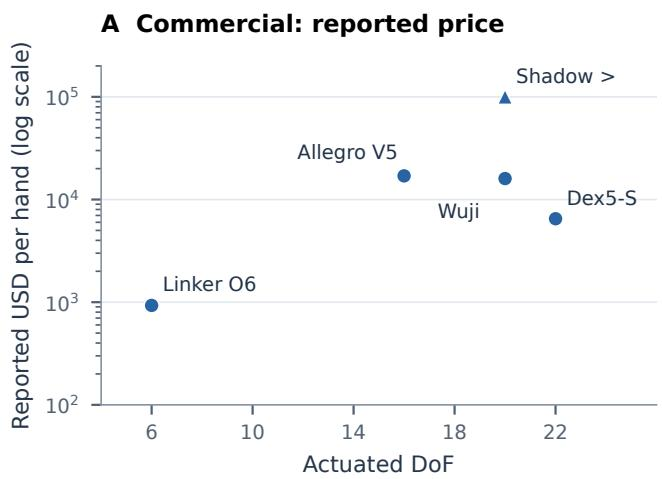
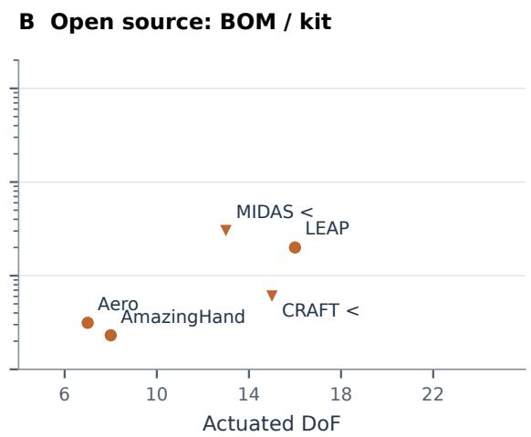
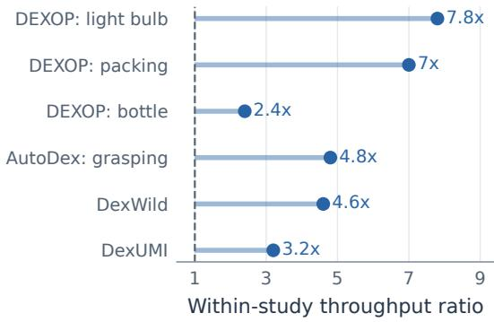
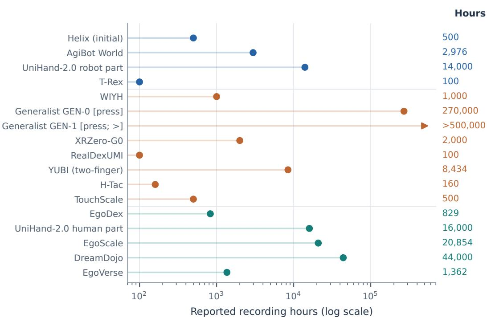
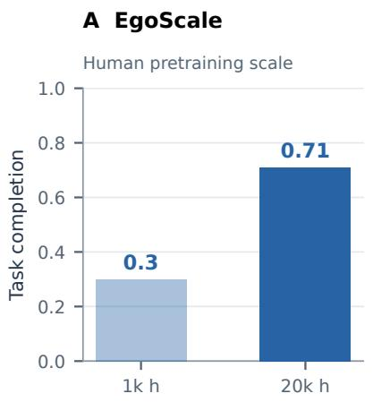
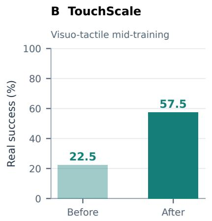
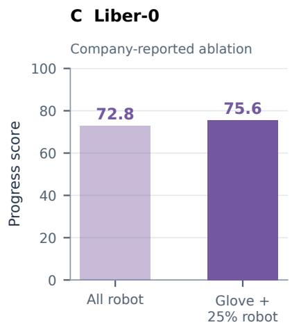
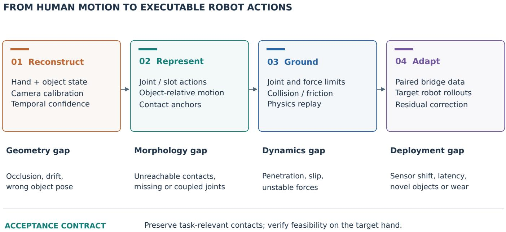
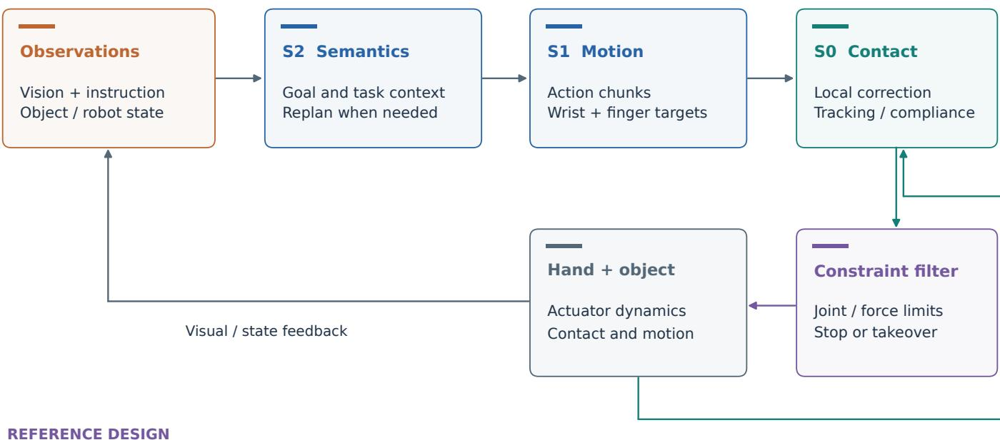

# Dexterous Robotic Hands in the Foundation-Model Era: A Full-Stack Survey of Hardware, Data, Cross-Embodiment Transfer, Learning, and Evaluation

Ji Pei\*

Xi’an Jiaotong University, Xi’an, China

## Abstract

Dexterous robotic hands are increasingly coupled to largescale human data and foundation models, yet progress in hardware, representation learning and evaluation is often assessed separately. This survey reviews work from January 2024 to early November 2026, with earlier studies included to establish technical lineages. We organize the literature into five interdependent layers: hardware; data collection and curation; cross-embodiment transfer; learning and foundation models; and evaluation and applications. Human hand–object understanding and tactile sensing provide two cross-cutting perspectives. A system-level architecture, comparative tables and five case analyses connect design choices across these layers. We distinguish within-study experimental comparisons from heterogeneous corpus statistics, vendor specifications and company-reported results. Three conclusions emerge. First, the value of human data depends on kinematic, visual and contact alignment, not recording volume alone. Second, shared action representations and foundation policies do not remove embodiment-specific constraints on force, latency and contact. Third, task completion is insufficient to establish physical correctness or deployment readiness. Evidence remains limited for zero-shot transfer of contact-rich skills between morphologically different hands, long-duration reliability, and cross-sensor tactile generalization. We identify eleven open problems and propose reporting interfaces and controlled comparisons that can make full-stack progress more measurable. The review is a structured narrative synthesis rather than a pooled performance ranking or an exhaustive systematic review.

Keywords: dexterous manipulation, robotic hands, human data, cross-embodiment transfer, tactile sensing, foundation models.

## 1 Introduction

The human hand is the interface through which most of the built world is operated: tools, containers, fasteners, cables, keyboards and laboratory glassware are all designed around five fingers, opposable thumbs and a sense of touch. Building robot hands that can use this world without redesigning it has been a goal of robotics for decades [1–4]. For most of that time, progress was limited on three fronts at once. Anthropomorphic hands were expensive, fragile and hard to maintain (the Shadow Dexterous Hand [5] costs more than US\$100k); data for multi-fingered manipulation were scarce because teleoperating 20 joints is slow and lacks force feedback; and learning methods for high-DoF hands were largely confined to single tasks trained with reinforcement learning (RL) in simulation [6–9].

Between 2024 and 2026 all three constraints loosened at the same time. On the hardware side, a 22-DoF hand became available for about US\$6.5k [10], a six-DoF linkage hand for under US\$1k [11], and open-source hands for a few hundred dollars [12, 13]; Chinese market trackers report shipments growing from about 19k units in 2025 to a forecast of 70k in 2026 [14]. On the data side, collection moved away from teleoperating a robot towards capturing humans directly: wearable exoskeletons and gloves that are kinematically matched to the robot hand [15–18], and egocentric video with 3D hand tracking at the scale of $1 0 ^ { 3 } – 1 0 ^ { 5 }$ hours [19–22]. Industrial players report even larger corpora, with press reports of 270k to more than 500k hours of wearable data [23, 24] and about ten million glove episodes collected in homes [25]. On the learning side, generalist VLA models [26–30] and worldaction models [31, 32] began to target high-DoF hands, with hierarchical systems that add a dedicated high-frequency contact layer below the policy [33, 34].

These developments are tightly coupled. A hand whose kinematics and camera placement mirror a human’s can reuse human data with little retargeting error; data collected with a hand-specific exoskeleton usually require additional retargeting for reuse with a different hand; whether a unified action space is needed depends on how many embodiments a model must serve; and benchmark results only transfer if hardware, sensing and evaluation protocols are comparable. Recent evidence makes this coupling explicit. EgoScale reports a loglinear relation between human-pretraining hours and validation loss, alongside improved downstream completion [20]; Liber-0 reports that, under identical post-training, 10k hours of glove data outperform 2M hours of web video, and that a more human-like robot benefits more from the same human data [35]; DexWild finds that too much human data relative to robot data (1:5) hurts performance compared with 1:2 [17]. None of these findings can be understood from the data layer alone.

Figure 2 groups selected milestones by year and layer.

Figure 1 gives the complementary systems view: the survey follows the forward path from human or robot data to deployment, while treating failures, contact signals and benchmark results as feedback into the next design cycle.

Scope and positioning. Classical surveys cover the mechanics of robot hands [2, 3], dexterous manipulation in general [1, 4], or a single learning paradigm such as RL [36], in-hand manipulation [37] or imitation learning [38]. A recent survey organizes embodied data into a “pyramid” [39] without focusing on hands. In contrast, we treat the dexterous hand as a full stack and survey how its layers co-evolve. We focus on work released between January 2024 and early November 2026, and include earlier work where it defines a lineage (e.g., Dactyl [6] for sim-to-real in-hand reorientation, DexPilot [40] for vision-based retargeting).

## Contributions.

• A five-layer taxonomy (hardware, data, cross-embodiment transfer, learning, evaluation) that makes the dependencies between layers explicit (Section 2).

• A structured review of each layer with comparison tables covering more than 40 hands, more than 50 data-collection systems and datasets, human hand–object datasets, more than 30 cross-embodiment methods, tactile models, graspsynthesis methods, about 20 industrial foundation-model programs and more than 20 benchmarks (Sections 3 to 9).

• Two cross-cutting analyses: human hands as a data source (Section 5) and touch across the stack (Section 7).

• A quantitative synthesis of reported evidence, including source-separated data scales, within-study collection ratios, price-versus-DoF comparisons and human-data ablations (Figures 3 to 5).

• Five full-stack case studies, including a deployment design for a commercial kitchen, that trace how decisions propagate across layers (Section 10).

• Eleven open problems and concrete recommendations for researchers and practitioners (Section 11).

Review design and coverage. This is a structured narrative review of sources released between January 2024 and 4 November 2026, with earlier work included for foundational methods. The source collection covers arXiv, major robotics, learning and vision venues, project pages, company technical blogs and trade press. Core studies concern multi-fingered hands; adjacent gripper and whole-body studies are included when they motivate a transferable component and are iden tified as such. Although reference-checking notes accom pany the source collection, a complete search log, screening counts and an independent dual-review record are not available. We therefore do not claim exhaustive coverage or systematic-review completeness. Publication, language, company-disclosure and positive-result biases may affect the synthesis.

Evidence and comparability. We separate the source of a claim (paper/preprint, company technical report, or secondary press) from the setting in which it was measured (simulation, real robot, or deployment). These are distinct axes: a large real-world result can still be company-reported, and peer review does not make two benchmarks comparable. Reported percentages retain their original success or progress semantics; missing trial counts, error bars and uncertainty cannot be reconstructed from headline scores. Within-study ablations support local comparisons, whereas cross-paper plots summarize reported scale or cost and are not leaderboards. Recommended architectures, maturity assessments and the kitchen design are explicitly our synthesis, not independently validated deployments.

Table 1: Proposed information to retain at stack interfaces.
<table><tr><td>Interface</td><td>Information needed for diagnosis and reuse</td></tr><tr><td>Capture →</td><td>Raw observations, hand/object state, calibration, timing and</td></tr><tr><td>transfer Transfer →</td><td>provenance Action semantics, masks, embodiment metadata and</td></tr><tr><td>learning</td><td>feasibility tests</td></tr><tr><td>Policy → control</td><td>Target frames and units, chunk horizon, update rate and delay</td></tr><tr><td>Control →</td><td>Outcome, force, precision, damage, interventions and latency</td></tr><tr><td>evaluation Evaluation → design</td><td>Failure mode, hardware/sensor configuration, environment and recovery</td></tr></table>

## 2 A Full-Stack Taxonomy

Figure 1 organizes the survey around three questions: what information survives the mapping from a human to a robot; which decisions can be shared across hands; and which failures require feedback close to the hardware? The five layers answer these questions jointly. Human data are useful only after their observations and action semantics are aligned; a shared policy still needs feasible target-hand commands; and a high task score does not establish reliable contact or deployment readiness.

Interfaces rather than isolated components. The minimum information at each boundary is listed in Table 1. These are proposed reporting fields, not capabilities verified for every system in this survey. In particular, confidence estimates and target contact states remain design choices rather than standard VLA outputs.

Table 2 defines terms used throughout.

L1 Hardware. A hand is characterized by its actuation route (where the motors are and how force reaches the joints), its kinematics (number and arrangement of joints), its sensing (joint encoders, motor current, tactile skins, in-palm cameras) and its maintainability. We distinguish total DoF (all joints, including passive or coupled ones) from active or actuated DoF (independently controlled inputs). Vendors mix these conventions; for example, a widely used linkage hand has 6 active and 12 total DoF [11]. Unless stated otherwise, we report active DoF.

L2 Data. Data sources differ in how close they are to the deployed robot. Following the “data pyramid” view [39], the top of the pyramid is robot teleoperation (directly executable, expensive), followed by wearable robot-free capture (human hands act directly, hardware approximates the robot), egocentric human video (cheapest and largest, but with the largest gap), simulation and generative data, and general vision-language data at the base.

L1 Hardware is the common constraint   
Kinematics and coupling | cameras and touch | dynamics, latency and wear

Figure 1: The five-layer stack as a closed system. Hardware constrains capture, alignment and execution; evaluation informs the next data and adaptation cycle. This is a conceptual synthesis of the reviewed literature, not the implementation of a particular product. The arrows indicate dependencies rather than guaranteed causal improvements.
<table><tr><td>Layer</td><td>2024</td><td>2025</td><td>2026 (through 4November)</td></tr><tr><td>Hardware</td><td>1</td><td>ORCA [41]; Sharpa Wave [42]</td><td>Dex5-S [10]; MIDAS [43]; Aero Hand [12]</td></tr><tr><td>Data</td><td>DexCap [44]; Open-TeleVision [45]</td><td>AgiBot World [46]; DexWild [17]; EgoDex [19]; DEXOP [16]</td><td>EgoScale [20]; RealDexUMI [18]; TouchScale [47]</td></tr><tr><td>Transfer</td><td>CrossDex [48]</td><td>SPIDER [49]</td><td>TactAlign [50]; UniDex [51]; TopoRetarget [52]; OmniHOI [53]</td></tr><tr><td>Models</td><td>π0 [26]</td><td>Helix [33]; GR00T N1 [29]; π0.5 [27]</td><td>DreamZero [31]; π0.7 [28]; GEN-1.5 [23]</td></tr><tr><td>Evaluation</td><td></td><td>TeleOpBench [54]</td><td>DexJoCo [55]; DexVerse [56]; HandsOn [57]</td></tr></table>

Figure 2: Selected milestones grouped by release year and layer. This schematic retains representative entries from the source chronology and avoids implying exact release months. A dash means no milestone was selected for that cell, not an absence of prior research. Entries are examples, not counts of research activity.

L3 Cross-embodiment transfer. We call the mismatch between a data source and the target robot the embodiment gap. For hands it has five components: morphology (finger count, DoF, coupling, thumb design, size); action semantics (joint order and meaning); observation (camera placement, appearance of the hand, tactile sensor type and layout); dynamics (torque limits, stiffness, friction, backlash); and timing (latency, control rate, action-chunk length). The gap arises both between humans and robots and between different robot hands.

L4 Learning. Policies for dexterous hands are trained with RL (mostly in simulation), imitation learning from demonstrations, large-scale pretraining of VLA or world-action models, or combinations of these. Architectures increasingly split control into layers running at different frequencies.

L5 Evaluation. Benchmarks, competitions and field deployments define what “dexterous” means in practice. We organize them by atomic skills (grasping, in-hand reorientation, tool use, bimanual coordination, articulated objects, deformable and fragile objects, insertion and assembly, forcecontrolled dosing) and by application domains.

Table 2: Glossary of terms used in this survey.
<table><tr><td>Term</td><td>Meaning</td></tr><tr><td>Active / total DoF</td><td>Independently actuated inputs / all joints including coupled and passive ones</td></tr><tr><td>Backdrivability</td><td>Ability of external forces to move the joint through the transmission; eases compliant contact and sim-to-real</td></tr><tr><td>Retargeting</td><td>Mapping human hand motion (keypoints, joint angles) to robot joint commands</td></tr><tr><td>Embodiment gap</td><td>Mismatch in morphology, action semantics, observation, dynamics and timing between source and target</td></tr><tr><td>Robot-free capture</td><td>Data collection in which the human acts directly, with wearable hardware approximating the robot</td></tr><tr><td>Isomorphic device</td><td>Collection device with the same kinematics (and ideally sensors) as the deployed hand</td></tr><tr><td>Egocentric data</td><td>First-person video, usually with estimated or tracked 3D hand poses</td></tr><tr><td>Mid-training</td><td>Training stage on paired or aligned human-robot data between pretraining and task post-training</td></tr><tr><td>VLA</td><td>Vision-language-action model: VLM backbone plus an action decoder</td></tr><tr><td>VTLA</td><td>VLA that also consumes tactile (and often force) signals</td></tr><tr><td>World-action model</td><td>Model that predicts future observations (pixels or latents) and actions jointly</td></tr><tr><td>Contact layer (SO)</td><td>Low-level controller for tracking or contact response; tactile, force and proprioceptive inputs depend on the</td></tr><tr><td>Progress score</td><td>system Partial-credit task metric based on milestones; more lenient than binary success</td></tr></table>

## 3 Layer 1: Hardware

## 3.1 A brief lineage

Today’s design debates echo earlier generations of hands [2, 3]. The Robonaut 2 hand placed all 16 finger and 2 wrist actuators in the forearm and drove 12 hand DoF through braided tendons, using n+1 tendons for n DoF in the primary fingers, and reached fingertip forces of about 2.25 kg and payloads above 9 kg [58], the template for today’s forearm-actuated humanoid hands. DLR’s line, from Hand II to the Awiwi hand, was designed from the functions of the human hand rather than its anatomy [59]; Awiwi’s antagonistic elastic drive survived a 500 g hammer strike and reached finger speeds of about 3,500 deg/s, more than five times what its motors alone provide, and its designer argued explicitly that such robustness would allow learning by trial and error without costly damage [60], an argument that Section 3.7 shows is more relevant than ever. EthoHand approximated the human hand with seven motors around a tendon-driven ball-joint thumb and could pass a ball between fingers while texting on a phone held in the same palm [61]. Underactuated prosthetic designs contributed double-stage underactuation and reconfigurable thumbs [62], and the Pisa/IIT SoftHand family showed that adaptive synergies with a single actuator achieve robust grasping [63]. Soft pneumatic hands reached the full grasp taxonomy and maximal Kapandji score with RBO Hand 3, which has 16 independent degrees of actuation, an actuated palm and finger spreading [64]; DManus covered palm and fingertips with magnetic skin at low cost [65]. LEAP Hand [66] and its hybrid rigid–soft successor [67] brought this lineage to the learning community.

## 3.2 Actuation and transmission routes

Where the motors sit and how they move the joints determines a hand’s weight, strength, backdrivability, maintainability and, importantly for learning, how simple the mapping from motor commands to joint angles is. Six routes coexist (Table 3).

Direct and quasi-direct drive. Each joint has its own micro-motor and gearbox inside the finger or palm. Joints are independently controllable, backlash is low and the hand can be backdrivable, which keeps the motor-to-joint map simple and simplifies sim-to-real transfer. Recent examples include the Wuji Hand (20 active DoF, under 600 g, a vendor-claimed endurance of more than 300k grasp cycles) [68], BrainCo Revo 3 (21 DoF, backdrivable) [69], a 20-DoF fully directdrive hand rated for a 30 kg payload [11], the DH-Robotics ADH-5-13 (13 DoF, modular sensors replaceable without disassembling a finger) [70] and the Sharpa Wave (22 active DoF, 1:1 human size, a dynamic tactile array on each finger) [42]. The academic MIDAS hand (13 active of 16 joints, 283 three-axis taxels, BOM below US\$3k) ships with a simulation model and teleoperation pipeline [43]. The main limitations are heat, limited per-finger force and the cost of 16–20 small motors.

Linkage. Micro linear actuators drive coupled linkages, typically giving 6 active of 11–12 total DoF. Linkage hands are stiff, strong, durable and cheap, and dominate early humanoid deployments; their coupling limits in-hand dexterity and abduction. A six-DoF hand of this type is sold for about US\$930 [11], and the ByteDexter hand uses linkages at 20 DoF for teleoperated data collection [71]. Recent academic designs show that linkages are not inherently limited to a few actuators: DexLink drives 20 joints with 16 independent actuators at 320 g and below US\$400 while reaching the maximum Kapandji score and all 33 grasp types [72], and SyLink uses motion capture to find human joint correlations and decouples flexion from abduction with a spherical four-bar mechanism, driving 19 joints with 11 actuators at 520 g [73].

Tendon drive. Motors in the forearm pull tendons (often sheathed) that act on the fingers, as in the Shadow Hand [5]. This keeps the hand light and compliant and makes high DoF counts feasible, at the price of friction, creep, slack and a non-linear joint–motor map that needs tensioning and calibration. Tesla’s Optimus V3 hand, according to patent analyses, moves 22 hand DoF onto 25 forearm actuators per arm and introduces a wrist routing that limits tendon-length change under combined yaw and pitch [74]. Open-source tendon hands focus on maintainability: ORCA uses joints that dislocate before they break, self-calibrating tendon routing and a ratchet tensioner, and ran 10,000 consecutive cycles without failure [41]; RUKA uses an underactuated tendon design and RUKA-v2 adds a parallel wrist [75, 76]; MM-Hand moves the motors to a remote housing with quick-release tendon connectors and analyzes sheath friction [77]; CRAFT combines soft joints with rigid links for under US\$600 [13]; and a 17-DoF antagonistic design drives both flexion and extension without return springs [78]. The tendon-to-joint map is increasingly handled with learning and proprioception rather than hand-tuned friction models: a transformer that predicts tendon forces within 3% of maximum motor force reduces the sim-to-real gap by 41% and improves fingertip tracking of an RL controller by 50% on real tendon-driven fingers [79]; series-elastic tendons estimate contact timing, joint angles and object stiffness without vision or touch [80]; model-based estimation recovers joint positions from tendon displacement and tension [81]; and the DexHand 021 (12 active and 7 passive DoF, 1 kg) uses proprioceptive compliance control with force estimation errors below 0.2 N [82]. Artificial muscles are another remote-actuation option: electrohydraulic Peano-HASEL actuators in the forearm drive an inherently compliant musculoskeletal hand that detects grasps from operating current alone [83].

Hybrid drive. 2026 product launches show a clear shift to hybrids: tendons for high-force flexion and in-palm direct drive or linkages for abduction and opposition. Xiaomi’s 21- DoF hand uses 26 motors with tendon-tension control and was designed from an analysis of 1,827 factory standard operating procedures [84]. Research hands explore other hybrids, such as shape-memory-alloy extension combined with motordriven flexion [85], or a split of five forearm motors for grip force and ten palm motors for fine manipulation in a 15-DoF, 1.4 kg hand [86].

Hydraulic and servo-based. Sanctuary AI’s 21-DoF hand uses miniature hydraulic valves and was shown performing zero-shot in-hand cube reorientation using only the fingertips [87]; in academia, DexCo uses soft hydraulic actuation with hydrostatic compliance modeling and reports 34.4 N repeatable fingertip force and 0.03 mm repeatability [88]. At the other end, servo-based open hands such as LEAP [66], Aero Hand Open [12] and AmazingHand [89] trade anthropomorphic proportions and strength for very low cost and easy repair.

Specifications of representative commercial and opensource hands are collected in Tables 4 and 5.

## 3.3 How many degrees of freedom?

Commercial hands are marketed with anywhere from 6 to 42 DoF, but flagship designs are converging on roughly 20–22 active DoF (Sharpa Wave 22 [42], Dex5-S 22 [10], Optimus V3 22 [74], Revo 3 21 [69], Xiaomi 21 [84]). The most explicit evidence comes from Xiaomi’s industrial study, which reports that across 1,827 factory procedures, hands with 17–21 DoF achieved 15–38% higher average stable-grasp success than 6– 15-DoF hands, with diminishing returns beyond 23 DoF, and that joints with correlation above 0.8 (e.g., the distal interphalangeal joint following roughly one third of the proximal one) are good candidates for underactuated coupling [84]. This is a vendor study rather than a controlled academic experiment, but it is consistent with the grasp coverage results of open hands: CRAFT and an antagonistic 17-DoF hand cover all 33 grasp types of the GRASP taxonomy [13, 78, 112].

Grasp-taxonomy coverage, however, no longer discriminates between designs: low-cost tendon and linkage hands now routinely complete all 33 grasp types [13, 72, 110]. More informative are fingertip force (a 16-DoF open tendon hand completes every grasp type yet averages only 2.14 N peak fingertip force [110]), opposition range and durability.

The thumb remains the hardest joint. BiDexHand misses two of eleven Kapandji poses because of limited carpometacarpal range [110]; a soft biomimetic saddle-joint thumb scores 9/10 [113]; and design methods place the thumb by workspace analysis [114] or make it reconfigurable [62]. Optimizing phalanx length ratios against manipulability and workspace metrics shows that phalanges do not contribute equally to dexterity [115]. The palm and wrist are becoming design variables: ISyHand’s articulated palm significantly outperforms a fixed-palm variant of the same hand in RL cube reorientation [111], and wrists are integrated into synergy hands [116] or added to low-cost tendon hands with quantified ranges [76, 117]. Whether anthropomorphism itself is necessary is contested: a review of 125 papers from 2019– 2025 concludes that in-hand manipulation does not benefit from anthropomorphic design and that mechanism complexity correlates with task breadth [118], whereas musculoskeletal designs argue that anatomical priors help identify which structures matter for control [119]. For learning from human data, the relevant question is narrower: how closely the hand’s kinematics and camera placement must match a human’s for human data to transfer (Section 4.6).

We expect two tiers to persist: 6–12-DoF hands for highthroughput industrial grasping and 20–22-DoF hands for research, data collection and general-purpose humanoids.

A related design question is where the actuators live. Humanoid makers increasingly move large motors into the forearm, as in Optimus V3 [74], yielding an integrated arm–hand module with low distal inertia. Hands sold as standalone products, by contrast, mostly keep actuation in the palm so that they can be mounted on arbitrary arms.

## 3.4 Soft, compliant and variable-stiffness hands

Compliance protects hands and objects and simplifies teleoperation and learning. Beyond RBO Hand 3 [64], recent examples include the Tactile SoftHand-A, a 3D-printed underactuated hand with antagonistic tendons to open and close actively and an integrated vision-based tactile sensor [120]; a LEGObased educational synergy hand at the lowest end of the cost spectrum [121]; pneumatic hands with single-step printed exoskeletons [122]; and soft–rigid hybrid fingers whose stiffness is set by control gains rather than hardware, which completed 28 of 33 grasp postures and supported diffusion-policy learning from glove teleoperation [123]. Variable-stiffness joints based on beaded-string jamming span 0.48–1.95 Nm/rad and a gripper integrating the joint reached 60% higher peg-in-hole success than a rigid one [124]. Co-design is moving from simulation to physical validation: a genetic algorithm with policy transfer evaluated nearly 400 soft-hand designs and validated them with more than 900 teleoperated tasks [125], and multi-parameter benchmarking of candidate fingers (joint, bone, skin and sensor placement) precedes assembling a full hand [126].

Table 3: Actuation and transmission routes for dexterous hands. Product examples are illustrative; specifications are vendor-reported.
<table><tr><td>Route</td><td>Principle</td><td>Examples</td><td>Strengths</td><td>Weaknesses</td><td>Typical use</td></tr><tr><td>Direct / quasi-direct</td><td>One micro-motor + reducer per joint, in finger or palm</td><td>Wuji Hand [68], Revo 3 [69], Sharpa Wave [42], ADH-5-13 [70], MIDAS [43], Allegro [90]</td><td>Independent joints, low backlash, backdrivable, simple joint-motor map; good for RL and</td><td>Limited space and heat dissipation; many motors; modest finger force</td><td>Research, RL, data-collection platforms</td></tr><tr><td>Linkage</td><td>Linear actuators drive coupled linkages (e.g., 6 active / 12 total)</td><td>Linkage hands on early humanoids [11], ByteDexter [71]</td><td>Stiff, strong, durable, cheap, easy to mass-produce</td><td>Coupled joints, weak abduction, limited in-hand dexterity</td><td>Industrial picking, logistics</td></tr><tr><td>Tendon</td><td>Forearm motors pull (sheathed) tendons</td><td>Shadow [5], Optimus V3 [74], ORCA [41], RUKA [75, 76], MM-Hand [77], CRAFT [13]</td><td>Light, low inertia, compliant, high DoF</td><td>Friction, creep, slack; tensioning and calibration; non-linear mapping</td><td>Anthropomorphic and humanoid hands</td></tr><tr><td>Hybrid</td><td>Tendons for flexion; direct drive/linkage for abduction and opposition</td><td>Xiaomi 21-DoF [84], CYJ Hand-0 [85]</td><td>Combines force, low weight and precision per joint</td><td>Highest system complexity and maintenance cost</td><td>2026 high-end products</td></tr><tr><td>Hydraulic</td><td>Miniature hydraulic valves</td><td>Sanctuary AI [87]</td><td>High power density, fine force resolution</td><td>Complexity, cost, leakage risk</td><td>Research platforms</td></tr><tr><td>Servo (open-source)</td><td>Off-the-shelf bus servos at the joints</td><td>LEAP [66], Aero Hand Open [12], AmazingHand [89]</td><td>Very cheap, easy to build and repair</td><td>Bulky, non-anthropomorphic proportions, limited force and life</td><td>Entry-level research, teaching</td></tr></table>

## 3.5 Tactile sensing

Touch moved from an option to a selling point in 2026. Products advertise full-palm coverage: 1,500 taxels on Xiaomi’s hand [84], 1,140 Hall-effect cells on the PaXini DexH13 [102], fingertip visuo-tactile sensors plus more than 300 palm taxels on the AGILINK OmniHand 3 [96], and a dynamic tactile array per finger on the Sharpa Wave, with a full-hand tactile successor [42, 101]. Sanctuary reports a barometric tactile sensitivity of 5 mN [87], and Figure 03 reports fingertip force sensing at the 3 g level [99]. Three sensing principles dominate: piezoresistive skins (cheap, fast and simple, and the mainstream choice for mass production), capacitive and magnetic/Hall arrays, and visuo-tactile sensors that image the deformation of an elastomer with an internal camera (highest spatial resolution, used for fragile objects and slip). Academic hands increasingly integrate distributed sensing at the phalanges [107] and full-hand arrays [43]. Full coverage is not always necessary: task-driven pruning reduced a Shadow Hand array from 92 to 21 sensors while retaining 93% of performance, with thumb, ring and little-finger sensors contributing most [127]. The fragmentation of sensor types is a major obstacle to reusing tactile data across hands; we discuss sensors, simulation and tactile learning in depth in Section 7.

## 3.6 Open-source and academic hands

Open-source hands have evolved from “it moves” to “it is ready for learning”. LEAP (2023) introduced a universal metacarpophalangeal abduction mechanism, about US\$2k and a four-hour assembly, and outperformed the Allegro Hand at roughly one eighth of its cost [66]. Since 2025, designs ship with what a learning pipeline needs: simulation models (Aero Hand Open is released “simulation-ready” at

US\$314 [12]; MIDAS includes control and tactile APIs, retargeting and teleoperation [43]), integrated touch (ORCA’s tactile variant [41, 106]), wrists (RUKA-v2 [76]), in-hand stereo cameras (MM-Hand [77]) and maintainability features. Some designs are being commercialized: ORCA offers 9-, 17- DoF and tactile versions at US\$1.5k–6.1k [106]. Hands are also being co-designed with data collection and with policies: RAPID Hand co-optimizes hand, perception and teleoperation interface [108], and House of Dextra pretrains a morphologyconditioned policy over many generated hand shapes to evaluate candidate designs [128].

## 3.7 Durability, cost and supply chain

Durability is the first deployment bottleneck. Integrators report that some popular hands fail after about 50 grasps of a 5 kg object; a warehouse robot performs 8,000–10,000 grasps per day while leading products are rated for 300k–500k cycles, which suggests a potential mismatch with continuous duty, but cannot by itself establish replacement intervals without matched loads and failure definitions [92]. Figure reported that the forearm was the most common failure point in its BMW pilot [99]. Vendor claims of 300k cycles [68, 97] sit near today’s passing line; industrial deployment will require million-cycle lifetimes, load-specified test conditions and modular quick-swap designs.

Cost. A complete low-cost bimanual research platform illustrates where money goes: about US\$5k for two robot hands, US\$7k for the teleoperation system and US\$16k for two arms [129]. Figure 3 plots reported prices against actuated DoF. Reported prices span a wide range across products: established research hands are quoted around US\$16k– 100k or more [5, 68, 90], while the 22-DoF Dex5-S is reported at about US\$6.5k [10], while open-source BOMs reach a few hundred dollars [12, 13, 89]. The dexterous hand is still among the most expensive single components of a humanoid. Its cost is dominated by 16–20 coreless micro-motors (6–8 mm diameter) per high-DoF hand, a market led by a few European suppliers; domestic Chinese alternatives are reported at 30–40% of import prices but still trail at the smallest sizes [130].

Table 4: Specifications of representative commercial and humanoid-integrated dexterous hands (vendor-reported or press-reported; “–” = not disclosed). DD: direct/quasi-direct drive; Ten.: tendon; Link.: linkage; Hyb.: hybrid; Hyd.: hydraulic.
<table><tr><td>Hand (maker)</td><td>Year</td><td>Route</td><td>DoF</td><td>Mass</td><td>Force / payload</td><td>Sensing</td><td>Notes</td></tr><tr><td>RH56 series (Inspire) [91, 92]</td><td>2023+</td><td>Link.</td><td>6 active / 12</td><td>0.5-0.6kg</td><td>一</td><td>Optional fingertip touch</td><td>Standard hand on early humanoids; &gt;10k units</td></tr><tr><td>RH524J1 (Inspire) [93]</td><td>2026</td><td>Hyb.</td><td>24 (22 hand + 2</td><td></td><td></td><td>Proximity, touch, depth</td><td>shipped in 2025 (reported) Tendon-hybrid; modular</td></tr><tr><td>O6 (Linkerbot) [11, 94]</td><td>2025</td><td>Link.</td><td>wrist) 6</td><td></td><td>&gt;3 kg per finger</td><td></td><td>thermal management Volume product, about</td></tr><tr><td>O30 (Linkerbot) [11, 95]</td><td>2026</td><td>DD</td><td>20</td><td>740g</td><td>30 kg rated</td><td></td><td>US$930 Each joint independently</td></tr><tr><td>OmniHand 3 Ultra-M</td><td></td><td></td><td></td><td></td><td></td><td></td><td>driven; aimed at RL Paired with DUET contact</td></tr><tr><td>(AGILINK) [95, 96]</td><td>2026</td><td>DD</td><td>20</td><td>630g</td><td></td><td>5 fingertip visuo-tactile + 300+ palm taxels</td><td>layer</td></tr><tr><td>Revo 3 (BrainCo) [69]</td><td>2026</td><td>DD</td><td>21</td><td></td><td>70N grip</td><td>Full-palm + fingertip visuo-tactile</td><td>Backdrivable; 33 grasp types</td></tr><tr><td>Wuji Hand / Hand 2 [68]</td><td>2025- 26</td><td>DD</td><td>20 (4 per finger)</td><td>&lt;600g</td><td>~15N fingertip</td><td></td><td>300k+ cycles; about US$16k</td></tr><tr><td>DexHand021 Pro (DexRobot) [97]</td><td>2026</td><td>Ten.</td><td>22</td><td></td><td>50N</td><td>Full-palm multimodal</td><td>Bidirectional tendons; 300k+ cycles</td></tr><tr><td>Dex5-S (Unitree) [10]</td><td>2026</td><td>DD</td><td>22</td><td>620 g</td><td></td><td>Touch (Pro version)</td><td>Human-sized; about US$6.5k</td></tr><tr><td>21-DoF hand (Xiaomi) [84]</td><td>2026</td><td>Hyb.</td><td>21 (26 motors)</td><td></td><td></td><td>1,500 taxels</td><td>Designed from 1,827</td></tr><tr><td>Optimus V3 hand (Tesla) [74, 98]</td><td>2026</td><td>Ten.</td><td>22 + wrist</td><td></td><td></td><td>Fingertip touch</td><td>factory SOPs 25 forearm actuators per</td></tr><tr><td>Figure 03 hand [99]</td><td>2025</td><td>Ten.</td><td>~20</td><td></td><td></td><td>Palm camera, 3 g fingertip</td><td>arm Soft fingertips</td></tr><tr><td>1X hand [100]</td><td>2026</td><td>Ten.</td><td>25 (incl. wrist)</td><td></td><td></td><td>force</td><td>Modeled on human</td></tr><tr><td>Phoenix hand</td><td>2025-</td><td>Hyd.</td><td>21</td><td></td><td></td><td>Barometric, 5 mN</td><td>tendons Fingertip-only</td></tr><tr><td>(Sanctuary) [87] Sharpa Wave /</td><td>26</td><td></td><td></td><td></td><td></td><td></td><td>reorientation demo</td></tr><tr><td>W02 [42, 101]</td><td>2025- 26</td><td>DD</td><td>22 /21</td><td>W02 &lt;750g</td><td>20N fingertip</td><td>Dynamic tactile array per finger; full-hand (W02)</td><td>1:1 human size; GR0OT reference humanoid</td></tr><tr><td>ADH-5-13</td><td>2026</td><td>DD</td><td>13</td><td>735 g</td><td></td><td>Fingertip touch, expandable</td><td>Sensors swappable without</td></tr><tr><td>(DH-Robotics) [70] DexH13</td><td>2025</td><td>DD</td><td></td><td></td><td></td><td>1,140 Hall-effect cells</td><td>disassembly Paired with data-collection</td></tr><tr><td>(PaXini) [102, 103] Shadow Dexterous</td><td>classic</td><td></td><td>13</td><td>~4.3 kg</td><td></td><td></td><td>glove &gt;US$100k; research</td></tr><tr><td>Hand [5]</td><td></td><td></td><td></td><td>(with forearm)</td><td></td><td></td><td>benchmark</td></tr><tr><td>Allegro Hand V5 [90]</td><td>classic</td><td>DD</td><td>16 (4 fingers)</td><td>~1kg</td><td></td><td>Optional fingertip touch</td><td>Common RL platform; about US$17k</td></tr><tr><td>Ability Hand (PSYONIC) [104]</td><td>classic</td><td>Link.</td><td>6</td><td>~0.5 kg</td><td></td><td>Fingertip touch</td><td>Prosthetic origin</td></tr><tr><td>ZWHAND [105]</td><td>2025</td><td>Link.</td><td>17-18</td><td>~0.85 kg</td><td>6kg</td><td>E-skin</td><td>About US$12.5k</td></tr></table>

Supply chain. Beyond motors, transmission components (micro lead screws and planetary roller screws for linear drives, tendons and sheaths) and sensing components (six-axis force sensors, electronic skins, joint encoders) form the rest of the bill of materials, and hand makers increasingly develop actuators in-house to control cost [91, 130]. Industry analyses describe an “impossible triangle” among dexterity, payload and cost [131], a market that is fragmented with small revenues per vendor, and valuations that run ahead of revenue [132]. Expert opinion converges on roughly 20 DoF as necessary for human-level dexterity, with six-DoF hands not strictly dexterous and 40+ DoF largely redundant [133]. Tactile sensors attracted dozens of financing rounds in 2025– 2026 [134].

Volume. Market trackers estimate 19.2k hands sold in China in 2025, with forecasts of 70.2k in 2026 and 430k by 2030 [14]; individual vendors report cumulative shipments in the 10k range [91]. These figures are not audited and should be read as indicators of momentum rather than market size.

Takeaway. Hardware is converging on ∼20–22 active DoF with hybrid actuation and full-hand touch for high-end hands, while 6–12-DoF linkage hands serve industrial picking. Cost is falling fast; durability under realistic loads, not DoF, is now the binding constraint. For learning, backdrivable direct-drive joints and human-like proportions and camera placement make sim-to-real and human-data reuse easier (Section 4.6).

## 4 Layer 2: Data

Data for dexterous manipulation can be organized by how close the recorded actions and observations are to those of the deployed robot. Closer sources are more directly usable but more expensive per hour; more distant sources scale better but require bridging an embodiment gap (Section 6). Table 6 summarizes representative systems, Figure 5 the reported data scales, and Table 7 a qualitative comparison of routes.

## 4.1 Teleoperation

In teleoperation a human controls the robot and the robot’s own observations and joint commands are recorded, which gives directly executable data with no embodiment gap. Interfaces fall into three groups.

Table 5: Academic and open-source dexterous hands (2023–2026). Cost is reported BOM or kit price.
<table><tr><td>Hand</td><td>Year</td><td>Route</td><td>DoF</td><td>Mass / cost</td><td>Highlights</td></tr><tr><td>LEAP Hand [66]</td><td>2023</td><td>Servo DD</td><td>16 (4 fingers)</td><td>600 g / ~US$2k</td><td>Universal MCP abduction; 4-h assembly; ~1/8 Allegro cost</td></tr><tr><td>ORCA [41, 106]</td><td>2025</td><td>Tendon</td><td>17</td><td>−/ &lt;CHF2k</td><td>Dislocating joints, self-calibration; 10k cycles; commercial lite/standard/touch</td></tr><tr><td>RUKA/</td><td>2025-26</td><td>Tendon</td><td>15 underact.</td><td>&lt;US$1.3k-1.5k</td><td>Fully open CAD; learned controllers</td></tr><tr><td>RUKA-v2 [75, 76]</td><td></td><td></td><td>(v1); + 2-DoF wrist (v2)</td><td></td><td></td></tr><tr><td>CRAFT [13]</td><td>2026</td><td>Tendon</td><td>15 actuated</td><td>&lt;US$600</td><td>Hybrid hard–soft compliance; 33/33 GRASP types</td></tr><tr><td>MM-Hand [77] MIDAS [43]</td><td>2026</td><td>Remote tendon</td><td>21</td><td></td><td>Quick-release tendons; in-palm stereo; sheath-friction analysis</td></tr><tr><td>Aero Hand Open [12]</td><td>2026 2026</td><td>DD Tendon (7</td><td>13 of 16 16 joints</td><td>700 g / &lt;US$3k 374 g / US$314</td><td>283 three-axis taxels; sim model, retargeting, teleop pipeline Simulation-ready; fully 3D printed</td></tr><tr><td>Antagonistic hand [78]</td><td></td><td>servos)</td><td></td><td></td><td></td></tr><tr><td>Tactile tendon</td><td>2026</td><td>Antagonistic tendon</td><td>17</td><td>220 g</td><td>No return springs; palmar and dorsal grasps; 33 grasp types</td></tr><tr><td>hand [107]</td><td>2026</td><td>Tendon</td><td>5 fingers</td><td></td><td>Distributed bimodal touch on phalanges</td></tr><tr><td>CYJ Hand-0 [85]</td><td>2025</td><td>SMA + motor</td><td>21</td><td></td><td>SMA extension, motor flexion; printed metal skeleton</td></tr><tr><td>ByteDexter [71] RAPID</td><td>2025</td><td>Linkage</td><td>20</td><td></td><td>Retargeted teleoperation for long-horizon data</td></tr><tr><td>Hand [108, 109]</td><td>2025</td><td></td><td>20</td><td></td><td>Low-cost 20-DoA prototype; co-designed hand, perception and</td></tr><tr><td>DexLink [72]</td><td>2026</td><td>Linkage</td><td>16 actuators /</td><td>320 g / &lt;US$400</td><td>teleoperation Max. Kapandji; 33/33 grasp types</td></tr><tr><td>SyLink [73]</td><td>2026</td><td>Linkage</td><td>20 joints 11 actuators /</td><td>520 g / ~US$400</td><td>Mocap-derived synergy coupling</td></tr><tr><td>BiDexHand [110]</td><td>2025</td><td></td><td>19 joints 16 + 5 coupled</td><td></td><td></td></tr><tr><td>ISyHand [111]</td><td>2025</td><td>Tendon Servo</td><td>articulated palm</td><td>~US$1.3k</td><td>33/33 grasps; 9/11 Kapandji; 2.14 N fingertip Palm beats fixed-palm variant in RL</td></tr><tr><td>DexHand 021 [82]</td><td>2025</td><td>Tendon</td><td>12 active + 7</td><td>1kg</td><td>Proprioceptive compliance; &lt;0.2 N force error</td></tr><tr><td>AmazingHand [89]</td><td>2025</td><td>Servo</td><td>passive 8 (4 fingers)</td><td>400 g / ~US$231</td><td>Ultra-low-cost entry hand</td></tr></table>

Vision- and VR-based hand tracking. Headsets such as Apple Vision Pro and Meta Quest provide stereo video and hand keypoints, which are retargeted to robot joints [40, 152]. Representative systems include OPEN TEACH [153], Open-TeleVision with head-following active stereo [45], Bunny-VisionPro with vibrotactile feedback and collision constraints [135], HATO for bimanual visuotactile teleoperation with repurposed prosthetic hands [104], monocular wholebody shadowing [154, 155], and phone-based interfaces [156]. These systems are cheap and fast to deploy, but finger tracking jitters under occlusion and there is no force feedback, so contact-rich tasks suffer: in the DexDirect user study, a vision-based baseline achieved zero success on whiteboard wiping and typing, and DexDirect collected 3.2× more successful demonstrations than TeleDex and 17.2× more than AnyTeleop [145].

Data gloves. Commercial electromagnetic gloves track 25 skeletal joints at 120 Hz without optical occlusion and have become a de facto standard in industry [157]; they are, however, sensitive to nearby metal and motors. Research gloves add force or tactile feedback at low cost: DOGlove [137], CDF-Glove [158], the tactile-feedbackarray glove TAG [159], and Glovity, which renders wrist wrenches [160]. Wrist pose is tracked separately with trackers, arm exoskeletons or SLAM cameras.

Exoskeletons and isomorphic leader devices. Exoskeletons give joint-level, low-latency mappings and can provide force feedback, at the cost of being tied to one target hand. The lineage runs from ACE [136], HOMIE [161], NuExo [162] and Exo-ViHa [163] to MILE, which co-designs a mechanically isomorphic exoskeleton and robot hand with sub-degree joint error and shows that fingertip visuo-tactile sensing raises success by 25% on average [138]. DITTO maps a motorized exoskeleton one-to-one onto a kinematically equivalent 7-DoF hand, unifying handheld collection and bilateral teleoperation with joint force feedback [147]; DITTO-X adds reverse teleoperation for DAgger-style interventions [148]. DexterityGen takes a complementary route: a pretrained RL controller executes low-level finger motion while the operator only provides high-level intent [164].

Lineage and leader devices. Hand teleoperation for learning goes back to mixed-reality headset tracking with nonparametric imitation (Holo-Dex, six dexterous tasks learned within hours) [165], single-RGB-camera imitators trained on internet hand video (Robotic Telekinesis) [166], and DIME, which sidesteps unstable retargeting by fitting a per-user simulated hand to the operator and converting trajectories to different real hands afterwards [167]. For arms, kinematically matched leader devices such as GELLO proved more reliable and efficient than VR controllers or space mice [168], and wearable arm exoskeletons showed that 3 minutes of teleoperation plus in-the-wild data can match more than 20 minutes of teleoperation alone [169]; AirExo-2 adds visual and action adaptors that turn in-the-wild exoskeleton data into pseudorobot demonstrations with 1.7 mm action error, on a US\$600 platform [170]. Bidex extends ALOHA-style leader–follower setups to two dexterous hands on arms (more than 50 DoF in total) with mocap gloves and teacher arms, collecting better data faster than headset-based systems [129]; modular mobile teleoperation interfaces [171] and whole-body humanoid systems with learned, tuning-free hand retargeting [172] broaden coverage. Kinesthetic hand-over-hand teaching is another route: KineDex transfers the operator’s finger motion directly to the hand with tactile signals, collects data more than twice as fast as teleoperation on two tasks and reaches 74.4% success on contact-rich tasks with force-controlled deployment [173].

  
Figure 3: Reported cost and actuated DoF for selected hands, with commercial prices separated from open-source BOM/kit costs [5, 10, 12, 13, 43, 66, 68, 89, 90, 94]. Approximate or upper/lower-bound source figures are plotted at their stated reference values; Shadow is reported above US\$100k, CRAFT below US\$600 and MIDAS below US\$3k. Costs differ in included components, support, assembly and date, so these are not equivalent procurement quotes. The cross-sectional plot does not establish a temporal price decline or a performance frontier.

Large teleoperated corpora. Teleoperation also underpins large multi-embodiment datasets such as RoboMIND [174] and AgiBot World (more than one million trajectories and 2,976 hours from 100 robots, some with six-DoF hands) [46], and initial versions of industrial VLAs [33]. The common bottleneck is that throughput equals the number of robots times operating hours, collection is confined to labs or data factories, and operators do not touch the objects, so demonstrations lack human contact strategies.

## 4.2 Retargeting, haptics and shared autonomy

Retargeting algorithms. Retargeting maps operator hand motion to robot joints in real time and is a hidden source of demonstration quality. A systematic ablation of the factors in retargeting objectives, together with a proposed combined objective, concludes that full reproduction of human motion is impossible because of mechanical differences [175]. Recent algorithms add structure: Kilohertz-Safe formulates retargeting as a convex quadratic program in joint-velocity space with linearized joint-limit and collision constraints and control barrier functions, achieving 9.05 ms average latency with more than 95% of frames meeting safety criteria on a 20-DoF hand [176]; ResPilot learns a residual Gaussianprocess correction on top of keypoint optimization from 24 calibration poses (about 4.5 minutes per operator), enlarging the reachable fingertip workspace enough to enable finger gaiting [177]; EFOLD learns retargeting with deep RL, with command-following delay below 0.11 s [178]; DexTwist recognizes tripod pinches and estimates the intended screw axis for twisting tasks [179]; and offline pipelines add temporal consistency and contact maps for data generation [180]. Hardware-agnostic frameworks aim at “any arm, any hand, any input device” [152, 181].

Haptic feedback. Feedback improves demonstrations, but the evidence base is small. Early gripper studies found that haptic feedback raised door-opening collection throughput by 6% and the success of resulting policies by about 11% [182]. On a dexterous hand, ViHaTeleop’s US\$550 wrist-and-camera tracker with finger-wise vibrotactile feedback raised success by 2.2–15.6 percentage points across six contact-critical tasks with nine participants [183]. Richer feedback seems to matter: a capstan-driven glove rendering planar (two-axis) fingertip force reduced contact-force error compared with visual-only and single-axis feedback [184], and a 32-DoF tactile fingertip display reduced the deviation between teleoperated and natural trajectories by 29–79%, compressing the state distribution of demonstrations in ways the authors link to better policy training [185]. Bilateral frameworks combine retargeting, multi-scale haptics, shared control and compliant arms [186], and datasets collected with haptic teleoperation and fingertip touch are appearing [187]. No large-N study yet links multi-finger haptic feedback to downstream policy performance.

Shared autonomy and interventions. Controlling 20+ DoF taxes operators, so control is increasingly shared. One system lets the human guide the arm in VR while an autonomous grasping VLA drives the fingers with tactile feedback, reaching 90% success including unseen objects [188]; joint human–agent learning adjusts the control ratio while data are collected [189]. For corrections, abrupt takeovers cause “gesture jumps” in high-DoF hands; Hand-in-the-Loop blends human intent with policy execution, reducing intervention jitter by 99.8% and grasp failures by 87.5%, and policies trained on its corrections outperform those trained on standard teleoperation data by 19% [190]. These interfaces are the dexterous counterpart of DAgger-style intervention systems [148, 191].

Table 6: Representative dexterous data-collection systems and datasets (2024–2026). Scale as reported; “h” = hours, “demos” = demonstrations.
<table><tr><td>System</td><td>Date</td><td>Route</td><td>Hardware</td><td>Key idea / finding</td><td>Scale</td></tr><tr><td>DexCap [44]</td><td>2024-03</td><td>Glove</td><td>Mocap glove, chest RGB-D + SLAM</td><td>Portable robot-free capture with human-in-the-loop correction</td><td>Tens of minutes/task</td></tr><tr><td>Open-TeleVision [45]</td><td>2024-07</td><td>VR teleop</td><td>Vision Pro, active stereo neck</td><td>Immersive active vision</td><td>Tens of demos/task</td></tr><tr><td>Bunny-VisionPro [135]</td><td>2024-07</td><td>VR teleop</td><td>Vision Pro, vibrotactile</td><td>Haptic cues and safety constraints</td><td></td></tr><tr><td>ACE [136]</td><td>2024-08</td><td>Exoskeleton</td><td>Arm exo + hand tracking</td><td>Cross-platform visual exoskeleton</td><td></td></tr><tr><td>DOGlove [137]</td><td>2025-02</td><td>Glove</td><td>Open force-feedback glove</td><td>Manipulation under occlusion via</td><td></td></tr><tr><td>AgiBot World [46]</td><td>2025-03</td><td>Teleop factory</td><td>100 robots, VR teleop</td><td>haptics Standardized pipeline; scaling of</td><td>1M+ traj., 2,976 h</td></tr><tr><td>DexWild [17]</td><td>2025-05</td><td>Glove + palm</td><td>EM glove, mirrored palm cameras</td><td>GO-1 4.6× teleop speed; 1:2 co-training</td><td>9,290 demos, 93 envs</td></tr><tr><td>EgoDex [19]</td><td>2025-05</td><td>cams Egocentric</td><td>Vision Pro tracking</td><td>Native 3D finger tracking</td><td>829 h, 194 tasks</td></tr><tr><td>DexUMI [15]</td><td>2025-05</td><td>Exoskeleton</td><td>Hand-specific exo, wrist cam</td><td>Kinematic constraint + inpainting</td><td>Hundreds/task</td></tr><tr><td>DEXOP [16]</td><td>2025-09</td><td>Passive exo +</td><td>Exo linked to passive robot hand</td><td>Perioperation; 2.4–8× teleop</td><td></td></tr><tr><td>MILE [138]</td><td>2025-11</td><td>hand Isomorphic exo</td><td>Exo + LEAP-style hand, visuo-tactile</td><td>&lt;1° joint error; touch +25%</td><td>Multimodal dataset</td></tr><tr><td>WIYH [139]</td><td>2025-12</td><td>Wearable</td><td>Vision + mocap + touch suite</td><td>Auto-annotation, tactile VLTA data</td><td>1,000+h</td></tr><tr><td>UniHand-2.0 [21]</td><td>2026-01</td><td>Human + robot</td><td>Egocentric + 30 robots</td><td>Human hand as a “native&quot; action</td><td>35kh</td></tr><tr><td>EgoScale [20]</td><td>2026-02</td><td>Egocentric</td><td>Head cam; glove + tracker for aligned set</td><td>space Log-linear scaling; +54%</td><td>20,854 h</td></tr><tr><td>DexViTac [140]</td><td>2026-03</td><td>Glove + touch</td><td>Fisheye, glove, tactile, T265</td><td>248+ demos/h; &gt;85% success</td><td>2,400+ demos</td></tr><tr><td>XRZero-G0 [141]</td><td>2026-04</td><td>Wearable</td><td>VR tracking, backpack compute</td><td>Closed loop, 85% valid data</td><td>2,000+h</td></tr><tr><td>DEX-Mouse [142]</td><td>2026-04</td><td>Handheld</td><td>Forearm-mounted hand, &lt;US$150</td><td>Calibration-free, kinesthetic feedback</td><td>Open BOM</td></tr><tr><td>RealDexUMI [18]</td><td>2026-06</td><td>Deployed hand</td><td>11-DoF hand, in-hand cam, touch</td><td>Zero gap; 88.75% (70% w/o touch)</td><td>100+h</td></tr><tr><td>YUBI [143]</td><td>2026-06</td><td>UMI</td><td>Finger-aligned two-finger gripper</td><td>Largest UMI-style bimanual set</td><td>8,434h</td></tr><tr><td>AutoDex [144]</td><td>2026-06</td><td>Automated</td><td>20 RGB cams, arm + hand</td><td>Unattended loop, 4.8× teleop</td><td>3,593 grasps</td></tr><tr><td>DexDirect [145]</td><td>2026-07</td><td>Kinesthetic +</td><td>Gravity-comp. arm, webcam fingers</td><td>3.2× TeleDex, 17.2× AnyTeleop</td><td>481 demos (study)</td></tr><tr><td>AdvDex [146]</td><td>2026-08</td><td>vision Glove + touch</td><td>29 encoders, Hall arrays</td><td>Joint-aligned actions, adversarial</td><td>100k+ traj.</td></tr><tr><td>DITTO / -X [147, 148]</td><td>2026-09</td><td>Motorized exo</td><td>1:1 exo for 7-DoF hand</td><td>Bilateral force feedback; DAgger</td><td></td></tr><tr><td>DexPort [149]</td><td>2026-10</td><td>Deployed hand</td><td>Handheld grip with deployment hand</td><td>Native command/state recording</td><td></td></tr><tr><td>TouchScale [47]</td><td>2026-10</td><td>Tactile glove</td><td>880 taxels/hand + ego + wrist RGB</td><td>Visuo-tactile mid-training</td><td>500 h</td></tr><tr><td>Sunday [150]</td><td>2025-11</td><td>Industry glove</td><td>US$200 glove matching robot hand</td><td>Zero robot data for ACT-1</td><td>~10M episodes [25]</td></tr><tr><td>Generalist [23, 151]</td><td>2025-26</td><td>Industry</td><td>Pincer-style data hands</td><td>Pretraining mainly on human demos</td><td>270k→500k+ h [24]</td></tr><tr><td>Liber-0 [35]</td><td>2026</td><td>wearable Industry glove</td><td>131 g glove, ego + 2 wrist cams</td><td>Glove &gt; 200 × web video</td><td>2.2M h total (mostly web)</td></tr></table>

Table 7: Qualitative comparison of data routes. “+” favorable, “−” unfavorable.
<table><tr><td></td><td>Teleop</td><td>Wearable</td><td>Egocentric</td><td>Sim/gen.</td></tr><tr><td>Cost per hour</td><td>一</td><td>+</td><td>++</td><td>++ (marginal)</td></tr><tr><td>Throughput</td><td>一</td><td>+</td><td>++</td><td>++</td></tr><tr><td>Executability</td><td>++</td><td>+ (iso.) / ±</td><td>一</td><td>±</td></tr><tr><td>Embodiment</td><td>none</td><td>small-med.</td><td>largest</td><td>sim2real</td></tr><tr><td>gap Contact / force</td><td>一</td><td>++</td><td></td><td>±</td></tr><tr><td>Scene diversity</td><td>一</td><td>+</td><td>++</td><td>土</td></tr><tr><td>Typical role</td><td>post-train, eval</td><td>mid-train</td><td>pretrain</td><td>amplify</td></tr></table>

## 4.3 Wearable, robot-free capture

In robot-free capture the human performs the task with their own hands while wearing hardware that makes the recording look like robot data, extending the handheld-gripper idea of UMI [192] to multi-fingered hands. This was the fastestgrowing route in 2025–2026.

Gloves plus wrist cameras. DexCap pioneered portable motion capture with a chest-mounted RGB-D and SLAM camera [44]. DexWild combines a glove, palm-mounted cameras mirrored on the robot, and single-camera wrist tracking; collectors gathered 9,290 demonstrations in 93 environments at 4.6× teleoperation speed, and co-training at a robot-tohuman ratio of 1:2 reached 68.5% success in unseen environments, about four times robot-only training [17]. DexViTac adds high-resolution touch and collects more than 248 demon-

strations per hour [140].

Hand-specific exoskeletons. DexUMI constrains the human hand to the target hand’s workspace with a custom exoskeleton and removes the human hand from images by inpainting [15]. DEXOP’s “perioperation” paradigm mechanically links a passive hand exoskeleton to a passive robot hand, so the human directly drives the robot hand with natural force feedback; per task it was 2.4–8× faster than teleoperation [16]. Wearable-first designs such as WHED [193] and DexEXO, which fits hand lengths of 140–217 mm without calibration and puts a passive demonstration hand in the wrist camera’s view so that no inpainting is needed [194], focus on comfort and cross-operator use.

The deployed hand as the collector. The most direct way to eliminate the gap is to collect with the very hand that will be deployed. RealDexUMI wears an 11-DoF (6 active) hand with in-hand camera and fingertip touch on the human hand, with a palm-side isomorphic glove; it reports 88.75% average success on eight tasks, falling to 70% without touch, and one checkpoint ran on three different arms [18]. Dex-Port [149], DEX-PHD [195], DEX-Mouse [142] and the codesigned Koala gripper [196] follow similar ideas. The tradeoff is that the data are bound to one hand design.

  
Figure 4: Within-study collection-throughput ratios [15–17, 144]. Rows are grouped by source, not ranked. Each ratio uses its own teleoperation baseline (dashed line at one); tasks, acceptance criteria and operators differ. DexDirect is excluded because its reported quantity is the number of successful demonstrations, not an explicitly normalized throughput.

Scaled wearable programs. Several programs operate at scale. XRZero-G0 replaces visual SLAM with VR tracking and closes a collect–check–train–evaluate loop with an 85% valid-data rate over more than 2,000 hours of collection [141]. World In Your Hands (WIYH) releases more than 1,000 hours with tactile signals and automatic annotation [139]. YUBI’s finger-aligned two-finger interface yields 8,434 hours and 1.2M episodes [143]. AdvDex/OmniShare uses a 29-encoder glove with Hall tactile arrays to collect more than 100k trajectories [146]. In industry, Sunday converts data from US\$200 gloves whose geometry and sensors match its robot hand into robot data, and reports about ten million episodes from more than 2,000 contributors [25, 150]; Generalist collects with wearable pincer-style “data hands”, with press reports of growth from about 270k to more than 500k hours [23, 24]; Liber-0 uses a 131 g, 0.3 mm skincolored glove with egocentric and two wrist cameras [35]; and Genesis AI pairs a sensorized glove with a hand that mirrors it [197]. Collection-hardware product families are also appearing on the market [198].

## 4.4 Egocentric human video

Egocentric data record humans performing everyday tasks with head-mounted cameras, glasses or headsets; actions are recovered from estimated 3D hand poses. Generalpurpose corpora such as Ego4D [199], Ego-Exo4D [200] and HOT3D [201] provide limited hand annotation. EgoDex (829 h, 194 tasks) records native 3D hand and finger tracking from Apple Vision Pro and is the most hand-relevant public dataset [19]. Headset-based human data have also been co-trained directly with humanoid data [202], and Figure pretrains on egocentric video collected in real homes [203]. Multi-institution platforms such as EgoVerse aggregate more than 1,300 hours [204]. At the pretraining scale, EgoScale uses 20,854 hours of action-annotated egocentric video [20], UniHand-2.0 more than 35,000 hours across humans and 30 robots [21], and DreamDojo about 44k hours for world modeling [22]. Meta’s Aria Gen 2 glasses provide on-device hand, head and eye tracking for researchers [205]. Egocentric data also serve as language-grounded pretraining for the high-level “brain”: PhysBrain converts egocentric video into large-scale VQA supervision [206].

Converting egocentric video into robot data involves five steps: (1) hand reconstruction (native headset tracking, gloves, or monocular MANO estimation [207, 208] combined with camera SLAM); (2) retargeting the wrist pose and fingertips with joint-limit and collision constraints [52, 209, 210]; (3) visual alignment by masking or inpainting the human hand and rendering the robot [51, 211]; (4) physical correction in simulation [49, 212]; and (5) co-training with paired and robot data. Geometric plausibility does not imply dynamic feasibility: in EgoEngine’s ablation, training directly on human video gave 0.03 success, adding an action branch 0.43, and the full pipeline 0.51 [212]. 2026 data engines therefore emphasize contact-aware and object-centric conversion from a single egocentric clip, followed by simulated RL and real deployment: EgoAERO checks the physical usability of a reconstruction online and decides at capture time whether to keep, repair or re-record [213]; EgoMatrix [214], EgoCPT [215] and HandMimicX [216] treat human motion as a spatial prior and search for robot-native contacts; DexRoam captures whole-body egocentric data without external tracking [217]; and Human2Dex separates human semantics from embodiment-specific execution [218].

## 4.5 Simulation, generation and automation

Simulation multiplies scarce real demonstrations: DexMimicGen generates large numbers of bimanual dexterous trajectories from a few human demonstrations [221]. Humanto-simulation-to-robot pipelines make human demonstrations physically feasible [49, 222–224], and video generation and editing replace the human hand with a robot hand in pixels [212, 225]. Fully automatic real-world collection is emerging for structured tasks: AutoDex runs unattended grasp collection with perception, execution, annotation and reset, at 4.8× teleoperation throughput [144]. Kinesthetic teaching with high-dimensional touch is another source of contact-rich labels [226]. We view these sources as amplifiers of real contact data rather than replacements.

## 4.6 What the scaling evidence says

Several 2025–2026 results allow tentative conclusions about how data sources should be combined.

1. Human data scale log-linearly, but need a bridge. EgoScale reports a log-linear relation between hours of egocentric human data and validation loss, and task completion rising from 0.30 to 0.71 as human pretraining grows from 1k to 20k hours; a two-stage recipe (human pretraining, then mid-training on about 50 hours of aligned human data and 4 hours of robot data) improved average success by 54% over no pretraining and transferred to a three-finger hand [20].

  
Figure 5: Source-grouped reported recording hours, transcribed from the reviewed sources [18–22, 24, 33, 46, 47, 139, 141, 143, 204, 219, 220]. Values are rounded where the source is approximate; the Generalist GEN-1 marker is a lower bound. Recording hours do not measure annotation quality, contact coverage or effective training exposure. Corpora can overlap and must not be summed. AgiBot World includes grippers; YUBI and Generalist use two-finger/pincer interfaces. This is a scale inventory, not a temporal scaling law.

2. Measured hand motion beats raw video volume. Under identical post-training, Liber-0 reports that 10k hours of glove data outperform 2M hours of web human video on both pick-and-place and non-pick-and-place tasks; glove data plus 25% of the robot demonstrations surpassed 100% robot demonstrations (75.6 vs. 72.8 progress score); and glove data taught skills absent from robot data (non-pickand-place progress rising from 2.2 to 47.5) [35]. These are blog-reported results without public code.

3. Diversity of collectors and environments matters. With a fixed number of glove demonstrations, increasing the number of collectors from 1 to 100 raised glove-only performance from 12.7 to 40.1 [35]; DexWild finds similar benefits from environment diversity [17].

4. Robot data remain the anchor. DexWild finds that a 1:5 robot-to-human ratio is worse than 1:2 [17]; UniDex reports near-zero success without any robot data and that about two human demonstrations are worth one robot demonstration [51]. Physical Intelligence finds that human-to-robot transfer emerges as the robot-data diversity of VLA pretraining grows [227].

5. Human-likeness of the robot amplifies human data. Liber-0’s robot, with a three-DoF human-like wrist and human-aligned chest and wrist cameras, outperformed a conventional arm by 28.3 points on average given the same glove data [35].

What the comparisons do not establish. Figure 6 makes the metric distinction explicit. More human hours, a tactile mid-training stage and a changed data mixture are different interventions. Their effects cannot be pooled, and none identifies a universally optimal source mix across hands. A useful follow-up would vary one factor while holding target embodiment, total training compute, collector diversity and test objects fixed.

## 4.7 Tactile data

Tactile data were long described as the largest gap, and 2026 saw rapid growth. TouchScale releases 500 hours (about 87k episodes) of bimanual full-palm tactile glove data synchronized with egocentric and wrist video; it reports that visuotactile mid-training raised real success on four contact tasks from 22.5% to 57.5% and that zero-shot contact prediction on an unseen tactile sensor improved from 0.134 to 0.383 IoU [47]. Human-centric tactile pretraining corpora reach 160 hours [220]; T-Rex collects 100 hours of tactile teleoperation [219]; TactiDex aligns full-hand touch with kinematics and object state for 700+ sequences [228]; and ART-Glove explores articulated tactile gloves that preserve human dexterity [229]. A 0.38 IoU on an unseen sensor is far from direct reuse; using the same tactile sensor at collection and deployment [15, 18] remains the safest choice.

## 4.8 Processing toolchain

Turning raw recordings into training data requires a chain of tools whose errors accumulate. Hand pose comes from native headset tracking (Vision Pro in EgoDex [19]; on-device hand, head and eye tracking on research glasses [205]), from gloves (electromagnetic gloves output a 25-node skeleton and fingertip positions without optical occlusion [230]), or from monocular estimation of MANO parameters [207, 208], whose translation drifts and is usually corrected by dynamic-scene reconstruction and camera SLAM. Retargeting ranges from vectoroptimization methods in the DexPilot tradition [40, 152] to learned and calibration-free retargeters [209, 210], fingertip IK with a virtual floating base and iterative correction for coupled joints [51], and topology-preserving methods that handle penetration for downstream RL [52]. Physical repair reconstructs the scene, corrects contacts with optimization or RL in simulation and renders robot observations [49, 212–215]. The trend is from “copying the human hand” to “using the human hand as a prior and searching for robot-native contacts”. Synchronization of cameras, gloves, touch and wrist trackers must be at the millisecond level; AdvDex reports microsecond-level synchronization of a 29-encoder glove, Hall-effect touch and multi-view cameras [146]. Electromagnetic gloves lose accuracy near motors and metal and need on-site calibration.

  
Figure 6: Three within-study comparisons with deliberately separate metrics and axes. (A) EgoScale reports task completion at two humanpretraining scales [20]; (B) TouchScale reports real success before/after visuo-tactile mid-training on four contact tasks [47]; (C) Liber-0 reports progress with all robot demonstrations versus glove data plus 25% of robot demonstrations [35]. Panel C is company-reported. Aggregate values are reproduced from the reviewed reports; underlying trial-level data are not provided here, so no uncertainty estimates or statistical significance are implied.

## 4.9 Collection hardware and the data industry

Device costs. Collection hardware spans three orders of magnitude. Research electromagnetic gloves cost roughly US\$5k–6.3k per pair, and around US\$7.5k–9.7k with haptic feedback, with lead times of weeks [230]; a force-feedback glove with palm haptics launched at US\$5,999 [235]; research glasses with on-device tracking are distributed by application [205]; at the low end, hardware-matched gloves sell for about US\$200 [25], and open designs have BOMs below US\$500 for a tactile-feedback glove [159] and below US\$150 for a handheld interface [142].

Table 8: Recommended raw-data record for dexterous collection, so that retargeting and representations can be recomputed later (our recommendation, synthesized from the reviewed pipelines).
<table><tr><td>Field</td><td>Content and rationale</td></tr><tr><td>Hand state</td><td>MANO 21 keypoints and/or glove joint angles at native rate; keep raw, not retargeted [20, 207]</td></tr><tr><td>Wrist pose</td><td>6D pose with tracker type and calibration; main source of action noise [15, 16]</td></tr><tr><td>Vision</td><td>Raw egocentric, wrist and palm streams with intrinsics/extrinsics; mirrored camera placement on robot [17, 35]</td></tr><tr><td>Touch</td><td>Raw taxel signals with sensor model, layout and calibration; optionally a MANO-UV projection [231]</td></tr><tr><td>Objects</td><td>Meshes and 6D poses where available; required by physics-aware retargeting [49, 53, 232]</td></tr><tr><td>Robot data</td><td>Commands, measured joint states, currents/torques, control rate and latency [21]</td></tr><tr><td>Annotations</td><td>Sub-task segmentation, language, success/failure, takeover reason, quality score [233]</td></tr><tr><td>Provenance</td><td>Collector ID (pseudonymized), site, consent record, de-identification status [234]</td></tr></table>

Data factories and markets. In China, data collection is becoming an industry. Large teleoperation data centers produce standardized multi-embodiment datasets [46]; tactilesensor companies operate clusters of collection “factories” and a data cloud marketplace that advertises high-DoF humanhand data with six-axis touch [102, 103]; robot-free collection product families are sold through retail channels and paired with million-hour collection plans [198]; companies pursuing human data report exoskeleton tactile gloves with in-the-wild pipelines and targets of a million hours [236, 237]; and the first embodied-intelligence dataset, containing video, joint angles and torques, was listed and traded on a provincial data exchange in January 2026 [238]. Estimates of the supply–demand gap vary widely: one provincial data bureau put compliant real-interaction data in China at about 500k hours against a commercial need of tens of millions [239]. Public research institutes advocate classification, grading and de-identification at the source and authorization, notarization and traceability at sharing time for industrial manipulation

data [240].

## 4.10 Quality, cost and governance

Curation. As volumes grow, deciding what to keep sets the policy ceiling. Demo-SCORE trains a quality classifier from policy rollouts [241]; DemInf scores demonstrations by state–action mutual information [242]; SCIZOR removes suboptimal and redundant state–action pairs [243]; influence functions estimate each trajectory’s contribution [244]; and smoothness metrics provide zero-training filters [245]. A systematic evaluation cautions that metrics that detect bad demonstrations do not necessarily yield better policies, so curation should be judged by downstream policy performance [233]. In practice, online quality checks at capture time [141, 213] keep bad data out of the corpus.

Cost. Industry estimates for China put real-robot teleoperation at roughly CNY 500–1,000 per hour, egocentric capture at CNY 100–200 per hour, and UMI-style capture at US\$0.6–1.2 per episode [246]; these are order-of-magnitude figures from secondary sources. A crowdsourced egocentricvideo gig economy has emerged, with pay from about US\$1 to US\$15 per hour depending on region and payment typically per accepted hour [247, 248].

Standards and ethics. China’s first quality standard for embodied-intelligence datasets, with eight quality dimensions (completeness, consistency, diversity, authenticity, usability, utility, extensibility and security), took effect on 1 November 2026 [234], and an ISO work item on humanoid robot datasets was approved in 2026 [249]. Home egocentric video exposes interiors and habits even without faces; reports document collectors who are unsure how their data are stored or shared [247, 248]. Informed consent, de-identification and deletion procedures should be designed in from the start, both for ethical reasons and to keep data tradable and reusable.

Takeaway. Several systems support a pyramid recipe: large-scale egocentric pretraining, tens of hours of paired human–robot midtraining, and a small amount of target-robot teleoperation for posttraining. What decides success is less the capture device than kinematic, visual and tactile alignment between human and robot, and the quality-control pipeline.

## 5 Human Hands as a Data Source

Because human data now dominate dexterous pretraining (Section 4), the computer-vision infrastructure for perceiving human hands has become part of the robot-learning stack. This section reviews hand and hand–object perception, the human interaction datasets that underpin conversion pipelines, and the lineage of methods that learn robot dexterity from human video.

## 5.1 Perceiving human hands

3D hand pose. Parametric hand models, chiefly MANO [207], provide the common output space. Early monocular systems such as FrankMocap regressed hand and body motion jointly at about 9.5 fps [250]; transformer-based reconstruction (HaMeR [208]) and WiLoR, which couples a real-time fully convolutional hand localizer with transformer reconstruction trained on more than 2M in-the-wild images and yields smooth tracking without temporal modules [251], are today’s default front ends.

World-frame and 4D tracking. Egocentric videos involve a moving camera, so per-frame camera-space poses must be lifted to a world frame to serve as wrist actions. HaWoR separates camera-space hand motion from the camera trajectory using adaptive egocentric SLAM and infills frames where hands leave the view [252]; Dyn-HaMR recovers 4D global motion of interacting hands from dynamic-camera video by multi-stage optimization with an interacting-hand prior [253]. Low-cost ground truth is obtained with back-mounted multicamera rigs combined with headset cameras [254]. Worldframe tracking accuracy is, in our assessment, the main perception bottleneck for turning egocentric video into actions.

Hand–object reconstruction and contact. Robot conversion needs the object as well as the hand. HOLD reconstructs articulated hands and unknown objects from monocular interaction video without 3D annotations [255]; MagicHOI uses novel-view diffusion priors to supervise unseen object regions in short clips [256]; and G-HOP learns a categoryconditioned diffusion prior over hand–object interaction from seven datasets spanning 155 categories, usable for both reconstruction and grasp synthesis [257]. Contact supervision comes from thermal imaging (ContactDB, 3,750 contact maps over 50 objects [258]; ContactPose, 2,306 grasps from 50 participants [259]) and from dense vertex-level contact estimators that address the strong imbalance between contact and noncontact regions [260]. These contact signals are exactly what contact-anchored retargeting needs (Section 6.1), yet they are still rarely used in robot pipelines.

## 5.2 Hand–object interaction datasets

Table 9 summarizes human hand–object datasets used for retargeting and pretraining. Classic datasets are small in object count and duration but precise: FPHA introduced firstperson RGB-D with magnetic-sensor hand poses [261]; HO-3D annotated 77,558 frames markerlessly [262]; DexYCB benchmarks grasping of YCB objects and human-to-robot handover [263]; GRAB captures whole-body grasping with contact [264]. Category-level and bimanual datasets followed: H2O [265], HOI4D with 2.4M egocentric frames over 800 object instances [266], OakInk with affordance-aware interactions over 1,800 objects [267], OakInk2 [268], ARC-TIC [269], TACO for bimanual tool use [270], Assembly101 with 18M 3D hand poses over 4,321 procedural videos [271],

Table 9: Human hand–object interaction datasets relevant to robot transfer (as reported).
<table><tr><td>Dataset</td><td>Year</td><td>Content / scale</td></tr><tr><td>FPHA [261]</td><td>2017</td><td>100k+ RGB-D frames, 45 actions, magnetic hand</td></tr><tr><td>HO-3D [262]</td><td>2019</td><td>pose 77,558 frames, 10 objects, markerless 3D</td></tr><tr><td>ContactPose [259]</td><td>2020</td><td>2,306 grasps, thermal contact maps</td></tr><tr><td>GRAB [264]</td><td>2020</td><td>Whole-body mocap grasps, 51 objects, contact</td></tr><tr><td>DexYCB [263]</td><td>2021</td><td>Multi-view YCB grasps; handover benchmark</td></tr><tr><td>HOI4D [266]</td><td>2022</td><td>2.4M ego frames, 800 instances, 16 categories</td></tr><tr><td>OakInk [267]</td><td>2022</td><td>1,800 objects w/ affordances; 50k interactions</td></tr><tr><td>Assembly101 [271]</td><td>2022</td><td>4,321 videos, 18M 3D hand poses</td></tr><tr><td>TACO [270]</td><td>2024</td><td>2.5k bimanual tool-use sequences</td></tr><tr><td>HOGraspNet [273]</td><td>2024</td><td>1.5M frames, full grasp taxonomy, contact</td></tr><tr><td>SHOW3D [274]</td><td>2026</td><td>In-the-wild scene-level 3D HOI</td></tr></table>

HOT3D [201], GigaHands [272] and HOGraspNet, which labels the full grasp taxonomy and contact maps over 1.5M frames from 99 participants [273]. Recent work moves to inthe-wild scenes, including outdoors [274]. Several of these are the raw material of robot-data conversion: UniDex builds its 8-hand corpus from H2O, HOI4D, HOT3D and TACO [51], and DexMachina and contact-anchored retargeting start from captured human–object interaction [224, 232]. Compared with the tens of thousands of hours of robot-oriented egocentric data (Figure 5), however, precisely annotated HOI data remain orders of magnitude smaller.

## 5.3 Learning robot dexterity from human video

The idea of learning dexterity from human video predates the foundation-model era, and its evolution explains today’s designs. DexMV recorded human videos of the same tasks as a multi-finger simulation, extracted 3D hand–object poses and converted them into robot demonstrations that solved tasks RL alone could not [275]; VideoDex used visual, action and physical priors from internet hand-use video to guide an arm–hand system [276]; and MimicPlay learned latent plans from human play data to condition low-level robot policies [277]. Two families have since emerged.

Lift to 3D, then retarget or reinforce. ViViDex uses reconstructed human trajectories as reward guidance for RL and distills state policies into point-cloud policies [278]; HOP pretrains a hand–object interaction policy from video for later fine-tuning [279]; DexH2R learns a residual policy on top of retargeted human motion and reports a 40% gain over prior state of the art across settings, without teleoperation [280]; VIDEOMANIP reconstructs hand–object trajectories from monocular RGB without capture devices, reaching 62.86% average real success over seven LEAP Hand tasks, outperforming retargeting-based baselines by 15.87% [281]; and X-Sim builds a photorealistic simulation from RGB-D human video, trains RL with object-centric rewards and matches behavior cloning with 10× less collection time [282]. Embodiment-agnostic intermediate representations avoid joint-level correspondence altogether: Motion Tracks predicts 2D tracks lifted to 6D as a shared human– robot action space, reaching 86.5% average success over four real tasks with a gripper-type end effector [283]; Dexterous Point Policy predicts 3D object and hand keypoints autoregressively from human video and reports 75.0% real success where a VLA baseline achieves 1.0% [284]. The Motion Tracks result uses a gripper-type end effector, so it is evidence for an intermediate representation rather than a direct multifingered-hand result.

Edit pixels. Phantom estimates hand pose, inpaints the human arm and overlays a rendered robot, enabling zeroshot policies without robot data with up to 92% success on deformable-object, sweeping and insertion tasks [285]; Masquerade edits 675k egocentric frames into bimanual robot views to pretrain visual encoders, gaining 5–6× over baselines with log-scaling in edited data [286]. These are precursors of the generative “robot try-on” methods discussed in Section 6.1 [212, 225].

Glasses and VLAs. Research glasses with on-device hand tracking simplify capture: EgoZero trains gripper policies (on a Franka arm) from about 20 minutes of glasses data per task with 70% zero-shot success [287], and AINA extends this to multi-fingered hands with no robot data, simulation or RL across nine everyday tasks [288]. EgoVLA predicts wrist and hand actions from egocentric video and fine-tunes on a few robot demonstrations [289]; web-video skill policies for gripper robots cover open, close, pour, cut and stir families zero-shot [290]; and co-training human video with robot data nearly doubles performance on generalization settings present only in human data, but only once pretraining is sufficiently diverse [227, 291].

Hand motion priors. Generative models of hand–object interaction provide priors and augmentation: text-to-HOI generation via contact maps [292], two-stage grasp-thenmanipulate diffusion [293], hand synthesis from object trajectories [294], and FlowHOI, which generates hand poses, object poses and contact states from egocentric observations and language with flow matching and executes them on real dexterous robots [295]. Closing the loop from such generators to robot execution remains rare.

Takeaway. Human-hand perception has become robot infrastructure. The weakest links are world-frame hand tracking in egocentric video, object reconstruction from short clips and the scarcity of contact labels. Methods split between lifting to 3D (then retargeting, RL or keypoint policies) and editing pixels; the former gives control over physics, the latter over appearance, and the strongest recent systems combine both.

## 6 Layer 3: Cross-Embodiment Transfer

Two gaps overlap in dexterous manipulation. The humanto-robot gap separates a human hand with about 27 DoF, compliant skin and full-hand touch from robot hands with

6–24 active DoF, rigid links and different proportions; human video does not directly provide executable actions, the hand looks different in images, and contact points do not correspond. The robot-to-robot gap arises because hands differ in finger count (three to five), DoF, coupling, joint ordering, thumb design and actuation, so action vectors do not share dimension or meaning. Both are compounded by differences in camera and tactile configuration, dynamics, and timing. Being-H0.5, for instance, introduces a dedicated asynchronous chunking scheme because embodiments with different latencies and control rates otherwise produce jittery chunk transitions [21]. Solutions operate at three levels—data, representation and model (Table 10)—and practical systems combine them.

Figure 7 separates four transformations that are often conflated under “retargeting”. Preserving a wrist trajectory, reproducing an image and maintaining stable object contact are different objectives. A useful comparison must specify which objective is optimized and which constraints are tested on the target embodiment.

## 6.1 Data level: making human data executable

Kinematic retargeting. Retargeting maps human keypoints or glove joint angles to robot joints and underlies almost every pipeline. The classic approach optimizes fingertip and keypoint vectors [40, 152]; GeoRT learns an unsupervised neural retargeter running at 1 kHz [209]; AnyDexRT needs no calibration [210]; and CrossDex approximates retargeting with a network to speed up RL [48]. EgoScale found joint-space retargeted actions to be a better pretraining representation than wrist-only or fingertip-only actions [20].

From “looking similar” to “making the same contact”. The 2026 trend is contact- and physics-preserving retargeting. TopoRetarget builds a hand–object interaction mesh and solves a Laplacian optimization, reducing contact error to 7.71 mm and raising downstream RL pen-spinning success from 46.9% to 87.5% [52]. SPIDER uses sampling-based optimization in parallel physics simulation with curriculum-style virtual contact guidance to turn kinematic human demonstrations into dynamically feasible trajectories for nine embodiments and releases thousands of simulated demonstrations [49]. OmniHOI reconstructs hand–object interaction from monocular video and transfers it to five hands of 6– 22 DoF with 39–89% success, versus at most 31% for prior transfer methods [53]. Contact-anchored retargeting argues that what survives the human-to-robot mapping is the contact structure (which finger segment touches which part of the object, in what order) rather than joint motion; refining the human hand in simulation, retargeting to hand-agnostic contact anchors and learning a residual policy raised single-hand success from 7.3% to 59.3% across 25,454 trajectories and transferred one human dataset to four hands [232]. Manip-Trans [222] and Human2Sim2Robot [223] use residual learning or RL in simulation to the same end.

Converting video at scale. UniDex converts H2O, HOI4D, HOT3D and TACO into about 52k trajectories for eight hands (6–24 DoF), removing the human hand and rendering the robot hand into point clouds [51]. Do as I Do [296], Dex-Cast [309], Dex-X [310] and DexStitch [297] reconstruct interactions from everyday video, the latter segmenting long videos into composable skills. Generative methods close the visual gap: EgoEngine generates robot-embodied observation videos with feasible action trajectories and reports a zero-shot deployable dexterous visuomotor policy trained without real robot demonstrations [212]; RoboTryOn frames the conversion as virtual try-on, translating keyframes to a target robot and labeling actions with an inverse dynamics model [225]. Generated pixels can, however, depict grasps that the robot cannot physically form, so feasibility checks remain necessary.

Paired datasets. HRDexDB records humans and multiple robot hands grasping the same 100 objects with 3D reconstructions and success labels [311], a rare resource for studying human-to-robot contact transfer. Paired robot-to-robot data for the same tasks remain scarce.

## 6.2 Representation level: a common language for hands

Function-aligned slot action spaces. Joints with the same function share a dimension, and missing joints are masked. UniDex’s FAAS uses 82 dimensions (18 for wrists, 64 for joints, of which 21 base slots are shared across hands) [51]; DexFormer uses a 20-D canonical finger space aligned by anatomical role and infers morphology from history rather than an embodiment ID [298]; Being-H0.5 maps 30 robots and the human MANO hand into semantically aligned slots, treating the human hand as one more embodiment [21]; AcrossDEX shares the wrist representation and distinguishes fingers with embodiment fields and validity masks [299]. A sphere-based unified hand action space with cascaded IK reports zero-shot transfer to unseen hands for in-hand reorientation [312].

Canonical morphology. One Hand to Rule Them All parses any URDF into a canonical hand (up to five fingers and 22 DoF) and learns a 16-D morphology latent from 65,536 synthetic hands; a policy conditioned on it grasps with an unseen three-finger hand at 81.9% success in simulation [302]. DexGrasp-Zero aligns graph-network policies to shared mechanical semantics and, trained on four hands, reaches 85% zero-shot grasping on two unseen hands in simulation and 82% on three real platforms [303]; this is among the strongest real zero-shot results between multi-fingered hands, albeit limited to grasping. The D(R,O) representation encodes grasps as robot–object distance matrices [313].

Human hand as intermediary. CrossDex outputs human eigengrasp weights that are then retargeted to each robot [48];

Table 10: Cross-embodiment approaches for dexterous hands. H→R: human-to-robot; R↔R: robot-to-robot. Numbers are as reported under each paper’s own protocol.
<table><tr><td>Approach</td><td>Gap</td><td>Representative work</td><td>Contact/force</td><td>Reported evidence</td></tr><tr><td>Kinematic retargeting + video</td><td>H→R</td><td>EgoScale [20], UniDex [51], Do as I Do [296]</td><td>No</td><td>+54% from 20k h pretraining; 8 hands, 52k trajectories</td></tr><tr><td>Physics/contact-aware</td><td>H→R</td><td>SPIDER [49], OmniHOI [53], contact-anchored [232], TopoRetarget [52]</td><td>In sim</td><td>9 embodiments; 5 hands 39–89% vs. ≤31%; 7.3→59.3%</td></tr><tr><td>retargeting Generative visual conversion</td><td>H→R</td><td>EgoEngine [212], RoboTryOn [225], DexStitch [297]</td><td>No</td><td>Zero real-demo dexterous policy (EgoEngine)</td></tr><tr><td>Deployed-hand /</td><td>H→R,</td><td>DexUMI [15], RealDexUMI [18]</td><td>Yes</td><td>88.75%; one checkpoint on 3 arms</td></tr><tr><td>isomorphic capture Sim RL grounding</td><td>arms H→R</td><td>ManipTrans [222],</td><td>In sim</td><td>One human demo to real</td></tr><tr><td>Unified slot action space</td><td>R↔R</td><td>Human2Sim2Robot [223] FAAS [51], DexFormer [298],</td><td>No</td><td>30 robots, one checkpoint on 5 platforms</td></tr><tr><td></td><td></td><td>Being-H0.5 [21], AcrossDEX [299]</td><td></td><td></td></tr><tr><td>Relative EEF + adapters Canonical / aligned</td><td>both R↔R</td><td>GR00T N1.7 [300], Being-H0 [301] One Hand [302], DexGrasp-Zero [303]</td><td>No No</td><td>Contested by π0.7 [28] 82% real zero-shot grasping</td></tr><tr><td>morphology Contact / tactile</td><td>both</td><td>MARC [304], UniTacHand [231],</td><td>Core</td><td>Tactile zero-shot H→R</td></tr><tr><td>representations Latent action / world</td><td>both</td><td>TactAlign [50], GOTT [305] OPFA [306], LDA-1B [307],</td><td>Indirect</td><td></td></tr></table>

DexWM uses MANO keypoint displacements as actions and even builds virtual keypoints for parallel grippers [308].

Relative end-effector actions. The wrist’s relative pose change is the most easily shared part of an action. GR00T N1.7 adopts a relative end-effector (EEF) action space shared between humans and robots and attributes much of its crossembodiment performance to it [314]; Being-H0 reaches a similar conclusion [301]. π0.7, in contrast, reports in supplementary experiments no clear benefit of EEF control for crossembodiment transfer and uses joint space [28]. The embodiment sets differ, so the results need not conflict, but the choice of action space remains open.

Contact, force and touch. Motion alone does not transfer contact. “Transferring Contact, Not Just Motion” pairs a glove motion latent with calibrated joint torques to derive fingertip force descriptors, enabling compliant grasping across hands even when vision is masked [304]. For touch, Uni-TacHand projects glove and robot tactile signals onto the UV map of the MANO surface, a morphology-consistent 2D canvas, and reports zero-shot tactile policy transfer from human to robot with 10 minutes of paired data [231]. TactAlign aligns human glove and robot touch with rectified flow without paired data, achieving zero-shot light-bulb screwing; removing alignment drops average success to 28% [50]. AnyTouch learns sensor-agnostic visuo-tactile features [315]. GOTT is object-centric: given robot-agnostic object trajectories, a single cross-embodiment contact-acquisition primitive establishes stable contact and a pose-conditioned controller tracks the object [305].

Latent actions. Latent actions learned from consecutive frames act as pseudo-labels for unlabeled video, with embodiment-specific input and output layers re-initialized at post-training [22, 316]. OPFA learns geometry-aware action latents with a unified decoder across 11 end-effectors; joint training improves success by more than 50%, and about eight demonstrations on a new embodiment approach the result of

72 [306]. Gemini Robotics 1.5’s Motion Transfer shares one VLA across ALOHA, bimanual Franka and a humanoid without explicit action alignment [317].

## 6.3 Model level: one model, many hands

The dominant pattern is a shared VLM backbone with an action expert (flow matching or diffusion) and lightweight embodiment-specific state encoders and action heads, as in EgoScale’s GR00T-style model [20, 29], UniDex-VLA (point-cloud encoder on a π0 backbone; 81% average progress on tool use versus 38% for $\pi _ { 0 } )$ [26, 51] and GR00T N1.7 [300]. Being-H0.5 separates shared motion primitives from embodiment experts with a mixture-of-flow head to reduce negative transfer between embodiments [21]. Worldaction models absorb unlabeled data and reduce dependence on a unified action space: LDA-1B assigns data roles by quality (clean trajectories train the policy, noisy ones only dynamics, unlabeled human video only visual prediction) and was evaluated on hands of 10 and 22 DoF [307]; DreamZero adapts to a new robot with 30 minutes of play data and gains more than 42% on unseen tasks from 10–20 minutes of human or other-robot video [31]. Morphologyrandomized RL in simulation trains one policy across hundreds of hands [298, 302]. Finally, hierarchical systems keep the cross-embodiment “what and where” in the large model and leave embodiment-specific high-frequency contact control to a dedicated layer (Section 8.6).

## 6.4 A decision guide

Table 11 condenses the evidence of this section into recommendations by situation. Its entries are our synthesis and should be read as starting points for ablation, not as settled answers.

  
Figure 7: From human observations to target-hand actions: a conceptual synthesis of reconstruction, representation, physics grounding and adaptation [20, 49, 51, 232]. The lower row identifies the failure each stage must diagnose. Not every method implements every stage, and physics replay is a feasibility test under a model rather than proof of real-world safety.

Table 11: Choosing a cross-embodiment strategy (our synthesis of the reviewed evidence).
<table><tr><td>Situation</td><td>Suggested starting point</td></tr><tr><td>One target hand, budget for hardware</td><td>Isomorphic or deployed-hand capture with shared touch [15, 18, 149]; add teleoperation only for failure-prone steps</td></tr><tr><td>Several hands, mostly grasping</td><td>Morphology-aligned or canonical-hand policies [302, 303]; cross-hand grasp synthesis [318]</td></tr><tr><td>Several hands, general tasks</td><td>Function-aligned slot actions with masks and embodiment adapters [21, 51]; ablate relative-EEF vs. joint wrist actions [28, 300]</td></tr><tr><td>Large unlabeled video</td><td>Latent actions or world-action pretraining [31, 306, 319], then paired mid-training [20]</td></tr><tr><td>Human video, contact-rich tasks</td><td>Contact-anchored or physics-aware retargeting with object meshes [49, 53, 232]; residual policies on the</td></tr><tr><td>Visual gap dominates</td><td>robot Mirror camera placement [17, 35]; then inpainting or generative conversion with feasibility</td></tr><tr><td>Touch must transfer</td><td>checks [212, 225] Same sensor at capture and deployment; otherwise</td></tr><tr><td>New robot, little data</td><td>canonical surfaces or unpaired alignment [50, 231] Start from an open base model and test the “30 minutes / ten demonstrations&quot; regime [31, 300, 306]</td></tr></table>

Takeaway. The mainstream recipe is “human data as the main ingredient, a unified or alignable hand action space, large-model pretraining, and a small amount of target-hand data”. Adaptation cost dropped from hours to minutes or a handful of demonstrations in 2026, but most zero-shot evidence is between grippers and arms; zero-shot transfer between multi-fingered hands is convincing mainly for grasping. Contact and touch are the next transfer anchor.

## 7 Touch Across the Stack

Touch appears in every layer of our taxonomy: as sensor hardware (L1), as a data modality (L2), as a transfer anchor (L3)

and as a policy input (L4). Because it is widely regarded as the decisive missing ingredient for contact-rich dexterity, and because the 2024–2026 literature on it grew very quickly, we devote a cross-cutting section to it. A companion review organizes tactile robot learning by the functional role of touch [320]; here we focus on what matters for multi-fingered hands.

## 7.1 Sensors for hands

Vision-based sensors. Camera-based sensors image the deformation of an elastomer and offer the highest spatial resolution. DIGIT made such sensors compact and cheap enough to mount on multi-fingered hands and was used for in-hand marble manipulation [321]; Digit 360 is a multimodal fingertip with about 8.3M taxels, 7 µm spatial features, about 1 mN normal and shear force resolution, and sensing of vibration up to 10 kHz, heat and odor [322]; 9DTact reconstructs 3D shape and regresses 6D force without markers, trained on about 100k image–force pairs [323]. Their drawbacks for hands are size, curvature constraints, bandwidth and the cost of covering more than the fingertips.

Magnetic and resistive skins. Magnetic skins separate electronics from a replaceable passive elastomer. ReSkin introduced this design with learning that is robust to batch variation [324]; AnySkin made it plug-and-play and reported the first uncalibrated sensor whose learned policies generalize across sensor instances [325]; eFlesh 3D-prints magnetic cut-cell microstructures in arbitrary convex shapes for under US\$5 in magnets, with 0.5 mm localization error, 95% slip detection on unseen objects and a 40% gain of visuo-tactile over vision-only policies [326]. Piezoresistive skins dominate mass-produced humanoid hands for cost reasons [327], and Hall-effect arrays provide dense coverage at moderate cost [102].

Full-hand coverage. F-TAC Hand embeds high-resolution sensing (0.1 mm) over 70% of the hand surface; in 600 real trials its tactile-equipped system significantly outperformed non-tactile alternatives [328]. Pretrained encoders now exist for skins distributed over fingertips, phalanges and palm (Sparsh-skin, on an Allegro Hand with magnetic sensors), improving over prior work by more than 41% [329]. Industry has moved in the same direction (Section 3.5), and investment in tactile sensor companies surged in 2025–2026 [134].

How much resolution is needed? The evidence is split. Dense binary contact over palm, links and fingertips suffices for blind in-hand rotation with zero-shot transfer [330], while other work pushes resolution to millions of taxels [322] or 0.1 mm skin [328]. A plausible resolution is task dependence: coarse, wide coverage for grasp stability and reorientation, and high resolution for slip, texture and sub-millimeter insertion.

## 7.2 Simulating touch

Four strategies compete. Rendered optical simulation reproduces vision-based sensor images: TACTO renders at hundreds of frames per second and supported grasp-stability learning on one million simulated grasps [331]; Taxim calibrates an example-based GelSight model from fewer than 100 examples [332]; and TacSL renders visuotactile images and force fields in Isaac more than 200× faster than prior work, with an asymmetric actor–critic distillation scheme for sim-to-real [333]. Physics-based simulators model the elastomer: DiffTactile is differentiable and handles elastic, elastoplastic and cable-like objects [334], and Taccel parallelizes incremental-potential contact to run 18× faster than real time across thousands of environments [335]. Virtual touch computes contact signals from kinematics and motor currents instead of rendering sensor images, which enabled zero-shot force-based grasping and reorientation [336, 337]. Finally, some work avoids tactile simulation altogether: PTLD collects real data with privileged sensors and distills a tactile state estimator, improving an in-hand rotation benchmark by 182% over a proprioception-only policy [338]. Results remain sobering for hands: a tactile-only LEAP Hand grasping policy trained via real-to-sim calibration and RL achieved 27% real success over 20 objects [339]. Unified simulated tactile interfaces across 12 hands [340] are a step towards comparable evaluation, but their authors explicitly do not assume simulated touch can replace real touch.

## 7.3 Tactile representations and foundation models

Tactile representation learning followed the trajectory of vision, one step behind. Paired in-the-wild visuo-tactile data collected by humans enabled the first self-supervised visuotactile features [341]. UniTouch aligned touch embeddings with pretrained image embeddings, and thereby with language and sound, using sensor-specific tokens [342]. T3 introduced a shared trunk with sensor-specific encoders, pretrained on over 3M samples from 13 sensors, and improved sub-millimeter multi-pin insertion by 25% over training from scratch and 53% over policies without touch [343]. Sparsh pretrained self-supervised encoders on more than 460k tactile images and outperformed task- and sensor-specific models by 95.1% on average on the six-task TacBench [344]; Sparsh-X extended this to image, audio, motion and pressure from Digit 360 and raised policy success by 63% [345]. At policy scale, FTP-1 pretrains on about 3,000 hours from 21 sensors and reports gains over baselines of 17.2% on seen and 31% on two unseen sensor setups [346]. Full-hand benchmarks pair egocentric vision with millions of tactile frames over hundreds of tasks [347]. Together with canonical surface representations [231] and unpaired alignment [50, 315] (Section 6.2), these results suggest that cross-sensor transfer is feasible but far from solved.

## 7.4 Touch in perception and control

State estimation. The most mature use of touch is perception. NeuralFeels fuses vision and touch on a multi-fingered hand to reconstruct and track objects online with neural fields, reaching 4.7 mm average pose drift and up to 94% better tracking than vision alone under heavy occlusion [348].

RL and imitation. Touch enables multi-axis and orientation-invariant in-hand rotation [330, 349–351]. In imitation learning, 3D-ViTac fuses dense flexible tactile pads (3 mm2 per unit) with vision in a 3D representation and outperforms vision-only diffusion policies on fragile and in-hand tasks [352]; Reactive Diffusion Policy pairs a slow latent diffusion policy with a fast tactile tokenizer for high-rate closed-loop control [353]. The slow–fast split, also found in T-Rex [219] and in industrial contact layers (Section 8.6), recurs because high-rate touch disrupts slow pretrained models.

Tactile VLAs. Vision–tactile–language–action models multiplied in 2025–2026. VTLA fine-tunes with preference optimization for fingertip insertion and exceeds 90% on unseen pegs [354]; Tactile-VLA combines touch with hybrid position–force control and argues that VLM priors already encode physical semantics [355]; ForceVLA fuses six-axis force through a mixture of experts and gains 23.2% over π0- based baselines on contact-rich tasks [356]; OmniVTLA’s dual-path tactile encoder reaches 100% pick-and-place success on dexterous hands (+6.2% over the baseline) with a

Table 12: Tactile representation and policy models with cross-sensor or dexterous evidence (as reported).
<table><tr><td>Model</td><td>Year</td><td>Pretraining scale / headline result</td></tr><tr><td>T3 [343]</td><td>2024</td><td>3M+ samples, 13 sensors; +25% insertion vs. scratch</td></tr><tr><td>Sparsh [344]</td><td>2024</td><td>460k+ images; +95.1% avg. on TacBench</td></tr><tr><td>Sparsh-skin [329]</td><td>2025</td><td>Full-hand magnetic skin; &gt;41% over prior</td></tr><tr><td>Sparsh-X [345]</td><td>2025</td><td>~1M interactions, 4 modalities; +63% policy</td></tr><tr><td>OmniVTLA [357]</td><td>2025</td><td>135k samples; 100% pick-place on hands</td></tr><tr><td>FTP-1 [346]</td><td>2026</td><td>~3,000 h, 21 sensors; +31% unseen sensors</td></tr><tr><td>STAR [360]</td><td>2026</td><td>~200 h bimanual; 61% on 4 real tasks</td></tr><tr><td>N0-VTLA [361]</td><td>2026</td><td>Large tactile pretraining + offline RL; 63.8% (20-task sim.)</td></tr><tr><td>UVTA [363]</td><td>2026</td><td>1k human demos/task; 70% vs. 29%</td></tr></table>

135k-sample tri-modal dataset [357]; TacVLA activates tactile tokens only on contact, reporting a 60% improvement over baselines on in-box picking (the summarized source does not specify whether this is relative or percentage-point improvement) and 2.1× robustness under occlusion [358]; and UniTacVLA predicts future touch inside the VLA with a tactile chain of thought [359]. Two recent models target dexterous scale: STAR pretrains on about 200 hours of bimanual data (69.5% of tasks multi-fingered) and reaches 61% on four real tasks with 100 post-training trajectories each [360], and N0-VTLA pretrains latent tactile tokens at scale and adds advantage-conditioned offline RL, reaching 63.8% on a 20- task simulation suite versus 44.0% for the strongest baseline [361]. Hierarchical tactile systems add tactile sub-goals, residual refiners and tactile world models [362].

Touch from humans and in world models. Human tactile demonstrations scale: UVTA records images, touch and hand motion with tactile motion capture and predicts both future actions and touch, reaching 70% average success versus 29% for the strongest visuo-tactile baseline, with no saturation up to 1,000 human demonstrations per task [363]. Injecting glove touch into a video diffusion transformer reduces underestimation of hand motion in egocentric prediction from 23% to 9%, and helps even when touch is absent at inference [364]. Handheld UMI-style devices with fingertip touch report corpora above 10k hours, though with gripper-like end effectors [365].

Takeaway. Touch has moved from sensor papers to pretrained encoders and tactile VLAs, but three obstacles remain: sensor heterogeneity (cross-sensor gains are real but partial), tactile simulation fidelity (sim-to-real touch for hands is still weak), and thin evidence on 20+-DoF hands, since most tactile VLAs are validated on insertion or gripper tasks. Slow–fast designs and contact-gated tactile tokens are the recurring architectural answer.

## 8 Layer 4: Learning and Foundation Models

## 8.1 Simulation infrastructure

GPU-parallel simulation made large-scale RL for hands practical. Isaac Gym keeps physics and policy training on one GPU and reports a speed-up of two to three orders of magnitude over CPU-simulation pipelines [366]; Orbit turned it into a modular framework with reusable robots, sensors and actuators [367]; and Isaac Lab, its successor, adds GPU rendering, actuator and sensor models, data collection and domain randomization, with application areas including whole-body control, manipulation and learning from human demonstrations [368]. The JAX lineage offers an open alternative: Brax provides massively parallel differentiable rigid-body simulation [369], and MuJoCo Playground trains sim-to-real policies in minutes on a single GPU [370]. The SAPIEN/ManiSkill line scales object diversity, with ManiSkill2 providing 20 task families, more than 2,000 objects and over 4M demonstration frames [371, 372], while RoboVerse wraps multiple simulators behind one interface [373]. Two gaps remain. First, none of these platforms benchmarks contact fidelity for dexterous hands directly, and tendon-driven or underactuated hands with sheath friction and joint coupling are hard to model; learned actuator models, introduced for legged robots [374], and joint-wise neural dynamics [375] partly compensate. Second, tactile simulation lags behind rigid-body simulation (Section 8.8).

## 8.2 Reinforcement learning and sim-to-real

RL in simulation remains the workhorse for in-hand reorientation, hand–arm grasping and force-controlled skills, where demonstrations are hard to provide.

In-hand reorientation. The lineage starts with OpenAI’s Shadow Hand reorientation and Rubik’s cube work using massive domain randomization [6, 7], continues with DeXtreme’s GPU-parallel training and robust pose estimation on the Allegro Hand [8] and Visual Dexterity’s point-cloud teacher–student distillation for downward-facing reorientation of novel shapes [9]. HORA showed that proprioception alone suffices for z-axis rotation: an adaptive policy trained only on simulated cylinders transfers without fine-tuning and rotates dozens of real objects by inferring object properties from proprioceptive history [376]. Later work added touch and multiple axes: RotateIt distills a privileged oracle into a visuotactile transformer [349]; Robot Synesthesia merges touch and vision in a point-cloud representation [350]; AnyRotate performs gravity-invariant multi-axis rotation with dense simulated touch and zero-shot transfer [351]. Dynamic skills benefit from combining simulation with small real data: pen spinning pretrains on oracle-generated simulated trajectories and fine-tunes on fewer than 50 real trajectories to spin more than ten pen-like objects [377]. More recent work closes the reality gap systematically with joint-wise neural dynamics learned from autonomously collected real data [375], domain randomization in a 3D Gaussian representation for monocular RGB reorientation under hard lighting [378], and fingertip-only reorientation on hydraulic hands [87].

Hand–arm grasping, bimanual skills and tool use. DexPBT uses decentralized population-based training for one- and two-arm hand systems [379]; DextrAH-G distills a teacher acting through geometric fabrics, a structured and safe action space, into a depth-based student for fast grasping and transport with a 23-motor arm–hand system [380], and DextrAH-RGB achieves competitive transfer from RGB alone [381]. Bimanual sim-to-real RL now twists lids off unseen bottles [382] and performs humanoid bimanual tasks with automatic real-to-sim tuning, generalizable reward design and divide-and-conquer distillation [383]; curricula with decaying virtual object controllers handle bimanual articulated objects [224, 384]. Tool use combines simulation with real refinement: articulated tools such as scissors, pliers and staplers are handled by a simulation-trained base policy refined on hardware [385] or by coarse-to-fine motion synthesis [386], and contact-rich tasks such as nut fastening and screwdriving use simplified-object RL in simulation as a prior for teleoperated tactile demonstrations [387]. Fast tactile simulation with current-to-torque calibration achieved the first zero-shot sim-to-real controllable grip-force tracking [336]; skill chaining extends horizons [388].

Automating sim-to-real. Teacher–student distillation with privileged information is nearly universal for hands [349, 376, 377, 380, 389]. LLMs now write reward functions: Eureka’s evolutionary reward search outperforms expertwritten rewards on 83% of 29 environments, with an average normalized improvement of 52%, and enables simulated Shadow Hand pen spinning [390]; DrEureka additionally designs domain-randomization distributions and matches human-designed configurations for dexterous manipulation [391]. Active exploration collects informative real data for system identification [392]. RL also produces data and controllers for other layers: sampling in simulation for retargeting [49], amplification of a few exoskeleton demonstrations [393], and low-level controllers for teleoperation [164].

## 8.3 Grasp synthesis and grasp policies

Grasping is the most mature dexterous skill, and its data scale has grown from millions to hundreds of millions of synthetic grasps (Table 13). Three paradigms coexist. Optimizationbased synthesis directly searches for physically valid grasps: DexGraspNet generated about 1.32M grasps with differentiable force closure [394]; differentiable grasp-wrenchboundary estimation aligns the grasp wrench space with a task wrench space and is 50× faster than DexGraspNet at comparable quality [395]; BODex uses bilevel optimization with realistic contact models to synthesize more than 49 grasps per second on one GPU, with above 75% simulated success and below 1 mm penetration on three hands and 81% on a real Shadow Hand [396]; and SpringGrasp plans compliant grasps under shape uncertainty [397]. Learned generative samplers amortize this search: early samplers generated grasps from RGB-D in about a second [398, 399]; DexDiffuser combines a diffusion sampler with an evaluator, gaining 9.1% in simulation and 19.4% in the real world over a prior generative baseline [400]; DexGrasp Anything injects physics constraints into diffusion training and sampling and releases more than 3.4M poses on 15k objects [401]; Get a Grip trains vision-based evaluators on 3.5M grasps over 4.3k objects and shows that performance degrades as the dataset shrinks [402]; and Dex-GraspNet 2.0 learns a two-stage diffusion model from 427M grasps in 8,270 cluttered scenes, reaching 90.7% real success in clutter with zero-shot transfer [403]. RL policies distilled from specialists close the loop: UniDexGrasp++ reaches 85.4% and 78.2% success on train and test objects [404, 405]; UniGraspTransformer distills thousands of per-object policies into a transformer and improves on completely unseen objects by 10.1% over UniDexGrasp++ [389]; and RobustDex-Grasp reports 97.0% success over 247,786 simulated objects and 94.6% over 512 real objects with disturbance-resistant dynamic grasping [406].

Table 13: Scale of dexterous grasp datasets and synthesis methods (as reported).
<table><tr><td>Work</td><td>Year</td><td>Scale / headline result</td></tr><tr><td>DexGraspNet [394]</td><td>2022</td><td>~1.32M grasps, 5k+ objects (Shadow)</td></tr><tr><td>UniDexGrasp++ [404]</td><td>2023</td><td>85.4% train / 78.2% test success</td></tr><tr><td>Get a Grip [402]</td><td>2024</td><td>3.5M grasps, 4.3k objects; learned evaluators</td></tr><tr><td>DexGraspNet 2.0 [403]</td><td>2024</td><td>427M grasps, 8,270 scenes; 90.7% real in clutter</td></tr><tr><td>BODex [396]</td><td>2024</td><td>&gt;49 grasps/s/GPU; 81% on real Shadow Hand</td></tr><tr><td>DexGrasp</td><td>2025</td><td>3.4M+ poses, 15k+ objects</td></tr><tr><td>Anything [401]</td><td></td><td></td></tr><tr><td>Dexonomy [407]</td><td>2025</td><td>9.5M grasps, 31 GRASP types; 82.3% real</td></tr><tr><td>RobustDexGrasp [406]</td><td>2025</td><td>97.0% on 247k sim objects; 94.6% on 512 real</td></tr><tr><td>DexGrasp-Zero [303]</td><td>2026</td><td>Cross-hand zero-shot: 82% on 3 real hands</td></tr></table>

Grasping is also becoming task- and taxonomy-aware. Dexonomy synthesizes 31 GRASP-taxonomy grasp types [112] from one annotated template per hand and type, producing 9.5M grasps over 10.7k objects and 82.3% real success for a type-conditional model [407]; AffordDexGrasp performs open-set language-guided grasping with affordance and grasp flow matching [408]; and hand-agnostic synthesis through contact maps [318] and test-time adaptation of human grasps [409] connect grasping to cross-embodiment transfer (Section 6). Because simulators, friction and penetration settings differ, success rates across these papers are not comparable; a shared real-world grasping protocol with standard object sets remains missing.

## 8.4 Imitation learning

Behavior cloning with expressive action models made demonstration-based dexterous learning practical: action chunking transformers [410], diffusion policies in image [411] and point-cloud space [412], and hierarchical VLMplus-diffusion systems such as DexGraspVLA, which grasps in thousands of unseen cluttered scenes at above 90% success [413]. Typical budgets are a few hundred demonstrations per task [15, 17].

Several architectural refinements matter specifically for high-DoF hands. 3D representations help with occlusion and viewpoint change: the improved 3D diffusion policy iDP3 controls a 25-DoF humanoid upper body from egocentric Li-DAR point clouds, was evaluated in more than 2,000 real rollouts, and generalizes from single-scene training data to new settings with onboard compute only [414]. Symmetry improves data efficiency: an SO(2)-equivariant diffusion policy improves average success by 21.9% over Diffusion Policy on 12 MimicGen tasks [415], but we found no equivariant policy designed for multi-fingered kinematics. Fast inference becomes critical as action dimension and control rate grow: Consistency Policy distills a diffusion policy into a few-step model that is about an order of magnitude faster [416], and the FAST tokenizer compresses high-frequency action chunks so that autoregressive VLAs train up to 5× faster than the π0 setup [417]. Fine-tuning recipes also matter: OpenVLA-OFT combines parallel decoding, action chunking and continuous actions to raise LIBERO success from 76.5% to 97.1% with 26× higher throughput [418]. A different route uses tracking controllers: DexTrack learns a neural controller that tracks human hand–object references, improving success by more than 10% over baselines in simulation and on a real hand [419]. Imitation alone, however, inherits the demonstrations’ ceiling, which motivates the post-training methods below.

## 8.5 Vision-language-action foundation models

Generalist VLAs pair a pretrained VLM with an action de coder and are trained on multi-embodiment data [420–424]. Flow-matching action experts [26] and co-training with web and multi-source data [27] improved open-world generalization; $\pi _ { 0 . 7 }$ conditions on subtasks, metadata, control modality and visual subgoals to absorb heterogeneous and even failed data, and transfers laundry folding zero-shot to a new robot platform [28]. GR00T N1 [29] and N1.7 [300] add a “data pyramid” of web video, synthetic and real data and, in N1.7, 20k hours of human egocentric video (EgoScale), with Apache-2.0 code [314]; Gemini Robotics [30, 317] and Gem ini Robotics 2 [425] extend to whole-body and multi-finger control. Dexterity-specific systems include ByteDance’s GR 3 [426] and GR-Dexter, which couples a 21-DoF hand, hundreds of hours of egocentric video and cross-embodiment data [427], as well as X Square Robot’s WALL-OSS [428] and Being-H0/H0.5 [21, 301]. Architecturally, most VLAs used with hands follow the “VLM plus diffusion action head” pattern popularized by CogACT, which decouples a 7B cognition module from a diffusion action transformer and outperforms OpenVLA by more than 35% in simulation and 55% in real experiments [429]. DexVLA scales a plug-in diffusion expert to 1B parameters and trains it in three stages (crossembodiment expert pretraining, embodiment alignment, task post-training); it is one of the few VLAs evaluated explicitly on a dexterous hand [430]. Latent-action pretraining from video offers a cheaper route: UniVLA learns task-centric latent actions in DINO feature space and outperforms Open-VLA with less than 1/20 of the pretraining compute and 1/10 of the downstream data [319]; Humanoid-VLA uses human motion data and unlabeled video for whole-body control [431]. A caveat comes from benchmarks: DexVerse finds that web-scale pretraining gives no generalization advantage for high-DoF hand control [56] (Section 9). Most public VLA results are on grippers, and dexterous evidence is still thin.

Table 14: Hierarchical control in dexterous systems (companyreported).
<table><tr><td>System</td><td>Slow (semantics)</td><td>Mid (visuomotor)</td><td>Fast (contact/whole body)</td></tr><tr><td>Helix 02 [33]</td><td>S2 VLM</td><td>S1, 200 Hz,</td><td>S0, 1 kHz, 10M</td></tr><tr><td>CraftNet [34]</td><td>latents language/task</td><td>fingers incl. S1 Motion</td><td>params SO Interaction Brain</td></tr><tr><td>DUET [96]</td><td>manipulation layer</td><td>Brain</td><td>(contact) contact layer (touch)</td></tr><tr><td>GO-2 [432]</td><td>action CoT</td><td>async. slow intent / fast tracking</td><td></td></tr><tr><td>T-Rex [219]</td><td></td><td>low-rate action</td><td>high-rate tactile</td></tr><tr><td></td><td></td><td>expert</td><td>expert</td></tr></table>

## 8.6 Fast–slow hierarchies with a contact layer

Figure 8 separates an architectural hypothesis from the results of named systems. Its practical question is whether contact feedback should enter the main policy, a fast local controller, or both. A fair ablation must hold sensing, compute and delay fixed; nominal controller frequency alone does not measure end-to-end reaction latency.

A single network running at one frequency struggles to both “decide what to do” and “modulate force at the moment of contact”. A clear 2026 trend is a hierarchy in which semantic planning is slow, trajectory generation runs at an intermediate rate and contact reaction is fast (Table 14). Figure’s Helix 02 uses a semantic S2, an S1 transformer outputting whole-body joint targets including every finger at 200 Hz, and a 10M-parameter learned S0 whole-body controller at 1 kHz trained on more than 1,000 hours of retargeted human motion plus simulated RL [33]. Sharpa’s CraftNet splits a Motion Brain (S1) from an Interaction Brain (S0) that governs contact with objects [34]. AGILINK’s DUET separates a manipulation layer from a contact layer driven by real-time touch on 16–20-DoF hands [96]; AgiBot’s GO-2 uses an action chainof-thought and asynchronous dual systems [432]. Hierarchy also appears in the time domain in T-Rex, whose mixture-oftransformers combines a low-rate action expert with a highrate tactile expert and improves 12 contact-rich tasks by more than 30% [219]. These industrial designs have academic precursors without touch: HiRT runs a slow VLM and conditions a fast visuomotor policy on its latents, doubling control frequency on static tasks at comparable success and raising success on novel dynamic tasks from 48% to 75% [433]; RoboDual pairs a generalist VLA with a 20M-parameter specialist trained on 5% of the demonstrations, gaining 26.7% in the real world and running 3.8× faster [434]; Hi Robot adds a language-reasoning high level that incorporates user feedback [435]; and Hume lets System 2 sample candidate actions and pick one with a learned value head while System 1 reacts quickly [436]. RoboDual’s numbers quantify the case for small, fast, specialized layers that the contact layer in dexterous systems takes further. The appeal for hand makers is clear: contact control depends on hardware dynamics and sensor timing, making its interface to general foundation models an important co-design question.

  
Touch + proprioception  
Sensor placement and control rates depend on the system; no universal frequency is assumed.  
Figure 8: Reference architecture separating semantic intent, chunked motion and local contact response, motivated by the hierarchies in Table 14 [33, 34, 96, 219]. The constraint filter is a proposed deployment component, not a verified feature of all cited systems. The fast feedback path uses touch and proprioception; visual/state feedback supports replanning. S0 can include whole-body tracking and is not synonymous with a tactile controller.

## 8.7 World-action models

World models entered the policy backbone in 2026. We distinguish (i) models thatjointly predictfuture observations and actions and act directly, (ii) models that predict in a latent space only, and (iii) world models used as evaluators or RL environments. In group (i), DreamZero is a 14B autoregressive video-diffusion world-action model running closed-loop at 7 Hz [31]; Liber-0 uses a mixture-of-transformers [437] with language, vision and action experts, an embodiment-ascontext representation and a first pretraining stage of pure video prediction [35]; PAD jointly denoises future images and actions [438]; LDA-1B models dynamics in a DINO latent space [307]; and industrial programs report similar designs [237, 439–441]. 1X generates future video with a textconditioned diffusion model and extracts actions with inverse dynamics [442]. This group has a longer academic lineage: UniPi framed policies as text-conditioned video generation followed by inverse dynamics [443]; the Unified Video Action model learns a joint video–action latent with separate lightweight heads so that actions can be decoded without generating video [444]; WorldVLA unifies image and action generation in one autoregressive model [445]; and large video generators can be adapted into policies with little demonstration data [446]. Instead of acting through generated pixels, Video Prediction Policy feeds predictive representations of a fine-tuned video diffusion model to the policy and reports 31.6% higher success on complex real-world dexterous tasks [447]. World models are also used to synthesize data: DreamGen fine-tunes a video world model, generates new videos, recovers pseudo-actions with a latent action model or inverse dynamics, and enables a humanoid to perform 22 new behaviors from teleoperation data of a single pick-andplace task [448], on top of open world-foundation-model platforms [449]. In group (ii), Being-H0.7 inserts learnable latent queries between perception and action, aligned during training with a posterior branch that sees the future and discarded at inference, keeping latency in the few-millisecond-per-step range [32]; DexWM plans with MPC in a latent world model pretrained on human video [308], and V-JEPA 2 pretrains an action-free joint-embedding predictor on more than 1M hours of video and post-trains an action-conditioned variant on less than 62 hours of robot video for zero-shot planning on arms [450]. In group (iii), Genie Envisioner [451] and 1X’s world model [442] are used to rank policy versions and run imagined RL. The open questions are inference cost, how to evaluate physical consistency, and whether pixel-level prediction is necessary for contact-rich hand control.

## 8.8 Touch inside the model: VTLA

Vision–tactile–language–action (VTLA) models treat touch as a first-class input. CraftNet optimizes its training data by mapping tactile signals onto human video and glove data [34]; Figure 03 feeds palm cameras and fingertip force into S1 [33, 99]; TouchScale shows that visuo-tactile midtraining on human glove data improves real contact tasks [47]; and tactile kinesthetic teaching provides contact-aware supervision [226]. Tactile simulation fidelity and sensor heterogeneity are the main barriers; Section 7 reviews tactile VLAs and the supporting sensors, simulators and representations in detail.

## 8.9 RL post-training, self-improvement and prompting

After imitation, policies improve through RL and failure recycling. Three recipes are converging. (i) Online policygradient RL on the VLA itself, enabled by vectorized simulation and new infrastructure: VLA-RL [452], SimpleVLA-RL, which reports emergent behaviors absent from the demonstrations [453], RLinf-VLA, with 98.1% on 130 LIBERO tasks [454], and π , which makes flow-matching VLAs trainable with RL [455]. (ii) Diffusion-specific RL: policy-gradient fine-tuning of diffusion policies [456] and steering a frozen policy by RL in its latent-noise space [457]. (iii) Residual refinement on a frozen base: ResiP adds a closed-loop residual RL policy to a chunked imitation policy for precise assembly [458], and Policy Decorator refines large imitation policies online, including on the Adroit dexterous-hand tasks [459]. In the real world, human-in-the-loop RL trains vision-based policies in 1–2.5 hours [460], and ConRFT reaches 96.3% average success on eight real tasks after 45–90 minutes of online finetuning of a VLA with a consistency head [461]; interactive imitation interfaces let a human take over and hand back control during bimanual tasks [191]. Almost all of this evidence is on grippers; scaling real-world RL to 20+-DoF hands, with their wear and safety constraints, is open. ByteDance’s GR-RL targets precise long-horizon dexterous manipulation [462]; π turns failed autonomous episodes into useful training data through metadata conditioning [28]; and DITTO-X uses reverse teleoperation for human interventions [148]. Generalist’s GEN-1.5 shows in-context “physical prompting”: placing a 3–12 s demonstration in a 30 s context lets the model perform a new task without gradient updates, with 59% average success over ten tasks from one demonstration and 83% after ten gradient steps on five minutes of data [23]. Its hardware is pincer-style rather than multi-fingered.

## 8.10 Whole-body and mobile dexterity

Dexterous hands are increasingly mounted on humanoids and mobile bases, so hand policies must coexist with wholebody control. The prevailing structure is a general wholebody tracking controller trained with RL in simulation, below which hands are often treated as simple end effectors, and above which teleoperation or learned policies issue targets. H2O performs real-time whole-body teleoperation from an RGB camera with zero-shot sim-to-real transfer and filters infeasible retargeted human motion in simulation [463]; HOVER unifies multiple command modes (e.g., root velocity and upper-body joint angles) in one controller [464]; ExBody2 uses teacher–student training on filtered motion capture and documents a trade-off between tracking generality and fine-tuned motions [465]; TWIST trains a single RL-plus-BC controller from motion capture for wholebody teleoperation [466]; AMO expands the manipulation workspace of a 29-DoF humanoid with adaptive motion optimization [467]; and ResMimic adds a residual policy for object loco-manipulation on top of a tracker pretrained on human motion, using object-tracking and contact rewards and a virtual-object curriculum similar to DexMachina [224, 468]. Simulation data generation with LLM-reasoned task plans produces bimanual dexterous humanoid demonstrations on which 2D and 3D diffusion policies scale [469]. For mobile bimanual manipulation, Mobile ALOHA showed that 50 demonstrations per task plus co-training with static data raise success by up to 90% [470]; equivalent results with multi-fingered hands are still scarce, and the interface between whole-body controllers and high-frequency finger contact control is largely unexplored.

Takeaway. For high-DoF contact-rich tasks, recent results motivate adding touch and testing fast local feedback. Neither the necessity of touch for every task nor the universal superiority of a separate contact layer has been established. Human data provide scale if hardware is matched or the conversion is reliable; RL and failure recycling push beyond the demonstration ceiling; world models are increasingly used to evaluate and accelerate training, while their role inside the real-time control loop is still debated.

## 9 Layer 5: Evaluation and Applications

## 9.1 A skill taxonomy

We group dexterous behaviors into eight atomic skills, ordered roughly by maturity: grasping (stable and functional grasps of arbitrary objects; deployed in logistics and machine tending [394, 405, 413]); in-hand reorientation (labmature through RL [6, 8, 9, 375, 378] but with little direct industrial demand); tool use (hammers, tweezers, syringes, power tools [55, 57, 340, 386]); bimanual coordination [268, 269, 272, 472, 473]; articulated objects such as lids, doors and scissors [224, 474]; deformable and fragile objects such as cables, cloth, eggs and pills, which need touch and fast reaction [57, 219]; insertion and precision assembly with sub-millimeter tolerance [56, 219]; and forcecontrolled dosing such as powder weighing, pipetting and writing [336, 475, 476]. A grasp taxonomy [112] and the Kapandji opposition test remain the standard descriptors of hand capability.

## 9.2 Benchmarks and datasets

Table 16 lists benchmarks and human–object datasets. Before 2025, benchmarks focused on grasping, reorientation and bimanual RL in simulation [372, 394, 472, 474, 477], while human–object datasets provided motion priors [268, 269, 272]. TeleOpBench compared four teleoperation modalities in mirrored simulation and real settings [54]. Between

Table 15: Industrial and large-scale programs relevant to dexterous hands (as of November 2026). Results are company-reported and not comparable.
<table><tr><td>Organization</td><td>Model (latest)</td><td>Route</td><td>Architecture notes</td><td>Data / dexterity evidence</td></tr><tr><td>Physical Intelligence</td><td>π0 → π0.5 → π0.7 [26–28]</td><td>VLA, RL</td><td>Flow-matching expert; context conditioning incl. metadata</td><td>Zero-shot cross-embodiment folding (grippers)</td></tr><tr><td>NVIDIA</td><td>GR0OT N1→N1.7 [29, 300];</td><td>VLA, human data, WAM</td><td>Relative EEF actions; embodiment adapters</td><td>20k h human video; +54% on 22-DoF hand [20]</td></tr><tr><td>Google DeepMind</td><td>DreamZero [31] Gemini Robotics 1.5 / 2 [317, 425]</td><td>VLA</td><td>Thinking VLA; Motion Transfer</td><td>Multi-embodiment transfer; multi-finger control</td></tr><tr><td>Figure AI</td><td>Helix 02 [33]</td><td>Hierarchical</td><td>S2/S1 200 Hz/S0 1 kHz</td><td>Fingers in S1; palm cams, fingertip</td></tr><tr><td>Sharpa</td><td>CraftNet [34]</td><td>Hierarchical VTLA</td><td>Motion Brain + Interaction Brain</td><td>force [99] 22-DoF tactile hand [42]; glove data</td></tr><tr><td>Generalist AI</td><td>GEN-0→GEN-1.5 [23]</td><td>Human data</td><td>100 Hz actions, in-context prompting</td><td>Hundreds of thousands of hours</td></tr><tr><td>Sunday Robotics</td><td>ACT-1 [150]</td><td>Human data</td><td>Skill Transform from glove to robot</td><td>(press-reported) [24] ~10M glove episodes [25]; no robot</td></tr><tr><td>1X Technologies</td><td>Redwood, 1X WM [442]</td><td>VLA, WAM</td><td>Video diffusion + inverse dynamics</td><td>training data World-model evaluation</td></tr><tr><td>Skild AI</td><td>Skild Brain [471]</td><td>Omni-bodied</td><td>One brain for many bodies</td><td>Sim + video pretraining</td></tr><tr><td>LiberAI</td><td>Liber-0 [35]</td><td>WAM, glove</td><td>MoT, embodiment-as-context</td><td>2.2M h; 36% on 60 zero-shot tasks</td></tr><tr><td>ByteDance Seed</td><td>GR-3, GR-RL, GR- Dexter [426, 427, 462]</td><td>VLA, RL</td><td>Hardware-model-data co-design</td><td>21-DoF hand, 56-DoF bimanual system</td></tr><tr><td>BeingBeyond</td><td>Being- H0→H0.7 [21, 32, 301]</td><td>Human data, WAM</td><td>Unified action space, mixture-of-flow</td><td>35k h, 30 robots</td></tr><tr><td>AgiBot</td><td>GO-1/GO-2, GE [46, 432, 451]</td><td>VLA, WAM, RL</td><td>Latent actions; async dual system</td><td>1M+ trajectories</td></tr><tr><td>AGILINK</td><td>DUET [96]</td><td>Hierarchical, touch</td><td>Manipulation + contact layer</td><td>16–20-DoF hands</td></tr><tr><td>PsiBot, X Square,</td><td>Psi-R2, WALL-B,</td><td>WAM</td><td>World model fused into the policy</td><td>Human-data or simulation-heavy</td></tr><tr><td>Galbot, Robot Era</td><td>AstraBrain, ERA- 42 [237, 428, 439–441]</td><td></td><td></td><td>pipelines</td></tr></table>

May and October 2026 at least nine new dexterous benchmarks appeared. Four patterns stand out.

From “pick it up” to functional tasks. DexJoCo focuses on tasks that only a dexterous hand can do, such as tool use, reasoning, bimanual coordination and long horizons, with 1.1k demonstration trajectories [55]; DexVerse defines 100 tasks decoupled from embodiment [56]; Bench2Dex offers 26 bimanual tasks on 12 hands with a unified simulated tactile interface [340]; BiDex-100 and HandsOn (18k demonstrations across 5 arms and 6 hands) scale task counts further [57, 473].

General models are weak at high-DoF control. DexVerse evaluates DP, DP3, OpenVLA and $\pi _ { 0 . 5 }$ and finds no generalization advantage from web pretraining for high-DoF hands, with near-universal failure on fine contact tasks [56]. On HandsOn, a general-purpose frontier model without finetuning reaches 5.2% on demonstration-learning tasks and 1.9% on transfer tasks [57].

Touch becomes an evaluation axis. TactiDex moves evaluation from “moving like a human” to “making contact like a human” [228]; Bench2Dex and T-Rex make touch a first-class signal [219, 340].

Laboratories are a new frontier. Labimus encodes an organic-chemistry weighing procedure with particle-based powders and instrument read-outs and finds that task completion and experimental validity diverge [475]; LabDex structures real and simulated demonstrations into atomic, composite and long-horizon chemistry tasks [476]; DexBioLab adds flames, vapor and bubbles [478]. Laboratories have standardized procedures, human-designed tools and quantifiable precision, which make them attractive test beds.

Competitions. The dexterous-hand event of the 2026 World Humanoid Robot Games in Beijing comprised eight fiveminute tasks (picking beans with tweezers, opening bottles, weighing 20 g±0.5 g of powder, building blocks, nailing, connecting cables, assembling with a power tool, unboxing), with autonomous runs weighted twice as heavily as teleoperated ones; autonomous solutions proved much harder to qualify [479]. Such scoring rules are beginning to act as de facto acceptance criteria.

## 9.3 Evaluation methodology

Dexterous papers typically report 10–20 real trials per condition without confidence intervals, and use heterogeneous metrics. Methodology developed for generalist gripper policies can be adopted. Statistical rigor: STEP is a sequential test with near-optimal stopping that needs up to 32% fewer trials than prior procedures while avoiding p-hacking [480]; anytime-valid sequential comparisons with partial-credit and continuous metrics reduce evaluation burden by up to 70% relative to batch methods and show that progress metrics separate policies faster than binary success [481], which supports progress scores for long-horizon dexterous tasks if they are reported alongside success. Protocol design: blinded, randomized evaluation in simulation and the real world quantified the benefits of large behavior-model pretraining with statistical confidence [482]; RoboArena distributes doubleblind pairwise comparisons across seven institutions and more than 600 real episodes [483]; and RoboEval adds coordination, safety/stability and stage-wise failure metrics that separate policies with similar success rates [484]. Scalable proxies: SIMPLER showed that simulation aligned in control and appearance correlates strongly with real performance for gripper policies [485]; video-derived digital twins with VLM scoring extend this idea [486]; and AutoEval automates queueing, success detection and resets around the clock [487]. None of these has yet been validated for in-hand manipulation, where dropped objects require re-staging and contact-rich behavior is hard to simulate faithfully; a dexterous analog of SIMPLER and of automatic reset is an open need (Section 11).

Table 16: Dexterous benchmarks, datasets and competitions.
<table><tr><td>Name</td><td>Date</td><td>Type</td><td>Tasks</td><td>Embodiment / platform</td><td>Scale / finding</td></tr><tr><td>Bi-DexHands [472]</td><td>2022</td><td>Sim</td><td>Bimanual skills staged by infant development</td><td>Two Shadow hands, Isaac Gym</td><td>RL solves tasks at ~48-month level</td></tr><tr><td>DexGraspNet [394]</td><td>2022</td><td>Sim data</td><td>Grasp synthesis</td><td>Shadow Hand</td><td>~1.32M grasps, 5k+ objects</td></tr><tr><td>ARCTIC [269]</td><td>2023</td><td>Human data</td><td>Bimanual articulated objects</td><td>MANO + mocap</td><td>2.1M frames</td></tr><tr><td>RoboPianist [477]</td><td>2023</td><td>Sim</td><td>Bimanual piano playing</td><td>Two Shadow hands</td><td>High-rate precision</td></tr><tr><td>DexArt [474]</td><td>2023</td><td>Sim</td><td>Faucets, lids, laptops, buckets</td><td>Allegro, SAPIEN</td><td>Generalization across instances</td></tr><tr><td>OakInk2 [268]</td><td>2024</td><td>Human data</td><td>Affordance-primitive-task hierarchy</td><td>Multi-view + mocap</td><td>Task-aware motion generation</td></tr><tr><td>GigaHands [272]</td><td>2024</td><td>Human data</td><td>Everyday bimanual activities</td><td>Dense multi-view</td><td>34 h, 417 objects</td></tr><tr><td>TeleOpBench [54]</td><td>2025</td><td>Sim + real</td><td>Bimanual teleoperation</td><td>4 teleop modalities</td><td>Sim predicts real ranking</td></tr><tr><td>DexJoCo [55]</td><td>2026-05</td><td>Sim</td><td>11 functional tasks</td><td>Franka + Allegro, MuJoCo</td><td>1.1k trajectories; VLAs limited</td></tr><tr><td>Labimus [475]</td><td>2026-06</td><td>Sim</td><td>Chemistry weighing SOP</td><td>Humanoid; powder physics</td><td>Completion ≠ validity</td></tr><tr><td>T-Rex [219]</td><td>2026-06</td><td>Real</td><td>12 contact-rich tasks</td><td>Bimanual hands + touch</td><td>100 h tactile data</td></tr><tr><td>DexVerse [56]</td><td>2026-07</td><td>Sim</td><td>100 tasks</td><td>Many arm-hand combos</td><td>No benefit from web pretraining</td></tr><tr><td>TactiDex [228]</td><td>2026-07</td><td>Real</td><td>Tactile-guided uni-/bimanual</td><td>Full-hand touch</td><td>700+ sequences, 49 objects</td></tr><tr><td>LabDex [476]</td><td>2026-08</td><td>Real + sim</td><td>Atomic→composite→long chemistry</td><td>Franka FR3 + XHand</td><td>Skill-composition analysis</td></tr><tr><td>WHRG dexterous</td><td>2026-08</td><td>Competition</td><td>8 tasks, 5 min each</td><td>Any hand; autonomy weighted</td><td>~51 teams/task</td></tr><tr><td>event [479]</td><td></td><td></td><td>26 bimanual tasks</td><td>2×</td><td></td></tr><tr><td>Bench2Dex [340] DexBioLab [478]</td><td>2026-09 2026-10</td><td>Sim Sim</td><td>14 biology-lab tasks</td><td>12 hands, Isaac Lab, sim touch 4 embodiments</td><td>Human teleop demos Dynamic phenomena</td></tr><tr><td>BiDex-100 [473]</td><td>2026-10</td><td>Sim</td><td>100+ bimanual tasks</td><td>High-DoF hands</td><td>Multi-dimensional metrics</td></tr><tr><td>HandsOn [57]</td><td>2026-10</td><td>Sim</td><td>Core-50 + Transfer-16</td><td></td><td></td></tr><tr><td></td><td></td><td></td><td></td><td>5 arms, 6 hands, ~200 assets</td><td>18k demos; 5.2%/1.9% zero-shot</td></tr></table>

Table 17: Proposed minimum record for a dexterous evaluation.
<table><tr><td>Dimension</td><td>Record and report</td></tr><tr><td>Embodiment</td><td>Active/total DoF; coupling; controller; sensor type, layout and calibration</td></tr><tr><td>Adaptation</td><td>Target-hand data, tuning compute, calibration, interventions and privileged state</td></tr><tr><td>Generalization</td><td>Held-out objects, tasks, sites and hands; possible training overlap</td></tr><tr><td>Task outcome</td><td>Successes/trials; per-task results; progress rubric; uncertainty method</td></tr><tr><td>Physical outcome</td><td>Pose/dosing error, contact-force limits, slip and object damage</td></tr><tr><td>Timing</td><td>End-to-end latency, update rate, chunk horizon and deadline misses</td></tr><tr><td>Deployment</td><td>Attempts, operating hours, takeovers/hour, repairs, downtime and recovery</td></tr></table>

## 9.4 A minimum evaluation record

The following record is a proposed protocol for future comparisons, not a claim that existing benchmarks already provide all fields. Report each task–hand pair separately before computing an aggregate. Split unseen objects, tasks, environments and embodiments into distinct tests; “zero-shot” must state whether target-hand calibration, demonstrations, simulator tuning or interventions were allowed. For binary success, report successful trials and the denominator with an interval and its method. For heterogeneous tasks or repeated trials on the same object, account for clustering rather than treating every attempt as independent. Progress scores require their scoring rule and should remain separate from binary completion.

For deployment, choose acceptance thresholds before testing and tie them to the task’s consequences and workload. A short trial with no observed incidents does not establish a zero incident rate. Likewise, a controller running at 1 kHz can still react slowly if perception and communication dominate the delay. These distinctions prevent nominal rates and attractive headline percentages from substituting for physical reliability.

## 9.5 Safety

Collaborative-robot safety standards were written for arms. Biomechanical studies behind them show that most ISO/TS 15066 limits are preliminary because they rest on unverified literature data, with pain thresholds measured across 28 body locations in 112 participants [488]; impact thresholds also drop markedly for sharp contact (e.g., about 168 N for a wedge versus 272 N for a cylinder at the deltoid, 75th percentile) [489], which matters for fingertips and tools held by hands. We found no standard that addresses pinch and crush hazards specific to multi-fingered hands. On the learning side, constrained RL for VLAs reduced cumulative safety-violation cost by 83.6% while slightly improving success in mobile manipulation [490], and dynamic human-to-robot handover with dexterous hands now has a real-world benchmark [491]. Practical deployments therefore pair learned policies with deterministic safety layers (speed and force limits, keep-out zones), as in the kitchen design of Section 10.5.

## 9.6 Applications and deployment maturity

Table 18 gives our assessment of maturity by domain, based on the evidence above. Industrial deployments first appear in semi-structured fine work: electronics and automotive part assembly, micro-motor assembly with cycle times of about 9– 10 s, and parcel and pharmaceutical sorting in logistics centers [91]; humanoids with dexterous hands entered automotive plants for logistics [99]; and foundation-model companies demonstrate part kitting, phone boxing and box folding [23, 151]. Home tasks such as loading a dishwasher are mostly demonstrations [33]. The best-documented longduration home studies still use grippers: Dobb-E collected 13 hours in 22 homes and reached 81% success over 109 tasks in 10 homes during about 30 days [492]; robot util ity models with verifier-triggered retries achieved about 90% zero-shot success in unseen environments [493]; and RL from experience with interventions more than doubled throughput and roughly halved failures on hard real-world tasks such as laundry folding and espresso making [494]. Mobile bimanual dexterous systems that convert human hand motion with RL are emerging [495], but without comparable longduration statistics. In medicine, imitation learning on surgical robots achieved fully autonomous steps of gallbladder removal on eight unseen ex vivo specimens [496, 497], and a teleoperated humanoid with a commercial six-DoF hand performed laparoscopic cholecystectomy on live pigs as a feasibility study [498]. We found no peer-reviewed economic or return-on-investment study of dexterous manipulation; deployment economics are documented only in vendor and analyst material. Industry reports suggest that most customers are still at the proof-of-concept stage [91].

Table 18: Maturity by skill and domain (our assessment): research activity, benchmark coverage, industrial deployment (3 high, 2 medium, 1 low).
<table><tr><td>Skill / domain</td><td>Res.</td><td>Bench.</td><td>Deploy</td><td>Main bottleneck</td></tr><tr><td>Grasping / sorting</td><td>3</td><td>3</td><td>3</td><td>Long tail, transparent objects, cycle time</td></tr><tr><td>In-hand reorientation</td><td>3</td><td>2</td><td>1</td><td>Pose estimation; little demand</td></tr><tr><td>Tool use</td><td>2</td><td>3</td><td>2</td><td>Functional contact choice, impacts</td></tr><tr><td>Bimanual</td><td>3</td><td>3</td><td>2</td><td>Error accumulation, synchronization</td></tr><tr><td>Deformable / fragile</td><td>2</td><td>1</td><td>1</td><td>Simulation gap; needs touch</td></tr><tr><td>Insertion / assembly</td><td>2</td><td>1</td><td>2</td><td>Sub-mm precision, insertion force</td></tr><tr><td>Laboratory</td><td>2</td><td>3</td><td>1</td><td>Completion vs. validity</td></tr><tr><td>Household</td><td>2</td><td>2</td><td>1</td><td>Diversity, reliability, safety</td></tr><tr><td>Medical</td><td>1</td><td>1</td><td>1</td><td>Regulation, reliability, haptics</td></tr></table>

Field requirements are demanding. Operators in food service, for instance, typically expect more than 95% task reliability before committing to long-term use, whereas a reported bimanual food-assembly system reached 75% full-task success after 26 hours of training [499]. For a commercialkitchen assistant, we propose illustrative acceptance targets of task success above 95%, at most about one human takeover per operating hour at peak, availability near 98%, cycle times within 1.2–1.5× those of a skilled worker, mean time between failures in the hundreds of hours, food-safe washable hand covers, and robustness to steam, grease and wet surfaces. Two architectural lessons follow: dexterous hands should be reserved for steps that truly need them (pairing a tactile 20+-DoF hand with a quick-change tool hand reduces failure points), and quantities that vision estimates poorly, such as dosing liquids or powders, should be closed with additional sensors (e.g., a scale) in the contact layer rather than left to the visuomotor policy.

## 10 Full-Stack Case Studies

The preceding sections analyzed each layer separately. In this section we examine five systems that span several layers, to show how design decisions propagate through the stack and where the evidence is strong or weak.

## 10.1 Human video to an open humanoid stack: EgoScale and GR00T

EgoScale [20] is the clearest public example of a data-first stack. Data: 20,854 hours of egocentric human video with estimated 21-keypoint hand poses (including EgoDex [19]), plus an aligned set of about 50 hours of human data recorded with gloves, wrist trackers and wrist cameras arranged as on the robot, and about 4 hours of robot data. Representation: keypoints are retargeted per frame into the joint space of a 22-DoF Sharpa Wave hand [42]; joint-space actions outperform wrist-only or fingertip-only pretraining targets. Model: a GR00T-style VLM with a diffusion-transformer action expert and embodiment-specific adapters [29]. Training: human pretraining, then human–robot aligned mid-training, then task post-training. Evidence: validation loss falls log-linearly with human hours; task completion rises from 0.30 at 1k hours to 0.71 at 20k hours; average success improves by 54% over no pretraining; and transfer to a three-finger Unitree hand still yields large gains. The corpus was subsequently folded into GR00T N1.7 [300], whose code is released under Apache-2.0 and which uses relative end-effector actions [314], and a reference humanoid pairs a Unitree H2-series body with two Sharpa Wave hands [500]. What this case shows: human data can drive dexterous learning at scale, in a demonstrated setting with a small, carefully aligned bridge dataset and a hand whose kinematics are close to human. Open questions: how far the log-linear trend extends, how much of the gain depends on the human-like 22-DoF target, and whether the recipe works equally well for strongly non-anthropomorphic hands.

## 10.2 Glove, human-like robot and world-action model: Liber-0

Liber-0 [35] combines three components that each address one component of the human-to-robot gap. For the supervision gap, a 131 g, 0.3 mm skin-colored glove records measured hand pose together with one egocentric and two wrist cameras, without a robot present. For the visual gap, the robot (LEO) has a slim forearm, a three-DoF human-like wrist, an adjustable waist, and chest and wrist cameras mounted where the glove’s cameras are; the hand is a commercial WUJI2 hand. For the embodiment gap, the model conditions action prediction on a shared encoding of human and robot geometry and kinematics. The model is a world-action model built on a mixture-of-transformers [437] with language, vision and action experts; it is pretrained in three stages (video-only prediction, joint world–action pretraining, then manipulationfocused pretraining that upweights glove and teleoperation data) on more than 2.2M hours of human experience, and cotrained on VQA, segmentation, image editing and video understanding.

The value of this report lies in its controlled comparisons. Under identical post-training, 2M hours of web video reach 64.6/51.2 progress on pick-and-place/non-pickand-place tasks, both below the scores obtained with only 10k hours of glove data; glove plus 25% of the robot demonstrations reaches 75.6 versus 72.8 for all robot demonstrations; glove data alone (60.3) beats a quarter of the robot data (50.0); skills that exist only in glove data rise from 2.2 to 47.5 progress (54.6 with all glove data), approaching full teleoperation (56.3); more diverse collectors help at fixed volume (12.7→40.1 glove-only); and the human-like robot beats a conventional arm by 28.3 points with the same glove data. Zero-shot success over 60 tasks (600 trials) is 36.0% overall, but only 10.5% on multi-step tasks.

Several caveats limit what can be concluded. The report is a blog post without code, weights, parameter count, control frequency or latency; most internal metrics are progress scores, which are more lenient than binary success; per-task trial counts are small (3–10); the zero-shot baseline is a reasoning agent rather than a VLA; manipulation-focused pretraining may overlap with the evaluation task families, which would inflate the claim that post-training adds little (81.4/72.3 before versus 83.6/73.8 after); and the glove carries no touch, which the authors identify as the next step. Genesis AI pursues a similar full-stack route, pairing its own hand with a 1:1 sensorized glove [197]; together with Liber-0’s use of a third-party hand, this suggests an emerging division of labor between model companies and hand makers.

## 10.3 Hardware-matched gloves at scale: Sunday and Generalist

Two US companies pursue the most aggressive form of robotfree capture. Sunday’s Skill Capture Glove shares the geometry and sensor layout of its robot hand, and a Skill Transform pipeline removes human-specific features; the company reports that glove data are converted into robot data with a 90% success rate and that the resulting ACT-1 model performs long-horizon chores such as clearing a table into a dishwasher without any robot training data [150], while press reports state that the glove sells for about US\$200 and was sent to more than 2,000 contributors [25]. Generalist distributes wearable pincer-style “data hands” isomorphic to its own end effectors with press reports of more than 270k hours at the time of GEN-0 and more than 500k hours for GEN-1 [24]; GEN-1 is pretrained primarily on human-demonstration data and reportedly needs about one hour of robot data per task [151], and GEN-1.5 introduces in-context learning from 3–12 s demonstrations [23]. Both cases show that isomorphism plus volume can substitute for teleoperation, but neither uses a 20+-DoF multi-fingered hand at scale, and neither has released data or models for independent evaluation.

Table 19: Commercial-kitchen steps: need for a dexterous hand, difficulty and suggested phase (P1 = first deployment). Illustrative analysis.
<table><tr><td>Step</td><td>Typical actions</td><td>Dex. need</td><td>Diff.</td><td>Phase</td></tr><tr><td>Fetch &amp; load</td><td>Open containers, pour into machine,</td><td>Med.</td><td>Med.</td><td>P1</td></tr><tr><td>Seasoning</td><td>scrape Scoop powder, squeeze bottles, tear sachets</td><td>High</td><td>Med.-high</td><td>P1</td></tr><tr><td>Packing</td><td>Box, close lids, add cutlery, bag</td><td>High</td><td>Med.</td><td>P1</td></tr><tr><td>Plating</td><td>Portion, arrange, wipe rims</td><td>High</td><td>High</td><td>P2</td></tr><tr><td>Dish handling</td><td>Scrape, sort, rack</td><td>Med.</td><td>Med.</td><td>P2</td></tr><tr><td>Cleaning</td><td>Wipe, return tools</td><td>Med.</td><td>Med.</td><td>P2</td></tr><tr><td>Prep</td><td>Peel, pick, wash</td><td>High</td><td>High</td><td>P3</td></tr><tr><td>Cutting</td><td>Knife work</td><td>High</td><td>High</td><td>Later</td></tr></table>

## 10.4 A vertically integrated tactile stack: Sharpa

Sharpa illustrates the hand-maker route into algorithms. The Wave hand has 22 active DoF at human scale with a dynamic tactile array and torque sensing per finger [42]; the AE01 glove (22 DoF) provides haptic feedback for trainingdata collection and remote operation [101]; CraftNet is a hierarchical vision–tactile–language–action model whose Interaction Brain (S0) governs contact with objects while a Motion Brain (S1) directs movement, and which optimizes its training data by mapping tactile signals onto human video and glove data [34]; Dex-X learns visuo-tactile manipulation from human video with simulated interaction and transfers zero-shot to a 29-DoF hand–arm platform [310]. The company also became the hand supplier of the GR00T reference humanoid (Section 10.1). The lesson is that contact control depends on hardware and sensor timing, so hand makers can contribute a distinct co-design point while still using general-purpose foundation models for scale.

## 10.5 Designing a deployment: a commercialkitchen assistant

We close with a deployment design exercise for a wheeled dual-arm robot with dexterous hands in a chain-restaurant kitchen, to illustrate how the requirements of a real setting constrain every layer. Automated stir-fry machines are already deployed at scale in some Chinese restaurant chains [501], and research on kitchen robots has so far focused on recipe-level planning and dishware perception with grippers [502, 503]; the open opportunity is the connecting work between machines and people. Table 19 rates kitchen steps by how much they need a dexterous hand and how hard they are.

Hardware. A compact base (footprint around 0.6×0.7 m) with a lift, two 7-DoF arms with at least 5 kg payload, a 20+- DoF tactile, backdrivable main hand and a low-DoF gripper with quick-change tools (spoon, tongs, scraper) as the second hand. Using the dexterous hand only where it is necessary reduces wear and failure points (Section 3.7); food-safe, washable silicone covers protect the hand and separate raw from cooked food. Palm cameras compensate for steam and occlusion; a workstation scale closes dosing loops.

Algorithms. A task agent connected to the point-of-sale and kitchen display systems turns orders into steps; an S2 VLM tracks sub-task progress and counts portions; an S1 VLA produces whole-body action chunks; an S0 contact layer at 0.5– 1 kHz handles grip force, slip and weight-based stopping; and a rule-based safety layer, independent of learning, enforces hot zones, speed limits near people and force limits. World models are used for version ranking and imagined RL, not in the real-time loop (Sections 8.6 and 8.7).

Data. Cooks wear egocentric glasses and a tactile glove isomorphic to the main hand during normal service; teleoperation is reserved for failure-prone steps; a digital twin of each kitchen supports RL and evaluation; and autonomous episodes, failures and takeovers flow back for targeted retraining. Following the collector-diversity evidence [35], collection should span many cooks and sites rather than many hours from a few people.

Acceptance. Operators typically demand more than 95% task success before committing [499]. The following thresholds are proposed design targets, not a published standard or a validated deployment result. A staged rollout (test kitchen → one store off-peak → peak hours → multiple stores) with gates on success (≥95% then ≥98%), takeovers (≤2 then ≤1 per hour), availability (≥98%), cycle time (≤1.5× then ≤1.2× a skilled worker), dosing error and zero food-safety incidents makes “deployment-ready” measurable. Subscription pricing, as used for kitchen packing robots [504], lowers the upfront cost for restaurants. The exercise shows how deployment pushes the stack towards hybrid hand configurations, explicit contact layers, sensor-closed dosing and evaluation by takeovers and availability rather than success rate alone.

## 11 Open Problems and Future Directions

We close the review with eleven open problems, each tied to the layers it spans.

P1. Durability under industrial duty cycles (L1). Dividing a reported 300k-cycle rating by an illustrative 8k–10k grasps/day gives about 30–38 operating days, but this is a duty-cycle calculation, not a measured replacement interval; test loads and failure definitions may differ [92]. The community needs load-specified, standardized endurance tests, field failure statistics, and designs for quick replacement of fingers, tendons and tactile skins [41, 70]. Research directions include accelerated-life testing protocols with realistic grasp loads, wear-aware control that redistributes load across fingers, prognostics building on motor-current and tendon-tension sensing of contact and stiffness [80, 82], and designs that are robust to collisions by construction, as pursued long ago with antagonistic elastic drives [60].

P2. Specification and reporting standards (L1, L5). Total and active DoF, fingertip force, and cycle life are reported inconsistently. A minimal hardware datasheet (active DoF, coupling map, continuous and peak fingertip force, backdrivability, tactile resolution, endurance test conditions) would make results comparable across hands. Grasp-taxonomy coverage has saturated as a metric [72, 110], so the community should agree on discriminative capability tests, for example combinations of Kapandji opposition, fingertip-force profiles, in-hand reorientation benchmarks and tool-use tasks.

P3. Co-designing hands with data (L1–L2). Evidence that robots resembling humans benefit more from human data [35], and that deployed-hand collection removes the gap [18], suggests designing the hand, its cameras and its collection device together. How much anthropomorphism is needed, and for which tasks, is an open quantitative question [128], and the literature disagrees on whether anthropomorphism helps inhand manipulation at all [118]. Controlled experiments that vary one design factor at a time (thumb range, palm articulation [111], wrist DoF, finger length, camera placement) while holding data and models fixed would resolve much of this debate.

P4. Laws for data mixtures (L2). Log-linear scaling has been observed for egocentric data up to about 20k hours [20], and collector diversity matters [35], but there is no predictive theory of how to allocate a budget between egocentric, wearable, teleoperated and simulated data, or of when reconstruction quality rather than volume becomes the bottleneck. Controlled, open studies across multiple hands are needed, including the marginal value of an hour of each data type, the effect of reconstruction noise, and the interaction between data type and model size. The emergence of human-to-robot transfer only with sufficiently diverse robot pretraining [227, 291] suggests that these factors interact strongly.

P5. Tactile standardization (L1–L3). Tactile sensors differ in principle, resolution and layout far more than joints differ in kinematics. Candidate canonical spaces include the MANO UV surface [231] and unpaired latent alignment [50, 315], but cross-sensor transfer remains weak [47]. Shared tactile data formats and paired multi-sensor datasets would accelerate progress, as would sensor-instance generalization of the kind demonstrated for replaceable magnetic skins [325] and cross-sensor pretraining at policy scale [343, 346]. Tactile simulation needs validation protocols comparable to SIM-PLER for vision [485].

P6. Zero-shot transfer between multi-fingered hands (L3). Real zero-shot results above 80% exist for grasping [303], while transfer for in-hand manipulation and tool use is far less established, and much of the cross-embodiment evidence for generalist models comes from grippers [23, 28, 317]. Benchmarks that report zero-shot and N-shot adaptation curves across hands of very different morphology (e.g., a 6-DoF linkage hand, a 16-DoF four-finger hand and a 22-DoF anthropomorphic hand) would clarify where we stand.

P7. Action representations (L3–L4). Relative EEF versus joint-space actions [28, 300], explicit slots versus latent actions [51, 306], and pixel-space versus latent world-action models [31, 32] are all unresolved. Controlled ablations on dexterous (not only gripper) tasks are scarce. So are studies of action tokenization and inference speed at 20+ action dimensions and high control rates [416, 417], where the cost of each design choice grows with the hand’s DoF.

P8. Where contact control lives (L4). Hierarchical systems put high-frequency contact control in a dedicated layer [33, 34, 96], while end-to-end models aim to learn it implicitly. Which split generalizes better, and how to train the interface between layers, are open questions. Academic dual systems without touch [433, 434] and tactile slow–fast policies [219, 353] provide components, but no public system yet couples a pretrained VLA with a learned tactile contact layer on a 20+-DoF hand and reports ablations of the interface. A related question is whether generated training data introduce “looks right but cannot be done” biases [212, 225].

P9. Evaluation of physical correctness (L5). Completion rates hide failures of precision, force and damage, as Labimus shows for chemistry [475]. Benchmarks should report precision, applied force, object damage and human takeovers alongside success, use real-world counterparts with reported trial counts and confidence intervals, and validate that simulation scores predict real performance [54].

P10. Safety, autonomy of evaluation and economics (L5). Safety standards lack hand-specific pinch and crush limits [488, 489]; automatic resets and success detection exist for tabletop grippers [487] but not for in-hand tasks; and there is no peer-reviewed evidence on the economics of dexterous deployment. All three hinder the transition from demonstrations to products.

P11. Governance of human data (L2). Large-scale egocentric and glove capture in homes and workplaces raises privacy, consent and labor questions [247, 248]. Emerging dataset standards [234, 249] provide quality criteria, but provenance tracking, consent management and deidentification for manipulation data are still immature.

## 11.1 Cross-layer conclusions and decisive tests

A survey should distinguish repeated observations from assumptions that still need a controlled test. Table 20 links the principal conclusions to their evidence and limits. The common theme is conditionality: alignment can make human data useful, but its value depends on embodiment; contact feedback can improve difficult tasks, but the best architectural split is unresolved; and a high completion score can coexist with unacceptable force, damage or intervention rates.

## Recommendations by stakeholder

Table 21 summarizes recommendations by stakeholder.

A minimal recipe. For practitioners building a dexterous stack today, the evidence suggests: (1) store raw sources (MANO keypoints or glove angles, 6D wrist poses, raw video and depth, touch, camera calibration and object meshes and poses) and treat retargeted actions as recomputable derivatives; (2) adopt a function-aligned slot action space with masks, and run an explicit ablation of relative-EEF versus joint-space wrist actions on your own embodiments; (3) make retargeting contact-preserving and filter converted data with physics replay; (4) plan for tens of hours of paired human– robot data and a few hours of target-hand data, and start adaptation experiments at the “30 minutes or ten demonstrations” scale suggested by recent results [31, 306]; (5) include touch in the data specification from day one; and (6) evaluate across at least two hands of different morphology.

Table 20: Cross-layer synthesis: what the evidence supports, what remains unresolved, and which comparison would be decisive. Tests in the final column are proposed experiments.
<table><tr><td>Claim</td><td>Supporting evidence</td><td>Boundary or counterpoint</td><td>Decisive next comparison</td></tr><tr><td>Aligned human data can improve learning</td><td>EgoScale and DexWild report benefits of human pretraining/co-training [17, 20].</td><td>More human data is not always better; gains depend on the bridge and mixture.</td><td>Vary source hours and alignment quality at fixed compute, hand and robot data.</td></tr><tr><td>Contact should constrain transfer</td><td>Physics and contact-aware methods improve transferred trajectories [49, 232].</td><td>Simulated contact feasibility does not guarantee real friction or force accuracy.</td><td>Match human clips and target hands; compare kinematic, contact and real-task errors.</td></tr><tr><td>No action space is universally best</td><td>Relative EEF and joint-space choices receive different support [28, 314].</td><td>Embodiment sets, tasks and training pipelines differ across reports.</td><td>Compare action spaces on the same data, backbone and morphologically distant hands.</td></tr><tr><td>Touch and fast feedback are promising</td><td>Tactile mid-training and hierarchies show task-specific gains [47, 219].</td><td>Sensor heterogeneity persists; a separate contact layer is not always tested against end-to-end control.</td><td>Factor sensing, controller split and latency independently; evaluate unseen sensors.</td></tr><tr><td>Zero-shot dexterity remains narrow</td><td>Real cross-hand grasp transfer has been reported [303].</td><td>Grasp transfer does not establish long-horizon tool use or in-hand skill transfer.</td><td>Report zero-shot and fixed-budget adaptation on grasping, reorientation and tool use.</td></tr><tr><td>Completion is not deployment readiness</td><td>Laboratory tasks expose divergence between completion and validity [475].</td><td>Uptime, repair, damage and cost evidence is sparse or company-reported.</td><td>Use fixed-duration trials with intervention, failure and maintenance logs.</td></tr></table>

Table 21: Recommendations by stakeholder, derived from the evidence reviewed in this survey.
<table><tr><td>Stakeholder</td><td>What the evidence supports</td><td>What to measure and report</td></tr><tr><td>Hand designers</td><td>Backdrivable joints and low backlash for learning; human-like proportions, wrist and camera placement where human data are used; hybrid actuation for force plus precision; modular, quick-swap fingers, tendons and skins</td><td>Active DoF and coupling map; continuous and peak fingertip force; endurance under specified load; tactile resolution and coverage; repair time</td></tr><tr><td>Data teams</td><td>Store raw human and robot signals with calibration; mirror camera placement; isomorphic devices with shared touch; diverse collectors and sites; online quality checks; consent and de-identification from day one</td><td>Valid-data rate; synchronization error; collector and site diversity; cost per accepted hour; provenance</td></tr><tr><td>Cross-embodiment</td><td>Contact-preserving retargeting; slot action spaces with masks; paired human-robot data; tests on morphologically distant hands</td><td>Zero-shot and N-shot curves across at least two hand types; contact</td></tr><tr><td>researchers Model developers</td><td>Large-scale pretraining plus paired mid-training; touch as an input with</td><td>error, not only joint error Success with confidence intervals; latency and control rate; behavior under perturbation; data scale per stage</td></tr><tr><td>Benchmark designers</td><td>gating or a separate fast layer; RL and interventions after imitation; fast inference for high-rate control Functional, tactile and long-horizon tasks; embodiment-decoupled task</td><td>Precision, force, damage and takeovers alongside success; sim-real</td></tr><tr><td>Deployers</td><td>definitions; real-world counterparts Use dexterous hands only where needed; deterministic safety layers;</td><td>correlation; trial counts Task success, takeovers per hour, availability, cycle time vs. skilled worker, MTBF. incident counts</td></tr></table>

## 12 Conclusion

Progress in dexterous robotics is best understood through the interfaces between hardware, data, representations, policies and evaluation. Lower-cost hands and larger human-data corpora expand the design space, but neither price nor recording hours alone predicts usable dexterity. The reviewed withinstudy comparisons support the value of alignment, contact information and targeted robot adaptation under their respective protocols. They do not establish a universal data mixture, action space or control hierarchy.

Three priorities follow. First, retain raw observations, calibration, action semantics and embodiment metadata so that transfer errors can be diagnosed and corrected. Second, compare shared foundation policies and embodiment-specific contact controllers under matched sensing, compute and latency, including hand types that differ substantially in morphology. Third, evaluate physical correctness and long-duration reliability alongside completion, with trial counts, intervention budgets and explicit failure definitions. The strongest unresolved claims concern zero-shot contact-rich transfer across hands, cross-sensor tactile generalization, and sustained deployment economics. Addressing these gaps with controlled experiments and transparent reporting would turn a rapidly expanding catalog of systems into a cumulative science of dexterity.

## References

[1] Allison M. Okamura, Niels Smaby, and Mark R. Cutkosky. An overview of dexterous manipulation. In Proceedings 2000 ICRA. IEEE International Conference on Robotics and Automation, volume 1, pages 255–262, 2000.

[2] C. Piazza, G. Grioli, M. G. Catalano, and A. Bicchi. A century of robotic hands. Annual Review of Control, Robotics, and Autonomous Systems, 2(1):1–32, 2019. doi: 10.1146/annurev-control-060117-105 003.

[3] Marco Controzzi, Christian Cipriani, and Maria Chiara Carrozza. Design of artificial hands: A review. In The Human Hand as an Inspiration for Robot Hand Development, Springer Tracts in Advanced

Robotics, pages 219–246. Springer International Publishing, 2014. doi: 10.1007/978-3-319-03017-3\_11.

[4] Aude Billard and Danica Kragic. Trends and challenges in robot manipulation. Science, 364(6446):eaat8414, 2019. doi: 10.1126/science. aat8414.

[5] Shadow Robot Company. Shadow dexterous hand: Technical specification. Product documentation, 2024. Accessed: 2026-11-04.

[6] OpenAI, Marcin Andrychowicz, Bowen Baker, Maciek Chociej, Rafal Jozefowicz, Bob McGrew, Jakub Pachocki, Arthur Petron, Matthias Plappert, Glenn Powell, et al. Learning dexterous in-hand manipulation. The International Journal of Robotics Research, 39(1):3–20, 2020. arXiv:1808.00177.

[7] OpenAI, Ilge Akkaya, Marcin Andrychowicz, Maciek Chociej, Mateusz Litwin, Bob McGrew, Arthur Petron, Alex Paino, Matthias Plappert, Glenn Powell, et al. Solving Rubik’s cube with a robot hand. arXiv preprint arXiv:1910.07113, 2019.

[8] Ankur Handa, Arthur Allshire, Viktor Makoviychuk, Aleksei Petrenko, Ritvik Singh, Jingzhou Liu, Denys Makoviichuk, Karl Van Wyk, Alexander Zhurkevich, Balakumar Sundaralingam, et al. DeXtreme: Transfer of agile in-hand manipulation from simulation to reality. In IEEE International Conference on Robotics and Automation (ICRA), 2023. arXiv:2210.13702.

[9] Tao Chen, Megha Tippur, Siyang Wu, Vikash Kumar, Edward Adelson, and Pulkit Agrawal. Visual dexterity: In-hand reorientation of novel and complex object shapes. Science Robotics, 8, 2023. doi: 10.1126/scirobotics.adc9244. arXiv:2211.11744.

[10] AlphaSignal. Unitree’s Dex5-S brings a 22-DoF robotic hand to developers for \$6,500. https://alphasignal.ai/news/un itree-s-dex5-s-brings-a-22-dof-robotic-hand-t o-developers-for-6-500, 2026. Accessed: 2026-11-04.

[11] Leiphone. A roundup of dexterous hands at ICRA 2026 (in Chinese). https://m.leiphone.com/category/robot/sSt61ymY Ygw7OVO6.html, 2026. Accessed: 2026-11-04.

[12] Nan Wang, Mohit Yadav, Jonathan Wulff, Aidan Rosenbaum, Kezhou Chen, Yuvan Sharma, Xu Dong, and Yiwei Tao. Aero hand open: A simulation-ready tendon-driven hand for dexterous manipulation learning. arXiv preprint arXiv:2608.28578, 2026.

[13] Leo Lin, Shivansh Patel, Jay Moon, Svetlana Lazebnik, and Unnat Jain. CRAFT: A tendon-driven hand with hybrid hard-soft compliance. In Robotics: Science and Systems (RSS), 2026. arXiv:2603.12120.

[14] Sina Finance. GGII: China dexterous-hand shipments and 2030 forecast (in Chinese). https://finance.sina.cn/stock/jdts /2026-06-16/detail-inicqnrx4495670.d.html, 2026. Accessed: 2026-11-04.

[15] Mengda Xu, Han Zhang, Yifan Hou, Zhenjia Xu, Linxi Fan, Manuela Veloso, and Shuran Song. DexUMI: Using human hand as the universal manipulation interface for dexterous manipulation. arXiv preprint arXiv:2505.21864, 2025.

[16] Hao-Shu Fang, Branden Romero, Yichen Xie, Arthur Hu, Bo-Ruei Huang, Juan Alvarez, Matthew Kim, Gabriel Margolis, Kavya Anbarasu, Masayoshi Tomizuka, et al. DEXOP: A device for robotic transfer of dexterous human manipulation. arXiv preprint arXiv:2509.04441, 2025.

[17] Tony Tao, Mohan Kumar Srirama, Jason Jingzhou Liu, Kenneth Shaw, and Deepak Pathak. DexWild: Dexterous human interactions for inthe-wild robot policies. arXiv preprint arXiv:2505.07813, 2025.

[18] Chaoyi Xu, Yixuan Jiang, Jiahui Huan, Yuhui Fu, Haoyu Zhou, Weitian Yuan, Jiayi Yu, Wanpeng Zhang, Haoqi Yuan, and Zongqing Lu. RealDexUMI: A wearable universal manipulation interface for dexterous robot learning. arXiv preprint arXiv:2606.06033, 2026.

[19] Ryan Hoque, Peide Huang, David J. Yoon, Mouli Sivapurapu, and Jian Zhang. EgoDex: Learning dexterous manipulation from large-scale egocentric video. In International Conference on Learning Representations (ICLR), 2026. arXiv:2505.11709.

[20] Ruijie Zheng, Dantong Niu, Yuqi Xie, Jing Wang, Mengda Xu, Yunfan Jiang, Fernando Castañeda, Fengyuan Hu, You Liang Tan, Letian Fu, et al. EgoScale: Scaling dexterous manipulation with diverse egocentric human data. arXiv preprint arXiv:2602.16710, 2026.

[21] Hao Luo, Ye Wang, Wanpeng Zhang, Sipeng Zheng, Ziheng Xi,

Chaoyi Xu, Haiweng Xu, Haoqi Yuan, Chi Zhang, Yiqing Wang, et al. Being-H0.5: Scaling human-centric robot learning for crossembodiment generalization. arXiv preprint arXiv:2601.12993, 2026.

[22] Shenyuan Gao, William Liang, Kaiyuan Zheng, Ayaan Malik, Seonghyeon Ye, Sihyun Yu, Wei-Cheng Tseng, Yuzhu Dong, Kaichun Mo, Chen-Hsuan Lin, et al. DreamDojo: A generalist robot world model from large-scale human videos. arXiv preprint arXiv:2602.06949, 2026.

[23] Generalist AI. GEN-1.5. https://generalistai.com/blo g/gen-1.5, 2026. Accessed: 2026-11-04.

[24] YesPress. Generalist AI: Company profile. https://yespress.i o/generalist, 2026. Secondary source. Accessed: 2026-11-04.

[25] 36Kr. Sunday Robotics’ \$200 skill capture glove and home data collection (in Chinese). https://www.36kr.com/p/372228628 9648009, 2026. Accessed: 2026-11-04.

[26] Kevin Black, Noah Brown, Danny Driess, Adnan Esmail, Michae Equi, Chelsea Finn, Niccolo Fusai, Lachy Groom, Karol Hausman, Brian Ichter, et al. π0: A vision-language-action flow model for general robot control. In Robotics: Science and Systems (RSS), 2025. arXiv:2410.24164.

[27] Physical Intelligence, Kevin Black, Noah Brown, James Darpinian, Karan Dhabalia, Danny Driess, Adnan Esmail, Michael Equi, Chelsea Finn, Niccolo Fusai, et al. π0.5: a vision-language-action model with open-world generalization. arXiv preprint arXiv:2504.16054, 2025.

[28] Physical Intelligence, Bo Ai, Ali Amin, Raichelle Aniceto, Ashwin Balakrishna, Greg Balke, Kevin Black, George Bokinsky, Shihao Cao, Thomas Charbonnier, et al. π : a steerable generalist robotic foundation model with emergent capabilities. arXiv preprin arXiv:2604.15483, 2026.

[29] NVIDIA, Johan Bjorck, Fernando Castañeda, Nikita Cherniadev, Xingye Da, Runyu Ding, Linxi Fan, Yu Fang, Dieter Fox, Fengyuan Hu, et al. GR00T N1: An open foundation model for generalist humanoid robots. arXiv preprint arXiv:2503.14734, 2025.

[30] Gemini Robotics Team, Saminda Abeyruwan, Joshua Ainslie, Jean-Baptiste Alayrac, Montserrat Gonzalez Arenas, Travis Armstrong, Ashwin Balakrishna, Robert Baruch, Maria Bauza, Michiel Blokzijl, et al. Gemini Robotics: Bringing AI into the physical world. arXiv preprint arXiv:2503.20020, 2025.

[31] Seonghyeon Ye, Yunhao Ge, Kaiyuan Zheng, Shenyuan Gao, Sihyun Yu, George Kurian, Suneel Indupuru, You Liang Tan, Chuning Zhu, Jiannan Xiang, et al. World action models are zero-shot policies. arXiv preprint arXiv:2602.15922, 2026.

[32] Hao Luo, Wanpeng Zhang, Yicheng Feng, Sipeng Zheng, Haiweng Xu, Chaoyi Xu, Ziheng Xi, Yuhui Fu, and Zongqing Lu. Being-H0.7: A latent world-action model from egocentric videos. arXiv preprint arXiv:2605.00078, 2026.

[33] Figure AI. Helix 02: Whole-body autonomy. https://www.figu re.ai/news/helix-02, 2026. Accessed: 2026-11-04.

[34] Sharpa. Sharpa presents CraftNet hierarchical vision-tactile-languageaction model at GTC 2026. Business Wire, https://www.busi nesswire.com/news/home/20260313513557/en, 2026. Accessed: 2026-11-04.

[35] LiberAI Team. Liber-0: Scaling human experience into robot dexterity. Technical blog, https://www.liberai.com/blog/lib er0/, 2026. Accessed: 2026-11-04.

[36] Chunmiao Yu and Peng Wang. Dexterous manipulation for multifingered robotic hands with reinforcement learning: A review. Frontiers in Neurorobotics, 16:861825, 2022. doi: 10.3389/fnbot.2022.8 61825.

[37] Abraham Itzhak Weinberg, Alon Shirizly, Osher Azulay, and Avishai Sintov. Survey of learning-based approaches for robotic in-hand manipulation. Frontiers in Robotics and AI, 11:1455431, 2024. doi: 10.3389/frobt.2024.1455431. arXiv:2401.07915.

[38] Shan An, Ziyu Meng, Chao Tang, Yuning Zhou, Tengyu Liu, Fangqiang Ding, Shufang Zhang, Yao Mu, Ran Song, Wei Zhang, et al. Dexterous manipulation through imitation learning: A survey. arXiv preprint arXiv:2504.03515, 2025.

[39] Yifan Ye, Yankai Fu, Yaoxu Lv, Bohan Hou, Jun Cen, Lingdong Kong, Duo Zheng, Tianxing Chen, Jiaming Liu, Ziang Cao, et al. Data pyramid for embodied manipulation: A survey. arXiv preprint

arXiv:2607.24744, 2026.

[40] Ankur Handa, Karl Van Wyk, Wei Yang, Jacky Liang, Yu-Wei Chao, Qian Wan, Stan Birchfield, Nathan Ratliff, and Dieter Fox. DexPilot: Vision based teleoperation of dexterous robotic hand-arm system. arXiv preprint arXiv:1910.03135, 2019.

[41] Clemens C. Christoph, Maximilian Eberlein, Filippos Katsimalis, Arturo Roberti, Aristotelis Sympetheros, Michel R. Vogt, Davide Liconti, Chenyu Yang, Barnabas Gavin Cangan, Ronan J. Hinchet, et al. ORCA: An open-source, reliable, cost-effective, anthropomorphic robotic hand for uninterrupted dexterous task learning. arXiv preprint arXiv:2504.04259, 2025.

[42] CNX Software. Sharpa wave: High-end dexterous robotic hand with 22 DoF and high-sensitivity dynamic tactile array. https://www. cnx-software.com/2026/06/02/sharpa-wave-high-e nd-dexterous-robotic-hand-with-22-dof-high-s ensitivity-dynamic-tactile-array/, 2026. Accessed: 2026-11-04.

[43] Alvin Zhu, Mingzhang Zhu, Beom Jun Kim, Quanyou Wang, Jose Victor S. H. Ramos, and Dennis Hong. MIDAS hand: Modular lowimpedance direct-drive anthropomorphic sensing hand. arXiv preprint arXiv:2607.14487, 2026.

[44] Chen Wang, Haochen Shi, Weizhuo Wang, Ruohan Zhang, Li Fei-Fei, and C. Karen Liu. DexCap: Scalable and portable mocap data collection system for dexterous manipulation. arXiv preprint arXiv:2403.07788, 2024.

[45] Xuxin Cheng, Jialong Li, Shiqi Yang, Ge Yang, and Xiaolong Wang Open-TeleVision: Teleoperation with immersive active visual feedback. arXiv preprint arXiv:2407.01512, 2024.

[46] AgiBot World Contributors, Qingwen Bu, Jisong Cai, Li Chen, Xiuqi Cui, Yan Ding, Siyuan Feng, Shenyuan Gao, Xindong He, Xuan Hu, et al. AgiBot World Colosseo: A large-scale manipulation platform for scalable and intelligent embodied systems. arXiv preprint arXiv:2503.06669, 2025.

[47] Dayou Li, Hao Wang, Qianqian Yang, Zihao Zhu, Haoquan Fang, Ziyao Zeng, Yan Han, Zihan Wang, Yan Wang, Baoru Huang, et al. TouchScale: 500 hours of human vision and touch for visual-tactile learning. arXiv preprint arXiv:2610.10288, 2026.

[48] Haoqi Yuan, Bohan Zhou, Yuhui Fu, and Zongqing Lu. Crossembodiment dexterous grasping with reinforcement learning. In International Conference on Learning Representations (ICLR), 2025. arXiv:2410.02479.

[49] Chaoyi Pan, Changhao Wang, Haozhi Qi, Julen Urain, Zixi Liu, Homanga Bharadhwaj, Akash Sharma, Tingfan Wu, Guanya Shi, Jitendra Malik, et al. SPIDER: Scalable physics-informed dexterous retargeting. arXiv preprint arXiv:2511.09484, 2025.

[50] Youngsun Wi, Jessica Yin, Elvis Xiang, Akash Sharma, Jitendra Malik, Mustafa Mukadam, Nima Fazeli, and Tess Hellebrekers. TactAlign: Human-to-robot policy transfer via tactile alignment. arXiv preprint arXiv:2602.13579, 2026.

[51] Gu Zhang, Qicheng Xu, Haozhe Zhang, Jianhan Ma, Long He, Yiming Bao, Zeyu Ping, Zhecheng Yuan, Chenhao Lu, Chengbo Yuan, et al. UniDex: A robot foundation suite for universal dexterous hand control from egocentric human videos. arXiv preprint arXiv:2603.22264, 2026.

[52] Jielin Wu, Shenzhe Yao, Guanqi He, Xiaohan Liu, Zhaoqing Zeng, Xiangrui Jiang, Han Yang, Wentao Zhang, and Hang Zhao. TopoRetarget: Interaction-preserving retargeting for dexterous manipulation. arXiv preprint arXiv:2606.16272, 2026.

[53] Ting Mao, Yanming Shao, Ziheng Wang, Haoyu Liu, Yiqun Wang, Xuanye Wu, and Yao Mu. OmniHOI: Dexterous hand-object interaction from monocular human video. arXiv preprint arXiv:2610.10855, 2026.

[54] Hangyu Li, Qin Zhao, Haoran Xu, Xinyu Jiang, Qingwei Ben, Feiyu Jia, Haoyu Zhao, Liang Xu, Jia Zeng, Hanqing Wang, et al. TeleOp-Bench: A simulator-centric benchmark for dual-arm dexterous teleoperation. arXiv preprint arXiv:2505.12748, 2025.

[55] Hanwen Wang, Weizhi Zhao, Xiangyu Wang, Siyuan Huang, He Lin, Boyuan Zheng, Rongtao Xu, Gang Wang, Yao Mu, He Wang, et al. DexJoCo: A benchmark and toolkit for task-oriented dexterous manipulation on MuJoCo. arXiv preprint arXiv:2605.16257, 2026.

[56] Yunchao Yao, Zhuxiu Xu, Tianqi Zhang, Zixian Liu, Sikai Li, Zhenyu Wei, Feng Chen, Dihong Huang, Kechang Wan, Chenyang Ma, et al. DexVerse: A modular benchmark for multi-task, multi-embodimen dexterous manipulation. arXiv preprint arXiv:2607.08751, 2026.

[57] Tianwei Luo, Yiming He, Hongjin Wu, Ting Pan, Debin Ren, Haorui Guo, Junlin Yang, Yuxin Zuo, Zhehao Kou, Kaisen Yang, et al. HandsOn: A large-scale simulation benchmark for generalizable dexterous manipulation. arXiv preprint arXiv:2610.26765, 2026.

[58] L. B. Bridgwater, C. A. Ihrke, M. A. Diftler, M. E. Abdallah, N. A. Radford, J. M. Rogers, S. Yayathi, R. S. Askew, and D. M. Linn. The Robonaut 2 hand – designed to do work with tools. NASA Technica Reports Server, 2011. NTRS 20110023122; publication venue and year not confirmed.

[59] Markus Grebenstein, Maxime Chalon, Maximo A. Roa, and Christoph Borst. DLR multi-fingered hands. In Humanoid Robotics: A Reference, pages 1–41. Springer, Dordrecht, 2018. DOI: 10.1007/978-94- 007-7194-9\_85-1.

[60] Markus Grebenstein. Approaching Human Performance: The Functionality Driven Awiwi Robot Hand. PhD thesis, ETH Zurich, 2012.

[61] C. Konnaris, C. Gavriel, A. A. C. Thomik, and Aldo Faisal. Etho-Hand: A dexterous robotic hand with ball-joint thumb enables complex in-hand object manipulation. In IEEE RAS/EMBS International Conference on Biomedical Robotics and Biomechatronics (BioRob), pages 1154–1159, 2016.

[62] Annick Mottard, Thierry Laliberté, and Clément Gosselin. Underactuated tendon-driven robotic/prosthetic hands: Design issues. In Robotics: Science and Systems (RSS), 2017.

[63] Haoran Li, Christopher J. Ford, Matteo Bianchi, Manuel G. Catalano, Efi Psomopoulou, and Nathan F. Lepora. BRL/Pisa/IIT SoftHand: A low-cost, 3D-printed, underactuated, tendon-driven hand with soft and adaptive synergies. arXiv preprint arXiv:2206.12655, 2022.

[64] Steffen Puhlmann, Jason Harris, and Oliver Brock. RBO hand 3 – a platform for soft dexterous manipulation. IEEE Transactions on Robotics, 2022. DOI: 10.1109/TRO.2022.3156806; arXiv:2201.10883.

[65] Raunaq Bhirangi, Abigail DeFranco, Jacob Adkins, Carmel Majidi, Abhinav Gupta, Tess Hellebrekers, and Vikash Kumar. All the feels: A dexterous hand with large-area tactile sensing. arXiv preprint arXiv:2210.15658, 2022.

[66] Kenneth Shaw, Ananye Agarwal, and Deepak Pathak. LEAP hand: Low-cost, efficient, and anthropomorphic hand for robot learning. In Robotics: Science and Systems (RSS), 2023. arXiv:2309.06440.

[67] Kenneth Shaw and Deepak Pathak. Leap hand V2 advanced: Dexterous, low-cost hybrid rigid-soft hand for robot learning. In IEEE-RAS International Conference on Humanoid Robots (Humanoids), 2025. DOI: 10.1109/HUMANOIDS65713.2025.11203038.

[68] Humanoid.Guide. Wuji hand: Specifications. https://humanoid .guide/zh-hans/?p=15726, 2026. Accessed: 2026-11-04.

[69] QbitAI. BrainCo releases the Revo 3 21-DoF dexterous hand (in Chinese). https://www.qbitai.com/2026/04/399681.ht ml, 2026. Accessed: 2026-11-04.

[70] Robotics Tomorrow. DH-Robotics debuts 13-DoF direct-drive dexterous hand at IROS 2026. https://www.roboticstomorrow.c om/news/2026/10/01/dh-robotics-debuts-13-dof-d irect-drive-dexterous-hand-at-iros-2026/2719 3/, 2026. Accessed: 2026-11-04.

[71] Ruoshi Wen, Jiajun Zhang, Guangzeng Chen, Zhongren Cui, Min Du, Yang Gou, Zhigang Han, Junkai Hu, Liqun Huang, Hao Niu, et al. Dexterous teleoperation of 20-DoF ByteDexter hand via human motion retargeting. arXiv preprint arXiv:2507.03227, 2025.

[72] Hao Wu, Yanzhe Wang, Yu Feng, Jian Liu, Jihao Li, Jianshu Zhou, and Huixu Dong. DexLink Hand: A compact, affordable, 16- DOF linkage-driven hand with human-like dexterity. arXiv preprint arXiv:2606.17418, 2026.

[73] Hao Wu, Yanzhe Wang, Yu Feng, Yitong Li, Jingxiang Guo, Jian Liu, and Jianshu Zhou. SyLink Hand: A synergy-inspired linkagedriven anthropomorphic hand for human-like dexterity. arXiv preprint arXiv:2606.14250, 2026.

[74] DROIDS. The forearm is the new hand: Inside Tesla Optimus V3 hand patents. https://droids.substack.com/p/the-forea

rm-is-the-new-hand-inside, 2026. Accessed: 2026-11-04.

[75] Anya Zorin, Irmak Guzey, Billy Yan, Aadhithya Iyer, Lisa Kondrich, Nikhil X. Bhattasali, and Lerrel Pinto. RUKA: Rethinking the design of humanoid hands with learning. arXiv preprint arXiv:2504.13165, 2025.

[76] Xinqi Lucas Liu, Ruoxi Hu, Alejandro Ojeda Olarte, Zhuoran Chen, Kenny Ma, Charles Cheng Ji, Lerrel Pinto, Raunaq Bhirangi, and Irmak Guzey. Ruka-v2: Tendon driven open-source dexterous hand with wrist and abduction for robot learning. arXiv preprint arXiv:2603.26660, 2026.

[77] Zhuoheng Li, Qingquan Lin, Checheng Yu, Qiangyu Chen, Zhiqian Lan, Lutong Zhang, Hongyang Li, and Ping Luo. MM-Hand: A 21- DOF multi-modal modular dexterous robotic hand with remote actuation. arXiv preprint arXiv:2604.17245, 2026.

[78] Chunghyeon Lee, Hyukjun Kwon, Sungeon Kim, Saehyun Moon, and Seokhwan Jeong. Design and validation of an antagonistic tendondriven dexterous robotic hand with bidirectional operation. arXiv preprint arXiv:2609.36241, 2026.

[79] Valentin Yuryev and Josie Hughes. Tendon force modeling for Sim2Real transfer of reinforcement learning policies for tendon-driven robots. arXiv preprint arXiv:2603.04351, 2026.

[80] Jae-Hyun Lee, Jonghoo Park, and Kyu-Jin Cho. Underactuated robotic hand with grasp state estimation using tendon-based proprioception. arXiv preprint arXiv:2509.12969, 2025.

[81] Péter Polcz, Katalin Schäffer, and Miklós Koller. Tendon-based modelling, estimation and control for a simulated high-DoF anthropomorphic hand model. arXiv preprint arXiv:2601.20682, 2026.

[82] Jianbo Yuan, Haohua Zhu, Jing Dai, and Shen Yi. Development of the bioinspired tendon-driven DexHand 021 with proprioceptive compliance control. arXiv preprint arXiv:2511.03481, 2025.

[83] Misato Sonoda, Ronan Hinchet, Amirhossein Kazemipour, Yasunori Toshimitsu, and Robert K. Katzschmann. A sensorless, inherentl compliant anthropomorphic musculoskeletal hand driven by electrohydraulic actuators. arXiv preprint arXiv:2603.24357, 2026.

[84] Gasgoo. Opting out of the degrees-of-freedom race: Xiaomi builds a hand by first observing how workers work. https://autonews .gasgoo.com/articles/news/opting-out-of-the-d egrees-of-freedom-race-xiaomi-builds-a-hand-b y-first-observing-how-workers-work-211541749 4172606464, 2026. Accessed: 2026-11-04.

[85] Jin Chai, Xiang Yao, Mengfan Hou, Yanghong Li, and Erbao Dong. A 21-DOF humanoid dexterous hand with hybrid SMA-motor actuation: CYJ Hand-0. arXiv preprint arXiv:2507.14538, 2025.

[86] Haoqi Han, Yi Yang, Yifei Yu, Yixuan Zhou, Xiaohan Zhu, and Hesheng Wang. Development of a 15-degree-of-freedom bionic hand with cable-driven transmission and distributed actuation. arXiv preprint arXiv:2512.04399, 2025.

[87] The Robot Report. Sanctuary AI’s robotic hand demonstrates zeroshot in-hand manipulation. https://www.therobotreport .com/sanctuary-ais-robotic-hand-demonstrate s-zero-shot-in-hand-manipulation/, 2026. Accessed: 2026-11-04.

[88] J. Zhou, J. Huang, Q. Dou, P. Abbeel, and Y. Liu. A dexterous and compliant (DexCo) hand based on soft hydraulic actuation for humaninspired fine in-hand manipulation. IEEE Transactions on Robotics, 41, 2024.

[89] Pollen Robotics and Hugging Face. AmazingHand: Open-source lowcost robotic hand. Open-source hardware release, 2025. Accessed: 2026-11-04.

[90] Wonik Robotics. Allegro hand V5: Product documentation. Product documentation, 2025. Accessed: 2026-11-04.

[91] OFweek. MIR 2026 dexterous-hand industry white paper (in Chinese). https://www.ofweek.com/ai/2026-09/ART-201717-8 450-30701509.html, 2026. Accessed: 2026-11-04.

[92] Yicai. Durability is the weak point of dexterous hands (in Chinese). https://www.yicai.com/news/103292091.html, 2026. Accessed: 2026-11-04.

[93] Tencent News. Inspire Robots launches the RH524J1 24-DoF tendonhybrid dexterous hand at WRC 2026 (in Chinese). https://ne ws.qq.com/rain/a/20260820A09RG700, 2026. Accessed:

2026-11-04.

[94] The Paper. Linkerbot shipments and pricing of dexterous hands (in Chinese). https://www.thepaper.cn/newsDetail\_for ward\_33576291, 2026. Accessed: 2026-11-04.

[95] Aibang. Eight dexterous hands at WAIC 2026 (in Chinese). https: //www.aibangbots.com/a/11624, 2026. Accessed: 2026-11- 04.

[96] Gasgoo. WAIC 2026: AGILINK showcases full matrix of dexterous manipulation products. https://autonews.gasgoo.com/ar ticles/news/waic-2026-agilink-showcases-full-m atrix-of-dexterous-manipulation-products-20791 98274522157056, 2026. Accessed: 2026-11-04.

[97] DexRobot. DexRobot unveils full dexterous hand series and new Dex-Tele teleoperation system at automate 2026. PR Newswire, http: //www.prnewswire.com/news-releases/dexrobot-u nveils-full-dexterous-hand-series-and-new-dex tele-teleoperation-system-at-automate-2026-3 02808579.html, 2026. Accessed: 2026-11-04.

[98] Basenor. Tesla Optimus Gen 3 hand patents revealed: 25 actuators, 22 DoF. https://www.basenor.com/blogs/news/tesla-o ptimus-gen-3-hand-patents-revealed-25-actuato rs-22-dof, 2026. Accessed: 2026-11-04.

[99] I Programmer. Meet Figure 03, the dishwasher-loading robot. http s://www.i-programmer.info/news/169-robotics/18 642-meet-figure-03-dishwasher-loading-robot.h tml, 2026. Accessed: 2026-11-04.

[100] Sina Tech. 1X unveils a 25-DoF tendon-driven hand (in Chinese). https://finance.sina.com.cn/tech/roll/2026-0 7-10/doc-inihiwvt8329935.shtml, 2026. Accessed: 2026- 11-04.

[101] Robot Today. Sharpa introduces D01 tactile robot, W02 dexterous hand and AE01 haptic glove at IROS 2026. https://robottod ay.com/industry-briefing/sharpa-introduces-d 01-tactile-robot-w02-dexterous-hand-and-ae0 1-haptic-glove-at-iros-2026/14616, 2026. Accessed: 2026-11-04.

[102] 36Kr. PaXini launches an embodied-intelligence data cloud mall (in Chinese). https://www.36kr.com/p/3776307484902144, 2026. Accessed: 2026-11-04.

[103] Wallstreetcn. PaXini releases the PXCap Pro data-collection glove (in Chinese). https://wallstreetcn.com/articles/3780 097, 2026. Accessed: 2026-11-04.

[104] Toru Lin, Yu Zhang, Qiyang Li, Haozhi Qi, Brent Yi, Sergey Levine, and Jitendra Malik. Learning visuotactile skills with two multifingered hands. arXiv preprint arXiv:2404.16823, 2024.

[105] RobotOverflow. ZWHAND dexterous hand: Specifications. https: //robotoverflow.com/en/robot-database/zwhand/, 2026. Accessed: 2026-11-04.

[106] RoboHorizon. ORCA dexterity drops 3 open-source robotic hands starting at \$1,500. https://robohorizon.com/en-us/ne ws/2026/03/orca-dexterity-drops-3-open-sourc e-robotic-hands-starting-at-1500/, 2026. Accessed: 2026-11-04.

[107] Huayang Chen and Longhui Qin. A tendon-driven five-fingered hand with distributed tactile perception for dexterous manipulation. arXiv preprint arXiv:2608.25547, 2026.

[108] Zhaoliang Wan, Zetong Bi, Zida Zhou, Hao Ren, Yiming Zeng, Yihan Li, Lu Qi, Xu Yang, Ming-Hsuan Yang, and Hui Cheng. RAPID hand: A robust, affordable, perception-integrated, dexterous manipulation platform for generalist robot autonomy. arXiv preprint arXiv:2506.07490, 2025.

[109] Zhaoliang Wan, Zida Zhou, Zetong Bi, Zehui Yang, Hao Ding, and Hui Cheng. RAPID Hand Prototype: Design of an affordable, fullyactuated biomimetic hand for dexterous teleoperation. arXiv preprint arXiv:2510.16931, 2025.

[110] Zhengyang Kris Weng. BiDexHand: Design and evaluation of an open-source 16-DoF biomimetic dexterous hand. arXiv preprint arXiv:2504.14712, 2025.

[111] Benjamin A. Richardson, Felix Grüninger, Lukas Mack, Joerg Stueckler, and Katherine J. Kuchenbecker. ISyHand: A dexterous

multi-finger robot hand with an articulated palm. arXiv preprint arXiv:2509.26236, 2025.

[112] T. Feix, J. Romero, H.-B. Schmiedmayer, A. M. Dollar, and D. Kragic. The GRASP taxonomy of human grasp types. IEEE Transactions on Human-Machine Systems, 46(1):66–77, 2016. doi: 10.1109/THMS.2 015.2470657.

[113] Declan Symes, Michael Rose, Emanuel David Nunez Sardinha, Aghil Jafari, Javeed Hussain, and Appolinaire Etoundi. The Anthro-Thumb: a biomimetic hybrid soft robotic carpometacarpal saddle joint for the thumb. Frontiers in Robotics and AI, 12, 2025. DOI: 10.3389/frobt.2025.1496073.

[114] Giulio Cerruti, Damien Chablat, David Gouaillier, and Sophie Sakka. Design method for an anthropomorphic hand able to gesture and grasp. arXiv preprint arXiv:1504.01151, 2015.

[115] HyoJae Kang, Joonho Lee, Jeongdo Ahn, and Dong Il Park. Kinematic optimization of phalanx length ratios in robotic hands using potential dexterity. arXiv preprint arXiv:2604.20686, 2026.

[116] Dhillon B. Merritt, Christopher J. Ford, Haoran Li, Malia Smith, Zhixing Chen, Efi Psomopoulou, and Nathan F. Lepora. SoftHand Model-W: A 3D-printed, anthropomorphic, underactuated robot hand with integrated wrist and carpal tunnel. arXiv preprint arXiv:2604.00738, 2026.

[117] Yujie Pang, Sadman Sakib, and Mohammad Abdullah Al Faruque. A direct rigid transmission 2-DoF wrist extension for tendon-driven hand. arXiv preprint arXiv:2609.22681, 2026.

[118] Alexander Fabisch, Wadhah Zai El Amri, Chandandeep Singh, and Nicolás Navarro-Guerrero. Do robots really need anthropomorphic hands? a comparison of human and robotic hands. arXiv preprint arXiv:2508.05415, 2025.

[119] Haosen Yang and Guowu Wei. MCR-Bionic Hand: Anatomical structural priors for dexterous manipulation. arXiv preprint arXiv:2606.13601, 2026.

[120] Haoran Li, Christopher J. Ford, Chenghua Lu, Yijiong Lin, Matteo Bianchi, Manuel G. Catalano, Efi Psomopoulou, and Nathan F. Lepora. Tactile SoftHand-A: 3D-printed, tactile, highly-underactuated, anthropomorphic robot hand with an antagonistic tendon mechanism. arXiv preprint arXiv:2406.12731, 2024.

[121] Jared K. Lepora, Haoran Li, Efi Psomopoulou, and Nathan F. Lepora. Educational SoftHand-A: Building an anthropomorphic hand with soft synergies using LEGO MINDSTORMS. arXiv preprint arXiv:2510.15638, 2025.

[122] Samuel Alves, Mihail Babcinschi, Afonso Silva, Diogo Neto, Diogo Fonseca, and Pedro Neto. Integrated design fabrication and control of a bioinspired multimaterial soft robotic hand. arXiv preprint arXiv:2308.04516, 2023. DOI: 10.34133/cbsystems.0051.

[123] Wil J. Norton. Design and control of a multi-fingered soft-rigid hybrid robotic hand. Master’s thesis, Massachusetts Institute of Technology, 2025.

[124] Maximilian Westermann, Marco Pontin, Leone Costi, Alessandro Albini, and Perla Maiolino. Compliant beaded-string jamming for variable stiffness anthropomorphic fingers. arXiv preprint arXiv:2502.04190, 2025.

[125] Pragna Mannam, Xingyu Liu, Ding Zhao, Jean Oh, and Nancy Pollard. Design and control co-optimization for automated design iteration of dexterous anthropomorphic soft robotic hands. arXiv preprint arXiv:2403.09933, 2024.

[126] Yu Zhang, Huijiang Wang, and Josie Hughes. Modular anthropomorphic hand design via multi-parameter finger benchmarking and selection. arXiv preprint arXiv:2606.11826, 2026.

[127] Haoran Guo, Haoyang Wang, Zhengxiong Li, He Bai, and Lingfeng Tao. Data-driven optimization of tactile sensor configurations for efficient dexterous manipulation. arXiv preprint arXiv:2409.20473, 2024.

[128] Kehlani Fay, Darin Anthony Djapri, Anya Zorin, James Clinton, Ali El Lahib, Hao Su, Michael T. Tolley, Sha Yi, and Xiaolong Wang. House of Dextra: Cross-embodied co-design for dexterous hands. arXiv preprint arXiv:2512.03743, 2025.

[129] Kenneth Shaw, Yulong Li, Jiahui Yang, Mohan Kumar Srirama, Ray Liu, Haoyu Xiong, Russell Mendonca, and Deepak Pathak. Bimanual dexterity for complex tasks. arXiv preprint arXiv:2411.13677, 2024.

[130] 36Kr. Dexterous-hand bill of materials and the coreless-motor bottle-

neck (in Chinese). https://www.36kr.com/p/38641469444 14980, 2026. Accessed: 2026-11-04.

[131] iFeng Tech. The impossible triangle of dexterous hands (in Chinese). https://tech.ifeng.com/c/8u04MgBSyiW, 2026. Accessed: 2026-11-04.

[132] Huxiu. Linkerbot valuation and the dexterous-hand funding boom (in Chinese). https://m.huxiu.com/article/4874880.ht ml, 2026. Accessed: 2026-11-04.

[133] China Electronics News. Degrees of freedom and dexterity: Expert views (in Chinese). https://epaper.cena.com.cn/pc/at tachment/202608/14/aeae317d-532d-4d1d-92e6-b2d 661432435.pdf, 2026. Accessed: 2026-11-04.

[134] Huxiu. The tactile-sensor race for humanoid robots (in Chinese). ht tps://www.huxiu.com/article/4894453.html, 2026. Accessed: 2026-11-04.

[135] Runyu Ding, Yuzhe Qin, Jiyue Zhu, Chengzhe Jia, Shiqi Yang, Ruihan Yang, Xiaojuan Qi, and Xiaolong Wang. Bunny-VisionPro: Real-time bimanual dexterous teleoperation for imitation learning. arXiv preprint arXiv:2407.03162, 2024.

[136] Shiqi Yang, Minghuan Liu, Yuzhe Qin, Runyu Ding, Jialong Li, Xuxin Cheng, Ruihan Yang, Sha Yi, and Xiaolong Wang. ACE: A crossplatform visual-exoskeletons system for low-cost dexterous teleoperation. arXiv preprint arXiv:2408.11805, 2024.

[137] Han Zhang, Songbo Hu, Zhecheng Yuan, and Huazhe Xu. DOGlove: Dexterous manipulation with a low-cost open-source haptic force feedback glove. arXiv preprint arXiv:2502.07730, 2025.

[138] Jinda Du, Jieji Ren, Qiaojun Yu, Ningbin Zhang, Yu Deng, Xingyu Wei, Yufei Liu, Guoying Gu, and Xiangyang Zhu. MILE: A mechanically isomorphic exoskeleton data collection system with fingertip visuotactile sensing for dexterous manipulation. arXiv preprint arXiv:2512.00324, 2025.

[139] Yupeng Zheng, Jichao Peng, Weize Li, Yuhang Zheng, Xiang Li, Yujie Jin, Julong Wei, Guanhua Zhang, Ruiling Zheng, Ming Cao, et al. World In Your Hands: A large-scale and open-source ecosystem for learning human-centric manipulation in the wild. arXiv preprint arXiv:2512.24310, 2025.

[140] Xitong Chen, Yifeng Pan, Min Li, and Xiaotian Ding. DexViTac: Collecting human visuo-tactile-kinematic demonstrations for contactrich dexterous manipulation. arXiv preprint arXiv:2603.17851, 2026.

[141] James Wang, Primo Pu, Zephyr Fung, Alex Wang, Sam Wang, Bender Deng, Kevin Wang, Zivid Liu, Chris Pan, Panda Yang, et al. XRZero-G0: Pushing the frontier of dexterous robotic manipulation with interfaces, quality and ratios. arXiv preprint arXiv:2604.13001, 2026.

[142] Joonho Koh, Haechan Jung, Nayoung Kim, Wook Ko, and Changjoo Nam. DEX-Mouse: A low-cost portable and universal interface with force feedback for data collection of dexterous robotic hands. arXiv preprint arXiv:2604.15013, 2026.

[143] Takehiko Ohkawa, Jumpei Arima, Yuki Noguchi, Masatoshi Tateno, Makoto Sugiura, Takuya Okubo, Kengo Ikeuchi, Yuma Shin, Hiroki Nishizawa, Naoaki Kanazawa, et al. YUBI: Yielding universal bidigital interface for bimanual dexterous manipulation at scale. arXiv preprint arXiv:2606.10244, 2026.

[144] Mingi Choi, Gunhee Kim, Jisoo Kim, Taeksoo Kim, Taeyun Ha, Jongbin Lim, and Hanbyul Joo. AutoDex: An automated realworld system for dexterous grasping data collection. arXiv preprint arXiv:2606.23689, 2026.

[145] Beom Jun Kim, Shiu-Jen Wang, Jonathan Liu, Alvin Zhu, Quanyou Wang, Hanzhang Fang, Feng Xu, Mingzhang Zhu, Yuchen Cui, and Dennis W. Hong. DexDirect: Direct kinesthetic arm guidance for efficient dexterous demonstration collection. arXiv preprint arXiv:2607.27784, 2026.

[146] Zhiyue Zhao, Jingyi Wu, Hairuo Liu, Mingyu Liu, Liyang Li, Hengdi Zhang, Tong He, and Zhengxue Cheng. AdvDex: Learning dexterous manipulation from human demonstrations via joint-aligned actions and adversarial learning. arXiv preprint arXiv:2608.14028, 2026.

[147] Joaquin Palacios, Katelyn Lee, Cheng Zhang, Zhanpeng He, and Matei Ciocarlie. DITTO: Dexterous interface for transparent TeleOperation. arXiv preprint arXiv:2609.19196, 2026.

[148] Zhanpeng He, Joaquin Palacios, Zhangyu Wang, Chenhao Li, Katelyn Lee, Matei Ciocarlie, C. Karen Liu, and Jiajun Wu. DITTO-X: For-

ward and reverse teleoperation for dexterous manipulation and human intervention. arXiv preprint arXiv:2610.00781, 2026.

[149] Amber Xie, Jiawei Fu, Xiaofeng Guo, Carmelo Sferrazza, Guanya Shi, and Haozhi Qi. DexPort: A hand-held skill interface for dexterous hand data collection. arXiv preprint arXiv:2610.32969, 2026.

[150] Sunday Robotics. ACT-1: No robot data. https://www.sunday .ai/blog/no-robot-data, 2025. Accessed: 2026-11-04.

[151] The Robot Report. Generalist raises \$400M to scale its generalpurpose AI models. https://www.therobotreport.com /generalist-raises-400m-to-scale-its-general -purpose-ai-models/, 2026. Accessed: 2026-11-04.

[152] Yuzhe Qin, Wei Yang, Binghao Huang, Karl Van Wyk, Hao Su, Xiaolong Wang, Yu-Wei Chao, and Dieter Fox. AnyTeleop: A general vision-based dexterous robot arm-hand teleoperation system. arXiv preprint arXiv:2307.04577, 2023.

[153] Aadhithya Iyer, Zhuoran Peng, Yinlong Dai, Irmak Guzey, Siddhant Haldar, Soumith Chintala, and Lerrel Pinto. OPEN TEACH: A versatile teleoperation system for robotic manipulation. arXiv preprint arXiv:2403.07870, 2024.

[154] Zipeng Fu, Qingqing Zhao, Qi Wu, Gordon Wetzstein, and Chelsea Finn. HumanPlus: Humanoid shadowing and imitation from humans. arXiv preprint arXiv:2406.10454, 2024.

[155] Tairan He, Zhengyi Luo, Xialin He, Wenli Xiao, Chong Zhang, Weinan Zhang, Kris Kitani, Changliu Liu, and Guanya Shi. OmniH2O: Universal and dexterous human-to-humanoid whole-body teleoperation and learning. arXiv preprint arXiv:2406.08858, 2024.

[156] Omar Rayyan, Maximilian Gilles, and Yuchen Cui. TeleDex: Accessible dexterous teleoperation. arXiv preprint arXiv:2603.17065, 2026.

[157] MANUS. The emerging data challenge in dexterous robot hands from ICRA 2026. https://www.manus-meta.com/blog/the-e merging-data-challenge-in-dexterous-robot-han ds-from-icra-2026, 2026. Vendor blog. Accessed: 2026-11-04.

[158] Huayue Liang, Ruochong Li, Yaodong Yang, Long Zeng, Yuanpei Chen, and Xueqian Wang. CDF-Glove: A cable-driven force feedback glove for dexterous teleoperation. arXiv preprint arXiv:2603.05804, 2026.

[159] Feiyu Jia, Xiaojie Niu, Sizhe Yang, Qingwei Ben, Tao Huang, Feng Zhao, Jingbo Wang, and Jiangmiao Pang. Feel robot feels: Tactile feedback array glove for dexterous manipulation. arXiv preprint arXiv:2603.28542, 2026.

[160] Yuyang Gao, Haofei Ma, and Pai Zheng. Glovity: Learning dexterous contact-rich manipulation via spatial wrench feedback teleoperation system. arXiv preprint arXiv:2510.09229, 2025.

[161] Qingwei Ben, Feiyu Jia, Jia Zeng, Junting Dong, Dahua Lin, and Jiangmiao Pang. HOMIE: Humanoid loco-manipulation with isomorphic exoskeleton cockpit. arXiv preprint arXiv:2502.13013, 2025.

[162] Rui Zhong, Chuang Cheng, Junpeng Xu, Yantong Wei, Ce Guo, Daoxun Zhang, Wei Dai, and Huimin Lu. NuExo: A wearable exoskeleton covering all upper limb ROM for outdoor data collection and teleoperation of humanoid robots. arXiv preprint arXiv:2503.10554, 2025.

[163] Xintao Chao, Shilong Mu, Yushan Liu, Shoujie Li, Chuqiao Lyu, Xiao-Ping Zhang, and Wenbo Ding. Exo-ViHa: A cross-platform exoskeleton system with visual and haptic feedback for efficient dexterous skill learning. In IEEE/RSJ International Conference on Intelligent Robots and Systems (IROS), 2025. arXiv:2503.01543.

[164] Zhao-Heng Yin, Changhao Wang, Luis Pineda, Francois Hogan, Krishna Bodduluri, Akash Sharma, Patrick Lancaster, Ishita Prasad, Mrinal Kalakrishnan, Jitendra Malik, et al. DexterityGen: Foundation controller for unprecedented dexterity. arXiv preprint arXiv:2502.04307, 2025.

[165] Sridhar Pandian Arunachalam, Irmak Güzey, Soumith Chintala, and Lerrel Pinto. Holo-Dex: Teaching dexterity with immersive mixed reality. arXiv preprint arXiv:2210.06463, 2022.

[166] Aravind Sivakumar, Kenneth Shaw, and Deepak Pathak. Robotic telekinesis: Learning a robotic hand imitator by watching humans on YouTube. arXiv preprint arXiv:2202.10448, 2022.

[167] Yuzhe Qin, Hao Su, and Xiaolong Wang. From one hand to multiple hands: Imitation learning for dexterous manipulation from singlecamera teleoperation. arXiv preprint arXiv:2204.12490, 2022.

[168] Philipp Wu, Yide Shentu, Zhongke Yi, Xingyu Lin, and Pieter Abbeel. GELLO: A general, low-cost, and intuitive teleoperation framework for robot manipulators. arXiv preprint arXiv:2309.13037, 2023.

[169] Hongjie Fang, Hao-Shu Fang, Yiming Wang, Jieji Ren, Jingjing Chen, Ruo Zhang, Weiming Wang, and Cewu Lu. AirExo: Low-cost exoskeletons for learning whole-arm manipulation in the wild. arXiv preprint arXiv:2309.14975, 2023.

[170] Hongjie Fang, Chenxi Wang, Yiming Wang, Jingjing Chen, Shangning Xia, Jun Lv, Zihao He, Xiyan Yi, Yunhan Guo, Xinyu Zhan, et al. AirExo-2: Scaling up generalizable robotic imitation learning with low-cost exoskeletons. arXiv preprint arXiv:2503.03081, 2025.

[171] Shivin Dass, Wensi Ai, Yuqian Jiang, Samik Singh, Jiaheng Hu, Ruohan Zhang, Peter Stone, Ben Abbatematteo, and Roberto Martín-Martín. TeleMoMa: A modular and versatile teleoperation system for mobile manipulation. arXiv preprint arXiv:2403.07869, 2024.

[172] Liang Heng, Yihe Tang, Jiajun Xu, Henghui Bao, Di Huang, and Yue Wang. HumDex: Humanoid dexterous manipulation made easy. arXiv preprint arXiv:2603.12260, 2026.

[173] Di Zhang, Chengbo Yuan, Chuan Wen, Hai Zhang, Junqiao Zhao, and Yang Gao. KineDex: Learning tactile-informed visuomotor policies via kinesthetic teaching for dexterous manipulation. arXiv preprint arXiv:2505.01974, 2025.

[174] Kun Wu, Chengkai Hou, Jiaming Liu, Zhengping Che, Xiaozhu Ju, Zhuqin Yang, Meng Li, Yinuo Zhao, Zhiyuan Xu, Guang Yang, et al. RoboMIND: Benchmark on multi-embodiment intelligence normative data for robot manipulation. In Robotics: Science and Systems (RSS), 2025. arXiv:2412.13877; RSS venue inferred from DOI 10.15607/RSS.2025.XXI.152 on arXiv page.

[175] Chendong Xin, Mingrui Yu, Yongpeng Jiang, Zhefeng Zhang, and Xiang Li. Analyzing key objectives in human-to-robot retargeting for dexterous manipulation. arXiv preprint arXiv:2506.09384, 2025.

[176] Yinxiao Tian, Ziyi Yang, Zinan Zhao, and Zhen Kan. Kilohertz-safe: A scalable framework for constrained dexterous retargeting. arXiv preprint arXiv:2603.29213, 2026.

[177] Patrick Naughton, Jinda Cui, Karankumar Patel, and Soshi Iba. ResPilot: Teleoperated finger gaiting via Gaussian process residual learning. In Conference on Robot Learning (CoRL), 2024. arXiv:2409.09140; venue per alphaxiv listing (poster).

[178] Haoyang Wang, He Bai, Xiaoli Zhang, Yunsik Jung, Michel Bowman, and Lingfeng Tao. Real-time dexterous telemanipulation with an end-effect-oriented learning-based approach. arXiv preprint arXiv:2408.00853, 2024.

[179] Dongmyoung Lee, Chengxi Li, and Dongheui Lee. DexTwist: Dexterous hand retargeting for twist motion via mixed reality-based teleoperation. arXiv preprint arXiv:2605.12182, 2026.

[180] Xiaoyi Lin, Kunpeng Yao, Lixin Xu, Xueqiang Wang, Xuetao Li, Yuchen Wang, and Miao Li. DexFlow: A unified approach for dexterous hand pose retargeting and interaction. arXiv preprint arXiv:2505.01083, 2025.

[181] Xu Chi, Chao Zhang, Yang Su, Lingfeng Dou, Fujia Yang, Jiakuo Zhao, Haoyu Zhou, Xiaoyou Jia, Yong Zhou, and Shan An. Open TeleDex: A hardware-agnostic teleoperation system for imitation learning based dexterous manipulation. arXiv preprint arXiv:2510.14771, 2025.

[182] Catie Cuan, Allison Okamura, and Mohi Khansari. Leveraging haptic feedback to improve data quality and quantity for deep imitation learning models. arXiv preprint arXiv:2211.03020, 2022.

[183] Fucai Zhu, Yanhou Lai, Paul Maestre, and Koichi Hashimoto. ViHaTeleop: A low-cost, lightweight visual-haptic teleoperation system for dexterous manipulation learning. arXiv preprint arXiv:2608.16572, 2026.

[184] Yao-Ting Huang, Jake Honma, Omar Hernandez, Logan Li, Kaitlin Calimbahin, Bryce Hackel, and Michael C. Yip. The N2D haptic glove: A multi-finger glove for 2d directional force feedback for contact rich manipulation. arXiv preprint arXiv:2606.14083, 2026.

[185] Rohan Kota, Gregory Reardon, and J. Edward Colgate. The missing touch: Spatially distributed tactile feedback brings teleoperation closer to human dexterity. arXiv preprint arXiv:2608.19372, 2026.

[186] Stefano Dalla Gasperina, Dong Ho Kang, Haiyun Zhang, Aldo Galvan, Job D. Ramirez, Aaron Kim, Mark Helwig, Kazuto Yokoyama,

Takahisa Ueno, Tetsuya Narita, et al. A bilateral teleoperation framework for dexterous manipulation. arXiv preprint arXiv:2606.15434, 2026.

[187] Amirhosein Alian, Yongqiang Zhao, Shiyi Gu, Xuyang Zhang, Zhuo Chen, Christopher E. Mower, Haitham Bou-Ammar, and Shan Luo. HapTile: A haptic-informed vision-tactile-language-action dataset for contact-rich imitation learning. arXiv preprint arXiv:2606.04825, 2026.

[188] Yu Cui, Yujian Zhang, Lina Tao, Yang Li, Xinyu Yi, and Zhibin Li. End-to-end dexterous arm-hand VLA policies via shared autonomy: VR teleoperation augmented by autonomous hand VLA policy for efficient data collection. arXiv preprint arXiv:2511.00139, 2025.

[189] Shengcheng Luo, Quanquan Peng, Jun Lv, Kaiwen Hong, Katherine Rose Driggs-Campbell, Cewu Lu, and Yong-Lu Li. Human-agent joint learning for efficient robot manipulation skill acquisition. arXiv preprint arXiv:2407.00299, 2024.

[190] Zhuohang Li, Liqun Huang, Wei Xu, Zhengming Zhu, Nie Lin, Xiao Ma, Xinjun Sheng, and Ruoshi Wen. Hand-in-the-loop: Improving VLA policies for dexterous manipulation via seamless hand-arm intervention. arXiv preprint arXiv:2605.15157, 2026.

[191] Philipp Wu, Yide Shentu, Qiayuan Liao, Ding Jin, Menglong Guo, Koushil Sreenath, Xingyu Lin, and Pieter Abbeel. RoboCopilot: Human-in-the-loop interactive imitation learning for robot manipulation. arXiv preprint arXiv:2503.07771, 2025.

[192] Cheng Chi, Zhenjia Xu, Chuer Pan, Eric Cousineau, Benjamin Burchfiel, Siyuan Feng, Russ Tedrake, and Shuran Song. Universal manipulation interface: In-the-wild robot teaching without in-the-wild robots. In Robotics: Science and Systems (RSS), 2024. arXiv:2402.10329.

[193] Mingzhang Zhu, Alvin Zhu, Jose Victor S. H. Ramos, Beom Jun Kim, Yike Shi, Yufeng Wu, Ruochen Hou, Quanyou Wang, Eric Song, Tony Fan, et al. WHED: A wearable hand exoskeleton for natural, highquality demonstration collection. arXiv preprint arXiv:2602.17908, 2026.

[194] Alvin Zhu, Mingzhang Zhu, Beom Jun Kim, Jose Victor S. H. Ramos, Yike Shi, Yufeng Wu, Raayan Dhar, Fuyi Yang, Ruochen Hou, Hanzhang Fang, et al. DexEXO: A wearability-first dexterous exoskeleton for operator-agnostic demonstration and learning. arXiv preprint arXiv:2603.17323, 2026.

[195] Jooyoung Hong, Noboru Myers, Obin Kwon, Yixian Yang, and Joohyung Kim. DEX-PHD: A dexterous portable handheld device for multimodal data collection. arXiv preprint arXiv:2610.35462, 2026.

[196] Amar Hajj-Ahmad, Zubin Kremer Guha, Tim Fofonoff, Zhi Ern Teoh, Ciáran T. O’Neill, Ben Thacher, Igor Fala, Vidullan Surendran, Murphy Wonsick, Peter Whitney, et al. Koala gripper: Co-designing robotic grippers and data-capture devices for scaling dexterous manipulation learning. arXiv preprint arXiv:2608.20546, 2026.

[197] Genesis AI. GENE-26.5 press release. https://www.genesi s.ai/press/press-release-gene-265, 2026. Accessed: 2026-11-04.

[198] ITBear. FastUMI robot-free data collection product family released at AWE 2026 (in Chinese). https://www.itbear.com.cn/ht ml/2026-03/1207581.html, 2026. Accessed: 2026-11-04.

[199] Kristen Grauman, Andrew Westbury, Eugene Byrne, Zachary Chavis, Antonino Furnari, Rohit Girdhar, Jackson Hamburger, Hao Jiang, Miao Liu, Xingyu Liu, et al. Ego4D: Around the world in 3,000 hours of egocentric video. In IEEE/CVF Conference on Computer Vision and Pattern Recognition (CVPR), 2022. arXiv:2110.07058.

[200] Kristen Grauman, Andrew Westbury, Lorenzo Torresani, Kris Kitani, Jitendra Malik, Triantafyllos Afouras, Kumar Ashutosh, Vijay Baiyya, Siddhant Bansal, Bikram Boote, et al. Ego-Exo4D: Understanding skilled human activity from first- and third-person perspectives. In IEEE/CVF Conference on Computer Vision and Pattern Recognition (CVPR), 2024. arXiv:2311.18259.

[201] Prithviraj Banerjee, Sindi Shkodrani, Pierre Moulon, Shreyas Hampali, Shangchen Han, Fan Zhang, Linguang Zhang, Jade Fountain, Edward Miller, Selen Basol, et al. HOT3D: Hand and object tracking in 3D from egocentric multi-view videos. arXiv preprint arXiv:2411.19167, 2024.

[202] Ri-Zhao Qiu, Shiqi Yang, Xuxin Cheng, Chaitanya Chawla, Jialong Li, Tairan He, Ge Yan, David J. Yoon, Ryan Hoque, Lars Paulsen, et al.

Humanoid policy ∼ human policy. arXiv preprint arXiv:2503.13441, 2025.

[203] Figure AI. Project go-big: Internet-scale humanoid pretraining. ht tps://www.figure.ai/news/project-go-big, 2025. Accessed: 2026-11-04.

[204] Ryan Punamiya, Simar Kareer, Zeyi Liu, Josh Citron, Ri-Zhao Qiu, Xiongyi Cai, Alexey Gavryushin, Jiaqi Chen, Davide Liconti, Lawrence Y. Zhu, et al. EgoVerse: An egocentric human dataset for robot learning from around the world. arXiv preprint arXiv:2604.07607, 2026.

[205] Meta. Aria Gen 2 updates. https://www.meta.com/blog/ar ia-gen-2-updates/, 2026. Accessed: 2026-11-04.

[206] Xiaopeng Lin, Shijie Lian, Bin Yu, Ruoqi Yang, Zhaolong Shen, Changti Wu, Yuzhuo Miao, Yurun Jin, Yukun Shi, Jiyan He, et al. PhysBrain: Human egocentric data as a bridge from vision language models to physical intelligence. arXiv preprint arXiv:2512.16793, 2025.

[207] Javier Romero, Dimitrios Tzionas, and Michael J. Black. Embodied hands: Modeling and capturing hands and bodies together. ACM Transactions on Graphics (Proc. SIGGRAPH Asia), 36(6), 2017. arXiv:2201.02610.

[208] Georgios Pavlakos, Dandan Shan, Ilija Radosavovic, Angjoo Kanazawa, David Fouhey, and Jitendra Malik. Reconstructing hands in 3D with transformers. In IEEE/CVF Conference on Computer Vision and Pattern Recognition (CVPR), 2024. arXiv:2312.05251.

[209] Zhao-Heng Yin, Changhao Wang, Luis Pineda, Krishna Bodduluri, Tingfan Wu, Pieter Abbeel, and Mustafa Mukadam. Geometric retargeting: A principled, ultrafast neural hand retargeting algorithm. arXiv preprint arXiv:2503.07541, 2025.

[210] Chenxi Wang, Ying Feng, Hongjie Fang, Shangning Xia, Lixin Yang, Chuan Wen, and Cewu Lu. AnyDexRT: Calibration-free dexterous hand retargeting with few-shot human guidance. arXiv preprint arXiv:2607.08341, 2026.

[211] Simar Kareer, Dhruv Patel, Ryan Punamiya, Pranay Mathur, Shuo Cheng, Chen Wang, Judy Hoffman, and Danfei Xu. EgoMimic: Scaling imitation learning via egocentric video. arXiv preprint arXiv:2410.24221, 2024.

[212] Yangcen Liu, Shuo Cheng, Xinchen Yin, Woo Chul Shin, Alfred Cueva, Yiran Yang, Zhenyang Chen, Chuye Zhang, and Danfei Xu. EgoEngine: From egocentric human videos to high-fidelity dexterous robot demonstrations. arXiv preprint arXiv:2606.12604, 2026.

[213] Yichen Niu, Haoran Lv, Xinrui Zhang, Xueyao Wan, Shiyu Gao, Ying Ai, Hui Xu, Yongqi Hu, Hengyi Zhang, Yang Xie, et al. EgoAERO: Learning dexterous manipulation from a single egocentric video without object assets. arXiv preprint arXiv:2606.08057, 2026.

[214] Ziheng Wang, Yanming Shao, Ting Mao, Kaihan Chen, Yiqun Wang, Xuanye Wu, and Yao Mu. EgoMatrix: Physically faithful dexterous robot demonstrations from egocentric human videos. arXiv preprint arXiv:2610.18822, 2026.

[215] Zhixin Sun, Kairui Shi, Tianao Ren, Ming Yang, Mark Cutkosky, and James Jingxi Xu. EgoCPT: Learning dexterous manipulation from a single ego-centric video with contact-aware optimization. arXiv preprint arXiv:2610.17572, 2026.

[216] Zihan Gao, Yufei Liu, Yuhong Zhang, Zhen Yu, Xinhao Huang, Zhinan You, Kai W. Ho, Zipeng Ye, Peng Jiao, and Haoqian Wang. HandMimicX: Learning human-like dexterous manipulation via an object-centric policy from egocentric videos. arXiv preprint arXiv:2610.41336, 2026.

[217] Rui Zhou, Yibo Yuan, Junkai Zhao, Fangyuan Zhao, Xiaoguang Zhao, Shanghang Zhang, and Sirui Han. DexRoam: Learning mobile bimanual dexterous manipulation from egocentric whole-body human demonstrations. arXiv preprint arXiv:2609.35761, 2026.

[218] Jiachen Zhang, Yuanyuan Li, and Shaqi Luo. Human2Dex: Dexterous robot learning from wrist-centric human demonstrations. arXiv preprint arXiv:2610.13119, 2026.

[219] Dantong Niu, Zhuoyang Liu, Zekai Wang, Boning Shao, Zhao-Heng Yin, Anirudh Pai, Yuvan Sharma, Stefano Saravalle, Ruijie Zheng, Jing Wang, et al. T-Rex: Tactile-reactive dexterous manipulation. arXiv preprint arXiv:2606.17055, 2026.

[220] Chi Zhang, Penglin Cai, Ziheng Xi, Haoqi Yuan, Hao Luo, Wanpeng

Zhang, Sipeng Zheng, Chaoyi Xu, and Zongqing Lu. Human-centric transferable tactile pre-training for dexterous robotic manipulation. arXiv preprint arXiv:2607.01067, 2026.

[221] Zhenyu Jiang, Yuqi Xie, Kevin Lin, Zhenjia Xu, Weikang Wan, Ajay Mandlekar, Linxi Fan, and Yuke Zhu. DexMimicGen: Automated data generation for bimanual dexterous manipulation via imitation learning. arXiv preprint arXiv:2410.24185, 2024.

[222] Kailin Li, Puhao Li, Tengyu Liu, Yuyang Li, and Siyuan Huang. ManipTrans: Efficient dexterous bimanual manipulation transfer via residual learning. In Proceedings of the IEEE/CVF Conference on Computer Vision and Pattern Recognition (CVPR), 2025. arXiv:2503.21860.

[223] Tyler Ga Wei Lum, Olivia Y. Lee, C. Karen Liu, and Jeannette Bohg. Crossing the human-robot embodiment gap with sim-to-real RL using one human demonstration. arXiv preprint arXiv:2504.12609, 2025.

[224] Zhao Mandi, Yifan Hou, Dieter Fox, Yashraj Narang, Ajay Mandlekar, and Shuran Song. DexMachina: Functional retargeting for bimanual dexterous manipulation. arXiv preprint arXiv:2505.24853, 2025.

[225] Seungyong Lee, Suhyeok Jang, Minyoung Kim, and Jinwoo Shin. RoboTryOn: Synthesizing dexterous robot demonstrations from human videos via virtual try-on. arXiv preprint arXiv:2611.05163, 2026.

[226] Xingyu Zhang, Chaofan Zhang, Boyue Zhang, Zhinan Peng, Shaowei Cui, and Shuo Wang. DexTac: Learning contact-aware visuotactile policies via hand-by-hand teaching. arXiv preprint arXiv:2601.21474, 2026.

[227] Physical Intelligence. Emergence of human to robot transfer in visionlanguage-action models. https://pi.website/research/ human\_to\_robot, 2025. Accessed: 2026-11-04.

[228] Suting Ni, Hanbing Zhang, Zhenyu Wei, Guo Chen, Chixuan Zhang, Ye Shi, and Jingya Wang. TactiDex: A real-world tactile-guided benchmark for human-like dexterous manipulation. arXiv preprint arXiv:2607.09190, 2026.

[229] Changyi Lin and Ding Zhao. ART-Glove: Articulated tactile glove for contact-grounded dexterous interaction capture. arXiv preprint arXiv:2606.16370, 2026.

[230] Knoxlabs. MANUS metagloves pro: Specifications and pricing. ht tps://www.knoxlabs.com/products/manus-metaglo ves-pro, 2026. Accessed: 2026-11-04.

[231] Chi Zhang, Penglin Cai, Haoqi Yuan, Chaoyi Xu, and Zongqing Lu. UniTacHand: Unified spatio-tactile representation for human to robotic hand skill transfer. arXiv preprint arXiv:2512.21233, 2025.

[232] Zihao Yang, Chengyuan Liu, Yu Zhou, Runze Lv, Tianyu Cui, Sheng Yi, Haohua Zhu, Irvine Lu, and JieQ Sun. Dexterous robot manipulation from human demonstrations via contact-anchored retargeting and residual policy learning. arXiv preprint arXiv:2609.24093, 2026.

[233] Aarav Bedi. What demonstration curation metrics do to your policy. arXiv preprint arXiv:2606.10229, 2026.

[234] Xinhua. China releases first quality standard for embodied-intelligence datasets (in Chinese). https://www.news.cn/tech/2026080 5/5ffc17774ad348e7830e32e90c747374/c.html, 2026. Accessed: 2026-11-04.

[235] SP-Edge. SenseGlove Nova 2 launch price. https://sp-edge. com/updates/18924, 2026. Accessed: 2026-11-04.

[236] PsiBot. PsiBot 2026 product manual (WRC 2026). https://www. worldrobotconference.com/profile/robot/downloa d/2026/07/23/20260723103232000707\_202607231032 32A271.pdf, 2026. Accessed: 2026-11-04.

[237] PsiBot. Psi-R2 and Psi-W0: World action model and actionconditioned world model. Technical blog, https://cypypccp y.github.io/tech-blog.github.io/, 2026. Accessed: 2026-11-04.

[238] IT Home. First embodied-intelligence dataset transaction completed on a data exchange (in Chinese). https://www.ithome.com/0 /910/064.htm, 2026. Accessed: 2026-11-04.

[239] China Securities Journal. The embodied-intelligence data industry takes off (in Chinese). https://www.cs.com.cn/ssgs/0 1/2026/10/19/detail\_2026101910045395.html, 2026. Accessed: 2026-11-04.

[240] CAICT. Collection, processing and trusted sharing of industrial embodied manipulation data (in Chinese). https://sjcj.nuaa.ed

u.cn/sjcjycl/article/pdf/26260022, 2026. Accessed: 2026-11-04.

[241] Annie S. Chen, Alec M. Lessing, Yuejiang Liu, and Chelsea Finn. Curating demonstrations using online experience. arXiv preprint arXiv:2503.03707, 2025.

[242] Joey Hejna, Suvir Mirchandani, Ashwin Balakrishna, Annie Xie, Ayzaan Wahid, Jonathan Tompson, Pannag Sanketi, Dhruv Shah, Coline Devin, and Dorsa Sadigh. Robot data curation with mutual information estimators. arXiv preprint arXiv:2502.08623, 2025.

[243] Yu Zhang, Yuqi Xie, Huihan Liu, Rutav Shah, Michael Wan, Linxi Fan, and Yuke Zhu. SCIZOR: A self-supervised approach to data curation for large-scale imitation learning. In IEEE International Conference on Robotics and Automation (ICRA), 2026. arXiv:2505.22626.

[244] Haeone Lee, Taywon Min, Junsu Kim, Sinjae Kang, Fangchen Liu, Lerrel Pinto, and Kimin Lee. Quality over quantity: Demonstration curation via influence functions for data-centric robot learning. arXiv preprint arXiv:2603.09056, 2026.

[245] Soham Kulkarni, Raayan Dhar, and Yuchen Cui. Learning from the best: Smoothness-driven metrics for data quality in imitation learning. arXiv preprint arXiv:2604.23000, 2026.

[246] CSDN. Cost analysis of four embodied-data collection routes (in Chinese). https://damodev.csdn.net/6a4ddb0c10ee7a33f 289045d.html, 2026. Accessed: 2026-11-04.

[247] MIT Technology Review. The gig workers who are training humanoid robots at home. https://www.technologyreview.com/202 6/04/01/1134863/humanoid-data-training-gig-eco nomy-2026-breakthrough-technology, 2026. Accessed: 2026-11-04.

[248] TechCrunch. Human archive taps into India’s services startups to collect data for physical AI. https://techcrunch.com/2026/ 05/26/human-archive-taps-into-indias-service s-startups-to-collect-data-for-physical-ai/, 2026. Accessed: 2026-11-04.

[249] IT Home. ISO approves new work item on humanoid robot datasets (in Chinese). https://www.ithome.com/0/940/233.htm, 2026. Accessed: 2026-11-04.

[250] Yu Rong, Takaaki Shiratori, and Hanbyul Joo. FrankMocap: Fast monocular 3D hand and body motion capture by regression and integration. arXiv preprint arXiv:2008.08324, 2020.

[251] Rolandos Alexandros Potamias, Jinglei Zhang, Jiankang Deng, and Stefanos Zafeiriou. WiLoR: End-to-end 3D hand localization and reconstruction in-the-wild. In Proceedings of the IEEE/CVF Conference on Computer Vision and Pattern Recognition (CVPR), 2025. arXiv:2409.12259.

[252] Jinglei Zhang, Jiankang Deng, Chao Ma, and Rolandos Alexandros Potamias. HaWoR: World-space hand motion reconstruction from egocentric videos. arXiv preprint arXiv:2501.02973, 2025.

[253] Zhengdi Yu, Stefanos Zafeiriou, and Tolga Birdal. Dyn-HaMR: Recovering 4D interacting hand motion from a dynamic camera. arXiv preprint arXiv:2412.12861, 2024.

[254] Patrick Rim, Kun He, Kevin Harris, Braden Copple, Shangchen Han, Sizhe An, Ivan Shugurov, Tomas Hodan, He Wen, and Xu Xie. Egoexo 3D hand tracking in the wild with a mobile multi-camera rig. arXiv preprint arXiv:2510.02601, 2025.

[255] Zicong Fan, Maria Parelli, Maria Eleni Kadoglou, Muhammed Kocabas, Xu Chen, Michael J. Black, and Otmar Hilliges. HOLD: Category-agnostic 3D reconstruction of interacting hands and objects from video. arXiv preprint arXiv:2311.18448, 2023.

[256] Shibo Wang, Haonan He, Maria Parelli, Christoph Gebhardt, Zicong Fan, and Jie Song. MagicHOI: Leveraging 3D priors for accurate hand-object reconstruction from short monocular video clips. arXiv preprint arXiv:2508.05506, 2025.

[257] Yufei Ye, Abhinav Gupta, Kris Kitani, and Shubham Tulsiani. G-HOP: Generative hand-object prior for interaction reconstruction and grasp synthesis. arXiv preprint arXiv:2404.12383, 2024.

[258] Samarth Brahmbhatt, Cusuh Ham, Charles C. Kemp, and James Hays. ContactDB: Analyzing and predicting grasp contact via thermal imaging. arXiv preprint arXiv:1904.06830, 2019.

[259] Samarth Brahmbhatt, Chengcheng Tang, Christopher D. Twigg, Charles C. Kemp, and James Hays. ContactPose: A dataset of grasps

with object contact and hand pose. arXiv preprint arXiv:2007.09545, 2020.

[260] Daniel Sungho Jung and Kyoung Mu Lee. Learning dense hand contact estimation from imbalanced data. In Advances in Neural Information Processing Systems (NeurIPS), 2025. arXiv:2505.11152.

[261] Guillermo Garcia-Hernando, Shanxin Yuan, Seungryul Baek, and Tae-Kyun Kim. First-person hand action benchmark with RGB-D videos and 3D hand pose annotations. arXiv preprint arXiv:1704.02463, 2017.

[262] Shreyas Hampali, Mahdi Rad, Markus Oberweger, and Vincent Lepetit. HOnnotate: A method for 3D annotation of hand and object poses. arXiv preprint arXiv:1907.01481, 2019.

[263] Yu-Wei Chao, Wei Yang, Yu Xiang, Pavlo Molchanov, Ankur Handa, Jonathan Tremblay, Yashraj S. Narang, Karl Van Wyk, Umar Iqbal, Stan Birchfield, et al. DexYCB: A benchmark for capturing hand grasping of objects. arXiv preprint arXiv:2104.04631, 2021.

[264] Omid Taheri, Nima Ghorbani, Michael J. Black, and Dimitrios Tzionas. GRAB: A dataset of whole-body human grasping of objects. arXiv preprint arXiv:2008.11200, 2020.

[265] Taein Kwon, Bugra Tekin, Jan Stuhmer, Federica Bogo, and Marc Pollefeys. H2O: Two hands manipulating objects for first person interaction recognition. arXiv preprint arXiv:2104.11181, 2021.

[266] Yunze Liu, Yun Liu, Che Jiang, Kangbo Lyu, Weikang Wan, Hao Shen, Boqiang Liang, Zhoujie Fu, He Wang, and Li Yi. HOI4D: A 4D egocentric dataset for category-level human-object interaction. arXiv preprint arXiv:2203.01577, 2022.

[267] Lixin Yang, Kailin Li, Xinyu Zhan, Fei Wu, Anran Xu, Liu Liu, and Cewu Lu. OakInk: A large-scale knowledge repository for understanding hand-object interaction. arXiv preprint arXiv:2203.15709, 2022.

[268] Xinyu Zhan, Lixin Yang, Yifei Zhao, Kangrui Mao, Hanlin Xu, Zenan Lin, Kailin Li, and Cewu Lu. OakInk2: A dataset of bimanual handsobject manipulation in complex task completion. In Proceedings ofthe IEEE/CVF Conference on Computer Vision and Pattern Recognition (CVPR), pages 445–456, 2024. arXiv:2403.19417.

[269] Zicong Fan, Omid Taheri, Dimitrios Tzionas, Muhammed Kocabas, Manuel Kaufmann, Michael J. Black, and Otmar Hilliges. ARCTIC: A dataset for dexterous bimanual hand-object manipulation. In Proceedings of the IEEE/CVF Conference on Computer Vision and Pattern Recognition (CVPR), pages 12943–12954, 2023. arXiv:2204.13662.

[270] Yun Liu, Haolin Yang, Xu Si, Ling Liu, Zipeng Li, Yuxiang Zhang, Yebin Liu, and Li Yi. TACO: Benchmarking generalizable bimanual tool-ACtion-object understanding. arXiv preprint arXiv:2401.08399, 2024.

[271] Fadime Sener, Dibyadip Chatterjee, Daniel Shelepov, Kun He, Dipika Singhania, Robert Wang, and Angela Yao. Assembly101: A largescale multi-view video dataset for understanding procedural activities. arXiv preprint arXiv:2203.14712, 2022.

[272] Rao Fu, Dingxi Zhang, Alex Jiang, Wanjia Fu, Austin Funk, Daniel Ritchie, and Srinath Sridhar. GigaHands: A massive annotated dataset of bimanual hand activities. In Proceedings of the Computer Vision and Pattern Recognition Conference (CVPR), pages 17461–17474, 2025. arXiv:2412.04244.

[273] Woojin Cho, Jihyun Lee, Minjae Yi, Minje Kim, Taeyun Woo, Donghwan Kim, Taewook Ha, Hyokeun Lee, Je-Hwan Ryu, Woontack Woo, et al. Dense hand-object (HO) GraspNet with full grasping taxonomy and dynamics. In European Conference on Computer Vision (ECCV), 2024. arXiv:2409.04033.

[274] Patrick Rim, Kevin Harris, Braden Copple, Shangchen Han, Xu Xie, Ivan Shugurov, Sizhe An, He Wen, Alex Wong, Tomas Hodan, et al. SHOW3D: Capturing scenes of 3D hands and objects in the wild. arXiv preprint arXiv:2603.28760, 2026.

[275] Yuzhe Qin, Yueh-Hua Wu, Shaowei Liu, Hanwen Jiang, Ruihan Yang, Yang Fu, and Xiaolong Wang. DexMV: Imitation learning for dexterous manipulation from human videos. arXiv preprint arXiv:2108.05877, 2021.

[276] Kenneth Shaw, Shikhar Bahl, and Deepak Pathak. VideoDex: Learning dexterity from internet videos. arXiv preprint arXiv:2212.04498, 2022.

[277] Chen Wang, Linxi Fan, Jiankai Sun, Ruohan Zhang, Li Fei-Fei, Danfei Xu, Yuke Zhu, and Anima Anandkumar. MimicPlay: Long-

horizon imitation learning by watching human play. arXiv preprint arXiv:2302.12422, 2023.

[278] Zerui Chen, Shizhe Chen, Etienne Arlaud, Ivan Laptev, and Cordelia Schmid. ViViDex: Learning vision-based dexterous manipulation from human videos. arXiv preprint arXiv:2404.15709, 2024.

[279] Himanshu Gaurav Singh, Antonio Loquercio, Carmelo Sferrazza, Jane Wu, Haozhi Qi, Pieter Abbeel, and Jitendra Malik. Hand-object interaction pretraining from videos. arXiv preprint arXiv:2409.08273, 2024.

[280] Shuqi Zhao, Xinghao Zhu, Yuxin Chen, Chenran Li, Lichen Xie, Xiang Zhang, Mingyu Ding, and Masayoshi Tomizuka. DexH2R: Taskoriented dexterous manipulation from human to robots. arXiv preprin arXiv:2411.04428, 2024.

[281] Hongyi Chen, Tony Dong, Tiancheng Wu, Liquan Wang, Yash Jangir, Yaru Niu, Yufei Ye, Homanga Bharadhwaj, Zackory Erickson, and Jeffrey Ichnowski. Dexterous manipulation policies from RGB human videos via 3D hand-object trajectory reconstruction. arXiv preprint arXiv:2602.09013, 2026.

[282] Prithwish Dan, Kushal Kedia, Angela Chao, Edward Weiyi Duan, Maximus Adrian Pace, Wei-Chiu Ma, and Sanjiban Choudhury. X-Sim: Cross-embodiment learning via real-to-sim-to-real. arXiv preprint arXiv:2505.07096, 2025.

[283] Juntao Ren, Priya Sundaresan, Dorsa Sadigh, Sanjiban Choudhury, and Jeannette Bohg. Motion tracks: A unified representation for human-robot transfer in few-shot imitation learning. arXiv preprint arXiv:2501.06994, 2025.

[284] Beomjun Kim, Seong Hyeon Park, Seunghoon Sim, Seungjun Moon, Sanghyeok Lee, and Jinwoo Shin. Dexterous point policy: Learning point-based dexterous hand policies from human demonstrations. arXiv preprint arXiv:2606.10614, 2026.

[285] Marion Lepert, Jiaying Fang, and Jeannette Bohg. Phantom: Training robots without robots using only human videos. arXiv preprint arXiv:2503.00779, 2025.

[286] Marion Lepert, Jiaying Fang, and Jeannette Bohg. Masquerade: Learning from in-the-wild human videos using data-editing. arXiv preprint arXiv:2508.09976, 2025.

[287] Vincent Liu, Ademi Adeniji, Haotian Zhan, Siddhant Haldar, Raunaq Bhirangi, Pieter Abbeel, and Lerrel Pinto. EgoZero: Robot learning from smart glasses. arXiv preprint arXiv:2505.20290, 2025.

[288] Irmak Guzey, Haozhi Qi, Julen Urain, Changhao Wang, Jessica Yin, Krishna Bodduluri, Mike Lambeta, Lerrel Pinto, Akshara Rai, Jitendra Malik, et al. Dexterity from smart lenses: Multi-fingered robot manipulation with in-the-wild human demonstrations. arXiv preprint arXiv:2511.16661, 2025.

[289] Ruihan Yang, Qinxi Yu, Yecheng Wu, Rui Yan, Borui Li, An-Chieh Cheng, Xueyan Zou, Yunhao Fang, Xuxin Cheng, Ri-Zhao Qiu, et al. EgoVLA: Learning vision-language-action models from egocentric human videos. arXiv preprint arXiv:2507.12440, 2025.

[290] Junyao Shi, Zhuolun Zhao, Tianyou Wang, Ian Pedroza, Amy Luo, Jie Wang, Jason Ma, and Dinesh Jayaraman. ZeroMimic: Distilling robotic manipulation skills from web videos. arXiv preprint arXiv:2503.23877, 2025.

[291] Simar Kareer, Karl Pertsch, James Darpinian, Judy Hoffman, Danfei Xu, Sergey Levine, Chelsea Finn, and Suraj Nair. Emergence of human to robot transfer in vision-language-action models. arXiv preprint arXiv:2512.22414, 2025.

[292] Junuk Cha, Jihyeon Kim, Jae Shin Yoon, and Seungryul Baek. Text2HOI: Text-guided 3D motion generation for hand-object interaction. arXiv preprint arXiv:2404.00562, 2024.

[293] Sammy Christen, Shreyas Hampali, Fadime Sener, Edoardo Remelli, Tomas Hodan, Eric Sauser, Shugao Ma, and Bugra Tekin. DiffH2O: Diffusion-based synthesis of hand-object interactions from textual descriptions. arXiv preprint arXiv:2403.17827, 2024.

[294] Jiajun Zhang, Yuxiang Zhang, Liang An, Mengcheng Li, Hongwen Zhang, Zonghai Hu, and Yebin Liu. ManiDext: Hand-object manipulation synthesis via continuous correspondence embeddings and residual-guided diffusion. arXiv preprint arXiv:2409.09300, 2024.

[295] Huajian Zeng, Lingyun Chen, Jiaqi Yang, Yuantai Zhang, Fan Shi, Peidong Liu, and Xingxing Zuo. FlowHOI: Flow-based semanticsgrounded generation of hand-object interactions for dexterous robot

manipulation. arXiv preprint arXiv:2602.13444, 2026.

[296] Bhawna Paliwal, Haritheja Etukuru, William Liang, Pieter Abbeel, Nur Muhammad Mahi Shafiullah, and Jitendra Malik. Do as I do: Dexterous manipulation data from everyday human videos. arXiv preprint arXiv:2606.19333, 2026.

[297] Byeonggyeol Choi, Seongmin Jung, Unghui Nam, Youngbo Song, Sunhong Min, MinHyung Lee, Byonghyo Shim, and Yongseok Lee. DexStitch: Learning and composing dexterous skills from human videos via contact-aware robotic inpainting. arXiv preprint arXiv:2610.17789, 2026.

[298] Ke Zhang, Lixin Xu, Chengyi Song, Junzhe Xu, Xiaoyi Lin, Zeyu Jiang, and Renjing Xu. DexFormer: Cross-embodied dexterous manipulation via history-conditioned transformer. arXiv preprint arXiv:2602.08278, 2026.

[299] Xiaoyu Yang and Nan Wu. AcrossDEX 1.0: From human motion pretraining to bimanual dexterous manipulation across hand embodiments. arXiv preprint arXiv:2610.40210, 2026.

[300] NVIDIA. Isaac GR00T N1.7. Hugging Face blog, https://hugg ingface.co/blog/nvidia/gr00t-n1-7, 2026. Accessed: 2026-11-04.

[301] Hao Luo, Yicheng Feng, Wanpeng Zhang, Sipeng Zheng, Ye Wang, Haoqi Yuan, Jiazheng Liu, Chaoyi Xu, Qin Jin, and Zongqing Lu. Being-H0: Vision-language-action pretraining from large-scale human videos. arXiv preprint arXiv:2507.15597, 2025.

[302] Zhenyu Wei, Yunchao Yao, and Mingyu Ding. One hand to rule them all: Canonical representations for unified dexterous manipulation. arXiv preprint arXiv:2602.16712, 2026.

[303] Yuliang Wu, Yanhan Lin, WengKit Lao, Yuhao Lin, Yi-Lin Wei, Wei-Shi Zheng, and Ancong Wu. DexGrasp-Zero: A morphology-aligned policy for zero-shot cross-embodiment dexterous grasping. arXiv preprint arXiv:2603.16806, 2026.

[304] Soofiyan Atar, Yao-Ting Huang, and Michael Yip. Transferring contact, not just motion: Compliant grasping across dexterous hands. arXiv preprint arXiv:2606.15516, 2026.

[305] Yulin Liu, Lai Wei, Yen-Jen Wang, Akash Sharma, Pieter Abbeel, Henrik I. Christensen, and Haozhi Qi. GOTT: Object-centric dexterous manipulation with a reusable cross-embodiment primitive. arXiv preprint arXiv:2610.03861, 2026.

[306] Juncheng Mu, Sizhe Yang, Hojin Bae, Feiyu Jia, Qingwei Ben, Boyi Li, Huazhe Xu, and Jiangmiao Pang. One-Policy-Fits-All: Geometry-aware action latents for cross-embodiment manipulation. arXiv preprint arXiv:2603.14522, 2026.

[307] Jiangran Lyu, Kai Liu, Xuheng Zhang, Haoran Liao, Yusen Feng, Wenxuan Zhu, Tingrui Shen, Jiayi Chen, Jiazhao Zhang, Yifei Dong, et al. LDA-1B: Scaling latent dynamics action model via universal embodied data ingestion. In Robotics: Science and Systems (RSS), 2026. arXiv:2602.12215.

[308] Raktim Gautam Goswami, Amir Bar, David Fan, Tsung-Yen Yang, Gaoyue Zhou, Prashanth Krishnamurthy, Michael Rabbat, Farshad Khorrami, and Yann LeCun. World models for learning dexterous hand-object interactions from human videos. arXiv preprint arXiv:2512.13644, 2025.

[309] Zihan Gao, Yuhong Zhang, Mengzhe Wang, Kaisheng Liu, Shengpeng Li, Siyao Xiao, Runqing Cheng, Xiao Lin, Zhifang Liu, and Haoqian Wang. DexCast: Learning real-world dexterous control from human videos. arXiv preprint arXiv:2610.14691, 2026.

[310] Ruoqu Chen, Feixiang Ruan, Liu Cao, Zihao Wang, Botian Xu, Shiqin Tong, Jiajun Liu, Mingzhi Pei, Chenyu Zhang, Wanli Xing, et al. Dex-X: Learning visual-tactile dexterous manipulation from human videos with simulated interaction. arXiv preprint arXiv:2609.07747, 2026.

[311] Jongbin Lim, Taeyun Ha, Seongho Cha, Kanghyeon Cho, Mingi Choi, Subin Jeon, Jisoo Kim, Byungjun Kim, and Hanbyul Joo. HRDexDB: A 4D dexterous grasping dataset across human and multiple robot embodiments. arXiv preprint arXiv:2604.14944, 2026.

[312] Luis Felipe Casas, Robert Teal, Keval Shah, Abhijit Tadepalli, Wanxin Jin, and Yu Xiang. Cross-embodiment robot manipulation via a unified hand action space. arXiv preprint arXiv:2607.03570, 2026.

[313] Zhenyu Wei, Zhixuan Xu, Jingxiang Guo, Yiwen Hou, Chongkai Gao, Zhehao Cai, Jiayu Luo, and Lin Shao. D(R,O) Grasp: A unified representation of robot and object interaction for cross-embodiment dex-

terous grasping. arXiv preprint arXiv:2410.01702, 2024.

[314] NVIDIA. Isaac GR00T repository (N1.7 README). https://gi thub.com/NVIDIA/Isaac-GR00T, 2026. Accessed: 2026-11- 04.

[315] Ruoxuan Feng, Jiangyu Hu, Wenke Xia, Tianci Gao, Ao Shen, Yuhao Sun, Bin Fang, and Di Hu. AnyTouch: Learning unified staticdynamic representation across multiple visuo-tactile sensors. In International Conference on Learning Representations (ICLR), 2025. arXiv:2502.12191.

[316] Seonghyeon Ye, Joel Jang, Byeongguk Jeon, Sejune Joo, Jianwei Yang, Baolin Peng, Ajay Mandlekar, Reuben Tan, Yu-Wei Chao, Bill Yuchen Lin, et al. Latent action pretraining from videos. In International Conference on Learning Representations (ICLR), 2025. arXiv:2410.11758.

[317] Gemini Robotics Team, Abbas Abdolmaleki, Saminda Abeyruwan, Joshua Ainslie, Jean-Baptiste Alayrac, Montserrat Gonzalez Arenas, Ashwin Balakrishna, Nathan Batchelor, Alex Bewley, Jeff Bingham, et al. Gemini Robotics 1.5: Pushing the frontier of generalist robots with advanced embodied reasoning, thinking, and motion transfer. arXiv preprint arXiv:2510.03342, 2025.

[318] Puhao Li, Tengyu Liu, Yuyang Li, Yiran Geng, Yixin Zhu, Yaodong Yang, and Siyuan Huang. GenDexGrasp: Generalizable dexterous grasping. In IEEE International Conference on Robotics and Automation (ICRA), 2023. arXiv:2210.00722.

[319] Qingwen Bu, Yanting Yang, Jisong Cai, Shenyuan Gao, Guanghui Ren, Maoqing Yao, Ping Luo, and Hongyang Li. UniVLA: Learning to act anywhere with task-centric latent actions. arXiv preprint arXiv:2505.06111, 2025.

[320] Kiyanoush Nazari, Luchen Li, Haoshu Fang, Nima Fazeli, Zhibin Li, Fumiya Iida, and Thomas George Thuruthel. Tactile-guided robot learning: From representation learning to foundation models. arXiv preprint arXiv:2610.20134, 2026.

[321] Mike Lambeta, Po-Wei Chou, Stephen Tian, Brian Yang, Benjamin Maloon, Victoria Rose Most, Dave Stroud, Raymond Santos, Ahmad Byagowi, Gregg Kammerer, et al. DIGIT: A novel design for a lowcost compact high-resolution tactile sensor with application to in-hand manipulation. arXiv preprint arXiv:2005.14679, 2020.

[322] Mike Lambeta, Tingfan Wu, Ali Sengül, Victoria Rose Most, Nolan Black, Kevin Sawyer, Romeo Mercado, Haozhi Qi, Alexander Sohn, Byron Taylor, et al. Digitizing touch with an artificial multimodal fingertip. arXiv preprint arXiv:2411.02479, 2024.

[323] Changyi Lin, Han Zhang, Jikai Xu, Lei Wu, and Huazhe Xu. 9DTact: A compact vision-based tactile sensor for accurate 3D shape reconstruction and generalizable 6D force estimation. arXiv preprint arXiv:2308.14277, 2023.

[324] Raunaq Bhirangi, Tess Hellebrekers, Carmel Majidi, and Abhinav Gupta. ReSkin: versatile, replaceable, lasting tactile skins. arXiv preprint arXiv:2111.00071, 2021.

[325] Raunaq Bhirangi, Venkatesh Pattabiraman, Enes Erciyes, Yifeng Cao, Tess Hellebrekers, and Lerrel Pinto. AnySkin: Plug-and-play skin sensing for robotic touch. arXiv preprint arXiv:2409.08276, 2024.

[326] Venkatesh Pattabiraman, Zizhou Huang, Daniele Panozzo, Denis Zorin, Lerrel Pinto, and Raunaq Bhirangi. eFlesh: Highly customizable magnetic touch sensing using cut-cell microstructures. arXiv preprint arXiv:2506.09994, 2025.

[327] iFeng Tech. Technical routes of electronic skin for robots (in Chinese). https://tech.ifeng.com/c/8ony3G83axB, 2026. Accessed: 2026-11-04.

[328] Zihang Zhao, Wanlin Li, Yuyang Li, Tengyu Liu, Boren Li, Meng Wang, Kai Du, Hangxin Liu, Yixin Zhu, Qining Wang, Kaspar Althoefer, and Song-Chun Zhu. Embedding high-resolution touch across robotic hands enables adaptive human-like grasping. arXiv preprint arXiv:2412.14482, 2024. DOI 10.1038/s42256-025-01053-3.

[329] Akash Sharma, Carolina Higuera, Chaithanya Krishna Bodduluri, Zixi Liu, Taosha Fan, Tess Hellebrekers, Mike Lambeta, Byron Boots, Michael Kaess, Tingfan Wu, Francois Robert Hogan, and Mustafa Mukadam. Self-supervised perception for tactile skin covered dexterous hands. arXiv preprint arXiv:2505.11420, 2025.

[330] Zhao-Heng Yin, Binghao Huang, Yuzhe Qin, Qifeng Chen, and Xiaolong Wang. Rotating without seeing: Towards in-hand dexterity

through touch. arXiv preprint arXiv:2303.10880, 2023.

[331] Shaoxiong Wang, Mike Lambeta, Po-Wei Chou, and Roberto Calandra. TACTO: A fast, flexible, and open-source simulator for high-resolution vision-based tactile sensors. arXiv preprint arXiv:2012.08456, 2020.

[332] Zilin Si and Wenzhen Yuan. Taxim: An example-based simulation model for GelSight tactile sensors. IEEE Robotics and Automation Letters, 2022. arXiv:2109.04027.

[333] Iretiayo Akinola, Jie Xu, Jan Carius, Dieter Fox, and Yashraj Narang. TacSL: A library for visuotactile sensor simulation and learning. arXiv preprint arXiv:2408.06506, 2024. DOI 10.1109/TRO.2025.3547267.

[334] Zilin Si, Gu Zhang, Qingwei Ben, Branden Romero, Zhou Xian, Chao Liu, and Chuang Gan. DIFFTACTILE: A physics-based differentiable tactile simulator for contact-rich robotic manipulation. In International Conference on Learning Representations (ICLR), 2024. arXiv:2403.08716.

[335] Yuyang Li, Wenxin Du, Chang Yu, Puhao Li, Zihang Zhao, Tengyu Liu, Chenfanfu Jiang, Yixin Zhu, and Siyuan Huang. Taccel: Scaling up vision-based tactile robotics via high-performance GPU simulation. arXiv preprint arXiv:2504.12908, 2025.

[336] Zhe Zhao, Haoyu Dong, Zhengmao He, Yang Li, Xinyu Yi, and Zhibin Li. Closing the reality gap: Zero-shot sim-to-real deployment for dexterous force-based grasping and manipulation. arXiv preprint arXiv:2601.02778, 2026.

[337] Zhe Zhao, Zhibin Li, Yilin Ou, and Mengshi Qi. Closing the reality gap: Zero-shot sim-to-real deployment for dexterous force-based grasping and manipulation. arXiv preprint arXiv:2607.04940, 2026.

[338] Rosy Chen, Mustafa Mukadam, Michael Kaess, Tingfan Wu, Francois R. Hogan, Jitendra Malik, and Akash Sharma. PTLD: Sim-to-real privileged tactile latent distillation for dexterous manipulation. arXiv preprint arXiv:2603.04531, 2026.

[339] Shengcheng Luo, Xiyan Huang, Zhe Xu, Wanlin Li, Ziyuan Jiao, and Chenxi Xiao. Blind dexterous grasping via Real2Sim2Real tactile policy learning. arXiv preprint arXiv:2606.11767, 2026.

[340] Zhenjie Yang, Yideng Zhang, Dongjie Zhang, Chenyu Jiang, Xianshuai Liu, Yufeng Li, Zuhao Ge, Xingyu Jiao, Zheng Zhang, Kaiyu He, et al. Bench2Dex: Benchmarking visuo-tactile bimanual dexterous manipulation across dexterous hands. arXiv preprint arXiv:2609.15726, 2026.

[341] Fengyu Yang, Chenyang Ma, Jiacheng Zhang, Jing Zhu, Wenzhen Yuan, and Andrew Owens. Touch and go: Learning from humancollected vision and touch. arXiv preprint arXiv:2211.12498, 2022.

[342] Fengyu Yang, Chao Feng, Ziyang Chen, Hyoungseob Park, Daniel Wang, Yiming Dou, Ziyao Zeng, Xien Chen, Rit Gangopadhyay, Andrew Owens, and Alex Wong. Binding touch to everything: Learning unified multimodal tactile representations. arXiv preprint arXiv:2401.18084, 2024.

[343] Jialiang Zhao, Yuxiang Ma, Lirui Wang, and Edward H. Adelson. Transferable tactile transformers for representation learning across diverse sensors and tasks. arXiv preprint arXiv:2406.13640, 2024.

[344] Carolina Higuera, Akash Sharma, Chaithanya Krishna Bodduluri, Taosha Fan, Patrick Lancaster, Mrinal Kalakrishnan, Michael Kaess, Byron Boots, Mike Lambeta, Tingfan Wu, and Mustafa Mukadam. Sparsh: Self-supervised touch representations for vision-based tactile sensing. arXiv preprint arXiv:2410.24090, 2024.

[345] Carolina Higuera, Akash Sharma, Taosha Fan, Chaithanya Krishna Bodduluri, Byron Boots, Michael Kaess, Mike Lambeta, Tingfan Wu, Zixi Liu, Francois Robert Hogan, and Mustafa Mukadam. Tactile beyond pixels: Multisensory touch representations for robot manipulation. arXiv preprint arXiv:2506.14754, 2025.

[346] Chengbo Yuan, Zicheng Zhang, Mingjie Zhou, Wendi Chen, Yi Wang, Zhuoyang Liu, Dantong Niu, Shuo Wang, Hui Zhang, Wenkang Zhang, et al. FTP-1: A generalist foundation tactile policy across tactile sensors for contact-rich manipulation. arXiv preprint arXiv:2606.13102, 2026.

[347] Yuzhe Huang, Jiaping Wu, Jiaming Jiang, Hezhe Lin, Aikebaier Aierken, Yunlong Wang, Kun Cheng, Wanlin Li, Chenxi Xiao, Ziyuan Jiao, et al. HT-Bench: Benchmarking and learning dexterous fullhand tactile representations with egocentric vision. arXiv preprint arXiv:2606.19161, 2026.

[348] Sudharshan Suresh, Haozhi Qi, Tingfan Wu, Taosha Fan, Luis Pineda, Mike Lambeta, Jitendra Malik, Mrinal Kalakrishnan, Roberto Calandra, Michael Kaess, Joseph Ortiz, and Mustafa Mukadam. Neural feels with neural fields: Visuo-tactile perception for in-hand manipulation. arXiv preprint arXiv:2312.13469, 2023.

[349] Haozhi Qi, Brent Yi, Sudharshan Suresh, Mike Lambeta, Yi Ma, Roberto Calandra, and Jitendra Malik. General in-hand object rotation with vision and touch. arXiv preprint arXiv:2309.09979, 2023.

[350] Ying Yuan, Haichuan Che, Yuzhe Qin, Binghao Huang, Zhao-Heng Yin, Kang-Won Lee, Yi Wu, Soo-Chul Lim, and Xiaolong Wang. Robot synesthesia: In-hand manipulation with visuotactile sensing. arXiv preprint arXiv:2312.01853, 2023.

[351] Max Yang, Chenghua Lu, Alex Church, Yijiong Lin, Chris Ford, Haoran Li, Efi Psomopoulou, David A. W. Barton, and Nathan F. Lepora. AnyRotate: Gravity-invariant in-hand object rotation with sim-to-real touch. arXiv preprint arXiv:2405.07391, 2024.

[352] Binghao Huang, Yixuan Wang, Xinyi Yang, Yiyue Luo, and Yunzhu Li. 3D-ViTac: Learning fine-grained manipulation with visuo-tactile sensing. arXiv preprint arXiv:2410.24091, 2024.

[353] Han Xue, Jieji Ren, Wendi Chen, Gu Zhang, Yuan Fang, Guoying Gu, Huazhe Xu, and Cewu Lu. Reactive diffusion policy: Slow-fast visualtactile policy learning for contact-rich manipulation. arXiv preprint arXiv:2503.02881, 2025.

[354] Chaofan Zhang, Peng Hao, Xiaoge Cao, Xiaoshuai Hao, Shaowei Cui, and Shuo Wang. VTLA: Vision-tactile-language-action model with preference learning for insertion manipulation. arXiv preprint arXiv:2505.09577, 2025.

[355] Jialei Huang, Shuo Wang, Fanqi Lin, Yihang Hu, Chuan Wen, and Yang Gao. Tactile-VLA: Unlocking vision-language-action model’s physical knowledge for tactile generalization. arXiv preprint arXiv:2507.09160, 2025.

[356] Jiawen Yu, Hairuo Liu, Qiaojun Yu, Jieji Ren, Ce Hao, Haitong Ding, Guangyu Huang, Guofan Huang, Yan Song, Panpan Cai, Cewu Lu, and Wenqiang Zhang. ForceVLA: Enhancing VLA models with a force-aware MoE for contact-rich manipulation. arXiv preprint arXiv:2505.22159, 2025.

[357] Zhengxue Cheng, Yiqian Zhang, Anni Tang, Keyu Wang, Wenkang Zhang, Haoyu Li, Hengdi Zhang, and Li Song. OmniVTLA: Visiontactile-language-action models with semantic-aligned tactile sensing. arXiv preprint arXiv:2508.08706, 2025.

[358] Kaidi Zhang, Heng Zhang, Zhengtong Xu, Zhiyuan Zhang, Md Rakibul Islam Prince, Xiang Li, Xiaojing Han, Yuhao Zhou, Arash Ajoudani, and Yu She. TacVLA: Contact-aware tactile fusion for robust vision-language-action manipulation. arXiv preprint arXiv:2603.12665, 2026.

[359] Xidong Zhang, Yichi Zhang, Jiaxin Shi, Fucai Zhu, Siyu Zhu, Michael Yu Wang, Xiaojun Wu, and Weihao Yuan. UniTacVLA: Unified tactile understanding and prediction in vision language action models. arXiv preprint arXiv:2606.31723, 2026.

[360] Xiangcheng Liu, Tianhao Wu, Le Zheng, Yidong Wang, Bowen Jiang, Mingjie Pan, Xinlin Ren, Yi Liu, and Jianlan Luo. STAR: Sparse tactile representation learning in vision-tactile-language-action models for dexterous manipulation. arXiv preprint arXiv:2609.12549, 2026.

[361] NeoteAI Team and Fudan TEAI Team. N0-VTLA: Scaling visiontactile-language-action model with latent tactile tokens. arXiv preprint arXiv:2607.23782, 2026.

[362] Jianyi Zhou, Feiyang Hong, Yunhao Li, Yicheng Zhao, Yongjue Cen, Zirui Liu, Jiakang Huang, Zirui Chen, Ruiyang Zhang, Weizhuo Zhu, et al. TouchWorld: A predictive and reactive tactile foundation model for dexterous manipulation. arXiv preprint arXiv:2607.07287, 2026.

[363] Wenqiao Li, Qianyou Zhao, Jiawen Hao, Xuezhou Zhu, Tengyu Liu, Kaifeng Zhang, Chuan Wen, and Siyuan Huang. Unified visual-tactileaction modeling from human demonstrations for dexterous manipulation. arXiv preprint arXiv:2609.34182, 2026.

[364] Ziyao Zeng, Xiatao Sun, Hao Wang, Yueyang Pan, Zhengxiang Yu, Fengyu Yang, Tianyu Liu, Zhiwen Fan, and Daniel Rakita. Dexterous tactile world model. arXiv preprint arXiv:2609.34286, 2026.

[365] Fucai Zhu, Xidong Zhang, Yichi Zhang, Yipan Wang, Fubo Wang, Zibin Wu, Kaiqi Li, Jianhao Jiao, Shihan Lu, Di Hu, et al. TacClaw-Infinity: A large-scale vision-tactile-language-action dataset for dex-

terous manipulation. arXiv preprint arXiv:2610.20320, 2026.

[366] Viktor Makoviychuk, Lukasz Wawrzyniak, Yunrong Guo, Michelle Lu, Kier Storey, Miles Macklin, David Hoeller, Nikita Rudin, Arthur Allshire, Ankur Handa, and Gavriel State. Isaac Gym: High performance GPU-based physics simulation for robot learning. arXiv preprint arXiv:2108.10470, 2021.

[367] Mayank Mittal, Calvin Yu, Qinxi Yu, Jingzhou Liu, Nikita Rudin, David Hoeller, Jia Lin Yuan, Ritvik Singh, Yunrong Guo, Hammad Mazhar, et al. Orbit: A unified simulation framework for interactive robot learning environments. arXiv preprint arXiv:2301.04195, 2023.

[368] NVIDIA, Mayank Mittal, Pascal Roth, James Tigue, Antoine Richard, Octi Zhang, Peter Du, Antonio Serrano-Muñoz, Xinjie Yao, René Zurbrügg, et al. Isaac Lab: A GPU-accelerated simulation framework for multi-modal robot learning. arXiv preprint arXiv:2511.04831, 2025.

[369] C. Daniel Freeman, Erik Frey, Anton Raichuk, Sertan Girgin, Igor Mordatch, and Olivier Bachem. Brax – a differentiable physics engine for large scale rigid body simulation. arXiv preprint arXiv:2106.13281, 2021.

[370] Kevin Zakka, Baruch Tabanpour, Qiayuan Liao, Mustafa Haiderbhai, Samuel Holt, Jing Yuan Luo, Arthur Allshire, Erik Frey, Koushil Sreenath, Lueder A. Kahrs, et al. MuJoCo playground. arXiv preprint arXiv:2502.08844, 2025.

[371] Jiayuan Gu, Fanbo Xiang, Xuanlin Li, Zhan Ling, Xiqiang Liu, Tongzhou Mu, Yihe Tang, Stone Tao, Xinyue Wei, Yunchao Yao, et al. ManiSkill2: A unified benchmark for generalizable manipulation skills. arXiv preprint arXiv:2302.04659, 2023.

[372] Stone Tao, Fanbo Xiang, Arth Shukla, Yuzhe Qin, Xander Hinrichsen, Xiaodi Yuan, Chen Bao, Xinsong Lin, Yulin Liu, Tse-Kai Chan, et al. Demonstrating GPU parallelized robot simulation and rendering for generalizable embodied AI with ManiSkill3. In Robotics: Science and Systems (RSS) XXI, 2025. arXiv:2410.00425; arXiv title: ManiSkill3: GPU Parallelized Robotics Simulation and Rendering for Generalizable Embodied AI.

[373] Haoran Geng, Feishi Wang, Songlin Wei, Yuyang Li, Bangjun Wang, Boshi An, Charlie Tianyue Cheng, Haozhe Lou, Peihao Li, Yen-Jen Wang, et al. RoboVerse: Towards a unified platform, dataset and benchmark for scalable and generalizable robot learning. arXiv preprint arXiv:2504.18904, 2025. Robotics: Science and Systems (RSS) 2025.

[374] Jemin Hwangbo, Joonho Lee, Alexey Dosovitskiy, Dario Bellicoso, Vassilios Tsounis, Vladlen Koltun, and Marco Hutter. Learning agile and dynamic motor skills for legged robots. arXiv preprint arXiv:1901.08652, 2019.

[375] Xueyi Liu, He Wang, and Li Yi. DexNDM: Closing the reality gap for dexterous in-hand rotation via joint-wise neural dynamics model. In International Conference on Learning Representations (ICLR), 2026. arXiv:2510.08556.

[376] Haozhi Qi, Ashish Kumar, Roberto Calandra, Yi Ma, and Jitendra Malik. In-hand object rotation via rapid motor adaptation. arXiv preprint arXiv:2210.04887, 2022.

[377] Jun Wang, Ying Yuan, Haichuan Che, Haozhi Qi, Yi Ma, Jitendra Malik, and Xiaolong Wang. Lessons from learning to spin “pens”. arXiv preprint arXiv:2407.18902, 2024.

[378] Arjun Bhardwaj, Maximum Wilder-Smith, Mayank Mittal, Vaishakh Patil, and Marco Hutter. ViserDex: Visual sim-to-real for robust dexterous in-hand reorientation. In Robotics: Science and Systems (RSS), 2026. doi: 10.15607/RSS.2026.XXII.150. arXiv:2604.11138.

[379] Aleksei Petrenko, Arthur Allshire, Gavriel State, Ankur Handa, and Viktor Makoviychuk. DexPBT: Scaling up dexterous manipulation for hand-arm systems with population based training. arXiv preprint arXiv:2305.12127, 2023.

[380] Tyler Ga Wei Lum, Martin Matak, Viktor Makoviychuk, Ankur Handa, Arthur Allshire, Tucker Hermans, Nathan D. Ratliff, and Karl Van Wyk. DextrAH-G: Pixels-to-action dexterous arm-hand grasping with geometric fabrics. arXiv preprint arXiv:2407.02274, 2024.

[381] Ritvik Singh, Arthur Allshire, Ankur Handa, Nathan Ratliff, and Karl Van Wyk. DextrAH-RGB: Visuomotor policies to grasp anything with dexterous hands. arXiv preprint arXiv:2412.01791, 2024.

[382] Toru Lin, Zhao-Heng Yin, Haozhi Qi, Pieter Abbeel, and Jitendra Malik. Twisting lids off with two hands. arXiv preprint

arXiv:2403.02338, 2024.

[383] Toru Lin, Kartik Sachdev, Linxi Fan, Jitendra Malik, and Yuke Zhu. Sim-to-real reinforcement learning for vision-based dexterous manipulation on humanoids. arXiv preprint arXiv:2502.20396, 2025.

[384] Hui Zhang, Sammy Christen, Zicong Fan, Luocheng Zheng, Jemin Hwangbo, Jie Song, and Otmar Hilliges. ArtiGrasp: Physically plausible synthesis of bi-manual dexterous grasping and articulation. arXiv preprint arXiv:2309.03891, 2023.

[385] Soofiyan Atar, Daniel Huang, Florian Richter, and Michael Yip. Inhand manipulation of articulated tools with dexterous robot hands with sim-to-real transfer. arXiv preprint arXiv:2509.23075, 2025.

[386] Zhao-Heng Yin, Guanya Shi, Pieter Abbeel, and C. Karen Liu. Mana: Dexterous manipulation of articulated tools. arXiv preprint arXiv:2606.13677, 2026.

[387] Elvis Hsieh, Wen-Han Hsieh, Yen-Jen Wang, Toru Lin, Jitendra Malik, Koushil Sreenath, and Haozhi Qi. Learning dexterous manipulation skills from imperfect simulations. arXiv preprint arXiv:2512.02011, 2025.

[388] Yuanpei Chen, Chen Wang, Li Fei-Fei, and C. Karen Liu. Sequential dexterity: Chaining dexterous policies for long-horizon manipulation. arXiv preprint arXiv:2309.00987, 2023.

[389] Wenbo Wang, Fangyun Wei, Lei Zhou, Xi Chen, Lin Luo, Xiaohan Yi, Yizhong Zhang, Yaobo Liang, Chang Xu, Yan Lu, et al. Uni-GraspTransformer: Simplified policy distillation for scalable dexterous robotic grasping. arXiv preprint arXiv:2412.02699, 2024.

[390] Yecheng Jason Ma, William Liang, Guanzhi Wang, De-An Huang, Osbert Bastani, Dinesh Jayaraman, Yuke Zhu, Linxi Fan, and Anima Anandkumar. Eureka: Human-level reward design via coding large language models. In International Conference on Learning Representations (ICLR), 2024. arXiv:2310.12931.

[391] Yecheng Jason Ma, William Liang, Hung-Ju Wang, Sam Wang, Yuke Zhu, Linxi Fan, Osbert Bastani, and Dinesh Jayaraman. DrEureka: Language model guided sim-to-real transfer. arXiv preprint arXiv:2406.01967, 2024.

[392] Marius Memmel, Andrew Wagenmaker, Chuning Zhu, Patrick Yin, Dieter Fox, and Abhishek Gupta. ASID: Active exploration for system identification in robotic manipulation. arXiv preprint arXiv:2404.12308, 2024.

[393] Zilin Si, Jose Enrique Chen, M. Emre Karagozler, Antonia Bronars, Jonathan Hutchinson, Thomas Lampe, Nimrod Gileadi, Taylor Howell, Stefano Saliceti, Lukasz Barczyk, et al. ExoStart: Efficient learning for dexterous manipulation with sensorized exoskeleton demonstrations. arXiv preprint arXiv:2506.11775, 2025.

[394] Ruicheng Wang, Jialiang Zhang, Jiayi Chen, Yinzhen Xu, Puhao Li, Tengyu Liu, and He Wang. DexGraspNet: A large-scale robotic dexterous grasp dataset for general objects based on simulation. In IEEE International Conference on Robotics and Automation (ICRA), 2023. arXiv:2210.02697.

[395] Jiayi Chen, Yuxing Chen, Jialiang Zhang, and He Wang. Taskoriented dexterous hand pose synthesis using differentiable grasp wrench boundary estimator. arXiv preprint arXiv:2309.13586, 2023.

[396] Jiayi Chen, Yubin Ke, and He Wang. BODex: Scalable and efficient robotic dexterous grasp synthesis using bilevel optimization. arXiv preprint arXiv:2412.16490, 2024.

[397] Sirui Chen, Jeannette Bohg, and C. Karen Liu. SpringGrasp: Synthesizing compliant, dexterous grasps under shape uncertainty. arXiv preprint arXiv:2404.13532, 2024.

[398] Jens Lundell, Enric Corona, Tran Nguyen Le, Francesco Verdoja, Philippe Weinzaepfel, Gregory Rogez, Francesc Moreno-Noguer, and Ville Kyrki. Multi-FinGAN: Generative coarse-to-fine sampling of multi-finger grasps. arXiv preprint arXiv:2012.09696, 2020.

[399] Matthias Humt, Dominik Winkelbauer, Ulrich Hillenbrand, and Berthold Bäuml. Combining shape completion and grasp prediction for fast and versatile grasping with a multi-fingered hand. arXiv preprint arXiv:2310.20350, 2023.

[400] Zehang Weng, Haofei Lu, Danica Kragic, and Jens Lundell. DexDiffuser: Generating dexterous grasps with diffusion models. arXiv preprint arXiv:2402.02989, 2024.

[401] Yiming Zhong, Qi Jiang, Jingyi Yu, and Yuexin Ma. DexGrasp Anything: Towards universal robotic dexterous grasping with physics

awareness. arXiv preprint arXiv:2503.08257, 2025.

[402] Tyler Ga Wei Lum, Albert H. Li, Preston Culbertson, Krishnan Srinivasan, Aaron D. Ames, Mac Schwager, and Jeannette Bohg. Get a grip: Multi-finger grasp evaluation at scale enables robust sim-to-real transfer. arXiv preprint arXiv:2410.23701, 2024.

[403] Jialiang Zhang, Haoran Liu, Danshi Li, Xinqiang Yu, Haoran Geng, Yufei Ding, Jiayi Chen, and He Wang. DexGraspNet 2.0: Learning generative dexterous grasping in large-scale synthetic cluttered scenes. arXiv preprint arXiv:2410.23004, 2024.

[404] Weikang Wan, Haoran Geng, Yun Liu, Zikang Shan, Yaodong Yang, Li Yi, and He Wang. UniDexGrasp++: Improving dexterous grasping policy learning via geometry-aware curriculum and iterative generalist-specialist learning. arXiv preprint arXiv:2304.00464, 2023.

[405] Yinzhen Xu, Weikang Wan, Jialiang Zhang, Haoran Liu, Zikang Shan, Hao Shen, Ruicheng Wang, Haoran Geng, Yijia Weng, Jiayi Chen, et al. UniDexGrasp: Universal robotic dexterous grasping via learning diverse proposal generation and goal-conditioned policy. In Proceedings of the IEEE/CVF Conference on Computer Vision and Pattern Recognition (CVPR), pages 4737–4746, 2023. arXiv:2303.00938.

[406] Hui Zhang, Zijian Wu, Linyi Huang, Sammy Christen, and Jie Song. RobustDexGrasp: Robust dexterous grasping of general objects. arXiv preprint arXiv:2504.05287, 2025.

[407] Jiayi Chen, Yubin Ke, Lin Peng, and He Wang. Dexonomy: Synthesizing all dexterous grasp types in a grasp taxonomy. arXiv preprint arXiv:2504.18829, 2025.

[408] Yi-Lin Wei, Mu Lin, Yuhao Lin, Jian-Jian Jiang, Xiao-Ming Wu, Ling-An Zeng, and Wei-Shi Zheng. AffordDexGrasp: Open-set language-guided dexterous grasp with generalizable-instructive affordance. arXiv preprint arXiv:2503.07360, 2025.

[409] Hanwen Jiang, Shaowei Liu, Jiashun Wang, and Xiaolong Wang. Hand-object contact consistency reasoning for human grasps generation. In IEEE/CVF International Conference on Computer Vision (ICCV), 2021. arXiv:2104.03304.

[410] Tony Z. Zhao, Vikash Kumar, Sergey Levine, and Chelsea Finn. Learning fine-grained bimanual manipulation with low-cost hardware. In Robotics: Science and Systems (RSS), 2023. arXiv:2304.13705.

[411] Cheng Chi, Zhenjia Xu, Siyuan Feng, Eric Cousineau, Yilun Du, Benjamin Burchfiel, Russ Tedrake, and Shuran Song. Diffusion policy: Visuomotor policy learning via action diffusion. In Robotics: Science and Systems (RSS), 2023. arXiv:2303.04137.

[412] Yanjie Ze, Gu Zhang, Kangning Zhang, Chenyuan Hu, Muhan Wang, and Huazhe Xu. 3D Diffusion Policy: Generalizable visuomotor policy learning via simple 3D representations. In Robotics: Science and Systems (RSS), 2024. arXiv:2403.03954.

[413] Yifan Zhong, Xuchuan Huang, Ruochong Li, Ceyao Zhang, Zhang Chen, Tianrui Guan, Fanlian Zeng, Ka Num Lui, Yuyao Ye, Yitao Liang, et al. DexGraspVLA: A vision-language-action framework towards general dexterous grasping. arXiv preprint arXiv:2502.20900, 2025.

[414] Yanjie Ze, Zixuan Chen, Wenhao Wang, Tianyi Chen, Xialin He, Ying Yuan, Xue Bin Peng, and Jiajun Wu. Generalizable humanoid manipulation with 3D diffusion policies. arXiv preprint arXiv:2410.10803, 2024.

[415] Dian Wang, Stephen Hart, David Surovik, Tarik Kelestemur, Haojie Huang, Haibo Zhao, Mark Yeatman, Jiuguang Wang, Robin Walters, and Robert Platt. Equivariant diffusion policy. In Conference on Robot Learning (CoRL), 2024. Oral; arXiv:2407.01812.

[416] Aaditya Prasad, Kevin Lin, Jimmy Wu, Linqi Zhou, and Jeannette Bohg. Consistency policy: Accelerated visuomotor policies via consistency distillation. arXiv preprint arXiv:2405.07503, 2024.

[417] Karl Pertsch, Kyle Stachowicz, Brian Ichter, Danny Driess, Suraj Nair, Quan Vuong, Oier Mees, Chelsea Finn, and Sergey Levine. FAST: Efficient action tokenization for vision-language-action models. arXiv preprint arXiv:2501.09747, 2025.

[418] Moo Jin Kim, Chelsea Finn, and Percy Liang. Fine-tuning visionlanguage-action models: Optimizing speed and success. arXiv preprint arXiv:2502.19645, 2025.

[419] Xueyi Liu, Jianibieke Adalibieke, Qianwei Han, Yuzhe Qin, and Li Yi. DexTrack: Towards generalizable neural tracking control for dexterous manipulation from human references. In International Conference

on Learning Representations (ICLR), 2025. arXiv:2502.09614.

[420] Anthony Brohan, Noah Brown, Justice Carbajal, Yevgen Chebotar, Xi Chen, Krzysztof Choromanski, Tianli Ding, Danny Driess, Avinava Dubey, Chelsea Finn, et al. RT-2: Vision-language-action models transfer web knowledge to robotic control. In Conference on Robot Learning (CoRL), 2023. arXiv:2307.15818.

[421] Moo Jin Kim, Karl Pertsch, Siddharth Karamcheti, Ted Xiao, Ashwin Balakrishna, Suraj Nair, Rafael Rafailov, Ethan Foster, Grace Lam, Pannag Sanketi, et al. OpenVLA: An open-source visionlanguage-action model. In Conference on Robot Learning (CoRL), 2024. arXiv:2406.09246.

[422] Open X-Embodiment Collaboration, Abby O’Neill, Abdul Rehman, Abhinav Gupta, Abhiram Maddukuri, Abhishek Gupta, Abhishek Padalkar, Abraham Lee, Acorn Pooley, Agrim Gupta, et al. Open X-Embodiment: Robotic learning datasets and RT-X models. In IEEE International Conference on Robotics and Automation (ICRA), 2024. arXiv:2310.08864.

[423] Alexander Khazatsky, Karl Pertsch, Suraj Nair, Ashwin Balakrishna, Sudeep Dasari, Siddharth Karamcheti, Soroush Nasiriany, Mohan Kumar Srirama, Lawrence Yunliang Chen, Kirsty Ellis, et al. DROID: A large-scale in-the-wild robot manipulation dataset. In Robotics: Science and Systems (RSS), 2024. arXiv:2403.12945.

[424] Songming Liu, Lingxuan Wu, Bangguo Li, Hengkai Tan, Huayu Chen, Zhengyi Wang, Ke Xu, Hang Su, and Jun Zhu. RDT-1B: a diffusion foundation model for bimanual manipulation. arXiv preprint arXiv:2410.07864, 2024.

[425] Google DeepMind. Gemini Robotics 2 brings whole-body intelligence to robots. https://deepmind.google/blog/gemini-rob otics-2-brings-whole-body-intelligence-to-rob ots/, 2026. Accessed: 2026-11-04.

[426] Chilam Cheang, Sijin Chen, Zhongren Cui, Yingdong Hu, Liqun Huang, Tao Kong, Hang Li, Yifeng Li, Yuxiao Liu, Xiao Ma, et al. GR-3 technical report. arXiv preprint arXiv:2507.15493, 2025.

[427] Ruoshi Wen, Guangzeng Chen, Zhongren Cui, Min Du, Yang Gou, Zhigang Han, Liqun Huang, Mingyu Lei, Yunfei Li, Zhuohang Li, et al. GR-Dexter technical report. arXiv preprint arXiv:2512.24210, 2025.

[428] Andy Zhai, Brae Liu, Bruno Fang, Chalse Cai, Ellie Ma, Ethan Yin, Hao Wang, Hugo Zhou, James Wang, Lights Shi, et al. Igniting VLMs toward the embodied space. arXiv preprint arXiv:2509.11766, 2025.

[429] Qixiu Li, Yaobo Liang, Zeyu Wang, Lin Luo, Xi Chen, Mozheng Liao, Fangyun Wei, Yu Deng, Sicheng Xu, Yizhong Zhang, et al. CogACT: A foundational vision-language-action model for synergizing cognition and action in robotic manipulation. arXiv preprint arXiv:2411.19650, 2024.

[430] Junjie Wen, Yichen Zhu, Jinming Li, Zhibin Tang, Chaomin Shen, and Feifei Feng. DexVLA: Vision-language model with plug-in diffusion expert for general robot control. arXiv preprint arXiv:2502.05855, 2025.

[431] Pengxiang Ding, Jianfei Ma, Xinyang Tong, Binghong Zou, Xinxin Luo, Yiguo Fan, Ting Wang, Hongchao Lu, Panzhong Mo, Jinxin Liu, et al. Humanoid-VLA: Towards universal humanoid control with visual integration. arXiv preprint arXiv:2502.14795, 2025.

[432] iFeng Tech. AgiBot releases GO-2 foundation model (in Chinese). ht tps://tech.ifeng.com/c/8sBS0a0Ag2m, 2026. Accessed: 2026-11-04.

[433] Jianke Zhang, Yanjiang Guo, Xiaoyu Chen, Yen-Jen Wang, Yucheng Hu, Chengming Shi, and Jianyu Chen. HiRT: Enhancing robotic control with hierarchical robot transformers. arXiv preprint arXiv:2410.05273, 2024.

[434] Qingwen Bu, Hongyang Li, Li Chen, Jisong Cai, Jia Zeng, Heming Cui, Maoqing Yao, and Yu Qiao. Towards synergistic, generalized, and efficient dual-system for robotic manipulation. arXiv preprint arXiv:2410.08001, 2024.

[435] Lucy Xiaoyang Shi, Brian Ichter, Michael Equi, Liyiming Ke, Karl Pertsch, Quan Vuong, James Tanner, Anna Walling, Haohuan Wang, Niccolo Fusai, et al. Hi robot: Open-ended instruction following with hierarchical vision-language-action models. arXiv preprint arXiv:2502.19417, 2025.

[436] Haoming Song, Delin Qu, Yuanqi Yao, Qizhi Chen, Qi Lv, Yiwen

Tang, Modi Shi, Guanghui Ren, Maoqing Yao, Bin Zhao, et al. Hume: Introducing system-2 thinking in visual-language-action model. arXiv preprint arXiv:2505.21432, 2025.

[437] Weixin Liang, Lili Yu, Liang Luo, Srinivasan Iyer, Ning Dong, Chunting Zhou, Gargi Ghosh, Mike Lewis, Wen-tau Yih, Luke Zettlemoyer, et al. Mixture-of-transformers: A sparse and scalable architecture for multi-modal foundation models. arXiv preprint arXiv:2411.04996, 2024.

[438] Yanjiang Guo, Yucheng Hu, Jianke Zhang, Yen-Jen Wang, Xiaoyu Chen, Chaochao Lu, and Jianyu Chen. Prediction with action: Visual policy learning via joint denoising process. In Advances in Neural Information Processing Systems (NeurIPS), 2024. arXiv:2411.18179.

[439] ifanr. X Square Robot releases WALL-B world unified model (in Chinese). https://www.ifanr.com/1663081, 2026. Accessed: 2026-11-04.

[440] Xinhua. Galbot at WRC 2026: AstraBrain world action model (in Chinese). https://www.news.cn/digital/20260821 /e172222483dc4d75a357145caa74d9d0/c.html, 2026. Accessed: 2026-11-04.

[441] 36Kr. Robot Era releases ERA-42 end-to-end native robot model (in Chinese). https://eu.36kr.com/zh/p/3091124924840 070, 2024. Accessed: 2026-11-04.

[442] 1X Technologies. Redwood AI and the 1X world model. https: //www.1x.tech/discover/redwood-ai-world-model, 2025. Accessed: 2026-11-04.

[443] Yilun Du, Mengjiao Yang, Bo Dai, Hanjun Dai, Ofir Nachum, Joshua B. Tenenbaum, Dale Schuurmans, and Pieter Abbeel. Learning universal policies via text-guided video generation. arXiv preprint arXiv:2302.00111, 2023.

[444] Shuang Li, Yihuai Gao, Dorsa Sadigh, and Shuran Song. Unified video action model. arXiv preprint arXiv:2503.00200, 2025.

[445] Jun Cen, Chaohui Yu, Hangjie Yuan, Yuming Jiang, Siteng Huang, Jiayan Guo, Xin Li, Yibing Song, Hao Luo, Fan Wang, et al. World-VLA: Towards autoregressive action world model. arXiv preprint arXiv:2506.21539, 2025.

[446] Junbang Liang, Pavel Tokmakov, Ruoshi Liu, Sruthi Sudhakar, Paarth Shah, Rares Ambrus, and Carl Vondrick. Video generators are robot policies. arXiv preprint arXiv:2508.00795, 2025.

[447] Yucheng Hu, Yanjiang Guo, Pengchao Wang, Xiaoyu Chen, Yen-Jen Wang, Jianke Zhang, Koushil Sreenath, Chaochao Lu, and Jianyu Chen. Video prediction policy: A generalist robot policy with predictive visual representations. arXiv preprint arXiv:2412.14803, 2024.

[448] Joel Jang, Seonghyeon Ye, Zongyu Lin, Jiannan Xiang, Johan Bjorck, Yu Fang, Fengyuan Hu, Spencer Huang, Kaushil Kundalia, Yen-Chen Lin, et al. DreamGen: Unlocking generalization in robot learning through video world models. arXiv preprint arXiv:2505.12705, 2025.

[449] NVIDIA, Niket Agarwal, Arslan Ali, Maciej Bala, Yogesh Balaji, Erik Barker, Tiffany Cai, Prithvijit Chattopadhyay, Yongxin Chen, Yin Cui, et al. Cosmos world foundation model platform for physical AI. arXiv preprint arXiv:2501.03575, 2025.

[450] Mido Assran, Adrien Bardes, David Fan, Quentin Garrido, Russell Howes, Mojtaba Komeili, Matthew Muckley, Ammar Rizvi, Claire Roberts, Koustuv Sinha, et al. V-JEPA 2: Self-supervised video models enable understanding, prediction and planning. arXiv preprint arXiv:2506.09985, 2025.

[451] Yue Liao, Pengfei Zhou, Siyuan Huang, Donglin Yang, Shengcong Chen, Yuxin Jiang, Yue Hu, Jingbin Cai, Si Liu, Jianlan Luo, et al. Genie Envisioner: A unified world foundation platform for robotic manipulation. arXiv preprint arXiv:2508.05635, 2025.

[452] Guanxing Lu, Wenkai Guo, Chubin Zhang, Yuheng Zhou, Haonan Jiang, Zifeng Gao, Yansong Tang, and Ziwei Wang. VLA-RL: Towards masterful and general robotic manipulation with scalable reinforcement learning. arXiv preprint arXiv:2505.18719, 2025.

[453] Haozhan Li, Yuxin Zuo, Jiale Yu, Yuhao Zhang, Zhaohui Yang, Kaiyan Zhang, Xuekai Zhu, Yuchen Zhang, Tianxing Chen, Ganqu Cui, et al. SimpleVLA-RL: Scaling VLA training via reinforcement learning. arXiv preprint arXiv:2509.09674, 2025.

[454] Hongzhi Zang, Mingjie Wei, Si Xu, Yongji Wu, Zhen Guo, Yuanqing Wang, Hao Lin, Peihong Wang, Liangzhi Shi, Yuqing Xie, et al. RLinf-VLA: A unified and efficient framework for rein-

forcement learning of vision-language-action models. arXiv preprint arXiv:2510.06710, 2025.

[455] Kang Chen, Zhihao Liu, Tonghe Zhang, Zhen Guo, Si Xu, Hao Lin, Hongzhi Zang, Xiang Li, Quanlu Zhang, Zhaofei Yu, et al. π : Online RL fine-tuning for flow-based vision-language-action models. arXiv preprint arXiv:2510.25889, 2025.

[456] Allen Z. Ren, Justin Lidard, Lars L. Ankile, Anthony Simeonov, Pulkit Agrawal, Anirudha Majumdar, Benjamin Burchfiel, Hongkai Dai, and Max Simchowitz. Diffusion policy policy optimization. arXiv preprint arXiv:2409.00588, 2024.

[457] Andrew Wagenmaker, Mitsuhiko Nakamoto, Yunchu Zhang, Seohong Park, Waleed Yagoub, Anusha Nagabandi, Abhishek Gupta, and Sergey Levine. Steering your diffusion policy with latent space reinforcement learning. arXiv preprint arXiv:2506.15799, 2025.

[458] Lars Ankile, Anthony Simeonov, Idan Shenfeld, Marcel Torne, and Pulkit Agrawal. From imitation to refinement – residual RL for precise assembly. arXiv preprint arXiv:2407.16677, 2024.

[459] Xiu Yuan, Tongzhou Mu, Stone Tao, Yunhao Fang, Mengke Zhang, and Hao Su. Policy decorator: Model-agnostic online refinement for large policy model. arXiv preprint arXiv:2412.13630, 2024.

[460] Jianlan Luo, Charles Xu, Jeffrey Wu, and Sergey Levine. Precise and dexterous robotic manipulation via human-in-the-loop reinforcement learning. arXiv preprint arXiv:2410.21845, 2024.

[461] Yuhui Chen, Shuai Tian, Shugao Liu, Yingting Zhou, Haoran Li, and Dongbin Zhao. ConRFT: A reinforced fine-tuning method for VLA models via consistency policy. arXiv preprint arXiv:2502.05450, 2025.

[462] Yunfei Li, Xiao Ma, Jiafeng Xu, Yu Cui, Zhongren Cui, Zhigang Han, Liqun Huang, Tao Kong, Yuxiao Liu, Hao Niu, et al. GR-RL: Going dexterous and precise for long-horizon robotic manipulation. arXiv preprint arXiv:2512.01801, 2025.

[463] Tairan He, Zhengyi Luo, Wenli Xiao, Chong Zhang, Kris Kitani, Changliu Liu, and Guanya Shi. Learning human-to-humanoid realtime whole-body teleoperation. arXiv preprint arXiv:2403.04436, 2024.

[464] Tairan He, Wenli Xiao, Toru Lin, Zhengyi Luo, Zhenjia Xu, Zhenyu Jiang, Jan Kautz, Changliu Liu, Guanya Shi, Xiaolong Wang, et al. HOVER: Versatile neural whole-body controller for humanoid robots. arXiv preprint arXiv:2410.21229, 2024.

[465] Mazeyu Ji, Xuanbin Peng, Fangchen Liu, Jialong Li, Ge Yang, Xuxin Cheng, and Xiaolong Wang. ExBody2: Advanced expressive humanoid whole-body control. arXiv preprint arXiv:2412.13196, 2024.

[466] Yanjie Ze, Zixuan Chen, João Pedro Araújo, Zi-ang Cao, Xue Bin Peng, Jiajun Wu, and C. Karen Liu. TWIST: Teleoperated whole-body imitation system. arXiv preprint arXiv:2505.02833, 2025.

[467] Jialong Li, Xuxin Cheng, Tianshu Huang, Shiqi Yang, Ri-Zhao Qiu, and Xiaolong Wang. AMO: Adaptive motion optimization for hyper-dexterous humanoid whole-body control. arXiv preprint arXiv:2505.03738, 2025.

[468] Siheng Zhao, Yanjie Ze, Yue Wang, C. Karen Liu, Pieter Abbeel, Guanya Shi, and Rocky Duan. ResMimic: From general motion tracking to humanoid whole-body loco-manipulation via residual learning. arXiv preprint arXiv:2510.05070, 2025.

[469] Zhi Jing, Siyuan Yang, Jicong Ao, Ting Xiao, Yu-Gang Jiang, and Chenjia Bai. HumanoidGen: Data generation for bimanual dexterous manipulation via LLM reasoning. arXiv preprint arXiv:2507.00833, 2025.

[470] Zipeng Fu, Tony Z. Zhao, and Chelsea Finn. Mobile ALOHA: Learning bimanual mobile manipulation with low-cost whole-body teleoperation. arXiv preprint arXiv:2401.02117, 2024.

[471] Skild AI. Building the general-purpose robotic brain. https://ww w.skild.ai/blogs/building-the-general-purpose -robotic-brain, 2025. Accessed: 2026-11-04.

[472] Yuanpei Chen, Tianhao Wu, Shengjie Wang, Xidong Feng, Jiechuang Jiang, Stephen Marcus McAleer, Yiran Geng, Hao Dong, Zongqing Lu, Song-Chun Zhu, et al. Towards human-level bimanual dexterous manipulation with reinforcement learning. In Advances in Neural Information Processing Systems (NeurIPS), Datasets and Benchmarks Track, 2022. arXiv:2206.08686.

[473] Yong Wang, Kecheng Zheng, Xing Zhu, Chao Xu, Yujun Shen, and

Shengze Cai. BiDex-100: A comprehensive benchmark for bimanual dexterous manipulation across 100+ simulation tasks. arXiv preprint arXiv:2610.25459, 2026.

[474] Chen Bao, Helin Xu, Yuzhe Qin, and Xiaolong Wang. DexArt: Benchmarking generalizable dexterous manipulation with articulated objects. In Proceedings of the IEEE/CVF Conference on Computer Vision and Pattern Recognition (CVPR), pages 21190–21200, 2023. arXiv:2305.05706.

[475] Yuhan Wu, Zhao Jin, Tao Li, Yuheng Zhang, Zhichao Wang, Shuo Wang, Jun Jiang, Xiaobo Li, Yanyong Zhang, Jian Tang, et al. Labimus: A simulation and benchmark for humanoid dexterous manipulation in chemical laboratory. arXiv preprint arXiv:2606.31037, 2026.

[476] Zhipeng Tang, Sihang Chen, Sha Zhang, Peihao Yang, Yan Liu, Wentao Zhao, Xinrui Liu, Rui Huang, Wensheng Du, Yuting Huang, et al. LabDex: A hierarchical benchmark for dexterous manipulation in laboratories. arXiv preprint arXiv:2608.18618, 2026.

[477] Kevin Zakka, Philipp Wu, Laura Smith, Nimrod Gileadi, Taylor Howell, Xue Bin Peng, Sumeet Singh, Yuval Tassa, Pete Florence, Andy Zeng, et al. RoboPianist: Dexterous piano playing with deep reinforcement learning. In Proceedings of The 7th Conference on Robot Learning (CoRL), volume 229 of Proceedings of Machine Learning Research, pages 2975–2994, 2023. arXiv:2304.04150.

[478] Xuanye Wu, Yue Shi, Yongcan Yang, Yiqun Wang, Zhaoqi Wan, Dayu Xia, Yanming Shao, Jiezhang Cao, Xiangfei Li, Yao Mu, et al. DexBioLab: Benchmarking dexterous manipulation with dynamic experimental phenomena in realistic laboratories. arXiv preprint arXiv:2610.13643, 2026.

[479] The Beijing News. Dexterous-hand special event at the world humanoid robot games (in Chinese). https://www.bjnews.c om.cn/detail/1787747656129359.html, 2026. Accessed: 2026-11-04.

[480] David Snyder, Asher James Hancock, Apurva Badithela, Emma Dixon, Patrick Miller, Rares Andrei Ambrus, Anirudha Majumdar, Masha Itkina, and Haruki Nishimura. Is your imitation learning policy better than mine? policy comparison with near-optimal stopping. arXiv preprint arXiv:2503.10966, 2025.

[481] David Snyder, Apurva Badithela, Nikolai Matni, George J. Pappas, Anirudha Majumdar, Masha Itkina, and Haruki Nishimura. Beyond binary success: Sample-efficient and statistically rigorous robot policy comparison. In Robotics: Science and Systems (RSS), 2026. arXiv:2603.13616.

[482] TRI LBM Team, Jose Barreiros, Andrew Beaulieu, Aditya Bhat, Rick Cory, Eric Cousineau, Hongkai Dai, Ching-Hsin Fang, Kunimatsu Hashimoto, Muhammad Zubair Irshad, et al. A careful examination of large behavior models for multitask dexterous manipulation. arXiv preprint arXiv:2507.05331, 2025.

[483] Pranav Atreya, Karl Pertsch, Tony Lee, Moo Jin Kim, Arhan Jain, Artur Kuramshin, Clemens Eppner, Cyrus Neary, Edward Hu, Fabio Ramos, et al. RoboArena: Distributed real-world evaluation of generalist robot policies. arXiv preprint arXiv:2506.18123, 2025.

[484] Yi Ru Wang, Carter Ung, Christopher Tan, Grant Tannert, Jiafei Duan, Josephine Li, Anh Le, Rishabh Oswal, Markus Grotz, Wilbert Pumacay, et al. RoboEval: Where robotic manipulation meets structured and scalable evaluation. arXiv preprint arXiv:2507.00435, 2025.

[485] Xuanlin Li, Kyle Hsu, Jiayuan Gu, Karl Pertsch, Oier Mees, Homer Rich Walke, Chuyuan Fu, Ishikaa Lunawat, Isabel Sieh, Sean Kirmani, et al. Evaluating real-world robot manipulation policies in simulation. arXiv preprint arXiv:2405.05941, 2024.

[486] Yash Jangir, Yidi Zhang, Pang-Chi Lo, Kashu Yamazaki, Chenyu Zhang, Kuan-Hsun Tu, Tsung-Wei Ke, Lei Ke, Yonatan Bisk, and Katerina Fragkiadaki. RobotArena ∞: Scalable robot benchmarking via real-to-sim translation. arXiv preprint arXiv:2510.23571, 2025.

[487] Zhiyuan Zhou, Pranav Atreya, You Liang Tan, Karl Pertsch, and Sergey Levine. AutoEval: Autonomous evaluation of generalist robot manipulation policies in the real world. arXiv preprint arXiv:2503.24278, 2025.

[488] R. Behrens, G. Pliske, M. Umbreit, S. Piatek, F. Walcher, and N. Elkmann. A statistical model to determine biomechanical limits for physically safe interactions with collaborative robots. Frontiers in Robotics

and AI, 8:667818, 2022. doi: 10.3389/frobt.2021.667818.

[489] D. Han, M. Y. Park, J. Choi, H. Shin, R. Behrens, and S. Rhim. Evaluation of force pain thresholds to ensure collision safety in worker-robot collaborative operations. Frontiers in Robotics and AI, 11:1374999, 2024. doi: 10.3389/frobt.2024.1374999.

[490] Borong Zhang, Yuhao Zhang, Jiaming Ji, Yingshan Lei, Yishuai Cai, Josef Dai, Yuanpei Chen, and Yaodong Yang. SafeVLA: Towards safety alignment of vision-language-action model via constrained learning. In Advances in Neural Information Processing Systems (NeurIPS), 2025. Spotlight; arXiv:2503.03480.

[491] Youzhuo Wang, Jiayi Ye, Chuyang Xiao, Yiming Zhong, Heng Tao, Hang Yu, Yumeng Liu, Jingyi Yu, and Yuexin Ma. DexH2R: A benchmark for dynamic dexterous grasping in human-to-robot handover. arXiv preprint arXiv:2506.23152, 2025.

[492] Nur Muhammad Mahi Shafiullah, Anant Rai, Haritheja Etukuru, Yiqian Liu, Ishan Misra, Soumith Chintala, and Lerrel Pinto. On bringing robots home. arXiv preprint arXiv:2311.16098, 2023.

[493] Haritheja Etukuru, Norihito Naka, Zijin Hu, Seungjae Lee, Julian Mehu, Aaron Edsinger, Chris Paxton, Soumith Chintala, Lerrel Pinto, and Nur Muhammad Mahi Shafiullah. Robot utility models: General policies for zero-shot deployment in new environments. arXiv preprint arXiv:2409.05865, 2024.

[494] Physical Intelligence, Ali Amin, Raichelle Aniceto, Ashwin Balakrishna, Kevin Black, Ken Conley, Grace Connors, James Darpinian, Karan Dhabalia, Jared DiCarlo, et al. π∗0.6: a VLA that learns from experience. arXiv preprint arXiv:2511.14759, 2025.

[495] Zhecheng Yuan, Tianming Wei, Langzhe Gu, Pu Hua, Tianhai Liang, Yuanpei Chen, and Huazhe Xu. HERMES: Human-to-robot embodied learning from multi-source motion data for mobile dexterous manipulation. arXiv preprint arXiv:2508.20085, 2025.

[496] Ji Woong Kim, Juo-Tung Chen, Pascal Hansen, Lucy X. Shi, Antony Goldenberg, Samuel Schmidgall, Paul Maria Scheikl, Anton Deguet, Brandon M. White, De Ru Tsai, et al. SRT-H: A hierarchical framework for autonomous surgery via language conditioned imitation learning. arXiv preprint arXiv:2505.10251, 2025.

[497] Ji Woong Kim, Tony Z. Zhao, Samuel Schmidgall, Anton Deguet, Marin Kobilarov, Chelsea Finn, and Axel Krieger. Surgical robot transformer (SRT): Imitation learning for surgical tasks. arXiv preprint arXiv:2407.12998, 2024.

[498] National Business Daily. UC San Diego study in Nature: Teleoperated humanoid performs laparoscopic cholecystectomy on live pigs (in Chinese). https://www.nbd.com.cn/articles/2026-07-1 6/4475211.html, 2026. Accessed: 2026-11-04.

[499] AI CERTs. Chef robotics bimanual food assembly and the 95% reliability requirement. https://www.aicerts.ai/news/?p=3 0244, 2026. Accessed: 2026-11-04.

[500] AI2 Work. NVIDIA opens GR00T humanoid blueprint, handing robotics labs a body and brain. https://ai2.work/blog/ nvidia-opens-gr00t-humanoid-blueprint-handi ng-robotics-labs-a-body-and-brain, 2026. Accessed: 2026-11-04.

[501] 36Kr. Deployment of automated stir-fry machines in restaurant chains (in Chinese). https://www.36kr.com/p/3923975475566 209, 2026. Accessed: 2026-11-04.

[502] Naoaki Kanazawa, Kento Kawaharazuka, Yoshiki Obinata, Kei Okada, and Masayuki Inaba. Real-world cooking robot system from recipes based on food state recognition using foundation models and PDDL. arXiv preprint arXiv:2410.02874, 2024. DOI 10.1080/01691864.2024.2407136.

[503] Myung-Hwan Jeon, Sankalp Yamsani, and Joohyung Kim. Kitchen robotic manipulation utilizing foundation models. arXiv preprint arXiv:2608.04042, 2026.

[504] Pulse. AtomBite unveils flexible manipulation robotics for commercial kitchens. https://www.pulse.bot/ai/news/atombite ai-unveils-flexible-manipulation-robotics-des igned-to-solve-the-grasping-problem-in-comme rci-9915fa15-431f-44d7-a36d-773f3bf927a7, 2026. Accessed: 2026-11-04.