# DreamRealm: Exploring and Materializing Hallucination Worlds for Trustworthy Vision-Language Models

Benlei Cui∗ Chunyang Chai∗ Yiliang Zhang∗† Xiaoqian Xia Chengwen Yao Song Li Longtao Huang Yuwen Zhai Haiwen Hong†

Yuvion Team, Alibaba Group

cuibenlei.cbl@alibaba-inc.com

∗Equal contribution. †Corresponding authors.

## Abstract

Multimodal large language models (MLLMs) remain prone to visual hallucinations when correct responses depend on subtle visual details. One line of post-training methods constructs visual con trasts through image retrieval, generation, or editing to improve fine-grained perception. However, these contrasts are not built around the model’s own hallucinations, making it dificult to ensure that supervision targets its actual perceptual confusions. Another line suppresses hallucinated out puts through response correction or preference learning under fixed image conditions, but leaves the design of supervision signals on the image-input side underexplored. Inspired by how humans correct misconceptions, we introduce DreamRealm, a post-training framework that explores di verse latent hallucinated responses, minimally edits original images to make them valid, and trains the model to assign each response to its supporting image. Our data construction pipeline, Realm-ForgePipe, mines observed and latent hallucinations from a target model and materializes them through image editing. Using hallucinations mined from Qwen3.5-9B, we construct the Realized Hallucination Dataset (RealmSet). Our training objective, RealmMatch, constructs a likelihood score matrix across image–response combinations and combines supervised learning with bidirec tional contrastive losses to reinforce correct matches and suppress mismatches. Compared with the original Qwen3.5-9B model, DreamRealm improves performance across six visual perception and hallucination benchmarks, including gains of 7.26 percentage points in HallusionBench accuracy and 11.34 percentage points in MMVP pair accuracy. Together with ablation studies on data construction and training methods, these results demonstrate that hallucination assignment is a promising paradigm for improving visual perception and mitigating hallucinations.

GITHUB

HUGGING FACE

## 1 Introduction

Recent multimodal large language models (MLLMs) have demonstrated strong capabilities in visual understanding [1, 36]. However, these models still generate content that contradicts image facts or lacks support from visual evidence, a phenomenon known as visual hallucination [10, 14, 35]. This problem is particularly pronounced when correct responses depend on subtle visual diferences [10, 33]. Such discrepancies between model outputs and visual evidence remain a major obstacle to the reliable application of multimodal models.

A line of post-training work mitigates visual hallucinations through response correction, contrastive supervision, and preference learning [27, 41, 42]. These methods treat the image as a fixed condition and teach models to reject or revise hallucinated responses. Another line of work constructs visual contrasts through image generation or retrieval, helping models understand the relationship between fine-grained visual changes and diferent responses [2, 8, 16]. However, these visual contrasts are not constructed specifically around the target model’s hallucinations, making it dificult to ensure that supervision focuses on its actual perceptual confusions.

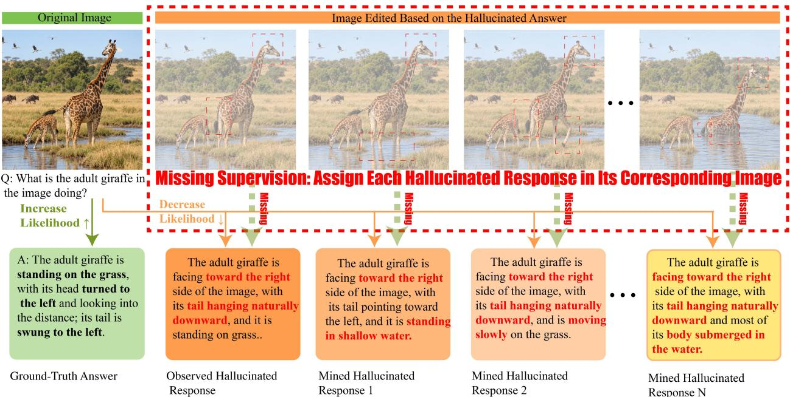  
Figure 1 Motivation of DreamRealm. Existing post-training methods correct hallucinated responses, while supervision on the visual conditions that would make them valid remains underexplored. Inspired by how humans correct misconceptions, DreamRealm materializes these conditions and teaches the model to match hallucinated responses to their supporting images.

How humans correct misconceptions ofers an intuitive starting point for designing supervision around specific perceptual confusions. When a child mistakes medicine tablets for foods such as candy or cookies, a parent may explain, “This is medicine, not a snack,” and also teach the child what real candy, cookies, and other foods are. However, this form of supervision remains underexplored in existing post-training approaches, as illustrated in Figure 1. Inspired by this process, we explore a model’s diverse latent hallucinated responses, construct visual conditions that support each response, and train the model to match these responses to their supporting visual conditions.

To this end, we introduce DreamRealm, a post-training framework centered on matching hallucinated responses to their supporting images. We first expose diferent error patterns through repeated hightemperature sampling from the target model, then expand the set of latent hallucinated responses by exploiting the enumerable key attributes of multimodal perception questions. We select hallucinated responses that the model is more inclined to produce based on their likelihood scores. An image-editing pipeline then minimally edits the original images to make the selected responses valid, materializing the model’s hallucination world. We cross-pair the original and materialized images with the candidate responses to construct a likelihood score matrix. Through bidirectional contrastive losses, the model learns to suppress mismatched responses while assigning each hallucinated response to its corresponding supporting image. DreamRealm improves performance across six visual perception and hallucination benchmarks on Qwen3.5- 9B [23], including gains of 7.26 percentage points in HallusionBench accuracy and 11.34 percentage points in MMVP pair accuracy. We further conduct ablation studies on data construction and training methods to systematically analyze the roles of hallucination-guided image editing, latent hallucination mining, and bidirectional correspondence learning.

Our main contributions are as follows:

• RealmForgePipe: A data pipeline for exploring and materializing a model’s own hallucinations.

It derives image-editing targets from observed and mined latent hallucinations and constructs visual conditions that make these responses valid. Using this pipeline, we build the Realized Hallucination Dataset (RealmSet) from hallucinations mined from Qwen3.5-9B.

• RealmMatch: learning to assign hallucinated responses to their supporting images. We propose RealmMatch, which constructs a likelihood score matrix by cross-pairing original and materialized images with candidate responses. Through bidirectional contrastive losses, it suppresses mismatched responses while learning to assign each hallucinated response to its corresponding supporting image.

• Empirical validation and ablation analysis. Our experiments and ablation studies demonstrate that hallucination assignment is a promising paradigm for improving visual perception and mitigating hallucinations. DreamRealm improves performance across six visual perception and hallucination benchmarks, with gains of 7.26 percentage points in HallusionBench accuracy and 11.34 percentage points in MMVP pair accuracy on Qwen3.5-9B. We further conduct ablations on data construction and training methods, providing detailed analyses of the contributions of individual components.

## 2 Related Work

Recent work spans multimodal video understanding and grounding [3, 7], content-safety modeling [21], and adversarial evaluation [6, 11], while visual hallucinations remain a central challenge to trustworthy visionlanguage models.

## 2.1 Hallucination-aware Fine-tuning

Hallucination-aware fine-tuning improves the visual faithfulness of multimodal large language models through instruction augmentation, response correction, and preference learning. HALVA [27] constructs faithful and hallucinated response pairs and applies contrastive supervision to difering phrases to suppress visually unsupported content. RLAIF-V [42] builds preference data from model feedback and iteratively updates the model. Beyond direct response correction, REVERSE [39] introduces uncertainty tokens and retrospective resampling to identify and revise potentially hallucinated content. FINER-Tuning [40] (FINER in our tables) introduces fine-grained contradictions concerning objects, attributes, and relations into otherwise correct descriptions to construct challenging negative queries, and employs DPO to mitigate the resulting hallucinations. These methods construct and leverage error signals in diferent ways, using contrastive supervision, preference optimization, or self-correction to distinguish visually grounded content from unsupported content. However, these methods primarily correct responses under a fixed image condition, generally giving insuficient consideration to the design of supervision signals on the image-input side.

## 2.2 Visual Contrast and Counterfactual Learning

Visual contrasts can be constructed by retrieving or pairing existing real images. These approaches use diferences between images to help models distinguish the visual evidence supporting diferent responses. SymMPO [16] retrieves similar images using CLIP features and constructs corresponding responses for preference learning across visual conditions. CoCI [17] uses similar images as contrastive inputs at inference time to adjust response distributions. Such approaches obtain visual contrasts from existing image collections, with the available contrasts depending on the images that can be retrieved or paired.

Another line of work uses image generation and editing to construct visual contrasts with controlled changes. IC-VCO [8] uses data from SymMPO to construct contrastive images through semantic editing for preference optimization. MED [2] generates minimal image-editing instructions conditioned on image content within predefined hallucination-prone semantic categories, and uses the resulting image pairs and fine-grained diference descriptions for supervised fine-tuning. These methods use generated visual diferences to strengthen the connection between image content and model responses. Visual contrast is also used at inference time: visual contrastive decoding (VCD) [13] contrasts response distributions under diferent visual inputs to mitigate hallucinations. However, although these methods provide supervision on the image-input side, their visual contrasts are not specifically designed around the target model’s hallucinations, making it dificult to ensure that supervision targets its actual perceptual confusions.

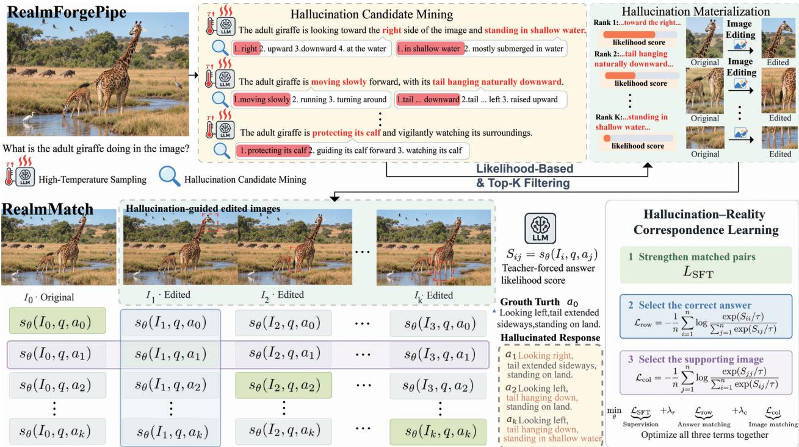  
Figure 2 Overview of DreamRealm. Top: RealmForgePipe mines hallucinated responses through high-temperature sampling and key-attribute enumeration, selects candidates through likelihood ranking and Top-K filtering, and edits images to make the selected hallucinated responses valid. Bottom: RealmMatch constructs an image–response score matrix from original images with their ground-truth answers and edited images with their corresponding hallucinated responses. Through SFT on matched image–response pairs and bidirectional contrastive learning, it assigns halluci nated responses to their supporting images, learning the correspondence between responses and visual conditions.

DreamRealm difers from these methods in two key aspects: (1) We explore a model’s diverse latent hallucinated responses and learn to assign them to their supporting visual conditions, going beyond simply correcting erroneous responses under the original image. (2) We derive image-editing targets from the tar get model’s own hallucinations, ensuring that the resulting visual contrasts directly address its perceptual confusions rather than relying on editing or generation that is not tailored to those confusions.

## 3 Method

DreamRealm consists of RealmForgePipe, a data pipeline for exploring and materializing a model’s own hallucinations, and RealmMatch, which learns image–response correspondence. Figure 2 illustrates the overall framework. RealmForgePipe comprises two stages: Section 3.1 introduces hallucination exploration, which collects observed hallucinations, mines latent hallucinations, and selects candidate responses through likelihood ranking; Section 3.2 introduces hallucination materialization, which uses minimal image editing and verification to construct visual conditions that make the selected hallucinated responses valid. The pipeline produces the Realized Hallucination Dataset (RealmSet), whose composition is described in Section 3.3. Finally, Section 3.4 presents RealmMatch, which combines supervised learning with bidirectional contrastive learning to assign hallucinated responses to their supporting images while retaining error-correction supervision under the original images.

## 3.1 Exploring the Latent Hallucination World

Problem formulation. Let $\boldsymbol { \mathcal { D } } = \{ ( I _ { i } , q _ { i } , y _ { i } ^ { \star } ) \} _ { i = 1 } ^ { N }$ denote a collection of seed examples, where $I _ { i }$ is an image, $q _ { i }$ is a perception question, and $y _ { i } ^ { \star }$ is the ground-truth answer. For a target MLLM $M _ { \theta }$ , our goal is to identify a set $\mathcal { E } _ { i }$ of incorrect responses that receive high likelihood under the model given $( I _ { i } , q _ { i } )$ . We call these responses latent perceptual hallucinations. Incorrect responses produced under standard decoding are termed observed hallucinations; latent mining explores additional errors through high-temperature sampling and key-attribute enumeration.

Diversified candidate elicitation. We first use high-temperature sampling to explore diverse patterns of the model’s hallucinated responses across perceptual dimensions. Given $( I _ { i } , q _ { i } )$ , we sample R responses at temperature $\tau _ { s }$ to form

$$
\begin{array} { r } { S _ { i } = \left\{ \widetilde { y } _ { i } ^ { ( r ) } \sim p _ { \theta } ( \cdot \ : | \ : I _ { i } , q _ { i } ; \tau _ { s } ) \right\} _ { r = 1 } ^ { R } . } \end{array}
$$

We then exploit the enumerable nature of key perceptual attributes to expand the candidate space. By enumerating alternative values of the attributes queried by $q _ { i }$ , we construct an additional candidate se $\mathcal { H } ( q _ { i } )$ , extending coverage beyond the hallucination patterns captured by sampling.

We perform semantic deduplication over all proposed candidates, retaining only one representative from each group of semantically equivalent hallucinated responses to form the candidate pool $\mathcal { C } _ { i }$

Likelihood-based hallucination ranking. We score each candidate $e \in { \mathcal { C } } _ { i }$ using teacher forcing. All candidates use the same answer template. If the rendered candidate contains tokens $z _ { 1 : T _ { e } } ^ { e }$ , we define its log-likelihood score as the average token log-likelihood over the answer tokens:

$$
s _ { i } ( e ) = s _ { \theta } ( I _ { i } , q _ { i } , e ) = \frac { 1 } { T _ { e } } \sum _ { t = 1 } ^ { T _ { e } } \log p _ { \theta } \left( z _ { t } ^ { e } \mid I _ { i } , q _ { i } , z _ { < t } ^ { e } \right) .
$$

Here $s _ { \theta } ( I , q , a )$ denotes the same mean token log-likelihood for any image $I ,$ question $q ,$ and response $a ;$ thus $s _ { i } ( e ) = s _ { \theta } ( I _ { i } , q _ { i } , e )$ . We rank the verified errors by $s _ { i } ( e )$ and retain the top $K _ { \mathrm { m i n e } }$ candidates, or all remaining candidates when fewer than $K _ { \mathrm { m i n e } }$ survive filtering:

$$
\mathcal { E } _ { i } = \mathrm { T o p } _ { K _ { \mathrm { m i n e } } ; e \in \mathcal { C } _ { i } } \ s _ { i } ( e ) .
$$

We apply softmax normalization to the candidate scores to obtain the candidate-relative weights $\rho _ { i } ( e )$ within the candidate set:

$$
\rho _ { i } ( e ) = \frac { \exp ( s _ { i } ( e ) ) } { \sum _ { e ^ { \prime } \in { \mathcal { C } } _ { i } } \exp ( s _ { i } ( e ^ { \prime } ) ) } .
$$

Importantly, $\rho _ { i } ( e )$ is not a calibrated absolute hallucination probability and depends on the coverage and granularity of $\mathcal { C } _ { i } .$ . Figures 4 and 5 in Appendix B illustrate mined responses and their candidate-relative weights across action understanding, spatial relations, counting, clock reading, color recognition, and chart analysis. The selected set $\mathcal { E } _ { i }$ is passed to the visual materialization stage, which constructs a hallucinationguided edited image supporting each hallucinated response.

## 3.2 Materializing Hallucinations through Verified Image Editing

RealmForgePipe constructs a supporting image for each selected response $y _ { m } \in \mathcal { E } _ { i }$ . Semantic deduplication before editing ensures that equivalent hallucinated responses do not enter the same family. We prioritize minimal editing: changing only the visual content needed to make the target response valid while preserving unrelated scene content and structure as much as possible. Given $\left( I , q , y ^ { \star } , y _ { m } \right)$ , a verifier MLLM V specifies the content to preserve and modify and proposes three candidate instructions ordered by increasing expected edit extent. An image generation model attempts these instructions in order, with a verifier-assigned minimalediting score of at least $4 / 5$ required alongside edit-success and visual-plausibility checks. The resulting image $I ^ { \star }$ undergoes quality checks and question-dependent validation; in strict blind checking, V answers the unchanged question from $I ^ { \star }$ without seeing $y _ { m }$ , and its answer must be semantically equivalent to $y _ { m }$ . The core validity requirement is

$$
\mathrm { V a l i d } ( I , q , y _ { m } ) = 0 , \qquad \mathrm { V a l i d } ( I ^ { \star } , q , y _ { m } ) = 1 ,\tag{1}
$$

where $\mathrm { V a l i d } ( I , q , y )$ indicates whether response y correctly answers question q given image I. We further perform a within-family blind check for each $\mathcal { G } = ( q , \{ ( I _ { i } , a _ { i } ) \} _ { i = 0 } ^ { K } )$ , where $( I _ { 0 } , a _ { 0 } )$ is the original pair and the remaining pairs are edited. Without seeing the candidate responses, V answers the fixed question for each image; its answers are then semantically matched against the family responses to check mutual exclusivity:

$$
\mathrm { V a l i d } ( I _ { i } , q , a _ { j } ) = { \bf 1 } [ i = j ] , \qquad \forall i , j \in \{ 0 , \ldots , K \} .\tag{2}
$$

Only families passing this blind check are used for bidirectional contrastive learning, with matched pairs as positives and of-diagonal combinations as negatives. Human review of individual edited image–response pairs provides a separate quality check. The per-edit generation, validation, and retry procedure is provided in Algorithm 1 in Appendix A, with the human review protocol in Appendix D.2.

## 3.3 RealmSet: The Realized Hallucination Dataset

We construct the Realized Hallucination Dataset (RealmSet) from VC-STaR’s VisCoR-55K [19] using Realm ForgePipe to materialize hallucinations mined from Qwen3.5-9B. Each question-centered family contains the original image–answer pair and human-approved edited image–response pairs, with the question held fixed. RealmSet spans 22 perceptual question categories and contains 28,960 human-approved edited examples. Training and held-out evaluation splits are separated by original-image family. Detailed construction statistics, category distributions, and split sizes are provided in Appendix D

## 3.4 RealmMatch: Offline Image–Response Correspondence Learning

RealmMatch combines supervised learning with bidirectional contrast over image–response likelihoods, learning the supporting image for each response while retaining error correction under the original image.

Constructing the image–response likelihood matrix. For each verified family G with $K \geq 1$ edits, let $n = K + 1$ and define $S _ { i j } = s _ { \theta } ( I _ { i } , q , a _ { j } )$ for $i , j = 0 , \ldots , K$ , using the mean token log-likelihood in Section 3.1. Here $a _ { 0 } = y ^ { \star }$ and $a _ { i }$ for $i > 0$ is the hallucinated response used to construct Ii. Equation 2 makes diagonal pairs positive and of-diagonal pairs negative. We backpropagate through all scores to update θ.

Bidirectional correspondence learning. We first introduce an image-conditioned response contrast loss (row-wise), which favors the matching response over other responses within each family, including hallucinated responses under their corresponding edited images:

$$
\mathcal { L } _ { \mathrm { r o w } } ^ { \mathrm { e d i t } } = - \frac { 1 } { n } \sum _ { i = 0 } ^ { K } \log \frac { \exp ( S _ { i i } / \tau ) } { \sum _ { j = 0 } ^ { K } \exp ( S _ { i j } / \tau ) } .\tag{3}
$$

Correspondingly, the response-conditioned image contrast loss (column-wise) holds each response fixed and favors its supporting image over other images within the same family, encouraging each hallucinated response to be assigned to the edited image that makes it valid:

$$
\mathcal { L } _ { \mathrm { c o l } } ^ { \mathrm { e d i t } } = - \frac { 1 } { n } \sum _ { j = 0 } ^ { K } \log \frac { \exp ( S _ { j j } / \tau ) } { \sum _ { i = 0 } ^ { K } \exp ( S _ { i j } / \tau ) } .\tag{4}
$$

Because the response wording is identical within each column, this term directly contrasts the visual conditions for the same response. The column softmax is a candidate-image classification objective constructed from conditional response scores, not a native image-generation probability. Here $\tau > 0$ is the contrastive temperature, distinct from the generation temperature $\tau _ { s }$ used during mining.

We additionally apply SFT to matched image–response pairs to increase their likelihood:

$$
\mathcal { L } _ { \mathrm { S F T } } ^ { \mathrm { e d i t } } = - \frac { 1 } { n } \sum _ { i = 0 } ^ { K } S _ { i i } .\tag{5}
$$

The joint training objective is

$$
\begin{array} { r } { \mathcal { L } _ { \mathrm { e d i t } } = \lambda _ { r } \mathcal { L } _ { \mathrm { r o w } } ^ { \mathrm { e d i t } } + \lambda _ { c } \mathcal { L } _ { \mathrm { c o l } } ^ { \mathrm { e d i t } } + \mathcal { L } _ { \mathrm { S F T } } ^ { \mathrm { e d i t } } , } \end{array}\tag{6}
$$

where $\lambda _ { r } , \lambda _ { c } \geq 0$ . All three terms are optimized jointly.

Training records and batch aggregation. For examples without an accepted edited image, we retain supervised learning on the ground-truth answer and row-wise contrast against ofline-verified incorrect responses. No column loss is used because only one image is available. We average losses within each record or family and then across the batch. The full objective, special cases, and aggregation formula are given in Appendix J.

## 4 Experiments

## 4.1 Experimental Setup

Training setup. We use RealmForgePipe to mine and materialize Qwen3.5-9B’s hallucinations into Realm-Set, and train Qwen3.5-9B with RealmMatch on its training split (Appendix D). To examine model specificity, we reuse the same RealmSet training split, including the edited images and corresponding hallucinated responses constructed from Qwen3.5-9B, to train Qwen2.5-VL-7B [1], Gemma-4-E4B-it [30], and InternVL3.5- 8B [36] with RealmMatch, without rerunning RealmForgePipe for these models. Full training details are provided in Appendix F.

Evaluation setup. We evaluate visual perception and hallucination on six benchmarks. Evaluation details and inference results are provided in Appendix G.1.

## 4.2 Main Comparison

Baseline sources. We compare DreamRealm with specialized hallucination-mitigation methods, including VCD [13], CoCI-CAP [17], RLAIF-V [42], SymMPO [16], mDPO [34], VC-STaR [19], MED [2] , IC-VCO [8], FINER [40], IRIS [15], and C2-DPO [12]. More details are provided in the appendix I.

Table 1 compares DreamRealm with specialized hallucination-mitigation methods and examines the efect of aligning the hallucination-mining model with the target model. All DreamRealm variants use the same RealmSet constructed from Qwen3.5-9B hallucinations. Each backbone is trained separately and compared with its corresponding raw checkpoint, without backbone-specific hallucination re-mining or image editing.

Training on own hallucinations. We compare DreamRealm with the corresponding base model to control for backbone diferences. On Qwen3.5-9B, DreamRealm improves all seven metrics, mitigating hallucinations while enhancing fine-grained perception. The gains are largest on Qwen3.5-9B, reflecting DreamRealm’s model-specific design: RealmForgePipe constructs supervision from the model’s high-likelihood hallucinations, aligning the training data with its perceptual confusions. As shown in Table 1, Qwen3.5-9B + Dream Realm obtains the best numerical value in six of the seven reported metrics under our unified evaluation

Table 1 Main comparison on hallucination benchmarks. Block I reports specialized hallucination-mitigation methods, while Blocks II and III report matched and mismatched hallucination-mining and target-model settings, respectively.
<table><tr><td>Model / Method</td><td>HallusionBench aAcc ↑</td><td>MMVP</td><td>MMVP</td><td>AMBER Item Acc ↑ Pair Acc ↑ Avg Acc ↑</td><td>MMHal-Bench CV-Bench-2D Hall. Rate ↓</td><td>Macro Acc ↑</td><td>ObjectHal CHAIRs ↓</td></tr><tr><td colspan="8">I. Specialized hallucination-mitigation methods</td></tr><tr><td>VCD [13]</td><td>55.54</td><td>63.00</td><td>34.00</td><td>77.71</td><td>54.17</td><td>52.42</td><td>44.33</td></tr><tr><td>CoCI-CAP [17]</td><td>61.47</td><td>75.67</td><td>54.67</td><td>84.05</td><td>36.46</td><td>67.46</td><td>20.67</td></tr><tr><td>RLAIF-V [42]</td><td>55.45</td><td>57.33</td><td>24.67</td><td>80.59</td><td>39.58</td><td>59.26</td><td>8.33</td></tr><tr><td>SymMPO [16]</td><td>51.02</td><td>61.67</td><td>29.33</td><td>79.75</td><td>56.25</td><td>61.37</td><td>15.67</td></tr><tr><td>mDPO [34]</td><td>60.94</td><td>64.67</td><td>31.33</td><td>80.25</td><td>45.83</td><td>53.73</td><td>14.00</td></tr><tr><td>VC-STaR [19]</td><td>67.85</td><td>76.33</td><td>56.00</td><td>84.20</td><td>44.79</td><td>74.71</td><td>12.33</td></tr><tr><td>MED [2]</td><td>61.91</td><td>79.00</td><td>60.00</td><td>82.02</td><td>31.25</td><td>69.29</td><td>9.00</td></tr><tr><td>IC-VCO [8]</td><td>68.47</td><td>75.00</td><td>52.67</td><td>85.88</td><td>39.58</td><td>70.04</td><td>18.00</td></tr><tr><td>FINER [40]</td><td>64.39</td><td>77.33</td><td>55.33</td><td>85.74</td><td>32.29</td><td>76.29</td><td>19.33</td></tr><tr><td>IRIS [15]</td><td>48.54</td><td>63.33</td><td>29.33</td><td>77.59</td><td>52.08</td><td>60.94</td><td>40.33</td></tr><tr><td> $\mathrm { C ^ { 2 } { - } D P O \ [ 1 2 ] }$ </td><td>47.92</td><td>64.33</td><td>32.00</td><td>76.95</td><td>44.79</td><td>60.87</td><td>16.67</td></tr><tr><td colspan="8">II. Training on own hallucinations</td></tr><tr><td>Qwen3.5-9B (Raw) [23]</td><td>70.95</td><td>80.00</td><td>63.33</td><td>88.34</td><td>47.92</td><td>82.16</td><td>30.33</td></tr><tr><td>+ DreamRealm</td><td> $\mathbf { 7 8 . 2 1 _ { + 7 . 2 6 } }$ </td><td> $\mathbf { 8 6 . 6 7 _ { + 6 . 6 7 } }$ </td><td></td><td>74.67+11.3.91.01+2.67</td><td> $\mathbf { 2 7 . 0 8 _ { + 2 0 . 8 4 } }$ </td><td> $\mathbf { 8 2 . 8 9 _ { + 0 . 7 3 } }$ </td><td> $8 . 6 7 _ { + 2 1 . 6 6 }$ </td></tr><tr><td colspan="8">III. Training on another model&#x27;s hallucinations</td></tr><tr><td>Qwen2.5-VL-7B (Raw) [1]</td><td>67.40</td><td>77.33</td><td>56.00</td><td>85.22</td><td>38.54</td><td>75.37</td><td>13.33</td></tr><tr><td>+ DreamRealm (Qwen3.5-mined)</td><td> $7 1 . 7 4 _ { + 4 . 3 4 }$ </td><td> $7 8 . 3 3 _ { + 1 . 0 0 }$ </td><td> $5 9 . 3 3 _ { + 3 . 3 3 }$ </td><td> $8 6 . 1 4 _ { + 0 . 9 2 }$ </td><td> $3 0 . 2 1 _ { + 8 . 3 3 }$ </td><td> $7 5 . 9 4 _ { + 0 . 5 7 }$ </td><td></td></tr><tr><td>Gemma-4-E4B-it (Raw) [30]</td><td>65.37</td><td>71.33</td><td>46.67</td><td>83.67</td><td>37.50</td><td>65.29</td><td> $1 1 . 6 7 _ { + 1 . 6 6 }$  20.33</td></tr><tr><td>+ DreamRealm (Qwen3.5-mined)</td><td></td><td></td><td> $4 7 . 3 3 _ { + 0 . 6 6 }$ </td><td> $8 5 . 2 9 _ { + 1 . 6 2 }$ </td><td> $3 5 . 4 2 _ { + 2 . 0 8 }$ </td><td></td><td></td></tr><tr><td>InternVL3.5-8B (Raw) [36]</td><td> $6 7 . 1 4 _ { + 1 . 7 7 }$  70.50</td><td> $7 1 . 6 7 _ { + 0 . 3 4 }$  76.67</td><td>57.33</td><td>88.30</td><td>29.17</td><td> $6 5 . 0 8 _ { - 0 . 2 1 }$  79.03</td><td> $1 8 . 6 7 _ { + 1 . 6 6 }$  13.33</td></tr><tr><td>+ DreamRealm  $( \mathrm { Q w e n 3 . 5 – m i n e d } )$ </td><td> $7 1 . 2 1 _ { + 0 . 7 1 }$ </td><td></td><td> $7 8 . 6 7 _ { + 2 . 0 0 }$  60.00+2.67</td><td> $8 8 . 8 0 _ { + 0 . 5 0 }$ </td><td> $2 8 . 1 3 _ { + 1 . 0 4 }$ </td><td> $7 8 . 8 4 _ { - 0 . 1 9 }$ </td><td></td></tr></table>

protocol. The only exception is ObjectHal, where its performance remains close to the best result from RLAIF-V. Qualitative comparisons are shown in Figure 3, with additional examples in Appendix H.

Training on another model’s hallucinations. We reuse the Qwen3.5-mined RealmSet to train Qwen2.5- VL-7B, Gemma-4-E4B-it, and InternVL3.5-8B without model-specific re-mining. All three models improve on most metrics, but less than the matched Qwen3.5-9B setting; Gemma and InternVL also regress slightly on CV-Bench-2D. Thus hallucination spaces overlap across models but are not fully interchangeable.  
Table 2 Ablations on Qwen3.5-9B. Panel A varies RealmForgePipe data construction with RealmMatch fixed; Panel B varies the training objective using the same Full RealmForgePipe data.
<table><tr><td>Configuration</td><td>HallusionBench aAcc ↑</td><td>MMVP</td><td>MMVP Item Acc ↑ Pair Acc ↑</td><td>AMBER Avg Acc ↑</td><td>Hall. Rate ↓</td><td>MMHal-Bench CV-Bench-2D Macro Acc ↑</td><td>ObjectHal CHAIRs↓</td></tr><tr><td colspan="8">A. RealmForgePipe data construction</td></tr><tr><td>Raw</td><td>70.95</td><td>80.00</td><td>63.33</td><td>88.34</td><td>47.92</td><td>82.16</td><td>30.33</td></tr><tr><td>Original Only</td><td>61.82</td><td>80.33</td><td>62.67</td><td>87.21</td><td>35.42</td><td>79.63</td><td>11.00</td></tr><tr><td>Unguided Edits</td><td>69.35</td><td>83.67</td><td>69.33</td><td>90.97</td><td>34.38</td><td>80.37</td><td>8.00</td></tr><tr><td>Observed Only</td><td>73.87</td><td>86.00</td><td>74.00</td><td>90.04</td><td>30.21</td><td>81.86</td><td>13.33</td></tr><tr><td>Full RealmForgePipe</td><td>78.21</td><td>86.67</td><td>74.67</td><td>91.01</td><td>27.08</td><td>82.89</td><td>8.67</td></tr><tr><td colspan="8">B. Training objective</td></tr><tr><td>Raw (no training)</td><td>70.95</td><td>80.00</td><td>63.33</td><td>88.34</td><td>47.92</td><td>82.16</td><td>30.33</td></tr><tr><td>SFT</td><td>73.16</td><td>83.67</td><td>68.67</td><td>92.12</td><td>35.42</td><td>82.85</td><td>12.33</td></tr><tr><td>DPO</td><td>67.67</td><td>86.00</td><td>74.00</td><td>89.46</td><td>34.38</td><td>78.81</td><td>11.33</td></tr><tr><td>GRPO</td><td>74.31</td><td>84.33</td><td>70.00</td><td>90.65</td><td>30.21</td><td>82.16</td><td>15.67</td></tr><tr><td>RealmMatch (ours)</td><td>78.21</td><td>86.67</td><td>74.67</td><td>91.01</td><td>27.08</td><td>82.89</td><td>8.67</td></tr></table>

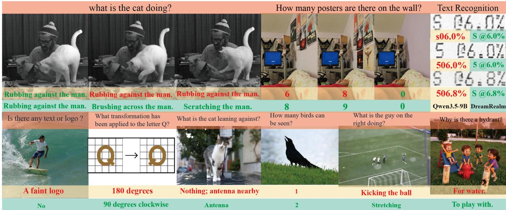  
Figure 3 Selected examples from the held-out test set before and after DreamRealm training. Yellow/mint bands denote Qwen3.5-9B/DreamRealm; red/green text marks incorrect/correct answers. Responses are condensed.

## 4.3 Ablation Study

Table 2 separates data construction (Panel A) from the training objective (Panel B) on Qwen3.5-9B.

RealmForgePipe data ablation. Original-only supervision degrades HallusionBench, and unguided edits remain below Raw on HallusionBench and CV-Bench-2D. Targeting observed errors improves five of seven metrics over unguided editing, while adding latent hallucinations improves all seven metrics over Observed Only. The two sources therefore provide complementary, model-specific supervision.

RealmMatch training-method ablation. With Full RealmForgePipe data fixed, SFT improves all metrics and is best on AMBER; DPO is strong on MMVP but degrades HallusionBench, and GRPO is more balanced but remains behind RealmMatch. RealmMatch improves all seven metrics over Raw and is best on six, supporting bidirectional image–response correspondence.

## 5 Limitations

DreamRealm incurs data construction costs, including image generation with GPT-Image and human review, as detailed in Appendices D and D.2, respectively. In addition, DreamRealm is constrained by the capabilities of the underlying image-editing model, and some scenes remain dificult to edit successfully. Appendix D.1 (Table 4) reports the final pass rates of RealmForgePipe across 22 question categories, measured as the proportion of synthesis candidates ultimately approved by human review.

## 6 Conclusion

We introduce DreamRealm, a post-training framework that materializes model hallucination worlds and uses contrastive learning to assign hallucinated responses to their corresponding visual inputs. Consistent improvements across multiple benchmarks demonstrate the potential of this hallucination assignment paradigm to enhance visual perception and mitigate visual hallucinations.

## References

[1] Bai, S., Chen, K., Liu, X., Wang, J., Ge, W., Song, S., ... & Lin, J. (2025). Qwen2.5-VL technical report. CoRR abs/2502.13923 (2025). arXiv preprint arXiv:2502.13923.

[2] Bai, T., Fan, Y., Jiantao, Q., Sun, F., Song, J., Han, J., ... & Yuan, B. (2026). Hallucination at a glance: Controlled visual edits and fine-grained multimodal learning. Advances in Neural Information Processing Systems, 38, 135360-135393.

[3] Chen, J., Cui, B., Jia, R., Wang, Z., Wo, T., Sun, P., Huang, L., Xue, H., Yang, Y., & Hong, H. (2026). Grounding with confidence: Controllable generative video temporal grounding. arXiv preprint arXiv:2609.39883. https://doi.org/10.48550/arXiv.2609.39883

[4] Chen, L., Li, J., Dong, X., Zhang, P., Zang, Y., Chen, Z., ... & Zhao, F. (2024). Are we on the right way for evaluating large vision-language models?. Advances in Neural Information Processing Systems, 37, 27056-27087.

[5] Comanici, G., Bieber, E., Schaekermann, M., Pasupat, I., Sachdeva, N., Dhillon, I., ... & Velic, M. (2025). Gemini 2.5: Pushing the frontier with advanced reasoning, multimodality, long context, and next generation agentic capabilities. arXiv preprint arXiv:2507.06261.

[6] Cui, B., Pang, S., Wang, Y., Dong, X., Zhai, Y., Tang, J., Yu, H., Xue, H., Huang, L., & Hong, H. (2026). Fully Unleashing the Multimodal Attacker: Meta-Adaptive Jailbreaking of Vision-Language Models. arXiv preprint arXiv:2608.27531.

[7] Cui, B., Wang, R., Li, J., Chen, J., Huang, L., Chen, Y., Zhai, Y., Tang, J., Jia, R., Wu, W., et al. (2026). MetaVideoAgent: Automated video-agent evolution for long-form video understanding. arXiv preprint arXiv:2608.04587. https://doi.org/10.48550/arXiv.2608.04587

[8] Deng, H., Zou, X., Jin, Z., Chen, C., Lu, H., & Hu, X. (2026). Learning from Fine-Grained Visual Discrepancies: Mitigating Multimodal Hallucinations via In-Context Visual Contrastive Optimization. arXiv preprint arXiv:2605.31312.

[9] Duan, H., Yang, J., Qiao, Y., Fang, X., Chen, L., Liu, Y., ... & Chen, K. (2024). VLMEvalKit: An open-source toolkit for evaluating large multi-modality models. In Proceedings of the 32nd ACM International Conference on Multimedia (pp. 11198–11201).

[10] Guan, T., Liu, F., Wu, X., Xian, R., Li, Z., Liu, X., ... & Zhou, T. (2024, June). Hallusionbench: an advanced diagnostic suite for entangled language hallucination and visual illusion in large vision-language models. In 2024 IEEE/CVF Conference on Computer Vision and Pattern Recognition (CVPR) (pp. 14375-14385). IEEE.

[11] Jian, R., Cui, B., Ma, T., Ding, H., Liu, K., Xu, Z., Huang, L., Xue, H., Zhu, Z., Li, J., et al. (2026). EvoHarm-Bench: Breaking Content Moderation with Iterative Human-Like Evasion. arXiv preprint arXiv:2608.27844.

[12] Ko, B., Park, J., Kim, J., Na, J., Cho, J., & Kim, H. J. (2026, September). Context Blindness in DPO: Mitigating Object Hallucination in MLLMs via Context-Calibrated Preference Optimization. In European Conference on Computer Vision (pp. 40-58). Cham: Springer Nature Switzerland.

[13] Leng, S., Zhang, H., Chen, G., Li, X., Lu, S., Miao, C., & Bing, L. (2024, June). Mitigating object hallucinations in large vision-language models through visual contrastive decoding. In 2024 IEEE/CVF Conference on Computer Vision and Pattern Recognition (CVPR) (pp. 13872-13882). IEEE.

[14] Li, Y., Du, Y., Zhou, K., Wang, J., Zhao, X., & Wen, J. R. (2023, December). Evaluating object hallucination in large vision-language models. In Proceedings of the 2023 conference on empirical methods in natural language processing (pp. 292-305).

[15] Li, Y., Yan, Y., Han, J., Ming, F., Lv, L., & Jin, Y. (2026). IRIS: Implicit Reward-Guided Internal Sifting for Mitigating Multimodal Hallucination. arXiv preprint arXiv:2602.01769.

[16] Liu, W., Song, X., Li, J., Wei, Y., Zheng, N., Yin, J., & Nie, L. (2026). Mitigating hallucination through theoryconsistent symmetric multimodal preference optimization. Advances in Neural Information Processing Systems, 38, 111259-111284.

[17] Manevich, A., & Tsarfaty, R. (2025, August). Making LVLMs Look Twice: Contrastive Decoding with Contrast Images. In Proceedings of the 1st Workshop on Multimodal Augmented Generation via Multimodal Retrieval (MAGMaR 2025) (pp. 65-78).

[18] Neuhaus, Y., & Hein, M. (2025). Repope: Impact of annotation errors on the pope benchmark. arXiv preprint arXiv:2504.15707.

[19] Pan, Z., Wu, Y., Hua, J., Feng, J., Yan, S., Deng, B., ... & Ye, J. (2026). Through the Lens of Contrast: Self-Improving Visual Reasoning in VLMs. arXiv preprint arXiv:2603.02556.

[20] Paszke, A., Gross, S., Massa, F., Lerer, A., Bradbury, J., Chanan, G., ... & Chintala, S. (2019). Pytorch: An imperative style, high-performance deep learning library. Advances in neural information processing systems, 32.

[21] Qiu, S., Xu, X., Cui, B., Ma, T., Huang, X., Jiang, W., et al. (2026). Yuvion VL: A Multimodal Foundation Model for Adversarial Content and AI Safety. arXiv preprint arXiv:2606.25034.

[22] Qiu, Z., Wang, Z., Li, X., Li, Y., Xu, Y., Wang, Y., ... & Liu, D. (2026). On the Design of Qwen3.8-Next Architecture: Evaluation, Eficiency, and Training Stability. arXiv preprint arXiv:2608.30320.

[23] Qwen Team. (2026). Qwen3.5: Towards native multimodal agents. Qwen Blog. https://qwen.ai/blog?id=qwen3. 5

[24] Rafailov, R., Sharma, A., Mitchell, E., Manning, C. D., Ermon, S., & Finn, C. (2023). Direct preference optimization: Your language model is secretly a reward model. Advances in neural information processing systems, 36, 53728-53741.

[25] Rajbhandari, S., Rasley, J., Ruwase, O., & He, Y. (2020, November). Zero: Memory optimizations toward training trillion parameter models. In SC20: international conference for high performance computing, networking, storage and analysis (pp. 1-16). IEEE.

[26] Rohrbach, A., Hendricks, L. A., Burns, K., Darrell, T., & Saenko, K. (2018). Object hallucination in image captioning. In Proceedings of the 2018 conference on empirical methods in natural language processing (pp. 4035-4045).

[27] Sarkar, P., Ebrahimi, S., Etemad, A., Beirami, A., Arik, S., & Pfister, T. (2025, May). Mitigating object hallucination in mllms via data-augmented phrase-level alignment. In International Conference on Learning Representations (Vol. 2025, pp. 73796-73846).

[28] Shao, Z., Wang, P., Zhu, Q., Xu, R., Song, J., Bi, X., ... & Guo, D. (2024). Deepseekmath: Pushing the limits of mathematical reasoning in open language models. arXiv preprint arXiv:2402.03300.

[29] Sun, Z., Shen, S., Cao, S., Liu, H., Li, C., Shen, Y., ... & Darrell, T. (2024, August). Aligning large multimodal models with factually augmented rlhf. In Findings of the association for computational linguistics: ACL 2024 (pp. 13088-13110).

[30] Team, G., Abd, S. E., Aggarwal, V., Algayres, R., Andreev, A., Bachem, O., ... & Geisler, S. (2026). Gemma 4 technical report. arXiv preprint arXiv:2607.02770.

[31] Team, K., Bai, T., Bai, Y., Bao, Y., Cai, J., Cai, X., ... & Liu, Y. (2026). Kimi k3: Open frontier intelligence. arXiv preprint arXiv:2607.24653.

[32] Tong, S., Brown, E., Wu, P., Woo, S., Middepogu, M., Akula, S. C., ... & Xie, S. (2024a). Cambrian-1: A fully open, vision-centric exploration of multimodal llms. Advances in Neural Information Processing Systems, 37, 87310-87356.

[33] Tong, S., Liu, Z., Zhai, Y., Ma, Y., LeCun, Y., & Xie, S. (2024b, June). Eyes wide shut? exploring the visual shortcomings of multimodal llms. In 2024 IEEE/CVF Conference on Computer Vision and Pattern Recognition (CVPR) (pp. 9568-9578). IEEE.

[34] Wang, F., Zhou, W., Huang, J. Y., Xu, N., Zhang, S., Poon, H., & Chen, M. (2024a, November). mdpo: Conditional preference optimization for multimodal large language models. In Proceedings of the 2024 Conference on Empirical Methods in Natural Language Processing (pp. 8078-8088).

[35] Wang, J., Wang, Y., Xu, G., Zhang, J., Gu, Y., Jia, H., ... & Sang, J. (2023). Amber: An llm-free multidimensional benchmark for mllms hallucination evaluation. arXiv preprint arXiv:2311.07397.

[36] Wang, W., Gao, Z., Gu, L., Pu, H., Cui, L., Wei, X., ... & Luo, G. (2025). Internvl3.5: Advancing open-source multimodal models in versatility, reasoning, and eficiency. arXiv preprint arXiv:2508.18265.

[37] Wang, W., Ren, Y., Luo, H., Li, T., Yan, C., Chen, Z., ... & Dai, J. (2024b, September). The all-seeing project v2: Towards general relation comprehension of the open world. In European Conference on Computer Vision (pp. 471-490). Cham: Springer Nature Switzerland.

[38] Wolf, T., Debut, L., Sanh, V., Chaumond, J., Delangue, C., Moi, A., ... & Rush, A. M. (2020, October). Transformers: State-of-the-art natural language processing. In Proceedings of the 2020 conference on empirical methods in natural language processing: system demonstrations (pp. 38-45).

[39] Wu, T. H. P., Lee, H., Ge, J., Gonzalez, J., Darrell, T., & Chan, D. (2026). Generate, but verify: Reducing hallucination in vision-language models with retrospective resampling. Advances in Neural Information Processing Systems, 38, 65749-65777.

[40] Xiao, R., Kim, S., Xian, Y., Akata, Z., & Alaniz, S. (2026). FINER: MLLMs Hallucinate under Fine-grained Negative Queries. arXiv preprint arXiv:2603.17662.

[41] Yu, T., Yao, Y., Zhang, H., He, T., Han, Y., Cui, G., ... & Chua, T. S. (2024). Rlhf-v: Towards trustworthy

mllms via behavior alignment from fine-grained correctional human feedback. In Proceedings of the IEEE/CVF Conference on Computer Vision and Pattern Recognition (pp. 13807-13816).

[42] Yu, T., Zhang, H., Li, Q., Xu, Q., Yao, Y., Chen, D., ... & Sun, M. (2025, June). Rlaif-v: Open-source ai feedback leads to super gpt-4v trustworthiness. In 2025 IEEE/CVF Conference on Computer Vision and Pattern Recognition (CVPR) (pp. 19985-19995). IEEE.

# Supplementary Material

## A Hallucination Materialization Algorithm

Algorithm 1 provides the complete image-editing workflow described in Section 3.2, including dificulty tag ging, quality verification, question-dependent blind checking, and bounded retry logic. Stages 1.5 and 2.5 record metadata only and never reject samples. Each instruction–type pair permits at most two synthesis attempts in total. After automated checks, human annotators review the candidate before curation; only human-approved records enter the final HG-Edited Data. Human-rejected candidates are excluded.

Minimal-editing principle. Minimal editing prioritizes changes necessary to make the target response valid while preserving unrelated scene content and structure. The planner specifies preservation and modification regions $R _ { p r e s }$ and $R _ { c h g }$ and orders three instructions by increasing expected edit extent. The verifier evaluates minimal editing on a five-point scale, with $s _ { m i n } \ge 4$ required for acceptance, together with $s _ { e s } \geq 4$ and $s _ { p l } \geq 3$ . This is a planning preference and a verifier-based quality constraint, rather than minimization of a pixel-distance objective or a guarantee of a globally minimal edit. Each instruction can fall back to full-image regeneration, as shown in Algorithm 1.

Triage subroutine (Stage 1). The verifier first answers the original question without access to either supplied answer; counting questions require counting objects individually. It then determines question validity (A), agreement with the ground-truth answer (B), equivalence between the target response and the groundtruth answer (C), refusal (D), and the error type e. In optional two-pass auditing, both passes must satisfy A and $B ,$ while either pass triggering C or D causes rejection; the stricter audit judgment is retained.

Blind-check subroutine (Stage 4b). The algorithm explicitly distinguishes three modes. Strict mode obtains an answer from the edited image with the target response hidden, then judges factual equivalence to $y _ { m }$ . Relaxed mode extracts a target visual feature from $( R _ { c h g } , y _ { m } )$ and accepts only a YES response to its presence in the edited image. Skip mode performs no additional check and returns true. Only strict mode check failures retry the same instruction–type pair; failed synthesis also consumes an attempt and retries, whereas a quality-threshold failure or a relaxed-mode failure advances to the next editing type. All verification scores use a five-point scale.

Algorithm 1 Verified hallucination materialization in RealmForgePipe   
Require: $( I , q , y ^ { \star } , y _ { m } ) ;$ verifier V; editor E (gpt-image-2)   
Require: $( \tau _ { e s } , \tau _ { p l } , \tau _ { m i n } ) = ( 4 , 3 , 4 ) ; R _ { i n s } = 3 ; R _ { s y n } = 2$   
Ensure: Curated record $( I ^ { \star } , q , y ^ { \star } \to y _ { m } ,$ , metadata), or drop/fail   
1: if I unavailable then return drop   
2: $\hat { y } \gets \mathcal { V } ( I , q )$ ▷ 1. Triage: neither supplied answer is shown   
3: $( A , B , C , D , e ) \gets \mathrm { A U D I T } ( q , \hat { y } , y ^ { \star } , y _ { m } )$   
A: well-defined question; B: $\hat { y } \equiv y ^ { \star } ; C \colon y m \equiv y ^ { \star } ;$ D: refusal; e: error type   
4: if ¬ $\operatorname { \Pi } _ { | A \lor \neg B \lor C \lor D }$ then return drop   
5: $( d , h ) \gets \mathrm { A }$ ssessDifficulty $( \mathcal { V } , I , q , y _ { m } , e )$ ▷ 1.5. Record only; never reject   
$d \in \{ 1 , \ldots , 5 \}$ : editing/verification dificulty (higher is harder); h: optional dificulty tags   
6: $( t _ { 0 } , R _ { p r e s } , R _ { c h g } , \langle i _ { 1 } , i _ { 2 } , i _ { 3 } \rangle , p _ { t 2 i } ) \gets \mathrm { P L A N } ( \mathcal { V } , I , q , y ^ { \star } , y _ { m } , e )$ ▷ 2. Plan   
7: hard\_case $ [ t _ { 0 } = \mathrm { T } \mathrm { 2 I R E P L A N } \land e = \mathrm { P }$ erceptionLimit] ▷ 2.5. Record only   
t0: local editing, global editing, or text-to-image replanning; $i _ { 1 } , i _ { 2 } , i _ { 3 } \colon$ increasing edit extent   
8: $\mathcal { T } \gets \mathrm { D e d u p } ( \langle t _ { 0 } , \mathrm { T 2 I R E P L A N } \rangle )$ ▷ Preserve fallback order   
9: for $k = 1 , \ldots , R _ { i n s }$ do   
10: for $t \in \tau$ do   
11: for $a = 1 , \dots , R _ { s y n }$ do   
12: $I ^ { \prime } \gets \mathrm { S Y N T H } ( \mathcal { E } , I , \mathrm { W r a p } ( i _ { k } , e ) , t , p _ { t 2 i } )$ ▷ 3. Synthesis   
13: if $I ^ { \prime } = \varnothing$ then continue ▷ Next synthesis attempt   
14: $\begin{array} { r } { \left( s _ { e s } , s _ { p l } , s _ { m i n } \right) \gets \mathrm { V E R I F Y } ( \mathcal { V } , I , I ^ { \prime } , q , y _ { m } , R _ { p r e s } ) } \end{array}$ ▷ 4. Quality verification   
15: if $s _ { e s } < \tau _ { e s } \lor s _ { p l } < \tau _ { p l } \lor s _ { m i n } < \tau _ { m i n }$ then break   
16: mode ← Classify $( q , y _ { m } ) \in$ {strict, relaxed, skip} ▷ 4b. Blind-check gate   
17: if mode = strict then   
18: $\tilde { y } \gets \mathcal { V } ( I ^ { \prime } , q )$ ▷ Target answer is hidden during answering   
19: $m \gets \mathrm { E q u r v } ( \mathcal { V } , \tilde { y } , y _ { m } )$   
20: else if mode = relaxed then   
21: $f \gets \mathrm { E x T R A C T F E A T U R E } ( \mathcal { V } , R _ { c h g } , y _ { m } )$   
22: $m \gets [ \mathcal { V } ( I ^ { \prime } ;$ , “Is feature f visibly present?”) = YES]   
23: else   
24: m ← true ▷ Skip the additional check   
25: end if   
26: if m then   
27: $r _ { h u m a n } \gets \mathrm { H U M A N R E V I E W } ( I , I ^ { \prime } , q , y ^ { \star } , y _ { m } )$ ▷ Final annotation review   
28: if ¬r then return drop ▷ Exclude rejected edits   
29: $u \gets \mathrm { U P L O A D O S S } ( I ^ { \prime } ;$ images\_modi/, basename(I))   
30: meta ← {ik, t, ses, spl, smin, mode, $d , h ,$ hard\_case, rhuman}   
31: return $\mathrm { C U R A T E } ( u , q , y ^ { \star } , y _ { m } , m e t a )$ ▷ 5. Store record   
32: end if   
33: if mode $\neq$ strict then break ▷ Only strict failures retry this pair   
34: end for   
35: end for   
36: end for   
37: return fail

## B Qualitative Examples of Hallucination Mining

Hallucination Mining Results
<table><tr><td>i One grazing; two observing or resting.</td><td>20.7%</td></tr><tr><td> Three grazing; a fourth looking around.</td><td>19.4%</td></tr><tr><td> One grazing; two looking around.</td><td>18.8%</td></tr><tr><td> One grazing; two standing or walking.</td><td>14.9%</td></tr><tr><td>Drinking water from a nearby river. Sleeping while lying on the ground.</td><td>4.9%</td></tr><tr><td>Running rapidly across the field.</td><td>4.0%</td></tr><tr><td></td><td>2.8%</td></tr></table>

Hallucination Mining Results

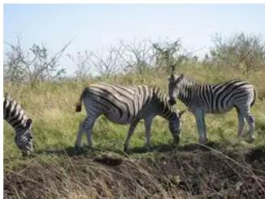  
Question: What are the zebras doing? Ground Truth: Two grazing; one observing

<table><tr><td>Right of the pizza and slightly behind it.</td><td>22.2%</td></tr><tr><td>Right of the pizza, near the top edge.</td><td>21.3%</td></tr><tr><td> Right of the pizza, leaning on the plate.</td><td>19.1%</td></tr><tr><td> Under a pizza slice, ready to serve it.</td><td>16.1%</td></tr><tr><td> Beside the pizza, on its right.</td><td>8.5%</td></tr><tr><td> Below the pizza.</td><td>7.0%</td></tr><tr><td> Above the pizza.</td><td>5.8%</td></tr></table>

  
Question: Where is the spatula? Ġround Truth: To the left of the pizza.

## Hallucination Mining Results

<table><tr><td> Standing to the left of the skateboarder.</td><td>26.2%</td></tr><tr><td> Standing to the side, near the ramp.</td><td>20.0%</td></tr><tr><td> Crouching behind or to the side.</td><td>14.4%</td></tr><tr><td>i Standing in front, at the ramp bottom.</td><td>11.6%</td></tr><tr><td>Sitting to the right, near the ramp top. Lying behind, near the ramp edge.</td><td>10.4%</td></tr><tr><td>Behind the skateboarder, past a ramp or fence.</td><td>9.0%</td></tr><tr><td></td><td>8.3%</td></tr></table>

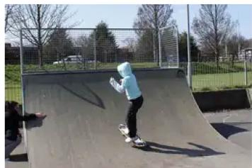  
Question: Where is the second person relative to the skateboarder? Ground Truth: Sitting to the left, near the base of the ramp.

## Hallucination Mining Results

  
Question: What is the woman doing? Ground Truth: Seated behind the man as a passenger.  
Figure 4 Hallucination mining results from RealmForgePipe on four examples involving actions and spatial relations. Each example shows the original image, question, ground-truth answer, and selected mined responses ranked by likelihood. Percentages denote candidate-relative weight $\rho _ { i } ( e )$ within the full error candidate pool, rather than calibrated answer probabilities; displayed values are not renormalized over the shown subset. Responses are shortened for readability.

<table><tr><td></td><td></td></tr><tr><td>4</td></tr><tr><td>13.5% 2 11.1%</td></tr><tr><td>_ 0 7.8%</td></tr><tr><td>_ 5 7.7% 1 7.3%</td></tr><tr><td>一 一 6 6.0%</td></tr><tr><td>9 5.6%</td></tr></table>

Hallucination Mining Results

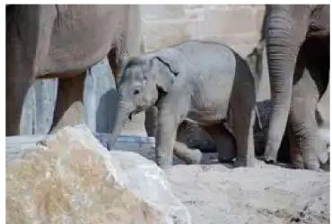  
Question: How many elephants are shown? Ground Truth: 3.

<table><tr><td colspan="2">Hallucination Mining Results</td></tr><tr><td></td><td>12:15 1.2%</td></tr><tr><td>10:10</td><td>1.1%</td></tr><tr><td></td><td>12:45 1.1%</td></tr><tr><td></td><td>12:30 1.0%</td></tr><tr><td>12:10</td><td>1.0%</td></tr><tr><td>12:25</td><td>1.0%</td></tr><tr><td colspan="2"></td></tr></table>

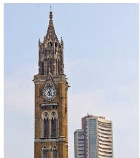  
Question: What time does the clock show Ground Truth: Approximately 12:20.

<table><tr><td></td><td></td><td>orange beige</td></tr><tr><td></td><td>17.1% 8.0%</td></tr><tr><td></td></tr><tr><td>pink 7.4% black</td></tr><tr><td>7.2%</td></tr><tr><td>white 6.9%</td></tr><tr><td>yellow 6.8%</td></tr><tr><td>purple 6.6%</td></tr><tr><td>Hallucination Mining Results</td></tr></table>

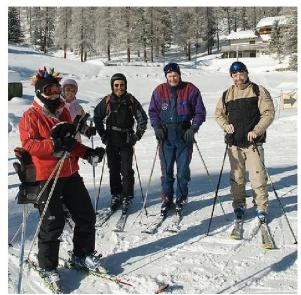  
Question: What color is the jacket of the man on the far left? Ground Truth: Red.

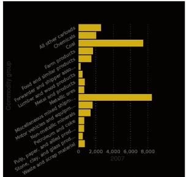  
Question: Summarize the statistics and relationships in the chart. Ground Truth: Mixed shipments lead, followed by coal; forwarders are lowes

Figure 5 Additional hallucination mining examples covering counting, clock reading, color recognition, and chart analysis. Selected candidates are shown with their candidate-relative weights from the original mining runs, without renormalization over the displayed subset. These weights are not calibrated answer probabilities. Chart responses are shortened for readability.

## C Hallucination-Guided Image Editing Examples

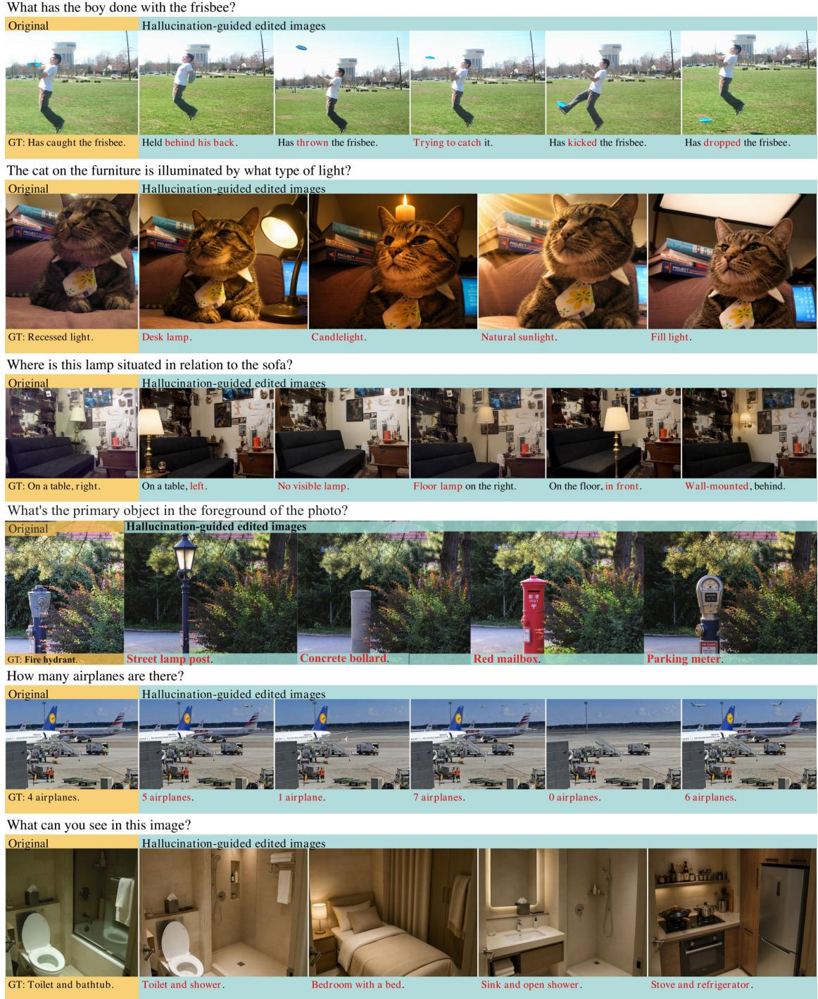  
Figure 6 Hallucination-guided image editing examples from RealmForgePipe (1/2). From top to bottom: actions, illumination, spatial relations, mirror arrangements, object counts, and scene structure. Each row pairs the original image and ground-truth answer (yellow) with edited images and their corresponding hallucinated responses (cyan). Red text highlights the response attributes targeted by editing. Responses are shortened for readability.

What's next to the plate?  
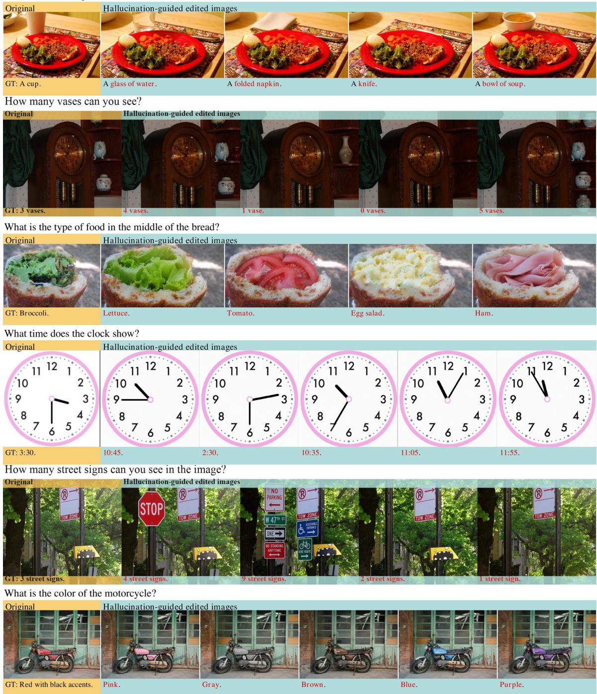  
Figure 7 Hallucination-guided image editing examples from RealmForgePipe (2/2). From top to bottom: local object replacement, object–container relations, food content, clock time, surface patterns, and color attributes. Together with Figure 6, the two pages show 12 original-image families and 54 edited images. Yellow and cyan labels denote original and edited image–response pairs; red text highlights the targeted attributes.

## D Data Construction and Category-wise Statistics

Source data and hallucination mining. We construct our data from a subset of the VQA data released with VC-STaR (VisCoR-55K) [19], as described in Section 4. This subset provides 48,012 image–question inputs for RealmForgePipe. The retained and scored hallucination candidate pools contain 487,812 responses in total. Likelihood-based filtering and Top- $K _ { \mathrm { m i n e } }$ selection retain 114,982 responses (23.57% of the candidate pool) for subsequent processing. Table 3 summarizes the following construction stages from mined responses to human-approved edited pairs. These counts refer to retained candidate responses rather than raw sampling draws. Mining also explores latent hallucinations for inputs whose standard decoded response is correct; therefore, the number of mining inputs does not represent the number of observed hallucinations.

Table 3 Data construction summary for RealmForgePipe.
<table><tr><td>Data</td><td>Count</td></tr><tr><td>Mined hallucinated responses</td><td>114,982</td></tr><tr><td>Candidates entering image editing</td><td>96,320</td></tr><tr><td>Successfully generated edited images</td><td>91,986</td></tr><tr><td>VLM blind-check approvals</td><td>43,169</td></tr><tr><td>Human-approved edited pairs</td><td>28,960</td></tr></table>

Overall editing yield. Of the 114,982 selected candidates, 96,320 enter image editing and 28,960 yield human-approved edited pairs, giving an overall editing pass rate of 30.07%. Category sums and discrepancies are detailed in Appendix D.1.

Final retained data. The final retained HG-Edited Data contain 28,960 unique edited examples: 27,038 in the training set and 1,922 in the held-out test set. The training edits span 12,340 original-image families. No original-image family appears in both the training and test sets. The test set additionally includes 3,078 original examples and 1,922 edited examples, for 5,000 examples in total.

## D.1 Category-wise Editing and Review Statistics

Table 4 reports editing and review counts and empirical pass rates across 22 question categories. For each category c, we compute

$$
\mathrm { P a s s R a t e } _ { c } = \frac { N _ { \mathrm { h u m a n } , c } } { N _ { \mathrm { s y n t h e s i s } , c } } \times 1 0 0 \% ,
$$

where $N _ { \mathrm { s y n t h e s i s } , c }$ is the number of candidates entering image editing and $N _ { \mathrm { h u m a n } , c }$ is the number of humanapproved edited pairs. The denominator counts candidates rather than individual generation attempts. This measures the end-to-end yield of editing and review, rather than single-attempt generation success or the conditional acceptance rate among human-reviewed samples.

Table 4 Category-wise data construction counts and final pass rates. Synthesis denotes candidates entering image editing; Generated denotes successfully generated edited images; BlindCheck denotes records marked BlindCheck OK; Human denotes human-approved edited pairs. Final pass rate is Human / Synthesis.
<table><tr><td colspan="5"></td></tr><tr><td>Category</td><td>Synthesis</td><td>Generated</td><td>BlindCheck</td><td>Final pass Human rate</td></tr><tr><td>count</td><td>56,518</td><td>53,900</td><td>24,752</td><td>14,552 25.75</td></tr><tr><td>other</td><td>7,980</td><td>7,488</td><td>3,246 3,245</td><td>40.66</td></tr><tr><td>count_by_attribute</td><td>6,503</td><td>6,296</td><td>2,269 1,940</td><td>29.83</td></tr><tr><td>shape</td><td>5,450</td><td>5,298</td><td>2,008 1,227</td><td>22.51</td></tr><tr><td>color</td><td>5,831</td><td>5,657</td><td>2,763 2,429</td><td>41.66</td></tr><tr><td>chart_describe</td><td>2,705</td><td>2,633</td><td>2,027 1,242</td><td>45.91</td></tr><tr><td>measurement</td><td>2,397</td><td>2,337</td><td>1,097</td><td>729 30.41</td></tr><tr><td>identification</td><td>1,677</td><td>1,582</td><td>528 527</td><td>31.43</td></tr><tr><td>text</td><td>1,455</td><td>1,404</td><td>964 644</td><td>44.26</td></tr><tr><td>size</td><td>990</td><td>968</td><td>673</td><td>380 38.38</td></tr><tr><td>position</td><td>827</td><td>789</td><td>529</td><td>299 36.15</td></tr><tr><td>material</td><td>1,047</td><td>1,024</td><td>688 440</td><td>42.02</td></tr><tr><td>scene_description</td><td>764</td><td>687</td><td>499 498</td><td>65.18</td></tr><tr><td>sentiment</td><td>396</td><td>285</td><td>166 149</td><td>37.63</td></tr><tr><td>existence</td><td>387</td><td>355</td><td>256 216</td><td>55.81</td></tr><tr><td>action</td><td>450</td><td>398</td><td>149 148</td><td>32.89</td></tr><tr><td>reasoning</td><td>327</td><td>286</td><td>127 106</td><td>32.42</td></tr><tr><td>time</td><td>407</td><td>395</td><td>299 158</td><td>38.82</td></tr><tr><td>probability</td><td>123</td><td>120</td><td>83</td><td>19 15.45</td></tr><tr><td>comparison</td><td>31</td><td>31</td><td>8</td><td>7 22.58</td></tr><tr><td>chart_read</td><td>49</td><td>47</td><td>36</td><td>4 8.16</td></tr><tr><td>multi_image</td><td>6</td><td>6</td><td>2</td><td>1 16.67</td></tr><tr><td>Total</td><td>96,320</td><td>91,986</td><td>43,169</td><td>28,960 30.07</td></tr></table>

Image editing configuration and cost. We use GPT-Image-2 with the quality parameter set to low. The approximate image-generation cost is CNY 0.05 per generated image, excluding VLM verification and human annotation. This is a per-generation cost, not a cost per accepted edited pair: retries and generated images that fail subsequent checks also contribute to construction cost. The human annotation protocol and service price are described in Appendix D.2.

## D.2 Human Annotation Review Protocol

Annotators and task. Human review is conducted by 12 annotators, all from professional data annotation companies. Before annotation begins, the task and decision criteria are communicated to the annotators. Given an edited image and its proposed response, each annotator judges whether the response is supported by the image. Samples for which this judgment is uncertain are discarded. Each sample is initially reviewed by one annotator, and annotators work on separate, non-overlapping batches.

Quality control. A second quality check is performed on 10% of the data. If an annotator fails this quality check, the data assigned to that annotator are returned and reassigned to a diferent annotator for reannotation. Only samples accepted through this review process are retained in the final HG-Edited Data.

Throughput and cost. The review throughput is 500 samples per annotator-hour, and the annotation service is charged at CNY 0.0568 per sample.

## E A Worked Example of Hallucination-Guided Editing

We trace the recorded automated editing run for case orig\_148, variant 0. The question is What is the size of the red block? The original answer is Small; the target hallucinated response is Large. This trace contains one target response and three alternative editing instructions for that response.

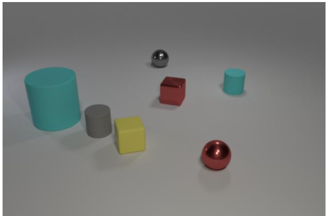  
Original image: Small

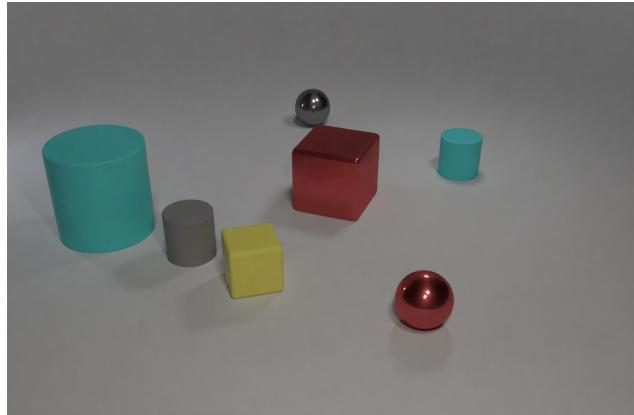  
Edited image: Large

Figure 8 A recorded editing example. Enlarging the red cube makes the target response Large valid for the same question.

Screening and dificulty assessment. The verifier (gemini-2.5-pro-06-17; Gemini 2.5 [5]) returns Small, marks the question and ground-truth answer as valid, and identifies an attribute error. It assigns dificulty 4/5 with shape-preservation, shadow-manipulation, and reflection-manipulation tags. These tags do not block editing.

Planning. The verifier selects local editing, identifies the red cube as the object to modify, and specifies that the background, lighting, and other objects should be preserved. It proposes three instructions:

1. Increase the size of the red cube.

2. Scale up the red cube to be approximately twice its current size.

3. Make the red cube a large object by increasing its size so its height is comparable to the large cyan cylinder on the left, and adjust its shadow accordingly.

Execution and automated verification. GPT-Image-2 (gpt-image-2-0421-global) executes the first instruction, prefixed with [Error type: attribute]. Generation takes 22.746 seconds. The verifier assigns 5/5 to each of edit success, visual plausibility, and minimal editing, exceeding the respective thresholds of 4, 3, and 4. These are the verifier’s reported scores.

Blind check and recorded outcome. Given only the edited image and the question, the verifier answers that the red block is large. A subsequent equivalence check against Large returns YES. The run stores the edited image and metadata with status ok. The first generation under the first instruction succeeds, so neither alternative instruction nor the full-redraw fallback is executed. The supplied trace ends at automated storage and contains no human-review decision; final dataset acceptance remains subject to the human-review protocol in Appendix D.2.

## F Training Settings

Training data and model configurations. We use Qwen3.5-9B as both the hallucination-mining model and the primary training model. We train on original examples and the 27,038 HG-Edited training examples in RealmSet (Section 3.3). We partition the data by original-image family, keeping each original image and all its associated edits in the same split. We additionally reserve 5,000 in-distribution examples as a held-out test set, with no original-image family shared with the training data. All showcase examples in the appendix are drawn from this set. To examine the model specificity of hallucination mining, we also train Qwen2.5- VL-7B [1], Gemma-4-E4B-it [30], and InternVL3.5-8B [36] separately on the same data, without additional hallucination mining for these target models.

Model adaptation. For Qwen3.5-9B, we initialize from the original pretrained checkpoint and optimize the RealmMatch objective in Section 3.4. We update the language model and multimodal projector while freezing the vision tower, without using LoRA adapters. This configuration has 8,996,576,512 trainable parameters. Training runs on eight NVIDIA H100 GPUs with BF16 precision, gradient checkpointing, and DeepSpeed ZeRO-3 with CPU optimizer ofloading. Dropout is disabled. The training hyperparameters are summarized in Table 5.

Table 5 Training hyperparameters for the Qwen3.5-9B RealmMatch configuration. Batch units are complete questioncentered families, rather than individual image–response combinations.
<table><tr><td>Hyperparameter</td><td>Value</td></tr><tr><td>GPUs</td><td>8 NVIDIA H100</td></tr><tr><td>Training epochs</td><td>3</td></tr><tr><td>Peak learning rate</td><td> $5 \times 1 0 ^ { - 6 }$ </td></tr><tr><td>Learning-rate schedule</td><td>Cosine</td></tr><tr><td>Warmup ratio</td><td>0.03</td></tr><tr><td>Weight decay</td><td>0</td></tr><tr><td>Maximum gradient norm</td><td>1.0</td></tr><tr><td>Per-device micro-batch</td><td>1 family</td></tr><tr><td>Gradient accumulation</td><td>10 micro-steps</td></tr><tr><td>Effective batch size</td><td>80 families</td></tr><tr><td>Maximum sequence length</td><td>6,144 tokens</td></tr><tr><td>Image processor pixel budget</td><td>262,144</td></tr><tr><td>Contrastive temperature τ</td><td>1.0</td></tr><tr><td>Row-wise contrast weight  $\lambda _ { r }$ </td><td>0.5</td></tr><tr><td>Column-wise contrast weight  $\lambda _ { c }$ </td><td>0.5</td></tr><tr><td>SFT loss coefficient</td><td>1.0</td></tr><tr><td>Precision</td><td>BF16</td></tr><tr><td>Checkpoint saving</td><td>Every epoch</td></tr></table>

Family-wise computation. Each training micro-step contains one complete family and uses the loss defined in Section 3.4: edited families use SFT and bidirectional contrast, whereas families without accepted edits use SFT and row-wise contrast. Matrix cells are processed in micro-batches of at most four cells and 24,576 padded input tokens. Families that fit in one micro-batch are backpropagated directly; otherwise, we first assemble the complete score matrix from detached scores and then replay the cell micro-batches using gradients derived from the full family loss. This procedure preserves the full family-level gradient while retaining activations for only one cell micro-batch at a time. The implementation uses $\mathrm { P y }$ Torch [20] 2.10.0, Transformers [38] 5.3.0, Accelerate 1.11.0, and DeepSpeed 0.18.4.

## G Evaluation

## G.1 Benchmark scoring

Benchmarks and metrics. We evaluate fine-grained visual perception and hallucination on six benchmarks: HallusionBench [10], MMVP [33], AMBER [35], MMHal-Bench [29], CV-Bench-2D [32], and ObjectHal [26]. We report aAcc for HallusionBench, item and pair accuracy for MMVP, average accuracy for AMBER, hallucination rate for MMHal-Bench, macro accuracy for CV-Bench-2D, and CHAIRs for ObjectHal. Lower hallucination rate and CHAIRs indicate better performance; higher values are better for the other metrics. We also provide model inference results in the supporting material.

Where a benchmark calls an LLM judge we use Qwen3.8-flash at temperature 0, with thinking of and no image in the judge context. VLMEvalKit protocols follow the toolkit release [9].

MMVP. Under VLMEvalKit’s MMVP protocol, a binary hit $h _ { i } \in \{ 0 , 1 \}$ marks whether item i matches the gold choice $( N = 3 0 0 )$ . Pair accuracy further requires both members of a consecutive pair to be right (150 pairs):

$$
\mathrm { I t e m A c c } = \frac { 1 } { N } \sum _ { i = 1 } ^ { N } h _ { i } , \qquad \mathrm { P a i r A c c } = \frac { 1 } { N / 2 } \sum _ { p = 1 } ^ { N / 2 } h _ { 2 p - 1 } h _ { 2 p } .
$$

HallusionBench. Scoring follows the authors’ GPT check on all $N = 1 { , } 1 2 9$ questions: the judge labels a prediction correct, incorrect, or unclear against the detailed reference. Unclear is credited on the 178 imageless visual-supplement items. The reported figure is item-level accuracy

$$
\operatorname { a A c c } = \frac { 1 } { N } \sum _ { i = 1 } ^ { N } h _ { i } .
$$

AMBER. VLMEvalKit’s AMBER rating maps replies to $\mathrm { Y e s } / \mathrm { N o }$ (the judge is invoked only when the label is unresolved), then averages Attribute, Existence, and Relation accuracy with equal weight:

$$
{ \mathrm { A v g A C C } } = { \frac { 1 } { 3 } } { \big ( } { \mathrm { A c c } } _ { \mathrm { a t t r } } + { \mathrm { A c c } } _ { \mathrm { e x i s t } } + { \mathrm { A c c } } _ { \mathrm { r e l } } { \big ) } .
$$

MMHal-Bench. The original five-shot MMHal rubric assigns each of $N ~ = ~ 9 6$ answers a score $s _ { i } ~ \in$ $\{ 0 , \ldots , 6 \}$ . The reported hallucination rate is the fraction of answers below 3:

$$
\mathrm { H a l R a t e } = \frac { 1 } { N } \sum _ { i = 1 } ^ { N } \mathbf { 1 } [ s _ { i } < 3 ] .
$$

CV-Bench-2D. VLMEvalKit’s CV-Bench scorer reports 2D accuracy as a macro-average over sources $( N = 1 , 4 3 8 )$ . If source c has accuracy $\operatorname { A c c } _ { c _ { c } } .$

$$
\mathrm { A c c } _ { 2 \mathrm { D } } = { \frac { 1 } { | { \mathcal { C } } | } } \sum _ { c \in { \mathcal { C } } } \mathrm { A c c } _ { c } .
$$

ObjectHalBench. Object mentions are extracted and matched to COCO with the RLHF-V CHAIR pipeline. A mention is hallucinated when it does not match any annotated object in the image. With $N = 3 0 0$ responses, $h _ { i } \in \{ 0 , 1 \}$ is 1 if response i contains at least one such mention:

$$
\mathrm { C H A I R } _ { s } = \frac { 1 } { N } \sum _ { i = 1 } ^ { N } h _ { i } .
$$

## G.2 In-distribution evaluation

In addition to the six public benchmarks, we evaluate the models on a held-out in-distribution split of RealmSet containing 5,000 examples. The split consists of 3078 original examples, 1922 HG-Edited examples. Table 6 reports the results on the held-out RealmSet test set.

Table 6 In-distribution accuracy on the 5,000-example held-out test set.
<table><tr><td>Model / Method</td><td>Overall ↑</td><td>Original ↑</td><td>HG-Edited ↑</td></tr><tr><td rowspan="3">Qwen3.5-9B (Raw) + DreamRealm</td><td>64.80</td><td>66.44</td><td>62.17</td></tr><tr><td>68.30</td><td>70.76</td><td>64.36</td></tr><tr><td>48.40</td><td>51.23</td><td>43.86</td></tr><tr><td rowspan="2">Qwen2.5-VL-7B (Raw) + DreamRealm Gemma-4-E4B-it (Raw)</td><td>59.66</td><td>61.99</td><td>55.93</td></tr><tr><td>39.54</td><td>40.90</td><td>37.36</td></tr><tr><td>+ DreamRealm</td><td>50.54</td><td>53.09</td><td>46.46</td></tr><tr><td>InternVL3.5-8B (Raw)</td><td>54.64</td><td>55.88</td><td>52.65</td></tr><tr><td>+ DreamRealm</td><td>60.16</td><td>62.44</td><td>56.50</td></tr></table>

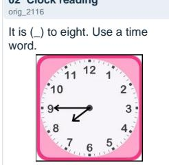  
Read the text.

  
02 Clock reading orig\_2116  
04 Visual measurement 3128

## H Qualitative Comparisons with the Base Model

Figures 9–10 show 32 selected comparisons across diverse visual tasks. Each page contains 16 cases. Questions and answers are condensed while preserving their meaning; choice letters are expanded where useful. Ref. denotes the supplied reference; Qwen35-9b (DreamRealm) and Qwen35-9b (Raw) denote the adapted and original models, respectively. These selected examples do not estimate the overall success rate.

## 01 Text recognition orig\_21218

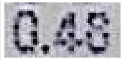  
What transformation was applied to Q?  
Ref.: 0.48 Qwen35-9b (DreamRealm): 0.48 Qwen35-9b (Raw): 0.45

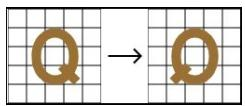

  
Ref.: quarte Qwen35-9b (DreamRealm): quarter Qwen35-9b (Raw): half  
Ref.: 90 deg clockwise Qwen35-9b (DreamRealm): 90 deg clockwise Qwen35-9b (Raw): 180 deg  
Ref.: 6 Qwen35-9b (DreamRealm): 6 Qwen35-9b (Raw): 7

## 05 Place value

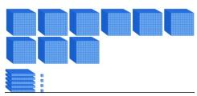  
Ref.: 9,504 Qwen35-9b (DreamRealm): 9,504 Qwen35-9b (Raw): 954  
Probability of a green marble?

## 06 Visual probability orig\_46150

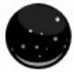  
Ref.: 75% Qwen35-9b (DreamRealm): 75% Qwen35-9b (Raw): 80%

## 07 Animal counting \_2862

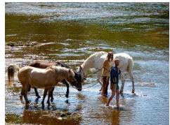  
Ref.: 3 Qwen35-9b (DreamRealm): 3 Qwen35-9b (Raw): 4

## 08 Color-based counting human\_orig\_5168\_c2

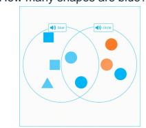  
10 State-based counting human\_orig\_3149\_c2  
Ref.: 6 Qwen35-9b (DreamRealm): 6 Qwen35-9b (Raw): 5

## 09 Object presence orig\_

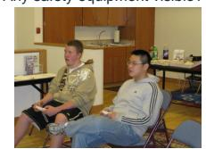

Ref.: Yes: fire alarm   
Qwen35-9b (DreamRealm): Yes: fire   
alarm   
Qwen35-9b (Raw): No

How many umbrellas are closed?

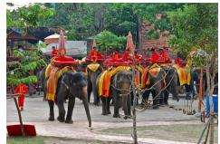  
Ref.: 3 Qwen35-9b (DreamRealm): 3 Qwen35-9b (Raw): 1  
Where is the toilet?

## 11 Spatial localization

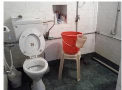  
Ref.: Left side Qwen35-9b (DreamRealm): Left side Qwen35-9b (Raw): In the bathroom

## 12 Relational size orig\_1795

Size of shiny object matching the big metal cube in color?

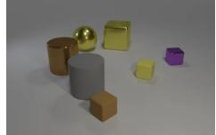  
Ref.: Large Qwen35-9b (DreamRealm): Large Qwen35-9b (Raw): Medium

## 13 Color matching orig\_1259

Anything else matching the small matte cylinder in color?

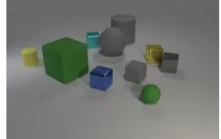  
Ref.: Yes Qwen35-9b (DreamRealm): Yes Qwen35-9b (Raw): No  
Read the formula (last angle).

## 14 Formula recognition orig\_15149

## 15 Pattern reasoning orig\_1216

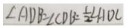  
Ref.: ADC Qwen35-9b (DreamRealm): ADC Qwen35-9b (Raw): AOC  
Ref.: A Qwen35-9b (DreamRealm): A Qwen35-9b (Raw): B

## 16 Text/logo presence human\_orig\_4806\_c0

  
Ref.: No Qwen35-9b (DreamRealm): No Qwen35-9b (Raw): Faint logo; no text

Figure 9 Compact qualitative comparisons (1/2), cases 1–16. Green and red identify model answers, not independent correctness judgments. Case 14 shows only the difering final angle in the formula. IDs beginning with human\_ denote edited inputs.

How many cupcakes?

## 17 Text recognition orig\_4879

Read the text.

795

Ref.: 7.95   
Qwen35-9b (DreamRealm): 7.95   
Qwen35-9b (Raw): 795

## 21 Object counting 49162

## How many forks on the table?

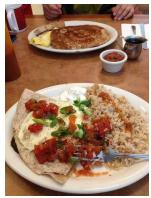

Ref.: 1   
Qwen35-9b (DreamRealm): 1   
Qwen35-9b (Raw): 2

## 25 Object counting \_34461

  
How many columns of dots?

Ref.: 5   
Qwen35-9b (DreamRealm): 5   
Qwen35-9b (Raw): 6

## What number is shown?

Ref.: 25   
Qwen35-9b (DreamRealm): 25   
Qwen35-9b (Raw): 24

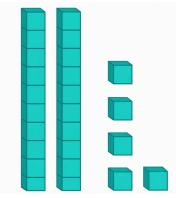  
How many one-way signs?

## 29 Place value human\_orig\_37421\_c0

## 18 Place value

## What number is shown?

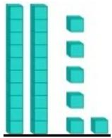

Ref.: 26   
Qwen35-9b (DreamRealm): 26   
Qwen35-9b (Raw): 25

## 22 Reflection counting 28677

How many cars are reflected in the mirror?

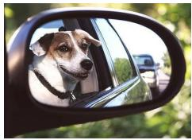

Ref.: 2   
Qwen35-9b (DreamRealm): 2   
Qwen35-9b (Raw): 1

## 26 Array structure human\_orig\_6582\_c4

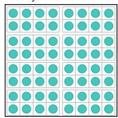  
Ref.: 8 Qwen35-9b (DreamRealm): 8 Qwen35-9b (Raw): 4

## 30 Sign counting human\_orig\_33746\_c1

  
Ref.: 4 Qwen35-9b (DreamRealm): 4 Qwen35-9b (Raw): 3  
What happened to the letter?

## 19 Object counting orig\_11450

How many propellers does the plane have?

Ref.: 2   
Qwen35-9b (DreamRealm): 2   
Qwen35-9b (Raw): 4

## 23 Object counting 22305

## How many garlic bulbs?

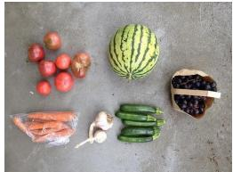

Ref.: 2   
Qwen35-9b (DreamRealm): 2   
Qwen35-9b (Raw): 1

## 27 Pattern reasoning orig\_13460

Which option completes the sequence?

Ref.: C Qwen35-9b (DreamRealm): C Qwen35-9b (Raw): B

## 31 Transformation human\_orig\_6811\_c0

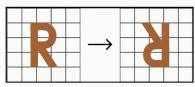  
Ref.: Turn Qwen35-9b (DreamRealm): Turn Qwen35-9b (Raw): Flip

## 20 People counting

How many people on the bike?

Ref.: 2   
Qwen35-9b (DreamRealm): 2   
Qwen35-9b (Raw): 1

## 24 Action recognition 19101

What is the man on the right doing?

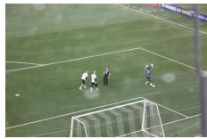

Ref.: Stretching   
Qwen35-9b (DreamRealm): Stretching   
Qwen35-9b (Raw): Kicking

## 28 Object counting orig\_40094

How many windows on the building?

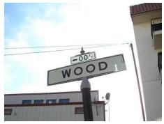

Ref.: 4   
Qwen35-9b (DreamRealm): 4   
Qwen35-9b (Raw): 3

## 32 Relational size 6081

Size of the ball matching the small object in color?

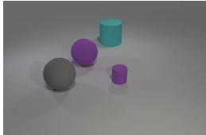  
Ref.: Large Qwen35-9b (DreamRealm): Large Qwen35-9b (Raw): Medium

Figure 10 Compact qualitative comparisons (2/2), cases 17–32. Reflected vehicles in case 22 include the car carrying the dog. All responses are condensed from the recorded outputs.

## I Details of compared methods

Block I of Table 1 reports specialized hallucination-mitigation methods. Published numbers for these methods are not directly comparable: prior work uses diferent judges and scoring rules. We therefore re-evaluate every Block I method under the single protocol in Appendix G.1 and do not copy scores from the original papers. When a public checkpoint is available, we load that release and only re-run inference and scoring. Otherwise we follow the published training recipe on the backbone in Table 7, then score the resulting model with the same pipeline. The methods were proposed on diferent vision–language backbones, so Block I is a protocolcontrolled comparison of released recipes rather than a same-backbone ranking. Same-backbone comparisons are in Blocks II–III.

Table 7 Backbone and setup for each Block I method.
<table><tr><td>Method</td><td>Backbone</td><td>Setup</td></tr><tr><td>VCD [13]</td><td>LLaVA-1.5-7B</td><td>Inference-time decoding</td></tr><tr><td>CoCI-CAP [17]</td><td>LLaVA-OneVision (Qwen2-7B)</td><td>Inference-time decoding</td></tr><tr><td>RLAIF-V [42]</td><td>LLaVA-1.5-7B</td><td>Public checkpoint</td></tr><tr><td>SymMPO [16]</td><td>LLaVA-1.5-7B</td><td>Public checkpoint</td></tr><tr><td>mDPO [34]</td><td>Bunny (Llama-3-8B)</td><td>Reproduced</td></tr><tr><td>VC-STaR [19]</td><td>Qwen2.5-VL-7B</td><td>Reproduced</td></tr><tr><td>MED [2]</td><td>Qwen2.5-VL-7B</td><td>Reproduced</td></tr><tr><td>IC-VCO [8]</td><td>LLaVA-OneVision (Qwen2-7B)</td><td>Reproduced</td></tr><tr><td>FINER [40]</td><td>Qwen2.5-VL-7B</td><td>Public checkpoint</td></tr><tr><td>IRIS [15]</td><td>LLaVA-1.5-7B</td><td>Reproduced</td></tr><tr><td>C2-DPO [12]</td><td>LLaVA-1.5-7B</td><td>Reproduced</td></tr></table>

## J Additional RealmMatch Training Details

Original examples without edited images. For examples without an accepted edited image, bidirectional contrast reduces to row-wise contrast. We construct a record $\mathcal { U } = ( I _ { 0 } , q , a _ { 0 } , \{ b _ { j } \} _ { j = 1 } ^ { M } )$ , where $b _ { j }$ are ofline-verified incorrect responses and responses equivalent to $a _ { 0 }$ are excluded. Supervised learning on the ground-truth answer is retained. Defining $s _ { + } = s _ { \theta } ( I _ { 0 } , q , a _ { 0 } )$ and $s _ { j } ^ { - } = s _ { \theta } ( I _ { 0 } , q , b _ { j } )$ , the objective is:

$$
\mathcal { L } _ { \mathrm { p l a i n } } = - s _ { + } + \lambda _ { r } \log \left( 1 + \sum _ { j = 1 } ^ { M } \exp \left( \frac { s _ { j } ^ { - } - s _ { + } } { \tau } \right) \right) .\tag{7}
$$

The second term is the row-wise cross-entropy over the ground-truth answer and its M negative responses. There is no column loss: only one image is available, and the incorrect responses have no corresponding positive image. We retain $\lambda _ { r }$ unchanged rather than transferring the absent column weight to it. When $M = 0$ , the contrastive term vanishes and the objective reduces to SFT. When $M = 1$ , it becomes a binary logistic preference term plus SFT, without a reference-model likelihood ratio.

Overall training objective. The overall training objective takes two forms depending on whether accepted edited data are available. With accepted edits, bidirectional contrast assigns hallucinated responses to images that make them valid; otherwise, row-wise contrast suppresses these responses under the original image. Both cases retain supervised learning on correct image–response pairs. Let $K _ { g }$ denote the number of accepted edits associated with record $g .$ We average the corresponding losses over the B records or families in each batch:

$$
\mathcal { L } _ { \mathrm { b a t c h } } = \frac { 1 } { B } \sum _ { g = 1 } ^ { B } \mathcal { L } _ { g } , \qquad \mathcal { L } _ { g } = \left\{ \begin{array} { l l } { \mathcal { L } _ { \mathrm { e d i t } , g } , } & { K _ { g } \geq 1 , } \\ { \mathcal { L } _ { \mathrm { p l a i n } , g } , } & { K _ { g } = 0 . } \end{array} \right.\tag{8}
$$

We first average the losses within each family and then across the batch.