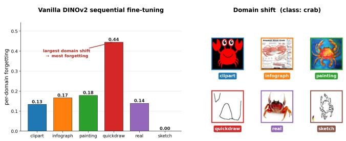
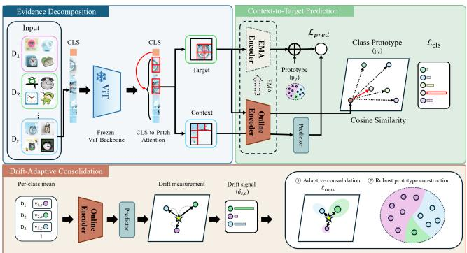
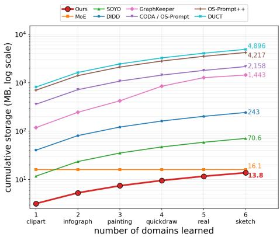
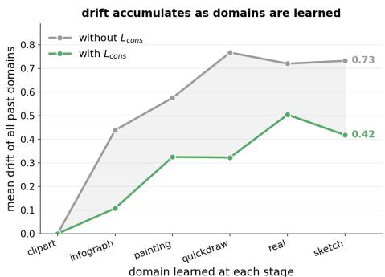
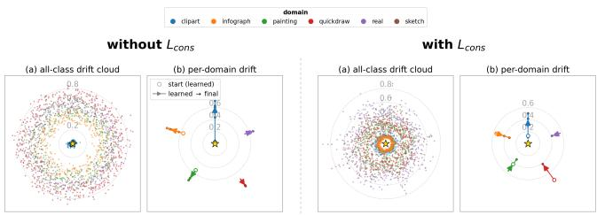
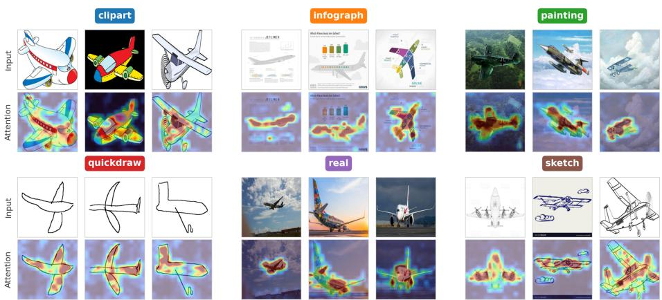

# Drift-adaptive Representation Preservation for Domain-Incremental Learning

Hyunmin Kong , Gyutae Oh , and Jitae Shin⋆

Department of Electrical and Computer Engineering,

Sungkyunkwan University,

Suwon 16419, Republic of Korea

{khm1754, alswo740012, jtshin}@skku.edu

Abstract. Pretrained vision models provide strong general-purpose representations, but in Domain-Incremental Learning (DIL), where the input distribution changes sequentially, adapting to new domains often degrades performance on previously learned ones. We observe that forgetting is not uniform across domains and classes and is not explained by training order alone. This motivates us to track each past domain–class concept individually. We use representation drift, defined as the deviation of a past concept’s current representation from a fixed anchor, as a measurable surrogate for forgetting risk. The measured drift then serves two complementary roles. A consolidation loss assigns stronger preservation to high-drift pairs, while prototype construction down-weights highly drifted domains to reduce their influence on the class reference. Preservation is thus allocated by measured drift rather than assumed importance. To obtain this signal during training without storing past raw data, we repurpose a Joint-Embedding Predictive Architecture (JEPA). For each domain–class pair, we store only a compact context summary in the backbone feature space and rerun it through the learned contextto-target relation to measure its drift from the fixed anchor. Across DomainNet, Ofice-Home, CORe50, and CDDB-Hard, our method sustains a strong accuracy–forgetting balance on every benchmark, using substantially less training memory than accuracy-competitive methods and the smallest storage among compared methods.

Keywords: Continual Learning, Domain Incremental, Joint Embedding Predictive Architecture

## 1 Introduction

Pretrained vision models provide strong, broadly transferable representations and have substantially expanded the practical promise of DIL [21] [26]. In DIL, a model learns a sequence of domains that share a label space but difer in input distribution, and it must maintain stable performance on all domains seen so far without revisiting past data [22] [23]. The central dificulty is the stability– plasticity dilemma: adapting the representation to a new domain disturbs the structure formed on past domains and induces forgetting, whereas suppressing representational change too strongly limits adaptation [12] [24].

  
Fig. 1: Per-domain forgetting when DINOv2 is sequentially fine-tuned on DomainNet. Example images of the same class (e.g., crab) illustrate the visual variation across domains.

We study forgetting in DIL through the lens of representation drift. As the model learns a domain, the resulting per-class representation serves as a fixed reference point, or anchor, against which later changes can be measured. When the model subsequently adapts to new domains, a previously learned concept may move away from this reference. We use this deviation as a measurable signal of how strongly the concept has changed and as a surrogate for its forgetting risk. Crucially, these changes are not uniform across previously learned domains and classes. As shown in Fig. 1, the amount of forgetting varies substantially across domains within the same training sequence and cannot be characterized by training order alone. This heterogeneous behavior motivates us to track representation drift separately for each domain–class pair rather than relying on a single global measure. This nonuniformity creates a specific problem for prototype-based classification: a pair with large drift has likely departed from the stable class semantics, and combining it with equal weight when forming the class prototype lets the distorted representation contaminate the class reference itself—an efect we call prototype contamination.

Motivated by this, we use drift in two ways at once. First, we use drift as a proxy for forgetting risk: a pair with larger drift receives stronger preservation because its current reconstruction is less aligned with the fixed class anchor. Second, drift is a reliability signal for prototype construction: a pair with small drift is trusted, whereas a pair with large drift is down-weighted, shielding the class reference from contamination. A single measured drift signal thus plays two complementary roles, so that preservation is allocated according to measured drift rather than assumed importance.

Using drift this way has a prerequisite: it must be measurable at the domain– class level, during training, and without access to past raw data. We observe that JEPA [1] provides a natural mechanism for this purpose. Because it learns, in latent space, to predict one observed cue from another, a past concept can be reexamined by storing only a compact context summary for each domain–class pair and rerunning it through this learned relation. Concretely, a frozen backbone’s CLS-to-patch attention splits each image into a target carrying class-relevant evidence and a context capturing domain-sensitive cues; the model learns to predict the target from the context, and stored past-domain context summaries are reinput to the current encoder and predictor to measure how far the prediction departs from the fixed anchor—this distance is the drift signal.

This design also brings a concrete eficiency benefit: no gradient flows through the frozen backbone, so training is confined to a lightweight encoder and predictor and the training memory footprint remains small, while past information is stored only as compact per-domain–class summaries, so storage grows only mildly with the number of domains. Our contributions are summarized as follows:

– We propose a preservation framework in which a single measured drift signal drives two complementary mechanisms—a drift-adaptive consolidation loss that concentrates preservation on high-drift concepts, and a robust prototype construction that down-weights high-drift domains to prevent prototype contamination—allocating preservation by measured drift rather than assumed importance.

– To make this signal available at the domain–class level during training, without storing any past image, we repurpose JEPA’s learned context-to-target relation as a drift meter, rerunning a stored domain–class context summary through the current encoder and predictor.

– Across four DIL benchmarks, our method sustains a strong accuracy–forgetting balance on every benchmark while using substantially less training memory than accuracy-competitive methods and the smallest storage among the compared methods.

## 2 Related Work

## 2.1 Domain-Incremental Learning

Continual learning studies how a model can absorb new data distributions without forgetting previously learned ones. In domain-incremental learning, all domains share the same label space while the input distribution shifts sequentially, so the central dificulty is to keep past domains from degrading as the representation adapts to new ones. Rehearsal-based methods address this by storing or synthesizing past samples for replay [18] [2]. They are efective, but their storage cost grows with the data, they raise privacy concerns, and they are inapplicable when past images cannot be retained [27] [4]. Regularization-based methods instead constrain parameters or outputs deemed important for earlier tasks from changing substantially, as in EWC and LwF [11] [8]. Such preservation, however, is driven by an importance that is assumed or estimated globally, rather than by measuring which domain–class concepts are actually drifting under the current model. Recent domain-incremental and pretrained-model-based continual learning methods reduce reliance on raw data replay by keeping the pretrained backbone frozen and adapting to new domains through a small number of additional parameters or memory. Prompt-based methods such as CODA-Prompt [19], OS-Prompt [7], and OS-Prompt++ [7] adapt by accumulating or selecting prompt parameters per domain. In contrast, DIDD [15], GraphKeeper [6], SOYO [23], DUCT [26], and MoE [25] preserve or route domain knowledge through different mechanisms—feature- and graph-based memories, selective routing over domain-specific parameters or paths, backbone adaptation, and expert modules. Our method instead keeps the pretrained backbone frozen and stores only a compact summary per domain–class pair, using measured drift to decide what to preserve and which contributions to trust when forming each prototype.

## 2.2 Representation Drift and Predictive Representations

The instability of learned representations under sequential training is a wellrecognized dificulty in continual learning. As a model adapts to new data, the features of previously learned concepts may move, causing stored statistics such as class prototypes to fall out of alignment with the current feature space—an efect often described as representation, feature, or semantic drift [10] [5] [4]. Prior work has mainly treated this drift as an error to be compensated for or suppressed, for example by estimating the displacement of stored prototypes or by stabilizing old representations through feature alignment and distillation [14]. In contrast, we use drift before suppressing it: we measure it at the domain–class level and use its magnitude as a nonuniform signal that determines both how strongly each concept should be preserved and how much each domain should contribute to the class prototype. Our drift measurement is enabled by a latent predictive relation inspired by JEPA, which learns representations by predicting the embedding of one part or view of an input from another in latent space, typically using an online encoder and an exponential moving average target encoder. In their original use, this predictive objective is designed for self-supervised representation learning. We repurpose the same principle for continual learning: the context-to-target relation trained on the current domain is reapplied to stored past-domain context summaries, and the predicted targets are compared with fixed class anchors to measure drift. Measurement and learning therefore share one function rather than relying on a separate probe, and the resulting drift signal drives both drift-adaptive consolidation and robust prototype construction. This use of a predictive relation as a per-concept meter of drift, with a single signal serving both roles, sets our approach apart from prior drift compensation and pretrained-model-based continual learning methods.

## 3 Proposed Method

## 3.1 Problem Formulation

In DIL, a model is trained on T domains in sequence. Each domain $t \in \{ 1 , \ldots , T \}$ is associated with a distribution $\mathcal { P } _ { t } ( X , Y )$ , from which a training set $\begin{array} { l l } { \mathcal { D } _ { t } } & { = } \end{array}$ $\{ ( x _ { i } ^ { t } , y _ { i } ^ { t } ) \} _ { i = 1 } ^ { N _ { t } }$ is sampled, where $\boldsymbol { x } _ { i } ^ { t }$ is an input image, $y _ { i } ^ { t } \in \mathcal { D }$ is its label, and $N _ { t }$ is the number of samples in domain t. All domains share a common label space $\mathcal { V } = \{ 1 , \ldots , C \}$ with C classes, while the input distribution $\mathcal { P } _ { t } ( X )$ difers across domains.

  
Fig. 2: Overview of our framework. Evidence Decomposition splits each input image into a target and a context. Context-to-Target Prediction predicts the target from the context and performs classification. Drift-Adaptive Consolidation measures the drift from the fixed anchors using stored past-domain summaries while learning a new domain, and uses this signal to modulate the preservation strength and to weight each domain’s contribution when forming the class prototypes.

Training proceeds sequentially, one domain at a time: at step t the model can access only the current domain $\mathcal { D } _ { t }$ and cannot use the original images of the previous domains $\mathcal { D } _ { 1 } , \ldots , \mathcal { D } _ { t - 1 }$ . Let $\varPhi _ { t }$ denote the model trained up to domain t. The objective is to maximize the average performance over all domains seen so far,

$$
A ( \Phi _ { t } ) \ = \ \frac { 1 } { t } \sum _ { s = 1 } ^ { t } \mathbb { E } _ { ( x , y ) \sim \mathcal { P } _ { s } } \big [ \mathbf { 1 } ( \varPhi _ { t } ( x ) = y ) \big ] ,\tag{1}
$$

where $\mathbf { 1 } ( \cdot )$ is the indicator function and $s \leq t$ indexes the domains seen so far. Keeping the objective in Eq. (1) without access to past data is the central challenge of DIL.

In this work, $\varPhi _ { t }$ is a prototype-based classifier that maps an input to a representation through a frozen pretrained backbone and a trainable encoder, and classifies it by the cosine similarity to each class prototype. Under this formulation, forgetting is reflected in the degradation of performance on previously learned domains. We track the underlying representational change through the deviation of each past concept from its fixed class anchor and use this representation drift as a measurable surrogate for forgetting risk. At each domain transition, before training on domain t, we fix the representation of each class observed so far as a reference against which subsequent change is measured, and call it the anchor $a _ { c } ^ { ( t - 1 ) }$ (constructed in §3.3). As the encoder changes while later domains are learned, a past concept may be mapped to a location that departs from its anchor, and this distance serves as a measurable surrogate for the concept’s forgetting risk.

To make this distance concrete, we define the drift of class c from domain $s ,$ measured at step t, as a nonnegative scalar $\delta _ { s , c } ^ { ( t ) }$ . This construction has two important aspects. First, $\delta _ { s , c } ^ { ( t ) }$ is obtained without any past image: a past concept is reconstructed through the current model from a stored domain–class context summary and compared against its anchor. Second, since the anchor is fixed per class, the per-domain diference in drift arises solely from the reconstructed past representation; drift is therefore not a single global quantity but one indexed by each domain–class pair $( s , c )$ . We track these domain–class-specific representational changes through the per-pair surrogate $\delta _ { s , c } ^ { ( t ) }$ during training, and use this signal to allocate preservation and construct robust prototypes.

## 3.2 Evidence Decomposition and Prediction

We now specify the representation used for classification, introduced abstractly in §3.1, as two complementary cues derived from attention, and learn a predictive relation between them. This predictive relation later serves, in $\ S 3 . 3$ , as the function that measures the drift of past concepts.

CLS-to-Patch Attention Passing an input x through the frozen backbone $f ( \cdot )$ yields a CLS token and $N$ patch tokens. Let $h _ { n } \in \mathbb { R } ^ { D }$ be the $n { \mathrm { - } } \mathrm { t h }$ patch token, where D is the backbone token dimensionality, and let $\alpha _ { n }$ be the attention from the CLS token to that patch, normalized over the patches so that $\alpha _ { n } \geq 0$ and $\begin{array} { r } { \sum _ { n } \alpha _ { n } = 1 ; } \end{array}$ intuitively, $\alpha _ { n }$ reflects the regions that the pretrained backbone attends to more strongly and that therefore tend to carry the class-relevant evidence [3]. Using the attention weights $\alpha _ { n }$ and their complementary weights $\tilde { \alpha } _ { n }$ , we aggregate the patch tokens into two representations,

$$
\bar { u } = \sum _ { n = 1 } ^ { N } \alpha _ { n } h _ { n } , \bar { v } = \sum _ { n = 1 } ^ { N } \tilde { \alpha } _ { n } h _ { n } , \tilde { \alpha } _ { n } = \frac { 1 - \alpha _ { n } } { \sum _ { m = 1 } ^ { N } ( 1 - \alpha _ { m } ) } ,\tag{2}
$$

which we then normalize to unit vectors,

$$
u ^ { \mathrm { r a w } } = \frac { \bar { u } } { \| \bar { u } \| _ { 2 } } , \qquad v ^ { \mathrm { r a w } } = \frac { \bar { v } } { \| \bar { v } \| _ { 2 } } , \qquad u ^ { \mathrm { r a w } } , v ^ { \mathrm { r a w } } \in \mathbb { R } ^ { D } ,\tag{3}
$$

where $u ^ { \mathrm { r a w } }$ is the target, formed from regions emphasized by the pretrained backbone and used as the classification cue, whereas $v ^ { \mathrm { { r a w } } }$ is the context, formed with the complementary weights $\tilde { \alpha } _ { n }$ and tending to capture cues sensitive to domain change, such as background, style, and texture.

Latent Encoding and Classification The two raw representations are passed through a shared trainable encoder $g _ { \boldsymbol { \theta } } ( \cdot )$ and mapped to the embedding space $\mathbb { R } ^ { d } \colon$

$$
u ~ = ~ g _ { \theta } ( u ^ { \mathrm { r a w } } ) , \qquad v ~ = ~ g _ { \theta } ( v ^ { \mathrm { r a w } } ) , \qquad u , v \in \mathbb { R } ^ { d } ,\tag{4}
$$

where d is the encoder output dimensionality, u is the target representation used for classification, and v is the context representation used as the input to prediction; the same embedding space is later used for drift measurement. Throughout, all encoder and predictor outputs are $\ell _ { 2 } .$ -normalized to unit vectors before any cosine comparison. As described in §3.1, classification is performed via the cosine similarity between the target representation u and the class prototype $p _ { c } \in \mathbb { R } ^ { d }$

$$
\hat { y } \ = \ \underset { c \in \mathcal { Y } } { \arg \operatorname* { m a x } } \ \cos ( u , p _ { c } ) .\tag{5}
$$

The prototype $p _ { c }$ is the embedding-space projection of a stored raw prototype $\boldsymbol { \mu _ { c } } \in \mathbb { R } ^ { D }$ , whose construction and update we defer to §3.3.

Context-to-Target Prediction The core of our framework is the relation that predicts the target from the context in the latent space. A predictor $q _ { \phi } ( \cdot )$ , with trainable parameters ϕ, estimates the target from the context representation:

$$
\hat { u } \ = \ q _ { \phi } ( v ) .\tag{6}
$$

The prediction is aligned to a teacher target u˜. The teacher is an exponential moving average (EMA) copy $g _ { \xi } ( \cdot )$ of the encoder, whose parameters are updated at each training step as $\xi  m \xi + ( 1 - m ) \theta$ with EMA coeficient $m \in [ 0 , 1 )$ and no gradient flows along this path; using an EMA copy rather than the online encoder gives a slowly moving, stable target while $g _ { \theta }$ is still being learned. Using the label, we mix the normalized teacher output with the corresponding class prototype to stabilize the semantic target:

$$
\tilde { u } = \mathrm { n o r m a l i z e } \Big ( \lambda \bar { g } _ { \xi } ( u ^ { \mathrm { r a w } } ) + ( 1 - \lambda ) p _ { y } \Big ) , \qquad \bar { g } _ { \xi } ( z ) = \mathrm { n o r m a l i z e } \big ( g _ { \xi } ( z ) \big ) ,\tag{7}
$$

$$
\mathcal { L } _ { \mathrm { p r e d } } = 1 - \cos ( \hat { u } , \ : \mathrm { s g } ( \tilde { u } ) ) ,\tag{8}
$$

where y is the input label, $p _ { y }$ is the prototype of class $y , \lambda \in [ 0 , 1 ]$ is the mixing ratio between the normalized teacher output $\bar { g } _ { \xi } ( u ^ { \mathrm { r a w } } )$ and the class prototype, normalize(·) denotes $\ell _ { 2 }$ normalization, and sg(·) is the stop-gradient operator. This loss aligns $g _ { \theta }$ and $q _ { \phi }$ so that the target indicated by the context is consistently reconstructed, capturing the semantic structure that should persist across domains. This same context-to-target predictive relation is later reused in §3.3 to measure the drift $\delta _ { s , c } ^ { ( t ) }$ by re-inputting stored past context summaries.

## 3.3 Drift-Adaptive Consolidation

This section concretely constructs the anchor $a _ { c } ^ { ( t - 1 ) }$ and the drift $\delta _ { s , c } ^ { ( t ) }$ introduced conceptually in §3.1, and reuses the predictive relation of §3.2 to measure the drift of past concepts during training. The measured drift is then used in two ways: the consolidation loss concentrates preservation on high-drift pairs, while prototype construction lowers the contribution of high-drift domains. Notationally, we distinguish the raw token space produced by the backbone, $\mathbb { R } ^ { D }$ , from the embedding space to which the encoder maps, $\mathbb { R } ^ { d }$ . Prototypes are stored as class means in the raw space and are mapped to the embedding space by the encoder at the time of use.

Anchor Construction At the end of training on each domain $s ,$ we store for every observed class c its raw target class mean $m _ { s , c } \in \mathbb { R } ^ { D }$ , the mean of the raw target representations $u ^ { \mathrm { r a w } }$ over the samples of class c in domain s. The prototype of class c is maintained as a raw class mean $\boldsymbol { \mu _ { c } } \in \mathbb { R } ^ { D }$ that combines these per-domain means over the domains in which the class was observed. The embedding prototype used for classification is its mapping through the current encoder, $p _ { c } = g _ { \theta } ( \mu _ { c } )$ . Immediately before training on domain t (the domain boundary), we take a fixed snapshot of the teacher encoder $g _ { \xi ^ { ( t - 1 ) } }$ and the raw prototype $\mu _ { c } ^ { ( t - 1 ) }$ at that point, and define the anchor of class c as the normalized embedding representation that this teacher produces for the raw prototype:

$$
a _ { c } ^ { ( t - 1 ) } \ = \ \mathrm { n o r m a l i z e } \Big ( g _ { \xi ^ { ( t - 1 ) } } \big ( \mu _ { c } ^ { ( t - 1 ) } \big ) \Big ) \ \in \ \mathbb { R } ^ { d } , \qquad \mu _ { c } ^ { ( t - 1 ) } \in \mathbb { R } ^ { D } ,\tag{9}
$$

where $\xi ^ { ( t - 1 ) }$ denotes the teacher parameters fixed immediately before training on domain t. The anchor is fixed once at the domain boundary and does not change during training on domain t; this is the concrete realization of the “reference that does not move” described in §3.1. Because the anchor is defined at the class level, the per-domain diference in drift arises not from the anchor but from the past representation given as input.

Drift Measurement via Replay Measuring drift requires re-evaluating a past concept under the current model without its original images. To this end, at the end of training on each domain we store, for every observed class, a raw context summary $\nu _ { s , c } \in \mathbb { R } ^ { D }$ , the mean of the raw context representations $v ^ { \mathrm { { r a w } } }$ over the samples of class c in domain s. This is stored alongside the raw target class mean $m _ { s , c } ;$ the two summaries are the only state we retain for each domain–class pair. At the current step t, we reconstruct the target of a past concept by passing its stored context summary through the current encoder and predictor,

$$
r _ { s , c } ^ { ( t ) } = q _ { \phi } \big ( g _ { \theta } ( \nu _ { s , c } ) \big ) \in \mathbb { R } ^ { d } ,\tag{10}
$$

which applies the same context-to-target relation (6) used during current-domain training, now to the past summary rather than to a fresh image. The drift of class c from domain s is then the cosine distance between this reconstruction and the fixed anchor,

$$
\begin{array} { r } { \delta _ { s , c } ^ { ( t ) } = 1 - \cos \big ( r _ { s , c } ^ { ( t ) } , ~ a _ { c } ^ { ( t - 1 ) } \big ) \mathrm { ~ f o r ~ } s < t , \qquad \delta _ { t , c } ^ { ( t ) } : = 0 , } \end{array}\tag{11}
$$

which is nonnegative and serves as a surrogate for whether the current model still maps the past context to a representation aligned with the class anchor; the current domain carries no accumulated drift yet, so its drift is defined as zero. Because the same predictive relation both learns representations on the current domain in (8) and serves as the meter of drift for past summaries, measurement and learning act through one function.

Adaptive Consolidation The consolidation loss constrains $g _ { \theta }$ and $q _ { \phi }$ so that the past context-to-target relation is preserved under the current model, that ${ \mathrm { i s } } ,$ so that the measured drift is reduced. Let $S ^ { ( t ) } = \{ ( s , c ) : s < t , \nu _ { s , c }$ stored} be the set of past domain–class pairs whose summaries are currently stored. Rather than treating all pairs equally, we place greater preservation pressure on pairs that have drifted more,

$$
\omega _ { s , c } = \frac { \left( \mathrm { s g } ( \delta _ { s , c } ^ { ( t ) } ) + \epsilon \right) ^ { \gamma } } { \frac { 1 } { | S ^ { ( t ) } | } \sum _ { ( s ^ { \prime } , c ^ { \prime } ) \in S ^ { ( t ) } } \left( \mathrm { s g } ( \delta _ { s ^ { \prime } , c ^ { \prime } } ^ { ( t ) } ) + \epsilon \right) ^ { \gamma } } ,\tag{12}
$$

$$
\mathcal { L } _ { \mathrm { c o n s } } = \frac { 1 } { | S ^ { ( t ) } | } \sum _ { ( s , c ) \in S ^ { ( t ) } } \omega _ { s , c } \delta _ { s , c } ^ { ( t ) } ,\tag{13}
$$

where $\gamma \geq 0$ controls how sharply the weighting responds to $\mathrm { d r i f t } , \ \mathrm { s g ( \cdot ) }$ is the stop-gradient operator, and $\epsilon > 0$ is a small constant for numerical stability, especially when some past pairs have near-zero drift.

The weight $\omega _ { s , c }$ has two properties. First, the drift is detached through $\mathrm { s g }$ so gradients flow only through the $\delta _ { s , c } ^ { ( t ) }$ factor in (13): the weight rescales each pair by its drift magnitude but is not itself a learning signal. Second, $\omega _ { s , c }$ is normalized to unit mean over ${ \mathbf { } } S ^ { ( t ) }$ , so the overall loss scale is preserved as $\gamma$ varies, and dividing the sum by $| S ^ { ( t ) } |$ keeps it stable as past pairs accumulate. At $\gamma = 0$ the weights reduce to $\omega _ { s , c } = 1$ and all pairs are preserved uniformly; as γ grows, preservation concentrates on the highest-drift pairs.

Robust Prototype Construction The same drift signal also governs how the prototype is built. Recall from the Anchor Construction above that the raw $\mathrm { p r o t o t y p e } \mu _ { c } ^ { ( t ) }$ combines the per-domain target means $m _ { s , c } \in \mathbb { R } ^ { D } ;$ ; we now specify that combination. When a domain has drifted far, its target mean, once projected through the current encoder, is likely misaligned with the stable semantics of that class, so combining it with equal weight would let it contaminate the prototype. We therefore down-weight each domain by its measured drift,

$$
\psi _ { s , c } = \mathrm { c l i p } \left( \left( \frac { \mathrm { s g } ( \delta _ { s , c } ^ { ( t ) } ) + \epsilon } { \bar { \delta } _ { c } ^ { ( t ) } + \epsilon } \right) ^ { - \rho } , \frac { 1 } { \kappa } , \kappa \right) , \quad \bar { \delta } _ { c } ^ { ( t ) } = \frac { 1 } { | \mathcal { H } _ { c } ^ { ( t ) } | } \sum _ { s \in \mathcal { H } _ { c } ^ { ( t ) } } \mathrm { s g } ( \delta _ { s , c } ^ { ( t ) } ) ,\tag{14}
$$

$$
\mu _ { c } ^ { ( t ) } = \sum _ { s \in \mathcal { H } _ { c } ^ { ( t ) } } \pi _ { s , c } m _ { s , c } , \qquad \pi _ { s , c } = \frac { \psi _ { s , c } } { \sum _ { s ^ { \prime } \in \mathcal { H } _ { c } ^ { ( t ) } } \psi _ { s ^ { \prime } , c } } ,\tag{15}
$$

where $\mathcal { H } _ { c } ^ { ( t ) } = \{ s \leq t : m _ { s , c }$ stored} is the set of domains in which class c has been observed, $\bar { \delta } _ { c } ^ { ( t ) }$ is the mean drift over those domains, $\rho \geq 0$ controls how strongly reliability responds to drift, and $\kappa \geq 1$ bounds each unnormalized weight $\psi _ { s , c }$ to $\left[ 1 / \kappa , \kappa \right]$ . As in (12), the drift is detached through sg, so $\psi _ { s , c }$ reweights without acting as a learning signal, and the weights are normalized to sum to one per class. Unlike the consolidation weight, $\mathcal { H } _ { c } ^ { ( t ) }$ includes the current domain, whose drift is zero by construction $( \delta _ { t , c } ^ { ( t ) } = 0 )$ . This turns $\bar { \delta } _ { c } ^ { ( t ) }$ into a per-class reference against the latest observation: ignoring the small stabilizer $\epsilon ,$ a domain that has drifted more than the class average has a ratio $\delta _ { s , c } ^ { ( t ) } / \bar { \delta } _ { c } ^ { ( t ) } > 1$ and, under the negative exponent $- \rho _ { ; }$ , contributes less, while stable domains receive larger prototype weights. At $\rho = 0$ all weights equal one and $\mu _ { c } ^ { ( t ) }$ reduces to the uniform mean of its per-domain means, mirroring the $\gamma = 0$ case of consolidation.

A single drift signal $\delta _ { s , c } ^ { ( t ) }$ thus plays two complementary roles. Consolidation (13) places stronger preservation pressure on high-drift pairs, so that concepts at higher risk of forgetting receive stronger protection; prototype construction (15) trusts high-drift domains less, so that the class reference stays stable. The former decides where to concentrate preservation, the latter which representation to trust: consolidation reduces drift over training, while robust construction keeps the prototype free of the contamination that residual drift would otherwise introduce.

## 3.4 Training Objective

At each training step, the model minimizes a weighted sum of three losses,

$$
\mathcal { L } = w _ { \mathrm { c l s } } \mathcal { L } _ { \mathrm { c l s } } + w _ { \mathrm { p r e d } } \mathcal { L } _ { \mathrm { p r e d } } + w _ { \mathrm { c o n s } } \mathcal { L } _ { \mathrm { c o n s } } ,\tag{16}
$$

where $w _ { \mathrm { c l s } } , w _ { \mathrm { p r e d } } , w _ { \mathrm { c o n s } } \geq 0$ weight the respective terms. The classification loss is the cross-entropy over prototype logits, obtained by scaling the cosine similarity between the target embedding u and each class prototype $p _ { c }$ by a learnable logit scale $\tau _ { : }$

$$
\mathcal { L } _ { \mathrm { c l s } } ~ = ~ - \log \frac { { \exp \bigl ( \tau \cos ( u , p _ { y } ) \bigr ) } } { \sum _ { c \in \mathcal { V } } { \exp \bigl ( \tau \cos ( u , p _ { c } ) \bigr ) } } ,\tag{17}
$$

where $y$ is the ground-truth label, $p _ { c }$ is the class prototype defined in §3.3, and $\tau > 0$ is a learnable logit scale. The prediction loss $\mathcal { L } _ { \mathrm { p r e d } }$ and the consolidation loss ${ \mathcal { L } } _ { \mathrm { c o n s } }$ are as defined in (8) and (13), respectively.

The three terms play distinct roles. The classification loss preserves discriminability on the current domain, the prediction loss learns the context-to-target relation, and the consolidation loss keeps that relation from breaking down on past domain–class pairs. On the first domain, no past summary has been stored, so $S ^ { ( 1 ) } = \emptyset$ and $\mathcal { L } _ { \mathrm { c o n s } } = 0 ;$ consolidation becomes active from the second domain onward.

Training follows the domain sequence, with the pretrained backbone kept frozen throughout. At each domain boundary $\left( t \geq 2 \right)$ , we fix the anchor $a _ { c } ^ { ( t - 1 ) }$ from the snapshot teacher as described in §3.3. During training on domain $t ,$ we update the online encoder $g _ { \theta }$ , the predictor $q _ { \phi }$ , and the logit scale $\tau$ by minimizing (16), while the teacher parameters ξ are updated by EMA after each step. When training on domain t ends, we store the raw target mean $m _ { t , c }$ and raw context summary $\nu _ { t , c }$ for each observed class, and recompute the raw prototypes $\mu _ { c } ^ { ( t ) }$ via (15), with the drift $\delta _ { s , c } ^ { ( t ) }$ evaluated at the end of training on domain $t ,$ for use in subsequent domains.

Table 1: Experiment results. For each benchmark we report the AvgAcc (↑) and AvgF (↓), in percent. Bold marks the best and underline the second best in each column.
<table><tr><td rowspan="3">Model</td><td colspan="2">DomainNet</td><td colspan="2">CORe50</td><td colspan="2">OfficeHome</td><td colspan="2">CDDB-Hard</td></tr><tr><td>AvgAcc↑</td><td> $\operatorname { A v g F } \downarrow$ </td><td> $\operatorname { A v g A c c } \uparrow$ </td><td>AvgF↓</td><td>AvgAcc↑</td><td>AvgF↓</td><td>AvgAcc↑</td><td>AvgF↓</td></tr><tr><td>DIDD [15]</td><td>9.42±3.23</td><td>4.75±2.87</td><td>55.9±2.07</td><td>22.6±1.85</td><td>29.5±2.60</td><td>3.9±1.60</td><td>54.5±1.54</td><td>1.7±0.87</td></tr><tr><td>CODA-Prompt [19]</td><td>53.6±2.33</td><td>21.5±3.27</td><td>99.1±0.15</td><td>0.8±0.16</td><td>87.2±0.13</td><td>4.7±0.26</td><td>67.8±1.01</td><td>12.9±0.92</td></tr><tr><td>OS-Prompt [7]</td><td>52.1±1.59</td><td>23.3±1.13</td><td>99.2±0.08</td><td>0.8±0.08</td><td>86.6±0.17</td><td>5.5±0.14</td><td>66.9±0.73</td><td>20.2±0.51</td></tr><tr><td>OS-Prompt++ [7]</td><td>51.4±1.18</td><td>24.3±1.87</td><td>99.2±0.03</td><td>0.8±0.02</td><td>86.3±0.47</td><td>5.2±0.46</td><td>67.5±1.76</td><td>17.9±2.14</td></tr><tr><td>MoE [25]</td><td>63.6±0.82</td><td>17.9±2.23</td><td>99.3±0.02</td><td>0.5±0.08</td><td>87.5±0.05</td><td>1.8±0.27</td><td>81.4±0.48</td><td>8.3±1.53</td></tr><tr><td>GraphKeeper [6]</td><td>51.8±0.51</td><td>8.6±0.47</td><td>98.2±0.07</td><td>0.3±0.04</td><td>22.6±0.22</td><td>0.6±0.13</td><td>61.6±0.86</td><td>1.9±0.92</td></tr><tr><td>SOYO [23]</td><td>51.2±0.93</td><td>2.0±0.55</td><td>99.6±0.04</td><td>0.1±0.03</td><td>72.3±0.08</td><td>0.3±0.20</td><td>78.3±1.54</td><td>2.4±0.73</td></tr><tr><td>DUCT [26]</td><td>66.4±1.02</td><td>4.1±1.13</td><td>94.4±0.05</td><td>0.4±0.08</td><td>87.2±0.10</td><td>4.3±0.62</td><td>71.2±3.58</td><td>39.0±4.88</td></tr><tr><td>Ours</td><td>61.8±0.97</td><td>4.0±1.07</td><td>99.7±0.04</td><td>0.3±0.03</td><td>87.8±0.04</td><td>0.2±0.50</td><td>79.4±0.33</td><td>6.7±0.87</td></tr></table>

Table 2: Peak GPU memory usage on DomainNet (GB).
<table><tr><td>Model</td><td>DIDD</td><td>CODA-Prompt</td><td>OS-Prompt</td><td>OS-Prompt++</td><td>MoE</td><td>GraphKeeper</td><td>SOYO</td><td>DUCT</td><td>Ours</td></tr><tr><td>VRAM (GB)</td><td>6.38</td><td>19.99</td><td>19.79</td><td>20.21</td><td>32.00</td><td>2.00</td><td>15.23</td><td>14.07</td><td>3.00</td></tr></table>

## 4 Experiments

## 4.1 Experiment Results

We evaluate our method on four standard DIL benchmarks whose domains are presented sequentially: DomainNet [17], CORe50 [13], Ofice-Home [20], and CDDB-Hard [9]. We report the two standard DIL metrics: the final average accuracy AvgAcc, averaged over all seen domains after the last stage, and the forgetting AvgF, the average drop between the peak accuracy each domain reached and its accuracy at the final stage. Their formal definitions, together with dataset details, data splits, and the hyperparameter settings, are provided in Appendices A–C. All results are averaged over three runs with diferent random seeds. Table 1 reports AvgAcc and AvgF across the four benchmarks. Our method achieves the highest accuracy on CORe50 and Ofice-Home and remains competitive on DomainNet and CDDB-Hard, while keeping forgetting low on every benchmark. In contrast, the accuracy-leading baselines show pronounced weaknesses on other benchmarks: DUCT achieves the best accuracy on DomainNet but reaches 39.0% forgetting on CDDB-Hard, and MoE, the strongest method on CDDB-Hard, reaches 17.9% forgetting on DomainNet. These figures indicate substantial degradation on previously learned domains as new ones are learned. Our method instead maintains a strong accuracy–forgetting balance across all four benchmarks. Its lowest per-benchmark accuracy, 61.8% on DomainNet, trails the accuracy leaders DUCT and MoE but remains higher than every other compared method, and it comes with only 4.0% forgetting—an order of magnitude below DUCT’s worst-case 39.0%. High accuracy and low forgetting are thus achieved together, and consistently, rather than by improving one benchmark at the expense of severe forgetting on another.

  
Fig. 3: Cumulative storage (MB, log scale) on DomainNet as the number of learned domains grows. Numbers at the right denote the final storage after all six domains.

## 4.2 Eficiency Analysis

We analyze eficiency along two axes: the GPU memory used during training and the storage that accumulates as domains grow. Table 2 reports training-time GPU memory on DomainNet, measured under the same protocol, hardware, batch size, and resolution. Our method uses only 3.0 GB, 4.7× and 10.7× less than its strongest accuracy competitors DUCT (14.07 GB) and MoE (32.00 GB). This follows from our design: the backbone stays frozen with no gradients through it, and only a lightweight encoder and predictor are trained. GraphKeeper uses less memory and DIDD remains moderate, but both are markedly weaker in accuracy on several benchmarks.

Figure 3 shows, on a log scale, the storage each method accumulates as domains grow. Because we store neither raw images nor a generative model, but only a compact context summary and target mean per domain–class pair, our storage grows only mildly, reaching 13.78 MB after the sixth domain—the smallest among all compared methods, and roughly 355× smaller than the heaviest, DUCT. Prompt- and feature-based methods accumulate far more (up to 4,217 MB), and the gap widens with the number of domains, making our advantage more pronounced in long-term continual learning. Overall, our method remains competitive with the strongest accuracy baselines while using 4.7×–10.7× less training memory and the smallest storage among all compared methods, occupying a favorable position in the accuracy–eficiency trade-of.

## 4.3 Ablation Study

We analyze the contribution of each component on DomainNet and CDDB-Hard. Table 3 reports the final AvgAcc and AvgF when the prediction loss, the consolidation loss, the drift-adaptive weighting, and the robust prototype weighting are each removed from the full model. The three drift-driven components afect forgetting far more than accuracy. On DomainNet, removing the consolidation loss is the largest efect, surging forgetting from 4.12% to 14.50% (roughly 3.5×), confirming it as the core mechanism for preserving prior knowledge. Treating all past domain–class pairs uniformly $( \gamma = 0 )$ and disabling the robust prototype weighting $( \rho = 0 )$ increase forgetting by about 2.1× and 1.7×, respectively, indicating that both drift-aware weighting mechanisms contribute to reducing forgetting. Removing the prediction loss instead costs accuracy at least as much as stability, consistent with $\mathcal { L } _ { \mathrm { p r e d } }$ learning the context-to-target relation on which both the representation and the drift measurement rest. The same trends hold on CDDB-Hard, with smaller absolute changes given its fewer domains.

Table 3: Ablation study. Each variant removes one component of the full model. AvgAcc and AvgF are the final average accuracy and forgetting (%).
<table><tr><td rowspan="2">Variant</td><td>DomainNet</td><td>CDDB-Hard</td><td></td></tr><tr><td>AvgAcc ↑ AvgF ↓ AvgAcc ↑</td><td></td><td> $\mathrm { A v g F \downarrow }$ </td></tr><tr><td>Full (Ours)</td><td>61.80</td><td>4.12</td><td>79.40</td><td>6.70</td></tr><tr><td> $\mathrm { w } / \mathrm { o } \ \mathcal { L } _ { \mathrm { c o n s } }$ </td><td>58.18</td><td>14.50</td><td>76.82</td><td>7.74</td></tr><tr><td> $\mathrm { w } / \mathrm { o } ~ \mathcal { L } _ { \mathrm { p r e d } }$ </td><td>59.83</td><td>5.53</td><td>76.28</td><td>8.22</td></tr><tr><td> $\mathrm { w } / \mathrm { o }$  adaptive cons.  $( \gamma { = } 0 )$ </td><td>58.25</td><td>8.56</td><td>78.46</td><td>6.88</td></tr><tr><td> $\mathrm { w } / \mathrm { o }$  robust proto.  $( \rho { = } 0 )$ </td><td>58.80</td><td>7.07</td><td>77.71</td><td>7.28</td></tr></table>

While Table 3 quantifies these efects, Figures 4 and 5 show them directly in the representation space. We measure the drift of a class as the cosine distance between the target reconstructed from its stored context and its anchor; for visualization, we plot every class by its distance to its own anchor and place all anchors at a single center, so that the radius denotes the magnitude of drift. Figure 4 plots the average drift over past domains at each training stage. Without the consolidation loss, past representations move steadily away from their anchors as domains accumulate, reaching a final average drift of 0.73, whereas the consolidation loss suppresses it to around 0.42. The suppression is largest at the Quickdraw stage, where the measured drift also peaks, showing that the consolidation loss has its strongest efect when representation change is substantial. Figure 5 shows the same phenomenon through a polar visualization centered at each class anchor. In (a), each point is the drift of one class; without the consolidation loss the points of later domains spread widely into the outer region, whereas the consolidation loss shifts most points toward the center. In (b), each spoke is one past domain, and the trajectory along it depicts the change in drift from immediately after learning that domain to the final state. Without the consolidation loss, all trajectories extend outward as subsequent domains are learned; with it, the trajectories are shorter overall, and those of high-drift domains point back inward. Thus, the consolidation loss suppresses further drift while pulling already deviated representations back toward their anchors.

  
Fig. 4: Mean drift over all past domains at each training stage on DomainNet, with and without the consolidation loss ${ \mathcal { L } } _ { \mathrm { c o n s } }$

  
Fig. 5: Polar visualization of drift with and without ${ \mathcal { L } } _ { \mathrm { c o n s } } ,$ where all class anchors are placed at the center (⋆) and the radius denotes the drift magnitude.

## 5 Conclusion

This work addresses nonuniform forgetting across domains and classes in domainincremental learning by using representation drift as a measurable surrogate for forgetting risk. With a frozen backbone and a JEPA-based predictive relation, we measure how far each past domain–class concept deviates from its anchor during training without storing raw data. The measured drift guides two complementary mechanisms: adaptive consolidation emphasizes high-drift pairs, while robust prototype construction reduces their influence on class references. Across four benchmarks, our method maintains a strong accuracy–forgetting balance while remaining resource eficient. It achieves the best accuracy on two benchmarks and competitive performance on the others, with consistently low forgetting. By training only a lightweight encoder and predictor and storing compact domain– class summaries, the method requires low training memory and small storage overhead.

## Acknowledgments

This work was supported partly by the BK21 FOUR Project and partly by the Technology development Program RS-2025-25454734 funded by the Ministry of SMEs and Startups (MSS, Korea).

## References

1. Assran, M., Duval, Q., Misra, I., Bojanowski, P., Vincent, P., Rabbat, M., LeCun, Y., Ballas, N.: Self-supervised learning from images with a joint-embedding predictive architecture. In: Proceedings of the IEEE/CVF conference on computer vision and pattern recognition. pp. 15619–15629 (2023)

2. Buzzega, P., Boschini, M., Porrello, A., Abati, D., Calderara, S.: Dark experience for general continual learning: a strong, simple baseline. Advances in neural information processing systems 33, 15920–15930 (2020)

3. Darcet, T., Oquab, M., Mairal, J., Bojanowski, P.: Vision transformers need registers. In: International conference on learning representations. vol. 2024, pp. 2632– 2652 (2024)

4. Gomez-Villa, A., Goswami, D., Wang, K., Bagdanov, A.D., Twardowski, B., Van De Weijer, J.: Exemplar-free continual representation learning via learnable drift compensation. In: European Conference on Computer Vision. pp. 473–490. Springer (2024)

5. Goswami, D., Soutif-Cormerais, A., Liu, Y., Kamath, S., Twardowski, B., Van De Weijer, J., et al.: Resurrecting old classes with new data for exemplar-free continual learning. In: Proceedings of the IEEE/CVF Conference on Computer Vision and Pattern Recognition. pp. 28525–28534 (2024)

6. Guo, Z., Sun, Q., Zhang, Z., Yuan, H., Zhuang, H., Fu, X., Li, J.: Graphkeeper: Graph domain-incremental learning via knowledge disentanglement and preservation. Advances in Neural Information Processing Systems 38, 1145–1171 (2026)

7. Kim, Y., Li, Y., Panda, P.: One-stage prompt-based continual learning. In: European conference on computer vision. pp. 163–179. Springer (2024)

8. Kirkpatrick, J., Pascanu, R., Rabinowitz, N., Veness, J., Desjardins, G., Rusu, A.A., Milan, K., Quan, J., Ramalho, T., Grabska-Barwinska, A., et al.: Overcoming catastrophic forgetting in neural networks. Proceedings of the national academy of sciences 114(13), 3521–3526 (2017)

9. Li, C., Huang, Z., Paudel, D.P., Wang, Y., Shahbazi, M., Hong, X., Van Gool, L.: A continual deepfake detection benchmark: Dataset, methods, and essentials. In: Proceedings of the IEEE/CVF winter conference on applications of computer vision. pp. 1339–1349 (2023)

10. Li, Q., Peng, Y., Zhou, J.: Fcs: Feature calibration and separation for non-exemplar class incremental learning. In: Proceedings of the IEEE/CVF conference on computer vision and pattern recognition. pp. 28495–28504 (2024)

11. Li, Z., Hoiem, D.: Learning without forgetting. IEEE transactions on pattern analysis and machine intelligence 40(12), 2935–2947 (2017)

12. Liang, Y.S., Li, W.J.: Inflora: Interference-free low-rank adaptation for continual learning. In: Proceedings of the IEEE/CVF Conference on Computer Vision and Pattern Recognition. pp. 23638–23647 (2024)

13. Lomonaco, V., Maltoni, D.: Core50: a new dataset and benchmark for continuous object recognition. In: Conference on robot learning. pp. 17–26. PMLR (2017)

14. Magistri, S., Trinci, T., van de Weijer, J., Bagdanov, A., et al.: Elastic feature consolidation for cold start exemplar-free incremental learning. In: International Conference on Learning Representations. vol. 2024, pp. 31909–31931 (2024)

15. Oh, M., Sim, J.Y.: Asymmetric synthetic data update for domain incremental dataset distillation. In: The Fourteenth International Conference on Learning Representations (2026)

16. Oquab, M., Darcet, T., Moutakanni, T., Vo, H., Szafraniec, M., Khalidov, V., Fernandez, P., Haziza, D., Massa, F., El-Nouby, A., et al.: Dinov2: Learning robust visual features without supervision. arXiv preprint arXiv:2304.07193 (2023)

17. Peng, X., Bai, Q., Xia, X., Huang, Z., Saenko, K., Wang, B.: Moment matching for multi-source domain adaptation. In: Proceedings of the IEEE/CVF international conference on computer vision. pp. 1406–1415 (2019)

18. Rebufi, S.A., Kolesnikov, A., Sperl, G., Lampert, C.H.: icarl: Incremental classifier and representation learning. In: Proceedings of the IEEE conference on Computer Vision and Pattern Recognition. pp. 2001–2010 (2017)

19. Smith, J.S., Karlinsky, L., Gutta, V., Cascante-Bonilla, P., Kim, D., Arbelle, A., Panda, R., Feris, R., Kira, Z.: Coda-prompt: Continual decomposed attentionbased prompting for rehearsal-free continual learning. In: Proceedings of the IEEE/CVF conference on computer vision and pattern recognition. pp. 11909– 11919 (2023)

20. Venkateswara, H., Eusebio, J., Chakraborty, S., Panchanathan, S.: Deep hashing network for unsupervised domain adaptation. In: Proceedings of the IEEE conference on computer vision and pattern recognition. pp. 5018–5027 (2017)

21. Wang, Q., He, Y., Dong, S., Gao, X., Wang, S., Gong, Y.: Non-exemplar domain incremental learning via cross-domain concept integration. In: European Conference on Computer Vision. pp. 144–162. Springer (2024)

22. Wang, Q., He, Y., Dong, S., Song, X., Han, J., Luo, H., Gong, Y.: Dualcp: Rehearsal-free domain-incremental learning via dual-level concept prototype. In: Proceedings of the AAAI Conference on Artificial Intelligence. vol. 39, pp. 21198– 21206 (2025)

23. Wang, Q., Song, X., He, Y., Han, J., Ding, C., Gao, X., Gong, Y.: Boosting domain incremental learning: Selecting the optimal parameters is all you need. In: Proceedings of the Computer Vision and Pattern Recognition Conference. pp. 4839–4849 (2025)

24. Xie, J., Yan, S., He, X.: General incremental learning with domain-aware categorical representations. In: Proceedings of the IEEE/CVF conference on computer vision and pattern recognition. pp. 14351–14360 (2022)

25. Yu, J., Zhuge, Y., Zhang, L., Hu, P., Wang, D., Lu, H., He, Y.: Boosting continual learning of vision-language models via mixture-of-experts adapters. In: Proceedings of the IEEE/CVF Conference on Computer Vision and Pattern Recognition. pp. 23219–23230 (2024)

26. Zhou, D.W., Cai, Z.W., Ye, H.J., Zhang, L., Zhan, D.C.: Dual consolidation for pre-trained model-based domain-incremental learning. In: Proceedings of the Computer Vision and Pattern Recognition Conference. pp. 20547–20557 (2025)

27. Zhuang, H., Chen, Y., Fang, D., He, R., Tong, K., Wei, H., Zeng, Z., Chen, C.: Gacl: Exemplar-free generalized analytic continual learning. Advances in neural information processing systems 37, 83024–83047 (2024)

# Supplementary Material

## A Evaluation Metrics

We give the formal definitions of the two metrics reported in the main paper. Let $a _ { s , j }$ denote the accuracy of the model trained up to stage $s ,$ evaluated on domain j. At the final stage $T$

$$
A _ { T } = \frac { 1 } { T } \sum _ { j = 1 } ^ { T } a _ { T , j } , \qquad F _ { T } = \frac { 1 } { T - 1 } \sum _ { j = 1 } ^ { T - 1 } \Big ( \operatorname* { m a x } _ { s \in \{ j , \dots , T - 1 \} } a _ { s , j } - a _ { T , j } \Big ) .\tag{18}
$$

$A _ { T } \ \left( \mathrm { { A v g A c c } } \right)$ is the empirical estimate, at the final stage, of the seen-domain average objective defined in Eq. (1), and $F _ { T }$ (AvgF) measures forgetting as the average drop between the peak accuracy each domain reached and its final accuracy.

## B Datasets and Splits

Table 4: Benchmark statistics. Domains are presented sequentially in the listed order.
<table><tr><td>Benchmark</td><td></td><td>#Domains #Classes Domain order</td><td></td></tr><tr><td>DomainNet</td><td>6</td><td>345</td><td>clipart, infograph, painting, quickdraw, real, sketch</td></tr><tr><td>CORe50</td><td>11</td><td>50</td><td>s1, s2, s3, s4, s5, s6, s7, s8, s9, s10, s11</td></tr><tr><td>Office-Home</td><td>4</td><td>65</td><td>Art, Clipart, Product, Real World</td></tr><tr><td>CDDB-Hard</td><td>5</td><td>2</td><td>gaugan, biggan, wild, whichfaceisreal, san</td></tr></table>

DomainNet $\AA . \textmu \textgreater$ contains six visually distinct domains over 345 shared classes. All images are re-split per domain and class into train/validation/test with an approximate 8:1:1 ratio, stratified by class.

CORe50 [13] consists of 50 object classes recorded in eleven sessions with varying backgrounds and conditions; each session is treated as one domain. Images are re-split per domain and class into train/validation/test at approximately 8:1:1.

Ofice-Home [20] covers 65 classes across four domains. Since the dataset ships no oficial split, images are re-split per domain and class into train/validation/test at approximately 8:1:1.

CDDB-Hard [9] is the hard track of the continual deepfake detection benchmark: binary real/fake classification over five generator domains, following the standard sequence used by prior DIL work. We use the oficial per-domain train/val folders, with val serving as the test set, as is standard practice on this benchmark.

All images are resized to $2 2 4 \times 2 2 4$ and normalized with ImageNet statistics. The validation split, where present, is used only for early stopping (Sec. C) and never for training.

## C Implementation Details

Architecture. All experiments use a frozen DINOv2 ViT-B/14 [16] backbone $( D = 7 6 8 )$ ; no gradient flows through it. The online encoder $g _ { \theta }$ is a two-layer residual MLP and the predictor $q _ { \phi }$ is a two-layer MLP, both operating at the backbone feature dimension $\left( d = \dot { D } = 7 6 8 \right)$ . The teacher $g _ { \xi }$ is an EMA copy of g with momentum $m = 0 . 9 9 6$ . Target/context pooling uses the soft attention weighting of Eq. (2).

Optimization. We train with AdamW (learning rate $1 0 ^ { - 3 }$ , weight decay $1 0 ^ { - 4 } )$ batch size 128, a cosine learning-rate schedule without warmup, gradient clipping at max-norm 1.0, and mixed precision. Early stopping monitors validation accuracy with patience 5. The classification and prediction loss weights are $w _ { \mathrm { c l s } } = w _ { \mathrm { p r e d } } = 1$ throughout; the per-benchmark consolidation weight $w _ { \mathrm { c o n s } } ,$ drift-weighting sharpness γ, and number of epochs are listed in Table 5.

Method hyperparameters. The teacher-mixing ratio λ is 0.5; the logit scale τ is learnable with initial value $1 0 . 0 ;$ the reliability exponent is $\rho = 2$ with clip bound $\kappa = 1 0 ;$ ; the numerical stabilizer is $\epsilon = 1 0 ^ { - 6 }$

Table 5: Per-benchmark training settings. All other hyperparameters are shared across benchmarks.
<table><tr><td colspan="5">DomainNet CORe50 Office-Home CDDB-Hard</td></tr><tr><td>Epochs per domain</td><td>10</td><td>10</td><td>30</td><td>20</td></tr><tr><td>Wcons</td><td>300</td><td>3</td><td>300</td><td>30</td></tr><tr><td>γ</td><td>2</td><td>1</td><td>1</td><td>2</td></tr></table>

$w _ { \mathrm { c o n s } }$ difers across benchmarks because the scale of the consolidation term itself does: benchmarks with strong distributional heterogeneity (e.g., Domain-Net) exhibit large drift, so a larger weight is needed for the preservation pressure to remain comparable to the current-domain losses, whereas benchmarks whose domains are visually close (e.g., CORe50), even with many stages, accumulate little drift and require only a small weight. Values were selected by a grid over $w _ { \mathrm { c o n s } } \in \{ 1 0 , 3 0 , 1 0 0 , 3 0 0 \}$ and $\gamma \in \{ 0 , 1 , 2 \}$ on seed 0 (Sec. D). All experiments run on a single NVIDIA A100 GPU, and all results are averaged over three runs with diferent random seeds.

Table 6: Sensitivity to the consolidation weight $w _ { \mathrm { c o n s } }$ on DomainNet. Each cell reports AvgAcc / AvgF in percent; bold marks the adopted configuration $( w _ { \mathrm { c o n s } } { = } 3 0 0 , \gamma { = } 2 )$ ).
<table><tr><td> $\gamma \backslash w _ { \mathrm { c o n s } }$ </td><td>10</td><td>30</td><td>100</td><td>300</td></tr><tr><td> $\gamma { = } 0$ </td><td>60.59 /11.52</td><td>60.63/11.23</td><td> $6 1 . 4 7 / 9 . 8 7$ </td><td>58.25 /8.56</td></tr><tr><td> $\gamma { = } 1$ </td><td>59.80/12.78</td><td>60.51/11.63</td><td> $6 1 . 0 6 / 1 0 . 5 2$ </td><td>60.51/6.40</td></tr><tr><td> $\gamma { = } 2$ </td><td>59.90/12.66</td><td>60.53/11.61</td><td>61.19/9.85</td><td>61.80 /4.12</td></tr></table>

Table 7: Sensitivity to the consolidation weight $w _ { \mathrm { c o n s } }$ on Ofice-Home. Each cell reports AvgAcc / AvgF in percent; bold marks the adopted configuration $( w _ { \mathrm { c o n s } } { = } 3 0 0 , \gamma { = } 1 )$
<table><tr><td> $\gamma \backslash w _ { \mathrm { c o n s } }$ </td><td>10</td><td>30</td><td>100</td><td>300</td></tr><tr><td> $\gamma { = } 0$ </td><td>87.12/1.82</td><td>86.83 /2.14</td><td>87.75/0.21</td><td>87.68/0.50</td></tr><tr><td> $\gamma { = } 1$ </td><td>84.93/4.09</td><td>87.16 /0.99</td><td>87.51/0.80</td><td>87.80/0.22</td></tr><tr><td> $\gamma { = } 2$ </td><td>86.60/2.32</td><td>86.80/2.18</td><td>87.43/0.65</td><td>86.15/0.53</td></tr></table>

## D Sensitivity to the Consolidation Weight

Tables 6 and 7 report AvgAcc and AvgF on DomainNet and Ofice-Home as the consolidation weight $w _ { \mathrm { c o n s } }$ and the drift-weighting sharpness γ are varied. Two trends are consistent. First, under drift-adaptive weighting $( \gamma \geq 1 )$ , increasing $w _ { \mathrm { c o n s } }$ monotonically reduces forgetting (e.g., $1 2 . 6 6 \%  4 . 1 2 \%$ on DomainNet at $\gamma = 2 )$ while accuracy remains stable, so the benefit does not hinge on a narrowly tuned weight. Second, the adaptive weighting is what makes a large preservation budget safe: with uniform weighting $( \gamma = 0 )$ , the same $w _ { \mathrm { c o n s } } = 3 0 0$ costs 3.6 accuracy points on DomainNet (58.25 vs. 61.80), whereas concentrating the same budget on high-drift pairs $( \gamma = 2 )$ attains the lowest forgetting without this accuracy loss. Ofice-Home shows the same pattern at a milder scale, with forgetting below 4.1% over the entire grid.

## E Training Algorithm

Algorithm 1 summarizes the full training procedure.

## F Visualization of CLS-to-Patch Attention

Figure 6 visualizes the CLS-to-patch attention $\alpha _ { n }$ of the frozen backbone, which the evidence decomposition of Sec. 3.2 uses to split each image into a target and a context. For the same class (airplane), we show inputs and attention maps from all six DomainNet domains. Across domains with sharply diferent visual statistics—from photographs (real) to abstract line drawings (quickdraw) and cluttered layouts (infograph)—the attention concentrates on the object region rather than on the background or style.

Algorithm 1 Drift-adaptive training over a domain sequence   
Require: frozen backbone $f ,$ encoder $g _ { \theta }$ , predictor $q _ { \phi }$ , logit scale $\tau ,$ EMA teacher $g _ { \xi } ,$   
per-domain class means $\{ m _ { s , c } \}$ and context summaries $\{ \nu _ { s , c } \}$ (initially empty)   
1: for domain $t = 1 , \dots , T$ do   
2: if $t = 1$ then   
3: initialize $\mu _ { c }$ with the raw target class-means of $\mathcal { D } _ { 1 }$ from the frozen backbone   
4: else   
5: freeze snapshot $g _ { \xi ^ { ( t - 1 ) } } , \mu _ { c } ^ { ( t - 1 ) }$   
6: $a _ { c } ^ { ( t - 1 ) }$ ← normalize $\big ( g _ { \xi ^ { ( t - 1 ) } } ( \mu _ { c } ^ { ( t - 1 ) } ) \big )$ ▷ anchor construction   
7: end if   
8: for each mini-batch $( x , y ) \sim \mathcal { D } _ { t }$ do   
9: pool $u ^ { \mathrm { r a w } } , v ^ { \mathrm { r a w } }$ from CLS-to-patch attention ▷ evidence decomposition   
10: $u \gets g _ { \theta } ( u ^ { \mathrm { r a w } } ) ; \quad \hat { u } \gets q _ { \phi } \big ( g _ { \theta } ( v ^ { \mathrm { r a w } } ) \big )$   
11: compute ${ \mathcal L } _ { \mathrm { c l s } }$ and $\mathcal { L } _ { \mathrm { p r e d } }$   
12: if $t \geq 2$ then   
13: $r _ { s , c } \gets q _ { \phi } \left( g _ { \theta } ( \nu _ { s , c } ) \right)$ for $( s , c ) \in S ^ { ( t ) }$ ▷ replay stored contexts   
14: $\delta _ { s , c } \gets 1 -$ cos $\big ( r _ { s , c } , a _ { c } ^ { ( t - 1 ) } \big )$ ▷ drift measurement   
15: compute ${ \mathcal { L } } _ { \mathrm { c o n s } }$ with drift-adaptive weights $\omega _ { s , c }$   
16: else   
17: $\mathcal { L } _ { \mathrm { c o n s } }  0$   
18: end if   
19: update $\theta , \phi , \tau$ by minimizing $w _ { \mathrm { c l s } } \mathcal { L } _ { \mathrm { c l s } } + w _ { \mathrm { p r e d } } \mathcal { L } _ { \mathrm { p r e d } } + w _ { \mathrm { c o n s } } \mathcal { L } _ { \mathrm { c o n s } } ;$ $\xi \gets m \xi +$   
$( 1 - m ) \theta$   
20: end for   
21: store $m _ { t , c }$ and $\nu _ { t , c }$ for each observed class c   
22: recompute $\mu _ { c } ^ { ( t ) }$ with drift-weighted combination, with $\delta _ { s , c }$ evaluated at the end   
of training on domain t ▷ robust prototype construction   
23: end for

  
Fig. 6: CLS-to-patch attention of the frozen backbone for the airplane class across the six DomainNet domains. Top rows: input images; bottom rows: attention maps.