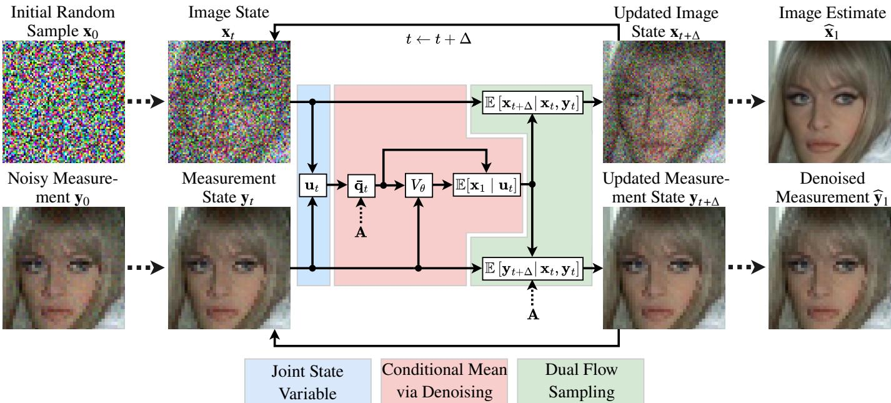
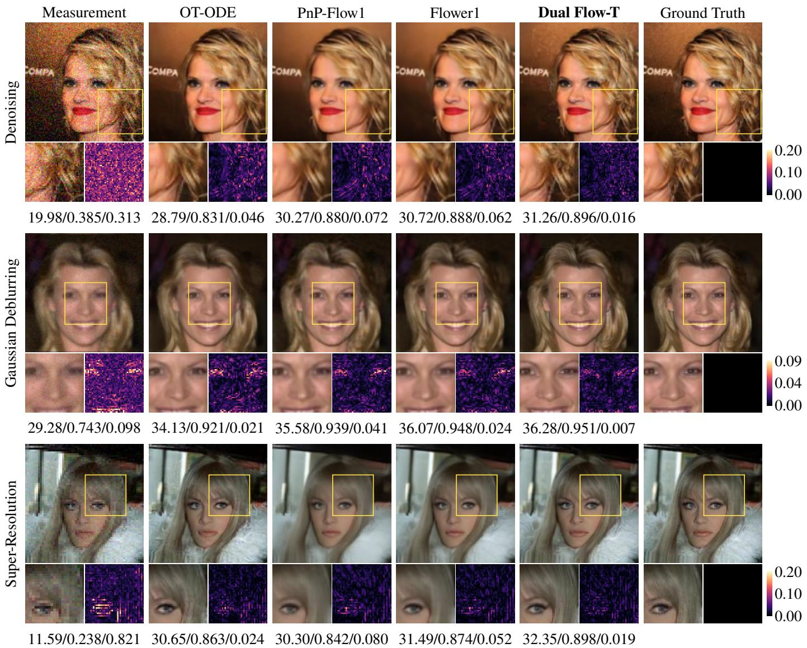
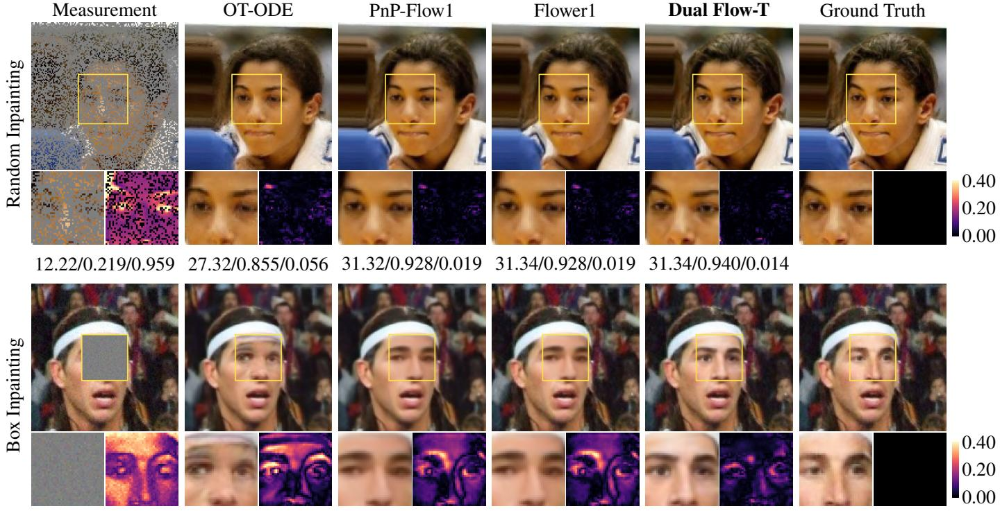
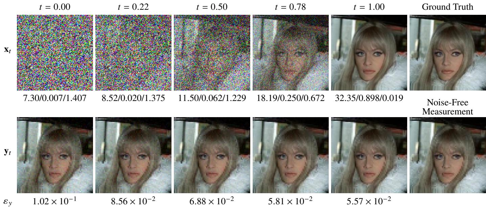
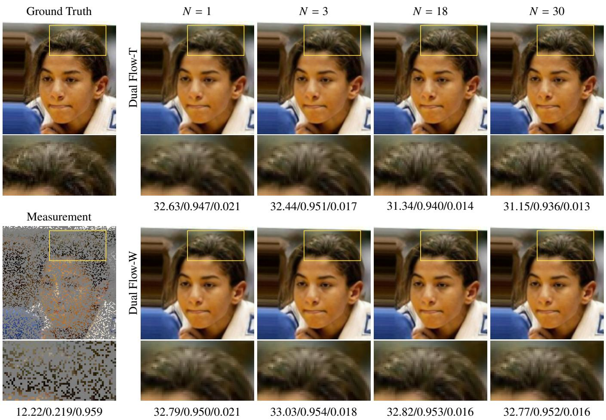
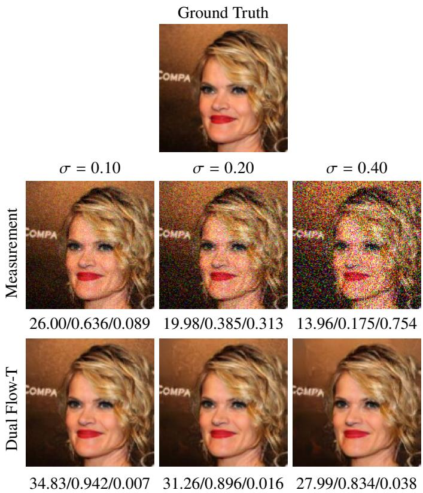
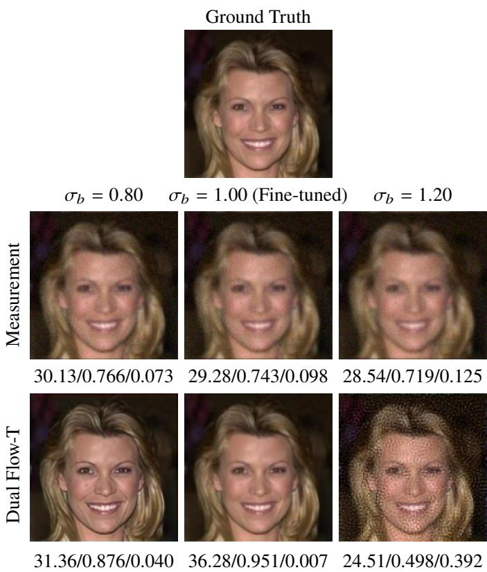
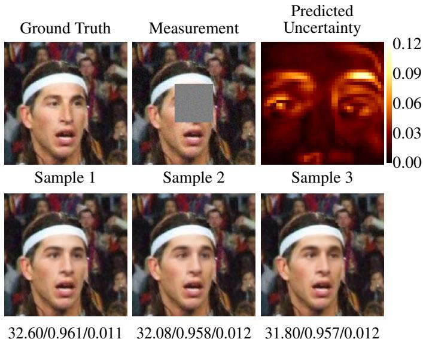

# Dual Flow: Joint Image–Measurement Flow forI<sub>nverse</sub> P<sub>ro</sub>bl<sub>ems</sub>

Sevket Ege Yesilyurt and Figen S. Oktem , Member, IEEE

Abstract—Existing generative model-based approaches to linear inverse problems typically use the acquired noisy measurement to condition or guide sampling in the image domain. In this work, we introduce Dual Flow, a novel joint flow model for solving linear inverse problems by jointly estimating the clean image and its corresponding noise-free measurement from the observation. Specifically, Dual Flow formulates image reconstruction and measurement denoising as a coupled estimation problem, using coupled flows in the image and measurement domains. The acquired noisy measurement ${ \bf y } _ { 0 }$ is used only to initialize the measurement state; thereafter, the image and measurement states are jointly updated based on their current values. By construction, the final image and measurement estimates are guaranteed to satisfy the underlying forward model. We derive the sampling updates for the joint flow and show that they are governed by the conditional mean of the clean image given the current joint state. We further derive a closed-form expression for a suficient statistic of the joint state and show that the required conditional mean can be obtained by solving an image-domain Gaussian denoising problem involving operator-dependent, correlated noise. We train a velocity-prediction network using this formulation to estimate the conditional mean from the derived suficient statistic. Dual Flow requires no hyperparameter tuning beyond selecting the number of inference steps and achieves substantially shorter reconstruction times than competing methods. Extensive experiments across various linear inverse problems and image datasets demonstrate stateof-the-art performance in both distortion metrics and perceptual quality. Additional analyses assess robustness to model mismatch, as well as the ability to generate diverse plausible reconstructions and characterize reconstruction uncertainty. Overall, by jointly addressing image reconstruction and measurement denoising within a physically consistent framework, Dual Flow ofers an efective approach to solving linear inverse problems with improved reconstruction quality and computational eficiency. Our code is available at https://github.com/METU-SPACE-Lab/Dual-Flow.

Index Terms—Inverse problems, flow matching, difusion models.

## I<sub>.</sub> I<sub>ntroduction</sub>

NVERSE <sub>pro</sub>bl<sub>ems</sub> <sub>p</sub>l<sub>ay</sub> <sub>a</sub> f<sub>un</sub>d<sub>amen</sub>t<sub>a</sub>l <sub>ro</sub>l<sub>e</sub> i<sub>n</sub> <sub>mo</sub>d<sub>ern</sub> i<sub>mag</sub>i<sub>ng</sub> <sub>an</sub>d <sub>sens</sub>i<sub>ng,</sub> <sub>un</sub>d<sub>erp</sub>i<sub>nn</sub>i<sub>ng</sub> <sub>app</sub>li<sub>ca</sub>ti<sub>ons</sub> <sub>suc</sub>h <sub>as</sub> medical ima<sub>g</sub>in<sub>g</sub> [1], com<sub>p</sub>utational microsco<sub>py</sub> [2], remote sensin<sub>g</sub> [3], as well as ima<sub>g</sub>e restoration tasks such as su<sub>p</sub>erresolution, deblurrin<sub>g</sub>, and in<sub>p</sub>aintin<sub>g</sub> [4]. In the context of linear inverse problems, the objective is to recover an unknown signal or <sup>i</sup>ma<sub>g</sub>e $\mathbf { x } _ { 1 } \in \mathbb { R } ^ { n }$ f<sub>rom no</sub>i<sub>sy measuremen</sub>t<sub>s</sub> $\mathbf { y } _ { 0 } \in \mathbb { R } ^ { m }$ <sub>,</sub> <sub>w</sub>hi<sub>c</sub>h <sub>are o</sub>ft<sub>en mo</sub>d<sub>e</sub>l<sub>e</sub>d <sub>as</sub>

$$
\mathbf { y } _ { 0 } = \mathbf { A } \mathbf { x } _ { 1 } + \mathbf { n } .\tag{1}
$$

H<sub>ere</sub> th<sub>e ma</sub>t<sub>r</sub>i<sub>x</sub> $\textbf { A } \in \mathbb { R } ^ { m \times n }$ <sub>represen</sub>t<sub>s</sub> th<sub>e</sub> k<sub>nown</sub> f<sub>orwar</sub>d (s<sub>y</sub>stem) o<sub>p</sub>erator, the noise vector $\mathbf { n } \sim { \mathcal { N } } ( \mathbf { 0 } , \sigma ^ { 2 } \mathbf { I } )$ <sup>re</sup>p<sup>resents</sup> <sub>a</sub>dditi<sub>ve w</sub>hit<sub>e</sub> G<sub>auss</sub>i<sub>an no</sub>i<sub>se, an</sub>d th<sub>e sca</sub>l<sub>ar</sub> $\sigma$ d<sub>eno</sub>t<sub>es</sub> th<sub>e</sub> <sub>s</sub>t<sub>an</sub>d<sub>ar</sub>d d<sub>ev</sub>i<sub>a</sub>ti<sub>on</sub> <sub>o</sub>f <sub>eac</sub>h <sub>no</sub>i<sub>se</sub> <sub>componen</sub>t<sub>.</sub>

Recovering the image x<sub>1</sub> from the measurement $\mathbf { y } _ { 0 }$ i<sub>s o</sub>ft<sub>en</sub> <sub>c</sub>h<sub>a</sub>ll<sub>eng</sub>i<sub>ng,</sub> <sub>as</sub> th<sub>e</sub> <sub>un</sub>d<sub>er</sub>l<sub>y</sub>i<sub>ng</sub> <sub>sys</sub>t<sub>em</sub> <sub>o</sub>f li<sub>near</sub> <sub>equa</sub>ti<sub>ons</sub> <sub>may</sub> b<sub>e</sub> <sub>un</sub>d<sub>er</sub>d<sub>e</sub>t<sub>erm</sub>i<sub>ne</sub>d <sub>or</sub> ill<sub>-con</sub>diti<sub>one</sub>d<sub>,</sub> l<sub>ea</sub>di<sub>ng</sub> t<sub>o</sub> <sub>non-un</sub>i<sub>que</sub> <sub>so</sub>l<sub>u</sub>ti<sub>ons or sens</sub>iti<sub>v</sub>it<sub>y</sub> t<sub>o measuremen</sub>t <sub>no</sub>i<sub>se.</sub> T<sub>o a</sub>dd<sub>ress</sub> th<sub>ese</sub> <sub>c</sub>h<sub>a</sub>ll<sub>enges,</sub> <sub>recons</sub>t<sub>ruc</sub>ti<sub>on</sub> <sub>me</sub>th<sub>o</sub>d<sub>s</sub> t<sub>yp</sub>i<sub>ca</sub>ll<sub>y</sub> i<sub>ncorpora</sub>t<sub>e</sub> <sub>pr</sub>i<sub>or</sub> i<sub>n</sub>f<sub>orma</sub>ti<sub>on</sub> <sub>a</sub>b<sub>ou</sub>t th<sub>e</sub> <sub>un</sub>k<sub>nown</sub> i<sub>mage</sub> t<sub>o</sub> <sub>cons</sub>t<sub>ra</sub>i<sub>n</sub> th<sub>e</sub> <sub>so</sub>l<sub>u</sub>ti<sub>on</sub> <sub>space</sub> <sub>an</sub>d <sub>o</sub>bt<sub>a</sub>i<sub>n</sub> <sub>re</sub>li<sub>a</sub>bl<sub>e</sub> <sub>recons</sub>t<sub>ruc</sub>ti<sub>ons.</sub> Thi<sub>s</sub> <sub>pr</sub>i<sub>or</sub> i<sub>n</sub>f<sub>orma</sub>ti<sub>on</sub> <sub>can</sub> b<sub>e c</sub>h<sub>arac</sub>t<sub>er</sub>i<sub>ze</sub>d b<sub>y</sub> th<sub>e pr</sub>i<sub>or</sub> di<sub>s</sub>t<sub>r</sub>ib<sub>u</sub>ti<sub>on</sub> $p ( \mathbf { x } _ { 1 } )$ <sub>o</sub>f th<sub>e</sub> i<sub>mage,</sub> <sub>w</sub>hi<sub>c</sub>h i<sub>s genera</sub>ll<sub>y un</sub>k<sub>nown</sub> i<sub>n prac</sub>ti<sub>ce.</sub>

A <sub>c</sub>l<sub>ass</sub>i<sub>ca</sub>l <sub>approac</sub>h t<sub>o</sub> i<sub>ncorpora</sub>ti<sub>ng</sub> <sub>pr</sub>i<sub>or</sub> i<sub>n</sub>f<sub>orma</sub>ti<sub>on</sub> i<sub>s</sub> th<sub>roug</sub>h <sub>regu</sub>l<sub>ar</sub>i<sub>za</sub>ti<sub>on-</sub>b<sub>ase</sub>d <sub>recons</sub>t<sub>ruc</sub>ti<sub>on.</sub> F<sub>rom</sub> <sub>a</sub> B<sub>ayes</sub>i<sub>an</sub> <sub>p</sub>ers<sub>p</sub>ective, maximum <sub>p</sub>osterior (MAP) estimation under the observation model in Eq. (1) leads to an o<sub>p</sub>timization <sub>p</sub>roblem th<sub>a</sub>t i<sub>nvo</sub>l<sub>ves a</sub> d<sub>a</sub>t<sub>a-</sub>fid<sub>e</sub>lit<sub>y</sub> t<sub>erm an</sub>d <sub>a regu</sub>l<sub>ar</sub>i<sub>za</sub>ti<sub>on</sub> t<sub>erm</sub> <sub>correspon</sub>di<sub>ng</sub> t<sub>o</sub> th<sub>e nega</sub>ti<sub>ve</sub> l<sub>og-pr</sub>i<sub>or</sub> $( \mathrm { i . e . , ~ } - \log p ( \mathbf { x } _ { 1 } ) )$ T<sub>ra</sub>diti<sub>ona</sub>l <sub>regu</sub>l<sub>ar</sub>i<sub>za</sub>ti<sub>on c</sub>h<sub>o</sub>i<sub>ces, suc</sub>h <sub>as</sub> t<sub>o</sub>t<sub>a</sub>l <sub>var</sub>i<sub>a</sub>ti<sub>on an</sub>d <sub>spars</sub>it<sub>y-</sub>b<sub>ase</sub>d <sub>regu</sub>l<sub>ar</sub>i<sub>za</sub>ti<sub>on,</sub> t<sub>yp</sub>i<sub>ca</sub>ll<sub>y</sub> <sub>promo</sub>t<sub>e</sub> <sub>smoo</sub>th<sub>ness</sub> <sub>or</sub> s<sub>p</sub>arsit<sub>y</sub> of the unknown ima<sub>g</sub>e [5]–[7]. While the resultin<sub>g</sub> o<sub>p</sub>ti-<sub>m</sub>i<sub>za</sub>ti<sub>on pro</sub>bl<sub>ems can o</sub>ft<sub>en</sub> b<sub>e e</sub>fi<sub>c</sub>i<sub>en</sub>tl<sub>y so</sub>l<sub>ve</sub>d <sub>us</sub>i<sub>ng prox</sub>i<sub>ma</sub>l s<sub>p</sub>littin<sub>g</sub> methods [8], [9], their reconstruction <sub>p</sub>erformance is <sub>o</sub>ft<sub>en</sub> li<sub>m</sub>it<sub>e</sub>d b<sub>y</sub> th<sub>e</sub> i<sub>na</sub>bilit<sub>y</sub> <sub>o</sub>f h<sub>an</sub>d<sub>-cra</sub>ft<sub>e</sub>d <sub>regu</sub>l<sub>ar</sub>i<sub>zers</sub> t<sub>o</sub> <sub>a</sub>d<sub>equa</sub>t<sub>e</sub>l<sub>y</sub> <sub>cap</sub>t<sub>ure</sub> <sub>comp</sub>l<sub>ex</sub> i<sub>mage</sub> <sub>s</sub>t<sub>a</sub>ti<sub>s</sub>ti<sub>cs.</sub>

T<sub>o</sub> <sub>overcome</sub> th<sub>e</sub> li<sub>m</sub>it<sub>a</sub>ti<sub>ons</sub> <sub>o</sub>f h<sub>an</sub>d<sub>-cra</sub>ft<sub>e</sub>d <sub>regu</sub>l<sub>ar</sub>i<sub>zers,</sub> d<sub>eep</sub> l<sub>earn</sub>i<sub>ng</sub> h<sub>as emerge</sub>d <sub>as a power</sub>f<sub>u</sub>l t<sub>oo</sub>l f<sub>or</sub> d<sub>eve</sub>l<sub>op</sub>i<sub>ng</sub> d<sub>a</sub>t<sub>a-</sub> driven ima<sub>g</sub>e reconstruction methods. In <sub>p</sub>lu<sub>g</sub>-and-<sub>p</sub>la<sub>y</sub> (PnP) <sub>me</sub>th<sub>o</sub>d<sub>s,</sub> th<sub>e prox</sub>i<sub>ma</sub>l <sub>opera</sub>t<sub>or, w</sub>hi<sub>c</sub>h <sub>can</sub> b<sub>e</sub> i<sub>n</sub>t<sub>erpre</sub>t<sub>e</sub>d <sub>as</sub> <sub>a</sub> MAP d<sub>eno</sub>i<sub>ser un</sub>d<sub>er an assume</sub>d i<sub>mage pr</sub>i<sub>or,</sub> i<sub>s rep</sub>l<sub>ace</sub>d b<sub>y a</sub> l<sub>earne</sub>d d<sub>eno</sub>i<sub>ser,</sub> t<sub>yp</sub>i<sub>ca</sub>ll<sub>y</sub> t<sub>ra</sub>i<sub>ne</sub>d t<sub>o m</sub>i<sub>n</sub>i<sub>m</sub>i<sub>ze</sub> th<sub>e mean</sub> s<sub>q</sub>uared error (MSE) [10]–[12]. Unrolled methods, on the other h<sub>an</sub>d<sub>, conver</sub>t <sub>a</sub> fi<sub>xe</sub>d <sub>num</sub>b<sub>er o</sub>f it<sub>era</sub>ti<sub>ons o</sub>f <sub>a mo</sub>d<sub>e</sub>l<sub>-</sub>b<sub>ase</sub>d <sub>recons</sub>t<sub>ruc</sub>ti<sub>on</sub> <sub>a</sub>l<sub>gor</sub>ith<sub>m</sub> i<sub>n</sub>t<sub>o</sub> <sub>a</sub> t<sub>ra</sub>i<sub>na</sub>bl<sub>e</sub> <sub>ne</sub>t<sub>wor</sub>k<sub>,</sub> <sub>com</sub>bi<sub>n</sub>i<sub>ng</sub> l<sub>earne</sub>d i<sub>mage</sub> <sub>up</sub>d<sub>a</sub>t<sub>es</sub> <sub>w</sub>ith <sub>exp</sub>li<sub>c</sub>it d<sub>a</sub>t<sub>a-cons</sub>i<sub>s</sub>t<sub>ency</sub> <sub>s</sub>t<sub>eps</sub> th<sub>a</sub>t i<sub>nvo</sub>l<sub>ve</sub> th<sub>e</sub> f<sub>orwar</sub>d <sub>opera</sub>t<sub>or.</sub> Th<sub>e</sub> l<sub>earne</sub>d <sub>parame</sub>t<sub>ers</sub> <sub>are</sub> t<sub>yp</sub>i<sub>ca</sub>ll<sub>y</sub> <sub>spec</sub>i<sub>a</sub>li<sub>ze</sub>d t<sub>o</sub> th<sub>e</sub> i<sub>mag</sub>i<sub>ng</sub> <sub>se</sub>tti<sub>ng</sub> <sub>use</sub>d d<sub>ur</sub>i<sub>ng</sub> trainin<sub>g</sub> [13]–[15].

D<sub>esp</sub>it<sub>e</sub> th<sub>ese a</sub>d<sub>vances, many ex</sub>i<sub>s</sub>ti<sub>ng recons</sub>t<sub>ruc</sub>ti<sub>on me</sub>th<sub>o</sub>d<sub>s</sub> <sub>a</sub>i<sub>m</sub> t<sub>o pro</sub>d<sub>uce a s</sub>i<sub>ng</sub>l<sub>e es</sub>ti<sub>ma</sub>t<sub>e o</sub>f th<sub>e un</sub>k<sub>nown</sub> i<sub>mage</sub> f<sub>rom</sub> th<sub>e g</sub>i<sub>ven measuremen</sub>t<sub>s, ra</sub>th<sub>er</sub> th<sub>an genera</sub>ti<sub>ng</sub> di<sub>verse recon-</sub> <sub>s</sub>t<sub>ruc</sub>ti<sub>ons</sub> th<sub>a</sub>t <sub>can ena</sub>bl<sub>e</sub> th<sub>e exp</sub>l<sub>ora</sub>ti<sub>on o</sub>f <sub>mu</sub>lti<sub>p</sub>l<sub>e p</sub>l<sub>aus</sub>ibl<sub>e</sub> <sub>so</sub>l<sub>u</sub>ti<sub>ons an</sub>d th<sub>e c</sub>h<sub>arac</sub>t<sub>er</sub>i<sub>za</sub>ti<sub>on o</sub>f <sub>recons</sub>t<sub>ruc</sub>ti<sub>on uncer</sub>t<sub>a</sub>i<sub>n</sub>t<sub>y,</sub> while <sub>p</sub>otentiall<sub>y</sub> im<sub>p</sub>rovin<sub>g</sub> <sub>p</sub>erce<sub>p</sub>tual <sub>q</sub>ualit<sub>y</sub> [16]–[18]. For instance, minimum mean-squared error (MMSE)-based recon-<sub>s</sub>t<sub>ruc</sub>ti<sub>on</sub> <sub>me</sub>th<sub>o</sub>d<sub>s</sub> <sub>a</sub>i<sub>m</sub> t<sub>o</sub> <sub>approx</sub>i<sub>ma</sub>t<sub>e</sub> th<sub>e</sub> <sub>pos</sub>t<sub>er</sub>i<sub>or</sub> <sub>mean,</sub> <sub>w</sub>hi<sub>c</sub>h <sub>m</sub>i<sub>n</sub>i<sub>m</sub>i<sub>zes</sub> th<sub>e expec</sub>t<sub>e</sub>d <sub>square</sub>d <sub>recons</sub>t<sub>ruc</sub>ti<sub>on error</sub> b<sub>u</sub>t <sub>may</sub> l<sub>ea</sub>d t<sub>o</sub> <sub>over</sub>l<sub>y</sub> <sub>smoo</sub>th i<sub>mages</sub> <sub>w</sub>h<sub>en</sub> th<sub>e</sub> <sub>pos</sub>t<sub>er</sub>i<sub>or</sub> di<sub>s</sub>t<sub>r</sub>ib<sub>u</sub>ti<sub>on con</sub>t<sub>a</sub>i<sub>ns mu</sub>lti<sub>p</sub>l<sub>e</sub> di<sub>s</sub>ti<sub>nc</sub>t <sub>p</sub>l<sub>aus</sub>ibl<sub>e so</sub>l<sub>u</sub>ti<sub>ons.</sub> MAP<sub>-</sub> b<sub>ase</sub>d <sub>me</sub>th<sub>o</sub>d<sub>s, on</sub> th<sub>e o</sub>th<sub>er</sub> h<sub>an</sub>d<sub>, see</sub>k t<sub>o max</sub>i<sub>m</sub>i<sub>ze</sub> th<sub>e pos</sub>t<sub>er</sub>i<sub>or</sub> di<sub>s</sub>t<sub>r</sub>ib<sub>u</sub>ti<sub>on</sub> $p ( \mathbf { x } _ { 1 } | \mathbf { y } _ { 0 } )$ <sub>, y</sub>i<sub>e</sub>ldi<sub>ng a s</sub>i<sub>ng</sub>l<sub>e recons</sub>t<sub>ruc</sub>ti<sub>on w</sub>ith<sub>ou</sub>t <sub>cap</sub>t<sub>ur</sub>i<sub>ng</sub> th<sub>e uncer</sub>t<sub>a</sub>i<sub>n</sub>t<sub>y assoc</sub>i<sub>a</sub>t<sub>e</sub>d <sub>w</sub>ith th<sub>e</sub> i<sub>nverse pro</sub>bl<sub>em.</sub>

G<sub>enera</sub>ti<sub>ve mo</sub>d<sub>e</sub>l<sub>s prov</sub>id<sub>e a power</sub>f<sub>u</sub>l f<sub>ramewor</sub>k f<sub>or</sub> l<sub>earn</sub>i<sub>ng</sub> <sub>comp</sub>l<sub>ex</sub> i<sub>mage</sub> di<sub>s</sub>t<sub>r</sub>ib<sub>u</sub>ti<sub>ons</sub> f<sub>rom</sub> d<sub>a</sub>t<sub>a</sub> <sub>an</sub>d <sub>genera</sub>ti<sub>ng</sub> di<sub>verse</sub> <sub>p</sub>l<sub>aus</sub>ibl<sub>e</sub> <sub>samp</sub>l<sub>es.</sub> I<sub>n</sub> <sub>par</sub>ti<sub>cu</sub>l<sub>ar,</sub> dif<sub>us</sub>i<sub>on</sub> <sub>mo</sub>d<sub>e</sub>l<sub>s</sub> <sub>an</sub>d fl<sub>ow</sub> <sub>ma</sub>t<sub>c</sub>hi<sub>ng</sub> h<sub>ave emerge</sub>d <sub>as e</sub>f<sub>ec</sub>ti<sub>ve approac</sub>h<sub>es</sub> f<sub>or mo</sub>d<sub>e</sub>l<sub>-</sub> in<sub>g</sub> hi<sub>g</sub>h-dimensional ima<sub>g</sub>e distributions [19]–[21]. Difusion <sub>mo</sub>d<sub>e</sub>l<sub>s genera</sub>t<sub>e new samp</sub>l<sub>es</sub> b<sub>y revers</sub>i<sub>ng a gra</sub>d<sub>ua</sub>l <sub>no</sub>i<sub>se-</sub> <sub>corrup</sub>ti<sub>on process,</sub> t<sub>yp</sub>i<sub>ca</sub>ll<sub>y us</sub>i<sub>ng</sub> l<sub>earne</sub>d <sub>score</sub> f<sub>unc</sub>ti<sub>ons.</sub> Fl<sub>ow ma</sub>t<sub>c</sub>hi<sub>ng mo</sub>d<sub>e</sub>l<sub>s, on</sub> th<sub>e o</sub>th<sub>er</sub> h<sub>an</sub>d<sub>,</sub> l<sub>earn a</sub> ti<sub>me-</sub> d<sub>epen</sub>d<sub>en</sub>t <sub>ve</sub>l<sub>oc</sub>it<sub>y</sub> fi<sub>e</sub>ld th<sub>a</sub>t t<sub>ranspor</sub>t<sub>s samp</sub>l<sub>es</sub> f<sub>rom a s</sub>i<sub>m-</sub> <sub>p</sub>l<sub>e source</sub> di<sub>s</sub>t<sub>r</sub>ib<sub>u</sub>ti<sub>on</sub> t<sub>o</sub> th<sub>e</sub> t<sub>arge</sub>t d<sub>a</sub>t<sub>a</sub> di<sub>s</sub>t<sub>r</sub>ib<sub>u</sub>ti<sub>on, o</sub>ft<sub>en</sub> <sub>us</sub>i<sub>ng</sub> <sub>s</sub>t<sub>ra</sub>i<sub>g</sub>ht<sub>-</sub>li<sub>ne</sub> i<sub>n</sub>t<sub>erpo</sub>l<sub>a</sub>ti<sub>ons</sub> b<sub>e</sub>t<sub>ween</sub> <sub>source</sub> <sub>an</sub>d t<sub>arge</sub>t sam<sub>p</sub>les durin<sub>g</sub> trainin<sub>g</sub> [21], [22]. Both a<sub>pp</sub>roaches can thus <sub>prov</sub>id<sub>e</sub> l<sub>earne</sub>d <sub>pr</sub>i<sub>ors</sub> f<sub>or</sub> i<sub>mage</sub> <sub>recons</sub>t<sub>ruc</sub>ti<sub>on.</sub> H<sub>owever,</sub> <sub>so</sub>l<sub>v</sub>i<sub>ng</sub> i<sub>nverse pro</sub>bl<sub>ems requ</sub>i<sub>res</sub> i<sub>ncorpora</sub>ti<sub>ng</sub> th<sub>e o</sub>b<sub>serve</sub>d <sub>measuremen</sub>t<sub>s</sub> i<sub>n</sub>t<sub>o</sub> th<sub>e genera</sub>ti<sub>ve process, ra</sub>th<sub>er</sub> th<sub>an so</sub>l<sub>e</sub>l<sub>y</sub> <sub>samp</sub>li<sub>ng</sub> f<sub>rom</sub> th<sub>e</sub> l<sub>earne</sub>d i<sub>mage pr</sub>i<sub>or.</sub>

A major class of approaches for inverse problems addresses this b<sub>y re</sub>l<sub>y</sub>i<sub>ng on pre</sub>t<sub>ra</sub>i<sub>ne</sub>d <sub>uncon</sub>diti<sub>ona</sub>l <sub>genera</sub>ti<sub>ve mo</sub>d<sub>e</sub>l<sub>s an</sub>d i<sub>ncorpora</sub>ti<sub>ng measuremen</sub>t i<sub>n</sub>f<sub>orma</sub>ti<sub>on on</sub>l<sub>y</sub> d<sub>ur</sub>i<sub>ng</sub> i<sub>n</sub>f<sub>erence.</sub> Whil<sub>e</sub> th<sub>ese me</sub>th<sub>o</sub>d<sub>s a</sub>ll<sub>ow pre</sub>t<sub>ra</sub>i<sub>ne</sub>d <sub>mo</sub>d<sub>e</sub>l<sub>s</sub> t<sub>o</sub> b<sub>e reuse</sub>d <sub>across</sub> dif<sub>eren</sub>t i<sub>nverse pro</sub>bl<sub>ems, accura</sub>t<sub>e</sub>l<sub>y</sub> i<sub>ncorpora</sub>ti<sub>ng</sub> <sub>measuremen</sub>t i<sub>n</sub>f<sub>orma</sub>ti<sub>on</sub> i<sub>n</sub>t<sub>o</sub> th<sub>e samp</sub>li<sub>ng process appears</sub> t<sub>o</sub> b<sub>e</sub> <sub>c</sub>h<sub>a</sub>ll<sub>eng</sub>i<sub>ng.</sub> M<sub>any</sub> <sub>ex</sub>i<sub>s</sub>ti<sub>ng</sub> <sub>me</sub>th<sub>o</sub>d<sub>s</sub> <sub>a</sub>dd<sub>ress</sub> thi<sub>s</sub> <sub>c</sub>h<sub>a</sub>ll<sub>enge</sub> th<sub>roug</sub>h <sub>approx</sub>i<sub>ma</sub>ti<sub>ons</sub> <sub>o</sub>f th<sub>e</sub> lik<sub>e</sub>lih<sub>oo</sub>d <sub>score</sub> <sub>a</sub>t i<sub>n</sub>t<sub>erme</sub>di<sub>a</sub>t<sub>e</sub> sta<sub>g</sub>es to achieve <sub>p</sub>osterior sam<sub>p</sub>lin<sub>g</sub> [4], [23], [24], data-<sub>cons</sub>i<sub>s</sub>t<sub>ency correc</sub>ti<sub>ons app</sub>li<sub>e</sub>d t<sub>o</sub> th<sub>e samp</sub>li<sub>ng process o</sub>f a <sub>p</sub>retrained unconditional model [25]–[27], or Ba<sub>y</sub>esian filt<sub>er</sub>i<sub>ng</sub> t<sub>ec</sub>h<sub>n</sub>i<sub>ques</sub> th<sub>a</sub>t <sub>emp</sub>l<sub>oy</sub> <sub>we</sub>i<sub>g</sub>ht<sub>e</sub>d <sub>par</sub>ti<sub>c</sub>l<sub>es</sub> t<sub>o</sub> <sub>approx</sub>i<sub>-</sub> mate <sub>p</sub>osterior sam<sub>p</sub>lin<sub>g</sub> [28]. Des<sub>p</sub>ite their diferences, these <sub>me</sub>th<sub>o</sub>d<sub>s</sub> f<sub>ace</sub> li<sub>m</sub>it<sub>a</sub>ti<sub>ons</sub> i<sub>n</sub> <sub>pos</sub>t<sub>er</sub>i<sub>or</sub> <sub>approx</sub>i<sub>ma</sub>ti<sub>on</sub> <sub>accuracy</sub> <sub>an</sub>d <sub>compu</sub>t<sub>a</sub>ti<sub>ona</sub>l <sub>e</sub>fi<sub>c</sub>i<sub>ency, as approx</sub>i<sub>ma</sub>t<sub>e measuremen</sub>t<sub>-</sub> <sub>con</sub>diti<sub>on</sub>i<sub>ng</sub> <sub>s</sub>t<sub>ra</sub>t<sub>eg</sub>i<sub>es</sub> <sub>can</sub> l<sub>ea</sub>d t<sub>o</sub> d<sub>ev</sub>i<sub>a</sub>ti<sub>ons</sub> f<sub>rom</sub> th<sub>e</sub> t<sub>rue</sub> <sub>p</sub>osterior [29], while Ba<sub>y</sub>esian filterin<sub>g</sub> methods can im<sub>p</sub>rove <sub>pos</sub>t<sub>er</sub>i<sub>or approx</sub>i<sub>ma</sub>ti<sub>on accuracy a</sub>t th<sub>e expense o</sub>f i<sub>ncrease</sub>d <sub>compu</sub>t<sub>a</sub>ti<sub>ona</sub>l <sub>cos</sub>t<sub>.</sub>

Whil<sub>e</sub> th<sub>e</sub> <sub>a</sub>f<sub>oremen</sub>ti<sub>one</sub>d <sub>me</sub>th<sub>o</sub>d<sub>s</sub> i<sub>ncorpora</sub>t<sub>e</sub> <sub>measuremen</sub>t i<sub>n</sub>f<sub>orma</sub>ti<sub>on on</sub>l<sub>y</sub> d<sub>ur</sub>i<sub>ng</sub> i<sub>n</sub>f<sub>erence, an a</sub>lt<sub>erna</sub>ti<sub>ve c</sub>l<sub>ass o</sub>f <sub>approac</sub>h<sub>es uses measuremen</sub>t i<sub>n</sub>f<sub>orma</sub>ti<sub>on</sub> d<sub>ur</sub>i<sub>ng</sub> t<sub>ra</sub>i<sub>n</sub>i<sub>ng.</sub> F<sub>or</sub> i<sub>ns</sub>t<sub>ance, con</sub>diti<sub>ona</sub>l dif<sub>us</sub>i<sub>on an</sub>d fl<sub>ow ma</sub>t<sub>c</sub>hi<sub>ng me</sub>th<sub>o</sub>d<sub>s</sub> t<sub>ra</sub>i<sub>n</sub> d<sub>eno</sub>i<sub>s</sub>i<sub>ng or ve</sub>l<sub>oc</sub>it<sub>y-pre</sub>di<sub>c</sub>ti<sub>on ne</sub>t<sub>wor</sub>k<sub>s us</sub>i<sub>ng</sub> th<sub>e ac-</sub> quired measurements or measurement-related quantities (such as $\mathbf { A } ^ { \top } \mathbf { y } _ { 0 } )$ as conditionin<sub>g</sub> in<sub>p</sub>uts [30]–[32]. Once trained, these <sub>me</sub>th<sub>o</sub>d<sub>s can genera</sub>t<sub>e measuremen</sub>t<sub>-con</sub>diti<sub>one</sub>d <sub>recons</sub>t<sub>ruc-</sub> ti<sub>ons</sub> <sub>w</sub>ith<sub>ou</sub>t <sub>separa</sub>t<sub>e</sub> <sub>correc</sub>ti<sub>on</sub> <sub>s</sub>t<sub>eps</sub> d<sub>ur</sub>i<sub>ng</sub> i<sub>n</sub>f<sub>erence.</sub> H<sub>ow-</sub> <sub>ever, con</sub>diti<sub>on</sub>i<sub>ng on measuremen</sub>t<sub>s a</sub>l<sub>one</sub> d<sub>oes no</sub>t <sub>guaran</sub>t<sub>ee</sub> consistenc<sub>y</sub> with the underl<sub>y</sub>in<sub>g</sub> forward model (i.e. <sub>p</sub>h<sub>y</sub>sicsbased data consistenc<sub>y</sub>). Another line of work focuses on ima<sub>g</sub>e <sub>res</sub>t<sub>ora</sub>ti<sub>on</sub> b<sub>y</sub> l<sub>earn</sub>i<sub>ng</sub> d<sub>e</sub>t<sub>erm</sub>i<sub>n</sub>i<sub>s</sub>ti<sub>c or s</sub>t<sub>oc</sub>h<sub>as</sub>ti<sub>c processes</sub> th<sub>a</sub>t <sub>progress</sub>i<sub>ve</sub>l<sub>y</sub> t<sub>rans</sub>f<sub>orm</sub> d<sub>egra</sub>d<sub>e</sub>d <sub>o</sub>b<sub>serva</sub>ti<sub>ons</sub> i<sub>n</sub>t<sub>o c</sub>l<sub>ean</sub> ima<sub>g</sub>es [33]–[36]. More recentl<sub>y</sub>, <sub>p</sub>osterior-score estimation has b<sub>een re</sub>f<sub>ormu</sub>l<sub>a</sub>t<sub>e</sub>d <sub>as a</sub> d<sub>eno</sub>i<sub>s</sub>i<sub>ng pro</sub>bl<sub>em</sub> i<sub>nvo</sub>l<sub>v</sub>i<sub>ng opera</sub>t<sub>or-</sub> d<sub>epen</sub>d<sub>en</sub>t<sub>,</sub> <sub>corre</sub>l<sub>a</sub>t<sub>e</sub>d G<sub>auss</sub>i<sub>an</sub> <sub>no</sub>i<sub>se,</sub> <sub>ena</sub>bli<sub>ng</sub> <sub>a</sub> l<sub>earne</sub>d d<sub>e-</sub> <sub>no</sub>i<sub>ser</sub> t<sub>o es</sub>ti<sub>ma</sub>t<sub>e</sub> th<sub>e pos</sub>t<sub>er</sub>i<sub>or score</sub> di<sub>rec</sub>tl<sub>y an</sub>d <sub>per</sub>f<sub>orm</sub> <sub>pos</sub>t<sub>er</sub>i<sub>or</sub> <sub>samp</sub>li<sub>ng</sub> <sub>w</sub>ith<sub>ou</sub>t <sub>approx</sub>i<sub>ma</sub>ti<sub>ons</sub> <sub>an</sub>d <sub>separa</sub>t<sub>e</sub> d<sub>a</sub>t<sub>a-</sub> consistenc<sub>y</sub> correction ste<sub>p</sub>s [37].

E<sub>x</sub>i<sub>s</sub>ti<sub>ng</sub> <sub>genera</sub>ti<sub>ve</sub> <sub>mo</sub>d<sub>e</sub>l<sub>-</sub>b<sub>ase</sub>d <sub>approac</sub>h<sub>es</sub> t<sub>o</sub> i<sub>nverse</sub> <sub>pro</sub>b<sub>-</sub> l<sub>ems</sub> t<sub>yp</sub>i<sub>ca</sub>ll<sub>y use</sub> th<sub>e acqu</sub>i<sub>re</sub>d <sub>measuremen</sub>t $\mathbf { y } _ { 0 }$ t<sub>o con</sub>diti<sub>on</sub> <sub>or gu</sub>id<sub>e</sub> th<sub>e samp</sub>li<sub>ng process</sub> i<sub>n</sub> th<sub>e</sub> i<sub>mage</sub> d<sub>oma</sub>i<sub>n, ra</sub>th<sub>er</sub> th<sub>an</sub> jointly modeling the image and the corresponding measurement. In this work, we introduce Dual Flow, a novel joint flow model <sub>over</sub> th<sub>e</sub> i<sub>mage an</sub>d <sub>measuremen</sub>t d<sub>oma</sub>i<sub>ns</sub> f<sub>or so</sub>l<sub>v</sub>i<sub>ng</sub> li<sub>near</sub> inverse problems, which enables the joint estimation of the <sub>un</sub>k<sub>nown</sub> i<sub>mage</sub> <sub>an</sub>d th<sub>e</sub> <sub>correspon</sub>di<sub>ng</sub> <sub>no</sub>i<sub>se-</sub>f<sub>ree</sub> <sub>measuremen</sub>t<sub>.</sub> S<sub>p</sub>ecificall<sub>y</sub>, under the forward model in Eq. (1), we define a joint image–measurement interpolation in which both the image <sub>an</sub>d <sub>measuremen</sub>t <sub>s</sub>t<sub>a</sub>t<sub>es</sub> <sub>are</sub> d<sub>e</sub>fi<sub>ne</sub>d th<sub>roug</sub>h <sub>coup</sub>l<sub>e</sub>d <sub>s</sub>t<sub>ra</sub>i<sub>g</sub>ht<sub>-</sub> li<sub>ne</sub> i<sub>n</sub>t<sub>erpo</sub>l<sub>a</sub>ti<sub>ons.</sub> I<sub>n par</sub>ti<sub>cu</sub>l<sub>ar,</sub> th<sub>e</sub> i<sub>mage s</sub>t<sub>a</sub>t<sub>e</sub> i<sub>s</sub> i<sub>n</sub>t<sub>erpo</sub>l<sub>a</sub>t<sub>e</sub>d b<sub>e</sub>t<sub>ween an</sub> i<sub>n</sub>iti<sub>a</sub>l <sub>ran</sub>d<sub>om samp</sub>l<sub>e an</sub>d th<sub>e c</sub>l<sub>ean</sub> i<sub>mage</sub> $\mathbf { X } _ { 1 } ,$ <sub>, w</sub>hil<sub>e</sub> th<sub>e</sub> <sub>measuremen</sub>t <sub>s</sub>t<sub>a</sub>t<sub>e</sub> i<sub>s</sub> i<sub>n</sub>t<sub>erpo</sub>l<sub>a</sub>t<sub>e</sub>d b<sub>e</sub>t<sub>ween</sub> th<sub>e</sub> <sub>acqu</sub>i<sub>re</sub>d <sub>no</sub>i<sub>sy</sub> measurement $\mathbf { y } _ { 0 }$ <sub>an</sub>d th<sub>e no</sub>i<sub>se-</sub>f<sub>ree measuremen</sub>t $\mathbf { A x } _ { 1 }$ <sub>o</sub>fth<sub>e</sub> fi<sub>na</sub>l clean image. Thus, the two coupled flows evolve jointly, with the i<sub>mage-</sub>d<sub>oma</sub>i<sub>n</sub> fl<sub>ow mapp</sub>i<sub>ng</sub> th<sub>e</sub> i<sub>n</sub>iti<sub>a</sub>l <sub>no</sub>i<sub>se process</sub> t<sub>o a c</sub>l<sub>ean</sub> i<sub>mage es</sub>ti<sub>ma</sub>t<sub>e an</sub>d th<sub>e measuremen</sub>t<sub>-</sub>d<sub>oma</sub>i<sub>n</sub> fl<sub>ow</sub> d<sub>eno</sub>i<sub>s</sub>i<sub>ng</sub> th<sub>e</sub> <sub>acqu</sub>i<sub>re</sub>d <sub>measuremen</sub>t<sub>.</sub> Th<sub>ese coup</sub>l<sub>e</sub>d i<sub>n</sub>t<sub>erpo</sub>l<sub>a</sub>ti<sub>ons prov</sub>id<sub>e</sub> the basis for learning joint flow dynamics in the image and <sub>measuremen</sub>t d<sub>oma</sub>i<sub>ns.</sub>

I<sub>n our</sub> d<sub>eve</sub>l<sub>opmen</sub>t<sub>, we com</sub>bi<sub>ne</sub> th<sub>e</sub> i<sub>mage an</sub>d <sub>measuremen</sub>t states into a single variable, referred to as the joint state, and derive the sampling updates of this joint state for the reverse <sub>samp</sub>li<sub>ng proce</sub>d<sub>ure o</sub>f D<sub>ua</sub>l Fl<sub>ow.</sub> W<sub>e s</sub>h<sub>ow</sub> th<sub>a</sub>t th<sub>ese up</sub>d<sub>a</sub>t<sub>es</sub> <sub>are governe</sub>d b<sub>y</sub> th<sub>e con</sub>diti<sub>ona</sub>l <sub>mean o</sub>f th<sub>e c</sub>l<sub>ean</sub> i<sub>mage</sub> $\mathbf { X } _ { 1 }$ given the current joint state. To this end, we derive a closedform suficient statistic of the current joint state and show th<sub>a</sub>t <sub>es</sub>ti<sub>ma</sub>ti<sub>ng</sub> thi<sub>s</sub> <sub>con</sub>diti<sub>ona</sub>l <sub>mean</sub> <sub>can</sub> b<sub>e</sub> f<sub>ormu</sub>l<sub>a</sub>t<sub>e</sub>d <sub>as</sub> <sub>a</sub> d<sub>eno</sub>i<sub>s</sub>i<sub>ng pro</sub>bl<sub>em</sub> i<sub>n w</sub>hi<sub>c</sub>h th<sub>e c</sub>l<sub>ean</sub> i<sub>mage</sub> $\mathbf { X } _ { 1 }$ i<sub>s corrup</sub>t<sub>e</sub>d b<sub>y opera</sub>t<sub>or-</sub>d<sub>epen</sub>d<sub>en</sub>t <sub>corre</sub>l<sub>a</sub>t<sub>e</sub>d G<sub>auss</sub>i<sub>an no</sub>i<sub>se.</sub> Th<sub>e</sub> d<sub>er</sub>i<sub>ve</sub>d <sub>su</sub>fi<sub>c</sub>i<sub>en</sub>t <sub>s</sub>t<sub>a</sub>ti<sub>s</sub>ti<sub>c serves as</sub> th<sub>e</sub> i<sub>npu</sub>t t<sub>o a ve</sub>l<sub>oc</sub>it<sub>y-pre</sub>di<sub>c</sub>ti<sub>on</sub> <sub>ne</sub>t<sub>wor</sub>k<sub>, w</sub>hi<sub>c</sub>h i<sub>s</sub> t<sub>ra</sub>i<sub>ne</sub>d t<sub>o o</sub>bt<sub>a</sub>i<sub>n</sub> th<sub>e con</sub>diti<sub>ona</sub>l <sub>mean</sub> required for the joint-state sampling updates.

W<sub>e con</sub>d<sub>uc</sub>t <sub>compre</sub>h<sub>ens</sub>i<sub>ve exper</sub>i<sub>men</sub>t<sub>s across</sub> dif<sub>eren</sub>t li<sub>n-</sub> <sub>ear</sub> i<sub>nverse pro</sub>bl<sub>ems an</sub>d i<sub>mage</sub> d<sub>a</sub>t<sub>ase</sub>t<sub>s, an</sub>d <sub>compare</sub> th<sub>e</sub> <sub>recons</sub>t<sub>ruc</sub>ti<sub>on</sub> <sub>qua</sub>lit<sub>y,</sub> <sub>percep</sub>t<sub>ua</sub>l <sub>qua</sub>lit<sub>y,</sub> <sub>an</sub>d <sub>compu</sub>t<sub>a</sub>ti<sub>ona</sub>l <sub>e</sub>fi<sub>c</sub>i<sub>ency o</sub>f D<sub>ua</sub>l Fl<sub>ow aga</sub>i<sub>ns</sub>t <sub>recen</sub>t <sub>approac</sub>h<sub>es.</sub> W<sub>e a</sub>l<sub>so per-</sub> f<sub>orm a</sub>dditi<sub>ona</sub>l <sub>ana</sub>l<sub>yses</sub> t<sub>o</sub> i<sub>nves</sub>ti<sub>ga</sub>t<sub>e</sub> th<sub>e e</sub>f<sub>ec</sub>t <sub>o</sub>f th<sub>e num</sub>b<sub>er</sub> <sub>o</sub>f i<sub>n</sub>f<sub>erence s</sub>t<sub>eps, ro</sub>b<sub>us</sub>t<sub>ness</sub> t<sub>o vary</sub>i<sub>ng</sub> d<sub>egra</sub>d<sub>a</sub>ti<sub>on</sub> l<sub>eve</sub>l<sub>s an</sub>d <sub>mo</sub>d<sub>e</sub>l <sub>m</sub>i<sub>sma</sub>t<sub>c</sub>h<sub>, an</sub>d th<sub>e a</sub>bilit<sub>y</sub> t<sub>o genera</sub>t<sub>e mu</sub>lti<sub>p</sub>l<sub>e p</sub>l<sub>aus</sub>ibl<sub>e</sub> <sub>recons</sub>t<sub>ruc</sub>ti<sub>ons an</sub>d <sub>c</sub>h<sub>arac</sub>t<sub>er</sub>i<sub>ze recons</sub>t<sub>ruc</sub>ti<sub>on uncer</sub>t<sub>a</sub>i<sub>n</sub>t<sub>y.</sub> N<sub>umer</sub>i<sub>ca</sub>l <sub>resu</sub>lt<sub>s</sub> d<sub>emons</sub>t<sub>ra</sub>t<sub>e</sub> th<sub>a</sub>t D<sub>ua</sub>l Fl<sub>ow ac</sub>hi<sub>eves s</sub>t<sub>a</sub>t<sub>e-</sub> <sub>o</sub>f<sub>-</sub>th<sub>e-ar</sub>t <sub>per</sub>f<sub>ormance, ou</sub>t<sub>per</sub>f<sub>orm</sub>i<sub>ng compe</sub>ti<sub>ng me</sub>th<sub>o</sub>d<sub>s</sub> i<sub>n</sub> t<sub>erms o</sub>f b<sub>o</sub>th di<sub>s</sub>t<sub>or</sub>ti<sub>on me</sub>t<sub>r</sub>i<sub>cs an</sub>d <sub>percep</sub>t<sub>ua</sub>l <sub>qua</sub>lit<sub>y, w</sub>hil<sub>e</sub> <sub>requ</sub>i<sub>r</sub>i<sub>ng su</sub>b<sub>s</sub>t<sub>an</sub>ti<sub>a</sub>ll<sub>y</sub> l<sub>ess recons</sub>t<sub>ruc</sub>ti<sub>on</sub> ti<sub>me an</sub>d <sub>no a</sub>dditi<sub>ona</sub>l h<sub>yperparame</sub>t<sub>ers</sub> b<sub>eyon</sub>d th<sub>e num</sub>b<sub>er o</sub>f i<sub>n</sub>f<sub>erence s</sub>t<sub>eps.</sub> Vi<sub>sua</sub>l <sub>compar</sub>i<sub>sons</sub> f<sub>ur</sub>th<sub>er</sub> <sub>sugges</sub>t th<sub>a</sub>t D<sub>ua</sub>l Fl<sub>ow</sub> b<sub>e</sub>tt<sub>er</sub> <sub>avo</sub>id<sub>s</sub> <sub>over-</sub> <sub>smoo</sub>thi<sub>ng</sub> <sub>an</sub>d <sub>ar</sub>tif<sub>ac</sub>t<sub>s</sub> <sub>w</sub>hil<sub>e</sub> <sub>preserv</sub>i<sub>ng</sub> fi<sub>ne</sub> t<sub>ex</sub>t<sub>ures</sub> <sub>an</sub>d <sub>s</sub>h<sub>arp</sub> d<sub>e</sub>t<sub>a</sub>il<sub>s.</sub> O<sub>vera</sub>ll<sub>,</sub> th<sub>ese resu</sub>lt<sub>s</sub> d<sub>emons</sub>t<sub>ra</sub>t<sub>e</sub> th<sub>a</sub>t D<sub>ua</sub>l Fl<sub>ow</sub> <sub>ac</sub>hi<sub>eves</sub> <sub>su</sub>b<sub>s</sub>t<sub>an</sub>ti<sub>a</sub>l i<sub>mprovemen</sub>t<sub>s</sub> i<sub>n</sub> <sub>percep</sub>t<sub>ua</sub>l <sub>qua</sub>lit<sub>y</sub> <sub>w</sub>ith<sub>ou</sub>t <sub>sacr</sub>ifi<sub>c</sub>i<sub>ng</sub> di<sub>s</sub>t<sub>or</sub>ti<sub>on per</sub>f<sub>ormance, y</sub>i<sub>e</sub>ldi<sub>ng a more</sub> f<sub>avora</sub>bl<sub>e</sub> <sub>percep</sub>ti<sub>on–</sub>di<sub>s</sub>t<sub>or</sub>ti<sub>on</sub> t<sub>ra</sub>d<sub>e-o</sub>f th<sub>an compe</sub>ti<sub>ng me</sub>th<sub>o</sub>d<sub>s.</sub>

U<sub>n</sub>lik<sub>e</sub> <sub>ex</sub>i<sub>s</sub>ti<sub>ng</sub> <sub>approac</sub>h<sub>es</sub> th<sub>a</sub>t <sub>use</sub> th<sub>e</sub> <sub>acqu</sub>i<sub>re</sub>d <sub>no</sub>i<sub>sy</sub> <sub>measure-</sub> ment y<sub>0</sub> to guide the reconstruction of the unknown image, Dual Flow formulates linear inverse problems as a joint estimation <sub>pro</sub>bl<sub>em</sub> i<sub>nvo</sub>l<sub>v</sub>i<sub>ng</sub> t<sub>wo coup</sub>l<sub>e</sub>d <sub>quan</sub>titi<sub>es:</sub> th<sub>e c</sub>l<sub>ean</sub> i<sub>mage an</sub>d its corresponding noise-free measurement. Specifically, it jointly <sub>a</sub>dd<sub>resses</sub> i<sub>mage</sub> <sub>recons</sub>t<sub>ruc</sub>ti<sub>on</sub> <sub>an</sub>d <sub>measuremen</sub>t d<sub>eno</sub>i<sub>s</sub>i<sub>ng</sub> <sub>w</sub>ithi<sub>n a s</sub>i<sub>ng</sub>l<sub>e reverse samp</sub>li<sub>ng proce</sub>d<sub>ure, w</sub>hil<sub>e ensur</sub>i<sub>ng</sub> th<sub>a</sub>t th<sub>e</sub> t<sub>wo es</sub>ti<sub>ma</sub>t<sub>es are re</sub>l<sub>a</sub>t<sub>e</sub>d th<sub>roug</sub>h th<sub>e</sub> f<sub>orwar</sub>d <sub>opera</sub>t<sub>or.</sub> Rather than repeatedly using the fixed noisy measurement y<sub>0</sub> to <sub>gu</sub>id<sub>e</sub> th<sub>e</sub> <sub>samp</sub>li<sub>ng</sub> <sub>process,</sub> D<sub>ua</sub>l Fl<sub>ow</sub> <sub>uses</sub> it <sub>on</sub>l<sub>y</sub> t<sub>o</sub> i<sub>n</sub>iti<sub>a</sub>li<sub>ze</sub> th<sub>e measuremen</sub>t <sub>s</sub>t<sub>a</sub>t<sub>e, w</sub>ith <sub>su</sub>b<sub>sequen</sub>t <sub>up</sub>d<sub>a</sub>t<sub>es re</sub>l<sub>y</sub>i<sub>ng on</sub> th<sub>e</sub> evolving joint state. To enable this joint sampling procedure, <sub>we</sub> d<sub>er</sub>i<sub>ve a c</sub>l<sub>ose</sub>d<sub>-</sub>f<sub>orm express</sub>i<sub>on</sub> f<sub>or a su</sub>fi<sub>c</sub>i<sub>en</sub>t <sub>s</sub>t<sub>a</sub>ti<sub>s</sub>ti<sub>c</sub> of the current joint state, which serves as the input to the <sub>ve</sub>l<sub>oc</sub>it<sub>y-pre</sub>di<sub>c</sub>ti<sub>on ne</sub>t<sub>wor</sub>k f<sub>or es</sub>ti<sub>ma</sub>ti<sub>ng</sub> th<sub>e con</sub>diti<sub>ona</sub>l <sub>mean</sub> <sub>o</sub>f th<sub>e c</sub>l<sub>ean</sub> i<sub>mage.</sub> Thi<sub>s exac</sub>t f<sub>ormu</sub>l<sub>a</sub>ti<sub>on a</sub>ll<sub>ows</sub> th<sub>e ne</sub>t<sub>wor</sub>k t<sub>o</sub> f<sub>u</sub>ll<sub>y</sub> i<sub>ncorpora</sub>t<sub>e</sub> th<sub>e re</sub>l<sub>evan</sub>t i<sub>mage an</sub>d <sub>measuremen</sub>t i<sub>n-</sub> f<sub>orma</sub>ti<sub>on w</sub>ith<sub>ou</sub>t <sub>re</sub>l<sub>y</sub>i<sub>ng on</sub> h<sub>an</sub>d<sub>-cra</sub>ft<sub>e</sub>d <sub>measuremen</sub>t<sub>-re</sub>l<sub>a</sub>t<sub>e</sub>d <sub>quan</sub>titi<sub>es</sub> <sub>or</sub> <sub>approx</sub>i<sub>ma</sub>t<sub>e</sub> <sub>measuremen</sub>t<sub>-con</sub>diti<sub>on</sub>i<sub>ng</sub> <sub>s</sub>t<sub>ra</sub>t<sub>eg</sub>i<sub>es.</sub> F<sub>u</sub>rth<sub>e</sub>rm<sub>o</sub>r<sub>e,</sub> D<sub>ua</sub>l Fl<sub>ow</sub> r<sub>equ</sub>ir<sub>es</sub> n<sub>o</sub> h<sub>ype</sub>r<sub>pa</sub>r<sub>a</sub>m<sub>e</sub>t<sub>e</sub>r t<sub>u</sub>nin<sub>g</sub> b<sub>eyon</sub>d <sub>se</sub>l<sub>ec</sub>ti<sub>ng</sub> th<sub>e</sub> <sub>num</sub>b<sub>er</sub> <sub>o</sub>f i<sub>n</sub>f<sub>erence</sub> <sub>s</sub>t<sub>eps,</sub> <sub>w</sub>h<sub>ereas</sub> <sub>ex</sub>i<sub>s</sub>ti<sub>ng</sub> <sub>approac</sub>h<sub>es o</sub>ft<sub>en requ</sub>i<sub>re mu</sub>lti<sub>p</sub>l<sub>e</sub> h<sub>yperparame</sub>t<sub>ers</sub> t<sub>o</sub> b<sub>e</sub> t<sub>une</sub>d f<sub>or</sub> dif<sub>eren</sub>t i<sub>nverse pro</sub>bl<sub>ems.</sub>

Th<sub>e</sub> <sub>ma</sub>i<sub>n</sub> <sub>con</sub>t<sub>r</sub>ib<sub>u</sub>ti<sub>ons</sub> <sub>o</sub>f thi<sub>s</sub> <sub>paper</sub> <sub>can</sub> b<sub>e</sub> <sub>summar</sub>i<sub>ze</sub>d <sub>as</sub> f<sub>o</sub>ll<sub>ows:</sub>

• We develop Dual Flow, a novel joint flow model for linear i<sub>nverse</sub> <sub>pro</sub>bl<sub>ems</sub> th<sub>a</sub>t f<sub>ormu</sub>l<sub>a</sub>t<sub>es</sub> i<sub>mage</sub> <sub>recons</sub>t<sub>ruc</sub>ti<sub>on</sub> <sub>an</sub>d <sub>measuremen</sub>t d<sub>eno</sub>i<sub>s</sub>i<sub>ng</sub> <sub>as</sub> <sub>a</sub> <sub>coup</sub>l<sub>e</sub>d <sub>es</sub>ti<sub>ma</sub>ti<sub>on</sub> <sub>pro</sub>bl<sub>em.</sub> The proposed model jointly estimates the clean image and it<sub>s</sub> <sub>correspon</sub>di<sub>ng</sub> <sub>no</sub>i<sub>se-</sub>f<sub>ree</sub> <sub>measuremen</sub>t th<sub>roug</sub>h <sub>coup</sub>l<sub>e</sub>d <sub>s</sub>t<sub>ra</sub>i<sub>g</sub>ht<sub>-</sub>li<sub>ne</sub> i<sub>n</sub>t<sub>erpo</sub>l<sub>a</sub>ti<sub>ons</sub> i<sub>n</sub> th<sub>e</sub> i<sub>mage an</sub>d <sub>measuremen</sub>t d<sub>oma</sub>i<sub>ns, w</sub>ith th<sub>e</sub> t<sub>wo es</sub>ti<sub>ma</sub>t<sub>es</sub> di<sub>rec</sub>tl<sub>y re</sub>l<sub>a</sub>t<sub>e</sub>d b<sub>y</sub> th<sub>e</sub> <sub>un</sub>d<sub>er</sub>l<sub>y</sub>i<sub>ng</sub> f<sub>orwar</sub>d <sub>opera</sub>t<sub>or.</sub>

• We derive the sampling updates for the joint state and <sub>s</sub>h<sub>ow</sub> th<sub>a</sub>t th<sub>ey are governe</sub>d b<sub>y</sub> th<sub>e con</sub>diti<sub>ona</sub>l <sub>mean o</sub>f the clean image given the current joint state. We further derive a closed-form suficient statistic of the joint state <sub>an</sub>d <sub>s</sub>h<sub>ow</sub> th<sub>a</sub>t <sub>es</sub>ti<sub>ma</sub>ti<sub>ng</sub> thi<sub>s con</sub>diti<sub>ona</sub>l <sub>mean can</sub> b<sub>e</sub> <sub>re</sub>f<sub>ormu</sub>l<sub>a</sub>t<sub>e</sub>d <sub>as</sub> <sub>a</sub> d<sub>eno</sub>i<sub>s</sub>i<sub>ng</sub> <sub>pro</sub>bl<sub>em</sub> i<sub>nvo</sub>l<sub>v</sub>i<sub>ng</sub> <sub>opera</sub>t<sub>or-</sub> d<sub>epen</sub>d<sub>en</sub>t<sub>, corre</sub>l<sub>a</sub>t<sub>e</sub>d G<sub>auss</sub>i<sub>an no</sub>i<sub>se.</sub>

<sub>•</sub> B<sub>ase</sub>d <sub>on</sub> thi<sub>s</sub> <sub>re</sub>f<sub>ormu</sub>l<sub>a</sub>ti<sub>on,</sub> <sub>we</sub> d<sub>eve</sub>l<sub>op</sub> <sub>a</sub> <sub>ve</sub>l<sub>oc</sub>it<sub>y-</sub> <sub>pre</sub>di<sub>c</sub>ti<sub>on ne</sub>t<sub>wor</sub>k th<sub>a</sub>t t<sub>a</sub>k<sub>es</sub> th<sub>e</sub> d<sub>er</sub>i<sub>ve</sub>d <sub>su</sub>fi<sub>c</sub>i<sub>en</sub>t <sub>s</sub>t<sub>a</sub>ti<sub>s</sub>ti<sub>c</sub> as input to estimate the conditional mean required for joint <sub>s</sub>t<sub>a</sub>t<sub>e samp</sub>li<sub>ng.</sub> B<sub>y us</sub>i<sub>ng</sub> th<sub>e acqu</sub>i<sub>re</sub>d <sub>no</sub>i<sub>sy measuremen</sub>t <sub>on</sub>l<sub>y</sub> t<sub>o</sub> i<sub>n</sub>iti<sub>a</sub>li<sub>ze</sub> th<sub>e measuremen</sub>t <sub>s</sub>t<sub>a</sub>t<sub>e an</sub>d <sub>re</sub>l<sub>y</sub>i<sub>ng on</sub> the evolving joint state for subsequent updates, Dual Fl<sub>ow avo</sub>id<sub>s</sub> th<sub>e nee</sub>d f<sub>or</sub> h<sub>an</sub>d<sub>-cra</sub>ft<sub>e</sub>d <sub>measuremen</sub>t<sub>-</sub> <sub>re</sub>l<sub>a</sub>t<sub>e</sub>d <sub>con</sub>diti<sub>on</sub>i<sub>ng</sub> i<sub>npu</sub>t<sub>s</sub> <sub>an</sub>d <sub>approx</sub>i<sub>ma</sub>t<sub>e</sub> <sub>measuremen</sub>t<sub>-</sub> <sub>con</sub>diti<sub>on</sub>i<sub>ng</sub> <sub>s</sub>t<sub>ra</sub>t<sub>eg</sub>i<sub>es.</sub> M<sub>oreover,</sub> th<sub>e</sub> <sub>propose</sub>d <sub>me</sub>th<sub>o</sub>d d<sub>oes</sub> <sub>no</sub>t <sub>requ</sub>i<sub>re</sub> h<sub>yperparame</sub>t<sub>er</sub> t<sub>un</sub>i<sub>ng</sub> b<sub>eyon</sub>d <sub>se</sub>l<sub>ec</sub>ti<sub>ng</sub> th<sub>e num</sub>b<sub>er o</sub>f i<sub>n</sub>f<sub>erence s</sub>t<sub>eps.</sub>

<sub>•</sub> W<sub>e</sub> <sub>con</sub>d<sub>uc</sub>t <sub>compre</sub>h<sub>ens</sub>i<sub>ve</sub> <sub>exper</sub>i<sub>men</sub>t<sub>s</sub> <sub>across</sub> <sub>var</sub>i<sub>ous</sub> li<sub>near</sub> i<sub>nverse pro</sub>bl<sub>ems an</sub>d i<sub>mage</sub> d<sub>a</sub>t<sub>ase</sub>t<sub>s,</sub> d<sub>emons</sub>t<sub>ra</sub>ti<sub>ng</sub> <sub>s</sub>t<sub>a</sub>t<sub>e-o</sub>f<sub>-</sub>th<sub>e-ar</sub>t <sub>per</sub>f<sub>ormance</sub> i<sub>n</sub> t<sub>erms o</sub>f b<sub>o</sub>th di<sub>s</sub>t<sub>or</sub>ti<sub>on</sub> <sub>me</sub>t<sub>r</sub>i<sub>cs</sub> <sub>an</sub>d <sub>percep</sub>t<sub>ua</sub>l <sub>qua</sub>lit<sub>y,</sub> <sub>w</sub>hil<sub>e</sub> <sub>requ</sub>i<sub>r</sub>i<sub>ng</sub> <sub>su</sub>b<sub>s</sub>t<sub>an-</sub> ti<sub>a</sub>ll<sub>y</sub> l<sub>ess recons</sub>t<sub>ruc</sub>ti<sub>on</sub> ti<sub>me</sub> th<sub>an compe</sub>ti<sub>ng me</sub>th<sub>o</sub>d<sub>s.</sub> W<sub>e</sub> <sub>a</sub>l<sub>so</sub> <sub>prov</sub>id<sub>e</sub> d<sub>e</sub>t<sub>a</sub>il<sub>e</sub>d <sub>ana</sub>l<sub>yses</sub> <sub>o</sub>f th<sub>e</sub> <sub>e</sub>f<sub>ec</sub>t<sub>s</sub> <sub>o</sub>f th<sub>e</sub> <sub>num</sub>b<sub>er</sub> <sub>o</sub>f i<sub>n</sub>f<sub>erence s</sub>t<sub>eps, ro</sub>b<sub>us</sub>t<sub>ness</sub> t<sub>o vary</sub>i<sub>ng</sub> d<sub>egra</sub>d<sub>a</sub>ti<sub>on</sub> l<sub>eve</sub>l<sub>s</sub> <sub>an</sub>d <sub>mo</sub>d<sub>e</sub>l <sub>m</sub>i<sub>sma</sub>t<sub>c</sub>h<sub>,</sub> <sub>recons</sub>t<sub>ruc</sub>ti<sub>on</sub> di<sub>vers</sub>it<sub>y,</sub> <sub>an</sub>d <sub>uncer</sub>t<sub>a</sub>i<sub>n</sub>t<sub>y</sub> <sub>es</sub>ti<sub>ma</sub>ti<sub>on.</sub>

Th<sub>e rema</sub>i<sub>n</sub>d<sub>er o</sub>f thi<sub>s paper</sub> i<sub>s organ</sub>i<sub>ze</sub>d <sub>as</sub> f<sub>o</sub>ll<sub>ows.</sub> S<sub>ec-</sub> ti<sub>on</sub> II <sub>prov</sub>id<sub>es</sub> th<sub>e necessary</sub> b<sub>ac</sub>k<sub>groun</sub>d <sub>on conven</sub>ti<sub>ona</sub>l fl<sub>ow</sub> <sub>ma</sub>t<sub>c</sub>hi<sub>ng.</sub> S<sub>ec</sub>ti<sub>on</sub> III <sub>presen</sub>t<sub>s</sub> th<sub>e</sub> D<sub>ua</sub>l Fl<sub>ow me</sub>th<sub>o</sub>d i<sub>n</sub> d<sub>e</sub>t<sub>a</sub>il<sub>,</sub> i<sub>nc</sub>l<sub>u</sub>di<sub>ng</sub> it<sub>s ma</sub>th<sub>ema</sub>ti<sub>ca</sub>l f<sub>ormu</sub>l<sub>a</sub>ti<sub>on an</sub>d <sub>re</sub>l<sub>evan</sub>t d<sub>er</sub>i<sub>va</sub>ti<sub>ons.</sub> S<sub>ec</sub>ti<sub>on</sub> IV <sub>presen</sub>t<sub>s</sub> <sub>numer</sub>i<sub>ca</sub>l <sub>resu</sub>lt<sub>s</sub> f<sub>or</sub> <sub>var</sub>i<sub>ous</sub> li<sub>near</sub> i<sub>nverse</sub> <sub>pro</sub>bl<sub>ems,</sub> <sub>compares</sub> D<sub>ua</sub>l Fl<sub>ow</sub> <sub>aga</sub>i<sub>ns</sub>t <sub>recen</sub>t <sub>me</sub>th<sub>o</sub>d<sub>s,</sub> <sub>an</sub>d <sub>prov</sub>id<sub>es</sub> d<sub>e</sub>t<sub>a</sub>il<sub>e</sub>d <sub>ana</sub>l<sub>yses o</sub>f it<sub>s per</sub>f<sub>ormance.</sub> Fi<sub>na</sub>ll<sub>y,</sub> S<sub>ec</sub>ti<sub>on</sub> V <sub>conc</sub>l<sub>u</sub>d<sub>es</sub> th<sub>e</sub> <sub>paper.</sub>

## II<sub>.</sub> B<sub>ackground</sub>

## A. Flow Matching

Fl<sub>ow</sub> <sub>ma</sub>t<sub>c</sub>hi<sub>ng</sub> l<sub>earns</sub> <sub>a</sub> ti<sub>me-</sub>d<sub>epen</sub>d<sub>en</sub>t <sub>ve</sub>l<sub>oc</sub>it<sub>y</sub> fi<sub>e</sub>ld th<sub>a</sub>t t<sub>ranspor</sub>t<sub>s</sub> <sub>a</sub> <sub>source</sub> di<sub>s</sub>t<sub>r</sub>ib<sub>u</sub>ti<sub>on</sub> $p _ { 0 }$ t<sub>o</sub> <sub>a</sub> d<sub>a</sub>t<sub>a</sub> di<sub>s</sub>t<sub>r</sub>ib<sub>u</sub>ti<sub>on</sub> $p _ { 1 }$ with a continuous <sub>p</sub>robabilit<sub>y</sub> <sub>p</sub>ath indexed b<sub>y</sub> time � [21]. Let $\mathbf { X } _ { 0 } \sim p _ { 0 }$ <sub>an</sub>d $\mathbf { X } _ { 1 } \sim p _ { 1 }$ d<sub>eno</sub>t<sub>e</sub> <sub>respec</sub>ti<sub>ve</sub>l<sub>y</sub> <sub>ran</sub>d<sub>om</sub> <sub>var</sub>i<sub>a</sub>bl<sub>es</sub> <sub>w</sub>ith th<sub>e source an</sub>d d<sub>a</sub>t<sub>a</sub> di<sub>s</sub>t<sub>r</sub>ib<sub>u</sub>ti<sub>ons.</sub> A <sub>common</sub>l<sub>y use</sub>d <sub>mo</sub>d<sub>e</sub>l f<sub>or</sub> flow matchin<sub>g</sub> is based on strai<sub>g</sub>ht-line inter<sub>p</sub>olation [22]:

$$
{ \bf x } _ { t } = t { \bf x } _ { 1 } + ( 1 - t ) { \bf x } _ { 0 } , \qquad t \in [ 0 , 1 ] ,\tag{2}
$$

<sub>w</sub>h<sub>ere</sub> $\mathbf { X } _ { t }$ d<sub>eno</sub>t<sub>es</sub> th<sub>e</sub> i<sub>n</sub>t<sub>erme</sub>di<sub>a</sub>t<sub>e s</sub>t<sub>a</sub>t<sub>e a</sub>t ti<sub>me</sub> � <sub>o</sub>bt<sub>a</sub>i<sub>ne</sub>d th<sub>roug</sub>h i<sub>n</sub>t<sub>erpo</sub>l<sub>a</sub>ti<sub>on</sub> b<sub>e</sub>t<sub>ween</sub> <sub>a</sub> <sub>source</sub> <sub>samp</sub>l<sub>e</sub> $\mathbf { X } _ { 0 }$ <sub>an</sub>d <sub>a</sub> d<sub>a</sub>t<sub>a</sub> sam<sub>p</sub><sup>l</sup>e $\mathbf { X } _ { 1 } ,$ <sub>, an</sub>d $p _ { t }$ denotes its <sub>p</sub>robabilit<sub>y</sub> distribution (i.e. $\mathbf { x } _ { t } \sim p _ { t } )$ <sub>.</sub> Th<sub>us,</sub> $\{ p _ { t } \} _ { t \in [ 0 , 1 ] }$ d<sub>e</sub>fi<sub>nes a pa</sub>th f<sub>rom</sub> th<sub>e pro</sub>b<sub>a</sub>bilit<sub>y</sub> di<sub>s</sub>t<sub>r</sub>ib<sub>u</sub>ti<sub>on</sub> $p _ { 0 }$ (at $t = 0 )$ t<sub>o</sub> th<sub>e</sub> di<sub>s</sub>t<sub>r</sub>ib<sub>u</sub>ti<sub>on</sub> $p _ { 1 }$ (at � = 1). The t<sub>ranspor</sub>t <sub>o</sub>f <sub>samp</sub>l<sub>es</sub> <sub>a</sub>l<sub>ong</sub> thi<sub>s</sub> <sub>pa</sub>th i<sub>s</sub> d<sub>escr</sub>ib<sub>e</sub>d b<sub>y</sub> th<sub>e</sub> <sub>or</sub>di<sub>nary</sub> diferential e<sub>q</sub>uation (ODE) [21], [22]

$$
\frac { d \mathbf { x } _ { t } } { d t } = \mathbf { v } _ { t } ( \mathbf { x } _ { t } ) ,\tag{3}
$$

<sub>w</sub>h<sub>ere</sub> $\mathbf { v } _ { t }$ d<sub>eno</sub>t<sub>es</sub> th<sub>e marg</sub>i<sub>na</sub>l <sub>ve</sub>l<sub>oc</sub>it<sub>y</sub> fi<sub>e</sub>ld <sub>assoc</sub>i<sub>a</sub>t<sub>e</sub>d <sub>w</sub>ith thi<sub>s</sub> <sub>p</sub>ath. For the strai<sub>g</sub>ht-line inter<sub>p</sub>olation in Eq. (2), the resultin<sub>g</sub> mar<sub>g</sub>inal velocit<sub>y</sub> field is <sub>g</sub>iven b<sub>y</sub> [22], [26]:

$$
\mathbf { v } _ { t } ( \mathbf { x } _ { t } ) = \mathbb { E } [ \mathbf { x } _ { 1 } - \mathbf { x } _ { 0 } \mid \mathbf { x } _ { t } ]\tag{4}
$$

$$
{ \mathbf { \tau } } = { \frac { \mathbb { E } [ { \mathbf { x } } _ { 1 } \mid { \mathbf { x } } _ { t } ] - { \mathbf { x } } _ { t } } { 1 - t } } , \qquad t \in [ 0 , 1 ) .\tag{5}
$$

The objective of flow matching is to approximate the marginal <sub>ve</sub>l<sub>oc</sub>it<sub>y</sub> fi<sub>e</sub>ld $\mathbf { v } _ { t } ( \mathbf { x } _ { t } )$ <sub>us</sub>i<sub>ng</sub> <sub>a</sub> <sub>neura</sub>l <sub>ne</sub>t<sub>wor</sub>k $\mathbf { v } _ { \theta } ( \mathbf { x } _ { t } , t )$ <sup>b</sup><sub>y</sub> minimizin<sub>g</sub> the followin<sub>g</sub> flow matchin<sub>g</sub> loss [21]:

$$
\mathcal { L } _ { \mathrm { F M } } ( \theta ) = \mathbb { E } _ { t \sim \mathcal { U } [ 0 , 1 ] , \mathbf { x } _ { t } \sim p _ { t } } \left[ \Vert \mathbf { v } _ { \theta } ( \mathbf { x } _ { t } , t ) - \mathbf { v } _ { t } ( \mathbf { x } _ { t } ) \Vert _ { 2 } ^ { 2 } \right] .\tag{6}
$$

H<sub>owever,</sub> th<sub>e marg</sub>i<sub>na</sub>l <sub>ve</sub>l<sub>oc</sub>it<sub>y</sub> fi<sub>e</sub>ld i<sub>s genera</sub>ll<sub>y unava</sub>il<sub>a</sub>bl<sub>e</sub> i<sub>n</sub> <sub>p</sub>ractice. Conditional flow matchin<sub>g</sub> (CFM) [21], [38] instead <sub>m</sub>i<sub>n</sub>i<sub>m</sub>i<sub>zes</sub> th<sub>e</sub> f<sub>o</sub>ll<sub>ow</sub>i<sub>ng</sub> l<sub>oss:</sub>

$$
\mathcal { L } _ { \mathrm { C F M } } ( \theta ) = \mathbb { E } _ { t \sim \mathcal { U } [ 0 , 1 ] , ( \mathbf { x } _ { 0 } , \mathbf { x } _ { 1 } ) \sim \pi } \left[ \left\| \mathbf { v } _ { \theta } ( \mathbf { x } _ { t } , t ) - \frac { \mathbf { x } _ { 1 } - \mathbf { x } _ { t } } { 1 - t } \right\| _ { 2 } ^ { 2 } \right] ,\tag{7}
$$

<sub>w</sub>hi<sub>c</sub>h dif<sub>ers</sub> f<sub>rom</sub> th<sub>e</sub> fl<sub>ow ma</sub>t<sub>c</sub>hi<sub>ng</sub> l<sub>oss on</sub>l<sub>y</sub> b<sub>y a a</sub>dditi<sub>ve</sub> <sub>cons</sub>t<sub>an</sub>t i<sub>n</sub>d<sub>epen</sub>d<sub>en</sub>t <sub>o</sub>f �<sub>.</sub> H<sub>ere</sub> $\pi ~ \in ~ \Pi ( p _ { 0 } , p _ { 1 } )$ d<sub>eno</sub>t<sub>es</sub> a cou<sub>p</sub><sup>li</sup>n<sub>g</sub> over $\left( \mathbf { x } _ { 0 } , \mathbf { x } _ { 1 } \right)$ , given by joint distributions with <sub>marg</sub>i<sub>na</sub>l<sub>s</sub> $p _ { 0 }$ <sub>an</sub>d $p _ { 1 }$ <sub>.</sub> Aft<sub>er</sub> t<sub>ra</sub>i<sub>n</sub>i<sub>ng</sub> <sub>w</sub>ith CFM l<sub>oss,</sub> <sub>a</sub> d<sub>a</sub>t<sub>a</sub> <sub>samp</sub>l<sub>e</sub> <sub>can</sub> b<sub>e</sub> <sub>genera</sub>t<sub>e</sub>d b<sub>y</sub> d<sub>raw</sub>i<sub>ng</sub> <sub>a</sub> <sub>samp</sub>l<sub>e</sub> f<sub>rom</sub> $\mathbf { x } _ { 0 } \sim \mathbf { \rho } _ { p _ { 0 } }$ <sub>an</sub>d i<sub>n</sub>t<sub>egra</sub>ti<sub>ng</sub> th<sub>e</sub> l<sub>earne</sub>d <sub>ve</sub>l<sub>oc</sub>it<sub>y</sub> fi<sub>e</sub>ld $\mathbf { v } _ { \theta } ( \mathbf { x } _ { t } , t )$ f<sub>rom</sub> $t = 0$ to $t = 1$ based on Eq. (3).

## III<sub>.</sub> D<sub>ual</sub> F<sub>low</sub> A<sub>pproach</sub>

## A. Dual Flow Model

In this subsection, we introduce the joint image–measurement fl<sub>ow mo</sub>d<sub>e</sub>l i<sub>n w</sub>hi<sub>c</sub>h b<sub>o</sub>th th<sub>e</sub> i<sub>mage an</sub>d <sub>measuremen</sub>t <sub>s</sub>t<sub>a</sub>t<sub>es</sub> evolve jointly over time, rather than updating only the image <sub>s</sub>t<sub>a</sub>t<sub>e an</sub>d <sub>us</sub>i<sub>ng</sub> th<sub>e acqu</sub>i<sub>re</sub>d <sub>no</sub>i<sub>sy measuremen</sub>t <sub>as</sub> fi<sub>xe</sub>d<sub>.</sub> W<sub>e</sub> fi<sub>rs</sub>t <sub>presen</sub>t th<sub>e</sub> <sub>ma</sub>i<sub>n</sub> <sub>equa</sub>ti<sub>ons</sub> <sub>o</sub>f th<sub>e</sub> d<sub>eve</sub>l<sub>ope</sub>d <sub>me</sub>th<sub>o</sub>d<sub>,</sub> f<sub>o</sub>ll<sub>owe</sub>d b<sub>y</sub> th<sub>e</sub>i<sub>r</sub> d<sub>er</sub>i<sub>va</sub>ti<sub>ons</sub> <sub>an</sub>d i<sub>n</sub>t<sub>erpre</sub>t<sub>a</sub>ti<sub>ons</sub> i<sub>n</sub> th<sub>e</sub> <sub>su</sub>b<sub>sequen</sub>t <sub>su</sub>b<sub>sec</sub>ti<sub>ons.</sub>

L<sub>e</sub>t $\mathbf { x } _ { \mathrm { 1 } } \sim p _ { \mathrm { d a t a } }$ d<sub>eno</sub>t<sub>e</sub> th<sub>e c</sub>l<sub>ean</sub> i<sub>mage an</sub>d $\mathbf { x } _ { 0 } \sim { \mathcal { N } } ( \mathbf { 0 } , \mathbf { I } )$ d<sub>eno</sub>t<sub>e</sub> th<sub>e</sub> i<sub>n</sub>iti<sub>a</sub>l <sub>ran</sub>d<sub>om samp</sub>l<sub>e</sub> i<sub>n</sub>d<sub>epen</sub>d<sub>en</sub>t <sub>o</sub>f $\mathbf { X } _ { 1 }$ <sub>.</sub> Si<sub>m</sub>il<sub>ar</sub>l<sub>y,</sub> l<sub>e</sub>t $\mathbf { y } _ { 1 } ~ = ~ \mathbf { A } \mathbf { x } _ { 1 }$ d<sub>eno</sub>t<sub>e</sub> th<sub>e correspon</sub>di<sub>ng no</sub>i<sub>se-</sub>f<sub>ree measuremen</sub>t <sub>an</sub>d ${ \bf y } _ { 0 } ~ = ~ { \bf A } { \bf x } _ { 1 } + { \bf n }$ d<sub>eno</sub>t<sub>e</sub> th<sub>e acqu</sub>i<sub>re</sub>d <sub>no</sub>i<sub>sy measuremen</sub>t<sub>,</sub> <sub>w</sub>h<sub>ere</sub> th<sub>e</sub> i<sub>n</sub>d<sub>epen</sub>d<sub>en</sub>t <sub>no</sub>i<sub>se</sub> t<sub>erm</sub> $\mathbf { n } \sim { \mathcal { N } } ( \mathbf { 0 } , \sigma ^ { 2 } \mathbf { I } )$ <sub>.</sub> Th<sub>e s</sub>t<sub>ra</sub>i<sub>g</sub>ht<sub>-</sub> li<sub>ne</sub> i<sub>n</sub>t<sub>erpo</sub>l<sub>a</sub>ti<sub>ons</sub> i<sub>n</sub> th<sub>e</sub> i<sub>mage</sub> <sub>an</sub>d <sub>measuremen</sub>t d<sub>oma</sub>i<sub>ns</sub> <sub>are</sub> d<sub>e</sub>fi<sub>ne</sub>d <sub>as</sub> f<sub>o</sub>ll<sub>ows:</sub>

$$
\begin{array} { r } { { \bf x } _ { t } = t { \bf x } _ { 1 } + ( 1 - t ) { \bf x } _ { 0 } , } \end{array}\tag{8}
$$

$$
\mathbf { y } _ { t } = t \mathbf { y } _ { 1 } + ( 1 - t ) \mathbf { y } _ { 0 } .\tag{9}
$$

<sub>w</sub>h<sub>ere</sub> $t ~ \in ~ [ 0 , 1 ]$ <sub>.</sub> W<sub>e re</sub>f<sub>er</sub> t<sub>o</sub> $\mathbf { X } _ { t }$ <sub>an</sub>d $\mathbf { y } _ { t }$ <sub>as</sub> th<sub>e</sub> i<sub>mage-</sub> <sub>an</sub>d <sub>measuremen</sub>t<sub>-</sub>d<sub>oma</sub>i<sub>n s</sub>t<sub>a</sub>t<sub>es, respec</sub>ti<sub>ve</sub>l<sub>y.</sub> C<sub>om</sub>bi<sub>n</sub>i<sub>ng</sub> th<sub>ese</sub> states together, we define the joint state variable $\mathbf { u } _ { t } = [ \mathbf { x } _ { t } ^ { T } \mathbf { y } _ { t } ^ { T } ] ^ { T }$ The joint image–measurement interpolation can then be ex-<sub>presse</sub>d i<sub>n</sub> t<sub>erms o</sub>f $\mathbf { u } _ { t }$ <sub>as</sub> f<sub>o</sub>ll<sub>ows:</sub>

$$
\mathbf { u } _ { t } = t \mathbf { u } _ { 1 } + ( 1 - t ) \mathbf { u } _ { 0 } .\tag{10}
$$

Dual Flow Sampling: Let � denote the number of Euler steps, <sub>w</sub>ith <sub>s</sub>t<sub>ep s</sub>i<sub>ze</sub> $\Delta \ = \ 1 / N$ <sub>.</sub> St<sub>ar</sub>ti<sub>ng</sub> f<sub>rom</sub> $\mathbf { u } _ { 0 } ~ = ~ [ \mathbf { x } _ { 0 } ^ { T } ~ \mathbf { y } _ { 0 } ^ { T } ] ^ { T }$ <sub>w</sub>hi<sub>c</sub>h <sub>con</sub>t<sub>a</sub>i<sub>ns</sub> th<sub>e</sub> i<sub>n</sub>iti<sub>a</sub>l <sub>ran</sub>d<sub>om samp</sub>l<sub>e an</sub>d <sub>acqu</sub>i<sub>re</sub>d <sub>no</sub>i<sub>sy</sub> measurement, sampling update for joint state takes the form:

$$
\mathbf { u } _ { t + \Delta } = \mathbf { u } _ { t } + { \frac { \Delta } { 1 - t } } \left( { \left[ \begin{array} { l } { \mathbf { I } } \\ { \mathbf { A } } \end{array} \right] } \mathbb { E } [ \mathbf { x } _ { 1 } \mid \mathbf { u } _ { t } ] - \mathbf { u } _ { t } \right) .\tag{11}
$$

Conditional Mean $\mathbb { E } [ \mathbf { x } _ { 1 } ~ \vert ~ \mathbf { u } _ { t } ]$ via Denoising The joint-state <sub>up</sub>d<sub>a</sub>t<sub>e requ</sub>i<sub>res</sub> th<sub>e eva</sub>l<sub>ua</sub>ti<sub>on o</sub>f <sub>con</sub>diti<sub>ona</sub>l <sub>mean</sub> $\mathbb { E } [ { \mathbf { x } } _ { 1 } \mid { \mathbf { u } } _ { t } ]$ F<sub>or</sub> thi<sub>s, we u</sub>tili<sub>ze</sub> ${ \bf q } _ { t }$ d<sub>e</sub>fi<sub>ne</sub>d <sub>as</sub> f<sub>o</sub>ll<sub>ows:</sub>

$$
\mathbf { q } _ { t } = \left( t ^ { 2 } \mathbf { I } + \sigma ^ { - 2 } \mathbf { A } ^ { T } \mathbf { A } \right) ^ { - 1 } \left[ t \mathbf { I } \quad \sigma ^ { - 2 } \mathbf { A } ^ { T } \right] \mathbf { u } _ { t }\tag{12}
$$

H<sub>ere</sub> $\mathbf { q } _ { t }$ <sub>prov</sub>id<sub>es a su</sub>fi<sub>c</sub>i<sub>en</sub>t <sub>s</sub>t<sub>a</sub>ti<sub>s</sub>ti<sub>c</sub> f<sub>or es</sub>ti<sub>ma</sub>ti<sub>ng</sub> $\mathbf { X } _ { 1 }$ f<sub>rom</sub> ${ \bf { u } } _ { t } .$ <sub>resu</sub>lti<sub>ng</sub> i<sub>n</sub> th<sub>e</sub> f<sub>o</sub>ll<sub>ow</sub>i<sub>ng con</sub>diti<sub>ona</sub>l <sub>mean equ</sub>i<sub>va</sub>l<sub>ence:</sub>

$$
\mathbb { E } [ { \bf x } _ { 1 } \mid { \bf u } _ { t } ] = \mathbb { E } [ { \bf x } _ { 1 } \mid { \bf q } _ { t } ] .\tag{13}
$$

Th<sub>e</sub> d<sub>e</sub>fi<sub>ne</sub>d ${ \bf q } _ { t }$ <sub>can</sub> <sub>a</sub>l<sub>so</sub> b<sub>e</sub> <sub>v</sub>i<sub>ewe</sub>d <sub>as</sub> <sub>a</sub> <sub>no</sub>i<sub>sy</sub> <sub>o</sub>b<sub>serva</sub>ti<sub>on</sub> <sub>o</sub>f $\mathbf { X } _ { 1 }$ <sub>w</sub>ith <sub>corre</sub>l<sub>a</sub>t<sub>e</sub>d G<sub>auss</sub>i<sub>an no</sub>i<sub>se,</sub> h<sub>ence es</sub>ti<sub>ma</sub>ti<sub>ng</sub> $\mathbf { X } _ { 1 }$ f<sub>rom</sub> ${ \bf q } _ { t }$ <sub>re</sub>d<sub>uces</sub> t<sub>o a</sub> d<sub>eno</sub>i<sub>s</sub>i<sub>ng pro</sub>bl<sub>em</sub> th<sub>a</sub>t <sub>can</sub> b<sub>e e</sub>f<sub>ec</sub>ti<sub>ve</sub>l<sub>y a</sub>dd<sub>resse</sub>d <sub>us</sub>i<sub>ng neura</sub>l <sub>ne</sub>t<sub>wor</sub>k<sub>s.</sub>

Velocity-Prediction Network: We then train a velocity-<sub>pre</sub>di<sub>c</sub>ti<sub>on</sub> <sub>ne</sub>t<sub>wor</sub>k $V _ { \theta } ( t \mathbf { q } _ { t } , \mathbf { y } _ { t } , t )$ <sub>on</sub> thi<sub>s</sub> d<sub>eno</sub>i<sub>s</sub>i<sub>ng</sub> <sub>pro</sub>bl<sub>em.</sub> Th<sub>en</sub> $\widehat { \mathbf { x } } _ { 1 } ( \mathbf { u } _ { t } )$ <sub>, represen</sub>ti<sub>ng</sub> th<sub>e es</sub>ti<sub>ma</sub>t<sub>e o</sub>f th<sub>e con</sub>diti<sub>ona</sub>l <sub>mean</sub> $\mathbb { E } \big [ \mathbf { x } _ { 1 } \mid \mathbf { u } _ { t } \big ]$ <sub>,</sub> i<sub>s o</sub>bt<sub>a</sub>i<sub>ne</sub>d <sub>us</sub>i<sub>ng</sub> thi<sub>s</sub> t<sub>ra</sub>i<sub>ne</sub>d <sub>ne</sub>t<sub>wor</sub>k <sub>as</sub> f<sub>o</sub>ll<sub>ows:</sub>

$$
\widehat { \mathbf { x } } _ { 1 } ( \mathbf { u } _ { t } ) = t \mathbf { q } _ { t } + ( 1 - t ) V _ { \theta } ( t \mathbf { q } _ { t } , \mathbf { y } _ { t } , t ) .\tag{14}
$$

Usin<sub>g</sub> this, the joint-state sam<sub>p</sub>lin<sub>g</sub> u<sub>p</sub>date in Eq. (11) can be i<sub>mp</sub>l<sub>emen</sub>t<sub>e</sub>d<sub>.</sub> W<sub>e</sub> <sub>nex</sub>t <sub>prov</sub>id<sub>e</sub> th<sub>e</sub> d<sub>er</sub>i<sub>va</sub>ti<sub>ons</sub> <sub>an</sub>d d<sub>e</sub>t<sub>a</sub>il<sub>s</sub> <sub>o</sub>f t<sup>h</sup>ese ste<sub>p</sub>s.

## B. Dual Flow Sampling

In this subsection, we derive the joint-state sampling update in Eq. (11) and discuss how the ima<sub>g</sub>e- and measurement-domain states simultaneously evolve conditioned on the current joint state.

U<sub>s</sub>i<sub>ng</sub> th<sub>e</sub> E<sub>u</sub>l<sub>er me</sub>th<sub>o</sub>d <sub>w</sub>ith <sub>num</sub>b<sub>er o</sub>f i<sub>n</sub>f<sub>erence s</sub>t<sub>eps</sub> $N$ <sub>an</sub>d ste<sub>p</sub> s<sup>i</sup>ze $\Delta = 1 / N$ , the joint state can be updated as

$$
\mathbf { u } _ { t + \Delta } = \mathbf { u } _ { t } + \Delta \mathbf { v } _ { t } ( \mathbf { u } _ { t } ) .\tag{15}
$$

Usin<sub>g</sub> Eq. (10) and the ex<sub>p</sub>ression of the mar<sub>g</sub>inal velocit<sub>y</sub> field <sub>g</sub>iven in Eq. (5), this u<sub>p</sub>date can be rewritten as:

$$
\begin{array} { l } { \displaystyle \mathbf { u } _ { t + \Delta } = \mathbf { u } _ { t } + \frac { \Delta } { 1 - t } \left( \mathbb { E } [ \mathbf { u } _ { 1 } \mid \mathbf { u } _ { t } ] - \mathbf { u } _ { t } \right) } \\ { \displaystyle = \mathbf { u } _ { t } + \frac { \Delta } { 1 - t } \left( \left[ \mathbf { A } \right] \mathbb { E } [ \mathbf { x } _ { 1 } \mid \mathbf { u } _ { t } ] - \mathbf { u } _ { t } \right) . } \end{array}\tag{16}
$$

H<sub>ere,</sub> th<sub>e</sub> l<sub>as</sub>t <sub>equa</sub>lit<sub>y</sub> f<sub>o</sub>ll<sub>ows</sub> f<sub>rom</sub> $\mathbf { u } _ { 1 } ~ = ~ [ \mathbf { x } _ { 1 } ^ { T } ~ \mathbf { y } _ { 1 } ^ { T } ] ^ { T } ~ =$ $[ \textbf { I } \ \mathbf { A } ^ { T } ] ^ { T } \mathbf { X } _ { 1 } .$ . Hence, we reach the joint-state u<sub>p</sub>date in Eq. (11), <sub>w</sub>hi<sub>c</sub>h i<sub>nvo</sub>l<sub>ves</sub> $\mathbb { E } [ \mathbf { x } _ { 1 } \ | \ \mathbf { u } _ { t } ]$ <sub>,</sub> th<sub>e con</sub>diti<sub>ona</sub>l <sub>mean o</sub>f th<sub>e c</sub>l<sub>ean</sub> image given the current joint state. To explicitly formulate th<sub>e</sub> <sub>evo</sub>l<sub>u</sub>ti<sub>on</sub> <sub>o</sub>f th<sub>e</sub> i<sub>mage-</sub> <sub>an</sub>d <sub>measuremen</sub>t<sub>-</sub>d<sub>oma</sub>i<sub>n</sub> <sub>s</sub>t<sub>a</sub>t<sub>es,</sub> e<sub>q</sub>u<sup>i</sup>va<sup>l</sup>ent<sup>l</sup><sub>y</sub>, we can ex<sub>p</sub>ress $\mathbf { X } _ { t + \Delta }$ <sub>an</sub>d $\mathbf { y } _ { t + \Delta }$ <sub>as</sub> f<sub>o</sub>ll<sub>ows:</sub>

$$
\mathbf { x } _ { t + \Delta } = \mathbf { x } _ { t } + { \frac { \Delta } { 1 - t } } \left( \mathbb { E } [ \mathbf { x } _ { 1 } \mid \mathbf { x } _ { t } , \mathbf { y } _ { t } ] - \mathbf { x } _ { t } \right) ,\tag{17}
$$

$$
\mathbf { y } _ { t + \Delta } = \mathbf { y } _ { t } + { \frac { \Delta } { 1 - t } } \left( \mathbf { A } \mathbb { E } [ \mathbf { x } _ { 1 } \mid \mathbf { x } _ { t } , \mathbf { y } _ { t } ] - \mathbf { y } _ { t } \right) .\tag{18}
$$

Th<sub>e reverse samp</sub>li<sub>ng proce</sub>d<sub>ure s</sub>t<sub>ar</sub>t<sub>s a</sub>t $\scriptstyle t \ = \ 0$ <sub>w</sub>ith th<sub>e</sub> <sub>acqu</sub>i<sub>re</sub>d <sub>no</sub>i<sub>sy</sub> <sub>measuremen</sub>t $\mathbf { y } _ { 0 }$ <sub>an</sub>d <sub>an</sub> i<sub>n</sub>iti<sub>a</sub>l <sub>ran</sub>d<sub>om</sub> <sub>samp</sub>l<sub>e</sub> $\mathbf { x } _ { 0 } \sim { \mathcal { N } } ( \mathbf { 0 } , \mathbf { I } )$ , which together form the initial joint state u<sub>0</sub>. To <sub>o</sub>bt<sub>a</sub>i<sub>n</sub> th<sub>e</sub> fi<sub>na</sub>l <sub>es</sub>ti<sub>ma</sub>t<sub>e</sub> $\mathbf { u } _ { 1 }$ at � = 1, the joint state $\mathbf { u } _ { t }$ i<sub>s</sub> <sub>requ</sub>i<sub>re</sub>d to be iterativel<sub>y</sub> u<sub>p</sub>dated usin<sub>g</sub> Eq. (11).

Havin<sub>g</sub> derived Eq. (11), we now discuss the behavior of this d<sub>ua</sub>l fl<sub>ow.</sub> N<sub>o</sub>t<sub>e</sub> th<sub>a</sub>t<sub>, us</sub>i<sub>ng</sub> th<sub>e express</sub>i<sub>on o</sub>f th<sub>e marg</sub>i<sub>na</sub>l velocit<sub>y</sub> field <sub>g</sub>iven in Eq. (4), ${ \bf u } _ { t + \Delta }$ <sub>can a</sub>l<sub>so</sub> b<sub>e expresse</sub>d <sub>as</sub>

$$
\begin{array} { r l } & { \mathbf { u } _ { t + \Delta } = \mathbf { u } _ { t } + \Delta \mathbb { E } [ \mathbf { u } _ { 1 } - \mathbf { u } _ { 0 } \mid \mathbf { u } _ { t } ] } \\ & { \qquad = ( t + \Delta ) \mathbb { E } [ \mathbf { u } _ { 1 } \mid \mathbf { u } _ { t } ] + ( 1 - ( t + \Delta ) ) \mathbb { E } [ \mathbf { u } _ { 0 } \mid \mathbf { u } _ { t } ] } \\ & { \qquad = \mathbb { E } [ \mathbf { u } _ { t + \Delta } \mid \mathbf { u } _ { t } ] . } \end{array}\tag{19}
$$

<sub>or</sub> <sub>equ</sub>i<sub>va</sub>l<sub>en</sub>tl<sub>y,</sub>

$$
\mathbf { x } _ { t + \Delta } = \mathbb { E } \big [ \mathbf { x } _ { t + \Delta } \big | \mathbf { x } _ { t } , \mathbf { y } _ { t } \big ]\tag{20}
$$

$$
\mathbf { y } _ { t + \Delta } = \mathbb { E } [ \mathbf { y } _ { t + \Delta } \mid \mathbf { x } _ { t } , \mathbf { y } _ { t } ]\tag{21}
$$

H<sub>ence up</sub>d<sub>a</sub>t<sub>e o</sub>f <sub>eac</sub>h i<sub>n</sub>di<sub>v</sub>id<sub>ua</sub>l <sub>s</sub>t<sub>a</sub>t<sub>e</sub> i<sub>s ac</sub>t<sub>ua</sub>ll<sub>y</sub> b<sub>ase</sub>d <sub>on</sub> it<sub>s</sub> conditional expectation given the current joint state ${ \bf u } _ { t }$

Moreover, usin<sub>g</sub> Eqs. (8) and (9), the direct relationshi<sub>p</sub> between th<sub>e</sub> i<sub>n</sub>t<sub>erme</sub>di<sub>a</sub>t<sub>e s</sub>t<sub>a</sub>t<sub>es</sub> $\mathbf { X } _ { t }$ <sub>an</sub>d $\mathbf { y } _ { t }$ <sub>can</sub> b<sub>e expresse</sub>d <sub>as:</sub>

$$
\mathbf { y } _ { t } = \mathbf { A } \mathbf { x } _ { t } + ( 1 - t ) ( \mathbf { y } _ { 0 } - \mathbf { A } \mathbf { x } _ { 0 } ) .\tag{22}
$$

Notabl<sub>y</sub>, whereas the observation model in Eq. (1) relates the <sub>c</sub>l<sub>ean</sub> i<sub>mage</sub> $\mathbf { x } _ { 1 }$ t<sub>o</sub> th<sub>e</sub> <sub>acqu</sub>i<sub>re</sub>d <sub>no</sub>i<sub>sy</sub> <sub>measuremen</sub>t $\mathbf { y } _ { 0 }$ us<sup>i</sup>n<sub>g</sub> the forward o<sub>p</sub>erator A, Eq. (22) <sub>p</sub>rovides a similar relationshi<sub>p</sub> b<sub>e</sub>t<sub>ween</sub> th<sub>e</sub> i<sub>n</sub>t<sub>erme</sub>di<sub>a</sub>t<sub>e s</sub>t<sub>a</sub>t<sub>es</sub> $\mathbf { X } _ { t }$ <sub>an</sub>d $\mathbf { y } _ { t }$ <sub>.</sub> I<sub>n par</sub>ti<sub>cu</sub>l<sub>ar,</sub> th<sub>e</sub> <sup>di</sup>scre<sub>p</sub>anc<sub>y</sub> $\mathbf { y } _ { t } - \mathbf { A x } _ { t }$ <sub>equa</sub>l<sub>s</sub> t<sub>o</sub> th<sub>e</sub> i<sub>n</sub>iti<sub>a</sub>l <sub>res</sub>id<sub>ua</sub>l $\mathbf { y } _ { 0 } - \mathbf { A } \mathbf { x } _ { 0 } .$ scaled b<sub>y</sub> (1 − �). As � increases, this discrepanc<sub>y</sub> decreases and <sub>van</sub>i<sub>s</sub>h<sub>es</sub> <sub>a</sub>t $t = 1$ <sub>,</sub> <sub>y</sub>i<sub>e</sub>ldi<sub>ng</sub> $\mathbf { y } _ { 1 } = \mathbf { A } \mathbf { x } _ { 1 }$ f<sub>or</sub> th<sub>e</sub> fi<sub>na</sub>l <sub>es</sub>ti<sub>ma</sub>t<sub>e.</sub>

In summar<sub>y</sub>, our sam<sub>p</sub>lin<sub>g</sub> u<sub>p</sub>date in Eq. (11) jointl<sub>y</sub> evolves th<sub>e</sub> i<sub>mage-</sub> <sub>an</sub>d <sub>measuremen</sub>t<sub>-</sub>d<sub>oma</sub>i<sub>n</sub> <sub>s</sub>t<sub>a</sub>t<sub>es</sub> <sub>w</sub>hil<sub>e</sub> <sub>ma</sub>i<sub>n</sub>t<sub>a</sub>i<sub>n</sub>i<sub>ng</sub> <sub>a re</sub>l<sub>a</sub>ti<sub>ons</sub>hi<sub>p</sub> b<sub>e</sub>t<sub>ween</sub> th<sub>em</sub> th<sub>roug</sub>h th<sub>e</sub> f<sub>orwar</sub>d <sub>opera</sub>t<sub>or.</sub> I<sub>n</sub> <sub>par</sub>ti<sub>cu</sub>l<sub>ar,</sub> th<sub>e</sub> i<sub>mage</sub> <sub>s</sub>t<sub>a</sub>t<sub>e</sub> <sub>evo</sub>l<sub>ves</sub> f<sub>rom</sub> th<sub>e</sub> i<sub>n</sub>iti<sub>a</sub>l <sub>ran</sub>d<sub>om</sub> <sub>samp</sub>l<sub>e</sub> $\mathbf { x } _ { 0 }$ t<sub>owar</sub>d th<sub>e c</sub>l<sub>ean</sub> i<sub>mage es</sub>ti<sub>ma</sub>t<sub>e</sub> $\mathbf { X } _ { 1 }$ <sub>, w</sub>hil<sub>e</sub> th<sub>e measuremen</sub>t <sub>s</sub>t<sub>a</sub>t<sub>e evo</sub>l<sub>ves</sub> f<sub>rom</sub> th<sub>e acqu</sub>i<sub>re</sub>d <sub>no</sub>i<sub>sy measuremen</sub>t $\mathbf { y } _ { 0 }$ t<sub>owar</sub>d th<sub>e</sub> <sub>no</sub>i<sub>se-</sub>f<sub>ree measuremen</sub>t $\mathbf { y } _ { 1 } = \mathbf { A } \mathbf { x } _ { 1 }$ <sub>o</sub>f th<sub>e</sub> <sub>c</sub>l<sub>ean</sub> i<sub>mage</sub> <sub>es</sub>ti<sub>ma</sub>t<sub>e</sub> $\mathbf { X } _ { 1 } .$ <sub>.</sub> N<sub>o</sub>t<sub>e</sub> th<sub>a</sub>t th<sub>e</sub> <sub>acqu</sub>i<sub>re</sub>d <sub>no</sub>i<sub>sy</sub> <sub>measuremen</sub>t $\mathbf { y } _ { 0 }$ i<sub>s</sub> <sub>use</sub>d <sub>as</sub> th<sub>e</sub> <sub>measuremen</sub>t<sub>-</sub>d<sub>oma</sub>i<sub>n</sub> <sub>s</sub>t<sub>a</sub>t<sub>e</sub> <sub>on</sub>l<sub>y</sub> i<sub>n</sub> th<sub>e</sub> i<sub>n</sub>iti<sub>a</sub>l <sub>s</sub>t<sub>ep</sub> <sub>a</sub>t $t = 0$ <sub>w</sub>h<sub>ereas su</sub>b<sub>sequen</sub>t <sub>up</sub>d<sub>a</sub>t<sub>e s</sub>t<sub>eps use</sub> th<sub>e evo</sub>l<sub>v</sub>i<sub>ng</sub> i<sub>n</sub>t<sub>erme</sub>di<sub>a</sub>t<sub>e</sub> measurement state $\mathbf { y } _ { t }$

Because the sampling update for the joint state requires the <sub>con</sub>diti<sub>ona</sub>l <sub>mean</sub> $\mathbb { E } [ \mathbf { x } _ { 1 } \mid \mathbf { u } _ { t } ]$ <sub>, we nex</sub>t <sub>es</sub>t<sub>a</sub>bli<sub>s</sub>h th<sub>e equ</sub>i<sub>va</sub>l<sub>en</sub>t d<sub>eno</sub>i<sub>s</sub>i<sub>ng</sub> f<sub>ormu</sub>l<sub>a</sub>ti<sub>on</sub> t<sub>o es</sub>ti<sub>ma</sub>t<sub>e</sub> thi<sub>s con</sub>diti<sub>ona</sub>l <sub>mean.</sub>

## C. Conditional Mean $\mathbb { E } \big [ \mathbf { x } _ { 1 } \mid \mathbf { u } _ { t } \big ]$ via Denoising

W<sub>e now s</sub>h<sub>ow</sub> th<sub>a</sub>t th<sub>e con</sub>diti<sub>ona</sub>l <sub>mean</sub> $\mathbb { E } \big [ \mathbf { x } _ { 1 } \mid \mathbf { u } _ { t } \big ]$ i<sub>s</sub> <sub>equ</sub>i<sub>va</sub>l<sub>en</sub>t to $\mathbb { E } [ \mathbf { x } _ { 1 } \ | \ \mathbf { q } _ { t } ]$ <sub>,</sub> <sub>w</sub>hi<sub>c</sub>h <sub>can</sub> b<sub>e</sub> <sub>o</sub>bt<sub>a</sub>i<sub>ne</sub>d b<sub>y</sub> <sub>so</sub>l<sub>v</sub>i<sub>ng</sub> <sub>a</sub> d<sub>eno</sub>i<sub>s</sub>i<sub>ng</sub> problem on x<sub>1</sub> with correlated Gaussian noise and noisy <sub>o</sub>b<sub>serva</sub>ti<sub>on</sub> $\mathbf { q } _ { t }$ <sub>g</sub>iven in Eq. (12).

L<sub>e</sub>t $\mathbf { H } _ { t } = \left[ t \mathbf { I } \quad \mathbf { A } ^ { T } \right] ^ { T }$ . The joint image–measurement interpolati<sub>on can</sub> th<sub>en</sub> b<sub>e re-expresse</sub>d <sub>as</sub> th<sub>e</sub> f<sub>o</sub>ll<sub>ow</sub>i<sub>ng</sub> li<sub>near o</sub>b<sub>serva</sub>ti<sub>on</sub> <sub>mo</sub>d<sub>e</sub>l<sub>:</sub>

$$
\mathbf { u } _ { t } = \mathbf { H } _ { t } \mathbf { x } _ { 1 } + \left( 1 - t \right) { \binom { \mathbf { x } _ { 0 } } { \mathbf { n } } } .\tag{23}
$$

<sub>w</sub>h<sub>ere</sub> th<sub>e a</sub>dditi<sub>ve no</sub>i<sub>se</sub> t<sub>erm</sub> i<sub>s zero-mean</sub> G<sub>auss</sub>i<sub>an no</sub>i<sub>se w</sub>ith <sub>covar</sub>i<sub>ance</sub>

$$
{ \bf R } _ { t } = ( 1 - t ) ^ { 2 } \left[ \begin{array} { c c } { { \bf I } } & { { \bf 0 } } \\ { { \bf 0 } } & { { \sigma ^ { 2 } { \bf I } } } \end{array} \right] .\tag{24}
$$

B<sub>y</sub> B<sub>ayes</sub>’ r<sub>u</sub>l<sub>e,</sub> th<sub>e</sub> <sub>pos</sub>t<sub>e</sub>ri<sub>o</sub>r $p ( \mathbf { x } _ { 1 } | \mathbf { u } _ { t } )$ <sub>sa</sub>ti<sub>s</sub>fi<sub>es:</sub>

$$
\begin{array} { l } { { \displaystyle p ( { \bf x } _ { 1 } | { \bf u } _ { t } ) = p ( { \bf u } _ { t } | { \bf x } _ { 1 } ) p ( { \bf x } _ { 1 } ) / p ( { \bf u } _ { t } ) } \ ~ } \\ { { \displaystyle ~ \propto \exp \left( - \frac { 1 } { 2 } ( { \bf u } _ { t } - { \bf H } _ { t } { \bf x } _ { 1 } ) ^ { T } { \bf R } _ { t } ^ { - 1 } ( { \bf u } _ { t } - { \bf H } _ { t } { \bf x } _ { 1 } ) \right) p ( { \bf x } _ { 1 } ) } \ ~ } \end{array}
$$

$$
\propto \exp \left( - \frac { 1 } { 2 } \| \mathbf { u } _ { t } - \mathbf { H } _ { t } \mathbf { x } _ { 1 } \| _ { \mathbf { R } _ { t } ^ { - 1 } } ^ { 2 } \right) p ( \mathbf { x } _ { 1 } ) .\tag{25}
$$

<sub>w</sub>h<sub>ere</sub> th<sub>e</sub> t<sub>erms</sub> th<sub>a</sub>t d<sub>epen</sub>d <sub>on</sub>l<sub>y</sub> <sub>on</sub> ${ \bf u } _ { t }$ are dro<sub>pp</sub>ed. Here, ∥ · ∥<sub>W</sub> denotes the weighted norm with a positive-definite matrix W.

W<sub>e</sub> th<sub>en</sub> d<sub>e</sub>fi<sub>ne</sub> th<sub>e w</sub>hit<sub>ene</sub>d <sub>var</sub>i<sub>a</sub>bl<sub>e</sub> $\bar { \mathbf { u } } _ { t } = \mathbf { R } _ { t } ^ { - 1 / 2 } \mathbf { u } _ { t }$ <sub>an</sub>d $\bar { \mathbf { H } } _ { t } =$ $\mathbf { R } _ { t } ^ { - 1 / 2 } \mathbf { H } _ { t }$ . The wei<sub>g</sub>hted norm term in Eq. (25) can be ex<sub>p</sub>ressed i<sub>n</sub> t<sub>erms o</sub>f th<sub>ese var</sub>i<sub>a</sub>bl<sub>es as</sub> f<sub>o</sub>ll<sub>ows:</sub>

$$
\begin{array} { r l r } {  { \| { \mathbf { u } } _ { t } - { \mathbf { H } } _ { t } { \mathbf { x } } _ { 1 } \| _ { \mathbf { R } _ { t } ^ { - 1 } } ^ { 2 } = \| \bar { \mathbf { u } } _ { t } - \bar { \mathbf { H } } _ { t } { \mathbf { x } } _ { 1 } \| _ { 2 } ^ { 2 } } } \\ & { } & { \quad = \| ( \bar { \mathbf { H } } _ { t } \bar { \mathbf { H } } _ { t } ^ { + } \bar { \mathbf { u } } _ { t } - \bar { \mathbf { H } } _ { t } { \mathbf { x } } _ { 1 } ) + ( \mathbf { I } - \bar { \mathbf { H } } _ { t } \bar { \mathbf { H } } _ { t } ^ { + } ) \bar { \mathbf { u } } _ { t } \| _ { 2 } ^ { 2 } } \\ & { } & { \quad = \| \bar { \mathbf { H } } _ { t } ( \bar { \mathbf { H } } _ { t } ^ { + } \bar { \mathbf { u } } _ { t } - { \mathbf { x } } _ { 1 } ) \| _ { 2 } ^ { 2 } + \| ( \mathbf { I } - \bar { \mathbf { H } } _ { t } \bar { \mathbf { H } } _ { t } ^ { + } ) \bar { \mathbf { u } } _ { t } \| _ { 2 } ^ { 2 } } \\ & { } & { \quad = \| \bar { \mathbf { H } } _ { t } ^ { + } \bar { \mathbf { u } } _ { t } - { \mathbf { x } } _ { 1 } \| _ { \bar { \mathbf { H } } _ { t } ^ { T } \bar { \mathbf { H } } _ { t } } ^ { 2 } + \mathrm { c o n s t . } } \end{array}\tag{6}
$$

<sub>w</sub>h<sub>ere</sub> th<sub>e secon</sub>d <sub>equa</sub>lit<sub>y</sub> f<sub>o</sub>ll<sub>ows</sub> f<sub>rom</sub> d<sub>ecompos</sub>iti<sub>on</sub> i<sub>n</sub>t<sub>o</sub> com<sub>p</sub>onents <sup>i</sup>n t<sup>h</sup>e ran<sub>g</sub>e s<sub>p</sub>ace o<sup>f</sup> $\bar { \mathbf { H } } _ { t }$ <sub>an</sub>d it<sub>s</sub> <sub>or</sub>th<sub>ogona</sub>l <sub>comp</sub>l<sub>emen</sub>t <sub>s</sub>i<sub>nce</sub> $\bar { \mathbf { H } } _ { t } \bar { \mathbf { H } } _ { t } ^ { + }$ is the orthogonal projector onto the <sup>ran</sup>g<sup>e</sup> <sup>s</sup>p<sup>ace</sup> <sup>of</sup> $\bar { \mathbf { H } } _ { t }$ <sub>w</sub>ith $\bar { \mathbf { H } } _ { t } ^ { + }$ d<sub>eno</sub>ti<sub>ng</sub> th<sub>e</sub> M<sub>oore–</sub>P<sub>enrose</sub> <sub>pseu</sub>d<sub>o</sub>i<sub>nverse</sub> <sub>o</sub>f $\bar { \mathbf { H } } _ { t }$ <sub>.</sub> Th<sub>e</sub> <sub>cons</sub>t<sub>an</sub>t t<sub>erm</sub> i<sub>n</sub> th<sub>e</sub> fi<sub>na</sub>l <sub>equa</sub>lit<sub>y</sub> i<sub>s a</sub> t<sub>erm</sub> th<sub>a</sub>t d<sub>oes no</sub>t d<sub>epen</sub>d <sub>on</sub> $\mathbf { X } _ { 1 }$

W<sub>e now</sub> d<sub>e</sub>fi<sub>ne</sub> ${ \bf q } _ { t } = \bar { \bf H } _ { t } ^ { + } \bar { \bf u } _ { t }$ <sub>, w</sub>hi<sub>c</sub>h <sub>can</sub> b<sub>e expresse</sub>d f<sub>or</sub> $t \in ( 0 , 1 )$ <sub>as</sub> f<sub>o</sub>ll<sub>ows:</sub>

$$
\begin{array} { r l } & { \mathbf { q } _ { t } = \left( \bar { \mathbf { H } } _ { t } ^ { T } \bar { \mathbf { H } } _ { t } \right) ^ { - 1 } \bar { \mathbf { H } } _ { t } ^ { T } \bar { \mathbf { u } } _ { t } } \\ & { \quad \quad = \left( \mathbf { H } _ { t } ^ { T } \mathbf { R } _ { t } ^ { - 1 } \mathbf { H } _ { t } \right) ^ { - 1 } \mathbf { H } _ { t } ^ { T } \mathbf { R } _ { t } ^ { - 1 } \mathbf { u } _ { t } } \\ & { \quad \quad = \left( t ^ { 2 } \mathbf { I } + \sigma ^ { - 2 } \mathbf { A } ^ { T } \mathbf { A } \right) ^ { - 1 } \left[ t \mathbf { I } \quad \sigma ^ { - 2 } \mathbf { A } ^ { T } \right] \mathbf { u } _ { t } , } \end{array}\tag{27}
$$

<sub>w</sub>h<sub>ere we use</sub> th<sub>e</sub> f<sub>ac</sub>t th<sub>a</sub>t $\bar { \mathbf { H } } _ { t }$ h<sub>as</sub> f<sub>u</sub>ll <sub>co</sub>l<sub>umn ran</sub>k f<sub>or</sub> $t \in ( 0 , 1 )$ h<sub>ence</sub> $\bar { \mathbf { H } } _ { t } ^ { T } \bar { \mathbf { H } } _ { t }$ i<sub>s</sub> i<sub>nver</sub>tibl<sub>e.</sub> Thi<sub>s</sub> i<sub>s</sub> th<sub>e</sub> ${ \bf q _ { t } }$ <sub>express</sub>i<sub>on g</sub>i<sub>ven</sub> i<sub>n</sub> Eq. (12).

Substitutin<sub>g</sub> Eq. (26) into Eq. (25) with the defined variable $\mathbf { q _ { t } } .$ th<sub>e pos</sub>t<sub>er</sub>i<sub>or</sub> b<sub>ecomes:</sub>

$$
p ( \mathbf { x } _ { 1 } | \mathbf { u } _ { t } ) \propto \exp \left( - \frac { 1 } { 2 } \left. \mathbf { q } _ { t } - \mathbf { x } _ { 1 } \right. _ { \bar { \mathbf { H } } _ { t } ^ { T } \bar { \mathbf { H } } _ { t } } ^ { 2 } \right) p ( \mathbf { x } _ { 1 } ) .\tag{28}
$$

U<sub>n</sub>d<sub>er</sub> B<sub>ayes</sub>i<sub>an es</sub>ti<sub>ma</sub>ti<sub>on</sub> f<sub>ramewor</sub>k<sub>, r</sub>i<sub>g</sub>ht h<sub>an</sub>d<sub>-s</sub>id<sub>e o</sub>f Eq. (28) is associated with the followin<sub>g</sub> observation model:

$$
\begin{array} { r } { \mathbf { q } _ { t } = \mathbf { x } _ { 1 } + \bar { \mathbf { n } } _ { t } , \qquad \bar { \mathbf { n } } _ { t } \sim N \left( \mathbf { 0 } , ( \bar { \mathbf { H } } _ { t } ^ { T } \bar { \mathbf { H } } _ { t } ) ^ { - 1 } \right) . } \end{array}\tag{29}
$$

<sub>w</sub>hi<sub>c</sub>h i<sub>s a</sub> d<sub>eno</sub>i<sub>s</sub>i<sub>ng pro</sub>bl<sub>em</sub> i<sub>n</sub> th<sub>e</sub> i<sub>mage</sub> d<sub>oma</sub>i<sub>n w</sub>ith <sub>corre</sub>l<sub>a</sub>t<sub>e</sub>d G<sub>auss</sub>i<sub>an no</sub>i<sub>se o</sub>f <sub>covar</sub>i<sub>ance</sub> $( \bar { \mathbf { H } } _ { t } ^ { T } \bar { \mathbf { H } } _ { t } ) ^ { - 1 }$ <sub>an</sub>d <sub>no</sub>i<sub>sy</sub> <sub>o</sub>b<sub>serva</sub>ti<sub>on</sub> $\mathbf { q } _ { t }$ <sub>.</sub> H<sub>ence</sub> th<sub>e pos</sub>t<sub>er</sub>i<sub>or</sub> $p ( \mathbf { x } _ { 1 } | \mathbf { q } _ { t } )$ <sub>assoc</sub>i<sub>a</sub>t<sub>e</sub>d <sub>w</sub>ith the model in Eq. (29) is identical to the <sub>p</sub>osterior $p ( \mathbf { x } _ { 1 } | \mathbf { u } _ { t } )$ associated with the observation model <sub>g</sub>iven in Eq. (23). As a <sub>resu</sub>lt<sub>,</sub>

$$
\mathbb { E } [ { \bf x } _ { 1 } \mid { \bf u } _ { t } ] = \mathbb { E } [ { \bf x } _ { 1 } \mid { \bf q } _ { t } ] .\tag{30}
$$

Hence, we obtain the conditional mean equivalence in Eq. (13).

N<sub>o</sub>t<sub>e</sub> th<sub>a</sub>t th<sub>e no</sub>i<sub>sy o</sub>b<sub>serva</sub>ti<sub>on</sub> ${ \bf q } _ { t }$ h<sub>as</sub> th<sub>e same</sub> di<sub>mens</sub>i<sub>on as</sub> th<sub>e</sub> i<sub>mage s</sub>t<sub>a</sub>t<sub>e</sub> $\mathbf { X } _ { t } ,$ , rather than the joint state $\mathbf { u } _ { t } = [ \mathbf { x } _ { t } ^ { T } \mathbf { y } _ { t } ^ { T } ] ^ { T }$ <sub>w</sub>hil<sub>e</sub> <sub>re</sub>t<sub>a</sub>i<sub>n</sub>i<sub>ng</sub> <sub>a</sub>ll th<sub>e</sub> i<sub>n</sub>f<sub>orma</sub>ti<sub>on</sub> i<sub>n</sub> ${ \bf u } _ { t }$ <sub>re</sub>l<sub>evan</sub>t t<sub>o</sub> <sub>es</sub>ti<sub>ma</sub>ti<sub>ng</sub> th<sub>e c</sub>l<sub>ean</sub> i<sub>mage</sub> $\mathbf { X } _ { 1 }$ <sub>.</sub> Th<sub>us,</sub> $\mathbf { q } _ { t }$ i<sub>s a su</sub>fi<sub>c</sub>i<sub>en</sub>t <sub>s</sub>t<sub>a</sub>ti<sub>s</sub>ti<sub>c o</sub>f ${ \bf u } _ { t }$ f<sub>or</sub> <sub>es</sub>ti<sub>ma</sub>ti<sub>ng</sub> $\mathbf { X } _ { 1 }$

Thi<sub>s</sub> <sub>re</sub>f<sub>ormu</sub>l<sub>a</sub>ti<sub>on</sub> <sub>an</sub>d th<sub>e</sub> <sub>success</sub> <sub>o</sub>f <sub>neura</sub>l <sub>ne</sub>t<sub>wor</sub>k<sub>s</sub> i<sub>n</sub> i<sub>mage</sub> denoisin<sub>g</sub> [19], [39] to<sub>g</sub>ether motivates us to estimate the <sub>con</sub>diti<sub>ona</sub>l <sub>mean</sub> $\mathbb { E } \big [ \mathbf { x } _ { 1 } \mid \mathbf { u } _ { t } \big ]$ <sub>us</sub>i<sub>ng</sub> th<sub>e</sub> <sub>equ</sub>i<sub>va</sub>l<sub>en</sub>t <sub>o</sub>b<sub>serva</sub>ti<sub>on</sub> $\mathbf { q } _ { t }$ th<sub>roug</sub>h <sub>an</sub> i<sub>mage-</sub>d<sub>oma</sub>i<sub>n</sub> G<sub>auss</sub>i<sub>an</sub> d<sub>eno</sub>i<sub>s</sub>i<sub>ng</sub> <sub>pro</sub>bl<sub>em,</sub> <sub>ra</sub>th<sub>er</sub> than directly using the joint state $\mathbf { u } _ { t }$ i<sub>n</sub> th<sub>e</sub> <sub>or</sub>i<sub>g</sub>i<sub>na</sub>l <sub>pro</sub>bl<sub>em</sub> i<sub>n</sub> Eq. (23). Based on this, we next describe how to train a velocit<sub>y</sub>- <sub>pre</sub>di<sub>c</sub>ti<sub>on ne</sub>t<sub>wor</sub>k f<sub>or</sub> thi<sub>s con</sub>diti<sub>ona</sub>l <sub>mean.</sub>

## D. Velocity-Prediction Network

I<sub>n</sub> thi<sub>s</sub> <sub>su</sub>b<sub>sec</sub>ti<sub>on,</sub> <sub>we</sub> <sub>exp</sub>l<sub>a</sub>i<sub>n</sub> th<sub>e</sub> t<sub>ra</sub>i<sub>n</sub>i<sub>ng</sub> <sub>o</sub>f <sub>a</sub> <sub>ve</sub>l<sub>oc</sub>it<sub>y-</sub> <sub>pre</sub>di<sub>c</sub>ti<sub>on</sub> <sub>ne</sub>t<sub>wor</sub>k $V _ { \theta }$ <sub>on</sub> thi<sub>s</sub> d<sub>eno</sub>i<sub>s</sub>i<sub>ng</sub> <sub>pro</sub>bl<sub>em</sub> t<sub>o</sub> <sub>es</sub>ti<sub>ma</sub>t<sub>e</sub> th<sub>e</sub> <sub>con</sub>diti<sub>ona</sub>l <sub>mean</sub> $\mathbb { E } [ \mathbf { x } _ { 1 } \mid \mathbf { u } _ { t } ]$ <sub>.</sub> Thi<sub>s es</sub>ti<sub>ma</sub>t<sub>e</sub> i<sub>s</sub> th<sub>en use</sub>d t<sub>o</sub> <sub>p</sub>erform Dual Flow sam<sub>p</sub>lin<sub>g</sub> with Eq. (11).

W<sub>e</sub> fi<sub>rs</sub>t <sub>sca</sub>l<sub>e</sub> th<sub>e equ</sub>i<sub>va</sub>l<sub>en</sub>t <sub>o</sub>b<sub>serva</sub>ti<sub>on</sub> ${ \bf q } _ { t }$ in Eq. (29) b<sub>y</sub> $t ,$ d<sub>e</sub>fi<sub>n</sub>i<sub>ng</sub> $\bar { \mathbf { q } } _ { t } = t \mathbf { q } _ { t }$ <sub>,</sub> t<sub>o ma</sub>t<sub>c</sub>h th<sub>e</sub> $t { \bf X } _ { 1 }$ t<sub>erm</sub> i<sub>n</sub> th<sub>e</sub> i<sub>mage-</sub>d<sub>oma</sub>i<sub>n</sub> i<sub>n</sub>t<sub>erpo</sub>l<sub>a</sub>ti<sub>on</sub> f<sub>ormu</sub>l<sub>a</sub> <sub>g</sub>i<sub>ven</sub> i<sub>n</sub> $\operatorname { E q . } \left( 8 \right)$ <sub>.</sub> W<sub>e</sub> th<sub>en</sub> d<sub>e</sub>fi<sub>ne a ve</sub>l<sub>oc</sub>it<sub>y</sub> <sub>p</sub>arametrization analo<sub>g</sub>ous to Eq. (5):

$$
\bar { \mathbf { v } } _ { t } ( \bar { \mathbf { q } } _ { t } ) = \frac { \mathbb { E } [ \mathbf { x } _ { 1 } \mid \bar { \mathbf { q } } _ { t } ] - \bar { \mathbf { q } } _ { t } } { 1 - t } , \qquad t \in ( 0 , 1 ) .\tag{31}
$$

T<sub>o</sub> l<sub>earn</sub> thi<sub>s, we</sub> t<sub>ra</sub>i<sub>n a ve</sub>l<sub>oc</sub>it<sub>y-pre</sub>di<sub>c</sub>ti<sub>on ne</sub>t<sub>wor</sub>k $V _ { \theta }$ <sub>us</sub>i<sub>ng</sub> th<sub>e</sub> <sub>sca</sub>l<sub>e</sub>d <sub>equ</sub>i<sub>va</sub>l<sub>en</sub>t <sub>o</sub>b<sub>serva</sub>ti<sub>on</sub> $\bar { \mathbf { q } } _ { t }$ <sub>an</sub>d th<sub>e measuremen</sub>t<sub>-</sub>d<sub>oma</sub>i<sub>n</sub> state $\mathbf { y } _ { t }$ with the followin<sub>g</sub> mean squared error (MSE) loss:

$$
\operatorname* { m i n } _ { \theta } \mathbb { E } _ { t \sim \mathcal { U } ( 0 , 1 ) , \mathbf { x } _ { 1 } , \mathbf { x } _ { 0 } , \mathbf { n } } \left[ \left\| V _ { \theta } ( \bar { \mathbf { q } } _ { t } , \mathbf { y } _ { t } , t ) - \frac { \mathbf { x } _ { 1 } - \bar { \mathbf { q } } _ { t } } { 1 - t } \right\| _ { 2 } ^ { 2 } \right] .\tag{32}
$$

Th<sub>e</sub> <sub>ne</sub>t<sub>wor</sub>k i<sub>npu</sub>t $\bar { \mathbf { q } } _ { t }$ in Eq. (32) can be com<sub>p</sub>uted as follows for $t > 0 \colon$

$$
\begin{array} { r l r } & { \mathbf { \bar { q } } _ { t } = t \mathbf { q } _ { t } } & \\ & { \quad = \left( t ^ { 2 } \mathbf { I } + \sigma ^ { - 2 } \mathbf { A } ^ { T } \mathbf { A } \right) ^ { - 1 } \left[ t ^ { 2 } \mathbf { I } \quad t \sigma ^ { - 2 } \mathbf { A } ^ { T } \right] \mathbf { u } _ { t } . } \end{array}\tag{33}
$$

During training, the joint state $\mathbf { u } _ { t }$ is constructed using the joint interpolation formula in Eq. (10) b<sub>y</sub> independentl<sub>y</sub> drawin<sub>g</sub> x<sub>1</sub> ∼ $p _ { \mathrm { d a t a } } , \mathbf { x } _ { 0 } \sim N ( \mathbf { 0 } , \mathbf { I } )$ <sub>,</sub> <sub>an</sub>d $\mathbf { n } \sim { \mathcal { N } } ( \mathbf { 0 } , \sigma ^ { 2 } \mathbf { I } )$ <sub>,</sub> <sub>w</sub>ith $t \sim \mathcal { U } ( 0 , 1 )$ <sub>.</sub> Th<sub>e</sub> <sub>correspon</sub>di<sub>ng</sub> <sub>ne</sub>t<sub>wor</sub>k i<sub>npu</sub>t $\bar { \mathbf { q } } _ { t }$ is then com<sub>p</sub>uted usin<sub>g</sub> Eq. (33). Th<sub>e resu</sub>lti<sub>ng</sub> t<sub>ra</sub>i<sub>n</sub>i<sub>ng proce</sub>d<sub>ure</sub> i<sub>s summar</sub>i<sub>ze</sub>d i<sub>n</sub> Al<sub>gor</sub>ith<sub>m</sub> 1<sub>.</sub>

H<sub>av</sub>i<sub>ng</sub> d<sub>escr</sub>ib<sub>e</sub>d th<sub>e</sub> t<sub>ra</sub>i<sub>n</sub>i<sub>ng</sub> <sub>proce</sub>d<sub>ure</sub> <sub>o</sub>f D<sub>ua</sub>l Fl<sub>ow</sub> i<sub>n</sub> Al<sub>gor</sub>ith<sub>m</sub> 1<sub>,</sub> <sub>we</sub> <sub>now</sub> f<sub>ocus</sub> <sub>on</sub> th<sub>e</sub> <sub>reverse</sub> <sub>samp</sub>li<sub>ng</sub> <sub>proce</sub>d<sub>ure.</sub> F<sub>or a m</sub>i<sub>n</sub>i<sub>m</sub>i<sub>zer</sub> $V ^ { \star }$ of the MSE loss in Eq. (32), we have

$$
{ \begin{array} { r } { V ^ { \star } ( { \bar { \mathbf { q } } } _ { t } , \mathbf { y } _ { t } , t ) = { \frac { \mathbb { E } [ \mathbf { x } _ { 1 } \mid { \bar { \mathbf { q } } } _ { t } , \mathbf { y } _ { t } ] - { \bar { \mathbf { q } } } _ { t } } { 1 - t } } } \\ { = { \frac { \mathbb { E } [ \mathbf { x } _ { 1 } \mid \mathbf { u } _ { t } ] - { \bar { \mathbf { q } } } _ { t } } { 1 - t } } . } \end{array} }\tag{34}
$$

where the last equalit<sub>y</sub> follows directl<sub>y</sub> from Eq. (30) when $t > 0$ <sub>s</sub>i<sub>nce</sub> th<sub>e g</sub>i<sub>ven</sub> i<sub>n</sub>f<sub>orma</sub>ti<sub>on</sub> i<sub>s equ</sub>i<sub>va</sub>l<sub>en</sub>t t<sub>o con</sub>diti<sub>on</sub>i<sub>ng so</sub>l<sub>e</sub>l<sub>y</sub> on $\mathbf { q } _ { t } . \mathrm { A t } \ t = 0$ <sub>,</sub> <sub>no</sub>t<sub>e</sub> th<sub>a</sub>t $\mathbb { E } [ { \mathbf { x } } _ { 1 } \ | \ { \mathbf { u } } _ { 0 } ] = \mathbb { E } [ { \mathbf { x } } _ { 1 } \ | \ { \mathbf { y } } _ { 0 } ]$ <sub>s</sub>i<sub>nce</sub> $\mathbf { x } _ { 0 }$ i<sub>s</sub> i<sub>n</sub>d<sub>epen</sub>d<sub>en</sub>t <sub>o</sub>f $\mathbf { X } _ { 1 }$ <sub>.</sub> M<sub>oreover,</sub> <sub>a</sub>dditi<sub>ona</sub>ll<sub>y</sub> <sub>con</sub>diti<sub>on</sub>i<sub>ng</sub> <sub>on</sub> th<sub>e</sub> i<sub>n</sub>iti<sub>a</sub>l <sub>va</sub>l<sub>ue o</sub>f $\bar { \mathbf { q } } _ { t }$ <sub>, w</sub>hi<sub>c</sub>h i<sub>s a</sub> f<sub>unc</sub>ti<sub>on o</sub>f ${ \bf u } _ { 0 }$ <sub>,</sub> d<sub>oes no</sub>t <sub>a</sub>f<sub>ec</sub>t thi<sub>s</sub> <sub>con</sub>diti<sub>ona</sub>l <sub>mean.</sub>

Usin<sub>g</sub> Eq. (34), the conditional mean satisfies

$$
\mathbb { E } \big [ \mathbf { x } _ { 1 } \big | \mathbf { u } _ { t } \big ] = \bar { \mathbf { q } } _ { t } + ( 1 - t ) V ^ { \star } \big ( \bar { \mathbf { q } } _ { t } , \mathbf { y } _ { t } , t \big ) .\tag{35}
$$

Th<sub>ere</sub>f<sub>ore,</sub> th<sub>e</sub> t<sub>ra</sub>i<sub>ne</sub>d <sub>ve</sub>l<sub>oc</sub>it<sub>y-pre</sub>di<sub>c</sub>ti<sub>on ne</sub>t<sub>wor</sub>k $V _ { \theta } ( \bar { \mathbf { q } } _ { t } , \mathbf { y } _ { t } , t )$ <sub>prov</sub>id<sub>es an es</sub>ti<sub>ma</sub>t<sub>e o</sub>f th<sub>e con</sub>diti<sub>ona</sub>l <sub>mean</sub> $\mathbb { E } [ \mathbf { x } _ { 1 } \mid \mathbf { u } _ { t } ]$ <sub>,</sub> d<sub>eno</sub>t<sub>e</sub>d <sup>b</sup><sub>y</sub> $\widehat { \mathbf { x } } _ { 1 } ( \mathbf { u } _ { t } )$ <sub>, as</sub> f<sub>o</sub>ll<sub>ows:</sub>

$$
\widehat { \mathbf { x } } _ { 1 } ( \mathbf { u } _ { t } ) = \bar { \mathbf { q } } _ { t } + ( 1 - t ) V _ { \theta } ( \bar { \mathbf { q } } _ { t } , \mathbf { y } _ { t } , t ) ,\tag{36}
$$

as stated earlier in Eq. (14). Joint-state sam<sub>p</sub>lin<sub>g</sub> u<sub>p</sub>date can now b<sub>e</sub> i<sub>mp</sub>l<sub>emen</sub>t<sub>e</sub>d <sub>w</sub>ith thi<sub>s</sub> <sub>es</sub>ti<sub>ma</sub>t<sub>e.</sub>

F<sub>or</sub> i<sub>n</sub>iti<sub>a</sub>li<sub>za</sub>ti<sub>on o</sub>f thi<sub>s samp</sub>li<sub>ng proce</sub>d<sub>ure, we</sub> d<sub>e</sub>fi<sub>ne</sub> th<sub>e</sub> <sub>ne</sub>t<sub>wor</sub>k i<sub>npu</sub>t <sub>a</sub>t $t ~ = ~ 0$ b<sub>y</sub> th<sub>e r</sub>i<sub>g</sub>ht<sub>-</sub>h<sub>an</sub>d li<sub>m</sub>it <sub>o</sub>f $\bar { \mathbf { q } } _ { t }$ <sub>,</sub> i<sub>.e.</sub> $\scriptstyle \operatorname* { l i m } _ { t \to 0 ^ { + } } \bar { \mathbf { q } } _ { t }$ . To evaluate this limit, we rewrite Eq. (33) as

$$
\begin{array} { r l } & { \bar { \bf q } _ { t } = ( \sigma ^ { 2 } t ^ { 2 } { \bf I } + { \bf A } ^ { T } { \bf A } ) ^ { - 1 } ( \sigma ^ { 2 } t ^ { 2 } { \bf x } _ { t } + t { \bf A } ^ { T } { \bf y } _ { t } ) } \\ & { \quad = ( \sigma ^ { 2 } t ^ { 2 } { \bf I } + { \bf A } ^ { T } { \bf A } ) ^ { - 1 } [ ( \sigma ^ { 2 } t ^ { 2 } { \bf I } + { \bf A } ^ { T } { \bf A } ) { \bf x } _ { t }  } \\ & { \quad \quad \quad - { \bf A } ^ { T } { \bf A } { \bf x } _ { t } + t { \bf A } ^ { T } { \bf y } _ { t } ] } \\ & { \quad = { \bf x } _ { t } - ( \sigma ^ { 2 } t ^ { 2 } { \bf I } + { \bf A } ^ { T } { \bf A } ) ^ { - 1 } { \bf A } ^ { T } ( { \bf A } { \bf x } _ { t } - t { \bf y } _ { t } ) . } \end{array}\tag{37}
$$

B<sub>ase</sub>d <sub>on</sub> SVD <sub>represen</sub>t<sub>a</sub>ti<sub>on o</sub>f th<sub>e ma</sub>t<sub>r</sub>i<sub>x</sub> $( \sigma ^ { 2 } t ^ { 2 } \mathbf { I } + \mathbf { A } ^ { T } \mathbf { A } ) ^ { - 1 } \mathbf { A } ^ { T }$ <sub>use</sub>d f<sub>or</sub> Tikh<sub>onov</sub> <sub>regu</sub>l<sub>ar</sub>i<sub>za</sub>ti<sub>on</sub> <sub>w</sub>ith <sub>parame</sub>t<sub>er</sub> $\sigma ^ { 2 } t ^ { 2 } .$ , or e<sub>q</sub>uivalentl<sub>y</sub> b<sub>y</sub> Tikhonov’s re<sub>g</sub>ularization theorem [40, Th. 4.3], <sub>we</sub> h<sub>ave</sub>

$$
\operatorname* { l i m } _ { t  0 ^ { + } } ( \sigma ^ { 2 } t ^ { 2 } \mathbf { I } + \mathbf { A } ^ { T } \mathbf { A } ) ^ { - 1 } \mathbf { A } ^ { T } = \mathbf { A } ^ { + } ,
$$

<sub>w</sub>h<sub>ere</sub> ${ { \bf A } } ^ { + }$ denotes the Moore–Penrose pseudoinverse of A. Usin<sub>g</sub> this to evaluate the limit for Eqn. (37), we obtain the <sub>ne</sub>t<sub>wor</sub>k i<sub>npu</sub>t <sub>a</sub>t $t = 0$ as

$$
\operatorname* { l i m } _ { t  0 ^ { + } } \bar { \mathbf { q } } _ { t } = ( \mathbf { I } - \mathbf { A } ^ { + } \mathbf { A } ) \mathbf { x } _ { 0 } .\tag{38}
$$

Hence the initial input of the network is the projection of the <sub>ran</sub>d<sub>om samp</sub>l<sub>e</sub> $\mathbf { x } _ { 0 }$ onto the nullspace of A. When A is not full <sub>co</sub>l<sub>umn</sub> <sub>ran</sub>k lik<sub>e</sub> i<sub>n</sub> i<sub>npa</sub>i<sub>n</sub>ti<sub>ng</sub> <sub>an</sub>d <sub>super-reso</sub>l<sub>u</sub>ti<sub>on</sub> <sub>pro</sub>bl<sub>ems,</sub> this projection enables the initial network input to retain the <sub>va</sub>l<sub>ues o</sub>f $\mathbf { x } _ { 0 }$ <sub>on</sub>l<sub>y a</sub>t th<sub>e</sub> l<sub>oca</sub>ti<sub>ons o</sub>f <sub>m</sub>i<sub>ss</sub>i<sub>ng o</sub>b<sub>serva</sub>ti<sub>ons an</sub>d <sub>se</sub>tti<sub>ng</sub> th<sub>e</sub> <sub>rema</sub>i<sub>n</sub>i<sub>ng</sub> <sub>p</sub>i<sub>xe</sub>l <sub>va</sub>l<sub>ues</sub> t<sub>o</sub> <sub>zero,</sub> th<sub>ere</sub>f<sub>ore</sub> <sub>a</sub>ll<sub>ow</sub>i<sub>ng</sub> th<sub>e capac</sub>it<sub>y o</sub>f th<sub>e ne</sub>t<sub>wor</sub>k t<sub>o</sub> f<sub>ocus more on</sub> th<sub>e m</sub>i<sub>ss</sub>i<sub>ng</sub> information. In addition, when A has full column rank like i<sub>n</sub> d<sub>eno</sub>i<sub>s</sub>i<sub>ng</sub> <sub>pro</sub>bl<sub>em,</sub> th<sub>e</sub> i<sub>n</sub>iti<sub>a</sub>l <sub>ne</sub>t<sub>wor</sub>k i<sub>npu</sub>t b<sub>ecomes</sub> <sub>zero</sub> <sub>everyw</sub>h<sub>ere,</sub> <sub>prov</sub>idi<sub>ng</sub> th<sub>e</sub> <sub>same</sub> i<sub>n</sub>iti<sub>a</sub>li<sub>za</sub>ti<sub>on</sub> <sub>as</sub> <sub>w</sub>ith <sub>eva</sub>l<sub>ua</sub>ti<sub>ng</sub> Eq. (33) at � = 0.

Th<sub>e</sub> <sub>resu</sub>lti<sub>ng</sub> <sub>samp</sub>li<sub>ng</sub> <sub>proce</sub>d<sub>ure</sub> i<sub>s</sub> <sub>summar</sub>i<sub>ze</sub>d i<sub>n</sub> Al<sub>gor</sub>ith<sub>m</sub> 2 <sub>an</sub>d ill<sub>us</sub>t<sub>ra</sub>t<sub>e</sub>d i<sub>n</sub> Fi<sub>g.</sub> 1<sub>.</sub> I<sub>n</sub> th<sub>e</sub> i<sub>n</sub>iti<sub>a</sub>li<sub>za</sub>ti<sub>on</sub> <sub>s</sub>t<sub>ep,</sub> th<sub>e</sub> <sub>on</sub>l<sub>y</sub> h<sub>ype</sub>r<sub>pa</sub>r<sub>a</sub>m<sub>e</sub>t<sub>e</sub>r �<sub>,</sub> r<sub>ep</sub>r<sub>ese</sub>ntin<sub>g</sub> th<sub>e</sub> n<sub>u</sub>mb<sub>e</sub>r <sub>o</sub>f inf<sub>e</sub>r<sub>e</sub>n<sub>ce s</sub>t<sub>eps,</sub> i<sub>s se</sub>t<sub>, an</sub>d th<sub>e acqu</sub>i<sub>re</sub>d <sub>no</sub>i<sub>sy measuremen</sub>t $\mathbf { y } _ { 0 }$ <sub>an</sub>d <sub>an</sub> i<sub>n</sub>iti<sub>a</sub>l <sub>ran</sub>d<sub>om samp</sub>l<sub>e</sub> $\mathbf { x } _ { 0 } \sim { \mathcal { N } } ( \mathbf { 0 } , \mathbf { I } )$ are used to form the initial joint state ${ \bf u } _ { 0 }$ <sub>an</sub>d th<sub>en</sub> $\bar { \bf q } _ { 0 }$ via Eq. (38). Durin<sub>g</sub> Dual Flow sam<sub>p</sub>lin<sub>g</sub>, <sub>a</sub>t <sub>eac</sub>h ti<sub>me</sub> $t ,$ th<sub>e ne</sub>t<sub>wor</sub>k i<sub>npu</sub>t $\bar { \mathbf { q } } _ { t }$ i<sub>s compu</sub>t<sub>e</sub>d b<sub>y eva</sub>l<sub>ua</sub>ti<sub>ng</sub> Eq. (33) with the available current joint state $\mathbf { u } _ { t } = [ \mathbf { x } _ { t } ^ { T } \mathbf { y } _ { t } ^ { T } ] ^ { T }$ The estimated conditional mean usin<sub>g</sub> Eq. (36) is then utilized in the joint-state sam<sub>p</sub>lin<sub>g</sub> u<sub>p</sub>date in Eq. (11).

Algorithm 1 Training   
Input: A, �   
1: repeat   
2<sub>:</sub> $t \sim \mathcal { U } ( 0 , 1 ) , ~ { \mathbf { x } } _ { 1 } \sim p _ { \mathrm { d a t a } } , ~ { \mathbf { x } } _ { 0 } \sim N ( \mathbf { 0 } , \mathbf { I } ) , ~ { \mathbf { n } } \sim N ( \mathbf { 0 } , \sigma ^ { 2 } \mathbf { I } )$   
3<sub>:</sub> $\mathbf { u } _ { 1 }  [ \mathbf { \ L } \mathbf { x } _ { 1 } ] , \quad \mathbf { u } _ { 0 }  [ \mathbf { \ L } \mathbf { \Sigma } \mathbf { \Sigma } \mathbf { \Sigma } \mathbf { \Sigma } \mathbf { \Sigma } ]$   
4<sub>:</sub> ${ \mathbf { u } } _ { t } \gets t { \mathbf { u } } _ { 1 } + ( 1 - t ) { \mathbf { u } } _ { 0 }$   
5<sub>:</sub> ${ \bar { \mathbf { q } } } _ { t } \gets \left( t ^ { 2 } \mathbf { I } + \sigma ^ { - 2 } \mathbf { A } ^ { T } \mathbf { A } \right) ^ { - 1 } \left[ t ^ { 2 } \mathbf { I } \quad t \sigma ^ { - 2 } \mathbf { A } ^ { T } \right] \mathbf { u } _ { t }$   
6<sub>:</sub> U<sub>p</sub>date � based on Eq. (32)   
7: until convergence

```twig
Algorithm 2 Dual Flow
Input: $\overline { { { \bf y } _ { 0 } , { \bf A } , \sigma , V _ { \theta } } }$
Hyperparameter: �
1<sub>:</sub> $\Delta  1 / N , \quad \mathbf { x } _ { 0 } \sim N ( \mathbf { 0 } , \mathbf { I } )$
2<sub>:</sub> $\mathbf { u } _ { 0 } \gets \left[ \mathbf { x } _ { 0 } ^ { T } \quad \mathbf { y } _ { 0 } ^ { T } \right] ^ { T }$
3: for � = 0 to � − 1 do
4<sub>:</sub> $t \gets i \Delta$
5<sub>:</sub> ${ \bar { \bf q } } _ { t } \gets \left( t ^ { 2 } { \bf I } + \sigma ^ { - 2 } { \bf A } ^ { T } { \bf A } \right) ^ { - 1 } \left[ t ^ { 2 } { \bf I } \quad t \sigma ^ { - 2 } { \bf A } ^ { T } \right] { \bf u } _ { t }$
6<sub>:</sub> $\widehat { \mathbf { x } } _ { 1 } ( \mathbf { u } _ { t } ) \gets \bar { \mathbf { q } } _ { t } + ( 1 - t ) V _ { \theta } ( \bar { \mathbf { q } } _ { t } , \mathbf { y } _ { t } , t )$
7<sub>:</sub> $\begin{array} { r } { \mathbf { u } _ { t + \Delta }  \mathbf { u } _ { t } + \frac { \Delta } { 1 - t } ( [ \mathbf { A } ] \widehat { \mathbf { x } } _ { 1 } ( \mathbf { u } _ { t } ) - \mathbf { u } _ { t } ) } \end{array}$
8: return x<sub>1</sub>
```

## IV<sub>.</sub> N<sub>umerical</sub> R<sub>esults</sub>

W<sub>e eva</sub>l<sub>ua</sub>t<sub>e</sub> th<sub>e</sub> d<sub>eve</sub>l<sub>ope</sub>d <sub>me</sub>th<sub>o</sub>d <sub>on</sub> fi<sub>ve</sub> li<sub>near</sub> i<sub>nverse pro</sub>b<sub>-</sub> l<sub>ems:</sub> d<sub>eno</sub>i<sub>s</sub>i<sub>ng,</sub> G<sub>auss</sub>i<sub>an</sub> d<sub>e</sub>bl<sub>urr</sub>i<sub>ng,</sub> <sub>super-reso</sub>l<sub>u</sub>ti<sub>on,</sub> <sub>ran</sub>d<sub>om</sub> i<sub>npa</sub>i<sub>n</sub>ti<sub>ng, an</sub>d b<sub>ox</sub> i<sub>npa</sub>i<sub>n</sub>ti<sub>ng.</sub> T<sub>o</sub> thi<sub>s en</sub>d<sub>, we</sub> fi<sub>rs</sub>t fi<sub>ne-</sub>t<sub>une un-</sub> <sub>con</sub>diti<sub>ona</sub>l <sub>ve</sub>l<sub>oc</sub>it<sub>y-pre</sub>di<sub>c</sub>ti<sub>on ne</sub>t<sub>wor</sub>k<sub>s pre</sub>t<sub>ra</sub>i<sub>ne</sub>d <sub>on</sub> h<sub>uman-</sub> f<sub>ace an</sub>d <sub>ca</sub>t i<sub>mages</sub> f<sub>or eac</sub>h <sub>pro</sub>bl<sub>em excep</sub>t d<sub>eno</sub>i<sub>s</sub>i<sub>ng.</sub> W<sub>e</sub> th<sub>en</sub> <sub>con</sub>d<sub>uc</sub>t <sub>compre</sub>h<sub>ens</sub>i<sub>ve exper</sub>i<sub>men</sub>t<sub>s on</sub> b<sub>o</sub>th i<sub>mage</sub> d<sub>a</sub>t<sub>ase</sub>t<sub>s,</sub> <sub>compar</sub>i<sub>ng</sub> th<sub>e</sub> <sub>propose</sub>d <sub>me</sub>th<sub>o</sub>d <sub>w</sub>ith <sub>recen</sub>t <sub>approac</sub>h<sub>es</sub> i<sub>n</sub> t<sub>erms</sub> <sub>o</sub>f di<sub>s</sub>t<sub>or</sub>ti<sub>on</sub> <sub>me</sub>t<sub>r</sub>i<sub>cs,</sub> <sub>percep</sub>t<sub>ua</sub>l <sub>qua</sub>lit<sub>y,</sub> <sub>an</sub>d <sub>compu</sub>t<sub>a</sub>ti<sub>ona</sub>l <sub>e</sub>fi<sub>c</sub>i<sub>ency.</sub> W<sub>e a</sub>l<sub>so prov</sub>id<sub>e</sub> d<sub>e</sub>t<sub>a</sub>il<sub>e</sub>d <sub>ana</sub>l<sub>yses o</sub>f th<sub>e evo</sub>l<sub>u</sub>ti<sub>on</sub> <sub>o</sub>f th<sub>e</sub> i<sub>mage- an</sub>d <sub>measuremen</sub>t<sub>-</sub>d<sub>oma</sub>i<sub>n s</sub>t<sub>a</sub>t<sub>es</sub> d<sub>ur</sub>i<sub>ng</sub> D<sub>ua</sub>l Fl<sub>ow</sub> <sub>samp</sub>li<sub>ng,</sub> th<sub>e</sub> <sub>e</sub>f<sub>ec</sub>t<sub>s</sub> <sub>o</sub>f th<sub>e</sub> <sub>num</sub>b<sub>er</sub> <sub>o</sub>f i<sub>n</sub>f<sub>erence</sub> <sub>s</sub>t<sub>eps,</sub> <sub>ro</sub>b<sub>us</sub>t<sub>ness</sub> t<sub>o</sub> <sub>vary</sub>i<sub>ng</sub> d<sub>egra</sub>d<sub>a</sub>ti<sub>on</sub> l<sub>eve</sub>l<sub>s</sub> <sub>an</sub>d <sub>mo</sub>d<sub>e</sub>l <sub>m</sub>i<sub>sma</sub>t<sub>c</sub>h<sub>,</sub> <sub>recons</sub>t<sub>ruc</sub>ti<sub>on</sub> di<sub>vers</sub>it<sub>y, an</sub>d <sub>uncer</sub>t<sub>a</sub>i<sub>n</sub>t<sub>y es</sub>ti<sub>ma</sub>ti<sub>on.</sub>

## A. Experimental Setup

We follow the ex<sub>p</sub>erimental <sub>p</sub>rocedure of PnP-Flow [26]. We use CelebA [41] with human-face ima<sub>g</sub>es resized to 128 × 128 and AFHQ-Cat [42] with cat ima<sub>g</sub>es resized to $2 5 6 \times 2 5 6$ <sub>.</sub> All ima<sub>g</sub>es are normalized to [−1, 1]. We use the standard trainin<sub>g</sub>, validation, and test splits of CelebA. Since AFHQ-Cat does not h<sub>ave a va</sub>lid<sub>a</sub>ti<sub>on sp</sub>lit<sub>, we reserve</sub> 32 i<sub>mages</sub> f<sub>rom</sub> it<sub>s</sub> t<sub>es</sub>t <sub>se</sub>t f<sub>or</sub> <sub>va</sub>lid<sub>a</sub>ti<sub>on.</sub> Th<sub>e</sub> <sub>acqu</sub>i<sub>re</sub>d <sub>no</sub>i<sub>sy</sub> <sub>measuremen</sub>t<sub>s</sub> $\mathbf { y } _ { 0 }$ are <sub>g</sub>enerate<sup>d</sup> accordin<sub>g</sub> to Eq. (1), with inde<sub>p</sub>endent additive white Gaussian <sub>no</sub>i<sub>se</sub> $\mathbf { \sigma } _ { \mathbf { 1 } } \sim { \mathcal { N } } ( \mathbf { 0 } , \sigma ^ { 2 } \mathbf { I } )$

W<sub>e cons</sub>id<sub>er</sub> fi<sub>ve</sub> li<sub>near</sub> i<sub>nverse pro</sub>bl<sub>ems:</sub> d<sub>eno</sub>i<sub>s</sub>i<sub>ng</sub> $( \sigma = 0 . 2 ) ;$ G<sub>auss</sub>i<sub>an</sub> d<sub>e</sub>bl<sub>urr</sub>i<sub>ng w</sub>ith ${ \mathrm { ~ a ~ } 6 1 \times 6 1 }$ k<sub>erne</sub>l $( \sigma _ { b } ~ = ~ 1$ f<sub>or</sub> C<sub>e</sub>l<sub>e</sub>bA <sub>an</sub>d $\sigma _ { b } ~ = ~ 3$ for AFHQ-Cat, where $\sigma _ { b }$ d<sub>eno</sub>t<sub>es</sub> th<sub>e</sub> <sub>s</sub>t<sub>an</sub>d<sub>ar</sub>d d<sub>ev</sub>i<sub>a</sub>ti<sub>on o</sub>f th<sub>e</sub> bl<sub>ur</sub> k<sub>erne</sub>l<sub>, an</sub>d $\sigma = 0 . 0 5 ) ;$ <sup>s</sup>up<sup>er-</sup> resolution with 2× and 4× decimation for CelebA and AFHQ-C<sub>a</sub>t<sub>,</sub> r<sub>espec</sub>ti<sub>ve</sub>l<sub>y</sub> $( \sigma ~ = ~ 0 . 0 5 )$ <sub>;</sub> <sub>ran</sub>d<sub>om</sub> i<sub>npa</sub>i<sub>n</sub>ti<sub>ng</sub> <sub>w</sub>ith 70% <sub>m</sub>i<sub>ss</sub>i<sub>ng</sub> <sub>p</sub>i<sub>xe</sub>l<sub>s</sub> $( \sigma = 0 . 0 1 ) ;$ <sub>; an</sub>d b<sub>ox</sub> i<sub>npa</sub>i<sub>n</sub>ti<sub>ng w</sub>ith <sub>cen</sub>t<sub>ere</sub>d 40×40 and 80×80 missin<sub>g</sub> re<sub>g</sub>ions for CelebA and AFHQ-Cat, res<sub>p</sub>ect<sup>i</sup>ve<sup>l</sup><sub>y</sub> $( \sigma = 0 . 0 5 )$ <sub>.</sub> W<sub>e</sub> <sub>eva</sub>l<sub>ua</sub>t<sub>e</sub> <sub>eac</sub>h i<sub>nverse</sub> <sub>pro</sub>bl<sub>em</sub> <sub>on</sub> 100 t<sub>es</sub>t im<sub>ages</sub> <sub>pe</sub>r d<sub>a</sub>t<sub>ase</sub>t<sub>.</sub>

  
Fi <sub>.</sub> 1<sub>:</sub> O<sub>verv</sub>i<sub>ew o</sub>f D<sub>ua</sub>l Fl<sub>ow.</sub> Th<sub>e reverse sam</sub> li<sub>n roce</sub>d<sub>ure</sub> i<sub>s</sub> i<sub>n</sub>iti<sub>a</sub>li<sub>ze</sub>d <sub>w</sub>ith th<sub>e ac u</sub>i<sub>re</sub>d <sub>no</sub>i<sub>s measuremen</sub>t $\mathbf { y } _ { 0 }$ <sub>an</sub>d <sub>an</sub> i<sub>n</sub>iti<sub>a</sub>l <sub>ran</sub>d<sub>om samp</sub>l<sub>e</sub> $\mathbf { x } _ { 0 } \sim { \mathcal { N } } ( \mathbf { 0 } , \mathbf { I } )$ <sub>.</sub> At <sub>eac</sub>h ti<sub>me</sub> $t ,$ the joint state $\mathbf { u } _ { t } = [ \mathbf { x } _ { t } ^ { T } \mathbf { y } _ { t } ^ { T } ] ^ { T }$ i<sub>s</sub> f<sub>orme</sub>d f<sub>rom</sub> th<sub>e curren</sub>t i<sub>mage s</sub>t<sub>a</sub>t<sub>e</sub> $\mathbf { X } _ { t }$ <sub>an</sub>d measurement state $\mathbf { y } _ { t }$ . The joint state is then used, together with the forward operator $\mathbf { A } ,$ t<sub>o o</sub>bt<sub>a</sub>i<sub>n</sub> th<sub>e sca</sub>l<sub>e</sub>d <sub>equ</sub>i<sub>va</sub>l<sub>en</sub>t <sub>no</sub>i<sub>sy</sub> <sub>o</sub>b<sub>serva</sub>ti<sub>on</sub> $\bar { \mathbf { q } } _ { t }$ <sub>, w</sub>hi<sub>c</sub>h<sub>,</sub> t<sub>oge</sub>th<sub>er w</sub>ith $\mathbf { y } _ { t } ,$ <sub>,</sub> i<sub>s prov</sub>id<sub>e</sub>d <sub>as</sub> i<sub>npu</sub>t t<sub>o</sub> th<sub>e ve</sub>l<sub>oc</sub>it<sub>y-pre</sub>di<sub>c</sub>ti<sub>on ne</sub>t<sub>wor</sub>k $V _ { \theta }$ <sub>.</sub> S<sub>u</sub>b<sub>sequen</sub>tl<sub>y,</sub> th<sub>e ne</sub>t<sub>wor</sub>k out<sub>p</sub>ut an<sup>d</sup> $\bar { \mathbf { q } } _ { t }$ <sub>are use</sub>d t<sub>o es</sub>ti<sub>ma</sub>t<sub>e</sub> th<sub>e con</sub>diti<sub>ona</sub>l <sub>mean</sub> $\mathbb { E } [ \mathbf { x } _ { 1 } ~ \vert ~ \mathbf { u } _ { t } ]$ <sub>.</sub> Thi<sub>s es</sub>ti<sub>ma</sub>t<sub>e</sub> i<sub>s</sub> th<sub>en use</sub>d i<sub>n</sub> th<sub>e</sub> D<sub>ua</sub>l Fl<sub>ow samp</sub>li<sub>ng</sub> <sub>up</sub>d<sub>a</sub>t<sub>es, w</sub>hi<sub>c</sub>h <sub>are</sub> b<sub>ase</sub>d <sub>on</sub> th<sub>e con</sub>diti<sub>ona</sub>l <sub>expec</sub>t<sub>a</sub>ti<sub>ons o</sub>f th<sub>e nex</sub>t i<sub>mage s</sub>t<sub>a</sub>t<sub>e,</sub> $\mathbb { E } \big [ \mathbf { x } _ { t + \Delta t } \mid \mathbf { x } _ { t } , \mathbf { y } _ { t } \big ]$ <sub>, an</sub>d th<sub>e nex</sub>t <sub>measuremen</sub>t state<sub>,</sub> $\mathbb { E } [ \mathbf { y } _ { t + \Delta t } \mid \mathbf { x } _ { t } , \mathbf { y } _ { t } ]$ <sub>.</sub> Fi<sub>na</sub>ll<sub>y, a</sub>t $t = 1$ <sub>,</sub> D<sub>ua</sub>l Fl<sub>ow ou</sub>t<sub>pu</sub>t<sub>s</sub> th<sub>e es</sub>ti<sub>ma</sub>t<sub>e o</sub>f th<sub>e un</sub>k<sub>nown</sub> i<sub>mage</sub> $\widehat { \mathbf { x } } _ { 1 }$ <sub>an</sub>d it<sub>s correspon</sub>di<sub>ng no</sub>i<sub>se-</sub>f<sub>ree</sub> measurement $\widehat { \mathbf { y } } _ { 1 } = \mathbf { A } \widehat { \mathbf { x } } _ { 1 }$

## B. Implementation Details

W<sub>e compare</sub> th<sub>e</sub> d<sub>eve</sub>l<sub>ope</sub>d <sub>me</sub>th<sub>o</sub>d <sub>w</sub>ith th<sub>e recen</sub>t fl<sub>ow-</sub>b<sub>ase</sub>d al<sub>g</sub>orithms PnP-Flow [26], Flower [27], OT-ODE [43], D-Flow [44], and Flow-Priors [45], as well as the <sub>p</sub>lu<sub>g</sub>-and-<sub>p</sub>la<sub>y</sub> method PnP-GS [46] and the difusion-based method PnP-Dif [47]. For CelebA and AFHQ-Cat, all flow-based al<sub>g</sub>orithms <sub>use</sub> th<sub>e same pre</sub>t<sub>ra</sub>i<sub>ne</sub>d<sub>,</sub> d<sub>a</sub>t<sub>ase</sub>t<sub>-spec</sub>ifi<sub>c uncon</sub>diti<sub>ona</sub>l <sub>ve</sub>l<sub>oc</sub>it<sub>y-</sub> <sub>pre</sub>di<sub>c</sub>ti<sub>on ne</sub>t<sub>wor</sub>k<sub>s, w</sub>hil<sub>e</sub> P<sub>n</sub>P<sub>-</sub>GS <sub>uses separa</sub>t<sub>e</sub>l<sub>y</sub> t<sub>ra</sub>i<sub>ne</sub>d d<sub>eno</sub>i<sub>sers.</sub> W<sub>e o</sub>bt<sub>a</sub>i<sub>n</sub> th<sub>ese ne</sub>t<sub>wor</sub>k<sub>s an</sub>d th<sub>e</sub>i<sub>r pre</sub>t<sub>ra</sub>i<sub>ne</sub>d <sub>we</sub>i<sub>g</sub>ht<sub>s</sub> directl<sub>y</sub> from PnP-Flow [26]. Both the velocit<sub>y</sub>-<sub>p</sub>rediction n<sub>e</sub>t<sub>wo</sub>rk<sub>s</sub> <sub>a</sub>nd PnP<sub>-</sub>GS d<sub>e</sub>n<sub>o</sub>i<sub>se</sub>r<sub>s</sub> <sub>e</sub>m<sub>p</sub>l<sub>oy</sub> th<sub>e</sub> <sub>sa</sub>m<sub>e</sub> U<sub>-</sub>N<sub>e</sub>t architecture [48], based on the im<sub>p</sub>lementations in [19], [49]. Th<sub>e</sub> <sub>ve</sub>l<sub>oc</sub>it<sub>y-pre</sub>di<sub>c</sub>ti<sub>on</sub> <sub>ne</sub>t<sub>wor</sub>k<sub>s</sub> <sub>were</sub> t<sub>ra</sub>i<sub>ne</sub>d <sub>us</sub>i<sub>ng</sub> Mi<sub>n</sub>i<sub>-</sub> Batch O<sub>p</sub>timal-Trans<sub>p</sub>ort Flow Matchin<sub>g</sub> [38] with a standard Gaussian latent distribution N (0, I). Trainin<sub>g</sub> was <sub>p</sub>erformed <sub>us</sub>i<sub>ng</sub> th<sub>e</sub> Ad<sub>am</sub> <sub>op</sub>ti<sub>m</sub>i<sub>zer</sub> <sub>w</sub>ith <sub>a</sub> l<sub>earn</sub>i<sub>ng</sub> <sub>ra</sub>t<sub>e</sub> <sub>o</sub>f $1 0 ^ { - 4 }$ f<sub>or</sub> 200 and 400 epochs on CelebA and AFHQ-Cat, respectivel<sub>y</sub>, <sub>w</sub>ith <sub>correspon</sub>di<sub>ng</sub> b<sub>a</sub>t<sub>c</sub>h <sub>s</sub>i<sub>zes o</sub>f 128 <sub>an</sub>d 64<sub>.</sub> F<sub>or</sub> P<sub>n</sub>P<sub>-</sub>Dif<sub>,</sub> followin<sub>g</sub> PnP-Flow [26], we use a <sub>p</sub>retrained difusion model from [50], trained on the FFHQ dataset [51] and available throu<sub>g</sub>h the Dee<sub>p</sub>Inverse librar<sub>y</sub> [52], since trainin<sub>g</sub> a difusion <sub>mo</sub>d<sub>e</sub>l <sub>w</sub>ith th<sub>e</sub> <sub>same</sub> U<sub>-</sub>N<sub>e</sub>t <sub>arc</sub>hit<sub>ec</sub>t<sub>ure</sub> <sub>y</sub>i<sub>e</sub>ld<sub>e</sub>d <sub>poor</sub> <sub>resu</sub>lt<sub>s</sub> d<sub>ue</sub> t<sub>o</sub> i<sub>nsu</sub>fi<sub>c</sub>i<sub>en</sub>t <sub>mo</sub>d<sub>e</sub>l <sub>capac</sub>it<sub>y.</sub>

F<sub>or</sub> d<sub>eno</sub>i<sub>s</sub>i<sub>ng, we use</sub> th<sub>e same pre</sub>t<sub>ra</sub>i<sub>ne</sub>d <sub>uncon</sub>diti<sub>ona</sub>l <sub>ve</sub>l<sub>oc</sub>it<sub>y-pre</sub>di<sub>c</sub>ti<sub>on ne</sub>t<sub>wor</sub>k<sub>s as</sub> th<sub>e o</sub>th<sub>er</sub> fl<sub>ow-</sub>b<sub>ase</sub>d <sub>me</sub>th<sub>o</sub>d<sub>s,</sub> <sub>w</sub>ith<sub>ou</sub>t <sub>any a</sub>dditi<sub>ona</sub>l t<sub>ra</sub>i<sub>n</sub>i<sub>ng.</sub> I<sub>n</sub> thi<sub>s case, s</sub>i<sub>nce</sub> $\mathbf { A } = \mathbf { I } ,$ <sub>,</sub> th<sub>e</sub> <sub>no</sub>i<sub>se</sub> t<sub>erm</sub> $\bar { \mathbf { n } } _ { t }$ in Eq. (29) is uncorrelated Gaussian with stand<sub>ar</sub>d d<sub>ev</sub>i<sub>a</sub>ti<sub>on</sub> $( 1 - t ) / \sqrt { t ^ { 2 } + \sigma ^ { - 2 } }$ <sub>.</sub> Th<sub>e equ</sub>i<sub>va</sub>l<sub>en</sub>t <sub>o</sub>b<sub>serva</sub>ti<sub>on</sub> $\mathbf { q } _ { t } = ( t \mathbf { x } _ { t } + \sigma ^ { - 2 } \mathbf { y } _ { t } ) / ( t ^ { 2 } + \sigma ^ { - 2 } )$ <sub>can</sub> th<sub>ere</sub>f<sub>ore</sub> b<sub>e expresse</sub>d <sub>as</sub> $\mathbf { X } _ { 1 } + \bar { \mathbf { n } } _ { t }$ <sub>.</sub> T<sub>o use</sub> th<sub>e pre</sub>t<sub>ra</sub>i<sub>ne</sub>d <sub>uncon</sub>diti<sub>ona</sub>l <sub>ne</sub>t<sub>wor</sub>k<sub>, we sca</sub>l<sub>e</sub> th<sub>e</sub> <sub>equ</sub>i<sub>va</sub>l<sub>en</sub>t <sub>o</sub>b<sub>serva</sub>ti<sub>on</sub> ${ \bf q } _ { t }$ t<sub>o ma</sub>t<sub>c</sub>h th<sub>e s</sub>t<sub>ra</sub>i<sub>g</sub>ht<sub>-</sub>li<sub>ne</sub> i<sub>n</sub>t<sub>erpo</sub>l<sub>a</sub>ti<sub>on</sub> in Eq. (2). S<sub>p</sub>ecificall<sub>y</sub>, scalin<sub>g</sub> $\mathbf { q } _ { t }$ <sup>b</sup><sub>y</sub> $\alpha _ { t }$ <sub>g</sub><sup>i</sup>ves $\alpha _ { t } \mathbf { q } _ { t } = \alpha _ { t } \mathbf { x } _ { 1 } + \alpha _ { t } \bar { \mathbf { n } } _ { t }$ W<sub>e</sub> th<sub>en c</sub>h<sub>oose</sub> $\alpha _ { t }$ <sub>suc</sub>h th<sub>a</sub>t th<sub>e s</sub>t<sub>an</sub>d<sub>ar</sub>d d<sub>ev</sub>i<sub>a</sub>ti<sub>on o</sub>f th<sub>e</sub> <sub>sca</sub>l<sub>e</sub>d <sub>no</sub>i<sub>se</sub> $\alpha _ { t } \bar { \bf n } _ { i }$ <sub>�</sub> e<sub>q</sub>ua<sup>l</sup>s $1 - \alpha _ { t }$ <sub>,</sub> <sub>as</sub> <sub>requ</sub>i<sub>re</sub>d b<sub>y</sub> th<sub>e</sub> <sub>s</sub>t<sub>ra</sub>i<sub>g</sub>ht<sub>-</sub> li<sub>ne</sub> i<sub>n</sub>t<sub>erpo</sub>l<sub>a</sub>ti<sub>on.</sub> Thi<sub>s g</sub>i<sub>ves</sub> $\alpha _ { t } ( 1 - t ) / \sqrt { t ^ { 2 } + \sigma ^ { - 2 } } = 1 - \alpha _ { t }$ <sub>w</sub>hi<sub>c</sub>h <sub>y</sub>i<sub>e</sub>ld<sub>s</sub> $\alpha _ { t } = [ 1 + ( 1 - t ) / \sqrt { t ^ { 2 } + \sigma ^ { - 2 } } ] ^ { - 1 }$ <sub>.</sub> Th<sub>e pre</sub>t<sub>ra</sub>i<sub>ne</sub>d <sub>ne</sub>t<sub>wor</sub>k i<sub>s</sub> th<sub>ere</sub>f<sub>ore eva</sub>l<sub>ua</sub>t<sub>e</sub>d <sub>a</sub>t $( \alpha _ { t } \mathbf { q } _ { t } , \alpha _ { t } )$ f<sub>or a</sub>ll $t \in [ 0 , 1 )$

F<sub>or</sub> th<sub>e rema</sub>i<sub>n</sub>i<sub>ng</sub> i<sub>nverse pro</sub>bl<sub>ems, we</sub> fi<sub>ne-</sub>t<sub>une</sub> th<sub>e same</sub> <sub>pre</sub>t<sub>ra</sub>i<sub>ne</sub>d <sub>uncon</sub>diti<sub>ona</sub>l <sub>ve</sub>l<sub>oc</sub>it<sub>y-pre</sub>di<sub>c</sub>ti<sub>on</sub> <sub>ne</sub>t<sub>wor</sub>k<sub>s</sub> <sub>use</sub>d b<sub>y</sub> th<sub>e o</sub>th<sub>er</sub> fl<sub>ow-</sub>b<sub>ase</sub>d <sub>me</sub>th<sub>o</sub>d<sub>s</sub> i<sub>n our compar</sub>i<sub>son.</sub> T<sub>o</sub> i<sub>ncorpora</sub>t<sub>e</sub> th<sub>e</sub> <sub>measuremen</sub>t<sub>-</sub>d<sub>oma</sub>i<sub>n</sub> <sub>s</sub>t<sub>a</sub>t<sub>e</sub> $\mathbf { y } _ { t }$ i<sub>n</sub>t<sub>o</sub> th<sub>e</sub> <sub>ne</sub>t<sub>wor</sub>k<sub>,</sub> <sub>we</sub> <sub>expan</sub>d th<sub>e</sub> i<sub>npu</sub>t <sub>convo</sub>l<sub>u</sub>ti<sub>ona</sub>l l<sub>ayer</sub> f<sub>rom</sub> th<sub>ree</sub> t<sub>o</sub> <sub>s</sub>i<sub>x</sub> <sub>c</sub>h<sub>anne</sub>l<sub>s.</sub> I<sub>n</sub> d<sub>o</sub>i<sub>ng</sub> $\mathbf { s o } ,$ <sub>, we re</sub>t<sub>a</sub>i<sub>n</sub> th<sub>e pre</sub>t<sub>ra</sub>i<sub>ne</sub>d <sub>we</sub>i<sub>g</sub>ht<sub>s</sub> f<sub>or</sub> th<sub>e or</sub>i<sub>g</sub>i<sub>na</sub>l <sub>c</sub>h<sub>anne</sub>l<sub>s an</sub>d i<sub>n</sub>iti<sub>a</sub>li<sub>ze</sub> th<sub>e</sub> <sub>a</sub>dditi<sub>ona</sub>l <sub>we</sub>i<sub>g</sub>ht<sub>s</sub> t<sub>o</sub> <sub>zero.</sub> Th<sub>e</sub> <sub>resu</sub>lti<sub>ng</sub> <sub>ne</sub>t<sub>wor</sub>k t<sub>a</sub>k<sub>es</sub> $( \bar { \mathbf q } _ { t } , \mathbf y _ { t } , t )$ <sub>as</sub> in<sub>pu</sub>t<sub>.</sub> H<sub>e</sub>r<sub>e,</sub> $\mathbf { y } _ { t }$ <sub>correspon</sub>d<sub>s</sub> t<sub>o</sub> th<sub>e</sub> bl<sub>urre</sub>d <sub>measuremen</sub>t <sub>s</sub>t<sub>a</sub>t<sub>e</sub> f<sub>or</sub> G<sub>auss</sub>i<sub>an</sub> d<sub>e</sub>bl<sub>urr</sub>i<sub>ng an</sub>d th<sub>e mas</sub>k<sub>e</sub>d <sub>measuremen</sub>t <sub>s</sub>t<sub>a</sub>t<sub>e</sub> f<sub>or</sub> <sub>ran</sub>d<sub>om</sub> <sub>an</sub>d b<sub>ox</sub> i<sub>npa</sub>i<sub>n</sub>ti<sub>ng.</sub> F<sub>or</sub> <sub>super-</sub> <sub>reso</sub>l<sub>u</sub>ti<sub>on,</sub> $\mathbf { y } _ { t }$ i<sub>s</sub> <sub>upsamp</sub>l<sub>e</sub>d t<sub>o</sub> th<sub>e</sub> i<sub>mage</sub> di<sub>mens</sub>i<sub>ons</sub> <sub>us</sub>i<sub>ng</sub> <sub>neares</sub>t<sub>-ne</sub>i<sub>g</sub>hb<sub>or</sub> i<sub>n</sub>t<sub>erpo</sub>l<sub>a</sub>ti<sub>on.</sub> I<sub>n</sub> <sub>a</sub>ll <sub>cases,</sub> th<sub>e</sub> <sub>acqu</sub>i<sub>re</sub>d <sub>no</sub>i<sub>sy</sub> measurement $\mathbf { y } _ { 0 }$ i<sub>s</sub> <sub>no</sub>t <sub>prov</sub>id<sub>e</sub>d <sub>as</sub> <sub>a</sub> <sub>separa</sub>t<sub>e</sub> i<sub>npu</sub>t<sub>.</sub>

F<sub>or a</sub>ll <sub>pro</sub>bl<sub>ems excep</sub>t d<sub>eno</sub>i<sub>s</sub>i<sub>ng,</sub> th<sub>ese ne</sub>t<sub>wor</sub>k<sub>s are</sub> fi<sub>ne-</sub> t<sub>une</sub>d <sub>us</sub>i<sub>ng</sub> th<sub>e</sub> <sub>same</sub> <sub>op</sub>ti<sub>m</sub>i<sub>zer</sub> <sub>an</sub>d b<sub>a</sub>t<sub>c</sub>h<sub>-s</sub>i<sub>ze</sub> <sub>se</sub>tti<sub>ngs</sub> <sub>as</sub> P<sub>n</sub>P<sub>-</sub> Flow [26] (Adam o<sub>p</sub>timizer with a learnin<sub>g</sub> rate of $1 0 ^ { - 4 }$ <sub>an</sub>d batch sizes of 128 and 64 for CelebA and AFHQ-Cat, respectivel<sub>y</sub>). For CelebA, fine-tunin<sub>g</sub> is <sub>p</sub>erformed for a<sub>pp</sub>roximatel<sub>y</sub> 50 <sub>epoc</sub>h<sub>s</sub> f<sub>or a</sub>ll <sub>pro</sub>bl<sub>ems excep</sub>t <sub>ran</sub>d<sub>om</sub> i<sub>npa</sub>i<sub>n</sub>ti<sub>ng,</sub> f<sub>or w</sub>hi<sub>c</sub>h approximatel<sub>y</sub> 150 epochs are used. For AFHQ-Cat, fine-tunin<sub>g</sub> i<sub>s per</sub>f<sub>orme</sub>d f<sub>or approx</sub>i<sub>ma</sub>t<sub>e</sub>l<sub>y</sub> 600 <sub>epoc</sub>h<sub>s</sub> f<sub>or a</sub>ll <sub>pro</sub>bl<sub>ems.</sub> All <sub>expe</sub>rim<sub>e</sub>nt<sub>s</sub> <sub>a</sub>r<sub>e</sub> <sub>co</sub>nd<sub>uc</sub>t<sub>e</sub>d <sub>o</sub>n <sub>a</sub> <sub>s</sub>in<sub>g</sub>l<sub>e</sub> NVIDIA A100 80 GB GPU<sub>.</sub>

W<sub>e</sub> <sub>nex</sub>t d<sub>escr</sub>ib<sub>e</sub> h<sub>ow</sub> th<sub>e</sub> <sub>ne</sub>t<sub>wor</sub>k i<sub>npu</sub>t $\bar { \mathbf { q } } _ { t }$ in Eq. (33) is <sub>compu</sub>t<sub>e</sub>d <sub>w</sub>ith<sub>ou</sub>t <sub>exp</sub>li<sub>c</sub>it <sub>ma</sub>t<sub>r</sub>i<sub>x</sub> i<sub>nvers</sub>i<sub>on.</sub> F<sub>or</sub> $t > 0 , \mathbf { A } ^ { T } \mathbf { A }$ i<sub>s</sub> di<sub>agona</sub>l f<sub>or ran</sub>d<sub>om an</sub>d b<sub>ox</sub> i<sub>npa</sub>i<sub>n</sub>ti<sub>ng an</sub>d <sub>super-reso</sub>l<sub>u</sub>ti<sub>on,</sub> <sub>a</sub>ll<sub>ow</sub>i<sub>ng</sub> th<sub>e ne</sub>t<sub>wor</sub>k i<sub>npu</sub>t t<sub>o</sub> b<sub>e compu</sub>t<sub>e</sub>d b<sub>y e</sub>l<sub>emen</sub>t<sub>w</sub>i<sub>se</sub> di<sub>v</sub>i<sub>-</sub> sion in Eq. (33). For Gaussian deblurrin<sub>g</sub>, $\mathbf { A } ^ { T } \mathbf { A }$ i<sub>s</sub> di<sub>agona</sub>li<sub>ze</sub>d b<sub>y</sub> the two-dimensional discrete Fourier transform (DFT) under <sub>c</sub>i<sub>rcu</sub>l<sub>ar convo</sub>l<sub>u</sub>ti<sub>on.</sub> Th<sub>ere</sub>f<sub>ore, we compu</sub>t<sub>e</sub> th<sub>e ne</sub>t<sub>wor</sub>k i<sub>npu</sub>t b<sub>y e</sub>l<sub>emen</sub>t<sub>w</sub>i<sub>se</sub> di<sub>v</sub>i<sub>s</sub>i<sub>on</sub> i<sub>n</sub> th<sub>e</sub> F<sub>our</sub>i<sub>er</sub> d<sub>oma</sub>i<sub>n,</sub> f<sub>o</sub>ll<sub>owe</sub>d b<sub>y</sub> th<sub>e</sub> i<sub>nverse</sub> DFT<sub>.</sub> F<sub>or</sub> i<sub>n</sub>iti<sub>a</sub>li<sub>za</sub>ti<sub>on a</sub>t $t = 0 ,$ Eq. (38) shows that the network input is the projection of $\mathbf { X } _ { 0 }$ onto the nullspace of A. For random and box inpainting and super-resolution, this projection i<sub>s o</sub>bt<sub>a</sub>i<sub>ne</sub>d b<sub>y re</sub>t<sub>a</sub>i<sub>n</sub>i<sub>ng</sub> th<sub>e va</sub>l<sub>ues o</sub>f $\mathbf { X } _ { 0 }$ <sub>a</sub>t th<sub>e uno</sub>b<sub>serve</sub>d <sub>p</sub>i<sub>xe</sub>l l<sub>oca</sub>ti<sub>ons an</sub>d <sub>se</sub>tti<sub>ng</sub> th<sub>e rema</sub>i<sub>n</sub>i<sub>ng p</sub>i<sub>xe</sub>l<sub>s</sub> t<sub>o zero.</sub> F<sub>or</sub> G<sub>auss</sub>i<sub>an</sub> deblurring, we compute the projection in the Fourier domain. Specifically, letting F denote the unitary DFT matrix, $\mathbf { F } \mathbf { A } \mathbf { F } ^ { H }$ i<sub>s</sub> di<sub>agona</sub>l<sub>.</sub> W<sub>e</sub> <sub>re</sub>t<sub>a</sub>i<sub>n</sub> <sub>on</sub>l<sub>y</sub> th<sub>e</sub> <sub>coe</sub>fi<sub>c</sub>i<sub>en</sub>t<sub>s</sub> <sub>o</sub>f $\mathbf { F } \mathbf { x } _ { 0 }$ corres<sub>p</sub>on<sup>di</sup>n<sub>g</sub> t<sub>o</sub> di<sub>agona</sub>l <sub>en</sub>t<sub>r</sub>i<sub>es o</sub>f $\mathbf { F } \mathbf { A } \mathbf { F } ^ { H }$ <sub>w</sub>h<sub>ose magn</sub>it<sub>u</sub>d<sub>es</sub> d<sub>o no</sub>t <sub>excee</sub>d th<sub>e</sub> th<sub>res</sub>h<sub>o</sub>ld $\sigma \times 1 0 ^ { - 6 }$ <sub>, w</sub>hil<sub>e se</sub>tti<sub>ng</sub> th<sub>e rema</sub>i<sub>n</sub>i<sub>ng coe</sub>fi<sub>c</sub>i<sub>en</sub>t<sub>s</sub> t<sub>o zero.</sub> Th<sub>e ne</sub>t<sub>wor</sub>k i<sub>npu</sub>t <sub>a</sub>t $t = 0$ i<sub>s</sub> th<sub>en</sub> <sub>o</sub>bt<sub>a</sub>i<sub>ne</sub>d b<sub>y</sub> <sub>app</sub>l<sub>y</sub>i<sub>ng</sub> th<sub>e</sub> i<sub>nverse</sub> DFT<sub>.</sub>

## C. Comparison With Other Methods

F<sub>or eac</sub>h <sub>compe</sub>ti<sub>ng me</sub>th<sub>o</sub>d<sub>, we use</sub> th<sub>e correspon</sub>di<sub>ng</sub> h<sub>yper-</sub> <sub>parame</sub>t<sub>er se</sub>tti<sub>ngs repor</sub>t<sub>e</sub>d i<sub>n</sub> th<sub>e compara</sub>ti<sub>ve eva</sub>l<sub>ua</sub>ti<sub>ons o</sub>f PnP-Flow [26] and Flower [27]. The h<sub>yp</sub>er<sub>p</sub>arameters of the <sub>me</sub>th<sub>o</sub>d<sub>s compare</sub>d i<sub>n</sub> P<sub>n</sub>P<sub>-</sub>Fl<sub>ow were se</sub>l<sub>ec</sub>t<sub>e</sub>d th<sub>roug</sub>h <sub>a gr</sub>id <sub>searc</sub>h <sub>on</sub> th<sub>e va</sub>lid<sub>a</sub>ti<sub>on se</sub>t t<sub>o max</sub>i<sub>m</sub>i<sub>ze pea</sub>k <sub>s</sub>i<sub>gna</sub>l<sub>-</sub>t<sub>o-no</sub>i<sub>se</sub> ratio (PSNR). Amon<sub>g</sub> the com<sub>p</sub>etin<sub>g</sub> methods, we re<sub>p</sub>ort two <sub>var</sub>i<sub>an</sub>t<sub>s o</sub>f P<sub>n</sub>P<sub>-</sub>Fl<sub>ow:</sub> P<sub>n</sub>P<sub>-</sub>Fl<sub>ow</sub>1 <sub>uses one ve</sub>l<sub>oc</sub>it<sub>y-ne</sub>t<sub>wor</sub>k <sub>eva</sub>l<sub>ua</sub>ti<sub>on per</sub> d<sub>eno</sub>i<sub>s</sub>i<sub>ng s</sub>t<sub>ep, w</sub>h<sub>ereas</sub> P<sub>n</sub>P<sub>-</sub>Fl<sub>ow</sub>5 <sub>averages</sub> th<sub>e</sub> <sub>ou</sub>t<sub>pu</sub>t<sub>s o</sub>f fi<sub>ve ve</sub>l<sub>oc</sub>it<sub>y-ne</sub>t<sub>wor</sub>k <sub>eva</sub>l<sub>ua</sub>ti<sub>ons per</sub> d<sub>eno</sub>i<sub>s</sub>i<sub>ng s</sub>t<sub>ep.</sub> W<sub>e</sub> <sub>a</sub>l<sub>so</sub> <sub>repor</sub>t t<sub>wo</sub> <sub>var</sub>i<sub>an</sub>t<sub>s</sub> <sub>o</sub>f Fl<sub>ower:</sub> Fl<sub>ower</sub>1 <sub>uses</sub> <sub>a</sub> <sub>s</sub>i<sub>ng</sub>l<sub>e</sub> <sub>recons</sub>t<sub>ruc</sub>ti<sub>on,</sub> <sub>w</sub>h<sub>ereas</sub> Fl<sub>ower</sub>5 <sub>averages</sub> fi<sub>ve</sub> <sub>recons</sub>t<sub>ruc</sub>ti<sub>ons.</sub>

Th<sub>e</sub> D<sub>ua</sub>l Fl<sub>ow</sub> <sub>samp</sub>li<sub>ng</sub> <sub>proce</sub>d<sub>ure</sub> h<sub>as</sub> <sub>no</sub> t<sub>una</sub>bl<sub>e</sub> h<sub>yperpa-</sub> <sub>rame</sub>t<sub>ers o</sub>th<sub>er</sub> th<sub>an</sub> th<sub>e num</sub>b<sub>er o</sub>f i<sub>n</sub>f<sub>erence s</sub>t<sub>eps</sub> �<sub>.</sub> Si<sub>nce</sub> <sub>eac</sub>h <sub>reverse</sub> <sub>samp</sub>li<sub>ng</sub> <sub>s</sub>t<sub>ep</sub> <sub>requ</sub>i<sub>res</sub> <sub>a</sub> <sub>s</sub>i<sub>ng</sub>l<sub>e</sub> <sub>ne</sub>t<sub>wor</sub>k <sub>eva</sub>l<sub>ua</sub>ti<sub>on,</sub> <sub>we cons</sub>id<sub>er</sub> t<sub>wo var</sub>i<sub>an</sub>t<sub>s o</sub>f <sub>our me</sub>th<sub>o</sub>d <sub>w</sub>ith th<sub>e same</sub> t<sub>o</sub>t<sub>a</sub>l <sub>num</sub>b<sub>er o</sub>f <sub>ne</sub>t<sub>wor</sub>k <sub>eva</sub>l<sub>ua</sub>ti<sub>ons,</sub> d<sub>eno</sub>t<sub>e</sub>d b<sub>y</sub> $N _ { e } ,$ <sub>, w</sub>hi<sub>c</sub>h i<sub>s</sub> th<sub>e</sub> d<sub>om</sub>i<sub>nan</sub>t f<sub>ac</sub>t<sub>or</sub> i<sub>n</sub> <sub>run</sub>ti<sub>me.</sub> Th<sub>ese</sub> <sub>var</sub>i<sub>an</sub>t<sub>s</sub> <sub>are</sub> d<sub>eno</sub>t<sub>e</sub>d b<sub>y</sub> D<sub>ua</sub>l Fl<sub>ow-</sub>T <sub>an</sub>d D<sub>ua</sub>l Fl<sub>ow-</sub>W<sub>, w</sub>h<sub>ere</sub> T <sub>an</sub>d W <sub>s</sub>t<sub>an</sub>d f<sub>or</sub> T<sub>a</sub>ll <sub>an</sub>d Wid<sub>e, respec</sub>ti<sub>ve</sub>l<sub>y.</sub> S<sub>pec</sub>ifi<sub>ca</sub>ll<sub>y,</sub> D<sub>ua</sub>l Fl<sub>ow-</sub>T <sub>genera</sub>t<sub>es a s</sub>i<sub>ng</sub>l<sub>e</sub> <sub>recons</sub>t<sub>ruc</sub>ti<sub>on</sub> <sub>us</sub>i<sub>ng</sub> $N _ { e }$ <sup>ste</sup>p<sup>s</sup> $( \Delta = 1 / N _ { e } )$ <sub>, w</sub>h<sub>ereas</sub> D<sub>ua</sub>l Fl<sub>ow-</sub> W <sub>averages</sub> � i<sub>n</sub>d<sub>epen</sub>d<sub>en</sub>tl<sub>y</sub> <sub>genera</sub>t<sub>e</sub>d <sub>recons</sub>t<sub>ruc</sub>ti<sub>ons,</sub> <sub>eac</sub>h us<sup>i</sup>n<sub>g</sub> $N _ { e } / K$ <sup>ste</sup>p<sup>s</sup> $( \Delta = K / N _ { e } )$ <sub>.</sub> Th<sub>us,</sub> b<sub>o</sub>th <sub>var</sub>i<sub>an</sub>t<sub>s requ</sub>i<sub>re a</sub> t<sub>o</sub>t<sub>a</sub>l <sub>o</sub>f $N _ { e }$ <sub>ne</sub>t<sub>wor</sub>k <sub>eva</sub>l<sub>ua</sub>ti<sub>ons.</sub> F<sub>or</sub> C<sub>e</sub>l<sub>e</sub>bA<sub>, we use</sub> $N _ { e } = 1 8$ <sub>an</sub>d $K \ = \ 6$ for all inverse problems. For AFHQ-Cat, we use $( N _ { e } , K ) = ( 4 0 , 2 0 )$ for denoising, (40, 10) for Gaussian deblurring, (40, 40) for super-resolution, and (20, 10) for both i<sub>npa</sub>i<sub>n</sub>ti<sub>ng</sub> <sub>pro</sub>bl<sub>ems.</sub>

W<sub>e</sub> <sub>eva</sub>l<sub>ua</sub>t<sub>e</sub> <sub>recons</sub>t<sub>ruc</sub>ti<sub>on</sub> <sub>qua</sub>lit<sub>y</sub> <sub>us</sub>i<sub>ng</sub> th<sub>e</sub> di<sub>s</sub>t<sub>or</sub>ti<sub>on</sub> <sub>me</sub>t<sub>r</sub>i<sub>cs</sub> <sub>p</sub>eak si<sub>g</sub>nal-to-noise ratio (PSNR) and structural similarit<sub>y</sub> index (SSIM), and <sub>p</sub>erce<sub>p</sub>tual qualit<sub>y</sub> usin<sub>g</sub> learned <sub>p</sub>erce<sub>p</sub>tual ima<sub>g</sub>e <sub>p</sub>atch similarit<sub>y</sub> (LPIPS). Hi<sub>g</sub>her PSNR and SSIM values <sub>an</sub>d l<sub>ower</sub> LPIPS <sub>va</sub>l<sub>ues</sub> i<sub>n</sub>di<sub>ca</sub>t<sub>e</sub> b<sub>e</sub>tt<sub>er per</sub>f<sub>ormance.</sub> W<sub>e a</sub>l<sub>so</sub> <sub>repor</sub>t th<sub>e</sub> <sub>average</sub> <sub>recons</sub>t<sub>ruc</sub>ti<sub>on</sub> ti<sub>me</sub> <sub>per</sub> i<sub>mage.</sub> Th<sub>roug</sub>h<sub>ou</sub>t S<sub>ec</sub>ti<sub>on</sub> IV<sub>,</sub> th<sub>e va</sub>l<sub>ues repor</sub>t<sub>e</sub>d b<sub>e</sub>l<sub>ow</sub> th<sub>e recons</sub>t<sub>ruc</sub>t<sub>e</sub>d i<sub>mages</sub> in th<sub>e qua</sub>lit<sub>a</sub>ti<sub>ve</sub> fi<sub>gu</sub>r<sub>es co</sub>rr<sub>espo</sub>nd t<sub>o</sub> PSNR<sub>,</sub> SSIM<sub>, a</sub>nd LPIPS<sub>,</sub> res<sub>p</sub>ect<sup>i</sup>ve<sup>l</sup><sub>y</sub>.

T<sub>a</sub>bl<sub>e</sub> I <sub>presen</sub>t<sub>s</sub> th<sub>e average recons</sub>t<sub>ruc</sub>ti<sub>on per</sub>f<sub>ormance o</sub>f th<sub>e</sub> <sub>compare</sub>d <sub>me</sub>th<sub>o</sub>d<sub>s over</sub> 100 t<sub>es</sub>t i<sub>mages on</sub> C<sub>e</sub>l<sub>e</sub>bA<sub>.</sub> A<sub>s</sub> i<sub>n</sub> P<sub>n</sub>P<sub>-</sub> Flow [26], box-in<sub>p</sub>aintin<sub>g</sub> results are omitted (indicated b<sub>y</sub> a dash, −) for PnP-GS, which is not desi<sub>g</sub>ned for <sub>g</sub>enerative t<sub>as</sub>k<sub>s,</sub> <sub>an</sub>d P<sub>n</sub>P<sub>-</sub>Dif<sub>,</sub> <sub>w</sub>h<sub>ose</sub> dif<sub>us</sub>i<sub>on</sub> <sub>mo</sub>d<sub>e</sub>l <sub>was</sub> <sub>pre</sub>t<sub>ra</sub>i<sub>ne</sub>d <sub>on</sub> <sub>a</sub> dif<sub>eren</sub>t d<sub>a</sub>t<sub>ase</sub>t<sub>.</sub> D<sub>ua</sub>l Fl<sub>ow</sub> <sub>ac</sub>hi<sub>eves</sub> <sub>s</sub>t<sub>a</sub>t<sub>e-o</sub>f<sub>-</sub>th<sub>e-ar</sub>t <sub>recons</sub>t<sub>ruc</sub>ti<sub>on per</sub>f<sub>ormance, ou</sub>t<sub>per</sub>f<sub>orm</sub>i<sub>ng compe</sub>ti<sub>ng me</sub>th<sub>o</sub>d<sub>s</sub> i<sub>n</sub> t<sub>erms o</sub>f b<sub>o</sub>th di<sub>s</sub>t<sub>or</sub>ti<sub>on me</sub>t<sub>r</sub>i<sub>cs an</sub>d <sub>percep</sub>t<sub>ua</sub>l <sub>qua</sub>lit<sub>y.</sub> I<sub>n par</sub>ti<sub>cu</sub>l<sub>ar,</sub> D<sub>ua</sub>l Fl<sub>ow-</sub>W <sub>ac</sub>hi<sub>eves</sub> th<sub>e</sub> hi<sub>g</sub>h<sub>es</sub>t PSNR f<sub>or</sub> <sub>a</sub>ll fi<sub>ve</sub> i<sub>nverse pro</sub>bl<sub>ems an</sub>d th<sub>e</sub> hi<sub>g</sub>h<sub>es</sub>t SSIM f<sub>or</sub> f<sub>our o</sub>f th<sub>em, w</sub>ith <sub>a va</sub>l<sub>ue very c</sub>l<sub>ose</sub> t<sub>o</sub> th<sub>e</sub> b<sub>es</sub>t <sub>resu</sub>lt f<sub>or</sub> G<sub>auss</sub>i<sub>an</sub> d<sub>e</sub>bl<sub>urr</sub>i<sub>ng.</sub> D<sub>ua</sub>l Fl<sub>ow-</sub>T <sub>ac</sub>hi<sub>eves</sub> th<sub>e</sub> l<sub>owes</sub>t LPIPS <sub>across</sub> <sub>a</sub>ll fi<sub>ve</sub> <sub>pro</sub>bl<sub>ems.</sub> I<sub>n</sub> t<sub>erms</sub> <sub>o</sub>f <sub>compu</sub>t<sub>a</sub>ti<sub>ona</sub>l <sub>e</sub>fi<sub>c</sub>i<sub>ency,</sub> D<sub>ua</sub>l Fl<sub>ow</sub> <sub>requ</sub>i<sub>res</sub> <sub>su</sub>b<sub>s</sub>t<sub>an</sub>ti<sub>a</sub>ll<sub>y</sub> l<sub>ess</sub> <sub>recons</sub>t<sub>ruc</sub>ti<sub>on</sub> ti<sub>me</sub> th<sub>an</sub> <sub>a</sub>ll <sub>co</sub>m<sub>pe</sub>tin<sub>g</sub> m<sub>e</sub>th<sub>o</sub>d<sub>s,</sub> <sub>excep</sub>t PnP<sub>-</sub>GS f<sub>o</sub>r d<sub>e</sub>n<sub>o</sub>i<sub>s</sub>in<sub>g.</sub>

Th<sub>e qua</sub>lit<sub>a</sub>ti<sub>ve resu</sub>lt<sub>s</sub> i<sub>n</sub> Fi<sub>gs.</sub> 2 <sub>an</sub>d 3 <sub>s</sub>h<sub>ow</sub> th<sub>a</sub>t D<sub>ua</sub>l Fl<sub>ow-</sub>T b<sub>e</sub>tt<sub>er preserves</sub> fi<sub>ne</sub> t<sub>ex</sub>t<sub>ures an</sub>d <sub>s</sub>h<sub>arp</sub> d<sub>e</sub>t<sub>a</sub>il<sub>s w</sub>hil<sub>e pro</sub>d<sub>uc</sub>i<sub>ng</sub> f<sub>ewer v</sub>i<sub>s</sub>ibl<sub>e ar</sub>tif<sub>ac</sub>t<sub>s compare</sub>d <sub>w</sub>ith th<sub>e compe</sub>ti<sub>ng me</sub>th<sub>o</sub>d<sub>s.</sub> I<sub>n con</sub>t<sub>ras</sub>t t<sub>o</sub> th<sub>e o</sub>th<sub>er me</sub>th<sub>o</sub>d<sub>s, our approac</sub>h <sub>genera</sub>ll<sub>y avo</sub>id<sub>s</sub> th<sub>e over-smoo</sub>thi<sub>ng o</sub>b<sub>serve</sub>d i<sub>n</sub> th<sub>e</sub>i<sub>r recons</sub>t<sub>ruc</sub>ti<sub>ons.</sub> F<sub>or a</sub> <sub>c</sub>l<sub>oser v</sub>i<sub>sua</sub>l <sub>compar</sub>i<sub>son,</sub> th<sub>e</sub> fi<sub>gures a</sub>l<sub>so</sub> i<sub>nc</sub>l<sub>u</sub>d<sub>e magn</sub>ifi<sub>e</sub>d <sub>reg</sub>i<sub>ons</sub> <sub>o</sub>f th<sub>e</sub> <sub>recons</sub>t<sub>ruc</sub>t<sub>e</sub>d i<sub>mages</sub> <sub>an</sub>d th<sub>e</sub> <sub>correspon</sub>di<sub>ng</sub> <sub>p</sub>i<sub>xe</sub>l<sub>w</sub>i<sub>se</sub> <sub>a</sub>b<sub>so</sub>l<sub>u</sub>t<sub>e-error</sub> <sub>maps,</sub> <sub>compu</sub>t<sub>e</sub>d b<sub>y</sub> <sub>averag</sub>i<sub>ng</sub> th<sub>e</sub> <sub>a</sub>b<sub>so</sub>l<sub>u</sub>t<sub>e</sub> dif<sub>erences</sub> b<sub>e</sub>t<sub>ween</sub> th<sub>e groun</sub>d<sub>-</sub>t<sub>ru</sub>th <sub>an</sub>d <sub>recons</sub>t<sub>ruc</sub>t<sub>e</sub>d i<sub>mages over</sub> RGB <sub>c</sub>h<sub>anne</sub>l<sub>s.</sub> U<sub>n</sub>d<sub>er a common co</sub>l<sub>or sca</sub>l<sub>e</sub> f<sub>or eac</sub>h i<sub>nverse pro</sub>bl<sub>em,</sub> th<sub>e error maps o</sub>f D<sub>ua</sub>l Fl<sub>ow-</sub>T <sub>ex</sub>hibit d<sub>ar</sub>k<sub>er</sub> <sub>reg</sub>i<sub>ons,</sub> i<sub>n</sub>di<sub>ca</sub>ti<sub>ng sma</sub>ll<sub>er recons</sub>t<sub>ruc</sub>ti<sub>on errors</sub> i<sub>n</sub> th<sub>e</sub> di<sub>sp</sub>l<sub>aye</sub>d <sub>examp</sub>l<sub>es.</sub> O<sub>vera</sub>ll<sub>,</sub> th<sub>ese resu</sub>lt<sub>s</sub> d<sub>emons</sub>t<sub>ra</sub>t<sub>e</sub> th<sub>a</sub>t D<sub>ua</sub>l Fl<sub>ow</sub> <sub>ac</sub>hi<sub>eves su</sub>b<sub>s</sub>t<sub>an</sub>ti<sub>a</sub>l i<sub>mprovemen</sub>t<sub>s</sub> i<sub>n percep</sub>t<sub>ua</sub>l <sub>qua</sub>lit<sub>y w</sub>ith<sub>ou</sub>t <sub>sacr</sub>ifi<sub>c</sub>i<sub>ng</sub> di<sub>s</sub>t<sub>or</sub>ti<sub>on per</sub>f<sub>ormance, y</sub>i<sub>e</sub>ldi<sub>ng a more</sub> f<sub>avora</sub>bl<sub>e</sub> <sub>percep</sub>ti<sub>on–</sub>di<sub>s</sub>t<sub>or</sub>ti<sub>on</sub> t<sub>ra</sub>d<sub>e-o</sub>f th<sub>an</sub> <sub>compe</sub>ti<sub>ng</sub> <sub>me</sub>th<sub>o</sub>d<sub>s.</sub>

  
Fi<sub>g</sub>. 2: Qualitative comparison of reconstruction results for denoisin<sub>g</sub>, Gaussian deblurrin<sub>g</sub>, and super-resolution on CelebA. Each <sub>resu</sub>lt <sub>s</sub>h<sub>ows</sub> th<sub>e</sub> f<sub>u</sub>ll i<sub>mage, a magn</sub>ifi<sub>e</sub>d <sub>reg</sub>i<sub>on, an</sub>d <sub>a p</sub>i<sub>xe</sub>l<sub>w</sub>i<sub>se a</sub>b<sub>so</sub>l<sub>u</sub>t<sub>e-error map o</sub>f th<sub>a</sub>t <sub>reg</sub>i<sub>on.</sub> Th<sub>e va</sub>l<sub>ues</sub> b<sub>e</sub>l<sub>ow</sub> th<sub>e</sub> i<sub>mages</sub> <sub>are</sub> PSNR<sub>,</sub> SSIM<sub>, an</sub>d LPIPS<sub>, respec</sub>ti<sub>ve</sub>l<sub>y.</sub>

T<sub>a</sub>bl<sub>e</sub> II <sub>p</sub>r<sub>ese</sub>nt<sub>s</sub> th<sub>e co</sub>rr<sub>espo</sub>ndin<sub>g</sub> r<sub>esu</sub>lt<sub>s ove</sub>r 100 t<sub>es</sub>t im<sub>ages</sub> on AFHQ-Cat. Dual Flow-W achieves the hi<sub>g</sub>hest PSNR and SSIM f<sub>or</sub> d<sub>eno</sub>i<sub>s</sub>i<sub>ng,</sub> G<sub>auss</sub>i<sub>an</sub> d<sub>e</sub>bl<sub>urr</sub>i<sub>ng, an</sub>d b<sub>ox</sub> i<sub>npa</sub>i<sub>n</sub>ti<sub>ng,</sub> <sub>w</sub>hil<sub>e</sub> <sub>o</sub>bt<sub>a</sub>i<sub>n</sub>i<sub>ng</sub> th<sub>e</sub> b<sub>es</sub>t <sub>or</sub> <sub>near-</sub>b<sub>es</sub>t <sub>resu</sub>lt<sub>s</sub> f<sub>or</sub> <sub>super-reso</sub>l<sub>u</sub>ti<sub>on</sub> <sub>an</sub>d <sub>ran</sub>d<sub>om</sub> i<sub>npa</sub>i<sub>n</sub>ti<sub>ng.</sub> D<sub>ua</sub>l Fl<sub>ow-</sub>T <sub>ac</sub>hi<sub>eves</sub> th<sub>e</sub> l<sub>owes</sub>t LPIPS <sub>across</sub> <sub>a</sub>ll fi<sub>ve</sub> i<sub>nverse</sub> <sub>pro</sub>bl<sub>ems.</sub> Si<sub>m</sub>il<sub>ar</sub> t<sub>o</sub> C<sub>e</sub>l<sub>e</sub>bA<sub>,</sub> D<sub>ua</sub>l Fl<sub>ow</sub> <sub>requ</sub>i<sub>res</sub> <sub>su</sub>b<sub>s</sub>t<sub>an</sub>ti<sub>a</sub>ll<sub>y</sub> l<sub>ess</sub> <sub>recons</sub>t<sub>ruc</sub>ti<sub>on</sub> ti<sub>me</sub> th<sub>an</sub> <sub>a</sub>ll <sub>co</sub>m<sub>pe</sub>tin<sub>g</sub> m<sub>e</sub>th<sub>o</sub>d<sub>s,</sub> <sub>excep</sub>t PnP<sub>-</sub>GS f<sub>o</sub>r d<sub>e</sub>n<sub>o</sub>i<sub>s</sub>in<sub>g.</sub>

## D. Evolution of the Joint States

W<sub>e nex</sub>t <sub>exam</sub>i<sub>ne</sub> th<sub>e evo</sub>l<sub>u</sub>ti<sub>on o</sub>f th<sub>e</sub> i<sub>mage- an</sub>d <sub>measuremen</sub>t<sub>-</sub> d<sub>oma</sub>i<sub>n s</sub>t<sub>a</sub>t<sub>es</sub> d<sub>ur</sub>i<sub>ng</sub> D<sub>ua</sub>l Fl<sub>ow samp</sub>li<sub>ng.</sub> Fi<sub>g.</sub> 4 <sub>s</sub>h<sub>ows</sub> th<sub>e</sub> i<sub>n</sub>t<sub>erme</sub>di<sub>a</sub>t<sub>e</sub> i<sub>mage</sub> <sub>an</sub>d <sub>measuremen</sub>t <sub>s</sub>t<sub>a</sub>t<sub>es</sub> <sub>genera</sub>t<sub>e</sub>d b<sub>y</sub> D<sub>ua</sub>l Fl<sub>ow-</sub>T f<sub>or</sub> <sub>super-reso</sub>l<sub>u</sub>ti<sub>on</sub> <sub>on</sub> C<sub>e</sub>l<sub>e</sub>bA<sub>.</sub> St<sub>ar</sub>ti<sub>ng</sub> f<sub>rom</sub> th<sub>e</sub> i<sub>n</sub>iti<sub>a</sub>l <sub>ran</sub>d<sub>om</sub> <sub>samp</sub>l<sub>e</sub> $\mathbf { x } _ { 0 } \sim { \mathcal { N } } ( \mathbf { 0 } , \mathbf { I } )$ <sub>an</sub>d th<sub>e</sub> <sub>acqu</sub>i<sub>re</sub>d <sub>no</sub>i<sub>sy</sub> <sub>measure-</sub> ment $\mathbf { y } _ { 0 } ,$ , the image and measurement states evolve jointly during <sub>samp</sub>li<sub>ng.</sub> A<sub>s</sub> � i<sub>ncreases,</sub> th<sub>e</sub> i<sub>mage</sub> <sub>s</sub>t<sub>a</sub>t<sub>e</sub> $\mathbf { X } _ { t }$ p<sup>ro</sup>g<sup>ressi</sup>v<sup>el</sup>y <sup>a</sup>p<sup>-</sup> <sub>proac</sub>h<sub>es</sub> th<sub>e</sub> <sub>groun</sub>d<sub>-</sub>t<sub>ru</sub>th i<sub>mage</sub> $\mathbf { X } _ { 1 } ,$ <sub>,</sub> <sub>w</sub>ith i<sub>ncreas</sub>i<sub>ng</sub> PSNR <sub>an</sub>d SSIM <sub>a</sub>nd d<sub>ec</sub>r<sub>eas</sub>in<sub>g</sub> LPIPS<sub>.</sub> M<sub>ea</sub>n<sub>w</sub>hil<sub>e,</sub> $\mathbf { y } _ { t }$ <sub>evo</sub>l<sub>ves</sub> f<sub>rom</sub> th<sub>e</sub> <sub>acqu</sub>i<sub>re</sub>d <sub>no</sub>i<sub>sy</sub> <sub>measuremen</sub>t $\mathbf { y } _ { 0 }$ t<sub>owar</sub>d th<sub>e</sub> <sub>correspon</sub>di<sub>ng</sub> <sub>no</sub>i<sub>se-</sub> f<sub>ree measuremen</sub>t $\mathbf { y } _ { 1 } ~ = ~ \mathbf { A x } _ { 1 }$ <sub>,</sub> <sub>as</sub> i<sub>n</sub>di<sub>ca</sub>t<sub>e</sub>d b<sub>y</sub> th<sub>e</sub> d<sub>ecreas</sub>i<sub>ng</sub> <sub>re</sub>l<sub>a</sub>ti<sub>ve measuremen</sub>t <sub>error</sub> $\varepsilon _ { y } ( t ) = \| \mathbf { y } _ { t } - \mathbf { y } _ { 1 } \| _ { 2 } / \| \mathbf { y } _ { 1 } \| _ { 2 }$

## E. Efect of the Number of Inference Steps

W<sub>e</sub> f<sub>ur</sub>th<sub>er</sub> i<sub>nves</sub>ti<sub>ga</sub>t<sub>e</sub> th<sub>e e</sub>f<sub>ec</sub>t <sub>o</sub>f th<sub>e num</sub>b<sub>er o</sub>f i<sub>n</sub>f<sub>erence</sub> <sub>s</sub>t<sub>eps</sub> � <sub>on</sub> <sub>recons</sub>t<sub>ruc</sub>ti<sub>on</sub> <sub>per</sub>f<sub>ormance.</sub> T<sub>o</sub> thi<sub>s</sub> <sub>en</sub>d<sub>,</sub> <sub>we</sub> <sub>cons</sub>id<sub>er ran</sub>d<sub>om</sub> i<sub>npa</sub>i<sub>n</sub>ti<sub>ng on</sub> C<sub>e</sub>l<sub>e</sub>bA <sub>an</sub>d <sub>eva</sub>l<sub>ua</sub>t<sub>e</sub> th<sub>e</sub> t<sub>wo</sub> <sub>var</sub>i<sub>an</sub>t<sub>s o</sub>f <sub>our me</sub>th<sub>o</sub>d<sub>:</sub> D<sub>ua</sub>l Fl<sub>ow-</sub>T<sub>, w</sub>hi<sub>c</sub>h <sub>genera</sub>t<sub>es a</sub> <sub>s</sub>i<sub>ng</sub>l<sub>e recons</sub>t<sub>ruc</sub>ti<sub>on, an</sub>d D<sub>ua</sub>l Fl<sub>ow-</sub>W<sub>, w</sub>hi<sub>c</sub>h <sub>averages s</sub>i<sub>x</sub> i<sub>n</sub>d<sub>epen</sub>d<sub>en</sub>tl<sub>y</sub> <sub>genera</sub>t<sub>e</sub>d <sub>recons</sub>t<sub>ruc</sub>ti<sub>ons.</sub> F<sub>or</sub> b<sub>o</sub>th <sub>var</sub>i<sub>an</sub>t<sub>s,</sub> <sub>we</sub> use $N \in \{ 1 , 3 , 1 8 , 3 0 \}$ i<sub>n</sub>f<sub>erence</sub> <sub>s</sub>t<sub>eps</sub> <sub>per</sub> <sub>recons</sub>t<sub>ruc</sub>ti<sub>on.</sub> Th<sub>e</sub> <sub>correspon</sub>di<sub>ng</sub> <sub>quan</sub>tit<sub>a</sub>ti<sub>ve</sub> <sub>an</sub>d <sub>qua</sub>lit<sub>a</sub>ti<sub>ve</sub> <sub>resu</sub>lt<sub>s</sub> <sub>are</sub> <sub>presen</sub>t<sub>e</sub>d i<sub>n</sub> T<sub>a</sub>bl<sub>e</sub> III <sub>an</sub>d Fi<sub>g.</sub> 5<sub>,</sub> <sub>respec</sub>ti<sub>ve</sub>l<sub>y.</sub>

  
21<sub>.</sub>51/0<sub>.</sub>817/0<sub>.</sub>186 26<sub>.</sub>17/0<sub>.</sub>887/0<sub>.</sub>046 27<sub>.</sub>65/0<sub>.</sub>917/0<sub>.</sub>041 28<sub>.</sub>45/0<sub>.</sub>936/0<sub>.</sub>017 32<sub>.</sub>28/0<sub>.</sub>959/0<sub>.</sub>008  
Fi<sub>g</sub>. 3: Qualitative comparison of reconstruction results for random and box inpaintin<sub>g</sub> on CelebA. Each result shows the full i<sub>mage, a magn</sub>ifi<sub>e</sub>d <sub>reg</sub>i<sub>on, an</sub>d <sub>a p</sub>i<sub>xe</sub>l<sub>w</sub>i<sub>se a</sub>b<sub>so</sub>l<sub>u</sub>t<sub>e-error map o</sub>f th<sub>a</sub>t <sub>reg</sub>i<sub>on.</sub>

TABLE I<sub>:</sub> A<sub>ve</sub>r<sub>age</sub> r<sub>eco</sub>n<sub>s</sub>tr<sub>uc</sub>ti<sub>o</sub>n <sub>pe</sub>rf<sub>o</sub>rm<sub>a</sub>n<sub>ce</sub> f<sub>o</sub>r fi<sub>ve</sub> lin<sub>ea</sub>r in<sub>ve</sub>r<sub>se p</sub>r<sub>o</sub>bl<sub>e</sub>m<sub>s o</sub>n C<sub>e</sub>l<sub>e</sub>bA <sub>ove</sub>r 100 t<sub>es</sub>t im<sub>ages.</sub> PSNR<sub>,</sub> SSIM<sub>,</sub> LPIPS, and average runtime per image are reported. The best and second-best results are shown in bold and underlined, respectively.
<table><tr><td rowspan="2">Method</td><td colspan="4">Denoising</td><td colspan="4">Gaussian Deblurring</td><td colspan="4">Super-Resolution</td><td colspan="4">Random Inpainting</td><td colspan="4">Box Inpainting</td></tr><tr><td>PSNR ↑</td><td>SSIM ↑</td><td>LPIPS ↓ Time (s) ↓ PSNR ↑</td><td></td><td></td><td>SSIM ↑</td><td></td><td>LPIPS ↓ Time (s) ↓ PSNR ↑</td><td></td><td>SSIM↑</td><td></td><td>LPIPS ↓ Time (s) ↓ PSNR ↑</td><td></td><td>SSIM ↑</td><td></td><td></td><td>LPIPS ↓ Time (s) ↓ PSNR ↑</td><td>SSIM ↑</td><td>LPIPS ↓ Time (s) ↓</td><td></td></tr><tr><td>Measurement</td><td>20.00</td><td>0.348</td><td>0.372</td><td></td><td>27.83</td><td>0.740</td><td>0.127</td><td></td><td>10.26</td><td>0.183</td><td>0.827</td><td></td><td>11.98</td><td>0.198</td><td>1.028</td><td></td><td>22.26</td><td>0.742</td><td>0.214</td><td></td></tr><tr><td>PnP-Flow1</td><td>31.82</td><td>0.905</td><td>0.045</td><td>0.99</td><td>34.49</td><td>0.936</td><td>0.040</td><td>0.99</td><td>31.07</td><td>0.902</td><td>0.045</td><td>1.01</td><td>33.11</td><td>0.945</td><td>0.018</td><td>0.99</td><td>30.44</td><td>0.933</td><td>0.037</td><td>0.98</td></tr><tr><td>PnP-Flow5</td><td>32.31</td><td>0.911</td><td>0.056</td><td>4.88</td><td>34.80</td><td>0.940</td><td>0.047</td><td>4.87</td><td>31.50</td><td>0.907</td><td>0.055</td><td>4.90</td><td>34.07</td><td>0.954</td><td>0.021</td><td>4.83</td><td>31.06</td><td>0.940</td><td>0.043</td><td>4.83</td></tr><tr><td>Flower1</td><td>32.28</td><td>0.913</td><td>0.034</td><td>1.03</td><td>34.98</td><td>0.947</td><td>0.026</td><td>1.77</td><td>32.34</td><td>0.922</td><td>0.034</td><td>1.08</td><td>33.14</td><td>0.945</td><td>0.017</td><td>1.05</td><td>31.13</td><td>0.945</td><td>0.023</td><td>1.03</td></tr><tr><td>Flower5</td><td>33.15</td><td>0.926</td><td>0.038</td><td>5.06</td><td>35.67</td><td>0.954</td><td>0.032</td><td>8.87</td><td>33.09</td><td>0.931</td><td>0.039</td><td>5.40</td><td>34.03</td><td>0.954</td><td>0.019</td><td>5.25</td><td>31.83</td><td>0.952</td><td>0.023</td><td>5.15</td></tr><tr><td>OT-ODE</td><td>30.52</td><td>0.858</td><td>0.033</td><td>2.29</td><td>33.00</td><td>0.921</td><td>0.029</td><td>1.96</td><td>31.28</td><td>0.902</td><td>0.026</td><td>3.60</td><td>28.86</td><td>0.873</td><td>0.049</td><td>2.96</td><td>29.52</td><td>0.920</td><td>0.037</td><td>2.95</td></tr><tr><td>D-Flow</td><td>26.52</td><td>0.690</td><td>0.079</td><td>21.83</td><td>30.64</td><td>0.875</td><td>0.054</td><td>48.52</td><td>30.79</td><td>0.865</td><td>0.028</td><td>68.32</td><td>33.08</td><td>0.933</td><td>0.021</td><td>135.47</td><td>29.88</td><td>0.882</td><td>0.035</td><td>61.44</td></tr><tr><td>Flow-Priors</td><td>29.29</td><td>0.764</td><td>0.136</td><td>20.16</td><td>31.52</td><td>0.856</td><td>0.056</td><td>20.25</td><td>28.34</td><td>0.714</td><td>0.101</td><td>20.23</td><td>33.07</td><td>0.945</td><td>0.018</td><td>21.28</td><td>30.05</td><td>0.858</td><td>0.048</td><td>20.20</td></tr><tr><td>PnP-GS</td><td>32.26 31.19</td><td>0.902 0.885</td><td>0.035</td><td>0.05</td><td>32.85</td><td>0.885 0.912</td><td>0.046</td><td>0.95 0.80</td><td>30.44 31.49</td><td>0.881 0.894</td><td>0.082 0.033</td><td>0.57 3.71</td><td>27.89 31.86</td><td>0.820</td><td>0.106</td><td>0.66 0.82</td><td></td><td></td><td></td><td></td></tr><tr><td>PnP-Diff</td><td></td><td></td><td>0.061</td><td>0.80</td><td>32.77</td><td></td><td>0.061</td><td></td><td></td><td></td><td></td><td></td><td></td><td>0.919</td><td>0.024</td><td></td><td></td><td></td><td></td><td></td></tr><tr><td>Dual Flow-T</td><td>32.99</td><td>0.920</td><td>0.016</td><td>0.18</td><td>35.14</td><td>0.948</td><td>0.010</td><td>0.18</td><td>33.07</td><td>0.932</td><td>0.014</td><td>0.18</td><td>34.14</td><td>0.954</td><td>0.011</td><td>0.18</td><td>32.74</td><td>0.955</td><td>0.014</td><td>0.18</td></tr><tr><td>Dual Flow-W</td><td>33.54</td><td>0.931</td><td>0.020</td><td>0.18</td><td>35.73</td><td>0.953</td><td>0.016</td><td>0.18</td><td>34.28</td><td>0.946</td><td>0.021</td><td>0.18</td><td>35.73</td><td>0.965</td><td>0.014</td><td>0.18</td><td>33.71</td><td>0.961</td><td>0.015</td><td>0.18</td></tr></table>

As shown in Table III, even with � = 1, both variants out<sub>p</sub>erform <sub>a</sub>ll <sub>compe</sub>ti<sub>ng</sub> <sub>me</sub>th<sub>o</sub>d<sub>s</sub> i<sub>n</sub> T<sub>a</sub>bl<sub>e</sub> I i<sub>n</sub> t<sub>erms</sub> <sub>o</sub>f PSNR <sub>an</sub>d LPIPS<sub>, w</sub>hil<sub>e</sub> D<sub>ua</sub>l Fl<sub>ow-</sub>W <sub>a</sub>l<sub>so ac</sub>hi<sub>eves</sub> th<sub>e</sub> hi<sub>g</sub>h<sub>es</sub>t SSIM<sub>.</sub> F<sub>or</sub> b<sub>o</sub>th D<sub>ua</sub>l Fl<sub>ow-</sub>T <sub>an</sub>d D<sub>ua</sub>l Fl<sub>ow-</sub>W<sub>,</sub> i<sub>ncreas</sub>i<sub>ng</sub> � i<sub>mproves</sub> <sub>pe</sub>r<sub>cep</sub>t<sub>ua</sub>l <sub>qua</sub>lit<sub>y, as</sub> r<sub>e</sub>fl<sub>ec</sub>t<sub>e</sub>d b<sub>y</sub> d<sub>ec</sub>r<sub>eas</sub>in<sub>g</sub> LPIPS <sub>va</sub>l<sub>ues.</sub> Conversel<sub>y</sub>, as � decreases to � = 3, the reconstructions b<sub>ecome smoo</sub>th<sub>er, w</sub>ith hi<sub>g</sub>h<sub>er</sub> LPIPS <sub>va</sub>l<sub>ues</sub> b<sub>u</sub>t i<sub>mprove</sub>d distortion metrics (PSNR and SSIM). For a fixed number of i<sub>n</sub>f<sub>erence s</sub>t<sub>eps</sub> � <sub>per recons</sub>t<sub>ruc</sub>ti<sub>on,</sub> D<sub>ua</sub>l Fl<sub>ow-</sub>W <sub>ac</sub>hi<sub>eves</sub> hi<sub>g</sub>h<sub>e</sub>r PSNR <sub>a</sub>nd SSIM thr<sub>oug</sub>h <sub>ave</sub>r<sub>ag</sub>in<sub>g</sub> m<sub>u</sub>lti<sub>p</sub>l<sub>e</sub> ind<sub>e-</sub> <sub>pen</sub>d<sub>en</sub>tl<sub>y</sub> <sub>genera</sub>t<sub>e</sub>d <sub>recons</sub>t<sub>ruc</sub>ti<sub>ons,</sub> <sub>w</sub>hil<sub>e</sub> <sub>genera</sub>ll<sub>y</sub> <sub>y</sub>i<sub>e</sub>ldi<sub>ng</sub> hi<sub>g</sub>h<sub>e</sub>r LPIPS th<sub>a</sub>n D<sub>ua</sub>l Fl<sub>ow-</sub>T<sub>.</sub>

Th<sub>ese</sub> t<sub>ren</sub>d<sub>s</sub> <sub>are</sub> <sub>a</sub>l<sub>so</sub> <sub>o</sub>b<sub>serve</sub>d i<sub>n</sub> Fi<sub>g.</sub> 5<sub>.</sub> I<sub>n</sub> th<sub>e</sub> di<sub>sp</sub>l<sub>aye</sub>d exam<sub>p</sub>le, Dual Flow-W with � = 3 <sub>p</sub>roduces a smoother recon-<sub>s</sub>t<sub>ruc</sub>ti<sub>on w</sub>hil<sub>e ac</sub>hi<sub>ev</sub>i<sub>ng</sub> th<sub>e</sub> hi<sub>g</sub>h<sub>es</sub>t PSNR <sub>an</sub>d SSIM<sub>, w</sub>h<sub>ereas</sub> Dual Flow-T with � = 30 <sub>p</sub>roduces a shar<sub>p</sub>er reconstruction <sub>w</sub>ith th<sub>e</sub> l<sub>owes</sub>t LPIPS<sub>.</sub> Th<sub>ese o</sub>b<sub>serva</sub>ti<sub>ons</sub> f<sub>ur</sub>th<sub>er exp</sub>l<sub>a</sub>i<sub>n</sub> th<sub>e</sub> <sub>comp</sub>l<sub>emen</sub>t<sub>ary ro</sub>l<sub>es o</sub>f th<sub>e</sub> t<sub>wo</sub> D<sub>ua</sub>l Fl<sub>ow var</sub>i<sub>an</sub>t<sub>s.</sub> U<sub>n</sub>d<sub>er</sub> th<sub>e same</sub> t<sub>o</sub>t<sub>a</sub>l <sub>num</sub>b<sub>er o</sub>f <sub>ne</sub>t<sub>wor</sub>k <sub>eva</sub>l<sub>ua</sub>ti<sub>ons</sub> $N _ { e } ,$ D<sub>ua</sub>l Fl<sub>ow-</sub> W f<sub>avors</sub> di<sub>s</sub>t<sub>or</sub>ti<sub>on me</sub>t<sub>r</sub>i<sub>cs</sub> th<sub>roug</sub>h <sub>recons</sub>t<sub>ruc</sub>ti<sub>on averag</sub>i<sub>ng</sub> with fewer steps per trajectory, whereas Dual Flow-T favors <sub>percep</sub>t<sub>ua</sub>l <sub>qua</sub>lit<sub>y</sub> b<sub>y</sub> <sub>a</sub>ll<sub>oca</sub>ti<sub>ng</sub> <sub>a</sub>ll $N _ { e }$ <sub>ne</sub>t<sub>wor</sub>k <sub>eva</sub>l<sub>ua</sub>ti<sub>ons</sub> t<sub>o</sub> <sub>a</sub> single trajectory.

TABLE II: Avera<sub>g</sub>e reconstruction performance for five linear inverse problems on 100 AFHQ-Cat test ima<sub>g</sub>es. PSNR, SSIM, LPIPS, and average runtime per image are reported. The best and second-best results are shown in bold and underlined, respectively.
<table><tr><td rowspan="2">Method</td><td colspan="4">Denoising</td><td colspan="4">Gaussian Deblurring</td><td colspan="4">Super-Resolution</td><td colspan="4">Random Inpainting</td><td colspan="4">Box Inpainting</td></tr><tr><td>PSNR ↑</td><td>SSIM ↑</td><td>LPIPS ↓ Time (s) ↓ PSNR ↑</td><td></td><td></td><td>SSIM ↑</td><td></td><td>LPIPS ↓ Time (s) ↓ PSNR ↑</td><td></td><td>SSIM↑</td><td></td><td>LPIPS ↓ Time (s) ↓ PSNR ↑</td><td></td><td>SSIM ↑</td><td></td><td></td><td>LPIPS ↓ Time (s) ↓ PSNR ↑</td><td>SSIM↑</td><td>LPIPS ↓ Time (s) ↓</td><td></td></tr><tr><td>Measurement</td><td>20.00</td><td>0.296</td><td>0.529</td><td></td><td>24.38</td><td>0.528</td><td>0.437</td><td></td><td>11.77</td><td>0.218</td><td>0.872</td><td></td><td>13.44</td><td>0.221</td><td>1.074</td><td></td><td>21.72</td><td>0.730</td><td>0.214</td><td></td></tr><tr><td>PnP-Flow1</td><td>31.59</td><td>0.867</td><td>0.140</td><td>0.98</td><td>28.65</td><td>0.777</td><td>0.289</td><td>4.90</td><td>27.49</td><td>0.778</td><td>0.159</td><td>5.30</td><td>33.72</td><td>0.924</td><td>0.038</td><td>2.12</td><td>26.69</td><td>0.897</td><td>0.110</td><td>0.98</td></tr><tr><td>PnP-Flow5</td><td>31.84</td><td>0.868</td><td>0.171</td><td>4.87</td><td>28.96</td><td>0.783</td><td>0.318</td><td>24.36</td><td>27.96</td><td>0.790</td><td>0.169</td><td>24.77</td><td>34.48</td><td>0.933</td><td>0.045</td><td>9.92</td><td>27.20</td><td>0.901</td><td>0.127</td><td>4.88</td></tr><tr><td>Flower1</td><td>32.09</td><td>0.882</td><td>0.114</td><td>1.09</td><td>28.63</td><td>0.780</td><td>0.267</td><td>9.17</td><td>26.68</td><td>0.757</td><td>0.266</td><td>6.18</td><td>33.69</td><td>0.923</td><td>0.042</td><td>2.40</td><td>26.95</td><td>0.915</td><td>0.063</td><td>1.10</td></tr><tr><td>Flower5</td><td>32.73</td><td>0.893</td><td>0.127</td><td>5.41</td><td>29.04</td><td>0.788</td><td>0.281</td><td>46.07</td><td>27.06</td><td>0.766</td><td>0.277</td><td>30.84</td><td>34.41</td><td>0.932</td><td>0.048</td><td>11.93</td><td>27.42</td><td>0.923</td><td>0.067</td><td>5.47</td></tr><tr><td>OT-ODE</td><td>30.44</td><td>0.818</td><td>0.081</td><td>2.19</td><td>27.76</td><td>0.732</td><td>0.127</td><td>2.19</td><td>26.66</td><td>0.735</td><td>0.109</td><td>6.01</td><td>29.95</td><td>0.849</td><td>0.088</td><td>3.05</td><td>24.87</td><td>0.875</td><td>0.093</td><td>2.81</td></tr><tr><td>D-Flow</td><td>26.77</td><td>0.650</td><td>0.162</td><td>25.04</td><td>28.59</td><td>0.760</td><td>0.174</td><td>155.85</td><td>25.49</td><td>0.639</td><td>0.163</td><td>155.61</td><td>32.21</td><td>0.883</td><td>0.065</td><td>158.33</td><td>26.65</td><td>0.812</td><td>0.107</td><td>71.10</td></tr><tr><td>Flow-Priors</td><td>29.61</td><td>0.755</td><td>0.166</td><td>31.44</td><td>27.26</td><td>0.725</td><td>0.188</td><td>31.47</td><td>24.00</td><td>0.579</td><td>0.268</td><td>31.46</td><td>33.00</td><td>0.910</td><td>0.051</td><td>32.00</td><td>26.23</td><td>0.810</td><td>0.128</td><td>31.43</td></tr><tr><td>PnP-GS</td><td>32.08</td><td>0.872</td><td>0.121</td><td>0.04</td><td>27.21</td><td>0.747</td><td>0.347</td><td>1.99</td><td>21.42</td><td>0.570</td><td>0.420</td><td>1.71</td><td>28.74</td><td>0.839</td><td>0.158</td><td>0.80</td><td></td><td></td><td></td><td></td></tr><tr><td>PnP-Diff</td><td>31.00</td><td>0.839</td><td>0.189</td><td>1.26</td><td>28.20</td><td>0.745</td><td>0.324</td><td>1.27</td><td>24.16</td><td>0.646</td><td>0.389</td><td>47.09</td><td>32.30</td><td>0.886</td><td>0.058</td><td>1.35</td><td></td><td></td><td></td><td>一</td></tr><tr><td>Dual Flow-T</td><td>32.78</td><td>0.897</td><td>0.042</td><td>0.40</td><td>28.03</td><td>0.744</td><td>0.088</td><td>0.41</td><td>27.50</td><td>0.759</td><td>0.087</td><td>0.66</td><td>32.60</td><td>0.909</td><td>0.031</td><td>0.23</td><td>29.57</td><td>0.924</td><td>0.031</td><td>0.21</td></tr><tr><td>Dual Flow-W</td><td>33.33</td><td>0.907</td><td>0.065</td><td>0.44</td><td>29.59</td><td>0.803</td><td>0.203</td><td>0.42</td><td>28.21</td><td>0.789</td><td>0.118</td><td>0.72</td><td>33.99</td><td>0.931</td><td>0.040</td><td>0.23</td><td>29.74</td><td>0.928</td><td>0.035</td><td>0.22</td></tr></table>

  
Fi<sub>g.</sub> 4<sub>:</sub> E<sub>vo</sub>l<sub>u</sub>ti<sub>on o</sub>f th<sub>e</sub> i<sub>mage- an</sub>d <sub>measuremen</sub>t<sub>-</sub>d<sub>oma</sub>i<sub>n s</sub>t<sub>a</sub>t<sub>es</sub> d<sub>ur</sub>i<sub>ng</sub> i<sub>n</sub>f<sub>erence</sub> f<sub>or super-reso</sub>l<sub>u</sub>ti<sub>on on</sub> C<sub>e</sub>l<sub>e</sub>bA <sub>us</sub>i<sub>ng</sub> D<sub>ua</sub>l Fl<sub>ow-</sub>T<sub>.</sub> Th<sub>e</sub> fi<sub>rs</sub>t <sub>an</sub>d <sub>secon</sub>d <sub>rows s</sub>h<sub>ow</sub> th<sub>e</sub> i<sub>mage s</sub>t<sub>a</sub>t<sub>e</sub> $\mathbf { X } _ { t }$ <sub>an</sub>d <sub>measuremen</sub>t <sub>s</sub>t<sub>a</sub>t<sub>e</sub> $\mathbf { y } _ { t } ,$ <sub>, respec</sub>ti<sub>ve</sub>l<sub>y, a</sub>t dif<sub>eren</sub>t ti<sub>me</sub> i<sub>ns</sub>t<sub>an</sub>t<sub>s.</sub> Th<sub>e</sub> l<sub>as</sub>t <sub>co</sub>l<sub>umn s</sub>h<sub>ows</sub> th<sub>e groun</sub>d<sub>-</sub>t<sub>ru</sub>th i<sub>mage</sub> $\mathbf { X } _ { 1 }$ <sub>an</sub>d th<sub>e correspon</sub>di<sub>ng no</sub>i<sub>se-</sub>f<sub>ree measuremen</sub>t $\mathbf { y } _ { 1 } = \mathbf { A } \mathbf { x } _ { 1 }$ <sub>.</sub> Th<sub>e va</sub>l<sub>ues</sub> b<sub>e</sub>l<sub>ow</sub> th<sub>e</sub> fi<sub>rs</sub>t <sub>row are</sub> PSNR<sub>,</sub> SSIM<sub>, an</sub>d LPIPS<sub>, respec</sub>ti<sub>ve</sub>l<sub>y, w</sub>hil<sub>e</sub> th<sub>ose</sub> b<sub>e</sub>l<sub>ow</sub> th<sub>e secon</sub>d <sub>row are</sub> th<sub>e re</sub>l<sub>a</sub>ti<sub>ve measuremen</sub>t <sub>errors</sub> $\varepsilon _ { y } ( t ) = \| \mathbf { y } _ { t } - \mathbf { y } _ { 1 } \| _ { 2 } / \| \mathbf { y } _ { 1 } \| _ { 2 }$

F. Robustness to Varying Degradation Levels and Model Mismatch

W<sub>e now</sub> i<sub>nves</sub>ti<sub>ga</sub>t<sub>e</sub> th<sub>e ro</sub>b<sub>us</sub>t<sub>ness o</sub>f D<sub>ua</sub>l Fl<sub>ow-</sub>T t<sub>o var</sub>i<sub>a</sub>ti<sub>ons</sub> i<sub>n</sub> d<sub>egra</sub>d<sub>a</sub>ti<sub>on</sub> <sub>se</sub>tti<sub>ngs</sub> <sub>on</sub> C<sub>e</sub>l<sub>e</sub>bA<sub>.</sub> S<sub>pec</sub>ifi<sub>ca</sub>ll<sub>y,</sub> <sub>we</sub> <sub>cons</sub>id<sub>er</sub> dif<sub>eren</sub>t <sub>measuremen</sub>t <sub>no</sub>i<sub>se</sub> l<sub>eve</sub>l<sub>s</sub> f<sub>or</sub> d<sub>eno</sub>i<sub>s</sub>i<sub>ng</sub> <sub>an</sub>d G<sub>auss</sub>i<sub>an</sub> bl<sub>ur</sub> k<sub>erne</sub>l <sub>s</sub>t<sub>an</sub>d<sub>ar</sub>d d<sub>ev</sub>i<sub>a</sub>ti<sub>ons</sub> f<sub>or</sub> d<sub>e</sub>bl<sub>urr</sub>i<sub>ng,</sub> <sub>w</sub>ith<sub>ou</sub>t <sub>re</sub>t<sub>ra</sub>i<sub>n</sub>i<sub>ng</sub> th<sub>e</sub> <sub>correspon</sub>di<sub>ng</sub> <sub>ne</sub>t<sub>wor</sub>k<sub>s.</sub>

F<sub>or</sub> d<sub>eno</sub>i<sub>s</sub>i<sub>ng,</sub> <sub>as</sub> d<sub>escr</sub>ib<sub>e</sub>d i<sub>n</sub> S<sub>ec</sub>ti<sub>on</sub> IV<sub>-</sub>B<sub>,</sub> th<sub>e</sub> <sub>pre</sub>t<sub>ra</sub>i<sub>ne</sub>d <sub>uncon</sub>diti<sub>ona</sub>l P<sub>n</sub>P<sub>-</sub>Fl<sub>ow</sub> <sub>ne</sub>t<sub>wor</sub>k i<sub>s</sub> <sub>use</sub>d di<sub>rec</sub>tl<sub>y</sub> <sub>w</sub>ith<sub>ou</sub>t fi<sub>ne-</sub> t<sub>un</sub>i<sub>ng.</sub> Th<sub>e</sub> d<sub>er</sub>i<sub>ve</sub>d f<sub>ormu</sub>l<sub>a</sub>ti<sub>on</sub> <sub>a</sub>ll<sub>ows</sub> th<sub>e</sub> <sub>same</sub> <sub>ne</sub>t<sub>wor</sub>k t<sub>o</sub> h<sub>an</sub>dl<sub>e</sub> dif<sub>eren</sub>t <sub>measuremen</sub>t <sub>no</sub>i<sub>se</sub> l<sub>eve</sub>l<sub>s</sub> b<sub>y</sub> <sub>eva</sub>l<sub>ua</sub>ti<sub>ng</sub> it <sub>a</sub>t th<sub>e</sub> <sub>correspon</sub>di<sub>ng no</sub>i<sub>se-</sub>d<sub>epen</sub>d<sub>en</sub>t fl<sub>ow</sub> ti<sub>me</sub> $\alpha _ { t }$ <sub>.</sub> W<sub>e eva</sub>l<sub>ua</sub>t<sub>e</sub> thi<sub>s</sub> a<sub>pp</sub>roac<sup>h</sup> <sup>f</sup>or $\sigma \in \{ 0 . 1 , 0 . 2 , 0 . 4 \}$ <sub>, w</sub>h<sub>ere �</sub> d<sub>eno</sub>t<sub>es</sub> th<sub>e s</sub>t<sub>an</sub>d<sub>ar</sub>d d<sub>ev</sub>i<sub>a</sub>ti<sub>on o</sub>f th<sub>e measuremen</sub>t <sub>no</sub>i<sub>se an</sub>d $\sigma = 0 . 2$ corres<sub>p</sub>on<sup>d</sup>s to th<sub>e se</sub>tti<sub>ng use</sub>d i<sub>n</sub> th<sub>e ma</sub>i<sub>n exper</sub>i<sub>men</sub>t<sub>s</sub> i<sub>n</sub> T<sub>a</sub>bl<sub>e</sub> I<sub>.</sub> A<sub>s s</sub>h<sub>own</sub> i<sub>n</sub> T<sub>a</sub>bl<sub>e</sub> IV<sub>, a</sub>lth<sub>oug</sub>h <sub>recons</sub>t<sub>ruc</sub>ti<sub>on per</sub>f<sub>ormance</sub> d<sub>egra</sub>d<sub>es as</sub> th<sub>e</sub> <sub>no</sub>i<sub>se</sub> l<sub>eve</sub>l i<sub>ncreases,</sub> D<sub>ua</sub>l Fl<sub>ow-</sub>T <sub>ma</sub>i<sub>n</sub>t<sub>a</sub>i<sub>ns</sub> hi<sub>g</sub>h PSNR <sub>an</sub>d SSIM <sub>an</sub>d l<sub>ow</sub> LPIPS <sub>va</sub>l<sub>ues</sub> <sub>even</sub> <sub>a</sub>t th<sub>e</sub> <sub>c</sub>h<sub>a</sub>ll<sub>eng</sub>i<sub>ng</sub> <sub>no</sub>i<sub>se</sub> l<sub>eve</sub>l $\sigma = 0 . 4$ <sub>.</sub> Th<sub>e v</sub>i<sub>sua</sub>l <sub>resu</sub>lt<sub>s</sub> i<sub>n</sub> Fi<sub>g.</sub> 6 <sub>s</sub>h<sub>ow</sub> th<sub>a</sub>t th<sub>e recons</sub>t<sub>ruc</sub>ti<sub>on</sub> <sub>preserves</sub> th<sub>e ma</sub>i<sub>n</sub> f<sub>ac</sub>i<sub>a</sub>l <sub>s</sub>t<sub>ruc</sub>t<sub>ures an</sub>d fi<sub>ne</sub> d<sub>e</sub>t<sub>a</sub>il<sub>s even a</sub>t $\sigma = 0 . 4$

F<sub>or</sub> G<sub>auss</sub>i<sub>an</sub> d<sub>e</sub>bl<sub>urr</sub>i<sub>ng, we</sub> i<sub>nves</sub>ti<sub>ga</sub>t<sub>e ro</sub>b<sub>us</sub>t<sub>ness</sub> t<sub>o</sub> f<sub>orwar</sub>d<sub>-</sub> <sub>opera</sub>t<sub>or</sub> <sub>m</sub>i<sub>sma</sub>t<sub>c</sub>h b<sub>e</sub>t<sub>ween</sub> t<sub>ra</sub>i<sub>n</sub>i<sub>ng</sub> <sub>an</sub>d t<sub>es</sub>ti<sub>ng.</sub> Th<sub>e</sub> <sub>ne</sub>t<sub>wor</sub>k i<sub>s</sub> fi<sub>ne-</sub>t<sub>une</sub>d <sub>us</sub>i<sub>ng a</sub> G<sub>auss</sub>i<sub>an</sub> bl<sub>ur</sub> k<sub>erne</sub>l <sub>w</sub>ith <sub>s</sub>t<sub>an</sub>d<sub>ar</sub>d d<sub>ev</sub>i<sub>a</sub>ti<sub>on</sub> $\sigma _ { b } = 1$ <sub>,</sub> <sub>correspon</sub>di<sub>ng</sub> t<sub>o</sub> th<sub>e</sub> <sub>se</sub>tti<sub>ng</sub> <sub>use</sub>d i<sub>n</sub> th<sub>e</sub> <sub>ma</sub>i<sub>n</sub> <sub>exper</sub>i<sub>men</sub>t<sub>s</sub> i<sub>n</sub> T<sub>a</sub>bl<sub>e</sub> I<sub>.</sub> W<sub>e</sub> th<sub>en</sub> <sub>eva</sub>l<sub>ua</sub>t<sub>e</sub> th<sub>e</sub> <sub>same</sub> <sub>ne</sub>t<sub>wor</sub>k at $\sigma _ { b } ~ \in ~ \{ 0 . 8 , 1 . 0 , 1 . 2 \}$ <sub>w</sub>ith<sub>ou</sub>t f<sub>ur</sub>th<sub>er</sub> fi<sub>ne-</sub>t<sub>un</sub>i<sub>ng, us</sub>i<sub>ng</sub> th<sub>e</sub> <sub>correspon</sub>di<sub>ng</sub> f<sub>orwar</sub>d <sub>opera</sub>t<sub>or</sub> f<sub>or eac</sub>h t<sub>es</sub>t <sub>se</sub>tti<sub>ng.</sub> A<sub>s s</sub>h<sub>own</sub> i<sub>n</sub> T<sub>a</sub>bl<sub>e</sub> V<sub>,</sub> b<sub>o</sub>th di<sub>s</sub>t<sub>or</sub>ti<sub>on an</sub>d <sub>percep</sub>t<sub>ua</sub>l <sub>me</sub>t<sub>r</sub>i<sub>cs</sub> d<sub>egra</sub>d<sub>e</sub> <sub>w</sub>h<sub>en</sub> th<sub>e</sub> bl<sub>ur</sub> l<sub>eve</sub>l dif<sub>ers</sub> f<sub>rom</sub> th<sub>e</sub> t<sub>ra</sub>i<sub>n</sub>i<sub>ng se</sub>tti<sub>ng.</sub> Th<sub>e v</sub>i<sub>sua</sub>l <sub>resu</sub>lt<sub>s</sub> i<sub>n</sub> Fi<sub>g.</sub> 7 <sub>s</sub>h<sub>ows</sub> th<sub>a</sub>t th<sub>e recons</sub>t<sub>ruc</sub>ti<sub>on rema</sub>i<sub>ns v</sub>i<sub>sua</sub>ll<sub>y</sub> <sub>reasona</sub>bl<sub>e</sub> b<sub>u</sub>t <sub>appears over-s</sub>h<sub>arpene</sub>d <sub>a</sub>t $\sigma _ { b } = 0 . 8 .$ <sub>, w</sub>hil<sub>e more</sub> <sub>no</sub>ti<sub>cea</sub>bl<sub>e ar</sub>tif<sub>ac</sub>t<sub>s are o</sub>b<sub>serve</sub>d <sub>a</sub>t $\sigma _ { b } = 1 . 2$

  
Fi<sub>g</sub>. 5: Efect of the number of inference steps � ∈ {1, 3, 18, 30} on random inpaintin<sub>g</sub> reconstructions on CelebA. The l<sub>e</sub>ft<sub>mos</sub>t <sub>co</sub>l<sub>umn s</sub>h<sub>ows</sub> th<sub>e groun</sub>d<sub>-</sub>t<sub>ru</sub>th i<sub>mage an</sub>d th<sub>e measuremen</sub>t<sub>.</sub> Th<sub>e</sub> fi<sub>rs</sub>t <sub>row s</sub>h<sub>ows</sub> D<sub>ua</sub>l Fl<sub>ow-</sub>T<sub>, w</sub>hi<sub>c</sub>h <sub>genera</sub>t<sub>es a</sub> <sub>s</sub>i<sub>ng</sub>l<sub>e recons</sub>t<sub>ruc</sub>ti<sub>on, w</sub>h<sub>ereas</sub> th<sub>e secon</sub>d <sub>row s</sub>h<sub>ows</sub> D<sub>ua</sub>l Fl<sub>ow-</sub>W <sub>, w</sub>hi<sub>c</sub>h <sub>averages s</sub>i<sub>x</sub> i<sub>n</sub>d<sub>epen</sub>d<sub>en</sub>tl<sub>y genera</sub>t<sub>e</sub>d <sub>recons</sub>t<sub>ruc</sub>ti<sub>ons,</sub> <sub>eac</sub>h <sub>us</sub>i<sub>ng</sub> � i<sub>n</sub>f<sub>erence s</sub>t<sub>eps.</sub>

TABLE III: Efect of the number of inference ste<sub>p</sub>s � ∈ {1, 3, 18, 30} on random inpaintin<sub>g</sub> performance on CelebA. H<sub>ere,</sub> � d<sub>eno</sub>t<sub>es</sub> th<sub>e</sub> <sub>num</sub>b<sub>er</sub> <sub>o</sub>f i<sub>n</sub>f<sub>erence</sub> <sub>s</sub>t<sub>eps</sub> <sub>per</sub> <sub>recons</sub>t<sub>ruc-</sub> ti<sub>on, an</sub>d $N _ { e }$ d<sub>eno</sub>t<sub>es</sub> th<sub>e</sub> t<sub>o</sub>t<sub>a</sub>l <sub>num</sub>b<sub>er o</sub>f <sub>ne</sub>t<sub>wor</sub>k <sub>eva</sub>l<sub>ua</sub>ti<sub>ons.</sub> D<sub>ua</sub>l Fl<sub>ow-</sub>T <sub>genera</sub>t<sub>es a s</sub>i<sub>ng</sub>l<sub>e recons</sub>t<sub>ruc</sub>ti<sub>on, w</sub>h<sub>ereas</sub> D<sub>ua</sub>l Fl<sub>ow-</sub>W <sub>averages s</sub>i<sub>x</sub> i<sub>n</sub>d<sub>epen</sub>d<sub>en</sub>t <sub>recons</sub>t<sub>ruc</sub>ti<sub>ons.</sub> Th<sub>e</sub> b<sub>es</sub>t <sub>an</sub>d <sub>secon</sub>d<sub>-</sub>b<sub>es</sub>t <sub>resu</sub>lt<sub>s are</sub> hi<sub>g</sub>hli<sub>g</sub>ht<sub>e</sub>d i<sub>n</sub> b<sub>o</sub>ld <sub>an</sub>d <sub>un</sub>d<sub>er</sub>li<sub>ne</sub>d<sub>,</sub> res<sub>p</sub>ect<sup>i</sup>ve<sup>l</sup><sub>y</sub>.
<table><tr><td>Method</td><td>N</td><td> $N _ { e }$ </td><td>PSNR↑</td><td>SSIM↑</td><td>LPIPS ↓</td></tr><tr><td rowspan="4">Dual Flow-T</td><td>1</td><td>1</td><td>35.01</td><td>0.953</td><td>0.016</td></tr><tr><td>3</td><td>3</td><td>35.20</td><td>0.961</td><td>0.013</td></tr><tr><td>18 18</td><td></td><td>34.14</td><td>0.954</td><td>0.011</td></tr><tr><td></td><td>30 30</td><td>33.92</td><td>0.952</td><td>0.011</td></tr><tr><td rowspan="4">Dual Flow-W</td><td>1</td><td>6</td><td>35.39</td><td>0.960</td><td>0.016</td></tr><tr><td>3</td><td>18</td><td>35.73</td><td>0.965</td><td>0.014</td></tr><tr><td></td><td>18 108</td><td>35.58</td><td>0.965</td><td>0.012</td></tr><tr><td></td><td>30 180</td><td>35.52</td><td>0.965</td><td>0.012</td></tr></table>

TABLE IV<sub>:</sub> A<sub>ve</sub>r<sub>age</sub> d<sub>e</sub>n<sub>o</sub>i<sub>s</sub>in<sub>g</sub> <sub>pe</sub>rf<sub>o</sub>rm<sub>a</sub>n<sub>ce</sub> <sub>o</sub>f D<sub>ua</sub>l Fl<sub>ow-</sub> T <sub>over</sub> 100 C<sub>e</sub>l<sub>e</sub>bA t<sub>es</sub>t i<sub>mages</sub> f<sub>or measuremen</sub>t <sub>no</sub>i<sub>se w</sub>ith standard deviation � ∈ {0.1, 0.2, 0.4}.
<table><tr><td>σ</td><td>PSNR↑</td><td>SSIM ↑</td><td>LPIPS ↓</td></tr><tr><td>0.10</td><td>36.48</td><td>0.957</td><td>0.007</td></tr><tr><td>0.20</td><td>32.99</td><td>0.920</td><td>0.016</td></tr><tr><td>0.40</td><td>29.73</td><td>0.866</td><td>0.032</td></tr></table>

O<sub>vera</sub>ll<sub>,</sub> th<sub>ese resu</sub>lt<sub>s</sub> i<sub>n</sub>di<sub>ca</sub>t<sub>e</sub> th<sub>a</sub>t th<sub>e propose</sub>d <sub>me</sub>th<sub>o</sub>d <sub>rema</sub>i<sub>ns</sub> <sub>ro</sub>b<sub>us</sub>t t<sub>o</sub> <sub>c</sub>h<sub>a</sub>ll<sub>eng</sub>i<sub>ng</sub> <sub>measuremen</sub>t <sub>no</sub>i<sub>se</sub> l<sub>eve</sub>l<sub>s</sub> i<sub>n</sub> d<sub>eno</sub>i<sub>s</sub>i<sub>ng.</sub> I<sub>n</sub> thi<sub>s case,</sub> th<sub>e</sub> d<sub>er</sub>i<sub>ve</sub>d f<sub>ormu</sub>l<sub>a</sub>ti<sub>on</sub> i<sub>n</sub> S<sub>ec</sub>ti<sub>on</sub> IV<sub>-</sub>B <sub>a</sub>ll<sub>ows</sub>

  
Fi<sub>g.</sub> 6<sub>:</sub> D<sub>eno</sub>i<sub>s</sub>i<sub>ng</sub> <sub>resu</sub>lt<sub>s</sub> <sub>on</sub> C<sub>e</sub>l<sub>e</sub>bA <sub>us</sub>i<sub>ng</sub> D<sub>ua</sub>l Fl<sub>ow-</sub>T f<sub>or</sub> <sub>measuremen</sub>t <sub>no</sub>i<sub>se w</sub>ith <sub>s</sub>t<sub>an</sub>d<sub>ar</sub>d d<sub>ev</sub>i<sub>a</sub>ti<sub>on</sub> $\sigma \in \{ 0 . 1 , 0 . 2 , 0 . 4 \}$ <sub>w</sub>ith<sub>ou</sub>t fi<sub>ne-</sub>t<sub>un</sub>i<sub>ng</sub> th<sub>e pre</sub>t<sub>ra</sub>i<sub>ne</sub>d <sub>ne</sub>t<sub>wor</sub>k<sub>.</sub>

TABLE V<sub>:</sub> A<sub>verage</sub> G<sub>auss</sub>i<sub>an</sub> d<sub>e</sub>bl<sub>urr</sub>i<sub>ng per</sub>f<sub>ormance o</sub>f D<sub>ua</sub>l Fl<sub>ow-</sub>T <sub>over</sub> 100 C<sub>e</sub>l<sub>e</sub>bA t<sub>es</sub>t i<sub>mages</sub> <sub>un</sub>d<sub>er</sub> f<sub>orwar</sub>d<sub>-opera</sub>t<sub>or</sub> <sub>var</sub>i<sub>a</sub>ti<sub>on.</sub> H<sub>ere,</sub> $\sigma _ { b }$ d<sub>eno</sub>t<sub>es</sub> th<sub>e</sub> <sub>s</sub>t<sub>an</sub>d<sub>ar</sub>d d<sub>ev</sub>i<sub>a</sub>ti<sub>on</sub> <sub>o</sub>f th<sub>e</sub> G<sub>auss</sub>i<sub>an</sub> bl<sub>ur</sub> k<sub>erne</sub>l<sub>.</sub> Th<sub>e</sub> <sub>ne</sub>t<sub>wor</sub>k i<sub>s</sub> fi<sub>ne-</sub>t<sub>une</sub>d <sub>a</sub>t $\sigma _ { b } = 1 . 0$ <sub>an</sub>d <sub>eva</sub>l<sub>ua</sub>t<sub>e</sub>d <sub>a</sub>t $\sigma _ { b } \in \{ 0 . 8 , 1 . 0 , 1 . 2 \}$ <sub>w</sub>ith<sub>ou</sub>t f<sub>ur</sub>th<sub>er</sub> fi<sub>ne-</sub>t<sub>un</sub>i<sub>ng.</sub>

<table><tr><td> $\sigma _ { b }$ </td><td>PSNR ↑</td><td>SSIM ↑</td><td>LPIPS↓</td></tr><tr><td>0.80</td><td>30.67</td><td>0.877</td><td>0.038</td></tr><tr><td>1.00</td><td>35.14</td><td>0.948</td><td>0.010</td></tr><tr><td>1.20</td><td>23.82</td><td>0.511</td><td>0.389</td></tr></table>

th<sub>e pre</sub>t<sub>ra</sub>i<sub>ne</sub>d <sub>uncon</sub>diti<sub>ona</sub>l <sub>ne</sub>t<sub>wor</sub>k t<sub>o</sub> h<sub>an</sub>dl<sub>e vary</sub>i<sub>ng no</sub>i<sub>se</sub> l<sub>eve</sub>l<sub>s w</sub>ith<sub>ou</sub>t fi<sub>ne-</sub>t<sub>un</sub>i<sub>ng.</sub> H<sub>owever, as o</sub>b<sub>serve</sub>d i<sub>n</sub> G<sub>auss</sub>i<sub>an</sub> d<sub>e</sub>bl<sub>urr</sub>i<sub>ng,</sub> th<sub>e me</sub>th<sub>o</sub>d <sub>rema</sub>i<sub>ns sens</sub>iti<sub>ve</sub> t<sub>o</sub> f<sub>orwar</sub>d<sub>-opera</sub>t<sub>or</sub> <sub>m</sub>i<sub>sma</sub>t<sub>c</sub>h <sub>w</sub>h<sub>en</sub> th<sub>e</sub> f<sub>orwar</sub>d <sub>opera</sub>t<sub>or</sub> <sub>use</sub>d d<sub>ur</sub>i<sub>ng</sub> t<sub>es</sub>ti<sub>ng</sub> dif<sub>ers</sub> f<sub>rom</sub> th<sub>a</sub>t <sub>use</sub>d d<sub>ur</sub>i<sub>ng</sub> t<sub>ra</sub>i<sub>n</sub>i<sub>ng.</sub>

## G. Reconstruction Diversity and Uncertainty Estimation

B<sub>eyon</sub>d <sub>recons</sub>t<sub>ruc</sub>ti<sub>on accuracy, we</sub> i<sub>nves</sub>ti<sub>ga</sub>t<sub>e</sub> th<sub>e recons</sub>t<sub>ruc-</sub> ti<sub>on</sub> di<sub>vers</sub>it<sub>y an</sub>d <sub>uncer</sub>t<sub>a</sub>i<sub>n</sub>t<sub>y es</sub>ti<sub>ma</sub>ti<sub>on capa</sub>biliti<sub>es o</sub>f D<sub>ua</sub>l Fl<sub>ow-</sub>W<sub>.</sub> P<sub>o</sub>i<sub>n</sub>t <sub>es</sub>ti<sub>ma</sub>t<sub>ors, suc</sub>h <sub>as</sub> MAP <sub>or</sub> MMSE <sub>es</sub>ti<sub>ma</sub>t<sub>ors</sub> <sub>prov</sub>id<sub>e a s</sub>i<sub>ng</sub>l<sub>e recons</sub>t<sub>ruc</sub>ti<sub>on.</sub> Alth<sub>oug</sub>h <sub>suc</sub>h <sub>es</sub>ti<sub>ma</sub>t<sub>es can</sub> b<sub>e op</sub>ti<sub>ma</sub>l <sub>un</sub>d<sub>er</sub> th<sub>e</sub>i<sub>r respec</sub>ti<sub>ve es</sub>ti<sub>ma</sub>ti<sub>on cr</sub>it<sub>er</sub>i<sub>a, a s</sub>i<sub>ng</sub>l<sub>e</sub> <sub>recons</sub>t<sub>ruc</sub>ti<sub>on canno</sub>t <sub>cap</sub>t<sub>ure</sub> th<sub>e</sub> f<sub>u</sub>ll <sub>range o</sub>f <sub>p</sub>l<sub>aus</sub>ibl<sub>e so-</sub> l<sub>u</sub>ti<sub>ons,</sub> th<sub>ere</sub>b<sub>y</sub> di<sub>scar</sub>di<sub>ng</sub> i<sub>n</sub>f<sub>orma</sub>ti<sub>on</sub> <sub>a</sub>b<sub>ou</sub>t <sub>uncer</sub>t<sub>a</sub>i<sub>n</sub>t<sub>y</sub> <sub>an</sub>d <sub>recons</sub>t<sub>ruc</sub>ti<sub>on</sub> di<sub>vers</sub>it<sub>y.</sub>

  
Fi<sub>g.</sub> 7<sub>:</sub> G<sub>auss</sub>i<sub>an</sub> d<sub>e</sub>bl<sub>urr</sub>i<sub>ng</sub> <sub>resu</sub>lt<sub>s</sub> <sub>on</sub> C<sub>e</sub>l<sub>e</sub>bA <sub>us</sub>i<sub>ng</sub> D<sub>ua</sub>l Fl<sub>ow-</sub> T <sub>un</sub>d<sub>er</sub> f<sub>orwar</sub>d<sub>-opera</sub>t<sub>or</sub> <sub>var</sub>i<sub>a</sub>ti<sub>ons.</sub> H<sub>ere,</sub> $\sigma _ { b }$ i<sub>s</sub> th<sub>e</sub> <sub>s</sub>t<sub>an</sub>d<sub>ar</sub>d d<sub>ev</sub>i<sub>a</sub>ti<sub>on o</sub>f th<sub>e</sub> G<sub>auss</sub>i<sub>an</sub> bl<sub>ur</sub> k<sub>erne</sub>l<sub>.</sub> Th<sub>e ne</sub>t<sub>wor</sub>k i<sub>s</sub> fi<sub>ne-</sub>t<sub>une</sub>d at $\sigma _ { b } = 1 . 0$ <sub>an</sub>d <sub>eva</sub>l<sub>ua</sub>t<sub>e</sub>d <sub>a</sub>t $\sigma _ { b } \in \{ 0 . 8 , 1 . 0 , 1 . 2 \}$ <sub>w</sub>ith<sub>ou</sub>t f<sub>ur</sub>th<sub>er</sub> fi<sub>ne-</sub>t<sub>un</sub>i<sub>ng.</sub>

D<sub>ua</sub>l Fl<sub>ow-</sub>W <sub>a</sub>dd<sub>resses</sub> thi<sub>s</sub> li<sub>m</sub>it<sub>a</sub>ti<sub>on</sub> b<sub>y</sub> <sub>genera</sub>ti<sub>ng</sub> � <sub>recon-</sub> <sub>s</sub>t<sub>ruc</sub>ti<sub>ons</sub> f<sub>or</sub> th<sub>e same acqu</sub>i<sub>re</sub>d <sub>no</sub>i<sub>sy measuremen</sub>t th<sub>roug</sub>h joint-state sampling, starting from � independent initial samples $\begin{array} { l c l } { { { \bf { \bar { x } } } _ { 0 } ^ { ( k ) } } } & { { \sim } } & { { N ( { \bf { 0 } } , { \bf { \bar { I } } } ) } } \end{array}$ <sub>.</sub> Th<sub>ese recons</sub>t<sub>ruc</sub>ti<sub>ons represen</sub>t dif<sub>eren</sub>t plausible solutions supported by the learned joint flow model <sub>ra</sub>th<sub>er</sub> th<sub>an ran</sub>d<sub>om per</sub>t<sub>ur</sub>b<sub>a</sub>ti<sub>ons o</sub>f <sub>a s</sub>i<sub>ng</sub>l<sub>e es</sub>ti<sub>ma</sub>t<sub>e.</sub> Th<sub>e</sub> <sub>samp</sub>l<sub>es</sub> t<sub>en</sub>d t<sub>o</sub> <sub>agree</sub> i<sub>n</sub> <sub>reg</sub>i<sub>ons</sub> <sub>s</sub>t<sub>rong</sub>l<sub>y</sub> <sub>cons</sub>t<sub>ra</sub>i<sub>ne</sub>d b<sub>y</sub> th<sub>e</sub> <sub>measuremen</sub>t<sub>s, w</sub>h<sub>ereas reg</sub>i<sub>ons w</sub>ith li<sub>m</sub>it<sub>e</sub>d i<sub>n</sub>f<sub>orma</sub>ti<sub>on</sub> d<sub>ue</sub> t<sub>o</sub> th<sub>e</sub> f<sub>orwar</sub>d <sub>opera</sub>t<sub>or,</sub> <sub>no</sub>i<sub>se,</sub> <sub>or</sub> <sub>m</sub>i<sub>ss</sub>i<sub>ng</sub> <sub>o</sub>b<sub>serva</sub>ti<sub>ons</sub> <sub>may</sub> <sub>ex</sub>hibit <sub>grea</sub>t<sub>er</sub> <sub>var</sub>i<sub>a</sub>bilit<sub>y.</sub> Thi<sub>s</sub> <sub>ena</sub>bl<sub>es</sub> <sub>p</sub>i<sub>xe</sub>l<sub>w</sub>i<sub>se</sub> <sub>uncer</sub>t<sub>a</sub>i<sub>n</sub>t<sub>y</sub> <sub>es</sub>ti<sub>ma</sub>ti<sub>on</sub> di<sub>rec</sub>tl<sub>y</sub> f<sub>rom</sub> th<sub>e</sub> <sub>genera</sub>t<sub>e</sub>d <sub>recons</sub>t<sub>ruc</sub>ti<sub>ons.</sub>

Gi<sub>ven</sub> th<sub>e</sub> � <sub>recons</sub>t<sub>ruc</sub>ti<sub>ons</sub> $\{ \hat { \mathbf { x } } _ { 1 } ^ { ( k ) } \} _ { k = 1 } ^ { K } .$ <sub>, we es</sub>ti<sub>ma</sub>t<sub>e</sub> th<sub>e p</sub>i<sub>xe</sub>l<sub>-</sub> <sub>w</sub>i<sub>se u</sub>n<sub>ce</sub>rt<sub>a</sub>int<sub>y</sub> b<sub>y ave</sub>r<sub>ag</sub>in<sub>g</sub> th<sub>e sa</sub>m<sub>p</sub>l<sub>e va</sub>ri<sub>a</sub>n<sub>ces ac</sub>r<sub>oss</sub> RGB <sub>c</sub>h<sub>anne</sub>l<sub>s an</sub>d t<sub>a</sub>ki<sub>ng</sub> th<sub>e square roo</sub>t<sub>:</sub>

$$
\hat { \sigma } [ n ] = \sqrt { \frac { 1 } { 3 ( K - 1 ) } \sum _ { c = 1 } ^ { 3 } \sum _ { k = 1 } ^ { K } \left( \hat { x } _ { 1 , c } ^ { ( k ) } [ n ] - \bar { x } _ { 1 , c } [ n ] \right) ^ { 2 } } ,\tag{39}
$$

  
Fi<sub>g.</sub> 8<sub>:</sub> R<sub>econs</sub>t<sub>ruc</sub>ti<sub>on</sub> di<sub>vers</sub>it<sub>y an</sub>d <sub>uncer</sub>t<sub>a</sub>i<sub>n</sub>t<sub>y es</sub>ti<sub>ma</sub>ti<sub>on</sub> f<sub>or</sub> b<sub>ox</sub> i<sub>npa</sub>i<sub>n</sub>ti<sub>ng on</sub> C<sub>e</sub>l<sub>e</sub>bA <sub>us</sub>i<sub>ng</sub> D<sub>ua</sub>l Fl<sub>ow-</sub>W<sub>.</sub> Th<sub>e</sub> fi<sub>rs</sub>t <sub>row s</sub>h<sub>ows</sub> th<sub>e groun</sub>d<sub>-</sub>t<sub>ru</sub>th i<sub>mage, acqu</sub>i<sub>re</sub>d <sub>measuremen</sub>t<sub>, an</sub>d <sub>pre</sub>di<sub>c</sub>t<sub>e</sub>d <sub>p</sub>i<sub>xe</sub>l<sub>w</sub>i<sub>se uncer</sub>t<sub>a</sub>i<sub>n</sub>t<sub>y map</sub> i<sub>n</sub> th<sub>e m</sub>i<sub>ss</sub>i<sub>ng reg</sub>i<sub>on.</sub> Th<sub>e</sub> <sub>secon</sub>d <sub>row s</sub>h<sub>ows</sub> th<sub>ree represen</sub>t<sub>a</sub>ti<sub>ve recons</sub>t<sub>ruc</sub>ti<sub>on samp</sub>l<sub>es.</sub>

<sub>w</sub>h<sub>ere</sub> $\begin{array} { r } { \bar { \bf x } _ { 1 } = \frac { 1 } { K } \sum _ { k = 1 } ^ { K } \hat { \bf x } _ { 1 } ^ { ( k ) } } \end{array}$ i<sub>s</sub> th<sub>e mean es</sub>ti<sub>ma</sub>t<sub>e, �</sub> i<sub>n</sub>d<sub>exes</sub> th<sub>e</sub> RGB <sub>c</sub>h<sub>anne</sub>l<sub>s, an</sub>d <sub>�</sub> d<sub>eno</sub>t<sub>es</sub> th<sub>e p</sub>i<sub>xe</sub>l l<sub>oca</sub>ti<sub>on.</sub>

Thi<sub>s</sub> <sub>capa</sub>bilit<sub>y</sub> i<sub>s</sub> <sub>re</sub>l<sub>evan</sub>t t<sub>o</sub> b<sub>ox</sub> i<sub>npa</sub>i<sub>n</sub>ti<sub>ng,</sub> <sub>w</sub>h<sub>ere</sub> <sub>a</sub> <sub>con</sub>ti<sub>guous</sub> i<sub>mage reg</sub>i<sub>on</sub> i<sub>s m</sub>i<sub>ss</sub>i<sub>ng an</sub>d <sub>mu</sub>lti<sub>p</sub>l<sub>e</sub> di<sub>s</sub>ti<sub>nc</sub>t <sub>recons</sub>t<sub>ruc</sub>ti<sub>ons</sub> <sub>may</sub> b<sub>e cons</sub>i<sub>s</sub>t<sub>en</sub>t <sub>w</sub>ith th<sub>e same acqu</sub>i<sub>re</sub>d <sub>no</sub>i<sub>sy measure-</sub> <sub>men</sub>t<sub>.</sub> Fi<sub>g.</sub> 8 <sub>s</sub>h<sub>ows</sub> th<sub>ree represen</sub>t<sub>a</sub>ti<sub>ve recons</sub>t<sub>ruc</sub>ti<sub>ons an</sub>d th<sub>e</sub> <sub>pre</sub>di<sub>c</sub>t<sub>e</sub>d <sub>uncer</sub>t<sub>a</sub>i<sub>n</sub>t<sub>y</sub> <sub>map</sub> <sub>compu</sub>t<sub>e</sub>d f<sub>rom</sub> th<sub>e</sub> $K \ = \ 6$ <sub>samp</sub>l<sub>es</sub> <sub>genera</sub>t<sub>e</sub>d b<sub>y</sub> D<sub>ua</sub>l Fl<sub>ow-</sub>W f<sub>or</sub> <sub>a</sub> <sub>represen</sub>t<sub>a</sub>ti<sub>ve</sub> b<sub>ox-</sub> i<sub>npa</sub>i<sub>n</sub>ti<sub>ng examp</sub>l<sub>e</sub> f<sub>rom</sub> C<sub>e</sub>l<sub>e</sub>bA<sub>.</sub> Th<sub>e samp</sub>l<sub>es pro</sub>d<sub>uce rea</sub>li<sub>s</sub>ti<sub>c</sub> <sub>recons</sub>t<sub>ruc</sub>ti<sub>ons w</sub>ith f<sub>ew ar</sub>tif<sub>ac</sub>t<sub>s w</sub>hil<sub>e ex</sub>hibiti<sub>ng p</sub>l<sub>aus</sub>ibl<sub>e</sub> <sub>var</sub>i<sub>a</sub>ti<sub>ons</sub> i<sub>n</sub> th<sub>e</sub> <sub>m</sub>i<sub>ss</sub>i<sub>ng</sub> <sub>reg</sub>i<sub>on.</sub> Th<sub>ese</sub> <sub>var</sub>i<sub>a</sub>ti<sub>ons</sub> <sub>are</sub> <sub>par</sub>ti<sub>cu</sub>l<sub>ar</sub>l<sub>y</sub> <sub>no</sub>ti<sub>cea</sub>bl<sub>e</sub> i<sub>n</sub> fi<sub>ne</sub> f<sub>ac</sub>i<sub>a</sub>l d<sub>e</sub>t<sub>a</sub>il<sub>s, suc</sub>h <sub>as</sub> th<sub>e eye</sub>b<sub>row, w</sub>h<sub>ere</sub> th<sub>e</sub> <sub>uncer</sub>t<sub>a</sub>i<sub>n</sub>t<sub>y</sub> <sub>map</sub> <sub>a</sub>l<sub>so</sub> <sub>ex</sub>hibit<sub>s</sub> hi<sub>g</sub>h<sub>er</sub> <sub>s</sub>t<sub>an</sub>d<sub>ar</sub>d d<sub>ev</sub>i<sub>a</sub>ti<sub>ons.</sub> Th<sub>ese</sub> <sub>resu</sub>lt<sub>s</sub> ill<sub>us</sub>t<sub>ra</sub>t<sub>e</sub> th<sub>a</sub>t D<sub>ua</sub>l Fl<sub>ow-</sub>W <sub>prov</sub>id<sub>es</sub> di<sub>verse</sub> <sub>p</sub>l<sub>aus</sub>ibl<sub>e</sub> <sub>re-</sub> <sub>cons</sub>t<sub>ruc</sub>ti<sub>ons an</sub>d <sub>uncer</sub>t<sub>a</sub>i<sub>n</sub>t<sub>y es</sub>ti<sub>ma</sub>t<sub>es as an</sub> i<sub>n</sub>t<sub>r</sub>i<sub>ns</sub>i<sub>c</sub> b<sub>ypro</sub>d<sub>uc</sub>t <sub>o</sub>f it<sub>s</sub> <sub>samp</sub>li<sub>ng</sub> <sub>proce</sub>d<sub>ure,</sub> <sub>w</sub>ith<sub>ou</sub>t <sub>requ</sub>i<sub>r</sub>i<sub>ng</sub> <sub>a</sub>dditi<sub>ona</sub>l <sub>ne</sub>t<sub>wor</sub>k <sub>eva</sub>l<sub>ua</sub>ti<sub>ons</sub> b<sub>eyon</sub>d th<sub>ose use</sub>d t<sub>o genera</sub>t<sub>e</sub> th<sub>e recons</sub>t<sub>ruc</sub>ti<sub>on</sub> sam<sub>p</sub><sup>l</sup>es.

## V<sub>.</sub> C<sub>onclusion</sub>

In this paper, we developed Dual Flow, a novel joint flow model for solving linear inverse problems by jointly estimating the <sub>c</sub>l<sub>ean</sub> i<sub>mage</sub> <sub>an</sub>d it<sub>s</sub> <sub>correspon</sub>di<sub>ng</sub> <sub>no</sub>i<sub>se-</sub>f<sub>ree</sub> <sub>measuremen</sub>t<sub>.</sub> Th<sub>e</sub> key idea is to jointly evolve the image and measurement states, <sub>ra</sub>th<sub>er</sub> th<sub>an repea</sub>t<sub>e</sub>dl<sub>y us</sub>i<sub>ng</sub> th<sub>e acqu</sub>i<sub>re</sub>d <sub>no</sub>i<sub>sy measuremen</sub>t t<sub>o</sub> <sub>con</sub>diti<sub>on</sub> <sub>or</sub> <sub>gu</sub>id<sub>e</sub> th<sub>e</sub> <sub>reverse</sub> <sub>samp</sub>li<sub>ng</sub> <sub>process.</sub> Thi<sub>s</sub> f<sub>ormu</sub>l<sub>a</sub>ti<sub>on</sub> <sub>ena</sub>bl<sub>es</sub> i<sub>mage</sub> <sub>recons</sub>t<sub>ruc</sub>ti<sub>on</sub> <sub>an</sub>d <sub>measuremen</sub>t d<sub>eno</sub>i<sub>s</sub>i<sub>ng</sub> t<sub>o</sub> b<sub>e a</sub>dd<sub>resse</sub>d <sub>as</sub> t<sub>wo coup</sub>l<sub>e</sub>d <sub>es</sub>ti<sub>ma</sub>ti<sub>on</sub> t<sub>as</sub>k<sub>s w</sub>ithi<sub>n</sub> <sub>a</sub> <sub>s</sub>i<sub>ng</sub>l<sub>e</sub> <sub>samp</sub>li<sub>ng</sub> <sub>proce</sub>d<sub>ure.</sub> B<sub>y</sub> <sub>cons</sub>t<sub>ruc</sub>ti<sub>on,</sub> th<sub>e</sub> fi<sub>na</sub>l i<sub>mage</sub> <sub>es</sub>ti<sub>ma</sub>t<sub>e</sub> <sub>an</sub>d it<sub>s</sub> <sub>correspon</sub>di<sub>ng</sub> <sub>no</sub>i<sub>se-</sub>f<sub>ree</sub> <sub>measuremen</sub>t <sub>es</sub>ti<sub>ma</sub>t<sub>e</sub> <sub>are</sub> <sub>guaran</sub>t<sub>ee</sub>d t<sub>o</sub> <sub>sa</sub>ti<sub>s</sub>f<sub>y</sub> th<sub>e</sub> <sub>un</sub>d<sub>er</sub>l<sub>y</sub>i<sub>ng</sub> f<sub>orwar</sub>d <sub>mo</sub>d<sub>e</sub>l<sub>.</sub>

We derived the reverse sampling updates for the joint state and <sub>s</sub>h<sub>owe</sub>d th<sub>a</sub>t th<sub>ey are governe</sub>d b<sub>y</sub> th<sub>e con</sub>diti<sub>ona</sub>l <sub>mean o</sub>f th<sub>e</sub> clean image given the current joint state. We further derived a closed-form suficient statistic of the joint state and showed that thi<sub>s</sub> <sub>con</sub>diti<sub>ona</sub>l <sub>mean</sub> <sub>can</sub> b<sub>e</sub> <sub>o</sub>bt<sub>a</sub>i<sub>ne</sub>d b<sub>y</sub> <sub>so</sub>l<sub>v</sub>i<sub>ng</sub> <sub>a</sub> d<sub>eno</sub>i<sub>s</sub>i<sub>ng</sub> <sub>pro</sub>bl<sub>em</sub> i<sub>n w</sub>hi<sub>c</sub>h th<sub>e c</sub>l<sub>ean</sub> i<sub>mage</sub> i<sub>s corrup</sub>t<sub>e</sub>d b<sub>y opera</sub>t<sub>or-</sub> d<sub>epen</sub>d<sub>en</sub>t <sub>corre</sub>l<sub>a</sub>t<sub>e</sub>d G<sub>auss</sub>i<sub>an no</sub>i<sub>se.</sub> B<sub>ase</sub>d <sub>on</sub> thi<sub>s</sub> f<sub>ormu</sub>l<sub>a</sub>ti<sub>on,</sub> <sub>we</sub> t<sub>ra</sub>i<sub>ne</sub>d <sub>a ve</sub>l<sub>oc</sub>it<sub>y-pre</sub>di<sub>c</sub>ti<sub>on ne</sub>t<sub>wor</sub>k th<sub>a</sub>t <sub>uses</sub> th<sub>e</sub> d<sub>er</sub>i<sub>ve</sub>d <sub>su</sub>fi<sub>c</sub>i<sub>en</sub>t <sub>s</sub>t<sub>a</sub>ti<sub>s</sub>ti<sub>c</sub> t<sub>o es</sub>ti<sub>ma</sub>t<sub>e</sub> th<sub>e con</sub>diti<sub>ona</sub>l <sub>mean requ</sub>i<sub>re</sub>d f<sub>or</sub> th<sub>e</sub> <sub>reverse</sub> <sub>samp</sub>li<sub>ng</sub> <sub>up</sub>d<sub>a</sub>t<sub>es.</sub> Th<sub>e</sub> <sub>resu</sub>lti<sub>ng</sub> <sub>me</sub>th<sub>o</sub>d d<sub>oes</sub> <sub>no</sub>t <sub>requ</sub>i<sub>re</sub> <sub>approx</sub>i<sub>ma</sub>t<sub>e</sub> <sub>measuremen</sub>t<sub>-con</sub>diti<sub>on</sub>i<sub>ng</sub> <sub>s</sub>t<sub>ra</sub>t<sub>eg</sub>i<sub>es</sub> <sub>or</sub> <sub>any a</sub>dditi<sub>ona</sub>l h<sub>yperparame</sub>t<sub>ers</sub> b<sub>eyon</sub>d th<sub>e num</sub>b<sub>er o</sub>f i<sub>n</sub>f<sub>erence</sub> <sup>ste</sup>p<sup>s</sup>.

W<sub>e eva</sub>l<sub>ua</sub>t<sub>e</sub>d th<sub>e</sub> d<sub>eve</sub>l<sub>ope</sub>d <sub>approac</sub>h <sub>across</sub> fi<sub>ve</sub> li<sub>near</sub> i<sub>n-</sub> verse problems on the CelebA and AFHQ-Cat datasets. The <sub>numer</sub>i<sub>ca</sub>l <sub>resu</sub>lt<sub>s</sub> d<sub>emons</sub>t<sub>ra</sub>t<sub>e</sub> th<sub>a</sub>t D<sub>ua</sub>l Fl<sub>ow ac</sub>hi<sub>eves s</sub>t<sub>a</sub>t<sub>e-o</sub>f<sub>-</sub> th<sub>e-ar</sub>t <sub>recons</sub>t<sub>ruc</sub>ti<sub>on per</sub>f<sub>ormance</sub> i<sub>n</sub> t<sub>erms o</sub>f b<sub>o</sub>th di<sub>s</sub>t<sub>or</sub>ti<sub>on</sub> <sub>me</sub>t<sub>r</sub>i<sub>cs</sub> <sub>an</sub>d <sub>percep</sub>t<sub>ua</sub>l <sub>qua</sub>lit<sub>y,</sub> <sub>w</sub>hil<sub>e</sub> <sub>requ</sub>i<sub>r</sub>i<sub>ng</sub> <sub>su</sub>b<sub>s</sub>t<sub>an</sub>ti<sub>a</sub>ll<sub>y</sub> l<sub>ess</sub> <sub>recons</sub>t<sub>ruc</sub>ti<sub>on</sub> ti<sub>me</sub> th<sub>an compe</sub>ti<sub>ng me</sub>th<sub>o</sub>d<sub>s.</sub> Th<sub>e v</sub>i<sub>sua</sub>l <sub>resu</sub>lt<sub>s</sub> f<sub>ur</sub>th<sub>er s</sub>h<sub>ow</sub> th<sub>a</sub>t D<sub>ua</sub>l Fl<sub>ow</sub> b<sub>e</sub>tt<sub>er preserves</sub> fi<sub>ne</sub> t<sub>ex</sub>t<sub>ures an</sub>d <sub>s</sub>h<sub>arp</sub> d<sub>e</sub>t<sub>a</sub>il<sub>s w</sub>hil<sub>e re</sub>d<sub>uc</sub>i<sub>ng over-smoo</sub>thi<sub>ng an</sub>d <sub>recons</sub>t<sub>ruc</sub>ti<sub>on</sub> <sub>ar</sub>tif<sub>ac</sub>t<sub>s.</sub> Th<sub>ese</sub> fi<sub>n</sub>di<sub>ngs</sub> i<sub>n</sub>di<sub>ca</sub>t<sub>e</sub> th<sub>a</sub>t th<sub>e</sub> d<sub>eve</sub>l<sub>ope</sub>d <sub>approac</sub>h <sub>ac</sub>hi<sub>eves a more</sub> f<sub>avora</sub>bl<sub>e percep</sub>ti<sub>on–</sub>di<sub>s</sub>t<sub>or</sub>ti<sub>on</sub> t<sub>ra</sub>d<sub>e-o</sub>f th<sub>an</sub> <sub>compe</sub>ti<sub>ng me</sub>th<sub>o</sub>d<sub>s.</sub> M<sub>oreover, we s</sub>h<sub>owe</sub>d th<sub>a</sub>t D<sub>ua</sub>l Fl<sub>ow can</sub> <sub>genera</sub>t<sub>e</sub> di<sub>verse</sub> <sub>p</sub>l<sub>aus</sub>ibl<sub>e</sub> <sub>recons</sub>t<sub>ruc</sub>ti<sub>ons,</sub> <sub>ena</sub>bli<sub>ng</sub> <sub>uncer</sub>t<sub>a</sub>i<sub>n</sub>t<sub>y</sub> <sub>es</sub>ti<sub>ma</sub>ti<sub>on</sub> di<sub>rec</sub>tl<sub>y</sub> f<sub>rom</sub> th<sub>e genera</sub>t<sub>e</sub>d <sub>samp</sub>l<sub>es.</sub> D<sub>esp</sub>it<sub>e</sub> it<sub>s</sub> <sub>s</sub>t<sub>rong recons</sub>t<sub>ruc</sub>ti<sub>on per</sub>f<sub>ormance,</sub> D<sub>ua</sub>l Fl<sub>ow rema</sub>i<sub>ns sens</sub>iti<sub>ve</sub> t<sub>o</sub> f<sub>orwar</sub>d<sub>-opera</sub>t<sub>or m</sub>i<sub>sma</sub>t<sub>c</sub>h b<sub>e</sub>t<sub>ween</sub> t<sub>ra</sub>i<sub>n</sub>i<sub>ng an</sub>d t<sub>es</sub>ti<sub>ng.</sub> I<sub>mprov</sub>i<sub>ng ro</sub>b<sub>us</sub>t<sub>ness</sub> t<sub>o suc</sub>h <sub>m</sub>i<sub>sma</sub>t<sub>c</sub>h<sub>es</sub> i<sub>s</sub> th<sub>ere</sub>f<sub>ore an</sub> i<sub>mpor</sub>t<sub>an</sub>t di<sub>rec</sub>ti<sub>on</sub> f<sub>or</sub> f<sub>u</sub>t<sub>ure wor</sub>k<sub>.</sub>

## R<sub>eferences</sub>

[1] S. Ravishankar, J. C. Ye, and J. A. Fessler, “Ima<sub>g</sub>e reconstruction: From sparsity to data-adaptive methods and machine learning,” Proceedings of the IEEE, vol. 108, no. 1, pp. 86–109, 2020.

[2] J. Miao, “Com<sub>p</sub>utational microsco<sub>py</sub> with coherent difractive ima<sub>g</sub>in<sub>g</sub> and ptychography,” Nature, vol. 637, no. 8045, pp. 281–295, 2025.

[3] B. Rasti, Y. Chan<sub>g</sub>, E. Dalsasso, L. Denis, and P. Ghamisi, “Ima<sub>g</sub>e restoration for remote sensing: Overview and toolbox,” IEEE Geoscience and Remote Sensing Magazine, vol. 10, no. 2, pp. 201–230, 2022.

[4] H. Chun<sub>g</sub>, J. Kim, M. T. Mccann, M. L. Klask<sub>y</sub>, and J. C. Ye, “Difusion posterior sampling for general noisy inverse problems,” in The Eleventh International Conference on Learning Representations, 2023.

[5] L. I. Rudin, S. Osher, and E. Fatemi, “Nonlinear total variation based noise removal algorithms,” Physica D: nonlinear phenomena, vol. 60, no. 1-4, <sub>pp.</sub> 259<sub>–</sub>268<sub>,</sub> 1992<sub>.</sub>

[6] A. Beck and M. Teboulle, “Fast <sub>g</sub>radient-based al<sub>g</sub>orithms for constrained total variation image denoising and deblurring problems,” IEEE transactions on image processing, vol. 18, no. 11, pp. 2419–2434, 2009.

[7] I. Daubechies, M. Defrise, and C. De Mol, “An iterative thresholdin<sub>g</sub> algorithm for linear inverse problems with a sparsity constraint,” Communications on Pure and Applied Mathematics: A Journal Issued by the

Courant Institute of Mathematical Sciences, vol. 57, no. 11, pp. 1413– 1457<sub>,</sub> 2004<sub>.</sub>

[8] S. Bo<sub>y</sub>d, N. Parikh, E. Chu, B. Peleato, and J. Eckstein, “Distributed <sub>op</sub>ti<sub>m</sub>i<sub>za</sub>ti<sub>on an</sub>d <sub>s</sub>t<sub>a</sub>ti<sub>s</sub>ti<sub>ca</sub>l l<sub>earn</sub>i<sub>ng v</sub>i<sub>a</sub> th<sub>e a</sub>lt<sub>erna</sub>ti<sub>ng</sub> di<sub>rec</sub>ti<sub>on me</sub>th<sub>o</sub>d of multipliers,” Foundations and Trends in Machine learning, vol. 3, <sub>no.</sub> 1<sub>, pp.</sub> 1<sub>–</sub>122<sub>,</sub> 2011<sub>.</sub>

[9] P. L. Combettes and J.-C. Pes<sub>q</sub>uet, “Proximal s<sub>p</sub>littin<sub>g</sub> methods in si<sub>g</sub>nal processing,” in Fixed-point algorithms for inverse problems in science and engineering. Springer, 2011, pp. 185–212.

[10] S. V. Venkatakrishnan, C. A. Bouman, and B. Wohlber<sub>g</sub>, “Plu<sub>g</sub>-and-<sub>p</sub>la<sub>y</sub> priors for model based reconstruction,” in 2013 IEEE global conference on signal and information processing. IEEE, 2013, pp. 945–948.

[11] T. Meinhardt, M. Moller, C. Hazirbas, and D. Cremers, “Learnin<sub>g</sub> <sub>p</sub>roximal <sub>opera</sub>t<sub>ors:</sub> U<sub>s</sub>i<sub>ng</sub> d<sub>eno</sub>i<sub>s</sub>i<sub>ng ne</sub>t<sub>wor</sub>k<sub>s</sub> f<sub>or regu</sub>l<sub>ar</sub>i<sub>z</sub>i<sub>ng</sub> i<sub>nverse</sub> i<sub>mag</sub>i<sub>ng</sub> problems,” in Proceedings of the IEEE International Conference on Computer Vision (ICCV), Oct 2017.

[12] K. Zhan<sub>g</sub>, W. Zuo, S. Gu, and L. Zhan<sub>g</sub>, “Learnin<sub>g</sub> dee<sub>p</sub> cnn denoiser prior for image restoration,” in Proceedings of the IEEE Conference on Computer Vision and Pattern Recognition (CVPR), July 2017.

[13] Y. Yan<sub>g</sub>, J. Sun, H. Li, and Z. Xu, “Admm-csnet: A dee<sub>p</sub> learnin<sub>g</sub> a<sub>pp</sub>roach for image compressive sensing,” IEEE Transactions on Pattern Analysis and Machine Intelligence, vol. 42, no. 3, pp. 521–538, 2020.

[14] J. Adler and O. Oktem, “Learned primal-dual reconstruction,”<sup>¨</sup> IEEE transactions on medical imaging, vol. 37, no. 6, pp. 1322–1332, 2018.

[15] H. K. A<sub>gg</sub>arwal, M. P. Mani, and M. Jacob, “Modl: Model-based deep learning architecture for inverse problems,” IEEE Transactions on Medical Imaging, vol. 38, no. 2, pp. 394–405, 2019.

[16] H. Sun and K. L. Bouman, “Dee<sub>p</sub> <sub>p</sub>robabilistic ima<sub>g</sub>in<sub>g</sub>: Uncertaint<sub>y</sub> <sub>q</sub>uantifi<sub>ca</sub>ti<sub>on an</sub>d <sub>mu</sub>lti<sub>-mo</sub>d<sub>a</sub>l <sub>so</sub>l<sub>u</sub>ti<sub>on c</sub>h<sub>arac</sub>t<sub>er</sub>i<sub>za</sub>ti<sub>on</sub> f<sub>or compu</sub>t<sub>a</sub>ti<sub>ona</sub>l imaging,” Proceedings of the AAAI Conference on Artificial Intelligence, <sub>vo</sub>l<sub>.</sub> 35<sub>, no.</sub> 3<sub>, pp.</sub> 2628<sub>–</sub>2637<sub>,</sub> M<sub>ay</sub> 2021<sub>.</sub>

[17] B. Kawar, M. Elad, S. Ermon, and J. Son<sub>g</sub>, “Denoisin<sub>g</sub> difusion restoration models,” in Advances in Neural Information Processing Systems, S. Koyejo, S. Mohamed, A. Agarwal, D. Belgrave, K. Cho, and A<sub>.</sub> Oh<sub>,</sub> Ed<sub>s.,</sub> <sub>vo</sub>l<sub>.</sub> 35<sub>.</sub> C<sub>urran</sub> A<sub>ssoc</sub>i<sub>a</sub>t<sub>es,</sub> I<sub>nc.,</sub> 2022<sub>,</sub> <sub>pp.</sub> 23 593<sub>–</sub>23 606<sub>.</sub>

[18] Y. Blau and T. Michaeli, “The perception-distortion tradeof,” in 2018 IEEE/CVF Conference on Computer Vision and Pattern Recognition. IEEE<sub>,</sub> 2018<sub>, pp.</sub> 6228<sub>–</sub>6237<sub>.</sub>

[19] J. Ho, A. Jain, and P. Abbeel, “Denoisin<sub>g</sub> difusion <sub>p</sub>robabilistic models,” Advances in neural information processing systems, vol. 33, pp. 6840– 6851<sub>,</sub> 2020<sub>.</sub>

[20] Y. Son<sub>g</sub>, J. Sohl-Dickstein, D. P. Kin<sub>g</sub>ma, A. Kumar, S. Ermon, and B<sub>.</sub> P<sub>oo</sub>l<sub>e,</sub> “S<sub>core-</sub>b<sub>ase</sub>d <sub>genera</sub>ti<sub>ve mo</sub>d<sub>e</sub>li<sub>ng</sub> th<sub>roug</sub>h <sub>s</sub>t<sub>oc</sub>h<sub>as</sub>ti<sub>c</sub> dif<sub>eren</sub>ti<sub>a</sub>l equations,” in International Conference on Learning Representations, 2021<sub>.</sub>

[21] Y. Li<sub>p</sub>man, R. T. Q. Chen, H. Ben-Hamu, M. Nickel, and M. Le, “Flow matching for generative modeling,” in The Eleventh International Conference on Learning Representations, 2023.

[22] X. Liu, C. Gon<sub>g</sub>, and Q. Liu, “Flow strai<sub>g</sub>ht and fast: Learnin<sub>g</sub> to <sub>g</sub>enerate and transfer data with rectified flow,” in The Eleventh International Conference on Learning Representations, 2023.

[23] A. Jalal, M. Arvinte, G. Daras, E. Price, A. G. Dimakis, and J. Tamir, “Robust compressed sensing mri with deep generative priors,” Advances in neural information processing systems, vol. 34, pp. 14 938–14 954, 2021<sub>.</sub>

[24] J. Kim, B. S. Kim, and J. C. Ye, “Flowd<sub>p</sub>s: Flow-driven <sub>p</sub>osterior sam<sub>p</sub>lin<sub>g</sub> for inverse problems,” in 2025 IEEE/CVF International Conference on Computer Vision (ICCV). IEEE, 2025, pp. 12 328–12 337.

[25] B. Son<sub>g</sub>, S. M. Kwon, Z. Zhan<sub>g</sub>, X. Hu, Q. Qu, and L. Shen, “Solvin<sub>g</sub> i<sub>nverse pro</sub>bl<sub>ems w</sub>ith l<sub>a</sub>t<sub>en</sub>t dif<sub>us</sub>i<sub>on mo</sub>d<sub>e</sub>l<sub>s v</sub>i<sub>a</sub> h<sub>ar</sub>d d<sub>a</sub>t<sub>a cons</sub>i<sub>s</sub>t<sub>ency,</sub>” i<sub>n</sub> International Conference on Learning Representations, B. Kim, Y. Yue, S<sub>.</sub> Ch<sub>au</sub>dh<sub>ur</sub>i<sub>,</sub> K<sub>.</sub> F<sub>rag</sub>ki<sub>a</sub>d<sub>a</sub>ki<sub>,</sub> M<sub>.</sub> Kh<sub>an, an</sub>d Y<sub>.</sub> S<sub>un,</sub> Ed<sub>s., vo</sub>l<sub>.</sub> 2024<sub>,</sub> 2024<sub>,</sub> <sub>pp.</sub> 7624<sub>–</sub>7654<sub>.</sub>

[26] S. Martin, A. Ga<sub>g</sub>neux, P. Ha<sub>g</sub>emann, and G. Steidl, “Pn<sub>p</sub>-flow: Plu<sub>g</sub>-andplay image restoration with flow matching,” in International Conference on Learning Representations, Y. Yue, A. Garg, N. Peng, F. Sha, and R. Yu, Ed<sub>s., vo</sub>l<sub>.</sub> 2025<sub>,</sub> 2025<sub>, pp.</sub> 45 466<sub>–</sub>45 492<sub>.</sub>

[27] M. Pour<sub>y</sub>a, B. El Rawas, and M. Unser, “Flower: A flow-matchin<sub>g</sub> solver for inverse problems,” in International Conference on Learning Representations, C. Vondrick, B. Hariharan, C. Rafel, L. Pinto, D. Yang, <sub>an</sub>d A<sub>.</sub> F<sub>aus</sub>t<sub>,</sub> Ed<sub>s., vo</sub>l<sub>.</sub> 2026<sub>,</sub> 2026<sub>, pp.</sub> 91 318<sub>–</sub>91 343<sub>.</sub>

[28] Z. Dou and Y. Son<sub>g</sub>, “Difusion <sub>p</sub>osterior sam<sub>p</sub>lin<sub>g</sub> for linear inverse problem solving: A filtering perspective,” in International Conference on Learning Representations, B. Kim, Y. Yue, S. Chaudhuri, K. Fragkiadaki, M<sub>.</sub> Kh<sub>an,</sub> <sub>an</sub>d Y<sub>.</sub> S<sub>un,</sub> Ed<sub>s.,</sub> <sub>vo</sub>l<sub>.</sub> 2024<sub>,</sub> 2024<sub>,</sub> <sub>pp.</sub> 12 069<sub>–</sub>12 095<sub>.</sub>

[29] J. Xu, D. Zen<sub>g</sub>, J. Paisle<sub>y</sub>, and Q. Zhao, “What do flow-based inverse solvers approximate? a posterior-transport view,” arXiv preprint arXiv:2606.24516, 2026.

[30] C. Saharia, J. Ho, W. Chan, T. Salimans, D. J. Fleet, and M. Norouzi, “Image super-resolution via iterative refinement,” IEEE Transactions on Pattern Analysis and Machine Intelligence, vol. 45, no. 4, pp. 4713–4726, 2023<sub>.</sub>

[31] C. Saharia, W. Chan, H. Chan<sub>g</sub>, C. Lee, J. Ho, T. Salimans, D. Fleet, and M. Norouzi, “Palette: Image-to-image difusion models,” in ACM SIGGRAPH 2022 conference proceedings, 2022, pp. 1–10.

[32] S. Ahamed and E. Haber, “Dawn-fm: Data-aware and noise-informed flow matching for solving inverse problems,” arXiv preprint arXiv:2412.04766, 2024<sub>.</sub>

[33] M. Delbracio and P. Milanfar, “Inversion b<sub>y</sub> direct iteration: An alternative to denoising difusion for image restoration,” Transactions on Machine Learning Research, 2023.

[34] G.-H. Liu, A. Vahdat, D.-A. Huan<sub>g</sub>, E. Theodorou, W. Nie, and A. Anandkumar, “I<sup>2</sup>SB: Image-to-image schrodinger bridge,” in ¨ Proceedings of the 40th International Conference on Machine Learning, ser. Proceedings <sub>o</sub>f M<sub>ac</sub>hi<sub>ne</sub> L<sub>earn</sub>i<sub>ng</sub> R<sub>esearc</sub>h<sub>,</sub> A<sub>.</sub> K<sub>rause,</sub> E<sub>.</sub> B<sub>runs</sub>kill<sub>,</sub> K<sub>.</sub> Ch<sub>o,</sub> B<sub>.</sub> En<sub>ge</sub>lh<sub>a</sub>rdt<sub>,</sub> S<sub>.</sub> S<sub>a</sub>b<sub>a</sub>t<sub>o, a</sub>nd J<sub>.</sub> S<sub>ca</sub>rl<sub>e</sub>tt<sub>,</sub> Ed<sub>s., vo</sub>l<sub>.</sub> 202<sub>.</sub> PMLR<sub>,</sub> 23<sub>–</sub> 29 J<sub>u</sub>l 2023<sub>, pp.</sub> 22 042<sub>–</sub>22 062<sub>.</sub>

[35] Z. Yue, J. Wan<sub>g</sub>, and C. C. Lo<sub>y</sub>, “Resshift: Eficient difusion model for image super-resolution by residual shifting,” Advances in neural information processing systems, vol. 36, pp. 13 294–13 307, 2023.

[36] H. Qin, W. Luo, L. Wan<sub>g</sub>, D. Zhen<sub>g</sub>, J. Chen, M. Yan<sub>g</sub>, B. Li, and W. Hu, “Reversing flow for image restoration,” in 2025 IEEE/CVF Conference on Computer Vision and Pattern Recognition (CVPR). IEEE, 2025, pp. 7545<sub>–</sub>7558<sub>.</sub>

[37] A. Mammadov, O. Kara, K. Okta<sub>y</sub>, I. Azan<sub>g</sub>ulov, A. K. Akan, H. Chun<sub>g</sub>, J<sub>.</sub> M<sub>.</sub> R<sub>e</sub>h<sub>g,</sub> <sub>an</sub>d Y<sub>.</sub> W<sub>.</sub> T<sub>e</sub>h<sub>,</sub> “E<sub>xac</sub>t <sub>pos</sub>t<sub>er</sub>i<sub>or</sub> <sub>score</sub> <sub>es</sub>ti<sub>ma</sub>ti<sub>on</sub> f<sub>or</sub> <sub>so</sub>l<sub>v</sub>i<sub>ng</sub> linear inverse problems,” arXiv preprint arXiv:2606.17048, 2026.

[38] A. Ton<sub>g</sub>, K. Fatras, N. Malkin, G. Hu<sub>g</sub>uet, Y. Zhan<sub>g</sub>, J. Rector-Brooks, G<sub>.</sub> W<sub>o</sub>lf<sub>, an</sub>d Y<sub>.</sub> B<sub>eng</sub>i<sub>o,</sub> “I<sub>mprov</sub>i<sub>ng an</sub>d G<sub>enera</sub>li<sub>z</sub>i<sub>ng</sub> Fl<sub>ow-</sub>B<sub>ase</sub>d Generative Models with Minibatch Optimal Transport,” Transactions on Machine Learning Research, 2024.

[39] K. Zhan<sub>g</sub>, W. Zuo, Y. Chen, D. Men<sub>g</sub>, and L. Zhan<sub>g</sub>, “Be<sub>y</sub>ond a <sub>g</sub>aussian denoiser: Residual learning of deep cnn for image denoising,” IEEE transactions on image processing, vol. 26, no. 7, pp. 3142–3155, 2017.

[40] J. C. A. Barata and M. S. Hussein, “The moore–<sub>p</sub>enrose <sub>p</sub>seudoinverse: A tutorial review of the theory,” Brazilian Journal of Physics, vol. 42, no. 1<sub>–</sub>2<sub>, pp.</sub> 146<sub>–</sub>165<sub>,</sub> 2012<sub>.</sub>

[41] Z. Liu, P. Luo, X. Wan<sub>g</sub>, and X. Tan<sub>g</sub>, “Dee<sub>p</sub> learnin<sub>g</sub> face attributes in the wild,” in Proceedings of the IEEE international conference on computer vision, 2015, pp. 3730–3738.

[42] Y. Choi, Y. Uh, J. Yoo, and J.-W. Ha, “Star<sub>g</sub>an v2: Diverse ima<sub>g</sub>e s<sub>y</sub>nthesis for multiple domains,” in 2020 IEEE/CVF Conference on Computer Vision and Pattern Recognition (CVPR). IEEE, 2020, pp. 8185–8194.

[43] A. Pokle, M. J. Muckle<sub>y</sub>, R. T. Q. Chen, and B. Karrer, “Trainin<sub>g</sub>-Free Linear Image Inverses via Flows,” Transactions on Machine Learning Research, 2024.

[44] H. Ben-Hamu, O. Pun<sub>y</sub>, I. Gat, B. Karrer, U. Sin<sub>g</sub>er, and Y. Li<sub>p</sub>man, “D<sub>-</sub>fl<sub>ow:</sub> Dif<sub>eren</sub>ti<sub>a</sub>ti<sub>ng</sub> th<sub>roug</sub>h fl<sub>ows</sub> f<sub>or con</sub>t<sub>ro</sub>ll<sub>e</sub>d <sub>genera</sub>ti<sub>on,</sub>” i<sub>n</sub> Proceedings of the 41st International Conference on Machine Learning, <sub>ser.</sub> P<sub>rocee</sub>di<sub>ngs o</sub>f M<sub>ac</sub>hi<sub>ne</sub> L<sub>earn</sub>i<sub>ng</sub> R<sub>esearc</sub>h<sub>,</sub> R<sub>.</sub> S<sub>a</sub>l<sub>a</sub>kh<sub>u</sub>tdi<sub>nov,</sub> Z<sub>.</sub> K<sub>o</sub>lt<sub>er,</sub> K<sub>.</sub> H<sub>e</sub>ll<sub>er,</sub> A<sub>.</sub> W<sub>e</sub>ll<sub>er,</sub> N<sub>.</sub> Oli<sub>ver,</sub> J<sub>.</sub> S<sub>car</sub>l<sub>e</sub>tt<sub>, an</sub>d F<sub>.</sub> B<sub>er</sub>k<sub>en</sub>k<sub>amp,</sub> Ed<sub>s., vo</sub>l<sub>.</sub> 235<sub>.</sub> PMLR<sub>,</sub> 21<sub>–</sub>27 J<sub>u</sub>l 2024<sub>, pp.</sub> 3462<sub>–</sub>3483<sub>.</sub>

[45] Y. Zhan<sub>g</sub>, P. Yu, Y. Zhu, Y. Chan<sub>g</sub>, F. Gao, Y. N. Wu, and O. Leon<sub>g</sub>, “Flow priors for linear inverse problems via iterative corrupted trajectory matching,” Advances in Neural Information Processing Systems, vol. 37, <sub>pp.</sub> 57 389<sub>–</sub>57 417<sub>,</sub> 2024<sub>.</sub>

[46] S. Hurault, A. Leclaire, and N. Pa<sub>p</sub>adakis, “Gradient ste<sub>p</sub> denoiser for convergent plug-and-play,” in The Tenth International Conference on Learning Representations, ICLR 2022, Virtual Event, April 25-29, 2022. O<sub>pen</sub>R<sub>ev</sub>i<sub>ew.ne</sub>t<sub>,</sub> 2022<sub>.</sub>

[47] Y. Zhu, K. Zhan<sub>g</sub>, J. Lian<sub>g</sub>, J. Cao, B. Wen, R. Timofte, and L. Van Gool, “Denoising difusion models for plug-and-play image restoration,” in 2023

IEEE/CVF Conference on Computer Vision and Pattern Recognition Workshops (CVPRW). IEEE, 2023, pp. 1219–1229.

[48] O. Ronneber<sub>g</sub>er, P. Fischer, and T. Brox, “U-net: Convolutional networks for biomedical image segmentation,” in International Conference on Medical image computing and computer-assisted intervention. Springer, 2015<sub>, pp.</sub> 234<sub>–</sub>241<sub>.</sub>

[49] C.-W. Huan<sub>g</sub>, J. H. Lim, and A. C. Courville, “A variational <sub>p</sub>ers<sub>p</sub>ective on difusion-based generative models and score matching,” Advances in Neural Information Processing Systems, vol. 34, pp. 22 863–22 876, 2021.

[50] J. Choi, S. Kim, Y. Jeon<sub>g</sub>, Y. Gwon, and S. Yoon, “Ilvr: Conditionin<sub>g</sub> method for denoising difusion probabilistic models,” in Proceedings of the IEEE/CVF International Conference on Computer Vision (ICCV), O<sub>c</sub>t<sub>o</sub>b<sub>er</sub> 2021<sub>, pp.</sub> 14 367<sub>–</sub>14 376<sub>.</sub>

[51] T. Karras, S. Laine, and T. Aila, “A st<sub>y</sub>le-based <sub>g</sub>enerator architecture for generative adversarial networks,” in 2019 IEEE/CVF conference on computer vision and pattern recognition (CVPR). IEEE, 2019, pp. 4396<sub>–</sub>4405<sub>.</sub>

[52] J. Tachella, M. Terris, S. Hurault, A. Wan<sub>g</sub>, L. Dav<sub>y</sub>, J. Scanvic, V<sub>.</sub> S<sub>ec</sub>h<sub>au</sub>d<sub>,</sub> R<sub>.</sub> V<sub>o,</sub> T<sub>.</sub> M<sub>oreau,</sub> T<sub>.</sub> D<sub>av</sub>i<sub>es,</sub> D<sub>.</sub> Ch<sub>en,</sub> N<sub>.</sub> L<sub>auren</sub>t<sub>,</sub> B<sub>.</sub> M<sub>onroy,</sub> J<sub>.</sub> D<sub>ong,</sub> Z<sub>.</sub> H<sub>u,</sub> M<sub>.-</sub>H<sub>.</sub> N<sub>guyen,</sub> F<sub>.</sub> S<sub>arron,</sub> P<sub>.</sub> W<sub>e</sub>i<sub>ss,</sub> P<sub>.</sub> E<sub>scan</sub>d<sub>e,</sub> M<sub>.</sub> M<sub>ass</sub>i<sub>as,</sub> T<sub>.</sub> M<sub>o</sub>d<sub>rzy</sub>k<sub>,</sub> B<sub>.</sub> L<sub>evac,</sub> T<sub>.</sub> I<sub>.</sub> Li<sub>au</sub>d<sub>a</sub>t<sub>,</sub> M<sub>.</sub> S<sub>ong,</sub> J<sub>.</sub> H<sub>er</sub>t<sub>r</sub>i<sub>c</sub>h<sub>,</sub> S<sub>.</sub> N<sub>eumayer,</sub> <sub>an</sub>d G<sub>.</sub> S<sub>c</sub>h<sub>ramm,</sub> “D<sub>eep</sub>i<sub>nverse:</sub> A <sub>py</sub>th<sub>on</sub> <sub>pac</sub>k<sub>age</sub> f<sub>or</sub> <sub>so</sub>l<sub>v</sub>i<sub>ng</sub> i<sub>mag</sub>i<sub>ng</sub> inverse problems with deep learning,” Journal of Open Source Software, <sub>vo</sub>l<sub>.</sub> 10<sub>, no.</sub> 115<sub>, p.</sub> 8923<sub>,</sub> 2025<sub>.</sub>