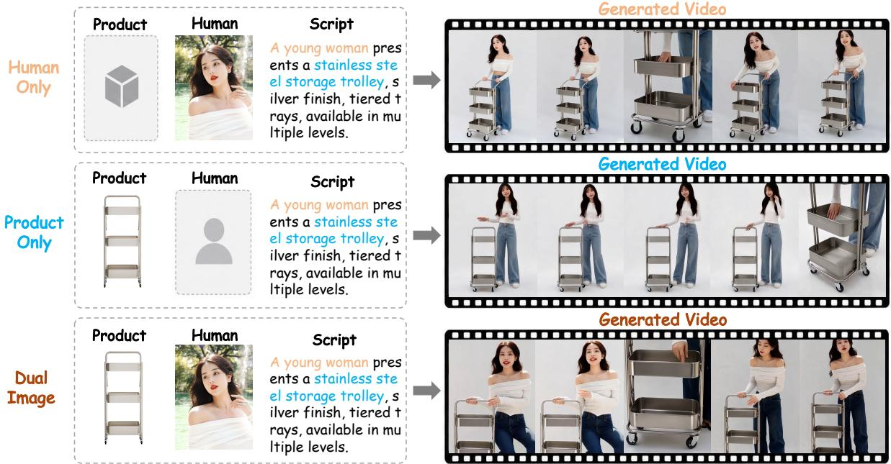
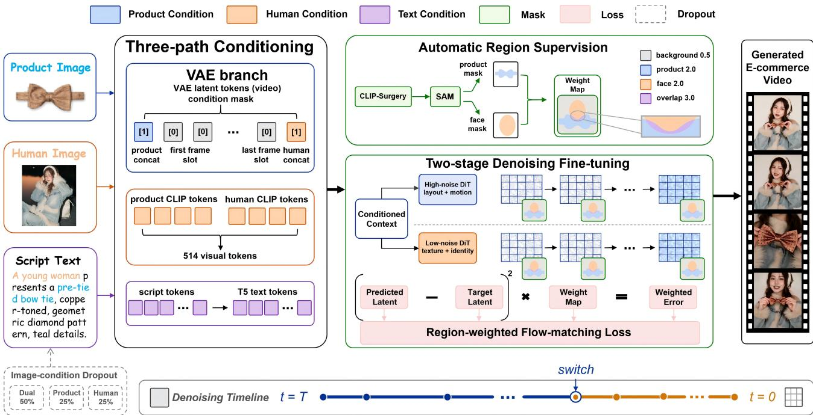
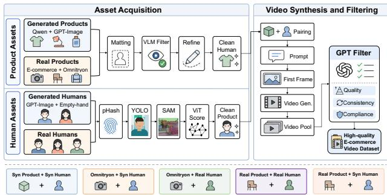
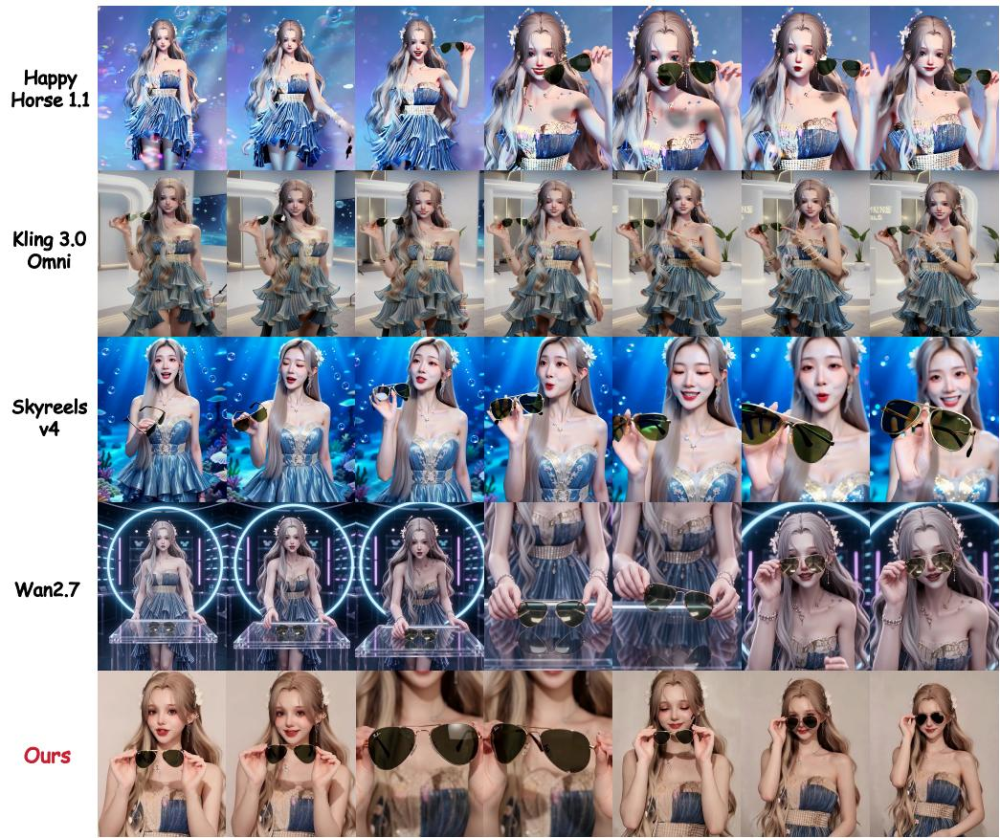
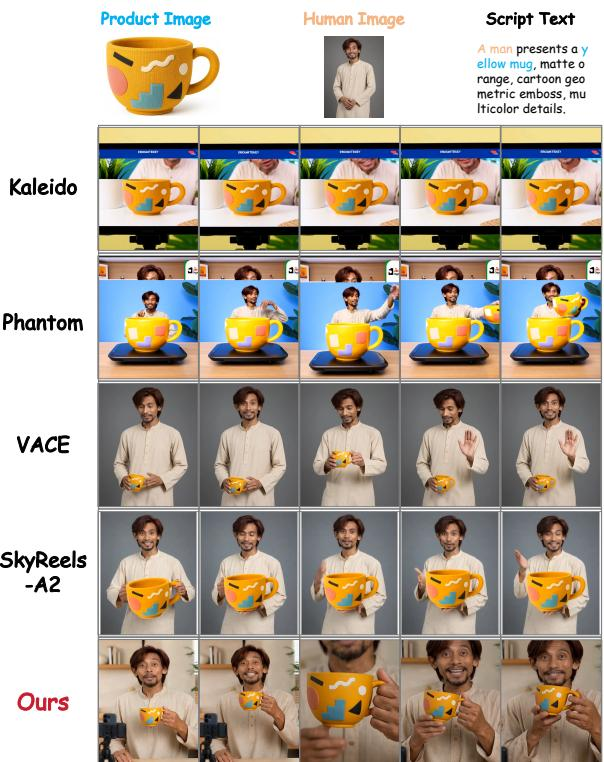

PREPRINT

November 2026

# DualCast: Dual-Image Conditioned Diffusion Transformers for Digital Human E-Commerce Video Generation

Lifan Jiang1,2, Yibo Zhao1,2, Senlin cheng2 Bolei Xu2, XIAOBO LI2, Can Ye2 Dehai Zhao1, Deng Cai1, Boxi Wu1,†

1State Key Lab of CAD&CG, Zhejiang University 2Ant Group

lifanjiang@zju.edu.cn †Corresponding author: Boxi Wu.

## ABSTRACT

Digital human e-commerce video generation requires preserving product appearance, human identity, and overall video style during dynamic demonstrations. Although recent models support multiple reference images, their general conditioning schemes do not explicitly distinguish the asymmetric roles of “what is presented” and “who presents it.” Consequently, generated videos may favor a single reference, resulting in product distortion, identity drift, or singlereference collapse. To address this issue, we propose DualCast, a role-addressed dual-image conditioning framework for video generation. By explicitly modeling the distinct roles of product and human conditions, DualCast reduces role ambiguity and feature competition between references. First, a dual-spatiotemporal slot injection mechanism VAEencodes the product and human images separately and places their latent features at the front and rear boundaries of the DiT sequence, enabling sequence-level condition separation and directed injection. Second, a mask-guided regionweighted loss strengthens supervision over product, face, and product–face overlap regions, improving generation fidelity in critical areas. Third, image condition dropout enables a single model to support dual-image, product-only, and human-only generation. In addition, we construct a curated dataset of 10K e-commerce videos for model training. Experimental results demonstrate the strong performance of DualCast.

Keywords: Digital human video generation; E-commerce; Dual-image conditioning; Diffusion Transformers

## 1 Introduction

Digital human e-commerce video generation is conditioned on specific human and product references. Given human and product images and a text script, the goal is to generate a coherent promotional video in which a digital human introduces, displays, or demonstrates the specified product. Unlike generic text-to-video (T2V) generation, this task requires semantic and temporal coherence alongside consistent product appearance, human identity, and overall video style. Fine-grained product attributes, including logos, packaging geometry, textures, and colors, must be faithfully reproduced, while human identity should remain stable across motion and viewpoint changes. Product deformation, identity drift, or rendering errors in product–face overlap regions can significantly reduce the usability of generated videos.

Recent diffusion transformers (DiTs) and large-scale video generation models [19, 26] have demonstrated strong temporal modeling capabilities. Multi-image conditioning further enables joint control of human and product content [4, 10, 34]. However, existing methods commonly inject multiple references through shared concatenation or global attention, treating them as semantically symmetric conditions. Such designs do not explicitly distinguish the asymmetric roles of “what is presented” and “who presents it,” forcing the model to infer each reference’s target role from a mixed condition space. The resulting feature competition and attention bias may cause one reference to dominate, leading to product distortion, human identity drift, or single-reference collapse. This ambiguity intensifies when product and human features affect the same local regions.

To address these issues, we propose DualCast, a roleaddressed dual-image conditioning framework for video generation. Its core idea assigns fixed, distinguishable positions to product and human conditions in the DiT sequence, establishing explicit correspondence between references and roles. Specifically, a dual-spatiotemporal slot injection mechanism independently VAE-encodes the product and human images and places their latent features at the front and rear boundaries of the DiT sequence, respectively. These boundary positions provide positional priors for both roles, enabling sequence-level condition separation and directed injection while reducing interference in shared attention. The boundary slots serve only as conditions; training loss and decoding are restricted to the intermediate video latents, leaving the output video length unchanged.

  
Figure 1. A single fine-tuned DualCast model unifies three inference modes. A (Dual-image): Using dual-spatiotemporal slot injection, the model assigns roles to and preserves both product appearance and presenter identity. B (Product-only): When the human condition is omitted, the model generates high-quality presenter-led promotional videos based on the product. C (Human-only): When the product condition is omitted, the model generates high-quality presenter-led promotional videos based on the person.

In addition to condition injection, a uniform training objective may provide insufficient supervision for local regions critical to visual fidelity. Standard flow-matching or noiseprediction losses assign equal weights to all latent locations, limiting the contribution of product, facial, and product–face overlap regions that occupy only small portions of a frame. We therefore introduce a mask-guided region-weighted loss that constructs a spatial weighting map from product and face masks and strengthens supervision over product, facial, and product–face overlap regions. This objective increases the contribution of fidelity-critical features during optimization, while loss normalization controls the training scale across samples and maintains optimization stability.

Practical applications also require flexible input configurations. Users may provide both product and human images or only one reference, while training separate models for different configurations is inefficient. We thus introduce an image condition dropout strategy. During fine-tuning, the product or human condition is randomly removed with predefined probabilities, and the corresponding boundary slots and region masks are disabled. This strategy enables a single DualCast model to support dual-image, product-only, and human-only inference. Even when one reference is absent, the model can still generate a complete digital human promotional video. In addition, we construct a curated dataset of 10K e-commerce video clips with paired product– human references and precomputed region masks for model training and evaluation. Experimental results demonstrate the strong overall performance of DualCast.

Our main contributions are summarized as follows:

• Role-Addressed Task Formulation: We formulate digital human e-commerce video generation as a roleaddressed dual-image conditioning problem distinguishing the asymmetric roles of product and human references.

• Dual-Spatiotemporal Slot Injection: We inject independently VAE-encoded product and human latent features into the front and rear non-generative boundary slots of the DiT sequence, using fixed positional priors to explicitly identify condition roles and reduce interference among multiple features.

• Region-Weighted Supervision: We construct a mask-guided region-weighted loss from product and face masks to strengthen supervision over product, facial, and product–face overlap regions.

• Flexible Inference and E-Commerce Dataset: We unify dual-image, product-only, and human-only inference through image condition dropout and construct a curated dataset containing 10K e-commerce video clips.

## 2 Related Work

## 2.1 Diffusion-Based Video Generation.

Diffusion models [6, 7, 22] and flow-matching formulations [16] have transformed generative modeling, while Diffusion Transformers (DiTs) [19] have enabled scalable spatiotemporal synthesis. Foundation models such as Wan [26] and commercial systems including Seedance 2.0, Kling-Omni, and HappyHorse [12, 21, 25] have evolved beyond generic text-to-video tools into multimodal platforms supporting multi-image conditioning. Despite strong temporal priors, applying these systems to digital human e-commerce video generation remains challenging. Since references are fused as shared context, these models struggle to maintain fidelity to multiple entities over time, including branded product geometry and the stable identity of a digital human.

  
Figure 2. Overview of DualCast. The product and presenter images are independently VAE-encoded and placed at the front and rear boundaries of the extended latent sequence, respectively. Only intermediate video latents are denoised, supervised, and decoded. Both reference CLIP embeddings combine with the text prompt as cross-attention context. Product and face masks define region-weighted supervision, while condition dropout enables dual-image, product-only, and human-only inference.

## 2.2 Multi-Subject Reference-Driven Synthesis.

Reference-driven methods such as ControlNet [32], IP-Adapter [31], and DreamBooth [23] have been extended to video generation [5, 28]. Recent multi-subject frameworks, including VACE [10], SkyReels-A2 [4], Kaleido [34], and Phantom [17], further support multiple subjects or reference images. However, their conditioning interfaces do not assign persistent roles to references. In e-commerce generation, the model must therefore infer which reference defines the product and which defines the human from a shared conditioning context, leading to role ambiguity and feature competition. DualCast addresses this issue by assigning independently VAE-encoded product and human features to front and rear non-generative boundary slots. CLIP features provide shared cross-attention context, while the boundary slots offer explicit role-addressed positional priors.

## 2.3 Human-Centric Animation and Interaction.

Digital human generation has focused on identity-preserving motion transfer, talking-head synthesis, and pose-guided animation [8, 15, 20, 24, 29, 33]. Although these methods effectively animate facial expressions and body poses, they generally model humans independently, without explicitly preserving physical interactions with external, highfidelity objects. In e-commerce videos, a digital human must hold, point to, or manipulate a specific product while maintaining its fine-grained appearance, introducing rendering challenges such as complex hand occlusion, local deformation, and texture bleeding around object boundaries. DualCast addresses this complementary requirement through mask-guided region-weighted supervision over product, facial, and product–face overlap regions during training. By increasing the optimization contribution of these fidelitycritical regions, the model better preserves product appearance and human identity throughout dynamic interactions.

## 3 Method

To address feature entanglement in dual-subject synthesis, we propose DualCast, a role-addressed framework (Fig. 2). It comprises three core designs: (1) dual-spatiotemporal slot injection for role assignment (Sec. 3.1); (2) a maskguided region-weighted loss for region fidelity (Sec. 3.2); and (3) joint training strategies for multi-mode deployment (Sec. 3.3). We also construct a large-scale e-commerce video dataset for training (Sec. 3.4).

## 3.1 Dual-Spatiotemporal Slot Injection

Standard image-to-video models typically use a single reference. Extending these interfaces to multiple references does not persistently distinguish their semantic roles. In digital human e-commerce generation, product and presenter conditions are asymmetric: the former specifies what is presented, whereas the latter specifies who presents it. We therefore assign both references to fixed boundary positions in the latent sequence. Let $I _ { p } , I _ { h } \in \mathbb { R } ^ { 3 \times H \times W }$ denote the product and presenter images, respectively, and V a target video of T frames. We encode V as

$$
x _ { 0 } = \mathcal { E } _ { \mathrm { V A E } } ( V ) \in \mathbb { R } ^ { C _ { \nu } \times T ^ { \prime } \times h \times w } ,\tag{1}
$$

where $T ^ { \prime }$ is the latent temporal length. At flow-matching timestep τ, the noisy video latent is

$$
x _ { \tau } = ( 1 - \tau ) x _ { 0 } + \tau \varepsilon .\tag{2}
$$

The references are independently encoded as

$$
z _ { p } = \mathcal { E } _ { \mathrm { V A E } } ( I _ { p } ) , \qquad z _ { h } = \mathcal { E } _ { \mathrm { V A E } } ( I _ { h } ) ,\tag{3}
$$

where $z _ { p } , z _ { h } \in \mathbb { R } ^ { C _ { \nu } \times 1 \times h \times w }$ . We construct the extended latent sequence as

$$
\begin{array} { r } { \bar { x } _ { \tau } = z _ { p } \oplus _ { t } x _ { \tau } \oplus _ { t } z _ { h } \in \mathbb { R } ^ { C _ { \nu } \times ( T ^ { \prime } + 2 ) \times h \times w } , } \end{array}\tag{4}
$$

where $\oplus _ { t }$ denotes temporal concatenation. The product latent occupies the front boundary at $t = 0$ , while the presenter latent occupies the rear boundary at $t = T ^ { \prime } + 1$

We define a slot indicator $M _ { s } \dot { \in } \{ 0 , 1 \} ^ { 1 \times ( T ^ { \prime } + 2 ) \times h \times w }$ , with ones at both boundaries and zeros at intermediate positions. $M _ { s }$ only marks the fixed boundary slots and remains unchanged under condition dropout; the product and presenter roles follow their fixed front–rear order. The indicator is concatenated with the extended latent along the channel dimension before patchification:

$$
\tilde { x } _ { \tau } = \mathrm { C o n c a t } _ { c } ( \bar { x } _ { \tau } , M _ { s } ) \in \mathbb { R } ^ { ( C _ { \nu } + 1 ) \times ( T ^ { \prime } + 2 ) \times h \times w } .\tag{5}
$$

The boundary positions serve only as non-generative conditions. If $\nu _ { \theta } ( \tilde { x } _ { \tau } , C , \tau )$ denotes the DiT prediction over the extended sequence, we retain only its intermediate positions:

$$
\nu _ { \theta } ^ { \mathrm { g e n } } = \Pi _ { \mathrm { g e n } } \left[ \nu _ { \theta } ( \tilde { x } _ { \tau } , C , \tau ) \right] ,\tag{6}
$$

where $\Pi _ { \mathrm { g e n } }$ selects positions $1 , \ldots , T ^ { \prime }$ . Training loss is computed only over these positions. During sampling, only the intermediate video latents are updated by the denoising scheduler, while boundary latents $z _ { p }$ and $z _ { h }$ remain fixed. Only the resulting intermediate latents are passed to the VAE decoder. Consequently, the reference slots add no output frames, and the generated video still contains $T$ frames.

CLIP Semantic Context. The product and presenter images are independently processed by a CLIP vision encoder:

$$
f _ { p } = \mathrm { C L I P } ( I _ { p } ) , \qquad f _ { h } = \mathrm { C L I P } ( I _ { h } ) .\tag{7}
$$

Each embedding contains 257 tokens. After projection into the text-context dimension, the visual token sequences are concatenated with the T5 representation $C _ { \mathrm { t x t } }$ of the prompt:

$$
C = { \mathrm { P r o j } } ( f _ { p } ) \oplus { \mathrm { P r o j } } ( f _ { h } ) \oplus C _ { \mathrm { t x t } } .\tag{8}
$$

Unlike the VAE boundary latents, CLIP embeddings do not occupy temporal or generative slots. They provide auxiliary semantic information exclusively through DiT crossattention. Explicit role assignment is realized by the fixed latent boundary positions, while the CLIP pathway improves semantic recognition of both references.

## 3.2 Mask-Guided Region-Weighted Loss

Standard flow-matching objectives uniformly penalize spatiotemporal locations, potentially under-emphasizing product and facial regions critical for e-commerce video generation. We therefore introduce a mask-guided region-weighted loss to strengthen supervision on these regions.

For each target video frame, we independently obtain a product mask $M _ { p }$ and a face mask $M _ { f }$ using CLIP Surgery [13] and SAM [11]. Their intersection is defined after both masks are resized and binarized at the generated latent resolution. We construct the regional weight map as

  
Figure 3. Construction pipeline of the curated 10K e-commerce video dataset. Product and presenter assets are collected or synthesized, quality-filtered, and paired to generate e-commerce-oriented prompts and initial frames. Candidate videos are subsequently filtered according to visual quality, temporal consistency, and prompt compliance. Product and face masks are precomputed for regionweighted training. Detailed source-use, filtering, privacy, and quality-control policies are provided in Supplement E.

$$
W _ { t x y } = \left\{ \begin{array} { l l } { \lambda _ { \mathrm { o v e r l a p } } , } & { M _ { p } ^ { t x y } = 1 \wedge M _ { f } ^ { t x y } = 1 , } \\ { \lambda _ { p } , } & { M _ { p } ^ { t x y } = 1 \wedge M _ { f } ^ { t x y } = 0 , } \\ { \lambda _ { f } , } & { M _ { p } ^ { t x y } = 0 \wedge M _ { f } ^ { t x y } = 1 , } \\ { \lambda _ { \mathrm { b g } } , } & { M _ { p } ^ { t x y } = 0 \wedge M _ { f } ^ { t x y } = 0 . } \end{array} \right.\tag{9}
$$

We set $\lambda _ { \mathrm { o v e r l a p } } = 3 . 0 , \lambda _ { p } = 2 . 0 , \lambda _ { f } = 2 . 0 ,$ , and $\lambda _ { \mathrm { b g } } = 0 . 5 .$ . The overlap receives the highest weight because errors in these locations may simultaneously affect product appearance and facial identity.

Under Eq. 2, the target flow velocity is

$$
u _ { \tau } = \frac { \partial x _ { \tau } } { \partial \tau } = \varepsilon - x _ { 0 } .\tag{10}
$$

The region-weighted objective is computed only over the $T ^ { \prime }$ generated latent positions:

$$
\mathcal { L } _ { \mathrm { R W } } = \mathbb { E } _ { x _ { 0 } , \varepsilon , \tau } \left[ \omega ( \tau ) \frac { \sum _ { c , t , x , y } W _ { t x y } \left( \left( \nu _ { \theta } ^ { \mathrm { g e n } } \right) ^ { c t x y } - u _ { \tau } ^ { c t x y } \right) ^ { 2 } } { C _ { \nu } \sum _ { t , x , y } W _ { t x y } + \varepsilon } \right] .\tag{11}
$$

Here, $\nu _ { \theta } ^ { \mathrm { g e n } }$ denotes the prediction restricted to the intermediate generative positions, $\omega ( \tau )$ follows the timestepweighting schedule of the base model, and ε is a numerical stability constant. Normalizing by total regional weight stabilizes the loss scale across samples with varying product and face sizes.

## 3.3 Multi-Mode Dropout and Split-Noise Training

We introduce image condition dropout for multi-mode deployment and adopt a backbone-aligned fine-tuning schedule that preserves the noise-range specialization of the pretrained dual-expert DiT.

Image Condition Dropout. To support three input configurations with one model, we sample dual-reference, productonly, and human-only conditions with probabilities of 50%, 25%, and 25%, respectively, i.e., a ratio of 2:1:1. For dualreference training, both boundary latents $\left( z _ { p } , z _ { h } \right)$ and CLIP context tokens $\left( f _ { p } , f _ { h } \right)$ are retained. For product-only training, $z _ { h }$ and $f _ { h }$ are zeroed and the face mask $M _ { f }$ is disabled;

for human-only training, $z _ { p }$ and $f _ { p }$ are zeroed and the product mask $M _ { p }$ is disabled. The regional weight map W is then recomputed from the remaining masks, preventing absent conditions from affecting region-weighted supervision. This joint training exposes a single checkpoint to both complete and partial visual inputs, enabling dual-image, product-only, and human-only inference.

Backbone-Aligned Split-Noise Fine-Tuning. Wan2.2 employs two pretrained DiT experts specialized for different noise ranges in the denoising process. We preserve this existing specialization during fine-tuning rather than treating the two experts as a newly introduced architecture. Following Eq. 2, a larger τ corresponds to a higher noise level. The high-noise expert is fine-tuned only over $\tau \in [ 0 . 3 5 8 , 1 . 0 ]$ focusing on global composition and macroscopic motion, while the low-noise expert is fine-tuned over $\tau \in [ 0 , 0 . 3 5 8 ]$ focusing on local texture, product details, and facial appearance. Inference follows the original expert-switching boundary of the backbone.

## 3.4 Dataset Construction

We construct a 10,000-sample e-commerce dataset via two stages: Asset Acquisition and Video Synthesis and Filtering. Asset Acquisition. We derive product and human assets from both generative and real-world sources for dataset construction. For product assets, Qwen3.6-27B [30] prompts drive GPT-Image-2 to synthesize 1,500 images. Real-world products are extracted from e-commerce platforms and the Omnitryon dataset. Raw images undergo BiRefNetbased [35] foreground matting and VLM-based filtering across 8 quality dimensions. Candidates are refined via manual mask and boundary correction, yielding 1,500 real product assets combined with all clean Omnitryon products. For human assets, GPT-Image-2 synthesizes 1,500 portraits (empty-hand constraint). Real human portraits are filtered via a coarse-to-fine pipeline: pHash deduplication, YOLOv8 (single-subject constraint), SAM [11] (background assessment), and a SCUT-FBP5500-finetuned ViT (aesthetic scoring) [14], resulting in 1,500 real human assets.

Video Synthesis and Filtering. We execute a promptguided synthesis pipeline. For each product-human pair, Qwen3.6-27B generates text prompts for spatial layout and temporal dynamics. Conditioned on these, GPT-Image-2 synthesizes an initial frame, and Wan2.7 generates the video. We scale this to a large video pool by cross-pairing assets, then apply GPT-5.5 to filter samples based on visual quality, temporal consistency, and prompt compliance. We retain 10,000 high-quality samples distributed as follows: (1) 3,000 synthetic samples (1,500 original pairs + 1,500 shuffled combinations); (2) 800 Omnitryon products with synthetic humans; (3) 2,000 Omnitryon products with real humans; (4) 3,000 real e-commerce products with real humans; and (5) 1,200 real e-commerce products with synthetic humans.

## 4 Experiments

## 4.1 Experimental Setup

Evaluation Set and Implementation. We construct separate 150-case sets for the main comparison and ablation studies by independently pairing product and presenter images from a held-out asset pool. All evaluation products and presenter identities are excluded from training. For each pair, Qwen3.6-27B generates an e-commerce prompt describing presentation content and human–product interaction. All methods use the same references and prompts. Videos contain 81 frames at $7 2 0 \times 5 6 0 ;$ ; unsupported methods use the closest compatible aspect ratio. DualCast is initialized from Wan2.2-I2V-14B [26]. The high- and low-noise stages are trained separately for 8 hours each on 128 NVIDIA A100 GPUs using $7 2 0 \times 5 6 0 \times 8 1$ videos. Dual-reference, product-only, and human-only conditions are sampled at a 2:1:1 ratio. Region-loss weights are 0.5, 2.0, 2.0, and 3.0 for background, face, product, and product–face overlap, respectively.

Baselines. We compare four open-source multi-reference methods: Kaleido [34], Phantom [17], VACE [10], and SkyReels-A2 [4]. We also evaluate four closed-source systems: Wan2.7 [2], SkyReels-v4 [3], HappyHorse 1.1 [1], and Kling3.0-Omni [12]. All methods receive identical product and human references and role-specific prompts under their supported input protocols.

Evaluation Metrics. We evaluate semantic and reference consistency, task-specific perceptual quality, and general video quality. ViCLIP measures prompt–video alignment, while S2V-C measures reference-to-video subject consistency using Grounding DINO [18], SAM [11], and CLIP features. We additionally report ID-Adj in the main comparison, which measures facial identity consistency; higher values indicate stronger consistency. Qwen3.5-397B-A17B evaluates EcomStyle, FaceID, ProdID, Interaction, and Motion, corresponding to e-commerce style, presenter identity, product identity, product–presenter interaction, and motion naturalness. Raw 0–5 scores are normalized to [0,1], and 5D Avg. is the arithmetic mean of these five normalized scores; details are provided in Supplement D. For ablations, we report ID-Ret for face-identity similarity and the additional face-detection metric FaceDet; FaceIDVLM denotes the VLM face-identity score in Table 3. Dynamic Degree, Aesthetic Quality, and Imaging Quality follow VBench [9] and DOVER [27].

## 4.2 Comparison with State-of-the-Art Methods

Table 1 shows that DualCast achieves the best average rank of 1.73, ranking first or joint first on nine of 11 individual metrics. Its ID-Adj of 0.8517 exceeds Wan2.7 (0.8498) and the base model (0.8206). The five-dimensional average is 0.9848 (4.9240 on the original scale), ahead of HappyHorse 1.1 (0.9744) and Wan2.7 (0.9720). DualCast outperforms all closed-source systems on ViCLIP, S2V-C, ID-Adj, ProdID, Interaction, Motion, and Dynamic Degree. Together with Figs. 4 and 5, these results demonstrate strong reference consistency, product–presenter interaction, and video quality during dynamic product demonstrations.

## 4.3 Ablation Study

Tables 2 and 3 validate the effectiveness of the proposed architecture and training strategies.

Effect of Dual-Spatiotemporal Slot Injection. Removing the dual-end arrangement reduces ID-Ret from 0.5109 to 0.0703 and S2V-C from 0.5886 to 0.5083. The full model improves their scores by 626.7% and 15.8%, respectively.

  
Figure 4. Qualitative Comparison Results. Compared with existing methods, our approach demonstrates advantages in three aspects: (1) Facial Feature Consistency — Our method preserves the source person’s facial identity during video generation, avoiding identity drift or distortion; (2) Product Consistency — Product details from the reference image, including appearance, texture, and logos, are accurately reproduced, maintaining high visual fidelity; (3) Style Decoupling Capability — The overall style of the generated video is not irreversibly influenced by the reference image, achieving flexible decoupling between content transfer and style control, making the generation results more suitable for e-commerce live streaming scenarios.

Table 1. Quantitative comparison against state-of-the-art methods. Metrics span semantic consistency, five-dimensional perceptual quality, and video quality. Perceptual scores are divided by 5 to obtain the 0–1 scale; 5D Avg. is their arithmetic mean. Avg Rank↓ averages ranks over the 11 individual metrics, excluding 5D Avg., with ties assigned their average ranks. All other metrics are higher-is-better. † denotes our base model. Bold indicates the best result; highlighted cells denote our top-ranked metrics.
<table><tr><td rowspan="2">Method</td><td rowspan="2">Open</td><td colspan="2">Semantic &amp; Consistency</td><td colspan="6">Perceptual Quality (0–1)</td><td colspan="3">Video Quality (VBench)</td><td rowspan="2">Avg Rank↓</td></tr><tr><td>ViCLIP</td><td>S2V-C ID-Adj</td><td></td><td>|EcomStyle FaceID ProdID</td><td></td><td></td><td></td><td></td><td>Interaction Motion 5D Avg. | Dynamic Deg.</td><td>Aesthetic Imaging |</td><td></td></tr><tr><td>Kaleido [34]</td><td>√</td><td>0.220</td><td>0.516 0.4491</td><td>0.904</td><td>0.908</td><td>0.828</td><td>0.832</td><td>0.860</td><td>0.8664</td><td>0.500</td><td>0.499</td><td>0.726</td><td>8.14</td></tr><tr><td>Phantom [17]</td><td>√</td><td>0.227</td><td>0.493 0.6283</td><td>0.956</td><td>0.904</td><td>0.852</td><td>0.864</td><td>0.872</td><td>0.8896</td><td>0.650</td><td>0.510</td><td>0.751</td><td>6.95</td></tr><tr><td>VACE [10]</td><td>√</td><td>0.210</td><td>0.596 0.5406</td><td>0.936</td><td>0.968</td><td>0.936</td><td>0.876</td><td>0.896</td><td>0.9224</td><td>0.750</td><td>0.513</td><td>0.755</td><td>5.86</td></tr><tr><td>SkyReels-A2 [4]</td><td>√</td><td>0.197</td><td>0.575 0.6409</td><td>0.876</td><td>0.992</td><td>0.860</td><td>0.808</td><td>0.768</td><td>0.8608</td><td>0.787</td><td>0.490</td><td>0.740</td><td>7.50</td></tr><tr><td>Wan2.2-I2V-14B† (Base) [26]</td><td>√</td><td>0.197</td><td>0.717 0.8206</td><td>0.824</td><td>0.796</td><td>0.732</td><td>0.716</td><td>0.748</td><td>0.7632</td><td>0.775</td><td>0.512</td><td>0.709</td><td>7.86</td></tr><tr><td>DualCast (Ours)</td><td>√</td><td>0.237</td><td>0.596 0.8517</td><td>1.000</td><td></td><td>1.000 0.988</td><td></td><td>0.980 0.956</td><td>0.9848</td><td>0.988</td><td>0.524</td><td>0.751</td><td>1.73</td></tr><tr><td>Wan2.7 [2]</td><td>X</td><td>0.219</td><td>0.563 0.8498</td><td>0.996</td><td>1.000</td><td>0.952</td><td>0.960</td><td>0.952</td><td>0.9720</td><td>0.963</td><td>0.524</td><td>0.759</td><td>3.41</td></tr><tr><td>SkyReels-v4 [3]</td><td>x</td><td>0.220</td><td>0.573 0.3630</td><td>0.988</td><td>0.926</td><td>0.816</td><td>0.964</td><td>0.924</td><td>0.9236</td><td>0.975</td><td>0.507</td><td>0.735</td><td>6.09</td></tr><tr><td>HappyHorse 1.1 [1]</td><td></td><td>0.216</td><td>0.593 0.8062</td><td>1.000</td><td></td><td>0.996 0.984</td><td>0.960</td><td>0.932</td><td>0.9744</td><td>0.963</td><td>0.514</td><td>0.753</td><td>3.86</td></tr><tr><td>Kling3.0-Omni [12]</td><td>&lt; × ×</td><td>0.215</td><td>0.581 0.7744</td><td>0.984</td><td></td><td>1.000 0.944</td><td></td><td>0.976 0.936</td><td>0.9680</td><td>0.975</td><td>0.518</td><td>0.767</td><td>3.59</td></tr></table>

Against w/o Dual-front, it improves ID-Ret by 68.0%, S2V-C by 7.1%, and Imaging Quality by 1.3%, with lower ProdID. It achieves the highest six-metric average.

Effect of Region-Weighted Loss. With the full slot arrangement, region weighting improves ID-Ret by 14.3%, S2V-C by 1.1%, and ProdID by 7.2%, increasing the average by 5.0%. Its effect depends on slot arrangement: removing it from either w/o Dual-End or w/o Dual-front improves ID-Ret but reduces ProdID. Thus, the combined ablations reveal configuration-dependent tradeoffs.

Effect of Split-Noise Fine-Tuning. Against w/o Two-Stage, full training improves ID-Ret by 46.3%, S2V-C by 3.2%, Aesthetic Quality by 4.0%, Imaging Quality by 4.1%, and FaceDet by 5.7%, maintaining ProdID and improving the average by 7.2%.

Face Detection and Identity Preservation. The highest FaceDet (0.7734) occurs with ID-Ret of only 0.0827, whereas the full model has FaceDet of 0.7566 and ID-Ret of 0.5109. Detection alone therefore does not establish identity preservation.

Effect of Image Condition Dropout. Table 3 shows dualinference average gains of 15.1% and 11.7% over productonly and human-only training, with ID-Ret gains of 19.9% and 30.7% and VLM face-identity gains of 28.5% and 16.3%, respectively. Against human-only training, ProdID improves by 6.2%. The same checkpoint supports productonly inference (ProdID 0.862) and human-only inference (ID-Ret 0.4983) using identical model parameters. User Study. DualCast achieves overall preference rates of 60.0%–73.1% (Table 4); protocols are in Supplement C.

  
Figure 5. Temporal comparison under dual-image conditioning. Some baselines produce product-dominant close-ups or singlesubject scenes, potentially inflating S2V-C and ProdID without preserving both references. DualCast maintains consistent product appearance and presenter identity throughout the video.

Table 2. Ablation study of the proposed components in Dual-Cast. We evaluate slot arrangements, region-loss combinations, and two-stage training. ProdID is divided by 5; Avg. averages all six [0, 1] metrics. Bold marks the best scores. Gain of Full gives relative changes computed before rounding; green marks positive gains.
<table><tr><td rowspan="2">Model Variant</td><td colspan="3">Condition Fidelity</td><td colspan="2">Visual Quality</td><td rowspan="2">FaceDet↑</td><td rowspan="2">Avg.↑</td></tr><tr><td>ID-Ret↑</td><td>S2V-C↑</td><td>ProdID↑</td><td>Aesthetic↑</td><td>Imaging↑</td></tr><tr><td>DualCast (Full)</td><td>0.5109</td><td>0.5886</td><td>0.868</td><td>0.52</td><td>0.77</td><td>0.7566</td><td>0.669</td></tr><tr><td>w/o Dual-End</td><td>0.0703</td><td>0.5083</td><td>0.856</td><td>0.52</td><td>0.74</td><td>0.7297</td><td>0.571</td></tr><tr><td>Gain of Full</td><td>+626.7%</td><td>+15.8%</td><td>+1.4%</td><td>±0.0%</td><td>+4.1%</td><td>+3.7%</td><td>+17.2%</td></tr><tr><td>w/o Dual-End + w/o Region-Loss</td><td>0.0827</td><td>0.5138</td><td>0.800</td><td>0.53</td><td>0.75</td><td>0.7734</td><td>0.575</td></tr><tr><td>Gain of Full</td><td>+517.8%</td><td>+14.6%</td><td>+8.5%</td><td>-1.9%</td><td>+2.7%</td><td>-2.2%</td><td>+16.4%</td></tr><tr><td>w/o Dual-front</td><td>0.3041</td><td>0.5498</td><td>0.892</td><td>0.49</td><td>0.76</td><td>0.6985</td><td>0.616</td></tr><tr><td>Gain of Full</td><td>+68.0%</td><td>+7.1%</td><td>-2.7%</td><td>+6.1%</td><td>+1.3%</td><td>+8.3%</td><td>+8.7%</td></tr><tr><td>w/o Dual-front + w/o Region-Loss</td><td>0.4049</td><td>0.5690</td><td>0.848</td><td>0.51</td><td>0.76</td><td>0.7500</td><td>0.640</td></tr><tr><td>Gain of Full</td><td>+26.2%</td><td>+3.4%</td><td>+2.4%</td><td>+2.0%</td><td>+1.3%</td><td>+0.9%</td><td>+4.5%</td></tr><tr><td>w/o Region-Loss</td><td>0.4468</td><td>0.5823</td><td>0.810</td><td>0.51</td><td>0.75</td><td>0.7250</td><td>0.637</td></tr><tr><td>Gain of Full</td><td>+14.3%</td><td>+1.1%</td><td>+7.2%</td><td>+2.0%</td><td>+2.7%</td><td>+4.4%</td><td>+5.0%</td></tr><tr><td>w/o Two-Stage</td><td>0.3491</td><td>0.5702</td><td>0.868</td><td>0.50</td><td>0.74</td><td>0.7156</td><td>0.624</td></tr><tr><td>Gain of Full</td><td>+46.3%</td><td>+3.2%</td><td>±0.0%</td><td>+4.0%</td><td>+4.1%</td><td>+5.7%</td><td>+7.2%</td></tr></table>

## 4.4 Full-Video Temporal Robustness

We diagnose all decoded frames of 150 DualCast videos using overlapping 16-frame windows (stride 12) and the same multimodal judge. Table 5 reports complete processing with no API, file, or decoding errors. The judge flags no identity drift or reference copying; product deformation and ghosting affect fewer than 10% of videos each, with interpenetration and camera shake less frequent. Mean faceand product-identity scores are 4.794 and 4.748 out of 5; the median motion score is 4.15, with 83% of videos scoring at least 3.5. These results support reliable execution and consistent subject representation under this diagnostic protocol. Detailed event counts, five-axis scores, and segment-wise results are provided in Supplement A.

Table 3. Ablation study on training and inference strategies. We compare single-modality and joint training under single- and dual-reference inference. Scores above 1 are divided by 5; values already in [0, 1] are retained. $\mathrm { F a c e I D } _ { \mathrm { V L M } }$ denotes VLM-based faceidentity assessment. Bold marks the best values within each group; green highlights gains over the corresponding dual-inference baseline. Avg. averages the four metrics; † excludes unavailable entries.
<table><tr><td>Training</td><td>Inference</td><td></td><td></td><td>|ID-Ret↑ EcomStyle↑ FaceIDvLM↑ ProdID↑|</td><td></td><td>Avg.↑</td></tr><tr><td colspan="7">Product-Centric Comparison</td></tr><tr><td>Baseline (Product-Only) Product-Only</td><td></td><td>0.0645</td><td>0.960</td><td>0.2120</td><td>0.838</td><td>0.519</td></tr><tr><td>Baseline (Product-Only) Dual</td><td></td><td>0.4260</td><td>0.904</td><td>0.7660</td><td>0.808</td><td>0.726</td></tr><tr><td>Ours (Joint)</td><td>Product-Only</td><td></td><td>0.980</td><td>0.9600</td><td>0.862</td><td>0.934†</td></tr><tr><td>Ours (Joint)</td><td>Dual</td><td>0.5109</td><td>0.980</td><td>0.9840</td><td>0.868</td><td>0.836</td></tr><tr><td>∆ vs. Baseline (Dual)</td><td></td><td>+19.9%</td><td>+8.4%</td><td>+28.5%</td><td>+7.4%</td><td>+15.1%</td></tr><tr><td colspan="7">Human-Centric Comparison</td></tr><tr><td>Baseline (Human-Only) Human-Only</td><td></td><td>0.4682</td><td>0.968</td><td>0.9720</td><td>0.454</td><td>0.716</td></tr><tr><td>Baseline (Human-Only)</td><td>Dual</td><td>0.3910</td><td>0.940</td><td>0.8460</td><td>0.817</td><td>0.749</td></tr><tr><td>Ours (Joint)</td><td>Human-Only</td><td>0.4983</td><td>0.979</td><td>0.9841</td><td></td><td>0.820</td></tr><tr><td>Ours (Joint)</td><td>Dual</td><td>0.5109</td><td>0.980</td><td>0.9840</td><td>0.868</td><td>0.836</td></tr><tr><td>∆ vs. Baseline (Dual)</td><td></td><td>+30.7%</td><td>+4.3%</td><td>+16.3%</td><td>+6.2%</td><td>|+11.7%</td></tr></table>

Table 4. User-study preference rates (%). Values compare DualCast with each baseline; rates above 50% favor DualCast, with ties counted as 0.5. ∗ denotes statistical significance at p < 0.05. See Supplement C for details.
<table><tr><td>Evaluation Metric</td><td>vs. Kaleido</td><td>vs. Phantom</td><td>vs. VACE</td><td>vs. SkyReels-A2</td></tr><tr><td>Product Consistency</td><td>63.6%*</td><td>67.2%*</td><td>52.0%*</td><td>67.3%*</td></tr><tr><td>Identity Preservation</td><td>76.8%*</td><td>79.8%*</td><td>60.2%*</td><td>61.6%*</td></tr><tr><td>Video Quality</td><td>71.4%*</td><td>72.2%*</td><td>67.7%*</td><td>82.4%*</td></tr><tr><td>Overall Preference</td><td>70.6%</td><td>73.1%</td><td>60.0%</td><td>70.4%</td></tr></table>

## 5 Conclusion

We presented DualCast, a role-addressed dual-image conditioning framework for digital human e-commerce video generation. Motivated by the asymmetric functions of product and presenter references, DualCast augments shared semantic conditioning with a consistent role-addressed latent structure. The proposed dual-boundary slot injection separates the two visual references, the mask-guided regionweighted objective emphasizes task-critical subject regions, and image-condition dropout enables a single fine-tuned model to operate under dual-reference, product-only, and human-only configurations. Experiments and user studies demonstrate that DualCast provides a strong balance among prompt alignment, subject consistency, visual quality, and joint product–presenter fidelity, while the ablation results verify the contributions of its main components.

Limitations and Future Work. The current framework assumes a single product and a single presenter with fixed role assignments, limiting its flexibility for more complex e-commerce scenarios involving multiple products, presenters, or tasks. Future work will explore more flexible role representations and extend DualCast to multi-product, multipresenter, and long-form video generation with additional controls such as pose, speech, and camera trajectories.

Table 5. Full-video temporal diagnostics of DualCast. All 150 videos are covered by 1050 overlapping windows. Visual flags are MLLM-suspected events; counts denote videos with each flag, not manually confirmed failures. Scores use exclusive-frame weights; motion statistics are computed per video. Details are in Supplement A.
<table><tr><td>Diagnostic</td><td>Result</td></tr><tr><td>Execution and coverage Video outputs</td><td>150/150</td></tr><tr><td>Completed diagnostic windows Decoded-frame coverage API / file / decoding errors</td><td>1050/1050 100%</td></tr><tr><td>Content and temporal checks</td><td>0 /0 /0</td></tr><tr><td>Identity drift</td><td></td></tr><tr><td>Reference copying</td><td>0/150 (0.0%) 0/150 (0.0%)</td></tr><tr><td>Product deformation</td><td></td></tr><tr><td>Ghosting</td><td>14/150 (9.3%)</td></tr><tr><td>Interpenetration</td><td>13/150 (8.7%)</td></tr><tr><td>Camera shake</td><td>3/150 (2.0%)</td></tr><tr><td></td><td>1/150 (0.7%)</td></tr><tr><td>Window-weighted scores (0–5)</td><td></td></tr><tr><td></td><td></td></tr><tr><td>E-commerce style (mean)</td><td>4.925</td></tr><tr><td>Face identity (mean)</td><td>4.794</td></tr><tr><td>Product identity (mean)</td><td>4.748</td></tr><tr><td>Human-product interaction (mean)</td><td>4.920</td></tr><tr><td>Motion naturalness (mean)</td><td>4.008</td></tr><tr><td></td><td></td></tr><tr><td>Motion naturalness (median) Videos with motion score ≥ 3.5</td><td>4.15 83%</td></tr></table>

## References

[1] Alibaba Cloud. HappyHorse Reference-to-Video API Reference. Alibaba Cloud Model Studio Documentation, 2026. Accessed: 2026-07-22.

[2] Alibaba Cloud. Wan 2.7 Reference-to-Video API Reference. Alibaba Cloud Model Studio Documentation, 2026. Accessed: 2026-07-22.

[3] Guibin Chen, Dixuan Lin, Jiangping Yang, Youqiang Zhang, Zhengcong Fei, Debang Li, Sheng Chen, Chaofeng Ao, Nuo Pang, Yiming Wang, et al. Skyreels-v4: Multi-modal video-audio generation, inpainting and editing model. arXiv preprint arXiv:2602.21818, 2026.

[4] Zhengcong Fei, Debang Li, Di Qiu, Jiahua Wang, Yikun Dou, Rui Wang, Jingtao Xu, Mingyuan Fan, Guibin Chen, Yang Li, and Yahui Zhou. Skyreels-a2: Compose anything in video diffusion transformers. arXiv preprint arXiv:2504.02436, 2025.

[5] Yuwei Guo, Ceyuan Yang, Anyi Rao, Yaohui Wang, Yu Qiao, Dahua Lin, and Bo Dai. Animatediff: Animate your personalized text-to-image diffusion models without specific tuning. In International Conference on Learning Representations, 2024.

[6] Jonathan Ho, Ajay Jain, and Pieter Abbeel. Denoising diffusion probabilistic models. In Advances in Neural Information Processing Systems, 2020.

[7] Jonathan Ho, Tim Salimans, Alexey A Gritsenko, William Chan, Mohammad Norouzi, and David J Fleet. Video diffusion models. In ICLR workshop on deep generative models for highly structured data, 2022.

[8] Li Hu, Xin Gao, Peng Zhang, Ke Sun, Bang Zhang, and Liefeng Bo. Animate anyone: Consistent and controllable image-to-video synthesis for character animation. arXiv preprint arXiv:2311.17117, 2023.

[9] Ziqi Huang, Yinan He, Jiashuo Yu, Fan Zhang, Chenyang Si, Yuming Jiang, Yuanhan Zhang, Tianxing Wu, Qingyang Jin, Nattapol Chanpaisit, et al. Vbench: Comprehensive benchmark suite for video generative models. In IEEE/CVF Conference on Computer Vision and Pattern Recognition, 2024.

[10] Zeyinzi Jiang, Zhen Han, Chaojie Mao, Jingfeng Zhang, Yulin Pan, and Yu Liu. Vace: All-in-one video creation and editing. arXiv preprint arXiv:2503.07598, 2025.

[11] Alexander Kirillov, Eric Mintun, Nikhila Ravi, Hanzi Mao, Chloe Rolland, Laura Gustafson, Tete Xiao, Spencer Whitehead, Alexander C. Berg, Wan-Yen Lo, et al. Segment anything. In IEEE/CVF International Conference on Computer Vision, 2023.

[12] Kling Team, Jialu Chen, Yuanzheng Ci, Xiangyu Du, Zipeng Feng, Kun Gai, Sainan Guo, Feng Han, Jingbin He, Kang He, et al. Kling-omni technical report. arXiv preprint arXiv:2512.16776, 2025.

[13] Yi Li, Hualiang Wang, Yiqun Duan, Jiheng Zhang, and Xiaomeng Li. A closer look at the explainability of contrastive language-image pre-training. arXiv preprint arXiv:2304.05653, 2023.

[14] Lingyu Liang, Luojun Lin, Lianwen Jin, Duorui Xie, and Mengru Li. Scut-fbp5500: A diverse benchmark dataset for multi-paradigm facial beauty prediction. arXiv preprint arXiv:1801.06345, 2018.

[15] Gaojie Lin, Jianwen Jiang, Jiaqi Yang, Zerong Zheng, Chao Liang, Yuan Zhang, and Jingtuo Liu. Omnihuman-1: Rethinking the scaling-up of one-stage conditioned human animation models. In Proceedings of the IEEE/CVF International Conference on Computer Vision, pages 13847–13858, 2025.

[16] Yaron Lipman, Ricky T. Q. Chen, Heli Ben-Hamu, Maximilian Nickel, and Matt Le. Flow matching for generative modeling. In International Conference on Learning Representations, 2023.

[17] Lijie Liu, Tianxiang Ma, Bingchuan Li, Zhuowei Chen, Jiawei Liu, Qian He, and Xinglong Wu. Phantom: Subjectconsistent video generation via cross-modal alignment. arXiv preprint arXiv:2502.11079, 2025.

[18] Shilong Liu, Zhaoyang Zeng, Tianhe Ren, Feng Li, Hao Zhang, Jie Yang, Qing Jiang, Chunyuan Li, Jianwei Yang, Hang Su, et al. Grounding dino: Marrying dino with grounded pre-training for open-set object detection. In European Conference on Computer Vision, 2024.

[19] William Peebles and Saining Xie. Scalable diffusion models with transformers. In IEEE/CVF International Conference on Computer Vision, 2023.

[20] K. R. Prajwal, Rudrabha Mukhopadhyay, Vinay P. Namboodiri, and C. V. Jawahar. A lip sync expert is all you need for speech to lip generation in the wild. In ACM International Conference on Multimedia, 2020.

[21] Tracy Qu. Alibaba’s new ai video-generation model tops global ranking. The Wall Street Journal, 2026.

[22] Robin Rombach, Andreas Blattmann, Dominik Lorenz, Patrick Esser, and Bjorn Ommer. High-resolution image synthesis with latent diffusion models. In IEEE/CVF Conference on Computer Vision and Pattern Recognition, 2022.

[23] Nataniel Ruiz, Yuanzhen Li, Varun Jampani, Yael Pritch, Michael Rubinstein, and Kfir Aberman. Dreambooth: Fine tuning text-to-image diffusion models for subject-driven generation. In IEEE/CVF Conference on Computer Vision and Pattern Recognition, 2023.

[24] Aliaksandr Siarohin, Stephane Lathuiliere, Sergey Tulyakov, Elisa Ricci, and Nicu Sebe. First order motion model for image animation. In Advances in Neural Information Processing Systems, 2019.

[25] Team Seedance, De Chen, Liyang Chen, Xin Chen, Ying Chen, Zhuo Chen, Zhuowei Chen, Feng Cheng, Tianheng Cheng, Yufeng Cheng, et al. Seedance 2.0: Advancing video generation for world complexity. arXiv preprint arXiv:2604.14148, 2026.

[26] Team Wan, Ang Wang, Baole Ai, Bin Wen, Chaojie Mao, Chen-Wei Xie, Di Chen, Feiwu Yu, Haiming Zhao, Jianxiao Yang, Jianyuan Zeng, Jiayu Wang, Jingfeng Zhang, Jingren Zhou, Jinkai Wang, Jixuan Chen, Kai Zhu, Kang Zhao, Keyu Yan, Lianghua Huang, Mengyang Feng, Ningyi Zhang, Pandeng Li, Pingyu Wu, Ruihang Chu, Ruili Feng, Shiwei Zhang, Siyang Sun, Tao Fang, Tianxing Wang, Tianyi Gui, Tingyu Weng, Tong Shen, Wei Lin, Wei Wang, Wei Wang, Wenmeng Zhou, Wente Wang, Wenting Shen, Wenyuan Yu, Xianzhong Shi, Xiaoming Huang, Xin Xu, Yan Kou, Yangyu Lv, Yifei Li, Yijing Liu, Yiming Wang, Yingya Zhang, Yitong Huang, Yong Li, You Wu, Yu Liu, Yulin Pan, Yun Zheng, Yuntao Hong, Yupeng Shi, Yutong Feng, Zeyinzi Jiang, Zhen Han, Zhi-Fan Wu, and Ziyu Liu. Wan: Open and advanced large-scale video generative models. arXiv preprint arXiv:2503.20314, 2025.

[27] Haoning Wu, Erli Zhang, Liang Liao, Chaofeng Chen, Jingwen Hou, Annan Wang, Wenxiu Sun, Qiong Yan, and Weisi Lin. Exploring video quality assessment on user generated contents from aesthetic and technical perspectives. arXiv preprint arXiv:2211.04894, 2023.

[28] Jay Zhangjie Wu, Yixiao Ge, Xintao Wang, Stan Weixian Lei, Yuchao Gu, Wynne Hsu, Ying Shan, Xiaohu Qie, and Mike Zheng Shou. Tune-a-video: One-shot tuning of image diffusion models for text-to-video generation. In IEEE/CVF International Conference on Computer Vision, 2023.

[29] Zhongcong Xu, Jianfeng Zhang, Jun Hao Liew, Hanshu Yan, Jia-Wei Liu, Chenxu Zhang, Jiashi Feng, and Mike Zheng Shou. Magicanimate: Temporally consistent human image animation using diffusion model. In Proceedings of the IEEE/CVF Conference on Computer Vision and Pattern Recognition, pages 1481–1490, 2024.

[30] An Yang, Anfeng Li, Baosong Yang, Beichen Zhang, Binyuan Hui, Bo Zheng, Bowen Yu, Chang Gao, Chengen Huang, Chenxu Lv, Chujie Zheng, Dayiheng Liu, Fan Zhou,

Fei Huang, Feng Hu, Hao Ge, Haoran Wei, Huan Lin, Jialong Tang, Jian Yang, Jianhong Tu, Jianwei Zhang, Jianxin Yang, Jiaxi Yang, Jing Zhou, Jingren Zhou, Junyang Lin, Kai Dang, Keqin Bao, Kexin Yang, Le Yu, Lianghao Deng, Mei Li, Mingfeng Xue, Mingze Li, Pei Zhang, Peng Wang, Qin Zhu, Rui Men, Ruize Gao, Shixuan Liu, Shuang Luo, Tianhao Li, Tianyi Tang, Wenbiao Yin, Xingzhang Ren, Xinyu Wang, Xinyu Zhang, Xuancheng Ren, Yang Fan, Yang Su, Yichang Zhang, Yinger Zhang, Yu Wan, Yuqiong Liu, Zekun Wang, Zeyu Cui, Zhenru Zhang, Zhipeng Zhou, and Zihan Qiu. Qwen3 technical report, 2025.

[31] Hu Ye, Jun Zhang, Sibo Liu, Xiao Han, and Wei Yang. Ipadapter: Text compatible image prompt adapter for text-toimage diffusion models. arXiv preprint arXiv:2308.06721, 2023.

[32] Lvmin Zhang, Anyi Rao, and Maneesh Agrawala. Adding conditional control to text-to-image diffusion models. In IEEE/CVF International Conference on Computer Vision, 2023.

[33] Wenxuan Zhang, Xiaodong Cun, Xuan Wang, Yong Zhang, Xi Shen, Yu Guo, Ying Shan, and Fei Wang. Sadtalker: Learning realistic 3d motion coefficients for stylized audiodriven single image talking face animation. In IEEE/CVF Conference on Computer Vision and Pattern Recognition, 2023.

[34] Zhenxing Zhang, Jiayan Teng, Zhuoyi Yang, Tiankun Cao, Cheng Wang, Xiaotao Gu, Jie Tang, Dan Guo, and Meng Wang. Kaleido: Open-sourced multi-subject reference video generation model. arXiv preprint arXiv:2510.18573, 2025.

[35] Peng Zheng, Dehong Gao, Deng-Ping Fan, Li Liu, Jorma Laaksonen, Wanli Ouyang, and Nicu Sebe. Bilateral reference for high-resolution dichotomous image segmentation. arXiv preprint arXiv:2401.03407, 2024.

## A Full-Video Temporal Diagnostic Protocol

## A.1 Scope and Complete Frame Coverage

The M06 diagnostic evaluates the 150 saved DualCast outputs (dual\_final). Each video contains 81 frames, giving 12,150 decoded frames in total. The diagnostic uses Qwen3.5-397B-A17B, the judge employed for the main evaluation, on overlapping windows of at most 16 frames with a four-frame overlap and stride 12. The seven windows start at frames 0, 12, 24, 36, 48, 60, and 72; the last window covers frames 72–80. Their union covers every decoded frame, including the final frame. Each window includes both reference images, the text script, and absolute frame numbers and timestamps. The window union establishes complete coverage of the decoded frames submitted to the judge.

All 150 output files are present and decode successfully. The 1050 diagnostic windows complete with zero API errors. Window-level records store event evidence and support resumable processing.

## A.2 Event Counts and Interpretation

Table 6 expands the event counts in Table 5. The MLLM assigns suspected event labels; these labels have not been human-verified. Video counts are deduplicated within each type, with overlap allowed across types. Frame counts are also recorded by event type. Product-change labels in this snapshot identify product deformation. These conventions preserve the event-level evidence and its scope.

Table 6. Detailed visual-event diagnostics. Video counts are deduplicated within each MLLM event type. The diagnostic covers 12,150 frames.
<table><tr><td>Event type</td><td>Videos</td><td>Events</td><td>Frames</td></tr><tr><td>Product deformation</td><td>14</td><td>15</td><td>114</td></tr><tr><td>Ghosting</td><td>13</td><td>13</td><td>62</td></tr><tr><td>Interpenetration</td><td>3</td><td>3</td><td>9</td></tr><tr><td>Camera shake</td><td>1</td><td>1</td><td>3</td></tr><tr><td>Identity drift</td><td>0</td><td>0</td><td>0</td></tr><tr><td>Reference copying</td><td>0</td><td>0</td><td>0</td></tr></table>

## A.3 Window-Aggregated Scores

The seven window scores are weighted by their exclusive frame counts, 12,12,12,12,12,12,9, which sum to 81. If $s _ { i , k , a }$ is the score for video i, window k, and axis a, its pervideo score is

$$
\bar { s } _ { i , a } = \frac { 1 } { 8 1 } \sum _ { k = 1 } ^ { 7 } w _ { k } s _ { i , k , a } .\tag{12}
$$

The reported mean averages these per-video scores over 150 videos. Table 7 reports the resulting 0–5 scores. The main comparison uses the six-frame protocol in Supplement D.

For the per-video motion scores, the median is 4.15, with P25/P75 of 3.67/4.48 and a range of 0.85–5.00. The snapshot reports 83% of videos scoring at least 3.5, 61% scoring at least 4.0, and 16/150 videos (10.7%) below 3.0.

## A.4 Scores Across Temporal Segments

Table 8 reports the first, middle, and last 27-frame segments. Face and product identity scores remain at least

Table 7. Five-axis full-video diagnostic scores. Means use exclusive-frame weighting within each video and then average over all 150 videos.
<table><tr><td>Axis</td><td>Mean (0–5)</td></tr><tr><td>E-commerce style</td><td>4.925</td></tr><tr><td>Face identity</td><td>4.794</td></tr><tr><td>Product identity</td><td>4.748</td></tr><tr><td>Human-product interaction</td><td>4.920</td></tr><tr><td>Motion naturalness</td><td>4.008</td></tr></table>

4.597 and 4.680, respectively, across segments, while the human–product interaction score remains at least 4.901. Motion scores vary more, with the middle segment lower than the beginning and end. The segment scores localize variation within each diagnostic axis.

Table 8. Segment-wise diagnostic scores (0–5). The first, middle, and last segments each contain 27 frames. Inter. denotes human– product interaction.
<table><tr><td>Segment</td><td>Style</td><td>Face</td><td>Product</td><td>Inter.</td><td>Motion</td></tr><tr><td>First</td><td>4.928</td><td>4.876</td><td>4.766</td><td>4.923</td><td>4.029</td></tr><tr><td>Middle</td><td>4.887</td><td>4.597</td><td>4.680</td><td>4.901</td><td>3.725</td></tr><tr><td>Last</td><td>4.961</td><td>4.908</td><td>4.797</td><td>4.936</td><td>4.270</td></tr></table>

## B Inference Configuration and Computational Cost

## B.1 Hardware and Inference Configuration

We report the fixed inference-benchmark snapshot for Wan2.2-I2V-A14B under three input modes: dual-image (product and presenter), human-only, and product-only. Table 9 lists the shared configuration. The high- and low-noise networks are dense DiTs specialized for their corresponding noise ranges. Both remain resident on the GPU throughout inference, with offloading disabled.

Table 9. Shared inference-benchmark configuration.
<table><tr><td>Setting</td><td>Value</td></tr><tr><td>Hardware</td><td>4 NVIDIA A100-SXM4-80GB GPUs</td></tr><tr><td>Precision</td><td>bfloat16</td></tr><tr><td>Offloading</td><td>None</td></tr><tr><td>Parameter residency</td><td>all_params_gpu_resident</td></tr><tr><td>Resolution</td><td>560 × 720 pixels (as logged)</td></tr><tr><td>Frames / frame rate</td><td>81 / 15 FPS</td></tr><tr><td>Random seed</td><td>42</td></tr><tr><td>DiT switch argument</td><td>switch_DiT_boundary =0.9</td></tr><tr><td>High-noise LoRA</td><td>epoch-7.safetensors</td></tr><tr><td>Low-noise LoRA</td><td>Target: dit epoch-7.safetensors Target: dit2</td></tr><tr><td>Mean model load time</td><td>Approximately 41–42 s</td></tr></table>

## B.2 Measurement Protocol

Each latency measurement is the actual elapsed time for one inference run, with CUDA synchronization at the timing boundaries. Image loading, output saving, and model loading are excluded. The model-loading time in Table 9 is reported separately.

Peak memory is measured using torch.cuda.max\_ memory\_allocated, which records peak memory allocated by the current process through the CUDA allocator. Values are reported in GiB for the current process on the measured device.

## B.3 Cost Across Input Modes

Table 10 summarizes the logged runs, pooled across six benchmarked methods within each input mode. The snapshot contains 60 cases for each of the dual-image, humanonly, and product-only modes. The reported statistics describe the workload pooled across these methods. The quality evaluations in the main paper use 150 cases.

Table 10. Inference cost by input mode, pooled across methods. Latency excludes image I/O and model loading; memory denotes process-level peak allocated memory. Percentiles use linear interpolation.
<table><tr><td>Statistic</td><td>Dual</td><td>Human</td><td>Product</td></tr><tr><td>Cases Methods</td><td>60</td><td>60 6</td><td>60</td></tr><tr><td></td><td>6</td><td></td><td>6</td></tr><tr><td>Mean latency (s)</td><td>867.0</td><td>869.0</td><td>865.6</td></tr><tr><td>Median latency (s)</td><td>866.3</td><td>868.9</td><td>864.7</td></tr><tr><td>P10 latency (s)</td><td>865.5</td><td>867.8</td><td>863.7</td></tr><tr><td>P25 latency (s)</td><td>865.8</td><td>868.4</td><td>864.0</td></tr><tr><td>P75 latency (s)</td><td>868.8</td><td>869.3</td><td>867.6</td></tr><tr><td>P90 latency (s)</td><td>869.2</td><td>869.9</td><td>868.1</td></tr><tr><td>Mean peak memory (GiB)</td><td>68.61</td><td>68.61</td><td>68.61</td></tr><tr><td>Maximum peak memory (GiB)</td><td>68.62</td><td>68.62</td><td>68.62</td></tr></table>

Mean latency ranges from 865.6 to 869.0 s, with a 3.4 s difference between modes. The P10–P90 spans are 3.7 s, 2.1 s, and 4.4 s for dual-image, human-only, and productonly inference, respectively. For dual-image inference, the middle 50% of latencies lie between 865.8 and 868.8 s. The P10–P90 intervals summarize the central 80% of measured latencies. Mean and maximum peak allocated memory are 68.61 and 68.62 GiB in every mode, respectively.

## B.4 Benchmark Records

The statistics are taken from a fixed snapshot of per-mode JSONL records matching metrics/inference\_ bench/e11/logs/<mode>/\*.jsonl. They are summarized with examples/wanvideo/model\_ inference/bench\_inference\_patterns.py using -summarize-only -mode all and the benchmark’s configuration arguments. The snapshot stores the combined results for all three modes.

## C User Study Protocol

This section describes the human-evaluation protocol used for Table 4. We conduct a within-subjects, blind comparison between DualCast and four baselines: Kaleido, Phantom, VACE, and SkyReels-A2.

## C.1 Participants

Fifty evaluators participated in the study. Each evaluator registered with a nickname that was converted into an anonymous hashed identifier. No personally identifiable infor-

mation was collected. All evaluators received the same instructions and used an identical evaluation interface.

## C.2 Stimuli and Procedure

The study uses a fixed pool of 50 cases selected before evaluation. Each case contains a product reference, a presenter reference, a text prompt, and videos generated by the five methods. All videos are normalized to $7 2 0 \times 5 6 0$ resolution, 81 frames, a five-second duration, and no audio.

Each evaluator is assigned 20 cases using a deterministic random seed derived from the anonymous identifier. This allows an evaluator to resume the same cases after re-entering the website. For each case, all five videos are displayed side by side and labeled only as “Video 1” through “Video 5.” Their left-to-right order is independently randomized for each evaluator and case to reduce positional bias.

## C.3 Rating Criteria

Evaluators independently rate every video on a five-point ordinal scale, where 1 denotes the worst performance and 5 denotes the best, according to the following dimensions:

1. Product Consistency: similarity between the generated product and the reference product;

2. Identity Preservation: identity consistency between the generated presenter and the reference portrait;

3. Video Quality: overall visual quality, motion naturalness, and the absence of visible artifacts.

The study collects 15,000 ratings in total: 50 evaluators × 20 cases $\times 5$ methods × 3 dimensions.

## C.4 Aggregation and Statistical Testing

For a given evaluator, case, dimension, and baseline, let $s _ { \mathrm { o u r s } }$ and $s _ { b }$ denote the scores of DualCast and the baseline. The pairwise outcome is defined as

$$
w = \left\{ \begin{array} { l l } { 1 , } & { s _ { \mathrm { o u r s } } > s _ { b } , } \\ { 0 . 5 , } & { s _ { \mathrm { o u r s } } = s _ { b } , } \\ { 0 , } & { s _ { \mathrm { o u r s } } < s _ { b } . } \end{array} \right.\tag{13}
$$

The preference rate is the mean of w over all paired comparisons, multiplied by 100%. Thus, a rate above 50% favors DualCast, while ties contribute 0.5. Each baseline and evaluation dimension contains 1,000 evaluator–case comparisons for computing preference rates. For significance testing, we first average the paired score differences over the 20 cases assigned to each evaluator, producing 50 evaluator-level differences for each baseline and dimension. Statistical significance is then assessed using a two-sided Wilcoxon signed-rank test on these evaluator-level differences. In Table 4, ∗ denotes $p < 0 . 0 5$

## D Multimodal LLM-as-a-Judge Protocol

## D.1 Overview

Qwen3.5-397B-A17B assesses e-commerce presentation style, subject identity, human–product interaction, and motion naturalness. Given sampled video frames and the corresponding human and product references, the judge independently scores five dimensions on an integer scale from 0 to 5, where higher is better.

## D.2 Evaluation Dimensions

EcomStyle. This metric evaluates whether the video follows the visual and presentational conventions of e-commerce broadcasting, including a camera-facing presenter, clear product presentation, and appropriate composition. A score of 5 indicates a convincing e-commerce presentation, 3 indicates weak selling intent, and 0 indicates an unrelated or invalid scene.

FaceID. This metric evaluates whether the generated presenter has the same facial identity as the human reference. The judge focuses on facial structure and proportions while ignoring clothing, hairstyle, accessories, background, pose, and minor illumination changes. Scores of 5, 3, and 0 indicate the same identity, an uncertain identity, and a different identity, respectively.

ProdID. This metric evaluates whether the generated product matches the reference in category, shape, color, texture, and branding or packaging, while allowing viewpoint and scale changes. Scores of 5, 3, and 0 indicate the same product, an uncertain match, and a different or missing product, respectively.

Interaction. This metric evaluates whether the presenter actively holds, points to, displays, or explains the target product. A score of 5 indicates a natural selling interaction, 3 indicates a weak association, and 0 indicates that the human and product are unrelated.

Motion. This metric evaluates lip movement, gesture variation, pose changes, and temporal artifacts such as jitter and ghosting. Scores of 5, 3, and 0 indicate natural motion, limited motion, and severely limited or distorted motion, respectively.

## D.3 Judging Procedure

For each generated video, we uniformly sample six temporally ordered frames from the middle portion of the clip. The frames and two reference images are resized so that their longest side does not exceed 512 pixels and are JPEGencoded. A single multimodal prompt contains the shared five-axis rubric, the sampled frames, the product reference, and the human reference. Method names are never included in the prompt.

The judge returns a JSON object containing five integer scores and a one-sentence justification. All axes are evaluated in one call but are explicitly instructed to be scored independently. Invalid responses are retried up to five times. Parsed scores are clamped to [0, 5], and a missing or unparseable score is assigned 0.

## D.4 Aggregation and Evaluation Controls

For method m and evaluation axis a, the normalized score is

$$
S _ { m , a } = \frac { 1 } { 5 N } \sum _ { i = 1 } ^ { N } s _ { m , a } ^ { ( i ) } ,\tag{14}
$$

where $s _ { m , a } ^ { ( i ) } \in [ 0 , 5 ]$ is the judge score for case i and N = 150 within each evaluation. The main comparison and ablation study use separate held-out case sets. Dividing by 5 maps the reported results to [0, 1] while preserving the ordering between methods. The 5D Avg. in the main comparison is the unweighted arithmetic mean of the five normalized axis scores. A missing video receives 0 on all axes and remains in the average. For single-reference inference, referencedependent axes are marked as inapplicable and excluded from the corresponding average.

All methods are evaluated using the same case set, framesampling procedure, input resolution, prompt template, scoring rubric, and judge model. The judge is blind to method identity, and the axes are scored independently to reduce cross-axis influence.

## E Dataset Construction Details

## E.1 Asset Sources

We construct the dataset using both generated and real-world product and presenter assets. For products, Qwen3.6-27B prompts GPT-Image-2 to synthesize 1,500 images, while real product assets are collected from e-commerce platforms and Omnitryon. For presenters, GPT-Image-2 generates 1,500 empty-hand portraits, which are supplemented with filtered real-world portraits.

## E.2 Asset Filtering

Product images are processed using BiRefNet for foreground extraction and a VLM-based filter covering eight quality dimensions. Their masks and boundaries are subsequently corrected manually. Human images undergo pHash deduplication, YOLOv8-based single-subject filtering, SAM-based background assessment, and aesthetic filtering using a SCUT-FBP5500-finetuned ViT.

## E.3 Video Synthesis and Quality Control

For each product–presenter pair, Qwen3.6-27B generates an e-commerce prompt describing spatial layout and temporal dynamics. GPT-Image-2 synthesizes the initial frame, and Wan2.7 generates the corresponding video. GPT-5.5 then filters candidate videos according to visual quality, temporal consistency, and prompt compliance. Product and face masks are precomputed for region-weighted training.

## E.4 Dataset Composition

The final dataset contains 10,000 videos: 3,000 synthetic samples, 800 Omnitryon products paired with synthetic presenters, 2,000 Omnitryon products paired with real presenters, 3,000 real products paired with real presenters, and 1,200 real products paired with synthetic presenters.

## E.5 Source Use and Privacy

Real-world assets are stored using anonymous internal identifiers without associated account names or unrelated metadata. Only visual content and derived masks required for model training are retained. The training and evaluation asset pools are strictly separated at both the product-instance and presenter-identity levels.