# ENTROPOGRAM-GUIDED VISUAL REALIGNMENT DE-CODING: CAPTURING THE RHYTHM OF MULTIMODAL REASONING

Jiaqi Deng1∗, Zhe Fu1∗, Yakun Chen2†‡, Dichang Zhang3, Zonghan Wu4‡, Xiaoshui Huang5, Huan Huo1, Guandong Xu1,6

1University of Technology Sydney 2Alibaba Cloud Computing 3Stony Brook University 4East China Normal University 5Shanghai Jiao Tong University

6The Education University of Hong Kong

## ABSTRACT

Multimodal large language models (MLLMs) have demonstrated remarkable progress on cross-modal reasoning tasks, yet they continue to suffer from hallucinations in long-chain reasoning processes. In this work, we revisit hallucination in MLLMs from the perspective of reasoning generation dynamics. We argue that entropy is not merely a static measure of uncertainty but a structured signal that reflects how modality information is integrated throughout decoding. Through systematic analysis, we identify two characteristic entropy patterns associated with hallucination behaviors: (1) a generally high-confidence regime corresponds to premature convergence to inappropriate multimodal interactions; and (2) local abrupt entropy transitions are associated with reasoning instability and hallucination onset. Building on these observations, we propose an entropyaware self-introspective framework for MLLM reasoning. Our method continuously tracks entropy dynamics during decoding and performs targeted visual re-alignment when suspicious hallucination states are detected, encouraging the model to re-examine salient visual evidence at critical reasoning stages. Extensive experiments across six multimodal reasoning benchmarks spanning nine distinct evaluation settings demonstrate that our approach delivers robust improvements in reasoning accuracy and hallucination robustness, while providing new insights into the generation dynamics underlying MLLM failures. The code is available at: https://github.com/jden4524/SelfRetrospectiveDecoding

## 1 INTRODUCTION

Multimodal large language models (MLLMs) have achieved significant progress on cross-modal reasoning tasks (Wu et al., 2024; Deitke et al., 2024; Zhu et al., 2025; Bai et al., 2025), yet they continue to suffer from hallucinated outputs that are unfaithful to the provided visual context (Li et al., 2023b; Leng et al., 2024; Huang et al., 2024; Liu et al., 2024b). The issue becomes particularly pronounced in long-horizon reasoning processes such as Chain-of-Thought (CoT), where errors at intermediate steps can propagate and compound.

Existing efforts largely attribute such failures to insufficient reasoning or weak representations, and therefore attempt to mitigate them through stronger supervision signals such as visual-reward reinforcement learning (Liu et al., 2024a; Sun et al., 2025; Pan et al., 2026; Deng et al., 2026a). While effective, these approaches necessitate expensive training. Consequently, recent studies also explore training-free interventions, including contrastive decoding and reasoning-aware decoding strategies (Leng et al., 2024; Xu et al., 2025; 2026), which improve generation by identifying hallucination-associated tokens and applying interventions to suppress their impact. Despite their effectiveness, these methods predominantly address what tokens are hallucinated, but do not investigate how multimodal interactions shape and steer decoding trajectories, which can ultimately lead to hallucinations.

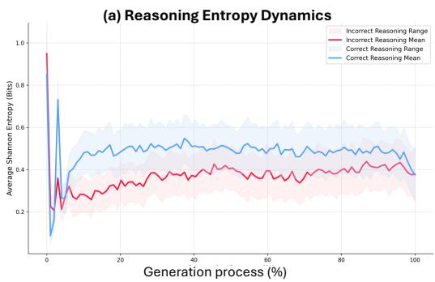

(b) Visual Attention evolving during the CoT generation  
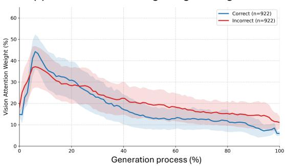  
Figure 1: Comparison of generation dynamics between correct and incorrect multimodal reasoning trajectories. (a) Average reasoning entropy across the generation process over samples, where correct predictions consistently maintain higher entropy than incorrect ones. (b) Evolution of visual attention during CoT generation, showing that correct reasoning trajectories preserve stronger visual grounding at the early stage of reasoning, while incorrect trajectories exhibit progressively weakened but still higher attention to visual evidence. Shaded regions denote standard deviations.

In this work, we revisit MLLM hallucination from the perspective of entropy-driven generation dynamics. While recent studies have begun leveraging entropy for decoding in both unimodal (He et al., 2026; Sharma & Lossfunk, 2025; Wang et al., 2025; Cheng et al., 2026; Zhu et al., 2026) and multimodal (Xu et al., 2026; Zou et al., 2025) settings, they primarily treat entropy as a token-level confidence signal. We instead argue that entropy encodes richer, trajectory-level information about how modality information is integrated over time. Through systematic analysis, we identify two recurring entropy patterns that statistically distinguish correct from hallucinated generation: (1) prolonged low-entropy (high-confidence) regimes, which counterintuitively correspond to ineffective multimodal consolidation and premature trajectories; and (2) abrupt entropy transitions associated with local instability and hallucination onset (see Figures 1–2 and Table 1). These findings indicate that hallucination is closely associated with dynamic failures in cross-modal interaction over time, beyond static reasoning difficulty alone.

Building on this insight, we propose SEED (Self-introspective Entropy-aware visual rE-alignment Decoding), an entropy-aware framework for MLLM reasoning. SEED continuously monitors the entropy dynamics of the reasoning trajectory during decoding; when the entropy signal indicates that generation is entering a hallucination-prone regime, SEED performs targeted re-alignment of visual attention, effectively correcting over-reliance on language priors at critical moments. Unlike prior approaches that intervene uniformly or rely on fixed heuristics, SEED adapts its intervention to the evolving state of cross-modal grounding. In summary, our contributions are threefold:

• We provide a systematic empirical analysis showing that hallucinations in MLLMs are consistently associated, at the population level, with two characteristic entropy patterns: sustained low-entropy convergence and abrupt entropy transitions, indicating an association with disrupted modality interaction dynamics beyond token-level uncertainty alone.

• We propose SEED, a training-free, entropy-aware decoding framework that monitors generation dynamics in real time and performs targeted visual re-alignment when hallucinationprone states are detected, directly addressing the identified failure modes.

• We conduct extensive experiments across multiple base MLLMs and diverse benchmarks. Results demonstrate that SEED delivers broad and substantial improvements in reasoning accuracy and hallucination robustness over strong baselines, introducing less than 5% computational overhead.

Local Entropy Transitions and Hallucination Onset Question: What can you infer about the living room in the image?  
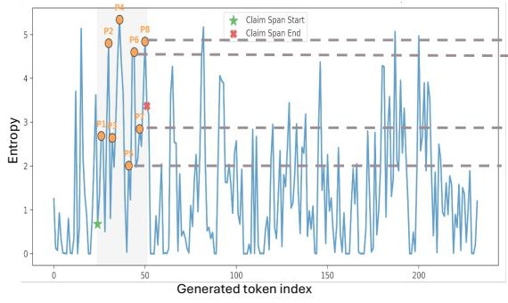

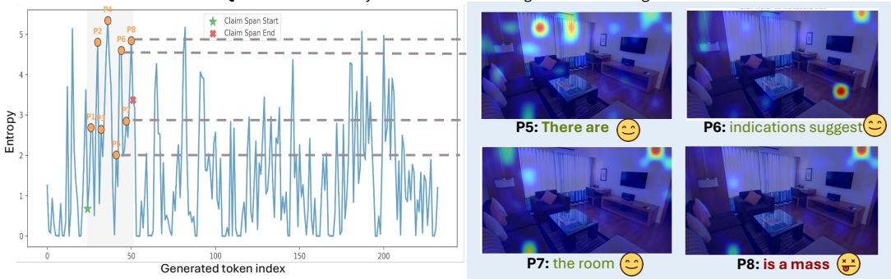  
Figure 2: A case study illustrating hallucination emergence during MLLM reasoning. The left panel shows entropy over generated tokens, while the right panel visualizes the corresponding visual attention patterns at selected reasoning steps (P5–P8). The gray region denotes the span of incorrect generation. Hallucinated reasoning coincides with sharp entropy spikes (P8) and progressively strong but diffused visual attention. More examples can be found in Appendix A.

## 2 THE PATTERN OF ENTROPY DYNAMICS IN MLLM REASONING

To understand the intrinsic mechanism underlying MLLM reasoning, we use information entropy to characterize the decoding process. While entropy is commonly interpreted as a measure of prediction uncertainty or LLMs’ confidence, we extend this perspective by asking whether entropy trajectories can reveal how modalities interact during generation. Specifically, we employ Qwen3- VL-8B-Instruct (Bai et al., 2025) to conduct CoT reasoning on the M3CoT (Chen et al., 2024) benchmark. During reasoning, the entropy at each decoding step t is tracked and calculated as $\begin{array} { r } { H _ { t } = - \sum _ { w \in \mathcal { V } } p ( \bar { w } \mid x _ { < t } ) \log \bar { p } ( w \mid x _ { < t } ) } \end{array}$ , where $x _ { < t }$ denotes the preceding token sequence and V the vocabulary.

Higher controlled uncertainty supports more effective MLLM reasoning. The first observation arises from 2,000 randomly selected Visual Question Answering (VQA) instances, stratified into correctly and incorrectly solved ones. As shown in Figure 1(a), we observe a consistent entropy-level separation: correctly answered samples maintain persistently higher entropy throughout the reasoning trajectory compared to incorrect ones. Interestingly, this trend remains stable across all decoding stages, suggesting that successful reasoning is not associated with maximal confidence, but rather with sustained uncertainty during generation.

We further analyze the evolution of visual attention during reasoning. Figure 1(b) shows that correctly answered samples initially allocate more attention to visual tokens, which then quickly decays and stabilizes at a relatively low level. In contrast, incorrect cases exhibit a slower decay of visua attention, maintaining higher visual attention in later stages of generation. These two findings are temporally coupled and suggest a strong connection between entropy dynamics and modality interaction: higher-entropy trajectories correspond to faster convergence of visual attention, while lower-entropy trajectories correspond to prolonged but ineffective visual dependency. This alignment suggests that entropy not only reflects uncertainty in reasoning generation, but also implicitly captures how rapidly and effectively visual information is integrated into the reasoning process.

Localized entropy spikes mark hallucination onset. To contextualize how hallucinations emerge during generation, we first conduct an instance-level trajectory analysis. One example is illustrated in Figure 2, where the “tidy room” has been falsely interpreted as “the room is a mess”. The hallucination emerges progressively over the course of the reasoning trajectory. Prior to the exact hallucinated content, the entropy curve exhibits multiple sharp spikes (P2, P4, P6, and P8), which correspond to the largest-magnitude transitions observed across the entire decoding process. Meanwhile, the model gradually loses concentration on relevant visual evidence and begins generating unsupported claims. Notably, the hallucinated reasoning span coincides with the unstable entropy transitions and the attention diffusion, suggesting a localized breakdown of multimodal coordination during reasoning.

Table 1: Population-level entropy statistics on 1,228 VQA trajectories (Qwen3-VL-8B). ∆H@onset is the mean entropy change at the aligned hallucination onset $( p { = } 0 ) ;$ the remaining columns are per-trajectory statistics. p-values are from two-sided Mann–Whitney U tests.
<table><tr><td></td><td></td><td>∆H@onset Low-entropy duration Spike frequency</td><td></td><td>Max ∆H</td></tr><tr><td>Correct  $\scriptstyle ( n = 4 6 5 )$ </td><td>0.012</td><td>17.6</td><td>0.085</td><td>1.762</td></tr><tr><td>Hallucinated  $\scriptstyle ( n = 7 6 3 )$ </td><td>0.245</td><td>21.4</td><td>0.101</td><td>1.974</td></tr><tr><td>p-value</td><td> $4 \times 1 0 ^ { - 4 }$ </td><td> $< 1 0 ^ { - 3 5 }$ </td><td> $< 1 0 ^ { - 9 }$ </td><td> $< 1 0 ^ { - 1 6 }$ </td></tr></table>

Population-level evidence. To verify that this pattern extends beyond individual cases, we analyze 1,228 randomly sampled VQA trajectories, including 763 hallucinated responses and 465 correct controls. For each hallucinated response, we align the first hallucinated token to position $p { = } 0$ and compute the token-to-token entropy change $\Delta \bar { H } _ { t } = H _ { t } - H _ { t - 1 }$ within ${ \bf a } \pm 2 0$ -token window; for each correct response, $p { = } 0$ is sampled uniformly at random. At hallucination onset, the mean entropy jump is more than 20× larger than in correct trajectories, while differences before the onset are substantially smaller (Table 1; full profile in Appendix A.3). Across the complete trajectories, we further measure the longest low-entropy run, the fraction of steps with $\Delta H _ { t } ^ { - } > \tau _ { \mathrm { r i s e } } ,$ , and the maximum entropy change. Hallucinated responses show higher values on all three measures, with significantly longer low-entropy runs, more frequent spikes, and larger maximum changes (two-sided Mann–Whitney U tests, all $p \overset { \_ } { < } 1 0 ^ { - 3 } )$ . These consistent associations motivate SEED’s use of entropy dynamics as a proxy signal for hallucination-prone states.

$\circledast$ To summarize, the two findings suggest that entropy trajectories encode substantially richer information than prediction uncertainty alone. Beyond serving as a confidence signal, entropy appears to implicitly reflect the evolving state of multimodal information consolidation throughout reasoning. Existing entropy-based decoding approaches largely inherit assumptions from unimodal LLMs and therefore interpret entropy primarily as a token-level uncertainty indicator. Our observations instead suggest that, in MLLMs, entropy also captures the stability of cross-modal grounding dynamics. We therefore hypothesize that effective multimodal reasoning requires maintaining a controlled entropy regime that enables stable multimodal information consolidation throughout generation.

## 3 LITERATURE REVIEW

## 3.1 MULTIMODAL LARGE LANGUAGE MODELS

Recent MLLMs have made substantial progress in multimodal reasoning, which requires both integrating visual perception with language understanding and reasoning over multimodal clues (Wu et al., 2024; Deitke et al., 2024; Zhu et al., 2025; Bai et al., 2025). A typical MLLM architecture consists of a modality alignment module (e.g., Q-Former (Li et al., 2023a)) bridging visual encoders (e.g., ViT-L/14 (Dosovitskiy et al., 2020)) and LLMs (e.g., Flan-T5 (Raffel et al., 2019), GPT-3 (Brown et al., 2020)).

To further enhance reasoning capabilities, Chain-of-Thought (CoT) prompting (Zheng et al., 2023; Gao et al., 2025; Zhang et al., 2024) and supervised fine-tuning (SFT) (Dai et al., 2023; Liu et al., 2023; Bai et al., 2025) have been widely adopted to refine step-by-step reasoning behaviors. More recently, reinforcement learning, such as Group Relative Policy Optimization (GRPO), and processlevel supervision have been introduced to improve reasoning faithfulness and long-horizon planning abilities (Zhou et al., 2025a; DeepSeek-AI et al., 2026; Deng et al., 2026b; Song et al., 2025; Xing et al., 2026).

## 3.2 MITIGATING HALLUCINATIONS IN MLLM REASONING

Hallucinations in MLLMs refer to outputs that are either inconsistent with the multimodal context or entirely ungrounded, including incorrect object attribution, fabricated attributes, and irrelevant reasoning (Li et al., 2023b; Liu et al., 2024b). Unlike hallucinations in language models, multimodal hallucinations arise from the intricate coupling between visual perception and language generation, making their causal factors harder to disentangle and mitigate.

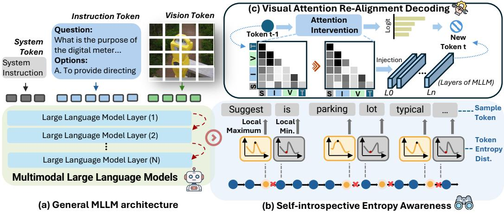  
Figure 3: Framework overview of the proposed SEED. The figure presents three parts: (a) A standard MLLM architecture processes system instructions and visual tokens through stacked decoder layers to perform multimodal reasoning. (b) A self-introspective mechanism monitors token-level entropy dynamics throughout the decoding process, capturing locally important spikes that signal shifts in reasoning dynamics. (c) When both detection conditions are met, our method performs an attention intervention during decoding to rectify the multimodal interaction. We refer to this process as Visual Attention Re-alignment Decoding.

In the context of large language models, a substantial body of work has studied hallucination mitigation through inference-time decoding strategies (He et al., 2026; Sharma & Lossfunk, 2025; Wang et al., 2025; Cheng et al., 2026; Zhu et al., 2026). These approaches leverage internal confidence signals, such as entropy or token probabilities, to detect and correct unreliable generations. For example, Wang et al. (2025) find that only a small subset of generated tokens exhibit high entropy and that these tokens correlate with critical reasoning transitions, motivating entropy-aware interventions that selectively regulate uncertain decoding steps.

Motivated by their efficiency, recent studies have extended similar ideas to MLLM hallucinations, developing training-free decoding interventions that adjust generation (Leng et al., 2024; Xu et al., 2025; 2026; Huo et al., 2025). Representative approaches include contrastive decoding and reasoning aware decoding, which aim to reduce hallucinations by suppressing hallucination-prone tokens or re-weighting generation based on uncertainty estimates (Leng et al., 2024; Xu et al., 2025; 2026). However, these methods largely inherit assumptions from unimodal settings and thus treat hallucination as a token-level or uncertainty-driven phenomenon.

## 4 METHODOLOGY

This section presents SEED (Self-introspective Entropy-aware Visual Re-alignment Decoding), illustrated in Figure 3. SEED is a training-free framework for improving MLLM reasoning that leverages entropy as a lens for monitoring the reasoning trajectory. We introduce a self-introspective mechanism to dynamically re-align visual attention throughout the reasoning trajectory.

## 4.1 PROBLEM FORMULATION

Given a multimodal large language model (MLLM) $\mathcal { M } _ { \theta }$ parameterized by θ, we consider it as a conditional sequence generator that produces an output token sequence based on both textual and visual inputs. For an image-grounded reasoning task, the input consists of a textual query x and an image v. These inputs are jointly encoded into a unified token sequence, which conditions the autoregressive decoding process. The model then generates an output sequence $y = ( y _ { 1 } , y _ { 2 } , \dots , y _ { T } )$

token by token, following the distribution

$$
y _ { t } \sim p _ { \theta } ( \cdot \mid x , v , y _ { < t } ) \propto \mathrm { s o f t m a x } ( f _ { \theta } ( \cdot \mid x , v , y _ { < t } ) ) ,\tag{1}
$$

where $y _ { < t }$ denotes the previously generated tokens, and $f _ { \theta }$ represents the unnormalized logits over the vocabulary. Under this formulation, multimodal reasoning can be viewed as a sequential decision process over tokens. Hallucination occurs when the generated sequence y deviates from the visual context in v. Rather than treating hallucination as an isolated prediction error, we study it as a dynamic phenomenon emerging along the generation trajectory. To this end, the token-level entropy is recorded to characterize the model’s decoding behavior at each step:

$$
H _ { t } = - \sum _ { w \in \mathcal { V } } p _ { \theta } ( w \mid x , v , y _ { < t } ) \log p _ { \theta } ( w \mid x , v , y _ { < t } ) .\tag{2}
$$

## 4.2 SELF-INTROSPECTIVE ENTROPY DYNAMICS AWARENESS

Given the entropy sequence $\{ H _ { t } \}$ obtained from Eq. (2), we maintain an online estimate of the entropy trajectory during decoding. Motivated by the association between hallucination onset and characteristic entropy transitions, we identify two criteria that jointly characterize unstable reasoning states. A multimodal reasoning trajectory is intervened upon when it satisfies both:

(1) Relative Low-entropy Regime. At a decoding step within the monitoring window, we identify relative overconfidence when the current entropy falls below the mean of the preceding trajectory:

$$
H _ { t } < \tau _ { \mathrm { l o w } } , \qquad t \in [ t _ { 0 } , t _ { 1 } ] ,\tag{3}
$$

where $t _ { 0 } < t _ { 1 }$ exclude the initial decoding steps and reserve sufficient steps for completing the CoT process. The threshold is adapted to the current trajectory as $\begin{array} { r } { \tau _ { \mathrm { l o w } } = \frac { 1 } { t - 1 } \dot { \sum _ { i < t } } H _ { i } } \end{array}$

(2) Local Entropy Spike. When a sharp transient increase in entropy exceeds a high threshold, the MLLM is considered to be experiencing instability arising from cross-modal conflicts. We detect this by:

$$
\Delta H _ { t } = H _ { t } - H _ { t - 1 } > \tau _ { \mathrm { r i s e } } ,\tag{4}
$$

where $\tau _ { \mathrm { r i s e } }$ is a hyperparameter. Jointly, we characterize hallucination-prone states as those in which the model operates under an overall overconfident convergence regime while simultaneously exhibiting localized high uncertainty. Such a global-local mismatch indicates a breakdown in multimodal coordination and substantially increases the risk of erroneous generation.

## 4.3 VISUAL ATTENTION RE-ALIGNMENT DECODING

Once a hallucination-prone state is detected, instead of performing token-level interventions at the final generation layer, we carry out an attention-level intervention designed to restore visual grounding and better coordinate multimodal interactions without modifying the MLLM’s architecture. The implementation consists of two phases.

Prefill phase. Given the input vision tokens $v = \{ v _ { 1 } , v _ { 2 } , \ldots , v _ { n } \}$ , to decouple visual saliency from textual reasoning, we hook the self-attention over the n image tokens from the final layer of the vision encoder and set it as the reference visual importance map:

$$
{ \mathcal { A } } _ { \mathrm { r e f } } = { \mathrm { M E A N } } _ { \mathrm { h e a d s } } \left( \sum _ { i } ^ { h } { \mathcal { A } } _ { i } \right) \in \mathbb { R } ^ { n \times n } , \quad { \mathrm { w h e r e ~ } } \{ { \mathcal { A } } _ { i } \} \in \mathbb { R } ^ { h \times n \times n } .\tag{5}
$$

We derive a visual guidance representation $e _ { \mathrm { v i s } }$ by using the reference attention weights to aggregate the visual embeddings $V { : }$

$$
e _ { \mathrm { v i s } } = \sum _ { j = 1 } ^ { n } \left( \frac { \mathcal { A } _ { \mathrm { r e f } , j } } { \sum \mathcal { A } _ { \mathrm { r e f } } } \right) \cdot V _ { j } .\tag{6}
$$

Therefore, $e _ { \mathrm { v i s } }$ compresses the high-dimensional visual information into a single vector that prioritizes salient tokens over “background” tokens, while effectively maintaining the original semantic structure of the input.

Injection phase. We inject the re-aligned representation at the first layer of the language model to influence the hidden states at the earliest possible stage. The hidden state $\mathbf { h } _ { t }$ is modified via a residual addition: $\mathbf { h } _ { t } ^ { \prime } = \mathbf { h } _ { t } + \boldsymbol \alpha \cdot { \boldsymbol e } _ { \mathrm { v i s } } ,$ , where α is the intervention strength hyperparameter that controls the degree of visual re-alignment. For Qwen3-VL, V denotes the layer-0 hidden states at the visual-token positions, which already lie in the residual-stream space. For Llama-3.2-Vision, whose visual features enter through cross-attention, $e _ { \mathrm { v i s } }$ is taken from the first cross-attention layer and rescaled to the root-mean-square magnitude of $\mathbf { h } _ { t }$ before injection, so that α has a consistent meaning across architectures.

## 5 EXPERIMENTS

## 5.1 EXPERIMENTAL SETUP

Benchmarks. Our method is evaluated across 6 VLM benchmarks covering 9 evaluation settings, grouped into two categories: vision-language reasoning and visual hallucination tasks. 1) Visionlanguage reasoning tasks (VStar, MMVP, VisOnly, and $\mathbf { M } ^ { \mathrm { 3 } } \mathbf { C } \mathbf { o } \mathbf { T } )$ mainly assess a model’s ability to perform semantically grounded reasoning by jointly integrating visual evidence, world knowledge and linguistic understanding, including compositional reasoning, contextual interpretation, and cross-modal inference. 2) Visual hallucination tasks include POPE (Li et al., 2023b) and HallusionBench (Guan et al., 2024), two specialized benchmarks designed to assess whether a model’s responses remain faithful to the provided context (e.g., images), thereby directly evaluating models reliability. More details about the benchmarks can be found in Appendix B.1.

Baseline models. We adopt three popular MLLMs (Qwen3-VL-8B-Instruct, Qwen3-VL-4B-Instruct (Bai et al., 2025), and Llama-3.2-11B-Vision (Grattafiori et al., 2024)) as backbones to verify that our proposed method generalizes effectively across models of different scales and architectures. For performance and efficiency comparison, we also evaluate against existing training-free hallucination mitigation and reasoning enhancement methods, including VCD (Leng et al., 2024), MemVR (Zou et al., 2025) and OPERA (Huang et al., 2024). We keep generation hyperparameters, including max\_tokens and temperature, consistent for fair comparison. More details about how these methods are designed to mitigate hallucinations can be found in Appendix B.1.

Implementation details and hyperparameter protocol. For all experiments, we monitor the entropy trajectory from decoding step $5 \ ( t _ { 0 } )$ to step $6 0 ~ ( t _ { 1 } )$ We set the entropy-rise threshold $\tau _ { \mathrm { r i s e } } { = } 0 . 2 5$ and inject visual features with strength $\alpha { = } 0 . 5$ for two decoding steps after each trigger. The monitoring window is motivated by an analysis of 270 VQA trajectories, which shows that hallucinated spans concentrate in the first 20% of generation (Appendix A.2). Following prior training-free methods (Zou et al., 2025), we select $\tau _ { \mathrm { r i s e } }$ and α on a small held-out subset of $\mathbf { \bar { M } ^ { 3 } C o T }$ We then fix all intervention hyperparameters across backbones and benchmarks. This tune-once configuration avoids per-setting optimization and simplifies the application of SEED. Section 5.3 reports the corresponding sensitivity analysis. The maximum generation length is 512 tokens, and all inference is conducted on four NVIDIA RTX 5090 GPUs with 32GB VRAM.

## 5.2 MAIN EXPERIMENTAL RESULTS

Tables 2 and 3 present a comprehensive comparison of zero-shot performance across multiple multimodal reasoning benchmarks and specialized hallucination benchmarks under varying model scales and decoding strategies. The core insights from the main experiments are summarized below.

Consistent accuracy uplift on comprehensive benchmarks. Compared to other baseline models, SEED delivers consistently larger and more stable performance gains across multiple benchmarks and baseline models, achieving average improvements of 3.2%–3.7% depending on the backbone and improving over the base model in 13 of 15 settings (vs. 9/15 for VCD and 3/14 for MemVR). In particular, MemVR and VCD often gain improvements on MMVP and VisOnly but fail consistently on $\mathbf { M } ^ { 3 } \mathbf { C o T }$ , which requires longer and more complex reasoning. In contrast, SEED maintains robust improvements across different models and evaluation cases.

Reduced hallucination. SEED demonstrates a specialized capability in mitigating hallucinations in MLLMs. On two hallucination-focused benchmarks, POPE and HallusionBench, SEED improves the Qwen3-VL-8B and Qwen3-VL-4B backbones by 2.5% and 3.6% on average, respectively. These results support our hypothesis that temporal entropy dynamics can serve as effective indicators of emerging hallucination-prone states, enabling timely intervention during reasoning.

Table 2: Comparisons across general reasoning benchmarks. The summary column reports the macro-average change in percentage points and the number of strictly positive changes over available settings. Base MLLMs use the default CoT setting.
<table><tr><td rowspan="2">Method</td><td colspan="5">Multimodal Reasoning &amp; Understanding</td><td rowspan="2">Summary ∆ (%) / improved</td></tr><tr><td>VStar↑</td><td>MMVP↑</td><td>VisOnlys↑</td><td>VisOnlyr↑</td><td>M³CoT↑</td></tr><tr><td>Qwen3-VL-8B</td><td>73.82</td><td>76.23</td><td>42.20</td><td>54.60</td><td>78.21</td><td></td></tr><tr><td>+ VCD</td><td>54.45(-19.4)</td><td>80.00(+3.8)</td><td>42.57(+0.4)</td><td>55.71(+1.1)</td><td>77.68(-0.5)</td><td>-2.93 / 3/5</td></tr><tr><td>+ MemVR</td><td>74.87(+1.0)</td><td>80.67(+4.4)</td><td>41.86(-0.3)</td><td>54.44(-0.2)</td><td>77.68(-0.5)</td><td>+0.89 /2/5</td></tr><tr><td>+ SEED (Ours)</td><td>83.25(+9.4)</td><td>76.33(+0.1)</td><td>47.00(+4.8)</td><td>54.37(-0.2)</td><td>79.97(+1.8)</td><td>+3.17 / 4/5</td></tr><tr><td>Qwen3-VL-4B</td><td>68.06</td><td>76.33</td><td>42.14</td><td>52.22</td><td>76.79</td><td></td></tr><tr><td>+ VCD</td><td>54.97(-13.1)</td><td>78.67(+2.3)</td><td>43.25(+1.1)</td><td>52.73(+0.5)</td><td>75.28(-1.5)</td><td>-2.13 / 3/5</td></tr><tr><td>+ MemVR</td><td>66.49(-1.6)</td><td>76.33(-0.0)</td><td>42.14(-0.0)</td><td>54.22(+2.0)</td><td>76.08(-0.7)</td><td>-0.06 / 1/5</td></tr><tr><td>+ SEED (Ours)</td><td>76.76(+8.7)</td><td>77.33(+1.0)</td><td>45.57(+3.4)</td><td></td><td>) 56.42(+4.2) 78.03(+1.2)</td><td>+3.71 / 5/5</td></tr><tr><td>Llama-3.2-11B</td><td>50.26</td><td>62.33</td><td>25.00</td><td>33.40</td><td>64.66</td><td></td></tr><tr><td>+ VCD</td><td>42.41(-7.8)</td><td>63.67(+1.3)</td><td>27.14(+2.1)</td><td>33.91(+0.5)</td><td>63.13(-1.5)</td><td>-1.08 /3/5</td></tr><tr><td>+ MemVR</td><td>40.31(-9.9)</td><td>60.30(-2.0)</td><td>21.57(-3.4)</td><td>27.78(-5.6)</td><td></td><td>-5.26 / 0/4</td></tr><tr><td>+ SEED (Ours)</td><td>57.61(+7.3)</td><td>61.33(-1.0)</td><td>28.00(+3.0)</td><td>36.90(+3.5)</td><td>67.58(+2.9)</td><td>+3.15 / 4/5</td></tr></table>

Table 3: Comparisons across hallucination benchmarks. The summary column reports the macroaverage change in percentage points and the number of positive changes over available settings. Base MLLMs use the default CoT setting.
<table><tr><td rowspan="2">Method</td><td colspan="4">Multimodal Hallucination</td><td rowspan="2">Summary ∆ (%) / improved</td></tr><tr><td>HalluBench↑</td><td>POPE-R↑</td><td>POPE-P↑</td><td>POPE-A↑</td></tr><tr><td>Qwen3-VL-8B</td><td>58.50</td><td>90.25</td><td>87.53</td><td>86.42</td><td></td></tr><tr><td>+ VCD</td><td>56.24(-2.3)</td><td>91.67(+1.4)</td><td>87.03(-0.5)</td><td>86.30(-0.1)</td><td>-0.37 / 1/4</td></tr><tr><td>+ MemVR</td><td>55.87(-2.6)</td><td>90.63(+0.4)</td><td>88.12(+0.6)</td><td>86.85(+0.4)</td><td>-0.31/3/4</td></tr><tr><td>+ SEED (Ours)</td><td>59.28(+0.8)</td><td>97.39(+7.1)</td><td>90.94(+3.4)</td><td>85.07(-1.3)</td><td>+2.49 / 3/4</td></tr><tr><td>Qwen3-VL-4B</td><td>54.80</td><td>90.92</td><td>88.64</td><td>87.96</td><td></td></tr><tr><td>+ VCD</td><td>53.84(-1.0)</td><td>90.60(-0.3)</td><td>87.87(-0.8)</td><td>87.37(-0.6)</td><td>-0.66 / 0/4</td></tr><tr><td>+ MemVR</td><td>55.27(+0.5)</td><td>90.77(-0.2)</td><td>87.69(-1.0)</td><td>88.39(+0.4)</td><td>-0.05 / 2/4</td></tr><tr><td>+ SEED (Ours)</td><td>54.84(+0.0)</td><td>98.45(+7.5)</td><td>92.84(+4.2)</td><td>90.43(+2.5)</td><td>+3.56 / 4/4</td></tr><tr><td>Llama-3.2-11B</td><td>42.38</td><td>91.33</td><td>88.02</td><td>85.04</td><td></td></tr><tr><td>+ VCD</td><td>43.66(+1.3)</td><td>86.23(-5.1)</td><td>80.80(-7.2)</td><td>76.43(-8.6)</td><td>-4.91 /1/4</td></tr><tr><td>+MemVR</td><td>43.16(+0.8)</td><td>91.02(-0.3)</td><td>87.86(-0.2)</td><td>83.83(-1.2)</td><td>-0.23 / 1/4</td></tr><tr><td>+ SEED (Ours)</td><td>46.42(+4.0)</td><td>91.10(-0.2)</td><td>87.10(-0.9)</td><td>83.27(-1.8)</td><td>+0.28 / 1/4</td></tr></table>

Failure analysis. SEED remains net positive on Llama-3.2-11B overall, improving average performance by 3.15 points on reasoning benchmarks and 0.28 points on hallucination benchmarks. However, it decreases accuracy on MMVP and POPE by 0.2–1.8 points. On Llama POPE, VCD degrades substantially across all three splits (by 5.1–8.6 points), whereas MemVR and SEED exhibit smaller and broadly comparable declines; their absolute scores differ by at most 0.8 points. This cross-method pattern suggests that the localized weakness is not specific to SEED. Two factors may contribute. First, Llama-3.2-Vision uses an earlier cross-attention-based design that injects visual information through a separate pathway, so $e _ { \mathrm { v i s } }$ requires scale alignment before being added to the textual residual stream. Second, POPE’s short binary answers amplify small token-level perturbations. A paired transition analysis on Llama POPE-Adversarial (Appendix B.5) supports the latter explanation: the number of false-positive answers is nearly unchanged (462→467), whereas invalid-format outputs increase (610→646). Thus, the net drop stems mainly from failures to produce responses in the required yes/no format rather than increased object hallucination.

Table 4: Comparison of attention intervention strategies across backbones on M3CoT (Chen et al., 2024). Each backbone is evaluated in terms of accuracy and efficiency (instance/s). All hyperparameters are kept consistent. The best and second-best results are highlighted in green and blue, respectively.
<table><tr><td rowspan="2">Attention Intervention Strategy</td><td colspan="2">Qwen3-VL-8B</td><td colspan="2">Qwen3-VL-4B</td></tr><tr><td>Accuracy ↑</td><td>Efficiency ↑</td><td>Accuracy ↑</td><td>Efficiency ↑</td></tr><tr><td>None (baseline)</td><td>78.21</td><td>0.20</td><td>76.79</td><td>0.22</td></tr><tr><td>+ Equal attention</td><td>80.24(+2.0)</td><td>0.05(×0.25)</td><td>78.02(+1.2)</td><td>0.07(×0.32)</td></tr><tr><td>+ Truncated SVD Project</td><td>54.28(-23.9)</td><td>0.17(×0.85)</td><td>50.23(-26.6)</td><td>0.18(×0.82)</td></tr><tr><td>+ ViT attention intervene</td><td>60.32(-17.9)</td><td>0.15(×0.75)</td><td>55.36(-21.4)</td><td>0.16(×0.73)</td></tr><tr><td>+ SEED (Ours)</td><td>79.97(+1.8)</td><td>0.19(×0.95)</td><td>78.03(+1.2)</td><td>0.21(×0.95)</td></tr></table>

## 5.3 ABLATION STUDIES

Variants of attention intervention strategies. As shown in Table 4, we further analyze multiple variants of visual intervention strategies. The results indicate that performance is highly sensitive to the design of attention intervention, highlighting the importance of properly coordinating multimoda attention during reasoning. Specifically, “Equal attention” resets the text-to-image attention map to equal weights; “Truncated SVD $\tt P r o j e c t ^ { * }$ performs SVD on the attention key matrix and retains only the top-k principal components to form a low-rank orthogonal subspace, so that the MLLM receives compressed, important visual information for re-alignment; “ViT attention intervene” randomly perturbs the attention distribution in the ViT layers to isolate the effect of visual information. More details of the variants can be found in Appendix B.6.

Although some variants (e.g., “Equal attention”) effectively improve models’ accuracy by 2.0%, they often sacrifice inference efficiency with 4× longer inference time, while efficient variants suffer severe performance drops. In contrast, SEED achieves a favorable balance between effectiveness and computational efficiency across various backbones. End-to-end, SEED increases latency by less than 5% (3.30 to 3.45 ms/token), compared with 54% for VCD, 157% for MemVR, and 333% for OPERA; full results appear in Appendix 6.

Hyperparameter sensitivity. Since SEED uses a single hyperparameter configuration across all models and benchmarks, hyperparameter sensitivity is examined in this section. On M3CoT with Qwen3-VL-8B, no tested setting across $\alpha \in [ 0 . 4 \dot { , } 0 . 7 ] , \tau _ { \mathrm { r i s e } } \in [ 0 . 2 2 5 , 0 . 3 0 0 ]$ , and $t _ { 1 } ~ \in ~ [ 4 0 , 7 0 ]$ falls below the base model, and all but $\alpha { = } 0 . 7$ improve on it (Appendix B.7). Together, the fixed cross-setting protocol and broad stable range indicate that SEED does not depend on narrowly tuned hyperparameter values.

## 6 CONCLUSION

In this work, we rethink hallucination in MLLMs as a dynamical phenomenon emerging from the decoding trajectory. By interpreting entropy as a structured signal of multimodal interaction, we show that hallucinations are closely tied to two coupled behaviors: a globally overconfident regime that reflects premature reliance on ineffective reasoning, and locally unstable entropy fluctuations that expose conflicts in cross-modal reasoning. Motivated by these findings, we propose an entropyaware self-introspective framework that uses entropy as a real-time diagnostic and intervention signal for targeted visual re-alignment during critical reasoning steps. This shifts hallucination mitigation from passive uncertainty modeling to active control over multimodal interaction dynamics. Empirically, SEED improves 21 of 27 model–benchmark settings, validating the proposed approach, as well as the broader premise that structured decoding signals can help identify and partially correct unreliable reasoning states. Looking forward, promising directions include query-dependent visual representations, and adaptive intervention strengths, which may further improve SEED’s robustness across model families. We believe that such entropy-centric analysis provides a foundation for more controllable and interpretable multimodal reasoning systems.

## AI USE STATEMENT

Generative AI tools were used to refine the writing of this manuscript and to assist with code development and debugging. All research design, methodological decisions, experimental procedures, and interpretation of results were executed by the authors. All AI-assisted text and code were reviewed, verified, and, where applicable, tested by the authors. The authors take full responsibility for the final content of this work.

## REFERENCES

Shuai Bai, Yuxuan Cai, Ruizhe Chen, Keqin Chen, Xionghui Chen, Zesen Cheng, Lianghao Deng, Wei Ding, Chang Gao, Chunjiang Ge, Wenbin Ge, Zhifang Guo, Qidong Huang, Jie Huang, Fei Huang, Binyuan Hui, Shutong Jiang, Zhaohai Li, Mingsheng Li, Mei Li, Kaixin Li, Zicheng Lin, Junyang Lin, Xuejing Liu, Jiawei Liu, Chenglong Liu, Yang Liu, Dayiheng Liu, Shixuan Liu, Dunjie Lu, Ruilin Luo, Chenxu Lv, Rui Men, Lingchen Meng, Xuancheng Ren, Xingzhang Ren, Sibo Song, Yuchong Sun, Jun Tang, Jianhong Tu, Jianqiang Wan, Peng Wang, Pengfei Wang, Qiuyue Wang, Yuxuan Wang, Tianbao Xie, Yiheng Xu, Haiyang Xu, Jin Xu, Zhibo Yang, Mingkun Yang, Jianxin Yang, An Yang, Bowen Yu, Fei Zhang, Hang Zhang, Xi Zhang, Bo Zheng, Humen Zhong, Jingren Zhou, Fan Zhou, Jing Zhou, Yuanzhi Zhu, and Ke Zhu. Qwen3-VL Technical Report. arXiv preprint arXiv:2511.21631, 11 2025. URL http://arxiv.org/abs/2511.21631.

Tom B. Brown, Benjamin Mann, Nick Ryder, Melanie Subbiah, Jared Kaplan, Prafulla Dhariwal, Arvind Neelakantan, Pranav Shyam, Girish Sastry, Amanda Askell, Sandhini Agarwal, Ariel Herbert-Voss, Gretchen Krueger, Tom Henighan, Rewon Child, Aditya Ramesh, Daniel M. Ziegler, Jeffrey Wu, Clemens Winter, Christopher Hesse, Mark Chen, Eric Sigler, Mateusz Litwin, Scott Gray, Benjamin Chess, Jack Clark, Christopher Berner, Sam McCandlish, Alec Radford, Ilya Sutskever, and Dario Amodei. Language Models are Few-Shot Learners. In 34th Conference on Neural Information Processing Systems (NeurIPS 2020), 5 2020.

Qiguang Chen, Libo Qin, Jin Zhang, Zhi Chen, Xiao Xu, and Wanxiang Che. M3CoT: A Novel Benchmark for Multi-Domain Multi-step Multi-modal Chain-of-Thought. In Proceedings of the Annual Meeting ofthe Associationfor Computational Linguistics, volume 1, pp. 8199–8221. Association for Computational Linguistics (ACL), 2024. ISBN 9798891760943. doi: 10.18653/V1/ 2024.ACL-LONG.446. URL https://aclanthology.org/2024.acl-long.446/.

Daixuan Cheng, Shaohan Huang, Xuekai Zhu, Bo Dai, Wayne Xin Zhao, Zhenliang Zhang, and Furu Wei. Reasoning with Exploration: An Entropy Perspective. In Proceedings of the AAAI Conference on Artificial Intelligence, 2026.

Wenliang Dai, Junnan Li, Dongxu Li, Anthony Meng Huat Tiong, Junqi Zhao, Weisheng Wang, Boyang Li, Pascale Fung, and Steven Hoi. InstructBLIP: Towards General-purpose Vision-Language Models with Instruction Tuning. arXiv preprint arXiv:2305.06500, 5 2023.

DeepSeek-AI, Daya Guo, Dejian Yang, Haowei Zhang, Junxiao Song, Peiyi Wang, Qihao Zhu, Runxin Xu, Ruoyu Zhang, Shirong Ma, Xiao Bi, Xiaokang Zhang, Xingkai Yu, Yu Wu, Z. F. Wu, Zhibin Gou, Zhihong Shao, Zhuoshu Li, Ziyi Gao, Aixin Liu, Bing Xue, Bingxuan Wang, Bochao Wu, Bei Feng, Chengda Lu, Chenggang Zhao, Chengqi Deng, Chenyu Zhang, Chong Ruan, Damai Dai, Deli Chen, Dongjie Ji, Erhang Li, Fangyun Lin, Fucong Dai, Fuli Luo, Guangbo Hao, Guanting Chen, Guowei Li, H. Zhang, Han Bao, Hanwei Xu, Haocheng Wang, Honghui Ding, Huajian Xin, Huazuo Gao, Hui Qu, Hui Li, Jianzhong Guo, Jiashi Li, Jiawei Wang, Jingchang Chen, Jingyang Yuan, Junjie Qiu, Junlong Li, J. L. Cai, Jiaqi Ni, Jian Liang, Jin Chen, Kai Dong, Kai Hu, Kaige Gao, Kang Guan, Kexin Huang, Kuai Yu, Lean Wang, Lecong Zhang, Liang Zhao, Litong Wang, Liyue Zhang, Lei Xu, Leyi Xia, Mingchuan Zhang, Minghua Zhang, Minghui Tang, Meng Li, Miaojun Wang, Mingming Li, Ning Tian, Panpan Huang, Peng Zhang, Qiancheng Wang, Qinyu Chen, Qiushi Du, Ruiqi Ge, Ruisong Zhang, Ruizhe Pan, Runji Wang, R. J. Chen, R. L. Jin, Ruyi Chen, Shanghao Lu, Shangyan Zhou, Shanhuang Chen, Shengfeng Ye, Shiyu Wang, Shuiping Yu, Shunfeng Zhou, Shuting Pan, S. S. Li, Shuang Zhou, Shaoqing Wu, Shengfeng Ye, Tao Yun, Tian Pei, Tianyu Sun, T. Wang, Wangding Zeng, Wanjia Zhao, Wen Liu, Wenfeng Liang, Wenjun Gao, Wenqin Yu, Wentao Zhang, W. L. Xiao, Wei An, Xiaodong Liu, Xiaohan Wang, Xiaokang Chen, Xiaotao Nie, Xin Cheng, Xin Liu, Xin Xie, Xingchao

Liu, Xinyu Yang, Xinyuan Li, Xuecheng Su, Xuheng Lin, X. Q. Li, Xiangyue Jin, Xiaojin Shen, Xiaosha Chen, Xiaowen Sun, Xiaoxiang Wang, Xinnan Song, Xinyi Zhou, Xianzu Wang, Xinxia Shan, Y. K. Li, Y. Q. Wang, Y. X. Wei, Yang Zhang, Yanhong Xu, Yao Li, Yao Zhao, Yaofeng Sun, Yaohui Wang, Yi Yu, Yichao Zhang, Yifan Shi, Yiliang Xiong, Ying He, Yishi Piao, Yisong Wang, Yixuan Tan, Yiyang Ma, Yiyuan Liu, Yongqiang Guo, Yuan Ou, Yuduan Wang, Yue Gong, Yuheng Zou, Yujia He, Yunfan Xiong, Yuxiang Luo, Yuxiang You, Yuxuan Liu, Yuyang Zhou, Y. X. Zhu, Yanhong Xu, Yanping Huang, Yaohui Li, Yi Zheng, Yuchen Zhu, Yunxian Ma, Ying Tang, Yukun Zha, Yuting Yan, Z. Z. Ren, Zehui Ren, Zhangli Sha, Zhe Fu, Zhean Xu, Zhenda Xie, Zhengyan Zhang, Zhewen Hao, Zhicheng Ma, Zhigang Yan, Zhiyu Wu, Zihui Gu, Zijia Zhu, Zijun Liu, Zilin Li, Ziwei Xie, Ziyang Song, Zizheng Pan, Zhen Huang, Zhipeng Xu, Zhongyu Zhang, and Zhen Zhang. DeepSeek-R1: Incentivizing Reasoning Capability in LLMs via Reinforcement Learning. arXiv preprint arXiv:2501.12948, 1 2026. doi: 10.1038/s41586-025-09422-z. URL http://arxiv.org/abs/2501.12948http: //dx.doi.org/10.1038/s41586-025-09422-z.

Matt Deitke, Christopher Clark, Sangho Lee, Rohun Tripathi, Yue Yang, Jae Sung Park, Mohammadreza Salehi, Niklas Muennighoff, Kyle Lo, Luca Soldaini, Jiasen Lu, Taira Anderson, Erin Bransom, Kiana Ehsani, Huong Ngo, Yensung Chen, Ajay Patel, Mark Yatskar, Chris Callison-Burch, Andrew Head, Rose Hendrix, Favyen Bastani, Eli Vanderbilt, Nathan Lambert, Yvonne Chou, Arnavi Chheda, Jenna Sparks, Sam Skjonsberg, Michael Schmitz, Aaron Sarnat, Byron Bischoff, Pete Walsh, Chris Newell, Piper Wolters, Tanmay Gupta, Kuo-Hao Zeng, Jon Borchardt, Dirk Groeneveld, Crystal Nam, Sophie Lebrecht, Caitlin Wittlif, Carissa Schoenick, Oscar Michel, Ranjay Krishna, Luca Weihs, Noah A Smith, Hannaneh Hajishirzi, Ross Girshick, Ali Farhadi, Aniruddha Kembhavi, and † Allen. Molmo and PixMo: Open Weights and Open Data for State-of-the-Art Vision-Language Models. arXiv preprint arXiv:2409.17146, 2024. URL https://molmo.allenai.org/blog.

Jiaqi Deng, Zonghan Wu, Zhan Heng, Xiaoshui Huang, Huan Huo, and Guandong Xu. Mind What Matters for Reasoning: Aligning Cross-Modal Attention via Selective Probability Mass Concentration. arXiv preprint arXiv:2609.29940, September 2026a. doi: 10.48550/arXiv.2609. 29940. URL https://arxiv.org/abs/2609.29940.

Jiaqi Deng, Zonghan Wu, Huan Huo, and Guandong Xu. A Comprehensive Survey of Knowledge-Based Visual Question Answering Systems: The Lifecycle of Knowledge in Visual Reasoning Task. IEEE Transactions on Knowledge and Data Engineering, 38(9):5548–5566, September 2026b. doi: 10.1109/TKDE.2026.3699946.

Alexey Dosovitskiy, Lucas Beyer, Alexander Kolesnikov, Dirk Weissenborn, Xiaohua Zhai, Thomas Unterthiner, Mostafa Dehghani, Matthias Minderer, Georg Heigold, Sylvain Gelly, Jakob Uszkoreit, and Neil Houlsby. An Image is Worth 16x16 Words: Transformers for Image Recognition at Scale. In 9th International Conference on Learning Representations, ICLR 2021, 10 2020.

Haodong Duan, Xinyu Fang, Junming Yang, Xiangyu Zhao, Yuxuan Qiao, Mo Li, Amit Agarwal, Zhe Chen, Lin Chen, Yuan Liu, Yubo Ma, Hailong Sun, Yifan Zhang, Shiyin Lu, Tack Hwa Wong, Weiyun Wang, Peiheng Zhou, Xiaozhe Li, Chaoyou Fu, Junbo Cui, Jixuan Chen, Enxin Song, Song Mao, Shengyuan Ding, Tianhao Liang, Zicheng Zhang, Xiaoyi Dong, Yuhang Zang, Pan Zhang, Jiaqi Wang, Dahua Lin, and Kai Chen. VLMEvalKit: An Open-Source Toolkit for Evaluating Large Multi-Modality Models. MM 2024 - Proceedings ofthe 32nd ACM International Conference on Multimedia, pp. 11198–11201, 7 2024. doi: 10.1145/3664647.3685520. URL https://arxiv.org/pdf/2407.11691.

Mehrdad Fazli, Bowen Wei, Ahmet Sari, and Ziwei Zhu. Mitigating Hallucination in Large Vision-Language Models via Adaptive Attention Calibration. arXiv preprint arXiv:2505.21472, 5 2025. URL https://arxiv.org/pdf/2505.21472.

Jun Gao, Yongqi Li, Ziqiang Cao, and Wenjie Li. Interleaved-Modal Chain-of-Thought. In 2025 IEEE/CVF Conference on Computer Vision and Pattern Recognition (CVPR), 3 2025. URL https://arxiv.org/pdf/2411.19488.

Aaron Grattafiori, Abhimanyu Dubey, Abhinav Jauhri, Abhinav Pandey, Abhishek Kadian, Ahmad Al-Dahle, Aiesha Letman, Arthu Hinsvark, Arun Rao, Aurelien Rodriguez, Auste Gregerson, Ava

Spataru, Baptiste Roziere, Bethany Biron, Binh Tang, Bobbie Chern, Chay Nayak, Chloe Bi, Chris Marra, Chris McConnell, Christoph Touret, Cristian Canton Ferrer, Cyrus Nikolaidis, Damien Allonsius, Danny Livshits, Dhruv Mahajan, Diego Perino, Dieuwke Hupkes, Egor Lakomkin, Ehab AlBadawy, Elina Lobanova, Emily Dinan, Eric Michael Smith, Filip Radenovic, Francisco Guzmán, Frank Zhang, Gabriel Synnaeve, Gabrielle Lee, Georgia Lewis Anderson, Govind Thattai, Graeme Nail, Gregoire Mialon, Guan Pang, Guillem Cucurell, Hailey Nguyen, Hannah Korevaar, Hu Xu, Hugo Touvron, Iliyan Zarov, Imanol Arrieta Ibarra, Isabel Kloumann, Ishan Misra, Ivan Evtimov, Jack Zhang, Jade Copet, Jaewon Lee, Jan Geffert, Jana Vranes, Jason Park, Jay Mahadeokar, Jeet Shah, Jelmer van der Linde, Jennifer Billock, Jenny Hong, Jenya Lee, Jeremy Fu, Jianfeng Chi, Jianyu Huang, Jiawen Liu, Jie Wang, Jiecao Yu, Joanna Bitton, Joe Spisak, Jongsoo Park, Joseph Rocca, Joshua Johnstun, Joshua Saxe, Junteng Jia, Kalyan Vasuden Alwala, Karthik Prasad, Kartikeya Upasani, Kate Plawiak, Ke Li, Kenneth Heafield, Kevin Stone, Khalid El-Arini, Krithika Iyer, Kshitiz Malik, Kuenley Chiu, Kunal Bhalla, Kushal Lakhotia, Lauren Rantala-Yeary, Laurens van der Maaten, Lawrence Chen, Liang Tan, Liz Jenkins, Louis Martin, Lovish Madaan, Lubo Malo, Lukas Blecher, Lukas Landzaat, Luke de Oliveira, Madeline Muzzi, Mahesh Pasupuleti, Mannat Singh, and Others. The Llama 3 Herd of Models. arXiv preprint arXiv:2407.21783, 7 2024. URL https://arxiv.org/pdf/2407.21783.

Tianrui Guan, Fuxiao Liu, Xiyang Wu, Ruiqi Xian, Zongxia Li, Xiaoyu Liu, Xijun Wang, Lichang Chen, Furong Huang, Yaser Yacoob, Dinesh Manocha, and Tianyi Zhou. HallusionBench: An Advanced Diagnostic Suite for Entangled Language Hallucination and Visual Illusion in Large Vision-Language Models. Proceedings of the IEEE Computer Society Conference on Computer Vision and Pattern Recognition, pp. 14375–14385, 3 2024. URL http://arxiv.org/abs/ 2310.14566.

Jiashu He, Meizhu Liu, Olaitan P Olaleye, Amit Agarwal, M Avendi, Yassi Abbasi, Matthew Rowe, Hitesh Laxmichand Patel, Paul Li, Tao Sheng, Sujith Ravi, and Dan Roth. Think Twice Before You Write – an Entropy-based Decoding Strategy to Enhance LLM Reasoning. arXiv preprint arXiv:2604.00018, 2026.

Qidong Huang, Xiaoyi Dong, Pan Zhang, Bin Wang, Conghui He, Jiaqi Wang, Dahua Lin, Weiming Zhang, and Nenghai Yu. OPERA: Alleviating Hallucination in Multi-Modal Large Language Models via Over-Trust Penalty and Retrospection-Allocation. In Proceedings of the IEEE/CVF Conference on Computer Vision and Pattern Recognition, 2024.

Fushuo Huo, Wenchao Xu, Zhong Zhang, Haozhao Wang, Zhicheng Chen, and Peilin Zhao. Selfintrospective Decoding: Alleviating Hallucinations For Large Vision-Language Models. In The Thirteenth International Conference on Learning Representations, 2025. URL https: //github.com/huofushuo/SID.

Ryo Kamoi, Yusen Zhang, Sarkar Snigdha Sarathi Das, Ranran Haoran Zhang, and Rui Zhang. VisOnlyQA: Large Vision Language Models Still Struggle with Visual Perception of Geometric Information. arXiv preprint arXiv:2412.00947, 7 2025. URL http://arxiv.org/abs/ 2412.00947.

Sicong Leng, Hang Zhang, Guanzheng Chen, Xin Li, Shijian Lu, Chunyan Miao, and Lidong Bing. Mitigating Object Hallucinations in Large Vision-Language Models through Visual Contrastive Decoding. In Proceedings of the IEEE/CVF Conference on Computer Vision and Pattern Recognition, 2024. URL https://github.com/DAMO-NLP-SG/VCD.

Junnan Li, Dongxu Li, Silvio Savarese, and Steven Hoi. BLIP-2: Bootstrapping Language-Image Pre-training with Frozen Image Encoders and Large Language Models. In Proceedings ofthe 40th International Conference on Machine Learning, 1 2023a.

Yifan Li, Yifan Du, Kun Zhou, Jinpeng Wang, Wayne Xin Zhao, and Ji-Rong Wen. Evaluating Object Hallucination in Large Vision-Language Models. EMNLP 2023 - 2023 Conference on Empirical Methods in Natural Language Processing, Proceedings, pp. 292–305, 10 2023b. URL http://arxiv.org/abs/2305.10355.

Yangguang Lin, Quan Fang, Yufei Li, Jiachen Sun, Junyu Gao, and Jitao Sang. HulluEdit: Single-Pass Evidence-Consistent Subspace Editing for Mitigating Hallucinations in Large Vision-Language

Models. arXiv preprint arXiv:2602.22727, 2 2026. URL https://arxiv.org/pdf/2602. 22727v1.

Fuxiao Liu, Kevin Lin, Linjie Li, Jianfeng Wang, Yaser Yacoob, and Lijuan Wang. Mitigating Hallucination in Large Multi-Modal Models via Robust Instruction Tuning. In 12th International Conference on Learning Representations, ICLR 2024. International Conference on Learning Representations, ICLR, 6 2024a. URL https://arxiv.org/pdf/2306.14565.

Hanchao Liu, Wenyuan Xue, Yifei Chen, Dapeng Chen, Xiutian Zhao, Ke Wang, Liping Hou, Rongjun Li, and Wei Peng. A Survey on Hallucination in Large Vision-Language Models. arXiv preprint arXiv:2402.00253, 2024b. URL https://github.com/lhanchao777/.

Haotian Liu, Chunyuan Li, Qingyang Wu, and Yong Jae Lee. Visual Instruction Tuning. Advances in Neural Information Processing Systems, 36:34892–34916, 12 2023.

Miao Pan, Wangjie Gan, Jintao Chen, Wenqi Zhang, Sun Bing, Jianwei Yin, and Xuhong Zhang. Ground What You See: Hallucination-Resistant MLLMs via Caption Feedback, Diversity-Aware Sampling, and Conflict Regularization. Proceedings of the AAAI Conference on Artificial Intelligence, 40(10):8242–8250, 3 2026. ISSN 2374-3468. doi: 10.1609/AAAI.V40I10.37772. URL https://ojs.aaai.org/index.php/AAAI/article/view/37772.

Colin Raffel, Noam Shazeer, Adam Roberts, Katherine Lee, Sharan Narang, Michael Matena, Yanqi Zhou, Wei Li, and Peter J. Liu. Exploring the Limits of Transfer Learning with a Unified Text-to-Text Transformer. Journal ofMachine Learning Research, 21:5485 – 5551, 10 2019.

Aman Sharma and Chopra Lossfunk. Think Just Enough: Sequence-Level Entropy as a Confidence Signal for LLM Reasoning. arXiv preprint arXiv:2510.08146, 10 2025. URL https://arxiv. org/pdf/2510.08146.

Junha Song, Sangdoo Yun, Dongyoon Han, Jaegul Choo, Byeongho Heo, and Naver AI Lab. RL makes MLLMs see better than SFT. arXiv preprint arXiv:2510.16333, 10 2025. URL https: //arxiv.org/pdf/2510.16333.

Guohao Sun, Hang Hua, Jian Wang, Jiebo Luo, Sohail Dianat, Majid Rabbani, Raghuveer Rao, and Zhiqiang Tao. Latent Chain-of-Thought for Visual Reasoning. arXiv preprint arXiv:2510.23925, 10 2025. URL http://arxiv.org/abs/2510.23925.

Shengbang Tong, Zhuang Liu, Yuexiang Zhai, Yi Ma, Yann LeCun, and Saining Xie. Eyes Wide Shut? Exploring the Visual Shortcomings of Multimodal LLMs. Proceedings of the IEEE Computer Society Conference on Computer Vision and Pattern Recognition, pp. 9568–9578, 4 2024. URL http://arxiv.org/abs/2401.06209.

Shenzhi Wang, Le Yu, Chang Gao, Chujie Zheng, Shixuan Liu, Rui Lu, Kai Dang, Xiong-Hui Chen, Jianxin Yang, Zhenru Zhang, Yuqiong Liu, An Yang, Andrew Zhao, Yang Yue, Shiji Song, Bowen Yu, Gao Huang, and Junyang Lin. Beyond the 80/20 Rule: High-Entropy Minority Tokens Drive Effective Reinforcement Learning for LLM Reasoning. In The Thirty-Ninth Annual Conference on Neural Information Processing Systems, 2025.

Penghao Wu and Saining Xie. V\*: Guided Visual Search as a Core Mechanism in Multimodal LLMs. Proceedings of the IEEE Computer Society Conference on Computer Vision and Pattern Recognition, pp. 13084–13094, 12 2023. URL http://arxiv.org/abs/2312.14135.

Tong Wu, Guandao Yang, Zhibing Li, Kai Zhang, Ziwei Liu, Leonidas Guibas, Dahua Lin, and Gordon Wetzstein. GPT-4V(ision) is a Human-Aligned Evaluator for Text-to-3D Generation. Proceedings ofthe IEEE Computer Society Conference on Computer Vision and Pattern Recognition, pp. 22227–22238, 1 2024. ISSN 10636919. doi: 10.1109/CVPR52733.2024.02098. URL https://arxiv.org/pdf/2401.04092.

Long Xing, Xiaoyi Dong, Yuhang Zang, Yuhang Cao, Jianze Liang, Qidong Huang, Jiaqi Wang, Feng Wu, and Dahua Lin. CapRL: Stimulating Dense Image Caption Capabilities via Reinforcement Learning. arXiv preprint arXiv:2509.22647, 2026. URL https://github.com/InternLM/ CapRL.

Xinhao Xu, Hui Chen, Mengyao Lyu, Sicheng Zhao, Yizhe Xiong, Zijia Lin, Jungong Han, and Guiguang Ding. Mitigating Hallucinations in Multi-modal Large Language Models via Image Token Attention-Guided Decoding. Proceedings ofthe 2025 Annual Conference ofthe Nations of the Americas Chapter of the Association for Computational Linguistics: Human Language Technologies: Long Papers, NAACL-HLT 2025, 1:1571–1590, 2025. doi: 10.18653/V1/2025. NAACL-LONG.75. URL https://aclanthology.org/2025.naacl-long.75/.

Zhongxing Xu, Zhonghua Wang, Zhe Qian, Dachuan Shi, Feilong Tang, Ming Hu, Shiyan Su, Xiaocheng Zou, Wei Feng, Dwarikanath Mahapatra, Yifan Peng, Minquan Lin, and Zongyuan Ge. Thinking in Uncertainty: Mitigating Hallucinations in MLRMs with Latent Entropy-Aware Decoding. In The IEEE/CVF Conference on Computer Vision and Pattern Recognition 2026, 2026. URL https://mlrm-LEAD.github.io/.

Zhuosheng Zhang, Aston Zhang, Mu Li, Web Services, Hai Zhao, George Karypis, and Alex Smola. Multimodal Chain-of-Thought Reasoning in Language Models. Transactions on machine Learning Research, 2 2024. ISSN 28358856. URL https://arxiv.org/pdf/2302.00923.

Ge Zheng, Bin Yang, Jiajin Tang, Hong-Yu Zhou, and Sibei Yang. DDCoT: Duty-Distinct Chainof-Thought Prompting for Multimodal Reasoning in Language Models. In 37th Conference on Neural Information Processing Systems (NeurIPS 2023), 2023.

Guanghao Zhou, Panjia Qiu, Cen Chen, Jie Wang, Zheming Yang, Jian Xu, and Minghui Qiu. Reinforced MLLM: A Survey on RL-Based Reasoning in Multimodal Large Language Models. arXiv preprint arXiv:2504.21277, 1(1), 4 2025a. URL https://arxiv.org/pdf/2504. 21277.

Guanyu Zhou, Yibo Yan, Xin Zou, Kun Wang, Aiwei Liu, and Xuming Hu. Mitigating Modality Prior-Induced Hallucinations in Multimodal Large Language Models via Deciphering Attention Causality. In 13th International Conference on Learning Representations, ICLR 2025, pp. 20241–20265. International Conference on Learning Representations, ICLR, 10 2025b. ISBN 9798331320850. URL https://arxiv.org/pdf/2410.04780.

Chenghua Zhu, Siyan Wu, Xiangkang Zeng, Zishan Xu, Zhaolu Kang, Yifu Guo, Yuquan Lu, Junduan Huang, and Guojing Zhou. EDIS: Diagnosing LLM Reasoning via Entropy Dynamics. arXiv preprint arXiv:2602.01288, 2 2026. URL https://arxiv.org/pdf/2602.01288.

Jinguo Zhu, Weiyun Wang, Zhe Chen, Zhaoyang Liu, Shenglong Ye, Lixin Gu, Hao Tian, Yuchen Duan, Weijie Su, Jie Shao, Zhangwei Gao, Erfei Cui, Xuehui Wang, Yue Cao, Yangzhou Liu, Xingguang Wei, Hongjie Zhang, Haomin Wang, Weiye Xu, Hao Li, Jiahao Wang, Nianchen Deng, Songze Li, Yinan He, Tan Jiang, Jiapeng Luo, Yi Wang, Conghui He, Botian Shi, Xingcheng Zhang, Wenqi Shao, Junjun He, Yingtong Xiong, Wenwen Qu, Peng Sun, Penglong Jiao, Han Lv, Lijun Wu, Kaipeng Zhang, Huipeng Deng, Jiaye Ge, Kai Chen, Limin Wang, Min Dou, Lewei Lu, Xizhou Zhu, Tong Lu, Dahua Lin, Yu Qiao, Jifeng Dai, and Wenhai Wang. InternVL3: Exploring Advanced Training and Test-Time Recipes for Open-Source Multimodal Models. arXiv preprint arXiv:2504.10479, 4 2025. URL https://arxiv.org/pdf/2504.10479.

Xin Zou, Yizhou Wang, Yibo Yan, Yuanhuiyi Lyu, Kening Zheng, Sirui Huang, Junkai Chen, Peijie Jiang, Jia Liu, Chang Tang, and Xuming Hu. Look Twice Before You Answer: Memory-Space Visual Retracing for Hallucination Mitigation in Multimodal Large Language Models. In Proceedings ofMachine Learning Research, volume 267, pp. 80873–80899. ML Research Press, 10 2025. URL https://arxiv.org/pdf/2410.03577.

## A MORE PRELIMINARY EXPERIMENT RESULTS

## A.1 LOCALIZED ENTROPY SPIKES MARK HALLUCINATION ONSET

As illustrated in Figure 4, we provide more cases to understand how hallucinations emerge. These cases show that hallucination is closely coupled with sharp transitions in the model’s local entropy. As shown in the figure, hallucinations typically manifest during entropy spike transitions (e.g., the $P 3  P 4$ transition in the top case and $P 4 \to P 6$ in the bottom case), where the model shifts from a stable reasoning state into a regime of high uncertainty. During these high-entropy phases, the MLLM begins to generate inconsistent content. For the top example, the MLLM selectively attributes fragility to only a subset of objects, despite clear visual evidence to the contrary.

Furthermore, we observe a distinct temporal coupling between these entropy spikes and the diffuseness of visual attention. While successful reasoning is characterized by a rapid convergence and stabilization of visual attention, hallucinatory trajectories exhibit a prolonged yet ineffective visual dependency. The spikes therefore provide a useful marker of a breakdown in modality integration: the model fails to effectively map visual tokens to its linguistic output, leading to the generation of “confident” but factually ungrounded falsehoods. This alignment suggests that entropy does not merely reflect token-level static output uncertainty, but also tracks changes in multimodal information interaction.

## A.2 HALLUCINATIONS MAINLY OCCUR AT THE EARLY STAGE

To characterize when erroneous reasoning emerges, we analyze 270 VQA reasoning trajectories and record the start and end tokens of each erroneous span (Figure 5). These spans are concentrated within the first 20% of generation and typically extend for approximately 50–70 tokens within the maximum length of 512 tokens. Their early occurrence, together with their association with local entropy spikes in Figure 4, motivates SEED’s focus on early decoding. When an entropy trigger is detected, SEED injects the attention-weighted visual feature $e _ { \mathrm { v i s } }$ at Layer 0 to reinforce visual grounding from the start of the language-model computation.

## A.3 POPULATION-LEVEL ENTROPY ANALYSIS

To complement the case studies above, we analyze 1,228 randomly sampled VQA trajectories generated by Qwen3-VL-8B, of which 763 contain hallucinations and 465 are correct and serve as controls (following the original accuracy distribution). For each hallucinated trajectory, we identify the first token at which hallucinated content appears and align it to relative position $p { = } 0$ . We then compute the mean token-to-token entropy change $\Delta H = H _ { t } - H _ { t - 1 }$ in a ±20-token window around the onset. Since correct trajectories have no hallucination onset, $p { = } 0$ is sampled uniformly at random for them. Table 5 reports the resulting profile. At the onset, the hallucination group exhibits a mean entropy jump of 0.245, more than 20× larger than that of the control group (0.012), followed by a sharp drop at p=+1. A two-sided Mann–Whitney U test on the per-response ∆H at p=0 gives $p = 4 \times 1 0 ^ { - 4 }$

We further compare three trajectory-level statistics (Table 1 in the main text): the length of the longest low-entropy run (low-entropy duration), the fraction of steps whose ∆H exceeds $\tau _ { \mathrm { r i s e } }$ (spike frequency), and the maximum ∆H within a trajectory. Hallucinated trajectories show significantly longer low-entropy durations $( p < 1 0 ^ { - 3 5 } )$ , more frequent spikes $( p < \mathrm { i } 0 ^ { - 9 } )$ , and larger maximum entropy changes $\dot { ( p } < 1 0 ^ { - 1 6 } )$ , consistent with the two patterns identified in Section 2. These results establish a robust statistical association; they do not by themselves establish that entropy spikes cause hallucinations, and SEED only relies on them as a detection signal.

Table 5: Mean token-to-token entropy change ∆H aligned to the hallucination onset $( p { = } 0 )$ . For ranges, the mean over the range (or its min–max) is reported.
<table><tr><td>p</td><td>-20~-11</td><td>-5</td><td>-4</td><td>-3</td><td>-2</td><td>-1</td><td>0</td><td>+1</td><td>+2~+5</td><td>+6~+20</td></tr><tr><td>Hallucinated</td><td>0.0020</td><td>0.0560</td><td>0.0011</td><td>0.0188</td><td>-0.0423</td><td>0.0065</td><td>0.2447</td><td>-0.1728</td><td>-0.0227~0.0081</td><td>-0.0025</td></tr><tr><td>Correct</td><td>0.0007</td><td>0.0119</td><td>0.0140</td><td>-0.0010</td><td>-0.0109</td><td>0.0047</td><td>0.0117</td><td>-0.0125</td><td>-0.0404~0.0265</td><td>0.0007</td></tr></table>

P4: While others are

Local Entropy Transitions and Hallucination Onset Question: Which property do these four objects have in common? Answer: Fragile  
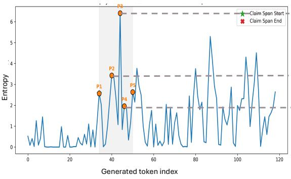

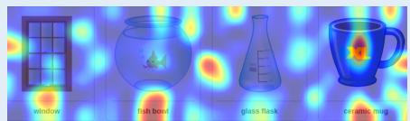  
P2: Some can break  
Analysis: Hallucinations occur during entropy spike transitions (from P3 to P4), immediately after the model shifts from a previously stable reasoning state into a highest uncertainty. In this phase, the model begins to consider inconsistent hypotheses, such as selectively attributing fragility (e.g., “some objects can break while others are not fragile”), despite the fact that the ground truth indicates that all objects in the image are fragile.

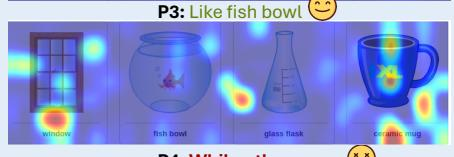

Question: What can you infer from the image? Option: A. The area needs adequate lighting", B. Someone has eaten a slice of pizza C. The eater will consume the pizza D.All of the above"  
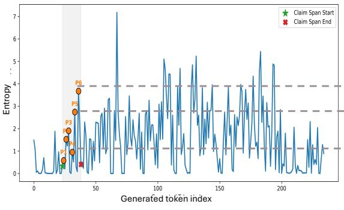

  
Analysis: Hallucinations occur during entropy spike transitions (from P4 to P6), with the model shifts from a previously stable reasoning state into a relatively high uncertainty. In this phase, the model directly draw to the false conclusion (e.g., “lights are sufficient”), despite the fact that the dark room in the background suggest the light is not enough.

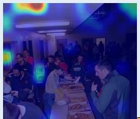  
P4: Lights on the celling

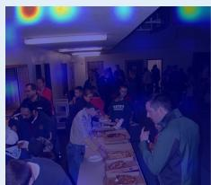  
P5: appears to be

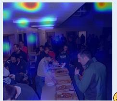  
P6: be providing sufficient

Figure 4: More examples illustrating hallucination emergence during MLLM reasoning. The left panel shows entropy over generated tokens, while the right panel visualizes the corresponding visual attention patterns at selected reasoning steps. The gray region denotes the span of incorrect generation. Hallucinated reasoning coincides with regions containing sharp entropy spikes and increasingly strong yet diffuse visual attention.

Entropy Dynamics and Breaking Claim Spans during CoT Generation  
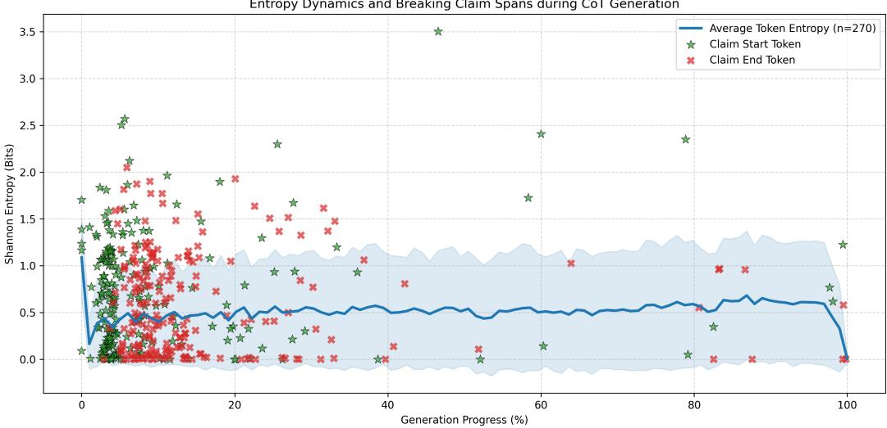  
Figure 5: Statistical analysis of wrong reasoning span sizes. The reasoning processes of 270 VQA samples are recorded. Results show that wrong reasoning claims concentrate in the first 20% of the generation process.

## B EXPERIMENT DETAILS

## B.1 BENCHMARKS

Our method is evaluated across multiple VLM benchmarks, grouped into two main categories: general vision-language understanding and visual hallucination task. 1) General multimodal reasoning task assesses how MLLM can effectively incorporate information and use it as the reference for complex reasoning tasks. There are four benchmarks in this category:

• M3CoT (Chen et al., 2024) specifically addresses three critical limitations found in existing MCoT evaluations: the absence of visual modal reasoning, the prevalence of single-step visual reasoning, and a lack of domain diversity. By facilitating a multi-domain, multi-step scenario, M3CoT provides a more rigorous environment for testing how MLLMs leverage knowledge from both textual and visual modalities for complex (long-horizon) and stepby-step reasoning. In our experiments, we use its validation set for testing, which contains 1,110 VQA instances.

• MMVP (Tong et al., 2024) is a compact benchmark that contains 300 image-question pairs. It is designed to evaluate vision-language models on “CLIP-blind” visual features. Higher performance on MMVP indicates the MLLMs can genuinely utilize visual information rather than relying on language priors.

• VisOnly (Synthetic and Real splits) (Kamoi et al., 2025) evaluates MLLMs on 12 geometric perception tasks, and reveals that base MLLMs often cannot accurately perceive basic geometric information in images. The dataset contains a synthetic split (700 questions) and a real split (900 questions).

• VStar (Wu & Xie, 2023) proposes a visual search mechanism together with a benchmark to address a critical limitation in current MLLMs: the inability to selectively process visual details in high-resolution or crowded images.

2) Visual hallucination task. In addition to assessing general MLLM capabilities, we conduct evaluations on two specialized benchmarks, where our method demonstrates strong effectiveness in mitigating hallucination:

• POPE (Li et al., 2023b) is a diagnostic benchmark for probing object hallucination in MLLMs via binary (yes/no) questions about object presence. It comprises 3,000 questions constructed under different sampling strategies (e.g., random, popular, adversarial) to systematically test whether models can correctly assert the existence of certain objects.

Table 6: Performance comparison of SOTA methods and SEED in latency, throughput, and time cost. All methods are built on the Qwen3-VL-8B-Instruct backbone. The experiment is conducted on M3CoT and all models are prompted to generate CoT. Note that all results are evaluated under an inference acceleration framework.
<table><tr><td>Method</td><td>Latency ↓ (ms/token)</td><td>Throughput ↑ (instance/s)</td><td>Time Cost ↓ (min)</td></tr><tr><td>Greedy OPERA VCD</td><td>3.30 (×1.00) 14.28 (×4.33) 5.08 (×1.54)</td><td>0.941 (×1.00) 0.224 (×0.24) 0.598 (×0.63) 0.359 (×0.38)</td><td>20.0 (×1.00) 85.0 (×4.25) 31.5 (×1.58) 52.5 (×2.63)</td></tr><tr><td>MemVR SEED</td><td>8.47 (×2.57) 3.45 (×1.05)</td><td></td><td></td></tr><tr><td></td><td></td><td>0.897 (×0.95)</td><td>21.0 (×1.05)</td></tr></table>

• HallusionBench (Guan et al., 2024) comprises 346 images paired with 1,129 questions, all meticulously crafted by human experts. It is specifically designed to evaluate multimodal hallucination across diverse visual reasoning scenarios.

## B.2 BASELINE MODELS

• Base Models. We select Qwen3-VL-4B-Instruct, Qwen3-VL-8B-Instruct (Bai et al., 2025), and Llama-3.2-11B-Vision (Grattafiori et al., 2024) as our primary backbones to ensure diversity in both model scale and architectural design. Specifically, Qwen3-VL models represent strong decoder-only self-attention architectures at different parameter scales (4B vs 8B), enabling us to analyze scaling effects on our proposed method. In contrast, Llama-3.2-11B-Vision adopts a cross-attention-based design, providing a complementary paradigm for multimodal fusion. This combination allows us to comprehensively evaluate the generality of our method across distinct model architectures and capacities.

• Other Baseline Models. We also consider alternative training-free decoding strategies that aim at alleviating MLLMs’ hallucinations, including VCD (Leng et al., 2024) and MemVR (Zou et al., 2025). Specifically, VCD mitigates hallucination by contrasting model predictions under visual-conditioned and text-only contexts during decoding, reweighting candidate tokens to favor those consistent with visual evidence. MemVR improves visual reasoning by maintaining a visual memory bank of vision representations, enabling the model to retrieve and reinforce previously grounded information to ensure consistency across multi-step reasoning.

## B.3 REPRODUCIBILITY

Besides M3CoT (Chen et al., 2024), we employ OpenCompass VLMEvalKit (Duan et al., 2024) to conduct evaluations for fair comparison. We follow the official evaluation document of M3CoT for its own evaluation. During the inference of baseline models (MemVR and VCD), we follow their prompt instructions if they are available.

## B.4 COMPUTATION COSTS

As summarized in Table 6, SEED introduces negligible inference overhead (∼5% increase in time cost per 100 tokens) while improving performance over the greedy baseline.

## B.5 FAILURE ANALYSIS

Paired transition analysis. To understand when SEED’s interventions are harmful, we compare the per-sample predictions of the base model and SEED on the representative failure case, Llama-3.2- 11B-Vision on POPE-Adversarial (Table 7). SEED corrects 408 of the 1,137 samples the base model answers incorrectly, while flipping 454 correct answers, a net change of 46 samples. Breaking down this net degradation, the number of false-positive answers (i.e., hallucinated objects) barely changes (462→467), whereas invalid-format outputs increase from 610 to 646. Hence the drop is mainly associated with instruction-following failures under constrained binary evaluation—specifically, outputs that do not follow the required yes/no format—rather than a systematic increase in object hallucination. Interestingly, persistently wrong samples receive the strongest intervention signals (highest trigger ratio, most trigger events, and longest intervention span) yet remain hard to correct, suggesting that entropy dynamics identify difficult reasoning states even though not all of them are amenable to visual re-alignment. POPE’s short trajectories and binary outputs further make it sensitive to local token-level perturbations introduced during intervention.

Table 7: Paired transition analysis between the base model and SEED on POPE-Adversarial with Llama-3.2-11B-Vision.
<table><tr><td>Transition</td><td>Interpretation</td><td>Count</td><td>Rate</td><td>Trigger ratio</td><td>Avg. triggers</td><td>Avg. span</td></tr><tr><td>Correct → Wrong</td><td>Harmful intervention</td><td>454</td><td>15.13%</td><td>46.26%</td><td>2.04</td><td>7.95</td></tr><tr><td>Wrong → Correct</td><td>Successful correction</td><td>408</td><td>13.60%</td><td>43.38%</td><td>2.20</td><td>8.69</td></tr><tr><td>Wrong → Wrong</td><td>Unresolved error</td><td>729</td><td>24.30%</td><td>60.22%</td><td>2.93</td><td>11.84</td></tr></table>

## B.6 ABLATION VARIANTS

Here are the implementation details of attention intervention strategies.

• Equal attention: Earlier work (Fazli et al., 2025) shows that even $( \mathrm { i . e . }$ , uniform) visual attention can help MLLMs alleviate hallucinations. Following this idea, we set up equal attention, which naively re-guides the model to attend to important visual evidence.

• Truncated SVD: Following Lin et al. (2026), we construct a low-rank visual projection matrix using truncated singular value decomposition (SVD) to constrain attention intervention within a compact visual subspace. Given the visual key matrix $K _ { v } \in \mathbb R ^ { N _ { v } \times d }$ , we first perform singular value decomposition:

$$
K _ { v } = U \Sigma V ^ { \top } .
$$

We then retain the top-k principal components from V to obtain a low-rank orthogonal basis $V _ { k } \in \mathbb { R } ^ { d \times k }$ . The visual projection matrix is constructed as

$$
P _ { \mathrm { v i s } } = V _ { k } V _ { k } ^ { \top } ,
$$

which projects attention intervention into the dominant visual subspace while avoiding explicit matrix inversion. The method is designed to keep the salient visual information and re-inject it into the reasoning process.

• ViT attention intervene: Similar to multimodal contrastive methods (Liu et al., 2024a; Zhou et al., 2025b) that remove images to isolate the impact of language priors from the reasoning, we instead randomly perturb the attention map during the ViT self-attention process so the generated visual embedding will be ineffective. By doing so, we conduct contrastive decoding by actively comparing the results between intervened visual information and normal ones. The experimental results in Table 4 show that such contrastive decoding still requires careful design of interactions.

## B.7 HYPERPARAMETER ANALYSIS

All hyperparameters are selected once and shared across all backbones and benchmarks. Table 8 reports the sensitivity of SEED (Qwen3-VL-8B, M3CoT) to the injection coefficient α, the trigger threshold $\tau _ { \mathrm { r i s e } } .$ , and the end of the monitoring window t1, varying one hyperparameter at a time while fixing the others at their default values $( \alpha { = } 0 . 5 , \tau _ { \mathrm { r i s e } } { = } 0 . 2 5 , t _ { 0 } { = } 5 , t _ { 1 } { = } 6 0 )$ . No setting falls below the base model, and all but one improve on it. Figure 6 visualizes the sensitivity to α and $\tau _ { \mathrm { r i s e } } .$ , and further results, including the start of the monitoring window, are shown in Figure 7.

## B.8 CASE STUDIES

We further present a case study to investigate the effectiveness of our method and its impact on the entropy trajectory during decoding. As shown in Figure 8, although both the baseline Qwen3-VL-8B and SEED yield the same correct final answer, SEED exhibits improved visual grounding and produces more faithful intermediate descriptions. Specifically, Qwen3-VL-8B incorrectly rejects the premise by claiming that the umbrella handle is not broken, which is not supported by the visual evidence, where the umbrella handle is obviously missing. In contrast, SEED better aligns its reasoning with the image and incorporates this detail into a coherent explanation. This suggests that SEED not only preserves answer correctness but also enhances the reliability of the reasoning process, which is more important in long-horizon reasoning applications.

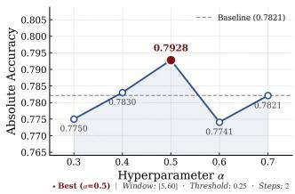

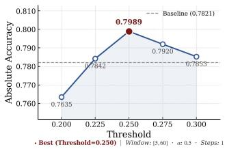  
Figure 6: Hyperparameter analysis of injection ratios (left) and entropy threshold (right).

Table 8: Hyperparameter sensitivity on $\mathbf { M } ^ { 3 } \mathbf { C o T }$ with Qwen3-VL-8B (base model: 78.21). Gains over the base model are shown in parentheses.
<table><tr><td>α</td><td>0.40 78.30 (+0.09)</td><td>0.45 78.79 (+0.58)</td><td>0.50 79.89 (+1.68)</td><td>0.70 78.21 (+0.00)</td></tr><tr><td> $\tau _ { \mathrm { r i s e } }$ </td><td>0.225 78.42 (+0.21)</td><td>0.250 79.89 (+1.68)</td><td>0.275 79.20 (+0.99)</td><td>0.300 78.53 (+0.32)</td></tr><tr><td> $t _ { 1 }$ </td><td>40 79.12 (+0.91)</td><td>50 79.48 (+1.27)</td><td>60 79.89 (+1.68)</td><td>70 78.91 (+0.70)</td></tr></table>

Figure 9 provides a comprehensive case study of how SEED improves both reasoning quality and underlying modality interaction dynamics. From the top qualitative analysis, the baseline model produces partially unreliable reasoning, ignoring the fact that the umbrella has a broken handle, leading to hallucination-prone intermediate steps. In contrast, SEED generates more coherent and visually grounded reasoning, where key inference steps are supported by image evidence, resulting in the correct answer.

This behavioral difference is further reflected in the attention dynamics (bottom). As shown in the vision attention plot, the baseline exhibits relatively unstable attention with a slow decay, maintaining non-trivial attention weights even in later stages of generation. This suggests prolonged but ineffective reliance on visual information, which correlates with its inconsistent reasoning. In contrast, after the intervention trigger, SEED significantly boosts visual attention in the early-to-mid stages, followed by a sharper decay and stabilization, indicating more efficient integration of visual evidence into the reasoning process. Importantly, this pattern closely matches the attention dynamics identified in Figure 1(b), suggesting that the intervention effectively steers the model toward the desirable modality interaction regime.

## C LIMITATIONS

Although SEED effectively mitigates hallucinations during multimodal reasoning, it has several limitations. First, the relationship between entropy dynamics and hallucination established in this work is correlational; SEED uses it as a detection signal without claiming causality. Second, the injected visual representation is query-independent, and aligning it with the cross-attention-based Llama-3.2-Vision backbone introduces an additional compatibility constraint associated with localized degradations (Appendix B.5); architecture-specific feature alignment may further improve robustness. Third, while the fixed trigger policy simplifies deployment across settings, an adaptive policy may better capture model-specific reasoning dynamics. In particular, the model could learn to self-evaluate the trigger conditions and the attention reweighting strategy across different reasoning dynamics.

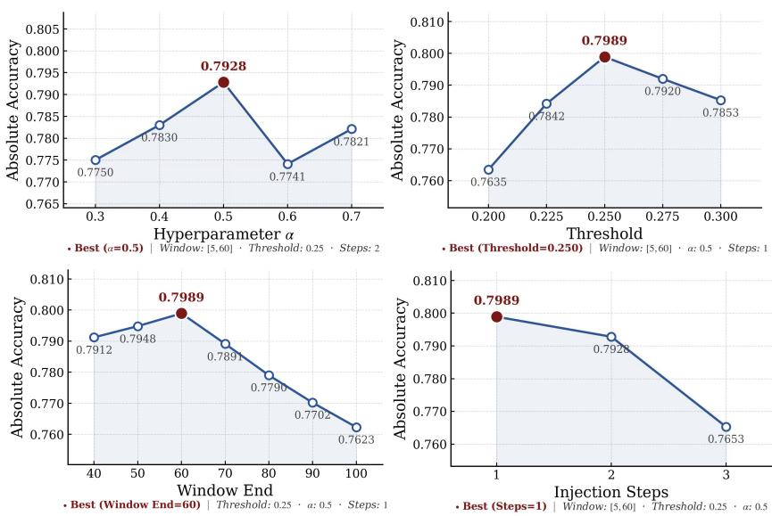

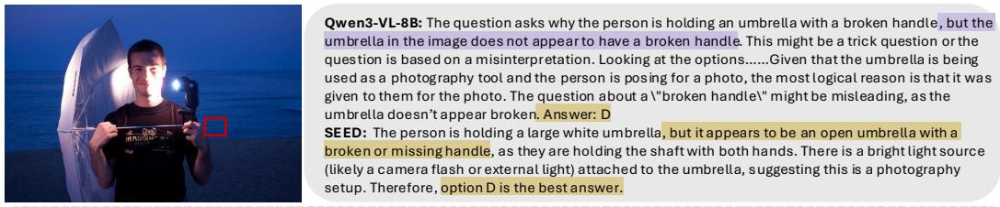  
Figure 7: Additional hyperparameter analysis of the entropy threshold, injection ratio, and the start and end steps of the monitoring window.  
illusion. Is the center area on the left smaller than Figure 8: A case study illustrating that SEED not only improves final answer accuracy but also the center area on the right? Correct: Noproduces more reliable intermediate reasoning steps. Hallucinated content is highlighted in purple, Qwen3-VL-:2B Yes Ours: Nowhile correct reasoning is highlighted in yellow.

Question: Why is the person holding an umbrella with a broken handle? Options: A. They were caught in the rain unexpectedly B. The umbrella was a family heirloom C. The umbrella was broken while D. The umbrella was given to them for the photo

Future work could investigate adaptive intervention mechanisms that learn to modulate visual re-policy interest rates of the Central Banks in alignment based on uncertainty evolution, reasoning trajectories, or model-specific behaviors.

## Qwen3-D SOCIAL IMPACTS

The social impacts of this work are primarily centered on improving the reliability and trustwor-POPE MMVPthiness of multimodal AI systems deployed in real-world settings. By mitigating hallucinations in Please answer yes or no. Correct: Yes animal in the image? A. 6 B. 5 Correct: Bmultimodal large language models, the proposed approach can enhance decision-support systems in high-stakes domains such as education, healthcare, and accessibility technologies, where incorrect or Ours: No Qwen3-VL-2B: A Ours: Boverconfident model outputs may lead to misleading conclusions or suboptimal decisions. Improved grounding interactions between visual and textual modalities also contribute to more transparent and interpretable AI behavior, which is critical for user trust and regulatory compliance. Furthermore, reducing hallucination-induced errors can lower the risk of misinformation propagation in AI-assisted content generation systems, thereby supporting healthier information ecosystems.

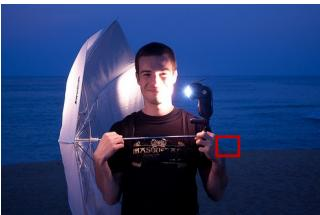

Question: Why is the person holding an umbrella with a broken handle?

Options: A. They were caught in the rain unexpectedly B. The umbrella was a family heirloom C. The umbrella was broken while D. The umbrella was given to them for the photo

Ground truth: From the picture, it isn't rainy. And no evidence can support the option B and C. The image "an umbrella handle in someone's hands" and "a metal end on an umbrella handle" suggest that the person in the photo is holding an umbrella with a broken handle. Additionally, the clue "They were given the umbrella for the photo" indicates that the person did not own the umbrella and was simply holding it for the sake of the photo. Therefore, the correct answer is D, as the broken umbrella was likely provided to them for the photo shoot.

Qwen3-VL-8B: The person is standing on a beach at dusk or night, as indicated by the dark blue sky and ocean.2. The person is holding a large white umbrella, which appears to be a photography reflector or diffuser, not a typical rain umbrella.3. The umbrella is attached to a light source (a flash or strobe light) via a rod, which is mounted on the umbrella's shaft. This setup is commonly used in photography to bounce or diffuse light. 4. The person is smiling and posing for the camera, suggesting this is a staged photo shoot, not a situation where they are caught in the rain. 5. The umbrella handle is not visibly broken in the image. The person is holding the shaft of the umbrella with both hands, and the umbrella is open and stable. There is no indication of damage to the handle.6. The question asks why the person is holding an umbrella with a broken handle, but the umbrella in the image does not appear to have a broken handle. This might be a trick question or the question is based on a misinterpretation.7. Looking at the options: A. They were caught in the rain unexpectedly — This is unlikely because it’s dark, and the umbrella is being used as a light reflector, not for rain protection. B. The umbrella was a family heirloom — There is no visual evidence to support this. C. The umbrella was broken while they were using it — The umbrella appears intact and is being used as a tool for photography. D. The umbrella was given to them for the photo — This is plausible, as the umbrella is being used as a photography accessory. The person is holding it in a way that suggests it’s part of the setup, not because it’s broken.Given that the umbrella is being used as a photography tool and the person is posing for a photo, the most logical reason is that it was given to them for the photo. The question about a \"broken handle\" might be misleading, as the umbrella doesn’t appear broken. Answer: D.

SEED (Ours) : Step 1: Analyze the context of the image. The person is standing on a beach at dusk or night. The sky and ocean are dark blue, indicating low light conditions. The person is holding a large white umbrella, but it appears to be an open umbrella with a broken or missing handle, as they are holding the shaft with both hands. There is a bright light source (likely a camera flash or external light) attached to the umbrella, suggesting this is a photography setup. Step 2: Evaluate the options. A. "They were caught in the rain unexpectedly\" - This is unlikely because it's dark and appears to be nighttime or dusk, and there are no visible raindrops or wet surfaces. Also, the umbrella is being used as a light reflector, not for protection from rain. B."The umbrella was a family heirloom\" - There is no visual evidence to suggest this. The umbrella looks like a standard photography reflector umbrella, not a cherished family item. C. \"The umbrella was broken while they were using it\" - This is possible, but the broken handle seems to be part of the setup, not an accident. The person is holding it deliberately and it's being used as a light reflector. The breakage might be intentional or part of the setup, but it doesn't explain why they are using it.D. "The umbrella was given to them for the photo\" - This is the most plausible. The umbrella is being used as a reflector for the light. In photography, reflectors are often used to bounce light onto the subject. The broken handle might be intentional to make it look more authentic or to allow for a better grip for the setup. The person is smiling and posing, indicating this is a staged photo.Step 3: Choose the best answer.The most logical explanation is that the umbrella is being used as a reflector for the photo, and the broken handle is part of the setup. Therefore, option D is the best answer. Answer: D

Vision Attention Weight vs Token Position — Sample ID 5 Baseline vs SEED Intervention  
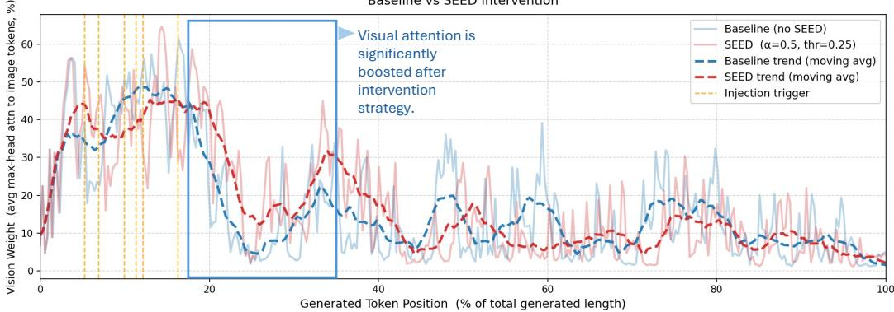  
Figure 9: Full analysis on one example to demonstrate the effectiveness of SEED. The hallucination related text is highlighted in yellow and the statement related to correct reasoning is highlighted in blue.