# EmoReward: Self-Evolving Reward Calibration for Emotional Video Generation RL

Mingzhe Zheng1,2,\* Yue Wu2,‡ Jing Tan2 Chang Zou2 Dengyang Jiang1 Zeyue Tian1 Xuanhua He1 Ryan Xu2 Yunyang Ge2 Sihui Ji2 Yunlong Lin2 Kaihang Pan2 Hongru Yan2 Sixiang Chen2 Dianyi Wang3 Julian Zhang4 Weijie Kong2 Changlin Li2 Lanqing Guo2 Zhao Zhong2 Qifeng Chen1,† Harry Yang1,†

\*Work done during internship at Tencent Hunyuan ‡Project leader †Corresponding author

1The Hong Kong University of Science and Technology 2Tencent Hunyuan 3Fudan University 4University of Waterloo

## Abstract

Group Relative Policy Optimization (GRPO) has advanced generative model post-training in verifiable domains such as code and mathematics, but evaluating video quality, especially emotional expression, often depends on subjective aesthetics and has no uniquely correct target. Existing approaches typically rely on fixed rewards for visual quality, motion quality, and text alignment that poorly capture emotional intent and can invite reward hacking, while reinforcement learning from human feedback (RLHF) is dificult to scale and subject to individual aesthetic diferences that complicate the calibration of facial, body motion, and chromatic cues across narrative contexts. We introduce EmoReward, a new self-evolving training mechanism that distills evidence reliability from reward traces collected during an actual training run to adaptively guide multi-reward weight allocation in subsequent training by determining which emotional evidence to trust and how much to weight it. EmoReward first plans specific grounding cues from the emotional prompt to guide evaluation, then uses heterogeneous signal primitives to score the generated video during the act stage. Reflective Reward Gating calibrates their contributions through instance-level gates for phase, face confidence, conflict, and subtlety, then renormalizes weights over the active set to produce the sample’s fused reward. RewardMemory then estimates each primitive’s reliability from rollout scores and outcomes within each emotional regime in the finished training run, then fixes bounded multipliers that calibrate fusion weights in the next training run without updating reward models. Experiments on HunyuanVideo 1.5 show improvements across multiple RL algorithms and compare EmoReward with other agentic reward methods under SAGE-GRPO. Ablations and transfer experiments on SD 3.5 and FLUX further support adaptive reward calibration for visual generation.

€ Project Page: https://emoreward-project.github.io/

§ GitHub Repo: https://github.com/Tencent-Hunyuan/EmoReward

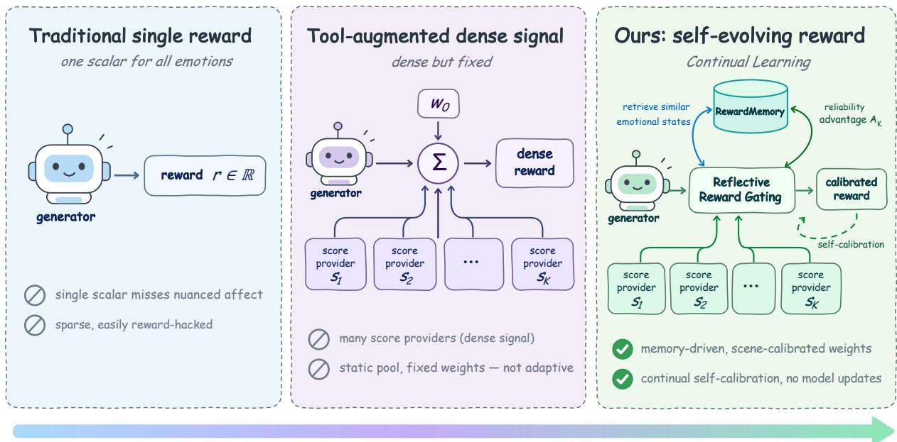  
from a single scalar, to dense score providers, to a self-evolving emotional reward — adapt the reward, not the generator  
Figure 1 From fixed scoring to contextual reward calibration. The reward design progresses from a fixed evaluator to a heterogeneous provider pool and then to EmoReward. Reflective Reward Gating selects relevant evidence for the current video; RewardMemory calibrates provider trust from experience. All three stages ultimately return a scalar reward. The reward providers remain frozen while the generator undergoes RL updates.

## 1 Introduction

Reinforcement learning (RL), especially Group Relative Policy Optimization (GRPO), has advanced model post-training in verifiable domains such as code and mathematics, where correctness provides a direct learning signal [16, 46, 50, 75]. In contrast, evaluating video quality, especially emotional expression, often depends on subjective aesthetics and has no uniquely correct target. Visual post-training adapts difusion and flow generators through RL and preference objectives [2, 12, 29, 43, 60, 72, 82]. Learned evaluators provide scores for image preference and video quality [17, 22, 30, 38, 68, 69], but a visually clear, temporally stable video can match its prompt without conveying the intended emotion. Facial analysis, dynamic expression recognition, and multimodal emotion models supply complementary evidence [1, 3, 7, 26, 79], whose reliability varies with context: facial cues require visible faces, strong motion can undermine restrained sadness, and saturated colors may reflect style rather than emotional intent. This raises a central question: Which emotional evidence should the reward system trust in the current video, and how can it adaptively determine how much weight to assign to that evidence?

Agentic systems coordinate interaction, refine outputs through feedback, and organize evaluation into rubrics [15, 39, 47, 62, 65]. These capabilities motivate adaptive evaluation, yet existing video GRPO methods typically rely on fixed rewards for visual quality, motion quality, and text alignment that inadequately capture emotional intent. Reinforcement learning from human feedback (RLHF) and preference optimization address subjective goals [8, 41, 44, 48], but human annotation is costly at scale, and aesthetic diferences complicate the calibration of emotional cues across contexts. Fixed fusion can mix informative, missing, and saturated signals, allowing policy updates to exploit scoring shortcuts rather than improve emotional fidelity. This motivates reward calibration at two complementary levels: assessing which cues are valid within each video, and learning from a completed training run how much those cues should influence rewards in the next run.

We introduce EmoReward, a self-evolving training mechanism for emotional video-generation RL (Figure 1). It distills evidence reliability from reward–outcome traces collected during an actual, completed training run, then uses this experience to guide multi-reward weight allocation in the next run to decide which emotional evidence to trust and how much to weight it. Plan translates emotional intent into an EmoScript specifying afect targets, facial and body cues, and an expression window; Act scores generated videos with heterogeneous primitives, keeping criterion scores separate from evidence validity. Within each video, Reflective Reward Gating calibrates these cues using the training phase, face confidence, semantic conflict, and subtlety, then renormalizes weights over active providers. After a training run, RewardMemory estimates provider reliability for each emotional regime from traces. Providers with stronger agreement are given larger weight multipliers for the next run, with limits on the size of the adjustment. These multipliers and all reward models stay fixed throughout that run; for each new video, reflection further downweights or excludes missing or unsuitable cues before the active scores are combined into a weighted average EmoReward can be integrated into several RL algorithms alongside general video rewards, and directly use training experience to calibrate reward allocation without retraining the evaluators.

We evaluate EmoReward on HunyuanVideo 1.5 [64] with DanceGRPO [72], FlowGRPO [29], and SAGE GRPO [82], observing higher VideoAlign scores for the guided configurations across all three RL algorithms on emotional prompts as the evaluation dataset for rollout. Under a fair comparison on the same RL architecture and training budget, EmoReward achieves the highest reliability selectivity and both composite calibration scores among seven reward policies. Ablation studies and mechanism analyses examine the contributions of reflective gating, provider pools, and RewardMemory (Section 4.2). Transfer experiments on Stable Difusion 3.5 and FLUX show gains in selected configurations alongside objective-dependent trade-ofs, while user studies show that EmoReward receives the highest human preference and proportion of Good ratings and the lowest proportion of Bad ratings for emotional fidelity, temporal coherence, and visual quality.

Our contributions are threefold.

• We introduce EmoReward, to our knowledge the first self-evolving training mechanism for emotional video generation RL that calibrates reward providers across training runs without updating reward model parameters.

• We propose RewardMemory, to our knowledge the first memory designed for multi-reward systems in video generation. It distills evidence reliability into bounded fusion weights, enabling iterative calibration of RL reward signals across training runs.

• We inspire a novel cross-run self-evolution paradigm for post-training multimodal foundation models: a completed training run informs reward allocation in the next, making training experience reusable at the run level. Extensive experiments across three video RL algorithms and two image backbones, with ablations and human evaluations, validate EmoReward’s efectiveness.

## 2 Related Work

From verifiable RL to agentic feedback for non-verifiable rewards. RLHF learns subjective preferences [8, 41], whereas verifiable RL exploits correctness checks [16, 75]. Agentic evaluators [9, 77] and adaptive rubrics [15, 70, 78] structure open-ended feedback. Related approaches route experts [40], refine responses [39], evolve rewards [35, 76], or organize experience [47, 71]. JitRL derives closed-form policy updates from retrieved action advantages [25]. EmoReward instead transfers reward–outcome evidence across completed training runs to calibrate frozen providers, combining sample-level gating with persistent fusion weights.

Agents for visual content creation. Agentic visual creation organizes generation into planning, tool use, and feedback-driven refinement. Video agents coordinate multi-shot narratives, script evaluation, audiovisual planning, and learned camera control[11, 18, 59, 67, 80, 81]. Image agents combine knowledge retrieval [4, 14], learned creation and editing policies [23, 27], and experience reuse [5, 6]. Other approaches jointly improve generation and evaluation [28, 51]. EmoReward naturally achieves a self-evolving mechanism in video generation RL training, rather than building a workflow or retraining reward models.

RLHF for visual generation and the emotion-reward gap. Visual reward models capture preferences and multidimensional quality [22, 30, 38, 63, 66, 68, 69]. Optimization using rewards and preferences extends from images [2, 12, 43, 60] to video and flow models [29, 31, 72, 82], with benchmarks assessing quality and compositional alignment [20, 32, 49]. Related 3D, audiovisual, and objectives for human animation address complementary aspects of visual generation [19, 24, 55, 56]. Motion editing and transfer [37, 53, 54], shape-aware and consistent image editing [33, 36], and pose- and identity-preserving animation [42, 57, 58] ofer finer control over visual content. Distillation [13, 21, 74] and feature reuse [34] improve generation eficiency, complementing reward-based post-training. Afect-grounded augmentation [61] and reflective action conditioned generation [73] further connect feedback with video synthesis. Temporal video modeling and dynamic facial-expression recognition provide additional perceptual foundations [3, 52]. Emotion understanding supplies multimodal evidence [7, 26, 79] and grounded afect representations [1, 10, 45]; EmoReward addresses how their reliability should govern reward fusion across scenes and training runs.

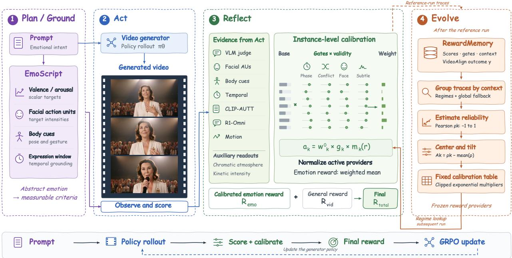  
Figure 2 EmoReward calibrates emotional evidence within videos and across training runs. Plan translates intent into evaluation criteria, and Act obtains provider scores and evidence validity. Reflect combines current-video gates with memory-derived multipliers and normalizes over active providers. Evolve estimates contextual reliability from a completed reference run to construct the fixed multipliers used in subsequent training. The calibrated emotion reward complements the original video reward; GRPO updates the generator while the providers and memory table remain frozen.

## 3 Method

## 3.1 Preliminaries

Multi-reward optimization with GRPO. Let p be a prompt and x a generated video from a policy $\pi _ { \boldsymbol { \theta } } ( \boldsymbol { x } \mid \boldsymbol { p } )$ ; a scalar reward is $R ( x , p ) \in \mathbb { R }$ . For a prompt p, GRPO samples a group $\mathcal { G } ( \boldsymbol { p } ) = \{ x _ { i } \} _ { i = 1 } ^ { G }$ and forms standardized group advantages

$$
A _ { i } = \frac { R ( x _ { i } , p ) - \mu _ { \mathcal { G } } } { \sigma _ { \mathcal { G } } + \epsilon } , \qquad \mu _ { \mathcal { G } } = \textstyle { \frac { 1 } { G } } \sum _ { j } R ( x _ { j } , p ) , \quad \sigma _ { \mathcal { G } } ^ { 2 } = \frac { 1 } { G } \sum _ { j } ( R ( x _ { j } , p ) - \mu _ { \mathcal { G } } ) ^ { 2 } ,\tag{1}
$$

which enter the clipped, KL-regularized objective in Appendix F. The policy update depends on reward diferences inside the group. A common additive constant cancels exactly; positive rescaling changes only the relative efect of ϵ. A coeficient of variation measures dispersion, not policy-learning signal quality; we also assess within-prompt ranking agreement and downstream quality.

Why static emotion fusion fails. Given reward primitives $\mathcal { T } = \{ 1 , \ldots , K \}$ with normalized scores $s _ { k } ( x , p ) \in [ 0 , 1 ]$ , a fixed fusion is $\begin{array} { r } { R _ { \mathrm { e m o } } ^ { \mathrm { s t a t i c } } = \sum _ { k } w _ { k } ^ { 0 } s _ { k } } \end{array}$ with $\begin{array} { r } { w _ { k } ^ { 0 } \ge 0 , \sum _ { k } w _ { k } ^ { \bar { 0 } } = 1 } \end{array}$ . This assumes a fixed trust allocation across scenes, although facial visibility and the relevance of motion depend on the intended emotion. Writing each primitive as a constant plus a group-varying part $s _ { k } = c _ { k } + \delta _ { k }$ and splitting into an active set A

and a dead/saturated set $\mathcal { D } _ { \mathrm { : } }$

$$
R _ { \mathrm { e m o } } ^ { \mathrm { s t a t i c } } = \sum _ { k \in \mathcal { A } } w _ { k } ^ { 0 } \delta _ { k } + \sum _ { k \in \mathcal { A } } w _ { k } ^ { 0 } c _ { k } + \sum _ { k \in \mathcal { D } } w _ { k } ^ { 0 } c _ { k } ,\tag{2}
$$

the constant terms cancel from the centered GRPO numerator. Removing them alone need not change the standardized advantage. Calibration matters when provider validity, errors, or relative contributions vary across candidates, or when the emotion branch is mixed with another reward. EmoReward addresses these cases through gates and memory-conditioned fusion.

## 3.2 Overview

EmoReward grounds emotional intent, scores visual evidence, and calibrates provider trust:

$$
\begin{array} { r } { p \xrightarrow { \mathrm { \ P l a n } } e ( p ) , \quad ( x , e ) \xrightarrow { \mathrm { \ A c t } } \{ s _ { k } , u _ { k } \} , \quad ( s , u , e , x ) \xrightarrow { \mathrm { \ R e f l e c t } } \mathcal { R } _ { \mathrm { e m o } } , \quad \mathcal { M } \xrightarrow { \mathrm { \ E v o l v e } } w ^ { \mathrm { R M } } ( z ) . } \end{array}\tag{3}
$$

Here $e ( p )$ is an EmoScript, $u _ { k }$ denotes evidence validity, and z is the emotional-context signature. Reward-Memory M stores completed reference-run traces; Evolve produces $w ^ { \mathrm { R M } } ( z )$ and exports the corresponding regime multipliers $m _ { k } ( r )$ (Section 3.5). Reflect combines these fixed multipliers with current-video gates. The resulting emotion reward is mixed with a general video reward:

$$
R _ { \mathrm { t o t a l } } ( x , p ) = \frac { \alpha R _ { \mathrm { v i d } } ( x , p ) + \beta R _ { \mathrm { e m o } } ( x , p ) } { \alpha + \beta } ,\tag{4}
$$

where $R _ { \mathrm { v i d } }$ is the evaluation score supplied by the original reward system, for example a general video-quality evaluator $[ 3 0 ] ; \alpha , \beta \ge 0$ control its mixture with the calibrated emotion reward, with $\alpha + \beta > 0$ . Figure 2 connects these stages through their shared fusion interface.

## 3.3 Plan and Act: Emotional Grounding

Plan: prompt-conditioned criteria. The planner converts the prompt into an EmoScript independently of RewardMemory:

$$
e ( p ) = ( v ^ { \star } , a ^ { \star } , { \mathbf { q } } _ { \mathrm { A U } } ^ { \star } , { \mathbf { b } } ^ { \star } , \Omega ) .\tag{5}
$$

The implemented representation contains scalar valence and arousal targets, target facial AU intensities, body cues, and an expression window. The memory regime is inferred later from observed context. Continuous VAD trajectories and dominance targets are outside this implementation. The EmoScript separates intended afect from its observable cues. For example, restrained sadness need not imply large motion or an exaggerated face: target intensities, body cues, and the expression window define what to assess, while reliability is determined from the generated evidence and completed-run experience.

Act: observation and scoring. Act evaluates a video already sampled from $\pi _ { \boldsymbol { \theta } } ( \cdot \mid p ) ;$ it does not generate or revise the video. Each provider returns

$$
( s _ { k } , u _ { k } ) = S _ { k } ( x , e ( p ) ) , \qquad s _ { k } , u _ { k } \in [ 0 , 1 ] ,\tag{6}
$$

where $\boldsymbol { S _ { k } }$ is provider k’s scoring operator, which aggregates frame-level measurements or evaluates the whole clip. The seven fusion providers comprise a VLM judge, facial AUs, body cues, temporal evidence, CLIP-AUTT, R1-Omni, and motion naturalness; chromatic atmosphere and kinetic intensity are auxiliary readouts, giving nine observation channels. Score $s _ { k }$ measures criterion agreement, while $u _ { k }$ marks usable evidence. A missing face channel’s neutral default is not evidence and is excluded through its validity mask. Auxiliary readouts do not enter the seven-provider calibration policy. Appendix C specifies scoring interfaces; Figure 5 illustrates the toolkit studied in Section 4.2.

## 3.4 Reflect: Instance-Level Calibration

Reflect computes provider-specific gates from the current evidence, prompt, and training step. The factorization is

$$
g _ { k } = g _ { k } ^ { \mathrm { p h a s e } } g _ { k } ^ { \mathrm { c o n f i c t } } g _ { k } ^ { \mathrm { f a c e } } g _ { k } ^ { \mathrm { s u b t l e } } u _ { k } , \qquad g _ { k } \in [ 0 , 1 ] ,\tag{7}
$$

Algorithm 1 EmoReward reward computation with experience-calibrated weights   
Require: prompt $p ,$ generated video $x ,$ fixed table $\tau _ { \mathcal { M } }$ from a completed reference run, base weights $w ^ { 0 }$   
1: Build EmoScript $e ( p )$   
2: Compute primitive scores and validity $\{ s _ { k } , u _ { k } \} _ { k = 1 } ^ { K }$ ▷ Eq. 6   
3: Compute instance gates $\{ g _ { k } \} _ { k = 1 } ^ { K }$ ▷ Eq. 7   
4: Form state signature $\boldsymbol { z } \gets \boldsymbol { z } ( p , x , e , s , g )$   
5: Look up regime $r ( z )$ in $\tau _ { \mathcal { M } }$ ▷ Appendix E   
6: if a supported regime or global entry is available then   
7: Read fixed multipliers $m _ { k } .$ , constructed by Eq. 10   
8: else   
9: mk ← 1 ▷ cold start: fall back to base   
10: end if   
11: Form active weights $a _ { k }  w _ { k } ^ { 0 } m _ { k } g _ { k }$   
12: Fuse active primitives with renormalization $ R _ { \mathrm { e m o } }$ ▷ Eq. 8   
13: Compute total reward $R _ { \mathrm { t o t a l } } ( x , p )$ ▷ Eq. 4   
14: Log the reward trace for inspection; keep $\tau _ { \mathcal { M } }$ fixed   
15: return $R _ { \mathrm { t o t a l } } ( x , p )$

with neutral factors for channels to which a condition does not apply. Phase denotes the training-step warmup, face gating controls face-dependent evidence, conflict gating attenuates disagreement between semantic providers, and subtlety gating restrains intensity-sensitive cues. Motion naturalness uses its observation confidence. These controls are computed, not learned (Appendix D).

Evidence-dependent trust. The phase factor schedules reward evidence over generator training, distinct from the within-video expression window. Face gating limits channels requiring facial evidence; conflict and subtlety gating temper disagreeing semantic assessments and intensity-sensitive cues. Their provider-specific application changes relative influence; a shared positive attenuation would largely cancel under normalization.

Composition with experience. For a fixed base weight $w _ { k } ^ { 0 } .$ , define the efective contribution $a _ { k } ( x , p ) =$ $w _ { k } ^ { 0 } g _ { k } ( x , p ) m _ { k } ( r ( x , p ) )$ . Reflective Reward Gating uses $m _ { k } = 1 ;$ ; EmoReward uses the fixed table produced by Evolve. With $\mathcal { A } = \{ k : a _ { k } > \epsilon _ { g } \}$ , active-provider normalization gives

$$
R _ { \mathrm { e m o } } ( x , p ) = \frac { \sum _ { k \in \cal { A } } a _ { k } ( x , p ) s _ { k } ( x , p ) } { \sum _ { k \in \cal { A } } a _ { k } ( x , p ) + \epsilon } .\tag{8}
$$

Invalid evidence receives no mass. A common positive factor cancels except through the stabilizer; calibration acts through relative provider contributions and diferences between videos. Regime r selects a table entry; gate $g _ { k }$ controls current evidence validity. A provider favored by memory still contributes nothing when its current evidence is invalid. With no memory entry, unit multipliers recover Reflect-only fusion; the scoring interfaces and generator objective remain the same.

## 3.5 Evolve: RewardMemory

RewardMemory treats reward allocation as a decision over emotional context z: the providers are actions, their fusion weights form a policy, and a stored outcome y supplies a non-parametric reliability signal. Experience is collected during a completed reference training run with Reflective Reward Gating. Each trace $m _ { i } = ( z _ { i } , \{ s _ { i } ^ { k } \} , \{ g _ { i } ^ { k } \} , w _ { i } , R _ { i } , y _ { i } )$ records context, scores, gates, weights, and outcomes. Evolve groups these traces into a regime neighborhood $\mathcal { N } ( z )$ , with a global fallback for insuficient support, and computes

$$
\rho _ { k } ( z ) = \frac { \mathrm { C o v } _ { i \in \mathcal { N } ( z ) } ( s _ { i } ^ { k } , y _ { i } ) } { \sigma _ { s ^ { k } } \sigma _ { y } + \epsilon } , \qquad A _ { k } ^ { \mathrm { r e l } } ( z ) = \rho _ { k } ( z ) - \frac { 1 } { K } \sum _ { j } \rho _ { j } ( z ) .\tag{9}
$$

Reliability uses raw provider scores; constant scores receive zero correlation. It measures agreement with the reference outcome, not independent emotional fidelity. The centered advantage tilts the base allocation

Algorithm 2 RewardMemory construction from reflective reward traces   
Require: Traces M from a completed reference run, provider count K, temperature τ , log-multiplier cap $c ,$   
minimum support $n _ { \mathrm { m i n } }$   
1: for each context and the global fallback do   
2: Select matching traces; use the global set if the context has fewer than $n _ { \mathrm { m i n } }$ traces   
3: for each provider k do   
4: $\rho _ { k } \gets \operatorname { C o r r } ( s _ { i , k } , y _ { i } ) ;$ use zero for constant scores   
5: end for   
6: $\bar { \rho }  K ^ { - 1 } \sum _ { j } \rho _ { j }$   
7: for each provider k do   
8: $m _ { k } \gets \exp ( \mathrm { c l i p } ( ( \rho _ { k } - \bar { \rho } ) / \tau , - c , c ) )$   
9: end for   
10: Store the context multipliers   
11: end for   
12: Export once; freeze the table for a subsequent generator-training run

through bounded multipliers:

$$
\Delta _ { k } = \mathrm { c l i p } ( A _ { k } ^ { \mathrm { r e l } } / \tau , - c , c ) , \qquad w _ { k } ^ { \mathrm { R M } } ( z ) = \frac { w _ { k } ^ { 0 } e ^ { \Delta _ { k } } } { \sum _ { j } w _ { j } ^ { 0 } e ^ { \Delta _ { j } } } .\tag{10}
$$

This is the closed-form optimum of a KL-regularized allocation with clipped utilities (Appendix F). The exported $m _ { k } ( r ) = e ^ { \Delta _ { k } }$ compose with current instance gates in Eq. 8. The table is fixed throughout the next training run: only the generator receives gradient updates, and runtime lookup neither re-estimates reliability nor writes back to the table. Algorithms 1 and 2 separate reward computation from between-run memory construction. Appendix E explains context grouping and table construction; Appendix I provides a trace-based worked example.

## 4 Experiments

Experimental settings. We use HunyuanVideo 1.5 with DanceGRPO, FlowGRPO, and SAGE-GRPO, fusion $\alpha = \beta = 0 . 5$ , batch size $^ { 2 , }$ and group size G = 4. The updated optimizer comparison reports average results on a subset of 302 emotional prompts that does not overlap with the training set. GT denotes the pretrained generator without RL. Each guided row uses one fixed configuration: Reflect for DanceGRPO, and the complete EmoReward system for FlowGRPO and SAGE-GRPO. The controlled seven-policy comparison retains its separate step-100 evaluation protocol. VideoAlign supplies $R _ { \mathrm { v i d } }$ and the reference outcome y. Memory calibration uses $K = 7 , \tau = 0 . 5 ,$ a log-multiplier cap $c = 1$ , and minimum context support $n _ { \mathrm { m i n } } = 2 0$ Appendix J.1 gives the qualitative protocol.

Evaluation metrics. Table 1 reports mean ± SEM across prompts for VideoAlign Overall, visual quality (VQ), motion quality (MQ), text alignment (TA), PickScore, and CLIPScore. The latter two are frame-averaged preference and alignment proxies; their exported logits are scaled by 26 and 30, respectively. VideoAlign is also an optimization objective, so agreement with it is distinguished from independent emotional fidelity.

## 4.1 EmoReward as a Base-RL-Agnostic Reward Add-on

Table 1 compares the pretrained reference, each optimizer baseline, and its fixed guided configuration. All four VideoAlign heads increase for every RL algorithm under the fair comparison experimental settings. Overall improves by 0.3218 for DanceGRPO with Reflect, 0.2343 for FlowGRPO with EmoReward, and 0.5645 for SAGE-GRPO with EmoReward. The reference comparison and within-optimizer comparison answer diferent questions: the former evaluates the full post-training system, while the latter compares reward configurations. PickScore and CLIPScore show smaller, mixed changes; the VideoAlign gains do not imply uniform improvement on all evaluation axes.

Emotion-category analysis. Figure 4 compares GT and SAGE-GRPO with EmoReward across six metrics and eight emotion categories. The four VideoAlign heads improve in every category, while PickScore and

Table 1 EmoReward across diferent RL algorithms. Mean ± SEM on the comparison defined in the experimental setting; all metrics are higher-is-better. GT is the pretrained no-RL reference. Bold marks an increase over the corresponding optimizer baseline.
<table><tr><td>Method</td><td>Overall</td><td>VQ</td><td>MQ</td><td>TA</td><td>PickScore</td><td>CLIPScore</td></tr><tr><td>GT (reference)</td><td>-1.1938±0.0520</td><td>-0.5899±0.0255</td><td>-0.4289±0.0220</td><td>-0.1750±0.0363</td><td>0.7059±0.0018</td><td>0.5623±0.0037</td></tr><tr><td>DanceGRPO</td><td>-1.2812±0.0513</td><td>-0.6392±0.0230</td><td> $- 0 . 3 8 6 7 { \scriptstyle \pm 0 . 0 2 3 5 }$ </td><td>-0.2554±0.0357</td><td>0.7177±0.0018</td><td>0.5675±0.0036</td></tr><tr><td>+ EmoReward</td><td> $\mathbf { - 0 . 9 5 9 4 } 2 0 . 0 5 7 4$ </td><td>-0.5187±0.0304</td><td> $\mathbf { - 0 . 2 0 5 4 } \mathrm { \pm 0 . 0 2 9 8 }$ </td><td>-0.2354±0.0364</td><td> $0 . 7 0 3 9 { \scriptstyle \pm 0 . 0 0 1 7 }$ </td><td> $0 . 5 5 6 5 { \scriptstyle \pm 0 . 0 0 3 7 }$ </td></tr><tr><td>FlowGRPO + EmoReward</td><td>-0.7719±0.0569</td><td>-0.3567±0.0290</td><td> $- 0 . 2 7 5 3 { \scriptstyle \pm 0 . 0 2 7 1 }$ </td><td>-0.1398±0.0361</td><td>0.7061±0.0019</td><td>0.5634±0.0036</td></tr><tr><td></td><td>-0.5376±0.0556</td><td>-0.3398±0.0291</td><td> $\mathbf { - 0 . 2 3 0 2 { \scriptstyle \pm 0 . 0 2 7 5 } }$ </td><td>0.0323±0.0356</td><td>0.7115±0.0018</td><td>0.5605±0.0037</td></tr><tr><td>SAGE-GRPO</td><td> $- 0 . 8 2 6 9 { \scriptstyle \pm 0 . 0 5 3 2 }$ </td><td> $- 0 . 4 1 0 6 { \scriptstyle \pm 0 . 0 2 6 1 }$ </td><td> $- 0 . 3 2 7 5 { \scriptstyle \pm 0 . 0 2 6 3 }$ </td><td> $- 0 . 0 8 8 8 { \scriptstyle \pm 0 . 0 3 6 0 }$ </td><td> $0 . 7 0 9 1 { \scriptstyle \pm 0 . 0 0 1 9 }$ </td><td>0.5624±0.0036</td></tr><tr><td>+ EmoReward</td><td>-0.2624±0.0600</td><td>-0.1710±0.0304</td><td> $\mathbf { - 0 . 0 9 2 6 { \scriptstyle \pm 0 . 0 3 2 4 } }$ </td><td>0.0012±0.0364</td><td>0.7107±0.0018</td><td>0.5663±0.0035</td></tr></table>

Table 2 Reward-policy ablation under SAGE-GRPO. Controlled policies share the backbone and training budget. Citations identify evaluators or routing/fusion mechanisms, not full-system reproductions. SNR∗ is relative dispersion; bold marks column maxima. Appendix G defines all metrics and the supplementary verification.
<table><tr><td>Reward method</td><td>SNR*</td><td>Sel.↑</td><td>EF↑</td><td>GD↑</td><td>GR↑</td><td>core↑</td><td>emo↑</td></tr><tr><td>VideoAlign [30]</td><td>0.378</td><td>0.307</td><td>0.518</td><td>0.000</td><td>0.197</td><td>0.238</td><td>0.308</td></tr><tr><td>Single provider [79]</td><td>2.403</td><td>0.314</td><td>0.454</td><td>0.305</td><td>0.147</td><td>0.302</td><td>0.340</td></tr><tr><td>Random routing [65]</td><td>1.105</td><td>0.340</td><td>0.000</td><td>0.109</td><td>0.146</td><td>0.085</td><td>0.064</td></tr><tr><td>Round-robin [65]</td><td>1.217</td><td>0.376</td><td>0.291</td><td>0.126</td><td>0.381</td><td>0.266</td><td>0.272</td></tr><tr><td>Fixed fusion [69]</td><td>0.773</td><td>0.371</td><td>0.026</td><td>0.060</td><td>0.653</td><td>0.246</td><td>0.191</td></tr><tr><td>EmoReward (w/o RewardMemory)</td><td>0.451</td><td>0.293</td><td>1.000</td><td>0.011</td><td>0.000</td><td>0.337</td><td>0.503</td></tr><tr><td>EmoReward (w RewardMemory)</td><td>7.022</td><td>0.428</td><td>0.767</td><td>1.000</td><td>1.000</td><td>0.922</td><td>0.884</td></tr></table>

CLIPScore show smaller, nonuniform changes. This GT comparison reflects the complete post-training system.   
Categories overlap within the evaluated set.

## 4.2 Ablations and Mechanism Analysis

Agentic reward methods. Our controlled study fixes the backbone and optimization budget and varies the reward policy across seven arms: VideoAlign-only, single-provider, random, round-robin, fixed fusion, Reflective Reward Gating, and RewardMemory.

Reward-policy ablation. Table 2 compares relative reward dispersion, reliability selectivity, and normalized Emotion-Gating Benchmark (EGB) pillars. Adding RewardMemory yields the highest selectivity (0.428) and both composite scores (core 0.922, emo 0.884); the variant without memory leads the standalone preference pillar. SNR∗ is a dispersion statistic, not a measure of gradient quality. The composites combine an ImageReward preference proxy, dispersion, and agreement-weighted selectivity; Appendix G defines their scope.

Reward-provider pool. Figure 5 compares a VideoAlign baseline, semantic emotion cues, motion naturalness, and a balanced pool. Weights and curricula also difer, so this study motivates the interface rather than isolating each channel’s causal efect (Appendix H). Seven channels enter memory calibration; chromatic and kinetic readouts remain auxiliary.

Memory-conditioned trust. Macro and motion receive the largest global multipliers (1.833, 1.510), whereas three constant channels receive 0.778. Memory reallocates trust but cannot activate invalid evidence. Macro shares evaluator information with the reference outcome, so its correlation reflects objective agreement. Appendix E describes context-specific allocation; Appendix I illustrates its arithmetic on real rollout scores. A matched global-memory control remains necessary to isolate the benefit of contextual calibration.

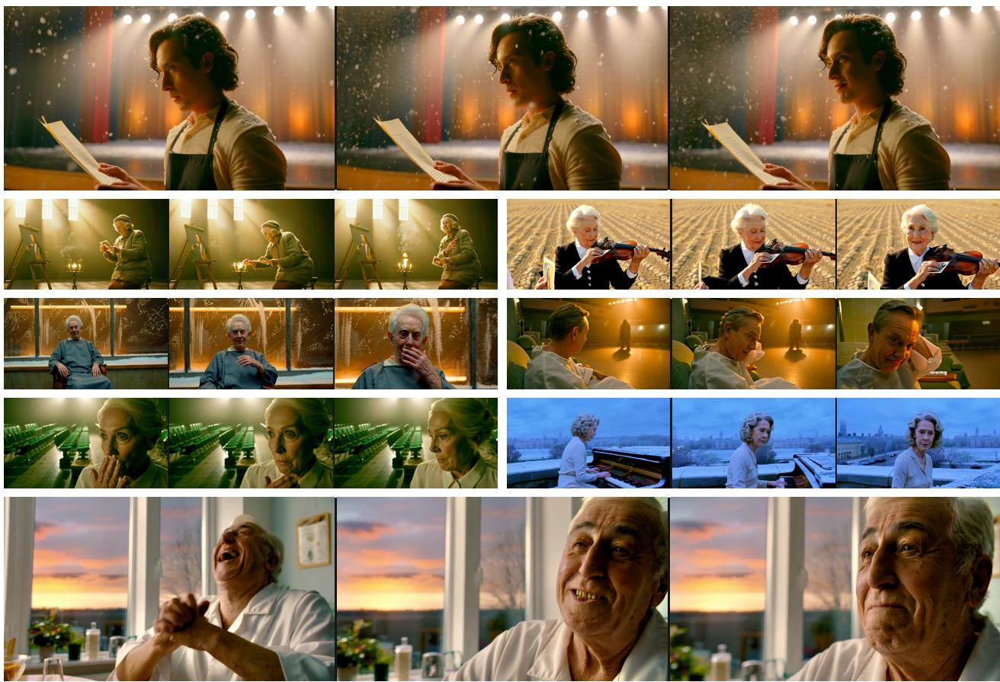  
Figure 3 EmoReward in performance scenes. Eight curated generated clips, each shown as three chronological full frames, illustrate expressions, gestures, and staging.

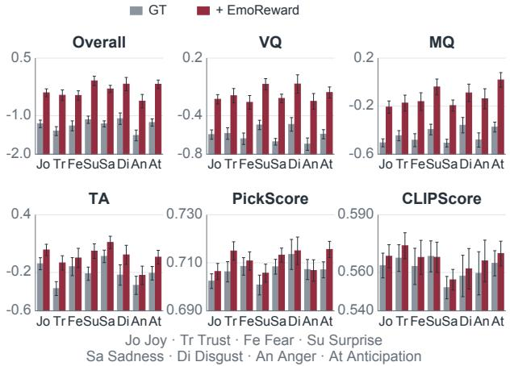

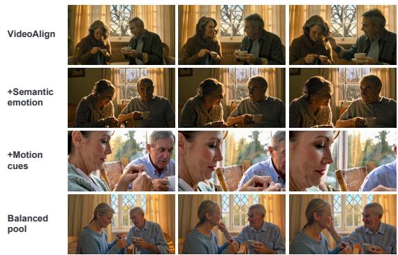  
Figure 4 Emotion-category quality. GT (gray) versus SAGE-GRPO with EmoReward (red); mean ± SEM. Axes are truncated; categories overlap within the evaluated set.  
Figure 5 Ablation of provider-pool construction. Three frames per clip compare four configurations on the same prompt. See Appendix H for quantitative results.

## 4.3 Generalization to image backbones

Image transfer covers SD3.5 and FLUX with three optimizers. Results are objective-dependent: SD3.5– DanceGRPO improves on HPSv3 with calibration, whereas FLUX’s HPSv3-optimized baseline remains strongest on that metric. Unequal SD3.5 training budgets limit causal attribution. Appendix J details the settings and full-prompt comparisons.

Table 3 Human evaluation. Rating percentages from 18 participants on 30 prompts. Each method and criterion block contains 540 judgments. Bold marks the highest Good share per criterion; percentages are rounded to one decimal place.
<table><tr><td rowspan="2">Method</td><td colspan="3">Emotion Fidelity</td><td colspan="3">Temporal Coherence</td><td colspan="3">Visual Quality</td></tr><tr><td>Bad ↓ Normal</td><td></td><td>Good ↑</td><td></td><td>Bad ↓ Normal</td><td>Good ↑</td><td>Bad ↓</td><td>Normal</td><td>Good ↑</td></tr><tr><td>GT</td><td>21.9%</td><td>34.8%</td><td>43.3%</td><td>23.5%</td><td>37.8%</td><td>38.7%</td><td>25.2%</td><td>38.5%</td><td>36.3%</td></tr><tr><td>SAGE-GRPO</td><td>31.5%</td><td>15.6%</td><td>53.0%</td><td>28.9%</td><td>19.6%</td><td>51.5%</td><td>30.9%</td><td>24.1%</td><td>45.0%</td></tr><tr><td>SAGE-GRPO + EmoReward 15.4%</td><td></td><td>24.6%</td><td>60.0%</td><td>20.2%</td><td>25.6%</td><td>54.3%</td><td>15.9%</td><td>26.9%</td><td>57.2%</td></tr></table>

## 4.4 Human evaluation

Eighteen participants rated the three methods on 30 prompts using Bad/Normal/Good for emotion fidelity, temporal coherence, and visual quality. Table 3 shows that EmoReward obtains the highest Good shares (60.0%, 54.3%, 57.2%), compared with 53.0%, 51.5%, and 45.0% for SAGE-GRPO, and the lowest Bad shares on all three criteria. These descriptive results complement the automatic metrics; aggregation and statistical scope are detailed in Appendix B.

The complete distributions reveal a distinction that Good shares alone obscure: SAGE-GRPO also receives more Bad ratings than GT on every criterion. EmoReward lowers Bad shares relative to both comparison groups while increasing Good shares. This pattern supports examining the entire ordinal distribution, rather than reducing it to a binary preference. The reported margins do not resolve variation across people or prompts; participant- and prompt-level records are required for uncertainty estimates that account for repeated judgments.

## 5 Conclusion

In this paper, we proposed EmoReward, a self-evolving reward calibration framework for emotional video generation reinforcement learning. EmoReward combines instance-level Reflective Reward Gating with RewardMemory, which transfers provider-reliability estimates from a completed training run to subsequent optimization without updating reward-model parameters. Experiments across video optimizers, complemented by ablations, image-transfer analyses, and human ratings, support the utility of adaptive calibration while identifying objective-dependent trade-ofs. These findings suggest that completed-run experience can inform the allocation of trust among heterogeneous reward providers, providing a foundation for further research on reward-system evolution across training.

## Reproducibility Statement

The appendix specifies the reward interface, calibration rule, mathematical derivation, evaluation protocol, complete comparison tables, and qualitative examples. Source artifacts include editable figures and scripts for constructing tables and visualizations.

## AI Use Statement

AI assistance was used for manuscript editing, mathematical checks, and figure preparation. The authors are responsible for verifying the scientific claims and final submission. Experimental comparison images and video frames were taken from the evaluated models; no additional media were synthesized to illustrate experimental outcomes.

## References

[1] Tadas Baltrušaitis, Amir Zadeh, Yao Chong Lim, and Louis-Philippe Morency. OpenFace 2.0: Facial Behavior Analysis Toolkit. In IEEE International Conference on Automatic Face and Gesture Recognition, pages 59–66, 2018.

[2] Kevin Black, Michael Janner, Yilun Du, Ilya Kostrikov, and Sergey Levine. Training difusion models with reinforcement learning. In International Conference on Learning Representations, volume 2024, pages 4965–4987, 2024.

[3] Haodong Chen, Haojian Huang, Junhao Dong, Mingzhe Zheng, and Dian Shao. Finecliper: Multi-modal finegrained clip for dynamic facial expression recognition with adapters. In Proceedings of the 32nd ACM International Conference on Multimedia, pages 2301–2310, 2024.

[4] Shuang Chen, Kaituo Feng, Hangting Chen, Wenxuan Huang, Dasen Dai, Quanxin Shou, Yunlong Lin, Xiangyu Yue, Shenghua Gao, and Tianyu Pang. OpenSearch-VL: An Open Recipe for Frontier Multimodal Search Agents. arXiv preprint arXiv:2605.05185, 2026.

[5] Sixiang Chen, Zhaohu Xing, Tian Ye, Xinyu Geng, Yunlong Lin, Jianyu Lai, Xuanhua He, Fuxiang Zhai, Jialin Gao, and Lei Zhu. GenEvolve: Self-Evolving Image Generation Agents via Tool-Orchestrated Visual Experience Distillation. arXiv preprint arXiv:2605.21605, 2026.

[6] Wenshuo Chen, Kuimou Yu, Bowen Tian, Jianfei Song, Shaofeng Liang, Haozhe Jia, Kan Cheng, Haosen Li, Kaishen Yuan, Lei Wang, Jiemin Wu, Songning Lai, and Yutao Yue. MemoGen: Can Past Experience Improve Future Text-to-Image Generation? arXiv preprint arXiv:2606.03243, 2026.

[7] Zebang Cheng, Zhi-Qi Cheng, Jun-Yan He, Jingdong Sun, Kai Wang, Yuxiang Lin, Zheng Lian, Xiaojiang Peng, and Alexander G Hauptmann. Emotion-llama: Multimodal emotion recognition and reasoning with instruction tuning. Advances in Neural Information Processing Systems, 37:110805–110853, 2024.

[8] Paul F Christiano, Jan Leike, Tom Brown, Miljan Martic, Shane Legg, and Dario Amodei. Deep reinforcement learning from human preferences. Advances in neural information processing systems, 30, 2017.

[9] Fangming Cui, Ruixiao Zhu, Cheng Fang, Sunan Li, and Jiahong Li. Rethinking agentic reinforcement learning in large language models. arXiv preprint arXiv:2604.27859, 2026.

[10] Paul Ekman and Wallace V. Friesen. Facial Action Coding System: A Technique for the Measurement of Facial Movement. Consulting Psychologists Press, Palo Alto, CA, 1978.

[11] Liaoyuan Fan, Yuhao Zheng, Dongxing Mao, Hangyu Ran, Siyuan Hu, Weijia Mao, Rui Zhao, Weijia Wu, Guian Fang, Yanzhe Chen, Zeyu Zhu, Yuxin Jiang, Yiren Song, Yuchao Gu, Junchao Yi, Qi Hu, Dan Kong, Alex Jinpeng Wang, Kevin Qinghong Lin, Mike Zheng Shou, and Wei Liu. Video Generation Meets Agent Harness: Agentic Video Generation, Agentic World Modeling and Recursive Self-Improvement. arXiv preprint arXiv:2610.40191, 2026.

[12] Ying Fan, Olivia Watkins, Yuqing Du, Hao Liu, Moonkyung Ryu, Craig Boutilier, Pieter Abbeel, Mohammad Ghavamzadeh, Kangwook Lee, and Kimin Lee. Dpok: Reinforcement learning for fine-tuning text-to-image difusion models. Advances in neural information processing systems, 36:79858–79885, 2023.

[13] Zhen Fang, Wenxuan Huang, Yu Zeng, Yiming Zhao, Shuang Chen, Kaituo Feng, Yunlong Lin, Lin Chen, Zehui Chen, Shaosheng Cao, et al. Flow-OPD: On-policy distillation for flow matching models. arXiv preprint arXiv:2605.08063, 2026.

[14] Kaituo Feng, Manyuan Zhang, Shuang Chen, Yunlong Lin, Kaixuan Fan, Yilei Jiang, Hongyu Li, Dian Zheng, Chenyang Wang, and Xiangyu Yue. Gen-searcher: Reinforcing agentic search for image generation. arXiv preprint arXiv:2603.28767, 2026.

[15] Anisha Gunjal, Anthony Wang, Elaine Lau, Vaskar Nath, Yunzhong He, Bing Liu, and Sean Hendryx. Rubrics as rewards: Reinforcement learning beyond verifiable domains. In International Conference on Learning Representa tions, volume 2026, pages 127924–127945, 2026.

[16] Daya Guo, Dejian Yang, Haowei Zhang, Junxiao Song, Peiyi Wang, Qihao Zhu, Runxin Xu, Ruoyu Zhang, Shirong Ma, Xiao Bi, et al. Deepseek-r1: Incentivizing reasoning capability in llms via reinforcement learning. arXiv preprint arXiv:2501.12948, 2025.

[17] Xuan He, Dongfu Jiang, Ge Zhang, Max Ku, Achint Soni, Sherman Siu, Haonan Chen, Abhranil Chandra, Ziyan Jiang, Aaran Arulraj, et al. Videoscore: Building automatic metrics to simulate fine-grained human feedback for video generation. In Proceedings of the 2024 Conference on Empirical Methods in Natural Language Processing, pages 2105–2123, 2024.

[18] Haobo Hu, Qi Mao, Yuanhang Li, and Libiao Jin. Camera Artist: A Multi-Agent Framework for Cinematic Language Storytelling Video Generation. arXiv preprint arXiv:2604.09195, 2026.

[19] Yinming Huang, Shuyuan Tu, Xi Yan, Zihan Yang, Jianhua Han, Hang Xu, Kaihang Pan, Yu-Gang Jiang, and Zuxuan Wu. Va-judger: Reward modeling from human preference feedback for joint video-audio generation. arXiv preprint arXiv:2608.18607, 2026.

[20] Ziqi Huang, Yinan He, Jiashuo Yu, Fan Zhang, Chenyang Si, Yuming Jiang, Yuanhan Zhang, Tianxing Wu, Qingyang Jin, Nattapol Chanpaisit, et al. Vbench: Comprehensive benchmark suite for video generative models. In 2024 IEEE/CVF Conference on Computer Vision and Pattern Recognition (CVPR), pages 21807–21818. IEEE, 2024.

[21] Dengyang Jiang, Xin Jin, Dongyang Liu, Zanyi Wang, Mingzhe Zheng, Ruoyi Du, Xiangpeng Yang, Qilong Wu, Zhen Li, Peng Gao, et al. D-OPSD: On-Policy Self-Distillation for Continuously Tuning Step-Distilled Difusion Models. arXiv preprint arXiv:2605.05204, 2026.

[22] Yuval Kirstain, Adam Polyak, Uriel Singer, Shahbuland Matiana, Joe Penna, and Omer Levy. Pick-a-pic: An open dataset of user preferences for text-to-image generation. Advances in neural information processing systems, 36:36652–36663, 2023.

[23] Jinxiang Lai, Zexin Lu, Jiajun He, Rongwei Quan, Wenzhe Zhao, Qinyu Yang, Qi Chen, Qin Lin, Chuyue Li, Tao Gao, Yuhao Shan, Shuai Shao, Song Guo, and Qinglin Lu. VisionCreator: A Native Visual-Generation Agentic Model with Understanding, Thinking, Planning and Creation. arXiv preprint arXiv:2603.02681, 2026.

[24] Jiaqi Leng, Shuyuan Tu, Haidong Cao, Sicheng Xie, Daoguo Dong, Zuxuan Wu, and Yu-Gang Jiang. Preference score distillation: Leveraging 2d rewards to align text-to-3d generation with human preference. arXiv preprint arXiv:2603.01594, 2026.

[25] Yibo Li, Zijie Lin, Ailin Deng, Xuan Zhang, Yufei He, Shuo Ji, Tri Cao, and Bryan Hooi. Just-In-Time Reinforcement Learning: Continual Learning in LLM Agents Without Gradient Updates. arXiv preprint arXiv:2601.18510, 2026.

[26] Zheng Lian, Haoyu Chen, Lan Chen, Haiyang Sun, Licai Sun, Yong Ren, Zebang Cheng, Bin Liu, Rui Liu, Xiaojiang Peng, et al. Afectgpt: A new dataset, model, and benchmark for emotion understanding with multimodal large language models. arXiv preprint arXiv:2501.16566, 2025.

[27] Yunlong Lin, Zixu Lin, Kunjie Lin, Jinbin Bai, Panwang Pan, Chenxin Li, Haoyu Chen, Zhongdao Wang, Xinghao Ding, Wenbo Li, et al. JarvisArt: Liberating Human Artistic Creativity via an Intelligent Photo Retouching Agent. arXiv preprint arXiv:2506.17612, 2025.

[28] Yunlong Lin, Linqing Wang, Kunjie Lin, Zixu Lin, Kaixiong Gong, Wenbo Li, Bin Lin, Zhenxi Li, Shiyi Zhang, Yuyang Peng, et al. JarvisEvo: Towards a Self-Evolving Photo Editing Agent with Synergistic Editor-Evaluator Optimization. arXiv preprint arXiv:2511.23002, 2025.

[29] Jie Liu, Gongye Liu, Jiajun Liang, Yangguang Li, Jiaheng Liu, Xintao Wang, Pengfei Wan, Di Zhang, and Wanli Ouyang. Flow-grpo: Training flow matching models via online rl. Advances in neural information processing systems, 38:40783–40818, 2026.

[30] Jie Liu, Gongye Liu, Jiajun Liang, Ziyang Yuan, Xiaokun Liu, Mingwu Zheng, Xiele Wu, Qiulin Wang, Menghan Xia, Xintao Wang, et al. Improving video generation with human feedback. Advances in Neural Information Processing Systems, 38:82155–82192, 2026.

[31] Runtao Liu, Haoyu Wu, Ziqiang Zheng, Chen Wei, Yingqing He, Renjie Pi, and Qifeng Chen. VideoDPO: Omni-Preference Alignment for Video Difusion Generation. In Proceedings of the IEEE/CVF Conference on Computer Vision and Pattern Recognition, 2025.

[32] Yaofang Liu, Xiaodong Cun, Xuebo Liu, Xintao Wang, Yong Zhang, Haoxin Chen, Yang Liu, Tieyong Zeng, Raymond Chan, and Ying Shan. Evalcrafter: Benchmarking and evaluating large video generation models. In 2024 IEEE/CVF Conference on Computer Vision and Pattern Recognition (CVPR), pages 22139–22149. IEEE, 2024.

[33] Zeqian Long, Mingzhe Zheng, Kunyu Feng, Xinhua Zhang, Hongyu Liu, Harry Yang, Linfeng Zhang, Qifeng Chen, and Yue Ma. Follow-your-shape: Shape-aware image editing via trajectory-guided region control. International Conference on Learning Representations, 2026.

[34] Xuran Ma, Yexin Liu, Yaofu Liu, Xianfeng Wu, Mingzhe Zheng, Zihao Wang, Ser-Nam Lim, and Harry Yang. Model reveals what to cache: Profiling-based feature reuse for video difusion models. In Proceedings of the IEEE/CVF International Conference on Computer Vision, pages 17150–17159, 2025.

[35] Yecheng Jason Ma, William Liang, Guanzhi Wang, De-An Huang, Osbert Bastani, Dinesh Jayaraman, Yuke Zhu, Linxi Fan, and Anima Anandkumar. Eureka: Human-Level Reward Design via Coding Large Language Models. In International Conference on Learning Representations, 2024.

[36] Yue Ma, Xinyu Wang, Qianli Ma, Qinghe Wang, Mingzhe Zheng, Xiangpeng Yang, Hao Li, Chongbo Zhao, Jixuan Ying, Harry Yang, et al. Group editing: Edit multiple images in one go. Proceedings of the IEEE/CVF Conference on Computer Vision & Pattern Recognition, 2026.

[37] Yue Ma, Zhikai Wang, Tianhao Ren, Mingzhe Zheng, Hongyu Liu, Jiayi Guo, Kunyu Feng, Yuxuan Xue, Zixiang Zhao, Konrad Schindler, et al. Fastvmt: Eliminating redundancy in video motion transfer. International Conference on Learning Representations, 2026.

[38] Yuhang Ma, Xiaoshi Wu, Keqiang Sun, and Hongsheng Li. Hpsv3: Towards wide-spectrum human preference score. In 2025 IEEE/CVF International Conference on Computer Vision (ICCV), pages 15086–15095. IEEE, 2025.

[39] Aman Madaan, Niket Tandon, Prakhar Gupta, Skyler Hallinan, Luyu Gao, Sarah Wiegrefe, Uri Alon, Nouha Dziri, Shrimai Prabhumoye, Yiming Yang, et al. Self-refine: Iterative refinement with self-feedback. Advances in neural information processing systems, 36:46534–46594, 2023.

[40] Isaac Ong, Amjad Almahairi, Vincent Wu, Wei-Lin Chiang, Tianhao Wu, Joseph E. Gonzalez, M. Waleed Kadous, and Ion Stoica. RouteLLM: Learning to Route LLMs with Preference Data. arXiv preprint arXiv:2406.18665, 2024.

[41] Long Ouyang, Jefrey Wu, Xu Jiang, Diogo Almeida, Carroll Wainwright, Pamela Mishkin, Chong Zhang, Sandhini Agarwal, Katarina Slama, Alex Ray, John Schulman, Jacob Hilton, Fraser Kelton, Luke Miller, Maddie Simens, Amanda Askell, Peter Welinder, Paul F. Christiano, Jan Leike, and Ryan Lowe. Training Language Models to Follow Instructions with Human Feedback. In Advances in Neural Information Processing Systems, 2022.

[42] Yatian Pang, Bin Zhu, Bin Lin, Mingzhe Zheng, Francis EH Tay, Ser-Nam Lim, Harry Yang, and Li Yuan. Dreamdance: Animating human images by enriching 3d geometry cues from 2d poses. In Proceedings of the IEEE/CVF International Conference on Computer Vision, pages 14039–14050, 2025.

[43] Mihir Prabhudesai, Anirudh Goyal, Deepak Pathak, and Katerina Fragkiadaki. Aligning text-to-image difusion models with reward backpropagation. 2023.

[44] Rafael Rafailov, Archit Sharma, Eric Mitchell, Christopher D Manning, Stefano Ermon, and Chelsea Finn. Direct preference optimization: Your language model is secretly a reward model. Advances in neural information processing systems, 36:53728–53741, 2023.

[45] James A. Russell. A Circumplex Model of Afect. Journal of Personality and Social Psychology, 39(6):1161–1178, 1980.

[46] Zhihong Shao, Peiyi Wang, Qihao Zhu, Runxin Xu, Junxiao Song, Xiao Bi, Haowei Zhang, Mingchuan Zhang, YK Li, Yang Wu, et al. Deepseekmath: Pushing the limits of mathematical reasoning in open language models. arXiv preprint arXiv:2402.03300, 2024.

[47] Noah Shinn, Federico Cassano, Ashwin Gopinath, Karthik Narasimhan, and Shunyu Yao. Reflexion: Language agents with verbal reinforcement learning. Advances in neural information processing systems, 36:8634–8652, 2023.

[48] Nisan Stiennon, Long Ouyang, Jefrey Wu, Daniel Ziegler, Ryan Lowe, Chelsea Voss, Alec Radford, Dario Amodei, and Paul F Christiano. Learning to summarize with human feedback. Advances in neural information processing systems, 33:3008–3021, 2020.

[49] Kaiyue Sun, Kaiyi Huang, Xian Liu, Yue Wu, Zihan Xu, Zhenguo Li, and Xihui Liu. T2v-compbench: A comprehensive benchmark for compositional text-to-video generation. In 2025 IEEE/CVF Conference on Computer Vision and Pattern Recognition (CVPR), pages 8406–8416. IEEE, 2025.

[50] Kimi Team, Angang Du, Bofei Gao, Bowei Xing, Changjiu Jiang, Cheng Chen, Cheng Li, Chenjun Xiao, Chenzhuang Du, Chonghua Liao, et al. Kimi k1. 5: Scaling reinforcement learning with llms. arXiv preprint arXiv:2501.12599, 2025.

[51] Ritesh Thawkar, Shravan Venkatraman, Omkar Thawakar, Abdelrahman Shaker, Fahad Khan, Hisham Cholakkal, Salman Khan, and Rao Muhammad Anwer. Ask, Solve, Generate: Self-Evolving Unified Multimodal Understanding and Generation via Self-Consistency Rewards. arXiv preprint arXiv:2606.27376, 2026.

[52] Shuyuan Tu, Qi Dai, Zuxuan Wu, Zhi-Qi Cheng, Han Hu, and Yu-Gang Jiang. Implicit temporal modeling with learnable alignment for video recognition. In ICCV, 2023.

[53] Shuyuan Tu, Qi Dai, Zhi-Qi Cheng, Han Hu, Xintong Han, Zuxuan Wu, and Yu-Gang Jiang. Motioneditor: Editing video motion via content-aware difusion. In CVPR, 2024.

[54] Shuyuan Tu, Qi Dai, Zihao Zhang, Sicheng Xie, Zhi-Qi Cheng, Chong Luo, Xintong Han, Zuxuan Wu, and Yu-Gang Jiang. Motionfollower: Editing video motion via lightweight score-guided difusion. arXiv preprint arXiv:2405.20325, 2024.

[55] Shuyuan Tu, Yueming Pan, Yinming Huang, Xintong Han, Zhen Xing, Qi Dai, Chong Luo, Zuxuan Wu, and Yu-Gang Jiang. Stableavatar: Infinite-length audio-driven avatar video generation. arXiv preprint arXiv:2508.08248, 2025.

[56] Shuyuan Tu, Zhen Xing, Xintong Han, Zhi-Qi Cheng, Qi Dai, Chong Luo, and Zuxuan Wu. Stableanimator: High-quality identity-preserving human image animation. In 2025 IEEE/CVF Conference on Computer Vision and Pattern Recognition (CVPR), pages 21096–21106. IEEE, 2025.

[57] Shuyuan Tu, Zhen Xing, Xintong Han, Zhi-Qi Cheng, Qi Dai, Chong Luo, Zuxuan Wu, and Yu-Gang Jiang. Stableanimator++: Overcoming pose misalignment and face distortion for human image animation. arXiv preprint arXiv:2507.15064, 2025.

[58] Shuyuan Tu, Yueming Pan, Yinming Huang, Xintong Han, Zhen Xing, Qi Dai, Kai Qiu, Chong Luo, and Zuxuan Wu. Flashportrait: 6x faster infinite portrait animation with adaptive latent prediction. In CVPR, 2026.

[59] Shuyuan Tu, Qi Tian, Zihan Yang, Yue Wu, Xintong Han, Weijie Kong, Jiangfeng Xiong, Jian-Wei Zhang, Zhao Zhong, Liefeng Bo, et al. Baton: Explicit Semantic Blueprints for Joint Video-Audio Generation. arXiv preprint arXiv:2605.25195, 2026.

[60] Bram Wallace, Meihua Dang, Rafael Rafailov, Linqi Zhou, Aaron Lou, Senthil Purushwalkam, Stefano Ermon, Caiming Xiong, Shafiq Joty, and Nikhil Naik. Difusion Model Alignment Using Direct Preference Optimization. arXiv preprint arXiv:2311.12908, 2023.

[61] Huanzhen Wang, Ziheng Zhou, Jiaqi Song, Li He, Yunshi Lan, Yan Wang, and Wenqiang Zhang. ARGen: Afect-Reinforced Generative Augmentation towards Vision-based Dynamic Emotion Perception, 2026.

[62] Junlin Wang, Jue Wang, Ben Athiwaratkun, Ce Zhang, and James Zou. Mixture-of-Agents Enhances Large Language Model Capabilities. In International Conference on Learning Representations (ICLR), 2025.

[63] Yibin Wang, Yuhang Zang, Feng Han, Jiazi Bu, Yujie Zhou, Cheng Jin, and Jiaqi Wang. Unified personalized reward model for vision generation. arXiv preprint arXiv:2602.02380, 2026.

[64] Bing Wu, Chang Zou, Changlin Li, Duojun Huang, Fang Yang, Hao Tan, Jack Peng, Jianbing Wu, Jiangfeng Xiong, Jie Jiang, et al. Hunyuanvideo 1.5 technical report. arXiv preprint arXiv:2511.18870, 2025.

[65] Qingyun Wu, Gagan Bansal, Jieyu Zhang, Yiran Wu, Beibin Li, Erkang Zhu, Li Jiang, Xiaoyun Zhang, Shaokun Zhang, Jiale Liu, et al. Autogen: Enabling next-gen llm applications via multi-agent conversation. arXiv preprint arXiv:2308.08155, 2023.

[66] Xiaoshi Wu, Yiming Hao, Keqiang Sun, Yixiong Chen, Feng Zhu, Rui Zhao, and Hongsheng Li. Human preference score v2: A solid benchmark for evaluating human preferences of text-to-image synthesis. arXiv preprint arXiv:2306.09341, 2023.

[67] Yang Wu, Stefano Petrangeli, Ishita Dasgupta, and Yu Shen. CamPilot: A Multi-Agent Cinematic Assistant for Camera-Controlled Movie Generation. arXiv preprint arXiv:2609.10943, 2026.

[68] Jiazheng Xu, Xiao Liu, Yuchen Wu, Yuxuan Tong, Qinkai Li, Ming Ding, Jie Tang, and Yuxiao Dong. Imagereward: Learning and evaluating human preferences for text-to-image generation. Advances in Neural Information Processing Systems, 36:15903–15935, 2023.

[69] Jiazheng Xu, Yu Huang, Jiale Cheng, Yuanming Yang, Jiajun Xu, Yuan Wang, Wenbo Duan, Shen Yang, Qunlin Jin, Shurun Li, et al. Visionreward: Fine-grained multi-dimensional human preference learning for image and video generation. In Proceedings of the AAAI Conference on Artificial Intelligence, volume 40, pages 11269–11277, 2026.

[70] Ran Xu, Tianci Liu, Zihan Dong, Tony Yu, Ilgee Hong, Carl Yang, Linjun Zhang, Tao Zhao, and Haoyu Wang. Alternating reinforcement learning for rubric-based reward modeling in non-verifiable llm post-training. arXiv preprint arXiv:2602.01511, 2026.

[71] Wujiang Xu, Zujie Liang, Kai Mei, Hang Gao, Juntao Tan, and Yongfeng Zhang. A-MEM: Agentic Memory for LLM Agents. In Advances in Neural Information Processing Systems, volume 38, 2025.

[72] Zeyue Xue, Jie Wu, Yu Gao, Fangyuan Kong, Lingting Zhu, Mengzhao Chen, Zhiheng Liu, Wei Liu, Qiushan Guo, Weilin Huang, et al. Dancegrpo: Unleashing grpo on visual generation. arXiv preprint arXiv:2505.07818, 2025.

[73] Yu Yang, Yue Liao, Jianbiao Mei, Baisen Wang, Xuemeng Yang, Licheng Wen, Jiangning Zhang, Xiangtai Li, Liang Lv, Hanlin Chen, Botian Shi, Yong Liu, Shuicheng Yan, and Gim Hee Lee. SPIRAL: Self-Evolving Action-Conditioned Video Generation via Reflective Planning Agents, 2026.

[74] Zihan Yang, Shuyuan Tu, Licheng Zhang, Qi Dai, Yu-Gang Jiang, and Zuxuan Wu. ArcFlow: Unleashing 2-Step Text-to-Image Generation via High-Precision Non-Linear Flow Distillation. arXiv preprint arXiv:2602.09014, 2026.

[75] Qiying Yu, Zheng Zhang, Ruofei Zhu, Yufeng Yuan, Xiaochen Zuo, Yu Yue, Weinan Dai, Tiantian Fan, Gaohong Liu, Lingjun Liu, et al. Dapo: An open-source llm reinforcement learning system at scale. Advances in Neural Information Processing Systems, 38:113222–113244, 2026.

[76] Weizhe Yuan, Richard Yuanzhe Pang, Kyunghyun Cho, Xian Li, Sainbayar Sukhbaatar, Jing Xu, and Jason Weston. Self-Rewarding Language Models. In Proceedings of the 41st International Conference on Machine Learning, 2024.

[77] Guibin Zhang, Hejia Geng, Xiaohang Yu, Zhenfei Yin, Zaibin Zhang, Zelin Tan, Heng Zhou, Zhongzhi Li, Xiangyuan Xue, Yijiang Li, et al. The landscape of agentic reinforcement learning for llms: A survey. arXiv preprint arXiv:2509.02547, 2025.

[78] Rongzhi Zhang, Rui Feng, Zhihan Zhang, Jingfeng Yang, Qingyu Yin, Xin Liu, Zixuan Zhang, Priyanka Nigam, Bing Yin, Tuo Zhao, et al. Qubric: Co-designing queries and rubrics for rl beyond verifiable rewards. arXiv preprint arXiv:2606.03968, 2026.

[79] Jiaxing Zhao, Xihan Wei, and Liefeng Bo. R1-omni: Explainable omni-multimodal emotion recognition with reinforcement learning. arXiv preprint arXiv:2503.05379, 2025.

[80] Mingzhe Zheng, Dingjie Song, Guanyu Zhou, Jun You, Jiahao Zhan, Xuran Ma, Xinyuan Song, Ser-Nam Lim, Qifeng Chen, and Harry Yang. CML-Bench: A Framework for Evaluating and Enhancing LLM-Powered Movie Scripts Generation. arXiv preprint arXiv:2510.06231, 2025.

[81] Mingzhe Zheng, Yongqi Xu, Haojian Huang, Xuran Ma, Yexin Liu, Wenjie Shu, Yatian Pang, Feilong Tang, Qifeng Chen, Harry Yang, et al. VideoGen-of-Thought: Step-by-step generating multi-shot video with minimal manual intervention. NeurIPS NextVid Workshop, 2025.

[82] Mingzhe Zheng, Weijie Kong, Yue Wu, Dengyang Jiang, Yue Ma, Xuanhua He, Bin Lin, Kaixiong Gong, Zhao Zhong, Liefeng Bo, et al. Manifold-aware exploration for reinforcement learning in video generation. arXiv preprint arXiv:2603.21872, 2026.

## A Limitations and Future Work

Beyond emotional video generation. EmoReward studies a training-adaptive reward system that transfers evidence about provider reliability between generator-training runs without updating reward-model parameters. The present evaluation focuses on emotion, where diferent scenes call for diferent combinations of facial, gestural, semantic, and motion evidence. A broader application would require a task-appropriate provider pool and a meaningful outcome for calibration. Action fidelity and audio–visual correspondence are natural visual extensions; language models and tool-use agents could similarly combine semantic judges, execution checks, and trajectory-level assessments. Whether the same calibration rule transfers efectively remains an empirical question, especially when providers share errors or outcomes favor only part of the task.

Iterative evolution across training runs. A completed training run can be treated as a unit of experience for its successor. Repeating this procedure could produce a sequence of generators and reward-allocation tables, with each generation contributing new traces. Our experiments evaluate a reference-to-calibrated transition, not sustained improvement across many generations. Such an extension must address distribution shift, stale evidence, and feedback loops that reinforce a proxy’s errors. Retaining diverse historical traces and evaluating held-out outcomes would be important tests of whether repeated calibration remains useful.

Model-level human feedback. The trace representation also suggests a way to carry human assessments of a completed model into subsequent training. For example, a reviewer who finds movement too weak could request greater emphasis on suitable motion providers in the afected contexts; excessive motion could motivate the opposite adjustment. This would complement sample-level preference feedback with structured assessments of a model’s final behavior, translated into bounded changes to the next run’s reward allocation. Mapping subjective feedback to providers and regimes, reconciling diferent raters, and preventing compensating failures remain open design questions. The ordinal study reported here evaluates outputs; it does not implement this proposed feedback mechanism.

## B Human Evaluation: Ordinal Ratings

Study and comparison groups. The study includes 18 participants and 30 prompts, with one video per prompt from each of three methods: the pretrained generator without RL (GT), SAGE-GRPO, and SAGE-GRPO with EmoReward. GT is a generator baseline, not a ground-truth human video. Participants assessed each output separately on three criteria using Bad, Normal, or Good. The supplied aggregate results contain 540 judgments for each method–criterion combination, consistent with the full participant–prompt product. Across all three methods and criteria, there are 4,860 categorical judgments. These ordinal counts are separate from the earlier pairwise preference protocol; pairwise choices are not converted into categorical ratings.

Criteria. Emotion fidelity concerns how convincingly the video conveys the prompt’s intended afect, including whether expression and gesture fit its emotional tone. Temporal coherence concerns continuity of expression, identity, and movement through the clip. Visual quality concerns perceptual detail, anatomy, and visible artifacts. The categories distinguish poor, intermediate, and good quality on each axis. They are rated separately rather than collapsed into a single preference or an assumption that stronger emotional intensity is always better.

Aggregation and rounding. For method m, criterion c, and rating category b, the percentage is:

$$
\widehat { p } _ { m , c , b } = 1 0 0 \frac { N _ { m , c , b } } { \sum _ { b ^ { \prime } \in \{ \mathrm { B a d } , \mathrm { N o r m a l } , \mathrm { G o o d } \} } N _ { m , c , b ^ { \prime } } } , \qquad \sum _ { b ^ { \prime } } N _ { m , c , b ^ { \prime } } = 5 4 0 .\tag{11}
$$

Table 3 rounds each percentage independently to one decimal place and bolds only the highest Good percentage within each criterion. Rounding may make a three-category total difer from 100.0% by 0.1 percentage points. The raw integer counts are preserved in the accompanying source data, rather than rounded before normalization. All nine aggregate blocks have the stated denominator; the totals alone do not establish participant-level completeness or the absence of duplicate records.

Reading the distributions. Relative to SAGE-GRPO, EmoReward’s Good share increases by 7.0, 2.8, and 12.2 percentage points for emotion fidelity, temporal coherence, and visual quality, respectively. These diferences are computed from the unrounded counts. Its Bad share falls from 31.5% to 15.4% for emotion fidelity, from 28.9% to 20.2% for temporal coherence, and from 30.9% to 15.9% for visual quality. The complete distribution matters: compared with GT, SAGE-GRPO has more Good ratings but also more Bad ratings on every criterion, so a Good-only summary would omit part of the observed pattern.

  
Figure 6 Interface for ordinal human evaluation. The interface presents the prompt and generated video with independent ratings of emotional fidelity, temporal coherence, and visual quality, each using three ordered categories: Bad, Normal, and Good. This reconstruction illustrates the reported rating protocol rather than the original datacollection interface.

Statistical scope. The present report uses the supplied aggregated counts. It does not treat repeated judgments from the same participant or prompt as independent observations. Participant- and prompt-level records are needed for uncertainty estimates that respect both sources of dependence; no confidence interval or significance claim is inferred from the aggregate margins. The aggregates do not document recruitment, presentation order, blinding, exclusions, or prompt-selection provenance. Those collection details must be established from the study records rather than inferred from the rating totals.

## C Act: Provider Interface and Reference Scoring Rules

This appendix specifies the scoring operators used by the provider interface in Eq. 6. The six primitive families (facial expression; semantic emotion understanding; body and temporal evidence; chromatic atmosphere; kinetic intensity; motion naturalness) are instantiated by nine observation channels; Table 4 maps each family to its provider(s), the backing estimator, and the defining equation. Throughout, T is the number of sampled frames, ${ \mathcal { F } } \subseteq \{ 1 , \ldots , T \}$ the face-detected subset, ω the EmoScript time weight (per-window kernels $\begin{array} { r } { \psi _ { \ell } ( t ) = \mathbf { 1 } [ t \in \omega _ { \ell } ] / ( \sum _ { t ^ { \prime } } \mathbf { 1 } [ t ^ { \prime } \in \omega _ { \ell } ] + \epsilon ) } \end{array}$ over $\boldsymbol { \Omega } = \{ [ t _ { s } ^ { \ell } , t _ { e } ^ { \ell } ] \} )$ , and $\kappa ( x ; \sigma ) = \exp ( - \operatorname* { m a x } ( 0 , x ) / \sigma )$ a bounded exponential score. Each provider k returns a score $s _ { k } \in [ 0 , 1 ]$ and a validity signal $u _ { k }$

Table 4 Primitive family, provider, backing estimator, and defining equation. The two appearance channels (chromatic, kinetic) are always-on lightweight signals; the remaining seven form the memory support whose per-provider reliability is reported in the calibration analysis (Table 6).
<table><tr><td>Family</td><td>Provider</td><td>Estimator / signal</td><td> $\operatorname { E q . }$ </td></tr><tr><td>Facial</td><td>AU matching</td><td>Facial action-unit head</td><td>12</td></tr><tr><td>Facial</td><td>CLIP-AUTT</td><td>Temporal AU-text similarity</td><td>13</td></tr><tr><td>Semantic</td><td>R1-Omni</td><td>Valence-arousal estimation</td><td>14</td></tr><tr><td>Semantic</td><td>Macro</td><td>Alignment and AU compliance</td><td>15</td></tr><tr><td>Body</td><td>Body cues</td><td>Body-marker satisfaction</td><td>16</td></tr><tr><td>Temporal</td><td>Peak alignment</td><td>AU peak versus target window</td><td>18</td></tr><tr><td>Appearance</td><td>Chromatic</td><td>Saturation and warm hue</td><td>19</td></tr><tr><td>Appearance</td><td>Kinetic</td><td>Inter-frame differences</td><td>20</td></tr><tr><td>Motion</td><td>Naturalness</td><td>Optical-flow consistency</td><td>21</td></tr></table>

## C.1 Facial expression: AU matching and expression similarity

AU matching (micro). A face detector followed by a multi-task action-unit head emits eight AU intensities per detected face, $\widehat { q } _ { j , t } \in [ 0 , 1 ]$ for $j \in \mathcal { A } _ { \mathrm { F A C S } } = \{ 1 , 2 , 4 , 6 , 9 , 1 2 , 2 5 , 2 6 \}$ . Against the EmoScript target intensities $q _ { j } ^ { \star }$ we score agreement by a per-AU intersection-over-union overlap (rather than an $\ell _ { p }$ kernel, so a target and an observation are rewarded for occupying the same activation interval), averaged over face frames:

$$
\mathrm { I o U } ( q _ { j } ^ { \star } , \widehat { q } _ { j , t } ) = \frac { \operatorname* { m i n } ( q _ { j } ^ { \star } , \widehat { q } _ { j , t } ) } { \operatorname* { m a x } ( q _ { j } ^ { \star } , \widehat { q } _ { j , t } ) + \epsilon } , \quad s _ { \mathrm { m i c r o } } = \frac { 1 } { | \mathcal { A } ^ { \star } | } \sum _ { j \in \mathcal { A } ^ { \star } } \frac { 1 } { | \mathcal { F } | } \sum _ { t \in \mathcal { F } } \mathrm { I o U } ( q _ { j } ^ { \star } , \widehat { q } _ { j , t } ) ,\tag{12}
$$

with AU compliance and validity $\begin{array} { r } { c _ { \mathrm { A U } } = \frac { 1 } { | A _ { \mathrm { r e a } } ^ { \star } | } \sum _ { j \in A _ { \mathrm { r e q } } ^ { \star } } { \bf 1 } [ \operatorname* { m a x } _ { t \in \mathcal { F } } \widehat { q } _ { j , t } > \theta _ { \mathrm { A U } } ] } \end{array}$ and $u _ { \mathrm { m i c r o } } = | \mathcal { F } | / T$ . The provider is inactive when no frame yields a face with AU readings. In our implementation, $\theta _ { \mathrm { A U } } = 0 . 3$

Expression similarity $( c l i p \_ a u t t )$ . A temporal vision–language encoder embeds a $T _ { \mathrm { c l i p } }$ -frame clip into v and compares it to $N _ { \mathrm { a u } }$ action-unit text-prompt embeddings $\{ \mathbf { t } _ { j } \}$ by cosine similarity, mapping the mean similarity from [−1, 1] to [0, 1]:

$$
\begin{array} { r } { \bar { s } _ { \mathrm { a u } } = \displaystyle \frac { 1 } { N _ { \mathrm { a u } } } \sum _ { j } \cos ( \mathbf { v } , \mathbf { t } _ { j } ) , \qquad s _ { \mathrm { c l i p } } = \frac { 1 } { 2 } ( \bar { s } _ { \mathrm { a u } } + 1 ) . } \end{array}\tag{13}
$$

An auxiliary discrete head additionally yields a negative-afect probability $p _ { \mathrm { n e g } } = \mathrm { s o f t m a x } ( \mathrm { l o g i t s } ) _ { \mathrm { n e g } } .$ , from which the scorer derives $\hat { v } = 1 - p _ { \mathrm { n e g } }$ and $\hat { a } = \operatorname* { m i n } ( 1 , \lambda _ { a } p _ { \mathrm { n e g } } + b _ { a } )$ ; the linear rescale in Eq. 13 (rather than clip) preserves the ordering on clips where $\bar { s } _ { \mathrm { a u } } < 0$ . In our implementation, $T _ { \mathrm { c l i p } } = 1 6 , N _ { \mathrm { a u } } = 4 7 , \lambda _ { a } = 1 . 5$ and $b _ { a } = 0 . 2$

## C.2 Semantic emotion understanding: Valence–arousal reading and the alignment seed

Valence–arousal reading (r1omni). A multimodal emotion-understanding model produces a free-text emotion description that is parsed to an emotion label and continuous valence–arousal estimates (v,ˆ aˆ). Given EmoScript targets $( v ^ { \star } , a ^ { \star } )$ the reward supports three modes (default: valence):

$$
s _ { \mathrm { r 1 } } = \left\{ \begin{array} { l l } { \frac { 1 } { 2 } \left[ ( 1 - | \hat { v } - v ^ { \star } | ) + \left( 1 - | \hat { a } - a ^ { \star } | \right) \right] , } & { \mathrm { A L I G N M E N T } , } \\ { \hat { v } , } & { \mathrm { V A L E N C E } , } \\ { \frac { 1 } { 2 } ( \hat { v } + \hat { a } ) , } & { \mathrm { M E A N } . } \end{array} \right.\tag{14}
$$

Text-alignment seed (macro). When a general video–text alignment model is available it blends its text-alignment head $\mathrm { T A } \in [ 0 , 1 ]$ with AU compliance weighted by face rate $w _ { \mathrm { f a c e } } = \mathrm { m i n } ( \mathrm { f a c e \ r a t e } , 1 )$ ; otherwise a heuristic reads compliance directly:

$$
s _ { \mathrm { m a c r o } } = \left\{ \begin{array} { l l } { \lambda _ { \mathrm { T A } } \mathrm { T A } + ( 1 - \lambda _ { \mathrm { T A } } ) c _ { \mathrm { A U } } w _ { \mathrm { f a c e } } , } & { \mathrm { V i d e o A l i g n ~ r e f l e c t o r } , } \\ { b _ { \mathrm { m a c r o } } + ( 1 - b _ { \mathrm { m a c r o } } ) c _ { \mathrm { A U } } \pi _ { \mathrm { c o n f } } , } & { \mathrm { h e u r i s t i c ~ ( a c t i v e ~ i f f ~ f a c e ~ r a t e \geq \theta _ { \operatorname* { m a c r o } } ) } . } \end{array} \right.\tag{15}
$$

In our implementation, $\lambda _ { \mathrm { T A } } = 0 . 6 , b _ { \mathrm { m a c r o } } = 0 . 3$ , and $\theta _ { \mathrm { { m a c r o } } } = 0 . 1$ . The confidence $\pi _ { \mathrm { c o n f } }$ belongs to the heuristic reflector. Because the alignment-seeded branch shares an evaluator with the reference outcome, its correlation cannot serve as independent emotion validation.

## C.3 Body and temporal evidence (body, temporal)

The body provider counts each EmoScript body marker $m \in \mathcal { M } ^ { \star }$ satisfied by at least one frame; the temporal provider locates the frame $t ^ { \star }$ of peak expected-AU energy and scores its distance to the EmoScript window $[ t _ { s } , t _ { e } ]$

$$
s _ { \mathrm { b o d y } } = \frac { 1 } { | \mathcal { M } ^ { \star } | } \sum _ { m \in \mathcal { M } ^ { \star } } \mathbf { 1 } \big [ \exists t : \ b _ { m , t } = 1 \big ] ,\tag{16}
$$

$$
t ^ { \star } = \arg \operatorname* { m a x } _ { t } \sum _ { j \in \mathcal { A } ^ { \star } } \widehat { q } _ { j , t } ,\tag{17}
$$

$$
s _ { \mathrm { t e m p o r a l } } = \left\{ \begin{array} { l l } { 1 , } & { t _ { s } \leq t ^ { \star } \leq t _ { e } , } \\ { \operatorname* { m a x } ( 0 , 1 - \displaystyle \frac { \operatorname* { m i n } ( | t ^ { \star } - t _ { s } | , | t ^ { \star } - t _ { e } | ) } { \operatorname* { m a x } ( t _ { e } - t _ { s } , \delta _ { \Omega } ) } ) , } & { \mathrm { e l s e } . } \end{array} \right.\tag{18}
$$

The window stabilizer is $\delta _ { \Omega } = 0 . 1$ in our implementation. These scores require their corresponding observations; unavailable evidence receives the neutral fallback $s _ { \mathrm { n e u t r a l } }$ and validity zero. We use $s _ { \mathrm { n e u t r a l } } = 0 . 5$ . In the analyzed traces, the micro, body, and temporal channels are constant at 0.5; this does not imply that every generated video lacks a face or body.

## C.4 Chromatic atmosphere (chromatic)

A per-frame chromatic signal blends the mean saturation $\bar { S } _ { t } \in [ 0 , 1 ]$ with the fraction of warm-hue pixels $W _ { t } = \mathbf { 1 } [ h \leq \theta _ { \mathrm { w a r m } } ^ { - } \lor h \geq \theta _ { \mathrm { w a r m } } ^ { + } ]$ (on the standard [0, 179] hue scale), and the clip-level score aligns the frame mean to the target valence $v ^ { \star }$ (linearly mapped to [0, 1]):

$$
\begin{array} { r } { c _ { t } = \lambda _ { \mathrm { s a t } } \bar { S } _ { t } + ( 1 - \lambda _ { \mathrm { s a t } } ) W _ { t } , \qquad \bar { c } = \frac { 1 } { T } \sum _ { t } c _ { t } , \qquad s _ { \mathrm { c h r o m a t i c } } = \mathrm { c l i p } _ { [ 0 , 1 ] } ( 1 - | \bar { c } - v ^ { \star } | ) . } \end{array}\tag{19}
$$

In our implementation, $\lambda _ { \mathrm { s a t } } = 0 . 5$ and the warm-hue thresholds are $\theta _ { \mathrm { w a r m } } ^ { - } = 3 0 , \theta _ { \mathrm { w a r m } } ^ { + } = 1 5 0$ on the stated hue scale.

## C.5 Kinetic intensity (kinetic)

A per-frame kinetic signal normalizes the mean absolute frame diference using saturation scale $\sigma _ { \mathrm { k i n } }$ , and the clip-level score aligns the frame mean to the target arousal $a ^ { \star }$

$$
\begin{array} { r } { k _ { t } = \mathrm { c l i p } _ { [ 0 , 1 ] } \big ( \frac { 1 } { \sigma _ { \mathrm { k i n } } B _ { I } } \big | I _ { t } - I _ { t - 1 } \big | \big ) , \qquad \bar { k } = \frac { 1 } { T } \sum _ { t } k _ { t } , \qquad s _ { \mathrm { k i n e t i c } } = \mathrm { c l i p } _ { [ 0 , 1 ] } \big ( 1 - \big | \bar { k } - a ^ { \star } \big | \big ) . } \end{array}\tag{20}
$$

In our implementation, $\sigma _ { \mathrm { k i n } } = 0 . 2 0$ and the pixel range is $B _ { I } = 2 5 5$ . Appearance features describe potential cues; they are not part of the seven-provider memory update.

## C.6 Motion naturalness (motion)

Dense optical flow $\mathbf { f } _ { t }$ on grayscale, short-side- $L _ { \mathrm { { f l o w } } }$ frames yields per-frame magnitude $m _ { t } = { \overline { { \left\| \mathbf { f } _ { t } \right\| } } }$ and a global (dominant) motion vector $\mathbf { g } _ { t } = \mathbf { f } _ { t }$ . Four bounded sub-scores reward smooth flow, low camera jerk, low warp residual, and low compensated flicker:

$$
r _ { \mathrm { f l o w } } = \kappa ( \overline { { | \Delta m _ { t } | } } ; \sigma _ { \mathrm { f l o w } } ) , r _ { \mathrm { c a m } } = \kappa ( \overline { { | | \Delta ^ { 2 } { \bf g } _ { t } | | } } ; \sigma _ { \mathrm { c a m } } ) ,\tag{21}
$$

$$
r _ { \mathrm { w a r p } } = \kappa ( \vert \mathcal { W } ( I _ { t - 1 } ; \mathbf { f } _ { t } ) - I _ { t } \vert ; \sigma _ { \mathrm { w a r p } } ) , \quad r _ { \mathrm { f i c k } } = \kappa ( \vert \mathcal { S } ( I _ { t - 1 } ; \mathbf { g } _ { t } ) - I _ { t } \vert ; \sigma _ { \mathrm { f i c k } } ) ,
$$

where W is flow-warping and S a global-shift compensation. With base $\begin{array} { r } { r _ { \mathrm { b a s e } } = \sum _ { j \in \{ \mathrm { f f o w , c a m , w a r p , f i c k } \} } \lambda _ { j } r _ { j } } \end{array}$ and activity $E = 1 - \exp ( - \bar { m } / \sigma _ { E } )$ , the arousal-conditioned score and confidence are

$$
s _ { \mathrm { m o t i o n } } = \lambda _ { M } r _ { \mathrm { b a s e } } + ( 1 - \lambda _ { M } ) ( 1 - | E - a ^ { \star } | ) ,\tag{22}
$$

$$
\begin{array} { r } { u _ { \mathrm { m o t i o n } } = \lambda _ { U } \operatorname* { m i n } ( 1 , \frac { T - 2 } { n _ { U } } ) + ( 1 - \lambda _ { U } ) \operatorname* { m i n } ( 1 , \frac { \mathrm { s t d } ( m _ { t } ) } { \sigma _ { U } } ) , } \end{array}\tag{23}
$$

reverting to $s _ { \mathrm { m o t i o n } } = r _ { \mathrm { b a s e } }$ when no target arousal is supplied. The motion gate scales linearly with this observation confidence (Appendix D). The mixture coeficients obey $\textstyle \sum _ { j } \lambda _ { j } = 1$ . In our implementation, $L _ { \mathrm { f l o w } } =$ 160, $( \sigma _ { \mathrm { f l o w } } , \sigma _ { \mathrm { c a m } } , \sigma _ { \mathrm { w a r p } } , \sigma _ { \mathrm { f i c k } } ) = ( 0 . 3 5 , 0 . 6 5 , 0 . 0 8 5 , 0 . 1 1 )$ , and $( \lambda _ { \mathrm { f l o w } } , \lambda _ { \mathrm { c a m } } ^ { \circ } , \lambda _ { \mathrm { w a r p } } , \lambda _ { \mathrm { f i c k } } ) = ( 0 . 3 4 , 0 . 2 4 , 0 . 2 4 , 0 . 1 8 )$ We use $\sigma _ { E } = 1 . 5 , \lambda _ { M } = 0 . 8 2 , \lambda _ { U } = 0 . 6 , n _ { U } = 8 , \mathrm { a n d } \sigma _ { U } = 0 . 0 3 5$

## C.7 Score normalization and validity

The evaluated fusion consumes the providers’ bounded scores directly. An optional running-statistic normalization is not an additional transformation applied to those scores. Availability and confidence are retained separately from score magnitude: unavailable evidence receives a neutral fallback but zero efective contribution. Motion confidence is incorporated once through its channel gate, while an activity mask handles unavailable motion observations. This convention avoids counting the same confidence twice. The micro, body, and temporal channels are constant in the analyzed reference traces; their neutral readings do not establish the absence of visible faces or bodies in the generated videos.

## D Reflect: Instance-Dependent Gate Construction

Reflect separates training progress, semantic consistency, observation availability, and the prompt’s intended intensity. A factor is neutral for providers to which it does not apply. Let t denote the generator update, $s _ { 0 } < s _ { 1 }$ the phase-transition endpoints, $\gamma _ { \mathrm { m i n } }$ a phase floor, and $q _ { f }$ the available face-evidence ratio:

$$
h ( t ) = \mathrm { c l i p } _ { [ 0 , 1 ] } \left( \frac { t - s _ { 0 } } { s _ { 1 } - s _ { 0 } } \right) , \quad b = \operatorname* { m a x } ( \gamma _ { \mathrm { m i n } } , h ( t ) ) g _ { \mathrm { c o n f i c t } } , \quad f = \operatorname* { m i n } ( 1 , q _ { f } / \theta _ { f } ) .\tag{24}
$$

The semantic-conflict factor attenuates disagreement $d = \left| s _ { \mathrm { C L I P - A U T T } } - s _ { \mathrm { R 1 - O m n i } } \right|$ above a threshold $\theta _ { d } ,$ with lower bound $\gamma _ { d } .$ . Subtlety is detected from prompt cues or $a ^ { \star } \leq \theta _ { a }$ ; it selects restraint factors $\xi _ { f } , \xi _ { t } ,$ , and $\xi _ { e }$ for facial/body, temporal, and semantic channels, respectively. Otherwise these restraint factors equal one. Before applying observation-availability masks, the gates are

$$
\begin{array} { r } { g _ { \mathrm { m a c r o } } = b , \qquad g _ { \mathrm { m i c r o } } = g _ { \mathrm { b o d y } } = b f \xi _ { f } , \qquad g _ { \mathrm { t e m p o r a l } } = b f \xi _ { t } , } \\ { g _ { \mathrm { C L I P - A U T T } } = g _ { \mathrm { R 1 - O m n i } } = b \xi _ { e } , \qquad g _ { \mathrm { m o t i o n } } = \lambda _ { g } + ( 1 - \lambda _ { g } ) c _ { \mathrm { m o t i o n } } . \qquad } \end{array}\tag{25}
$$

Here $c _ { \mathrm { m o t i o n } }$ is the optical-flow observation confidence. Availability masking and continuous confidence together instantiate the validity term in Eq. 7; confidence is not multiplied a second time.

Implementation settings. In our implementation, the default warmup endpoints are $s _ { 0 } = 4 0$ and $s _ { 1 } = 1 0 0$ with $\gamma _ { \mathrm { m i n } } = 0 . 1$ . Face gating uses $\theta _ { f } = 0 . 3 5 ;$ semantic conflict uses $\theta _ { d } = 0 . 2 0$ and $\gamma _ { d } = 0 . 3 5$ . For subtle prompts, detected using $\theta _ { a } = 0 . 4$ or prompt cues, $( \xi _ { f } , \xi _ { t } , \xi _ { e } ) = ( 0 . 8 5 , 0 . 7 5 , 0 . 8 0 )$ ; the motion floor is $\lambda _ { g } = 0 . 5 5$ These are rule-based controls rather than learned reward-model parameters. Historical exported traces retain their recorded gates; the default specification alone does not reconstruct a past run’s full configuration.

Efect on normalized fusion. A factor shared by every active provider cannot by itself redistribute trust. For $g _ { k } = \gamma h _ { k }$ with $\gamma > 0$ , active normalization yields

$$
R _ { \mathrm { e m o } } = \frac { \sum _ { k } w _ { k } h _ { k } s _ { k } } { \sum _ { k } w _ { k } h _ { k } + \epsilon / \gamma } .\tag{26}
$$

Except for the stabilizer, the common scale cancels. Reflect changes the relative allocation through providerspecific factors, invalidation, and composition with the original reward branch. The face-activity proxy used to group exported traces in Appendix E is distinct from the current video’s face-evidence ratio.

## E Evolve: RewardMemory Construction and Use

Record the reference run (Figure 7A). A completed run with Reflective Reward Gating supplies the experience used by RewardMemory. Each trace keeps the prompt–video context, raw provider scores, gates, applied weights, and VideoAlign outcome separate. The context describes target afect and available evidence; its face-activity proxy records whether selected scoring branches depart from their neutral defaults, rather than measuring visible-face coverage. The recorded scores and outcomes provide the basis for comparing providers.

Build the calibration table (Figure 7B). The complete reference bank is grouped by target arousal and face-branch activity, with a global fallback for contexts with insuficient support. Within each group, reliability is the correlation between a provider’s raw scores and VideoAlign outcomes, before gating. Algorithm 2 compares each provider with the group’s average reliability and converts the diference into a capped weight multiplier (Eq. 10). This calibrates reward allocation without fitting a value network or changing any reward model.

Use the memory in the next run (Figure 7C). Algorithm 1 looks up the matching multipliers, combines them with the base weights and current-video gates, and normalizes over active providers. Memory sets the allocation from prior experience; reflection can still suppress unavailable or unsuitable cues. The table remains fixed throughout generator training. Panel C illustrates this multiply-and-normalize step using recorded scores and illustrative starting weights: it is a controlled replay, not an additional training run. Reflect-only fusion omits the memory adjustment; Appendix I explains the worked example.

## F Derivation of the Closed-Form KL Update

For positive base weights on the supported simplex, consider

$$
\operatorname* { m a x } _ { w \in \Delta ^ { K - 1 } } \sum _ { k } w _ { k } A _ { k } ^ { \mathrm { r e l } } - \tau \sum _ { k } w _ { k } \log \frac { w _ { k } } { w _ { k } ^ { 0 } } .\tag{27}
$$

The Lagrangian has stationary condition $A _ { k } ^ { \mathrm { r e l } } - \tau ( \log ( w _ { k } / w _ { k } ^ { 0 } ) + 1 ) + \lambda = 0$ . Normalizing the resulting exponentials gives $\begin{array} { r } { w _ { k } = w _ { k } ^ { 0 } e ^ { A _ { k } ^ { \mathrm { r e l } } / \tau } / \sum _ { j } w _ { j } ^ { 0 } e ^ { A _ { j } ^ { \mathrm { r e l } } / \tau } } \end{array}$ . Strict concavity yields a unique optimum. A shared additive baseline in the utilities cancels from this unclipped solution.

For $\Delta _ { k } = \mathrm { c l i p } ( A _ { k } ^ { \mathrm { r e l } } / \tau , - c , c )$ , the same derivation applies to clipped utilities $\tilde { A } _ { k } ~ = ~ \tau \Delta _ { k }$ . Since $e ^ { - c } \leq$ $\begin{array} { r } { \sum _ { j } w _ { j } ^ { 0 } e ^ { \Delta _ { j } } \leq e ^ { \bar { c } } } \end{array}$ , normalized weights satisfy

$$
e ^ { - 2 c } \leq \frac { w _ { k } ^ { \mathrm { R M } } } { w _ { k } ^ { 0 } } \leq e ^ { 2 c } .\tag{28}
$$

The cap bounds relative changes; it does not guarantee a one-hot distribution as $\tau  0$ . Zero base weights remain outside the support.

Scope of the bound and cold start. The interval $[ e ^ { - c } , e ^ { c } ]$ bounds the exported, unnormalized multipliers; the normalized weight ratio has the wider bound above. Clipping the utilities is not equivalent to solving the original objective subject to a prescribed hard KL constraint. If all advantages are zero, the update returns $w ^ { 0 }$ . A constant provider has $\rho _ { k } = 0$ , but its centered advantage is negative only when the mean reliability is positive; constant scores therefore do not imply unconditional down-weighting. In the supplied traces, positive-reliability providers make this relative attenuation observable. None of these algebraic properties proves improved generalization or emotional fidelity.

Group-relative invariance. If $R _ { i } ^ { \prime } = a R _ { i } + b$ with $a > 0$ , then $\mu ^ { \prime } = a \mu + b , \sigma ^ { \prime } = a \sigma$ , and

$$
A _ { i } ^ { \prime } = \frac { R _ { i } - \mu } { \sigma + \epsilon / a } .\tag{29}
$$

Translation cancels exactly. By contrast, $\operatorname { C V } ( R ) = \sigma / ( | \mu | + \epsilon )$ is not translation invariant. Consequently, a reward ofset can increase relative dispersion without improving the standardized group advantage. This is an algebraic property, not an experimental claim about learning eficiency.

Generator Optimization Objective For completeness, we state the clipped GRPO objective underlying the group advantages in Eq. 1 [46]. Let $h _ { i , t }$ denote the generation state and $a _ { i , t }$ its sampled transition in candidate trajectory i. Define $\varrho _ { i , t } ( \theta ) = \pi _ { \theta } ( a _ { i , t } \mid h _ { i , t } , p ) / \pi _ { \theta _ { \mathrm { o l d } } } ( a _ { i , t } \mid h _ { i , t } , p )$ . With clipping radius $\varepsilon _ { \mathrm { c l i p } }$ and reference-policy regularization coeficient $\kappa ,$

$$
\begin{array} { l } { \displaystyle \mathcal { I } _ { \mathrm { G R P O } } ( \theta ) = \mathbb { E } _ { p , \{ x _ { i } \} \sim \pi _ { \theta _ { \mathrm { o l d } } } } \left[ \frac { 1 } { G } \sum _ { i = 1 } ^ { G } \frac { 1 } { T _ { i } } \sum _ { t = 1 } ^ { T _ { i } } ( \operatorname* { m i n } \{ \varrho _ { i , t } A _ { i } , \mathrm { c l i p } ( \varrho _ { i , t } , 1 - \varepsilon _ { \mathrm { c l i p } } , 1 + \varepsilon _ { \mathrm { c l i p } } ) A _ { i } \} \vert \boldsymbol { \varepsilon } _ { i } - \boldsymbol { \varepsilon } _ { \mathrm { i } } ) \nabla _ { i } \right] } \\ { \displaystyle - \kappa D _ { \mathrm { K L } } ( \pi _ { \theta } ( \cdot \vert \ h _ { i , t } , p ) \vert \vert \pi _ { \mathrm { r e f } } ( \cdot \vert \ h _ { i , t } , p ) ) ) \big ] . } \end{array}\tag{30}
$$

Here $T _ { i }$ is the number of sampled transitions, $\pi _ { \theta _ { \mathrm { o l d } } }$ is the rollout policy, and $\pi _ { \mathrm { r e f } }$ is a fixed reference policy. The scalar reward of the completed video determines $A _ { i } ;$ advantages and reward-provider outputs are treated as constants during the policy update. This expression states the common clipped objective; individual video optimizers specify their transition likelihoods, sampled timesteps, and regularization. EmoReward changes the scalar reward supplied to the optimizer, not those optimizer-specific choices. Its generator KL penalty is distinct from the reward-allocation KL term derived above, whose variables are provider weights rather than generator parameters.

## G Reward-Gating Metrics and Reproducibility

Table 2 reports two reward diagnostics (SNR∗ and Sel.), three normalized pillars (EF, GD, GR), and two composites (core, emo). All seven policies use the same backbone and optimization budget. The exported evaluation contains 160 four-candidate groups for VideoAlign, single-provider, and random routing, and 152 groups for each remaining policy. Thus the available sample counts difer, even though the nominal training budget is shared. The references identify scoring models or routing mechanisms, not reproductions of complete agentic systems.

## G.1 Reward Diagnostics

Let $R _ { i }$ denote the fused training reward, $y _ { i }$ the VideoAlign reference outcome, and $s _ { i , k }$ provider k’s score. A group g contains candidates for one prompt.

Reward–outcome agreement (ROA). ROA is an auxiliary input to GR rather than a displayed column in Table 2. It measures within-group pairwise ranking agreement. For outcome-nontied pairs $\mathcal { C } _ { g } = \{ ( i , j ) : i <$ $j , \ | y _ { i } - y _ { j } | > \epsilon _ { y } \}$ , the intended statistic is

$$
\mathrm { A g r } ( g ) = \frac { 1 } { | { \mathcal C } _ { g } | } \sum _ { ( i , j ) \in { \mathcal C } _ { g } } \left[ { \bf 1 } \{ ( R _ { i } - R _ { j } ) ( y _ { i } - y _ { j } ) > 0 \} + \frac { 1 } { 2 } { \bf 1 } \{ R _ { i } = R _ { j } \} \right] .\tag{31}
$$

The reported agreement is $\mathrm { R O A } = \mathrm { M e a n } _ { g } \mathrm { A g r } ( g )$ . The supplied pairwise helper uses $\epsilon _ { y } = 1 0 ^ { - 9 }$ and returns $1 / 2$ when no outcome-nontied pairs exist. However, its treatment of reward ties difers from the symmetric half-credit convention above. The original aggregation script is unavailable; we therefore retain the archived ROA values as inputs to GR, without claiming to have recomputed their tie handling. VideoAlign-only obtains one by construction when its reward and reference ordering coincide. ROA measures agreement with that evaluator, not independent human or emotional quality.

Within-group relative dispersion (SNR∗). With population standard deviation within each group,

$$
D _ { g } = \frac { \mathrm { S t d } _ { i \in g } ( R _ { i } ) } { | \mathrm { M e a n } _ { i \in g } ( R _ { i } ) | + \epsilon _ { D } } , \qquad \mathrm { S N R } ^ { * } = \frac { 1 } { | \mathcal { G } | } \sum _ { g \in \mathcal { G } } D _ { g } .\tag{32}
$$

The supplied diagnostic implementation uses $\epsilon _ { D } = 1 0 ^ { - 6 }$ . This is a coeficient of variation, not a signal-to-noise power ratio. A reward ofset can increase it while leaving centered GRPO advantages unchanged; a high value neither establishes nor is necessary for better policy gradients. We report the archived per-policy reductions, separately from the aggregate-level checks below.

Reliability selectivity (Sel.). Let $\rho _ { k } = \mathrm { C o r r } ( s . , _ { k } , y )$ over the policy’s evaluated candidates, using the nine-channel diagnostic pool P. For $\begin{array} { r } { Z = \sum _ { k \in \mathcal { P } } \left| \rho _ { k } \right| > 0 } \end{array}$

$$
q _ { k } = { \frac { \left| \rho _ { k } \right| } { Z } } , \qquad { \mathrm { S e l . } } = 1 - { \frac { - \sum _ { k \in { \mathcal { P } } } q _ { k } \log q _ { k } } { \log \left| \mathcal { P } \right| } } , \qquad 0 \log 0 = 0 .\tag{33}
$$

The pool includes chromatic and kinetic readouts as well as the seven fusion providers. Sel. describes concentration of absolute provider–outcome correlations, not applied fusion weights. It discards correlation signs and does not establish causal provider usefulness. All seven reported policies have $Z > 0 ;$ the auxiliary zero-sample row and its all-zero-profile convention are excluded. Recomputing Sel. from the exported correlation profiles agrees with the stored values within $5 \times 1 0 ^ { - 5 }$

## G.2 Normalized Pillars and Composite Scores

For the fixed comparison set A of seven policies, define

$$
N ( v _ { a } ) = \frac { v _ { a } - \operatorname* { m i n } _ { b \in \mathcal { A } } v _ { b } } { \operatorname* { m a x } _ { b \in \mathcal { A } } v _ { b } - \operatorname* { m i n } _ { b \in \mathcal { A } } v _ { b } } .\tag{34}
$$

The supplied reducer returns zero for a constant input across policies; none of the three reported inputs is constant. Normalization is specific to the compared set, so the resulting scores are not absolute measures transferable across benchmarks.

EF: preference-proxy pillar. $\mathrm { E F } _ { a } = N ( I _ { a } )$ , where $I _ { a }$ is the archived mean ImageReward score [68]. EF retains the benchmark’s “Emotion Fidelity” abbreviation, but its input is a general visual preference model. We do not interpret it as an independent measurement of emotion fidelity. The raw means and normalization inputs are included in the supplement.

GD: relative-dispersion pillar. $\mathrm { G D } _ { a } = N ( \mathrm { S N R } _ { a } ^ { * } )$ . The benchmark calls this Gating Discriminativeness; mathematically, it is the normalized coeficient of variation above. Its inclusion does not turn reward dispersion into a gradient-quality measurement.

GR: agreement-weighted selectivity pillar. $\mathrm { G R } _ { a } = N ( \mathrm { S e l . } _ { a } \mathrm { R O A } _ { a } )$ . GR combines correlation-profile concentration with agreement with the reference evaluator. Both inputs are diagnostic summaries; the product does not establish an independent reliability ground truth.

core and emo: two specified aggregations. The equal-weight composite and preference-emphasized composite are

$$
\mathrm { c o r e } _ { a } = \frac { \mathrm { E F } _ { a } + \mathrm { G D } _ { a } + \mathrm { G R } _ { a } } { 3 } , \qquad \mathrm { e m o } _ { a } = \lambda _ { \mathrm { E F } } \mathrm { E F } _ { a } + \lambda _ { \mathrm { G D } } \mathrm { G D } _ { a } + \lambda _ { \mathrm { G R } } \mathrm { G R } _ { a } .\tag{35}
$$

Here the nonnegative coeficients sum to one; our implementation uses $( \lambda _ { \mathrm { E F } } , \lambda _ { \mathrm { G D } } , \lambda _ { \mathrm { G R } } ) = ( 0 . 5 , 0 . 2 5 , 0 . 2 5 )$ . Full EmoReward scores 0.922 on core and 0.884 on emo, leading under both specified weightings. Reflect without memory leads EF. These observations concern the defined composites and comparison set, not arbitrary weightings or universal superiority.

## H Extended Evaluation and Ablations

Provider-pool construction. Figure 5 presents the main-text visual comparison; Table 5 quantifies the same four reward configurations used to construct the provider interface. Semantic emotion and motion cues improve some axes while exposing trade-ofs on text alignment and preference. The configurations also difer in fusion weights and curricula; their comparison is not a single-factor ablation. In the semantic-cue configuration, the CLIP channel has zero fusion weight and cannot explain a training gain attributed to an active CLIP reward.

Table 5 Provider-pool configurations. Higher is better. TA denotes text alignment. The reward configurations use diferent weights and curricula; missing VQ is not imputed.
<table><tr><td>Configuration</td><td>Overall</td><td>VQ</td><td>MQ</td><td>TA</td><td>ImageReward</td></tr><tr><td>VideoAlign</td><td>-1.614</td><td>-0.505</td><td>-0.313</td><td>-0.797</td><td>-0.866</td></tr><tr><td>+Semantic emotion</td><td>-1.363</td><td></td><td>-0.014</td><td>-0.991</td><td>-0.922</td></tr><tr><td>+Motion naturalness</td><td>-1.453</td><td>-0.505</td><td>0.075</td><td>-1.024</td><td>-1.293</td></tr><tr><td>Balanced tool pool</td><td>-1.178</td><td>-0.297</td><td>0.074</td><td>-0.954</td><td>-1.113</td></tr></table>

Ranking agreement. For each four-candidate group, let $\mathcal { C } = \{ ( i , j ) : i < j , \ y _ { i } \neq y _ { j } \}$ . We use

$$
\operatorname { A g r } ( { \mathcal { G } } ) = { \frac { 1 } { | { \mathcal { C } } | } } \sum _ { ( i , j ) \in { \mathcal { C } } } \left[ \mathbb { I } \{ ( R _ { i } - R _ { j } ) ( y _ { i } - y _ { j } ) > 0 \} + { \frac { 1 } { 2 } } \mathbb { I } \{ R _ { i } = R _ { j } \} \right] .\tag{36}
$$

Groups without comparable pairs are excluded. Agreement is averaged over groups; reward ties receive half credit independently of sample ordering. The analysis contains 160 baseline groups for DanceGRPO and 168 groups for each other optimizer–reward configuration, totaling 1,504 groups and 6,016 videos. These training candidates are separate from the 30-prompt fixed-checkpoint evaluation sets.

Table 6 RewardMemory calibration. Provider reliability and unnormalized multipliers, estimated from 3,232 reflective reward traces $( \tau = 0 . 5 , c = 1 )$ . Macro includes VideoAlign information, so its association is partly shared with the outcome.
<table><tr><td>Provider</td><td>Macro</td><td>Motion</td><td>CLIP</td><td>R1-Omni</td><td>Micro</td><td>Body</td><td>Temporal</td></tr><tr><td>ρk</td><td>0.429</td><td>0.332</td><td>0.073</td><td>0.047</td><td>0.000</td><td>0.000</td><td>0.000</td></tr><tr><td>mk</td><td>1.833</td><td>1.510</td><td>0.899</td><td>0.854</td><td>0.778</td><td>0.778</td><td>0.778</td></tr></table>

Memory sensitivity. Across 27 temperature, neighborhood-size, and memory-window settings, the memory rule exceeds fixed weighting at the final window in 23 settings. None has a positive diference when averaged over all windows. These settings reuse the same traces and are not independent training seeds. The results motivate sensitivity analysis rather than a claim of monotonic improvement with accumulating memory.

## I RewardMemory: A Worked Rollout Example

Figure 7 connects recorded provider scores, a previously exported calibration table, and a reproducible allocation calculation. Appendix E explains the principles behind panels A–C. The clips contain 81 frames at 24 fps and have 624×352 resolution; we display frames 12, 40, and 72. The four videos are candidates for one prompt from a reference rollout group. Their scores and outcomes come directly from the accompanying reward records; the images are decoded full frames. The macro provider has positive within-group outcome correlation, while three channels return their neutral constant. These four examples illustrate local behavior, not the population estimate used to construct RewardMemory.

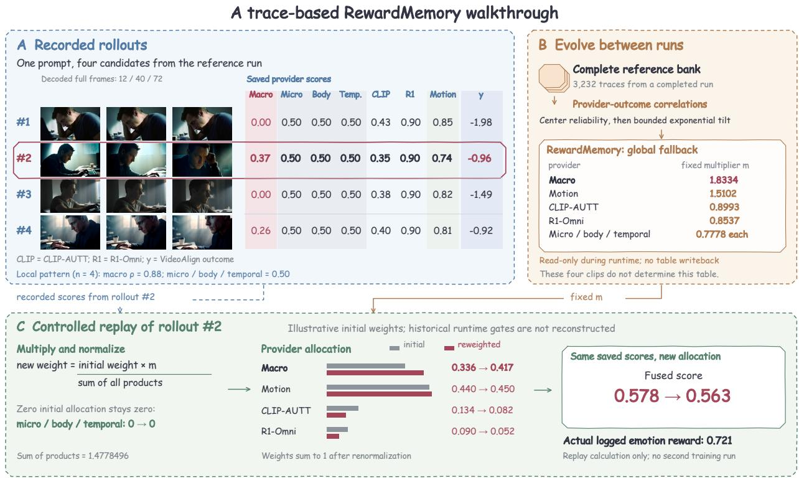  
Figure 7 From completed-run evidence to calibrated fusion. Recorded observations (A) supply provider scores and outcomes; RewardMemory (B) supplies fixed multipliers estimated from the complete reference bank, rather than the four displayed clips. A controlled replay (C) applies these multipliers to illustrative initial weights for rollout #2. The resulting 0.578 → 0.563 calculation demonstrates reallocation with fixed scores; it is distinct from the logged reward 0.721 and does not represent a second training run.

Separating observations from the replay. The exported table’s global entry difers from its contextspecific entries. We use the global entry here to isolate the reweighting operation, without claiming that it was the entry selected for these historical videos. The initial active allocation is (0.336, 0.440, 0.134, 0.090) over macro, motion, CLIP-AUTT, and R1-Omni, with zero mass on the other three providers. These are illustrative starting weights, not reconstructed runtime gates. Multiplying by the exported global multipliers and renormalizing produces approximately (0.417, 0.450, 0.082, 0.052). On rollout #2’s recorded scores, the weighted mean changes from 0.578 to 0.563; its actual logged emotion reward is 0.721. The distinction matters because the historical reward used its own training phase and configuration. An increase in a provider’s allocation need not increase the scalar fused score, and neither change alone establishes improved generated quality.

Prompt. The camera slowly pushes forward, a cold side light slanting through the window frame, carving a sharp beam across the dimly lit study and illuminating the man seated at his desk. He leans slightly forward, hands folded over the keyboard, fingers tapping the keys with slow, precise rhythm. Shot from a low angle behind and to the side, the frame captures his furrowed brow and narrowed eyes, his gaze fixed like a needle on the flickering stream of code on the screen. His lips are pressed into a thin line, the jawline taut with concentration, nostrils fluttering faintly with each breath, occasionally biting his lower lip as if swallowing an unspoken question. The light casts a soft shadow across his forehead, making the sharp glint in his eyes even more intense. In the background, scattered papers and empty cofee cups rest silently on the bookshelf, while the rhythmic tapping of the keyboard echoes in the stillness, like the pulse of a heartbeat. He suddenly pauses, raises his right hand to his temple, his eyes briefly drifting, then swiftly refocuses on the screen—a quiet resolve, a steadfast defiance against time.

## J Generalization to Image Generation

We evaluate Stable Difusion 3.5 and FLUX with three optimizers and three reward configurations on 256 DrawBench prompts per checkpoint: 18 settings and 84 checkpoints. Internal Emo measures the emotion-stack reward; HPSv3 is a general preference objective also used to train the baseline. Neither independently measures perceived emotion.

SD3.5 baseline results average three checkpoints at 420–500 updates; calibrated variants average five at 2,780–3,000. FLUX baseline checkpoints span 2,760–3,000, and calibrated checkpoints 2,780–3,000. Standard errors describe checkpoint variation, not independent training seeds. Per-prompt arrays support the reported means; paired significance requires complete sample and generation-seed mappings and is not claimed.

Observed transfer pattern. With SD3.5–DanceGRPO, HPSv3 rises from 9.552 (baseline) to 10.096 (Reflect) and 10.302 (EmoReward). SD3.5–FlowGRPO declines on both HPSv3 and internal Emo; FLUX’s HPSv3-optimized baseline leads on HPSv3 across optimizers. Thus transfer is objective-dependent rather than uniformly beneficial.

## J.1 Qualitative comparison protocol

Image plates use four curated prompts per displayed setting; video plates cover three optimizers. Figure 5 separately compares provider configurations. These examples illustrate behavior, not a randomly estimated win rate.

Images retain all original pixels. SD3.5 baseline outputs use 500 updates and calibrated outputs 3,000. The first two FLUX baseline cases use the only saved examples at 500 updates; all other FLUX rows use 3,000. Unequal budgets prevent attributing qualitative diferences solely to calibration. Image seeds are unavailable, so only prompts are matched. Video rows share prompts and recorded sampling seeds. Clips are 864×480 at 24 fps; full frames at 0.5, 2.5, and 4.5 seconds are decoded without interpolation or retouching. The source bundle includes synchronized playback and editable figures.

The ordinal ratings in Appendix B complement these proxy-based and qualitative comparisons; raw participant/prompt records are needed to quantify uncertainty. The depicted scenes are generated content.

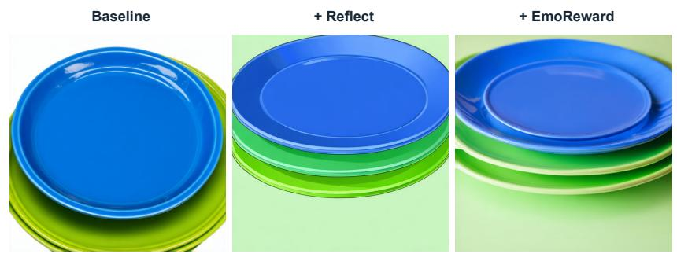  
(a) A stack of 3 plates. A blue plate is on the top, sitting on a blue plate. The blue plate is in the middle, sitting on a green plate. The green plate is on the bottom.

  
(b) A large keyboard musical instrument with a wooden case enclosing a soundboard and metal strings, which are struck by hammers when the keys are depressed. The strings' vibration is stopped by dampers when the keys are released and can be regulated for length and volume by two or three pedals. [Spelling normalized.]

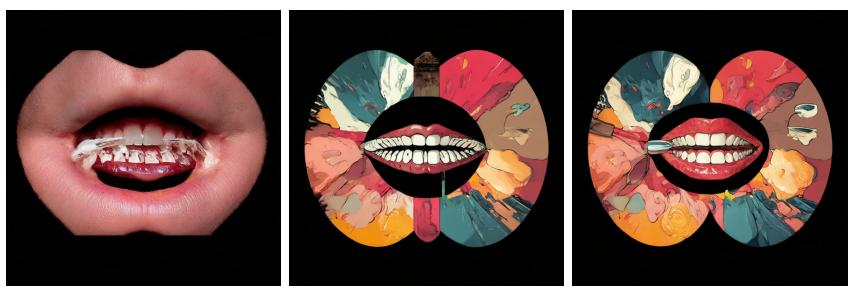

  
(d) A stack of 3 books. A green book is on the top, sitting on a red book. The red book is in the middle, sitting on a blue book. The blue book is on the bottom.

Figure 8 Qualitative comparison of reward calibration. Columns show the baseline, the addition of Reflect, and the complete EmoReward configuration for SD3.5 with DanceGRPO. Prompt (b) is spelling-normalized for readability; the images retain the original perturbed input. Budgets and seed limitations appear in Appendix J.1.

(a) SD3.5 · FlowGRPO  
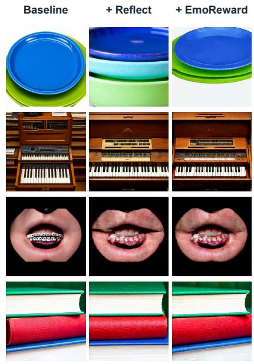  
Rows: prompts 1–4

(b) SD3.5 · SAGE-GRPO  
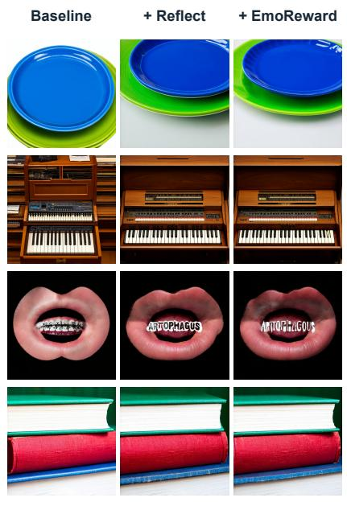  
Rows: prompts 1–4

(c) FLUX · DanceGRPO  
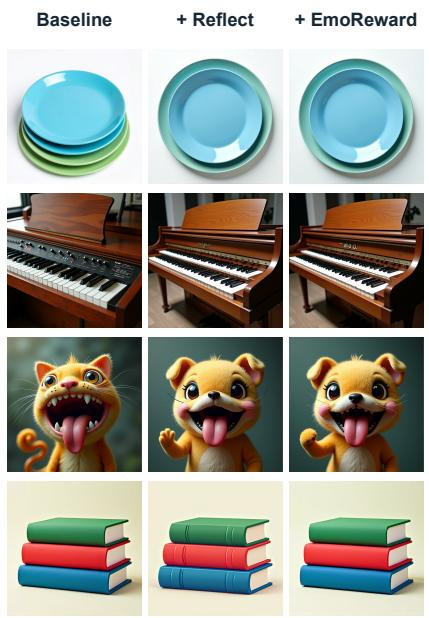  
Rows: prompts 1–4

(d) FLUX · FlowGRPO  
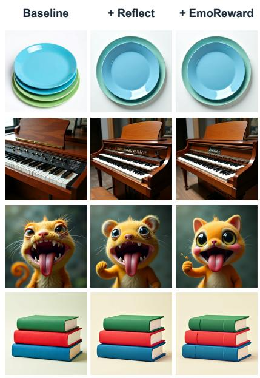

(e) FLUX · SAGE-GRPO  
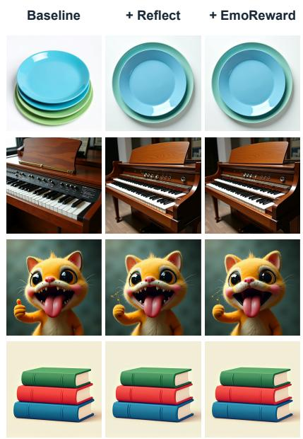  
Rows: prompts 1–4  
Rows: prompts 1–4

## Shared prompts

1. A stack of 3 plates. A blue plate is on the top, sitting on a blue plate. The blue plate is in the middle, sitting on a green plate. The green plate is on the bottom.

2. A large keyboard musical instrument with a wooden case enclosing a soundboard and metal strings, which are struck by hammers when the keys are depressed. The strings' vibration is stopped by dampers when the keys are released and can be regulated for length and volume by two or three pedals. [Spelling normalized.]

## 3. Artophagous.

4. A stack of 3 books. A green book is on the top, sitting on a red book. The red book is in the middle, sitting on a blue book. The blue book is on the bottom.

Figure 9 Image transfer across SD3.5 and FLUX. Five backbone–optimizer settings share four prompts; each panel compares HPSv3 RL, Reflective gating, and EmoReward. Rows show the same curated prompts as the preceding figure. The first two FLUX baseline rows use earlier saved outputs; see Appendix J.1 for budgets and seed limitations.

## K Video Comparisons

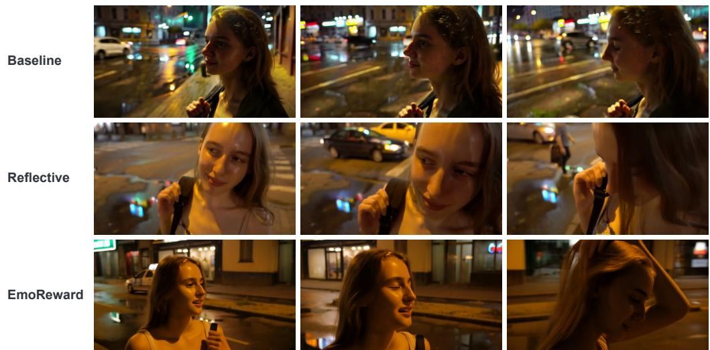  
Prompt: The camera slowly pushes in on a young woman standing at a street corner under the dim yellow glow of a streetlight, captured in a medium close-up. Side backlighting outlines her slender silhouette. Her hand unconsciously tightens around the backpack strap, knuckles turning slightly white, while a faint, forced smile tugs at her lips—never reaching her eyes. Her gaze drifts away from the front, settling on a puddle on the ground, where neon signs flicker and reflect like the instability of her emotions. She slightly turns her head, her lips twitching as if about to speak, but only a soft cough escapes. She lowers her head, her long hair falling to veil half her face. A breeze lifts her strands, and she instinctively reaches up to brush them aside, her fingers pausing in midair before dropping weakly. In the background, blurred traffic and pedestrians move past, their noise isolated beyond the frame, leaving her alone in the shifting light, trembling slightly, as if the entire world has gone silent except for the clear, pounding rhythm of her heartbeat in her ears.

Figure 10 DanceGRPO. Street-corner hesitation: a strained smile and averted gaze.  
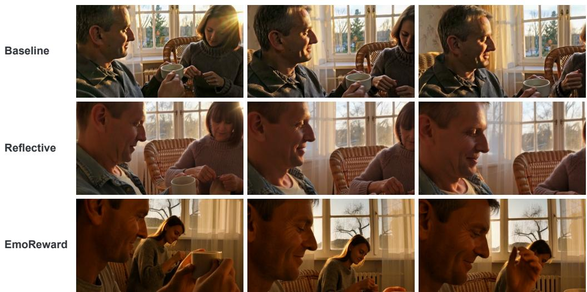  
Prompt: The slanting sunlight of dusk filters through the old window lattice, bathing the room in a warm, amber glow. An middle-aged couple sits on worn wicker chairs; she is bent over, mending an old sweater, her fingers deftly guiding the needle and thread. He watches her quietly, his fingers unconsciously tracing the rim of his cup, his gaze reflecting the swaying tree shadows outside. Suddenly, she looks up at him, a faint smile lifting the corners of her lips, fine lines crinkling at the edges of her eyes—gentle ripples of time’s quiet grace. His throat moves slightly, his lips parting as if to speak, but no sound comes. Instead, he reaches out, gently brushing a strand of her hair, his touch slow and reverent. A hint of shyness flickers in her eyes; she lowers her head with a soft laugh, her fingers trembling slightly as a thread slips free. He catches it with a quick, tender motion. They exchange a glance, and a silent understanding flows between them. The camera slowly pushes in, focusing on the delicate smile lines at the corner of her eye and the quiet glimmer deep in his gaze.  
Figure 11 DanceGRPO. A quiet exchange at dusk: the prompt couples a smile with a tentative hand gesture.

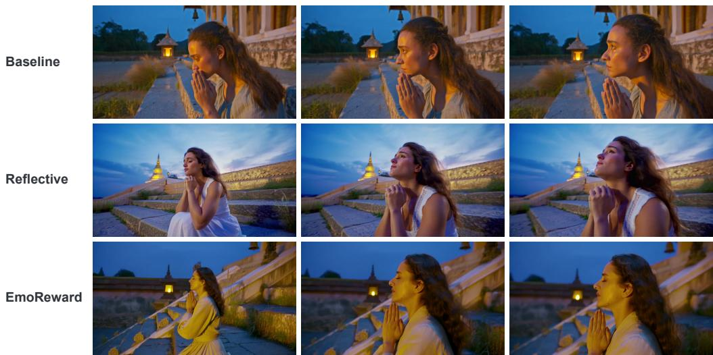  
Prompt: The camera slowly pushes in on a young woman kneeling on ancient bluish stone steps, her back turned to the deepening twilight sky, hands folded gently on her knees, fingertips trembling faintly. Her face is bathed in warm gold by the slanting rays of the setting sun, her eyelashes lowered, her pupils reflecting the flickering oil lamp at the distant temple eaves—a silent mirror to some unspoken obsession. Her lips are slightly pursed, the line of her mouth taut, as if silently praying or suppressing a sigh that threatens to break free. She tilts her head upward, gazing into the night sky, a single tear slipping down her cheek, pausing at her chin, glimmering in the dim light. A breeze stirs her hair, her sleeve lifts slightly, her arm quivers faintly, as though awaiting a response that will never come. Behind her, a quiet courtyard lies still, wild grasses growing beside the stone steps, while in the distance, a bell tolls gently, echoing through the empty dusk. The entire scene is enveloped in a near-sacred sense of solitude.

Figure 12 FlowGRPO. Unease on the stone steps at twilight.  
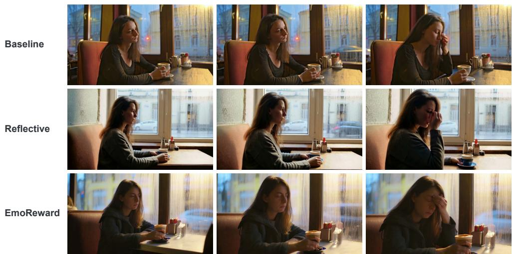  
Prompt: The camera slowly pushes in on a young woman sitting alone in the corner of an old-fashioned café, rain streaking diagonally across the window, blurring the street scene through water-traced glass. She holds a cup of coffee now cold, her fingertips trembling slightly, her gaze distant as she stares at the table, lips pressed into a thin line, as if chewing on some unspeakable contradiction. Light slants through the high window, bathing one side of her face in warm yellow while the other remains in shadow, creating a stark visual divide. Suddenly, she lifts her eyes, scanning the empty seats before returning her gaze to her phone screen, her brow furrowing slightly, her mouth twitching as if she’s heard a whisper she shouldn’t have. She wipes her eye with the back of her hand—restrained yet unable to hide her weariness—her fingers unconsciously picking at the rim of the cup, as if searching for some confirmation that has long since vanished. The air is thick with the scent of coffee and damp wood; time seems to have stopped, except for the flicker of doubt in her brow, quietly growing in the silence  
Figure 13 FlowGRPO. A pause in a rain-streaked café.

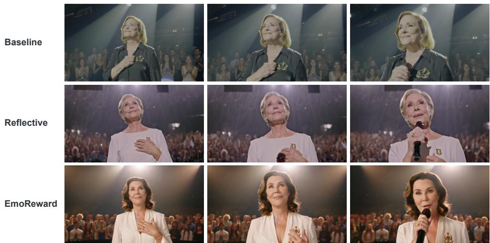  
Prompt: The camera slowly pushes in, revealing a middle-aged woman standing at the center of the stage, bathed in a spotlight that cascades from the upper side, softly outlining her silhouette with quiet strength. She tilts her head slightly upward, a subtle smile forming on her lips—a smile long held within, unassuming yet powerful enough to pierce the silence. Her gaze sweeps across the audience, her eyes glowing with a gentle warmth, like melting snow in winter, reflecting countless looks of reverence. Her fingers gently trace the emblem on her chest, her fingertips trembling slightly, as if touching a memory sealed by time. Slowly, she raises her hand and grasps the microphone her lips parting slightly as her voice emerges—low, clear, each word like amber seeping from the depths of her soul. Her eyes never leave the audience, a look of calm acceptance and quiet response, as if saying: every step I’ve taken is worth being seen. Behind her, the applause blurs into soft waves, the melody gentle and hushed, while her face, stretched by light and shadow, resembles a still oil painting, frozen in her moment of radiant glory.

Figure 14 SAGE-GRPO. Composure under the spotlight in a restrained, emotionally charged stage scene.  
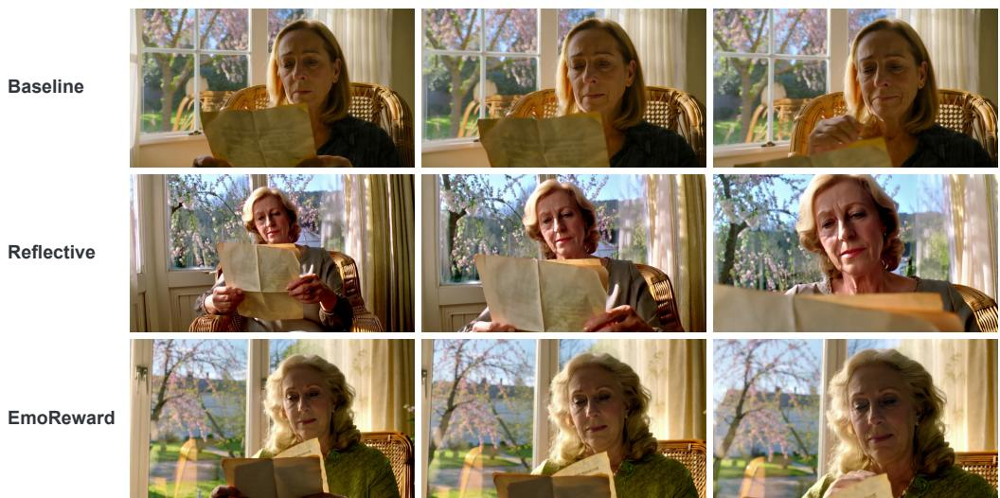  
Prompt: The camera slowly pushes in, settling on a close-up of a middle-aged woman seated in an old wicker chair by the window, sunlight slanting across her slightly weary face, fine lines around her eyes trembling faintly in the light. She gazes down at an old letter in her hands, lips slightly parted, breath catching, as if reading a memory sealed by time. Suddenly, a breeze stirs, gently turning the page. She lifts her eyes, her gaze falling on a cherry blossom tree blooming outside, a flicker of recognition passing through her, a soft smile gradually forming, her brow relaxing into a long-forgotten tenderness. She raises a hand, fingertips brushing lightly over the letter, as if touching a distant moment; tears well in her eyes but do not fall, only a faint glimmer shining deep within her pupils. The scene slowly pulls back, revealing her sitting in a room bathed in shifting light and shadow, the flower shadows outside swaying gently, the entire space filled with a quiet, warm aura of bygone days.  
Figure 15 SAGE-GRPO. Recognition in an old letter in a close-up with gradually softening expression.