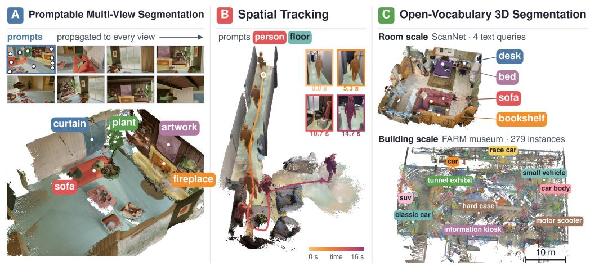  
Figure 1: Feature Puzzles learns multi-view-consistent segmentation from single images, extending feed-forward reconstruction to (A) promptable segmentation that propagates to all views in one pass, (B) spatial tracking, and (C) open-vocabulary 3D segmentation.

# FEATURE PUZZLES: SINGLE-IMAGE SUPERVISION FOR MULTI-VIEW 3D-AWARE SEGMENTATION

Jiahao Ma1,3 Qiang Zhang2 1Australian National University

Miaomiao Liu1 David Ahmedt-Aristizabal3 Chuong Nguyen3 2University of Science and Technology of China 3CSIRO, Australia

## ABSTRACT

Humans can easily recognize the same objects across different viewpoints of a 3D scene, whereas teaching models such multi-view-consistent perception typically requires videos or calibrated multi-view captures, which are considerably more expensive and less diverse than large-scale monocular data. In this paper, we introduce Feature Puzzles, a novel framework for learning multi-viewconsistent segmentation using only single-image semantic segmentation supervision. Specifically, we propose a simple yet effective pipeline that constructs multi-view-consistent segmentation pseudo-labels through image cropping and geometric transformations. We further introduce a lightweight, plug-and-play network that leverages the multi-view-consistent image features learned by existing pretrained 3D foundation models and the generated pseudo-labels to perform multi-view-consistent segmentation. Importantly, our flexible framework supports various types of prompts provided from one or multiple views and can be readily extended to open-vocabulary 3D segmentation. Under this single-image supervision, our feed-forward model achieves the best mIoU on NVOS, remains competitive on SPIn-NeRF and ScanNet++ against baselines using per-scene optimization or in-domain multi-view training, and demonstrates zero-shot transfer to open-vocabulary 3D segmentation. Visual comparisons are available on our project page: https://featurepuzzles.github.io/.

## 1 INTRODUCTION

Spatial intelligence requires not only recovering geometric structure but also recognizing and reasoning about scene content consistently across viewpoints (Yang et al., 2025). Multi-view-consistent perception, particularly multi-view-consistent segmentation, is essential for building coherent representations of the physical world and provides a foundation for downstream tasks such as robotic interaction (Qu et al., 2025; Zhang et al., 2026b), embodied navigation (Zhang et al., 2024; Ma et al., 2026), and open-vocabulary 3D understanding (Peng et al., 2023).

Recent advances in feed-forward 3D reconstruction (Wang et al., 2025a; 2026b; Lin et al., 2025; Wang & Agapito, 2025; Wang et al., 2025b; Lan et al., 2026) have substantially improved the efficiency of recovering 3D geometry while enabling the processing of long sequences. Building on these advances, IGGT (Li et al., 2026) and IGGT4D (Zou et al., 2026) extend feed-forward reconstruction models with instance-level understanding of static and dynamic scenes, while Embodied-Splat (Lee et al., 2026) enables online 3D reconstruction and semantic understanding. Despite their effectiveness, these approaches typically rely on multi-view-specific resources, such as posed RGB D scans, curated cross-view instance datasets, or multi-view distillation and self-supervision signals, which are considerably more difficult and costly to acquire than single-image semantic supervision.

This reveals a key supervision gap: pretrained multi-view backbones already provide strong geometric priors, but consistent cross-view semantics still depend on scarce multi-view annotations. In contrast, single-image segmentation data is abundant but lacks cross-view correspondence. We therefore ask whether single-image semantic supervision alone can supply this missing semantic layer without real multi-view annotations. We emphasize the scope of this question. We do not claim that 3D or multi-view consistency itself can be learned from monocular images alone; the geometric prior comes from the pretrained backbone, and our contribution is a supervision framework that adapts this representation to multi-view-consistent semantics.

To address this gap, we propose Feature Puzzles, a training framework that turns large-scale singleimage segmentation data into synthetic multi-view supervision. It decomposes each image into overlapping crops and treats them as synthetic views, avoiding the need for multiple observations of the same scene. For these shared-parent crop views, correspondence is exact in the parent-image coordinate system, enabling randomly sampled 2D masks and dense visual features to be transformed consistently across views without additional multi-view semantic annotation.

Building on this supervision, we introduce a lightweight adaptation scheme for feed-forward 3D reconstruction models. We fuse intermediate multi-scale features and adapt only late backbone blocks with low-rank adapters, which can be disabled at inference to recover the original depth and camera outputs. This equips existing backbones with multi-view-consistent perception without redesigning the reconstruction pipeline. We instantiate Feature Puzzles for two complementary tasks: promptable multi-view segmentation, which accepts prompts from one or more views and predicts masks jointly across all views in a single forward pass, and open-vocabulary 3D segmentation, which distills DINOv3 features to learn dense, multi-view-consistent representations for 3D recognition. As shown in Figure 1, Feature Puzzles extends one reconstruction backbone to promptable segmenta tion, spatial tracking, and open-vocabulary 3D understanding with minimal architectural changes.

We organize our evaluation around a single hypothesis: shared-parent single-image supervision with exact synthetic-view correspondence can teach multi-view-consistent semantics to a pretrained 3D geometry representation. Each experiment tests a consequence of this hypothesis. Promptable segmentation tests whether object identity transfers across genuine camera views. Instance spatial tracking tests whether this correspondence survives spatial and temporal displacement. Driving scenes test whether it transfers beyond indoor distributions. Open-vocabulary 3D segmentation tests whether the same principle extends from masks to dense semantic feature fields. For task-specific training, promptable segmentation uses only single-image SA-1B mask supervision, while openvocabulary 3D segmentation uses single-image DINOv3 feature distillation. Neither task uses taskspecific multi-view or video annotations. Under this supervision, our model achieves the best mIoU on NVOS in a single forward pass, remains competitive on SPIn-NeRF and ScanNet++, and demonstrates transfer to out-of-distribution driving scenes. Ablations further support the contributions of multi-layer features, backbone adaptation, and cross-view processing.

## 2 RELATED WORK

Feed-forward 3D reconstruction. Reconstruction has moved from per-scene optimization (Schonberger & Frahm, 2016; Sch ¨ onberger et al., 2016) to feed-forward prediction: ¨ VGGT (Wang et al., 2025a), π3 (Wang et al., 2026b), MapAnything (Keetha et al., 2026), and Depth Anything 3 (Lin et al., 2025) regress cameras, depth, and point maps in a single pass, while Spann3R (Wang & Agapito, 2025), CUT3R (Wang et al., 2025b), LingBot-Map (Chen et al., 2026), and STream3R (Lan et al., 2026) extend this to streaming or causal reconstruction. Closest to our data construction, Puzzles (Ma et al., 2025a) synthesizes multi-view training data from a single image or clip, but only for geometric pointmap regression, without transferring semantic masks or features or defining a cross-view perception objective. These reconstruction models primarily focus on geometric structure rather than task-specific semantics. We build on a pretrained multi-view backbone and ask how single-image supervision can add a consistent semantic layer.

Feed-forward semantic 3D scene understanding. Per-scene methods lift 2D vision–language features into a NeRF or 3DGS field (Kerr et al., 2023; Zhou et al., 2024; Qin et al., 2024; Shi et al., 2024; Wu et al., 2024; Cheng et al., 2025; Kim et al., 2025; Li et al., 2025b; Ma et al., 2024) and must re-optimize for every scene. Feed-forward alternatives predict semantics together with geometry in one pass. LSM (Fan et al., 2024), Uni3R (Sun et al., 2026), SAB3R (Chen et al., 2025), and Ov3R (Gong et al., 2026) distill CLIP- or DINO-style features into a reconstruction network, while EmbodiedSplat (Lee et al., 2026) builds a semantic 3DGS online from RGB(-D) streams. For instance understanding, PanSt3R (Zust et al., 2025) adds a panoptic head to frozen MUSt3R and DINOv2 features, EPS3D (Zhu et al., 2026) distills LSeg and SAM into a VGGT-based model, IGGT (Li et al., 2026), IGGT4D (Zou et al., 2026) and S4VY (Zhang et al., 2026a) learn crossview instance embeddings, and SceneDINO (Jevtic et al., 2025) predicts a 3D DINO feature field´ from a single image. Most rely on multi-view scene data—including posed scans, curated crossview instance datasets, or video—during semantic training. In contrast, Feature Puzzles uses no task-specific real multi-view or video supervision, while inheriting its geometric prior from a pretrained multi-view backbone. Its promptable branch uses single-image SA-1B masks, and its openvocabulary branch a frozen DINOv3 teacher; cross-view supervision is created by shared-parent pull-back. Optional in-domain fine-tuning is reported separately from zero-shot evaluation.

Promptable and cross-view segmentation. SAM (Kirillov et al., 2023a) and SAM2 (Ravi et al., 2025) provide promptable segmentation for images and video but do not explicitly model 3D crossview consistency, so masks can drift across views of a static scene. NVOS (Ren et al., 2022), SPIn-NeRF (Mirzaei et al., 2023), SA3D (Cen et al., 2023), SAGA (Cen et al., 2025a;b), DCHM (Ma et al., 2025b) and OmniSeg3D (Ying et al., 2024) restore consistency by distilling SAM masks into a per-scene field, at a cost of minutes to hours per scene. MASA (Li et al., 2024) learns 2D instance association from augmented static images, while MV-SAM (Jeong et al., 2026) trains on SA-1B but relies on a frozen π3 pointmap predictor for cross-view consistency at inference. The closest work is VGGT-Segmentor (Gao et al., 2026), which also builds on VGGT and offers a single-image self-supervised variant trained on SA-1B. It formulates cross-view segmentation as pairwise source– target matching guided by explicit VGGT point tracks. Because targets are processed independently, larger unordered view sets require additional pair selection, association, or tracking. Feature Puzzles instead trains and reasons jointly over shared-parent N-view sequences, predicting all views in one forward pass without pairwise matching, point tracking, or predefined view ordering.

## 3 METHOD

## 3.1 OVERVIEW

We propose Feature Puzzles, which turns a single image into overlapping synthetic views with exactly aligned supervision (Section 3.2). A pretrained VGGT-Omega backbone encodes these views (Section 3.3) and feeds two lightweight heads for promptable multi-view segmentation (Section 3.4) and open-vocabulary 3D features (Section 3.5).

## 3.2 SINGLE-IMAGE MULTI-CROP PUZZLES

Figure 2 shows how Feature Puzzles converts one annotated image into a pseudo-view sample. We call the original image the parent image, containing RGB, instance masks, dense teacher features, and semantic labels. It is cropped into overlapping sub-images, each treated as a synthetic view. Since all sub-images share the same parent, overlapping regions inherit exactly aligned supervision by construction, enabling multi-view-consistent training without real multi-view or video data.

Feature puzzles generation. Let a parent image I have spatial size H × W. As in Figure 2B, we sample N overlapping sub-images $\{ x _ { n } \} _ { n = 1 } ^ { N }$ , each a box in parent coordinates of side length $s \in [ s _ { \operatorname* { m i n } } , s _ { \operatorname* { m a x } } ]$ (fraction of the shorter side; default [0.5, 0.9]), resampled to square resolution R so $x _ { n } \in \mathbb { R } ^ { R \times R \times 3 }$ . We also write $x _ { n }$ for the box, so $x _ { i } \cap x _ { j }$ is the overlap of two sub-images. A candidate is accepted only if it overlaps an accepted sub-image with $\mathrm { I o U } \geq o _ { \operatorname* { m i n } } .$ , so the $\breve { N }$ subimages form a connected overlap graph—the condition for cross-view warping.

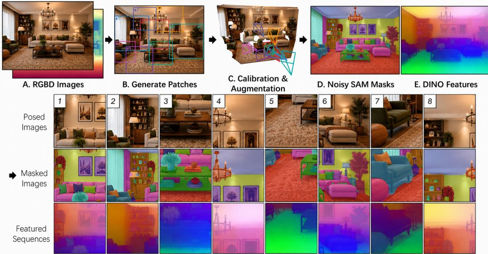  
Figure 2: Feature Puzzles pipeline. From a single RGB(-D) parent image (A), we sample overlapping crops as a puzzle (B), optionally calibrate their cameras and apply 3D augmentation (C), and pull back SAM masks (D) and DINO features (E) into every crop (bottom).

3D-augmented views. Affine crops contain no parallax or occlusion. Optionally, following Imageto-Clips (Ma et al., 2025a), we estimate parent depth with MoGe-2 (Wang et al., 2025c), calibrate each view’s camera, and apply 6-DoF augmentation, pulling labels back through depth projection. This optional construction is distinct from the affine crop mapping defined below.

The sub-image-to-parent map. For the affine crop views, sub-image $x _ { n }$ is related to the parent I by a closed-form affine map $\pi _ { n }$ that we chose when sampling it, so $x _ { n } = I \circ \pi _ { n }$ maps sub-image coordinates to parent coordinates. Unlike a camera pose, $\pi _ { n }$ is never estimated: it is fixed by the sampled box, requires no depth and no camera model, and is invertible in closed form.

Label transfer by pull-back. For the affine crop construction, the same map $\pi _ { n }$ that relates a subimage to the parent RGB transfers labels just as well: rather than annotating each crop independently, we pull back a single parent-space label field ℓ—which may carry instance masks, semantic classes, or dense teacher features—by composition with $\pi _ { n }$ and resample to crop resolution,

$$
\ell _ { n } = \mathcal { R } _ { \mathcal { Y } } \big [ \ell \circ \pi _ { n } \big ] .\tag{1}
$$

Here, $\mathcal { R } _ { \mathcal { Y } }$ resamples nearest-neighbour for discrete labels (instance identity, semantic class) and bilinearly with re-normalization for dense features. The parent is the single source of truth and each view a restriction of it, so two views cannot disagree: for any point p in the overlap $x _ { i } \cap x _ { j }$

$$
\ell _ { i } \bigl ( \pi _ { i } ^ { - 1 } ( p ) \bigr ) \ = \ \ell _ { j } \bigl ( \pi _ { j } ^ { - 1 } ( p ) \bigr ) \ = \ \ell ( p ) .\tag{2}
$$

Here, $\pi _ { i } ^ { - 1 } ( p )$ is $p$ in sub-image $i \ ' s$ local coordinates, so both sides read the same parent label $\ell ( p )$ through different crop coordinates—cross-view consistency is exact by construction for these shared-parent affine views.

What the parent field is. The field ℓ takes two forms. For promptable segmentation, ℓ is the set of SA-1B instance masks $\{ \mathcal { A } _ { m } \}$ ; pulling each mask $A _ { m }$ back to view n gives that view’s binary target ${ \bf G } _ { n , m }$ for instance $m .$ Since m indexes the parent field, not a view, it is a global instance identifier: channel m is the same object in all N views, so no Hungarian matching (Li et al., 2025a) or crossview association (Ravi et al., 2025) is needed and the prompt–target pairing of Section 3.4 is oneto-one. For open-vocabulary 3D segmentation, ℓ is a frozen DINOv3 teacher (Simeoni et al., 2025)´ evaluated once on the whole parent image and pulled back by grid sampling. Evaluating before cropping—not per-view—is what guarantees consistency: transformer features change under cropand-resize, so per-view targets would disagree on the overlap; pull-back instead gives every view a target from the same parent field, so distillation and cross-view consistency share one optimum (Appendix A.1). Appendix A.2 gives the augmentation policy, prompt sampling, and annotation filters; Appendix A.3 contrasts this with the Image-to-Clips augmentation of Puzzles (Ma et al., 2025a), whose synthetic views carry geometric labels from pose fitting and re-rendering. We anneal the minimum crop overlap $O _ { \mathrm { { m i n } } }$ from 0.7 to 0.1, exposing the model first to near-duplicate views and then to progressively larger viewpoint changes with less shared content.

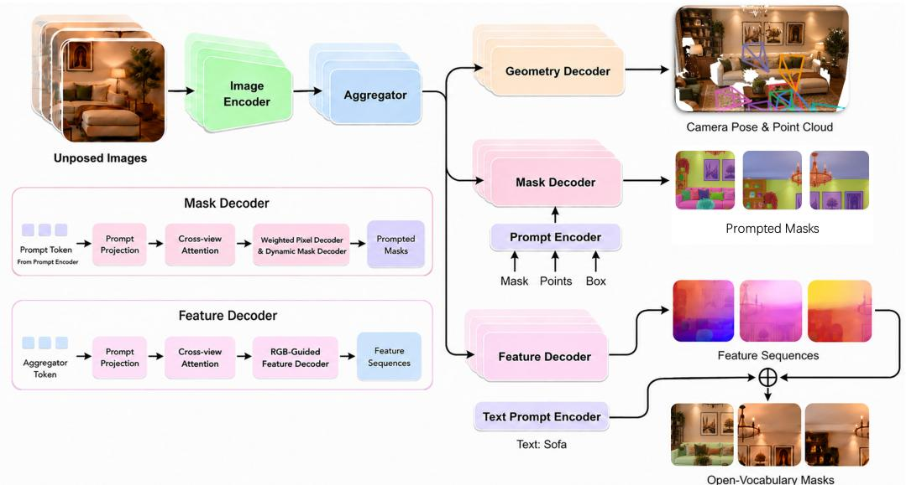  
Figure 3: Feature Puzzles network architecture. A shared Image Encoder + Aggregator produce tokens feeding three decoders: Geometry (poses, 3D points), prompt-conditioned Mask (mask/point/box → masks), and Feature (⊕ text-prompt → open-vocab masks). Mask and feature decoders share cross-view attention and a weighted pixel decoder.

## 3.3 PRETRAINED MULTI-VIEW BACKBONE

As shown in Figure 3, we build on a pretrained VGGT-Omega (Wang et al., 2026a) multi-view transformer. We keep its early blocks frozen and adapt late blocks with LoRA (Hu et al., 2022), preserving the original depth and camera heads at inference. The segmentation heads consume a shared representation ${ \bf F } _ { n }$ obtained by fusing cached multi-layer tokens. Adapters are initialized to preserve the pretrained backbone at the start of training, enabling two-pass inference with adapters off for reconstruction and on for segmentation. We further evaluate the same adaptation recipe on LingBot-Map (Chen et al., 2026), a streaming reconstruction backbone with a different multiview attention design, providing evidence that the approach is not specific to VGGT-Omega. Layer choice, fusion, and initialization are detailed in Appendix B.1.

## 3.4 PROMPTABLE MULTI-VIEW SEGMENTATION

Architecture. As shown in Figure 3 (Mask Decoder), given the sub-images $\{ x _ { n } \}$ and a set of prompts (masks, boxes, or labelled points), the model predicts masks for M instances across all N views in a single forward pass. A SAM-style prompt encoder (Kirillov et al., 2023b) encodes each prompt into a dense coverage map ${ \bf C } _ { n , m }$ and a sparse prompt token; during training prompts may be supplied in one or multiple views. The coverage map injects the prompt into the shared representation ${ \bf F } _ { n }$ from the backbone through a feature-wise linear projection module,

$$
\mathbf { F } _ { n , m } ^ { \prime } = \gamma ( \mathbf { C } _ { n , m } ) \odot \mathbf { F } _ { n } + \beta ( \mathbf { C } _ { n , m } ) ,\tag{3}
$$

where $\gamma$ and $\beta$ are learnable projections producing a per-channel scale and shift, yielding an instance-conditioned feature $\mathbf { F } _ { n , m } ^ { \prime }$ (unprompted view–instance pairs pass through unchanged). The instance-conditioned tokens then pass through cross-view self-attention—which allows promptconditioned information from one view to propagate to the others—and SAM-style two-way attention between image and object tokens, denoted ${ \bf H } _ { n , m } = \mathrm { A t t n } ( { \bf F } _ { n , m } ^ { \prime } )$ with its image and object outputs ${ \bf H } _ { n , m } ^ { \mathrm { i m g } } , { \bf H } _ { n , m } ^ { \mathrm { o b j } }$ . A weighted pixel decoder and a per-instance kernel head then produce the mask logits,

$$
\mathbf { D } _ { n } = \mathrm { P i x e l D e c o d e r } ( \mathbf { H } _ { n , m } ^ { \mathrm { i m g } } ) , \quad \mathbf { k } _ { n , m } = \mathrm { K e r n e l H e a d } ( \mathbf { H } _ { n , m } ^ { \mathrm { o b j } } ) , \quad \mathbf { Y } _ { n , m } = \big \langle \mathbf { D } _ { n } , \mathbf { k } _ { n , m } \big \rangle .\tag{4}
$$

Auxiliary heads predict mask IoU. Appendix B.2 details the token layout and attention blocks.

Training objective. Every prompt corresponds one-to-one to a ground-truth mask, and targets are warped into every crop—including crops where the prompt was not given—so the objective is a plain weighted sum,

$$
\mathcal { L } _ { \mathrm { s e g } } = \lambda _ { \mathrm { b c e } } \mathcal { L } _ { \mathrm { b c e } } + \lambda _ { \mathrm { d i c e } } \mathcal { L } _ { \mathrm { d i c e } } + \lambda _ { \mathrm { i o u } } \mathcal { L } _ { \mathrm { i o u } } + \lambda _ { \mathrm { c o n s } } \mathcal { L } _ { \mathrm { c o n s } } + \lambda _ { \mathrm { p t } } \mathcal { L } _ { \mathrm { p t } } ,\tag{5}
$$

combining: $\mathcal { L } _ { \mathrm { b c e } }$ and ${ \mathcal { L } } _ { \mathrm { d i c e } }$ for pixel-wise mask supervision (binary cross-entropy and Dice), $\mathcal { L } _ { \mathrm { i o u } }$ for IoU regression on a per-view confidence head, ${ \mathcal { L } } _ { \mathrm { c o n s } }$ as an auxiliary cross-view token regularizer that pulls object tokens of the same instance toward their cross-view centroid, and ${ \mathcal L } _ { \mathrm { p t } }$ for pointprompt supervision. Per-term details are in Appendix B.2.

## 3.5 OPEN-VOCABULARY 3D SEGMENTATION

RGB-guided dense feature head. The Feature Decoder in Figure 3 takes the shared representation ${ \bf F } _ { n }$ from the backbone, mixes the N views with cross-view attention, and upsamples with RGB guidance at each stage to restore image-aligned boundaries, yielding a dense feature map ${ \widehat { \mathbf { F } } } _ { n }$ aligned with the frozen DINOv3 (Simeoni et al., 2025)/Talk2DINO (Barsellotti et al., 2025) space.´

Stage 1: single-image pre-training. We first train the head on SA-1B puzzle crops with

$$
\mathcal { L } _ { \mathrm { s t a g e 1 } } = \lambda _ { \mathrm { f e a t } } \mathcal { L } _ { \mathrm { f e a t } } + \lambda _ { \mathrm { w a r p } } \mathcal { L } _ { \mathrm { w a r p } } + \lambda _ { \mathrm { g r a m } } \mathcal { L } _ { \mathrm { g r a m } } ,\tag{6}
$$

where $\mathcal { L } _ { \mathrm { f e a t } }$ is the mean pixel-wise cosine distance between the student ${ \widehat { \mathbf { F } } } _ { n }$ and the pulled-back DINOv3 teacher of that view, and the other two terms exploit the exact crop geometry of the sharedparent affine views. The cross-view warping term maps a student feature from view i onto view j over their overlap and pulls it toward a stop-gradient target:

$$
\mathcal { L } _ { \mathrm { w a r p } } = \frac { 1 } { | \mathcal { P } | } \sum _ { ( i , j ) \in \mathcal { P } } \frac { 1 } { | \Omega _ { i j } | } \sum _ { q \in \Omega _ { i j } } \Big ( 1 - \cos \big ( \widehat { \mathbf { F } } _ { i } \big ( \pi _ { i } ^ { - 1 } \circ \pi _ { j } ( q ) \big ) , \ \mathrm { s g } \big [ \widehat { \mathbf { F } } _ { j } ( q ) \big ] \big ) \Big ) ,\tag{7}
$$

where $\mathcal { P }$ is the set of overlapping view pairs, $\Omega _ { i j }$ their overlap, q a pixel in view $j ,$ and $\pi _ { i } ^ { - 1 } \circ \pi _ { j }$ maps q from view $j$ into view i so both cosine arguments sit at the same parent location; sg[·] blocks the gradient through the target. The Gram anchoring term matches pairwise similarities. We sample K pixels $\left\{ p _ { k } \right\}$ from a view and stack the L2-normalized student features $\widehat { \mathbf { F } } _ { n } ( p _ { k } )$ and the pulled-back teacher features $\mathbf { F } _ { t } ( p _ { k } )$ at the same pixels as the rows of $\widehat { \bf S } = [ \widehat { \bf F } _ { n } ( p _ { 1 } ) ; \ldots ; \widehat { \bf F } _ { n } ( p _ { K } ) ]$ and $\mathbf { S } _ { T } = [ \mathbf { F } _ { t } ( p _ { 1 } ) ; \ldots ; \mathbf { F } _ { t } ( p _ { K } ) ]$ ], then match the $K \times K$ Gram matrices

$$
\mathcal { L } _ { \mathrm { g r a m } } = \left\| \widehat { \mathbf { S } } \widehat { \mathbf { S } } ^ { \top } - \mathbf { S } _ { T } \mathbf { S } _ { T } ^ { \top } \right\| _ { F } ^ { 2 } ,\tag{8}
$$

which is designed to preserve cross-boundary feature dissimilarity and tie different scales to a com mon similarity geometry. Weights and sampling details are in Appendix B.3.

Stage 2: in-domain text-aligned fine-tuning. Stage 1 aligns ${ \widehat { \mathbf { F } } } _ { n }$ with DINOv3 but not with language. We therefore add per-pixel text-aligned cross-entropy using labels warped from the parent image. For pixel $p$ and class $k , z _ { p , k } = \cos ( \widehat { \mathbf { f } } _ { p } , \mathbf { e } _ { k } ) / \tau$ with $\tau = 0 . 0 7$ , where $\mathbf { e } _ { k }$ is obtained from a frozen CLIP text tower and mapped into DINOv3 space by frozen Talk2DINO. Stage-1 distillation is retained to preserve DINOv3 alignment, while the new loss introduces explicit supervision for the in-domain semantic classes.

3D lifting and classification. At inference, each RGB frame produces a dense feature map. Depth and camera pose are used to unproject feature pixels into 3D, where features are averaged within a 0.02 m voxel grid to obtain one feature $\mathbf { f } _ { \mathrm { v o x e l } }$ per voxel. Each query point takes its nearest voxel feature and is classified by $\hat { y } = \arg \operatorname* { m a x } _ { k } \cos ( \mathbf { f } _ { \mathrm { v o x e l } } , \mathbf { e } _ { k } )$ , where $\mathbf { e } _ { k }$ is obtained from the frozen CLIP/Talk2DINO text mapping. The entire process is feed-forward and requires no scene-specific training or test-time optimization.

Table 1: Promptable multi-view segmentation on NVOS and SPIn-NeRF. Per-scene methods fit each test scene; generalization methods use one forward pass. Ours uses only SA-1B-style masks for task-specific segmentation training.
<table><tr><td>Category</td><td>Method</td><td>Train</td><td colspan="2">NVOS</td><td colspan="2">SPIn</td></tr><tr><td></td><td></td><td></td><td></td><td></td><td></td><td>mIoU (%) mAcc (%) mIoU (%) mAcc (%)</td></tr><tr><td rowspan="5">Per-scene opt.</td><td>SPIn-NeRF (Mirzaei et al., 2023) NeRF</td><td></td><td></td><td></td><td>90.7</td><td>98.8</td></tr><tr><td>SA3D (Cen et al., 2023)</td><td>NeRF+SAM</td><td>91.1</td><td>98.4</td><td>92.4</td><td>98.8</td></tr><tr><td>SAGA (Cen et al., 2025a)</td><td>3DGS+SAM</td><td>92.6</td><td>98.6</td><td>93.7</td><td>99.2</td></tr><tr><td>SA3D-GS (Cen et al., 2025b)</td><td>3DGS+SAM</td><td>92.7</td><td>98.5</td><td>93.4</td><td>99.1</td></tr><tr><td>OmniSeg3D (Ying et al., 2024)</td><td>3DGS+SAM</td><td>92.8</td><td>98.6</td><td>94.5</td><td>99.3</td></tr><tr><td rowspan="3">General.</td><td>SAM2 (Ravi et al., 2025)</td><td>SA-V (video)</td><td>88.7</td><td>94.6</td><td>86.6</td><td>93.6</td></tr><tr><td>MV-SAM (Jeong et al., 2026)</td><td>SA-1B (single image)</td><td>92.1</td><td>97.5</td><td>92.9</td><td>97.1</td></tr><tr><td>Ours</td><td>SA-1B (single image)</td><td>93.2</td><td>98.3</td><td>88.5</td><td>97.7</td></tr></table>

## 4 EXPERIMENTS

Feature Puzzles extends feed-forward reconstruction with scene understanding. We evaluate promptable segmentation on NVOS and SPIn-NeRF (Section 4.1), instance tracking on ScanNet++ (Section 4.2), OOD tracking on nuScenes-mini (Section 4.2), and open-vocabulary 3D segmentation following EmbodiedSplat (Section 4.3).

## 4.1 PROMPTABLE MULTI-VIEW SEGMENTATION

We evaluate promptable multi-view segmentation on NVOS (Ren et al., 2022) and SPIn-NeRF (Mirzaei et al., 2023) following the SAGA protocol, using a single reference-view mask prompt. Task-specific training uses only single-image SA-1B-style masks, with no video or real multi-view supervision. As shown in Table 1, our feed-forward model achieves the best mIoU on NVOS (93.2%) and outperforms SAM2-Video on SPIn-NeRF (88.5% vs. 86.6%), while remaining below MV-SAM and the strongest per-scene methods there. Across both datasets, inference requires no scene-specific optimization and generalizes directly to unseen scenes.

## 4.2 INSTANCE SPATIAL TRACKING

ScanNet++ evaluation. We follow the IGGT (Li et al., 2026) protocol on ScanNet++ (Yeshwanth et al., 2023), propagating a reference mask to all frames in one forward pass over 19 instances from 7 scenes. IGGT is trained on ScanNet++ RGB-D and is therefore in-distribution, whereas our taskspecific segmentation training uses only SA-1B and is OOD to ScanNet++. As shown in Table 2, our method achieves 63.60% mIoU and 87.50% T-SR, approaching IGGT (73.02% / 98.90%) while outperforming SAM2\* and SpaTracker+SAM.

OOD evaluation on nuScenes-mini. We adapt the same protocol to nuScenes-mini (Caesar et al., 2020) (9 scenes, 6 surround cameras), using projected 3D boxes as pseudo-masks. Here, all methods are OOD: IGGT is trained on ScanNet++ RGB-D, while our task-specific segmentation training still uses only SA-1B. Despite wide baselines and minimal frustum overlaps across the six cameras, our method in one forward pass achieves 4.78% T-mIoU , 20.97% T-mIoU , and the highest T-$\mathrm { S R } _ { \mathrm { v i s } }$ of 88.89%. IGGT obtains higher $\mathrm { T } { \cdot } \mathrm { S R } _ { \mathrm { a l l } }$ through HDBSCAN matching but lower mIoU. See Appendix E for detailed visual comparisons on ScanNet++ and nuScenes-mini.

## 4.3 OPEN-VOCABULARY 3D SEGMENTATION

We follow the EmbodiedSplat protocol (Lee et al., 2026) on ScanNet, ScanNet200, and ScanNet++, using 11 ScanNet and 4 ScanNet++ scenes with stride 10. Features are voxel-averaged at 0.02 m, lifted with ground-truth geometry, and classified using Talk2DINO text embeddings. Thus, the benchmark measures semantic feature quality under fixed geometry. We compare with per-scene 3DGS methods (Qin et al., 2024; Shi et al., 2024; Wu et al., 2024; Cheng et al., 2025; Kim et al., 2025; Li et al., 2025b; Katragadda et al., 2025) and feed-forward EmbodiedSplat. See Appendix E for coherent semantic reconstruction across diverse large-scale environments.

Table 2: Instance spatial tracking on ScanNet++ and nuScenes-mini. IGGT is in-distribution on ScanNet++ but OOD on nuScenes. Ours is OOD with respect to task-specific training on both benchmarks and uses only SA-1B for task-specific segmentation training. T-SR denotes temporal success rate; nuScenes reports all-frame (all) and visible-frame (vis) metrics.
<table><tr><td rowspan="2">Method</td><td rowspan="2">Training Data</td><td colspan="2">ScanNet++</td><td colspan="4">nuScenes-mini</td></tr><tr><td>mIoU (%)</td><td>T-SR (%)</td><td>T-mIoUall</td><td>T-mIoUvis</td><td>T-SRa1l</td><td>T-SRvis</td></tr><tr><td>SpaTracker+SAM (Li et al., 2026)</td><td>Kubric synth. (video)</td><td>16.15</td><td>23.68</td><td></td><td></td><td></td><td></td></tr><tr><td>CoTracker3+SAM (Karaev et al., 2025)</td><td>Kubric synth. (video)</td><td></td><td></td><td>4.99</td><td>18.15</td><td>0.00</td><td>17.41</td></tr><tr><td>SAM2* (Ravi et al., 2025)</td><td>SA-V (video)</td><td>44.16</td><td>57.89</td><td>4.48</td><td>20.71</td><td>0.00</td><td>28.70</td></tr><tr><td>IGGT (Li et al., 2026)</td><td>ScanNet++ RGB-D</td><td>73.02</td><td>98.90</td><td>2.34</td><td>9.46</td><td>59.26</td><td>78.89</td></tr><tr><td>Ours</td><td>SA-1B (single image)</td><td>63.60</td><td>87.50</td><td>4.78</td><td>20.97</td><td>47.13</td><td>88.89</td></tr></table>

Table 3: 3D semantic segmentation on the EmbodiedSplat benchmark. † zero-shot evaluation with SA-1B task-specific training only; ‡ closed-set evaluation after in-domain fine-tuning on the evaluated semantic classes. “cls” denotes class. Bold = best, underline = second best.
<table><tr><td rowspan="3">Method</td><td colspan="6">ScanNet</td><td colspan="2">ScanNet200</td><td colspan="2">ScanNet++</td><td rowspan="3">Per-Scene/ Gen.</td><td rowspan="3"></td><td rowspan="3">on/ off</td></tr><tr><td colspan="2">10 cls</td><td colspan="2">15 cls</td><td colspan="2">19 cls</td><td colspan="2">70 cls</td><td>20 cls</td><td></td></tr><tr><td colspan="2">mIoU mAcc</td><td colspan="2">mIoU mAcc</td><td colspan="2">mAcc</td><td colspan="2">mAcc</td><td>mIoU mAcc</td><td></td></tr><tr><td>In-domain / benchmark-specific methods</td><td></td><td></td><td></td><td></td><td></td><td></td><td></td><td></td><td></td><td></td><td></td><td></td><td></td></tr><tr><td>LangSplat (Qin et al., 2024)</td><td>6.52</td><td>20.11</td><td>3.25</td><td>13.16</td><td>1.34</td><td>7.44</td><td>0.72</td><td>4.39</td><td>2.21</td><td>10.18</td><td>~6 hr</td><td></td><td></td></tr><tr><td>LEGaussians (Shi et al., 2024)</td><td>6.79</td><td>18.13</td><td>4.13</td><td>15.49</td><td>2.53</td><td>5.67</td><td>1.39</td><td>5.45</td><td>2.93</td><td>9.34</td><td>~6 hr</td><td>Per-Scene</td><td>Offline</td></tr><tr><td>Online-LangSplat (Katragadda et al., 2025)</td><td>7.13</td><td>21.56</td><td>3.89</td><td>14.52</td><td>3.45</td><td>8.97</td><td>2.45</td><td>4.12</td><td>4.51</td><td>11.34</td><td>5.4 min</td><td></td><td>Online</td></tr><tr><td>OpenGaussian (Wu et al., 2024)</td><td>29.50</td><td>44.61</td><td>23.74</td><td>39.14</td><td>22.52</td><td>35.02</td><td>15.15</td><td>25.66</td><td>25.65</td><td>37.03</td><td>~2.5 hr</td><td></td><td></td></tr><tr><td>Occam&#x27;s LGS (Cheng et al., 2025)</td><td>42.14</td><td>70.28</td><td>35.04</td><td>63.71</td><td>30.49</td><td>57.91</td><td>20.32</td><td>40.49</td><td>34.08</td><td>61.19</td><td>~2 hr</td><td>Per-Scene</td><td>Offline</td></tr><tr><td>Dr. Splat (Kim et al., 2025)</td><td>39.21</td><td>66.66</td><td>31.84</td><td>60.58</td><td>28.38</td><td>55.85</td><td>19.29</td><td>33.84</td><td>39.85</td><td>58.34</td><td>~2 hr</td><td></td><td></td></tr><tr><td>InstanceGaussian (Li et al., 2025b)</td><td>29.77</td><td>52.32</td><td>28.79</td><td>50.07</td><td>26.57</td><td>48.63</td><td>23.20</td><td>38.32</td><td>29.98</td><td>47.47</td><td>~3 hr</td><td></td><td></td></tr><tr><td>EmbodiedSplat (Lee et al., 2026)</td><td>57.41</td><td>82.45</td><td>55.18</td><td>80.27</td><td>52.12</td><td>75.66</td><td>34.75</td><td>52.36</td><td>44.03</td><td>66.27</td><td>8 min</td><td>Generalizable</td><td>Online</td></tr><tr><td>EmbodiedSplat-fast (Lee et al., 2026)</td><td>51.05</td><td>80.15</td><td>46.92</td><td>77.15</td><td>43.89</td><td>72.73</td><td>32.43</td><td>58.14</td><td>51.09</td><td>78.68</td><td>1 min 10 s</td><td></td><td></td></tr><tr><td>Ours (SN200, SN++)‡</td><td>68.03</td><td>83.32</td><td>64.38</td><td>80.11</td><td>60.95</td><td>78.90</td><td>47.79</td><td>67.74</td><td>54.68</td><td>66.97</td><td>~25.9 s</td><td>Generalizable</td><td>Online</td></tr><tr><td>Zero-shot / Open-vocabulary</td><td></td><td></td><td></td><td></td><td></td><td></td><td></td><td></td><td></td><td></td><td></td><td></td><td></td></tr><tr><td>Ours (SA-1B)†</td><td>41.09</td><td>58.55</td><td>35.87</td><td>50.73</td><td>30.50</td><td>45.93</td><td>13.79</td><td>23.79</td><td>30.12</td><td>49.23</td><td>~25.9 s</td><td>Generalizable</td><td>Online</td></tr></table>

Zero-shot. As shown in Table 3, our Stage-1 model uses only SA-1B task-specific training with no in-domain labels, outperforming the listed per-scene 3DGS methods on ScanNet-15/19 while remaining below EmbodiedSplat trained on in-domain RGB-D scans.

In-domain fine-tuning. Table 3 also reports results after fine-tuning the same representation on ScanNet200/ScanNet++ vocabularies (‡). Because these classes are explicitly supervised during fine-tuning, this setting is closed-set rather than zero-shot open-vocabulary. In this setting, it exceeds EmbodiedSplat on mIoU on all five subsets (e.g., SN200 47.79 vs. 34.75, SN++ 54.68 vs. 44.03), showing that the SA-1B-pretrained features provide an effective initialization for in-domain training.

Efficiency. For the speed benchmark, we measure the model’s full feed-forward pipeline, including its own reconstruction and semantic prediction, without using ground-truth depth. On a 363-image scene, inference takes ∼ 25.9 s. This is substantially faster than the reported scene-processing times of per-scene 3DGS methods (∼ 2–6 hr) and about 18× faster than EmbodiedSplat (8 min).

## 5 ABLATION STUDY

Speed and memory. We study how a single forward pass of the promptable model scales with the number of input views (Figure 4a–b). We report a 6-view operating point from the view-count sweep and a long-view stress test on SceneNN-MV scene 005 (40–248 frames), whose longest contiguous sequence contains 248 frames. At 6 views the model achieves 97.8% precision and 84.2% recall. On the long sequence, precision falls steadily as absent-view false positives accumulate, from 78.3% at 40 views to 22.8% at 248 views, while recall stays comparatively stable (69.5–83.1%). GPU memory and runtime both grow approximately linearly with the view count, from 5.40 GB / 1.68 s at 6 views to 32.11 GB / 16.68 s at 248 views. Although all 248 frames fit in a single forward pass, the substantial precision degradation at large view counts indicates that perceptual scalability, rather than memory alone, remains a limitation.

Component ablations. We evaluate the contribution of individual components under a short 2,500- step budget (Figure 4c–d; Appendix C). For open-vocabulary segmentation, using only the last backbone layer (Last layer) costs 6.8 mAcc, training without puzzles (No-Puzzles) 3.0, removing Gram anchoring 2.8, and removing cross-view attention (X-attn.) 1.9. The No-Puzzles variant jointly removes the puzzle-based multi-view formulation and its associated cross-view processing, so this comparison measures their combined contribution rather than isolating the shared-parent supervision alone. For promptable segmentation, removing LoRA costs 17.1 mIoU, training only on low-overlap crops (Hard ovlp.) 15.0, removing cross-view attention 4.1, and removing multi-view prompting (MVP) 3.0. The Hard-ovlp. result shows that beginning directly with difficult low-overlap views is detrimental under this training budget, rather than isolating the effect of the curriculum schedule itself. $\mathcal { L } _ { \mathrm { w a r p } }$ and ${ \mathcal { L } } _ { \mathrm { c o n s } }$ have little effect, indicating that these auxiliary consistency losses are not the primary source of the measured performance gains.

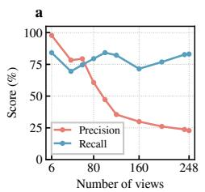

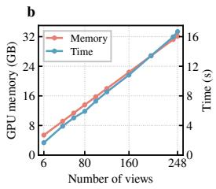

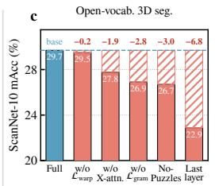

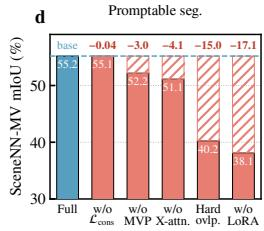  
Figure 4: Ablation study. (a, b) Precision/recall, memory, and runtime versus view count. The long-view stress test shows near-linear memory/runtime scaling, while precision degrades at large view counts. (c, d) Component ablations for open-vocabulary (ScanNet-10 mAcc) and promptable segmentation (SceneNN-MV mIoU); numbers indicate the drop from the full model.

Table 4: Multi-backbone generalization. The same head and task-specific SA-1B training are applied to an offline and a streaming reconstruction backbone, without in-domain fine-tuning.
<table><tr><td rowspan="3">Backbone</td><td rowspan="3">Multi-view architecture</td><td colspan="7">Open-vocabulary 3D segmentation</td><td colspan="4">Instance spatial tracking</td></tr><tr><td rowspan="2">ScanNet</td><td colspan="4"></td><td colspan="2">ScanNet200</td><td rowspan="2"></td><td rowspan="2">nuScenes-mini</td><td rowspan="2"></td><td rowspan="2"></td></tr><tr><td>10 cls</td><td></td><td>15 cls</td><td>19 cls</td><td>70 cls</td><td>T-mIoUall</td></tr><tr><td></td><td></td><td>mIoU</td><td>mAcc</td><td>mIoU</td><td>mAcc</td><td>mIoU</td><td>mAcc</td><td>mIoU</td><td>mAcc</td><td></td><td>T-mIoUvis</td><td>T-SRall</td><td>T-SRvis</td></tr><tr><td>LingBot-Map</td><td>Online, streaming</td><td>27.38</td><td>40.26</td><td>19.45</td><td>29.88</td><td>15.69</td><td>27.21</td><td>5.67</td><td>11.38</td><td>3.68</td><td>13.21</td><td>41.98</td><td>78.90</td></tr><tr><td>VGGT-Omega (default)</td><td>Offline, all-view attention</td><td>41.09</td><td>58.55</td><td>35.87</td><td>50.73</td><td>30.50</td><td>45.93</td><td>13.79</td><td>23.79</td><td>4.78</td><td>20.97</td><td>47.13</td><td>88.89</td></tr></table>

Backbone architecture. We apply the same recipe to two backbones with different multi-view designs (Table 4): VGGT-Omega (Wang et al., 2026a), an offline model where all views attend to each other, and LingBot-Map (Chen et al., 2026), a causal streaming model where each frame attends only to past context. Both use the same head, cached layers, and SA-1B training. The recipe transfers to LingBot-Map without modification, but VGGT-Omega is better on all metrics (e.g., +13.7 mIoU on ScanNet-10). Since LingBot-Map fits the DINOv3 targets better (0.816 vs. 0.766 cosine), the gap is unlikely to arise from poorer DINOv3 feature fitting alone and may partly reflect differences in cross-view context, including LingBot-Map’s causal attention.

## 6 CONCLUSION

We presented Feature Puzzles, a simple recipe that turns a single-image dataset into synthetic multiview supervision by cropping a parent image into overlapping sub-images and pulling labels back, so supervision targets are exactly consistent across overlapping affine crop views. A pretrained VGGT-Omega backbone with layer-selective LoRA feeds two heads—promptable multi-view masks and open-vocabulary 3D features—whose task-specific adaptation requires no real multi-view or video supervision. Despite this task-specific supervision requirement, a single forward pass achieves the best mIoU on NVOS, transfers to instance spatial tracking on ScanNet++ and to the out-ofdistribution nuScenes-mini setting, and enables zero-shot open-vocabulary 3D segmentation from SA-1B supervision. With additional in-domain semantic fine-tuning, the same representation further exceeds EmbodiedSplat in mIoU across all evaluated subsets. These results are consistently achieved through efficient feed-forward inference without scene-specific per-scene optimization.

## REFERENCES

Luca Barsellotti, Lorenzo Bianchi, Nicola Messina, Fabio Carrara, Marcella Cornia, Lorenzo Baraldi, Fabrizio Falchi, and Rita Cucchiara. Talking to DINO: Bridging self-supervised vision backbones with language for open-vocabulary segmentation. In ICCV, 2025.

Yoshua Bengio and Yann LeCun. Scaling learning algorithms towards AI. In Large Scale Kernel Machines. MIT Press, 2007.

Holger Caesar, Varun Bankiti, Alex H. Lang, Sourabh Vora, Venice Erin Liong, Qiang Xu, Anush Krishnan, Yu Pan, Giancarlo Baldan, and Oscar Beijbom. nuscenes: A multimodal dataset for autonomous driving. In CVPR, 2020.

Mathilde Caron, Hugo Touvron, Ishan Misra, Herve J ´ egou, Julien Mairal, Piotr Bojanowski, and´ Armand Joulin. Emerging properties in self-supervised vision transformers. In ICCV, 2021.

Jiazhong Cen, Zanwei Zhou, Jiemin Fang, Chen Yang, Wei Shen, Lingxi Xie, Dongsheng Jiang, Xiaopeng Zhang, and Qi Tian. Segment anything in 3d with NeRFs. In NeurIPS, 2023.

Jiazhong Cen, Jiemin Fang, Chen Yang, Lingxi Xie, Xiaopeng Zhang, Wei Shen, and Qi Tian. Segment any 3d gaussians. In AAAI, 2025a.

Jiazhong Cen, Jiemin Fang, Zanwei Zhou, Chen Yang, Lingxi Xie, Xiaopeng Zhang, Wei Shen, and Qi Tian. Segment anything in 3d with radiance fields. International Journal of Computer Vision (IJCV), 2025b.

Lin-Zhuo Chen, Jian Gao, Shangzhan Zhang, Yihang Chen, Nan Xue, Jianyuan Wang, Christian Rupprecht, Xun Cao, Xing Zhu, Yujun Shen, et al. Geometric context transformer for streaming 3d reconstruction. In European Conference on Computer Vision, pp. 293–314. Springer, 2026.

Xuweiyi Chen, Tian Xia, Sihan Xu, Jianing Yang, Joyce Chai, and Zezhou Cheng. SAB3R: Semantic-augmented backbone in 3d reconstruction. arXiv:2506.02112, 2025.

Jiahuan Cheng, Jan-Nico Zaech, Luc Van Gool, and Danda Pani Paudel. Occam’s lgs: An efficient approach for language gaussian splatting. In BMVC, 2025.

Alexey Dosovitskiy, Lucas Beyer, Alexander Kolesnikov, Dirk Weissenborn, Xiaohua Zhai, Thomas Unterthiner, Mostafa Dehghani, Matthias Minderer, Georg Heigold, Sylvain Gelly, Jakob Uszkoreit, and Neil Houlsby. An image is worth 16x16 words: Transformers for image recognition at scale. In ICLR, 2021.

Zhiwen Fan, Jian Zhang, Wenyan Cong, Peihao Wang, Renjie Li, Kairun Wen, Shijie Zhou, Achuta Kadambi, Zhangyang Wang, Danfei Xu, Boris Ivanovic, Marco Pavone, and Yue Wang. Large spatial model: End-to-end unposed images to semantic 3d. In Advances in Neural Information Processing Systems, volume 37, pp. 40212–40229, 2024.

Yulu Gao, Bohao Zhang, Zongheng Tang, Jitong Liao, Wenjun Wu, and Si Liu. VGGT-Segmentor: Geometry-enhanced cross-view segmentation. In IEEE/CVF Conference on Computer Vision and Pattern Recognition, 2026.

Ziren Gong, Xiaohan Li, Fabio Tosi, Jiawei Han, Stefano Mattoccia, Jianfei Cai, and Matteo Poggi. Ov3R: Open-vocabulary semantic 3d reconstruction from RGB videos. In IEEE/CVF Conference on Computer Vision and Pattern Recognition, 2026.

Ian Goodfellow, Yoshua Bengio, Aaron Courville, and Yoshua Bengio. Deep learning, volume 1. MIT Press, 2016.

Geoffrey E. Hinton, Simon Osindero, and Yee Whye Teh. A fast learning algorithm for deep belief nets. Neural Computation, 18:1527–1554, 2006.

Edward J. Hu, Yelong Shen, Phillip Wallis, Zeyuan Allen-Zhu, Yuanzhi Li, Shean Wang, Lu Wang, and Weizhu Chen. LoRA: Low-rank adaptation of large language models. In ICLR, 2022.

Yoonwoo Jeong, Cheng Sun, Yu-Chiang Frank Wang, Minsu Cho, and Jaesung Choe. MV-SAM: Multi-view promptable segmentation using pointmap guidance. arXiv:2601.17866, 2026.

Aleksandar Jevtic, Christoph Reich, Felix Wimbauer, Oliver Hahn, Christian Rupprecht, Stefan´ Roth, and Daniel Cremers. Feed-forward SceneDINO for unsupervised semantic scene completion. In IEEE/CVF International Conference on Computer Vision, 2025.

Nikita Karaev, Yuri Makarov, Jianyuan Wang, Natalia Neverova, Andrea Vedaldi, and Christian Rupprecht. Cotracker3: Simpler and better point tracking by pseudo-labeling real videos. In 2025 IEEE/CVF International Conference on Computer Vision (ICCV), pp. 1–10. IEEE, 2025.

Saimouli Katragadda, Cho-Ying Wu, Yuliang Guo, Xinyu Huang, Guoquan Huang, and Liu Ren. Online language splatting. In ICCV, 2025.

Nikhil Keetha, Norman Muller, Johannes Sch¨ onberger, Lorenzo Porzi, Yuchen Zhang, Tobias Fis-¨ cher, Arno Knapitsch, Duncan Zauss, Ethan Weber, Nelson Antunes, Jonathon Luiten, Manuel Lopez-Antequera, Samuel Rota Bulo, Christian Richardt, Deva Ramanan, Sebastian Scherer, and\` Peter Kontschieder. MapAnything: Universal feed-forward metric 3d reconstruction. In International Conference on 3D Vision, 2026.

Justin Kerr, Chung Min Kim, Ken Goldberg, Angjoo Kanazawa, and Matthew Tancik. LERF: Language embedded radiance fields. In Proceedings of the IEEE/CVF International Conference on Computer Vision, pp. 19729–19739, 2023.

Jun-Seong Kim, GeonU Kim, Yu-Ji Kim, Yu-Chiang Frank Wang, Jaesung Choe, and Tae-Hyun Oh. Dr. splat: Directly referring 3d gaussian splatting via direct language embedding registration. In CVPR, 2025.

Alexander Kirillov, Eric Mintun, Nikhila Ravi, Hanzi Mao, Chloe Rolland, Laura Gustafson, Tete Xiao, Spencer Whitehead, Alexander C. Berg, Wan-Yen Lo, Piotr Dollar, and Ross Girshick.´ Segment anything. In ICCV, 2023a.

Alexander Kirillov, Eric Mintun, Nikhila Ravi, Hanzi Mao, Chloe Rolland, Laura Gustafson, Tete Xiao, Spencer Whitehead, Alexander C Berg, Wan-Yen Lo, et al. Segment anything. In 2023 IEEE/CVF international conference on computer vision (ICCV), pp. 3992–4003. IEEE, 2023b.

Yushi Lan, Yihang Luo, Fangzhou Hong, Shangchen Zhou, Honghua Chen, Zhaoyang Lyu, Shuai Yang, Bo Dai, Chen Change Loy, and Xingang Pan. STream3R: Scalable sequential 3d reconstruction with causal transformer. In International Conference on Learning Representations, 2026.

Seungjun Lee, Zihan Wang, Yunsong Wang, and Gim Hee Lee. EmbodiedSplat: Online feedforward semantic 3dgs for open-vocabulary 3d scene understanding. In CVPR, 2026.

Haijie Li, Yanmin Wu, Jiarui Meng, Qiankun Gao, Zhiyao Zhang, Ronggang Wang, and Jian Zhang. Instancegaussian: Appearance-semantic joint gaussian representation for 3d instance-level perception. In 2025 IEEE/CVF Conference on Computer Vision and Pattern Recognition (CVPR), pp. 14078–14088. IEEE, 2025a.

Haijie Li, Yanmin Wu, Jiarui Meng, Qiankun Gao, Zhiyao Zhang, Ronggang Wang, and Jian Zhang. InstanceGaussian: Appearance-semantic joint gaussian representation for 3d instance-level perception. In CVPR, 2025b.

Hao Li, Zhengyu Zou, Fangfu Liu, Xuanyang Zhang, Fangzhou Hong, Yukang Cao, Yushi Lan, Manyuan Zhang, Gang Yu, Dingwen Zhang, and Ziwei Liu. IGGT: Instance-grounded geometry transformer for semantic 3d reconstruction. In International Conference on Learning Representations, 2026.

Siyuan Li, Lei Ke, Martin Danelljan, Luigi Piccinelli, Mattia Segu, Luc Van Gool, and Fisher Yu. Matching anything by segmenting anything. In IEEE/CVF Conference on Computer Vision and Pattern Recognition, 2024.

Haotong Lin, Sili Chen, Jun Hao Liew, Donny Y. Chen, Zhenyu Li, Guang Shi, Jiashi Feng, and Bingyi Kang. Depth anything 3: Recovering the visual space from any views. arXiv preprint arXiv:2511.10647, 2025.

Jiahao Ma, Miaomiao Liu, David Ahmedt-Aristizabal, and Chuong Nguyen. Hashpoint: Accelerated point searching and sampling for neural rendering. In 2024 IEEE/CVF Conference on Computer Vision and Pattern Recognition (CVPR), pp. 4462–4472. IEEE, 2024.

Jiahao Ma, Lei Wang, Miaomiao Liu, David Ahmedt-Aristizabal, and Chuong Nguyen. Puzzles: Unbounded video-depth augmentation for scalable end-to-end 3d reconstruction. In Advances in Neural Information Processing Systems, 2025a.

Jiahao Ma, Tianyu Wang, Miaomiao Liu, David Ahmedt-Aristizabal, and Chuong Nguyen. Dchm: Depth-consistent human modeling for multiview detection. In 2025 IEEE/CVF International Conference on Computer Vision (ICCV), pp. 7731–7740. IEEE, 2025b.

Jiahao Ma, Qiang Zhang, Peiran Liu, Zeran Su, Pihai Sun, Gang Han, Wen Zhao, Wei Cui, Zhang Zhang, Zhiyuan Xu, et al. Robotpan: A 360◦ surround-view robotic vision system for embodied perception. arXiv preprint arXiv:2604.13476, 2026.

Ashkan Mirzaei, Tristan Aumentado-Armstrong, Konstantinos G. Derpanis, Jonathan Kelly, Marcus A. Brubaker, Igor Gilitschenski, and Alex Levinshtein. SPIn-NeRF: Multiview segmentation and perceptual inpainting with neural radiance fields. In CVPR, 2023.

Songyou Peng, Kyle Genova, Chiyu Jiang, Andrea Tagliasacchi, Marc Pollefeys, and Thomas Funkhouser. Openscene: 3d scene understanding with open vocabularies. In 2023 IEEE/CVF Conference on Computer Vision and Pattern Recognition (CVPR), pp. 815–824. IEEE, 2023.

Minghan Qin, Wanhua Li, Jiawei Zhou, Haoqian Wang, and Hanspeter Pfister. LangSplat: 3d language gaussian splatting. In CVPR, 2024.

Delin Qu, Haoming Song, Qizhi Chen, Yuanqi Yao, Xinyi Ye, Yan Ding, Zhigang Wang, JiaYuan Gu, Bin Zhao, Dong Wang, et al. Spatialvla: Exploring spatial representations for visuallanguage-action model. arXiv preprint arXiv:2501.15830, 2025.

Alec Radford, Jong Wook Kim, Chris Hallacy, Aditya Ramesh, Gabriel Goh, Sandhini Agarwal, Girish Sastry, Amanda Askell, Pamela Mishkin, Jack Clark, Gretchen Krueger, and Ilya Sutskever. Learning transferable visual models from natural language supervision. In ICML, 2021.

Nikhila Ravi, Valentin Gabeur, Yuan-Ting Hu, Ronghang Hu, Chaitanya Ryali, Tengyu Ma, Haitham Khedr, Roman Radle, Chloe Rolland, Laura Gustafson, Eric Mintun, Junting Pan, Kalyan Va-¨ sudev Alwala, Nicolas Carion, Chao-Yuan Wu, Ross Girshick, Piotr Dollar, and Christoph Fe-´ ichtenhofer. SAM 2: Segment anything in images and videos. In ICLR, 2025.

Zhongzheng Ren, Aseem Agarwala, Bryan Russell, Alexander G. Schwing, and Oliver Wang. Neural volumetric object selection. In CVPR, 2022.

Johannes L. Schonberger and Jan-Michael Frahm. Structure-from-motion revisited. In¨ Proceedings ofthe IEEE Conference on Computer Vision and Pattern Recognition, pp. 4104–4113, 2016.

Johannes L. Schonberger, Enliang Zheng, Jan-Michael Frahm, and Marc Pollefeys. Pixelwise view¨ selection for unstructured multi-view stereo. In European Conference on Computer Vision, pp. 501–518, 2016.

Jin-Chuan Shi, Miao Wang, Hao-Bin Duan, and Shao-Hua Guan. Language embedded 3d gaussians for open-vocabulary scene understanding. In CVPR, 2024.

Oriane Simeoni, Huy V. Vo, Maximilian Seitzer, Federico Baldassarre, Maxime Oquab, Cijo Jose,´ Vasil Khalidov, Marc Szafraniec, Seungeun Yi, Michael Ramamonjisoa, Francisco Massa, Daniel¨ Haziza, Luca Wehrstedt, Jianyuan Wang, Timothee Darcet, Th´ eo Moutakanni, Leonel Sentana,´ Claire Roberts, Andrea Vedaldi, Jamie Tolan, John Brandt, Camille Couprie, Julien Mairal, Herve´ Jegou, Patrick Labatut, and Piotr Bojanowski. DINOv3.´ arXiv preprint arXiv:2508.10104, 2025.

Xiangyu Sun, Haoyi Jiang, Liu Liu, Seungtae Nam, Gyeongjin Kang, Xinjie Wang, Wei Sui, Zhizhong Su, Wenyu Liu, Xinggang Wang, and Eunbyung Park. Uni3R: Unified 3d reconstruction and semantic understanding via generalizable gaussian splatting from unposed multi-view images. In Proceedings of the IEEE/CVF Conference on Computer Vision and Pattern Recogni tion, pp. 33280–33290, 2026.

Hengyi Wang and Lourdes Agapito. 3d reconstruction with spatial memory. In International Conference on 3D Vision, pp. 78–89, 2025.

Jianyuan Wang, Minghao Chen, Nikita Karaev, Andrea Vedaldi, Christian Rupprecht, and David Novotny. VGGT: Visual geometry grounded transformer. In Proceedings of the IEEE/CVF Conference on Computer Vision and Pattern Recognition, pp. 5294–5306, 2025a.

Jianyuan Wang, Minghao Chen, Shangzhan Zhang, Nikita Karaev, Johannes Schonberger, Patrick¨ Labatut, Piotr Bojanowski, David Novotny, Andrea Vedaldi, and Christian Rupprecht. Vggt-Ω. arXiv preprint arXiv:2605.15195, 2026a.

Qianqian Wang, Yifei Zhang, Aleksander Holynski, Alexei A. Efros, and Angjoo Kanazawa. Continuous 3d perception model with persistent state. In Proceedings of the IEEE/CVF Conference on Computer Vision and Pattern Recognition, pp. 10510–10522, 2025b.

Ruicheng Wang, Sicheng Xu, Yue Dong, Yu Deng, Jianfeng Xiang, Zelong Lv, Guangzhong Sun, Xin Tong, and Jiaolong Yang. Moge-2: Accurate monocular geometry with metric scale and sharp details, 2025c. URL https://arxiv.org/abs/2507.02546.

Yifan Wang, Jianjun Zhou, Haoyi Zhu, Wenzheng Chang, Yang Zhou, Zizun Li, Junyi Chen, Jiangmiao Pang, Chunhua Shen, and Tong He. π3: Permutation-Equivariant Visual Geometry Learning. In International Conference on Learning Representations, 2026b.

Yanmin Wu, Jiarui Meng, Haijie Li, Chenming Wu, Yahao Shi, Xinhua Cheng, Chen Zhao, Haocheng Feng, Errui Ding, Jingdong Wang, and Jian Zhang. OpenGaussian: Towards pointlevel 3d gaussian-based open vocabulary understanding. In NeurIPS, 2024.

Jihan Yang, Shusheng Yang, Anjali W Gupta, Rilyn Han, Li Fei-Fei, and Saining Xie. Thinking in space: How multimodal large language models see, remember, and recall spaces. In 2025 IEEE/CVF Conference on Computer Vision and Pattern Recognition (CVPR), pp. 10632–10643. IEEE, 2025.

Chandan Yeshwanth, Yueh-Cheng Liu, Matthias Nießner, and Angela Dai. Scannet++: A highfidelity dataset of 3d indoor scenes. In Proceedings of the IEEE/CVF International Conference on Computer Vision, pp. 12–22, 2023.

Haiyang Ying, Yixuan Yin, Jinzhi Zhang, Fan Wang, Tao Yu, Ruqi Huang, and Lu Fang. OmniSeg3D: Omniversal 3d segmentation via hierarchical contrastive learning. In CVPR, 2024.

Jingdong Zhang, Xin Li, Jan Kautz, Wenping Wang, and Chris Choy. S4vy: Segment anything in feed-forward 4d visual geometry. arXiv preprint arXiv:2609.36875, 2026a.

Qiang Zhang, Jiahao Ma, Peiran Liu, Shuai Shi, Zeran Su, Zifan Wang, Jingkai Sun, Wei Cui, Jialin Yu, Gang Han, et al. Meshmimic: Geometry-aware humanoid motion learning through 3d scene reconstruction. arXiv preprint arXiv:2602.15733, 2026b.

Yue Zhang, Ziqiao Ma, Jialu Li, Yanyuan Qiao, Zun Wang, Joyce Chai, Qi Wu, Mohit Bansal, and Parisa Kordjamshidi. Vision-and-language navigation today and tomorrow: A survey in the era of foundation models. arXiv preprint arXiv:2407.07035, 2024.

Shijie Zhou, Haoran Chang, Sicheng Jiang, Zhiwen Fan, Zehao Zhu, Dejia Xu, Pradyumna Chari, Suya You, Zhangyang Wang, and Achuta Kadambi. Feature 3dgs: Supercharging 3d gaussian splatting to enable distilled feature fields. In Proceedings of the IEEE/CVF Conference on Computer Vision and Pattern Recognition, pp. 21676–21685, 2024.

Runsong Zhu, Jiaxin Guo, Xiaoyang Guo, Zhengzhe Liu, Ka-Hei Hui, Wei Yin, Kai Chen, Wei Chen, Weiqiang Ren, Yunhui Liu, Pheng-Ann Heng, and Chi-Wing Fu. EPS3D: End-to-end feed-forward 3d panoptic segmentation. In International Conference on Machine Learning, 2026.

Zhengyu Zou, Hao Li, Kuixuan Jiao, Liu Liu, Tingyang Xiao, Xiaolin Zhou, Fangzhou Hong, Zhizhong Su, Dingwen Zhang, and Ziwei Liu. Iggt4d: Streaming 4d instance-grounded geometry transformer. arXiv preprint arXiv:2607.19228, 2026.

Lojze Zust, Yohann Cabon, Juliette Marrie, Leonid Antsfeld, Boris Chidlovskii, Jerome Revaud, and Gabriela Csurka. PanSt3R: Multi-view consistent panoptic segmentation. In IEEE/CVF International Conference on Computer Vision, 2025.

## A FEATURE PUZZLE CONSTRUCTION DETAILS

This appendix expands Section 3.2. Throughout, $\pi _ { n }$ denotes the crop-to-parent map, ℓ a parentspace label field, and $\ell _ { n } = \mathcal { R } _ { \mathcal { Y } } [ \ell \circ \pi _ { n } ]$ its pull-back to view n.

## A.1 TEACHER TARGETS: RESOLUTION AND WELL-POSEDNESS

The dense teacher target is the frozen teacher evaluated once on the whole parent image, $\ell ^ { \mathrm { f e a t } } =$ $\Phi _ { \mathrm { D I N O v 3 } } ( I _ { \downarrow S } )$ with $\bar { S } = 2 0 4 8$ , giving a $1 2 8 \times 1 2 8 \times 7 6 8$ parent feature grid. Pull-back to view n is a grid sample at the normalized coordinates $\left( \pi _ { n } ^ { x } / W , ~ \pi _ { n } ^ { y } / H \right)$ mapped to $[ - 1 , 1 ] ^ { 2 }$ , followed by channel-wise L2 normalization, yielding $\mathbf { T } _ { n } \in \mathbb { R } ^ { 7 6 8 \times F _ { r } \times F _ { r } }$ with $F _ { r } = 1 2 8 .$ Because the normalization uses the original parent size $( H , W )$ , the aspect-ratio distortion introduced by the square resize to S does not misalign the target.

Resolution. A crop of relative scale $s \in [ s _ { \operatorname* { m i n } } , s _ { \operatorname* { m a x } } ]$ covers $s \cdot 1 2 8 \approx 6 4 \mathrm { - } 1 1 5$ teacher cells, which are resampled onto the $F _ { r } = 1 2 8$ target grid. Each view target is therefore a magnified sub-region of a high-resolution field, not an upsampled low-resolution one: the student is asked to produce fine-grained spatial structure at 128 × 128 from a $1 6 \times 1 6$ token grid, which is precisely the signal the RGB-guided decoder of Section 3.5 is designed to exploit. A single teacher forward pass is amortized over all N views.

Well-posedness of the objective. Vision transformer features are not equivariant under crop-andresize. Had we defined the target per view as $\mathbf T _ { n } = \Phi ( x _ { n } )$ , two overlapping views would in general disagree on their shared region,

$$
\Phi ( x _ { i } ) \circ \pi _ { i } ^ { - 1 } \ \neq \ \Phi ( x _ { j } ) \circ \pi _ { j } ^ { - 1 } \quad { \mathrm { o n ~ } } x _ { i } \cap x _ { j } ,\tag{9}
$$

so the distillation loss ${ \mathcal { L } } _ { \mathrm { f e a t } }$ and the cross-view consistency loss $\mathcal { L } _ { \mathrm { w a r p } }$ would pull the student toward mutually incompatible optima. Under the pull-back construction, both losses are consistent with the same parent-derived target $\mathbf { T } _ { n }$ , so $\mathcal { L } _ { \mathrm { w a r p } }$ acts as a consistent regularizer rather than a competing objective. The same argument applies to the Gram-anchoring term, whose teacher Gram matrix then measures the similarity structure of the original image over the region a view covers.

Semantic labels in Stage 2. The identical operator transfers the dense dataset-specific parent semantic label map (−1 for void) into each view with nearest sampling on the same grid, so class labels remain pixel-aligned with the predicted features and the text-aligned cross-entropy of Section 3.5 is defined on exactly the same lattice as the distillation losses.

## A.2 AUGMENTATION, PROMPT DERIVATION, AND VALIDITY FILTERS

Augmentation and the pull-back identity. The identity $x _ { n } = I \circ \pi _ { n } , \ell _ { n } = \ell \circ \pi _ { n }$ is what makes the targets exact, and it is broken by any geometric transform applied to the crop image alone. For the segmentation branch, the loss requires image-target alignment within each view, so geometric, photometric, and occlusion augmentations are applied jointly and synchronously to $( x _ { n } , \mathbf { G } _ { n } , \mathrm { p r o m p t } _ { n } )$ For the feature branch, whose target lives in parent space, geometric and occlusion augmentation are disabled and only photometric jitter is retained, preserving pixel-exact student–teacher correspondence for the affine crop construction.

Prompts as noisy observations of the target. Prompts are derived after augmentation from the crop-space target $\mathbf { G } _ { n , m } ,$ so they are expressed in final crop pixel coordinates and are pixel-aligned with the image by construction. A prompt is always a stochastic degradation $\rho ( \mathbf { G } _ { n , m } )$ of the target, never the target itself:

• Mask. A random morphological dilation or erosion with an elliptical kernel $k \_ <$ min $\mathsf { 1 } ( 9 , \lfloor 0 . 2 5 d \rfloor )$ , where d is the object’s shorter side, guarded so that small masks cannot vanish, plus boundary noise.

• Box. The tight bounding box of a morphologically perturbed copy of the mask, with ±2% side jitter.

Table 5: Term-by-term comparison between the Image-to-Clips augmentation of Puzzles (Ma et al., 2025a) and the Feature Puzzles construction.
<table><tr><td></td><td>Image-to-Clips (Puzzles)</td><td>Feature Puzzles (ours)</td></tr><tr><td>Parent annotation</td><td>RGB-D (GT or predicted depth)</td><td>Instance masks / semantic map / frozen teacher field</td></tr><tr><td>View-to-parent map</td><td>Fixed K + extrinsics from PnP-RANSAC + centroid rotation</td><td>Closed-form affine  $\pi _ { n }$ </td></tr><tr><td>Label construction</td><td>Per-patch depth and pose, re-rendered</td><td>Pull-back  $\ell \circ \pi _ { n }$ </td></tr><tr><td>Error sources</td><td>Depth, PnP residual, rendering holes</td><td>Resampling only</td></tr><tr><td>Validity handling</td><td>FrontCov / ImgCov tests, reject or hole-fill</td><td>Foreground coverage + cross-view support</td></tr><tr><td>Cross-view agreement</td><td>Approximate</td><td>Exact by construction</td></tr></table>

• Point. One to three positives sampled inside the mask and up to $P { - n _ { \mathrm { p o s } } }$ negatives sampled outside it.

The label ${ \bf G } _ { n , m }$ is left untouched. Treating the prompt as a noisy observation rather than as a copy of the label trains prompt robustness without injecting label noise. For each instance, a primary prompt view is sampled uniformly from its visible views. With probability $p _ { \mathrm { m v } } = 0 . 5$ , additional visible views are also prompted, with each prompt independently derived from the corresponding view target.

Validity criteria. Three filters keep the transferred labels informative.

1. Annotation quality, applied in parent space before transfer: area $\geq 1 0 2 4 \mathrm { p x } ^ { 2 }$ , SAM predicted $\mathrm { I o U } \geq 0 . 8 5$ , stability score $\geq 0 . 9$ , and at most 120 annotations per parent. The parent-space area threshold also helps ensure that instances remain resolvable after the crop-to-R resampling.

2. Cross-view support: an instance is retained only if it is non-empty in at least $\kappa = 3$ of the N views, since instances visible in fewer views contribute mostly empty channels and little cross-view signal; at most $M = 1 6$ instances are kept per sample.

3. Foreground coverage of the boxes themselves: a candidate box is accepted only if the mean of the union-of-annotations mask inside it is at least $\tau _ { \mathrm { f g } } = 0 . 5$ , which prevents crops that fall on unannotated background.

Truncated and absent instances. An instance that is truncated or absent in view n is not re-fitted: its visible part is retained, and ${ \bf G } _ { n , m } = { \bf 0 }$ when the box misses it entirely.

## A.3 DETAILED COMPARISON WITH IMAGE-TO-CLIPS

Image-to-Clips (Ma et al., 2025a) targets 3D reconstruction, so each synthesized patch must carry geometric labels. It assigns a per-patch camera by solving a PnP problem with RANSAC over the back-projected depth, applies a centroid-based random rotation, re-renders the point cloud, and then validates the result with front-surface-coverage and view-frustum tests, discarding views whose occlusion holes are too large. The resulting labels are estimates, with residual error contributed by depth, by pose fitting, and by rendering.

Our Feature Puzzles views include both 3D augmentations and in-plane crop-and-resize transformations. Since the supervision is appearance-based (masks, dense features, and semantic classes) rather than geometric, both constructions preserve consistent parent-derived semantics, while the affine crop views additionally provide exact view-to-parent mappings. Table 5 summarizes the two constructions term by term.

Table 6: Detailed comparison between VGGT-Segmentor (Gao et al., 2026) and Feature Puzzles.
<table><tr><td>Aspect</td><td>VGGT-Segmentor</td><td>Feature Puzzles</td></tr><tr><td>Training unit</td><td>Image pair</td><td>Multi-view sequence</td></tr><tr><td>Inference</td><td>Source-target pairs</td><td>All views jointly</td></tr><tr><td>Object modeling</td><td>Pairwise correspondence</td><td>Joint multi-view representation</td></tr><tr><td>Prompt propagation</td><td>Source → target</td><td>Arbitrary view(s) → all views</td></tr><tr><td>Explicit correspondence</td><td>VGGT point tracking</td><td>Not required</td></tr><tr><td>Intermediate-view context</td><td>Pairwise only</td><td>Jointly exploited</td></tr><tr><td>Unordered view set</td><td>Processed via source-target pairs</td><td>No explicit association</td></tr><tr><td>Cross-view consistency</td><td>Pair-level</td><td>Sequence-level</td></tr><tr><td>Prompt conditioning</td><td>Source-view prompt</td><td>Multiple prompted views supported</td></tr></table>

While Image-to-Clips introduces viewpoint diversity through simulated 6-DoF motion, our affine construction instead introduces crop, scale, and appearance variation through the scale range $[ s _ { \mathrm { m i n } } , s _ { \mathrm { m a x } } ]$ , the overlap curriculum, and photometric augmentation. It does not simulate parallax or disocclusion.

## A.4 DETAILED COMPARISON WITH VGGT-SEGMENTOR

VGGT-Segmentor (Gao et al., 2026) targets ego–exo cross-view segmentation. Given a synchronized image pair and a source-view mask, it fuses the mask into VGGT features, projects points sampled from the source mask into the target view with the VGGT track head, and refines the resulting target mask. Its main model is trained on paired Ego-Exo4D masks, and a correspondence-free variant is pre-trained with single-image self-supervision on a subset of SA-1B. Both variants remain pairwise at training and inference.

Feature Puzzles differs in the unit of reasoning. Pairwise methods match every target independently to a reference, so a target seen from a very different viewpoint cannot benefit from intermediate views unless pairwise associations or tracking chains are built explicitly. For large unordered view sets, this can require repeated pairwise processing and explicit association across views. Feature Puzzles trains on N-view puzzle sequences and predicts masks for all views jointly: cross-view attention allows information to be exchanged across all views, including through intermediate observations, prompts from any subset of views are fused into shared object tokens, and consistency is supervised at the sequence level through targets in every view. No point correspondence, pair selection, tracking, or view ordering is needed. Table 6 summarizes these differences.

## B ARCHITECTURE AND TRAINING DETAILS

## B.1 BACKBONE ADAPTATION

The pretrained backbone jointly processes the N crops and produces geometry-aware patch tokens. Because intermediate and final layers carry complementary local, semantic, and geometric information, we cache tokens $\mathbf { T } _ { \ell } \in \dot { \mathbb { R } ^ { B \times N \times H _ { p } ^ { \sim } \times W _ { p } \times 2 0 4 8 } }$ from four blocks $\mathcal { L } = \{ 4 , 1 1 , 1 7 , 2 3 \}$ . The fused representation F is projected to a working dimension of 768 inside each task head. Low-rank adapters are inserted only in the late blocks (18–23), so blocks 0–17 stay untouched and still serve the original depth and camera heads. Keeping most backbone parameters frozen helps preserve the representation learned during multi-view pre-training.

Each cached layer receives a lightweight low-rank residual and the layers are combined by a softmax over learned logits aℓ:

$$
\widetilde { \mathbf { T } } _ { \ell } = \mathrm { n o r m } ( \mathbf { T } _ { \ell } ) + ( \mathbf { T } _ { \ell } \mathbf { A } _ { \ell } ) \mathbf { B } _ { \ell } , \qquad \mathbf { F } = \sum _ { \ell \in \mathcal { L } } \frac { \exp ( a _ { \ell } ) } { \sum _ { j \in \mathcal { L } } \exp ( a _ { j } ) } \widetilde { \mathbf { T } } _ { \ell } ,\tag{10}
$$

where $\mathbf { A } _ { \ell } \in \mathbb { R } ^ { 2 0 4 8 \times r }$ is the LoRA down-projection and $\mathbf { B } _ { \ell } \in \mathbb { R } ^ { r \times 2 0 4 8 }$ the up-projection of rank $r ,$ so $( { \bf T } _ { \ell } { \bf A } _ { \ell } ) { \bf B } _ { \ell }$ is a low-rank update to the normalized tokens; the fusion is a softmax-weighted sum of the adapted tokens across the four cached layers.

Adapter rank increases with depth: starting from a base rank of 16, it is multiplied by two for middle blocks and by four for late blocks, and inter-frame blocks receive an additional factor of two. We scale α with rank so that $\alpha / r$ remains constant. The adapter output projection and the layerfusion residual branches are initialized to zero, and the fusion logits uniformly, so the LoRA-adapted backbone initially reproduces the pre-trained backbone, while the fusion begins as an equal-weight average. This makes the module plug-and-play and permits two-pass inference: adapters off for reconstruction, on for segmentation.

## B.2 PROMPTABLE SEGMENTATION HEAD

Prompt encoding and token layout. The prompt encoder produces a dense coverage map $\mathbf { C \in }$ $\mathbb { R } ^ { B \times \tilde { N } \times M \times H _ { p } \times \Breve { W _ { p } } }$ , a prompt-presence indicator, and sparse prompt tokens. Conditioned tokens are projected to a working dimension of 768. Cross-view self-attention operates over the N view tokens at each spatial patch, followed by four SAM-style two-way attention blocks Ravi et al. (2025). Four object tokens per view and instance are initialized by aggregating prompt-covered image tokens across all prompted views; sparse prompt tokens are appended to the query sequence, with padded prompts removed by a key-padding mask. Image and object tokens attend to one another in both directions. When depth and camera poses are available, a 3D positional encoding is added to the image tokens. The weighted pixel decoder projects and fuses decoder features and upsamples them to $\overset { \smile } { \mathbf { D } } \in \mathbb { R } ^ { B \times N \times C \times H \times \breve { W } }$ , and the mask object token predicts the dynamic kernel k $\in \dot { \mathbb { R } } ^ { B \times ^ { \bullet } N \times M \times C }$

Loss terms and design. We set $( \lambda _ { \mathrm { b c e } } , \lambda _ { \mathrm { d i c e } } , \lambda _ { \mathrm { i o u } } , \lambda _ { \mathrm { c o n s } } , \lambda _ { \mathrm { p t } } ) = ( 5 , 5 , 1 , 0 . 0 1 , 1 )$ . The design follows one principle: because pull-back places a target ${ \bf G } _ { n , m }$ in every view rather than only the prompted one, mask supervision can be evaluated across all N views, directly encouraging crossview agreement even where no prompt is provided. Additional terms regularize confidence, object tokens, and prompted point locations.

$\mathcal { L } _ { \mathrm { b c e } } , \mathcal { L } _ { \mathrm { d i c e } } \mathrm { : }$ pixel-wise binary cross-entropy with logits and Dice loss between $\sigma ( { \bf Y } _ { n , m } )$ and ${ \bf G } _ { n , m } ,$ , summed over all views. Since a target exists in views that received no prompt, a prediction correct only in the prompted view is penalized, so the mask term alone already drives cross-view agreement. Dice complements the pixel-wise term on small instances, where background dominates.

$\mathcal { L } _ { \mathrm { { i o u } } } \mathrm { { : } }$ regression of the auxiliary head onto the measured overlap between $\sigma ( \mathbf { Y } _ { n , m } )$ and ${ \bf G } _ { n , m }$ , giving a per-view confidence used to rank masks at inference.

${ \mathcal { L } } _ { \mathrm { c o n s } } \mathrm { . }$ cross-view variance of the mask object token around its centroid, $\begin{array} { r } { \frac { 1 } { N } \sum _ { n } \Vert \mathbf { t } _ { n , m } - \mathbf { \Gamma } } \end{array}$ $\bar { \mathbf { t } } _ { m } \| _ { 2 } ^ { 2 }$ with $\begin{array} { r } { \bar { \mathbf { t } } _ { m } = \frac { 1 } { N } \sum _ { n } \mathbf { t } _ { n , m } } \end{array}$ . The N tokens describe the same physical object, so they are encouraged to remain close in token space; this regularizes the representation rather than the output. Its weight is kept small (0.01) because collapsing the tokens too hard removes the per-view information the dynamic kernel needs.

$\mathcal { L } _ { \mathrm { { p t } } } \mathrm { { . } }$ : bilinearly sampled binary cross-entropy at the prompt point locations, raising the probability at positives and lowering it at negatives. This provides direct supervision at the prompted locations, encouraging positive clicks to activate and negative clicks to suppress the predicted region.

## B.3 OPEN-VOCABULARY HEAD

Visual and text teachers. During training the complete parent image is square-resized to 2048 × 2048 and processed by a frozen DINOv3 (Simeoni et al., 2025) ViT-B/16 (Dosovitskiy et al., 2021), ´ whose dense patch tokens form the 128×128 parent feature map; per-crop targets are obtained by the pull-back of Appendix A.1. At inference, class names are inserted into an ImageNet-style prompt ensemble and encoded by a frozen CLIP (Radford et al., 2021) ViT-B/16 text tower, and a frozen Talk2DINO (Barsellotti et al., 2025) MLP projects the 512-dimensional CLIP embeddings into the 768-dimensional DINOv3 space. Both image and text embeddings are L2-normalized, allowing classification by cosine similarity.

Stage-1 losses: distillation, warping, and Gram anchoring. The weights of $\mathcal { L } _ { \mathrm { f e a t } } , \mathcal { L } _ { \mathrm { w a r p } }$ , and ${ \mathcal { L } } _ { \mathrm { g r a m } }$ are 1.0, 0.1, and 0.5. The distillation term $\mathcal { L } _ { \mathrm { f e a t } }$ is the mean pixel-wise cosine distance between the student ${ \widehat { \mathbf { F } } } _ { n }$ and the pulled-back teacher $\mathbf { T } _ { n } ;$ on its own it supervises each view in isolation. The other two terms (defined in Section 3.5) exploit the shared-parent correspondence provided by the puzzle construction.

Table 7: Component ablations for open-vocabulary 3D segmentation on EmbodiedSplat (Stage-1 only, 2,500-step budget, no in-domain fine-tuning). $\Delta$ is the ScanNet 10-class mAcc change relative to the full model. Bold = best, underline = second best.
<table><tr><td rowspan="3">Variant</td><td colspan="6">ScanNet</td><td colspan="2">ScanNet200</td><td rowspan="3"> $\Delta \mathrm { m A c c } _ { 1 0 }$ </td></tr><tr><td colspan="2">10 cls</td><td colspan="2">15 cls</td><td colspan="2">19 cls</td><td colspan="2">70 cls</td></tr><tr><td>mIoU</td><td>mAcc</td><td>mIoU</td><td>mAcc</td><td>mIoU</td><td>mAcc</td><td>mIoU</td><td>mAcc</td></tr><tr><td>Full model</td><td>15.70</td><td>29.69</td><td>10.01</td><td>19.95</td><td>8.46</td><td>18.73</td><td>3.32</td><td>7.59</td><td>一</td></tr><tr><td>w/o  $\mathcal { L } _ { \mathrm { w a r p } }$ </td><td>15.60</td><td>29.49</td><td>9.86</td><td>19.87</td><td>8.22</td><td>18.73</td><td>3.64</td><td>7.87</td><td>-0.20</td></tr><tr><td>w/o cross-view attention</td><td>14.07</td><td>27.77</td><td>8.89</td><td>18.57</td><td>7.35</td><td>17.48</td><td>3.37</td><td>7.42</td><td>-1.92</td></tr><tr><td>w/o  $\mathcal { L } _ { \mathrm { g r a m } }$ </td><td>12.85</td><td>26.91</td><td>8.10</td><td>18.06</td><td>7.05</td><td>17.60</td><td>2.74</td><td>6.48</td><td>-2.78</td></tr><tr><td>No-Puzzles (single-view)</td><td>13.32</td><td>26.70</td><td>8.43</td><td>17.89</td><td>7.35</td><td>17.28</td><td>3.21</td><td>7.37</td><td>-2.99</td></tr><tr><td>Last layer only (block 23)</td><td>8.93</td><td>22.89</td><td>5.76</td><td>15.38</td><td>4.85</td><td>14.78</td><td>2.05</td><td>4.84</td><td>-6.80</td></tr></table>

Cross-view warping. For an overlapping pair $( i , j )$ the composite map $\pi _ { i } ^ { - 1 } \circ \pi _ { j }$ carries crop $j ^ { \dagger } \mathbf { s }$ grid into crop $i ^ { \cdot } \mathbf { s } ,$ so the student prediction of view i can be transported into view $j$ and compared there. The stop-gradient $\mathrm { s g } [ \cdot ]$ prevents gradients from flowing through the target branch, and the valid set $\Omega _ { i j } = \{ q \in \Omega _ { R } : \bar { \pi _ { j } } ( q ) \in x _ { i } \}$ is read directly off the sub-image boxes in parent coordinates— no depth test, no visibility reasoning, no photometric matching. At most 12 pairs are drawn per step. This provides an explicit pairwise cross-view consistency signal that is unavailable to a purely single-view objective.

Gram anchoring. For $K = 5 1 2$ pixels sampled per step we form the $K \times K$ pairwise cosinesimilarity matrices of student and teacher and match them. Because every view’s teacher is the parent feature field restricted to that view, $\mathbf { S } _ { T } \mathbf { S } _ { T } ^ { \top }$ encodes the similarity structure of the original image over the region the view covers. The Gram objective is designed to preserve feature dissimilarity across object boundaries, helping counteract spatial smoothing when predicting at $1 2 8 \times 1 2 8$ from a $1 6 \times 1 6$ token grid. Because views at different scales inherit their target from the same parent field, it also encourages them to share a common similarity structure, complementing the pixel-level agreement enforced by $\mathcal { L } _ { \mathrm { w a r p } }$

Stage-2 class weighting. We use effective inverse-frequency class weights with $\beta = 0 . 9 9 9$ and focal modulation $( 1 - p _ { t } ) ^ { \gamma }$ with $\gamma = 2$ . Auxiliary text-classification heads cover the ScanNet20, ScanNet200, and ScanNet++ vocabularies while sharing the same dense feature map.

## B.4 IMPLEMENTATION DETAILS

Common training setup. Both tasks use cached VGGT-Omega blocks {4, 11, 17, 23}, 2048- dimensional backbone tokens, a working dimension of 768, bfloat16 mixed precision, AdamW, and cosine learning-rate decay with linear warm-up. Training is distributed over eight A800 GPUs.

Promptable segmentation. We train with $N = 6$ views, four object tokens, four two-way attention layers, and eight attention heads. The probability of placing prompts in multiple views is $0 . 5 ,$ and the supported modalities are masks, boxes, and points with at most six points per prompt. Low-rank adaptation starts at block 18 with base rank $r = 1 6$ and scale $\alpha = 1 6$

Open-vocabulary segmentation. For open-vocabulary pre-training, we use six $2 5 6 \times 2 5 6$ crops, predict $1 2 8 \times 1 2 8$ features, sample 512 pixels for the Gram objective, and use at most 12 view pairs for the warp objective. ScanNet fine-tuning uses a learning rate of $5 \times 1 0 ^ { - 5 }$ . At inference, frames are sampled with stride 10 and fused using 0.02 m voxels.

Inference details. The architecture supports prompts from one or multiple views, which are encoded jointly, and masks for all views are returned in one forward pass, with no scene-specific parameters optimized. The same backbone still serves depth and camera reconstruction when the segmentation adapters are disabled.

Table 8: Component ablations for promptable multi-view segmentation on SceneNN-MV (GTprompted, 6 views, 2,500-step budget). “Vis” metrics are averaged over views where the object is visible; “Obj” is object-level mIoU. ∆ is the Vis mIoU change relative to the full model. Bold = best, underline = second best.
<table><tr><td>Variant</td><td>Vis mIoU</td><td>Obj mIoU</td><td>Vis Prec.</td><td>Vis Rec.</td><td>∆Vis mIoU</td></tr><tr><td>Full model (LoRA + multi-view prompting)</td><td>55.19</td><td>56.80</td><td>65.35</td><td>76.79</td><td></td></tr><tr><td>w/o  ${ \mathcal { L } } _ { \mathrm { c o n s } }$ </td><td>55.15</td><td>56.36</td><td>65.11</td><td>76.74</td><td>-0.04</td></tr><tr><td>w/o multi-view prompting</td><td>52.17</td><td>52.01</td><td>60.53</td><td>77.97</td><td>-3.02</td></tr><tr><td>w/o cross-view attention</td><td>51.12</td><td>54.66</td><td>67.80</td><td>67.37</td><td>-4.07</td></tr><tr><td>Hard overlap [0.10, 0.50]</td><td>40.23</td><td>41.39</td><td>51.20</td><td>61.75</td><td>-14.96</td></tr><tr><td>w/o LoRA</td><td>38.11</td><td>36.40</td><td>47.10</td><td>64.37</td><td>-17.08</td></tr><tr><td>Independent views (no shared parent)</td><td>6.49</td><td>8.21</td><td>7.84</td><td>5.62</td><td>-48.70</td></tr></table>

a  
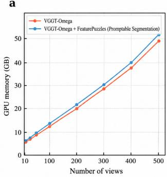

b  
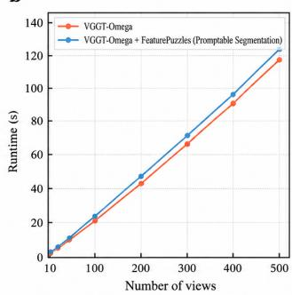

C  
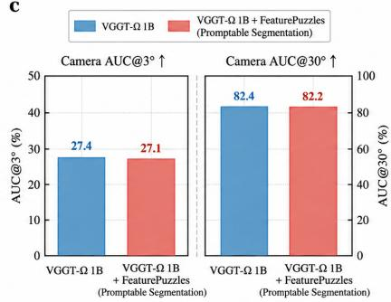  
Figure 5: Efficiency and camera-pose preservation. (a–b) GPU memory and runtime of VGGT-Ω with and without Feature Puzzles as the number of views increases. (c) Camera pose accuracy on 7-Scenes, showing that Feature Puzzles largely preserves the original camera-pose performance.

## C ADDITIONAL ABLATIONS

Open-vocabulary 3D segmentation. All arms share the Stage-1 open-vocabulary setup: frozen VGGT-Omega, SA-1B Feature Puzzles with N = 6 views, 256 × 256 crops, and loss weights $( \lambda _ { \mathrm { f e a t } } , \lambda _ { \mathrm { w a r p } } , \lambda _ { \mathrm { g r a m } } ) = ( 1 . 0 , 0 . 1 , 0 . 5 )$ . Each arm is trained for a shortened budget of 2,500 steps (learning rate $2 \times 1 0 ^ { - 4 }$ , no warm-up, batch 12 per GPU on seven A800 GPUs). Ablations modify one component unless otherwise noted. No-Puzzles feeds each crop as an independent single-view sequence, which also disables head cross-view attention and $\mathcal { L } _ { \mathrm { w a r p } }$ . Last layer only caches block 23 instead of {4, 11, 17, 23}. Evaluation uses the EmbodiedSplat protocol (stride 10, at most 400 frames, 0.02 m voxels) without ScanNet fine-tuning, so absolute values are not comparable to Table 3. Table 7 reports the results.

Promptable segmentation. All arms share the promptable setup of Appendix B.4 (N = 6 views, four object tokens, four two-way layers, mask/box/point prompts) and are trained from the pretrained VGGT-Omega weights for 2,500 steps (learning rate $6 \times 1 0 ^ { - 5 }$ , no warm-up, batch 6 per GPU on eight A800 GPUs). w/o LoRA keeps the backbone fully frozen. w/o multi-view prompting sets $p _ { \mathrm { m v } } = 0$ . Hard overlap trains directly on the end state of the overlap curriculum, [0.10, 0.50], instead of the default [0.70, 0.95]; the one-epoch budget is too short to anneal the schedule. Evaluation uses GT-prompted 6-view SceneNN-MV (12 scenes, 1,005 objects) without refinement. For reference, the fully trained model reaches 70.26 visible-view mIoU. A literal “w/o Feature Puz zles” (bottom of Table 8) setting is not directly trainable because the puzzle construction defines the cross-view supervision. A cleaner ablation is therefore to keep the same N-view architecture and training setup but replace shared-parent crops with independently sampled views, removing the shared-parent correspondence while retaining the same multi-view architecture and training budget. Table 8 reports the results.

ScanNet GT masks as prompts · mloU over 100 views vs. the labelled cloud  
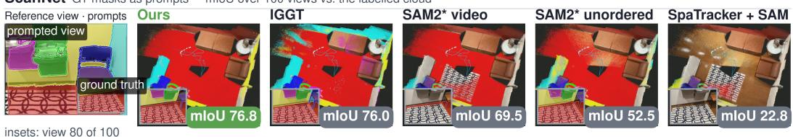

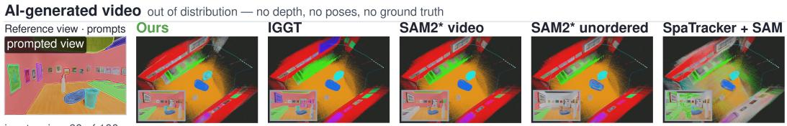  
Figure 6: Promptable multi-view segmentation. Results on ScanNet and an out-of-distribution AI-generated video, showing consistent cross-view mask propagation from sparse input prompts.

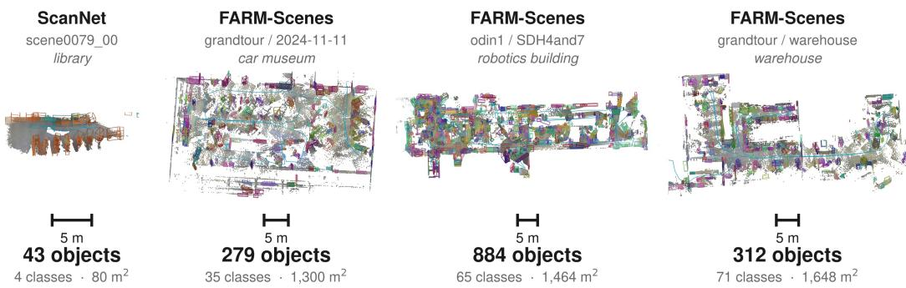  
Figure 7: Open-vocabulary 3D segmentation. Zero-shot evaluation on ScanNet and FARM-Scenes, illustrating coherent semantic reconstruction across diverse large-scale environments.

Efficiency and Camera-Pose Preservation. As shown in Figure 5, Feature Puzzles introduces only marginal computational overhead over the original VGGT-Ω. GPU memory and runtime scale similarly with the number of input views, as the semantic head reuses the existing multi-view back bone features without introducing an additional image encoder. Meanwhile, camera-pose performance is largely preserved: on 7-Scenes, Camera AUC@3◦ changes only from 27.4 to 27.1, and AUC@30◦ from 82.4 to 82.2.

## D FEATURE PUZZLES LABEL

Exact Cross-View Label Correspondence. We define exact cross-view label correspondence as pixel-to-label alignment within the synthetic-view construction, rather than exact correspondence to the true 3D scene. For affine crops, images and labels share the same known transformation. For 3D-augmented views, rendered RGB and labels use the same estimated depth and virtual-camera projection; depth errors may affect geometric realism but not their mutual pixel alignment under that projection. Since all views inherit supervision from the same parent label field, shared visible regions remain label-consistent, while disoccluded regions are masked out from the loss.

## E QUALITATIVE RESULTS

Promptable multi-view segmentation. Figure 6 provides qualitative results complementary to Tables 1 and 2. On ScanNet and an out-of-distribution AI-generated video, Feature Puzzles propagates prompts from a reference view to a large set of views in a single forward pass. Compared with IGGT, SAM2, and SpaTracker+SAM, the predictions show greater consistency across viewpoint changes and better preserve object identity over long sequences.

Open-vocabulary 3D segmentation. Figure 7 visualizes zero-shot open-vocabulary 3D segmentation on ScanNet and FARM-Scenes. The learned semantic features generalize across indoor scenes and substantially larger, more diverse environments, including a car museum, robotics building, and warehouse. These results illustrate that the feed-forward representation can produce coherent 3D semantic predictions across scenes with large differences in scale, layout, and object diversity.