# 4D POINT SPLATTING FOR MMWAVE RADAR MICRO-DOPPLER DIFFERENTIABLE RENDERING

Adnan Armouti Cornell Tech New York, NY, USA aa2546@cornell.edu

Guanyue Qian New York University New York, NY, USA gq2032@nyu.edu

Rajalakshmi Nandakumar Cornell Tech New York, NY, USA rn283@cornell.edu

## ABSTRACT

Millimeter-wave radar resolves the micrometer displacements of a moving body as micro-Doppler, enabling gait, gesture, activity, pose and vital-sign sensing. Each task relies on a downstream model trained on real data, yet radar datasets lag orders of magnitude behind vision and language. Brute-force collection will not close that gap, and existing synthesis methods (forward-only simulators, learned generators and static-scene inverse renderers) cannot fit a real capture of a moving body, leaving a substantial sim2real gap. We present 4D Point Splatting (4DPS), a physics-based differentiable renderer that fits an explicit moving scene to a real capture. Using the capture’s synchronized camera to initialize the room and the moving body, we represent the scene as oriented points carrying material, normal and velocity, and splat each point into range and Doppler bins. Our output is the raw complex return a real radar records, so we can apply the same digital signal processing (DSP) on the rendered data, and obtain any DSP representation to run on and train any SOTA downstream model. We fit 235 sequences on HuPR and 100 on RT-Pose, two datasets with different radars. Our reconstructions set the state of the art, with median correlations of 0.940 and 0.830 on range–azimuth, 0.829 and 0.695 on range–Doppler, and 0.988 and 0.966 on micro-Doppler. Our renders also set the state of the art in downstream sim2real gap. On RT-Pose, a pose model trained on them alone reaches 21.9 cm MPJPE on real data, against 16.7 cm for real training and 127.6 cm for the RF-Genesis baseline, and we show that both the rendered- and real-trained models learn nearly the same features. Finally, our custom CUDA kernels fit a sequence in 5.7 minutes on HuPR and 12.9 on RT-Pose on one H100, making dataset-scale inverse rendering of mmWave radar possible for the first time. Together, this work can enable synthetic data generation for any human-centered downstream task and model, and scene editing for data augmentation.

## 1 INTRODUCTION

Millimeter-wave (mmWave) radar resolves radial motion to a fraction of a millimeter, works in darkness and through occlusion, and captures no identifiable imagery (Zhao et al., 2018; Guan et al., 2020; Adib et al., 2015). This makes it a natural sensor for privacy-preserving human sensing, including gait, gesture, activity, fall and pose recognition (Lien et al., 2016; Singh et al., 2019; Zhao et al., 2018; Lee et al., 2023). Each of these applications requires a downstream model trained on real micro-Doppler (Chen et al., 2006), the phase modulation a moving body imposes on the return. However, each is bottlenecked by the same data scarcity, because public radar data lags orders of magnitude behind vision and language corpora. Brute-force collection cannot close that gap: radar sensors are rarer than cameras, and where a camera is point-and-shoot, every radar capture needs a rig calibrated and synchronized to reference cameras or LiDAR.

Synthesis is the next best alternative, but every existing method leaves a sim2real gap, because none fit to a real capture of a moving body. Motion-driven simulators (Sundar Ram & Ling, 2008; Vishwakarma et al., 2022; Chen & Zhang, 2024) carry geometry, materials and motion explicitly but run forward only, so their parameters are set by an operator and never optimized against a real capture. Learned generators such as RF-Diffusion (Chi et al., 2024) are trained on the same scarce data and keep the scene implicit in network weights, so there is nothing to fit or edit. Radar inverse renderers do fit real captures; mmIR (Armouti et al., 2026b), 3DPS (Armouti et al., 2026a) and differentiable ray tracers (Hoydis et al., 2023; Hofmann et al., 2025; Chen et al., 2025; 2023) recover explicit materials and normals and render range, azimuth and elevation. However, all currently assume a static scene and evaluate one phase per point per frame so they have no slow-time axis (the chirp-to-chirp axis along which Doppler is measured) and nothing along which velocity could be defined. What is missing is a renderer that fits an explicit moving scene to a real capture.

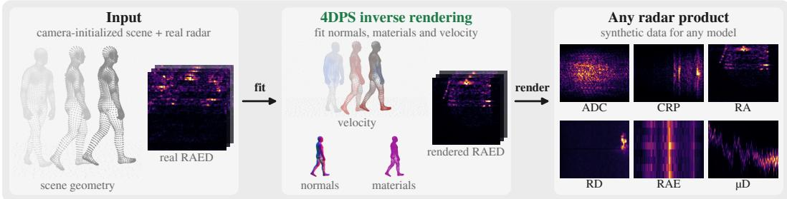

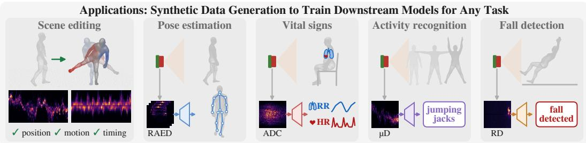  
Figure 1: 4DPS fits a moving scene to a real radar capture. Top: from a camera-initialized scene of oriented points, 4DPS fits materials, normals and velocities (color: radial velocity) until the rendered range–azimuth–elevation–Doppler tensor matches the recording. Bottom: the fitted scene can be edited (App. G) and rendered as training data for pose, vital-sign, activity and fall models.

We present 4D Point Splatting (4DPS), a physics-based differentiable renderer that fits an explicit moving scene to a real capture, with velocity as an estimated and differentiable parameter. Like prior radar renderers (Armouti et al., 2026b;a; Chen et al., 2026), we initialize geometry from another sensor, here the capture’s synchronized camera. We represent the scene as oriented points, each carrying an ITU-R P.2040 material (ITU-R, 2023), a surface normal and, for the body, a velocity, and we splat each point into range and Doppler bins. The camera fixes where each surface is present but not how strongly it reflects at millimeter wavelengths. That strength depends on the surface’s material and on the angle between its normal and the radar, and it sets the amplitude of every return. We therefore fit the materials, normals and velocities by gradient descent until the rendered return matches the recording (Fig. 1, top). On HuPR, fitting raises the clutter-removed range–azimuth correlation from 0.270 for the camera-initialized render to 0.666. Our output is the raw complex return that a real radar records, for every chirp, antenna pair and range bin. We therefore apply the same digital signal processing (DSP) to rendered and real data, and obtain any representation, from range profiles to micro-Doppler, for any downstream model (Fig. 1, bottom). We validate each representation on two datasets with different array geometries and downstream models.

Introducing an explicit velocity into the forward model raises three challenges. The first challenge is the cost: existing differentiable radar renderers output one chirp per frame, so rendering Doppler would repeat that render for every chirp, a cost that grows linearly with the chirp count and rules out corpus-scale fitting. 4DPS instead splats each point into Doppler bins as well as range bins (Fig. 2). A moving point’s return across a frame’s chirps is a single tone, so its Doppler point spread function has a closed form. Each point therefore deposits into seven Doppler bins instead of being rendered 64 times. Second, ambiguity: velocity enters the forward model only through a phase term that wraps every 2π, so velocities one Doppler ambiguity apart (9 m/s on HuPR) render identically, and gradient descent from an arbitrary start lands in the nearest minimum rather than the true minimum. To address this, we initialize the joint velocities from the video’s kinematics and learn only a residual, bounded by each joint’s own speed. Third, supervision: one loss must train both the static scene and the person, who holds a small fraction of a frame’s energy. A loss over the whole frame lets a large relative error on the person hide behind the scene’s return, and a loss on the person alone gives the scene no gradient. We therefore compare the range–azimuth–elevation magnitude at two slow-time views: each frame’s first chirp, which carries the static scene, and its Doppler planes, which carry the motion. Each view is compared over the whole frame and over a window on the person (Eq. 4). Solving these three problems lets us fit entire corpora for the first time, with no manual input. We fit every usable sequence of both datasets, 235 on HuPR and 100 on RT-Pose, at about 5.7 and 12.9 minutes a sequence on one H100.

Table 1: Comparison of radar rendering and synthesis methods. Signal: CIR or raw ADC. Mat.: explicit materials; Vel.: velocity estimated; Doppler: from subject motion; Real: validated on real captures; Edit: re-renderable scene; Code: released. Radar ports of neural fields and Gaussian splatting are omitted, because they supervise post-FFT power of a static scene.
<table><tr><td>Method</td><td></td><td></td><td>Repr. Signal Complex Mat. Vel. Doppler Real</td><td></td><td></td><td></td><td></td><td>Edit</td><td>Code</td></tr><tr><td colspan="10">Differentiable radar inverse rendering</td></tr><tr><td>mmIR (Armouti et al., 2026b)</td><td>Mesh</td><td>ADC</td><td>√</td><td>√</td><td></td><td></td><td>√</td><td>√</td><td>√</td></tr><tr><td>3DPS (Armouti et al., 2026a)</td><td>Points</td><td>ADC</td><td>√</td><td>√</td><td></td><td></td><td>√</td><td>√</td><td>√</td></tr><tr><td colspan="10">Human micro-Doppler simulation and synthesis</td></tr><tr><td>RF-Genesis (Chen &amp; Zhang, 2024)</td><td>Mesh</td><td>ADC</td><td>√</td><td></td><td></td><td>√</td><td>√</td><td></td><td>√</td></tr><tr><td>HybridSim (Xiong et al., 2026)</td><td>Mesh</td><td>ADC</td><td>√</td><td>√</td><td></td><td>√</td><td>√</td><td>√</td><td></td></tr><tr><td>4DPS (Ours)</td><td>Points</td><td>ADC</td><td>√</td><td>√</td><td>√</td><td>√</td><td>√</td><td>√</td><td>√</td></tr></table>

We set the new SOTA in 4D range–azimuth–elevation–Doppler (RAED) tensor rendering and reconstruction, with median Pearson correlations of 0.940 on range–azimuth and 0.988 on micro-Doppler on HuPR, and 0.830 and 0.966 on RT-Pose (Table 2). To test whether a model can learn from these renders, we train each dataset’s official pose model on real or on rendered data, four seeds each, and test it on both (Tables 3 and 11). Trained on our renders alone, the models keep 0.59 of their realtrained accuracy on HuPR and 0.76 on RT-Pose. By contrast, models trained on RF-Genesis render of the same motion fail on real data, at 1.8 AP on HuPR and 127.6 cm MPJPE on RT-Pose. Because our rendered-trained models score far higher on renders than on recordings, the gap that remains is realism rather than missing information. A comparison of the two models’ internal representations shows that they compute the same features from the backbone onward (Sec. 4.3).

Contributions. In summary, we make the following contributions: 1) 4DPS, to our knowledge the first differentiable renderer of human micro-Doppler: oriented points carrying material, normal and a velocity estimated per joint for the first time, splatted in closed form into range and Doppler bins, rendering the raw complex return so any representation follows; 2) a range–Doppler point splatting framework, with a closed-form Doppler point spread function and Doppler-resolved supervision, that makes corpus-scale inverse rendering tractable across multiple public corpora and different array geometries for the first time; 3) the first sim2real analysis of radar inverse rendering on downstream models: the real/rendered train–test matrix for radar human pose on two datasets with the official models, and an interpretability analysis showing that rendered- and real-trained models learn the same features; and 4) release of the renderer, the fitting chain, every fitted scene and rendered cube, the mesh-derived RT-Pose labels, the retrained models and the evaluation suite, on acceptance.

## 2 RELATED WORK

Differentiable radar rendering. Radar-domain renderers fit explicit scene parameters to captures. Differentiable ray tracers (Hoydis et al., 2023; Hofmann et al., 2025; Chen et al., 2025; 2023) do so on synthetic or known-geometry scenes. mmIR (Armouti et al., 2026b) fits the raw ADC of real captures and recovers materials, normals and antenna patterns, and 3DPS (Armouti et al., 2026a) replaces mmIR’s Monte Carlo sampling with closed-form point splatting. Every one of these renderers reconstructs a static scene. Its forward model evaluates one phase per primitive per frame, so it has no slow time, the axis along which Doppler and velocity are defined. 4DPS renders that axis in closed form and estimates velocity, so it fits a moving scene (Table 1).

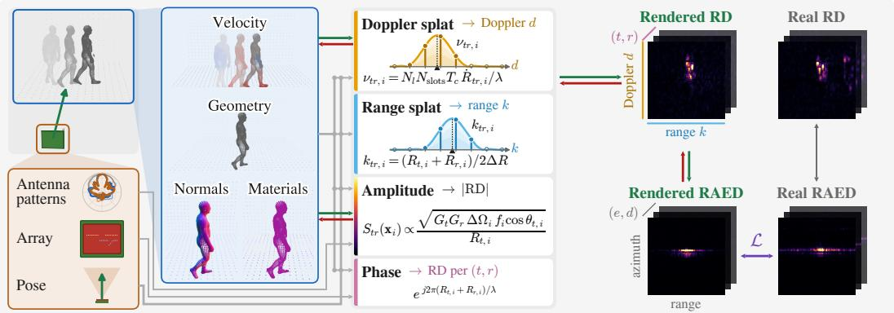  
Figure 2: 4DPS overview. Camera-initialized oriented point sets for a static scene and a moving person carry normals, materials and, for the person, velocities. For every antenna pair, 4DPS splats each point into its Doppler and range bins with an amplitude and a carrier phase, forming the RAED tensor that L compares with the recording. Green: forward pass; red: gradients; gray: fixed inputs.

Radar data synthesis. Radar ports of neural fields and Gaussian splatting (Huang et al., 2024; Borts et al., 2024; Kung et al., 2025; Zhang et al., 2026; Rafidashti et al., 2025) supervise on post-FFT power and discard phase, so they cannot render the phase that encodes micro-Doppler. DART (Huang et al., 2024) is the only one with a Doppler axis, and its Doppler comes from egomotion, not from an articulated subject. Motion-driven simulators (Sundar Ram & Ling, 2008; Vish wakarma et al., 2022; Chen & Zhang, 2024) produce human micro-Doppler but run forward only, so their residual against a real capture is either never quantified or never minimized. mmGPE (Xue et al., 2023) narrows that residual with a learned refiner on the simulator’s output, without fitting the scene. Learned generators (Chi et al., 2024) leave the scene implicit in network weights, where nothing can be fitted or edited. Concurrent with this work, HybridSim (Xiong et al., 2026) ray traces a physics-learning hybrid over eight sequences from one single-chip radar, trained end to end with the downstream task it feeds. Solving both at once is a weaker requirement than ours, because a renderer supervised by the task’s loss need only produce features that task finds useful. We instead fit the radar return itself and score it against the recording, so our renders must stand on their own and then transfer to a downstream model that never saw them during fitting. We do not carry it as a baseline, because it releases no code and its captures, collected for mmMesh (Xue et al., 2021), are unreleased. 4DPS fits an explicit scene, velocity included, to a real capture.

## 3 METHOD

4DPS starts from two camera-initialized point sets, a static scene and a moving person (Fig. 2; RT-Pose’s scene also uses its LiDAR). Each scene point carries its own ITU-R P.2040 material and normal. Each person point carries its own normal, the whole person shares one material, and its points move with 14 joint velocities skinned onto them. 4DPS renders the complex return of a TDM MIMO FMCW radar, for every chirp, transmitter–receiver pair and range bin, by splatting both point sets in custom CUDA kernels. Static points are splatted along range only, and moving points along both range and Doppler. Sec. 3.1 states the differentiable radar rendering model, from which Sec. 3.2 derives the splatting and Sec. 3.3 the objective and its learned parameters.

## 3.1 RADAR FORWARD MODEL

Consider an FMCW radar with $N _ { \mathrm { T X } }$ time-division-multiplexed transmitters and $N _ { \mathrm { R X } }$ receivers, carrier wavelength λ, range bin width ∆R, K = 256 range bins and $N _ { l } = 6 4$ loops per frame. In each loop every transmitter fires one chirp in its own slot, so with $N _ { \mathrm { s l o t s } }$ slots and a chirp interval $T _ { c }$ the loop period is $N _ { \mathrm { s l o t s } } T _ { c }$ (216 µs on HuPR, 780 µs on the cascade).

The rendering equation. Following prior radar inverse renderers (Armouti et al., 2026b;a), we take the bistatic radar equation (Skolnik et al., 1980), replace the cross-section by a spatially varying BSDF f and integrate over the receiver-centered hemisphere $\Omega _ { r x } ,$ , giving the received power as a

rendering equation,

$$
P _ { r } = \frac { P _ { t } \lambda ^ { 2 } } { ( 4 \pi ) ^ { 2 } } \int _ { \Omega _ { r x } } \frac { G _ { t } ( \omega _ { t } ) G _ { r } ( \omega _ { r } ) f ( \omega _ { t } , \mathbf { x } , \omega _ { r } ) \cos \theta _ { t } V ( \mathbf { x } ) } { R _ { t } ^ { 2 } ( \mathbf { x } ) } \mathrm { d } \omega _ { r } ,\tag{1}
$$

with $G _ { t } , G _ { r }$ the antenna gains, $R _ { t }$ the path length to the transmitter, cos $\theta _ { t } = | \mathbf { n } \cdot { } \omega _ { t } |$ and $V \in \{ 0 , 1 \}$ visibility. We discretize the hemisphere on an oriented point set $\{ ( \mathbf { x } _ { i } , \mathbf { n } _ { i } , \Delta \Omega _ { i } , \pmb { \theta } _ { i } , \mathbf { v } _ { i } ) \} _ { i = 1 } ^ { N }$ , each point subtending solid angle $\Delta \Omega _ { i }$ at the receiver and carrying a material, with a velocity $\mathbf { v } _ { i }$ on person points only. The Riemann sum cancels the surface Jacobian against $\Delta \Omega _ { i }$ and leaves a sum of per-point amplitudes, carrier phase attached,

$$
S _ { t r } ( \mathbf { x } _ { i } ) \ = \ C \frac { \sqrt { G _ { t } ( \omega _ { t , i } ) } } { R _ { t , i } } \sqrt { G _ { r } ( \omega _ { r , i } ) \Delta \Omega _ { i } } \sqrt { f _ { i } \cos \theta _ { t , i } } \ e ^ { j 2 \pi ( R _ { t , i } + R _ { r , i } ) / \lambda } ,\tag{2}
$$

with $C$ a constant that the learned gain absorbs (App. A.1). We set $\Delta \Omega _ { i } = 1$ for every point, because a cosine solid-angle weight darkened the limbs’ oblique sides, and the learned gains and materials carry the level. Nothing is sampled. Each point contributes one path per transmitter–receiver pair.

## 3.2 SPLATTING STATIC AND MOVING POINTS

Static scene: range splat. A renderer of one chirp can push the range FFT inside the point sum, so that each point becomes the Hann window’s known response at its fractional range bin and the range profile is splatted instead of simulated (Armouti et al., 2026a), and we use it for the static scene. A static point returns the same sample in every chirp, and the real front end removes that slow-time mean before its Doppler transform, so the static return lies in no Doppler plane and is supervised through each frame’s first chirp (Sec. 3.3).

Moving person: range–Doppler splat. A per-chirp renderer never forms the slow-time axis, the $N _ { l }$ loops of a frame along which Doppler is measured. For the person we therefore splat along slow time as well (Fig. 2), because the DFT over loops is linear in a path’s slow-time samples just as the range FFT is linear in its fast-time samples. Transmitter t samples a given path once a loop, so the path’s slow-time samples are a single tone. A point whose bistatic path length changes at the rate ${ \dot { R } } _ { t r , i } = \mathbf { v } _ { i } \cdot \left( \mathbf { u } _ { t , i } + \mathbf { u } _ { r , i } \right)$ , with $\mathbf { u } _ { t , i } , \mathbf { u } _ { r , i }$ the unit vectors from the antennas to the point, therefore sits at the fractional Doppler bin $\nu _ { t r , i } = N _ { l } N _ { \mathrm { s l o t s } } T _ { c } \dot { R } _ { t r , i } / \lambda$ , because consecutive loops of one transmitter are one loop period apart. The rendered range–Doppler product of one antenna pair is a two-axis splat,

$$
\mathrm { R D } _ { t r } [ d , k ] = g \sum _ { i = 1 } ^ { N } b _ { i } V _ { i } S _ { t r } ( { \bf x } _ { i } ) e ^ { j \phi _ { t , i } } \Phi _ { K } ( k - k _ { t r , i } ) \Phi _ { N _ { l } } ( d - \nu _ { t r , i } ) ,\tag{3}
$$

with $g \mathrm { ~ a ~ }$ learned receiver gain per radar, $b _ { i }$ the person’s learned per-joint scattering gains skinned to point i (1 for scene points), $V _ { i }$ the point’s visibility V in that frame, $k _ { t r , i } = ( R _ { t , i } + R _ { r , i } ) / ( 2 \Delta R )$ the fractional range bin, $\phi _ { t , i }$ the phase the transmitter’s own slot contributes, and $\Phi _ { K } , \Phi _ { N _ { l } }$ the Hann window’s exact response on the two axes. $\Phi _ { N _ { l } }$ includes the slow-time mean removal, so static points deposit nothing here. We truncate $\Phi _ { K }$ to $L = 1 5$ range taps and $\Phi _ { N _ { l } }$ to 7 Doppler taps, so a person path costs 105 accumulations instead of a 64 × 256 cube per antenna pair, and its backward pass costs the same. App. A.3 derives this closed form from the per-chirp signal it replaces.

Material model. The BSDF $f _ { i }$ is a closed-form Jones BSDF (Wei et al., 2024; Armouti et al., 2026a), evaluated from a six-parameter ITU-R P.2040 material vector (ITU-R, 2023): a coherent specular lobe and a small-perturbation lobe, blended by the ITU roughness gates and resolved in a local $s / p$ polarization basis (App. A.2). The scene’s materials are per point, while the whole person shares one six-vector, because per-point materials let the fit darken the limbs (App. B.2).

Visibility and occlusion. The binary V of Eq. (1) is a per-frame ray cast that runs in both directions. A body point is switched off when its segment to the radar is blocked by the posed mesh or by the scene. A scene point is switched off for the frames in which the body stands between it and the radar (App. B.1). This matters more here than for a static renderer, because the shadow moves with the person. An unmasked scene point renders a return that stays constant over the frame’s loops while the recording interrupts it, and the zero-Doppler plane is most sensitive to that error.

Noise model. A clutter-removed range–Doppler map is mostly empty, and its empty cells sit at the receiver’s noise floor instead of zero. A renderer that models no noise predicts exactly zero there, so an $L _ { 2 }$ on linear magnitude would charge the fit for every empty cell and the fit would answer by manufacturing power. This is a Doppler problem, because a range–azimuth image is filled by the static scene while most of a resolved range–Doppler product is floor. We therefore make the floor $\mathcal { N } ( d , k )$ part of the forward model, a log scale and a range shape over a prior taken from the recording’s own off-person power, added to the rendered power wherever magnitudes are compared. It enters the loss only through the two plane terms, which fit its level, and the unoccupied range– Doppler level of Table 2 $( L \bar { \upsilon } = 0 . 9 2 / 0 . \bar { 9 } 2 , ($ 0.96 on the cascade) tests whether it is right.

Benefits of 4D Point Splatting. Render any DSP representation: Eq. (3) renders the raw complex return a real radar records, so the range, azimuth, elevation and Doppler FFTs of the real data’s DSP turn one fitted scene into any representation a downstream model reads (App. A.1). Differentiable velocity: $\nu _ { t r , i }$ depends on the point’s velocity, so the Doppler axis carries gradient through the skinning to the joint velocities, and the radar, not the camera, settles what the limbs did. Corpus scale: that per-path cost is independent of $N _ { l }$ , so a whole corpus is affordable (Sec. 3.3).

## 3.3 OPTIMIZATION AND IMPLEMENTATION

Our objective function evaluates different projections of the linear RAED magnitude tensor:

$$
\begin{array} { r } { \mathcal { L } \ = \underbrace { \mathcal { L } _ { \mathrm { R A E , 0 } } + \mathcal { L } _ { \mathrm { R A E , p l } } } _ { \mathrm { g l o b a l } } + \underbrace { \mathcal { L } _ { \mathrm { R A E , 0 } } ^ { \mathrm { w i n } } + \mathcal { L } _ { \mathrm { R A E , p l } } ^ { \mathrm { w i n } } } _ { \mathrm { w i n d o w e d ~ o n ~ t h e ~ p e r s o n } } , } \end{array}\tag{4}
$$

a normalized $L _ { 2 }$ on |RAE| (App. B.2), taken at two slow-time views and two scopes. The firstchirp term $\mathcal { L } _ { \mathrm { R A E , 0 } }$ keeps the static clutter return, so it is the only term that reaches the whole static scene. Because it is a magnitude, it supervises ADC amplitude and inter-element phase without fitting absolute phase noise. The plane term $\mathcal { L } _ { \mathrm { R A E , p l } }$ supervises the 63 non-DC Doppler planes, which only the moving person reaches, so a velocity error that leaves the range profile intact still moves energy between planes. The windowed pair restricts both to the person’s spatial window and normalizes over it, because a frame-wide divisor lets a large relative error on the person hide behind the scene’s energy. Those cells hold the occupied range–Doppler region and the micro-Doppler signature. All four terms apply FFTs sized by the radar’s virtual aperture and chirp count, irrespective of the downstream model’s beamformer, unlike HybridSim (Xiong et al., 2026), which trains its renderer end-to-end with that model.

What we optimize. For the static scene we optimize per-point materials and normals. For the person we optimize per-point normals, one material six-vector and 14 joint velocities, each the video’s kinematic velocity times a learned per-joint scale plus a bounded, band-limited residual, skinned to the points so that a joint the video calls still stays still. For the radar we optimize its gains and the noise floor (Table 5).

Scale and runtime. A chirp is rendered once per physical transmitter–receiver pair, so fitting HuPR is $2 3 5 \times 6 0 0 \times 6 4 \times 2 4$ chirps and RT-Pose $1 0 0 \times 2 9 9 \times 6 4 \times 1 9 2$ , for a total of 584 million chirps. Each is fitted for 400 epochs, so the fit renders 234 billion chirps forward and as many again backward, without ever forming a slow-time cube. That is 63,000 times the data 3DPS (Armouti et al., 2026a) fits, at 43.9 GPU-hours on H100s (App. H.2).

## 4 EVALUATION

Sec. 4.1 fits 235 sequences from HuPR (Lee et al., 2023) and 100 from RT-Pose (Ho et al., 2025), two public human-sensing corpora that retain slow time and a colocated camera. HuPR records raw ADC from two orthogonal single-chip radars, and RT-Pose from one cascade (App. B.1). Sec. 4.2 measures sim2real with the pose model each dataset released, MSCSA-PRGCN (Lee et al., 2023) and HRRadarPose (Ho et al., 2025), retrained from scratch for four seeds at equal optimizer steps. Each model keeps its own metric, because the labels differ. HuPR’s 2D image keypoints admit OKS AP but no metric distance, and RT-Pose’s 3D joints admit MPJPE in centimeters. RT-Pose’s joints come from the mesh that drives the render (App. E). No public simulator takes a real capture as input, so RF-Genesis (Chen & Zhang, 2024) is driven forward from the same registered motion (App. C.3), and our unfit render is the floor. Sec. 4.3 compares real- and rendered-trained models.

Table 2: Rendering fidelity. Medians over sequences (HuPR pools both radars) of the Pearson correlation with the recording: range–angle $( \rho ; \rho _ { c }$ clutter-removed), occupied range–Doppler cells $( \rho _ { M } )$ , and micro-Doppler centroid, spread and spectrogram $( \rho _ { \mu } , \rho _ { \sigma } ,$ , ρS ); $L _ { U } \mathrm { : }$ rendered-to-real noise-floor level. Bold: best per section. App. D gives the other DSP representations.
<table><tr><td rowspan="2">Method</td><td colspan="2">Range-angle</td><td colspan="2">Range-Doppler</td><td colspan="3">Micro-Doppler</td></tr><tr><td>ρ↑</td><td> $\rho _ { c } \uparrow$ </td><td> $\rho _ { M }$  ↑</td><td> $L _ { U } \to 1$ </td><td> $\rho _ { \mu }$  ←</td><td> $\rho _ { \sigma }$  ↑</td><td>ρs ↑</td></tr><tr><td>HuPR, two single-chip radars</td><td></td><td></td><td></td><td></td><td></td><td></td><td></td></tr><tr><td>RF-Genesis (Chen &amp; Zhang, 2024)</td><td>0.134</td><td>0.339</td><td>0.518</td><td>0.05</td><td>0.820</td><td>0.063</td><td>0.671</td></tr><tr><td>4DPS (unfit)</td><td>0.878</td><td>0.270</td><td>0.537</td><td>0.57</td><td>0.930</td><td>0.283</td><td>0.754</td></tr><tr><td>4DPS (Ours)</td><td>0.940</td><td>0.666</td><td>0.829</td><td>0.92</td><td>0.993</td><td>0.966</td><td>0.988</td></tr><tr><td>RT-Pose, cascade, one-person sequences</td><td></td><td></td><td></td><td></td><td></td><td></td><td></td></tr><tr><td>RF-Genesis</td><td>0.119</td><td>0.221</td><td>0.324</td><td>0.09</td><td>0.750</td><td>0.042</td><td>0.394</td></tr><tr><td>4DPS (unfit)</td><td>0.648</td><td>0.181</td><td>0.291</td><td>0.58</td><td>0.803</td><td>0.185</td><td>0.515</td></tr><tr><td>4DPS (Ours)</td><td>0.830</td><td>0.470</td><td>0.695</td><td>0.96</td><td>0.973</td><td>0.704</td><td>0.966</td></tr></table>

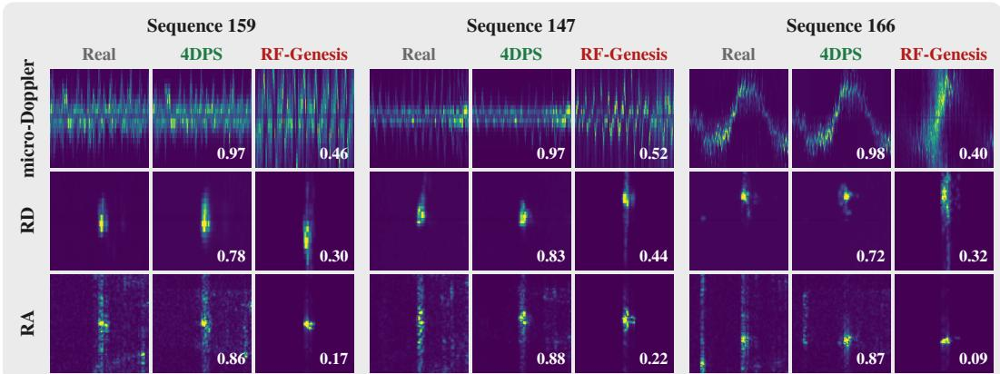  
Figure 3: Real, 4DPS and RF-Genesis on three RT-Pose test sequences. Rows: micro-Doppler for the full sequence; typical range–Doppler frame; and typical range–azimuth frame; the number is the render’s sequence-level correlation with the recording. Activities: 159 stand and lift a leg, 147 stand and wave, 166 walk and wave. See App. J for more details.

## 4.1 RENDERING FIDELITY

Does 4DPS reproduce the real capture, on every DSP representation? The fitted render reaches 0.940 range–azimuth and 0.988 micro-Doppler correlation on HuPR, and 0.830 and 0.966 on RT-Pose (Table 2). Fig. 3 shows three RT-Pose sequences beside the recording and RF-Genesis, and Tables 7–10 give every column. RF-Genesis, driven by the same motion, reaches only 0.134 and 0.671 on HuPR and 0.119 and 0.394 on RT-Pose. It renders the person alone, with no room, so it misses the static scene that fills a real range–azimuth map, and it keeps the body’s bulk motion (micro-Doppler centroid 0.820 on HuPR) but loses the limbs’ spread around it (0.063 against 0.966 fitted), below even our unfit render, because its 800 body scatterers are reassigned between ray casts and nothing fits their motion to the recording. Our control is the unfit render, the same chain with the velocity field trained for zero epochs, which reaches 0.878, 0.754, 0.648 and 0.515. In a paired, onesided comparison, the control scores lower on every sequence, for both representations and datasets. The one exception is range–azimuth on one HuPR sequence’s vertical board. Camera motion alone already tracks the body’s bulk radial movement, so the control keeps a Doppler-centroid correlation of 0.930 on HuPR and 0.803 on RT-Pose. What it loses is the spread around that centroid, where the limbs’ micro-motion sits. Its spread correlation falls to 0.283 on HuPR and 0.185 on RT-Pose, against 0.966 and 0.704 for the fitted render. The radar fit therefore recovers the motion the video gets wrong. The cascade is the harder case, because it resolves elevation, the axis the scaffold reconstructs least well. The still recordings score lowest.

Table 3: Pose estimation downstream model training: real vs rendered data. On RT-Pose we train HRRadarPose (Ho et al., 2025), and on HuPR MSCSA-PRGCN (Lee et al., 2023). Every row is tested on real data, so the rendered-trained rows measure sim-to-real transfer. Mean (std) over four seeds trained from scratch. Table 11 gives the full train–test matrix.
<table><tr><td></td><td></td><td colspan="3">RT-Pose (cm ↓)</td><td colspan="3">HuPR (AP ↑)</td></tr><tr><td>Train</td><td>Test</td><td>MPJPE</td><td>MRPE</td><td>Abs-MPJPE</td><td>AP</td><td> $\mathrm { A P _ { 5 0 } }$ </td><td> $\mathrm { A P _ { 7 5 } }$ </td></tr><tr><td>Real</td><td>Real</td><td>16.67 (0.42)</td><td>13.14 (0.87)</td><td>19.07 (0.52)</td><td>65.6 (1.7)</td><td>96.9 (0.2)</td><td>78.0 (3.1)</td></tr><tr><td>RF-Genesis Real 4DPS</td><td>Real</td><td>127.59 (48.32) 21.86 (1.33)</td><td>106.48 (45.00) 17.06 (0.98)</td><td>148.88 (24.86) 25.45 (1.69)</td><td>1.8 (3.5)</td><td>8.5 (16.1)</td><td>0.0 (0.1)</td></tr></table>

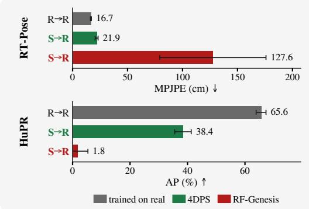

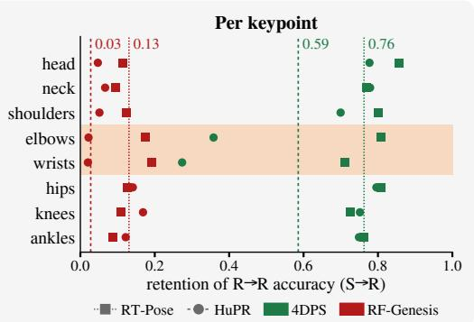  
Figure 4: The sim-to-real gap. Left: real-data MPJPE on RT-Pose (↓) and AP on HuPR (↑) after training on real data, 4DPS or RF-Genesis (four seeds, ±1 std; bars on their true scale). Right: retention of real-trained accuracy per keypoint group (S→R over R→R, the inverse for MPJPE); on HuPR the 4DPS deficit sits in the arms (shaded). Table 3 gives every metric.

## 4.2 TRAINING POSE MODELS ON RENDERED DATA

How much of real-trained accuracy survives training on renders? Every row of Table 3 is tested on real data. Trained on 4DPS renders alone, each model keeps 0.59 of its real-trained accuracy on HuPR (38.4 (2.9) against 65.6 (1.7) AP) and 0.76 on RT-Pose (21.86 (1.33) against 16.67 (0.42) cm). A model trained on RF-Genesis renders of the same motion transfers almost nothing. It reaches 1.8 (3.5) AP on HuPR and 127.59 (48.32) cm MPJPE on RT-Pose (Fig. 4, left). Both renderers see the same motion, so the difference lies in what each makes of it. An RF-Genesis render holds the person alone and carries little of the limbs’ micro-motion (Sec. 4.1), so a model trained on it never learns to separate a moving body from the room around it. The 4DPS renders do carry the pose information a model needs. Tested on held-out renders, a 4DPS-trained model scores 59.6 (1.4) AP and 15.71 (1.38) cm, close to the real-trained model on recordings (Table 11). Its drop on recordings therefore comes from the remaining rendered–real differences, which the model first meets at test time. Per keypoint, the drop concentrates in the arms (Fig. 4, right). On HuPR the wrists fall from 22.2 and 25.1 AP to 8.0 and 4.7, while hips, knees and the head keep 0.73 to 0.80 of their real-trained AP. The arms are the body’s smallest and fastest-moving parts, and their rendered motion comes from the video’s kinematics, corrected only within a bounded residual (Sec. 3.3). HuPR’s coarse azimuth resolution also gives the fit little signal to correct them, so they depart most from the recording.

HuPR is the harder downstream task of the two, although its renders score higher on fidelity (Table 2), for three reasons. i) One sequence gives the renderer 921,600 chirps against RT-Pose’s 3,674,112, a factor of 0.25. ii) Its radars also resolve the lateral axes far more coarsely. Eight azimuth elements on a single chip put the broadside resolution near 14.3◦, against $1 . 3 ^ { \circ }$ for the cascade’s 86 slots. Each HuPR board resolves one axis only, azimuth on the horizontal and elevation on the vertical, and carries 2 elevation bins where the cascade carries 8. The labels, meanwhile, are keypoints in a camera image whose pixels subtend about 0.2◦. The model must place joints on a grid some seventy times finer than its own sensor resolves laterally. iii) Coarse angles make the camera-to-radar extrinsic harder to estimate as well, and our fit is sensitive to that registration, as prior radar inverse renderers are (Armouti et al., 2026b;a) (App. I).

Table 4: Do rendered- and real-trained models learn the same features? Each cell is the real– rendered distance over the real–real distance between seeds (1.0: as close as two real-trained models), with its 95% interval; the readout columns are error ratios. Bold: the interval lies above the 1.2× margin fixed before the analysis. †: uninformative, as an untrained network is about as close. HuPR’s middle layers are undefined (dead temporal merges); App. F gives every layer and the errorconsistency analysis.
<table><tr><td rowspan="2"></td><td colspan="5">Feature similarity</td><td colspan="2">Linear readout</td></tr><tr><td>CKA first</td><td>CKA middle</td><td>CKA backbone</td><td>CKA logits</td><td>Procrustes every layer</td><td>trained</td><td>Rendered- Untrained backbone</td></tr><tr><td>RT-Pose 1.35, 1.17 0.98–1.10</td><td></td><td></td><td>0.98†</td><td>0.99†</td><td>0.98-1.05</td><td>1.16 [1.09, 1.28]</td><td>1.25</td></tr><tr><td>HuPR</td><td>1.15 1.37</td><td>undefined</td><td>1.08† 1.10†</td><td>1.37 [1.08, 1.70]</td><td>1.05-1.17</td><td>1.30 [1.20, 1.38]</td><td>2.50</td></tr></table>

## 4.3 COMPARING REAL- AND RENDERED-TRAINED MODELS

Does a model trained on renders learn the same features as one trained on real data? We compare the two models’ activations layer by layer with two standard similarity measures, orthogonal Procrustes distance (Williams et al., 2021) and debiased linear CKA (Kornblith et al., 2019; Nguyen et al., 2021; Murphy et al., 2024), because no single measure wins across settings (Klabunde et al., 2025). Each distance (Procrustes, 1−CKA) is divided by that between two of five real-trained models, which differ only in seed, so 1.0 means as similar as two real-trained models, and we fixed 1.2 as the margin before running the analysis (Table 4). The Procrustes ratio stays between 0.98 and 1.05 at every layer on RT-Pose and between 1.05 and 1.17 on HuPR, and CKA clears the margin with confidence only at RT-Pose’s first layer (1.35), where the rendered and real inputs themselves differ most. Training on renders therefore teaches the same features as training on real data, consistent with Sec. 4.2, where the rendered-trained model’s drop comes from rendered–real differences in its input. Features that look alike can still serve pose estimation differently, so we also freeze each model’s feature extractor and fit a new linear pose readout on real data. On HuPR, features learned from renders give 1.30 times the keypoint error of real-trained features, against 2.50 times for an untrained network. Therefore, they carry most but not all of the pose information. At the deepest layers even an untrained network scores about as close (†), so similarity there is no evidence either way. App. F gives every layer, the error-consistency analysis and the protocol.

## 5 CONCLUSION

We presented 4DPS, a physics-based differentiable renderer that fits an explicit moving scene to a real radar capture. Camera-initialized oriented points carry an ITU-R P.2040 material, a normal and a velocity, and are splatted in closed form into range and Doppler bins on the TDM timing of a MIMO array. The closed-form Doppler splat makes the fit cheap enough to run unattended over all 235 HuPR and 100 RT-Pose sequences, and because 4DPS renders the raw complex return, the real data’s DSP turns it into any representation. 4DPS sets the state of the art on range–azimuth, range– Doppler and micro-Doppler. On HuPR it reaches median correlations of 0.666 on clutter-removed range–azimuth and 0.988 on micro-Doppler, against 0.339 and 0.671 for RF-Genesis driven by the same motion. Pose models trained on our renders alone keep 0.59 of their real-trained accuracy on HuPR and 0.76 on RT-Pose, while models trained on RF-Genesis renders do not transfer. The rendered- and real-trained models also compute the same features, so the remaining gap comes from rendered–real differences in their input. Limitations and future work. Velocity stays within a bounded residual of the video kinematics. The background is static and rendered along singlebounce paths, and we model one person per sequence. RT-Pose’s labels come from the body mesh that drives the render, and no public simulator takes a capture as input, so our baselines run forward (App. I). Scoring edited scenes against real recordings is the next step (App. G).

## REPRODUCIBILITY STATEMENT

Code, configurations, the fitted checkpoints of every sequence and the scripts behind every table will be released. Both datasets are public (HuPR (Lee et al., 2023), RT-Pose (Ho et al., 2025)). The forward model is stated in Sec. 3 with every learned quantity in Table 5; the preprocessing chain, the runtime design and the downstream protocol are in the supplement (Secs. B.1, H.2, B.2, F).

## USE OF AI STATEMENT

We used large language models to implement and edit code, clean and reformat the datasets, assist in writing, and give feedback on the research methodology and experiments. The authors reviewed all AI-assisted work and take full responsibility for the content of this paper.

## REFERENCES

Fadel Adib, Hongzi Mao, Zachary Kabelac, Dina Katabi, and Robert C. Miller. Smart Homes That Monitor Breathing and Heart Rate. In Proceedings of the 33rd Annual ACM Conference on Human Factors in Computing Systems, CHI ’15, pp. 837–846, New York, NY, USA, 2015. Association for Computing Machinery. ISBN 9781450331456. doi: 10.1145/2702123.2702200. URL https://doi.org/10.1145/2702123.2702200.

Sizhe An and Umit Y. Ogras. MARS: mmWave-Based Assistive Rehabilitation System for Smart Healthcare. ACM Trans. Embed. Comput. Syst., 20(5s), September 2021. ISSN 1539-9087. doi: 10.1145/3477003. URL https://doi.org/10.1145/3477003.

Sizhe An, Yin Li, and Umit Ogras. mRI: Multi-Modal 3D Human Pose Estimation Dataset Using mmWave, RGB-D, and Inertial Sensors. In S. Koyejo, S. Mohamed, A. Agarwal, D. Belgrave, K. Cho, and A. Oh (eds.), Advances in Neural Information Processing Systems, volume 35, pp. 27414–27426. Curran Associates, Inc., 2022. doi: 10.52202/068431-1988. URL https://proceedings.neurips.cc/paper\_files/paper/2022/file/ af9c9c6d2da701da5a0acf91ec217815-Paper-Datasets\_and\_Benchmarks. pdf.

Adnan Armouti, Yixuan Gao, and Rajalakshmi Nandakumar. 3D Point Splatting for mmWave Radar Novel View Synthesis, 2026a. URL https://arxiv.org/abs/2609.11894.

Adnan Armouti, Yixuan Gao, and Rajalakshmi Nandakumar. mmIR: Frequency-Space Inverse Rendering for 3D Millimeter-Wave Radar ADC Synthesis. In Paolo Favaro, Zuzana Kukelova, Atsuto Maki, Anna Rohrbach, Konrad Schindler, and Federico Tombari (eds.), Computer Vision – ECCV 2026, pp. 148–166, Cham, 2026b. Springer Nature Switzerland. ISBN 978-3-032-37359-5.

David Borts, Erich Liang, Tim Broedermann, Andrea Ramazzina, Stefanie Walz, Edoardo Palladin, Jipeng Sun, David Brueggemann, Christos Sakaridis, Luc Van Gool, Mario Bijelic, and Felix Heide. Radar Fields: Frequency-Space Neural Scene Representations for FMCW Radar. In ACM SIGGRAPH 2024 Conference Papers, SIGGRAPH ’24, New York, NY, USA, 2024. Association for Computing Machinery. ISBN 9798400705250. doi: 10.1145/3641519.3657510. URL https://doi.org/10.1145/3641519.3657510.

Anjun Chen, Xiangyu Wang, Shaohao Zhu, Yanxu Li, Jiming Chen, and Qi Ye. mmBody Benchmark: 3D Body Reconstruction Dataset and Analysis for Millimeter Wave Radar. In Proceedings of the 30th ACM International Conference on Multimedia, MM ’22, pp. 3501–3510, New York, NY, USA, 2022. Association for Computing Machinery. ISBN 9781450392037. doi: 10.1145/3503161.3548262. URL https://doi.org/10.1145/3503161.3548262.

Chuhan Chen, Tianshu Huang, Akarsh Prabhakara, Chaithanya Kumar Mummadi, Zhongxiao Cong, Anthony Rowe, Matthew O’Toole, and Deva Ramanan. RadarSim: Simulating Single-Chip Radar via Multimodal Neural Fields. In 2026 International Conference on 3D Vision (3DV), pp. 1258– 1268, 2026. doi: 10.1109/3DV69130.2026.00124.

V.C. Chen, F. Li, S.-S. Ho, and H. Wechsler. Micro-Doppler Effect in Radar: Phenomenon, Model, and Simulation Study. IEEE Transactions on Aerospace and Electronic Systems, 42(1):2–21, 2006. doi: 10.1109/TAES.2006.1603402.

Xingyu Chen and Xinyu Zhang. RF Genesis: Zero-Shot Generalization of mmWave Sensing through Simulation-Based Data Synthesis and Generative Diffusion Models. In Proceedings of the 21st ACM Conference on Embedded Networked Sensor Systems, SenSys ’23, pp. 28–42, New York, NY, USA, 2024. Association for Computing Machinery. ISBN 9798400704147. doi: 10.1145/ 3625687.3625798. URL https://doi.org/10.1145/3625687.3625798.

Xingyu Chen, Xinyu Zhang, Qiyue Xia, Xinmin Fang, Chris Xiaoxuan Lu, and Zhengxiong Li. Differentiable Radio Frequency Ray Tracing for Millimeter-Wave Sensing, 2023. URL https: //arxiv.org/abs/2311.13182.

Xingyu Chen, Jianrong Ding, Kai Zheng, Xinmin Fang, Xinyu Zhang, Chris Xiaoxuan Lu, and Zhengxiong Li. InverTwin: Solving Inverse Problems via Differentiable Radio Frequency Digital Twin, 2025. URL https://arxiv.org/abs/2508.14204.

Guoxuan Chi, Zheng Yang, Chenshu Wu, Jingao Xu, Yuchong Gao, Yunhao Liu, and Tony Xiao Han. RF-Diffusion: Radio Signal Generation via Time-Frequency Diffusion. In Proceedings of the 30th Annual International Conference on Mobile Computing and Networking, ACM Mobi-Com ’24, pp. 77–92, New York, NY, USA, 2024. Association for Computing Machinery. ISBN 9798400704895. doi: 10.1145/3636534.3649348. URL https://doi.org/10.1145/ 3636534.3649348.

Han Cui, Shu Zhong, Jiacheng Wu, Zichao Shen, Naim Dahnoun, and Yiren Zhao. MiliPoint: A Point Cloud Dataset for mmWave Radar. In A. Oh, T. Naumann, A. Globerson, K. Saenko, M. Hardt, and S. Levine (eds.), Advances in Neural Information Processing Systems, volume 36, pp. 62713–62726. Curran Associates, Inc., 2023. doi: 10.52202/075280-2739. URL https://proceedings.neurips.cc/paper\_files/paper/2023/file/ c60468eca9cd0b0083f0ff9d0aeb171a-Paper-Datasets\_and\_Benchmarks. pdf.

Frances Ding, Jean-Stanislas Denain, and Jacob Steinhardt. Grounding Representation Similarity through Statistical Testing. In M. Ranzato, A. Beygelzimer, Y. Dauphin, P.S. Liang, and J. Wortman Vaughan (eds.), Advances in Neural Information Processing Systems, volume 34, pp. 1556–1568. Curran Associates, Inc., 2021. URL https://proceedings.neurips.cc/paper\_files/paper/2021/file/ 0c0bf917c7942b5a08df71f9da626f97-Paper.pdf.

Junqiao Fan, Yunjiao Zhou, Yizhuo Yang, Xinyuan Cui, Jiarui Zhang, Lihua Xie, Jianfei Yang, Chris Xiaoxuan Lu, and Fangqiang Ding. M4Human: A Large-Scale Multimodal mmWave Radar Benchmark for Human Mesh Reconstruction. In Proceedings of the IEEE/CVF Conference on Computer Vision and Pattern Recognition (CVPR), pp. 42836–42846, June 2026.

Xiangyu Gao, Guanbin Xing, Sumit Roy, and Hui Liu. RAMP-CNN: A Novel Neural Network for Enhanced Automotive Radar Object Recognition. IEEE Sensors Journal, 21(4):5119–5132, 2021. doi: 10.1109/JSEN.2020.3036047.

Robert Geirhos, Kristof Meding, and Felix A. Wichmann. Beyond Accuracy: Quantifying Trial-by-Trial Behaviour of CNNs and Humans by Measuring Error Consistency. In H. Larochelle, M. Ranzato, R. Hadsell, M.F. Balcan, and H. Lin (eds.), Advances in Neural Information Processing Systems, volume 33, pp. 13890–13902. Curran Associates, Inc., 2020. URL https://proceedings.neurips.cc/paper\_files/paper/2020/ file/9f6992966d4c363ea0162a056cb45fe5-Paper.pdf.

Junfeng Guan, Sohrab Madani, Suraj Jog, Saurabh Gupta, and Haitham Hassanieh. Through Fog High-Resolution Imaging Using Millimeter Wave Radar. In 2020 IEEE/CVF Conference on Computer Vision and Pattern Recognition (CVPR), pp. 11461–11470, 2020. doi: 10.1109/CVPR42600.2020.01148.

Chuan Guo, Shihao Zou, Xinxin Zuo, Sen Wang, Wei Ji, Xingyu Li, and Li Cheng. Generating Diverse and Natural 3D Human Motions from Text. In 2022 IEEE/CVF Conference on Computer Vision and Pattern Recognition (CVPR), pp. 5142–5151, 2022. doi: 10.1109/CVPR52688.2022. 00509.

Rongxiao Guo and Qingchao Chen. DGHMesh: A Large-Scale Dual-Radar mmWave Dataset and Generalization-Focused Benchmark for Human Mesh Reconstruction, 2026. URL https:// arxiv.org/abs/2604.22827.

Yuan-Hao Ho, Jen-Hao Cheng, Sheng Yao Kuan, Zhongyu Jiang, Wenhao Chai, Hsiang-Wei Huang, Chih-Lung Lin, and Jenq-Neng Hwang. RT-Pose: A 4D Radar Tensor-Based 3D Human Pose Estimation and Localization Benchmark. In Ales Leonardis, Elisa Ricci, Stefan Roth, Olga Rus-ˇ sakovsky, Torsten Sattler, and Gul Varol (eds.),¨ Computer Vision – ECCV 2024, pp. 107–125, Cham, 2025. Springer Nature Switzerland. ISBN 978-3-031-73036-8.

Nikolai Hofmann, Vanessa Wirth, Johanna Braunig, Ingrid Ullmann, Martin Vossiek, Tim Weyrich,¨ and Marc Stamminger. Inverse Rendering of Near-Field mmWave MIMO Radar for Material Reconstruction. IEEE Journal of Microwaves, 5(2):356–372, 2025. doi: 10.1109/JMW.2025. 3535077.

Jakob Hoydis, Faycal Ait Aoudia, Sebastian Cammerer, Merlin Nimier-David, Nikolaus Binder, Guillermo Marcus, and Alexander Keller. Sionna RT: Differentiable Ray Tracing for Radio Propagation Modeling. In 2023 IEEE Globecom Workshops (GC Wkshps), pp. 317–321, 2023. doi: 10.1109/GCWkshps58843.2023.10465179.

Tianshu Huang, John Miller, Akarsh Prabhakara, Tao Jin, Tarana Laroia, Zico Kolter, and Anthony Rowe. DART: Implicit Doppler Tomography for Radar Novel View Synthesis. In 2024 IEEE/CVF Conference on Computer Vision and Pattern Recognition (CVPR), pp. 24118–24129. IEEE, 2024.

Tianshu Huang, Akarsh Prabhakara, Chuhan Chen, Jay Karhade, Deva Ramanan, Matthew O’Toole, and Anthony Rowe. Towards Foundational Models for Single-Chip Radar. In 2025 IEEE/CVF International Conference on Computer Vision (ICCV), pp. 24655–24665, 2025. doi: 10.1109/ ICCV51701.2025.02286.

ITU-R. Effects of Building Materials and Structures on Radiowave Propagation above about 100 MHz. Recommendation P.2040-3, International Telecommunication Union, aug 2023. URL https://www.itu.int/rec/R-REC-P.2040/en.

Max Klabunde, Tassilo Wald, Tobias Schumacher, Klaus Maier-Hein, Markus Strohmaier, and Florian Lemmerich. ReSi: A Comprehensive Benchmark for Representational Similarity Measures. In Y. Yue, A. Garg, N. Peng, F. Sha, and R. Yu (eds.), International Conference on Learning Representations, volume 2025, pp. 18701–18740, 2025. URL https://proceedings.iclr.cc/paper\_files/paper/2025/file/ 2eef1f75516b0cfd3e944345e5f88c08-Paper-Conference.pdf.

Simon Kornblith, Mohammad Norouzi, Honglak Lee, and Geoffrey Hinton. Similarity of Neural Network Representations Revisited. In Kamalika Chaudhuri and Ruslan Salakhutdinov (eds.), Proceedings of the 36th International Conference on Machine Learning, volume 97 of Proceedings of Machine Learning Research, pp. 3519–3529. PMLR, 09–15 Jun 2019. URL https://proceedings.mlr.press/v97/kornblith19a.html.

Andrew Kramer, Kyle Harlow, Christopher Williams, and Christoffer Heckman. ColoRadar: The Direct 3D Millimeter Wave Radar Dataset. Int. J. Rob. Res., 41(4):351–360, April 2022. ISSN 0278-3649. doi: 10.1177/02783649211068535. URL https://doi.org/10.1177/ 02783649211068535.

Pou-Chun Kung, Skanda Harisha, Ram Vasudevan, Aline Eid, and Katherine A. Skinner. Radar-Splat: Radar Gaussian Splatting for High-Fidelity Data Synthesis and 3D Reconstruction of Autonomous Driving Scenes. In 2025 IEEE/CVF International Conference on Computer Vision (ICCV), pp. 27596–27606, 2025. doi: 10.1109/ICCV51701.2025.02562.

Shih-Po Lee, Niraj Prakash Kini, Wen-Hsiao Peng, Ching-Wen Ma, and Jenq-Neng Hwang. HuPR: A Benchmark for Human Pose Estimation Using Millimeter Wave Radar. In 2023 IEEE/CVF Winter Conference on Applications of Computer Vision (WACV), pp. 5704–5713, 2023. doi: 10.1109/WACV56688.2023.00567.

Jaime Lien, Nicholas Gillian, M. Emre Karagozler, Patrick Amihood, Carsten Schwesig, Erik Olson, Hakim Raja, and Ivan Poupyrev. Soli: Ubiquitous Gesture Sensing with Millimeter Wave Radar. ACM Trans. Graph., 35(4), July 2016. ISSN 0730-0301. doi: 10.1145/2897824.2925953. URL https://doi.org/10.1145/2897824.2925953.

Teck-Yian Lim, Spencer A. Markowitz, and Minh N. Do. RaDICaL: A Synchronized FMCW Radar, Depth, IMU and RGB Camera Data Dataset with Low-Level FMCW Radar Signals. IEEE Journal of Selected Topics in Signal Processing, 15(4):941–953, 2021. doi: 10.1109/JSTSP.2021. 3061270.

Matthew Loper, Naureen Mahmood, Javier Romero, Gerard Pons-Moll, and Michael J. Black. SMPL: A Skinned Multi-Person Linear Model. ACM Trans. Graph., 34(6), November 2015. ISSN 0730-0301. doi: 10.1145/2816795.2818013. URL https://doi.org/10.1145/ 2816795.2818013.

Naureen Mahmood, Nima Ghorbani, Nikolaus F. Troje, Gerard Pons-Moll, and Michael J. Black. AMASS: Archive of Motion Capture as Surface Shapes. In Proceedings of the IEEE/CVF International Conference on Computer Vision (ICCV), October 2019.

Alex Murphy, Joel Zylberberg, and Alona Fyshe. Correcting Biased Centered Kernel Alignment Measures in Biological and Artificial Neural Networks, 2024. URL https://arxiv.org/ abs/2405.01012.

Thao Nguyen, Maithra Raghu, and Simon Kornblith. Do Wide and Deep Networks Learn the Same Things? Uncovering How Neural Network Representations Vary with Width and Depth. In International Conference on Learning Representations, 2021. URL https://openreview. net/forum?id=KJNcAkY8tY4.

Mahan Rafidashti, Ji Lan, Maryam Fatemi, Junsheng Fu, Lars Hammarstrand, and Lennart Svensson. NeuRadar: Neural Radiance Fields for Automotive Radar Point Clouds. In 2025 IEEE/CVF Conference on Computer Vision and Pattern Recognition Workshops (CVPRW), pp. 2479–2489, 2025. doi: 10.1109/CVPRW67362.2025.00234.

M. Mahbubur Rahman, Ryoma Yataka, Sorachi Kato, Pu Wang, Peizhao Li, Adriano Cardace, and Petros Boufounos. MMVR: Millimeter-Wave Multi-View Radar Dataset and Benchmark for Indoor Perception. In Ales Leonardis, Elisa Ricci, Stefan Roth, Olga Russakovsky, Torsten Sattler,ˇ and Gul Varol (eds.),¨ Computer Vision – ECCV 2024, pp. 306–322, Cham, 2025. Springer Nature Switzerland. ISBN 978-3-031-72986-7.

Julien Rebut, Arthur Ouaknine, Waqas Malik, and Patrick Perez. Raw High-Definition Radar for´ Multi-Task Learning. In 2022 IEEE/CVF Conference on Computer Vision and Pattern Recognition (CVPR), pp. 17000–17009, 2022. doi: 10.1109/CVPR52688.2022.01651.

Ignacio Roldan, Andras Palffy, Julian F. P. Kooij, Dariu M. Gavrila, Francesco Fioranelli, and Alexander Yarovoy. A Deep Automotive Radar Detector Using the RaDelft Dataset. IEEE Transactions on Radar Systems, 2:1062–1075, 2024. doi: 10.1109/TRS.2024.3485578.

Argha Sen, Anirban Das, Swadhin Pradhan, and Sandip Chakraborty. A Dataset for Multi-Intensity Continuous Human Activity Recognition through Passive Sensing, 2024. URL https: //arxiv.org/abs/2407.21125.

Zehong Shen, Huaijin Pi, Yan Xia, Zhi Cen, Sida Peng, Zechen Hu, Hujun Bao, Ruizhen Hu, and Xiaowei Zhou. World-Grounded Human Motion Recovery via Gravity-View Coordinates. In SIGGRAPH Asia 2024 Conference Papers, SA ’24, New York, NY, USA, 2024. Association for Computing Machinery. ISBN 9798400711312. doi: 10.1145/3680528.3687565. URL https: //doi.org/10.1145/3680528.3687565.

Akash Deep Singh, Sandeep Singh Sandha, Luis Garcia, and Mani Srivastava. RadHAR: Human Activity Recognition from Point Clouds Generated through a Millimeter-Wave Radar. In Proceedings of the 3rd ACM Workshop on Millimeter-Wave Networks and Sensing Systems, mm-Nets ’19, pp. 51–56, New York, NY, USA, 2019. Association for Computing Machinery. ISBN 9781450369329. doi: 10.1145/3349624.3356768. URL https://doi.org/10.1145/ 3349624.3356768.

Merrill Ivan Skolnik et al. Introduction to Radar Systems, volume 3. McGraw-hill New York, 1980.

Tieshuai Song, Jiandong Ye, Ao Guo, Guidong He, and Bin Yang. RadarRGBD A Multi-Sensor Fusion Dataset for Perception with RGB-D and mmWave Radar, 2025. URL https://arxiv. org/abs/2505.15860.

Shobha Sundar Ram and Hao Ling. Simulation of Human MicroDopplers Using Computer Animation Data. In 2008 IEEE Radar Conference, pp. 1–6, 2008. doi: 10.1109/RADAR.2008.4720816.

Guy Tevet, Sigal Raab, Brian Gordon, Yoni Shafir, Daniel Cohen-Or, and Amit Haim Bermano. Human Motion Diffusion Model. In The Eleventh International Conference on Learning Representations, 2023. URL https://openreview.net/forum?id=SJ1kSyO2jwu.

Alexander Vilesov, Pradyumna Chari, Adnan Armouti, Anirudh Bindiganavale Harish, Kimaya Kulkarni, Ananya Deoghare, Laleh Jalilian, and Achuta Kadambi. Blending Camera and 77 GHz Radar Sensing for Equitable, Robust Plethysmography. ACM Trans. Graph., 41(4), July 2022. ISSN 0730-0301. doi: 10.1145/3528223.3530161. URL https://doi.org/10. 1145/3528223.3530161.

Shelly Vishwakarma, Wenda Li, Chong Tang, Karl Woodbridge, Raviraj Adve, and Kevin Chetty. SimHumalator: An Open-Source End-to-End Radar Simulator for Human Activity Recognition. IEEE Aerospace and Electronic Systems Magazine, 37(3):6–22, 2022. doi: 10.1109/MAES.2021. 3138948.

Bruce Walter, Stephen R. Marschner, Hongsong Li, and Kenneth E. Torrance. Microfacet Models for Refraction through Rough Surfaces. In Proceedings of the 18th Eurographics Conference on Rendering Techniques, EGSR’07, pp. 195–206, Goslar, DEU, 2007. Eurographics Association. ISBN 9783905673524.

Fei Wang, Yizhe Lv, Mengdie Zhu, Han Ding, and Jinsong Han. XRF55: A Radio Frequency Dataset for Human Indoor Action Analysis. Proc. ACM Interact. Mob. Wearable Ubiquitous Technol., 8(1), March 2024. doi: 10.1145/3643543. URL https://doi.org/10.1145/ 3643543.

Jiangtao Wei, Yixiang Luomei, Xu Zhang, and Feng Xu. Learning Surface Scattering Parameters from SAR Images Using Differentiable Ray Tracing. IEEE Transactions on Geoscience and Remote Sensing, 62:1–15, 2024. doi: 10.1109/TGRS.2024.3459620.

Alex H Williams, Erin Kunz, Simon Kornblith, and Scott Linderman. Generalized Shape Metrics on Neural Representations. In M. Ranzato, A. Beygelzimer, Y. Dauphin, P.S. Liang, and J. Wortman Vaughan (eds.), Advances in Neural Information Processing Systems, volume 34, pp. 4738–4750. Curran Associates, Inc., 2021. URL https://proceedings.neurips.cc/paper\_ files/paper/2021/file/252a3dbaeb32e7690242ad3b556e626b-Paper.pdf.

Zhi Wu, Dongheng Zhang, Chunyang Xie, Cong Yu, Jinbo Chen, Yang Hu, and Yan Chen. RFMask: A Simple Baseline for Human Silhouette Segmentation with Radio Signals. IEEE Transactions on Multimedia, 25:4730–4741, 2023. doi: 10.1109/TMM.2022.3181455.

Weitao Xiong, Tianyu Liu, Peng Li, Kok Chung Chua, Toa Chean Khim, Pu Wang, and Hongfei Xue. HybridSim: A Physics-Learning Hybrid Digital Twin for mmWave Human Sensing, 2026. URL https://arxiv.org/abs/2607.15806.

Hongfei Xue, Yan Ju, Chenglin Miao, Yijiang Wang, Shiyang Wang, Aidong Zhang, and Lu Su. mmMesh: Towards 3D Real-Time Dynamic Human Mesh Construction Using Millimeter-Wave. In Proceedings of the 19th Annual International Conference on Mobile Systems, Applications, and Services, MobiSys ’21, pp. 269–282, New York, NY, USA, 2021. Association for Computing

Machinery. ISBN 9781450384438. doi: 10.1145/3458864.3467679. URL https://doi. org/10.1145/3458864.3467679.

Hongfei Xue, Qiming Cao, Chenglin Miao, Yan Ju, Haochen Hu, Aidong Zhang, and Lu Su. Towards Generalized mmWave-Based Human Pose Estimation through Signal Augmentation. In Proceedings of the 29th Annual International Conference on Mobile Computing and Networking, ACM MobiCom ’23, New York, NY, USA, 2023. Association for Computing Machinery. ISBN 9781450399906. doi: 10.1145/3570361.3613302. URL https://doi.org/10.1145/ 3570361.3613302.

Jianfei Yang, He Huang, Yunjiao Zhou, Xinyan Chen, Yuecong Xu, Shenghai Yuan, Han Zou, Chris Xiaoxuan Lu, and Lihua Xie. MM-Fi: Multi-Modal Non-Intrusive 4D Human Dataset for Versatile Wireless Sensing. In A. Oh, T. Naumann, A. Globerson, K. Saenko, M. Hardt, and S. Levine (eds.), Advances in Neural Information Processing Systems, volume 36, pp. 18756–18768. Curran Associates, Inc., 2023. doi: 10.52202/075280-0822. URL https://proceedings.neurips.cc/paper\_files/paper/2023/file/ 3baf7a39d07e9f4f1e258a412df94521-Paper-Datasets\_and\_Benchmarks. pdf.

Lihe Yang, Bingyi Kang, Zilong Huang, Zhen Zhao, Xiaogang Xu, Jiashi Feng, and Hengshuang Zhao. Depth Anything V2. In A. Globerson, L. Mackey, D. Belgrave, A. Fan, U. Paquet, J. Tomczak, and C. Zhang (eds.), Advances in Neural Information Processing Systems, volume 37, pp. 21875–21911. Curran Associates, Inc., 2024. doi: 10.52202/ 079017-0688. URL https://proceedings.neurips.cc/paper\_files/paper/ 2024/file/26cfdcd8fe6fd75cc53e92963a656c58-Paper-Conference.pdf.

Dongsheng Yuan, Xie Zhang, Weiying Hou, Sheng Lyu, Yuemin Yu, Luca Jiang-Tao Yu, Chengxiao Li, and Chenshu Wu. OctoNet: A Large-Scale Multi-Modal Dataset for Human Activity Understanding Grounded in Motion-Captured 3D Pose Labels. In D. Belgrave, C. Zhang, H. Lin, R. Pascanu, P. Koniusz, M. Ghassemi, and N. Chen (eds.), Advances in Neural Information Processing Systems, volume 38, Main Conference. Curran Associates, Inc., 2025. doi: 10.52202/085713-0469. URL https://proceedings.neurips.cc/paper\_files/ paper/2025/file/14950adea25005f89545688fe97fe5ea-Paper-Datasets\_ and\_Benchmarks\_Track.pdf.

Bo Zhang, Zimeng Zhou, Boyu Jiang, and Rong Zheng. SUPER: Seated Upper Body Pose Estimation Using mmWave Radars. In 2024 IEEE/ACM Ninth International Conference on Internet-of-Things Design and Implementation (IoTDI), pp. 181–191, 2024. doi: 10.1109/IoTDI61053.2024. 00020.

Jiarui Zhang, Zhihao Li, Chong Wang, and Bihan Wen. RF4D: Neural Radar Fields for Novel View Synthesis in Outdoor Dynamic Scenes. In Proceedings of the IEEE/CVF Conference on Computer Vision and Pattern Recognition (CVPR), pp. 15387–15397, June 2026.

Mingmin Zhao, Tianhong Li, Mohammad Abu Alsheikh, Yonglong Tian, Hang Zhao, Antonio Torralba, and Dina Katabi. Through-Wall Human Pose Estimation Using Radio Signals. In Proceedings ofthe IEEE Conference on Computer Vision and Pattern Recognition (CVPR), June 2018.

Peijun Zhao, Chris Xiaoxuan Lu, Bing Wang, Niki Trigoni, and Andrew Markham. CubeLearn: End-to-End Learning for Human Motion Recognition from Raw mmWave Radar Signals. IEEE Internet ofThings Journal, 10(12):10236–10249, 2023. doi: 10.1109/JIOT.2023.3237494.

## TABLE OF CONTENTS

A Radar and Rendering Theory 17   
A.1 From the Radar Equation to the Rendering Equation 17   
A.2 The BSDF as Evaluated . 18   
A.3 Closed-Form Doppler-Plane Amplitudes 19   
B Implementation Details 20   
B.1 Preprocessing 20   
B.2 Training 21   
C Datasets and Baseline 24   
C.1 Dataset survey 24   
C.2 Baseline survey 25   
C.3 RF-Genesis as a baseline 25   
D Diagnostic Fidelity Metrics 26   
E Downstream Results in Full 29   
F Representation Analysis Protocol 32   
G Scene Editing 35   
G.1 Separability of the scene and the person . 35   
G.2 Novel motions . 35   
H Ablations, Runtime, and Peak Memory 40   
H.1 Ablations 40   
H.2 Runtime and Peak Memory 43   
I Limitations 46   
J Additional Qualitative Results 46

## A RADAR AND RENDERING THEORY

## A.1 FROM THE RADAR EQUATION TO THE RENDERING EQUATION

Radar equation. The power received over the single-bounce path $\mathrm { T X } \to \mathbf { x } \to \mathbf { R } X$ is the bistatic radar equation (Skolnik et al., 1980),

$$
P _ { r } \ = \ \frac { P _ { t } G _ { t } ( \omega _ { t } ) G _ { r } ( \omega _ { r } ) \lambda ^ { 2 } \sigma } { ( 4 \pi ) ^ { 3 } R _ { t } ^ { 2 } R _ { r } ^ { 2 } } ,\tag{5}
$$

with $P _ { t }$ the transmit power, $G _ { t } , G _ { r }$ the antenna gain patterns and σ the bistatic radar cross-section. As in prior radar inverse rendering (Armouti et al., 2026b;a), we replace σ by a spatially varying BSDF $f ( \omega _ { t } , \mathbf { x } , \omega _ { r } )$ and integrate over the receiver-centered hemisphere $\Omega _ { r x } .$ , converting the surface element to receiver solid angle through dω $\mathbf { \omega } _ { r } = | \mathbf { n } \cdot \boldsymbol { \omega } _ { r } | \mathrm { d } A / R _ { r } ^ { 2 }$ , which gives Eq. (1) of the main text. Transmitter t sits at p and receiver r at $\mathbf { p } _ { r } ;$ for a surface point x with unit normal n, $R _ { t } ( \mathbf { x } ) =$ $\| \mathbf { x } - \mathbf { p } _ { t } \| , R _ { r } ( \mathbf { x } ) = \| \mathbf { x } - \mathbf { p } _ { r } \|$ , and $\omega _ { t } , \omega _ { r }$ are the unit directions from x toward the transmitter and the receiver.

Surface to solid angle. A distributed surface replaces the point target’s cross-section by a BSDF f through $\textstyle { \boldsymbol { \sigma } } = 4 \pi \int { \bar { f } }$ cos $\theta _ { t }$ cos θ dA, with cos $\begin{array} { r } { \theta _ { r } = | { \bf n } \cdot { \boldsymbol \omega } _ { r } | . } \end{array}$ so that the power received from the surface element dA at x is $V P _ { t } G _ { t } G _ { r } \lambda ^ { 2 } f \cos \theta _ { i }$ t cos $\theta _ { r } \mathrm { d } A / ( ( 4 \pi ) ^ { 2 } R _ { t } ^ { 2 } R _ { r } ^ { 2 } )$ ). That element subtends $\mathrm { d } \omega _ { r } = \cos \theta _ { r } \mathrm { d } A / R _ { r } ^ { 2 }$ at the receiver, which absorbs both cos $\theta _ { r }$ and $\ddot { R _ { r } ^ { 2 } }$ and leaves Eq. (1), the form mmIR integrates by Monte Carlo and 3DPS discretizes deterministically.

Riemann sum on the oriented point set. Each point i of the set would be assigned the solid angle its surface patch subtends at the receiver. We set it to 1 for every point. For the scene, the per-point materials absorb the level. For the person, the SMPL mesh’s sampling density is not the view’s, and a cosine weight darkens every oblique surface, the limbs’ sides among them, so the level is left to the area scale and the learned gains. The sum of per-point powers is then $\begin{array} { r } { P _ { r } = \sum _ { i } P _ { t } \lambda ^ { 2 } G _ { t } G _ { r } f _ { i } } \end{array}$ cos $\theta _ { t , i } \Delta \Omega _ { i } V _ { i } / ( ( 4 \pi ) ^ { 2 } R _ { t , i } ^ { 2 } )$ ), whose amplitude form, the quantity Eq. (3) of the main text calls $S _ { t r } ( { \bf x } _ { i } )$ , is

$$
\begin{array} { r l r } { S _ { t r } ( \mathbf { x } _ { i } ) } & { = { \cal C } \frac { \sqrt { G _ { t } ( \omega _ { t , i } ) } } { R _ { t , i } } \sqrt { G _ { r } ( \omega _ { r , i } ) \Delta \Omega _ { i } } \sqrt { f _ { i } ( \omega _ { t , i } , \omega _ { r , i } ) \cos \theta _ { t , i } } } & \\ { } & { \times { \phantom { \frac { b ^ { 2 } } { b } } e ^ { j 2 \pi ( R _ { t , i } + R _ { r , i } ) / \lambda } } , } \end{array}\tag{6}
$$

with the carrier phase attached and C a constant that is immaterial because the absolute level is learned. The solid angle $\Delta \Omega _ { i }$ is unit for every point, because the scene’s per-point materials and the person’s area scale α and learned joint gains carry the level instead. The renderer evaluates exactly this product: the per-(point, TX) factor $\sqrt { G _ { t } } / \bar { R } _ { t } ,$ the per-(point, RX) factor $\sqrt { G _ { r } \Delta \Omega _ { i } }$ , the per-path factor $\sqrt { f _ { i } \cos \theta _ { t , i } }$ and the constant $C = \sqrt { P _ { t } L \lambda ^ { 2 } } / ( 4 \pi )$ times fixed receiver and ADC scale factors, with $L$ the fixed antenna loss $( P _ { t } = 2 0 \mathrm { m W }$ and $L = 0 . 4 0$ , both immaterial under the learned gain $g )$ . Back-facing paths (cos $\theta _ { t }$ or cos $\theta _ { r }$ at the numerical floor) and paths switched off by the visibility masks are given exactly zero weight; the renderer is double-sided, so a normal’s sign flips rather than culls.

The splat. The Hann window’s exact response, the Φ of Eq. (3), is

$$
\begin{array} { l } { \displaystyle \Phi _ { K } ( \delta ) = \frac { 1 } { 2 } D _ { K } ( \delta ) - \frac { 1 } { 4 } D _ { K } ( \delta - 1 ) - \frac { 1 } { 4 } D _ { K } ( \delta + 1 ) , } \end{array}\tag{7}
$$

with $\begin{array} { r } { D _ { K } ( \delta ) = \sum _ { n = 0 } ^ { K - 1 } e ^ { - j 2 \pi \delta n / K } } \end{array}$ the K-point Dirichlet kernel. Pushing the range FFT inside the point sum (Armouti et al., 2026a) makes the complex range profile of one physical pair the coherent sum over the visible points

$$
S _ { t r } [ k ] = g \sum _ { i = 1 } ^ { N } b _ { i } V _ { i } S _ { t r } ( { \bf x } _ { i } ) \Phi _ { K } ( k - k _ { t r , i } ) + C _ { t r } [ k ] ,\tag{8}
$$

where $C _ { t r } [ k ]$ is the antenna-coupling profile estimated from the recording, non-zero on the first 15 bins only, and $b _ { i }$ is 1 for scene points and $\sqrt { \alpha \gamma _ { i } }$ for person points, with α the body’s area scale and $\gamma _ { i }$ a per-point scattering gain skinned from 14 learned joint gains. The rendered profile has the shape of the recording’s demultiplexed ADC after the range FFT, $( N _ { \mathrm { T X } } , N _ { \mathrm { R X } } , K )$ with $K = 2 5 6$ , and no channel or bin is dropped. The range FFT of a Hann-windowed chirp is, per point, the window’s response at the point’s fractional bin, Eq. (7) with $K = 2 5 6$ , so the ADC-then-FFT pipeline and the direct scatter-add of Eq. (8) are the same computation up to the truncation to $L \ = \ 1 5$ taps. The bin index $k _ { t r , i } = ( R _ { t , i } \ ' + R _ { r , i } ) / ( 2 \Delta R )$ with $\bar { \Delta } R = c f _ { s } \ ' ( 2 S K )$ (4.29 cm on HuPR, 4.51 cm on the cascade) is rounded only to choose the 15 receiving bins; the carrier phase and the PSF’s fractional argument use the unrounded path length, and the PSF is read from a 1024-entry table over the fractional bin by linear interpolation. Check: one point target through the real and the rendered chain agrees to $1 . 5 \times 1 0 ^ { - 7 }$ (float32 rounding) on range profiles, loop range–azimuth, the Doppler cube and the Doppler planes; the 15-tap truncation is the one approximation left, $7 . 3 \times 1 0 ^ { - 4 }$ of the peak, the same on both datasets.

Products. Every product is a Fourier transform of the rendered return, taken with the shared windows of App. B.1 on the real and the rendered side alike. The range–Doppler map of one antenna pair is the windowed Nl-point DFT over loops after removing the slow-time mean,

$$
\mathrm { R D } _ { t r } [ d , k ] = \sum _ { l = 0 } ^ { N _ { l } - 1 } w _ { D } [ l ] \left( S [ l , t , r , k ] - \bar { S } _ { t r } [ k ] \right) e ^ { - j 2 \pi d l / N _ { l } } ,\tag{9}
$$

with $\bar { S } _ { t r } [ k ]$ the mean over l and $w _ { D }$ the Doppler window, shifted so that $d = N _ { l } / 2$ is DC; Eq. (3) evaluates this directly, without forming $S [ l , \bar { t } , r , k ]$ . Range–azimuth is the angle FFT over the azimuth virtual array formed from the same cube, $\mathrm { R A } [ l , k , \bar { a } ] = \mathcal { F } _ { v } \{ w _ { A } [ v ] S [ l , t ( v ) , r ( v ) , k ] \}$ ; range– azimuth–elevation adds an elevation FFT over the array’s elevation rows, two on HuPR and seven on the cascade, so every transmitter contributes; and the range–azimuth–Doppler cube $\mathrm { R A D } [ d , k ,$ a] is Eq. (9) applied along l of RA. The micro-Doppler spectrogram column of a frame is a person range-gated power sum over channels,

$$
\mathrm { M D } [ d ] = \sum _ { t , r } \sum _ { | m | \leq 1 0 } w [ m ] \big | \mathrm { R D } _ { t r } [ d , k _ { p } + m ] \big | ^ { 2 } ,\tag{10}
$$

with w a 21-bin Hann window and $k _ { p }$ the person’s range bin (the 25th percentile of its point cloud’s range); correlations are taken on MD. The trainer’s angle FFTs have 16 azimuth bins on HuPR’s 8-slot row and 86 on the cascade (2 and 8 elevation bins); the products and metrics use 64 and 128. The angle axes are untapered inside the trainer and the downstream models, because the downstream models beamform untapered, and a wall’s untapered response is far stronger than its tapered view shows.

## A.2 THE BSDF AS EVALUATED

The per-path BSDF is the closed-form BSDF of Armouti et al. (2026a), unchanged, in the coherent spatially varying BSDF (CSVBSDF) formulation of Wei et al. (2024). With $\begin{array} { r l } { \pmb { \theta } _ { i } } & { { } = } \end{array}$ $( \varepsilon _ { r } ^ { \prime } , \varepsilon _ { r } ^ { \prime \prime } , \sigma _ { h } , \bar { \ell } _ { c } , \tau , \overset { . } { d } )$ mapped to their physical ranges by sigmoid (τ) and shifted softplus (the rest), the value the kernel returns for the path $( i , t , r )$ is

$$
f _ { i } \cos { \theta _ { t , i } } ~ = ~ \left[ \tau _ { \mathrm { e f f } } | \Gamma _ { \mathrm { h } } | ^ { 2 } K _ { \mathrm { K A } } + ( 1 - \tau _ { \mathrm { e f f } } ) | \Gamma _ { \mathrm { n } } | ^ { 2 } K _ { \mathrm { S P M } } \right] \cos { \theta _ { t , i } } ,\tag{11}
$$

where $K _ { \mathrm { K A } } ~ = ~ { \cal D } G / ( 4 \cos \theta _ { t } \cos \theta _ { r } )$ is a GGX microfacet lobe (Walter et al., 2007) with Smith masking and roughness α $\begin{array} { r l } { = } & { { } \sqrt { 4 \pi \sigma _ { h } / \lambda } } \end{array}$ (clamped to [0.05, 0.95]); $\begin{array} { r l } { K _ { \mathrm { S P M } } } & { { } = } \end{array}$ $\frac { \kappa } { 4 \pi \sinh \kappa } e ^ { \kappa ( \cos \Delta - 1 ) } \eta _ { \varepsilon }$ is an exponential lobe about the mirror direction, with the von Mises–Fisher prefactor and concentration $\kappa = \sqrt { \ell _ { c } / \lambda } / ( 1 + 3 \sigma _ { h } / \ell _ { c } )$ clamped to [0.5, 10] and a permittivitycontrast factor ηε = clamp $( | \varepsilon _ { r } ^ { \prime } - \mathbf { \dot { 1 } } | + \varepsilon _ { r } ^ { \prime \prime } ) / 5 , 0 . 2 , \mathbf { \dot { 1 } } ) ; \Gamma _ { \mathbf { h } }$ and $\Gamma _ { \mathbf { n } }$ are the multilayer-slab Fresnel coefficients (ITU-R, 2023) of thickness d and permittivity $\varepsilon _ { r } = \varepsilon _ { r } ^ { \prime } - j \varepsilon _ { r } ^ { \prime \prime }$ , evaluated at the half-vector and at the macro normal respectively, each projected from the transmit polarization through the local $s / p$ Jones basis onto the receive polarization and squared; and $\tau _ { \mathrm { e f f } }$ is the learned blend τ gated by the ITU validity sigmoids in $2 \pi \bar { \ell _ { c } } / \lambda , 2 \pi \sigma _ { h } / \lambda$ and the incidence angle. The scene’s normals are the third column of a per-point unit quaternion; the person’s are a free unit vector per visible point per frame.

## A.3 CLOSED-FORM DOPPLER-PLANE AMPLITUDES

The slow-time cube the trainer never forms. Under TDM, transmitter t fires in slot $s _ { t }$ of every loop, so loop l of transmitter t is acquired at

$$
t _ { l , t } = \left( l N _ { \mathrm { s l o t s } } + s _ { t } \right) T _ { c } ,\tag{12}
$$

with $T _ { c }$ the chirp interval and $N _ { \mathrm { s l o t s } }$ the slots per loop (HuPR: $T _ { c } = 7 2 \mu \mathrm { s } ,$ , 3 slots, a $2 1 6 \mu \mathrm { s }$ loop; the cascade: $6 5 \mu \mathbf { s } ,$ , 12 slots, $7 8 0 \mu \mathrm { s } )$ , and a person point moving with velocity $\mathbf { v } _ { i }$ changes its bistatic path length to (t, r) at the rate

$$
{ \dot { R } } _ { t r , i } = \frac { \mathrm { d } } { \mathrm { d } t } \big ( R _ { t , i } + R _ { r , i } \big ) = \mathbf { v } _ { i } \cdot \mathbf { u } _ { t , i } + \mathbf { v } _ { i } \cdot \mathbf { u } _ { r , i } ,\tag{13}
$$

with $\mathbf { u } _ { t , i } = ( \mathbf { x } _ { i } - \mathbf { p } _ { t } ) / R _ { t , i }$ i and $\mathbf { u } _ { r , i } = ( \mathbf { x } _ { i } - \mathbf { p } _ { r } ) / R _ { r , i } ,$ , positive when the point recedes, so its contribution to loop l carries the phase ramp $e ^ { j 2 \pi \dot { R } _ { t r , i } t _ { l , t } / \lambda }$ . The rendered product of a frame is therefore the complex slow-time cube

$$
\begin{array} { r l r } {  { S [ l , t , r , k ] } = g \sum _ { i \in \mathrm { s c e n e } } b _ { i } V _ { i } S _ { t r } ( { \bf x } _ { i } ) \Phi _ { K } ( k - k _ { t r , i } ) + C _ { t r } [ k ] }  \\ & { } & { + \sum _ { i \in \mathrm { p e r s o n } } b _ { i } V _ { i } S _ { t r } ( { \bf x } _ { i } ) \Phi _ { K } ( k - k _ { t r , i } ) e ^ { j 2 \pi \dot { R } _ { t r , i } t _ { l , t } / \lambda } , } \end{array}\tag{14}
$$

of shape $( N _ { l } , N _ { \mathrm { T X } } , N _ { \mathrm { R X } } , K )$ , exactly the shape of the recording’s demultiplexed, range-transformed ADC, for every physical TX–RX pair. Because Eq. (12) places each transmitter at its own intra-loop offset, a moving point accumulates the inter-TX phase progression that a real TDM capture must compensate before angle estimation, and Doppler is coupled to whichever lateral axes the array resolves. Range migration and the change of the BSDF within the frame’s slow-time span (13.8 ms on HuPR, 49.9 ms on the cascade) are neglected; the carrier phase uses every physical transmitter time.

The trainer never forms the cube of Eq. (14). For a person path the slow-time samples are one tone: with Eq. (12), $t _ { l , t } = t _ { 0 , t } + l T _ { \mathrm { l o o p } } ,$ , so

$$
\begin{array} { r } { e ^ { j 2 \pi \dot { R } _ { t r , i } t _ { l , t } / \lambda } = e ^ { j \phi _ { 0 } } e ^ { j \omega l } , \quad \phi _ { 0 } = \frac { 2 \pi } { \lambda } \dot { R } _ { t r , i } t _ { 0 , t } , \quad \omega = \frac { 2 \pi } { \lambda } \dot { R } _ { t r , i } T _ { \mathrm { l o o p } } , } \end{array}\tag{15}
$$

and, with $\nu = N _ { l } \omega / 2 \pi$ the path’s fractional Doppler bin, the windowed, mean-removed DFT of Eq. (9) over l evaluates at unshifted bin $d ^ { \prime }$ to

$$
\begin{array} { l } { { A _ { d ^ { \prime } } ( \nu ) = e ^ { j \phi _ { 0 } } \Big [ { \textstyle \frac { 1 } { 2 } } D _ { N _ { l } } ( d ^ { \prime } - \nu ) - { \textstyle \frac { 1 } { 4 } } D _ { N _ { l } } ( d ^ { \prime } - 1 - \nu ) } } \\ { { - { \textstyle \frac { 1 } { 4 } } D _ { N _ { l } } ( d ^ { \prime } + 1 - \nu ) - m _ { d ^ { \prime } } D _ { N _ { l } } ( - \nu ) \Big ] , } } \end{array}\tag{16}
$$

the Hann Doppler PSF (Eq. (7) with $K = N _ { l } )$ plus the mean removal folded into the row, $\begin{array} { r } { m _ { d ^ { \prime } } = \frac { 1 } { 2 } } \end{array}$ at $d ^ { \prime } = 0 , - { \frac { 1 } { 4 } }$ at $d ^ { \prime } = \pm 1$ and 0 elsewhere, which is what makes the rendered planes agree with a real chain that removes the mean before it windows. The loop-0 anchor plane the range–azimuth term reads is $A _ { \mathrm { a n c h o r } } = e ^ { j \phi _ { 0 } }$ . The rate gradient $\partial A _ { d ^ { \prime } } / \partial \dot { R }$ is the same expression with the Dirichlet kernel’s derivative, and both are evaluated in float32 with ν and $\phi _ { 0 }$ formed in float64 and reduced to an integer bin and a fraction first. Check, on both datasets, windowed and not: against a float64 reference that is itself $4 \times 1 0 ^ { - 1 4 }$ from the 64-loop sum and whose gradient is $8 \times 1 \mathrm { { 0 ^ { - 9 } } }$ from finite differences, the closed-form kernels are at $7 . 3 \times \bar { 1 } 0 ^ { - 7 }$ (amplitudes) and $5 . 4 \times 1 0 ^ { - 7 }$ (rate gradient).

Truncation. With the window the Doppler response is compact (the first sidelobe is $2 . 8 \times 1 0 ^ { - 2 }$ of the peak in amplitude at 2.5 bins and the envelope falls by a factor of eight per octave, in bin units whatever $N _ { l }$ is), so each path deposits into the $L _ { d }$ planes around its own fractional bin, as the range PSF is cut at 15. Measured on the point-target check, the truncation of the planes is $7 . 3 \times 1 0 ^ { - 4 } \mathrm { a t }$ 15 taps, $3 . 5 \times 1 0 ^ { - 3 } \mathrm { a t } 9 , 7 . 7 \times 1 0 ^ { - 3 } \mathrm { \dot { a t } } 7$ and $\bar { 2 } . 3 \times 1 0 ^ { - 2 } { \mathrm { ~ a t ~ } } 5 ; L _ { d } = 7$ is the default, and at 400 epochs on sequence 183 the 7-tap and exact arms agree (spectrogram $+ 0 . 9 4 1 \ / \ + 0 . 9 3 3$ , energy +0.884 / $+ 0 . 8 6 1$ , range–Doppler occupied $+ 0 . 3 9 9 / + 0 . 3 9 4$ , the same learned floor). A path whose 7 planes fall outside a view’s rendered support deposits nothing there.

## B IMPLEMENTATION DETAILS

## B.1 PREPROCESSING

HuPR scaffold. Frames 0, 150, 300 and 450 of the sequence are read from the released RGB, passed in one batch through Depth-Anything-V2 (Large, metric) (Yang et al., 2024), the annotated person’s bounding box (padded by 12%) is cut out of each depth map, and the maps are back-projected under a $5 2 ^ { \circ }$ horizontal field of view, estimated from the radar’s range and the released 2D keypoints, at a pixel stride of 2, voxel-downsampled at 4 cm per view and 5 cm after merging, and given PCA normals (0.18 m radius, 50 neighbors) oriented toward the radar. Two person-free real maps are formed per board: the initial material fit trains on the pixelwise median of the four sampled frames loop-mean |RA|, and the range alignment scores against the per-cell 25th percentile of loop-mean $\lvert \mathrm { R A } \rvert$ over every fourth frame of the sequence (the subject is the only mover and occupies any one cell in a minority of frames, so a low quantile is the static scene with the person gone). The range translation is searched on a 2 cm grid over ±2.4 m and refined at 2 mm, every candidate scored at once on the GPU (0.3 s): the score is the min–max-normalized Pearson correlation of the shifted cloud’s (range, angle) occupancy against the person-free map, mean over both boards, restricted to the cloud’s own angle bins (the camera sees $\pm 2 6 ^ { \circ }$ of the radar’s ±75◦) and to ranges beyond 0.5 m. Lateral offset and height are not fitted because the map constrains them poorly: positions within 0.03 of the best score span a median of 1.3 m laterally and 1.0 m in height, while the range optimum has no rival within 0.03 on 233 of 235 sequences: sequence 256: −0.55 m (r 0.23 to 0.49); 38: −1.11 m (0.10 to 0.48); 102: −0.77 m (0.13 to 0.57). The point-cloud initialization of Armouti et al. (2026a) then reduces the aligned cloud to $N = 2 0 { , } 0 0 0$ points by a field-of-view restriction, cosine-weighted resampling toward boresight and farthest-point sampling, and fits per-point materials and normals to the person-free static |RA| of both boards for 75 iterations (2–3 s), the trainer refining both for its 400 epochs.

RT-Pose scaffold. Eight annotated radar frames spread over the sequence supply Livox LiDAR frames, each densified by the left camera’s Depth-Anything depth rescaled to that frame’s LiDAR by the median LiDAR/predicted depth ratio at the projected LiDAR pixels; the person is cut from each frame by the registered body mesh of that frame (points within 0.25 m of a vertex, the floor kept), so that what the person touches, such as a chair, survives. The clouds are taken to the radar frame by the rig extrinsic, merged at a 3 cm voxel and given PCA normals over a 0.3 m radius (0.5 m is needed for the LiDAR alone, whose scan lines are 0.4 m apart on the far wall). The extrinsic is the identity: the radar sits at the LiDAR to within 0.03 m laterally by two independent person measurements, and $\mathrm { a \pm 0 . 5 }$ m translation search against the real static map cannot identify a lateral shift (correlation 0.189 to 0.235 while walking the height to the edge of its range), so it is not refitted; the annotation frame’s origin is 0.2 m to the left of the LiDAR and the board is rotated 180◦ about boresight, both verified from the data. The cascade frames are decoded with TI’s phase and amplitude calibration.

Antenna coupling. Per radar, the coherent mean over every third frame and over loops of the rangewindowed profiles at the first 15 range bins, per azimuth virtual channel. Nothing else lives within those bins (0.68 m on the cascade), so the coherent mean is the board’s own static near-field return: it explains 99.98% of the near-bin power on HuPR sequence 256 and 99.95% on cascade sequence 183 (the fraction of the near-bin energy the mean explains). It is added to the rendered profiles in training and rendering, and the absolute-gain initialization leaves those bins out.

Mesh recovery. GVHMR (Shen et al., 2024) runs in static-camera mode in its own environment, started with the scene stage so that its ∼30 s overlap: the frames held in memory, YOLO tracking of the largest persistent track, ViTPose and the HMR2 features in half precision on half-resolution crops, giving the 6,890 SMPL vertices (Loper et al., 2015) per camera frame. RT-Pose’s true focal length (25.65 mm full-frame equivalent) is passed; HuPR’s is GVHMR’s default. The mesh is a deterministic function of the frames (the same video twice is bitwise; a lossy re-encode moves it 3–5 mm median, a tenth of a range bin).

Camera-to-radar placement. RT-Pose: camera to LiDAR by the shipped stereo calibration, Li-DAR to radar by the extrinsic; the camera and LiDAR file belonging to radar frame f has stem $3 f - 4$ on 85 sequences and $2 f - 2$ on 17, a rig clock fitted on the annotation’s pairs and exact on every annotated frame. HuPR: the camera at the rig, co-boresighted, camera (right, down, forward) to radar $( x , - z , y )$ , with the same $5 2 ^ { \circ }$ intrinsics at 512 px for the joints’ image projection.

Per-frame radar registration. For every frame, the clutter-removed range–azimuth cube (slowtime mean removed) is averaged over loops and squared-summed over angle into a range profile of moving power; its peak between bins 10 and 200, refined by a parabola over the two neighbors, is the radar’s range to the person, and the fraction of the profile’s energy within 5 bins of the peak is the detection confidence (a rig of two boards contributes the confidence-weighted mean). The per-frame ratio r = radar range $\bar { / } \mathrm { G V H M R }$ centroid range is interpolated across frames whose confidence is below $\mathrm { \bar { 0 } } . 3 5$ , median-filtered over ±7 frames, clamped to [0.5, 2], flagged where it leaves the confident frames’ interquartile range widened three times (GVHMR’s track is wrong there, and the radar’s range is followed), and every unflagged run is polished by a quadratic Savitzky–Golay filter 51 frames wide, because the median filter’s steps would otherwise add spurious radial motion to the cloud. $r _ { f }$ moves the body along its centroid’s camera ray to $r _ { f }$ times its range; the body keeps GVHMR’s size, since GVHMR’s error is its depth, not the body’s size. The range search is confined to the camera’s angular sector, on both mirrors of the beamformer’s angle axis, and to a range window bounded by the scale’s own range. Azimuth: one registration per sequence maps the mesh’s azimuth onto the radar’s moving return, sin $\theta _ { \mathrm { r a d a r } } = a + b \sin \theta _ { \mathrm { m e s h } }$ , the scale b fitted only where the mesh spans azimuth (sine std $\ge 0 . 1 0 , r \ge 0 . 9 0 )$ and a yaw alone otherwise; the offsets are 3 to 5 degrees on the RT-Pose walking sequences, and the labels inherit the session’s lateral scale. The median scale is 0.707 (IQR 0.700–0.717) on HuPR sequence 256, i.e. GVHMR 41% long; RT-Pose’s GVHMR runs about 10% short. HuPR’s 8-channel boards do not resolve this frame by frame, so HuPR applies one depth scale per sequence (the median $r _ { f }$ over confident frames) and one rig yaw of 3.05◦, and places the body’s ray from the released 2D keypoints.

Joints, velocities, motion frames. The 14 joints in HuPR’s order come from the SMPL joint regressor; their camera-derived velocities are a first-derivative Savitzky–Golay filter, 11 frames (1.1 s at 10 Hz), quadratic. Motion frames for evaluation are those whose pose speed, the 90th percentile over the 14 smoothed joint speeds, is at least 0.15 m/s (1.5 cm per frame), the same threshold on every sequence, pre-registered. The person’s material is initialized as one shared six-parameter vector fitted for one epoch on all frames against the loop-0 |RA| with the scene model fixed, together with the body’s area scale; the trainer refines the shared vector (per-vertex materials let the fit darken the limbs), and the level calibration of App. B.2 sets the area scale after training.

Visibility. For each frame the body’s 13,776 SMPL triangles are binned by their (azimuth, elevation) box as seen from the radar on a 128 × 128 grid, padded one cell either side, so a ray asks only the triangles of its cell; the hit test is unchanged, so the result is the brute-force one bit for bit. Person mask: field of view (a boresight cosine above 0.1761, range in (0.5, 9.4) m), then a Moller–Trumbore¨ test of the open segment from the vertex (nudged 1 mm toward the radar, past its own faces) to the radar center against the body’s triangles, and against the scaffold triangles on the radar side of the body. Scene shadow mask: every scaffold point inside the body’s angular silhouette box and beyond its nearest vertex is tested against the body’s triangles; the rest are visible without a test. Both masks are computed for the whole sequence on the device and enter the renderer as a per-point gain of 0 or 1, never as a change of the point set. With the shadow mask the wall behind the subject dims on all six products as it does in the real capture.

Windowing. Range and Doppler take the periodic Hann $\begin{array} { r } { w [ n ] = \frac { 1 } { 2 } - \frac { 1 } { 2 } \cos ( 2 \pi n / N ) } \end{array}$ , whose DFT is exactly three bins and whose response is Eq. (7); the symmetric hanning(N) is not this window and would leave a $1 / N$ mismatch between the two sides. The array axis takes hanning( $N + 2 ) [ 1 { : } - 1 ]$ because an aperture of 8 or 86 slots cannot afford to zero an element. The cascade’s 144 azimuth virtual channels $( 9 ~ \mathrm { T X } \times 1 6 ~ \mathrm { R X } )$ land on 86 half-wavelength grid slots, 58 of them holding two channels which are averaged, then windowed and zero-padded to a 128-bin angle FFT; HuPR’s 8 fill 8 slots, padded to 64. Preprocessing runs in 10–18 s per sequence: the ray casting, voxel downsampling, PCA normals, person ranges and masks batched on the GPU, the ADC decoded once into memory and shared by the stages.

## B.2 TRAINING

Level calibration. The area scale α is not learned by the objective. It is set once, after training, so that the rendered person has the recording’s level in the transform the downstream pose model of Sec. 4.2 reads: on every fourth training frame the render’s Doppler-summed magnitude is formed in that model’s own beamformer, and α is the value at which the median ratio of rendered to recorded peak inside the pelvis’s window $( \pm 0 . 5 \mathrm { m } , \pm 8 ^ { \circ } )$ is one. This uses no labels and no downstream model weights, it is fitted per sequence on training frames only, and it is the operation a radar engineer calls gain calibration.

Table 5: Learned and fixed quantities of the forward model. Materials and normals are parameterized as in Armouti et al. (2026a). Learning rates: velocity coefficients $1 0 ^ { - 2 } ,$ , person normals $1 0 ^ { - 3 }$ , scene materials $1 0 ^ { - 2 }$ , scene normals $5 \cdot \mathrm { 1 0 ^ { - 3 } }$ , person material $1 0 ^ { - 3 }$ , gains $1 \dot { 0 } ^ { - 2 }$ , noise floor $3 \cdot 1 0 ^ { - 2 }$ (Adam).
<table><tr><td>Quantity</td><td>Shape</td><td>Note</td></tr><tr><td>Learned</td><td></td><td></td></tr><tr><td>joint velocity scales  $s _ { j } ,$  residual  $c _ { j k }$ </td><td>(14), (bands, 14, 3)</td><td>each residual component bounded by  $0 . 7 5 \lVert \mathbf { v } _ { j } ^ { \mathrm { k i n } } \rVert ; 3 . 5$  Hz cap</td></tr><tr><td>person normals  ${ \bf n } _ { i }$ </td><td>(visible points, 3) per frame</td><td>one fused parameter over the training frames</td></tr><tr><td>person material θ</td><td>(6)</td><td>one six-vector for the body, initialized by the person stage</td></tr><tr><td>scene materials  $\pmb \theta _ { i } ,$  normals</td><td>(N,6), (N,4)</td><td>normals as quaternions;  $N = 2 0 { , } 0 0 0$ </td></tr><tr><td>receiver gain  $^ { g , }$  joint gains  $\gamma _ { j }$  noise floor  $\mathcal { N } ( d , k )$ </td><td>(1) per radar, (14) log scale + 8 range-</td><td>log-parameterized;  $\Pi _ { j } \gamma _ { j } = 1$  on the recording&#x27;s own off-person prior</td></tr><tr><td></td><td>DCT coeff. per radar</td><td></td></tr><tr><td>Fixed positions (registered per frame), skinning weights W, the area scale α (level calibration, after training),</td><td></td><td></td></tr><tr><td>antenna patterns, array geometry, TDM schedule, windows, PSF widths masks  $V _ { i } ,$  coupling  $\dot { C } _ { t r }$ </td><td></td><td> $( L = 1 5$  range, 7 Doppler), visibility</td></tr></table>

The velocity field. The 14 joint velocities $\mathbf { v } _ { j } ( f )$ of frame $f$ are the video-derived kinematic velocities ${ \bf v } _ { j } ^ { \mathrm { k i n } } ( f )$ (App. B.1) times a learned per-joint scale, plus a bounded residual,

$$
\mathbf { v } _ { j } ( f ) ~ = ~ s _ { j } ~ \mathbf { v } _ { j } ^ { \mathrm { k i n } } ( f ) + \beta _ { j } ( f ) \operatorname { t a n h } \bigl ( \mathbf { r } _ { j } ( f ) / \beta _ { j } ( f ) \bigr ) , \qquad \beta _ { j } ( f ) = 0 . 7 5 \| \mathbf { v } _ { j } ^ { \mathrm { k i n } } ( f ) \| ,\tag{17}
$$

with tanh taken per component and the residual zero where $\beta _ { j } ( f ) = 0 .$ The residual $\mathbf { r } _ { j } ( f ) =$ $\textstyle \sum _ { k } c _ { j k } B _ { k } ( f )$ lives in an orthonormal temporal DCT basis truncated at 420 of the sequence’s 600 bands (209 of 299 on RT-Pose), a 3.5 Hz cap at the 10 Hz frame rate. Each point’s velocity $\mathbf { v } _ { i } =$ $\textstyle \sum _ { j } W _ { i j } \mathbf { v } _ { j }$ is skinned from the joints by soft weights W (normalized Gaussian weights, $\sigma = 0 . 2 5 \mathrm { m }$ , over the three nearest joints).

The normalized $L _ { 2 }$ form. Every term of Eq. (4) has the same shape, the normalized $L _ { 2 }$ that prior radar inverse renderers apply to |RA| (Armouti et al., 2026b;a),

$$
\begin{array} { r } { \mathcal { L } _ { \bullet } = \frac { \operatorname* { m e a n } _ { c } \big ( \hat { y } _ { \bullet } [ c ] - y _ { \bullet } [ c ] \big ) ^ { 2 } } { \operatorname* { m e a n } _ { c } y _ { \bullet } [ c ] ^ { 2 } } , } \end{array}\tag{18}
$$

the divisor a detached constant per frame and radar. It never contains the prediction, so the terms stay plain $L _ { 2 }$ and the absolute level remains supervised, and all terms exclude the near-field range bins below 0.5 m. The targets are $y _ { \mathrm { R A E , 0 } } = | \bar { \mathrm { R A E } } [ 0 , k , a , e ] |$ , the first loop with the static clutter kept, and $y _ { \mathrm { R A E , p l } } = | \mathrm { R A E D } [ d , k , a , e ] |$ for the 63 planes d $\dot { \neq } N _ { l } / 2 .$ , each with its own divisor and

with the learned floor entering the rendered side under the square root, $\hat { y } = \sqrt { | \widehat { \mathrm { R A E D } } | ^ { 2 } + \mathcal { N } ( d , k ) }$ so the plane terms are what fit the floor. Both are formed from every transmitter. The windowed pair are the same two terms restricted to the registered person’s box, the pelvis ±0.6 m in range and ±1.2 m across the line of sight at every elevation bin, and normalized over that box, because a frame-wide divisor lets a large relative error on the person hide behind the scene’s energy. A frame renders only the Doppler bins whose real power at the person’s range rows exceeds the frame’s median $( \kappa = 1 )$ plus the motion band (−1.13 to +0.99 m/s), and every rendered plane is supervised, including the empty bins whose zero targets keep the rendered person compact in Doppler.

Both datasets use the same settings: 400 epochs on all 600 (HuPR) or 299 (RT-Pose) frames, a constant learning rate for the first half and a cosine decay to $1 0 ^ { - 2 }$ of it over the second, the plane targets in float16, the Doppler support at $\kappa = 1$ , every term at unit weight, Adam with the rates of Table $^ { 5 , }$ the trainer’s angle axes untapered, the level calibration after training in the downstream model’s view, the velocity residual bounded at 0.75 of the joint’s kinematic speed, and the objective of Eq. (4). What differs is set by the recording, not tuned: HuPR renders 24 frames a step (two boards of 3 × 4 channels, 600 training frames, 420 of 600 DCT bands), the cascade 4 frames a step $( 1 2 \times 1 6 = 1 9 2$ channels, the count set for a 24 GB card, 299 frames, 209 of 299 bands, the same 3.5 Hz cap); the motion band is the same −1.13 to +0.99 m/s on both, 13 bins on HuPR’s 216 µs loop (0.1408 m/s per bin, ±4.5 m/s unambiguous) and 53 on the cascade’s $7 8 0 \mu \mathrm { s }$ loop (0.0390 m/s per bin, ±1.25 m/s). The plane targets are ${ \bar { 6 } } 3 \times 2 4 4 \times N _ { a }$ per frame and radar (3.9 MB in float32 on HuPR), so they are stored in float16. Every fourth frame is scored every 10 epochs and the bestscoring snapshot is reported. Peak allocated device memory is 18.7 GiB on the cascade and 5.7 GiB on HuPR (median over sequences), and the fit’s time per sequence is in App. H.2.

## C DATASETS AND BASELINE

## C.1 DATASET SURVEY

Table 6 records the mmWave human-sensing datasets we considered and why each was included or excluded, against six eligibility criteria that its caption defines.

Two failure modes dominate. The first is the on-chip CFAR and beamforming pipeline discarding slow time before release, which removes every dataset in the table’s second section. The second is withholding camera imagery for privacy, a practice that is tightening rather than relaxing. Only RT-Pose (Ho et al., 2025) and HuPR (Lee et al., 2023) satisfy all six criteria.

One terminology caveat carries into the rest of the paper. “Raw” is used inconsistently in this literature, and HIBER (Wu et al., 2023), MMVR (Rahman et al., 2025), and M4Human (Fan et al., 2026) all describe beamformed tensors as raw radar data. Only ADC or I/Q samples preserve the per-chirp phase history that micro-Doppler is computed from.

Table 6: Dataset survey. ST: slow time retained, at least two chirps per frame. ADC: raw ADC or I/Q samples, not heatmaps or point clouds. Cam: colocated camera imagery released, not merely used to generate labels. Pose: human pose labels (keypoints or a body mesh). Pub: openly down loadable. Code: reference downstream model code released. ✓ satisfied, × not satisfied, ◦ partially satisfied (access by request or agreement, a withheld or blurred modality, an expired mirror, chirps per frame undocumented, a released cube already transformed along range, angle and Doppler, or model code without training scripts or only from later work). Only RT-Pose and HuPR satisfy all six. Pretrained weights are not a criterion: RT-Pose publishes none, so we train its reference model ourselves (App. E).
<table><tr><td>Dataset</td><td>ST</td><td>ADC</td><td>Cam</td><td>Pose</td><td>Pub</td><td>Code</td></tr><tr><td>Selected</td><td></td><td></td><td></td><td></td><td></td><td></td></tr><tr><td>RT-Pose (Ho et al., 2025)</td><td>√</td><td>√</td><td>√</td><td>√</td><td>√</td><td>√</td></tr><tr><td>HuPR (Lee et al., 2023)</td><td>√</td><td>√</td><td>√</td><td>√</td><td>√</td><td>√</td></tr><tr><td>No slow time (human sensing)</td><td></td><td></td><td></td><td></td><td></td><td></td></tr><tr><td>MMVR (Rahman et al., 2025)</td><td>×</td><td>×</td><td>×</td><td>√</td><td>√</td><td>o</td></tr><tr><td>HIBER (Wu et al., 2023)</td><td>×</td><td>×</td><td>√</td><td>√</td><td>O</td><td>o</td></tr><tr><td>mmBody (Chen et al., 2022)</td><td>×</td><td>×</td><td>√</td><td>√</td><td>O</td><td>√</td></tr><tr><td>M4Human (Fan et al., 2026)</td><td>X</td><td>×</td><td>V</td><td>√</td><td>X</td><td>√</td></tr><tr><td>mm-Fi (Yang et al., 2023)</td><td>×</td><td>×</td><td>O</td><td>√</td><td>√</td><td>√</td></tr><tr><td>mRI (An et al., 2022)</td><td>×</td><td>×</td><td>o</td><td>√</td><td>√</td><td>√</td></tr><tr><td>OctoNet (Yuan et al., 2025)</td><td>×</td><td>×</td><td>√</td><td>√</td><td>√</td><td>√</td></tr><tr><td>MiliPoint (Cui et al., 2023)</td><td>×</td><td>×</td><td>×</td><td>√</td><td>√</td><td>√</td></tr><tr><td>MARS (An &amp; Ogras, 2021)</td><td>×</td><td>×</td><td>×</td><td>√</td><td>√</td><td>√</td></tr><tr><td>RadHAR (Singh et al., 2019)</td><td>×</td><td>×</td><td>×</td><td>×</td><td>√</td><td>√</td></tr><tr><td>mmDoppler (Sen et al., 2024)</td><td>×</td><td>×</td><td>×</td><td>×</td><td>√</td><td>√</td></tr><tr><td>No camera released</td><td></td><td></td><td></td><td></td><td></td><td></td></tr><tr><td>CubeLearn (Zhao et al., 2023)</td><td>√</td><td>√</td><td>×</td><td>×</td><td>√</td><td>√</td></tr><tr><td>ColoRadar (Kramer et al., 2022)</td><td>√</td><td>√</td><td>×</td><td>×</td><td>√</td><td>×</td></tr><tr><td>Not (fully) public</td><td></td><td></td><td></td><td></td><td></td><td></td></tr><tr><td>DGHMesh (Guo &amp; Chen, 2026)</td><td>√</td><td>√</td><td>√</td><td>√</td><td>X</td><td>×</td></tr><tr><td>XRF55 (Wang et al., 2024)</td><td>o</td><td>o</td><td>√</td><td>×</td><td>O</td><td>√</td></tr><tr><td>mmMesh (Xue et al., 2021)</td><td>√</td><td>√</td><td>√</td><td>√</td><td>X</td><td>√</td></tr><tr><td>SUPER (Zhang et al., 2024)</td><td>√</td><td>√</td><td>×</td><td>√</td><td>×</td><td>×</td></tr><tr><td>EquiPleth (Vilesov et al., 2022)</td><td>0</td><td>√</td><td>√</td><td>×</td><td>o</td><td>√</td></tr><tr><td>Not human sensing</td><td></td><td></td><td></td><td></td><td></td><td></td></tr><tr><td>RaDICaL (Lim et al., 2021)</td><td>√</td><td>√</td><td>√</td><td>×</td><td>√</td><td>×</td></tr><tr><td>IQ-1M (Huang et al., 2025)</td><td>√</td><td>√</td><td>√</td><td>X</td><td>√</td><td>√</td></tr><tr><td>RAMP-CNN (Gao et al., 2021)</td><td>√</td><td>√</td><td>√</td><td>×</td><td>√</td><td>√</td></tr><tr><td>RadarRGBD (Song et al., 2025)</td><td>√</td><td>o</td><td>√</td><td>×</td><td>√</td><td>×</td></tr><tr><td>RADIal (Rebut et al., 2022)</td><td>√</td><td>√</td><td>√</td><td>X</td><td>√</td><td>√</td></tr><tr><td>RaDelft (Roldan et al., 2024)</td><td>√</td><td>√</td><td>√</td><td>×</td><td>O</td><td>√</td></tr></table>

## C.2 BASELINE SURVEY

A row of Table 2 needs a raw complex signal for our array layout and chirp, driven by the recorded motion rather than by a class label or text, from code that runs. Of the published radar simulators, only RF-Genesis (Chen & Zhang, 2024) meets all of these requirements. mmGPE (Xue et al., 2023) and HybridSim (Xiong et al., 2026) release no code, and SimHumalator (Vishwakarma et al., 2022) renders one receive channel from a fixed library of eleven motion-capture activity classes, so it cannot take our motions or our arrays.

## C.3 RF-GENESIS AS A BASELINE

What was run. We ran RF-Genesis’s released code (the public repository as of 3 August 2025) on all 335 sequences that 4DPS renders, on both datasets, and no sequence failed. Each sequence is driven by the registered SMPL mesh that drives the 4DPS render, in the same radar frame, and its output is scored by the same code on the same pose-speed frames (App. D), so the two rows of Table 2 differ only in the renderer.

Changes to the released code. Each change is needed for the output to describe our radar and the recorded motion, and none adds a fitted parameter: (i) the camera and the spot light that stands for the transmitter sit at the radar board, along its boresight; (ii) the registered mesh’s vertices replace the text-generated motion; (iii) the ray intersection is evaluated before the render call, which changes no value but lets the pipeline link on our driver; (iv) each chirp is timed at its slot in the recording’s TDM schedule and fires its own transmitter, where upstream spread the chirps over the whole frame and so scaled every Doppler frequency by 3.6×; and (v) the interpolator reads the depth channel where it read intensity as depth.

Adapter choices. RF-Genesis interpolates motion at 30 fps, so we resample the registered mesh from the radar’s 10 Hz frames by linear interpolation of its vertices. We give it no environment, because its only environment model is a text-prompted image that is not registered with the body.

Downstream training. The RF-Genesis arms of Table 3 use the models, protocol, splits and labels of the 4DPS arms. On RT-Pose one difference is needed: RF-Genesis’s units are arbitrary and HRRadarPose normalizes its input with fixed constants, so without a gain its inputs reach the network as zeros. We therefore scale them by one gain, $G = 4 . 5 7 \times 1 0 ^ { 8 }$ , fixed before any training as the median, over 8 frames of each of the 44 training sequences, of the recording’s moving-return level (the 99.9th percentile of the mean-removed cube) over RF-Genesis’s (interquartile range $2 . 4 3 \times 1 0 ^ { 8 }$ to $8 . 5 5 \times 1 \dot { 0 } ^ { 8 } )$ . HuPR needs no gain, because its preprocessing normalizes each map from the data.

Limitations of the comparison. First, RF-Genesis renders no static scene, so its range–angle products hold the person alone while the recording holds the room. The range–azimuth $\rho$ therefore also measures the missing room, and the clutter-removed columns (range–azimuth $\rho _ { c } ,$ range–Doppler $\rho _ { M }$ and micro-Doppler) are the fair comparison, because they remove the static scene on both sides. Second, the released code is single-bounce diffuse ray casting, not the full system the RF-Genesis paper describes, and we run it as released apart from the changes above. Third, RF-Genesis has no absolute scale and no receiver noise, so for the columns that compare levels we multiply its render by one constant per radar and sequence, $g = ( \sum | \mathrm { R A } _ { \mathrm { r e a l } } | ^ { 2 } / \sum | \mathrm { R A } _ { \mathrm { R F - G e n e s i s } } | ^ { 2 } ) ^ { 1 / 2 }$ over the loop-0 range–azimuth magnitude on the retained range bins of every frame, the rule that initializes 4DPS’s own gain. The constant leaves every correlation and shape column unchanged, and because no noise is simulated, RF-Genesis’s $L _ { U }$ stays far below 1. Fourth, it runs open loop: nothing is fitted to the capture, so its row measures a forward simulator driven by the recorded motion, not a competing fitted renderer (App. I).

## D DIAGNOSTIC FIDELITY METRICS

The main-paper tables carry the metrics that separate methods. These are the ones that diagnose how a render fails, and they are reported for 4DPS, its unfit render and, where a column is defined for it, RF-Genesis.

Protocol details behind Sec. 4.1. The micro-Doppler trajectory statistics (centroid, spread, envelopes) are taken on frames whose pose speed is at least 0.15 m/s, because a frame with no motion has no trajectory to score and its centroid is set by the residual clutter rather than by the subject.

The raw chain: ADC, complex range profile and range–azimuth–elevation. The same fitted scene yields the raw ADC samples, the complex range profile and the range–azimuth–elevation magnitude with no retraining, because each is a fixed transform of the per-path quantity Eq. (3) already deposits. Tables 7 and 8 score the ADC and the CRP, and Table 9 scores the RAE next to range–angle, on the same sequences, frames and row sections as the other representations, following the CRP and ADC protocol of Armouti et al. (2026a): the first loop’s azimuth virtual array, nearfield bins zeroed. The magnitude columns of the CRP and the ADC compare each side min-max normalized on its own, so they do not depend on absolute scale, and the ADC envelope is compared after the rank-1 per-channel and per-range phase correction, because a magnitude-only objective leaves that phase free. The relative-phase columns need no correction: each scores the phase step between neighboring samples (fast time t, range r, virtual channel v) against the recording’s, as the |y|-weighted mean of cos $\Delta \phi ,$ and a per-bin rotation cancels in that step.

Table 7: Rendering fidelity on the ADC samples. Table 2 of the main text carries the seven columns its prose reads; this table and Tables 8–10 carry all of them, grouped by representation, over the same sequences and the same renders, with H, V and C as there. $\rho _ { \mathrm { e n v } }$ is the envelope correlation after the rank-1 phase correction; $\Delta \phi _ { t }$ is the relative-phase coherence along fast time (1 is the recording’s phase step, 0 random), with its weighted RMSE in degrees. The unfit render is not scored. Every column here is scale-free, so RF-Genesis is scored as rendered. The ADC phase depends on the scene: on RT-Pose its median $\Delta \phi _ { t }$ is 0.51 on the clean recordings and 0.23 on the cluttered ones. Bold: the better of the two methods in each column of a row section.
<table><tr><td>Method</td><td> $\rho _ { \mathrm { e n v } } \ \uparrow$ </td><td>PSNR↑</td><td>SSIM↑</td><td>RMSE↓</td><td> $\Delta \phi _ { t }$  ↑</td><td> $\Delta \phi _ { t } ( ^ { \circ } ) \downarrow$ </td></tr><tr><td colspan="7">HuPR, horizontal single-chip radar (H)</td></tr><tr><td>RF-Genesis (Chen &amp; Zhang, 2024)</td><td>0.649</td><td>14.0</td><td>0.37</td><td>0.205</td><td>-0.21</td><td>109</td></tr><tr><td>4DPS (Ours)</td><td>0.857</td><td>21.2</td><td>0.58</td><td>0.088</td><td>0.55</td><td>63</td></tr><tr><td colspan="7">HuPR, vertical single-chip radar (V)</td></tr><tr><td>RF-Genesis</td><td>0.629</td><td>14.0</td><td>0.34</td><td>0.203</td><td>0.11</td><td>90</td></tr><tr><td>4DPS (Ours)</td><td>0.772</td><td>19.0</td><td>0.48</td><td>0.114</td><td>0.44</td><td>72</td></tr><tr><td colspan="7">RT-Pose, cascade (C), one-person sequences</td></tr><tr><td>RF-Genesis</td><td>0.630</td><td>15.1</td><td>0.28</td><td>0.179</td><td>-0.05</td><td>103</td></tr><tr><td>4DPS (Ours)</td><td>0.667</td><td>20.0</td><td>0.32</td><td>0.100</td><td>0.24</td><td>88</td></tr></table>

Table 8: Rendering fidelity on the complex range profile (CRP). Sequences, renders and row sections as in Table 7. $\Delta \phi _ { r }$ and $\Delta \phi _ { v }$ are the relative-phase coherences along range and virtual channel (1 is the recording’s phase step, 0 random), each with its weighted RMSE in degrees. The unfit render is not scored. Every column here is scale-free, so RF-Genesis is scored as rendered. Its negative $\Delta \phi _ { r }$ is a sampling convention: its range profiles step by π per bin against the recording’s, and multiplying them by $( - 1 ) ^ { k }$ makes the coherence positive and changes no other column; we report it as run. Bold: the better of the two methods in each column of a row section.
<table><tr><td>Method</td><td> $\rho \uparrow$  PSNR↑</td><td>SSIM↑</td><td>RMSE↓</td><td> $\Delta \phi _ { r } \uparrow$ </td><td> $\Delta \phi _ { r } ( ^ { \circ } ) \downarrow$ </td><td> $\Delta \phi _ { v }$  ↑</td><td> $\Delta \phi _ { v } \ : ( ^ { \circ } ) \downarrow$ </td></tr><tr><td colspan="6">HuPR, horizontal single-chip radar (H)</td><td></td><td></td></tr><tr><td>RF-Genesis</td><td>0.246 20.0</td><td>0.28</td><td>0.102</td><td>-0.63</td><td>147</td><td>0.52</td><td>67</td></tr><tr><td>4DPS (Ours)</td><td>0.856 26.0</td><td>0.65</td><td>0.052</td><td>0.66</td><td>56</td><td>0.75</td><td>48</td></tr><tr><td colspan="6">HuPR, vertical single-chip radar (V)</td><td></td><td></td></tr><tr><td>RF-Genesis</td><td>0.274 20.0</td><td>0.19</td><td>0.102</td><td>-0.52</td><td>139</td><td>0.31</td><td>82</td></tr><tr><td>4DPS (Ours)</td><td>0.785 24.8</td><td>0.56</td><td>0.061</td><td>0.55</td><td>65</td><td>0.47</td><td>71</td></tr><tr><td colspan="6">RT-Pose, cascade (C), one-person sequences</td><td></td><td></td></tr><tr><td>RF-Genesis</td><td>0.211 22.8</td><td>0.43</td><td>0.073</td><td>-0.54</td><td>137</td><td>0.16</td><td>94</td></tr><tr><td>4DPS (Ours)</td><td>0.735 28.2</td><td>0.76</td><td>0.039</td><td>0.50</td><td>68</td><td>0.33</td><td>82</td></tr></table>

Table 9: Rendering fidelity on range–angle and range–azimuth–elevation (RAE). Sequences, renders and row sections as in Table 7. PSNR is $2 0 \log _ { 1 0 } ( \mathrm { p e a k / R M S E } )$ , the only logarithm and applied to a scalar ratio. The unfit render is not scored on the RAE family (–). Restricted to the $^ { 5 7 }$ sequences of the RT-Pose split the fitted row reads 0.835 / 0.451 on range–angle $\rho$ and $\rho _ { c } ,$ so the fitted and unfit sequence sets are comparable. RF-Genesis has no absolute scale, so for SSIM, NRMSE and PSNR its render is multiplied before scoring by one constant per radar that matches its loop-0 range–azimuth energy to the recording’s, the rule that initializes 4DPS’s own gain (App. C.3); $\rho$ and $\rho _ { c }$ are unchanged by it. Bold: the best value in each column of a row section, by the column’s arrow.
<table><tr><td></td><td colspan="5">Range-angle</td><td colspan="4">RAE</td></tr><tr><td>Method</td><td> $\rho \uparrow$ </td><td>ρc↑</td><td>SSIM↑</td><td>NRMSE↓</td><td>PSNR↑</td><td> $\rho \uparrow$ </td><td>SSIM↑</td><td>NRMSE↓</td><td>PSNR↑</td></tr><tr><td colspan="10">HuPR, horizontal single-chip radar (H)</td></tr><tr><td>RF-Genesis (Chen &amp; Zhang, 2024)</td><td>0.139</td><td>0.374</td><td>0.51</td><td>1.08</td><td>22.5</td><td>0.165</td><td>0.48</td><td>1.11</td><td>22.7</td></tr><tr><td>4DPS (unfit)</td><td>0.901</td><td>0.353</td><td>0.68</td><td>0.44</td><td>30.3</td><td></td><td></td><td></td><td></td></tr><tr><td>4DPS (Ours)</td><td>0.960</td><td>0.699</td><td>0.79</td><td>0.28</td><td>34.0</td><td>0.942</td><td>0.80</td><td>0.33</td><td>33.3</td></tr><tr><td colspan="10">HuPR, vertical single-chip radar (V)</td></tr><tr><td>RF-Genesis</td><td>0.129</td><td>0.317</td><td>0.35</td><td>1.10</td><td>21.0</td><td>0.153</td><td>0.36</td><td>1.13</td><td>21.8</td></tr><tr><td>4DPS (unfit)</td><td>0.863</td><td>0.234</td><td>0.53</td><td>0.52</td><td>27.6</td><td></td><td></td><td></td><td></td></tr><tr><td>4DPS (Ours)</td><td>0.925</td><td>0.622</td><td>0.67</td><td>0.38</td><td>30.2</td><td>0.904</td><td>0.72</td><td>0.40</td><td>30.7</td></tr><tr><td colspan="10">RT-Pose, cascade  $( \mathbf { C } ) ,$  one-person sequences</td></tr><tr><td>RF-Genesis</td><td>0.119</td><td>0.221</td><td>0.46</td><td>1.13</td><td>25.4</td><td>0.117</td><td>0.51</td><td>1.11</td><td>26.5</td></tr><tr><td>4DPS (unfit)</td><td>0.648</td><td>0.181</td><td>0.72</td><td>0.90</td><td>27.5</td><td></td><td></td><td></td><td></td></tr><tr><td>4DPS (Ours)</td><td>0.830</td><td>0.470</td><td>0.78</td><td>0.53</td><td>31.8</td><td>0.779</td><td>0.81</td><td>0.58</td><td>31.9</td></tr></table>

Table 10: Rendering fidelity on range–Doppler (RD) and micro-Doppler. Sequences, renders and row sections as in Table 7. $P _ { M }$ is the rendered-over-real power ratio on the CFAR-occupied cells, $L _ { U }$ and $\sigma _ { U }$ the level and spread ratios on the unoccupied ones, $\rho _ { \mathrm { e n v } }$ the correlation of the Doppler envelopes and BW their separation, and clDice scores connectivity after independent segmentation of each signature. Restricted to the 57 sequences of the RT-Pose split the fitted row reads 0.695 / 0.968 on RD $\rho _ { M }$ and micro-Doppler $\rho _ { S } ,$ so the fitted and unfit sequence sets are comparable. RF-Genesis has no absolute scale, so for $P _ { M } , L _ { U }$ and $\sigma _ { U }$ its render is multiplied before scoring by one constant per radar that matches its loop-0 range–azimuth energy to the recording’s, the rule that initializes 4DPS’s own gain (App. C.3); every other column is unchanged by it. Bold: the best value in each column of a row section, by the column’s arrow.
<table><tr><td></td><td colspan="2">RD occupied</td><td colspan="2">RD floor</td><td colspan="6">Micro-Doppler</td></tr><tr><td>Method</td><td> $\rho _ { M } \uparrow$ </td><td> $P _ { M } \to 1$ </td><td> $L \sigma \to 1$ </td><td> $\sigma \sigma  1$ </td><td> $\rho _ { \mu } \mathrm { ~ \cdot ~ }$  ←</td><td> $\rho _ { \sigma } \uparrow$ </td><td>ρs ↑</td><td> $\rho _ { \mathrm { e n v } }$  ↑</td><td> $\mathbf { B } \mathbf { W } \to 1$ </td><td>clDice↑</td></tr><tr><td colspan="9">HuPR, horizontal single-chip radar (H)</td><td></td></tr><tr><td>RF-Genesis (Chen &amp; Zhang, 2024)</td><td>0.564</td><td>1.51</td><td>0.06</td><td>1.30</td><td>0.82</td><td>0.08</td><td>0.670</td><td>0.28</td><td>4.22</td><td>0.34</td></tr><tr><td>4DPS (unfit)</td><td>0.584</td><td>0.60</td><td>0.57</td><td>0.66</td><td>0.94</td><td>0.31</td><td>0.771</td><td>0.79</td><td>1.07</td><td>0.89</td></tr><tr><td>4DPS (Ours)</td><td>0.891</td><td>0.71</td><td>0.92</td><td>0.88</td><td>1.00</td><td>0.98</td><td>0.993</td><td>0.87</td><td>0.87</td><td>0.91</td></tr><tr><td colspan="9">HuPR, vertical single-chip radar (V)</td><td></td></tr><tr><td>RF-Genesis</td><td>0.480</td><td>1.12</td><td>0.05</td><td>1.24</td><td>0.82</td><td>0.03</td><td>0.672</td><td>0.28</td><td>3.79</td><td>0.37</td></tr><tr><td>4DPS (unfit)</td><td>0.513</td><td>0.37</td><td>0.56</td><td>0.60</td><td>0.93</td><td>0.25</td><td>0.740</td><td>0.77</td><td>0.91</td><td>0.83</td></tr><tr><td>4DPS (Ours)</td><td>0.795</td><td>0.54</td><td>0.92</td><td>0.88</td><td>0.99</td><td>0.94</td><td>0.984</td><td>0.80</td><td>0.79</td><td>0.83</td></tr><tr><td colspan="9">RT-Pose, cascade  $( \mathbf { C } ) ,$  one-person sequences</td><td></td></tr><tr><td>RF-Genesis</td><td>0.324</td><td>0.61</td><td>0.09</td><td>1.51</td><td>0.75</td><td>0.04</td><td>0.394</td><td>0.07</td><td>1.53</td><td>0.52</td></tr><tr><td>4DPS (unfit)</td><td>0.291</td><td>0.28</td><td>0.58</td><td>0.75</td><td>0.80</td><td>0.19</td><td>0.515</td><td>0.46</td><td>0.60</td><td>0.59</td></tr><tr><td>4DPS (Ours)</td><td>0.695</td><td>0.63</td><td>0.96</td><td>0.94</td><td>0.97</td><td>0.70</td><td>0.966</td><td>0.65</td><td>0.71</td><td>0.71</td></tr></table>

## E DOWNSTREAM RESULTS IN FULL

Table 11 gives the full real/rendered train–test matrix, of which Table 3 keeps the rows tested on real data. Tables 12, 13 and 14 carry the downstream tables behind Table 3. Table 12 gives the retention and gap summary (retention is S→R over R→R, the inverse for MPJPE; the information gap is the absolute difference between R→R and S→S, the realism gap between S→S and S→R, and the reverse gap between R→R and R→S, in the dataset’s own unit) beside the real-trained model on a 50/50 real/rendered test set, Table 13 the per-keypoint and per-joint breakdowns with the PCK scores, and Table 14 the RT-Pose scores by activity, location, occlusion and scenario. Read the HuPR per-keypoint rows against the arms’ AP: the arms lose most of what the rendered arm loses (wrists 22.2 and 25.1 real-to-real against 8.0 and 4.7 rendered-to-real), while hips, knees and the head retain 0.73 to 0.80 of their real-to-real value against the arms’ 0.19 to 0.39.

The RT-Pose baseline and its labels. HRRadarPose (Ho et al., 2025) publishes no checkpoint; our reproduction on real data reaches 16.7 cm against the 9.9 cm the paper reports, and every RT-Pose number in this paper is measured under that reproduction rather than against the published figure. The released 3D labels stop before the end of each sequence, carry a per-session scale and offset against the radar, and label one sequence with another’s radar, which is why we derive the 15 joints on every radar frame from the registered body mesh that drives the render and exclude sequence 13. HuPR trains at the released sampling ratio for 200 epochs, and RT-Pose’s remaining 63 oneperson sequences are split 44/6/13. Its 37 two-person sequences are fitted against the one person who carries pose annotations and are not scored downstream.

Protocol details behind Sec. 4.2. RT-Pose’s 44/6/13 split is stratified by location, scenario, activity and occlusion, so that no split is carried by one room or one action. On rendered test data the released decoder’s confidence threshold is lowered from its released value to −1, so that every joint is kept and a rendered frame is never scored on fewer joints than its real twin; the threshold never triggers on real data, so no real number in the paper depends on it.

Table 11: Real and rendered as train and test domains, the full matrix. Table 3 keeps the rows tested on real data. All six metrics are pose-estimation metrics, and every cell is retrained from scratch for four seeds with the standard deviation in parentheses. The first block is the real-only reference, the second is RF-Genesis and the third the same four arms under 4DPS. Rows tested on a renderer measure how much pose information that render carries, not accuracy on real data. RF-Genesis’s RT-Pose inputs carry one level gain fixed before training, because its units are arbitrary (App. C.3).
<table><tr><td colspan="2"></td><td colspan="3">RT-Pose (cm ↓)</td><td colspan="3">HuPR (AP ↑)</td></tr><tr><td>Train</td><td>Test</td><td>MPJPE</td><td>MRPE</td><td>Abs-MPJPE</td><td>AP</td><td> $\mathrm { A P _ { 5 0 } }$ </td><td> $\mathrm { A P _ { 7 5 } }$ </td></tr><tr><td>Real</td><td>Real</td><td>16.67 (0.42)</td><td>13.14 (0.87)</td><td>19.07 (0.52)</td><td>65.6 (1.7)</td><td>96.9 (0.2)</td><td>78.0 (3.1)</td></tr><tr><td>Real</td><td>RF-Genesis</td><td>28.46 (3.55)</td><td>28.56 (3.54)</td><td>38.15 (6.14)</td><td>45.9 (3.9)</td><td>97.4 (0.7)</td><td>28.5 (9.2)</td></tr><tr><td>RF-Genesis</td><td>Real</td><td>127.59 (48.32)</td><td>106.48 (45.00)</td><td>148.88 (24.86)</td><td>1.8 (3.5)</td><td>8.5 (16.1)</td><td>0.0 (0.1)</td></tr><tr><td>RF-Genesis</td><td>RF-Genesis</td><td>12.44 (0.34)</td><td>8.97 (0.74)</td><td>12.72 (0.37)</td><td>77.0 (0.4)</td><td>98.8 (0.1)</td><td>93.8 (1.0)</td></tr><tr><td>Real + RF-Genesis</td><td>Real</td><td>16.82 (0.56)</td><td>13.71 (0.88)</td><td>19.41 (0.58)</td><td>64.1 (0.9)</td><td>96.9 (0.0)</td><td>76.5 (1.6)</td></tr><tr><td>Real</td><td>4DPS</td><td>20.05 (1.50)</td><td>14.32 (1.07)</td><td>22.70 (1.76)</td><td>49.2 (0.7)</td><td>93.9 (0.8)</td><td>45.7 (1.3)</td></tr><tr><td>4DPS</td><td>Real</td><td>21.86 (1.33)</td><td>17.06 (0.98)</td><td>25.45 (1.69)</td><td>38.4 (2.9)</td><td>80.6 (3.2)</td><td>30.1 (4.3)</td></tr><tr><td>4DPS</td><td>4DPS</td><td>15.71 (1.38)</td><td>10.08 (1.00)</td><td>15.81 (1.30)</td><td>59.6 (1.4)</td><td>98.5 (0.1)</td><td>67.9 (4.1)</td></tr><tr><td>Real + 4DPS</td><td>Real</td><td>16.52 (0.80)</td><td>14.39 (0.93)</td><td>19.43 (0.35)</td><td>61.6 (0.4)</td><td>96.4 (0.6)</td><td>72.3 (0.2)</td></tr></table>

Table 12: Downstream transfer summary. Retention and the three gaps are defined in the text and read in the dataset’s own unit (AP ×100 on HuPR, MPJPE in cm on RT-Pose); the last two columns score the real-trained model on a 50/50 real/rendered test set and on the real test set, mean (std) over four seeds.
<table><tr><td colspan="6"></td><td colspan="2">R→R model</td></tr><tr><td>Dataset</td><td></td><td>Retention Information gap Realism gap Reverse gap</td><td></td><td></td><td>50/50 test</td><td></td><td>Real test</td></tr><tr><td>HuPR (AP, pts)</td><td>0.59</td><td>6.0</td><td>21.2</td><td>16.4</td><td>55.8 (1.1)</td><td></td><td>65.6 (1.7)</td></tr><tr><td>RT-Pose (MPJPE, cm)</td><td>0.76</td><td>1.0</td><td></td><td>6.1</td><td>3.4</td><td>18.93 (1.44)</td><td>16.67 (0.42)</td></tr></table>

Table 13: Per-keypoint and per-joint downstream accuracy, per arm (train→test; R real, S rendered by 4DPS), same protocol as Table 12: HuPR AP ×100 per keypoint and PCKh@0.2 (top), RT-Pose MPJPE in cm per joint and PCK at 10 and 15 cm (bottom). MPJPE is taken relative to the pelvis, so the pelvis reads 0; PCK on RT-Pose is scored on real test data only (–). Mean (std) over four seeds.
<table><tr><td>HuPR keypoint (AP)</td><td>R→R</td><td>S→R</td><td>R→S</td><td>S→S</td><td>R+S→R</td></tr><tr><td>R_Hip</td><td>90.1 (0.6)</td><td>72.1 (2.9)</td><td>82.7 (1.7)</td><td>91.5 (0.8)</td><td>89.4 (0.2)</td></tr><tr><td>R_Knee</td><td>84.5 (0.7)</td><td>65.3 (2.8)</td><td>76.0 (1.3)</td><td>87.7 (0.6)</td><td>83.8 (0.5)</td></tr><tr><td>R_Ankle</td><td>73.3 (1.7)</td><td>50.2 (2.6)</td><td>73.9 (2.2)</td><td>73.6 (1.3)</td><td>71.8 (1.6)</td></tr><tr><td>L_Hip</td><td>90.6 (1.3)</td><td>71.7 (3.3)</td><td>83.0 (1.4)</td><td>90.8 (1.3)</td><td>88.9 (0.6)</td></tr><tr><td>L_Knee</td><td>83.7 (2.2)</td><td>61.1 (3.3)</td><td>75.7 (1.0)</td><td>85.2 (2.6)</td><td>82.1 (0.9)</td></tr><tr><td>L_Ankle</td><td>77.5 (1.3)</td><td>63.0 (2.0)</td><td>66.2 (1.3)</td><td>80.8 (1.0)</td><td>75.0 (1.0)</td></tr><tr><td>Neck</td><td>83.1 (1.8)</td><td>64.7 (4.1)</td><td>73.2 (1.7)</td><td>82.0 (1.2)</td><td>80.4 (1.7)</td></tr><tr><td>Head</td><td>81.4 (1.1)</td><td>63.3 (4.0)</td><td>70.1 (1.0)</td><td>79.9 (1.1)</td><td>78.9 (1.0)</td></tr><tr><td>L_Shoulder</td><td>74.7 (1.2)</td><td>53.3 (4.5)</td><td>58.0 (2.0)</td><td>71.6 (1.2)</td><td>72.4 (0.4)</td></tr><tr><td>L_Elbow</td><td>41.1 (1.4)</td><td>16.2 (2.6)</td><td>19.5 (1.0)</td><td>27.6 (1.4)</td><td>37.1 (1.3)</td></tr><tr><td>L_Wrist</td><td>22.2 (1.8)</td><td>8.0 (1.1)</td><td>7.1 (0.5)</td><td>13.3 (0.8)</td><td>18.1 (0.7)</td></tr><tr><td>R_Shoulder</td><td>76.8 (2.3)</td><td>52.7 (3.6)</td><td>63.7 (3.3)</td><td>73.7 (1.7)</td><td>74.1 (0.9)</td></tr><tr><td>R_Elbow</td><td>50.3 (4.1)</td><td>16.1 (2.7)</td><td>25.2 (0.9)</td><td>36.8 (2.1)</td><td>43.6 (2.4)</td></tr><tr><td>R_Wrist</td><td>25.1 (3.0)</td><td>4.7 (0.8)</td><td>9.8 (0.7)</td><td>16.1 (2.3)</td><td>19.3 (1.1)</td></tr><tr><td>PCKh@0.2</td><td>43.6 (1.7)</td><td>25.0 (1.8)</td><td>27.3 (2.2)</td><td>39.2 (2.2)</td><td>41.7 (1.6)</td></tr></table>

<table><tr><td>RT-Pose joint (MPJPE, cm)</td><td>R→R</td><td>S→R</td><td>R→S</td><td>S→S</td><td>R+S→R</td></tr><tr><td>Pelvis</td><td>0.0 (0.0)</td><td>0.0 (0.0)</td><td>0.0 (0.0)</td><td>0.0 (0.0)</td><td>0.0 (0.0)</td></tr><tr><td>Right_Hip</td><td>9.5 (1.0)</td><td>11.4 (0.9)</td><td>11.4 (1.5)</td><td>9.0 (0.4)</td><td>9.2 (0.8)</td></tr><tr><td>Right_Knee</td><td>14.2 (1.4)</td><td>18.6 (0.8)</td><td>17.2 (2.4)</td><td>20.4 (14.9)</td><td>15.5 (1.1)</td></tr><tr><td>Right_Ankle</td><td>17.3 (0.9)</td><td>23.0 (1.1)</td><td>19.9 (1.3)</td><td>15.2 (0.5)</td><td>18.9 (1.0)</td></tr><tr><td>Left_Hip</td><td>9.5 (0.9)</td><td>12.1 (0.9)</td><td>11.1 (1.7)</td><td>9.4 (0.7)</td><td>9.0 (0.8)</td></tr><tr><td>Left_Knee</td><td>13.6 (0.5)</td><td>19.7 (2.1)</td><td>16.3 (1.4)</td><td>13.3 (0.7)</td><td>15.1 (1.2)</td></tr><tr><td>Left_Ankle</td><td>17.0 (0.6)</td><td>22.0 (1.2)</td><td>19.4 (1.2)</td><td>15.8 (1.2)</td><td>18.1 (1.2)</td></tr><tr><td>Thorax</td><td>10.6 (0.8)</td><td>13.8 (0.7)</td><td>12.5 (1.2)</td><td>10.0 (0.8)</td><td>10.0 (1.0)</td></tr><tr><td>Head</td><td>14.0 (0.8)</td><td>16.4 (1.6)</td><td>15.4 (1.4)</td><td>13.1 (0.4)</td><td>13.5 (0.2)</td></tr><tr><td>Left_Shoulder</td><td>13.2 (1.1)</td><td>16.6 (0.8)</td><td>15.2 (1.5)</td><td>12.7 (0.8)</td><td>13.1 (0.6)</td></tr><tr><td>Left_Elbow</td><td>23.4 (0.4)</td><td>28.5 (1.2)</td><td>26.6 (2.0)</td><td>21.4 (0.5)</td><td>23.1 (0.8)</td></tr><tr><td>Left_Wrist</td><td>32.6 (2.0)</td><td>46.7 (6.5)</td><td>37.5 (4.5)</td><td>29.7 (2.4)</td><td>30.7 (0.8)</td></tr><tr><td>Right_Shoulder</td><td>13.1 (0.9)</td><td>16.3 (0.6)</td><td>15.6 (0.9)</td><td>12.6 (0.3)</td><td>13.0 (0.9)</td></tr><tr><td>Right_Elbow</td><td>24.0 (0.8)</td><td>30.0 (2.1)</td><td>27.6 (1.8)</td><td>21.6 (0.4)</td><td>23.9 (1.5)</td></tr><tr><td>Right_Wrist</td><td>38.1 (4.2)</td><td>52.7 (7.7)</td><td>54.9 (18.8)</td><td>31.6 (3.5)</td><td>34.7 (1.3)</td></tr><tr><td>PCK@10cm</td><td>45.8 (2.0)</td><td>35.9 (1.5)</td><td></td><td></td><td></td></tr><tr><td>PCK@15cm</td><td>64.3 (1.9)</td><td>54.0 (1.7)</td><td>一</td><td></td><td>44.8 (2.3) 62.1 (2.7)</td></tr></table>

Table 14: RT-Pose MPJPE (cm) by group: the test sequences’ activity, location, occlusion and scenario, for the three arms scored on real test data, same protocol as Table 12; mean (std) over four seeds.
<table><tr><td colspan="2">RT-Pose MPJPE (cm) by group</td><td>R→R</td><td>S→R</td><td>R+S→R</td></tr><tr><td>activity</td><td>Stand and Lift Leg</td><td>9.81 (0.20)</td><td>14.45 (1.60)</td><td>9.77 (0.27)</td></tr><tr><td>activity</td><td>Stand and Wave Hand</td><td>17.08 (1.08)</td><td>22.03 (0.81)</td><td>18.66 (1.70)</td></tr><tr><td>activity</td><td>Walk</td><td>21.67 (2.14)</td><td>25.69 (2.54)</td><td>19.23 (0.43)</td></tr><tr><td>activity</td><td>Walk and Sit</td><td>10.43 (0.51)</td><td>25.28 (1.00)</td><td>10.77 (1.20)</td></tr><tr><td>activity</td><td>Walk and Wave Hand</td><td>14.58 (0.28)</td><td>17.05 (1.31)</td><td>14.18 (0.41)</td></tr><tr><td>location</td><td>Indoor</td><td>19.40 (0.88)</td><td>23.89 (1.63)</td><td>17.92 (1.09)</td></tr><tr><td>location</td><td>Outdoor</td><td>12.30 (0.63)</td><td>18.60 (0.89)</td><td>14.27 (0.67)</td></tr><tr><td>occlusion</td><td>Cardboard</td><td>25.66 (1.99)</td><td>24.13 (1.74)</td><td>25.31 (0.77)</td></tr><tr><td>occlusion</td><td>Nothing</td><td>14.62 (1.15)</td><td>20.72 (1.24)</td><td>13.53 (0.73)</td></tr><tr><td>occlusion</td><td>Plastic pad</td><td>16.87 (1.86)</td><td>24.68 (2.81)</td><td>21.16 (1.65)</td></tr><tr><td>scenario</td><td>Clean</td><td>16.55 (0.39)</td><td>22.08 (1.32)</td><td>15.30 (0.69)</td></tr><tr><td>scenario</td><td>Cluttered</td><td>21.11 (1.29)</td><td>24.98 (2.07)</td><td>19.49 (1.33)</td></tr><tr><td>scenario</td><td>Normal</td><td>12.61 (0.77)</td><td>19.67 (1.17)</td><td>15.17 (0.59)</td></tr><tr><td>scenario</td><td>Rain</td><td>11.06 (0.69)</td><td>14.36 (0.26)</td><td>10.69 (1.14)</td></tr></table>

## F REPRESENTATION ANALYSIS PROTOCOL

We fixed this protocol, including every measure and the 1.2× margin, before running any comparison, so the analysis is pre-registered; where a measurement departs from it, we say so. HuPR follows RT-Pose’s design and changes only what the dataset forces. The protocol’s pass rule is the point estimate; we report a verdict only when the 95% interval clears the margin.

Models and comparisons. We compare 13 checkpoints per dataset: five real-trained seeds and the four rendered- and four mixed-trained seeds (0–3) of Table 3. All arms of a seed start from the same weights, and a seed’s real and rendered arms see their batches in the same order. Table 15 lists the comparisons and what differs within each; every ratio is taken against the real–real comparison of the same row. The different-initialization row is complete and carries the claim. The same-initialization row has no real–real reference of its own, because we trained no second real arm per seed, so it is read against the different-initialization real–real mean, which bounds its ratio from above. An untrained network is the only control.

Table 15: The cells compared, with what differs inside each. Ratios are taken against the real–real cell of the matched row. No real arm was trained twice from one initialization, so the first row has no real–real reference and its cross pairs are read against the different-initialization real–real mean, which bounds their ratio from above.
<table><tr><td>Row</td><td>Cell</td><td>Pairs</td><td>Differs in</td><td>Reference</td></tr><tr><td>same init</td><td>realk vs renderedk</td><td>4</td><td>data</td><td>(none trained)</td></tr><tr><td rowspan="2">diff. init</td><td>reali vs realj</td><td>10</td><td>init, order</td><td>itself</td></tr><tr><td>reali vs renderedj</td><td>16</td><td>init, order, data</td><td>real-real, diff. init</td></tr><tr><td rowspan="3">beside the design</td><td>mixed vs real</td><td>4,16</td><td>data (and init)</td><td>real-real, diff. init</td></tr><tr><td>rendered vs rendered</td><td>6</td><td>init, order</td><td>real–real, diff. init</td></tr><tr><td>untrained vs real</td><td>5</td><td>training itself</td><td>real–real, diff. init</td></tr></table>

Frames and layers. On RT-Pose we use every annotated frame of the 13 real test sequences (3,887 frames) and the same frames of the rendered test split. The layers (taps) are the input (T0), HRNet layer 1 (T1), the parallel branches of stages 2 to 4 (T2a–b, T3a–c, T4a–d; T4a is also the backbone output) and the head’s pre-activation maps (T6). On HuPR a frame stacks eight frames of eight chirps on two boards, so error consistency and paired inputs use all 12,600 test frames, while similarity uses every tenth (1,260 frames, every sequence represented) and the readout is fitted on every tenth frame of the real training split. Its layers are each board’s input (H0), the chirp network’s output (H1), the three encoder levels (H2–H4; H4 feeds the decoder) and the decoder’s pre-sigmoid heatmap (H5); the two boards are never averaged. At every layer we subsample 1,024 spatial positions (fewer where the grid is smaller), drawn once and shared by every frame and model, and treat each position as a row of channels.

Measures. Error consistency (Geirhos et al., 2020) is the correlation of per-frame error between two models and their per-joint agreement, where each model’s per-frame error at a joint is split at that model’s own median. On HuPR a keypoint is a hit at a per-keypoint OKS of at least 0.5, and Cohen’s κ over (frame, keypoint) pairs is the primary statistic. Similarity uses debiased linear CKA (Nguyen et al., 2021), computed exactly and read as the distance 1 − CKA in every ratio, and the angular orthogonal Procrustes distance (Williams et al., 2021), because Procrustes catches functional changes CKA misses (Ding et al., 2021). The fully whitened Procrustes stays inside the margin at every layer (1.00 to 1.02) but barely separates an untrained network, so we do not use it. Intervals come from 1,000 bootstrap replicates that resample frames and model pairs.

Checks. Seed 0’s real-trained checkpoint re-scores to 16.652 cm against 16.651 in the run behind Table 3 on RT-Pose, and to 0.66871 against 0.66871 AP on HuPR, under the same protocol. A model against itself gives CKA 1 and Procrustes 0 at every layer, the untrained network lies above every real–real band after the input, and the rendered test split repeats the similarity picture layer for layer.

Error consistency. The two models do not fail on the same frames. Relative to two real-trained models of different seeds, they disagree about which joints they get right at 1.23 on RT-Pose and

Table 16: Representational similarity by tap (RT-Pose, real test frames). CKA is a similarity and the Procrustes distance is in radians; ratio is the real–rendered different-init distance over the real– real different-init distance, with its 95% interval, against the pre-registered margin of 1.2. Floor is an untrained network. T0 is the input tensor, identical for every model.
<table><tr><td></td><td colspan="4">debiased CKA (similarity ↑)</td><td colspan="4">Procrustes (distance, rad ↓)</td></tr><tr><td>Tap</td><td>real-real</td><td>real-rend.</td><td>floor</td><td>ratio</td><td>real-real</td><td>real-rend.</td><td>floor</td><td>ratio</td></tr><tr><td>T0 input</td><td>1.000</td><td>1.000</td><td>1.000</td><td></td><td>0.000</td><td>0.000</td><td>0.000</td><td></td></tr><tr><td>T1 layer 1</td><td>0.713</td><td>0.613</td><td>0.417</td><td>1.35 [1.21, 1.49]</td><td>0.816</td><td>0.857</td><td>1.013</td><td>1.05 [1.02, 1.07]</td></tr><tr><td>T2a</td><td>0.537</td><td>0.459</td><td>0.188</td><td>1.17 [1.01, 1.35]</td><td>0.993</td><td>1.038</td><td>1.213</td><td>1.04 [1.01, 1.08]</td></tr><tr><td>T2b</td><td>0.350</td><td>0.366</td><td>0.169</td><td>0.98 [0.89, 1.07]</td><td>1.095</td><td>1.087</td><td>1.261</td><td>0.99 [0.96, 1.02]</td></tr><tr><td>T3a</td><td>0.228</td><td>0.200</td><td>0.071</td><td>1.04 [0.94, 1.15]</td><td>1.223</td><td>1.238</td><td>1.345</td><td>1.01 [0.97, 1.05]</td></tr><tr><td>T3b</td><td>0.300</td><td>0.270</td><td>0.085</td><td>1.04 [0.92, 1.19]</td><td>1.182</td><td>1.202</td><td>1.338</td><td>1.02 [0.98, 1.06]</td></tr><tr><td>T3c</td><td>0.251</td><td>0.194</td><td>0.133</td><td>1.08 [1.05, 1.11]</td><td>1.236</td><td>1.275</td><td>1.340</td><td>1.03 [1.02, 1.04]</td></tr><tr><td>T4a (= T5)</td><td>0.069</td><td>0.085</td><td>0.039</td><td>0.98 [0.92, 1.05]</td><td>1.357</td><td>1.359</td><td>1.397</td><td>1.00 [0.95, 1.07]</td></tr><tr><td>T4b</td><td>0.267</td><td>0.247</td><td>0.078</td><td>1.03 [0.96, 1.10]</td><td>1.200</td><td>1.222</td><td>1.353</td><td>1.02 [0.99, 1.05]</td></tr><tr><td>T4c</td><td>0.368</td><td>0.343</td><td>0.140</td><td>1.04 [0.97, 1.11]</td><td>1.240</td><td>1.266</td><td>1.343</td><td>1.02 [1.01, 1.04]</td></tr><tr><td>T4d</td><td>0.332</td><td>0.266</td><td>0.111</td><td>1.10 [1.03, 1.16]</td><td>1.254</td><td>1.302</td><td>1.355</td><td>1.04 [1.02, 1.05]</td></tr><tr><td>T6 head</td><td>0.048</td><td>0.055</td><td>0.014</td><td>0.99 [0.92, 1.07]</td><td>1.410</td><td>1.385</td><td>1.478</td><td>0.98 [0.90, 1.09]</td></tr></table>

2.94 on HuPR, and their per-frame errors correlate less, at 1.13 and 2.20 (Table 17). Two realtrained models also disagree on frames, which is why each value is a ratio to that disagreement. Behind the ratios, two real-trained seeds correlate at 0.320 in per-frame MPJPE and agree on 0.690 of the per-joint indicators, against 0.234 and 0.618 across domains; on HuPR they agree on 0.936 of the keypoint hits against 0.812, and κ falls from 0.589 to 0.335. On the rendered test split the RT-Pose ratios fall to 1.01 and 1.11, and the mixed arm is indistinguishable from a real seed (ratios 0.88 to 0.99). We report this here rather than in Sec. 4.3 because it concerns which inputs each model gets wrong, not what the models learned.

Table 17: Do rendered- and real-trained models fail on the same frames? Error consistency as the real–rendered value over the real–real value between seeds, with its 95% interval (1.0: as consistent as two real-trained models). Bold: the interval lies above the 1.2× margin. The cells behind each ratio follow.
<table><tr><td></td><td>Frame error corr.</td><td>Joint error agr.</td></tr><tr><td rowspan="3">RT-Pose</td><td>1.13</td><td>1.23</td></tr><tr><td>[0.99, 1.31]</td><td>[1.21, 1.26]</td></tr><tr><td>2.20</td><td>2.94</td></tr><tr><td>HuPR</td><td>[2.07, 2.34]</td><td>[2.78, 3.11]</td></tr></table>

Table 18: Representational similarity by tap (HuPR, real test frames), as Table 16 for RT-Pose. H1 is the chirp network’s output, H4 the tensor the decoder reads and H5 its pre-sigmoid heatmap; h and v are the horizontal and vertical boards. The level-1 and level-2 encoder taps are undefined, because they carry no signal in some checkpoints (App. F, dead temporal merges). The rendered probe reproduces every computable cell to within 0.03.
<table><tr><td></td><td colspan="4">debiased CKA (similarity ↑)</td><td>Procrustes</td></tr><tr><td>Tap</td><td>real-real</td><td>real-rend.</td><td>floor</td><td>ratio</td><td>ratio</td></tr><tr><td>H1h chirp output</td><td>0.976</td><td>0.973</td><td>0.858</td><td>1.15 [0.97, 1.35]</td><td>1.08</td></tr><tr><td>H2h, H3h, H2v, H3v</td><td></td><td></td><td></td><td>undefined: the tap is dead in some checkpoints</td><td></td></tr><tr><td>H4h encoder level 3</td><td>0.287</td><td>0.229</td><td>0.227</td><td>1.08 [0.93, 1.27]</td><td>1.05</td></tr><tr><td>H4v encoder level 3</td><td>0.164</td><td>0.084</td><td>0.044</td><td>1.10 [0.96, 1.30]</td><td>1.15</td></tr><tr><td>H5 decoder logits</td><td>0.674</td><td>0.554</td><td>0.040</td><td>1.37 [1.08, 1.70]</td><td>1.17</td></tr></table>

Mixed arm and shared initialization. The mixed arm sits between 0.92 and 1.24 and passes 1.2 only in the point estimate at T2a (1.24, interval [1.12, 1.38]). The shared initialization explains little of the agreement: the same-initialization pairs are no closer than the different-initialization ones from stage 2 onward (0.88 to 1.13).

Linear readout. We freeze each backbone and fit a closed-form ridge readout on real training data to the joint coordinates (RT-Pose: T5 pooled to $4 \times 8 \times 1 6 ;$ HuPR: H4h and H4v pooled to $4 \times 4 )$ with one penalty chosen on held-out real frames and applied to every backbone, and score it with the released evaluator. The registered form, a $1 \times 1 \times 1$ convolution trained under the released losses, converged on no backbone, the real ones included, so we use the plan’s alternative. On RT-Pose the rendered-trained models lose 31% through their own decoders and 16% through the readout (15.62 against 13.46 cm, ratio 1.16, interval [1.09, 1.28]), but an untrained backbone probes at only 1.25, so the test barely discriminates there. On HuPR the real, rendered, mixed and untrained backbones reach 8.98, 11.66, 9.64 and 22.43 px of keypoint error, and the untrained ratio of 2.50 is what gives this test its power on HuPR.

Paired inputs. Every rendered frame has a real twin at the same timestamp, so we measure the feature distance between the twins inside one model, in units of the distance between neighboring real frames. To a real-trained model the render’s departure from the recording is worth 2.87 to 3.29 frames of real motion, and it does not shrink with depth. A rendered-trained model sees a smaller gap (2.54 to 3.05), so training on renders makes a model less sensitive to the domain difference without closing it. On HuPR we use all 12,600 test frames rather than the registered tenth, so that a neighbor is one frame away as on RT-Pose; there the twin distance at the chirp network’s output is 0.97 for a real-trained and 0.97 for a rendered-trained model, so the two part only after the encoder.

Dead layers on HuPR. MSCSA-PRGCN merges its frames with bias-free convolutions, and training drives some of them to denormal magnitude, so the layer after such a merge carries no signal. Of the 13 checkpoints, H2h and H3h are dead in 1 and 3, and H2v and H3v in 5 and 3. A pair containing a dead layer is undefined, so we report those layers as undefined rather than substitute another.

## G SCENE EDITING

4DPS fits the static scene and the person as separate explicit components. We can therefore place a fitted person in another fitted scene, or give a fitted scene a motion that was never recorded, and render again without refitting. We test the first edit against real recordings $( \mathrm { A p p . ~ G . 1 } )$ . The second edit has no real recording to compare against, so we show it without a score (App. G.2).

## G.1 SEPARABILITY OF THE SCENE AND THE PERSON

The test. We ask whether a fitted person keeps its fidelity when the scene around it changes. For two recordings A and B of the same environment, we render $B ^ { * } { \mathrm { s } }$ complete fit inside $A \ ' s$ fitted static scene. $B ^ { * } { \bf s }$ fit is its registered mesh, person material, per-frame velocity field and normals, and joint gains; A’s scene is its points, their orientations and their materials. We then score the render against $B ^ { * } { \mathrm { s } }$ real recording, on $B ^ { * } { \mathrm { s } }$ frames, with the evaluation of Table 2. $B ^ { * } { \bf s }$ receiver gain, noise floor and antenna coupling stay with $B ,$ because they describe $B ^ { * } { \mathrm { s } }$ capture and not the room. The only other change is the person’s shadow on the scene, which we cast again for A’s scene points with $B ^ { * } { \mathrm { s } }$ mesh, and nothing is refitted. Rendering $B ^ { * } { \bf s }$ fit in $B ^ { * } { \bf s }$ own scene through the same code reproduces $B ^ { * } { \mathrm { s } }$ own render.

The pairs. Two recordings count as the same environment when the time-averaged zero-Doppler range–azimuth maps of their real data correlate at 0.75 or more. We correlate the maps in dB over the retained range bins, and on HuPR we take the lower of the two boards. We set this threshold on RT-Pose, where the largest correlation between two recordings of different labeled scenes is 0.74. Each pair comes from one recording session (one subject in one set of clothes), with one sequence standing and the other moving. We take 24 such pairs on RT-Pose and 20 on HuPR, evenly spaced over the candidates, whose static returns correlate at 0.77 and 0.79 or more. Rendering every pair in both directions gives 48 and 40 renders.

Result. Table 19 shows that the render in the other scene keeps all of the person’s fidelity and most of the scene’s. The range–Doppler and micro-Doppler columns and $L _ { U }$ equal $B ^ { * } s$ own fit: the median paired difference in micro-Doppler $\rho _ { S }$ is 0.000 on RT-Pose and 0.000 on HuPR. These columns are not evidence that the scene transfers, however, because they would match even if it did not. The range–Doppler and micro-Doppler products remove the zero-Doppler return, and our renderer is single-bounce, so the static scene reaches them only through the person’s shadow; the noise floor behind $L _ { U }$ stays with $B .$ The evidence is in the range–azimuth columns, which the scene dominates. There, A’s scene explains $B ^ { * } { \mathrm { s } }$ static return at 90 % of $B ^ { * } { \bf s }$ own fit on $\rho$ on RT-Pose and 92 % on HuPR (median paired differences −0.055 and −0.079). On the clutter-removed $\rho _ { c } ,$ the share is 90 % on RT-Pose and 62 % on HuPR, and HuPR’s is the largest loss in the table. The render in the other scene still scores above $B ^ { * } s$ unfit render and RF-Genesis on most renders in every column. The one exception is HuPR’s range–azimuth $\rho$ against the unfit render, where it is higher on 48 % of renders. Fig. 5 shows three pairs per dataset.

## G.2 NOVEL MOTIONS

Source and placement. Data augmentation for new activities and for falls needs motions that neither dataset contains, so we render such motions in fitted scenes. We take jumping jacks, squats, kicks and one real fall, a rug pulled from under the subject, from the CMU motion-capture set in AMASS (Mahmood et al., 2019). CMU has no clean forward or backward fall, so we generate those two with MDM (Tevet et al., 2023), a text-to-motion model trained on HumanML3D (Guo et al., 2022). MDM’s samples often end in a different posture from their prompt. We therefore drew three samples per prompt and kept the one whose joints do what the prompt says. We judge that by the pelvis’s travel relative to the radar and by where the toes point at the end. Each clip is labeled by that measured outcome. We pose each clip with the body shape fitted to the scene’s own subject and resample it to the radar’s 10 Hz frame rate. We then place it on the scene’s floor at the subject’s real position, facing the radar. No scene point more than 15 cm above the floor may come within 5 cm of the body in any frame. Where the subject’s own position fails that check, we move the start to the nearest point within 1 m that passes, which moved 7 of the $6 \times 5$ renders by at most 0.9 m. The render then follows App. G.1: the scene, its materials, noise floor and gain, and the subject’s person material come from the fit. The velocities are the clip’s joint kinematics scaled by the subject’s fitted per-joint factors. A motion without a recording has no per-frame velocity correction to fit, so these renders carry the motion fidelity of a render without the velocity fit.

Table 19: Separability of the scene and the person. $B ^ { * } s$ complete fit rendered in $A \ ' \mathrm { s }$ fitted static scene (“Separated”), scored against $B ^ { * } { \mathrm { s } }$ real recording with the evaluation of Table 2, beside $B " s$ own fit, $B ^ { * } { \bf s }$ unfit render and RF-Genesis driven by $B ^ { * } s$ registered motion, on the same renders and frames. Medians over renders; HuPR pools its two boards, as Table 2 does, so n counts (render, board) products. Retention is the median of the separated render over the median of B’s own fit, on the same renders. RF-Genesis’s $L _ { U }$ comes from its level-matched scoring, as in Table 2. A column undefined on a render (no frame of the evaluation’s motion subset) has a smaller n than the row’s, which the column shows.
<table><tr><td rowspan="2"></td><td colspan="2">range-azimuth</td><td colspan="2">range-Doppler</td><td colspan="3">micro-Doppler</td></tr><tr><td> $\rho$ </td><td> $\rho _ { c }$ </td><td> $\rho _ { M }$ </td><td> $L _ { U }$ </td><td> $\rho _ { \mu }$ </td><td> $\rho _ { \sigma }$ </td><td> $\rho _ { S }$  n</td></tr><tr><td colspan="8">RT-Pose, 24 pairs, both directions</td></tr><tr><td>Separated  $( A ^ { \prime } s$  scene,  $B ^ { * } s$ </td><td>fit) 0.756</td><td>0.484</td><td>0.696</td><td>0.97</td><td>0.962</td><td>0.679 0.962</td><td>48</td></tr><tr><td>B&#x27;s own fit</td><td>0.843</td><td>0.540</td><td>0.697</td><td>0.97</td><td>0.962</td><td>0.679 0.962</td><td>48</td></tr><tr><td>Retention (%)</td><td>90</td><td>90</td><td>100</td><td>100</td><td>100</td><td>100</td><td>100</td></tr><tr><td>B’s unfit render</td><td>0.660</td><td>0.120</td><td>0.282</td><td>0.58</td><td>0.581</td><td>0.168 0.497</td><td>44</td></tr><tr><td>RF-Genesis</td><td>0.131</td><td>0.221</td><td>0.335</td><td>0.09</td><td>0.711</td><td>0.068 0.401</td><td>48</td></tr><tr><td colspan="8">HuPR, 20 pairs, both directions</td></tr><tr><td>Separated (A&#x27;s scene,  $B ^ { * } s$ </td><td>0.863</td><td>0.382</td><td>0.802</td><td>0.92</td><td>0.970</td><td>0.976 0.985</td><td>80</td></tr><tr><td> $B ^ { * } s$  own fit</td><td>0.942</td><td>0.617</td><td>0.802</td><td>0.92</td><td>0.970</td><td>0.976 0.985</td><td>80</td></tr><tr><td>Retention (%)</td><td>92</td><td>62</td><td>100</td><td>100</td><td>100</td><td>100</td><td>100</td></tr><tr><td> $B ^ { * } s$  unfit render</td><td>0.884</td><td>0.136</td><td>0.414</td><td>0.57</td><td>0.823</td><td>0.265</td><td>0.733 80</td></tr><tr><td>RF-Genesis</td><td>0.131</td><td>0.161</td><td>0.410</td><td>0.05</td><td>0.689</td><td>0.019 0.648</td><td>80</td></tr></table>

Person of 188 in scene of 189  
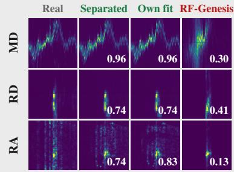

Person of 142 in scene of 144  
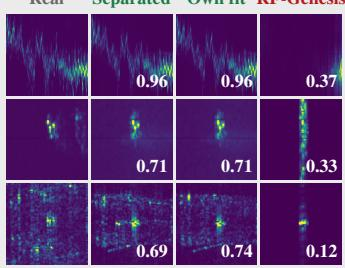

Person of 177 in scene of 178  
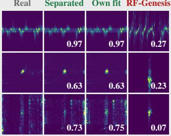

Person of 56 in scene of 46  
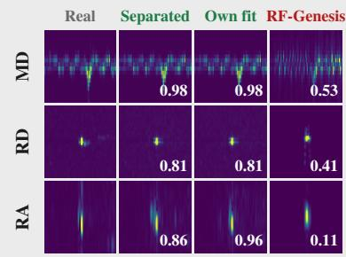

Person of 32 in scene of 22  
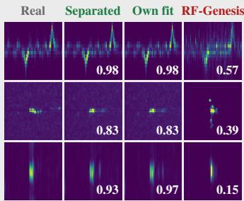

Person of 187 in scene of 186  
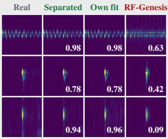  
Figure 5: Separability, RT-Pose (top) and $\bf { H u P R ^ { \prime } s }$ horizontal board (bottom). Each block renders the person of one recording in the fitted scene of another recording of the same environment. Columns: the recording (Real), the person’s complete fit rendered in the other scene (Separated), the person’s own fit, and RF-Genesis driven by the same registered motion. Rows, frame, normalization and scores are those of Fig. 3. We chose the pairs by a rule: the renders at the 25th, 50th and 75th percentile of the mean ratio of the separated render’s three panel scores to the own fit’s.

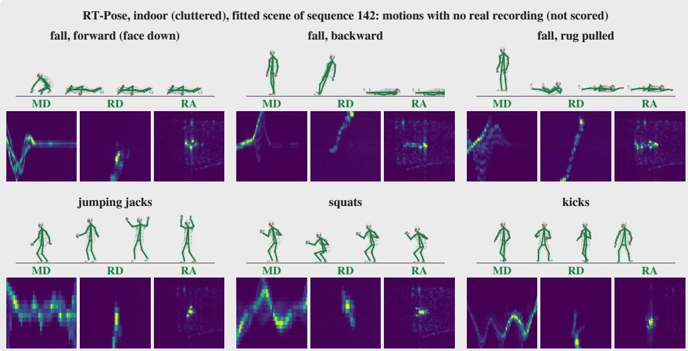  
Figure 6: Novel motions in the fitted scene of RT-Pose sequence 142 (indoor, cluttered) (not scored). Per motion: the posed mesh at four evenly spaced frames, seen from 45◦ between the radar’s view and the side, above the rendered micro-Doppler over the whole clip (time across, radial velocity up) and the rendered range–Doppler and range–azimuth at the clip’s frame of largest pelvis speed (range across, over the person’s range ±2 m). Panels are linear magnitude normalized to their own range, as in Fig. 3. Falls: forward and backward generated by MDM (Tevet et al., 2023), the fall from a pulled rug from CMU (Mahmood et al., 2019); exercises from CMU.

What the figures show. Figs. 6–10 render 6 motions in each of 5 fitted scenes. These motions have no real recording, so we cannot score them. We show them as a capability for data augmentation, not as a result.

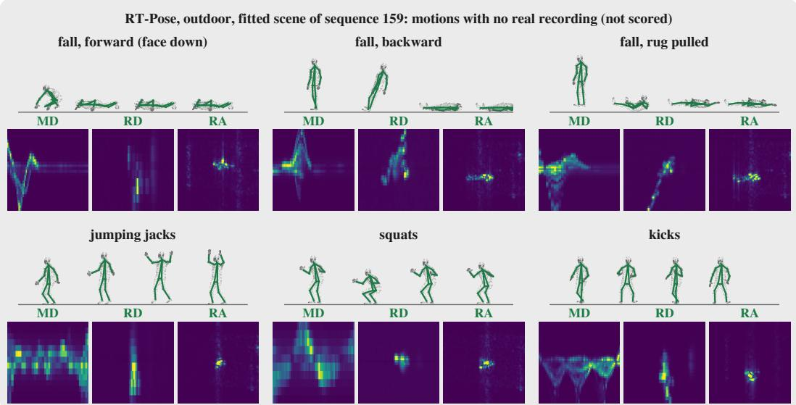  
Figure 7: Novel motions in the fitted scene of RT-Pose sequence 159 (outdoor) (not scored). Per motion: the posed mesh at four evenly spaced frames, seen from $4 5 ^ { \circ }$ between the radar’s view and the side, above the rendered micro-Doppler over the whole clip (time across, radial velocity up) and the rendered range–Doppler and range–azimuth at the clip’s frame of largest pelvis speed (range across, over the person’s range ±2 m). Panels are linear magnitude normalized to their own range, as in Fig. 3. Falls: forward and backward generated by MDM (Tevet et al., 2023), the fall from a pulled rug from CMU (Mahmood et al., 2019); exercises from CMU.

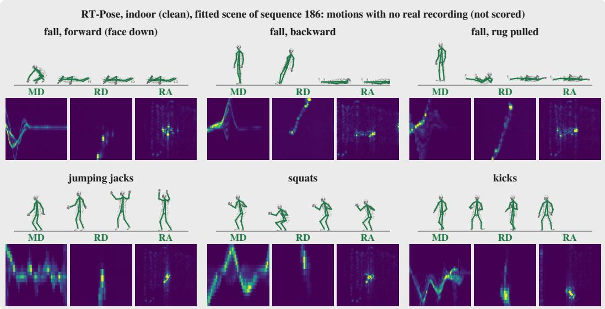  
Figure 8: Novel motions in the fitted scene of RT-Pose sequence 186 (indoor, clean) (not scored). Per motion: the posed mesh at four evenly spaced frames, seen from $4 5 ^ { \circ }$ between the radar’s view and the side, above the rendered micro-Doppler over the whole clip (time across, radial velocity up) and the rendered range–Doppler and range–azimuth at the clip’s frame of largest pelvis speed (range across, over the person’s range ±2 m). Panels are linear magnitude normalized to their own range, as in Fig. 3. Falls: forward and backward generated by MDM (Tevet et al., 2023), the fall from a pulled rug from CMU (Mahmood et al., 2019); exercises from CMU.

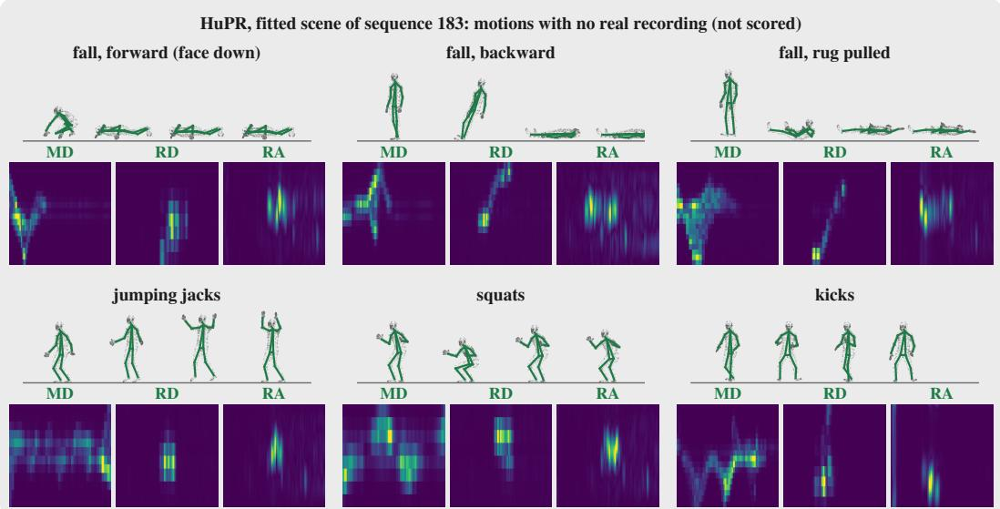  
Figure 9: Novel motions in the fitted scene of HuPR sequence 183 (horizontal board) (not scored). Per motion: the posed mesh at four evenly spaced frames, seen from $4 5 ^ { \circ }$ between the radar’s view and the side, above the rendered micro-Doppler over the whole clip (time across, radial velocity up) and the rendered range–Doppler and range–azimuth at the clip’s frame of largest pelvis speed (range across, over the person’s range ±2 m). Panels are linear magnitude normalized to their own range, as in Fig. 3. Falls: forward and backward generated by MDM (Tevet et al., 2023), the fall from a pulled rug from CMU (Mahmood et al., 2019); exercises from CMU.

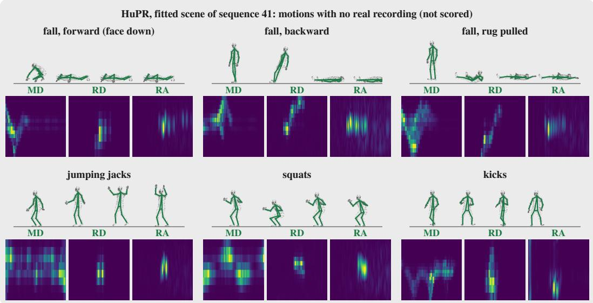  
Figure 10: Novel motions in the fitted scene of HuPR sequence 41 (horizontal board) (not scored). Per motion: the posed mesh at four evenly spaced frames, seen from $4 5 ^ { \circ }$ between the radar’s view and the side, above the rendered micro-Doppler over the whole clip (time across, radial velocity up) and the rendered range–Doppler and range–azimuth at the clip’s frame of largest pelvis speed (range across, over the person’s range $\pm 2 \mathrm { m } )$ . Panels are linear magnitude normalized to their own range, as in Fig. 3. Falls: forward and backward generated by MDM (Tevet et al., 2023), the fall from a pulled rug from CMU (Mahmood et al., 2019); exercises from CMU.

## H ABLATIONS, RUNTIME, AND PEAK MEMORY

## H.1 ABLATIONS

Is every term ofthe objective necessary? Four terms at unit weight invite the question. We therefore remove each global term alone and the two windowed terms together. The windowed pair shares one window and one scope, the person’s box, so we remove it as one unit. We expect the global loop-0 term to matter most. The plane terms exclude DC and the windowed pair reaches only the person’s box, so the global loop-0 term is the only term that reaches the whole static scene. Each variant multiplies the removed terms by zero inside the loss and re-fits the renderer once per sequence, with everything else at the default configuration (the same epochs, person inputs, scaffolds and seed). The “None” row is not a re-fit. It is the render Table 2 reports, and it reproduces Table 2 and Tables 7– 10 cell for cell. We judge each variant twice. Reconstruction is scored over Table 2’s sequences (HuPR 235 per board, RT-Pose 63 one-person). The gap to real, rendered-to-real minus real-to-real paired per sequence, is read through the four real-trained seeds that Table 3 reports, and only on the test splits (HuPR 21, RT-Pose 13 sequences), because the real-trained models are in-sample on every other sequence. We also count, per sequence and radar, how often a variant scores worse or better than the “None” row by more than a threshold. The threshold is 0.01 on bounded scores (correlations, SSIM, clDice and the phase coherences), 2% of the “None” value on the others, and 1 cm or one AP point on the gap. We fit one renderer seed, because sequences rather than seeds are the axis we generalize over. Only the medians and the paired counts are therefore interpretable, never a single sequence.

Every term carries part of the fit, but not the same part. Table 20 summarizes the three variants, and Tables 21–24 report them on every metric of Tables 7–10. The global loop-0 term carries the static scene, the global per-plane term carries the noise floor and the Doppler structure, and the windowed pair carries a smaller share on the person’s cells. None of the three can be removed without a measurable cost somewhere in that metric set.

The global loop-0 term carries the static scene. Without it, the median of every magnitude column of every representation falls on every radar. Range–azimuth $\rho$ falls from 0.960 to 0.646 on H and from 0.830 to 0.141 on C, worse on 235 of 235 and 63 of 63 sequences. The CRP ρ falls from 0.856 to 0.667 on H and from 0.735 to 0.227 on C, again worse on 235 of 235 and 63 of 63. The columns scored after static clutter removal do not move. RD $\rho _ { M }$ reads 0.697 against 0.695 on C and micro-Doppler $\rho _ { S }$ 0.968 against 0.966, and the floor ratios match the “None” row. The two gaps differ. RT-Pose’s gap grows from 2.00 to 174.26 cm, worse on 13 of 13 test sequences, while HuPR’s reads 16.5 against 16.4 AP (9 worse, 5 better). HuPR’s released preprocessing removes static clutter over loops before its model reads the heatmaps, so the static scene this term fits never reaches the HuPR model, while HRRadarPose reads it.

The global per-plane term carries the noise floor and the Doppler structure. Without it, the floor level $L _ { U }$ falls on every radar, from 0.92 to 0.79 on H (worse on 213 of 235), from 0.92 to 0.80 on V and from 0.96 to 0.86 on C. The floor spread $\sigma _ { U }$ on C moves away from 1, from 0.94 to 1.33. RD $\rho _ { M }$ falls on every radar, worse on 91 of 235 sequences on H and 53 of 63 on C, and RT-Pose’s micro-Doppler $\rho _ { S }$ falls from 0.966 to 0.957 (worse on 29 of 61). SSIM on the CRP and range–azimuth maps also falls on both HuPR boards, worse on 188 and 177 of 235 sequences on H. The geometry does not move. Range–azimuth $\rho$ reads 0.838 on C, and neither gap separates from the “None” row (HuPR 5 worse and 9 better, RT-Pose 4 and 2). The term therefore fits the floor and the Doppler planes, not the geometry.

The windowed pair has the smallest effect, on the person’s cells in the scene. Without it, RT-Pose’s clutter-removed range–azimuth $\rho _ { c }$ falls from 0.470 to 0.444, worse on 51 of 61 sequences, and its RAE $\rho$ from 0.779 to 0.762. HuPR’s gap widens from 16.4 to 17.4 AP (12 test sequences worse, 2 better), while its reconstruction stays at the “None” row, with range–azimuth $\rho$ at 0.960 on H. RT-Pose’s gap does not separate (2 worse, 2 better). The effect is the smallest of the three, and it rests on paired counts from one renderer seed.

The phase-coherence columns $( \Delta \phi _ { t } , \Delta \phi _ { r } , \Delta \phi _ { v } )$ do not separate the variants in a consistent direction, so we do not read them as evidence for or against any term.

Table 20: Objective ablation, summary. Each row removes the named terms of Eq. (4) and re-fits the renderer, with everything else at the default configuration (setup in App. H.1). “None” is the render Table 2 reports, not a re-fit. $\rho$ is the median range–azimuth correlation and $\rho _ { S }$ the median micro-Doppler spectrogram correlation, over Table $2 \mathrm { { : } }$ sequences (HuPR both boards pooled). $\Delta$ is the median per-sequence gap to real on the test splits, read through the real-trained seeds of Table 3. On HuPR it is real-to-real minus rendered-to-real AP, and on RT-Pose rendered-to-real minus realto-real MPJPE and MRPE in cm, so a larger $\Delta$ is a worse render. W/B counts the test sequences whose $\Delta$ is worse / better than the “None” row’s by more than one AP point or 1 cm (MPJPE). One renderer seed. Tables 21–24 give every metric per radar.
<table><tr><td></td><td colspan="4">HuPR</td><td colspan="5">RT-Pose</td></tr><tr><td>Term removed</td><td> $\rho \uparrow$ </td><td></td><td>ρs↑ ∆(AP)↓</td><td>W/B</td><td> $\rho \uparrow$ </td><td> $\rho _ { S } \uparrow$ </td><td>∆ MPJPE↓</td><td>∆ MRPE↓</td><td>W/B</td></tr><tr><td>None (full objective)</td><td>0.940</td><td>0.988</td><td>16.4</td><td>一</td><td>0.830</td><td>0.966</td><td>2.00</td><td>0.47</td><td>一</td></tr><tr><td> $- \mathcal { L } _ { \mathrm { R A E } , 0 }$  (global, loop 0)</td><td>0.485</td><td>0.989</td><td>16.5</td><td>9/5</td><td>0.141</td><td>0.968</td><td>174.26</td><td>262.43</td><td>13/0</td></tr><tr><td> $- \mathcal { L } _ { \mathrm { R A E , p l } }$  (global, per plane)</td><td>0.941</td><td>0.986</td><td>16.7</td><td>5/9</td><td>0.838</td><td>0.957</td><td>2.30</td><td>1.21</td><td>4/2</td></tr><tr><td> $- ( \mathcal { L } _ { \mathrm { R A E } , 0 } ^ { \mathrm { w i n } } + \mathcal { L } _ { \mathrm { R A E } , \mathrm { p l } } ^ { \mathrm { w i n } } )$  (windowed)</td><td>0.941</td><td>0.989</td><td>17.4</td><td>12/2</td><td>0.828</td><td>0.970</td><td>1.08</td><td>0.88</td><td>2/2</td></tr></table>

Table 21: Objective ablation on the ADC samples. Columns as Table $7 \ : ( \rho _ { \mathrm { e n v } }$ the envelope correlation after the rank-1 phase correction, $\Delta \phi _ { t }$ the fast-time relative-phase coherence with its weighted RMSE in degrees); rows as Table 20, over the same sequences (HuPR 235 per board, RT-Pose 63 one-person). Bold: the best value in each column of a row section, by the column’s arrow.
<table><tr><td>Term removed</td><td> $\rho _ { \mathrm { e n v } } \ \uparrow$ </td><td>PSNR↑</td><td>SSIM↑</td><td>RMSE↓</td><td> $\Delta \phi _ { t }$  ↑</td><td> $\Delta \phi _ { t } ( ^ { \circ } ) \downarrow$ </td></tr><tr><td colspan="7">HuPR, horizontal single-chip radar (H)</td></tr><tr><td>None (full objective)</td><td>0.857</td><td>21.2</td><td>0.58</td><td>0.088</td><td>0.55</td><td>63</td></tr><tr><td> $- \mathcal { L } _ { \mathrm { R A E } , 0 }$ </td><td>0.742</td><td>18.4</td><td>0.45</td><td>0.121</td><td>0.63</td><td>56</td></tr><tr><td> $- \mathcal { L } _ { \mathrm { R A E , p l } }$ </td><td>0.856</td><td>21.2</td><td>0.58</td><td>0.088</td><td>0.54</td><td>64</td></tr><tr><td> $- ( \mathcal { L } _ { \mathrm { R A E } , 0 } ^ { \mathrm { w i n } } + \mathcal { L } _ { \mathrm { R A E } , \mathrm { p l } } ^ { \mathrm { w i n } } )$ </td><td>0.856</td><td>21.2</td><td>0.58</td><td>0.088</td><td>0.55</td><td>64</td></tr><tr><td colspan="7">HuPR, vertical single-chip radar (V)</td></tr><tr><td>None (full objective)</td><td>0.772</td><td>19.0</td><td>0.48</td><td>0.114</td><td>0.44</td><td>72</td></tr><tr><td> $- \mathcal { L } _ { \mathrm { R A E } , 0 }$ </td><td>0.668</td><td>16.1</td><td>0.35</td><td>0.157</td><td>0.56</td><td>62</td></tr><tr><td> $- \mathcal { L } _ { \mathrm { R A E , p l } }$ </td><td>0.773</td><td>19.0</td><td>0.48</td><td>0.113</td><td>0.45</td><td>72</td></tr><tr><td> $- ( \mathcal { L } _ { \mathrm { R A E } , 0 } ^ { \mathrm { w i n } } + \mathcal { L } _ { \mathrm { R A E } , \mathrm { p l } } ^ { \mathrm { w i n } } )$ </td><td>0.776</td><td>19.0</td><td>0.48</td><td>0.114</td><td>0.45</td><td>72</td></tr><tr><td colspan="7">RT-Pose, cascade (C), one-person sequences</td></tr><tr><td>None (full objective)</td><td>0.667</td><td>20.0</td><td>0.32</td><td>0.100</td><td>0.24</td><td>88</td></tr><tr><td> $- \mathcal { L } _ { \mathrm { R A E } , 0 }$ </td><td>0.596</td><td>18.2</td><td>0.26</td><td>0.123</td><td>0.27</td><td>85</td></tr><tr><td> $- \mathcal { L } _ { \mathrm { R A E , p l } }$ </td><td>0.668</td><td>20.2</td><td>0.33</td><td>0.098</td><td>0.24</td><td>87</td></tr><tr><td> $- ( \mathcal { L } _ { \mathrm { R A E } , 0 } ^ { \mathrm { w i n } } + \mathcal { L } _ { \mathrm { R A E } , \mathrm { p l } } ^ { \mathrm { w i n } } )$ </td><td>0.658</td><td>20.0</td><td>0.31</td><td>0.101</td><td>0.23</td><td>89</td></tr></table>

Table 22: Objective ablation on the complex range profile (CRP). Columns as Table 8 $( \Delta \phi _ { r }$ and $\Delta \phi _ { v }$ the relative-phase coherences along range and virtual channel, each with its weighted RMSE in degrees); rows, sequences and bold as Table 21.
<table><tr><td>Term removed</td><td> $\rho \uparrow$ </td><td>PSNR↑</td><td>SSIM↑</td><td>RMSE↓</td><td> $\Delta \phi _ { r } \ \uparrow$ </td><td> $\Delta \phi _ { r } ( ^ { \circ } ) \downarrow$ </td><td> $\Delta \phi _ { v }$  ↑</td><td> $\Delta \phi _ { v } \ : ( ^ { \circ } ) \downarrow$ </td></tr><tr><td colspan="9">HuPR, horizontal single-chip radar (H)</td></tr><tr><td>None (full objective)</td><td>0.856</td><td>26.0</td><td>0.65</td><td>0.052</td><td>0.66</td><td>56</td><td>0.75</td><td>48</td></tr><tr><td> $- \mathcal { L } _ { \mathrm { R A E } , 0 }$ </td><td>0.667</td><td>22.4</td><td>0.44</td><td>0.076</td><td>0.64</td><td>58</td><td>0.66</td><td>57</td></tr><tr><td> $- \mathcal { L } _ { \mathrm { R A E , p l } }$ </td><td>0.850</td><td>25.9</td><td>0.62</td><td>0.052</td><td>0.65</td><td>56</td><td>0.75</td><td>48</td></tr><tr><td> $- ( \mathcal { L } _ { \mathrm { R A E } , 0 } ^ { \mathrm { w i n } } + \mathcal { L } _ { \mathrm { R A E } , \mathrm { p l } } ^ { \mathrm { w i n } } )$ </td><td>0.854</td><td>26.0</td><td>0.65</td><td>0.052</td><td>0.64</td><td>57</td><td>0.75</td><td>48</td></tr><tr><td colspan="9">HuPR, vertical single-chip radar (V)</td></tr><tr><td>None (full objective)</td><td>0.785</td><td>24.8</td><td>0.56</td><td>0.061</td><td>0.55</td><td>65</td><td>0.47</td><td>71</td></tr><tr><td> $- \mathcal { L } _ { \mathrm { R A E } , 0 }$ </td><td>0.491</td><td>20.6</td><td>0.26</td><td>0.095</td><td>0.57</td><td>63</td><td>0.49</td><td>69</td></tr><tr><td> $- \mathcal { L } _ { \mathrm { R A E , p l } }$ </td><td>0.789</td><td>24.8</td><td>0.52</td><td>0.061</td><td>0.55</td><td>65</td><td>0.48</td><td>71</td></tr><tr><td> $- ( \mathcal { L } _ { \mathrm { R A E } , 0 } ^ { \mathrm { w i n } } + \mathcal { L } _ { \mathrm { R A E } , \mathrm { p l } } ^ { \mathrm { w i n } } )$ </td><td>0.788</td><td>24.8</td><td>0.56</td><td>0.060</td><td>0.55</td><td>65</td><td>0.48</td><td>71</td></tr><tr><td colspan="9">RT-Pose, cascade (C), one-person sequences</td></tr><tr><td>None (full objective)</td><td>0.735</td><td>28.2</td><td>0.76</td><td>0.039</td><td>0.50</td><td>68</td><td>0.33</td><td>82</td></tr><tr><td> $- \mathcal { L } _ { \mathrm { R A E } , 0 }$ </td><td>0.227</td><td>23.7</td><td>0.52</td><td>0.066</td><td>0.53</td><td>66</td><td>0.27</td><td>85</td></tr><tr><td> $- \mathcal { L } _ { \mathrm { R A E , p l } }$ </td><td>0.739</td><td>28.4</td><td>0.75</td><td>0.038</td><td>0.51</td><td>68</td><td>0.33</td><td>82</td></tr><tr><td> $- ( \mathcal { L } _ { \mathrm { R A E } , 0 } ^ { \mathrm { w i n } } + \mathcal { L } _ { \mathrm { R A E } , \mathrm { p l } } ^ { \mathrm { w i n } } )$ </td><td>0.727</td><td>27.9</td><td>0.73</td><td>0.041</td><td>0.51</td><td>69</td><td>0.33</td><td>82</td></tr></table>

Table 23: Objective ablation on range–angle and range–azimuth–elevation (RAE). Columns as Table ${ 9 } ;$ rows, sequences and bold as Table 21. Every row is a 4DPS render, which carries an absolute scale, so SSIM, NRMSE and PSNR are scored directly, without the level matching that RF-Genesis needs.
<table><tr><td></td><td colspan="5">Range-angle</td><td colspan="4">RAE</td></tr><tr><td>Term removed</td><td> $\rho \uparrow$ </td><td> $\rho _ { c } \uparrow$ </td><td>SSIM↑</td><td>NRMSE↓</td><td>PSNR↑</td><td> $\rho \uparrow$ </td><td>SSIM↑</td><td>NRMSE↓</td><td>PSNR↑</td></tr><tr><td colspan="10">HuPR, horizontal single-chip radar (H)</td></tr><tr><td>None (full objective)</td><td>0.960 0.699</td><td></td><td>0.79</td><td>0.28</td><td>34.0</td><td>0.942</td><td>0.80</td><td>0.33</td><td>33.3</td></tr><tr><td> $- \mathcal { L } _ { \mathrm { R A E } , 0 }$ </td><td>0.646</td><td>0.456</td><td>0.67</td><td>1.60</td><td>19.0</td><td>0.628</td><td>0.66</td><td>1.87</td><td>18.7</td></tr><tr><td> $- \mathcal { L } _ { \mathrm { R A E , p l } }$ </td><td>0.960</td><td>0.696</td><td>0.77</td><td>0.28</td><td>34.0</td><td>0.941</td><td>0.78</td><td>0.33</td><td>33.2</td></tr><tr><td> $- ( \mathcal { L } _ { \mathrm { R A E } , 0 } ^ { \mathrm { w i n } } + \mathcal { L } _ { \mathrm { R A E } , \mathrm { p l } } ^ { \mathrm { w i n } } )$ </td><td>0.960</td><td>0.690</td><td>0.79</td><td>0.28</td><td>34.1</td><td>0.942</td><td>0.80</td><td>0.32</td><td>33.3</td></tr><tr><td colspan="10">HuPR, vertical single-chip radar (V)</td></tr><tr><td>None (full objective)</td><td>0.925</td><td>0.622</td><td>0.67</td><td>0.38</td><td>30.2</td><td>0.904</td><td>0.72</td><td>0.40</td><td>30.7</td></tr><tr><td> $- \mathcal { L } _ { \mathrm { R A E } , 0 }$ </td><td>0.337</td><td>0.126</td><td>0.56</td><td>10.23</td><td>1.6</td><td>0.349</td><td>0.56</td><td>11.71</td><td>1.7</td></tr><tr><td> $- \mathcal { L } _ { \mathrm { R A E , p l } }$ </td><td>0.926</td><td>0.618</td><td>0.65</td><td>0.38</td><td>30.2</td><td>0.905</td><td>0.70</td><td>0.40</td><td>30.7</td></tr><tr><td> $- ( \mathcal { L } _ { \mathrm { R A E } , 0 } ^ { \mathrm { w i n } } + \mathcal { L } _ { \mathrm { R A E } , \mathrm { p l } } ^ { \mathrm { w i n } } )$ </td><td>0.925</td><td>0.615</td><td>0.67</td><td>0.38</td><td>30.2</td><td>0.904</td><td>0.72</td><td>0.40</td><td>30.8</td></tr><tr><td colspan="10">RT-Pose, cascade (C), one-person sequences</td></tr><tr><td>None (full objective)</td><td>0.830</td><td>0.470</td><td>0.78</td><td>0.53</td><td>31.8</td><td>0.779</td><td>0.81</td><td>0.58</td><td>31.9</td></tr><tr><td> $- \mathcal { L } _ { \mathrm { R A E } , 0 }$ </td><td>0.141</td><td>0.166</td><td>0.65</td><td>7.79</td><td>9.9</td><td>0.125</td><td>0.65</td><td>7.08</td><td>11.7</td></tr><tr><td> $- \mathcal { L } _ { \mathrm { R A E , p l } }$ </td><td>0.838</td><td>0.473</td><td>0.77</td><td>0.52</td><td>31.9</td><td>0.785</td><td>0.80</td><td>0.58</td><td>31.9</td></tr><tr><td> $- ( \mathcal { L } _ { \mathrm { R A E , 0 } } ^ { \mathrm { w i n } } + \mathcal { L } _ { \mathrm { R A E , p l } } ^ { \mathrm { w i n } } )$ </td><td>0.828</td><td>0.444</td><td>0.77</td><td>0.53</td><td>31.7</td><td>0.762</td><td>0.81</td><td>0.59</td><td>31.9</td></tr></table>

Table 24: Objective ablation on range–Doppler (RD) and micro-Doppler. Columns as Table 10 $( P _ { M }$ the rendered-over-real power ratio on the CFAR-occupied cells, $L _ { U }$ and $\sigma _ { U }$ the level and spread ratios on the unoccupied ones, $\rho _ { \mathrm { e n v } }$ the Doppler-envelope correlation, BW the envelope separation, clDice the connectivity of the segmented signatures); rows, sequences and bold as Table 21. Every row is a 4DPS render, which carries an absolute scale, so $P _ { M }$ $L _ { U }$ and $\sigma _ { U }$ are scored directly, without the level matching that RF-Genesis needs.
<table><tr><td></td><td colspan="2">RD occupied</td><td colspan="2">RD floor</td><td colspan="7">Micro-Doppler</td></tr><tr><td>Term removed</td><td>ρM ↑</td><td> $P _ { M } \to 1$ </td><td> $L \sigma \to 1$ </td><td> $\sigma \sigma  1$ </td><td>ρµ ↑</td><td> $\rho _ { \sigma } \uparrow$ </td><td>ρs ↑</td><td> $\rho _ { \mathrm { e n v } }$ </td><td>↑ BW→1</td><td>clDice↑</td></tr><tr><td colspan="9">HuPR, horizontal single-chip radar (H)</td><td></td><td></td></tr><tr><td>None (full objective)</td><td>0.891</td><td>0.71</td><td>0.92</td><td>0.88</td><td>1.00</td><td>0.98</td><td>0.993</td><td>0.87</td><td>0.87</td><td>0.91</td></tr><tr><td> $- \mathcal { L } _ { \mathrm { R A E } , 0 }$ </td><td>0.892</td><td>0.70</td><td>0.92</td><td>0.88</td><td>1.00</td><td>0.98</td><td>0.993</td><td>0.87</td><td>0.87</td><td>0.91</td></tr><tr><td> $- \mathcal { L } _ { \mathrm { R A E , p l } }$ </td><td>0.878</td><td>0.69</td><td>0.79</td><td>0.94</td><td>1.00</td><td>0.98</td><td>0.993</td><td>0.87</td><td>0.87</td><td>0.90</td></tr><tr><td> $- ( \mathcal { L } _ { \mathrm { R A E } , 0 } ^ { \mathrm { w i n } ^ { \ A } } + \mathcal { L } _ { \mathrm { R A E } , \mathrm { p l } } ^ { \mathrm { w i n } } )$ </td><td>0.894</td><td>0.71</td><td>0.92</td><td>0.88</td><td>1.00</td><td>0.98</td><td>0.994</td><td>0.88</td><td>0.88</td><td>0.91</td></tr><tr><td colspan="9">HuPR, vertical single-chip radar (V)</td><td></td><td></td></tr><tr><td>None (full objective)</td><td>0.795</td><td>0.54</td><td>0.92</td><td>0.88</td><td>0.99</td><td>0.94</td><td>0.984</td><td>0.80</td><td>0.79</td><td>0.83</td></tr><tr><td> $- \mathcal { L } _ { \mathrm { R A E } , 0 }$ </td><td>0.796</td><td>0.54</td><td>0.92</td><td>0.88</td><td>0.99</td><td>0.94</td><td>0.984</td><td>0.81</td><td>0.79</td><td>0.83</td></tr><tr><td> $- \mathcal { L } _ { \mathrm { R A E , p l } }$ </td><td>0.781</td><td>0.54</td><td>0.80</td><td>1.07</td><td>0.99</td><td>0.94</td><td>0.982</td><td>0.80</td><td>0.78</td><td>0.83</td></tr><tr><td> $- ( \mathcal { L } _ { \mathrm { R A E } , 0 } ^ { \mathrm { w i n } } + \mathcal { L } _ { \mathrm { R A E } , \mathrm { p l } } ^ { \mathrm { w i n } } )$ </td><td>0.800</td><td>0.54</td><td>0.92</td><td>0.88</td><td>0.99</td><td>0.95</td><td>0.985</td><td>0.81</td><td>0.79</td><td>0.83</td></tr><tr><td colspan="9">RT-Pose, cascade (C), one-person sequences</td><td></td><td></td></tr><tr><td>None (full objective)</td><td>0.695</td><td>0.63</td><td>0.96</td><td>0.94</td><td>0.97</td><td>0.70</td><td>0.966</td><td>0.65</td><td>0.71</td><td>0.71</td></tr><tr><td> $- \mathcal { L } _ { \mathrm { R A E } , 0 }$ </td><td>0.697</td><td>0.63</td><td>0.96</td><td>0.94</td><td>0.97</td><td>0.69</td><td>0.968</td><td>0.63</td><td>0.71</td><td>0.71</td></tr><tr><td> $- \mathcal { L } _ { \mathrm { R A E , p l } }$ </td><td>0.677</td><td>0.64</td><td>0.86</td><td>1.33</td><td>0.96</td><td>0.69</td><td>0.957</td><td>0.67</td><td>0.72</td><td>0.70</td></tr><tr><td> $- ( \mathcal { L } _ { \mathrm { R A E } , 0 } ^ { \mathrm { w i n } } + \mathcal { L } _ { \mathrm { R A E } , \mathrm { p l } } ^ { \mathrm { w i n } } )$ </td><td>0.695</td><td>0.60</td><td>0.95</td><td>0.93</td><td>0.98</td><td>0.71</td><td>0.970</td><td>0.63</td><td>0.71</td><td>0.71</td></tr></table>

## H.2 RUNTIME AND PEAK MEMORY

This subsection reports what the two experiments cost in time and in GPU memory: reconstructing every sequence (Sec. 4.1) with 4DPS, its unfit render and RF-Genesis, and training the downstream models (Sec. 4.2). Every timing in Tables 25 and 26 is a wall time from the run that produced the paper’s numbers, one sequence or one training per GPU, for 4DPS and for RF-Genesis alike. The 4DPS fits, the unfit renders and every downstream training, including those on RF-Genesis’s renders, ran on NVIDIA H100 GPUs. A 4DPS fit’s time runs from the person stage through the 400-epoch velocity and material fit to the render and its evaluation, and excludes the scene preprocessing it inherits (App. B.1). The unfit render runs the same stages with no fit. RF-Genesis’s time covers its mesh export, its ray-cast simulation, the representations computed from the simulated cube and their scoring against the recording.

Table 25: Reconstruction cost (Sec. 4.1): the median wall time per sequence and the total over the corpus. RT-Pose’s unfit render covers the 57 split sequences it is scored on. The 4DPS step is the median over sequences of the training step’s median. RF-Genesis ran on RTX 4090s and 4DPS on H100s, so the two methods’ times are not a like-for-like speed comparison.
<table><tr><td>Data</td><td>Method</td><td>GPU</td><td>Sequences</td><td>Per sequence (min)</td><td>Total (GPU-h)</td><td>Step (ms)</td></tr><tr><td rowspan="3">HuPR</td><td>4DPS</td><td>H100</td><td>235</td><td>5.7</td><td>22.3</td><td>19.4</td></tr><tr><td>4DPS (unfit)</td><td>H100</td><td>235</td><td>1.5</td><td>5.9</td><td></td></tr><tr><td>RF-Genesis</td><td>RTX 4090</td><td>235</td><td>5.3</td><td>21.0</td><td>一</td></tr><tr><td rowspan="3">RT-Pose</td><td>4DPS</td><td>H100</td><td>100</td><td>12.9</td><td>21.6</td><td>19.3</td></tr><tr><td>4DPS (unfit)</td><td>H100</td><td>57</td><td>1.9</td><td>1.9</td><td></td></tr><tr><td>RF-Genesis</td><td>RTX 4090</td><td>100</td><td>6.0</td><td>10.6</td><td>一</td></tr></table>

Downstream training (Sec. 4.2). Table 26 gives the cost of one training per H100 at the protocol’s fixed schedule, for every arm of Table 3. The real arm is shared: the RF-Genesis arms were compared against the same four real trainings, which were not retrained. A training’s time is the sum over epochs of its training time, plus the per-epoch validation on HuPR.

Peak memory. Table 27 gives the peak GPU memory of each stage, and its caption says which counter each cell reads. The largest 4DPS fit allocates 19.6 GiB at its peak.

Table 26: Downstream training cost (Sec. 4.2): hours per training, mean (std) over the four seeds, and the total over the four seeds. Every training ran on one H100. Evaluating Table 3’s five cells over the four seeds adds 0.5 (4DPS) and 0.5 (RF-Genesis) GPU-h on HuPR, and 0.7 and 0.7 on RT-Pose.
<table><tr><td></td><td></td><td></td><td colspan="3">HuPR</td><td colspan="3">RT-Pose</td></tr><tr><td>Arm</td><td>Renderer</td><td>GPU</td><td>h / training</td><td>Epochs</td><td>GPU-h</td><td>h / training</td><td>Epochs</td><td>GPU-h</td></tr><tr><td>Real</td><td>none (real)</td><td>H100</td><td>6.8 (0.1)</td><td>200</td><td>27.1</td><td>6.5 (0.1)</td><td>50</td><td>26.2</td></tr><tr><td>Rendered</td><td>4DPS</td><td>H100</td><td>6.7 (0.0)</td><td>200</td><td>26.8</td><td>8.4 (0.0)</td><td>50</td><td>33.7</td></tr><tr><td>Mixed</td><td>4DPS</td><td>H100</td><td>6.7 (0.0)</td><td>200</td><td>26.9</td><td>8.2 (0.2)</td><td>50</td><td>32.9</td></tr><tr><td>Rendered</td><td>RF-Genesis</td><td>H100</td><td>6.7 (0.0)</td><td>200</td><td>26.7</td><td>7.7 (0.1)</td><td>50</td><td>31.0</td></tr><tr><td>Mixed</td><td>RF-Genesis</td><td>H100</td><td>6.7 (0.0)</td><td>200</td><td>26.7</td><td>7.9 (0.3)</td><td>50</td><td>31.5</td></tr></table>

Table 27: Peak GPU memory (GiB): the median and the maximum over sequences for reconstruction, and the maximum over the four seeds for training. Every 4DPS cell and every training cell is PyTorch’s allocator peak (max memory allocated), as the 4DPS runs record it per sequence and RT-Pose’s trainer logs it; the reserved pool is larger. The RF-Genesis reconstruction cells are instead the card-level peak from nvidia-smi, because its ray tracer allocates memory outside PyTorch (PyTorch alone records 1.1 and 1.6 GiB), so they are not the same quantity as the 4DPS cells. The cells marked † were measured separately from the runs that produced the paper’s numbers, with the same code, protocol and data: RF-Genesis as the maximum over the shortest, median and longest sequence of each dataset on an RTX 4090, and HuPR training over 300 steps and one validation pass per arm on an H100; the 5 HuPR arms are identical (21.9 GiB at card level).
<table><tr><td rowspan="2">Stage</td><td rowspan="2">Method / arm</td><td rowspan="2">GPU</td><td colspan="2">HuPR</td><td colspan="2">RT-Pose</td></tr><tr><td>median</td><td>max</td><td>median</td><td>max</td></tr><tr><td rowspan="2">Reconstruction (Sec. 4.1)</td><td>4DPS</td><td>H100</td><td>5.7</td><td>6.7</td><td>18.7</td><td>19.6</td></tr><tr><td>RF-Genesis</td><td>RTX 4090</td><td></td><td>3.3†</td><td></td><td>10.8†</td></tr><tr><td rowspan="5">Training (Sec. 4.2)</td><td>real</td><td>H100</td><td></td><td>14.9†</td><td></td><td>11.2</td></tr><tr><td>4DPS rendered</td><td>H100</td><td></td><td>14.9†</td><td></td><td>11.2</td></tr><tr><td>4DPS mixed</td><td>H100</td><td></td><td>14.9†</td><td></td><td>11.2</td></tr><tr><td>RF-Genesis rendered</td><td>H100</td><td></td><td>14.9†</td><td></td><td>11.2</td></tr><tr><td>RF-Genesis mixed</td><td>H100</td><td></td><td>14.9†</td><td></td><td>11.2</td></tr></table>

The training step. Three decisions make a corpus-scale fit affordable. First, the step has no datadependent shape and no host synchronization: the path count is fixed per step and the loss chain and frames are batched, so the whole training step is captured once as a CUDA graph and replayed. Second, the forward model runs in fused CUDA kernels with hand-written backward passes, and the Doppler-plane amplitudes are evaluated in closed form (Eq. (16)). Third, everything in Eq. (3) that does not read a normal or a material is cached per frame, for the scene and for the person’s paths, and the person’s paths are sorted once per frame by their target cell, so each accumulator cell is one contiguous run summed without atomics.

## I LIMITATIONS

Single-bounce transport, and one mover. As in prior radar splatting (Armouti et al., 2026a; Kung et al., 2025), we render the single-bounce path from each transmitter to a point and back, so the returns that reach a receiver only after reflecting off a second surface are absent from every product. Only the subject moves: the scene is fitted once per sequence and held static, and one person is modeled, because RT-Pose annotates the pose of only one person in its multi-person sequences. Its 37 two-person sequences are therefore fitted against the annotated person alone, and the paper reports results on the one-person sequences.

Motion and labels come from the video’s body model. Each point’s velocity stays within a bounded residual of the kinematics the monocular body model supplies, and the skeleton comes from that model, never from a radar label. The fit therefore corrects the video’s motion rather than recovering it independently: a limb the body model misplaces beyond the bound is a limb the radar term cannot invent, and the bound is what keeps the Doppler fit from absorbing scaffold error as spurious velocity. RT-Pose’s labels are derived on every radar frame from the same registered mesh that drives the render, with the released-label result reported beside them (App. E).

Elevation is the weakest axis. The scaffold reconstructs elevation least well of the three spatial axes, because it is built from a monocular depth or LiDAR scene and a body model rather than measured by the radar. The products that resolve elevation are therefore the harder ones, which is why HuPR’s vertical board and the RT-Pose cascade score below HuPR’s horizontal board throughout Sec. 4.1. Two of HuPR’s encoder taps are also undefined in the representation analysis, because the temporal merges feeding them are denormal in some trained checkpoints (App. F).

No fitted baseline exists to compare against. No public radar simulator takes a capture as input, so RF-Genesis is driven forward from the registered motion rather than fitted to the recording we score against. The comparison that carries Sec. 4.1 is therefore against our own unfit render, which isolates what the radar fit adds over the camera but cannot show what a competing fitted renderer would achieve. The survey in App. C.2 records that this is a property of the field rather than of our selection.

What the equivalence measurements cannot settle. An equivalence claim needs a control that detects a difference of a known size, and the only one we trained is the untrained network. It separates cleanly at the shallowest taps and barely at all at the backbone output and the head, so the pre-registered margin means less the deeper the tap, and we read the two deepest taps as degenerate rather than as passes. We also did not train a second real arm per seed from a shared initialization, so the same-initialization row is read against the different-initialization real–real mean rather than against a reference of its own (App. F).

Rendered features transfer better on one dataset than the other. Freezing each backbone and fitting a fresh linear head on real data recovers most of the rendered arm’s deficit on RT-Pose and about half of it on HuPR (Sec. 4.3). We report the asymmetry rather than explain it: the two datasets differ in radar geometry, in downstream architecture and in label provenance at once, so this evaluation cannot attribute the difference to any one of them.

Most edits are not scored. Fitting an explicit scene is what makes translation, retiming and recomposition possible. One edit, rendering a fitted person in another fitted scene of the same environment, is evaluated in App. G.1; translation, retiming and new motions are not scored, because no real recording exists to compare them against. A corpus of edited sequences is the next step.

## J ADDITIONAL QUALITATIVE RESULTS

Figs. 11–16 show 18 sequences per dataset, six per figure, chosen by a rule fixed before rendering so that they are typical rather than the best: we rank the corpus of Table 2 (HuPR on its horizontal board) by 4DPS fidelity (the mean range–azimuth, range–Doppler and micro-Doppler correlation), keep Fig. 3’s three RT-Pose sequences and the three HuPR test sequences ranked the same way, and add 15 at evenly spaced quantiles of the rest. Columns, frames, normalization, scores and the first three rows follow Fig. 3; the others are range–azimuth–elevation (azimuth × elevation, maximum over the person’s range ±10 bins), the complex range profile (range × virtual channel) and ADC samples (fast-time sample × channel). An undefined score prints as –.

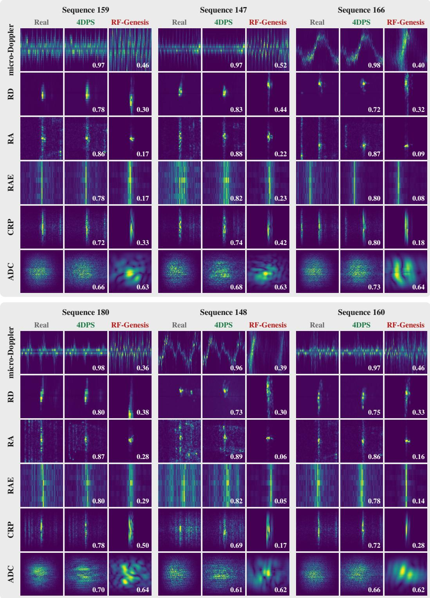  
Figure 11: Qualitative gallery, RT-Pose (1 of 3): sequences 159, 147 and 166 (top) and 180, 148 and 160 (bottom) (4DPS-fidelity ranks 8, 1, 16, 4, 9 and 13 of 63). The top three are the sequences of Fig. 3. Selection rule, rows, columns, frames and scores are given at the start of App. J.

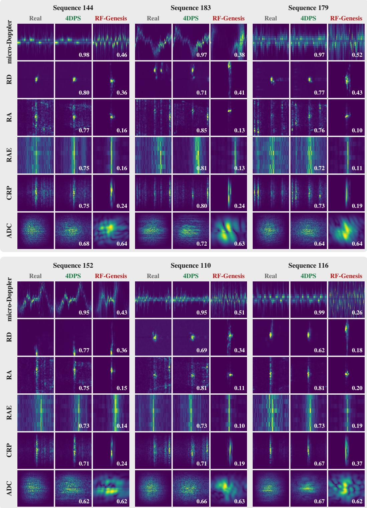  
Figure 12: Qualitative gallery, RT-Pose (2 of 3): sequences 144, 183 and 179 (top) and 152, 110 and 116 (bottom) (4DPS-fidelity ranks 18, 22, 26, 30, 34 and 38 of 63). As Fig. 11.

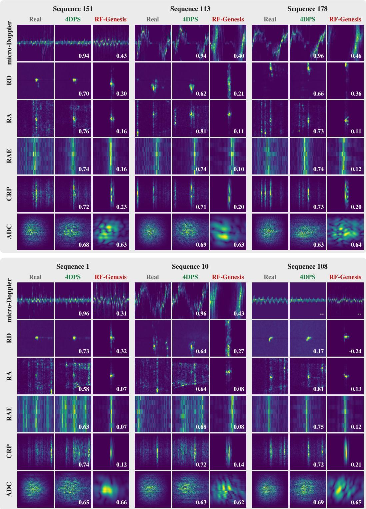  
Figure 13: Qualitative gallery, RT-Pose (3 of 3): sequences 151, 113 and 178 (top) and 1, 10 and 108 (bottom) (4DPS-fidelity ranks 42, 46, 50, 54, 58 and 62 of 63). As Fig. 11.

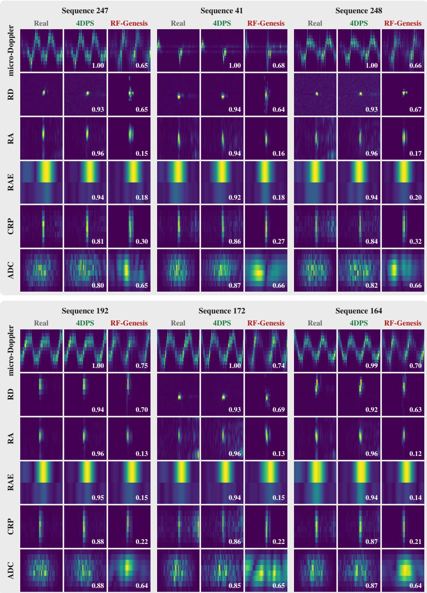  
Figure 14: Qualitative gallery, HuPR, horizontal board (1 of 3): sequences 247, 41 and 248 (top) and 192, 172 and 164 (bottom) (4DPS-fidelity ranks 11, 57, 13, 8, 26 and 41 of 235). The top three are the HuPR test sequences ranked like those of Fig. 3 (4DPS fidelity plus rendered-to-real OKS). A single board resolves elevation poorly, so the range–azimuth–elevation rows are coarse along that axis.

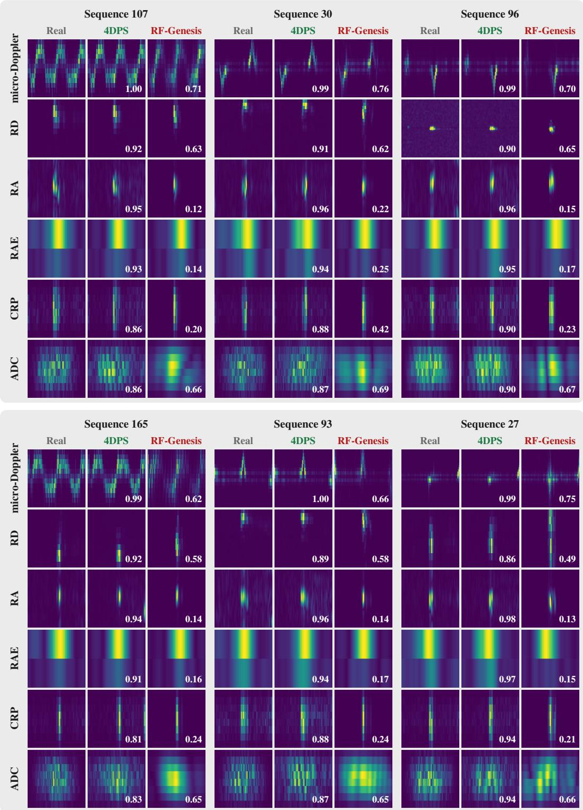  
Figure 15: Qualitative gallery, HuPR, horizontal board (2 of 3): sequences 107, 30 and 96 (top) and 165, 93 and 27 (bottom) (4DPS-fidelity ranks 58, 73, 89, 104, 120 and 135 of 235). As Fig. 14.

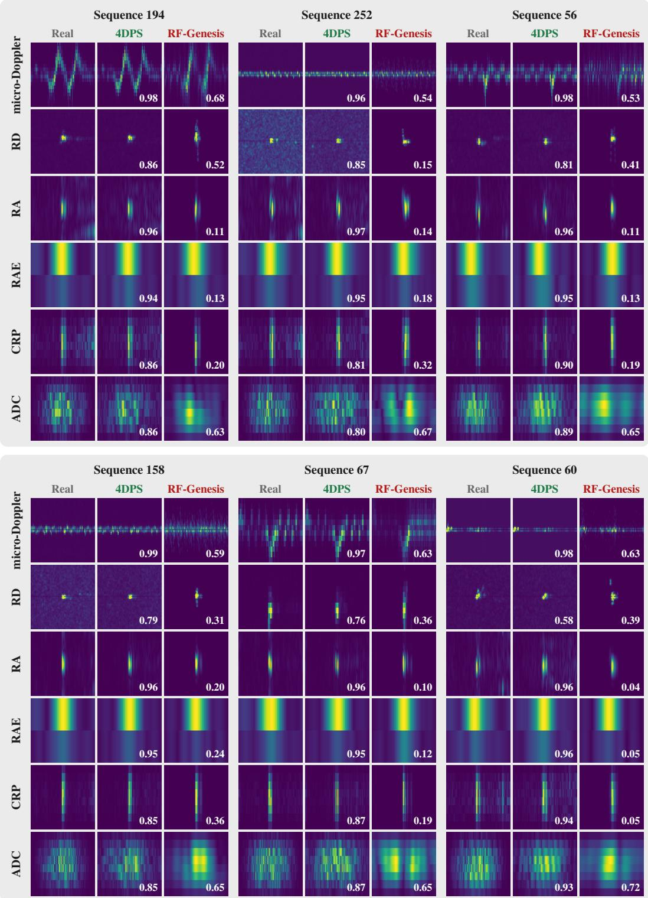  
Figure 16: Qualitative gallery, HuPR, horizontal board (3 of 3): sequences 194, 252 and 56 (top) and 158, 67 and 60 (bottom) (4DPS-fidelity ranks 150, 166, 181, 197, 212 and 228 of 235). As Fig. 14.