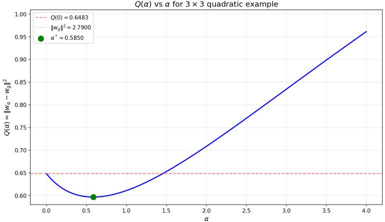
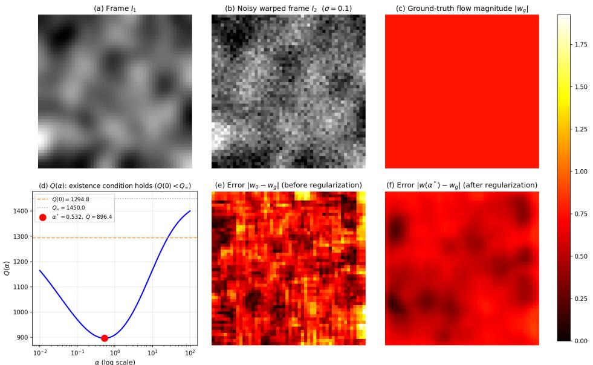
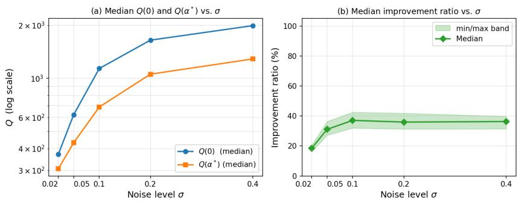
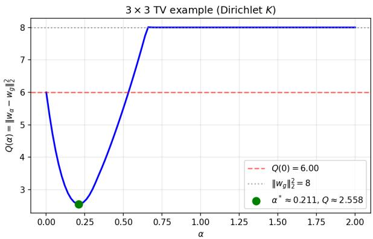
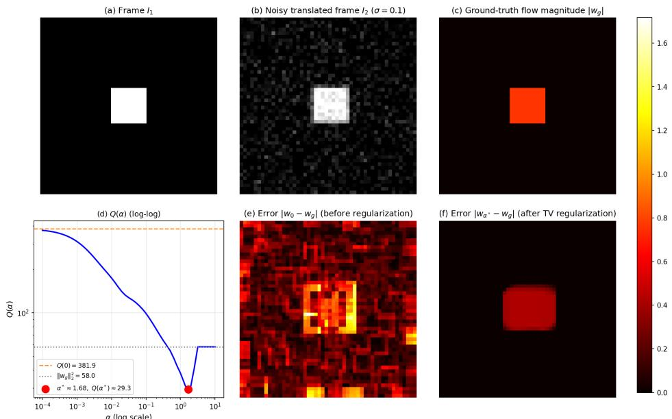

# A Theoretical Analysis of a Bilevel Optimization Formulation for Combined Local-Global Optical Flow Models

El Mostafa Kalmoun1\*

1\*School of Science and Engineering, Al Akhawayn University in Ifrane, Ifrane, 53000, Morocco.

Corresponding author(s). E-mail(s): E.Kalmoun@aui.ma;

## Abstract

This paper analyzes a bilevel formulation for learning the regularization parameter of combined local-global (CLG) optical flow models. The lower-level problem computes the flow from a Lucas–Kanade data term and a quadratic or total variation (TV) regularizer, and the upper-level problem selects the parameter that minimizes the squared distance to a ground-truth flow. The setting is finitedimensional, and a full-rank assumption makes the lower-level solution unique. For the quadratic model we derive suficient conditions for the existence of an optimal parameter, for every optimal parameter to be positive, and for strict local optimality. For TV regularization an optimal parameter always exists, because the lower-level solution vanishes for large parameters, and we give a suficient condition for positivity that accounts for the coupling of the two flow components through the local structure tensors. Synthetic examples illustrate the conditions, including cases in which they fail.

Keywords: Bilevel Optimization, Optical Flow, Regularization Parameter Learning, Total Variation, Local-Global Models

## 1 Introduction

Variational methods estimate the optical flow between two frames by minimizing an energy that combines a data term, derived from brightness constancy, with a regularizer weighted by a parameter $\alpha > 0$ . The quality of the estimate depends strongly on α. Too small a value leaves the flow noisy, and too large a value oversmooths it. This paper studies the choice of $\alpha$ by bilevel learning from ground-truth flow and asks, in a fully discrete setting, when an optimal parameter exists and when it is positive.

The linearized brightness constancy constraint gives one equation per pixel for the two flow components, so the flow is not determined locally (the aperture problem). Lucas and Kanade [1] assume that the flow is constant in a window around each pixel and solve the resulting local least-squares problems. Horn and Schunck [2] instead add a global quadratic penalty on the flow gradient, which yields dense flow fields but smooths motion boundaries. Total variation (TV) regularization, introduced for image denoising [3], preserves such boundaries. Shulman and Herv´e [4] proposed an early non-quadratic regularizer for discontinuous flow fields, and TV is widely used for optical flow [5–11]. We use its isotropic form, applied to each flow component. TV is convex but not diferentiable, and it is usually minimized by primal–dual methods [7, 9, 12] or replaced by a smooth approximation such as the Huber function [13]. The combined local-global (CLG) model of Bruhn et al. [14] joins the Lucas–Kanade data term with a global regularizer. It inherits the robustness of the local method and the density of the global one, and it can be minimized eficiently, for instance by multigrid methods [15]. Spatially varying parameters $\alpha ( p )$ adapted to image features have also been proposed [16–18].

Given two frames and a ground-truth flow $w _ { g } \in \mathbb { R } ^ { 2 N }$ on a grid Ω of N pixels, we consider

$$
\operatorname* { m i n } _ { \alpha \geq 0 } \ \| w _ { \alpha } - w _ { g } \| _ { 2 } ^ { 2 } \quad \mathrm { s u b j e c t ~ t o } \quad w _ { \alpha } = \underset { w \in \mathbb { R } ^ { 2 N } } { \arg \operatorname* { m i n } } \ \frac { 1 } { 2 } \sum _ { p \in \Omega } \| A _ { p } w ( p ) - b _ { p } \| _ { 2 } ^ { 2 } + \alpha R ( w ) ,\tag{1.1}
$$

where $A _ { p } w ( p ) = b _ { p }$ is the Lucas–Kanade system of the window around the pixel $p ,$ and R is either a quadratic penalty on the discrete flow gradient or the TV seminorm. Section 2 defines all objects precisely.

Problem (1.1) rests on four modeling choices. First, the parameter is learned from ground truth. Classical parameter-choice rules, such as the discrepancy principle [19], the L-curve [20], generalized cross-validation [21] and Stein’s unbiased risk estimate [22], need no ground truth. They rely instead on knowledge of the noise or on heuristic criteria, and they do not target the flow error itself. Bilevel learning uses training data with known ground truth and minimizes the reconstruction error directly. Second, the upper-level loss is the squared Euclidean distance, which equals the sum over all pixels of the squared endpoint errors, a standard accuracy measure for optical flow [23]. It is smooth in w, whereas the endpoint error itself and the angular error [24] are not diferentiable where the error vanishes. Third, a single scalar parameter is the natural first case. It is the setting in which existence and positivity can be characterized by explicit conditions, and spatially varying parameters, as in the bilevel framework of [25], can build on it. Fourth, the CLG data term makes the lower-level problem well posed. When every window contains two pixels with linearly independent gradients, the data term is strongly convex, and the lower-level solution is unique for every $\alpha \geq 0$ , including $\alpha = 0 \ \mathrm { ( L e m m a \ 1 ) }$ . The Horn–Schunck data term alone is never strongly convex, because its matrix $J ^ { \top } J$ in (2.1) has a null space of dimension at least $N$

Bilevel learning of regularization parameters in imaging was established by Kunisch and Pock [26] for variational denoising and by De los Reyes and Sch¨onlieb [27] for learning noise models in TV denoising. Its theory includes existence results for a broad class of regularizers [28], refined stationarity systems for TV [29], stationarity and second-order conditions through a reformulation as a mathematical program with complementarity constraints [30], and spatially dependent parameters [25]. For finite-dimensional linear inverse problems with a continuously diferentiable regularizer, Ehrhardt, Gazzola and Scott [31] give a suficient condition for a positive optimal parameter. Our positivity result for the quadratic model (Theorem 3) is a special case of their condition. Applications include blind deconvolution [32] and the learning of fractional diferential operators [33], and Crockett and Fessler [34] survey the field. Computational work addresses inexact lower-level solves through derivative-free methods [35], inexact hypergradients [36] and single-loop schemes [37]. Learning through truncated or approximate inference [38, 39] and learned variational inference layers [40] aim at empirical performance rather than at the analysis of a regularization weight. For optical flow, Jiang et al. [41] use a bilevel scheme that couples flow and camera motion in unsupervised deep learning. Closest to the present setting, El Hakoume et al. [42] learn the two Lam´e coeficients of a fluid optical flow registration model by bilevel supervised learning, within a multi-frame super-resolution method. Positivity is imposed through a fixed box, uniqueness of the lower-level solution is assumed, and the bilevel problem “is not theoretically studied” because their model lacks the required regularity. Related work by Laghrib and coauthors learns spatially varying weights for nonlocal deblurring [43]. To our knowledge, no previous work establishes existence, positivity and second-order conditions for learning the regularization parameter of a variational optical flow model from ground-truth flow. Here all objects are finitedimensional, the proofs are direct, and the conditions are explicit and computable from the data for both regularizers.

The main contributions are the following.

• A finite-dimensional bilevel formulation for CLG optical flow in which a scalar regularization parameter is learned from ground-truth flow.

• Existence of an optimal parameter. For any convex regularizer that vanishes only at zero, a suficient condition is that the Lucas–Kanade estimate be closer to the ground truth than the zero flow (Proposition 2). For TV with zero boundary values this condition is not needed, because the lower-level solution vanishes beyond a finite value of α (Corollary 5).

• Suficient conditions under which $\alpha = 0$ is not optimal, so that every optimal parameter is positive, for the quadratic model (Theorem 3, an instance of the condition of [31]) and for TV (Theorem 8), and second-order suficient conditions for strict local optimality in the quadratic model (Theorem 4). The TV condition is not covered by [31], because TV is not diferentiable, and it difers structurally from the analyses of scalar data terms [28, 29]. The Lucas–Kanade data term couples the two flow components through $2 \times 2$ blocks that vary from pixel to pixel. This coupling requires a four-way partition of the pixels, a term $\mathcal { R } _ { \mathrm { m i x } }$ for the pixels at which only one flow component has a nonzero gradient, and a term ${ \mathcal { R } } _ { \operatorname { v a r } }$ for the spatial variation of the blocks. These terms vanish for spatially uniform scalar data terms.

• Synthetic examples that illustrate the conditions, including cases in which the suficient conditions fail.

Section 2 introduces the discrete setting and states the bilevel problem. Section 3 analyzes quadratic regularization and Section 4 total variation regularization. Section 5 presents the examples, and Section 6 discusses the limitations of the analysis and concludes.

## 2 Discrete Setting and Problem Formulation

All objects in this paper are finite-dimensional. The image domain Ω is a rectangular grid of $N = n _ { y } n _ { x }$ pixels with unit grid spacing, ordered row by row. Scalar fields on $\Omega ,$ such as images, are vectors in $\mathring { \cdot } \mathrm { A }$ flow field is w $\mathbf { \Psi } = ( u ; v ) \in \mathbb { R } ^ { 2 N }$ with $u , v \in \mathbb { R } ^ { N }$ and its value at a pixel $p$ is $w ( p ) = ( u ( p ) , v ( p ) ) ^ { \intercal } \in \mathbb { R } ^ { 2 }$

For two frames $I _ { 1 } , I _ { 2 } \in \mathbb { R } ^ { N }$ , let $I _ { x } , I _ { y } \in \mathbb { R } ^ { N }$ be the spatial derivatives and $I _ { t } : = I _ { 2 } -$ $I _ { 1 }$ the temporal derivative. The computation of $I _ { x }$ and $I _ { y }$ is described at the beginning of Section 5. With $\nabla I ( p ) : = ( I _ { x } ( p ) , I _ { y } ( p ) ) ^ { \top }$ and $J : = \lceil { \mathrm { { d i a g } } ( I _ { x } ) }$ diag(I ) ∈ RN×2N , the linearized brightness constancy constraint reads

$$
J w + I _ { t } = 0 \in \mathbb { R } ^ { N } , \qquad \mathrm { t h a t ~ i s , } \qquad \nabla I ( p ) ^ { \top } w ( p ) + I _ { t } ( p ) = 0 \quad \mathrm { f o r ~ e v e r y ~ } p \in \Omega . \left( 2 . 1 \right) \times \Gamma \mathrm { ~ a n d ~ } p \in \mathbb { R } ^ { N } .
$$

The Lucas–Kanade data term assigns to each pixel p a window $\Omega _ { p } ~ \subset ~ \Omega$ that contains $p ,$ and $n _ { p } : = | \Omega _ { p } |$ . Imposing (2.1) at every $q \in \Omega _ { p }$ with the common value $w ( p )$ gives the local system $A _ { p } w ( p ) = b _ { p }$ with

$$
A _ { p } : = \left[ \nabla I ( \boldsymbol { q } ) ^ { \top } \right] _ { \boldsymbol { q } \in \Omega _ { p } } \in \mathbb { R } ^ { n _ { p } \times 2 } , \qquad b _ { p } : = - \big [ I _ { t } ( \boldsymbol { q } ) \big ] _ { \boldsymbol { q } \in \Omega _ { p } } \in \mathbb { R } ^ { n _ { p } } .\tag{2.2}
$$

The data term is

$$
D ( w ) : = \frac { 1 } { 2 } \sum _ { p \in \Omega } \| A _ { p } w ( p ) - b _ { p } \| _ { 2 } ^ { 2 } = \frac { 1 } { 2 } w ^ { \top } \mathcal { M } _ { \mathrm { L K } } w - f _ { \mathrm { L K } } ^ { \top } w + c ,\tag{2.3}
$$

where $f _ { \mathrm { L K } } \in \mathbb { R } ^ { 2 N }$ collects the vectors $A _ { p } ^ { \top } b _ { p }$ and $\begin{array} { r } { c : = \frac { 1 } { 2 } \sum _ { p \in \Omega } \| b _ { p } \| _ { 2 } ^ { 2 } } \end{array}$ . Let Π be the permutation matrix that orders the unknowns pixel by pixel:

$$
\begin{array} { r } { \Pi \boldsymbol { w } = ( u ( p _ { 1 } ) , \boldsymbol { v } ( p _ { 1 } ) , \ldots , u ( p _ { N } ) , \boldsymbol { v } ( p _ { N } ) ) ^ { \top } . } \end{array}
$$

Stacking all local systems gives the global system

$$
A w = b ,\tag{2.4}
$$

whose matrix A has $\begin{array} { r l r } { n } & { { } : = } & { \sum _ { p } n _ { p } } \end{array}$ rows and 2N columns, and $\begin{array} { r l } { A \Pi ^ { \top } } & { { } = } \end{array}$ di $\arg ( A _ { p _ { 1 } } , \ldots , A _ { p _ { N } } )$ is block diagonal with rectangular $n _ { p } \times 2$ blocks. Hence

$$
{ \mathcal { M } } _ { \mathrm { { L K } } } = A ^ { \top } A = \Pi ^ { \top } \mathrm { d i a g } { \big ( } A _ { p _ { 1 } } ^ { \top } A _ { p _ { 1 } } , \ldots , A _ { p _ { N } } ^ { \top } A _ { p _ { N } } { \big ) } \Pi .
$$

In the ordering $w = ( u ; v ) , \mathcal { M } _ { \mathrm { L K } }$ consists of four diagonal $N \times N$ blocks formed from the entries of the matrices $A _ { p } ^ { \top } A _ { p }$

Throughout the paper we assume

$$
( \mathbf { A 1 } ) \quad \operatorname { r a n k } A _ { p } = 2 \operatorname { f o r } \operatorname { e v e r y } p \in \Omega ,
$$

that is, every window contains two pixels with linearly independent image gradients. Then $A _ { p } ^ { \top } A _ { p } \succ 0$ for every $p ,$ so $\mathcal { M } _ { \mathrm { L K } } \succ 0$ , and D has the unique minimizer w = $\mathcal { M } _ { \mathrm { L K } } ^ { - 1 } f _ { \mathrm { L K } }$ , the Lucas–Kanade solution

$$
\begin{array} { c } { { w _ { 0 } ( p ) = ( A _ { p } ^ { \top } A _ { p } ) ^ { - 1 } A _ { p } ^ { \top } b _ { p } , } } \\ { { A _ { p } ^ { \top } A _ { p } = \displaystyle \sum _ { q \in \Omega _ { p } } \nabla I ( q ) \nabla I ( q ) ^ { \top } , \qquad A _ { p } ^ { \top } b _ { p } = - \displaystyle \sum _ { q \in \Omega _ { p } } I _ { t } ( q ) \nabla I ( q ) . } } \end{array}\tag{2.5}
$$

The two regularizers use two diference operators, and their boundary conditions are part of the model. For the quadratic regularizer, $K _ { D }$ takes forward diferences between horizontally and vertically adjacent pixels, with zero ghost values on all four sides of the grid, so $K _ { D } \in \mathbb { R } ^ { m \times \check { N } }$ with $m = n _ { y } ( n _ { x } + 1 ) + n _ { x } ( n _ { y } + 1 )$ . The matrix $K _ { D } ^ { \top } K _ { D }$ is the five-point Laplacian with homogeneous Dirichlet conditions. On flows we set $\mathbf { K } _ { D } : = \mathrm { d i a g } ( K _ { D } , K _ { D } )$ and

$$
L : = \mathbf { K } _ { D } ^ { \top } \mathbf { K } _ { D } = \operatorname { d i a g } \left( K _ { D } ^ { \top } K _ { D } , K _ { D } ^ { \top } K _ { D } \right) \in \mathbb { R } ^ { 2 N \times 2 N } .
$$

Since $K _ { D }$ is injective, $L \succ 0$ . The matrix $\mathcal { L } _ { \mathrm { g l o b } } : = - L$ is the discrete vector Laplacian. For the TV regularizer, the gradient of a scalar field s at a pixel $p$ is

$$
\nabla s ( p ) : = ( K s ) ( p ) : = \big ( \bar { s } ( p + e _ { x } ) - s ( p ) , ~ \bar { s } ( p + e _ { y } ) - s ( p ) \big ) ^ { \top } \in \mathbb { R } ^ { 2 } ,
$$

where $e _ { x }$ and $e _ { y }$ are the shifts to the next column and the next row, and s¯ equals s on $\Omega$ and 0 outside Ω. Thus the ghost values beyond the last column and the last row are zero. The map $K : \mathbb { R } ^ { N } \to \mathbb { R } ^ { 2 \breve { N } }$ is injective. On flows, ${ \bf K } : = \mathrm { d i a g } ( K , K ) : \mathbb { R } ^ { 2 N }  \mathbb { R } ^ { 4 N }$ and a dual field is $z = ( z _ { u } , z _ { v } ) \in \mathbb R ^ { 4 N }$ with $z _ { u } ( p ) , z _ { v } ( p ) \in \mathbb R ^ { 2 }$ . The discrete divergence is div $: = - K ^ { \top }$ for scalar fields and div $: = - \mathbf { K } ^ { \top } : \mathbb { R } ^ { 4 N }  \mathbb { R } ^ { 2 N }$ for flows, so that

$$
\sum _ { p \in \Omega } \langle \nabla s ( p ) , z ( p ) \rangle = - \sum _ { p \in \Omega } s ( p ) ( \mathrm { d i v } z ) ( p )\tag{2.6}
$$

holds exactly, with no boundary terms. Forward diferences of other fields on $\Omega ,$ such as residuals, are also taken with K. The two operators difer at the border, since $K$ has no diferences across the left and the top sides, and $K ^ { \top } K \neq K _ { D } ^ { \top } K _ { D }$ . The analysis of the quadratic model uses only $L \succ 0 ,$ . For $\mathrm { T V } ,$ existence uses only the injectivity of $K$ , and the positivity analysis also uses the forward-diference form of K (Lemma 6).

With these operators, the quadratic (CLG) energy and the TV energy are

$$
E ( \boldsymbol { w } , \alpha ) : = D ( \boldsymbol { w } ) + \frac { \alpha } { 2 } \| \mathbf { K } _ { D } \boldsymbol { w } \| _ { 2 } ^ { 2 } = D ( \boldsymbol { w } ) + \frac { \alpha } { 2 } \boldsymbol { w } ^ { \top } L \boldsymbol { w } ,\tag{2.7}
$$

$$
E ( \boldsymbol { w } , \alpha ) : = D ( \boldsymbol { w } ) + \alpha \mathcal { R } _ { T V } ( \boldsymbol { w } ) , \qquad \mathcal { R } _ { T V } ( \boldsymbol { w } ) : = \sum _ { p \in \Omega } \bigl ( \| \nabla \boldsymbol { u } ( p ) \| _ { 2 } + \| \nabla \boldsymbol { v } ( p ) \| _ { 2 } \bigr ) .\tag{2.8}
$$

The Horn–Schunck energy [2]

$$
\begin{array} { r } { \frac { 1 } { 2 } \| J w + I _ { t } \| _ { 2 } ^ { 2 } + \frac { \alpha } { 2 } \| \mathbf { K } _ { D } w \| _ { 2 } ^ { 2 } } \end{array}\tag{2.9}
$$

is the special case $\Omega _ { p } = \{ p \}$ of (2.7), for which (A1) fails.

Given a ground-truth flow $w _ { g } \in \mathbb { R } ^ { 2 N }$ , we consider

$$
\operatorname* { m i n } _ { \alpha \geq 0 } Q ( \alpha ) : = \| w _ { \alpha } - w _ { g } \| _ { 2 } ^ { 2 } \quad \mathrm { s u b j e c t ~ t o } \quad w _ { \alpha } = \underset { w \in \mathbb { R } ^ { 2 N } } { \arg \operatorname* { m i n } } E ( w , \alpha ) ,\tag{2.10}
$$

with E given by (2.7) in Section 3 and by (2.8) in Section 4.

Lemma 1 Assume $( A I ) _ { ; }$ , and let $R : \mathbb { R } ^ { 2 N }  [ 0 , \infty )$ be convex. For every α $\geq 0$ , the function $D + \alpha R$ is strongly convex with modulus $\mu : = \lambda _ { \operatorname* { m i n } } ( \mathcal { M } _ { \mathrm { L K } } ) > 0$ and has exactly one minimizer. In particular, wα in (2.10) is uniquely defined for both energies and every $\alpha \geq 0$ , including $\alpha = 0$ , and Q is a single-valued function on $[ 0 , \infty )$

Proof Since $\mathcal { M } _ { \mathrm { L K } } - \mu I \succeq 0$ , the function $D - { \frac { \mu } { 2 } } \| \cdot \| _ { 2 } ^ { 2 }$ is convex, so $D + \alpha R$ is strongly convex. A finite strongly convex function on $ { \mathbb { R } } ^ { 2 N }$ has exactly one minimizer. □

Without (A1), the lower-level problem may have many solutions, for instance at $\alpha = 0$ because of the aperture problem. Problem (2.10) would then require an optimistic or a pessimistic formulation, which we do not consider.

Remark 1 When the ground truth is only partially available or carries confidence weights, the loss can be replaced by $Q _ { W } ( \alpha ) : = \| W ( w _ { \alpha } - w _ { g } ) \| _ { 2 } ^ { 2 }$ with $W : = \mathrm { d i a g } ( \omega , \omega ) \in \mathbb { R } ^ { 2 N \times 2 N }$ and weights $\omega \in \mathbb { R } ^ { N } , \mathbf { \bar { \omega } } \geq 0$ . The lower-level solutions do not depend on W. The corresponding changes to the conditions of Sections 3 and 4 are stated in Remark 9.

## 3 Quadratic Regularization

In this section the lower-level energy is the quadratic CLG energy (2.7),

$$
E ( \boldsymbol { w } , \alpha ) = \frac { 1 } { 2 } \sum _ { p \in \Omega } \| \boldsymbol { A } _ { p } \boldsymbol { w } ( p ) - \boldsymbol { b } _ { p } \| _ { 2 } ^ { 2 } + \frac { \alpha } { 2 } \boldsymbol { w } ^ { \top } L \boldsymbol { w } .\tag{3.1}
$$

At the minimizer the gradient of $E ( \cdot , \alpha )$ vanishes. For each pixel this gives

$$
\begin{array} { r } { A _ { p } ^ { \top } \left( A _ { p } w ( p ) - b _ { p } \right) + \alpha \left( L w \right) ( p ) = 0 , } \end{array}\tag{3.2}
$$

where $( L w ) ( p ) \in \mathbb { R } ^ { 2 }$ collects the two entries of $\ b { L w }$ at $p .$ . Globally,

$$
\left( \mathcal { M } _ { \mathrm { L K } } + \alpha L \right) w = f _ { \mathrm { L K } } .\tag{3.3}
$$

Under $( \mathrm { A } 1 ) , \mathcal { M } _ { \mathrm { L K } } \succ 0$ , and $L \succ 0 .$ . The matrix $\mathcal { M } _ { \mathrm { L K } } + \alpha L$ is therefore positive definite for every $\alpha \geq 0$ . It remains positive definite for small negative α: since $w ^ { \top } ( \mathcal { M } _ { \mathrm { L K } } +$ $\alpha L ) w \geq \left( \lambda _ { \operatorname* { m i n } } ( \mathcal { M } _ { \mathrm { L K } } ) - | \alpha | \lambda _ { \operatorname* { m a x } } ( L ) \right) \| w \| _ { 2 } ^ { 2 }$ , this holds for every α $> - \alpha _ { 0 }$ with $\alpha _ { 0 } : =$ $\lambda _ { \operatorname* { m i n } } ( \mathcal { M } _ { \mathrm { L K } } ) / \lambda _ { \operatorname* { m a x } } ( L ) > 0 .$ . Hence

$$
w _ { \alpha } = X ( \alpha ) f _ { \mathrm { L K } } , \qquad X ( \alpha ) : = ( M _ { \mathrm { L K } } + \alpha L ) ^ { - 1 } ,\tag{3.4}
$$

and $\alpha \mapsto w _ { \alpha }$ and $Q$ are infinitely diferentiable on the open interval $( - \alpha _ { 0 } , \infty )$ . In particular, $Q ^ { \prime } ( 0 )$ is an ordinary two-sided derivative, although only $\alpha \geq 0$ is admissible in the bilevel problem. From $X ^ { \prime } ( \alpha ) = - X ( \alpha ) L X ( \alpha )$ and $X ( \alpha ) L w _ { \alpha } = - w _ { \alpha } ^ { \prime }$

$$
w _ { \alpha } ^ { \prime } = - X ( \alpha ) L w _ { \alpha } , \qquad w _ { \alpha } ^ { \prime \prime } = - 2 X ( \alpha ) L w _ { \alpha } ^ { \prime } ,\tag{3.5}
$$

and therefore

$$
\begin{array} { r } { Q ^ { \prime } ( \alpha ) = 2 \langle w _ { \alpha } ^ { \prime } , w _ { \alpha } - w _ { g } \rangle , \qquad Q ^ { \prime \prime } ( \alpha ) = 2 \| w _ { \alpha } ^ { \prime } \| _ { 2 } ^ { 2 } - 4 \langle X ( \alpha ) L w _ { \alpha } ^ { \prime } , w _ { \alpha } - w _ { g } \rangle . } \end{array}\tag{3.6}
$$

Substituting (3.4) reduces (2.10) to the single-level problem

$$
\operatorname* { m i n } _ { \alpha \geq 0 } Q ( \alpha ) = \| X ( \alpha ) f _ { \mathrm { L K } } - w _ { g } \| _ { 2 } ^ { 2 } .\tag{3.7}
$$

If every minimizer satisfies $\alpha ^ { * } \ > \ 0$ , then some amount of regularization strictly improves on the unregularized Lucas–Kanade estimate.

Remark 2 In practice $X ( \alpha )$ is never formed. The symmetric positive definite system (3.3) is solved by preconditioned conjugate gradients or multigrid, and $w _ { \alpha } ^ { \prime }$ requires one more solve with the same matrix. Since α is a scalar, Q can be minimized by a bounded one-dimensional search, which is what the examples of Section 5 use, or by a gradient-based method with the analytical gradient (3.6).

The proof of the next existence result uses the minimizing-sequence argument of [26, Proposition 3.1] in finite dimension.

Proposition 2 Assume $( A I )$ . Let $R : \mathbb { R } ^ { 2 N } \to [ 0 , \infty )$ be convex with $R ( w ) = 0$ if and only if $w = 0$ , and let $w _ { \alpha }$ be the minimizer of $D + \alpha R .$ Then:

$( i ) \ \alpha \ \mapsto \ w _ { \alpha }$ is continuous on $[ 0 , \infty )$ , α $R ( w _ { \alpha } ) \ \leq \ { \frac { 1 } { 2 } } w _ { 0 } ^ { \top } { \mathcal M } _ { \mathrm { L K } } w _ { 0 }$ for all $\alpha \geq 0$ , and $w _ { \alpha } \to 0 \mathrm { ~ } a s \ \alpha \to \infty ;$

(ii) $Q$ is continuous on $[ 0 , \infty )$ , and $Q ( \alpha ) \to \| w _ { g } \| _ { 2 } ^ { 2 }$ as $\alpha  \infty ,$

(iii) if

$$
\lVert w _ { 0 } - w _ { g } \rVert _ { 2 } < \lVert w _ { g } \rVert _ { 2 } ,\tag{3.8}
$$

then Q has a minimizer $\alpha ^ { * } \in [ 0 , \infty )$ , and $Q ( \alpha ^ { * } ) < \| w _ { g } \| _ { 2 } ^ { 2 }$

The regularizers $\scriptstyle { \frac { 1 } { 2 } } \| \mathbf { K } _ { D } w \| _ { 2 } ^ { 2 }$ and $\mathcal { R } _ { T V }$ satisfy these hypotheses, because $K _ { D }$ and K are injective.

Proof Let $\| x \| _ { \mathcal { M } } ^ { 2 } : = x ^ { \top } \mathcal { M } _ { \mathrm { L K } } x$ , so that $\begin{array} { r } { D ( w ) - D ( w _ { 0 } ) = \frac 1 2 \| w - w _ { 0 } \| _ { \mathcal { M } } ^ { 2 } } \end{array}$

(i) Since $R ( 0 ) = 0$ , we have $D ( w \alpha ) + \alpha R ( w \alpha ) \leq D ( 0 )$ , and $\begin{array} { r } { D ( 0 ) - D ( w _ { 0 } ) = \frac 1 2 \| w _ { 0 } \| _ { \mathcal { M } } ^ { 2 } } \end{array}$ Hence $\begin{array} { r } { \frac 1 2 \| w _ { \alpha } - w _ { 0 } \| _ { \mathcal { M } } ^ { 2 } + \alpha R ( w _ { \alpha } ) \leq \frac 1 2 \| w _ { 0 } \| _ { \mathcal { M } } ^ { 2 } } \end{array}$ . This gives the bound on $\alpha R ( w _ { \alpha } )$ and shows that $\lbrace w _ { \alpha } : \alpha \geq 0 \rbrace$ is bounded. Let $\alpha _ { k }  \infty$ . Then $R ( w _ { \alpha _ { k } } )  0$ , and every accumulation point ¯w of $( w _ { \alpha _ { k } } )$ satisfies $R ( \bar { w } ) = 0$ by continuity of $R ,$ so $\bar { w } = 0$ . Hence $w _ { \alpha _ { k } } \to 0$ . Now let $\alpha _ { k }  \hat { \alpha } \in [ 0 , \infty )$ , and let ¯w be an accumulation point of $( w _ { \alpha _ { k } } )$ . For every $w , D ( w _ { \alpha _ { k } } ) +$ $\alpha _ { k } R ( w \alpha _ { k } ) \leq D ( w ) + \alpha _ { k } R ( w )$ . Passing to the limit along the corresponding subsequence gives $D ( \bar { w } ) + \hat { \alpha } R ( \bar { w } ) \leq D ( w ) + \hat { \alpha } R ( w )$ , so $\bar { w } = w _ { \hat { \alpha } }$ by Lemma 1. Hence $w _ { \alpha _ { k } }  w _ { \hat { \alpha } }$

(ii) This follows from (i).

(iii) Since $Q ( \alpha )  \| w _ { g } \| _ { 2 } ^ { 2 } > Q ( 0 )$ , there is $A > 0$ with $Q ( \alpha ) > Q ( 0 )$ for all $\alpha \geq A$ . The continuous function Q attains its minimum on $[ 0 , A ]$ at some $\alpha ^ { * }$ . This point minimizes $Q$ on $[ 0 , \infty )$ , and $Q ( \alpha ^ { * } ) \leq Q ( 0 ) < \| w _ { g } \| _ { 2 } ^ { 2 }$ □

Condition (3.8) is suficient but not necessary, since a finite minimizer can exist when it fails. It cannot, however, be dropped from Proposition 2. Consider an abstract instance with a single pixel, $A _ { p } = I _ { 2 }$ and the quadratic regularizer. Then $L = 4 I _ { 2 }$ and $w _ { \alpha } = w _ { 0 } / ( 1 + 4 \alpha )$ . With $w _ { 0 } = ( 1 , 0 ) ^ { \top }$ and $w _ { g } = ( - 1 , 0 ) ^ { \top } , Q ( \alpha ) = \left( 1 + ( 1 + 4 \alpha ) ^ { - 1 } \right) ^ { 2 }$ decreases strictly to $\| w _ { g } \| _ { 2 } ^ { 2 } = 1$ and never attains its infimum. For the quadratic energy, $w _ { \alpha }$ never vanishes at a finite α when $f _ { \mathrm { L K } } \neq 0$ , because $X ( \alpha )$ is invertible. The TV case behaves diferently (Section 4).

Theorem 3 Assume (A1). Then $\begin{array} { r } { Q ^ { \prime } ( 0 ) = - 2 \langle \mathcal { M } _ { \mathrm { L K } } ^ { - 1 } L w _ { 0 } , w _ { 0 } - w _ { g } \rangle . \ I f } \end{array}$

$$
\left. \mathcal { M } _ { \mathrm { L K } } ^ { - 1 } L w _ { 0 } , \ w _ { 0 } - w _ { g } \right. > 0 ,\tag{3.9}
$$

then $Q ( \alpha ) ~ < ~ Q ( 0 )$ for all suficiently small $\alpha > 0$ , and every minimizer of $Q$ on $[ 0 , \infty )$ satisfies $\alpha ^ { * } > 0$

Proof At $\alpha = 0 , ( 3 . 5 )$ gives $w _ { 0 } ^ { \prime } = - \mathcal { M } _ { \mathrm { L K } } ^ { - 1 } L w _ { 0 }$ , and (3.6) then gives the formula for $Q ^ { \prime } ( 0 )$ Under $( 3 . 9 ) , Q ^ { \prime } ( 0 ) < 0$ , so $Q$ decreases on a right neighborhood of 0 and $\alpha = 0$ is not a minimizer. □

Theorem 3 is the instance, for the CLG data term and the quadratic regularizer, of a general suficient condition for positivity due to Ehrhardt, Gazzola and Scott [31, Corollary 1], which covers convex, continuously diferentiable regularizers. For an identity forward operator and a quadratic regularizer, their condition is the one of Kunisch and Pock [26, Proposition 3.1].

Remark 3 Condition (3.9) has a first-order meaning. Since $w _ { \alpha } = w _ { 0 } + \alpha w _ { 0 } ^ { \prime } + O ( \alpha ^ { 2 } )$ with $w _ { 0 } ^ { \prime } = - \mathcal { M } _ { \mathrm { L K } } ^ { - 1 } L w _ { 0 }$

$$
Q ( \alpha ) = Q ( 0 ) + 2 \alpha \langle w _ { 0 } ^ { \prime } , w _ { 0 } - w _ { g } \rangle + O ( \alpha ^ { 2 } ) .
$$

Condition (3.9) therefore states that the first-order smoothing correction $w _ { 0 } ^ { \prime }$ has a negative component along the residual $w _ { 0 } - w _ { g }$ . At each pixel, $w _ { 0 } ^ { \prime } ( p ) = - ( A _ { p } ^ { \top } A _ { p } ) ^ { - 1 } \widetilde ( L w _ { 0 } ) ( p )$ , so the correction can be large where $A _ { p } ^ { \top } A _ { p }$ is nearly singular. This condition concerns the sum over all pixels, not each pixel separately.

Remark $\it 4$ Suppose the regularizer uses Neumann-type diferences (forward diferences set to zero in the last column and the last row), in either the quadratic or the TV case. Its kernel is then the space $\mathcal { Z } : = \mathrm { r a n g e } Z$ of constant flows, where $Z : = \left\lceil \mathbf { 1 } \mathbf { \Lambda } _ { 1 } ^ { 0 } \right\rceil \in \mathbb { R } ^ { 2 N \times 2 }$ and $\mathbf { 1 } \in \mathbb { R } ^ { N }$ is the vector of ones. Lemma 1 still applies. As $\alpha \to \infty , w _ { \alpha }$ converges to the minimizer of D on $\mathcal { Z } ,$

$$
\begin{array} { r } { w _ { \alpha }  P _ { \mathcal M } w _ { 0 } , \qquad P _ { \mathcal M } : = Z \big ( Z ^ { \top } \mathcal M _ { \mathrm { L K } } Z \big ) ^ { - 1 } Z ^ { \top } \mathcal M _ { \mathrm { L K } } , } \end{array}
$$

which is the constant flow $\begin{array} { r } { \left( \sum _ { p } A _ { p } ^ { \top } A _ { p } \right) ^ { - 1 } \sum _ { p } A _ { p } ^ { \top } b _ { p } } \end{array}$ , the least-squares solution of all local systems together. The proof is the argument of Proposition 2, with 0 replaced by this minimizer. $\mathrm { A }$ suficient condition for a finite minimizer is therefore

$$
\| w _ { 0 } - w _ { g } \| _ { 2 } < \| P _ { \mathit { M } } w _ { 0 } - w _ { g } \| _ { 2 } .\tag{3.10}
$$

The $2 \times 2$ matrix $\begin{array} { r } { Z ^ { \top } \mathcal { M } _ { \mathrm { L K } } Z = \sum _ { p } A _ { p } ^ { \top } A _ { p } } \end{array}$ couples the two flow components. The operator $P _ { \mathcal { M } }$ is the $\mathcal { M } _ { \mathrm { L K } }$ -orthogonal projector onto Z, and it coincides with the Euclidean projector (componentwise averaging) if and only if all matrices $A _ { p } ^ { \top } A _ { p }$ are equal.

Theorem 4 Assume $( A I )$ , and let $\alpha ^ { * } \geq 0$ satisfy the first-order necessary conditions $f o r$ problem (3.7),

$$
\begin{array} { r } { \{ Q ^ { \prime } ( 0 ) \geq 0 \quad i f \alpha ^ { * } = 0 ,  } \\ {  Q ^ { \prime } ( \alpha ^ { * } ) = 0 \quad i f \alpha ^ { * } > 0 . } \end{array}\tag{3.11}
$$

Then $\alpha ^ { * }$ is a strict local minimizer of $Q o n \ [ 0 , \infty )$ if either:

(a) $\alpha ^ { * } = 0$ and $Q ^ { \prime } ( 0 ) > 0 ;$ or

(b) $\alpha ^ { * } > 0 , L w _ { \alpha ^ { * } } \neq 0$ , and

$$
\| w _ { \alpha ^ { * } } - w _ { g } \| _ { 2 } < \frac { \| w _ { \alpha ^ { * } } ^ { \prime } \| _ { 2 } ^ { 2 } } { 2 \| X ( \alpha ^ { * } ) L w _ { \alpha ^ { * } } ^ { \prime } \| _ { 2 } } .\tag{3.12}
$$

Proof (a) If $\alpha ^ { * } = 0$ and $Q ^ { \prime } ( 0 ) > 0$ , then Q is increasing on a right neighborhood of 0.

(b) By $( 3 . 6 ) , Q ^ { \prime \prime } ( \alpha ^ { * } ) = H _ { 1 } + H _ { 2 }$ with

$$
H _ { 1 } : = 2 \| w _ { \alpha ^ { * } } ^ { \prime } \| _ { 2 } ^ { 2 } , \qquad H _ { 2 } : = - 4 \langle X ( \alpha ^ { * } ) L w _ { \alpha ^ { * } } ^ { \prime } , w _ { \alpha ^ { * } } - w _ { g } \rangle .
$$

Since $X ( \alpha ^ { * } )$ and L are invertible, $L w _ { \alpha ^ { * } } \neq 0$ gives $w _ { \alpha ^ { * } } ^ { \prime } \neq 0$ and $X ( \alpha ^ { * } ) L w _ { \alpha ^ { * } } ^ { \prime } \neq 0$ . By the Cauchy–Schwarz inequality, $| H _ { 2 } | \leq 4 \| X ( \alpha ^ { * } ) L w _ { \alpha ^ { * } } ^ { \prime } \| _ { 2 } \| w _ { \alpha ^ { * } } - w _ { g } \| _ { 2 }$ , which is smaller than $H _ { 1 }$ under (3.12). Hence $\bar { Q } ^ { \prime \prime } ( \alpha ^ { * } ) > 0 ;$ and together with $Q ^ { \prime } ( \alpha ^ { * } ) = 0$ this makes $\alpha ^ { * }$ a strict local minimizer. □

Remark 5 The bound (3.12) is suficient but not necessary: if $H _ { 2 } \geq 0 ,$ , then $Q ^ { \prime \prime } ( \alpha ^ { * } ) \geq H _ { 1 } > 0$ without it. In the examples of Section 5, strict local optimality is checked by evaluating $Q ^ { \prime \prime } ( \alpha ^ { * } )$ directly.

Proposition 2 and Theorems 3 and 4 do not determine whether Q has a unique global minimizer (see Section 6.1). Because $w _ { \alpha }$ depends nonlinearly on $\alpha , Q$ need not be convex, and multiple local minima cannot be excluded a priori.

## 4 Total Variation Regularization

This section treats the TV energy (2.8) with the gradient $\nabla = K$ of Section 2. The TV term is not diferentiable, so the lower-level optimality condition is an inclusion rather than a linear system, and no closed form such as (3.4) is available.

Write $\mathcal { R } _ { T V } = h \circ$ K with $\begin{array} { r } { h ( y ) : = \sum _ { p } \bigl ( \| y _ { u } ( p ) \| _ { 2 } + \| y _ { v } ( p ) \| _ { 2 } \bigr ) } \end{array}$ for $y = ( y _ { u } , y _ { v } ) \in$ $\mathbb { R } ^ { 4 N }$ , where $y _ { u } ( p ) , y _ { v } ( p ) \in \mathbb { R } ^ { 2 }$ are the entries at pixel $p .$ Since h is finite and convex, $\partial \mathcal { R } _ { T V } ( w ) = \mathbf { K } ^ { \top } \partial h ( \mathbf { K } w )$ . Hence $w _ { \alpha }$ minimizes $E ( \cdot , \alpha )$ in (2.8) if and only if there is a dual field $z _ { \alpha } = ( z _ { \alpha , u } , z _ { \alpha , v } ) \in \mathbb R ^ { 4 N }$ such that, for every pixel $p _ { : }$

$$
A _ { p } ^ { \top } \big ( A _ { p } w _ { \alpha } ( p ) - b _ { p } \big ) = \alpha ( \mathbf { d i v } z _ { \alpha } ) ( p ) , \qquad ( \mathbf { d i v } z _ { \alpha } ) ( p ) = \big ( ( \mathbf { d i v } z _ { \alpha , u } ) ( p ) , ( \mathrm { d i v } z _ { \alpha , v } ) ( p ) \big ) ^ { \top } ,\tag{4.1}
$$

$$
z _ { \alpha , u } ( p ) \in \partial \| \cdot \| _ { 2 } \bigl ( \nabla u _ { \alpha } ( p ) \bigr ) , \qquad z _ { \alpha , v } ( p ) \in \partial \| \cdot \| _ { 2 } \bigl ( \nabla v _ { \alpha } ( p ) \bigr ) .\tag{4.2}
$$

Here $\partial \| \cdot \| _ { 2 } ( g ) = \{ g / \| g \| _ { 2 } \} \ \mathrm { i f } \ g \neq 0$ , and $\partial \Vert \cdot \Vert _ { 2 } ( 0 )$ is the closed unit ball of $\mathbb { R } ^ { 2 }$ . In global form,

$$
\begin{array} { r } { \mathcal { M } _ { \mathrm { L K } } w _ { \alpha } - \alpha \mathbf { d i v } z _ { \alpha } = f _ { \mathrm { L K } } , \qquad z _ { \alpha } \in \partial h ( \mathbf { K } w _ { \alpha } ) . } \end{array}\tag{4.3}
$$

The upper-level problem is

$$
\operatorname* { m i n } _ { \alpha \geq 0 } Q ( \alpha ) = \| w _ { \alpha } - w _ { g } \| _ { 2 } ^ { 2 } \quad \mathrm { s u b j e c t ~ t o } \quad w _ { \alpha } = \underset { w \in \mathbb { R } ^ { 2 N } } { \arg \operatorname* { m i n } } E ( w , \alpha ) ,\tag{4.4}
$$

and its constraint holds if and only if (4.3) holds for some $z _ { \alpha }$ . The dual field $z _ { \alpha }$ need not be unique, while $w _ { \alpha }$ is.

Corollary 5 Assume $( A I )$ , and let $\bar { \alpha } : = \| f _ { \mathrm { L K } } \| _ { 2 } / \sigma _ { \operatorname* { m i n } } ( K )$ , where $\sigma _ { \operatorname* { m i n } } ( K ) > 0$ is the smallest singular value of K. Then $w _ { \alpha } = 0$ for every $\alpha \geq \bar { \alpha }$ . Consequently $Q ( \alpha ) = \| w _ { g } \| _ { 2 } ^ { 2 }$ for $\alpha \geq { \bar { \alpha } } ,$ , and problem (4.4) has a solution $\alpha ^ { * } \in [ 0 , \bar { \alpha } ]$ . If in addition

$$
\lVert w _ { 0 } - w _ { g } \rVert _ { 2 } < \lVert w _ { g } \rVert _ { 2 } ,\tag{4.5}
$$

then $Q ( \alpha ^ { * } ) < \| w _ { g } \| _ { 2 } ^ { 2 } , \alpha ^ { * } < \bar { \alpha }$ and $w _ { \alpha ^ { * } } \neq 0$ . The threshold α¯ is suficient and need not be the smallest α with $w _ { \alpha } = 0$

Proof Let $B : = \partial h ( 0 ) = \{ y : \| y _ { u } ( p ) \| _ { 2 } \leq 1$ and $\| y _ { v } ( p ) \| _ { 2 } \leq 1$ for all p}. Since D is diferentiable with $\nabla D ( 0 ) = - f _ { \mathrm { L K } }$ , the point 0 minimizes $E ( \cdot , \alpha )$ if and only if $f _ { \mathrm { L K } } \in \alpha \mathbf { K } ^ { \top } B$ I $\mathrm { ~ f ~ } \ f _ { \mathrm { L K } } \ = \ 0 ,$ then $w _ { \alpha } ~ = ~ 0$ for all $\alpha \ \geq \ 0 .$ . Otherwise let $\alpha \geq \bar { \alpha } > 0 ,$ and put $y : =$ $\alpha ^ { - 1 } \mathbf { K } ( \mathbf { K } ^ { \top } \mathbf { K } ) ^ { - 1 } f _ { \mathrm { L K } }$ , which is well defined because K is injective. Then $\mathbf { K } ^ { \top } y ~ = ~ f _ { \mathrm { L K } } / \alpha$ By a singular value decomposition, $\| \mathbf { K } ( \mathbf { K } ^ { \top } \mathbf { K } ) ^ { - 1 } \| = 1 / \sigma _ { \operatorname* { m i n } } ( \mathbf { K } ) = 1 / \sigma _ { \operatorname* { m i n } } ( K )$ , so $\| y \| _ { 2 } ~ \leq$ ∥fLK∥2 $/ ( \alpha \sigma _ { \mathrm { m i n } } ( K ) ) \leq 1$ . Hence $y \in B$ , and $w _ { \alpha } = 0$ by uniqueness.

By Proposition 2(ii), Q is continuous on the compact interval $[ 0 , \bar { \alpha } ]$ , so it attains its minimum there at some $\alpha ^ { * }$ . Since $Q ( \alpha ) = \| w _ { g } \| _ { 2 } ^ { 2 } = Q ( \bar { \alpha } ) \geq Q ( \alpha ^ { * } )$ for $\alpha \geq \bar { \alpha }$ , the point $\alpha ^ { * }$ solves (4.4). Under (4.5), $Q ( \alpha ^ { * } ) \leq Q ( 0 ) < \| w _ { g } \| _ { 2 } ^ { 2 }$ , which excludes both $\alpha ^ { * } \geq \bar { \alpha }$ and $w _ { \alpha ^ { * } } = 0 .$ □

In the TV case, condition (4.5) is therefore not needed for existence. It guarantees that the optimal parameter improves on the zero flow, which is the TV solution for all large α. Example 5 shows the diference: there (4.5) fails, yet an optimal parameter exists and improves on both the unregularized estimate and the zero flow.

Remark 6 With Neumann-type diferences, $\mathcal { R } _ { T V }$ vanishes on all constant flows. As $\alpha \to \infty$ wα then converges to the constant flow $P _ { \neg } w _ { 0 }$ of Remark 4, and condition (3.10) gives a finite optimal parameter.

We now give suficient conditions under which $\alpha = 0$ is not optimal, that is, under which some $\alpha > 0$ gives $Q ( \alpha ) < Q ( 0 )$ , so that TV regularization strictly improves on the unregularized Lucas–Kanade estimate. The grid is assumed to have at least two rows and two columns.

For each pixel $p ,$ let $M _ { p } : = ( A _ { p } ^ { \top } A _ { p } ) ^ { - 1 }$ , a symmetric positive definite $2 \times 2$ matrix with entries $m _ { i j } ( p ) , ~ i , j ~ \in ~ \{ u , v \}$ , where u indexes the first row and column. Let $r ( p ) = ( r _ { u } ( p ) , r _ { v } ( p ) ) ^ { \top } : = w _ { 0 } ( p ) - w _ { g } ( p )$ be the residual of the unregularized estimate. The spatial variation of $M _ { p }$ is measured by $\partial _ { d } M _ { p } : = M _ { p + e _ { d } } - M _ { p }$ for $d \in \{ x , y \}$ when $p + e _ { d } \in \Omega$ , and by the backward diference $\partial _ { d } M _ { p } : = M _ { p } - M _ { p - e _ { d } }$ when p lies in the last column $( d = x )$ or the last row $( d = y )$ . With the spectral norm $\| \cdot \| _ { \mathrm { o p } } .$ let

$$
\rho ( p ) : = \big ( \| \partial _ { x } M _ { p } \| _ { \mathrm { o p } } ^ { 2 } + \| \partial _ { y } M _ { p } \| _ { \mathrm { o p } } ^ { 2 } \big ) ^ { 1 / 2 } .
$$

The pixels are partitioned according to which components of $w _ { 0 }$ have a nonzero gradient:

$$
\Omega _ { 1 1 } = \{ p : \nabla u _ { 0 } ( p ) \neq 0 , \ \nabla v _ { 0 } ( p ) \neq 0 \} , \qquad \Omega _ { 1 0 } = \{ p : \nabla u _ { 0 } ( p ) \neq 0 , \ \nabla v _ { 0 } ( p ) = 0 \} ,
$$

$$
\Omega _ { 0 1 } = \{ p : \nabla u _ { 0 } ( p ) = 0 , \ \nabla v _ { 0 } ( p ) \neq 0 \} , \qquad \Omega _ { 0 0 } = \{ p : \nabla u _ { 0 } ( p ) = 0 , \ \nabla v _ { 0 } ( p ) = 0 \} .
$$

The data-alignment sums, the variation bound and the mixed-pixel bound are

$$
S _ { u } : = \sum _ { \substack { p : \nabla u _ { 0 } ( p ) \neq 0 } } \Big [ m _ { 1 1 } ( p ) \Big \langle \nabla r _ { u } ( p ) , \frac { \nabla u _ { 0 } ( p ) } { \| \nabla u _ { 0 } ( p ) \| _ { 2 } } \Big \rangle + m _ { 1 2 } ( p ) \Big \langle \nabla r _ { v } ( p ) , \frac { \nabla u _ { 0 } ( p ) } { \| \nabla u _ { 0 } ( p ) \| _ { 2 } } \Big \rangle \Big ] ,
$$

$$
S _ { v } : = \sum _ { \substack { p : \nabla v _ { 0 } ( p ) \neq 0 } } \Big [ m _ { 1 2 } ( p ) \Big \langle \nabla r _ { u } ( p ) , \frac { \nabla v _ { 0 } ( p ) } { \| \nabla v _ { 0 } ( p ) \| _ { 2 } } \Big \rangle + m _ { 2 2 } ( p ) \Big \langle \nabla r _ { v } ( p ) , \frac { \nabla v _ { 0 } ( p ) } { \| \nabla v _ { 0 } ( p ) \| _ { 2 } } \Big \rangle \Big ] ,
$$

$$
\mathcal { R } _ { \mathrm { v a r } } : = \sum _ { p \in \Omega } \rho ( p ) \big ( | r _ { u } ( p ) | + | r _ { v } ( p ) | + \| \nabla r _ { u } ( p ) \| _ { 2 } + \| \nabla r _ { v } ( p ) \| _ { 2 } \big ) ,
$$

$$
\mathcal { R } _ { \operatorname* { m i x } } : = \sum _ { p \in \Omega _ { 0 1 } } \left. m _ { 1 2 } ( p ) \right. \| \nabla r _ { v } ( p ) \| _ { 2 } + \sum _ { p \in \Omega _ { 1 0 } } \left. m _ { 1 2 } ( p ) \right. \| \nabla r _ { u } ( p ) \| _ { 2 } .
$$

Finally, let

$$
D ^ { + } Q ( 0 ) : = \operatorname* { l i m } _ { \alpha \downarrow 0 } \operatorname* { s u p } _ { \alpha } { \frac { Q ( \alpha ) - Q ( 0 ) } { \alpha } }
$$

be the upper right Dini derivative of $Q$ at 0.

For a vector field $\Phi = ( \Phi _ { u } , \Phi _ { v } )$ on Ω we write $\partial _ { d } \Phi ( p ) : = \left( ( \partial _ { d } \Phi _ { u } ) ( p ) , ( \partial _ { d } \Phi _ { v } ) ( p ) \right) ^ { \top }$ where $\partial _ { x }$ and $\partial _ { y }$ are the two components of $K ,$ , and Φ denotes the extension of Φ by¯ zero outside Ω.

Lemma 6 Let $\Phi ( p ) : = M _ { p } r ( p )$ for $p \in \Omega$ . For every $p \in \Omega$ and $d \in \{ x , y \}$

$$
\partial _ { d } \Phi ( p ) = M _ { p } \partial _ { d } r ( p ) + \left( \partial _ { d } M _ { p } \right) \bar { r } ( p + e _ { d } ) .
$$

Proof If $\boldsymbol { p } + \boldsymbol { e } _ { d } \in \Omega$ , then

$$
\partial _ { d } \Phi ( p ) = M _ { p + e _ { d } } r ( p + e _ { d } ) - M _ { p } r ( p ) = M _ { p } \big ( r ( p + e _ { d } ) - r ( p ) \big ) + \big ( M _ { p + e _ { d } } - M _ { p } \big ) r ( p + e _ { d } ) .
$$

$\operatorname { I f } p + e _ { d } \notin \Omega ,$ , then $\partial _ { d } \Phi ( p ) = 0 - M _ { p } r ( p ) = M _ { p } \partial _ { d } r ( p )$ , and the second term vanishes because $\bar { r } ( p + e _ { d } ) = 0$ □

Lemma 7 For each $p \in \Omega$ let $\zeta _ { u } ( p ) , \zeta _ { v } ( p ) \in \mathbb { R } ^ { 2 }$ satisfy $\| \zeta _ { u } ( p ) \| _ { 2 } \le 1$ and $\| \zeta _ { v } ( p ) \| _ { 2 } \le 1$ , and set $\eta _ { d } ( p ) : = \left( [ \zeta _ { u } ( p ) ] _ { d } , [ \zeta _ { v } ( p ) ] _ { d } \right) \ ^ { \mathrm { ~ | ~ } } \in \mathbb { R } ^ { 2 } \ f o r \ d \in \{ x , y \}$ . Then

$$
\Big | \sum _ { p \in \Omega } \sum _ { d \in \{ x , y \} } \big \langle ( \partial _ { d } M _ { p } ) \bar { r } ( p + e _ { d } ) , \eta _ { d } ( p ) \big \rangle \Big | \leq \sqrt { 2 } \mathcal { R } _ { \mathrm { v a r } } .
$$

Proof Fix p. Since $\| { \eta _ { \boldsymbol { x } } } ( p ) \| _ { 2 } ^ { 2 } + \| { \eta _ { \boldsymbol { y } } } ( p ) \| _ { 2 } ^ { 2 } = \| \zeta _ { \boldsymbol { u } } ( p ) \| _ { 2 } ^ { 2 } + \| \zeta _ { \boldsymbol { v } } ( p ) \| _ { 2 } ^ { 2 } \le 2$ , the Cauchy–Schwarz inequality in $\mathbb { R } ^ { 2 }$ and then in the index d gives

$$
\begin{array} { r l r } {  { \Big \vert \sum _ { d } \bigl \langle ( \partial _ { d } M _ { p } ) \bar { r } ( p + e _ { d } ) , \eta _ { d } ( p ) \bigr \rangle \Big \vert \leq \sum _ { d } \| \partial _ { d } M _ { p } \| _ { \mathrm { o p } } \| \bar { r } ( p + e _ { d } ) \| _ { 2 } \| \eta _ { d } ( p ) \| _ { 2 } } } \\ & { } & { \leq \sqrt { 2 } \rho ( p ) \operatorname* { m a x } _ { d } \| \bar { r } ( p + e _ { d } ) \| _ { 2 } . } \end{array}
$$

In both cases of the definition, $\bar { r } ( p + e _ { d } ) = r ( p ) + \partial _ { d } r ( p )$ , so

$$
\begin{array} { r l } & { \| \bar { r } ( p + e _ { d } ) \| _ { 2 } \leq | r _ { u } ( p ) | + | r _ { v } ( p ) | + | \partial _ { d } r _ { u } ( p ) | + | \partial _ { d } r _ { v } ( p ) | } \\ & { \qquad \leq | r _ { u } ( p ) | + | r _ { v } ( p ) | + \| \nabla r _ { u } ( p ) \| _ { 2 } + \| \nabla r _ { v } ( p ) \| _ { 2 } . } \end{array}
$$

Summing over p gives the claim.

Theorem 8 Assume (A1) and

$$
\nabla u _ { 0 } ( p ) = 0 \implies \nabla u _ { g } ( p ) = 0 , \quad \nabla v _ { 0 } ( p ) = 0 \implies \nabla v _ { g } ( p ) = 0 \quad \forall p \in \Omega ,\tag{4.6a}
$$

$$
S _ { u } + S _ { v } - \sqrt { 2 } \mathcal { R } _ { \mathrm { v a r } } - \mathcal { R } _ { \mathrm { m i x } } > 0 .\tag{4.6b}
$$

Then $D ^ { + } Q ( 0 ) \leq - 2 \big ( S _ { u } + S _ { v } - \sqrt { 2 } \mathcal { R } _ { \mathrm { v a r } } - \mathcal { R } _ { \operatorname* { m i x } } \big ) < 0 .$ Consequently $Q ( \alpha ) < Q ( 0 )$ for all suficiently small $\alpha > 0 ,$ , and $\alpha = 0$ is not a solution of (4.4). Every solution, which exists by Corollary 5, satisfies $\alpha ^ { * } > 0$

Proof Subtracting (4.1) at $\alpha = 0$ , where $A _ { p } ^ { \top } ( A _ { p } w _ { 0 } ( p ) - b _ { p } ) = 0 .$ , gives

$$
w _ { \alpha } ( p ) - w _ { 0 } ( p ) = \alpha M _ { p } ( { \bf d i v } z _ { \alpha } ) ( p ) .
$$

With $\Phi _ { \alpha } ( p ) : = M _ { p } \big ( w _ { \alpha } ( p ) + w _ { 0 } ( p ) - 2 w _ { g } ( p ) \big )$ and the symmetry of $M _ { p }$

$$
\frac { Q ( \alpha ) - Q ( 0 ) } { \alpha } = \frac { 1 } { \alpha } \sum _ { p } \bigl \langle w _ { \alpha } ( p ) - w _ { 0 } ( p ) , w _ { \alpha } ( p ) + w _ { 0 } ( p ) - 2 w _ { g } ( p ) \bigr \rangle = \sum _ { p } \bigl \langle ( \mathbf { d i v } z _ { \alpha } ) ( p ) , \Phi _ { \alpha } ( p ) \bigr \rangle ,
$$

and the adjoint identity (2.6) for each component yields

$$
\frac { Q ( \alpha ) - Q ( 0 ) } { \alpha } = - \sum _ { p } \left[ \left. \nabla \Phi _ { \alpha , u } ( p ) , z _ { \alpha , u } ( p ) \right. + \left. \nabla \Phi _ { \alpha , v } ( p ) , z _ { \alpha , v } ( p ) \right. \right] .\tag{4.7}
$$

By Proposition 2(i), $w _ { \alpha }  w _ { 0 }$ as α $\downarrow 0 ,$ and $w _ { \alpha }$ is bounded for $\alpha \in ( 0 , 1 ]$ . Since the dual fields take values in the unit ball, the right-hand side of $( 4 . 7 )$ is bounded, and $D ^ { + } Q ( 0 )$ is finite. Choose $\alpha _ { n } \downarrow 0$ such that the quotients converge to $D ^ { + } Q ( 0 )$ , and pass to a subsequence along which $z _ { \alpha _ { n } , u } \  \ z _ { 0 , u }$ and $z _ { \alpha _ { n } , v } ~  ~ z _ { 0 , v }$ . Since $\nabla u _ { \alpha _ { n } } ( p )  \nabla u _ { 0 } ( p )$ and the graph of $\partial \| \cdot \| _ { 2 }$ is closed, $z _ { 0 , u } ( p ) \in \partial \| \cdot \| _ { 2 } ( \nabla u _ { 0 } ( p ) )$ , and likewise for v. Moreover $\Phi _ { \alpha _ { n } } \  \ 2 \Phi$ with $\Phi ( p ) : = M _ { p } r ( p )$ . With $\eta _ { d } ( p ) : = \left( [ z _ { 0 , u } ( p ) ] _ { d } , [ z _ { 0 , v } ( p ) ] _ { d } \right) ^ { \top }$ , the limit in (4.7) is

$$
D ^ { + } Q ( 0 ) = - 2 \sum _ { p } \Big [ \langle \nabla \Phi _ { u } ( p ) , z _ { 0 , u } ( p ) \rangle + \langle \nabla \Phi _ { v } ( p ) , z _ { 0 , v } ( p ) \rangle \Big ] = - 2 \sum _ { p } \sum _ { d } \langle \partial _ { d } \Phi ( p ) , \eta _ { d } ( p ) \rangle .
$$

By Lemma 6, the last double sum equals $T _ { 1 } + T _ { 2 }$ with

$$
T _ { 1 } : = \sum _ { p } \sum _ { d } \bigl < M _ { p } \partial _ { d } r ( p ) , \eta _ { d } ( p ) \bigr > , \qquad T _ { 2 } : = \sum _ { p } \sum _ { d } \bigl < ( \partial _ { d } M _ { p } ) \bar { r } ( p + e _ { d } ) , \eta _ { d } ( p ) \bigr > ,
$$

and Lemma $7$ with $\zeta _ { u } = z _ { 0 , u }$ and $\zeta _ { v } = z _ { 0 , v }$ gives $| T _ { 2 } | \leq \sqrt { 2 } \mathcal { R } _ { \mathrm { v a r } }$ . The expansion of the matrix product in $T _ { 1 }$ gives

$$
T _ { 1 } = \sum _ { p } \sum _ { i \in \{ u , v \} } \Big \langle \sum _ { j \in \{ u , v \} } m _ { i j } ( p ) \nabla r _ { j } ( p ) , z _ { 0 , i } ( p ) \Big \rangle .
$$

On $\Omega _ { 1 1 }$ both subgradients are determined:

$$
z _ { 0 , u } ( p ) = \nabla u _ { 0 } ( p ) / \| \nabla u _ { 0 } ( p ) \| _ { 2 } , ~ z _ { 0 , v } ( p ) = \nabla v _ { 0 } ( p ) / \| \nabla v _ { 0 } ( p ) \| _ { 2 } ,
$$

and the pixel contributes exactly its summands of $S _ { u }$ and $S _ { v . } \mathrm { ~ O n ~ } \Omega _ { 1 0 }$ the part with ${ i } = u$ is the $S _ { u }$ summand. In the part with $i = v ,$ condition $\left( 4 . 6 \mathrm { a } \right)$ and the linearity of ∇ give $\nabla r _ { v } ( p ) =$ $\nabla v _ { 0 } ( p ) - \nabla v _ { g } ( p ) = 0$ , so this part equals $m _ { 1 2 } ( p ) \langle \nabla r _ { u } ( p ) , z _ { 0 , v } ( p ) \rangle \geq - | m _ { 1 2 } ( p ) | \| \nabla r _ { u } ( p ) \| _ { 2 } .$ The set Ω01 is symmetric, with the roles of u and v exchanged. On Ω00, condition (4.6a) gives $\nabla r _ { u } ( p ) = \nabla r _ { v } ( p ) = 0$ , so the contribution is 0. Hence $T _ { 1 } \ge S u + S v - \mathcal { R } _ { \operatorname* { m i x } } ,$

Consequently $D ^ { + } Q ( 0 ) = - 2 ( T _ { 1 } + T _ { 2 } ) \leq - 2 \bigl ( S _ { u } + S _ { v } - \mathcal { R } _ { \operatorname* { m i x } } - \sqrt { 2 } \mathcal { R } _ { \operatorname { v a r } } \bigr )$ , which is negative by (4.6b). Since the lim sup is negative, there is $\delta > 0$ with $\left( Q ( \alpha ) - Q ( 0 ) \right) / \alpha < 0$ for every $\alpha \in ( 0 , \delta )$ □

Remark 7 In the TV case the dual fields $z _ { \alpha }$ need not be unique. The proof does not assume that $\alpha \mapsto w _ { \alpha }$ is diferentiable at $\alpha = 0$ . The upper Dini derivative is always finite here (see the proof of Theorem 8), and its negativity is all the argument needs.

Remark 8 Condition (4.6a) is an idealized structural assumption. It asks that the ground truth be flat wherever a component of $w _ { 0 }$ is flat. At such pixels the residual gradient of that component vanishes, so the undetermined subgradient does not enter the corresponding same-component term. Its remaining contributions, through the of-diagonal entry $m _ { 1 2 } ( p )$

and through the variation of $M _ { p } ,$ are bounded by $\mathcal { R } _ { \mathrm { m i x } }$ and $\sqrt { 2 } \mathcal { R } _ { \mathrm { v a r } }$ . The condition is not expected to hold for real data in which $w _ { 0 }$ has flat regions caused by the aperture problem. When w0 is computed from noisy images, exact zeros of ${ \nabla } u _ { 0 } ~ \mathrm { o r } ~ \nabla v _ { 0 }$ are not expected, and (4.6a) then holds trivially. This is the case in Example $5 ,$ where all pixels lie in $\Omega _ { 1 1 }$

Condition (4.6b) compares the aggregate alignment $S _ { u } + S _ { v }$ between the weighted error gradients and the flow gradients of w0 with two worst-case bounds: $\sqrt { 2 } \mathcal { R } \mathrm { _ { v a r } }$ for the spatial variation of $M _ { p } ,$ , and $\mathcal { R } _ { \mathrm { m i x } }$ for the pixels where exactly one component of $\nabla w _ { 0 }$ vanishes. Both bounds replace the unknown dual vectors by their largest possible values, so the condition is conservative. It can be evaluated from w0, the ground truth $w _ { g }$ and the matrices $M _ { p }$

Corollary 9 Under the assumptions of Theorem 8, suppose in addition that $\begin{array} { r l } { M _ { p } } & { { } = } \end{array}$ $( A _ { p } ^ { \top } A _ { p } ) ^ { - 1 } \equiv M$ is spatially constant with $m _ { 1 2 } = 0$ , and that no mixed pixels occur, that $i s ,$ $\Omega _ { 1 0 } = \Omega _ { 0 1 } = \emptyset$ . Then $\mathcal { R } _ { \mathrm { v a r } } = \mathcal { R } _ { \mathrm { m i x } } = 0$ , and condition (4.6b) reduces to

$$
\sum _ { \substack { p : \nabla u _ { 0 } ( p ) \neq 0 } } { m _ { 1 1 } \Big \langle \nabla ( u _ { 0 } - u _ { g } ) ( p ) , \frac { \nabla u _ { 0 } ( p ) } { \| \nabla u _ { 0 } ( p ) \| _ { 2 } } \Big \rangle } + \sum _ { \substack { p : \nabla v _ { 0 } ( p ) \neq 0 } } { m _ { 2 2 } \Big \langle \nabla ( v _ { 0 } - v _ { g } ) ( p ) , \frac { \nabla v _ { 0 } ( p ) } { \| \nabla v _ { 0 } ( p ) \| _ { 2 } } \Big \rangle } > 0 .
$$

If this inequality holds, then $\alpha = 0$ is not optimal.

Proof If $M _ { p }$ is constant, both the forward and the backward diferences $\partial _ { d } M _ { p }$ vanish, so $\rho = 0$ and $\mathcal { R } _ { \mathrm { v a r } } = 0$ . Without mixed pixels, $\mathcal { R } _ { \operatorname* { m i x } } = 0$ . With $m _ { 1 2 } = 0$ the displayed inequality is condition (4.6b), and the conclusion follows from Theorem 8. □

Remark 9 For the weighted loss $Q _ { W }$ of Remark 1, the results of Sections 3 and 4 hold with the following changes, and the proofs are otherwise unchanged. In Proposition 2, the limit of $Q _ { W }$ is $\| \boldsymbol { W } \boldsymbol { w } _ { g } \| _ { 2 } ^ { 2 }$ and condition (3.8) becomes $\| W ( w _ { 0 } - w _ { g } ) \| _ { 2 } < \| W w _ { g } \| _ { 2 }$ . The additional condition of Corollary 5 changes in the same way. In Theorem $^ { 3 , }$ condition (3.9) becomes $\langle \mathcal { M } _ { \mathrm { L K } } ^ { - 1 } L w _ { 0 } , W ^ { 2 } ( w _ { 0 } - w _ { g } ) \rangle > 0 $ . Theorem 4 applies with the first-order conditions (3.11) written for $Q _ { W }$ . In part (b), $L w _ { \alpha ^ { * } } \neq 0$ is replaced by $W w _ { \alpha ^ { * } } ^ { \prime } \ \ne \ 0$ , which follows from $L w _ { \alpha ^ { * } } \ \ne \ 0$ when $\omega ~ > ~ 0$ at every pixel but not for a mask, and $_ { ( 3 . 1 2 ) }$ is replaced by $2 \| W X ( \alpha ^ { * } ) L w _ { \alpha ^ { * } } ^ { \prime } \| _ { 2 } \| W ( w _ { \alpha ^ { * } } - w _ { g } ) \| _ { 2 } < \| W w _ { \alpha ^ { * } } ^ { \prime } \| _ { 2 } ^ { 2 }$ . For TV, let $\widetilde { M } _ { p } : = \omega ( p ) ^ { 2 } M _ { p }$ . Theorem 8 holds with $\bar { M _ { p } }$ in place of $M _ { p }$ in $S _ { u } , S _ { v } , \rho ,$ Rvar and $\mathcal { R } _ { \operatorname* { m i x } } ,$ and Corollary 9 then requires $\widetilde { M } _ { p } .$ , not $M _ { p }$ , to be spatially constant, with $m _ { i j }$ the entries of $\widetilde { M _ { p } }$

## 5 Illustrative Examples

We present numerical examples that illustrate the theoretical conditions, including cases in which the suficient conditions fail. These examples are not intended as a performance evaluation or comparison with state-of-the-art methods. Two scales are considered: a $3 \times 3$ grid (and a 4 × 4 grid in Example 6), which allows direct inspection of all conditions, and a $5 0 \times 5 0$ grid, which exercises the framework at a more realistic scale with noise and subpixel motion.

In the examples built from images, frame $I _ { 2 }$ is produced by bilinear backward warping of $I _ { 1 }$ with a constant global translation. Gaussian noise is then added to $I _ { 2 }$ , and the intensities are clipped to [0, 1]. The spatial derivatives $I _ { x } , I _ { y }$ are central diferences at interior pixels and one-sided diferences at the border, computed on each frame and averaged over the two frames. Each window $\Omega _ { p }$ is the $5 \times 5$ block of pixels centered at $p ,$ truncated at the image border. All reported numerical values of these examples are illustrative and depend on the particular noise realization. In the examples on small grids, the image derivatives or the matrices $A _ { p } ^ { \top } A _ { p }$ are prescribed directly, and (A1) holds without modification.

The theoretical results (Proposition 2, Theorems 3, 4 and 8, and Corollary 5) assume $\mathcal { M } _ { \mathrm { L K } } \succ 0$ , which follows from full-rank LK patches. In the $5 0 \times 5 0$ experiments, the stabilization $A _ { p } ^ { \top } A _ { p } \mapsto A _ { p } ^ { \top } A _ { p } + 1 0 ^ { - 2 } I$ ensures positive definiteness in low-texture regions where the rank condition may not hold strictly. The theorems apply to the stabilized $\mathcal { M } _ { \mathrm { L K } }$

Quadratic regularization uses the matrix L and TV regularization uses the gradient K of Section 2.

For quadratic regularization, the lower-level solution $w _ { \alpha } = ( { \mathcal M } _ { \mathrm { L K } } + \alpha L ) ^ { - 1 } f _ { \mathrm { L } }$ K is computed by one linear solve. For TV, the lower-level problem is solved by the Chambolle–Pock primal–dual algorithm [9] with the exact proximal map of the data term, which is a $2 \times 2$ linear solve per pixel. The step sizes start from $\tau = \sigma = 0 . 9 9 / \sqrt { 8 }$ so that $\tau \sigma \| K \| ^ { 2 } < 1$ , and follow the accelerated rule for a strongly convex data term. Each solve stops when the relative primal–dual gap falls below a prescribed tolerance or at an iteration limit, which is $1 0 ^ { 5 }$ for the sweep solves. The sweep tolerances are given in each example.

In Examples 1 and 2 the optimal parameter is located by bounded one-dimensional minimization (Brent’s method), and sweeps of Q over a grid of α values produce the plotted curves. In Examples 4 and 5, Q is sampled on a grid of α values with warm starts and then on a finer grid around the coarse minimum, and a confirmation run at $\alpha ^ { * }$ uses the tolerance $1 0 ^ { - 1 2 }$ . Example 3 prescribes the parameter and checks it by a grid sweep, and Example 6 evaluates the positivity condition without a parameter search.

## 5.1 Quadratic Regularization

Examples 1 and 2 satisfy the existence condition (3.8) and have finite minimizers. Remark 10 gives a case in which (3.8) fails and a finite minimizer still exists, and the one-pixel instance after Proposition 2 shows that without (3.8) the infimum need not be attained. A third, constructed example illustrates the second-order condition of Theorem 4(b).

Example 1 We consider a synthetic $3 \times 3$ image pair with per-pixel spatial gradients and temporal derivatives given by

$$
\nabla I = \left[ { \begin{array} { c c c } { ( 1 . 0 , 0 . 0 ) } & { ( 0 . 0 , 1 . 0 ) } & { ( 1 . 0 , 1 . 0 ) } \\ { ( 0 . 5 , 0 . 5 ) } & { ( 0 . 7 , 0 . 3 ) } & { ( 0 . 0 , 0 . 8 ) } \\ { ( 0 . 2 , 0 . 9 ) } & { ( 1 . 0 , - 0 . 5 ) } & { ( 0 . 4 , 0 . 6 ) } \end{array} } \right] , \qquad I _ { t } = \left[ { \begin{array} { c c c } { - 0 . 1 } & { - 0 . 2 } & { - 0 . 3 } \\ { - 0 . 4 } & { - 0 . 5 } & { - 0 . 6 } \\ { - 0 . 7 } & { - 0 . 8 } & { - 0 . 9 } \end{array} } \right] ,
$$

and a spatially varying ground-truth flow field

$$
w _ { g } = \left[ \begin{array} { l } { { \left( 0 . 1 , 0 . 1 \right) \left( 0 . 2 , 0 . 1 \right) \left( 0 . 3 , 0 . 2 \right) } } \\ { { \left( 0 . 2 , 0 . 3 \right) \left( 0 . 4 , 0 . 3 \right) \left( 0 . 5 , 0 . 4 \right) } } \\ { { \left( 0 . 3 , 0 . 5 \right) \left( 0 . 6 , 0 . 5 \right) \left( 0 . 7 , 0 . 6 \right) } } \end{array} \right] .
$$

For this toy example, the entire $3 \times 3$ grid is used as the local neighborhood for each pixel, so that all blocks $ { \dot { A } _ { p } } ^ { \top }  { A _ { p } }$ and vectors $A _ { p } ^ { \top } b _ { p }$ are identical. We obtain

$$
A _ { p } ^ { \top } A _ { p } = { \binom { 3 . 9 4 0 \ 1 . 3 8 0 } { 1 . 3 8 0 \ 4 . 4 0 0 } } , \qquad A _ { p } ^ { \top } b _ { p } = { \binom { 2 . 2 5 0 } { 2 . 1 0 0 } } .
$$

The constant Lucas–Kanade solution is therefore $w _ { 0 } ( p ) \approx ( 0 . 4 5 4 , 0 . 3 3 5 )$ at every pixel.

We first verify the conditions of Proposition 2 and Theorem 3. For this example,

$$
Q ( 0 ) = \| w _ { 0 } - w _ { g } \| _ { 2 } ^ { 2 } \approx 0 . 6 4 8 \quad \mathrm { a n d } \quad \| w _ { g } \| _ { 2 } ^ { 2 } \approx 2 . 7 9 ,
$$

so $Q ( 0 ) \ < \ \| w _ { g } \| _ { 2 } ^ { 2 }$ . Hence a finite optimal regularization parameter exists under Dirichlet boundary conditions.

The inner product

$$
\left. \mathcal { M } _ { \mathrm { L K } } ^ { - 1 } L w _ { 0 } , w _ { 0 } - w _ { g } \right. \approx 0 . 1 1 0 > 0 ,
$$

so condition (3.9) is satisfied and $\alpha ^ { * } > 0$ . Although w is spatially uniform, $L w _ { 0 } \neq 0$ . Since w0 is constant and the grid spacing is $1 , ( L w _ { 0 } ) ( p ) = ( 4 - k _ { p } ) w _ { 0 } ( p )$ , where $k _ { p }$ is the number of in-grid neighbors of $p ,$ that is, $k _ { p } = 2 ,$ , 3 and 4 at the corners, the edge midpoints and the center. The inner product is therefore $\begin{array} { r } { \sum _ { p } ( 4 - k _ { p } ) \langle ( A _ { p } ^ { \top } A _ { p } ) ^ { - 1 } w _ { 0 } ( p ) , w _ { 0 } ( p ) - w _ { g } ( p ) \rangle \approx 0 . 1 1 0 2 } \end{array}$

Numerical minimization of $Q ( \alpha ) = \| w _ { \alpha } - w _ { g } \| _ { 2 } ^ { 2 }$ gives

$$
\alpha ^ { * } \approx 0 . 5 8 5 , \qquad Q ( \alpha ^ { * } ) \approx 0 . 5 9 7 ,
$$

which is an error reduction of approximately 7.96%. Figure 1 shows $Q ( \alpha )$

At the computed minimizer, the first-order condition is confirmed: $| Q ^ { \prime } ( \alpha ^ { * } ) | < 1 0 ^ { - 7 }$ Moreover, $L w _ { \alpha ^ { * } } \neq 0$ and direct numerical evaluation gives $Q ^ { \prime \prime } ( \alpha ^ { * } )$ ≈ $0 . 2 0 4 > 0$ . Hence $\alpha ^ { * }$ is a strict local minimizer, although the residual bound (3.12) of Theorem 4(b) is not satisfied here $( 0 . 7 7 2 > 0 . 5 2 1 )$ (see Remark 11). Table 1 summarizes the key numerical values.

Table 1 Key numerical values for Example 1.
<table><tr><td>Quantity</td><td>Value</td></tr><tr><td>Q(0) &lt; ∥ωg∥|2 (Dirichlet existence, (3.8))</td><td>Yes</td></tr><tr><td> $\langle \mathcal { M } _ { \mathrm { L K } } ^ { - 1 } L w _ { 0 } , w _ { 0 } - w _ { g } \rangle$ </td><td>0.110</td></tr><tr><td>Condition (3.9) satisfied</td><td>Yes</td></tr><tr><td> $\mathrm { O p t i m a l } \ \alpha ^ { * }$ </td><td>0.585</td></tr><tr><td> $Q ( 0 ) = \| w _ { 0 } - w _ { g } \| _ { 2 } ^ { 2 }$ </td><td>0.648</td></tr><tr><td> $\| w _ { g } \| _ { 2 } ^ { 2 }$ </td><td>2.79</td></tr><tr><td> $Q ( \alpha ^ { * } )$ </td><td>0.597</td></tr><tr><td>Error reduction</td><td>7.96%</td></tr><tr><td> $\left| Q ^ { \prime } ( \alpha ^ { * } ) \right|$ </td><td> $< 1 0 ^ { - 7 }$ </td></tr><tr><td> $Q ^ { \prime \prime } ( \alpha ^ { * } )$ </td><td>0.204</td></tr><tr><td> $L w _ { \alpha ^ { * } } \neq 0$ </td><td>Yes</td></tr><tr><td>Strict local minimizer  $\begin{array} { r } { ( Q ^ { \prime \prime } ( \alpha ^ { * } ) > 0 , } \end{array}$  direct evaluation)</td><td>Yes</td></tr></table>

Example 2 We consider a $5 0 \times 5 0$ scene where frame $I _ { 1 }$ is a smooth random texture obtained by applying a Gaussian blur (standard deviation 3 pixels) to white noise and normalizing to [0, 1]. Frame $I _ { 2 }$ is the warp of $I _ { 1 }$ by the constant global translation $w _ { g } = ( 0 . 7 , - 0 . 3 )$ at every pixel, with border values replicated, and the noise level is $\sigma = 0 . 1 0$ . Both random fields come from Num $\mathrm { P y } ^ { \prime } \mathrm { s }$ default rng with seed 154.

  
Fig. 1 Objective $Q ( \alpha ) = \| w _ { \alpha } - w _ { g } \| _ { 2 } ^ { 2 }$ versus the regularization parameter α for the 3 × 3 quadratic example. The curve decreases for small $\alpha > 0 .$ , which confirms the prediction $\alpha ^ { * } > 0$ from condition (3.9)

Under Dirichlet boundary conditions,

$$
\operatorname * { l i m } _ { \alpha \to \infty } Q ( \alpha ) = \| w _ { g } \| _ { 2 } ^ { 2 } = : Q \infty = 1 4 5 0 .
$$

We verify the conditions of Proposition 2 and Theorem 3. For the Dirichlet finite-existence condition (3.8),

$$
Q ( 0 ) = \| w _ { 0 } - w _ { g } \| _ { 2 } ^ { 2 } \approx 1 2 9 4 . 8 ~ < ~ \| w _ { g } \| _ { 2 } ^ { 2 } = 1 4 5 0 . 0 = Q _ { \infty } ,
$$

so condition (3.8) is satisfied and Proposition 2 guarantees a finite optimal regularization parameter.

For the positivity test (condition (3.9)),

$$
\left. \mathcal { M } _ { \mathrm { L K } } ^ { - 1 } L w _ { 0 } , w _ { 0 } - w _ { g } \right. \approx 1 . 2 4 \times 1 0 ^ { 4 } ~ > ~ 0 ,
$$

so condition (3.9) is satisfied and $Q ^ { \prime } ( 0 ) < 0$ , which guarantees $\alpha ^ { * } > 0$

A log-scale sweep over $\alpha \in [ 1 0 ^ { - 2 } , 1 0 ^ { 2 } ]$ brackets the minimizer, and the bounded search locates it at

$$
\alpha ^ { * } \approx 0 . 5 3 2 , \qquad Q ( \alpha ^ { * } ) \approx 8 9 6 . 4 ,
$$

a 30.8% reduction versus Q(0). Figure $2 ( \mathrm { d } ) { - } ( \mathrm { f } )$ shows the curve $Q ( \alpha )$ and the pointwise error maps $| w _ { 0 } - w _ { g } |$ and $| w ( \alpha ^ { * } ) - w _ { g } |$

At the computed minimizer: $| Q ^ { \prime } ( \alpha ^ { * } ) |$ ≈ 0, $L w _ { \alpha ^ { * } } \neq 0 .$ , and $Q ^ { \prime \prime } ( \alpha ^ { * } )$ ≈ $2 3 0 > 0$ . The curvature decomposes as $Q ^ { \prime \prime } ( \alpha ^ { * } ) = H _ { 1 } ( \alpha ^ { * } ) + H _ { 2 } ( \alpha ^ { * } )$ with $H _ { 1 } ( \alpha ^ { * } )$ ≈ 104 and $H _ { 2 } ( \alpha ^ { * } )$ ≈ $1 2 6 \geq 0 ,$ so $Q ^ { \prime \prime } ( \alpha ^ { * } ) \geq H _ { 1 } ( \alpha ^ { * } ) > 0$ holds without invoking the residual bound $_ { ( 3 . 1 2 ) }$ . Six further realizations of the same generator (seeds 0–3, 42 and 99) give Q(0) between 1092 and 1323, $\alpha ^ { * }$ between 0.52 and 0.68, and reductions between 30.0% and 38.2%. At every seed $H _ { 2 } ( \alpha ^ { * } ) > 0$ and the residual bound (3.12) fails. This small sample describes the variability of the realization and is not a robustness study. Hence $Q ^ { \prime \prime } ( \alpha ^ { * } ) > 0$ directly confirms that $\alpha ^ { * }$ is a strict local minimizer (see Remark 11). Table 2 summarizes the key values.

Table 2 Key numerical values for Example 2.
<table><tr><td>Quantity</td><td>Value</td></tr><tr><td> $Q ( 0 ) = \| w _ { 0 } - w _ { g } \| _ { 2 } ^ { 2 }$ </td><td>1294.8</td></tr><tr><td> $\| w _ { g } \| _ { 2 } ^ { 2 } = Q _ { \infty }$ </td><td>1450.0</td></tr><tr><td> $Q ( 0 ) < \| w _ { g } \| _ { 2 } ^ { 2 }$  (Dirichlet existence, (3.8))</td><td>Yes</td></tr><tr><td> $\langle \mathcal { M } _ { \mathrm { L K } } ^ { - 1 } L w _ { 0 } , w _ { 0 } - w _ { g } \rangle$  (positivity, (3.9))</td><td> $1 . 2 4 \times 1 0 ^ { 4 }$ </td></tr><tr><td>α* (interior minimum, guaranteed by Prop. 2 and Thm. 3)</td><td>0.532</td></tr><tr><td> $Q ( \alpha ^ { * } )$ </td><td>896.4</td></tr><tr><td> $\mathrm { R e d u c t i o n ~ v s . ~ } \alpha = 0$ </td><td>30.8%</td></tr><tr><td> $\left| Q ^ { \prime } ( \alpha ^ { * } ) \right|$ </td><td>≈0</td></tr><tr><td> $Q ^ { \prime \prime } ( \alpha ^ { * } ) = H _ { 1 } ( \alpha ^ { * } ) + H _ { 2 } ( \alpha ^ { * } )$ </td><td>230</td></tr><tr><td> $H _ { 2 } ( \alpha ^ { * } ) = - 4 \langle X ( \alpha ^ { * } ) L w _ { \alpha ^ { * } } ^ { \prime } , w _ { \alpha ^ { * } } - w _ { g } \rangle$ </td><td>126</td></tr><tr><td> $H _ { 2 } \geq 0 \Rightarrow Q ^ { \prime \prime } \geq H _ { 1 } > 0 \ ( \mathrm { n o \ b o u n d \ n e e d e d } )$ </td><td>Yes</td></tr><tr><td>Residual bound (3.12) satisfied</td><td>No</td></tr><tr><td> $L w _ { \alpha ^ { * } } \neq 0$ </td><td>Yes</td></tr><tr><td>Strict local minimizer  $( Q ^ { \prime \prime } ( \alpha ^ { * } ) > 0 , H _ { 2 } \geq 0$  route)</td><td>Yes</td></tr></table>

  
Fig. 2 Example 2: (a) Frame $I _ { 1 }$ (smooth random texture). (b) Noisy warped frame $I _ { 2 } ~ ( \sigma = 0 . 1 0 )$ (c) Ground-truth flow magnitude $| w _ { g } |$ (uniform: global translation (0.7, −0.3), magnitude ≈ 0.76). (d) Q(α) on a log scale, with the minimizer $\alpha ^ { * }$ ≈ 0.532 (red marker). (e) Pointwise error $| w _ { 0 } - w _ { g } |$ before regularization. (f) Pointwise error $| w ( \alpha ^ { * } ) - w _ { g } |$ after regularization (30.8% reduction in Q)

Figure 3 shows the noise sensitivity of the quadratic bilevel improvement. The improvement ratio $( Q ( 0 ) - Q ( \alpha ^ { * } ) ) / Q ( 0 )$ rises from ≈18% at $\sigma = 0 . 0 2$ to ≈37% at $\sigma = 0 . 1 0$ and then stabilizes near 36%. The figure reports medians over five further seeds (42–46) of the same generator, so its value at $\sigma = 0 . 1 0$ difers from the 30.8% of the single realization above. For this scene and these seeds, the benefit persists over the tested range of noise levels.

  
Fig. 3 Noise-sensitivity of the bilevel improvement for Example 2 $( 5 0 \times 5 0$ textured global-translation scene, quadratic regularization, five random seeds). (a) Median Q(0) and $Q ( \alpha ^ { * } )$ versus noise level σ (log y-scale). (b) Median improvement ratio (Q(0) − $Q ( \alpha ^ { * } ) ) / Q ( 0 )$ with min/max band over seeds. The band width remains below 11 percentage points over the five seeds

Remark 10 The existence condition (3.8) is suficient but not necessary. We retain the textured scene of Example 2 (same generator and seed) and raise the noise to $\sigma = 0 . 5 0$ , at which 880 of the 2500 pixels of $I _ { 2 }$ are clipped. This gives Q(0) ≈ 2089. $0 > \| w _ { g } \| _ { 2 } ^ { 2 } = 1 4 5 0 . 0$ so condition (3.8) fails. Nevertheless, numerical optimization finds a finite interior minimizer at $\alpha ^ { * }$ ≈ 13.0 with $Q ( \alpha ^ { * } )$ ≈ $1 4 2 5 . 4 < Q _ { \infty } = 1 4 5 0 . 0$ , a 31.8% reduction. In the realizations computed here, condition (3.8) holds at $\sigma = 0 . 1 0$ (seed 154 and the six further seeds of Example 2). It fails for all five seeds of the noise study (Figure 3) at $\sigma = 0 . 2 0$ and at $\sigma = 0 . 4 0$ where Q(0) lies between 1609 and 2126, and at $\sigma = 0 . 5 0$ . In all these cases a finite minimizer still reduces the error by 31% to 42%. Noise inflates Q(0), and in these realizations the condition already fails at $\sigma = 0 . 2 0$ , although regularization still reduces the error.

Example 3 We reuse the $3 \times 3$ quadratic setup of Example 1 (same $\mathcal { M } _ { \mathrm { L K } } , L , f _ { \mathrm { L K } } )$ and fix $\alpha ^ { * } = 1$ . The flow $w ^ { \ast }$ and its sensitivity $d = w _ { \alpha ^ { * } } ^ { \prime }$ are computed from the lower-level system, and $w _ { g }$ is then chosen so that $\alpha ^ { * }$ satisfies both the first-order condition and the residual bound of Theorem 4(b).

The key quantities are defined by

$$
\begin{array} { r l } & { X ^ { * } : = ( \mathcal { M } _ { \mathrm { L K } } + \alpha ^ { * } L ) ^ { - 1 } , \qquad w ^ { * } : = X ^ { * } f _ { \mathrm { L K } } , } \\ & { ~ d : = w _ { \alpha ^ { * } } ^ { \prime } = - X ^ { * } L w ^ { * } , \qquad z : = X ^ { * } L d , } \\ & { v : = \frac { P _ { d ^ { \perp } } z } { \| P _ { d ^ { \perp } } z \| _ { 2 } } , \qquad \varepsilon : = \frac { \| d \| _ { 2 } ^ { 2 } } { 4 \| z \| _ { 2 } } , \qquad w _ { g } : = w ^ { * } - \varepsilon v , } \end{array}
$$

where $P _ { d ^ { \perp } } z : = z - \frac { \langle z , d \rangle } { | | d | | _ { 2 } ^ { 2 } }$ d is the component of z orthogonal to d. Since ${ L } w ^ { \ast } \neq 0$ we have d $\neq 0 ,$ The assumption $P _ { d ^ { \perp } } z \neq 0$ ensures v is well-defined, with $\| v \| _ { 2 } = 1 , v \perp d ,$ and $\langle z , v \rangle > 0$

Because $\boldsymbol { w } ^ { * } - \boldsymbol { w } _ { g } = \varepsilon \boldsymbol { v }$ and $v \perp d ,$ the first-order condition gives $Q ^ { \prime } ( \alpha ^ { * } ) = 2 \langle d , \varepsilon v \rangle = 0 .$ so $\alpha ^ { * }$ is a critical point (cf. (3.11)). By construction $\begin{array} { r } { \varepsilon = \frac { \| d \| _ { 2 } ^ { 2 } } { 4 \| z \| _ { 2 } } < \frac { \| d \| _ { 2 } ^ { 2 } } { 2 \| z \| _ { 2 } } } \end{array}$ , so the residual bound (3.12) holds. Moreover $H _ { 2 } ( \alpha ^ { * } ) = - 4 \varepsilon \langle z , v \rangle < 0$ . The example therefore lies in the regime where the curvature contribution $H _ { 2 }$ is negative, and Theorem 4(b) guarantees that $\alpha ^ { * }$ is a strict local minimizer.

For the $3 \times 3$ setup with $\alpha ^ { * } = 1$ , numerical verification gives $\lVert d \rVert _ { 2 } \approx 0 . 2 6 2$ and $\| z \| _ { 2 } \approx 0 . 0 6 2 6$ A sweep of $Q$ over $[ 0 , 6 ]$ with step $1 0 ^ { - 3 }$ attains its smallest value at $\alpha = 1$ . Conditions (3.8) and (3.9) both hold for this constructed $w _ { g }$ . Table 3 collects the remaining quantities.

Table 3 Key numerical values for the auxiliary Example 3.
<table><tr><td>Quantity</td><td>Value</td></tr><tr><td> $Q ( 0 ) < \| w _ { g } \| _ { 2 } ^ { 2 }$  (Dirichlet existence, (3.8))</td><td>Yes</td></tr><tr><td>Condition  $_ { ( 3 . 9 ) }$  satisfied</td><td>Yes</td></tr><tr><td> ${ \mathrm { P r e s c r i b e d ~ } } \alpha ^ { * }$ </td><td>1.000</td></tr><tr><td> $Q ( 0 ) = \| w _ { 0 } - w _ { g } \| _ { 2 } ^ { 2 }$ </td><td>0.166</td></tr><tr><td> $\| w _ { g } \| _ { 2 } ^ { 2 }$ </td><td>1.764</td></tr><tr><td> $Q ( \alpha ^ { * } )$ </td><td>0.075</td></tr><tr><td>Error reduction</td><td>54.9%</td></tr><tr><td> $Q ^ { \prime } ( \alpha ^ { * } )$ </td><td>≈0</td></tr><tr><td> $H _ { 1 } ( \alpha ^ { * } ) = 2 \lVert d \rVert _ { 2 } ^ { 2 }$ </td><td>0.137</td></tr><tr><td> $H _ { 2 } ( \alpha ^ { * } ) = - 4 \langle z , w ^ { * } - w _ { g } \rangle$ </td><td>-0.026</td></tr><tr><td> $Q ^ { \prime \prime } ( \alpha ^ { * } ) = H _ { 1 } + H _ { 2 }$ </td><td>0.111</td></tr><tr><td> $\parallel \boldsymbol { w } ^ { * } - \boldsymbol { w } _ { g } \parallel _ { 2 } \mathrm { \ ( r e s i d u a l \ } \varepsilon \mathrm { ) }$ </td><td>0.274</td></tr><tr><td> $\lVert d \rVert _ { 2 } ^ { 2 } / ( 2 \lVert z \rVert _ { 2 } ) \ \mathrm { ( S O S C \ b o u n d ) }$ </td><td>0.548</td></tr><tr><td> $\ddot { \mathrm { R e s i d u a l } } < \dot { \mathrm { b o u n d } } \ ( 3 . 1 2 )$ </td><td>Yes</td></tr><tr><td>Strict local minimizer  $\begin{array} { r } { ( Q ^ { \prime \prime } ( \alpha ^ { * } ) > 0 , } \end{array}$  residual bound)</td><td>Yes</td></tr></table>

Remark 11 Examples 1–3 clarify the status of the second-order condition in Theorem 4. In Example 1 the residual bound (3.12) is not satisfied, yet direct evaluation confirms $Q ^ { \prime \prime } ( \alpha ^ { * } ) >$ 0. The bound is conservative at this instance. In Example 2 the coupling term satisfies $H _ { 2 } ( \alpha ^ { * } ) \ge 0$ at all seven computed realizations, so $Q ^ { \prime \prime } ( \alpha ^ { * } ) \stackrel { - } { = } H _ { 1 } ( \alpha ^ { * } ) + \bar { H _ { 2 } } ( \alpha ^ { * } \stackrel { - } { = } H _ { 1 } ( \alpha ^ { * } ) > 0$ follows automatically. The residual bound, which also fails here, is not needed to certify strict local optimality. The auxiliary Example 3 provides the complementary picture: the bound is satisfied and the coupling term is adverse $( H _ { 2 } < 0 )$ , so the residual bound certifies $H _ { 1 } > | H _ { 2 } |$ without direct evaluation of $Q ^ { \prime \prime }$

## 5.2 Total Variation

Example 4 We consider a $3 \times 3$ grid with a ground truth flow that exhibits a step pattern, shared by both components:

$$
w _ { g } = \left[ { \left( { 0 , 0 } \right) } \left( { 0 , 0 } \right) \left( { 0 , 0 } \right) \right] .
$$

To construct an unregularized solution w0 that satisfies the structural assumptions of Theorem $^ { 8 , }$ we introduce oscillatory perturbations around the step:

$$
w _ { 0 } = \left[ \begin{array} { c c c } { { ( - 1 , - 1 ) } } & { { ( 0 . 5 , 0 . 5 ) \ ( - 0 . 5 , - 0 . 5 ) } } \\ { { ( 0 . 5 , 0 . 5 ) } } & { { ( 0 . 5 , 0 . 5 ) } } & { { ( 1 . 5 , 1 . 5 ) } } \\ { { ( - 0 . 5 , - 0 . 5 ) \ ( 1 . 5 , 1 . 5 ) } } & { { ( 0 . 5 , 0 . 5 ) } } \end{array} \right] .
$$

In this example $u _ { 0 } = v _ { 0 }$ and $u _ { g } = v _ { g }$ at every pixel. With the gradient $K , \nabla u _ { 0 } ( p ) \neq 0$ at all nine pixels, so every pixel lies in $\Omega _ { 1 1 }$ and condition (4.6a) holds trivially.

This example uses the specialization $\mathcal { M } _ { \mathrm { L K } } = I$ (identity data term), so the lower-level energy reduces to

$$
E ( w , \alpha ) = \frac { 1 } { 2 } \| w - w _ { 0 } \| _ { 2 } ^ { 2 } + \alpha \mathrm { T V } ( w ) .
$$

With $A _ { p } ^ { \top } A _ { p } = I$ at every pixel, Corollary 9 applies $\left( M _ { p } = I , m _ { 1 2 } = 0 \right)$ , no mixed pixels), and condition (4.6b) reduces to $S _ { u } + S _ { v } > 0$

We first verify the conditions of Corollary 5. Numerically, $Q ( 0 ) = \| w _ { 0 } - w _ { g } \| _ { 2 } ^ { 2 } = 6 . 0 0$ and $\| w _ { g } \| _ { 2 } ^ { 2 } = 8 . 0 0$ . An optimal parameter exists by Corollary 5. Since $Q ( 0 ) < \| w _ { g } \| _ { 2 } ^ { 2 }$ , condition (4.5) is satisfied, so the optimum also improves on the zero flow. The computed flow is zero for every sampled $\alpha \ge 0 . 7 2$ , well below the suficient threshold $\bar { \alpha } = \| w _ { 0 } \| _ { 2 } / \sigma _ { \operatorname* { m i n } } ( K )$ ≈ 5.94 of the corollary.

The alignment sum $S _ { u } + S _ { v } \approx 1 7 . 9 1 > 0$ satisfies condition (4.6b), which by Theorem 8 implies $D ^ { + } Q ( 0 ) < 0$ and hence $\alpha ^ { * } > 0 .$ . The forward-diference estimate $D ^ { + } Q ( 0 ) \approx - 3 5 . 7 5 <$ $0 ( \mathrm { s t e p } 1 0 ^ { - 4 } )$ confirms this result, consistent with $- 2 ( S u + S v ) \approx - 3 5 . 8 1$ from the theoretical formula.

A sweep of 101 uniform points on [0, 2], followed by 81 points around the coarse minimum, gives α∗ ≈ 0.211 with $Q ( \alpha ^ { * } ) \approx 2 . 5 5 8 .$ , an error reduction of approximately $5 7 . 4 \%$ . The sweep tolerance is $1 0 ^ { - 1 0 }$ . The largest final relative gap was $1 . 1 \times \bar { 1 0 ^ { - 9 } }$ . A confirmation run at $\alpha ^ { * }$ agrees to five digits. The behavior of $Q ( \alpha )$ is shown in Figure 4. TV regularization reduces the oscillations of w0. On this small grid it recovers the step of $w _ { g }$ only partly, and the zero ghost values pull the flow toward zero next to the last row and column. Table 4 summarizes the key numerical values.

Table 4 Key numerical values for Example 4.
<table><tr><td>Quantity</td><td>Value</td></tr><tr><td> $Q ( 0 ) = \| w _ { 0 } - w _ { g } \| _ { 2 } ^ { 2 }$ </td><td>6.00</td></tr><tr><td> $\| w _ { g } \| _ { 2 } ^ { 2 }$ </td><td>8.00</td></tr><tr><td> $Q ( 0 ) < \| w _ { g } \| _ { 2 } ^ { 2 }$  (improvement over zero flow, (4.5))</td><td>Yes</td></tr><tr><td>Condition (4.6a) satisfied  $\mathcal { R } _ { \mathrm { v a r } } = 0 , \dot { \mathcal { R } } _ { \mathrm { m i x } } = 0 ( M _ { p } = I )$ </td><td>Yes</td></tr><tr><td> $\mathrm { A l i g n m e n t ~ } S _ { u } + S _ { v } \mathrm { ~ i n ~ } ( 4 . 6 \mathrm { b } )$ </td><td>17.91</td></tr><tr><td> $D ^ { + } Q ( 0 ) ~ ( \mathrm { f o r w a r d ~ d i f f e r e n c e } ; - 2 ( S _ { u } + S _ { v } ) \approx - 3 5 . 8 1 )$ </td><td>-35.75</td></tr><tr><td> $\alpha ^ { * }$ </td><td>0.211</td></tr><tr><td> $Q ( \alpha ^ { * } )$ </td><td>2.558</td></tr><tr><td>Error reduction</td><td>57.4%</td></tr><tr><td>Computed  $w _ { \alpha } = 0$  for all sampled  $\alpha \ge$ </td><td>0.72</td></tr></table>

Example 5 We consider a $5 0 \times 5 0$ scene containing a centered $1 0 \times 1 0$ square of intensity 1.0 on a zero background. The translation is $( 0 . 7 , - 0 . 3 )$ , so that the square moves while the background stays static, and the noise has $\sigma = 0 . 1 0$ and seed 42. The warp uses zero values outside the image, and the noise is generated with $\mathrm { N u m P y ^ { \prime } s }$ RandomState. The ground-truth flow $w _ { g }$ equals $( 0 . 7 , - 0 . 3 )$ on the pixels of the square in $I _ { 1 }$ and zero elsewhere, so that $\| w _ { g } \| _ { 2 } ^ { 2 } =$ 58.0. The accelerated step sizes use the strong convexity modulus $\lambda _ { \mathrm { m i n } } ( \mathcal { M } _ { \mathrm { L K } } ) \approx 1 . 1 \times 1 0 ^ { - 2 }$ of the data term. The sweep tolerance is $1 0 ^ { - 9 }$ . The largest final relative gap over all sweep solves was $6 \times 1 0 ^ { - 8 }$ . The derivative estimates use the tolerance $1 0 ^ { - 1 3 }$ . Both the derivative estimates and the confirmation run at $\alpha ^ { * }$ use at most $4 \times 1 0 ^ { 5 }$ iterations. The parameter is sampled at 51 log-spaced points over $[ 1 0 ^ { - 4 } , 1 0 ]$ , followed by a 31-point linear refinement in the bracket surrounding the coarse minimum.

  
Fig. 4 Objective $Q ( \alpha ) = \| w _ { \alpha } - w _ { g } \| _ { 2 } ^ { 2 }$ versus α for the $3 \times 3 ~ \mathrm { T V }$ example. The minimum is at $\alpha ^ { * } \approx 0 . 2 1 1$ . For $\alpha \ge 0 . 7 2$ the computed flow is zero and $Q ( \alpha ) = \| w _ { g } \| _ { 2 } ^ { 2 } = 8$

We first check the conditions of Corollary 5. Numerically, $Q ( 0 ) = \lVert \boldsymbol { w } _ { 0 } - \boldsymbol { w } _ { g } \rVert _ { 2 } ^ { 2 }$ ≈ 381.9. Since $Q ( 0 ) > \| w _ { g } \| _ { 2 } ^ { 2 }$ , the suficient condition (4.5) fails: the unregularized Lucas–Kanade solution w fits noise in background pixels and produces spurious flow that is farther from $w _ { g }$ than the zero-flow baseline. By Corollary $5 ,$ an optimal parameter exists whether or not condition (4.5) holds. The condition is suficient, but not necessary, for the optimum to improve on the zero flow.

The computed w0 satisfies $\| \nabla u _ { 0 } ( p ) \| _ { 2 } > 0$ and $\| \nabla { v _ { 0 } } ( p ) \| _ { 2 } > 0$ at all 2500 grid points. Hence $\Omega _ { 1 1 } = \Omega$ , and condition (4.6a) is satisfied.

Condition (4.6b) is verified directly with the stabilized per-pixel inverse $M _ { p } = ( A _ { p } ^ { \top } A _ { p } +$ $1 0 ^ { - 2 } I ) ^ { - 1 }$ . Since $\Omega _ { 1 0 } = \Omega _ { 0 1 } = \emptyset$ , the mixed-pixel coupling $\mathcal { R } _ { \operatorname* { m i x } } = 0$ structurally, independent of the of-diagonal entries $m _ { 1 2 } ( p )$ . The remaining sums evaluate to $S _ { u } \approx 2 4 1 7 7$ $S _ { v }$ ≈ 24832, ${ \mathcal { R } } _ { \mathrm { v a r } }$ ≈ 31638, so that $S _ { u } + S _ { v } - \sqrt { 2 } \mathcal { R } _ { \mathrm { v a r } } - \mathcal { R } _ { \mathrm { m i x } }$ ≈ $4 2 6 7 > 0 .$ Condition $\left( 4 . 6 \mathrm { b } \right)$ therefore holds, and Theorem 8 guarantees $\alpha ^ { * } > 0$ . Forward-diference estimates give $D ^ { + } Q ( 0 ) \approx - 9 . 6 \times 1 0 ^ { 4 }$ with step $1 0 ^ { - 5 }$ and $D ^ { + } Q ( 0 ) \approx - 9 . 3 \times 1 0 ^ { 4 }$ with step $1 0 ^ { - 4 }$ . Both lie below the bound

$$
- 2 \big [ ( S _ { u } + S _ { v } ) - \sqrt { 2 } \mathcal { R } _ { \mathrm { v a r } } - \mathcal { R } _ { \mathrm { m i x } } \big ] \approx - 8 . 5 \times 1 0 ^ { 3 }
$$

obtained in the proof of Theorem 8 (which is consistent with that theorem).

The sweep then locates the minimum at $\alpha ^ { * }$ ≈ 1.68 with $Q ( \alpha ^ { * } )$ ≈ 29.3, an error reduction of approximately 92.3%. A confirmation solve at $\alpha ^ { * }$ reproduces $Q ( \alpha ^ { * } )$ to four decimal places. For every sampled $\alpha \geq 3 . 2$ the computed flow is zero to solver accuracy $\begin{array} { r } { ( \operatorname* { m a x } _ { p } | w _ { \alpha } ( p ) | \leq } \end{array}$ $5 . 3 \times 1 0 ^ { - 1 2 } )$ , and $Q ( \alpha ) = \| w _ { g } \| _ { 2 } ^ { 2 }$ to six digits. A dual certificate shows that the exact lowerlevel solution vanishes as well. By (4.3), $w _ { \alpha } = 0$ if and only if $f _ { \mathrm { L K } } = - \alpha$ div z for a dual field z with $\| z _ { u } ( p ) \| _ { 2 } \leq 1$ and $\| z _ { v } ( p ) \| _ { 2 } \leq 1$ at every pixel. A least-norm correction of the solver’s dual field at the sample α ≈ 3.16 gives a field $_ y$ with −div $y = f _ { \mathrm { L K } }$ (relative residual $1 . 3 \times 1 0 ^ { - 1 5 } )$ and

$$
\alpha _ { \mathrm { c e r t } } : = \operatorname* { m a x } _ { p } \operatorname* { m a x } _ { \mathbf { \alpha } } \{ \| y _ { u } ( p ) \| _ { 2 } , \| y _ { v } ( p ) \| _ { 2 } \} \approx 3 . 1 6 0 5 4 .
$$

The field $z = y / \alpha$ is therefore admissible for every $\alpha \geq \alpha _ { \mathrm { c e r t } }$ , and $w _ { \alpha } = 0$ for all these $\alpha .$ . No parameter beyond $\alpha _ { \mathrm { c e r t } }$ can therefore improve on the zero flow. The reported $\alpha ^ { * }$ gives the smallest loss found by the coarse and refined sweeps, and these samples do not certify global optimality on $[ 0 , \alpha _ { \mathrm { c e r t } } ]$ . In particular $Q ( \alpha ^ { * } ) < \| w _ { g } \| _ { 2 } ^ { 2 }$ , so the learned regularization improves on the zero flow as well as on the unregularized estimate.

TV produces a single block of nearly uniform flow around the moving square. Away from the square and a two-pixel band around it, the squared error falls from 259.9 to 1.7, and 27.6 of the remaining 29.3 lies on the square and that band. The block extends a few pixels beyond the square, and the motion inside it is underestimated: the horizontal component is about 0.40 instead of 0.7, and the vertical component is suppressed. This loss of contrast is characteristic of TV regularization [44]. On the same scene, quadratic regularization with its parameter selected in the same way attains only $Q ( \alpha ^ { * } )$ ≈ 43.7, at $\alpha ^ { * } \approx 1 7 0$ . Its mean flow magnitude on the square is about 0.19, and the flow decays only slowly into the background. Table 5 summarizes the key numerical values. The full curve $Q ( \alpha )$ is shown in Figure 5(d); the pointwise error maps before and after TV regularization are displayed in Figure $5 ( \mathrm { e } ) { - } ( \mathrm { f } )$

Table 5 Key numerical values for Example 5.
<table><tr><td>Quantity</td><td>Value</td></tr><tr><td> $Q ( 0 ) = \| w _ { 0 } - w _ { g } \| _ { 2 } ^ { 2 }$ </td><td>381.9</td></tr><tr><td> $\| w _ { g } \| _ { 2 } ^ { 2 }$ </td><td>58.0</td></tr><tr><td> $Q ( 0 ) < \| w _ { g } \| _ { 2 } ^ { 2 }$  (improvement over zero flow, (4.5))</td><td>No</td></tr><tr><td>Condition  $\left( 4 . 6 \mathrm { a } \right)$  satisfied</td><td>Yes</td></tr><tr><td> $| \Omega _ { 1 1 } | / | \Omega _ { 1 0 } | / | \Omega _ { 0 1 } | / | \Omega _ { 0 0 } |$ </td><td> $2 5 0 0 / 0 / 0 / 0$ </td></tr><tr><td>Condition  $\left( 4 . 6 \mathrm { b } \right)$  verified</td><td>Yes</td></tr><tr><td> $S _ { u }$ </td><td>24177</td></tr><tr><td> $S _ { v }$ </td><td>24832</td></tr><tr><td> ${ \mathcal { R } } _ { \operatorname { v a r } }$ </td><td>31638</td></tr><tr><td> $\mathcal { R } _ { \operatorname* { m i x } }$  (structural zero,  $\Omega _ { 1 0 } = \Omega _ { 0 1 } = \emptyset \mathrm { ) }$ </td><td>0</td></tr><tr><td> $S _ { u } + S _ { v } - \sqrt { 2 } \mathcal { R } _ { \mathrm { v a r } } - \mathcal { R } _ { \mathrm { m i x } }$ </td><td>4267</td></tr><tr><td> $D ^ { + } Q ( 0 ) { \mathrm { ~ ( n u m e r i c a l , s t e p ~ } } 1 0 ^ { - 5 } )$   $\alpha ^ { * }$ </td><td>−9.6 × 104</td></tr><tr><td> $Q ( \alpha ^ { * } )$ </td><td>1.68</td></tr><tr><td>Reduction vs.</td><td>29.3</td></tr><tr><td> $\alpha = 0$ </td><td>92.3%</td></tr><tr><td> $Q ( \alpha ^ { * } ) < \| w _ { g } \| _ { 2 } ^ { 2 }$  (improves on zero flow)</td><td>Yes</td></tr><tr><td> $w _ { \alpha } = 0$  (dual certificate) for all  $\alpha \ge$ </td><td>3.161</td></tr></table>

The next example is designed to exercise the full condition (4.6b), including the mixed-pixel coupling term $\mathcal { R } _ { \mathrm { m i x } }$ involving the of-diagonal entry $m _ { 1 2 }$ . Examples 4 and 5 both have $\Omega _ { 1 0 } = \Omega _ { 0 1 } = \emptyset$ , so $\mathcal { R } _ { \operatorname* { m i x } } = 0$ structurally regardless of m12. Here we construct $\mathrm { ~ \AA ~ 4 ~ } \times \mathrm { ~ 4 ~ }$ scene in which $| \Omega _ { 1 0 } | = 9$ and $m _ { 1 2 } \not \equiv 0 ,$ , so that $\mathcal { R } _ { \operatorname* { m i x } } > 0$

Example 6 We set the inverse structure tensor to be spatially uniform:

$$
M _ { p } = ( A _ { p } ^ { \top } A _ { p } ) ^ { - 1 } = { \binom { 1 } { - { \frac { 1 } { 2 } } } } \quad { \mathrm { ~ f o r ~ e v e r y ~ p i x e l ~ } } p ,
$$

so $m _ { 1 2 } = - \frac { 1 } { 2 } \neq 0$ . Because $M _ { p }$ is spatially uniform, $\rho ( p ) = 0$ for every pixel and $\mathcal { R } _ { \mathrm { v a r } } = 0$ exactly.

  
Fig. 5 Example 5: (a) Frame $I _ { \mathrm { 1 } } { \mathrm { : } }$ centered $1 0 \times 1 0$ square of intensity 1 (white) on a zero (black) background. (b) Noisy translated frame $I _ { 2 } ~ ( \sigma = 0 . 1 0 )$ . (c) Ground-truth flow magnitude $| w _ { g } | ;$ : displacement $( 0 . 7 , - 0 . 3 )$ on the square, zero elsewhere (magnitude ≈ 0.76). (d) $Q ( \alpha )$ on log–log axes: $Q ( 0 ) \approx 3 8 1 . 9 > \| w _ { g } \| _ { 2 } ^ { 2 } = 5 8 . 0$ (condition (4.5) fails). The minimum $Q ( \alpha ^ { * } )$ ≈ 29.3 at $\alpha ^ { * }$ ≈ 1.68 (red marker) lies below $\| \bar { w } _ { g } \| _ { 2 } ^ { 2 }$ . For $\alpha \geq 3 . 1 6 1$ the lower-level solution is zero, by a dual certificate, and $Q ( \alpha ) = \| w _ { g } \| _ { 2 } ^ { 2 } . ~ ( \mathrm { e } )$ Pointwise error $| w _ { 0 } - w _ { g } |$ before regularization: large spurious errors in the static background. (f) Pointwise error $| w _ { \alpha ^ { * } } - w _ { g } |$ after TV regularization (92.3% reduction in $Q )$ : the background error is largely removed, and the remaining error is a nearly uniform block over the square and a narrow band around ${ \mathrm { i t } } ,$ which reflects the loss of contrast of $\dot { \mathrm { T V } }$

Pixel coordinates are $( i , j )$ with $i , j \in \{ 0 , 1 , 2 , 3 \}$ . We prescribe piecewise-constant flows with a horizontal step at column $j = 2 \colon$

$$
u _ { 0 } ( i , j ) = \left\{ \begin{array} { l l } { 0 } & { j \leq 1 , } \\ { \frac { 3 } { 2 } } & { j \geq 2 , } \end{array} \right. \quad v _ { 0 } \equiv 0 ; \qquad u _ { g } ( i , j ) = \left\{ \begin{array} { l l } { 0 } & { j \leq 1 , } \\ { 1 } & { j \geq 2 , } \end{array} \right. \quad v _ { g } \equiv 0 .
$$

The residual is $\begin{array} { r } { r _ { u } ( i , j ) = \frac { 1 } { 2 } } \end{array}$ for $j \geq 2$ and zero otherwise; $r _ { v } \equiv 0$ . Hence $Q ( 0 ) = \| w _ { 0 } - w _ { g } \| _ { 2 } ^ { 2 } =$ 2 and $\| w _ { g } \| _ { 2 } ^ { 2 } = 8$ , so $Q ( 0 ) < \| w _ { g } \| _ { 2 } ^ { 2 }$ and condition (4.5) is satisfied (Corollary 5).

With the gradient $K , \nabla u _ { 0 } ( p ) \neq 0$ at nine pixels. These are the four pixels $( i , 1 )$ , where $\begin{array} { r } { \nabla u _ { 0 } = ( \frac { 3 } { 2 } , 0 ) ^ { \top } } \end{array}$ ; the three pixels $( i , 3 )$ with $i \le 2$ , where $\begin{array} { r } { \nabla u _ { 0 } = ( - \frac { 3 } { 2 } , 0 ) ^ { \top } } \end{array}$ ; the pixel (3, 2), where $\boldsymbol { \nabla } \bar { u _ { 0 } } = ( 0 , - \frac { 3 } { 2 } ) ^ { \top }$ ; and the pixel $( 3 , 3 )$ , where $\begin{array} { r } { \nabla u _ { 0 } = ( - \frac { 3 } { 2 } , - \frac { 3 } { 2 } ) ^ { \top } } \end{array}$ . Since $v _ { 0 } \equiv 0 , \nabla v _ { 0 } \equiv 0$ throughout. The partition is $\left| \Omega _ { 1 1 } \right| = 0 , \left| \Omega _ { 1 0 } \right| = 9 , \left| \Omega _ { 0 1 } \right| = 0 , \left| \Omega _ { 0 0 } \right| = 7$

The step in $u _ { g }$ has the same support as $u _ { 0 } ,$ so wherever $\nabla u _ { 0 } ( p ) = 0$ one also has $\nabla u _ { g } ( p ) =$ 0. Since $v _ { g } \equiv 0$ , the v-implication holds trivially. Condition (4.6a) is satisfied.

Since $\begin{array} { r } { r _ { u } = u _ { 0 } - u _ { g } = \frac { 1 } { 3 } u _ { 0 } } \end{array}$ and $r _ { v } \equiv 0$ , we have $\begin{array} { r } { \nabla r _ { u } = \frac { 1 } { 3 } \nabla u _ { 0 } } \end{array}$ and $\nabla r _ { v } \equiv 0$ . At every $p \in \Omega _ { 1 0 }$ the gradient $\nabla r _ { u } ( p )$ is therefore aligned with $\hat { z } _ { u } ( \bar { p } ) = \nabla u _ { 0 } ( p ) / \| \nabla u _ { 0 } ( p ) \| _ { 2 } ,$ , and $\langle \nabla r _ { u } ( p ) , \hat { z } _ { u } ( p ) \rangle = \| \nabla r _ { u } ( p ) \| _ { 2 }$ . This norm equals $\textstyle { \frac { 1 } { 2 } }$ at eight of the nine pixels and $\textstyle { \frac { \sqrt { 2 } } { 2 } }$ at $( 3 , 3 )$ Hence

$$
S _ { u } = \sum _ { p \in \Omega _ { 1 0 } } \left[ m _ { 1 1 } \langle \nabla r _ { u } , \hat { z } _ { u } \rangle + m _ { 1 2 } \langle \nabla r _ { v } , \hat { z } _ { u } \rangle \right] = 8 \cdot { \textstyle \frac { 1 } { 2 } } + { \textstyle \frac { \sqrt { 2 } } { 2 } } \approx 4 . 7 0 7 ,
$$

$$
\begin{array} { r l } & { ~ S _ { v } = 0 \qquad ( \Omega _ { 1 1 } = \Omega _ { 0 1 } = \emptyset ) , } \\ & { \mathcal { R } _ { \mathrm { v a r } } = 0 \qquad ( \rho \equiv 0 ) , } \\ & { \mathcal { R } _ { \mathrm { m i x } } = \displaystyle \sum _ { p \in \Omega _ { 1 0 } } \vert m _ { 1 2 } ( p ) \vert \| \nabla r _ { u } ( p ) \| _ { 2 } = \frac { 1 } { 2 } S _ { u } \approx 2 . 3 5 4 . } \end{array}
$$

Therefore $S _ { u } + S _ { v } - \sqrt { 2 } \mathcal { R } _ { \mathrm { v a r } } - \mathcal { R } _ { \mathrm { m i x } } = \textstyle { \frac { 1 } { 2 } } S _ { u }$ ≈ $2 . 3 5 4 > 0 .$ , and Theorem 8 guarantees $\alpha ^ { * } > 0$ Table 6 summarizes the computed quantities.

Table 6 Key numerical values for Example 6.
<table><tr><td>Quantity</td><td>Value</td></tr><tr><td> $M _ { p } { \mathrm { \ ( s p a t i a l l y \ u n i f o r m ) } }$ </td><td> $\bigl [ { \begin{array} { c c } { 1 } & { - { \frac { 1 } { 2 } } } \\ { - { \frac { 1 } { \alpha } } } & { 1 } \end{array} } \bigr ]$ </td></tr><tr><td> $Q ( 0 ) = \| w _ { 0 } - w _ { g } \| _ { 2 } ^ { 2 }$ </td><td> $^ 2$ </td></tr><tr><td> $\| w _ { g } \| _ { 2 } ^ { 2 }$ </td><td> $^ 8$ </td></tr><tr><td> $Q ( 0 ) < \| w _ { g } \| _ { 2 } ^ { 2 }$  (improvement over zero flow, (4.5))</td><td> $\mathrm { Y e s }$ </td></tr><tr><td>Condition  $\left( 4 . 6 \mathrm { a } \right)$  satisfied</td><td> $\mathrm { Y e s }$ </td></tr><tr><td> $| \Omega _ { 1 1 } | / | \Omega _ { 1 0 } | / | \Omega _ { 0 1 } | / | \Omega _ { 0 0 } |$ </td><td> $0 / 9 / 0 / 7$ </td></tr><tr><td> $S _ { u }$ </td><td> $4 . 7 0 7$ </td></tr><tr><td> $S _ { v }$ </td><td> $_ 0$ </td></tr><tr><td> ${ \mathcal { R } } _ { \operatorname { v a r } }$ </td><td>0</td></tr><tr><td> $\mathcal { R } _ { \mathrm { m i x } } \left( m _ { 1 2 } \neq 0 , \left| \Omega _ { 1 0 } \right| = 9 \right)$ </td><td>2.354</td></tr><tr><td> $S _ { u } + S _ { v } - \sqrt { 2 } \mathcal { R } _ { \mathrm { v a r } } - \mathcal { R } _ { \mathrm { m i x } }$ </td><td>2.354</td></tr><tr><td>Condition  $\left( 4 . 6 \mathrm { b } \right)$  verified</td><td>Yes</td></tr><tr><td> $\alpha ^ { * } > 0 \ \mathrm { ( T h e o r e m \ 8 ) }$ </td><td>Guaranteed</td></tr></table>

## 6 Limitations and Conclusion

## 6.1 Limitations

The results of this paper hold under assumptions that restrict their scope, and some of the conditions are conservative. We summarize these restrictions below.

The analysis requires assumption (A1), that is, full-rank local data matrices. This assumption fails in textureless regions. The $5 0 \times 5 0$ examples therefore use the stabilization $A _ { p } ^ { \top } A _ { p } + 1 0 ^ { - 2 } I _ { \colon }$ , which makes $\mathcal { M } _ { \mathrm { L K } }$ positive definite, and their results apply to the stabilized data term.

A single scalar parameter is learned from one pair of frames with an exact groundtruth flow. We do not analyze the efect of errors in the reference flow, nor whether a parameter learned on one pair remains suitable for other pairs. The examples are small synthetic scenes chosen to illustrate the conditions, and they do not evaluate performance on benchmark data.

The existence, positivity and second-order conditions are suficient but not necessary, and they can be conservative. Condition (3.8) fails for the noisier realizations of Example 2, at the tested noise levels $\sigma \geq 0 . 2 0$ (Remark 10 and Figure 3). Condition (4.5), which guarantees an improvement over the zero flow, fails in Example 5. In all these cases an optimal parameter still exists and improves on w0. Likewise, the residual bound (3.12) of Theorem 4(b) fails in Examples 1 and 2, although $Q ^ { \prime \prime } ( \alpha ^ { * } ) > 0$ there, and only the constructed Example 3 satisfies it.

The results for TV are weaker than those for the quadratic model. We do not derive a second-order condition for the TV model, and positivity of the optimal parameter is obtained from a Dini-derivative test at $\alpha = 0$ , on grids with at least two rows and two columns. Condition (4.6a) is an idealized assumption, and $\sqrt { 2 } \mathcal { R } _ { \mathrm { v a r } }$ and $\mathcal { R } _ { \mathrm { m i x } }$ are worst-case bounds.

Finally, for neither model do we show that Q has a unique global minimizer. The examples locate the minimizers numerically, by Brent’s method for the quadratic model and by grid refinement for TV, and these searches do not certify global optimality.

## 6.2 Conclusion

This paper analyzed a bilevel formulation for learning the scalar regularization parameter of CLG optical flow models from ground-truth flow, in a finite-dimensional setting in which the lower-level solution is unique.

For quadratic regularization, Proposition 2 gives existence under condition (3.8), which asks that the unregularized Lucas–Kanade estimate be closer to the ground truth than the zero flow. Theorem 3 shows that every minimizer, if one exists, satisfies $\alpha ^ { * } > 0$ when the first-order smoothing correction $- \mathcal { M } _ { \mathrm { L K } } ^ { - 1 } L w _ { 0 }$ has a negative component along the residual $w _ { 0 } - w _ { g }$ . Theorem 4 gives second-order suficient conditions for strict local optimality through a residual bound derived from a Cauchy–Schwarz estimate. The examples show that this bound is conservative.

For TV regularization, Corollary 5 shows that an optimal parameter always exists, because the TV solution vanishes beyond a finite value of α. Condition (4.5) then guarantees that the optimum improves on the zero flow. Theorem 8 ensures $\alpha ^ { * } > 0$ under two conditions. The structural condition (4.6a) asks that the ground truth be flat wherever the unregularized estimate is flat. The quantitative condition (4.6b) asks that the weighted alignment $S _ { u } + S _ { v }$ exceed the worst-case bounds ${ \sqrt { 2 } } { \mathcal { R } } _ { \operatorname { v a r } } .$ for the spatial variation of $( \check { A _ { p } ^ { \intercal } } A _ { p } ) ^ { - 1 }$ , and $\mathcal { R } _ { \mathrm { m i x } }$ , for the pixels at which only one component of ∇w0 vanishes. Corollary 9 simplifies the condition when the local structure tensors are spatially constant. In Example 5, TV regularization removes most of the background error, and the motion on the square is underestimated.

Several questions remain open. Spatially varying parameters $\alpha ( p )$ can adapt the regularization to the image content. The scalar analysis suggests that such an extension will involve the same quantities: the residual of the unregularized estimate, its gradients, and the local structure tensors. Second-order conditions for TV would require a description of the nonsmooth dependence of $w _ { \alpha }$ on α. Smoothing the TV term, for instance with the Huber function [13], is one possible route. The Huber function is only once continuously diferentiable, however, so the second-order argument of Section 3 does not carry over directly.

Supplementary information. The Python code that reproduces every example, table and figure of Section 5 is provided as ancillary files of this arXiv submission (directory anc/). Its README lists, for each example, the script, its inputs, its outputs and its location in the paper.

## Declarations

Funding. This work was supported by the SSE Seed Funding program of Al Akhawayn University in Ifrane (AUI).

Competing interests. The author has no relevant financial or non-financial interests to disclose.

Data availability. All data are synthetic and are generated by the code in the ancillary files. No external data sets were used.

Code availability. The code is provided as ancillary files of this arXiv submission.

## References

[1] Lucas, B.D., Kanade, T.: An iterative image registration technique with an application to stereo vision. In: Proceedings of the 7th International Joint Conference on Artificial Intelligence (IJCAI), vol. 2, pp. 674–679 (1981)

[2] Horn, B.K.P., Schunck, B.G.: Determining optical flow. Artif. Intell. 17(1–3), 185–203 (1981) https://doi.org/10.1016/0004-3702(81)90024-2

[3] Rudin, L.I., Osher, S., Fatemi, E.: Nonlinear total variation based noise removal algorithms. Physica D 60(1–4), 259–268 (1992) https://doi.org/10.1016/ 0167-2789(92)90242-F

[4] Shulman, D., Herv´e, J.-Y.: Regularization of discontinuous flow fields. In: Proceedings of the IEEE Workshop on Visual Motion, Irvine, CA, USA, pp. 81–86 (1989). https://doi.org/10.1109/WVM.1989.47097

[5] Rouchouze, B., Mathieu, P., Gaidon, T., Barlaud, M.: Motion estimation based on Markov random fields. In: Proceedings of the 1st IEEE International Conference on Image Processing, Austin, TX, USA, vol. 3, pp. 270–274 (1994). https://doi. org/10.1109/ICIP.1994.413845

[6] Deriche, R., Kornprobst, P., Aubert, G.: Optical-flow estimation while preserving its discontinuities: A variational approach. In: Li, S.Z., Mital, D.P., Teoh, E.K., Wang, H. (eds.) Recent Developments in Computer Vision (ACCV’95). Lecture Notes in Computer Science, vol. 1035, pp. 69–80. Springer, Berlin, Heidelberg (1996). https://doi.org/10.1007/3-540-60793-5 63

[7] Zach, C., Pock, T., Bischof, H.: A duality based approach for realtime TV-L1 optical flow. In: Hamprecht, F.A., Schn¨orr, C., J¨ahne, B. (eds.) Pattern Recognition (DAGM 2007). Lecture Notes in Computer Science, vol. 4713, pp. 214–223.

Springer, Berlin, Heidelberg (2007). https://doi.org/10.1007/978-3-540-74936-3 22

[8] Wedel, A., Pock, T., Zach, C., Bischof, H., Cremers, D.: An improved algorithm for TV-L1 optical flow. In: Cremers, D., Rosenhahn, B., Yuille, A.L., Schmidt, F.R. (eds.) Statistical and Geometrical Approaches to Visual Motion Analysis. Lecture Notes in Computer Science, vol. 5604, pp. 23–45. Springer, Berlin, Heidelberg (2009). https://doi.org/10.1007/978-3-642-03061-1 2

[9] Chambolle, A., Pock, T.: A first-order primal-dual algorithm for convex problems with applications to imaging. J. Math. Imaging Vis. 40(1), 120–145 (2011) https: //doi.org/10.1007/s10851-010-0251-1

[10] Ranftl, R., Bredies, K., Pock, T.: Non-local total generalized variation for optical flow estimation. In: Fleet, D., Pajdla, T., Schiele, B., Tuytelaars, T. (eds.) Computer Vision – ECCV 2014. Lecture Notes in Computer Science, vol. 8689, pp. 439–454. Springer, Cham (2014). https://doi.org/10.1007/978-3-319-10590-1 29

[11] Ali, S., Daul, C., Galbrun, E., Blondel, W.: Illumination invariant optical flow using neighborhood descriptors. Comput. Vis. Image Underst. 145, 95–110 (2016) https://doi.org/10.1016/j.cviu.2015.12.003

[12] Chambolle, A.: An algorithm for total variation minimization and applications. J. Math. Imaging Vis. 20(1–2), 89–97 (2004) https://doi.org/10.1023/B:JMIV. 0000011325.36760.1e

[13] Kalmoun, E.M.: An investigation of smooth TV-like regularization in the context of the optical flow problem. J. Imaging 4(2), 31 (2018) https://doi.org/10.3390/ jimaging4020031

[14] Bruhn, A., Weickert, J., Schn¨orr, C.: Lucas/Kanade meets Horn/Schunck: Combining local and global optic flow methods. Int. J. Comput. Vis. 61(3), 211–231 (2005) https://doi.org/10.1023/B:VISI.0000045324.43199.43

[15] Kalmoun, E.M., Garrido, L.: Trust region versus line search for computing the optical flow. Multiscale Model. Simul. 11(3), 890–906 (2013) https://doi.org/10. 1137/120897213

[16] Wedel, A., Cremers, D., Pock, T., Bischof, H.: Structure- and motion-adaptive regularization for high accuracy optic flow. In: 2009 IEEE 12th International Conference on Computer Vision (ICCV), Kyoto, Japan, pp. 1663–1668 (2009). https://doi.org/10.1109/ICCV.2009.5459375

[17] Belhachmi, Z., Hecht, F.: Control of the efects of regularization on variational optic flow computations. J. Math. Imaging Vis. 40(1), 1–19 (2011) https://doi. org/10.1007/s10851-010-0239-x

[18] Belhachmi, Z., Hecht, F.: An adaptive approach for the segmentation and the TV-filtering in the optic flow estimation. J. Math. Imaging Vis. 54(3), 358–377 (2016) https://doi.org/10.1007/s10851-015-0608-6

[19] Engl, H.W., Hanke, M., Neubauer, A.: Regularization of Inverse Problems. Mathematics and Its Applications, vol. 375. Kluwer Academic Publishers, Dordrecht (1996). https://doi.org/10.1007/978-94-009-1740-8

[20] Hansen, P.C.: Analysis of discrete ill-posed problems by means of the L-curve. SIAM Rev. 34(4), 561–580 (1992) https://doi.org/10.1137/1034115

[21] Golub, G.H., Heath, M., Wahba, G.: Generalized cross-validation as a method for choosing a good ridge parameter. Technometrics 21(2), 215–223 (1979) https: //doi.org/10.1080/00401706.1979.10489751

[22] Stein, C.M.: Estimation of the mean of a multivariate normal distribution. Ann. Stat. 9(6), 1135–1151 (1981) https://doi.org/10.1214/aos/1176345632

[23] Baker, S., Scharstein, D., Lewis, J.P., Roth, S., Black, M.J., Szeliski, R.: A database and evaluation methodology for optical flow. Int. J. Comput. Vis. 92(1), 1–31 (2011) https://doi.org/10.1007/s11263-010-0390-2

[24] Barron, J.L., Fleet, D.J., Beauchemin, S.S.: Performance of optical flow techniques. Int. J. Comput. Vis. 12(1), 43–77 (1994) https://doi.org/10.1007/ BF01420984

[25] Pagliari, V., Papafitsoros, K., Rait¸˘a, B., Vikelis, A.: Bilevel training schemes in imaging for total variation–type functionals with convex integrands. SIAM J. Imaging Sci. 15(4), 1690–1728 (2022) https://doi.org/10.1137/21M1467328

[26] Kunisch, K., Pock, T.: A bilevel optimization approach for parameter learning in variational models. SIAM J. Imaging Sci. 6(2), 938–983 (2013) https://doi.org/ 10.1137/120882706

[27] De los Reyes, J.C., Sch¨onlieb, C.-B.: Image denoising: learning the noise model via nonsmooth PDE-constrained optimization. Inverse Probl. Imaging 7(4), 1183– 1214 (2013) https://doi.org/10.3934/ipi.2013.7.1183

[28] De los Reyes, J.C., Sch¨onlieb, C.-B., Valkonen, T.: The structure of optimal parameters for image restoration problems. J. Math. Anal. Appl. 434(1), 464–500 (2016) https://doi.org/10.1016/j.jmaa.2015.09.023

[29] De los Reyes, J.C., Villac´ıs, D.: Optimality conditions for bilevel imaging learning problems with total variation regularization. SIAM J. Imaging Sci. 15(4), 1646– 1689 (2022) https://doi.org/10.1137/21M143412X

[30] De los Reyes, J.C.: Bilevel imaging learning problems as mathematical programs

with complementarity constraints: Reformulation and theory. SIAM J. Imaging Sci. 16(3), 1655–1686 (2023) https://doi.org/10.1137/21M1450744

[31] Ehrhardt, M.J., Gazzola, S., Scott, S.J.: On optimal regularization parameters via bilevel learning. In: Bubba, T.A. (ed.) Data-driven Models in Inverse Problems. Radon Series on Computational and Applied Mathematics, vol. 31, pp. 1–38. De Gruyter, Berlin, Boston (2025). https://doi.org/10.1515/9783111251233-001

[32] Hinterm¨uller, M., Wu, T.: Bilevel optimization for calibrating point spread functions in blind deconvolution. Inverse Probl. Imaging 9(4), 1139–1169 (2015) https://doi.org/10.3934/ipi.2015.9.1139

[33] Bartels, S., Weber, N.: Parameter learning and fractional diferential operators: Applications in regularized image denoising and decomposition problems. Math. Control Relat. Fields 13(1), 35–62 (2023) https://doi.org/10.3934/mcrf.2021048

[34] Crockett, C., Fessler, J.A.: Bilevel methods for image reconstruction. Found. Trends Signal Process. 15(2–3), 121–289 (2022) https://doi.org/10.1561/ 2000000111

[35] Ehrhardt, M.J., Roberts, L.: Inexact derivative-free optimization for bilevel learning. J. Math. Imaging Vis. 63(5), 580–600 (2021) https://doi.org/10.1007/ s10851-021-01020-8

[36] Ehrhardt, M.J., Roberts, L.: Analyzing inexact hypergradients for bilevel learning. IMA J. Appl. Math. 89(1), 254–278 (2024) https://doi.org/10.1093/imamat/ hxad035

[37] Suonper¨a, E., Valkonen, T.: Single-loop methods for bilevel parameter learning in inverse imaging. J. Nonsmooth Anal. Optim. 5, 15577 (2025) https://doi.org/ 10.46298/jnsao-2025-15577

[38] Domke, J.: Generic methods for optimization-based modeling. In: Lawrence, N.D., Girolami, M. (eds.) Proceedings of the Fifteenth International Conference on Artificial Intelligence and Statistics (AISTATS). Proceedings of Machine Learning Research, vol. 22, pp. 318–326 (2012). https://proceedings.mlr.press/v22/domke12.html

[39] Domke, J.: Learning graphical model parameters with approximate marginal inference. IEEE Trans. Pattern Anal. Mach. Intell. 35(10), 2454–2467 (2013) https://doi.org/10.1109/TPAMI.2013.31

[40] Ranftl, R., Pock, T.: A deep variational model for image segmentation. In: Jiang, X., Hornegger, J., Koch, R. (eds.) Pattern Recognition (GCPR 2014). Lecture Notes in Computer Science, vol. 8753, pp. 107–118. Springer, Cham (2014). https: //doi.org/10.1007/978-3-319-11752-2 9

[41] Jiang, S., Campbell, D., Liu, M., Gould, S., Hartley, R.: Joint unsupervised learning of optical flow and egomotion with bi-level optimization. In: 2020 International Conference on 3D Vision (3DV), pp. 682–691 (2020). https://doi.org/10.1109/ 3DV50981.2020.00078

[42] El Hakoume, A., Laghrib, A., Hadri, A., Afraites, L.: An optimal fluid optical flow registration for super-resolution with Lam´e parameters learning. J. Optim. Theory Appl. 197(2), 508–538 (2023) https://doi.org/10.1007/s10957-023-02186-4

[43] El Malki, I., Jauberteau, F., Laghrib, A., Nachaoui, M.: A bilevel learning approach for nonlocal image deblurring with variable weights parameter. Digit. Signal Process. 149, 104505 (2024) https://doi.org/10.1016/j.dsp.2024.104505

[44] Strong, D., Chan, T.: Edge-preserving and scale-dependent properties of total variation regularization. Inverse Probl. 19(6), S165–S187 (2003) https://doi.org/ 10.1088/0266-5611/19/6/059