# ARTIVIDRM: VERIFIABLE ARTIFACT-AS-RUBRIC RE-WARD MODELING FOR EXPLICIT QUALITY ARTICU-LATION IN VIDEO GENERATION

Caorui Li<sup>1,2</sup>, Yangguang Ji<sup>2</sup>, Shuxia Lin<sup>1</sup>, Yu Chen<sup>3</sup>, YiCheng Xiao<sup>3</sup>, Yongliang Wu<sup>2,4</sup>, Zhenxiang Jiang<sup>2</sup>, Licheng Tang<sup>2</sup>, Deng Li<sup>2</sup>, Zhuxuanzi Wang<sup>2</sup>, Jiahao Sun<sup>2</sup>, Chonghan Liu<sup>5</sup>, Lirian Su<sup>2</sup>, Jay Wu<sup>2</sup>, Xu Yang<sup>1</sup>

<sup>1</sup>Southeast University <sup>2</sup>Opus AI Research

<sup>3</sup>Institute of Automation, Chinese Academy of Sciences

<sup>4</sup>University of Illinois Urbana-Champaign <sup>5</sup>University of California, Los Angeles

## ABSTRACT

Reinforcement learning has become an effective approach for improving video generation, but its success depends heavily on reliable reward models. Existing methods either map videos directly to opaque scalar scores or generate free-form rationales that are not explicitly optimized as the basis of the final judgment. We propose ArtiVidRM, a verifiable, artifact-as-rubrics video reward model that follows an observe-then-score paradigm. It first identifies visible generation artifacts and organizes them into a structured artifact list, then uses these artifacts as explicit rubrics for quality assessment. This intermediate representation grounds each score in concrete video-level evidence, making the reward more interpretable and informative for optimization. We further introduce a multi-reward reinforcement learning strategy to jointly optimize artifact prediction and quality assessment. The reward decomposes into complementary objectives that evaluate artifact prediction quality, including semantic coverage and prediction efficiency, together with a pairwise preference objective that supervises quality ranking through score differences. By jointly optimizing the intermediate artifact representation and the downstream preference prediction, the model learns to produce informative artifact lists while improving the accuracy of video quality assessment. Experiments show that ArtiVidRM achieves state-of-the-art performance on video preference benchmarks, provides effective signals for video diffusion optimization, and enables artifact-guided refinement of closed-source video generators.

## 1 INTRODUCTION

Recent advances in video generation have led to significant overall improvements in the quality of generated videos Wan et al. (2025); Lei et al. (2024); Ma et al. (2026). Reinforcement learning and preference optimization provide a promising way to further improve generation quality Shao et al. (2024); Deng & Mineiro (2024), but their effectiveness depends critically on the reliability of video reward models. A useful reward model should not only determine whether a video is good or bad, but also reveal what is wrong with it.

Existing approaches mainly fall into two categories. Scalar preference models directly map videos to numerical scores He et al. (2024); Liu et al. (2025b), but compress diverse artifacts into a single opaque value and provide little diagnostic feedback. Recent reasoning-based methods generate freeform rationales before scoring He et al. (2025); Wang et al. (2026a); Xu et al. (2026), yet these rationales are not necessarily faithful to, or explicitly optimized as, the basis of the final judgment. Consequently, current reward models may predict human preferences without providing concrete and verifiable evidence for their decisions.

We propose ArtiVidRM, an artifact-as-rubric reward modeling framework for video generation, as illustrated in Figure 1. It follows an observe-then-score paradigm: the model first identifies visible artifacts and quality issues, organizes them into a structured artifact list, and then uses these artifacts as explicit rubrics for quality assessment. This intermediate representation grounds the final score in observable video-level evidence and provides actionable feedback for targeted generation refinement.

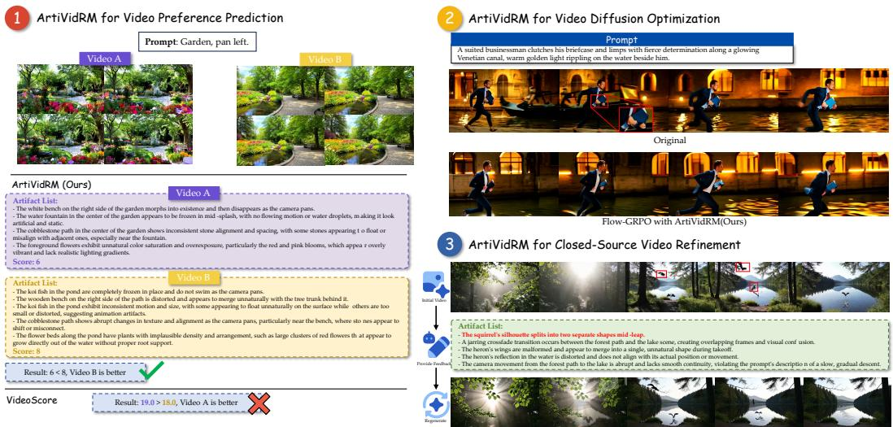  
Figure 1: Overview of ArtiVidRM. By explicitly predicting structured artifact lists before quality scoring, ArtiVidRM enables (1) accurate video preference prediction, (2) reward-guided optimization of text-to-video diffusion models, and (3) artifact-guided refinement of closed-source video generators. The closed-source refinement example shown in the figure uses Veo 3.1.

ArtiVidRM is trained in two stages. We first perform supervised fine-tuning on reference videoartifact annotations to establish structured artifact identification ability. We then apply reinforcement learning on paired human preference data to jointly optimize artifact discovery and preference prediction. artifact-level rewards encourage well-formed and semantically faithful artifact lists, while preference rewards align score differences with human judgments. Experiments show that ArtiVidRM achieves competitive performance on multiple video quality benchmarks, provides effective signals for video diffusion optimization, and enables targeted iterative refinement of closedsource video generators.

Our contributions are summarized as follows:

• We introduce an artifact-as-rubric reward modeling framework that explicitly connects ob servable generation artifacts with video quality judgments.

• We develop a two-stage training strategy that jointly optimizes structured artifact identification and human preference alignment.

• We demonstrate its effectiveness in video preference prediction, video diffusion optimization, and closed-source iterative refinement.

## 2 RELATED WORK

Text-to-Video Quality Assessment. Recent text-to-video models Liu et al. (2024c); Yang et al. (2025b); Wan et al. (2025); Seedance et al. (2026); Wang et al. (2025) have substantially improved visual fidelity, temporal coherence, and prompt following. Nevertheless, generated videos still exhibit spatial distortions, motion inconsistencies, temporal flickering, and semantic misalignment. Existing evaluation frameworks, such as EvalCrafter Liu et al. (2024b), VBench Huang et al. (2023), and T2VQA Kou et al. (2024), assess video quality through predefined metrics or learned quality predictors, while recent video reward models further learn human preferences from pointwise scores or pairwise comparisons.

Reasoning-Based Video Reward Models. Early reward models such as VideoScore He et al. (2024) directly predict multidimensional quality scores or pairwise preferences, but provide limited diagnostic evidence. As multimodal large language models have become capable of fine-grained and temporally grounded video understanding An et al. (2026); Li et al. (2026); Chen et al. (2026); Gao et al. (2026), recent generative reward models build on them to improve interpretability: UnifiedReward Wang et al. (2026a) supports pointwise scoring and pairwise ranking, VisionReward decomposes evaluation into fine-grained binary questions, VideoScore2 He et al. (2025) generates multidimensional scores with chain-of-thought reasoning, and DeScore Wang et al. (2026b) decouples reasoning generation from reward prediction. ArtiVidRM differs by learning an openvocabulary, video-specific artifact list as an explicitly optimized intermediate representation and directly using the predicted artifacts as rubrics for preference assessment.

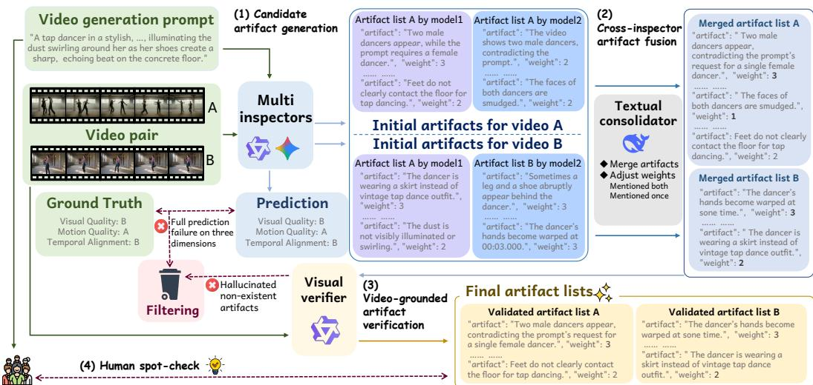  
Figure 2: Overview of the artifact-augmented preference data construction pipeline.

Preference Optimization for Video Generation. Learned reward models have increasingly been used to align image and video generators through preference-based fine-tuning or reinforcement learning Amini et al. (2024); Zhu et al. (2024); Chen et al. (2026); Xiao et al. (2025). Representative approaches include VideoDPO Liu et al. (2024a), OnlineVPO Zhang et al. (2025), Flow-GRPO Liu et al. (2025a), and DanceGRPO Xue et al. (2025). These studies mainly investigate generator optimization under a given reward function, whereas ArtiVidRM focuses on learning a reliable and interpretable video reward model that supports preference prediction, reward-guided training, and artifact-guided iterative refinement.

## 3 METHOD

## 3.1 ARTIFACT-AUGMENTED PREFERENCE DATA CONSTRUCTION

Candidate artifact generation. We build on VideoGen-RewardBench Liu et al. (2025b), which contains 26.5K $( p , v ^ { \check { A } } , v ^ { B } )$ triplets with expert pairwise preference annotations, including an overall preference label and three aspect-specific labels: Visual Quality (VQ), Motion Quality (MQ), and Text Alignment (TA). For each video pair, we employ Gemini-2.5-Pro Comanici et al. (2025) and Qwen3-VL-32B Yang et al. (2025a) as independent inspectors. Before identifying artifacts, each inspector first predicts the pairwise preferences along the three quality dimensions. A response is accepted only if at least two predictions agree with the human annotations; otherwise, the inspector is given one additional attempt. Responses that fail both attempts are discarded. Each candidate contains artifacts represented by a textual description and a severity score from 1 (minor) to 3 (se vere).

Cross-inspector artifact fusion. The two inspectors may describe the same underlying artifact in different wording or introduce inconsistent formats. We use DeepSeek-V4-Flash DeepSeek-AI et al. (2026) as a text-based consolidator to merge semantically equivalent entries, normalize descriptions, and remove near-duplicates. Artifacts supported by only one inspector have their severity weight reduced by one to reflect lower confidence, while artifacts supported by both retain their higher weight.

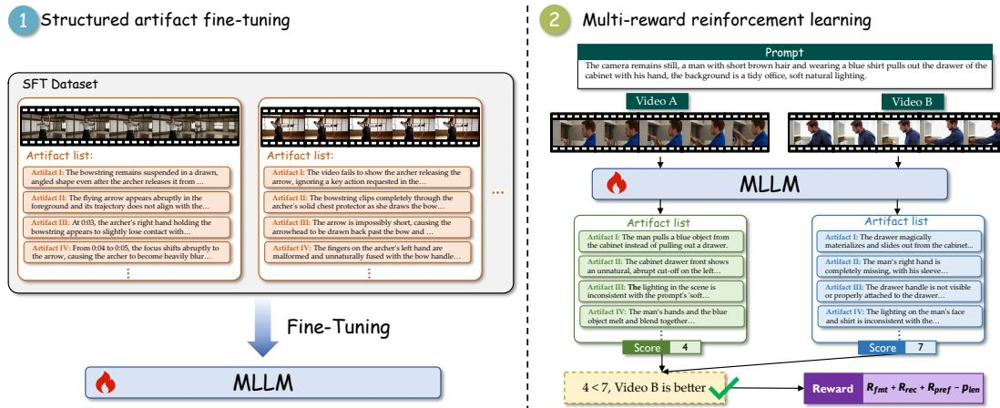  
Figure 3: Overview of the two-stage training pipeline of ArtiVidRM.

Video-grounded artifact verification. Open-ended artifact generation is susceptible to hallucinations, whereas verifying whether a specific artifact is visible in a video is a more constrained and reliable task Bai et al. (2022); Madaan et al. (2023). We therefore introduce a video-grounded verification stage in which Qwen3-VL-32B, acting as a verifier, re-inspects each video against the consolidated artifact list and removes any entry that cannot be directly confirmed from visible evidence, removing 26.8% of consolidated candidates, with a mean of 6.11 artifacts per video in the final candidate lists.

Final data format and human spot-check. Each processed instance contains the prompt, the verified artifact lists, the original human dimension-wise preference labels, and the overall pairwise preference label, all taken from the source dataset:

$$
\mathcal { D } _ { i } = \Big ( p _ { i } , v _ { i } ^ { A } , v _ { i } ^ { B } , D _ { i } ^ { A } , D _ { i } ^ { B } , y _ { i } ^ { \mathrm { V Q } } , y _ { i } ^ { \mathrm { M Q } } , y _ { i } ^ { \mathrm { T A } } , y _ { i } ^ { \mathrm { o v e r a l l } } \Big ) .\tag{1}
$$

After filtering, the dataset contains 22,640 video pairs.

To validate pipeline quality, we conduct an expert spot-check with six domain professionals. Each professional independently annotates the visible artifacts of 50 randomly sampled videos, of which 20 videos are shared by all six annotators to measure inter-annotator agreement. Comparing the expert annotations against the automated pipeline output, the pipeline achieves a recall of 87.84% and a precision of 84.37%. On the 20 shared videos, we measure inter-annotator agreement with Fleiss’ kappa: for each video, the artifacts reported by all annotators are pooled and semantically deduplicated, each pooled artifact is treated as an item, and each annotator’s judgment on whether the artifact is present is treated as a binary rating. The resulting Fleiss’ kappa across the six annotators is 0.78, indicating substantial agreement among human experts and supporting the reliability of the spot-check.

## 3.2 TWO-STAGE ARTIFACT-AWARE TRAINING

Stage I: Structured artifact fine-tuning. As shown in Figure 3, this stage establishes structured artifact identification through supervised fine-tuning (SFT). Given a text prompt p and a generated video v, the model is trained to produce a structured list of visible generation artifacts. Each artifact contains a textual description and a severity weight. We decompose each video pair into two single video examples and use the corresponding reference artifact list as the target response.

Let $z = ( z _ { 1 } , \dots , z _ { T } )$ denote the serialized structured annotation. The model is optimized using the standard autoregressive objective:

$$
\mathcal { L } _ { \mathrm { S F T } } = - \sum _ { t = 1 } ^ { T } \log \pi _ { \theta } ( z _ { t } \mid p , v , z _ { < t } ) .\tag{2}
$$

The resulting model, denoted by $\pi _ { \mathrm { S F T } }$ , is used to initialize the reinforcement learning stage.

Stage II: Multi-reward reinforcement learning. This stage jointly aligns artifact identification and video preference judgment through reinforcement learning. The task is formulated as a two-turn interaction: in the first turn the model observes Video A and outputs a structured artifact list together with an overall quality score; in the second turn it observes Video B and produces the same format.

We optimize the policy using Group Relative Policy Optimization (GRPO) Shao et al. (2024). For each training instance, G responses are sampled from the current policy. Given their trajectory rewards $\{ R _ { i } \} _ { i = 1 } ^ { G }$ , the normalized advantage is computed as

$$
\hat { A } _ { i } = \frac { R _ { i } - \bar { R } } { \sigma _ { R } } ,\tag{3}
$$

where $\bar { R }$ and $\sigma _ { R }$ denote the group mean and standard deviation of rewards.

The policy is optimized using the standard GRPO objective with KL regularization:

$$
\begin{array} { r } { \mathcal { L } = \mathcal { L } _ { \mathrm { G R P O } } + \beta D _ { \mathrm { K L } } ( \pi _ { \theta } \| \pi _ { \mathrm { S F T } } ) , } \end{array}\tag{4}
$$

where $\pi _ { \mathrm { S F T } }$ is the Stage I checkpoint used as the reference policy.

The trajectory reward is defined as

$$
R = \lambda _ { f } r _ { \mathrm { f m t } } + \lambda _ { r } r _ { \mathrm { r e c } } + \lambda _ { p } r _ { \mathrm { p r e f } } - \lambda _ { l } p _ { \mathrm { l e n } } ,\tag{5}
$$

where the four terms evaluate output validity, artifact coverage, preference correctness, and artifactlist length, respectively.

Format reward. The format reward awards partial credit per turn:

$$
\begin{array} { r } { r _ { \mathrm { f m t } } = \frac { 1 } { 2 } ( q _ { 1 } + q _ { 2 } ) , } \end{array}\tag{6}
$$

where $q _ { t } \in \{ 0 , 1 \}$ indicates whether turn t produces a parseable artifact list and a valid quality score. Assigning 0.5 per turn preserves a non-zero format signal even when only one turn fails, avoiding a hard floor that discards partially valid trajectories.

Semantic artifact-recall reward. For each parseable turn, the predicted artifact list is compared with the reference list using an LLM-based semantic matcher. A reference artifact is considered recalled if at least one predicted artifact is judged semantically equivalent. To avoid rewarding redundant predictions, multiple predicted artifacts matching the same reference artifact are counted only once. The recall reward is defined as the fraction of reference artifacts that are successfully covered and is averaged across the two turns. Following common practice, recall is set to one when the reference artifact list is empty.

Preference reward. After both turns, we compare the predicted quality scores $s ^ { A }$ and $s ^ { B }$ . The preference is determined by the score difference using a tie threshold τ. A reward of 1 is assigned when the predicted preference agrees with the human annotation, and 0 otherwise. This reward is computed only when both turns produce valid quality scores; otherwise, it is set to zero.

Asymmetric length penalty. To discourage over-generation not captured by recall, we apply an asymmetric length penalty. Let nˆ and n denote the predicted and reference artifact counts for a single video:

$$
p _ { \mathrm { l e n } } = { \left\{ \begin{array} { l l } { \operatorname* { m i n } { \bigg ( } 1 , ~ { \frac { { \hat { n } } - n } { n } } { \bigg ) } } & { { \hat { n } } > n } \\ { { \cfrac { 1 } { 2 } } \operatorname* { m i n } { \bigg ( } 1 , ~ { \frac { n - { \hat { n } } } { n } } { \bigg ) } } & { { \hat { n } } \leq n } \end{array} \right. }\tag{7}
$$

Over-generation is penalized at full rate; under-generation at half rate, since missing artifacts are already penalized by the recall reward. No penalty is applied when the reference list is empty. The penalties from both turns are averaged to obtain $p _ { \mathrm { l e n } }$ in Eq. (5).

<table><tr><td rowspan="2">Model</td><td colspan="2">GenAI-Bench</td><td colspan="2">VBench-2.0</td><td colspan="2">MonetBench</td></tr><tr><td>w/T</td><td>w/oT</td><td>w/T</td><td>w/oT</td><td>w/T</td><td>w/oT</td></tr><tr><td colspan="7">Discriminative Video Reward Models</td></tr><tr><td>VideoScore He et al. (2024)</td><td>0.481</td><td>0.719</td><td>0.429</td><td>0.459</td><td>0.491*</td><td>0.549*</td></tr><tr><td>VideoAlign Liu et al. (2025b)</td><td>0.494</td><td>0.726</td><td>0.525</td><td>0.473</td><td>0.505</td><td>0.594</td></tr><tr><td colspan="7">Generative Video Reward Models</td></tr><tr><td>VisionReward Xu et al. (2026)</td><td>0.518*</td><td>0.744*</td><td></td><td></td><td>0.640*</td><td>0.721*</td></tr><tr><td>UnifiedReward Wang et al. (2026a)</td><td>0.459</td><td>0.689</td><td>0.541</td><td>0.402</td><td>0.434</td><td>0.404</td></tr><tr><td>VideoScore2 He et al. (2025)</td><td>0.456</td><td>0.678</td><td>0.404</td><td>0.468</td><td>0.449</td><td>0.453</td></tr><tr><td colspan="7">Our Models</td></tr><tr><td>ArtiVidRM(Ours)</td><td>0.518</td><td>0.753</td><td>0.572</td><td>0.524</td><td>0.606</td><td>0.697</td></tr></table>

Table 1: Pairwise preference prediction accuracy on out-of-domain benchmarks. w/T: accuracy with ground-truth ties retained; w/oT: accuracy after removing ground-truth tie pairs. Each model uses its default tie threshold when applicable. Best results are shown in bold and second-best results are underlined; “–” indicates unavailable results. <sup>∗</sup> denotes results directly taken from the corresponding original publications.

## 4 EXPERIMENTS

Training Setting. We instantiate ArtiVidRM with Qwen3-VL-8B-Instruct as the backbone. During Stage II, we optimize the model using GRPO with a rollout size of 8 for each video pair. The actor is trained with a learning rate of $2 . 5 \times 1 0 ^ { - 7 }$ and a maximum gradient norm of 1.0. The reference policy is initialized from the Stage I checkpoint, with the KL regularization coefficient set to $\beta = 0 . 0 1$

Unless otherwise specified, the reward weights are $\lambda _ { f } = 0 . 1 5 , \lambda _ { r } = 0 . 4 0 , \lambda _ { p } = 0 . 4 5$ , and $\lambda _ { l } =$ 0.05, and the tie threshold is τ = 2. All experiments are conducted on a server with eight NVIDIA H100 GPUs using the verl framework and vLLM for rollout generation.

## 4.1 ARTIVIDRM FOR VIDEO PREFERENCE PREDICTION

Video preference prediction is evaluated from three complementary aspects: pairwise preference prediction, multi-video ranking, and pointwise quality scoring. All evaluations are conducted on out-of-domain benchmarks with no overlap with the training data.

Pairwise video preference prediction. To evaluate the generalization capability of ArtiVidRM, we conduct experiments on three out-of-domain benchmarks: GenAI-Bench Li et al. (2024), VBench-2.0 Zheng et al. (2025), and MonetBench Xu et al. (2026).

Table 1 summarizes the pairwise preference prediction results on the three benchmarks. On GenAI-Bench, it achieves the best performance under both settings, tying with VisionReward under the w/T setting. On VBench-2.0, ArtiVidRM achieves the best performance under both the w/T and w/oT settings. On MonetBench, it ranks second only to VisionReward.

Beyond the overall preference prediction accuracy, we further analyze the preference distributions produced by different reward models on GenAI-Bench. As shown in Figure 4a, ArtiVidRM produces a preference distribution that is closer to the ground-truth annotations, particularly in the proportion of tie predictions. In contrast, VideoScore He et al. (2024) and VideoAlign Liu et al. (2025b) predict ties much less frequently, showing a stronger tendency toward binary preferences.

Multi-video Ranking. We evaluate the ability of ArtiVidRM to rank multiple candidate videos using T2VQA-DB Kou et al. (2024), which contains 1,000 text prompts, each paired with 10 videos generated by different text-to-video models. Each video is annotated with a Mean Opinion Score (MOS) collected from 27 human raters.

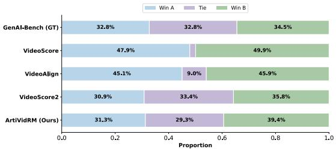  
(a)

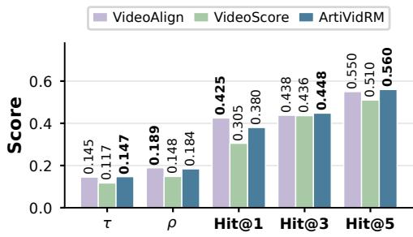  
(b)

Figure 4: (a) Preference prediction distributions of different reward models on GenAI-Bench. (b) Multi-video ranking performance on T2VQA-DB.
<table><tr><td rowspan="2">Variant</td><td colspan="3">Components</td><td colspan="2">GenAI-Bench</td><td colspan="2">VBench-2.0</td><td colspan="2">VisionRewardDB</td><td colspan="2">VideoFeedback2</td></tr><tr><td>SFT</td><td> $r _ { \mathrm { r e c } }$ </td><td> $r _ { \mathrm { l e n } }$ </td><td>w/T</td><td>w/oT</td><td>w/T</td><td>w/oT</td><td>w/T</td><td>w/oT</td><td>w/T</td><td>w/oT</td></tr><tr><td>Base (Qwen3-VL-8B)</td><td>x</td><td>x</td><td>x</td><td>0.435</td><td>0.497</td><td>0.508</td><td>0.226</td><td>0.346</td><td>0.411</td><td>0.543</td><td>0.575</td></tr><tr><td>w/o SFT</td><td>x</td><td>√</td><td>√</td><td>0.342</td><td>0.431</td><td>0.580</td><td>0.183</td><td>0.232</td><td>0.330</td><td>0.473</td><td>0.483</td></tr><tr><td>w/o Recall Reward</td><td>√</td><td>x</td><td>√</td><td>0.469</td><td>0.624</td><td>0.407</td><td>0.358</td><td>0.398</td><td>0.554</td><td>0.551</td><td>0.599</td></tr><tr><td>w/o Length Penalty</td><td>√</td><td>√</td><td>x</td><td>0.459</td><td>0.605</td><td>0.392</td><td>0.312</td><td>0.439</td><td>0.536</td><td>0.574</td><td>0.622</td></tr><tr><td>ArtiVidRM</td><td>√</td><td>√</td><td>√</td><td>0.518</td><td>0.753</td><td>0.572</td><td>0.524</td><td>0.606</td><td>0.697</td><td>0.567</td><td>0.619</td></tr></table>

Table 2: Ablation study on training components. SFT = supervised fine-tuning stage; $r _ { \mathrm { r e c } } =$ defect recall reward; $r _ { \mathrm { l e n } } = \mathrm { l e n g t h }$ penalty. w/T and w/oT metrics are consistent with Table 1.

For each prompt, we independently score all candidate videos and rank them according to the predicted quality scores. We then evaluate the predicted ordering using Kendall’s τ, Spearman’s $\rho ,$ and Hit@K, and report the average results over all prompts. Kendall’s τ and Spearman’s $\rho$ measure the agreement between the predicted ordering and the human MOS ordering, while Hit@K measures the percentage of prompts for which the human top-ranked video is retrieved within the model’s top-K predictions.

Figure 4b shows that ArtiVidRM consistently performs competitively across all ranking metrics. In particular, it achieves the highest Kendall’s τ together with the best Hit@3 and Hit@5, indicating that the predicted scores preserve the overall ordering of candidate videos while reliably identifying high-quality videos. VideoAlign attains higher Hit@1 and Spearman’s $\rho .$

Scoring Consistency. Beyond pairwise preference prediction and multi-video ranking, we further evaluate the consistency between predicted quality scores and human quality judgments. Following prior work, we compute the Pearson Correlation between the predicted quality scores and the corresponding human quality ratings on two public benchmarks.

Figure 5a shows the pointwise quality scoring results. ArtiVidRM achieves competitive Pearson Correlation across both benchmarks, outperforming all baselines on VideoFeedback2 and matching the performance of the strongest baseline on T2VQA-DB Kou et al. (2024).

## 4.2 ARTIVIDRM FOR VIDEO DIFFUSION OPTIMIZATION

To evaluate the practical utility of ArtiVidRM, we use it as the reward model for reinforcement learn ing fine-tuning of a text-to-video diffusion model. Specifically, we fine-tune Wan2.1-1.3B Wan et al. (2025) with Flow-GRPO Liu et al. (2025a), using ArtiVidRM to provide per-sample rewards during training. We evaluate the resulting model against the original Wan2.1-1.3B on the VBench Huang et al. (2023) benchmark.

Prompt: A little girl with blonde hair and big eyes is laughing happily.

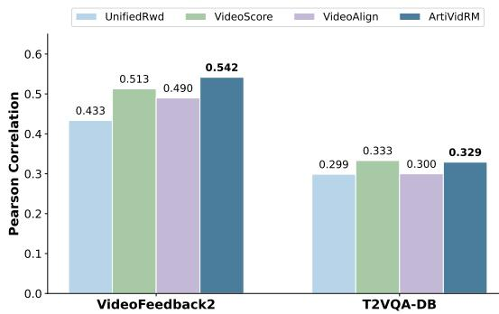  
(a)

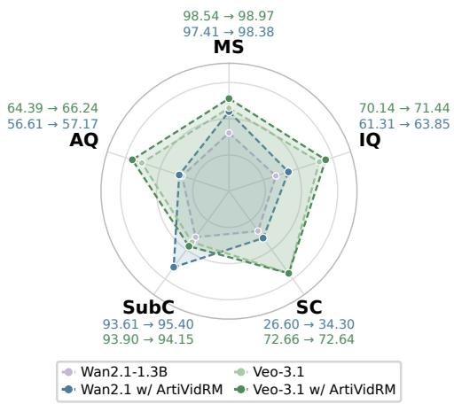  
(b)

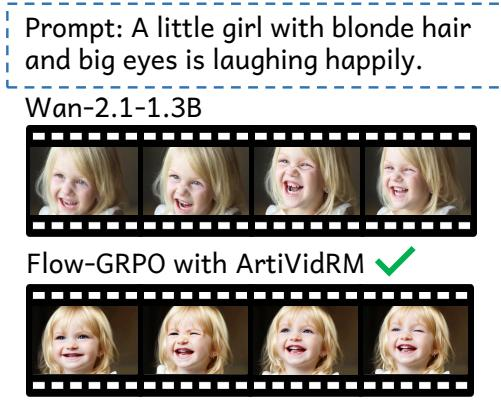  
(c)


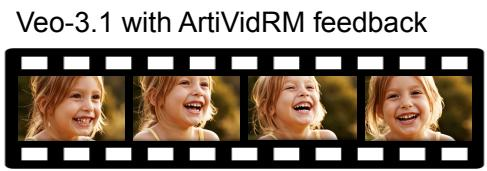  
(d)  
Figure 5: (a) Pointwise quality scoring performance measured by Pearson Correlation between predicted quality scores and human quality ratings. (b) VBench evaluation results of the diffusion model (Wan2.1-1.3B) before and after optimization with ArtiVidRM, and of Veo-3.1 before and after refinement with ArtiVidRM feedback. MS: Motion Smoothness; IQ: Imaging Quality; SC: Scene; SubC: Subject Consistency; AQ: Aesthetic Quality. Each axis is scaled to its own value range; the raw scores (before → after) are listed next to each axis. (c) A qualitative comparison between Wan-2.1 before and after optimization with ArtiVidRM. (d) A qualitative comparison between Veo-3.1 before and after refinement with ArtiVidRM feedback.

Quantitative results. Figure 5b reports scores on five VBench dimensions. Compared with the base model, the ArtiVidRM-trained model improves Motion Smoothness from 97.41% to 98.38% and Imaging Quality from 61.31% to 63.85%, demonstrating that the reward signal successfully propagates defect-level feedback into the generative model.

Human preference evaluation. To further assess the perceptual quality of the optimized video generation model, we conduct a human evaluation. We randomly sample 100 prompts from GenAI-Bench and generate videos using both the original and the ArtiVidRM-optimized models. Two expert annotators each evaluate 50 video pairs in a blind pairwise comparison, selecting the preferred video or marking a tie when the quality difference is negligible. Overall, the videos generated by the ArtiVidRM-optimized model are preferred in 60% of the comparisons, while 14% are judged as ties. Figure 5c shows a representative example where the ArtiVidRM-optimized model mitigates the distortion artifacts in the original generation and improves the overall visual quality, and additional examples are provided in the appendix.

## 4.3 ARTIVIDRM FOR CLOSED-SOURCE VIDEO REFINEMENT

Beyond training open-weight diffusion models, ArtiVidRM can also be used to refine closed-source video generators without access to model weights. Given an initial generated video, ArtiVidRM predicts a structured artifact list describing its defects. The artifact list is converted into natural language feedback and appended to the original prompt, guiding the generator to produce a refined video in a second generation round. We evaluate the refined videos using both VBench and human preference judgments.

Quantitative results. As shown in Figure 5b, ArtiVidRM feedback improves the quality of Veo-3.1 generations, yielding higher scores on four of the five VBench dimensions. The gains concentrate on the appearance-related dimensions, with Aesthetic Quality improving by 1.85 and Imaging Quality by 1.30, whereas Scene and Subject Consistency remain nearly unchanged. This pattern matches the nature of the feedback: the predicted artifacts mostly describe rendering, lighting, and texture defects, which the generator can address in a second round, while the scene layout is constrained by the original prompt that is kept unchanged. The improvements are smaller than those obtained by reward-guided fine-tuning of Wan2.1-1.3B, which is expected because the generator weights are not updated and the feedback enters only through the prompt.

Human preference evaluation. We conduct the same human evaluation for the closed-source Veo-3.1. The ArtiVidRM-refined videos are preferred in 71% of the comparisons, with 18% judged as ties. In the remaining cases the original video is preferred, which we attribute mainly to sampling variance: the refined video is a fresh generation rather than an edit of the original, so a second round can introduce new artifacts even when the reported ones are resolved. More detailed results are provided in the appendix.

## 4.4 ABLATION STUDY

We conduct ablation studies to evaluate the contribution of each training component. Specifically, we compare five variants: Base, which directly uses the pretrained Qwen3-VL-8B-Instruct; w/o SFT, which removes supervised fine-tuning; w/o Recall Reward, which removes the semantic recall reward; w/o Length Penalty, which removes the length penalty; and the full ArtiVidRM. Unless otherwise specified, all variants use the same model architecture, training settings, and evaluation protocol.

Table 2 summarizes the ablation results. Compared with the pretrained Qwen3-VL-8B, the full ArtiVidRM achieves the best performance on most benchmarks. Removing the supervised finetuning stage causes a noticeable performance drop, highlighting the importance of structured artifact learning before reinforcement learning.

The semantic recall reward also plays an important role. Removing $r _ { \mathrm { r e c } }$ consistently degrades preference prediction performance, indicating that encouraging comprehensive artifact identification enables the model to capture more complete quality signals, which in turn benefits downstream reward estimation.

We further compare the average length of the predicted artifact lists across all benchmarks. The average length is 1.7 for Base, 5.9 for w/o SFT, 4.7 for the full model, 4.0 for w/o Recall Reward, and 2.7 for w/o Length Penalty. These results show that the semantic recall reward encourages more comprehensive artifact prediction, the length penalty encourages active artifact generation, and SFT stabilizes artifact prediction. More detailed results are provided in the appendix.

## 5 CONCLUSION

We present ArtiVidRM, an artifact-as-rubric reward model for video generation. By explicitly modeling structured artifacts, ArtiVidRM achieves strong performance on video preference prediction and enables both reward-guided optimization of open-weight diffusion models and feedback-based refinement of closed-source video generators. We hope this work inspires future research on video reward modeling.

## REFERENCES

Afra Amini, Tim Vieira, and Ryan Cotterell. Direct preference optimization with an offset, 2024. URL https://arxiv.org/abs/2402.10571.

Zhaochong An, Zirui Li, Mingqiao Ye, Feng Qiao, Jiaang Li, Zongwei Wu, Vishal Thengane, Chengzu Li, Lei Li, Luc Van Gool, Guolei Sun, and Serge Belongie. Video understanding: From geometry and semantics to unified models. Machine Intelligence Research, 23 (5):934–968, July 2026. ISSN 2731-5398. doi: 10.1007/s11633-026-1656-7. URL http: //dx.doi.org/10.1007/s11633-026-1656-7.

Yuntao Bai, Saurav Kadavath, Sandipan Kundu, Amanda Askell, Jackson Kernion, Andy Jones, Anna Chen, Anna Goldie, Azalia Mirhoseini, Cameron McKinnon, Carol Chen, Catherine Olsson, Christopher Olah, Danny Hernandez, Dawn Drain, Deep Ganguli, Dustin Li, Eli Tran-Johnson, Ethan Perez, Jamie Kerr, Jared Mueller, Jeffrey Ladish, Joshua Landau, Kamal Ndousse, Kamile Lukosuite, Liane Lovitt, Michael Sellitto, Nelson Elhage, Nicholas Schiefer, Noemi Mercado, Nova DasSarma, Robert Lasenby, Robin Larson, Sam Ringer, Scott Johnston, Shauna Kravec, Sheer El Showk, Stanislav Fort, Tamera Lanham, Timothy Telleen-Lawton, Tom Conerly, Tom Henighan, Tristan Hume, Samuel R. Bowman, Zac Hatfield-Dodds, Ben Mann, Dario Amodei, Nicholas Joseph, Sam McCandlish, Tom Brown, and Jared Kaplan. Constitutional ai: Harmlessness from ai feedback, 2022. URL https://arxiv.org/abs/2212.08073.

Yu Chen, Caorui Li, Ziyu Xiong, Yidong Wang, Mingqi Gao, Shuman Liu, Biao Liu, Chunfeng Yang, Anxiang Zeng, Haibo Zhang, and Chaofan Chen. Omnireasoner: Thinking with long audio-video via native tool use, 2026. URL https://arxiv.org/abs/2607.19339.

Gheorghe Comanici et al. Gemini 2.5: Pushing the frontier with advanced reasoning, multimodality, long context, and next generation agentic capabilities, 2025. URL https://arxiv.org/ abs/2507.06261.

DeepSeek-AI, Anyi Xu, Bangcai Lin, Bing Xue, Bingxuan Wang, Bingzheng Xu, Bochao Wu, Bowei Zhang, Chaofan Lin, Chen Dong, Chenchen Ling, Chengda Lu, Chenggang Zhao, Chengqi Deng, Chengyu Hou, Chenhao Xu, Chenze Shao, Chong Ruan, Conner Sun, Damai Dai, Daya Guo, Dejian Yang, Deli Chen, Donghao Li, Dongjie Ji, Erhang Li, Fang Wei, Fangyun Lin, Fangzhou Yuan, Feiyu Xia, Fucong Dai, Guangbo Hao, Guanting Chen, Guoai Cao, Guolai Meng, Guowei Li, Han Yu, Han Zhang, Hanwei Xu, Hao Li, Haofen Liang, Haoling Zhang, Haoming Luo, Haoran Wei, Haotian Yuan, Haowei Zhang, Haowen Luo, Haoyu Chen, Haozhe Ji, Hengqing Zhang, Honghui Ding, Hongxuan Tang, Huanqi Cao, Huazuo Gao, Hui Qu, Hui Zeng, J Yang, JQ Zhu, Jia Luo, Jia Song, Jia Yu, Jialiang Huang, Jialu Cai, Jian Liang, Jiangting Zhou, Jiasheng Ye, Jiashi Li, Jiaxin Xu, Jiewen Hu, Jieyu Yang, Jin Chen, Jin Yan, Jingchang Chen, Jingli Zhou, Jingting Xiang, Jingyang Yuan, Jingyuan Cheng, Jingzi Zhou, Jinhua Zhu, Jiping Yu, Joseph Sun, Jun Ran, Junguang Jiang, Junjie Qiu, Junlong Li, Junmin Zheng, Junxiao Song, Kai Dong, Kaige Gao, Kang Guan, Kexing Zhou, Kezhao Huang, Kuai Yu, Lean Wang, Lecong Zhang, Lei Wang, Leyi Xia, Li Zhang, Liang Zhao, Lihua Guo, Lingxiao Luo, Linwang Ma, Linyan Zhu, Litong Wang, Liyu Cai, Liyue Zhang, Longhao Chen, MS Di, MY Xu, Max Mei, Miaojun Wang, Mingchuan Zhang, Minghua Zhang, Minghui Tang, Mingming Li, Mingxu Zhou, Minmin Han, Ning Wang, Panpan Huang, Panpan Wang, Peixin Cong, Peiyi Wang, Peng Zhang, Qiancheng Wang, Qihao Zhu, Qingyang Li, Qinyu Chen, Qiushi Du, Qiwei Jiang, Rui Tian, Ruifan Xu, Ruijie Lu, Ruiling Xu, Ruiqi Ge, Ruisong Zhang, Ruizhe Pan, Runji Wang, Runqian Chen, Runqiu Yin, Runxin Xu, Ruomeng Shen, Ruoyu Zhang, Ruyi Chen, SH Liu, Shanghao Lu, Shangmian Sun, Shangyan Zhou, Shanhuang Chen, Shaofei Cai, Shaoheng Nie, Shaoqing Wu, Shaoyuan Chen, Shengding Hu, Shengyu Liu, Shiqiang Hu, Shirong Ma, Shiyu Wang, Shuiping Yu, Shunfeng Zhou, Shuting Pan, Shuying Yu, Songyang Zhou, Tao Ni, Tao Yun, Tian Jin, Tian Pei, Tian Ye, Tianle Lin, Tianran Ji, Tianyi Cui, Tianyuan Yue, Tingting Yu, Tun Wang, W Zhang, WL Xiao, Wangding Zeng, Wei An, Weilin Zhao, Wen Liu, Wenfeng Liang, Wenjie Pang, Wenjing Luo, Wenjing Yao, Wenjun Gao, Wenkai Yang, Wenlve Huang, Wenqing Hou, Wentao Zhang, Wenting Ma, Xi Gao, Xiang He, Xiangwen Wang, Xianzu Wang, Xiao Bi, Xiaodong Liu, Xiaohan Wang, Xiaokang Chen, Xiaokang Zhang, Xiaotao Nie, Xiaowen Sun, Xiaoxiang Wang, Xin Cheng, Xin Liu, Xin Xie, Xingchao Liu, Xingchen Liu, Xingkai Yu, Xingyou Li, Xinyu Yang, Xinyu Zhang, Xu Chen, Xuanyu Wang, Xuecheng Su, Xueyin Chen, Xuheng Lin, Xuwei Fu, YC Yan, YQ Wang, YW Ma, Yanfeng Luo, Yang Zhang, Yanhong Xu,

Yanru Ma, Yanwen Huang, Yao Li, Yao Li, Yao Xu, Yao Zhao, Yaofeng Sun, Yaohui Wang, Yi Qian, Yi Shao, Yi Yu, Yichao Zhang, Yifan Ding, Yifan Shi, Yijia Wu, Yiliang Xiong, Yiling Ma, Ying He, Ying Tang, Ying Zhou, Yingjia Luo, Yinmin Zhong, Yishi Piao, Yisong Wang, Yixiang Zhang, Yixiao Chen, Yixuan Tan, Yixuan Wei, Yiyang Ma, Yiyuan Liu, Yonglun Yang, Yongqiang Guo, Yongtong Wu, Yu Wu, YuKun Li, Yuan Cheng, Yuan Ou, Yuanfan Xu, Yuanhao Li, Yuduan Wang, Yuehan Yang, Yuer Xu, Yuhan Wu, Yuhao Meng, Yuheng Zou, Yukun Zha, Yunfan Xiong, Yupeng Chen, Yuping Lin, Yuqian Cao, Yuqian Wang, Yushun Zhang, Yuting Yan, Yutong Lin, Yuxian Gu, Yuxiang Luo, Yuxiang You, Yuxuan Liu, Yuxuan Zhou, Yuyang Zhou, Yuzhen Huang, ZF Wu, Zehao Wang, Zehua Zhao, Zehui Ren, Zekai Zhang, Zhangli Sha, Zhe Fu, Zhe Ju, Zhean Xu, Zhenda Xie, Zhengyan Zhang, Zheren Gao, Zhewen Hao, Zhibin Gou, Zhicheng Ma, Zhigang Yan, Zhihong Shao, Zhixian Huang, Zhixuan Chen, Zhiyu Wu, Zhizhou Ren, Zhongyu Wu, Zhuoshu Li, Zhuping Zhang, Zian Xu, Zihao Wang, Zihua Qu, Zihui Gu, Zijia Zhu, Zilin Li, Zipeng Zhang, Ziwei Xie, Ziyi Gao, Ziyi Wan, Zizheng Pan, and Zongqing Yao. Deepseek-v4: Towards highly efficient million-token context intelligence, 2026. URL https://arxiv.org/abs/2606.19348.

Yihe Deng and Paul Mineiro. Flow-dpo: Improving llm mathematical reasoning through online multi-agent learning, 2024. URL https://arxiv.org/abs/2410.22304.

Mingqi Gao, Hongyuan Dong, Yifei Chen, Zhisheng Zhong, Zheng Ruan, Wenjin Hou, Yu Chen, Han Hu, and Yansong Tang. Claim-level rubric rewards for video caption reinforcement learning, 2026. URL https://arxiv.org/abs/2607.05150.

Xuan He, Dongfu Jiang, Ge Zhang, Max Ku, Achint Soni, Sherman Siu, Haonan Chen, Abhranil Chandra, Ziyan Jiang, Aaran Arulraj, Kai Wang, Quy Duc Do, Yuansheng Ni, Bohan Lyu, Yaswanth Narsupalli, Rongqi Fan, Zhiheng Lyu, Yuchen Lin, and Wenhu Chen. Videoscore: Building automatic metrics to simulate fine-grained human feedback for video generation, 2024. URL https://arxiv.org/abs/2406.15252.

Xuan He, Dongfu Jiang, Ping Nie, Minghao Liu, Zhengxuan Jiang, Mingyi Su, Wentao Ma, Junru Lin, Chun Ye, Yi Lu, Keming Wu, Benjamin Schneider, Quy Duc Do, Zhuofeng Li, Yiming Jia, Yuxuan Zhang, Guo Cheng, Haozhe Wang, Wangchunshu Zhou, Qunshu Lin, Yuanxing Zhang, Ge Zhang, Wenhao Huang, and Wenhu Chen. Videoscore2: Think before you score in generative video evaluation, 2025. URL https://arxiv.org/abs/2509.22799.

Ziqi Huang, Yinan He, Jiashuo Yu, Fan Zhang, Chenyang Si, Yuming Jiang, Yuanhan Zhang, Tianxing Wu, Qingyang Jin, Nattapol Chanpaisit, Yaohui Wang, Xinyuan Chen, Limin Wang, Dahua Lin, Yu Qiao, and Ziwei Liu. Vbench: Comprehensive benchmark suite for video generative models, 2023. URL https://arxiv.org/abs/2311.17982.

Tengchuan Kou, Xiaohong Liu, Zicheng Zhang, Chunyi Li, Haoning Wu, Xiongkuo Min, Guangtao Zhai, and Ning Liu. Subjective-aligned dataset and metric for text-to-video quality assessment, 2024. URL https://arxiv.org/abs/2403.11956.

Wentao Lei, Jinting Wang, Fengji Ma, Guanjie Huang, and Li Liu. A comprehensive survey on human video generation: Challenges, methods, and insights, 2024. URL https://arxiv. org/abs/2407.08428.

Baiqi Li, Zhiqiu Lin, Deepak Pathak, Jiayao Li, Yixin Fei, Kewen Wu, Tiffany Ling, Xide Xia, Pengchuan Zhang, Graham Neubig, and Deva Ramanan. Genai-bench: Evaluating and improving compositional text-to-visual generation, 2024. URL https://arxiv.org/abs/2406. 13743.

Caorui Li, Yu Chen, Yiyan Ji, Jin Xu, Zhenyu Cui, Shihao Li, Yuanxing Zhang, Wentao Wang, Zhenghao Song, Dingling Zhang, Ying He, Haoxiang Liu, Yuxuan Wang, Qiufeng Wang, Jiafu Tang, Zhenhe Wu, Jiehui Luo, Zhiyu Pan, Weihao Xie, Chenchen Zhang, Zhaohui Wang, Jiayi Tian, Yanghai Wang, Zhe Cao, Minxin Dai, Ke Wang, Runzhe Wen, Yinghao Ma, Yaning Pan, Sungkyun Chang, Termeh Taheri, Haiwen Xia, Christos Plachouras, Emmanouil Benetos, Yizhi Li, Ge Zhang, Jian Yang, Tianhao Peng, Zili Wang, Minghao Liu, Junran Peng, Zhaoxiang Zhang, and Jiaheng Liu. Omnivideobench: Towards audio-visual understanding evaluation for omni mllms, 2026. URL https://arxiv.org/abs/2510.10689.

Jie Liu, Gongye Liu, Jiajun Liang, Yangguang Li, Jiaheng Liu, Xintao Wang, Pengfei Wan, Di Zhang, and Wanli Ouyang. Flow-grpo: Training flow matching models via online rl, 2025a. URL https://arxiv.org/abs/2505.05470.

Jie Liu, Gongye Liu, Jiajun Liang, Ziyang Yuan, Xiaokun Liu, Mingwu Zheng, Xiele Wu, Qiulin Wang, Menghan Xia, Xintao Wang, Xiaohong Liu, Fei Yang, Pengfei Wan, Di Zhang, Kun Gai, Yujiu Yang, and Wanli Ouyang. Improving video generation with human feedback, 2025b. URL https://arxiv.org/abs/2501.13918.

Runtao Liu, Haoyu Wu, Zheng Ziqiang, Chen Wei, Yingqing He, Renjie Pi, and Qifeng Chen. Videodpo: Omni-preference alignment for video diffusion generation, 2024a. URL https: //arxiv.org/abs/2412.14167.

Yaofang Liu, Xiaodong Cun, Xuebo Liu, Xintao Wang, Yong Zhang, Haoxin Chen, Yang Liu, Tieyong Zeng, Raymond Chan, and Ying Shan. Evalcrafter: Benchmarking and evaluating large video generation models, 2024b. URL https://arxiv.org/abs/2310.11440.

Yixin Liu, Kai Zhang, Yuan Li, Zhiling Yan, Chujie Gao, Ruoxi Chen, Zhengqing Yuan, Yue Huang, Hanchi Sun, Jianfeng Gao, Lifang He, and Lichao Sun. Sora: A review on background, technology, limitations, and opportunities of large vision models, 2024c. URL https: //arxiv.org/abs/2402.17177.

Yue Ma, Kunyu Feng, Zhongyuan Hu, Xinyu Wang, Yucheng Wang, Mingzhe Zheng, Bingyuan Wang, Qinghe Wang, Xuanhua He, Hongfa Wang, Chenyang Zhu, Hongyu Liu, Yingqing He, Zeyu Wang, Zhifeng Li, Xiu Li, Sirui Han, Yike Guo, Wei Liu, Dan Xu, Linfeng Zhang, and Qifeng Chen. Controllable video generation: A survey, 2026. URL https://arxiv.org/ abs/2507.16869.

Aman Madaan, Niket Tandon, Prakhar Gupta, Skyler Hallinan, Luyu Gao, Sarah Wiegreffe, Uri Alon, Nouha Dziri, Shrimai Prabhumoye, Yiming Yang, Shashank Gupta, Bodhisattwa Prasad Majumder, Katherine Hermann, Sean Welleck, Amir Yazdanbakhsh, and Peter Clark. Selfrefine: Iterative refinement with self-feedback, 2023. URL https://arxiv.org/abs/ 2303.17651.

Team Seedance, De Chen, Liyang Chen, Xin Chen, Ying Chen, Zhuo Chen, Zhuowei Chen, Feng Cheng, Tianheng Cheng, Yufeng Cheng, Mojie Chi, Xuyan Chi, Jian Cong, Qinpeng Cui, Fei Ding, Qide Dong, Yujiao Du, Haojie Duanmu, Junliang Fan, Jiarui Fang, Jing Fang, Zetao Fang, Chengjian Feng, Yu Gao, Diandian Gu, Dong Guo, Hanzhong Guo, Qiushan Guo, Boyang Hao, Hongxiang Hao, Haoxun He, Jiaao He, Qian He, Tuyen Hoang, Heng Hu, Ruoqing Hu, Yuxiang Hu, Jiancheng Huang, Weilin Huang, Zhaoyang Huang, Zhongyi Huang, Jishuo Jin, Ming Jing, Ashley Kim, Shanshan Lao, Yichong Leng, Bingchuan Li, Gen Li, Haifeng Li, Huixia Li, Jiashi Li, Ming Li, Xiaojie Li, Xingxing Li, Yameng Li, Yiying Li, Yu Li, Yueyan Li, Chao Liang, Han Liang, Jianzhong Liang, Ying Liang, Wang Liao, J. H. Lien, Shanchuan Lin, Xi Lin, Feng Ling, Yue Ling, Fangfang Liu, Jiawei Liu, Jihao Liu, Jingtuo Liu, Shu Liu, Sichao Liu, Wei Liu, Xue Liu, Zuxi Liu, Ruijie Lu, Lecheng Lyu, Jingting Ma, Tianxiang Ma, Xiaonan Nie, Jingzhe Ning, Junjie Pan, Xitong Pan, Ronggui Peng, Xueqiong Qu, Yuxi Ren, Yuchen Shen, Guang Shi, Lei Shi, Yinglong Song, Fan Sun, Li Sun, Renfei Sun, Wenjing Tang, Boyang Tao, Zirui Tao, Dongliang Wang, Feng Wang, Hulin Wang, Ke Wang, Qingyi Wang, Rui Wang, Shuai Wang, Shulei Wang, Weichen Wang, Xuanda Wang, Yanhui Wang, Yue Wang, Yuping Wang, Yuxuan Wang, Zijie Wang, Ziyu Wang, Guoqiang Wei, Meng Wei, Di Wu, Guohong Wu, Hanjie Wu, Huachao Wu, Jian Wu, Jie Wu, Ruolan Wu, Shaojin Wu, Xiaohu Wu, Xinglong Wu, Yonghui Wu, Ruiqi Xia, Xin Xia, Xuefeng Xiao, Shuang Xu, Bangbang Yang, Jiaqi Yang, Runkai Yang, Tao Yang, Yihang Yang, Zhixian Yang, Ziyan Yang, Fulong Ye, Bingqian Yi, Xing Yin, Yongbin You, Linxiao Yuan, Weihong Zeng, Xuejiao Zeng, Yan Zeng, Siyu Zhai, Zhonghua Zhai, Bowen Zhang, Chenlin Zhang, Heng Zhang, Jun Zhang, Manlin Zhang, Peiyuan Zhang, Shuo Zhang, Xiaohe Zhang, Xiaoying Zhang, Xinyan Zhang, Xinyi Zhang, Yichi Zhang, Zixiang Zhang, Haiyu Zhao, Huating Zhao, Liming Zhao, Yian Zhao, Guangcong Zheng, Jianbin Zheng, Xiaozheng Zheng, Zerong Zheng, Kuan Zhu, and Feilong Zuo. Seedance 2.0: Advancing video generation for world complexity, 2026. URL https://arxiv.org/abs/2604.14148.

Zhihong Shao, Peiyi Wang, Qihao Zhu, Runxin Xu, Junxiao Song, Xiao Bi, Haowei Zhang, Mingchuan Zhang, Y. K. Li, Y. Wu, and Daya Guo. Deepseekmath: Pushing the limits of mathematical reasoning in open language models, 2024. URL https://arxiv.org/abs/2402. 03300.

Team Wan, Ang Wang, Baole Ai, Bin Wen, Chaojie Mao, Chen-Wei Xie, Di Chen, Feiwu Yu, Haiming Zhao, Jianxiao Yang, Jianyuan Zeng, Jiayu Wang, Jingfeng Zhang, Jingren Zhou, Jinkai Wang, Jixuan Chen, Kai Zhu, Kang Zhao, Keyu Yan, Lianghua Huang, Mengyang Feng, Ningyi Zhang, Pandeng Li, Pingyu Wu, Ruihang Chu, Ruili Feng, Shiwei Zhang, Siyang Sun, Tao Fang, Tianxing Wang, Tianyi Gui, Tingyu Weng, Tong Shen, Wei Lin, Wei Wang, Wei Wang, Wenmeng Zhou, Wente Wang, Wenting Shen, Wenyuan Yu, Xianzhong Shi, Xiaoming Huang, Xin Xu, Yan Kou, Yangyu Lv, Yifei Li, Yijing Liu, Yiming Wang, Yingya Zhang, Yitong Huang, Yong Li, You Wu, Yu Liu, Yulin Pan, Yun Zheng, Yuntao Hong, Yupeng Shi, Yutong Feng, Zeyinzi Jiang, Zhen Han, Zhi-Fan Wu, and Ziyu Liu. Wan: Open and advanced large-scale video generative models, 2025. URL https://arxiv.org/abs/2503.20314.

Jun Wang, Xijuan Zeng, Chunyu Qiang, Ruilong Chen, Shiyao Wang, Le Wang, Wangjing Zhou, Pengfei Cai, Jiahui Zhao, Nan Li, Zihan Li, Yuzhe Liang, Xiaopeng Wang, Haorui Zheng, Ming Wen, Kang Yin, Yiran Wang, Nan Li, Feng Deng, Liang Dong, Chen Zhang, Di Zhang, and Kun Gai. Kling-foley: Multimodal diffusion transformer for high-quality video-to-audio generation, 2025. URL https://arxiv.org/abs/2506.19774.

Yibin Wang, Yuhang Zang, Hao Li, Cheng Jin, and Jiaqi Wang. Unified reward model for multimodal understanding and generation, 2026a. URL https://arxiv.org/abs/2503. 05236.

Yuan Wang, Ouxiang Li, Yulong Xu, Borui Liao, Jiajun Liang, Jinghan Li, Meng Wang, Xintao Wang, Pengfei Wan, Kuien Liu, and Xiang Wang. Think, then score: Decoupled reasoning and scoring for video reward modeling, 2026b. URL https://arxiv.org/abs/2605.05922.

Yicheng Xiao, Yu Chen, Haoxuan Ma, Jiale Hong, Caorui Li, Lingxiang Wu, Haiyun Guo, and Jinqiao Wang. Pixclip: Achieving fine-grained visual language understanding via any-granularity pixel-text alignment learning, 2025. URL https://arxiv.org/abs/2511.04601.

Jiazheng Xu, Yu Huang, Jiale Cheng, Yuanming Yang, Jiajun Xu, Yuan Wang, Wenbo Duan, Shen Yang, Qunlin Jin, Shurun Li, Jiayan Teng, Zhuoyi Yang, Wendi Zheng, Xiao Liu, Dan Zhang, Ming Ding, Xiaohan Zhang, Xiaotao Gu, Shiyu Huang, Minlie Huang, Jie Tang, and Yuxiao Dong. Visionreward: Fine-grained multi-dimensional human preference learning for image and video generation, 2026. URL https://arxiv.org/abs/2412.21059.

Zeyue Xue, Jie Wu, Yu Gao, Fangyuan Kong, Lingting Zhu, Mengzhao Chen, Zhiheng Liu, Wei Liu, Qiushan Guo, Weilin Huang, and Ping Luo. Dancegrpo: Unleashing grpo on visual generation, 2025. URL https://arxiv.org/abs/2505.07818.

An Yang, Anfeng Li, Baosong Yang, Beichen Zhang, Binyuan Hui, Bo Zheng, Bowen Yu, Chang Gao, Chengen Huang, Chenxu Lv, Chujie Zheng, Dayiheng Liu, Fan Zhou, Fei Huang, Feng Hu, Hao Ge, Haoran Wei, Huan Lin, Jialong Tang, Jian Yang, Jianhong Tu, Jianwei Zhang, Jianxin Yang, Jiaxi Yang, Jing Zhou, Jingren Zhou, Junyang Lin, Kai Dang, Keqin Bao, Kexin Yang, Le Yu, Lianghao Deng, Mei Li, Mingfeng Xue, Mingze Li, Pei Zhang, Peng Wang, Qin Zhu, Rui Men, Ruize Gao, Shixuan Liu, Shuang Luo, Tianhao Li, Tianyi Tang, Wenbiao Yin, Xingzhang Ren, Xinyu Wang, Xinyu Zhang, Xuancheng Ren, Yang Fan, Yang Su, Yichang Zhang, Yinger Zhang, Yu Wan, Yuqiong Liu, Zekun Wang, Zeyu Cui, Zhenru Zhang, Zhipeng Zhou, and Zihan Qiu. Qwen3 technical report, 2025a. URL https://arxiv.org/abs/2505.09388.

Zhuoyi Yang, Jiayan Teng, Wendi Zheng, Ming Ding, Shiyu Huang, Jiazheng Xu, Yuanming Yang, Wenyi Hong, Xiaohan Zhang, Guanyu Feng, Da Yin, Yuxuan Zhang, Weihan Wang, Yean Cheng, Bin Xu, Xiaotao Gu, Yuxiao Dong, and Jie Tang. Cogvideox: Text-to-video diffusion models with an expert transformer, 2025b. URL https://arxiv.org/abs/2408.06072.

Jiacheng Zhang, Jie Wu, Weifeng Chen, Yatai Ji, Xuefeng Xiao, Weilin Huang, and Kai Han. Onlinevpo: Align video diffusion model with online video-centric preference optimization, 2025. URL https://arxiv.org/abs/2412.15159.

Dian Zheng, Ziqi Huang, Hongbo Liu, Kai Zou, Yinan He, Fan Zhang, Lulu Gu, Yuanhan Zhang, Jingwen He, Wei-Shi Zheng, Yu Qiao, and Ziwei Liu. Vbench-2.0: Advancing video generation benchmark suite for intrinsic faithfulness, 2025. URL https://arxiv.org/abs/2503. 21755.

Zhengbang Zhu, Hanye Zhao, Haoran He, Yichao Zhong, Shenyu Zhang, Haoquan Guo, Tingting Chen, and Weinan Zhang. Diffusion models for reinforcement learning: A survey, 2024. URL https://arxiv.org/abs/2311.01223.

## Wan-2.1-1.3B

## Optimized with ArtiVidRM

Prompt: Classic fantasy movie framing with soft magical glow, an old elf walks through an ancient forest full of glowing mushrooms, while tiny �re�ies �y around his weathered cloak.

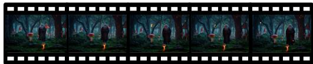


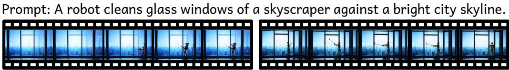

Prompt: A ripe orange falls slowly from the branch and lands on soft green grass.

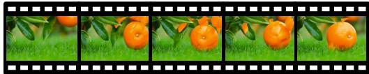


Prompt: Soft backlight shot, a little girl holds a glowing lantern and walks down an ancient stone street at dusk.


Prompt: A vintage co�ee cup steams gently beside an open window on a rainy morning.


Prompt: Cyberpunk: Rainy neon futuristic street with hovering �ying cars.

  
Figure 6: Representative qualitative comparisons of Wan-2.1-1.3B before and after optimization with ArtiVidRM.

## A TRAINING PROMPT

We use the following two-turn prompt during training.

## System Prompt

You are a video defect detection expert. Given a text prompt and an AI-generated video, identify all visible defects in the video and assign an overall quality score (1 = worst, 10 = best). For each defect, specify:

• "issue" — one concise sentence describing a specific, observable defect;

• "weight" — severity: 1 (minor), 2 (moderate), or 3 (severe).

Only report defects that are clearly visible and unambiguous. If no defects are visible, output an empty defect list.

```jsonl
Output only valid JSON in exactly the following format:
{"defects": [{"issue": "...", "weight": <1|2|3>}, ...],
"score": <1-10 integer>}
Turn 1: Video A
User
Text prompt: "{text_prompt}"
Video A:
<video>
Evaluate Video A. Identify all visible defects and assign an
overall quality score.
{"defects": [{"issue": "...", "weight": <1|2|3>}, ...],
"score": <1-10 integer>}
Turn 2: Video B
User
---VIDEO_B---
Text prompt: "{text_prompt}"
Evaluate Video B. Identify all visible defects and assign an
overall quality score.
{"defects": [{"issue": "...", "weight": <1|2|3>}, ...],
"score": <1-10 integer>}
```

## B CASES OF WAN

Figure 6 presents additional qualitative examples before and after optimization with ArtiVidRM. Across diverse prompts, the optimized model consistently produces videos with fewer visible artifacts and improved visual quality, further supporting the quantitative results reported in the main paper.

## C CASES OF VEO

Figure 7 provides additional qualitative examples of the closed-source Veo-3.1 before and after refinement with ArtiVidRM feedback. The refined videos consistently exhibit fewer visible artifacts and improved visual quality across diverse prompts, further supporting the results reported in the main paper.

## D ANALYSIS OF ARTIFACT LIST QUALITY IN THE ABLATION STUDY

Figure 8 provides a representative comparison of the artifact lists generated by different ablation variants. Darker text indicates artifacts assigned higher importance by the model. Compared with the full ArtiVidRM, removing the supervised fine-tuning stage results in verbose and unstable artifact descriptions, many of which are redundant or weakly related to the final preference prediction. Removing the semantic recall reward causes the model to overlook several important defects, lead ing to less comprehensive artifact coverage. Without the length penalty, the model becomes overly conservative and focuses only on a few prominent artifacts while omitting many secondary defects. In contrast, the full model produces a balanced artifact list that is both comprehensive and focused, assigning higher weights to the most preference-relevant artifacts and ultimately leading to the correct pairwise decision.

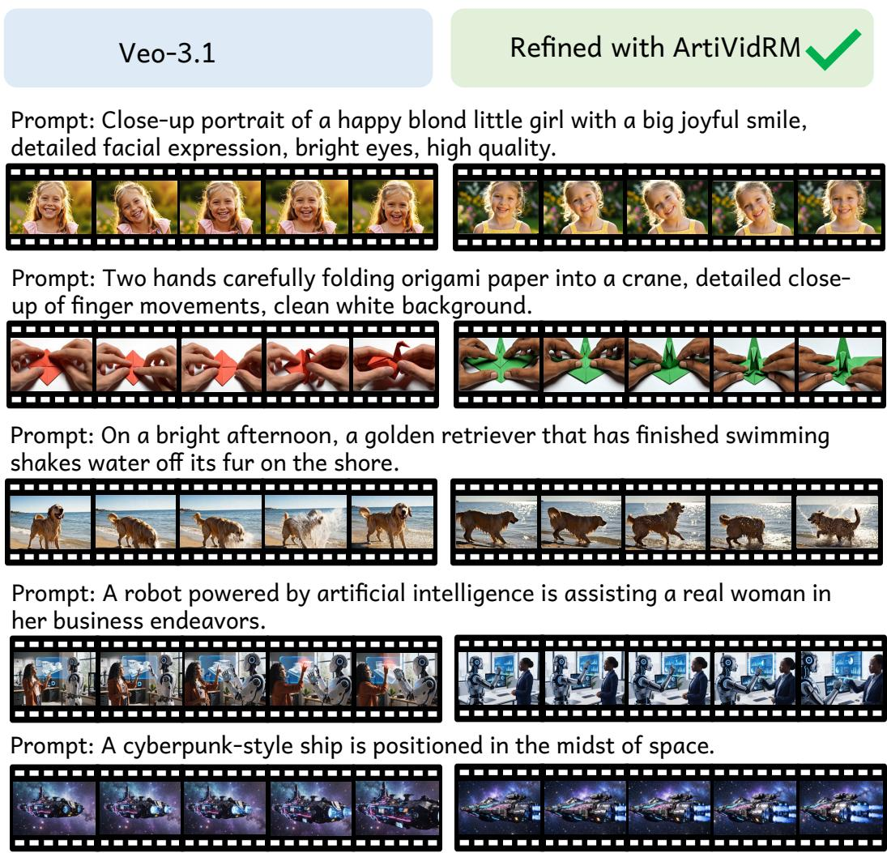  
Figure 7: Additional qualitative comparisons between the original Veo-3.1 and the videos refined with ArtiVidRM across diverse prompts.

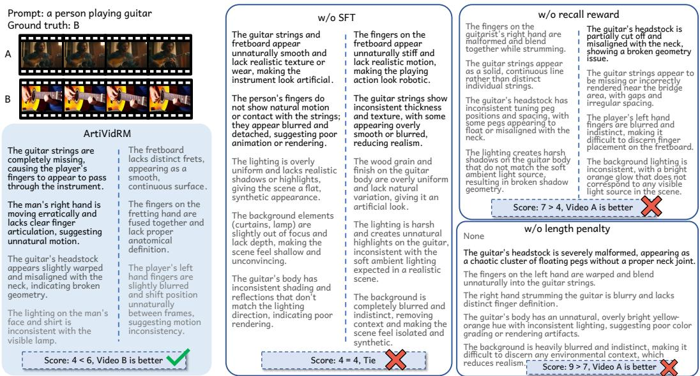  
Figure 8: Representative artifact lists generated by different ablation variants. Darker text indicates higher artifact importance predicted by the model.