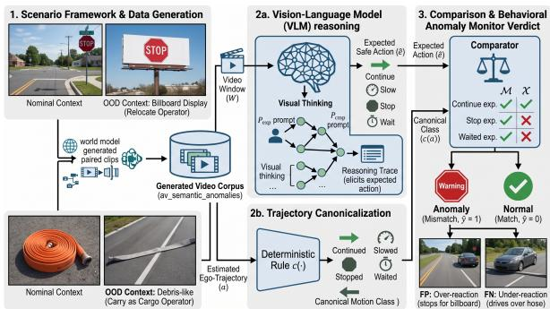
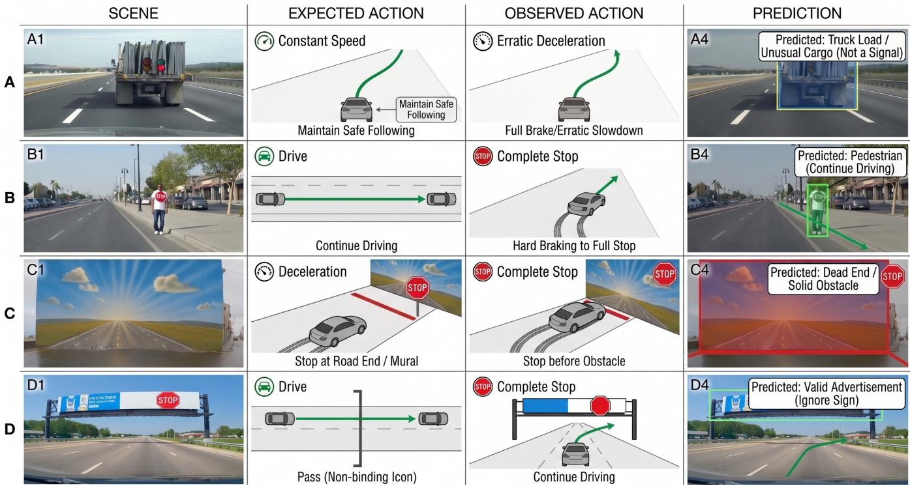
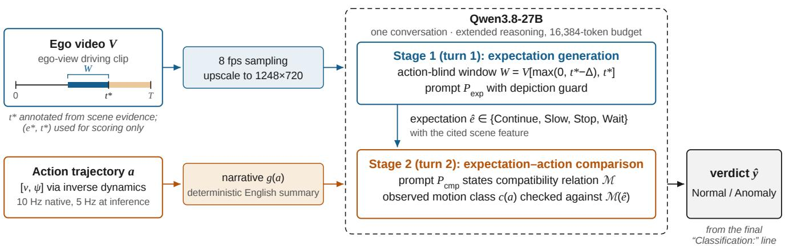

# Action-Conditioned VLM Monitoring for Autonomous Vehicle Semantic Anomalies

Daniel Adejumo2, Omkar Ankalkope2, Kunal Runwal2, and Aliasghar Arab1,2,∗

Abstract—We study action-conditioned monitoring of autonomous-vehicle behavior in semantically unusual driving scenes. The target is whether the executed ego action is appropriate for the scene: the same scene can admit both normal and anomalous behavior, so visual unusualness alone does not determine the monitoring label. A Vision-Language Model (VLM) first predicts the scene-required action from an outcome-hidden video window; the monitor then compares that expectation with the realized ego-motion trajectory under an explicit compatibility rule. To study this monitoring task, we contribute a six-field taxonomy of 112 paired scenarios spanning both failure polarities (42 derived from documented incidents), a generated video corpus with estimated trajectories, and an exploratory two-stage monitor on that corpus. On 235 clips from 15 scenario families, the two-stage protocol with a fixed T − 2.5 s window obtains 83.0% accuracy and anomaly recall 0.773, versus 74.5% and 0.536 for a single-stage video-only baseline; specificity is 0.880 versus 0.928.

## I. INTRODUCTION

Autonomous Vehicles (AVs) can fail even when a familiar object is perceived correctly: a stop sign is printed on a billboard, brake lights appear on a video display, or a charged fire hose resembles flat debris. These semantic anomalies [1] arise when an object appears outside its nominal context and the resulting ego response is unsafe or unnecessary. Documented fire-hose, flooded-road, and school-bus incidents show that such contextual failures have practical safety consequences [2]–[4]. Foundation models have been used broadly in robotic autonomy stacks, from converting agent states into text with a Large Language Model (LLM) to limit planned speed [5] to reasoning over semantic scene descriptions for anomaly detection in a reactive planner [1].

Pixel- and object-level benchmarks detect unfamiliar content or unusual traffic events [6]–[9], but do not directly evaluate whether a familiar object’s displaced context makes the executed ego action appropriate. AnoVox broadens simulated anomaly evaluation to multimodal content and temporal anomalies and includes ego action states [10]; large-scale AV corpora provide egomotion and action-grounded reasoning labels [11], and retrieval-augmented Vision Language Models (VLM) support corner-case comprehension [12]. Operational Design Domain (ODD) based scenario trees are generated with LLMs and then instantiate in CARLA simulations to evaluate both OOD recognition and safe-action selection in [13]. Thus, reasoning about an appropriate action in an unusual scene is already addressed. Our distinction is to assign Normal/Anomaly labels to executed scene-action pairs, using an outcome-hidden expectation and separately recovered ego motion. Each scenario specification supplies both appropriate and inappropriate responses.

  
Fig. 1. Action-conditioned monitoring. Context displacement defines paired scene-action labels; a VLM infers the scene-required action from an outcome-hidden window, then compares it with canonicalized ego motion.

Scene understanding has been used for VLM-based scene descriptions which is connected to a regulation database to select lawful future paths [14]. Their rule checks guide candidate-plan selection. Our explicit rule instead compares a scene-required expectation with a canonical class of realized motion to produce a behavioral verdict. It is a coarse actioncompatibility relation, not a jurisdiction-specific traffic-law compliance test.

A two-phase, layered analysis of real driving images is studied in [15]. Related driving-oriented models map scenes toward future actions using VLMs [16]–[19]. These works do not evaluate whether the realized ego response matches an expectation inferred before the label-defining outcome. In the context-displacement cases of interest [1], the relevant object remains visually familiar but its role changes with context. This differs from pixel-level open-set segmentation [6], [7] and lies within the ISO 21448 space of unsafe behavior without a component fault [20].

In this work, we formulate the task as action-conditioned monitoring: given a driving scene and realized ego motion, assess whether the vehicle’s response matches what the scene requires. Inspired by scenario-based testing [21], continu ing past a depicted stop sign can be appropriate, whereas braking for that depiction can be anomalous; a charged fire hose across the lane reverses the required response. The monitoring label therefore belongs to a scene-action pair.

Fig. 1 outlines the monitor: it infers the scene-required action from an outcome-hidden video window, then checks compatibility with the observed ego motion. This separates scene interpretation from the assessment of the vehicle’s response.

The main contribution of this research is an actionconditioned monitoring formulation in which the verdict expresses compatibility between a scene-required response and realized ego motion. Other contributions include: (i) a two-stage VLM protocol that separates scene-based expectation inference from explicit action-compatibility checking; (ii) a six-field taxonomy of 112 paired scenarios, including 42 derived from documented incidents, with both failure polarities attached to each row; and (iii) a generated egovideo corpus with ordinal action labels from a prompt heuristic. An optical-flow probe and human review support exploratory evaluation of monitor accuracy.

## II. PROBLEM FORMULATION AND METHOD

In this work, a semantic behavioral anomaly is defined as a mismatch between the action required by a scene and the ego action that is executed. The monitor assigns a behavioral verdict to a scene-action pair by checking whether the realized motion is compatible with the response inferred from the scene. Let V be an ego-view clip of duration $T$ and $\textbf { \em a } = ~ ( ( v _ { 1 } , \psi _ { 1 } ) , \dots , ( v _ { K } , \psi _ { K } ) )$ its 5-Hz estimated trajectory tuple, where $v _ { i }$ is estimated ego-vehicle speed and $\psi _ { i }$ is the estimated ego-vehicle heading angle at the ith trajectory sample. Let $A =$ {Continue, Slow, Stop, Wait} and ${ \mathcal { C } } =$ {continued, slowed, stopped, waited, moved off}. The context-aware action is $e ^ { * } \in { \mathcal { A } }$ , stage 1 predicts $\hat { e } \in \mathcal A .$ , and the canonical motion class is $\boldsymbol { c } ( \boldsymbol { a } ) \in \mathcal { C } .$ . Hence, the evaluation label $y$ is the intended polarity of the generated clip. It is not recomputed from recovered motion. The monitor prediction $\hat { y }$ is defined as

$$
\hat { y } = \mathbf { 1 } [ c ( \pmb { a } ) \notin \mathcal { M } ( \hat { e } ) ] ,\tag{1}
$$

where the reported protocol uses

$$
\begin{array} { r l } & { \mathcal { M } ( \mathrm { C o n t i n u e } ) = \mathcal { M } ( \mathrm { S l o w } ) = \{ \mathrm { c o n t i n u e d } , \mathrm { s l o w e d } \} , } \\ & { \mathcal { M } ( \mathrm { S t o p } ) = \{ \mathrm { s t o p p e d } , \mathrm { w a i t e d } \} , } \\ & { \mathcal { M } ( \mathrm { W a i t } ) = \{ \mathrm { w a i t e d } \} . } \end{array}\tag{2}
$$

Because Continue and Slow are mutually compatible, applying (2) to $e ^ { * }$ would label a Continue-versus-Slow contrast as Normal even when the taxonomy tag is Anomalous. Both stages run zero-shot learning [22], selected from eight configurations, using vLLM [23] on large computational units. Each clip uses a separate conversation, a fixed seed, and large computational budgets. Video is sampled at 8 fps and Lanczos-upscaled from 832 × 480 to $1 2 4 8 \times 7 2 0$

## 1) Stage 1: expectation from an outcome-hidden window

A limited-horizon window of the video is defined as

$$
W = V \big [ \mathrm { m a x } ( 0 , t ^ { * } - \Delta ) , t ^ { * } \big ] ,\tag{3}
$$

TABLE I  
THE SIX-FIELD SEMANTIC-ANOMALY FRAMEWORK
<table><tr><td>#</td><td>Field</td><td>Description</td></tr><tr><td>1</td><td>Object in Driving Scene</td><td>Entity with a mandated response (stop sign, brake lights, pedestrian, fire hose)</td></tr><tr><td>2</td><td>Nominal Context</td><td>Where the object normally lives; react- ing to it there is correct</td></tr><tr><td>3</td><td>OOD Context</td><td>Object or look-alike displaced outside its nominal context, appearance pre- served</td></tr><tr><td>4</td><td>Normal Action in OOD</td><td>Context-aware response: react to the scene, not the pattern</td></tr><tr><td>5</td><td>Anomalous Action in OOD</td><td>Failure mode: react to the pattern as if nominal, or miss a real hazard present- ing atypically</td></tr><tr><td>6</td><td>Example Scenario</td><td>One-sentence description; the genera- tion / evaluation prompt seed</td></tr></table>

where $\Delta = 2 . 5 \mathrm { ~ s ~ }$ is a constant window duration and $t ^ { * }$ is the end time of the window. The primary protocol ends the window at a fixed cutoff $t ^ { * } = T - 2 . 5 \mathrm { ~ s ~ }$ in (3), before the label-defining outcome. Thus explicit trajectory input and the final outcome are withheld, although pre-cutoff visual motion may remain visible. The prompt also includes a depiction guard directing the model to distinguish physical hazards from depictions. Annotated per-clip decision times are used only in the offline oracle ablation.

## 2) Stage 2: action comparison

The second turn supplies $P _ { \mathrm { c m p } }$ and a deterministic narrative $g ( \pmb { a } )$ containing the canonical motion class, endpoint speeds, and, when applicable, heading change. The prompt asks the VLM to apply the compatibility rule in (2). Given eˆ and $c ( \pmb { a } )$ , the verdict is fully determined by Eq. (1). Narrative rendering removes a numeric-reading step that is difficult for language models [24], [25].

The prompt $P _ { \mathrm { e x p } }$ represents the Stage 1 prompt used to elicit the expected action (eˆ), mirroring the $P _ { \mathrm { c m p } }$ prompt used in Stage 2. Both stages emit a delimited reasoning trace [26], but only the final answer is scored. Missing or truncated decisions count as errors without resampling; none are reported in the two-stage 235-clip runs.

TABLE II  
EXAMPLE SCENARIO PAIRS, ONE PER FAILURE POLARITY
<table><tr><td>Field</td><td>Fire hose</td><td>Brake lights</td></tr><tr><td>Nominal context OOD context</td><td>Coiled on a fire engine, off the roadway Charged hose across an</td><td>Rear of a lead vehicle in the ego lane Life-size car ad with</td></tr><tr><td>Normal</td><td>active lane at a fire scene Stop before the hose; never</td><td>glowing brake lamps on a night digital billboard Recognize the screen as</td></tr><tr><td>action Anomalous</td><td>cross; wait to be waved through Classifies it as debris; drives</td><td>media; hold speed and lane Reads a braking lead</td></tr><tr><td>action</td><td>over the hose A car drives over a charged</td><td>vehicle; brake-checks at speed A car brake-checks for</td></tr><tr><td>Example</td><td>fire hose at an active fire scene</td><td>brake lights on a nighttime video billboard SYN· FP</td></tr></table>

## A. Scenario-based Framework

The proposed scenario-based testing framework parametrizes each case around an entity, its context, and the resulting behavioral contrast. Every scenario decomposes into the six fields of Table I, each field’s output feeding the next. Fields 1–3 build the scene: a semantically loaded object with a mandated response, its nominal context, and a displacement of the object or a look-alike into an OOD context, appearance preserved, via reusable operators. Fields 4–5 give the behavioral contrast: the Normal Action of a context-aware driver versus the Anomalous Action of a pattern-matching stack. Field 6 collapses the row into a one-sentence scenario used as the generation seed. Because fields 4–5 attach both behaviors to one scenario specification, every row defines a Normal/Anomalous pair. Generated clips are scenario-matched; we do not assume they are pixel-identical counterfactuals. The taxonomy covers false-positive (FP) failures that act on a non-threat and false-negative (FN) failures that ignore an atypically presented hazard. Table II shows one row of each polarity.

Each row carries a provenance tag. REAL denotes derivation from a documented incident, not real imagery. Examples include robotaxis interfering with active fire scenes [2], a flooded-roadway failure associated with a 3,791-vehicle recall [3], and an automated vehicle passing an active school bus stop signal [4]. SYNTHETIC rows extrapolate the same mechanisms to new object-context combinations. The framework yields a 12-row seed taxonomy and a 100-row extension: 112 pairs across ten categories, with 42 REAL and 70 SYNTHETIC rows. The categories cover trafficcontrol look-alikes; pedestrian, humanoid, and animal confusions; weather and lighting; road surfaces and markings; unusual cargo and vehicles; emergency scenes; adversarial projections; reflections and displays; and infrastructure or operational anomalies. The tabular form supports provenance tracking, polarity balancing, and generation from each row’s Example field.

## B. Synthetic Video Generation

Semantic anomalies are rare, and deliberately collecting balanced unsafe behavior is impractical. We therefore synthesize the corpus with the Cosmos 3 world foundation model [27]. Each taxonomy row is rendered separately with its Normal and Anomalous action descriptions. An LLM expands each seed into a structured prompt; two rounds of human review check realism while preserving the intended anomaly. Scenery variants change weather, lighting, and setting. Cosmos3-Nano generates 24-fps, 832 × 480 clips, mostly 5 s long (21 are 8 s), with a label-defining action segment of at least 2 s. Reviewers check the object, context, action, and visual artifacts; failed clips are regenerated or excluded. Fig. 2 illustrates four context-displacement scenarios and their scene-action contrasts.

The Cosmos 3 video-to-action inverse-dynamics pipeline used for estimating trajectories, executed with Cosmos3- Nano, estimates speed and heading from each generated clip. Its 5-Hz inference sequence supports ordinal motion classification; pipeline speed units are not calibrated vehicle telemetry. Clip admission requires agreement between a prompt-level action heuristic, a non-contradictory opticalflow probe, and human review of the synchronized video and trajectory. Failed clips are regenerated or excluded; 68 clips entered the release through this gate.

## III. VALIDATIONS AND RESULTS

The av semantic anomalies corpus contains 315 generated ego-view videos and 630 trajectory files (1.09 GB), organized as scenery-varied families from the seed taxonomy. The primary comparison uses 235 clips (110 Anomalous, 125 Normal) from 15 scenario families; individual ablations use the stated 72- or 80-clip subsets. Admission is the three-signal ordinal check of Section II-B. The two-stage monitor of Fig. 3 is compared with a single-stage videoonly baseline that uses the same model and decoding budget, with no explicit trajectory, compatibility rule, or two-stage factorization. The results demonstrate balanced accuracy, anomaly recall, normal specificity, and accuracy with cliplevel 95% Wilson intervals. Paired comparisons use the twosided exact McNemar test where discordances are available.

Table III foregrounds balanced accuracy, anomaly recall, and normal specificity. For the fixed T − 2.5 s window, the primary protocol achieves 0.826 balanced accuracy versus 0.732 for the video-only baseline, a gain of 9.4 percentage points. Anomaly recall increases by 23.6 points (0.536 to 0.773), while specificity decreases by 4.8 points (0.928 to 0.880). These changes are computed before rounding the rates. Accuracy improves from 175/235 to 195/235. Replacing that cutoff with an annotated per-clip decision time t∗ scores 193/235. The two prediction sets differ on 25 clips; paired discordances for that comparison are not provided. Given an accepted expectation, the Stage-2 comparator is correct on 180/181 clips (99.4%): once eˆ and c(a) are known, the VLM almost always applies (2). Stage-wise attribution still requires a joint error table.

Against the baseline, paired discordances are available only for the annotated-t∗ variant: 44 baseline errors corrected and 26 baseline-correct cases degraded (net +18, exact McNemar $p = 0 . 0 4 1 )$ . No paired discordances are available for the primary fixed-window run, so no p-value is attached to its improvement. Fig. 4 gives one example.

Missed anomalies decrease from 51 to 25, while false alarms increase from 9 to 15. Total errors decrease from 60 to 40. The protocol detects 65/70 FP-style anomalies (spurious response to a non-threat) and 19/40 FN-style anomalies (failure to react to an atypical hazard) on the annotated-t∗ variant, giving recalls of 0.929 and 0.475. Of that variant’s 42 errors, 21 come from one mural scenario family, for which the video-only baseline is stronger (19/31 vs. 10/31). Sixteen errors involve Stop/Slow or low-speedcreep granularity, and five are isolated cases. We do not have the corresponding polarity split for the 40 errors of the primary fixed-window run. On an 80-clip class-balanced development subset, three decoding seeds give 68/80, 68/80, and 64/80 for the two-stage protocol versus $5 7 / 8 0 , 5 6 / 8 0 .$ and 57/80 for the baseline. Mean accuracy is $8 3 . 3 \% \pm 2 . 9$ points versus $7 0 . 8 \% \pm 0 . 7$ points (sample standard deviation across seeds), with a mean paired gain of $1 2 . 5 \pm 3 . 3$ points. We do not pool the repeated predictions into an artificial $n = 2 4 0$ independent-sample test. Median end-to-end latency on the annotated-t∗ two-stage run is 46.9 s (90th percentile 110.6s) on the H200. With concurrency 6, the 235 clips complete in 39.5min, equivalent to 10.1 s of wall-clock throughput per completed clip. The single-stage baseline has 61.8s median latency.

  
Fig. 2. Illustrative synthetic driving scenarios: (A) traffic signals carried as cargo, (B) a stop-symbol depiction on clothing, (C) a road mural, and (D) a stop-symbol advertisement. The columns juxtapose the scene, expected action, depicted ego response, and scene-level interpretation.

  
In deployment, W is the trailing camera buffer and the trajectory after t\* is the planner's published plan, evaluated before execution.  
Fig. 3. Action-conditioned monitoring through expectation-action comparison. Stage 1 predicts the scene-required action from an outcome-hidden window; stage 2 compares the canonicalized ego motion with an explicit compatibility relation.

The following ablations use their stated 72-, 80-, or 235- clip subsets; results from different subsets are not directly comparable. Paired predictions are unavailable for the actionform and token-budget comparisons, as are fold-level paired predictions for fine-tuning; no significance claims are made for these comparisons. Table IV compares eight configurations on 72 clips. Qwen3.8-27B gives the highest earlywindow strict expectation count, 31/72, versus 18/72 for Cosmos3-Nano (a 13-clip or 18.1-point increase). Scaling from Cosmos3-Nano to Super does not improve this count. The full-clip minus early-window difference $\Delta$ is used as an outcome-anchoring diagnostic: Qwen checkpoints vary by −2 to +3 clips, whereas InternVL3.5 increases by 17. This diagnostic is suggestive rather than a calibrated anchoring measure.

TABLE III  
EXPLORATORY MONITORING RESULTS ON 235 CLIPS (110 ANOMALOUS, 125 NORMAL): PRIMARY COMPARISON AND OFFLINE ORACLE ABLATION.
<table><tr><td>Method</td><td>Balanced accuracy ↑</td><td>Anomaly recall ↑</td><td>Normal specificity ↑</td><td>Accuracy (correct/total)</td><td>Accuracy 95% Wilson CI</td></tr><tr><td>Single-stage video-only (baseline)</td><td>0.732</td><td>0.536 (59/110)</td><td>0.928 (116/125)</td><td>0.745 (175/235)</td><td>[0.685, 0.796]</td></tr><tr><td>Two-stage, fixed  $T - \dot { 2 } . 5 $  s (ours, primary)</td><td>0.826</td><td>0.773 (85/110)</td><td>0.880 (110/125)</td><td>0.830 (195/235)</td><td>[0.777, 0.872]</td></tr><tr><td>Primary — baseline (pp)</td><td>+9.4</td><td>+23.6</td><td>-4.8</td><td>+8.5</td><td></td></tr><tr><td>Two-stage, annotated t* (offline oracle)</td><td>0.818</td><td>0.764 (84/110)</td><td>0.872 (109/125)</td><td>0.821 (193/235)</td><td>[0.767, 0.865]</td></tr><tr><td>Annotated t* — baseline (pp)</td><td>+8.6</td><td>+22.7</td><td>-5.6</td><td>+7.7</td><td></td></tr><tr><td>Majority class (reference)</td><td>0.500</td><td>0.000 (0/110)</td><td>1.000 (125/125)</td><td>0.532 (125/235)</td><td></td></tr></table>

Notes: Balanced accuracy averages anomaly recall and specificity. Bold marks the better primary-comparison value; ↑ means higher is better. Difference are percentage points (pp), computed before rounding from class counts derived from the reported rates and totals. Accuracy intervals are clip-level 95% Wilson intervals without scenario-family clustering adjustment.

TABLE IV  
MODEL COMPARISON ON THE 72-CLIP SELECTION SUBSET: STAGE-1 EXPECTATION (EARLY WINDOW), OUTCOME-ANCHORING DIAGNOSTIC, AND SINGLE-STAGE VERDICT
<table><tr><td>Model</td><td>Early S/L I</td><td>Full S</td><td>Δ</td><td>Verdict acc.</td></tr><tr><td>Cosmos3 (Nano, driving-tuned) [18],</td><td>18 /  38</td><td>22</td><td>+4</td><td>0.736</td></tr><tr><td>[27] Cosmos3 (Super, driving-tuned)</td><td>8 / 26</td><td>12</td><td>+4</td><td></td></tr><tr><td>Qwen3.8-27B (selected)</td><td>31  /  46</td><td>30</td><td>-1</td><td>0.597</td></tr><tr><td>Qwen3.6-27B</td><td>30 /  41</td><td>28</td><td>-2</td><td>0.694</td></tr><tr><td>Qwen3.5-27B</td><td>29  /  42</td><td>32</td><td>+3</td><td>0.639</td></tr><tr><td>Qwen3-VL-32B-Thinking</td><td>19 / 37</td><td>20</td><td>+1</td><td>0.681a</td></tr><tr><td>GLM-4.6V-Flash</td><td>11 / 28</td><td>13</td><td>+2</td><td>0.528</td></tr><tr><td>InternVL3.5-38B</td><td>22 /  34</td><td></td><td>39 +17</td><td>0.653</td></tr></table>

aReasoning-mode verdict; all other verdict entries use direct response.

Table V varies frame rate and representation size on 72 clips. At native resolution, 4 to 8 fps changes accuracy from 0.639 to 0.611 (−2.8 points), providing no observed benefit. At the matched 8 fps rate, upscaling changes accuracy from 0.611 to 0.736 (+12.5 points). The 0.639-to-0.736 comparison (+9.7 points) changes both factors and is not an isolated upscaling effect.

Table VI varies the Stage-2 action representation on 80 clips. Raw [[v, ψ]] with free-form comparison gives 49/80; adding M gives 54/80; velocity-only input gives 53/80; and

$$
I . . . J ,
$$

$$
I . . . J
$$

TABLE V  
INPUT PREPROCESSING (SINGLE-STAGE VIDEO-ONLY, 72-CLIP SUBSET)
<table><tr><td>Input</td><td>Visual prompt tokens</td><td> $\operatorname { A c c } .$ </td></tr><tr><td> $8 3 2 \times 4 8 0 , 4 ~ \mathrm { f p s }$ </td><td> $\approx 4 . 0 \mathrm { k }$ </td><td>0.639</td></tr><tr><td> $8 3 2 \times 4 8 0 , 8 \mathrm { { f p s } }$ </td><td> $\approx 8 . 0 \mathrm { k }$ </td><td>0.611</td></tr><tr><td> $1 2 4 8 \times 7 2 0 \uparrow , 8 ~ \mathrm { f p s }$ </td><td> $\approx 1 1 . 7 \mathrm { k }$ </td><td>0.736</td></tr></table>

narrative plus M gives 67/80. Thus the rule adds five net correct predictions, removing heading changes the net count by −1, and the narrative adds 13 relative to raw input with the same rule. Appending raw trajectories to a one-stage prompt reduces the reported score, consistent with a numericreading difficulty [24], [25], but does not by itself establish why individual predictions change.

TABLE VI  
STAGE-2 ACTION REPRESENTATION (TWO-STAGE, 80-CLIP DEVELOPMENT SUBSET; STAGE 1 FIXED)
<table><tr><td>Stage-2 formulation</td><td>Acc.</td><td>Comparatora</td></tr><tr><td>Raw [[v, ψ]], free-form comparison</td><td>0.613</td><td>≈0.70</td></tr><tr><td>Raw [[v, ψ]] + explicit rule M</td><td>0.675</td><td>≈0.83</td></tr><tr><td>Raw [v] only + rule M</td><td>0.662</td><td>≈0.83</td></tr><tr><td>Narrative g(a) + rule M (ours)</td><td>0.838</td><td> $6 3 / 6 3 = 1 . 0 0$ </td></tr><tr><td>Video only (no action; necessarily single-stage)</td><td>0.750</td><td></td></tr></table>

aAccuracy conditional on an accepted expectation.

On the full 235 clips, the guard changes direct accuracy from 0.562 to 0.621 and reasoning-mode accuracy from 0.621 to 0.745. Because it was selected among more than 30 tested wordings on this set, these post-hoc gains require confirmation on held-out scenarios.

Reasoning mode is associated with gains of 12.4 points with the guard and 5.9 points without it. At 8,192 tokens, approximately 10% of outputs reportedly truncate; scoring only completed outputs gives 0.815 and is biased. Counting truncations as errors, the reported 72-clip score changes from 52/72 (0.722) to 58/72 (0.806) when the budget increases to 16,384. On the reported subset, shortening the stage-1 window from 2.5 to 1.5 and 1.0 s changes accuracy from 0.613 to 0.600 and 0.588. Extending the window toward the outcome recovers 12–14 of the 42 annotatedt∗ errors but exposes label-defining motion, so it is not a fair outcome-hidden condition. Majority-of-three stage-1 sampling gives 66/80 versus 68/80 for one sample. Rank-16 Low-Rank Adaptation (LoRA) stage-1 tuning with five-fold leave-scene-group-out cross-validation gives aggregate final accuracies of 0.736 and 0.728 for answer- and procedurestyle targets, below the annotated-t∗ zero-shot 0.821. A within-scenario split gives 0.936, indicating that random variant splits substantially overestimate transfer.

## A. Discussion and Limitations

All evaluated footage is generated, including incidentderived REAL scenarios. The results do not measure transfer to real driving, and recovered motion supports ordinal classes rather than calibrated vehicle telemetry. The protocol evaluates realized motion offline. Automatic triggering, plannertrajectory monitoring with a trailing camera buffer [28], and closed-loop intervention remain unevaluated; the measured latency does not establish real-time feasibility. Independently generated polarity clips are matched by scenario specification, but scene appearance and ego motion may covary. A video-only baseline can exploit either source of information. The full-protocol comparison also changes trajectory input, the compatibility rule, and reasoning structure together. Without a trajectory-swap or controlled same-scene action intervention, the observed gains do not isolate the causal contribution of action conditioning. The action-form ablations vary representation, not the association between scene and action. Family clustering and prompt selection on the 235-clip set limit statistical inference: clip-level intervals and p-values are descriptive. Leave-scene-group-out fine-tuning measures supervised transfer within the available families; it does not provide a held-out test of the zero-shot monitor. Confirmation requires a locked scenario-disjoint test set.

## IV. CONCLUSION

We formulated action-conditioned monitoring as an explicit comparison between a scene-required expectation and realized ego motion. A six-field taxonomy of paired semantic-anomaly scenarios and a generated video corpus with ordinal action labels support exploratory evaluation of this two-stage monitor. With a fixed T − 2.5 s window, the proposed framework obtains 0.830 accuracy and 0.826 balanced accuracy versus 0.745 and 0.732 for a single-stage video-only baseline, increasing anomaly recall from 0.536 to 0.773 while reducing specificity from 0.928 to 0.880. Stage-2 comparison is nearly deterministic given the expectation and motion class while atypical-hazard expectation generation remains as a future work.

## REFERENCES

[1] A. Elhafsi, R. Sinha, C. Agia, E. Schmerling, I. A. D. Nesnas, and M. Pavone, “Semantic anomaly detection with large language models,” Auton. Robots, vol. 47, pp. 1035–1055, 2023.

[2] National Public Radio, “Driverless cars in San Francisco: fire crews report repeated interference,” https://www.npr.org/2023/12/30/ 1222083720/, Dec. 2023.

[3] National Highway Traffic Safety Administration, “ADS software may allow vehicle to drive onto a flooded roadway,” NHTSA Recall Campaign 26E026, Waymo LLC, 2026, manufacturer report, 3791 units. https://static.nhtsa.gov/odi/rcl/2026/RCAK-26E026-9973.pdf.

[4] National Transportation Safety Board, “Automated driving systemequipped vehicle passed school bus loading student passengers,” NTSB Investigation HWY26FH007, Austin, TX, 2026, https://www. ntsb.gov/investigations/Pages/HWY26FH007.aspx.

[5] D. Wang, M. Kaufeld, and J. Betz, “DualAD: Dual-layer planning for reasoning in autonomous driving,” in Proc. IEEE/RSJ Int. Conf. Intell. Robot. Syst., 2025, pp. 12 057–12 063.

[6] H. Blum, P.-E. Sarlin, J. Nieto, R. Siegwart, and C. Cadena, “The Fishyscapes benchmark: Measuring blind spots in semantic segmentation,” Int. J. Comp. Vis., vol. 129, pp. 3119–3135, 2021.

[7] R. Chan et al., “SegmentMeIfYouCan: A benchmark for anomaly segmentation,” in Proc. NeurIPS Datasets and Benchmarks Track, 2021.

[8] K. Li et al., “CODA: A real-world road corner case dataset for object detection in autonomous driving,” in Proc. Eur. Conf. Comput. Vis., 2022.

[9] Y. Yao, X. Wang, M. Xu, Z. Pu, Y. Wang, E. Atkins, and D. Crandall, “DoTA: Unsupervised detection of traffic anomaly in driving videos,” IEEE Trans. Pattern Anal. Machine Intell., vol. 45, no. 1, pp. 444–459, 2023.

[10] D. Bogdoll et al., “AnoVox: A benchmark for multimodal anomaly detection in autonomous driving,” arXiv preprint arXiv:2405.07865, 2024.

[11] NVIDIA, “PhysicalAI-Autonomous-Vehicles dataset,” https: //huggingface.co/datasets/nvidia/PhysicalAI-Autonomous-Vehicles, 2026.

[12] Y. Wang, Q. Liu, J. Fan, J. Hong, H. Chu, M. Tian, B. Gao, and H. Chen, “RAC3: Retrieval-augmented corner case comprehension for autonomous driving with vision-language models,” IEEE Trans. Multimedia, 2026.

[13] E. Aasi, P. Nguyen, S. Sreeram, G. Rosman, S. Karaman, and D. Rus, “Generating out-of-distribution scenarios using language models,” in Proc. IEEE Int. Conf. Robot. Autom., 2025, pp. 10 616–10 623.

[14] X. Han, Z. Wu, X. Xia, and J. Ma, “Traffic regulation-aware path planning with regulation databases and vision-language models,” in Proc. IEEE Int. Conf. Robot. Autom., 2025, pp. 11 024–11 030.

[15] R. Brusnicki, D. Pop, Y. Gao, M. Piccinini, and J. Betz, “Can VLMs unlock semantic anomaly detection? A framework for structured reasoning,” arXiv preprint arXiv:2510.18034v3, 2026.

[16] Z. Xu et al., “DriveGPT4: Interpretable end-to-end autonomous driving via large language model,” IEEE Robot. Autom. Lett., vol. 9, no. 10, pp. 8186–8193, 2024.

[17] X. Tian et al., “DriveVLM: The convergence of autonomous driving and large vision-language models,” in Proc. Conf. Robot Learn., 2024.

[18] NVIDIA et al., “Cosmos-Reason1: From physical common sense to embodied reasoning,” arXiv preprint arXiv:2503.15558, 2025.

[19] M. Q. Bhat et al., “VLM-AutoDrive: Post-training vision-language models for safety-critical autonomous driving events,” arXiv preprint arXiv:2603.18178, 2026.

[20] International Organization for Standardization, “ISO 21448:2022 road vehicles – safety of the intended functionality (SOTIF),” International Organization for Standardization, Standard ISO 21448:2022, 2022.

[21] T. Menzel, G. Bagschik, and M. Maurer, “Scenarios for development, test and validation of automated vehicles,” in Proc. IEEE Intell. Veh. Symp., 2018, pp. 1821–1827.

[22] Qwen Team, “Qwen3.8-27B,” Hugging Face model card, 2026, https: //huggingface.co/Qwen/Qwen3.8-27B.

[23] W. Kwon et al., “Efficient memory management for large language model serving with PagedAttention,” in Proc. ACM Symp. Oper. Syst. Princ., 2023.

[24] N. Gruver, M. Finzi, S. Qiu, and A. G. Wilson, “Large language models are zero-shot time series forecasters,” in Proc. Adv. Neural Inf. Process. Syst., 2023.

[25] D. Spathis and F. Kawsar, “The first step is the hardest: Pitfalls of representing and tokenizing temporal data for large language models,” J. Am. Med. Inform. Assoc., vol. 31, no. 9, pp. 2151–2158, 2024.

[26] J. Wei et al., “Chain-of-thought prompting elicits reasoning in large language models,” in Proc. Adv. Neural Inf. Process. Syst., 2022.

[27] NVIDIA, “Cosmos 3: Omnimodal world models for physical AI,” arXiv preprint arXiv:2606.02800, 2026.

[28] R. Sinha, A. Elhafsi, C. Agia, M. Foutter, E. Schmerling, and M. Pavone, “Real-time anomaly detection and reactive planning with large language models,” in Proc. Robotics: Sci. Syst., 2024.