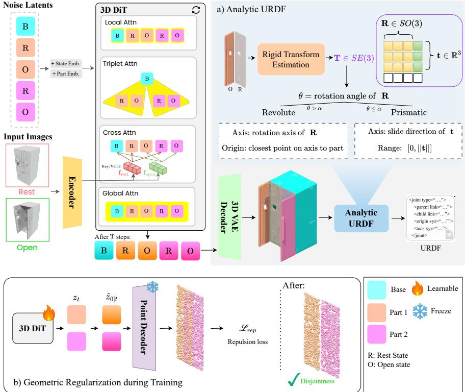
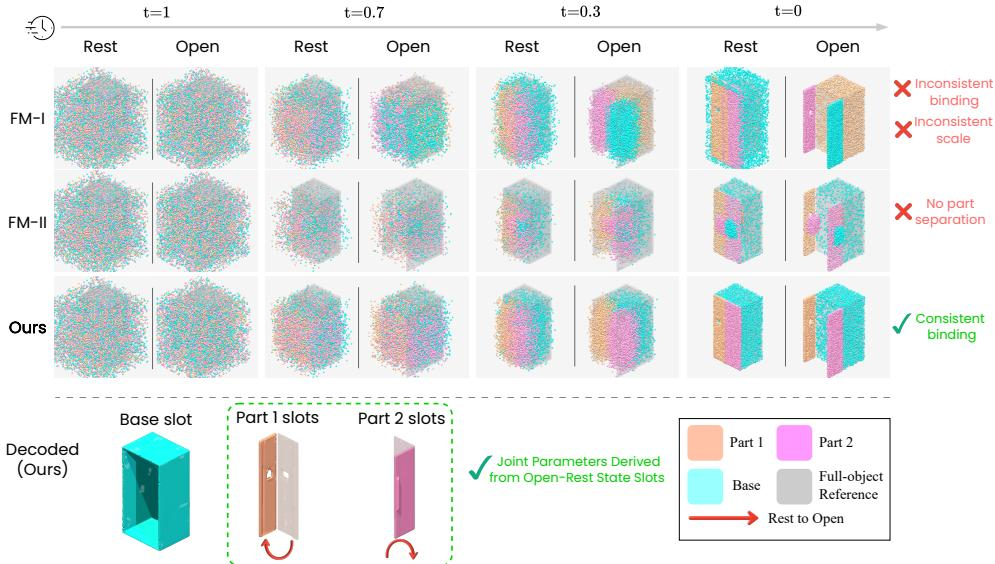
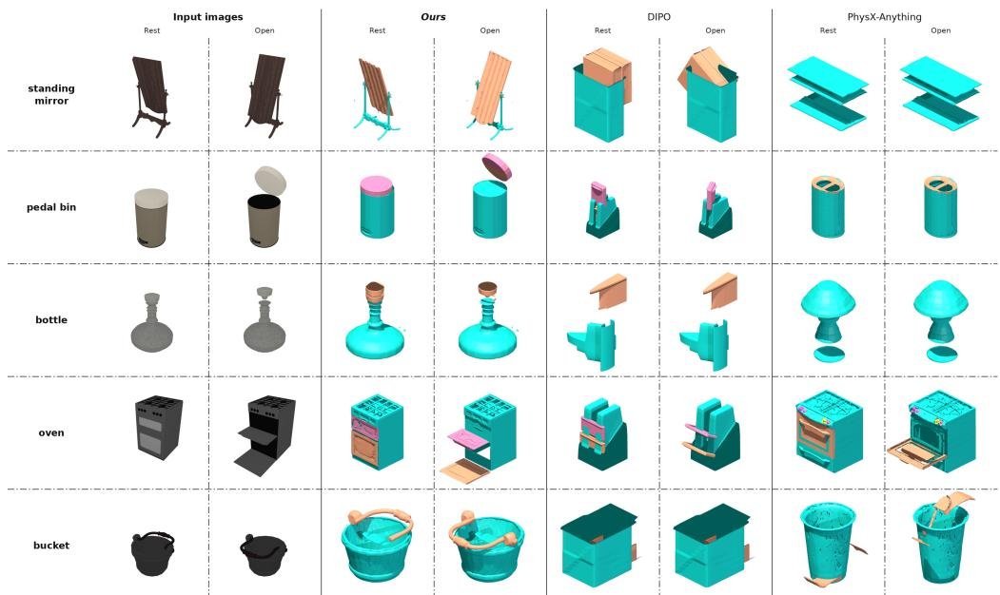
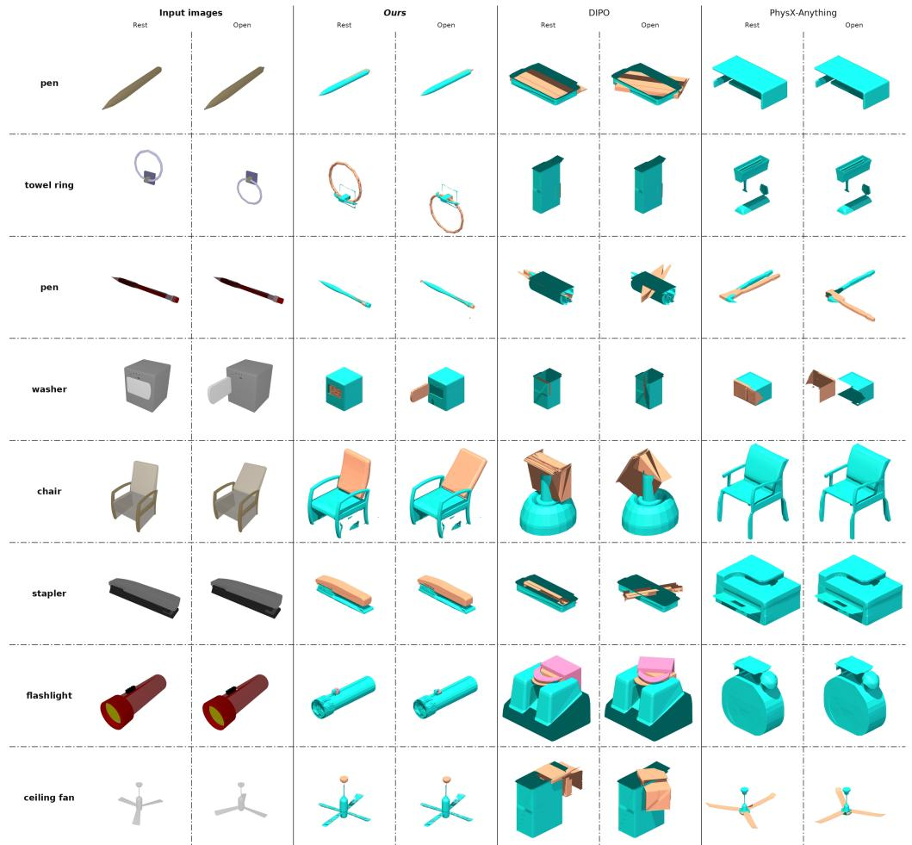
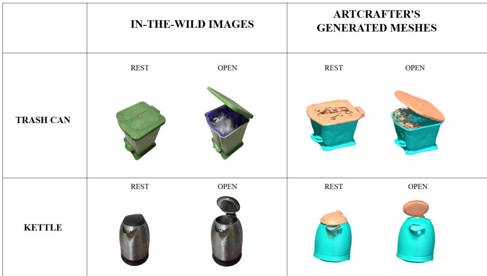

# ArtCrafter: Feed-Forward Generation of Articulated 3D Object with Analytic Joint Derivation

Minh Canh Tu∗ Quang-Binh Nguyen∗† Khoi Nguyen

Qualcomm AI Research‡

## Abstract

Articulated 3D assets are essential for robotic simulation and training, yet their generation from casual images poses a key challenge: recovering part geometry and kinematics that remain mutually consistent. We present ArtCrafter, a novel feed-forward generative model for controllable generation of articulated 3D objects from a pair of images, one depicting the object in the rest state and the other in the open state. At the core of ArtCrafter is a DiT-based generative model that jointly produces part-level meshes for both articulation states in a single forward pass. Inspired by Slot Attention, its denoising process operates on a 1 + 2N slot layout comprising one shared base slot and N paired rest/open slots, encouraging each pair to bind to the same kinematic part. To ensure geometrically consistent and disjoint part generation, we introduce Triplet Attention to enforce cross-state geometric consistency between paired rest/open slots anchored through the shared base slot, and a repulsion loss $\mathcal { L } _ { \mathrm { r e p } }$ on decoded part point clouds to prevent interpart penetration throughout denoising. Given the resulting paired meshes, URDF joint parameters—type, axis, origin, and range—are derived analytically from the rigid transformation between each rest/open pair, providing an interpretable alternative to learned joint-parameter regression. Extensive experiments on both in-distribution and out-of-distribution datasets demonstrate that ArtCrafter outperforms existing method under the same dual-state setting in geometry quality and articulation precision, while remaining competitive with methods operating under different input settings and paradigms.

## 1 Introduction

Articulated 3D assets are fundamental to robotic simulation and embodied AI, where agents interact with objects composed of movable parts. Unlike static 3D models, simulation-ready articulated assets must represent both part-level geometry and the kinematic constraints governing how parts move. However, manually constructing such assets requires substantial modeling effort and expert annotation, making it difficult to achieve the scale and diversity needed for general-purpose robot training. PartNet-Mobility [34], a widely used articulated-object dataset, contains only approximately 2.3K manually annotated objects, underscoring the need for scalable automated asset creation.

Automatically generating articulated assets from images is fundamentally more challenging than ordinary 3D generation. Beyond reconstructing appearance and geometry, a method must decompose the object into kinematic parts and recover joint parameters that remain geometrically consistent with the generated meshes. Current 3D generators either produce whole-object meshes with no internal structure [17, 35, 40, 41], or decompose objects into parts defined primarily by geometric saliency without modeling their kinematic function [21, 37, 4]. Neither class directly produces articulated assets suitable for physics simulation.

Table 1: Taxonomy of articulated 3D methods by input regime and paradigm. ArtCrafter is the only generative method conditioned on two articulation states.
<table><tr><td>Paradigm</td><td>Single-state</td><td>Dual-state</td><td>Multi-view / multi-state</td></tr><tr><td>Retrieval</td><td>Articulate-Anything [13], SIN- GAPO [22], URDFormer [5]</td><td>DIPO [31]</td><td></td></tr><tr><td>Segmentation</td><td>URDF-Anything [18]</td><td></td><td>URDF-Anything [18]</td></tr><tr><td>Optimization</td><td></td><td></td><td>PARIS [23], ArtGS [26], LARM [38], FreeArt3D [3], REArtGS [30]</td></tr><tr><td>Generation</td><td>PAct [25], SPARK [10], URDF- Anything+ [33], PhysX-Anything [2]</td><td>ArtCrafter (ours)</td><td>ART [20]</td></tr></table>

Existing articulated object creation methods differ along two axes: input observation regime and geometry production mechanism, as summarized in Tab. 1. For input, multi-view/multi-state methods [23, 26, 20, 38, 3] rely on multiple viewpoints, multiple articulation states, or both to provide sufficient geometric and motion observations for reconstruction. While these methods can reconstruct articulated objects with high accuracy, they require extensive data acquisition effort that is hard to scale. Single-state or single-image methods utilize minimal input but lack explicit articulation information, so they must predict kinematic behavior based purely on their semantic understanding of the object and its parts. DIPO [31] introduced the dual-state input setting – a rest and open image pair – that provides essential motion cues and connectivity information without dense input requirement. This input setting provides a practical middle ground between single-state and multi-view/multi-state approaches, reducing ambiguity in part motion and spatial relationships while avoiding the dense data acquisition required by the latter. For geometry, retrieval-based [22, 5, 31, 13, 24, 14], segmentationbased [16, 18, 8, 36, 12], optimization-based [23, 26, 38, 3], and generative [10, 25, 15, 20, 33, 2] methods differ in whether they retrieve, decompose, fit, or synthesize part geometries, respectively. We adopt the dual-state and generative paradigm, combining direct kinematic evidence with unconstrained geometry synthesis.

In this paper, we present ArtCrafter, a two-stage feed-forward framework for controllable generation of articulated 3D objects from a rest/open image pair. ArtCrafter leverages the semantic priors of a pretrained TripoSG [17] DiT to synthesize geometry from only one image per state, while retaining the direct motion evidence unavailable to single-image generation. In the first stage, the DiT jointly generates part-level meshes for both articulation states through a 1 + 2N slot layout, comprising one shared base slot and N paired rest/open slots. Inspired by Slot Attention [27], jointly explaining both states encourages each slot pair to bind to the same kinematic part. We further introduce triplet attention to couple each rest/open pair through the shared base slot and enforce cross-state geometric consistency, together with a repulsion loss $\mathcal { L } _ { \mathrm { r e p } }$ on decoded part point clouds to prevent inter-part penetration throughout denoising. In the second stage, joint parameters—type, axis, origin, and range—are derived analytically from the rigid transformation between each generated rest/open part pair, grounding kinematics directly in the generated geometry without learned joint-parameter regression or per-instance optimization. Extensive experiments on both in-distribution and out-ofdistribution benchmarks demonstrate improvements under the directly comparable dual-state setting, while showing competitive performance against methods operating under different input settings and paradigms.

In summary, our main contributions are as follows:

1. Dual-state generative formulation with analytic articulation recovery. We generate paired part geometries across two articulation states and derive joint parameters analytically from their rigid transformations, grounding kinematics directly in geometry.

2. $1 + 2 N$ slot DiT with triplet attention and ${ \mathcal { L } } _ { \mathrm { r e p } } .$ . A structured slot layout binds rest/open representations to the same kinematic parts; triplet attention enforces cross-state consistency, while $\mathcal { L } _ { \mathrm { r e p } }$ promotes inter-part disjointness.

3. Extensive evaluation. Experiments on both in-distribution and out-of-distribution benchmarks demonstrate significant improvements over directly comparable two-state baselines in geometry quality and articulation precision, while showing competitive performance against methods operating under different input settings and paradigms.

## 2 Related Work

3D object mesh generation. 3D-native generative methods learn shape distributions over compact 3D latent representations. Two representation families are prominent. Vecset-based methods [39, 40, 17, 41] represent shapes as unordered sets of latent vectors and enable efficient Transformer-based 3D generation. Sparse voxel-based methods [35, 29, 9, 32, 19] instead anchor latent features to sparse spatial locations, preserving explicit spatial structure for high-fidelity geometry generation. ArtCrafter adopts the vecset representation of TripoSG [17], whose flexible set-based structure naturally accommodates multiple part-level latent slots without imposing a shared spatial grid.

Articulated object creation methods differ along two axes: input observation regime and geometry production mechanism, as summarized in Tab. 1. For geometry production, retrieval-based methods construct part geometries by retrieving template meshes from a fixed database. Non-retrieval methods obtain part geometries by decomposing a reconstructed monolithic shape into parts (segmentationbased), iteratively fitting object-specific geometric representations to observations (optimizationbased), or directly synthesizing part meshes with learned generative models (generative).

Single-state methods. Single-state methods create articulated 3D assets from one image, with recent approaches predominantly adopting generative models [25, 10, 33, 2]. PAct [25] and SPARK [10] generate part-level geometry with part-aware diffusion models, URDF-Anything+ [33] autoregressively generates parts and joints, and PhysX-Anything [2] predicts a physical representation decoded into part geometry and articulation. SINGAPO [22] instead generates abstract part structure and articulation before retrieving concrete meshes, while URDFormer [5] and Articulate-Anything [13] retrieve and assemble geometry based on predicted object structure. Following a segmentation-based paradigm, URDF-Anything [18] reconstructs a monolithic 3D point cloud and jointly segments its parts and predicts kinematic parameters with a 3D MLLM. Without observed motion, however, single-state methods must infer ambiguous part structure and kinematics from appearance alone.

Multi-view or multi-state methods. Under richer observation settings, URDF-Anything [18] additionally supports multi-view input by reconstructing its point-cloud representation from multiple images. ART [20] instead adopts a feed-forward approach that directly reconstructs part-level geometry and predicts articulation parameters from sparse multi-state images. Optimization-based methods [23, 26, 3, 30] instead fit object-specific geometric representations, such as neural implicit fields, 3D Gaussians, or occupancy fields, together with articulation parameters to the input observations through per-instance optimization. While capable of detailed reconstruction, their iterative inference and richer observation requirements limit scalability.

Dual-state methods. The dual-state setting uses one image from each of two articulation states, providing direct visual evidence of part motion while requiring substantially fewer observations than multi-view/multi-state reconstruction. DIPO [31] established this dual image-based setting, conditioning a diffusion transformer on the rest/open image pair to predict part layouts and joint parameters, and concrete part meshes are subsequently retrieved from a fixed database. Ditto [12] similarly exploits motion evidence from two states, but reconstructs geometry and articulation from paired partial 3D point clouds rather than images, making its input setting distinct from dual-image methods. Building on the dual-image setting, ArtCrafter directly synthesizes geometrically consistent rest/open part meshes with a generative DiT and analytically derives joint parameters from their rigid transformations, avoiding mesh retrieval of DIPO [31].

## 3 Method

## 3.1 Problem Statement

Given two RGB images $\mathbf { I } _ { \mathrm { r e s t } } , \mathbf { I } _ { \mathrm { o p e n } } \in \mathbb { R } ^ { H \times W \times 3 }$ depicting an articulated object in its rest and fully open states, and the number of movable parts N, either specified by the user or estimated by a VLM from the two input images, ArtCrafter generates $1 + 2 N$ part-level meshes: a shared static base mesh $\mathcal { M } _ { \mathrm { b a s e } }$ and N pairs of movable-part meshes $\{ ( \mathcal { M } _ { \mathrm { r e s t } } ^ { i } , \mathcal { M } _ { \mathrm { o p e n } } ^ { i } ) \} _ { i = 1 } ^ { N }$ . The corresponding joint parameters $\{ ( \mathcal { I } _ { T } ^ { i } , \mathcal { T } _ { A } ^ { i } , \mathcal { T } _ { O } ^ { i } , \mathcal { T } _ { L } ^ { i } ) \} _ { i = 1 } ^ { N } \mathrm { - t y p e }$ , axis, origin, and range—are then derived analytically from the rigid transformation between each rest/open mesh pair and assembled with the generated meshes into a physics-executable URDF.

  
Figure 1: ArtCrafter pipeline. Two input images $\mathbf { ( I _ { \mathrm { r e s t } } , I _ { \mathrm { o p e n } } ) }$ are encoded into state features conditioning $2 N + 1$ noisy latent slots — base B, rest slots $R ^ { 1 } . . . R ^ { N }$ , open slots $O ^ { 1 } . . . O ^ { N } -$ each augmented with learnable part and state embeddings. Each 3D DiT block refines slots through: Local Attn (intra-slot), Triplet Attn $( R ^ { i }  O ^ { i }$ anchored through B), State Cross Attn (rest→ $\mathbf { f } _ { \mathrm { r e s t } }$ , open→ $\mathbf { f } _ { \mathrm { o p e n } } .$ , base→both), and Global Attn (all $2 N + 1$ slots). The frozen VAE decoder produces part meshes from denoised slots. (a) Analytic joint derivation: joint parameters are derived deterministically from $\mathbf { T } _ { i } = \mathbf { T } _ { \mathrm { o p e n } , i } \cdot \mathbf { T } _ { \mathrm { r e s t } , i } ^ { - 1 }$ with no learned head. (b) Geometric regularization: the frozen point decoder decodes $\hat { \mathbf { z } } _ { 0 \mid t }$ to per-slot point clouds; $\mathcal { L } _ { \mathrm { r e p } }$ penalizes inter-part overlap.

## 3.2 Overview

ArtCrafter builds on TripoSG [17], a large-scale 3D generation DiT pretrained on Objaverse [6]. Its VAE encodes each part point cloud into vecset latents $\boldsymbol { z } \in \mathbb { R } ^ { L \times d }$ with L tokens and decodes them into meshes via marching cubes. As illustrated in Fig. 1, a vision encoder extracts state features $\mathbf { f } _ { \mathrm { r e s t } }$ and $\mathbf { f } _ { \mathrm { o p e n } }$ that condition 1 + 2N noisy latent slots—one base and N rest/open pairs—jointly denoised by the DiT. Each DiT block sequentially applies local attention, triplet attention, state cross-attention, and global attention (Sec. 3.4). The frozen VAE then decodes each slot into a part mesh, and joint parameters are derived analytically from each paired rest/open mesh transformation (Sec. 3.6).

## 3.3 Analysis: Articulated Parts as Emergent Slots

We analyze two failure modes of naive multi-part generation that motivate our structured slot design.

Failure Mode I: Independent per-state generation. Running a part-aware generator (e.g., PartCrafter [21]) independently on each image yields no cross-state slot identity: the i-th rest slot is unrelated to the i-th open slot, leading to inconsistent part binding and geometry across states (row 1, Fig. 2). This motivates joint generation with a $1 + 2 N$ slot layout that pairs rest/open slots by index from the outset.

  
Figure 2: Per-slot decoded geometry across denoising timesteps. Rows compare ArtCrafter (Ours), FM-I (independent per-state), and FM-II (unstructured joint generation) on the same object; columns progress from pure noise (t = 1) to clean output (t = 0). Each cell shows a split render of rest (left) and open (right) states overlaid on the object silhouette (gray); colors encode part identity: base (cyan), part 1 (orange), part 2 (pink). ArtCrafter achieves consistent cross-state binding by $t = 0 ;$ FM-I produces inconsistent binding and incompatible part scale across the two independent runs; FM-II shows no clean part separation in either state. Bottom: decoded meshes per slot at t = 0, from which joint parameters are derived analytically.

Failure Mode II: Unstructured joint generation. Jointly generating 2N unstructured slots without state-specific routing or disjointness constraints provides no mechanism to pair rest/open slots or distinguish the static base from moving parts. Consequently, slot clouds remain diffuse and overlapping at $t = 0 ,$ , without clear part separation in either state (row 2, Fig. 2). This motivates explicit slot roles, state-specific conditioning, cross-state communication, and geometric separation.

Both failures stem from the absence of structural pressure for slots to bind to kinematic parts. Slot Attention [27] shows that slots jointly explaining a shared input can specialize through competition without explicit supervision. We extend this principle to articulated objects with the following hypothesis:

Hypothesis (Slot-binding). Slots constrained to jointly explain two images of the same object in different articulation states bind to the object’s kinematic parts.

Motivated by this hypothesis, ArtCrafter adopts $\mathrm { ~ a ~ } 1 + 2 N$ slot layout: one base slot represents articulation-invariant content, while N rest-state slots and N open-state slots are paired by index to represent the same physical parts across states. Triplet attention reinforces cross-state identity within each pair, while geometric regularization promotes inter-part disjointness (Sec. 3.5). Together, these constraints yield consistent part binding across articulation states by $t = 0$ (row 3, Fig. 2).

Denoising starts from 1 + 2N latent slots $\mathcal { Z } = \{ z _ { \mathrm { b a s e } } , \ z _ { \mathrm { r e s t } } ^ { 1 } , z _ { \mathrm { o p e n } } ^ { 1 } , \ \dots , \ z _ { \mathrm { r e s t } } ^ { N } , z _ { \mathrm { o p e n } } ^ { N } \}$ sampled from $\mathcal { N } ( 0 , \bf { I } )$ . Following PartCrafter [21], each slot receives a learnable part ID embedding $\mathbf { e } _ { \mathrm { p a r t } } ^ { i }$ and a state embedding $\mathbf { e } _ { \mathrm { s t a t e } } \in \{ \mathbf { e } _ { \mathrm { r e s t } } , \mathbf { e } _ { \mathrm { o p e n } } \}$ encoding part identity and articulation state. The fine-tuned TripoSG DiT denoises these slots over $T = 5 0$ steps; the following section describes how each DiT block communicates across slots and states.

## 3.4 DiT Block Attention Design

The standard DiT attention provides no mechanism to enforce that paired rest/open slots describe the same physical part—without explicit coupling, the two slots may evolve independently and produce meshes unrelated by any rigid transform, making the analytic joint derivation in Sec. 3.6 unreliable. We therefore augment the DiT backbone with structured attention that realizes the slot-binding principle.

The DiT backbone applies local attention, triplet attention, and global attention in an alternating fashion, together with state cross-attention for image conditioning:

1. Local attention refines each slot independently before inter-slot interaction:

$$
\tilde { z } ^ { k } = \mathrm { S e l f - A t t n } ( z ^ { k } ) \quad \forall z ^ { k } \in \mathcal { Z } .\tag{1}
$$

2. Triplet attention enforces cross-state part identity by concatenating each paired rest/open slot with the shared base slot and applying self-attention over the triplet, independently for each part i:

$$
[ \tilde { z } _ { \mathrm { r e s t } } ^ { i } ; \tilde { z } _ { \mathrm { o p e n } } ^ { i } ; \tilde { z } _ { \mathrm { b a s e } } ] = \mathrm { S e l f - A t t n } ( [ z _ { \mathrm { r e s t } } ^ { i } ; z _ { \mathrm { o p e n } } ^ { i } ; z _ { \mathrm { b a s e } } ] ) \quad \forall i \in \{ 1 , \ldots , N \} .\tag{2}
$$

Each part slot is thereby coupled to its paired counterpart and anchored through the shared base slot, enforcing the cross-state geometric consistency required for analytic joint derivation.

3. State cross-attention grounds each slot in its respective image—rest slots to $\mathbf { f } _ { \mathrm { r e s t } }$ , open slots to $\mathbf { f } _ { \mathrm { o p e n } } ,$ , and the base slot to both—preventing cross-state appearance leakage:

$$
\tilde { z } ^ { k } = \mathrm { C r o s s - A t t n } ( z ^ { k } , \mathbf { f } _ { \mathrm { r e s t } } ) \quad \forall z ^ { k } \in \{ z _ { \mathrm { b a s e } } \} \cup \{ z _ { \mathrm { r e s t } } ^ { i } \} _ { i = 1 } ^ { N } ,\tag{3}
$$

$$
\tilde { z } ^ { k } = \mathrm { C r o s s - A t t n } ( z ^ { k } , \mathbf { f } _ { \mathrm { o p e n } } ) \quad \forall z ^ { k } \in \{ z _ { \mathrm { b a s e } } \} \cup \{ z _ { \mathrm { o p e n } } ^ { i } \} _ { i = 1 } ^ { N } .\tag{4}
$$

4. Global attention integrates all $1 + 2 N$ slots into a globally coherent representation:

$$
\tilde { \mathcal { Z } } = \mathrm { S e l f - A t t n } ( \mathcal { Z } ) .\tag{5}
$$

Together, these attention mechanisms provide per-slot refinement, cross-state part coupling, statespecific image conditioning, and global inter-part coherence throughout denoising.

## 3.5 Geometric Regularization

Global attention allows latent tokens across parts to attend to each other for coherence, but does not prevent spatial overlap between generated parts – the FM-II failure mode in Fig. 2. We introduce a repulsion loss that penalizes inter-part overlap directly in 3D point space, applied during training alongside the flow matching objective.

Point decoder $\phi .$ To measure inter-part overlap during training, we train a lightweight point decoder ϕ to reconstruct a part point cloud from its latent tokens. Initialized from the TripoSG VAE decoder, ϕ replaces the final cross-attention layer with a lightweight MLP that predicts 3D coordinates from the self-attended latent set. We train ϕ with Chamfer Distance on the same data as the DiT and then freeze it. During DiT training, ϕ is applied only at low-noise timesteps, where $\hat { z } _ { 0 \mid t }$ provides a reliable estimate of the clean latent.

Repulsion loss. At each denoising step, we decode the predicted clean latent $\hat { z } _ { 0 \mid t } = z _ { t } - ( 1 - \frac { } { }$ $t ) \mathbf { \boldsymbol { v } } _ { \theta } ( \mathbf { \boldsymbol { z } } _ { t } , t )$ through ϕ to obtain per-slot point clouds $P _ { i } = \phi ( \hat { z } _ { 0 | t } ^ { i } )$ . For each pair of distinct parts (i, j) at the same state, we penalize spatial overlap via a margin-based Chamfer Distance loss:

$$
d ( P _ { i } , P _ { j } ) = \frac { 1 } { | P _ { i } | } \sum _ { p \in P _ { i } } \operatorname* { m a x } \biggl ( 0 , \gamma - \frac { \operatorname* { m i n } } { q \in P _ { j } } \Vert p - q \Vert \biggr ) ^ { 2 } + \frac { 1 } { | P _ { j } | } \sum _ { q \in P _ { j } } \operatorname* { m a x } \biggl ( 0 , \gamma - \frac { \operatorname* { m i n } } { p \in P _ { i } } \Vert q - p \Vert \biggr ) ^ { 2 } ,\tag{6}
$$

$$
\mathcal { L } _ { \mathrm { r e p } } = \frac { 1 } { \binom { N } { 2 } } \sum _ { ( i , j ) \in \binom { [ N ] } { 2 } } d ( P _ { i } , P _ { j } ) ,\tag{7}
$$

where $\gamma > 0$ is the margin threshold. Gradients flow back through the frozen ϕ to the part latents, coupling the abstract latent space to geometric disjointness. The progressive part separation visible in Fig. 2 illustrates its effectiveness.

Total training objective. ArtCrafter is trained with rectified flow matching [7], which transports a Gaussian distribution to the data distribution along a linear trajectory. Given GT part latents $\mathcal Z _ { 0 } = \{ z _ { i } \} _ { i = 1 } ^ { 1 + 2 N }$ and conditioning images $\mathbf { f } _ { \mathrm { o p e n } } , \mathbf { f } _ { \mathrm { r e s t } }$ , we perturb with Gaussian noise $\epsilon \sim \mathcal { N } ( 0 , \mathbf { I } )$ at level t, yielding $\mathcal { Z } _ { t }$ . The model predicts the target velocity $\epsilon - \mathcal { Z } _ { 0 }$

$$
\mathcal { L } _ { \mathrm { { f l o w } } } = \mathbb { E } _ { \mathcal { Z } , \epsilon , t } \left[ \left\| ( \epsilon - \mathcal { Z } _ { 0 } ) - \mathbf { v } _ { \theta } ( \mathcal { Z } _ { t } , t , \mathbf { f } _ { \mathrm { o p e n } } , \mathbf { f } _ { \mathrm { r e s t } } ) \right\| ^ { 2 } \right] , \quad \mathcal { Z } _ { t } = t \mathcal { Z } _ { 0 } + ( 1 - t ) \epsilon ,\tag{8}
$$

where the noise level t is shared across all $2 N + 1$ slots. The total objective is:

$$
\mathcal { L } = \mathcal { L } _ { \mathrm { f l o w } } + \lambda _ { \mathrm { r e p } } \mathcal { L } _ { \mathrm { r e p } } ,\tag{9}
$$

with $\lambda _ { \mathrm { r e p } } = 0 . 5$ . The point decoder ϕ remains frozen throughout training; the regularization biases the denoising trajectory without modifying the pretrained backbone.

## 3.6 Analytic Joint Derivation

For each geometrically consistent rest/open mesh pair $( \mathcal { M } _ { \mathrm { r e s t } } ^ { i } , \mathcal { M } _ { \mathrm { o p e n } } ^ { i } )$ , we recover the rigid transform $\mathbf { T } _ { i }$ through global and local registration. For global registration, we extract mesh vertices as point clouds, downsample via voxelization at multiple resolutions, and compute Fast Point Feature Histograms (FPFH) for feature matching. RANSAC over the feature correspondences yields a coarse transformation $\mathbf { T } _ { i } ^ { \prime } \in \mathbb { R } ^ { 4 \times 4 }$ . For local registration, starting from $\mathbf { T } _ { i } ^ { \prime } ,$ , Iterative Closest Point (ICP) refines the alignment to produce the final rigid transformation $\mathbf { T } _ { i }$ . Finally, from $\mathbf { T } _ { i } = \left[ \mathbf { R } _ { i } \mid \mathbf { t } _ { i } \right]$ , we determine joint type by thresholding the rotation angle extracted from $\mathbf { \dot { R } } _ { i } \in \mathbb { R } ^ { 3 \times 3 } .$ : large rotation angle indicates a revolute joint, otherwise it is a prismatic joint. Joint axis direction, origin, and motion range follow directly from the decomposition. The resulting part meshes and joint parameters are assembled into a physics-executable URDF file.

## 4 Experiments

## 4.1 Experimental Setup

Implementation details. We train and evaluate on the dataset from URDF-Anything+ [33], sourced from PartNet [28], PartNet-Mobility [34], and PhysX3D [1] with data cleaning and filtering, comprising 2,314 training, 120 validation, and 180 test objects. For each object, we render a rest-state and open-state image from a fixed frontal viewpoint alongside their ground-truth part meshes. To evaluate generalization beyond the URDF-Anything+ dataset, we additionally curate an OOD test set comprising more complex, out-of-distribution objects. Dataset statistics, preprocessing details, and the OOD evaluation protocol are provided in the supplementary.

In ArtCrafter, we fine-tune the TripoSG [17] DiT backbone with the VAE frozen. Each of the $1 + 2 N$ slots has $L = 1 { , } 0 2 4$ tokens and latent dimension $d = 6 4$ . Training uses AdamW with cosine schedule, peak learning rate $1 \times 1 0 ^ { - 5 }$ , batch size 8, for 14,450 iterations on 4 H100 GPUs. The repulsion margin is $\gamma = 0 . 0 5$ and regularization weight $\lambda _ { \mathrm { r e p } } = 0 . 5$ . Further compute requirements can be found in the supplementary.

Metrics. We evaluate geometry and articulation separately. For geometry, we report Chamfer Distance $( \mathrm { C D } , \times 1 0 ^ { - 3 } )$ and F-Score (F1, threshold 0.02) at both object and part level, where part-level matching uses Hungarian assignment on bounding box centroids. For articulation, we report Joint Type Accuracy (fraction of correctly classified joint types), Joint Axis Error (angular difference in degrees), Joint Origin Error (shortest Euclidean distance in meters), and Joint Limit Error (absolute motion range difference). We also employ another penalized version of the standard geometry and joint metrics above, where redundant generation of or missing part geometries and articulation would be penalized in order to truely assess the geometric and kinematic quality of generated articulated objects. All geometry metrics are evaluated at the rest state. More details about metrics and evaluation protocol can be found in the supplementary.

Baselines. We evaluate two versions of ArtCrafter (with the input number of movable parts N either ground-truth or generated by a VLM from the two input images) directly against DIPO [31], which shares the same dual-state image setting. We additionally report representative retrievalbased (URDFormer [5]), optimization-based (FreeArt3D [3]), and generative (PhysX-Anything [2]) methods to situate ArtCrafter within the broader landscape of articulated asset creation. For these methods, we use the inputs best matched to their respective settings: FreeArt3D receives the same rest/open image pair as ArtCrafter, while URDFormer and PhysX-Anything receive a single image.

Table 2: Quantitative results on the URDF-Anything+ [33] test set. Gray rows denote reference methods under different input settings. Our ArtCrafter with input number of movable parts N being either ground-truth or generated by VLM. † Results are reported in [33].
<table><tr><td rowspan="3">Method</td><td colspan="4">Geometry</td><td colspan="4">Kinematics</td></tr><tr><td colspan="2">Whole-Object</td><td colspan="2">Part</td><td rowspan="2">Type Acc.↑</td><td rowspan="2">Axis Err.↓</td><td rowspan="2">Origin Err.↓</td><td rowspan="2">Limit Err.↓</td></tr><tr><td>CD↓</td><td>F1↑</td><td>CD↓</td><td>F1↑</td></tr><tr><td>URDFormer† [5]</td><td>0.286</td><td>0.413</td><td>0.354</td><td>0.389</td><td></td><td>1.071</td><td>0.504</td><td>0.882</td></tr><tr><td>FreeArt3D [3]</td><td>0.113</td><td>0.426</td><td>0.078</td><td>0.413</td><td>0.707</td><td>0.668</td><td>0.330</td><td>1.662</td></tr><tr><td>PhysX-Anything† [2]</td><td>0.068</td><td>0.715</td><td>0.076</td><td>0.697</td><td>=</td><td>0.191</td><td>0.103</td><td>0.532</td></tr><tr><td>DIPO [31]</td><td>0.016</td><td>0.519</td><td>0.018</td><td>0.462</td><td>0.986</td><td>0.072</td><td>0.039</td><td>1.311</td></tr><tr><td>ArtCrafter (w/ VLM)</td><td>0.004</td><td>0.721</td><td>0.007</td><td>0.698</td><td>0.890</td><td>0.283</td><td>0.087</td><td>0.653</td></tr><tr><td>ArtCrafter (w/ GT)</td><td>0.004</td><td>0.721</td><td>0.007</td><td>0.700</td><td>0.895</td><td>0.275</td><td>0.089</td><td>0.621</td></tr></table>

Table 3: Evaluation on the Artiverse OOD test set using standard metrics. Gray rows denote reference methods under different input settings.
<table><tr><td rowspan="3">Method</td><td colspan="4">Geometry</td><td colspan="4">Kinematics</td></tr><tr><td colspan="2">Whole-Object</td><td colspan="2">Part</td><td rowspan="2">Type Acc.↑</td><td rowspan="2">Axis Err.↓</td><td rowspan="2">Origin Err.↓</td><td rowspan="2">Limit Err.↓</td></tr><tr><td>CD↓</td><td>F1↑</td><td>CD↓</td><td>F1↑</td></tr><tr><td>PhysX-Anything</td><td>0.076</td><td>0.274</td><td>0.027</td><td>0.382</td><td>0.794</td><td>1.148</td><td>0.542</td><td>1.312</td></tr><tr><td>FreeArt3D</td><td>0.131</td><td>0.135</td><td>0.101</td><td>0.163</td><td>0.695</td><td>0.831</td><td>0.419</td><td>1.182</td></tr><tr><td>DIPO</td><td>0.098</td><td>0.138</td><td>0.101</td><td>0.158</td><td>0.812</td><td>1.032</td><td>0.452</td><td>0.992</td></tr><tr><td>ArtCrafter (w/ VLM)</td><td>0.040</td><td>0.375</td><td>0.079</td><td>0.348</td><td>0.642</td><td>0.943</td><td></td><td></td></tr><tr><td>ArtCrafter (w/ GT)</td><td>0.040</td><td>0.375</td><td>0.061</td><td>0.360</td><td>0.697</td><td>0.882</td><td>0.362</td><td>1.127</td></tr></table>

## 4.2 Main Results

Quantitative results. Tab. 2 reports geometry and articulation results on the URDF-Anything+ test set for ArtCrafter using either VLM-estimated or ground-truth (GT) number of movable parts N. The VLM variant remains competitive with the GT setting, demonstrating robustness to automatically estimated N. Under the same dual-state image setting, both variants substantially outperform DIPO on geometry metrics while remaining competitive with DIPO on joint metrics. We additionally report URDFormer, FreeArt3D, and PhysX-Anything as reference methods under different input settings. Inference time of these methods are reported in Tab. 13 in the supplementary.

Geometry. Compared directly with DIPO, the two variants improve F1 by approximately 18–21% while achieving remarkably low whole-object/part CD values both with VLM-estimated N and with GT N. Despite retrieving meshes from a fixed database, DIPO struggles to match the input geometry, whereas ArtCrafter directly synthesizes part meshes. For reference, ArtCrafter also achieves slightly better geometry quality than PhysX-Anything while requiring substantially less inference time (Tab. 13).

Articulation. The VLM variant achieves nearly identical joint type accuracy and joint origin error as GT, with some degradation in joint axis and limits estimation. Compared directly with DIPO, ArtCrafter is able to obtain better motion limits error while remaining competitive with DIPO on other joint metrics. Although DIPO is able to obtain higher joint precision on UA+ test set, it is unmatched by the retrieved geometry while ArtCrafter ensures both geometry and joint quality. Results under different settings provide additional context, with both ArtCrafter variants achieving articulation quality comparable to the single-image PhysX-Anything.

Tab. 3 shows that on standard metrics, ArtCrafter obtains reasonably low CDs while achieving F-scores around 0.37 for geometry quality, and shows good articulation prediction relative to other methods on most joint metrics.

Qualitative results. Fig. 3 shows representative outputs across methods. ArtCrafter produces geometrically accurate, part-separated meshes with clean boundaries across diverse categories. PhysX Anything, conditioned on a single image without direct motion evidence, exhibits incorrect part decomposition in several examples while presenting poor geometry alignment for the standing mirror and bucket objects. Against DIPO, ArtCrafter produces substantially better quality on challenging categories where retrieval seems to fall short due to unrecognized part geometries during testing; on a common instance such as oven (row 4), DIPO predicts correct articulation behavior but cannot retrieve aligned part meshes while ArtCrafter produces a geometrically and kinematically correct result. FreeArt3D, applied to the sparse dual-state observations used in our evaluation, produces incomplete geometry and floating fragments. We further show qualitative demonstration of ArtCrafter and other methods on more challenging out-of-distribution and in-the-wild inputs in the supplementary.

  
Figure 3: Qualitative results on URDF-Anything+ [33] and OOD test set. Each row shows rest and open-state renders for an input image pair (left). Colors denote part identity. ArtCrafter produces clean part boundaries across all categories. PhysX-Anything (single image) fuses parts; DIPO (retrieval) fails on rare instances such as scissors (row 4); FreeArt3D produces incomplete geometry under sparse observations.

Table 4: Ablation for ArtCrafter’s stage 1: Triplet attention and Regularized repulsion loss
<table><tr><td rowspan="2">Variant</td><td colspan="2">Cross-state part enforcement</td><td rowspan="2">Geo. Reg.</td><td colspan="2">Whole-Object</td><td colspan="2">Part</td></tr><tr><td>Triplet attn</td><td>Pair-wise Attn</td><td>CD↓</td><td>F1↑</td><td>CD↓</td><td>F1↑</td></tr><tr><td>Base</td><td></td><td></td><td></td><td>0.022</td><td>0.579</td><td>0.013</td><td>0.608</td></tr><tr><td>+ Geo. Reg.</td><td></td><td></td><td>√</td><td>0.014</td><td>0.583</td><td>0.012</td><td>0.614</td></tr><tr><td>+ Triplet attn</td><td>√</td><td></td><td></td><td>0.015</td><td>0.609</td><td>0.011</td><td>0.639</td></tr><tr><td>+ Pair-wise Attn</td><td></td><td>√</td><td></td><td>0.017</td><td>0.580</td><td>0.013</td><td>0.592</td></tr><tr><td>Ours</td><td>√</td><td></td><td>√</td><td>0.014</td><td>0.626</td><td>0.010</td><td>0.646</td></tr></table>

## 4.3 Ablation Study

Tab. 4 and Tab. 5 report ablation results for both stages of ArtCrafter on the URDF-Anything+ validation set. In Tab. 4, each row adds one component to the previous setting; since articulation parameters are derived analytically from the generated meshes, geometry metrics directly reflect joint quality and serve as the primary ablation factors. In Tab. 5, we replace the original analytic registration approach with a learned network on the denoised open latent tokens from DiT backbone. We provide more qualitative ablation in the supplementary.

Necessity of triplet attention By introducing triplet attention to the base architecture, we manage to improve the F1 score of approximately 3% at both whole-object and part-level over the base variant. This confirms our hypothesis that without triplet attention, paired slots evolve independently and unrelated meshes that are not well connected by a rigid transformation. Therefore, cross-state coupling is a prerequisite for geometric consistency across articulation states.

Table 5: Ablation for ArtCrafter’s stage 2: Joint prediction by MLP head and analytic registration
<table><tr><td>Method</td><td>Type Acc.↑</td><td>Axis Err.↓</td><td>Origin Err.↓</td><td>Limit Err.↓</td></tr><tr><td>ArtCrafter (Learned Joint Head)</td><td>1.000</td><td>1.049</td><td>0.322</td><td>2.142</td></tr><tr><td>ArtCrafter (Registration)</td><td>0.903</td><td>0.181</td><td>0.082</td><td>0.593</td></tr></table>

Effectiveness of base anchoring over pairwise attention. Without the base slot, each rest/open pair attends only to itself, allowing pairs to become internally consistent while remaining misaligned with other parts. The shared base provides an object-level reference across all pairs, enforcing global spatial coherence. This explains why pairwise attention improves whole-object geometry but not part-level quality, while full TripletAttention improves both.

Importance of geometric regularization for part disjointness. Without geometric regularization, decoded part meshes may overlap and degrade geometry quality. The repulsion loss $\mathcal { L } _ { \mathrm { r e p } }$ improves both CD and F1 by enforcing spatial disjointness between parts. Combined with TripletAttention, the final model improves F1 by approximately 4% over the base variant while reducing CD, demonstrating the complementary roles of cross-state consistency and inter-part disjointness.

Effectiveness of analytic registration for joint derivation. In Tab. 5, learned joint heads enable classifying joint types perfectly since our problem only defines two joint types, while registration approach shows some classification errors. Nevertheless, analytic joint derivation can predict joint axis, origin, and limits more precisely and in a more interpretable way compared to learned joint heads, which would struggle under limited articulation data in practice.

## 5 Conclusion

We presented ArtCrafter, a two-stage feed-forward framework for generating articulated 3D assets from a pair of rest/open images. In the first stage, a 1+2N slot DiT jointly generates part-level meshes across both articulation states, with triplet attention enforcing cross-state geometric consistency and $\mathcal { L } _ { \mathrm { r e p } }$ promoting inter-part disjointness. In the second stage, joint parameters are derived analytically from the rigid transformations between paired rest/open meshes. Experiments on URDF-Anything+ demonstrate substantial improvements over DIPO under the same dual-state setting, while ArtCrafter remains competitive with reference methods. Evaluation on the more complex Artiverse OOD benchmark further demonstrates generalization to unseen object categories and structures.

## Acknowledgments and Disclosure of Funding

This work was funded by Qualcomm Technologies, Inc. The authors declare no competing interests.

## References

[1] Z. Cao, Z. Chen, L. Pan, and Z. Liu. Physx-3d: Physical-grounded 3d asset generation. In The Thirty-ninth Annual Conference on Neural Information Processing Systems, 2026.

[2] Z. Cao, F. Hong, Z. Chen, L. Pan, and Z. Liu. Physx-anything: Simulation-ready physical 3d assets from single image. arXiv preprint arXiv:2511.13648, 2025.

[3] C. Chen, I. Liu, X. Wei, H. Su, and M. Liu. Freeart3d: Training-free articulated object generation using 3d diffusion. In Proceedings of the SIGGRAPH Asia 2025 Conference Papers, pages 1–13, 2025.

[4] M. Chen, R. Shapovalov, I. Laina, T. Monnier, J. Wang, D. Novotny, and A. Vedaldi. Partgen: Part-level 3d generation and reconstruction with multi-view diffusion models. In Proceedings ofthe Computer Vision and Pattern Recognition Conference, pages 5881–5892, 2025.

[5] Q. Chen, A. Walsman, M. Memmel, K. Mo, A. Fang, D. Fox, and A. Gupta. Urdformer: A pipeline for constructing articulated simulation environments from real-world images. In RSS 2024, 2024.

[6] M. Deitke, D. Schwenk, J. Salvador, L. Weihs, O. Michel, E. VanderBilt, L. Schmidt, K. Ehsani, A. Kembhavi, and A. Farhadi. Objaverse: A universe of annotated 3d objects. In Proceedings

of the IEEE/CVF conference on computer vision and pattern recognition, pages 13142–13153, 2023.

[7] P. Esser, S. Kulal, A. Blattmann, R. Entezari, J. Müller, H. Saini, Y. Levi, D. Lorenz, A. Sauer, F. Boesel, et al. Scaling rectified flow transformers for high-resolution image synthesis. In Forty-first international conference on machine learning, 2024.

[8] P. Goyal, D. Petrov, S. Andrews, Y. Ben-Shabat, H.-T. D. Liu, and E. Kalogerakis. Geopard: Geometric pretraining for articulation prediction in 3d shapes. In Proceedings of the IEEE/CVF International Conference on Computer Vision, pages 9332–9341, 2025.

[9] X. He, Z.-X. Zou, C.-H. Chen, Y.-C. Guo, D. Liang, C. Yuan, W. Ouyang, Y.-P. Cao, and Y. Li. Sparseflex: High-resolution and arbitrary-topology 3d shape modeling. In Proceedings of the IEEE/CVF International Conference on Computer Vision, pages 14822–14833, 2025.

[10] Y. He, Y. Jiang, J. Lu, Y. Yang, and C. Jiang. Spark: Sim-ready part-level articulated reconstruction with vlm knowledge. arXiv preprint arXiv:2512.01629, 2025.

[11] D. Iliash, J. Liu, E. Fokin, Q. Wu, A. M. Amiri, M. Savva, and A. X. Chang. Artiverse: A diverse and physically grounded dataset for articulated objects. In Proceedings ofthe IEEE/CVF Conference on Computer Vision and Pattern Recognition, pages 8932–8942, 2026.

[12] Z. Jiang, C.-C. Hsu, and Y. Zhu. Ditto: Building digital twins of articulated objects from interaction. In Proceedings of the IEEE/CVF Conference on Computer Vision and Pattern Recognition, pages 5616–5626, 2022.

[13] L. Le, J. Xie, W. Liang, H.-J. Wang, Y. Yang, Y. J. Ma, K. Vedder, A. Krishna, D. Jayaraman, and E. Eaton. Articulate-anything: Automatic modeling of articulated objects via a vision-language foundation model. In The Thirteenth International Conference on Learning Representations, 2025.

[14] J. Lei, C. Deng, W. B. Shen, L. J. Guibas, and K. Daniilidis. Nap: Neural 3d articulated object prior. Advances in Neural Information Processing Systems, 36:31878–31894, 2023.

[15] H. Li, H. Xie, J. Xu, B. Wen, F. Hong, and Z. Liu. Monoart: Progressive structural reasoning for monocular articulated 3d reconstruction. arXiv preprint arXiv:2603.19231, 2026.

[16] R. Li, Y. Yao, C. Zheng, C. Rupprecht, J. Lasenby, S. Wu, and A. Vedaldi. Particulate: Feed-forward 3d object articulation. arXiv preprint arXiv:2512.11798, 2025.

[17] Y. Li, Z.-X. Zou, Z. Liu, D. Wang, Y. Liang, Z. Yu, X. Liu, Y.-C. Guo, D. Liang, W. Ouyang, et al. Triposg: High-fidelity 3d shape synthesis using large-scale rectified flow models. IEEE Transactions on Pattern Analysis and Machine Intelligence, 2025.

[18] Z. Li, X. Bai, J. Zhang, Z. Wu, C. Xu, Y. Li, C. Hou, and S. Zhang. URDF-anything: Constructing articulated objects with 3d multimodal language model. In The Thirty-ninth Annual Conference on Neural Information Processing Systems, 2026.

[19] Z. Li, Y. Wang, H. Zheng, Y. Luo, and B. Wen. Sparc3d: Sparse representation and construction for high-resolution 3d shapes modeling. arXiv preprint arXiv:2505.14521, 2025.

[20] Z. Li, C. Zhang, Z. Li, H. Howard-Jenkins, Z. Lv, C. Geng, J. Wu, R. Newcombe, J. Engel, and Z. Dong. Art: Articulated reconstruction transformer. arXiv preprint arXiv:2512.14671, 2025.

[21] Y. Lin, C. Lin, P. Pan, H. Yan, F. Yiqiang, Y. MU, and K. Fragkiadaki. Partcrafter: Structured 3d mesh generation via compositional latent diffusion transformers. In The Thirty-ninth Annual Conference on Neural Information Processing Systems, 2026.

[22] J. Liu, D. Iliash, A. X. Chang, M. Savva, and A. M. Amiri. SINGAPO: Single image controlled generation of articulated parts in objects. In The Thirteenth International Conference on Learning Representations, 2025.

[23] J. Liu, A. Mahdavi-Amiri, and M. Savva. Paris: Part-level reconstruction and motion analysis for articulated objects. In Proceedings of the IEEE/CVF International Conference on Computer Vision, pages 352–363, 2023.

[24] J. Liu, H. I. I. Tam, A. Mahdavi-Amiri, and M. Savva. Cage: Controllable articulation generation. In Proceedings of the IEEE/CVF Conference on Computer Vision and Pattern Recognition, pages 17880–17889, 2024.

[25] Q. Liu, X. Yao, S. Zhang, Y. Deng, G. Liu, Z. Liu, and K. Jia. Pact: Part-decomposed single-view articulated object generation. arXiv preprint arXiv:2602.14965, 2026.

[26] Y. Liu, B. Jia, R. Lu, J. Ni, S.-C. Zhu, and S. Huang. Building interactable replicas of complex articulated objects via gaussian splatting. In The Thirteenth International Conference on Learning Representations, 2025.

[27] F. Locatello, D. Weissenborn, T. Unterthiner, A. Mahendran, G. Heigold, J. Uszkoreit, A. Dosovitskiy, and T. Kipf. Object-centric learning with slot attention. Advances in neural information processing systems, 33:11525–11538, 2020.

[28] K. Mo, S. Zhu, A. X. Chang, L. Yi, S. Tripathi, L. J. Guibas, and H. Su. Partnet: A large-scale benchmark for fine-grained and hierarchical part-level 3d object understanding. In Proceedings ofthe IEEE/CVF conference on computer vision and pattern recognition, pages 909–918, 2019.

[29] X. Ren, J. Huang, X. Zeng, K. Museth, S. Fidler, and F. Williams. Xcube: Large-scale 3d generative modeling using sparse voxel hierarchies. In Proceedings of the IEEE/CVF conference on computer vision and pattern recognition, pages 4209–4219, 2024.

[30] D. Wu, L. Liu, Z. Linli, A. Huang, L. Song, Q. Yu, Q. Wu, and C. Lu. REArtGS: Reconstructing and generating articulated objects via 3d gaussian splatting with geometric and motion constraints. In The Thirty-ninth Annual Conference on Neural Information Processing Systems, 2026.

[31] R. Wu, X. wang, Liu.Liu, C.-L. Guo, J. Qiu, C. Li, L. Huang, Z. Su, and M.-M. Cheng. DIPO: Dual-state images controlled articulated object generation powered by diverse data. In The Thirty-ninth Annual Conference on Neural Information Processing Systems, 2026.

[32] S. Wu, Y. Lin, F. Zhang, Y. Zeng, Y. Yang, Y. Bao, J. Qian, S. Zhu, X. Cao, P. Torr, et al. Direct3d-s2: Gigascale 3d generation made easy with spatial sparse attention. arXiv preprint arXiv:2505.17412, 2025.

[33] Z. Wu, Y. Xin, C. Hou, M. Chen, Y. Lyu, J. Zhang, and S. Zhang. Urdf-anything+: Autoregressive articulated 3d models generation for physical simulation. arXiv preprint arXiv:2603.14010, 2026.

[34] F. Xiang, Y. Qin, K. Mo, Y. Xia, H. Zhu, F. Liu, M. Liu, H. Jiang, Y. Yuan, H. Wang, et al. Sapien: A simulated part-based interactive environment. In Proceedings of the IEEE/CVF conference on computer vision and pattern recognition, pages 11097–11107, 2020.

[35] J. Xiang, Z. Lv, S. Xu, Y. Deng, R. Wang, B. Zhang, D. Chen, X. Tong, and J. Yang. Structured 3d latents for scalable and versatile 3d generation. In Proceedings ofthe IEEE/CVF conference on computer vision and pattern recognition, pages 21469–21480, 2025.

[36] W. Xu, L. Liu, L. Zhang, D. Guo, and R. Liu. Motionanymesh: Physics-grounded articulation for simulation-ready digital twins. arXiv preprint arXiv:2603.12936, 2026.

[37] Y. Yang, Y.-C. Guo, Y. Huang, Z.-X. Zou, Z. Yu, Y. Li, Y.-P. Cao, and X. Liu. Holopart: Generative 3d part amodal segmentation. arXiv preprint arXiv:2504.07943, 2025.

[38] S. Yuan, R. Shi, X. Wei, X. Zhang, H. Su, and M. Liu. Larm: A large articulated object reconstruction model. In Proceedings ofthe SIGGRAPH Asia 2025 Conference Papers, pages 1–12, 2025.

[39] B. Zhang, J. Tang, M. Niessner, and P. Wonka. 3dshape2vecset: A 3d shape representation for neural fields and generative diffusion models. ACM Transactions On Graphics (TOG), 42(4):1–16, 2023.

[40] L. Zhang, Z. Wang, Q. Zhang, Q. Qiu, A. Pang, H. Jiang, W. Yang, L. Xu, and J. Yu. Clay: A controllable large-scale generative model for creating high-quality 3d assets. ACM Transactions on Graphics (TOG), 43(4):1–20, 2024.

[41] Z. Zhao, Z. Lai, Q. Lin, Y. Zhao, H. Liu, S. Yang, Y. Feng, M. Yang, S. Zhang, X. Yang, et al. Hunyuan3d 2.0: Scaling diffusion models for high resolution textured 3d assets generation. arXiv preprint arXiv:2501.12202, 2025.

Table 6: Detailed statistics of the URDF-Anything+ dataset.
<table><tr><td>Statistic</td><td>Count</td></tr><tr><td>Objects</td><td>2,614</td></tr><tr><td>Categories</td><td>10</td></tr><tr><td>Parts</td><td>5,990</td></tr><tr><td>Joints</td><td>3,376</td></tr><tr><td>Revolute joints</td><td>3,217</td></tr><tr><td>Prismatic joints</td><td>159</td></tr></table>

Table 7: Distribution of number of objects per part-count in URDF-Anything+ dataset.
<table><tr><td>Number of parts</td><td>Count</td><td>Proportion</td></tr><tr><td>2</td><td>1,962</td><td>75.1%</td></tr><tr><td>3</td><td>542</td><td>20.7%</td></tr><tr><td>4</td><td>109</td><td>4.2%</td></tr><tr><td>5</td><td>1</td><td>0.04%</td></tr><tr><td>TOTAL</td><td>2,614</td><td>100%</td></tr></table>

## A Limitations and Broader Impact

Limitations. ArtCrafter currently generates geometry without part textures. The two-image input assumes availability of a clearly open-state observation, which holds for most household objects but may not generalize to novel articulation types. Analytic URDF derivation assumes rigid parts, excluding flexible or deformable components. Training and evaluation are conducted on the URDF-Anything+ dataset; generalization to open-vocabulary articulated objects with complex multi-joint kinematics remains to be studied.

Broader impact. ArtCrafter lowers the barrier to sim-ready articulated asset creation, with potential to accelerate robot learning research at scale. Generated assets inherit the coverage biases of URDF-Anything+; users should validate generated URDFs in simulation before deployment in safety-critical settings.

## B Additional Results

## B.1 Detailed specification of datasets and preprocessing

## B.1.1 URDF-Anything+ dataset

Detailed statistics. We provide further details regarding total number of parts and number of joints per type in Tab. 6. Among the three sources, 418 objects come from the PartNet-Mobility dataset, while the remaining 2196 objects are sourced from PartNet and PhysX-3D datasets with more complex categories such as Faucet, Scissors, Knife, and more diverse objects per category of PartNet Mobility. (Since PhysX-3D is sourced from PartNet but with more detailed physical information, we group those objects to both of these sources.) In Tab. 7 of this rebuttal, we further provide statistics about the number of objects that have a specific number of parts in the URDF-Anything+ dataset, indicating that this dataset contains objects with different number of parts, and the most complex object possesses 5 parts.

Preprocessing. The URDF-Anything+ [33] dataset lacks the paired rest/open images and meshes required by our setting. We therefore apply forward kinematics to obtain each object’s rest and open meshes, center and normalize them to the $[ - 1 , 1 ] ^ { 3 }$ cube, and render the corresponding RGB input images from a fixed viewpoint. The resulting meshes serve as ground truth for geometry evaluation, while joint parameters are extracted from the URDFs and transformed into a unified world coordinate frame for articulation evaluation. We split the preprocessed dataset into train/validation/test sets with per-category counts reported in Tab. 8.

<table><tr><td>Category</td><td>Train</td><td>Val</td><td>Test</td><td>Total</td></tr><tr><td>Dishwasher</td><td>200</td><td>10</td><td>14</td><td>224</td></tr><tr><td>Display</td><td>253</td><td>13</td><td>24</td><td>290</td></tr><tr><td>Door</td><td>40</td><td>2</td><td>5</td><td>47</td></tr><tr><td>Faucet</td><td>575</td><td>30</td><td>49</td><td>654</td></tr><tr><td>Knife</td><td>23</td><td>1</td><td>3</td><td>27</td></tr><tr><td>Laptop</td><td>408</td><td>21</td><td>41</td><td>470</td></tr><tr><td>Microwave</td><td>234</td><td>12</td><td>22</td><td>268</td></tr><tr><td>Refrigerator</td><td>205</td><td>11</td><td>21</td><td>237</td></tr><tr><td>Scissors</td><td>28</td><td>2</td><td>1</td><td>31</td></tr><tr><td>StorageFurniture</td><td>348</td><td>18</td><td>0</td><td>366</td></tr><tr><td>TOTAL</td><td>2314</td><td>120</td><td>180</td><td>2614</td></tr></table>

Table 8: Train-val-test split statistics for the preprocessed URDF-Anything+ dataset.

Table 9: Detailed statistics of the Artiverse OOD test set.
<table><tr><td>Statistic</td><td>OOD test set</td></tr><tr><td>Objects</td><td>187</td></tr><tr><td>Categories</td><td>46</td></tr><tr><td>Parts</td><td>537</td></tr><tr><td>Joints</td><td>350</td></tr><tr><td>Rev. joints</td><td>280</td></tr><tr><td>Pris. joints</td><td>70</td></tr></table>

## B.1.2 Artiverse OOD test set

We select articulated objects from the released Artiverse dataset [11] whose categories are unseen and semantically distinct from the URDF-Anything+ categories in Tab. 8. This ensures that the OOD objects have fundamentally different geometries, functionalities, and articulation structures from those in URDF-Anything+. New categories include Bucket, Eyeglasses, Lamp, Pedal Bin, Mirror, Switch, and Clock. Tab. 9 and Tab. 10 summarize this Artiverse OOD test set.

## B.1.3 Mesh post-processing

The predicted part meshes produced by the model often contain artifacts such as small disconnected components and spurious geometric fragments due to imperfect reconstruction or noise. To address this, we perform a post-processing step that removes isolated components based on their face count relative to the entire mesh. Specifically, for each predicted mesh, we identify connected components and compute their face counts, and remove those whose number of faces falls below a predefined percentage threshold of the mesh’s total face count. This effectively filters out insignificant fragments that are unlikely to correspond to meaningful object parts. To ensure robustness, we adopt an adaptive strategy: if removing small components at the initial threshold results in empty meshes, the threshold is iteratively halved until all parts retain non-zero geometry. After removal, any unreferenced vertices are discarded to maintain mesh consistency. This procedure preserves the dominant structural components while eliminating redundant small artifacts, leading to cleaner and more stable geometry for downstream processing.

## B.2 Metrics

Regarding the evaluation protocol, we employ standard metrics for generated geometry and predicted joint parameters following Articulate-Anything [13]. For the more complex Artiverse OOD test set, where methods may under- or over-predict the number of parts and joints, we additionally report penalized variants of the applicable part-level geometry and articulation metrics to account for such structural prediction errors.

Table 10: Distribution of number of objects per part-count in Artiverse OOD test set.
<table><tr><td>Num parts</td><td>Count</td><td> $\%$ </td></tr><tr><td>2</td><td>72</td><td>38.5%</td></tr><tr><td>3</td><td>77</td><td>41.2%</td></tr><tr><td>4</td><td>28</td><td>15.0%</td></tr><tr><td>5</td><td>10</td><td>5.3%</td></tr><tr><td>TOTAL</td><td>187</td><td>100%</td></tr></table>

## B.2.1 Geometry metrics

We provide the following mathematical formulas of the geometry metrics we used:

$$
C D ( P _ { p r e d } , P _ { g t } ) = \frac { 1 } { | P _ { p r e d } | } \sum _ { p \in P _ { p r e d } } \operatorname* { m i n } _ { g \in P _ { g t } } | p - g | _ { 2 } ^ { 2 } + \frac { 1 } { | P _ { g t } | } \sum _ { g \in P _ { g t } } \operatorname* { m i n } _ { p \in P _ { p r e d } } | g - p | _ { 2 } ^ { 2 }
$$

where we sampled 204, 800 points uniformly from both the predicted and ground-truth meshes to obtain $P _ { p r e d }$ and $P _ { g t }$ , respectively. For calculating the F-score, we used the following formulas to compute precision and recall in advance with predefined threshold $\tau = 0 . 0 2$ from URDF-Anything+:

$$
P r e c i s i o n = \frac { | p \in P _ { p r e d } | d ( p , P _ { g t } ) < \tau | } { | P _ { p r e d } | } , \qquad \tau = 0 . 0 2
$$

$$
R e c a l l = \frac { | g \in P _ { g t } \ : | \ : d ( g , P _ { p r e d } ) < \tau | } { | P _ { g t } | } , \ : \ : \ : \ : \ : \ : \ : \tau = 0 . 0 2
$$

$$
F 1 = \frac { 2 \cdot P r e c i s i o n \cdot R e c a l l } { P r e c i s i o n + R e c a l l }
$$

During geometry evaluation at both object-level and part-level, we perform translational and uniform scale alignment between the predicted and ground-truth meshes to correctly reflect the quality of the generated meshes with the metrics above.

## B.2.2 Joint metrics

Regarding the joint metrics, joint type accuracy measures the fraction of joints correctly classified as revolute or prismatic. Joint axis error measures the average angular deviation between predicted and ground-truth axis directions (in radians). Joint origin error measures the average distance between predicted and ground-truth axes (in meters). Finally, joint limit error measures the average discrepancy between predicted and ground-truth motion ranges. Detailed formulas are provided in Appendix A.1.2 of Articulate-Anything [13].

## B.2.3 Penalized metrics

Since the Artiverse OOD test set contains objects with more complexity in terms of shape, texture, and articulation structure compared to those from URDF-Anything+ test set, the wrong prediction of number of parts could become more severe and hinder the goal of generating articulated objects that are geometrically and kinematically aligned with inputs. In light of this problem, we employ another penalized version of the standard geometry and joint metrics we used thus far, where both the redundant generation of part geometries and articulation would be penalized in order to truely assess the geometric and kinematic quality of generated articulated objects. In particular, after Hungarian matching in part-level evaluation, we employ a penalty for the lack of or redundant predicted parts. Specifically, following established penalized metrics proposed in Particulate [16], we compute each metric $D _ { d }$ over object’s predicted parts $\{ p _ { i } ^ { \mathrm { p r e d } } \} _ { i = 1 } ^ { N }$ and GT parts $\{ p _ { j } ^ { \mathrm { g t } } \} _ { j = 1 } ^ { M }$

$$
D _ { d } = \frac { 1 } { 2 } \left( \frac { 1 } { N } \sum _ { i = 1 } ^ { N } \tilde { d } ( p _ { i } ^ { p r e d } ) + \frac { 1 } { M } \sum _ { j = 1 } ^ { M } \tilde { d } ( p _ { j } ^ { g t } ) \right)
$$

where $\tilde { d } ( p _ { i } ) = d ( p _ { i } , H ( p _ { i } ) )$ ) if (predicted or GT) part $p _ { i }$ is matched to a (GT or predicted) part $H ( p _ { i } )$ and is otherwise set to a penalty value $\epsilon = 0$ for F-score, and half the diagonal length of the input mesh’s bounding box for CD. The d sets the metric and $D _ { d }$ reports that metric with penalization for unmatched elements. For under-predicted or over-predicted joints, we apply the same formula above, treating $\{ a _ { i } ^ { \mathrm { p r e d } } \} _ { i = \cdot } ^ { N }$ and $\{ a _ { j } ^ { \mathrm { g t } } \} _ { j = } ^ { M }$ as the predicted and GT joints, respectively, and define:

$$
\tilde { d } ( \boldsymbol { a } _ { i } ) = d ( \boldsymbol { a } _ { i } , H ( \boldsymbol { a } _ { i } ) ) = \left\{ \begin{array} { l l } { \mathbf { 1 } [ \mathrm { p r e d } \mathrm { t y p e } = \mathrm { G T } \mathrm { t y p e } ] , } & { \mathrm { i f ~ m a t c h e d } , \mathrm { e l s e } \ 0 } \\ { \boldsymbol { a } x i s \ e r r , } & { \mathrm { i f ~ m a t c h e d } , \mathrm { e l s e } \ \frac { \pi } { 2 } } \end{array} \right.
$$

In the equation above, we set the worst value for type and axis error for unmatched joint elements as penalties, and we exclude penalties for origin error and limits error in the present for the sake of transparency. By this way, we can penalize both the underprediction and overprediction of part geometries and articulations, facilitating the observation of a more significant performance gap of evaluation on the Artiverse OOD test set as in Tab. 11.

## B.3 Joint Derivation from Rest-Open Part Meshes

## B.3.1 Rest-Open Meshes Registration

We estimate the joint parameters by registering the predicted rest-state part mesh to its corresponding open-state mesh using a coarse-to-fine RANSAC-ICP pipeline.

First, both meshes are converted into point clouds. The registration is performed at multiple spatial resolutions to improve robustness. At each resolution, the point clouds are downsampled, and local FPFH geometric descriptors are extracted to support feature-based matching. A coarse global alignment is then estimated using RANSAC, which samples candidate correspondences between the two point clouds and validates rigid transformation hypotheses using geometric consistency constraints. This step provides an initial transformation that is robust to large pose differences and local minima.

Starting from this coarse alignment, point-to-point ICP is applied to the original point clouds to refine the registration and obtain the final rigid transformation $\begin{array} { r } { T = \left\lceil \begin{array} { l l } { R } & { t } \\ { 0 } & { 1 } \end{array} \right\rceil } \end{array}$ , which maps the rest-state geometry to the open-state geometry. The joint parameters are then extracted from this transformation.

Since the registration quality can vary with spatial resolution, we repeat this procedure over multiple resolutions and select the final result based on the alignment between the predicted joint axis and the canonical coordinate axes. Specifically, for a normalized predicted axis $^ { a , }$ we compute $\operatorname* { m a x } ( | a _ { x } | , | a _ { y } | , | a _ { z } | )$ , which measures its cosine similarity to the closest standard axis up to sign ambiguity. The candidate with the highest score is selected as the final joint estimate, encouraging stable axis predictions consistent with the normalized object coordinate system.

Regarding registration hyperparameters, we choose multiple voxel sizes for voxel downsampling that are fractions of part’s bbox’s diagonal length $( 1 / 5 , 1 / 1 0 , \dot { 1 } / 3 0 , 1 / 6 0 , 1 / 8 0 , 1 / 1 0 0 )$ . We compute FPFH features with neighbor search radius of 5× voxel size and search max neighbors of 100. For RANSAC, we use maximum correspondence points-pair distance of 1.5× the voxel size, the transform estimation method is point-to-point, with a maximum of 100, 000 iterations. For ICP, we use the standard point-to-point variant with maximum correspondence points-pair distance being 2× the voxel size and the algorithm goes through a maximum of 2, 000 iterations.

## B.3.2 Joint derivation from Transformation

Given a rigid transformation $T \in S E { ( 3 ) }$ , we derive joint parameters from its rotational and translational components. The rotation matrix $R \in S O ( 3 )$ is converted to axis-angle form using the logarithm map, yielding a rotation vector $\mathbf { r } = \log ( R )$ with magnitude $\theta = \| \mathbf { r } \| . \operatorname { I f } \theta < \alpha$ , the motion is classified as prismatic; otherwise, it is revolute. For a revolute joint, the axis direction is given by the normalized rotation vector $\omega = \mathbf { r } / \Vert \mathbf { r } \Vert$ . A point on the rotation axis is obtained by solving $( { \dot { I } } - R ) p = t$ using the pseudoinverse, $p _ { 0 } \stackrel { \cdot \cdot } { = } ( \stackrel { \cdot } { I } - \stackrel { \cdot } { R } ) ^ { + } t$ , and the joint origin is defined by projecting the mesh centroid c onto this axis, $p = p _ { 0 } + ( ( c - p _ { 0 } ) . \omega ) \omega$ . The joint limit is represented by the rotation angle θ. For a prismatic joint, the axis direction is extracted from translation as $d = t / \| t \|$ and the motion range is ∥t∥, while the joint origin is set to the mesh centroid. This formulation follows directly from rigid body kinematics and the axis-angle representation of rotations.

Table 11: Evaluation on the Artiverse OOD test set using standard and penalized metrics. Gray rows denote reference methods under different input settings. Penalized metrics account for under- and over-prediction of object parts and joints.
<table><tr><td rowspan="3">Method</td><td colspan="4">Part Geometry</td><td colspan="2">Whole-Object Geometry</td><td colspan="4">Kinematics</td></tr><tr><td colspan="2">F-score↑</td><td colspan="2">CD↓</td><td rowspan="2">F-score↑</td><td rowspan="2">CD↓</td><td colspan="2">Type Acc.↑</td><td colspan="2">Axis Err↓</td></tr><tr><td>Std.</td><td>Pen.</td><td>Std.</td><td>Pen.</td><td></td><td>Std.</td><td>Pen. Std.</td><td>Pen.</td></tr><tr><td>PhysX-Anything</td><td>0.382</td><td>0.317</td><td>0.027</td><td>0.091</td><td>0.274</td><td>0.076</td><td>0.794</td><td>0.431</td><td>1.148</td><td>1.341</td></tr><tr><td>FreeArt3D</td><td>0.163</td><td>0.146</td><td>0.101</td><td>0.143</td><td>0.135</td><td>0.131</td><td>0.695</td><td>0.335</td><td>0.831</td><td>1.226</td></tr><tr><td>DIPO</td><td>0.184</td><td>0.169</td><td>0.074</td><td>0.093</td><td>0.126</td><td>0.126</td><td>0.641</td><td>0.479</td><td>1.037</td><td>1.181</td></tr><tr><td>ArtCrafter (w/ VLM)</td><td></td><td>0.348</td><td></td><td>0.079</td><td>0.375</td><td>0.040</td><td></td><td>0.642</td><td></td><td>0.943</td></tr><tr><td>ArtCrafter (w/ GT)</td><td>0.360</td><td>-</td><td>0.061</td><td></td><td>0.375</td><td>0.040</td><td>0.697</td><td></td><td>0.882</td><td></td></tr></table>

## B.4 Point Decoder

Regarding the point decoder, our goal is to train a network that can predict coordinates of 3D point cloud from VAE latents of an object’s part encoded by the VAE encoder. To utilize an available good prior for point cloud prediction from VAE latents, we reuse the VAE decoder of TripoSG [17] by keeping all of its self-attention layers and replacing the last cross-attention layer with a small MLP to generate 3D coordinates of the point cloud in $[ - 1 , \bar { 1 } ] ^ { 3 }$ cube. During training this additional MLP, the VAE decoder backbone is kept frozen and we only train this MLP. During training the DiT backbone of ArtCrafter, the whole network is frozen as it is used for point cloud decoding purpose only.

## B.5 Baselines

We draw on the recorded results of PhysX-Anything and URDFormer in geometry quality and kinematic behavior in the URDF-Anything+ paper.

DIPO is a conditional DDPM that predicts a part-tree structure (bounding boxes and joint attributes) from two DINOv2-encoded images. The denoiser operates on a (B, 160, 6) tensor representing up to 32 parts, with 6 attention layers each combining local, global, graph-relation, and image cross-attention. We train on the URDF-Anything+ training set, batch size 16, for 200 epochs with mixed-precision (fp16). Two AdamW optimizers are used: adapter modules at l $\mathrm { r } = 5 \times \mathrm { 1 0 ^ { - 4 } }$ and CAGE base modules at l $\cdot = 5 \times 1 0 ^ { - 5 }$ , both with a linear-warmup cosine schedule (3 warmup epochs).

FreeArt3D is a training-free pipeline: it reconstructs per-part meshes via TRELLIS, estimates joint axes via GIM feature matching with RANSAC, then refines geometry and joint parameters jointly through SDS optimization over a hash-grid neural field. In the two-state setting we use, the SDS stage runs for 2,000 iterations with learning rates 0.01 for geometry and articulation, 0.1 for pivot, and SDS weight 0.1. No model training is performed; inference runs per object independently.

ArtCrafter with learned joint heads. From Tab. 5, we provide a controlled baseline to replace the original analytic registration approach with a learned network on the denoised open latent tokens. We apply categorical cross-entropy and L1 loss for joint type classification and regression, respectively. During training, such articulation supervision is only applied at low-noise timesteps and at the last 20% of the training procedure to ensure the model has learned good latent representation first.

## B.6 Performance on out-of-distribution samples

Although the URDF-Anything+ test set contains diverse object categories, we further benchmark methods on the challenging Artiverse out-of-distribution test set with more diverse categories, visually realistic textures, and complex shapes. This additional benchmark evaluates ArtCrafter’s generalization to novel classes and provides broader context for other methods’ capabilities on complex synthetic articulated 3D objects with visually realistic textures.

Table 12: Required time and memory during ArtCrafter’s training and prediction on H100 GPU.
<table><tr><td></td><td>Time</td><td>RAM</td><td>VRAM</td></tr><tr><td>Training (4 H100s)</td><td>3 hrs 50 mins</td><td>20 GB</td><td>43.2 GB</td></tr><tr><td>Prediction (1 H100)</td><td>22.4 sec</td><td>10.3 GB</td><td>10.5 GB</td></tr></table>

Table 13: Average inference time of different methods and ArtCrafter on H100 GPU.
<table><tr><td>Method</td><td>Inference time</td><td>Details</td></tr><tr><td>DIPO</td><td>12.3 sec</td><td></td></tr><tr><td>FreeArt3D</td><td>606 sec</td><td></td></tr><tr><td>PhysX-Anything</td><td>395 sec</td><td></td></tr><tr><td>ArtCrafter (Ours)</td><td>22.4 sec</td><td>DINO+DiT+VAE: 18.7 sec, Registration: 3.7 sec</td></tr></table>

Tab. 11 shows that ArtCrafter maintains good geometry generation and articulation prediction performance relative to other methods. In particular, on standard metrics, ArtCrafter obtains reasonably low CDs while achieving F-scores around 0.36 for geometry quality, and shows good articulation prediction relative to other methods on most joint metrics. By penalizing underprediction and overprediction of parts and articulations, the performance of other methods in terms of joint type accuracy and joint axis error has decreased significantly: DIPO from 0.641 to 0.479 regarding type accuracy, while ArtCrafter only drops from 0.697 to 0.642. The largest type accuracy decline of PhysX-Anything from 0.794 to 0.431 is due to the severe combination of underprediction and overprediction issues on the OOD test set: this test set has a total of 350 joints, but PhysX-Anything over-predicted 257 extra joints and underpredicted 129 joints simultaneously, so that has penalized the type accuracy and axis error significantly. ArtCrafter with predicted N from VLM suffers less from this problem with only 47 missing joints and 9 extra joints. Part-level metrics of all methods slightly worsen compared to the non-penalized results. Note that we don’t compute penalized metrics for ArtCrafter with N ground-truth variant, as it would bias the comparison against methods such as DIPO, which must implicitly estimate N using a VLM. The employed penalized metrics enable the observation of more significant performance gaps between ArtCrafter and other methods once the growing problem of wrong number of parts prediction is taken into consideration.

Broadly speaking, the results from Tab. 11 illustrate that current methods still fall short for complex articulated objects from novel categories and diverse textures. Although ArtCrafter is trained with simple rendered input images, it still possesses reasonable generalization to unseen classes of articulated objects with visually realistic textures.

## B.7 Compute and time requirements for training and prediction

In Tab. 12, we provide further details about the required time and memory needed during training and prediction. For training, we report the total required time of approximately 3 hours and 50 minutes when ArtCrafter was trained for 14, 450 iterations on 4 H100 NVIDIA GPUs with PyTorch Distributed Data Parallel (DDP) mode and per-GPU batch size of 2. The peak RAM is approximately 20 GB and the peak VRAM is approximately 43.2 GB per GPU during the entire training process. For prediction, ArtCrafter requires about 22.4 seconds for both geometries generation and articulation prediction, while both RAM and VRAM consumptions stay modest at 10.3 GB and 10.5 GB, respectively.

In addition, we provide the prediction time of methods in Tab. 13. We use the reported runtime of FreeArt3D from their paper (on the same H100 GPU) while manually measuring the average runtime of DIPO and PhysX-Anything. We measure prediction time of generating all articulated objects in the URDF-Anything+ test set and report the average inference time. As can be seen in Tab. 13, ArtCrafter runs approximately 27× faster than FreeArt3D and 17× faster than PhysX-Anything. Although DIPO is nearly twice as fast, ArtCrafter delivers substantially better geometry and articulation quality.

  
Figure 4: Qualitative results of ArtCrafter and other methods on challenging out-of-distribution objects

## B.8 More qualitative results

## B.8.1 Performance on challenging out-of-distribution cases

Fig. 4 shows more examples of out-of-distribution articulated objects where ArtCrafter is able to generate aligned geometries with clear part boundaries and sound motion behavior, while other methods struggle with either or both geometry generation and articulation prediction.

## B.8.2 Performance on in-the-wild scenarios

To further test the robustness of ArtCrafter when encoutering completely new objects that it never saw during training, we provide the following qualitative examples where ArtCrafter is asked to generate output meshes for two unseen objects relative to URDF-Anything+ dataset: kettle and trash can. We capture real RGB images of these two objects in our own workspace and have ArtCrafter generate the complete rest and open meshes of each object. The qualitative results can be seen in Fig. 5. The qualitative results show that with completely new objects like a real kettle or a real trash can, ArtCrafter is still able to recognize and generate faithful rest and open meshes with reasonable and kinematically meaningful part decomposition. The trash can is a challenging case where the garbage inside brings some noisy information to the model and causes it to generate some redundant meshes on the rim of the body part that belong to the lid part. Nevertheless, the overall geometries of both states align well with the input images, and there is a clear separation between the body and the lid of the trash can. For the kettle, ArtCrafter can generate faithful geometries both at object-level and part-level that align well with the input images.

  
Figure 5: Qualitative results of ArtCrafter on in-the-wild, unseen images

Table 14: Ablation results of ArtCrafter with fixed N = 5 on the URDF-Anything+ test set.
<table><tr><td>Method</td><td>Parts F-Score (↑)</td><td>Parts CD (↓)</td><td>Whole F-Score (↑)</td><td>Whole CD (↓)</td></tr><tr><td>ArtCrafter (with fixed N = 5)</td><td>0.640</td><td>0.00897</td><td>0.686</td><td>0.00631</td></tr><tr><td>ArtCrafter</td><td>0.716</td><td>0.006</td><td>0.732</td><td>0.006</td></tr></table>

In terms of generalization to real-life images, to the best of our knowledge, there is currently a shortage of articulated object data captured in the wild with complete geometry and articulation ground truths that can be used for training and evaluation on our employed metrics. From the OOD test results in Tab. 11, there is still an existing gap for previous methods to obtain good performance on generating realistic articulated objects, and ArtCrafter is able to show certain robustness despite being trained on limited data. Thus, we believe that by training on larger and more diverse data with visually realistic textures, ArtCrafter can generalize better to in-the-wild images. We leave this as a future improvement from our current work.

## B.9 Further discussions

## B.9.1 Further discussion on the input number of parts N to ArtCrafter

One important factor of the ArtCrafter framework is the input number of parts N that determines the exact slot layout representing the object’s parts at the two states. Our main results show the robustness of ArtCrafter when N is given or predicted by a VLM from two-state images. We provide further information about this input N below.

Input N during training and inference. During training ArtCrafter, we employ the ground-truth N as input for every object sample. Therefore, after training we use a single shared checkpoint on objects with varying numbers of movable parts N and it does not require a separately trained model for each choice of N. During inference, N only determines the number of instantiated latent slots, 1 + 2N; all backbones’ parameters are shared across different values of N. Therefore, the same trained model can be evaluated with any supported N.

Behavior of ArtCrafter with varying input N. Regarding behavior of ArtCrafter during prediction when a different input N is given than the actual number of parts of the object, ArtCrafter is still able to recognize the object’s true number of parts most of the time based on visual and motion evidence from the dual-state input images. Regarding the internal slot binding mechanism, ArtCrafter will bind the slot tokens to object’s parts in such a way that there will be more than one slot token binding to the same part, ensuring that all slot tokens bind to the true number of parts in the end. In order to keep a one-to-one mapping between the slot tokens and the object’s number of parts, we perform an additional post-processing step of removing redundant slots binding to the same part by measuring their degree of overlap in the 3D space and thresholding, motivated by the non-max suppression technique. In the Tab. 14, we provide an ablation experiment to verify this behavior by setting N = 5, which is the max number of parts of any object in the URDF-Anything+ dataset, for all inference cases and removing the redundant slot tokens (if any). By setting N to be larger than actual number of parts of the object and removing redundant slot tokens binding to the same part, we are able to obtain the final slot tokens that decode reasonable part geometries of the object without retraining the model. That helps keep the results on geometry metrics competitive with those of the main version of ArtCrafter.

## B.9.2 Further discussion on the two-stage framework of ArtCrafter

The motivation behind our two-stage framework is to enforce kinematic behavior of an articulated object to be grounded by geometry. A URDF is only meaningful for specific mesh: accurate axis, origin, or range attached to incorrect geometry does not yield deployable asset. Our qualitative results in Fig. 3 show DIPO retrieving incorrect meshes for rare categories like scissors, yet Tab. 2 still evaluates its joints as if attached to correct geometry. We report joint and geometry metrics separately only because this is standard practice thus far. For deployment, however, the more meaningful metric is a joint evaluation conditioned on correct part correspondence. Our analytic derivation enforces this by construction: joints are computed directly from rigid transforms between generated part meshes, and therefore cannot be decoupled from geometry.

## NeurIPS Paper Checklist

## 1. Claims

Question: Do the main claims made in the abstract and introduction accurately reflect the paper’s contributions and scope?

Answer: [Yes]

Justification: The abstract and introduction clearly state all three core contributions: (1) a feed-forward DiT with triplet attention for part-level mesh generation from two images, (2) analytic URDF derivation from rigid transforms, and (3) simulation-executable articulated object generation. All claims are directly validated by the quantitative and qualitative experiments in Sec. 4.

## 2. Limitations

Question: Does the paper discuss the limitations of the work performed by the authors?

Answer: [Yes]

Justification: The paper includes a dedicated Limitations section discussing the restriction to single-axis revolute/prismatic joints, sensitivity to input image quality, and evaluation scope limited to PartNet-Mobility categories.

## 3. Theory assumptions and proofs

Question: For each theoretical result, does the paper provide the full set of assumptions and a complete (and correct) proof?

Answer: [N/A]

Justification: The paper does not include formal theorems or proofs. The analytic URDF derivation is a deterministic algorithmic procedure; its correctness follows directly from the definition of rigid body transforms rather than from a formal theorem.

## 4. Experimental result reproducibility

Question: Does the paper fully disclose all the information needed to reproduce the main experimental results of the paper to the extent that it affects the main claims and/or conclusions of the paper (regardless of whether the code and data are provided or not)?

Answer: [Yes]

Justification: The architecture (21-block DiT, triplet attention sublayer, TripoSG VAE backbone), training objective, optimizer, learning rate schedule, and data splits are all described in Sec. 3 and the appendix with sufficient detail to reproduce the main results.

## 5. Open access to data and code

Question: Does the paper provide open access to the data and code, with sufficient instructions to faithfully reproduce the main experimental results, as described in supplemental material?

Answer: [No]

Justification: Code and model weights are not released at submission time to preserve anonymity. We will release the full codebase and pre-trained checkpoints upon acceptance.

## 6. Experimental setting/details

Question: Does the paper specify all the training and test details (e.g., data splits, hyperparameters, how they were chosen, type of optimizer) necessary to understand the results?

Answer: [Yes]

Justification: Training hyperparameters (learning rate, batch size, diffusion timesteps), optimizer (AdamW), data split (train/test partition), and inference settings are reported in the implementation details section and appendix.

## 7. Experiment statistical significance

Question: Does the paper report error bars suitably and correctly defined or other appropriate information about the statistical significance of the experiments?

Answer: [No]

Justification: Error bars are not reported. Evaluation metrics (Chamfer Distance, F-Score, joint axis angular error) are computed over the full URDF-Anything-Plus dataset; re-running training to estimate variance across seeds would be prohibitively expensive given the compute required for the full diffusion model.

## 8. Experiments compute resources

Question: For each experiment, does the paper provide sufficient information on the computer resources (type of compute workers, memory, time of execution) needed to reproduce the experiments?

## Answer: [Yes]

Justification: The implementation details section reports the GPU type, number of GPUs used for training, and total training time, providing sufficient information to estimate the compute budget needed to reproduce the experiments.

## 9. Code of ethics

Question: Does the research conducted in the paper conform, in every respect, with the NeurIPS Code of Ethics https://neurips.cc/public/EthicsGuidelines?

## Answer: [Yes]

Justification: This work involves no human subjects, no sensitive personal data, and no dual-use concerns beyond generic 3D generative modeling. The research conforms fully with the NeurIPS Code of Ethics.

## 10. Broader impacts

Question: Does the paper discuss both potential positive societal impacts and negative societal impacts of the work performed?

## Answer: [Yes]

Justification: The paper discusses the positive impact of democratizing sim-ready articulated asset creation for robotics and embodied AI, and notes that the primary misuse risk (generating physically plausible but fictional objects) is low compared to modalities like photorealistic human generation.

## 11. Safeguards

Question: Does the paper describe safeguards that have been put in place for responsible release of data or models that have a high risk for misuse (e.g., pre-trained language models, image generators, or scraped datasets)?

## Answer: [N/A]

Justification: The model generates 3D articulated objects for robotics simulation and poses no high misuse risk analogous to photorealistic image or text generators; no special safeguards beyond standard release practices are warranted.

## 12. Licenses for existing assets

Question: Are the creators or original owners of assets (e.g., code, data, models), used in the paper, properly credited and are the license and terms of use explicitly mentioned and properly respected?

## Answer: [Yes]

Justification: All external assets are cited: URDF-Anything-plus (cc-by-nc-4.0), and TripoSG (cited with its original paper). Licenses are acknowledged in the paper and we have verified our usage complies with their terms.

## 13. New assets

Question: Are new assets introduced in the paper well documented and is the documentation provided alongside the assets?

## Answer: [N/A]

Justification: The paper does not release a new dataset. The model checkpoint and code will be released upon acceptance; no new data asset requiring separate documentation is introduced.

## 14. Crowdsourcing and research with human subjects

Question: For crowdsourcing experiments and research with human subjects, does the paper include the full text of instructions given to participants and screenshots, if applicable, as well as details about compensation (if any)?

## Answer: [N/A]

Justification: The paper does not include crowdsourcing or human-subject experiments; all evaluations are fully automated (Chamfer Distance, F-Score, joint axis error).

## 15. Institutional review board (IRB) approvals or equivalent for research with human subjects

Question: Does the paper describe potential risks incurred by study participants, whether such risks were disclosed to the subjects, and whether Institutional Review Board (IRB) approvals (or an equivalent approval/review based on the requirements of your country or institution) were obtained?

## Answer: [N/A]

Justification: The paper does not involve human subjects; no IRB approval is required.

## 16. Declaration of LLM usage

Question: Does the paper describe the usage of LLMs if it is an important, original, or non-standard component of the core methods in this research? Note that if the LLM is used only for writing, editing, or formatting purposes and does not impact the core methodology, scientific rigor, or originality of the research, declaration is not required.

## Answer: [N/A]

Justification: The core method does not use LLMs as an algorithmic component. The whole ArtCrafter pipeline uses VLM as an optional choice to supply the input number of parts N to the core method. Any language-model assistance, if used, was limited to writing, editing, or formatting and did not affect the scientific method, experiments, or originality of the work.