# BiGrounder: Bidirectional Training Unlocks the Potential of GUI Grounding

Dengyao Shi<sup>1,3,\*</sup>, Tianyu Fu<sup>2,\*</sup>, Fei Hu<sup>2,\*</sup>, Anyang Su<sup>2</sup>, Hanning Wang<sup>2</sup>,

Shuo Wang<sup>2</sup>, Minghui Wu<sup>2</sup>, Chenxu Zhao<sup>2</sup>, and Zhen Lei<sup>1</sup>

<sup>1</sup>MAIS, Institute of Automation, Chinese Academy of Sciences

<sup>2</sup>Mininglamp Technology

<sup>3</sup>School of Advanced Interdisciplinary Sciences,

University of Chinese Academy of Sciences

<sup>1</sup>{shidengyao2026@ia.ac.cn, zhen.lei@ia.ac.cn} <sup>\*</sup>Equal contribution.

## Abstract

Graphical User Interface (GUI) grounding aims to map natural language instructions to precise operational coordinates, serving as a critical task for autonomous agent interaction. Current approaches formalize GUI grounding as predicting actioncoordinate pairs from instructions, with end-to-end training supervised solely by final coordinates. Training datasets typically provide only a small number of descriptions per target coordinate, whereas real-world scenarios involve a much larger set of varied descriptions for the same target, which limits robustness to linguistic variation. While recent GUI grounding paradigms have begun employing reinforcement learning to enhance localization accuracy, models with limited exploratory capability before reinforcement yield constrained improvements even with identical training data during the reinforcement phase. To overcome these limitations, we propose a bidirectional reward paradigm that enables model self-reinforcement. During SFT, bidirectional training equips the model to generate action descriptions from target coordinates. During RL, the model samples semantically consistent instruction variations on-policy and grounds each variation back to its target. A cycle-consistency gate couples semantic quality to grounding success, turning the model’s own instruction policy into a source of continually refreshed reinforcement trajectories. Our 4B-parameter model achieves competitive accuracy across five grounding benchmarks in our evaluation, indicating the efectiveness of the proposed training paradigm. https://github.com/Spell-shi/BiGrounder

## Introduction

Current approaches in GUI grounding predominantly focus on learning direct mappings from singular operational descriptions to screen coordinates. However, this paradigm overlooks a critical characteristic of real-world applications: the complex many-to-one mapping relationship between user instructions and target coordinates. Specifically, users may employ diverse expressions, varying levels of detail, and different linguistic styles to refer to the same interface element. Such variability in natural language can significantly impair coordinate prediction, especially when instructions difer in length or style.

To mitigate this challenge, existing research primarily adopts ofline data augmentation strategies (Liu et al. 2025a; Gou et al. 2025; Li et al. 2025a; Liu et al. 2025c), using instruction paraphrasing and expansion to improve model generalization. However, because the augmented instructions are generated in advance and remain fixed throughout training, the model can explore only a predefined sampling space that may not capture the breadth and evolving nature of instructional variations encountered in real-world scenarios.

From a training paradigm perspective, recent work has increasingly explored reinforcement learning (Lu et al. 2025; Zhou et al. 2025b) for improving GUI grounding performance, typically utilizing coordinate hits within target bounding boxes as the primary reward signal. Nevertheless, current reinforcement learning methods (Yuan et al. 2025; Liu et al. 2025b) predominantly operate on fixed offline datasets, resulting in limited exploration capabilities.

To address the aforementioned limitations, we aim for agents to not only fit the "instruction→coordinate" outcome mapping but also learn robust semantic-spatial alignment representations based on local visual evidence from coordinate-corresponding regions, thereby better adapting to diverse interfaces and instruction expressions in realworld scenarios. To this end, we propose BiGrounder: a reinforcement learning framework based on bidirectional semantic verification. Beyond traditional forward localization, the model generates instructions from annotated target coordinates and then grounds its own on-policy generations back to the same elements. This turns reverse generation into an endogenous exploration mechanism: as the policy evolves, it continually supplies instruction variations that are semantically anchored to the target yet reflect the model’s current behavior. The resulting reverse and forward trajectories reinforce semantic–spatial alignment through cycle-consistent rewards. Experimental results demonstrate competitive results across multiple industry-standard benchmarks.

Our main contributions are summarized as follows:

• Constructing GUI understanding data from grounding annotations. We reverse existing instructionto-coordinate grounding samples into coordinateconditioned instruction-generation data and incorporate them into bidirectional SFT, providing explicit supervision for learning the semantic and spatial properties of GUI elements.

• On-policy bidirectional self-reinforcement. We propose a cycle-consistent RL paradigm that uses the model’s reverse policy to generate instruction variations on-policy and grounds them through the forward policy. This selfreinforcement mechanism can be directly integrated into standard SFT+RL pipelines.

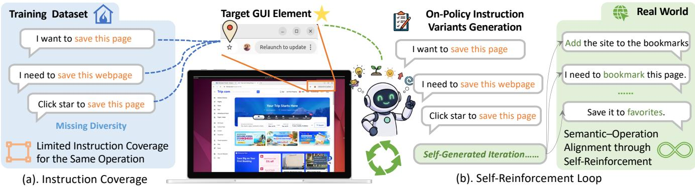  
Figure 1: Existing datasets (a) sufer from limited instruction coverage, whereas our bidirectional reinforcement framework (b) samples on-policy instruction variations for the same UI element, strengthening semantic–element understanding.

• Competitive performance on cross-platform benchmarks. Experiments demonstrate that our model achieves competitive performance across five grounding benchmarks, including ScreenSpot-Pro (Li et al. 2025b), ScreenSpot-V2 (Wu et al. 2024), UI-Vision (Nayak et al. 2025), MMBench-GUI L2 (Wang et al. 2025b), and OSWorld-G-R (Xie et al. 2025).

## Related Works

## High-Quality Dataset Construction and Instruction Augmentation

Several works improve data quality and instruction coverage. UI-E2I-Synth (Liu et al. 2025a), AutoGUI (Li et al. 2025a), OS-ATLAS (Wu et al. 2024), UGround (Gou et al. 2025), and JEDI (Xie et al. 2025) ofline expand grounding datasets by generating diverse instructions and functionality descriptions with large language models, while GroundCUA (Feizi et al. 2025) and ScaleCUA (Liu et al. 2025c) highlight the value of high-quality human-annotated and GUI-understanding data. However, such ofline augmentation confines instructions to predefined sample sets and cannot progressively evolve with the model during training, making it hard to cover the wide range of real-world instruction expressions.

## Reinforcement Learning in GUI Agents

Recent research explores various strategies to enhance GUI grounding with RL. One line refines the reward signal: UI-R1 (Lu et al. 2025) uses a composite accuracy/action/format reward and shows explicit <think> tokens are redundant, GUI-G1 (Zhou et al. 2025b) curbs reward hacking by shaping reward granularity with hits, IoU, and element size, and GUI-G<sup>2</sup> (Tang et al. 2025) models elements as continuous Gaussian distributions to turn sparse binary hits into dense optimization. A second line targets the training framework and exploration: GUI-R1 (Luo et al. 2025) adopts an RFT framework with a unified action space, SE-GUI (Yuan et al. 2025) filters overly dificult samples via attention foci from the previous round, infiGUI-G1 (Liu et al. 2025b) performs adaptive exploration policy optimization over multiple sampled answers, UI-Ins (Chen et al. 2025) alleviates policy collapse through instruction refinement and multi-view SFT, and GUI-RCPO (Du et al. 2025) self-evolves on unlabeled data via test-time sampling. Overall, RL is an efective and eficient approach for advancing GUI grounding. However, existing methods reward the model mainly by grounding accuracy and lack semantic rewards for generating correct instructions or descriptions of UI elements.

## Method

Overview. We propose BiGrounder, a two-stage framework based on bidirectional semantic verification for enhancing visual-language alignment in GUI agents. Unlike traditional paradigms that only learn unidirectional "instruction→coordinate" mappings, BiGrounder additionally learns a reverse generation policy conditioned on ground-truth target coordinates. During SFT, the model jointly learns forward localization and reverse description, acquiring both the ability to locate elements from instructions and to generate semantic descriptions from element regions. During RL, this reverse capability becomes an on-policy source of instruction variation. The cycle comprises two steps: (1) instruction generation: conditioned on the groundtruth target coordinate o<sup>∗</sup>, the policy generates descriptions or interaction instructions; and (2) instruction grounding: the same policy grounds each generated instruction, and the resulting coordinate is evaluated against o<sup>∗</sup>.

## Bidirectional Task Construction Method

To enable the model to simultaneously possess GUI Grounding and self-generated user instruction capabilities, we design bidirectional training tasks: predicting coordinates from user instructions and generating user instructions from coordinates. As shown in Fig. 2, the GUI Grounding task aims to map natural language instructions to specific interaction operations on graphical user interfaces. The model generates structured sequences containing action types and screen coordinates to explicitly indicate the location of target elements, thereby achieving alignment between visual features and precise spatial coordinates. The GUI Description task generates unstructured natural language sequences based on prompts and interface inputs to describe the elements corresponding to specific coordinates or the operations on these elements. Since each element is paired with multiple descriptions during bidirectional training, the model can sample varied, semantically consistent instructions in the subsequent RL stage.

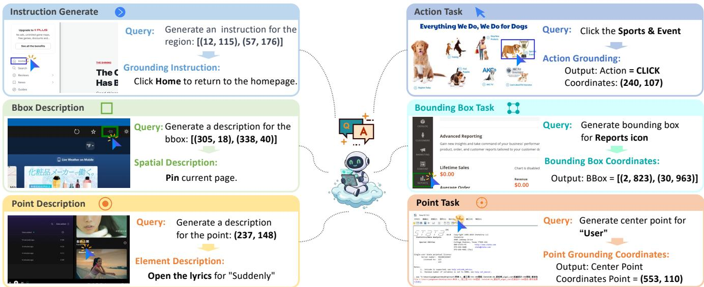  
Figure 2: During the SFT stage, we organize the training data into six tasks: instruction generation, instruction grounding, bounding-box description generation, bounding-box localization, point-based description generation, and point localization.

## Model Training - Supervised Fine-tuning Stage

By unifying strictly structured outputs (actions/coordinates) and unstructured semantic outputs (descriptions) into a single generation framework, the model learns to align visual features simultaneously with "functional semantics" and "precise spatial coordinates." The optimization objective is defined as:

$$
\mathcal { L } = - \mathbb { E } _ { ( I , x , Y ) \sim \mathcal { D } } \left[ \sum _ { t = 1 } ^ { T } \log P ( y _ { t } \mid y _ { < t } , x , I ) \right]\tag{1}
$$

where D denotes the multi-task training dataset. For a target sequence Y of length T, $y _ { t }$ represents the token at step t, conditioned on the input image I, the text instruction x, and the preceding tokens $y _ { < t }$ under teacher forcing. The supervised fine-tuning stage utilizes bidirectional data simultaneously, enabling the model to learn UI operations while comprehending the meaning of UI elements, thereby laying the foundation for subsequent reinforcement learning.

## Model Training - Reinforcement Stage

Reinforcement Sample Selection We utilize the SFT model to construct the RL dataset via rejection sampling with an inference temperature of 0.9. A sample is retained only if it satisfies two criteria: (1) Semantic Consistency. Among the four backward-generated instructions, at least three achieve a BERTScore greater than 0.85 with the original instruction.

(2) Dificulty Constraint. When performing forward inference with these four instructions, the model must succeed at least once but no more than three times (i.e., the number of correct predictions $s \in [ 1 , 3 ] )$ , ensuring the selection of non-trivial yet solvable samples

Reverse Reward In the reverse phase, our goal is to generate instructions that are semantically valid and operationally groundable. We employ Group Relative Policy Optimization to sample a set of candidate instructions $\{ \hat { x } _ { i } \} _ { i = 1 } ^ { G }$ given the target coordinate. We use BERTScore (Zhang et al. 2020) to measure candidate-to-reference consistency. Its precision, recall, and F-score are computed from token-embedding similarities as follows:

$$
R _ { \mathrm { B E R T } } = \frac { 1 } { | x | } \sum _ { x _ { i } \in x } \operatorname* { m a x } _ { \hat { x } _ { j } \in \hat { x } } \mathbf { x } _ { i } ^ { \top } \hat { \mathbf { x } } _ { j }\tag{2}
$$

$$
P _ { \mathrm { B E R T } } = \frac { 1 } { | \hat { x } | } \sum _ { \hat { x } _ { j } \in \hat { x } } \operatorname* { m a x } _ { x _ { i } \in x } \mathbf { x } _ { i } ^ { \top } \hat { \mathbf { x } } _ { j }\tag{3}
$$

$$
F _ { \mathrm { B E R T } } = 2 \cdot { \frac { P _ { \mathrm { B E R T } } \cdot R _ { \mathrm { B E R T } } } { P _ { \mathrm { B E R T } } + R _ { \mathrm { B E R T } } } }\tag{4}
$$

Let $b _ { i } = F _ { \mathrm { B E R T } } ( \hat { x } _ { i } , x )$ and $c _ { i } = \mathbb { I } [ \exists k : \operatorname { s u c c e s s } ( \tau _ { i , k } , o ^ { * } ) ]$ A forward grounding trajectory is considered successful when its reward is at least 0.9. We retain the semantic score only when the candidate passes the semantic threshold and completes cycle verification:

$$
R _ { \mathrm { r e v } } = { \left\{ \begin{array} { l l } { \mathrm { B E R T S c o r e } ( { \hat { x } } _ { i } , x ) , } & { b _ { i } \geq t , c _ { i } = 1 , } \\ { 0 , } & { { \mathrm { o t h e r w i s e } } . } \end{array} \right. }\tag{5}
$$

Here, $R _ { \mathrm { r e v } }$ denotes the reverse reward function, while $r _ { i } ^ { \mathrm { r e v } }$ is its value for the i-th instruction trajectory; $t = 0 . 8 5$ is the semantic threshold. During training, we generate $G = 4$ instructions and perform $K = 4$ grounding rollouts for each instruction. If $b _ { i } ~ \geq ~ t ,$ the generated instruction ${ \hat { x } } _ { i }$ enters its corresponding forward loop. Otherwise, we set $r _ { i } ^ { \mathrm { r e v } } = 0$ and use the ground-truth instruction x for that forward loop instead. For a qualified generation, its BERTScore reward is retained only if at least one of its K grounding rollouts returns to the target. Thus, every instruction branch contributes forward grounding trajectories, while only semantically qualified and cycle-consistent generations update the reverse policy.

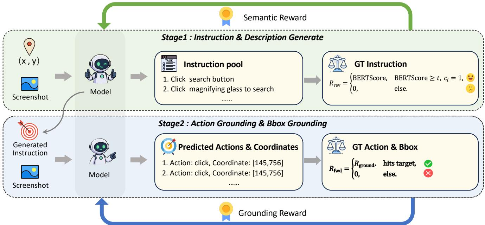  
Figure 3: The reinforcement stage couples on-policy instruction-generation trajectories with their corresponding instructiongrounding trajectories.

Forward Reward To cater to diferent grounding granularities, we use task-specific grounding rewards for action/point and region outputs:

$$
\begin{array} { r } { R _ { \mathrm { g r o u n d } } = \left\{ \begin{array} { l l } { R _ { A } + R _ { \mathcal { C } } + R _ { \mathcal { F } } , } & { \mathrm { a c t i o n ~ g r o u n d i n g , } } \\ { R _ { \mathrm { p o i n t } } , } & { \mathrm { p o i n t ~ g r o u n d i n g , } } \\ { R _ { \mathrm { b b o x } } , } & { \mathrm { b o u n d i n g ~ b o x . } } \end{array} \right. } \end{array}\tag{6}
$$

Action-Coordinate Alignment Reward: For element interactions, $R _ { \cal A } = 0 . 1$ is awarded for the correct action type, and $R c = 0 . 9$ is awarded when its predicted point falls inside the target bounding box; the coordinate reward is granted only if the action type is correct. Invalid output formats receive $R _ { \mathcal { F } } = - 0 . 2$ , while valid formats receive no format penalty. For point grounding, no action type is involved, so we use a binary hit reward $\mathbf { \bar { \mathit { R } } _ { \mathrm { p o i n t } } } = 1$ when the predicted point falls inside the target bounding box and 0 otherwise.

BBox-based Reward: For the bounding box prediction reward, we adopt the reward design of StepGUI (Yan et al. 2025). To ensure pixel-level precision, we implement a dense reward mechanism based on tolerance-normalized high-order decay. We define the normalized deviation as $\hat { \delta } _ { k } = | k _ { p r e d } - k _ { g t } | / \tau _ { k }$ . For Region Grounding, we decouple the bounding box into center coordinates $( c _ { x } , c _ { y } )$ and dimensions $( w , h )$ , using the same pixel tolerance for all four terms, $\tau _ { c _ { x } } = \tau _ { c _ { y } } = \tau _ { w } = \tau _ { h } = 6$ . We construct a composite geometric energy term $E _ { g e o m } ,$ weighting down dimensional errors via the coeficient γ:

$$
E _ { g } = \hat { \delta } _ { c x } ^ { 4 } + \hat { \delta } _ { c y } ^ { 4 } + \gamma \hat { \delta } _ { w } ^ { 4 } + \gamma \hat { \delta } _ { h } ^ { 4 }\tag{7}
$$

Here, we set $\gamma = 0 . 5$ . To simultaneously optimize alignment precision and area overlap, the final bounding box reward $R _ { b b o x }$ is a weighted fusion of the geometric score and the Intersection over Union (IoU):

$$
R _ { b b o x } = \alpha \cdot \exp ( - E _ { g } ) + ( 1 - \alpha ) \cdot \mathrm { I o U } ( b _ { p r e d } , b _ { g t } )\tag{8}
$$

We set $\alpha = 0 . 8$ , aiming to prioritize geometric centrality while retaining IoU as a regularization constraint for shape consistency.

Finally, we employ GRPO (Guo et al. 2025) to optimize the reverse-to-forward cyclic process. Within each trajectory group, the advantage is obtained by normalizing the rewards, $\hat { A } _ { i } = ( r _ { i } - \mathrm { m e a n } ( \mathbf { r } ) ) / ( \mathrm { s t d } ( \mathbf { r } ) + \epsilon _ { \mathrm { n u m } } )$ , where $\epsilon _ { \mathrm { n u m } } = 1 0 ^ { - 6 }$ The per-trajectory clipped loss is

$$
\ell _ { i } ( \theta ) = - \operatorname* { m i n } \Big ( \rho _ { i } \hat { A } _ { i } , \bar { \rho } _ { i } \hat { A } _ { i } \Big ) + \beta D _ { \mathrm { K L } } ( \pi _ { \theta } \| \pi _ { \mathrm { r e f } } ) ,\tag{9}
$$

where $\rho _ { i } = \pi _ { \theta } ( o _ { i } \mid I , S ) / \pi _ { \mathrm { o l d } } ( o _ { i } \mid I , S )$ is the importance ratio, $\bar { \rho } _ { i } = \mathrm { c l i p } ( \rho _ { i } , 1 - \epsilon _ { \mathrm { c l i p } } , 1 + \epsilon _ { \mathrm { c l i p } } )$ , and $\beta$ weights the KL penalty against the reference SFT model $\pi _ { \mathrm { r e f } }$ . The G reverse trajectories form one GRPO group, while the K grounding rollouts associated with each generated instruction form a forward group; their advantages are normalized within the corresponding groups.

After group-wise advantage estimation, we jointly aggregate all trajectories using seq-mean-token-mean (each trajectory is averaged over its own tokens, then averaged with equal weight), so every trajectory contributes equally regardless of length:

Algorithm 1 Bidirectional Cycle-Consistent RL with GRPO   
Require: Dataset D, policy π<sub>θ</sub>, reference $\pi _ { r e f }$   
Require: $G = 4 , K { \stackrel { . } { = } } 4 ,$ semantic threshold t = 0.85   
1: while not converged do   
2: Sample batch $\bar { B } \sim \mathcal { D }$   
3: for each $( s , o ^ { \ast } , x ) \in B$ do   
4: Stage 1: Instruction Generation   
5: Sample G trajectories $\{ \hat { x } _ { i } \} _ { i = 1 } ^ { G } \sim \pi _ { \theta } ( \hat { x } \mid s , o ^ { * } )$   
6: for i = 1 to G do   
7: $b _ { i } \gets \mathrm { B E R T S c o r e } ( \hat { x } _ { i } , x )$   
8: $q _ { i }  { \hat { x } } _ { i } { \mathrm { i f } } b _ { i } \geq t ,$ else x // GTfallback   
9: Stage 2: Instruction Grounding   
10: Sample K trajectories $\{ \tau _ { i , k } \} _ { k = 1 } ^ { K } \sim \pi _ { \theta } ( \tau \mid s , q _ { i } )$   
11: $r _ { i , k } ^ { f w d }  R _ { \mathrm { g r o u n d } } ( \tau _ { i , k } , o ^ { * } )$ // Grounding reward   
12: $c _ { i } \gets \mathbb { I } [ \exists k : r _ { i , k } ^ { f w d } \geq 0 . 9 ]$ // Cycle gate   
13: $r _ { i } ^ { r e v }  R _ { \mathrm { r e v } } ( b _ { i } , c _ { i } )$ // Semantic reward   
14: end for   
15: $A _ { i , : } ^ { f w d } \gets \mathrm { G R P O A d v } ( r _ { i , : } ^ { f w d } ) , i = 1 , \dots , G$   
16: $A ^ { r e v }  \mathrm { G R P O A d v } ( r ^ { r e v } )$   
17: Compute per-trajectory losses $\ell ^ { r e v }$ and ℓ<sup>fwd</sup>   
18: $\mathcal { L } _ { B i } \dot { \gets } \dot { \mathrm { S e q M e a n } } ( \ell ^ { r e \bar { \upsilon } } \cup \ell ^ { f w d } )$ //   
seq-mean-token-mean   
19: Update π<sub>θ</sub> using $\mathcal { L } _ { B i }$   
20: end for   
21: end while

$$
\mathcal { L } _ { \mathrm { B i } } = \frac { 1 } { G + G K } \left( \sum _ { i = 1 } ^ { G } \ell _ { i } ^ { \mathrm { r e v } } + \sum _ { i = 1 } ^ { G } \sum _ { k = 1 } ^ { K } \ell _ { i , k } ^ { \mathrm { f w d } } \right) .\tag{10}
$$

where $\ell _ { i } ^ { \mathrm { r e v } }$ and $\ell _ { i , k } ^ { \mathrm { f w d } }$ are the reverse and forward instances of the loss in Eq. (9). Under seq-mean-token-mean with $G =$ $K = 4$ , the reverse and forward trajectories contribute 0.2 and 0.8 by construction.

## Experiments

## Experimental Setup

Implementation details. Model Architectures. Our primary model, BiGrounder-4B, is built on the Qwen3-VL-4B-Instruct backbone. To evaluate generalization across model scales and backbone families, we additionally validate BiGrounder on Qwen2.5-VL-3B-Instruct and Qwen2.5- VL-7B-Instruct. Following our ablation studies, we set the BERTScore threshold t to 0.85 and all center and size tolerance thresholds to 6 pixels.

• SFT Stage. We adopt the open-source grounding data from ScaleCUA (Liu et al. 2025c) and GroundCUA (Feizi et al. 2025), and construct the corresponding reverse coordinate→instruction data to add into training. For samples with only element descriptions, we employ Gemini 2.5-Flash to rewrite the descriptions into user instructions. We will release the rewritten instructions together with the exact prompts used. With a total of 4,482k samples, the training is conducted for 2 epochs with a global batch size of 640 and a learning rate of $1 \times 1 0 ^ { - 5 }$ , aiming to endow the model with fundamental capabilities for both description generation and element grounding.

• RL stage. We use approximately 63k filtered samples for the RL stage. Unlike ofline augmentation with its fixed sample set, our framework samples instruction variations on-policy from the current model at a temperature of 0.9. We employ GRPO for 1 epoch. For each sample, we generate 4 instructions in the backward phase, each followed by 4 grounding rollouts. We set the training batch size to 64 and the learning rate to $5 \times 1 0 ^ { - 7 }$

## GUI Grounding Benchmark and Performance

To systematically evaluate GUI grounding under diverse user instructions, we conduct experiments on five benchmarks with diferent instruction characteristics and visual complexities: ScreenSpot-Pro (Li et al. 2025b), ScreenSpot-V2 (Wu et al. 2024), MMBench-GUI L2 (Wang et al. 2025b), UI-Vision (Nayak et al. 2025), and OSWorld-G-R (Xie et al. 2025), which cover desktop, mobile, and web interfaces from complementary perspectives. As shown in Table 1, BiGrounder-4B achieves competitive results across all five benchmarks, reaching 66.6% on the highresolution ScreenSpot-Pro and 87.5% on MMBench-GUI L2. BiGrounder is particularly robust on benchmarks whose instructions carry complex or implicit user intent, consistent with its more stable grounding under instruction variation.

## GUI Agent Performance

Beyond static grounding, we test whether it transfers to online agent tasks, where the executor must localize targets from instructions dynamically generated by a planner. All models share the same GPT-4o planner and interaction budget, and diferences reflect the executor alone. In terms of accuracy, BiGrounder-4B reaches the highest success rate on both benchmarks, indicating that its grounding stays reliable when queries are produced by a planner. In terms of robustness, its run-to-run std is comparable or lower (0.5 vs. 0.8 on OSWorld), indicating stable behavior across the varied phrasings a planner produces. The gains are modest but consistent across both metrics.

## Robustness to Instruction Variation

To quantify robustness to instruction reformulation, we build OSWorld-G-R-Variants (564 elements × 4 instructions = 2,256 grounding queries), pairing each element’s original instruction with three variants rewritten by GPT-4o and manually verified to be semantically equivalent and unambiguous, then querying every model with all four. As shown in Table 3, BiGrounder attains the highest originalinstruction accuracy and the highest Any- and All-Correct rates, while reducing the Any–All gap from 17.4 to 14.8 points compared with Qwen3-VL-4B. This 2.6-point reduction indicates lower sensitivity to instruction wording and more consistent grounding across semantically equivalent expressions. We will release these rewritten instructions together with the exact prompts and filtering procedure to support full reproducibility.

<table><tr><td>Model</td><td>ScreenSpot-Pro</td><td>ScreenSpot-V2</td><td>MMBench-GUI L2</td><td>UI-Vision</td><td>OSWorld-G-R</td><td>Avg.</td></tr><tr><td colspan="7">Qwen2.5-VL-3B backbone</td></tr><tr><td>Qwen2.5-VL-3B* (Bai et al. 2025c)</td><td>25.9</td><td>80.8</td><td>52.0</td><td>0.7</td><td>39.4</td><td>39.8</td></tr><tr><td>UI-R1-E-3B (Lu et al. 2025)</td><td>17.8</td><td>88.6</td><td>68.4</td><td>16.5</td><td>48.8</td><td>48.0</td></tr><tr><td>SE-GUI-3B (Yuan et al. 2025)</td><td>35.9</td><td>86.8</td><td>66.3</td><td>15.0</td><td>46.1</td><td>50.0</td></tr><tr><td>InfiGUI-R1-3B (Liu et al. 2025b)</td><td>35.7</td><td>89.5</td><td>70.6</td><td>17.8</td><td>42.9</td><td>51.3</td></tr><tr><td>GUI-G²-3B (Tang et al. 2025)</td><td>36.4</td><td>87.6</td><td>66.3</td><td>18.7</td><td>53.5</td><td>52.5</td></tr><tr><td>GUI-G1-3B (Zhou et al. 2025b)</td><td>37.1</td><td>89.5</td><td>71.0</td><td>20.3</td><td>49.5</td><td>53.5</td></tr><tr><td>InfiGUI-G1-3B (Liu et al. 2025b)</td><td>45.2</td><td>91.1</td><td>73.4</td><td>22.0</td><td>49.6</td><td>56.3</td></tr><tr><td>BiGrounder-3B (Ours)</td><td>52.5</td><td>91.4</td><td>78.7</td><td>28.7</td><td>58.6</td><td>62.0+22.2</td></tr><tr><td colspan="7">Qwen2.5-VL-7B backbone</td></tr><tr><td>Qwen2.5-VL-7B* (Bai et al. 2025c)</td><td>27.6</td><td>86.5</td><td>69.9</td><td>0.9</td><td>41.3</td><td>45.2</td></tr><tr><td>SE-GUI-7B (Yuan et al. 2025)</td><td>47.3</td><td>68.9</td><td>34.5</td><td>16.7</td><td>33.9</td><td>40.3</td></tr><tr><td>UI-TARS-1.5-7B (Seed 2025)</td><td>49.6</td><td>90.3</td><td>64.3</td><td>20.8</td><td>64.2</td><td>57.8</td></tr><tr><td>GUI-G²-7B (Tang et al. 2025)</td><td>47.5</td><td>93.3</td><td>79.5</td><td>25.6</td><td>61.9</td><td>61.6</td></tr><tr><td>InfiGUI-G1-7B (Liu et al. 2025b)</td><td>51.9</td><td>93.5</td><td>80.8</td><td>26.1</td><td>59.9</td><td>62.4</td></tr><tr><td>GTA1-7B (Yang et al. 2025)</td><td>50.1</td><td>92.4</td><td>79.4</td><td>25.7</td><td>67.7</td><td>63.1</td></tr><tr><td>BiGrounder-7B (Ours)</td><td>53.8</td><td>92.7</td><td>81.4</td><td>32.1</td><td>60.7</td><td> ${ \bf 6 4 . 1 _ { + 1 8 . 9 } }$ </td></tr><tr><td colspan="7">Qwen3-VL-4B backbone</td></tr><tr><td>Qwen3-VL-4B* (Bai et al. 2025a)</td><td>59.3</td><td>93.5</td><td>81.2</td><td>26.9</td><td>65.3</td><td>65.2</td></tr><tr><td>Step-GUI-4B (Yan et al. 2025)</td><td>60.0</td><td>93.6</td><td>84.0</td><td>27.1*</td><td>67.6*</td><td>66.5</td></tr><tr><td>GUI-Owl-1.5-4B-Instruct (Xu et al. 2026)</td><td>66.8</td><td>93.2</td><td>83.2</td><td>27.3*</td><td>68.4</td><td>67.8</td></tr><tr><td>BiGrounder-4B (Ours)</td><td>66.6</td><td>93.9</td><td>87.5</td><td>46.6</td><td>69.5</td><td>72.8+7.6</td></tr></table>

Table 1: Grounding accuracy on five GUI grounding benchmarks and their average, grouped by backbone. Unless marked with “∗”, baseline results are taken from the corresponding original papers or technical reports (cited in each row), or from the consolidated evaluation reported by GroundNext (Feizi et al. 2025). “∗” marks results we re-evaluated under our unified protocol for benchmarks not reported in these sources. “Avg.” is the mean over the five benchmarks. Within each backbone group, best is in bold and second-best is underlined. The green subscript denotes the absolute Avg. gain over each model’s backbone.

<table><tr><td>Executor Model</td><td>AndroidWorld</td><td>OSWorld</td></tr><tr><td>Aria-UI (Yang et al. 2024)</td><td>44.8</td><td>15.2</td></tr><tr><td>UGround-V1-7B (Gou et al. 2025)</td><td>32.8</td><td>16.1</td></tr><tr><td>UI-TARS-1.5-7B (Seed 2025)</td><td>37.9</td><td>19.1</td></tr><tr><td>ScaleCUA-7B (Liu et al. 2025c)</td><td>48.3</td><td>28.1</td></tr><tr><td>Qwen3-VL-4B* (Bai et al. 2025a)</td><td> $6 8 . 9 \pm 0 . 9$ </td><td> $4 0 . 2 \pm 0 . 8$ </td></tr><tr><td>BiGrounder-4B</td><td> $7 2 . 4 \pm { \bf 0 . 9 }$ </td><td> ${ \bf 4 2 . 8 \pm 0 . 5 }$ </td></tr></table>

Table 2: GUI agent benchmark results with each model as the grounding executor and GPT-4o as the planner. Android-World follows predefined steps; OSWorld uses a 50-step budget. Best in bold. <sup>∗</sup>Evaluated by us (mean ± std over 3 runs).

Training Dynamics. Figure 4 tracks the on-policy instructions over RL. In Fig. 4a, semantic consistency and diversity rise together (BERTScore 0.844 → 0.884, diversity 0.603 → 0.675), suggesting the model explores more varied phrasings while staying close to the target. In Fig. 4b, both Any@4 and All@4 improve, where Any@4 and All@4 are the accuracies of grounding an element correctly under at least one and under all four instructions; the shaded gap between them narrows from about 0.156 to 0.085, indicating grounding becomes less dependent on the specific wording.

Qualitative Analysis. Figure 5 provides an illustrative example in which forward-only RL is afected by instruction reformulation, whereas BiGrounder consistently grounds the target across the two semantically equivalent expressions.

<table><tr><td>Method</td><td>Original</td><td>Any Accuracy ↑ Correct ↑ Correct ↑</td><td>All</td><td>Any-All Gap ↓</td></tr><tr><td>Qwen3-VL-4B</td><td>65.3</td><td>73.4</td><td>56.0</td><td>17.4</td></tr><tr><td>Bi-SFT</td><td>65.7</td><td>73.6</td><td>56.8</td><td>16.8</td></tr><tr><td>Bi-SFT + Forward RL</td><td>67.4</td><td>74.5</td><td>58.2</td><td>16.3</td></tr><tr><td>BiGrounder-4B</td><td>69.5</td><td>75.3</td><td>60.5</td><td> $\pmb { 1 4 . 8 } _ { \downarrow 2 . 6 }$ </td></tr></table>

Table 3: Robustness to instruction variation on OSWorld-G-R-Variants. Each original instruction is paired with three target-preserving variants that difer in wording and sentence structure. Original: accuracy under the original instruction; Any-/All-Correct: element grounded correctly under at least one/all four instructions. Any–All Gap: sensitivity to instruction variation. The green subscript denotes the absolute gap reduction over Qwen3-VL-4B. Best in bold.

## Ablation Studies

Efectiveness of Training Recipes. Table 4 shows that Bi-SFT improves over Single-SFT (67.6 vs. 66.9). Adding bidirectional RL (+RL-Bi) yields the best average of 72.8, outperforming three point-reward alternatives: a binary in-box hit (InBbox), a distance-to-center decay (Distance), and a Gaussian distance reward (Gaussian). To isolate the contribution of the reverse branch, we further evaluate +RL-Forward-only, a forward-only variant that uses the same reward without reverse policy updates.

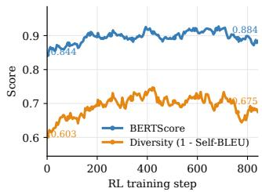

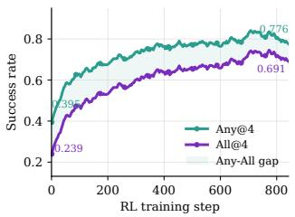  
(a) Semantic consistency and (b) Cycle-grounding reliability. within-group diversity.

Figure 4: RL training dynamics. (a) semantic consistency (BERTScore) and within-group diversity (1−Self-BLEU) of the on-policy instructions. (b) cycle-grounding reliability measured by Any@4 and All@4, with the shaded Any–All gap narrowing over training.  
  
Figure 5: Qualitative comparison of grounding under instruction variations.

<table><tr><td>Method</td><td colspan="5">SS-Pro SS-V2 OS-G-R UI-V. MM-L2</td><td>Avg.</td></tr><tr><td>Qwen3-VL-4B</td><td>59.3</td><td>93.5</td><td>65.3</td><td>26.9</td><td>81.2</td><td>65.2</td></tr><tr><td>Single-SFT</td><td>59.4</td><td>90.6</td><td>65.2</td><td>39.7</td><td>79.8</td><td>66.9+1.7</td></tr><tr><td>Bi-ŠFT</td><td>60.2</td><td>91.2</td><td>65.7</td><td>39.9</td><td>81.0</td><td>67.6+2.4</td></tr><tr><td>+RL-InBbox</td><td>63.2</td><td>92.9</td><td>67.4</td><td>44.9</td><td>84.1</td><td>70.5+5.3</td></tr><tr><td>+RL-Distance</td><td>62.7</td><td>92.3</td><td>66.8</td><td>42.5</td><td>83.5</td><td>69.6+4.4</td></tr><tr><td>+RL-Gaussian</td><td>63.5</td><td>92.9</td><td>67.9</td><td>44.8</td><td>85.1</td><td>70.8+5.6</td></tr><tr><td>+RL-Forward-only</td><td>63.7</td><td>92.9</td><td>67.4</td><td>45.1</td><td>85.3</td><td>70.9+5.7</td></tr><tr><td>+RL-Bi (Ours)</td><td>66.6</td><td>93.9</td><td>69.5</td><td>46.6</td><td>87.5</td><td> $7 2 . 8 _ { + 7 . 6 }$ </td></tr></table>

Table 4: Controlled comparison of training recipes with Qwen3-VL-4B-Instruct backbone and complete training dataset. The subscript in Avg. denotes the absolute gain over the base model.

Efect of Cycle-Consistency Gating. BERTScore alone rewards semantically fluent instructions even when they are visually incorrect, leaving the reverse reward open to reward hacking. To counter this, Algorithm 1 retains the reverse reward only when the generated instruction can be grounded back to the target element, so that a high semantic score alone cannot earn credit unless the instruction is also verified to point back to the intended element. As reported in Table 5, cycle gating raises the average from 70.1 to 72.8 over the

<table><tr><td>Method</td><td>SS-Pro SS-V2</td><td></td><td>OS-G-R</td><td></td><td>UI-V. MM-L2</td><td>Avg.</td></tr><tr><td>Bi-SFT</td><td>60.2</td><td>91.2</td><td>65.7</td><td>39.9</td><td>81.0</td><td>67.6</td></tr><tr><td>RL w/o Cycle-C.</td><td>62.8</td><td>92.4</td><td>66.9</td><td>44.9</td><td>83.5</td><td> $7 0 . 1 _ { + 2 . 5 }$ </td></tr><tr><td>RL w/ Cycle-C.</td><td>66.6</td><td>93.9</td><td>69.5</td><td>46.6</td><td>87.5</td><td> $7 2 . 8 _ { + 5 . 2 }$ </td></tr></table>

Table 5: Ablation on cycle-consistency gating for mitigating reward hacking. The subscript in Avg. denotes the absolute gain over the Bi-SFT baseline.

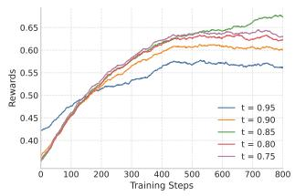

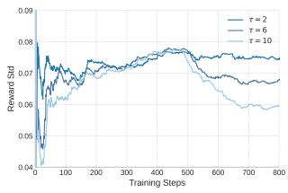  
(a) Mean reward during training. (b) Reward std. during training.  
Figure 6: Training dynamics under diferent reward hyperparameters: (a) semantic-reward threshold t; (b) pixel-level tolerance τ.

ungated variant, confirming that filtering out non-groundable instructions yields more reliable reverse rewards.
<table><tr><td>Method</td><td colspan="5">SS-Pro SS-V2 OS-G-R UI-V. MM-L2</td><td>Avg.</td></tr><tr><td>Qwen3-VL-4B</td><td>59.3</td><td>93.5</td><td>65.3</td><td>26.9</td><td>81.2</td><td>65.2</td></tr><tr><td>Bi-SFT w/o rewritten</td><td>59.7</td><td>91.2</td><td>65.5</td><td>39.5</td><td>80.6</td><td>67.3</td></tr><tr><td>Bi-SFT w/ rewritten</td><td>60.2</td><td>91.2</td><td>65.7</td><td>39.9</td><td>81.0</td><td>67.6</td></tr><tr><td>BiGrounder w/o rewritten</td><td>64.7</td><td>93.1</td><td>68.1</td><td>44.8</td><td>85.6</td><td>71.3</td></tr><tr><td>BiGrounder w/ rewritten</td><td>66.6</td><td>93.9</td><td>69.5</td><td>46.6</td><td>87.5</td><td>72.8</td></tr></table>

Table 6: Efect of Gemini-rewritten instructions under the same backbone and training recipe.

Efect of Gemini-Rewritten Instructions. Table 6 isolates the Gemini-rewritten instructions under the same backbone and recipe. Removing them lowers the average only marginally at both stages (67.6 → 67.3 SFT, 72.8 → 71.3 RL), indicating the gains stem from bidirectional training rather than the external rewrites.

Sensitivity to Reward Hyperparameters. Using a Scale-CUA subset and a fixed configuration, t = 0.85 gives the highest stabilized reward (Figure 6(a)). A strict tolerance (τ = 2) causes excessive variation, whereas τ = 10 weakens discrimination (Figure 6(b)); we therefore use τ = 6.

## Conclusion

We present BiGrounder, a bidirectional training paradigm for the many-to-one instruction mapping in GUI grounding. It turns the model’s own on-policy instruction variations into reinforcement trajectories. Across five benchmarks, our model achieves competitive average accuracy in our evaluation, with the largest gains in semantically challenging scenarios, and plugs readily into standard SFT+RL pipelines.

Anthropic. 2024. Claude 3.7 Sonnet. https://www.anthropic. com/news/claude-3-7-sonnet. Accessed: 2025-08-02.

Bai, S.; Cai, Y.; Chen, R.; Chen, K.; Chen, X.; Cheng, Z.; Deng, L.; Ding, W.; Gao, C.; Ge, C.; Ge, W.; Guo, Z.; Huang, Q.; Huang, J.; Huang, F.; Hui, B.; Jiang, S.; Li, Z.; Li, M.; Li, M.; Li, K.; Lin, Z.; Lin, J.; Liu, X.; Liu, J.; Liu, C.; Liu, Y.; Liu, D.; Liu, S.; Lu, D.; Luo, R.; Lv, C.; Men, R.; Meng, L.; Ren, X.; Ren, X.; Song, S.; Sun, Y.; Tang, J.; Tu, J.; Wan, J.; Wang, P.; Wang, P.; Wang, Q.; Wang, Y.; Xie, T.; Xu, Y.; Xu, H.; Xu, J.; Yang, Z.; Yang, M.; Yang, J.; Yang, A.; Yu, B.; Zhang, F.; Zhang, H.; Zhang, X.; Zheng, B.; Zhong, H.; Zhou, J.; Zhou, F.; Zhou, J.; Zhu, Y.; and Zhu, K. 2025a. Qwen3-VL Technical Report. arXiv preprint arXiv:2511.21631.

Bai, S.; Chen, K.; Liu, X.; Wang, J.; Ge, W.; Song, S.; Dang, K.; Wang, P.; Wang, S.; Tang, J.; Zhong, H.; Zhu, Y.; Yang, M.; Li, Z.; Wan, J.; Wang, P.; Ding, W.; Fu, Z.; Xu, Y.; Ye, J.; Zhang, X.; Xie, T.; Cheng, Z.; Zhang, H.; Yang, Z.; Xu, H.; and Lin, J. 2025b. Qwen2.5-VL Technical Report. arXiv:2502.13923.

Bai, S.; Chen, K.; Liu, X.; Wang, J.; Ge, W.; Song, S.; Dang, K.; Wang, P.; Wang, S.; Tang, J.; et al. 2025c. Qwen2. 5-vl technical report. arXiv preprint arXiv:2502.13923.

Chen, L.; Zhou, H.; Cai, C.; Zhang, J.; Tong, P.; Kong, Q.; Zhang, X.; Liu, C.; Liu, Y.; Wang, W.; Wang, Y.; Jin, Q.; and Hoi, S. 2025. UI-Ins: Enhancing GUI Grounding with Multi-Perspective Instruction-as-Reasoning. arXiv:2510.20286.

DeepMind, G. 2025. Gemini 3 Pro.

Du, Y.; Yan, Y.; Tang, F.; Lu, Z.; Zong, C.; Lu, W.; Jiang, S.; and Shen, Y. 2025. Test-Time Reinforcement Learning for GUI Grounding via Region Consistency. arXiv:2508.05615.

Feizi, A.; Nayak, S.; Jian, X.; Lin, K. Q.; Li, K.; Awal, R.; Lù, X. H.; Obando-Ceron, J.; Rodriguez, J. A.; Chapados, N.; Vazquez, D.; Romero-Soriano, A.; Rabbany, R.; Taslakian, P.; Pal, C.; Gella, S.; and Rajeswar, S. 2025. Grounding Computer Use Agents on Human Demonstrations. arXiv:2511.07332.

Gou, B.; Wang, R.; Zheng, B.; Xie, Y.; Chang, C.; Shu, Y.; Sun, H.; and Su, Y. 2025. Navigating the Digital World as Humans Do: Universal Visual Grounding for GUI Agents. In The Thirteenth International Conference on Learning Representations.

Gu, Z.; Zeng, Z.; Xu, Z.; Zhou, X.; Shen, S.; Liu, Y.; Zhou, B.; Meng, C.; Xia, T.; Chen, W.; Wen, Y.; Dou, J.; Tang, F.; Lin, J.; Liu, Y.; Guo, Z.; Gong, Y.; Jia, H.; Gao, C.; Guo, Y.; Deng, Y.; Guo, Z.; Chen, L.; and Wang, W. 2025. UI-Venus Technical Report: Building High-performance UI Agents with RFT. arXiv:2508.10833.

Guo, D.; Yang, D.; Zhang, H.; Song, J.; Zhang, R.; Xu, R.; Zhu, Q.; Ma, S.; Wang, P.; Bi, X.; et al. 2025. Deepseek-r1: Incentivizing reasoning capability in llms via reinforcement learning. arXiv preprint arXiv:2501.12948.

Hui, Z.; Li, Y.; Zhao, D.; Chen, T.; Banbury, C.; and Koishida, K. 2025. WinClick: GUI Grounding with Multimodal Large Language Models. arXiv:2503.04730.

Kim, S.; Chen, Z.; Li, X.; and Liu, Q. 2026. Look Where You’re Told: Instruction-Consistent Attention for GUI Grounding. In Proceedings ofthe 4th Workshop on Advances in Language and Vision Research (ALVR), 155–163. Association for Computational Linguistics.

Li, H.; Chen, J.; Su, J.; Chen, Y.; Li, Q.; and Zhang, Z. 2025a. AutoGUI: Scaling GUI Grounding with Automatic Functionality Annotations from LLMs. arXiv:2502.01977.

Li, K.; Ziyang, M.; Lin, H.; Luo, Z.; Tian, Y.; Ma, J.; Huang, Z.; and Chua, T.-S. 2025b. ScreenSpot-Pro: GUI Grounding for Professional High-Resolution Computer Use. In Workshop on Reasoning and Planning for Large Language Models.

Liu, X.; Zhang, X.; Zhang, Z.; and Lu, Y. 2025a. UI-E2I-Synth: Advancing GUI Grounding with Large-Scale Instruction Synthesis. arXiv:2504.11257.

Liu, Y.; Liu, Z.; Zhu, S.; Li, P.; Xie, C.; Wang, J.; Hu, X.; Han, X.; Yuan, J.; Wang, X.; et al. 2025b. InfiGUI-G1: Advancing GUI Grounding with Adaptive Exploration Policy Optimization. arXiv preprint arXiv:2508.05731.

Liu, Z.; Xie, J.; Ding, Z.; Li, Z.; Yang, B.; Wu, Z.; Wang, X.; Sun, Q.; Liu, S.; Wang, W.; Ye, S.; Li, Q.; Dong, X.; Yu, Y.; Lu, C.; Mo, Y.; Yan, Y.; Tian, Z.; Zhang, X.; Huang, Y.; Liu, Y.; Su, W.; Luo, G.; Yue, X.; Qi, B.; Chen, K.; Zhou, B.; Qiao, Y.; Chen, Q.; and Wang, W. 2025c. ScaleCUA: Scaling Open-Source Computer Use Agents with Cross-Platform Data. arXiv preprint arXiv:2509.15221. Preprint.

Lu, Z.; Chai, Y.; Guo, Y.; Yin, X.; Liu, L.; Wang, H.; Xiong, G.; and Li, H. 2025. UI-R1: Enhancing Action Prediction of GUI Agents by Reinforcement Learning. arXiv preprint arXiv:2503.21620.

Luo, R.; Wang, L.; He, W.; Chen, L.; Li, J.; and Xia, X. 2025. GUI-R1 : A Generalist R1-Style Vision-Language Action Model For GUI Agents. arXiv:2504.10458.

Nayak, S.; Jian, X.; Lin, K. Q.; Rodriguez, J. A.; Kalsi, M.; Awal, R.; Chapados, N.; Özsu, M. T.; Agrawal, A.; Vazquez, D.; Pal, C.; Taslakian, P.; Gella, S.; and Rajeswar, S. 2025. UI-Vision: A Desktop-centric GUI Benchmark for Visual Perception and Interaction. arXiv:2503.15661.

OpenAI. 2024. GPT-4o System Card. arXiv:2410.21276.

Qin, Y.; Ye, Y.; Fang, J.; Wang, H.; Liang, S.; Tian, S.; Zhang, J.; Li, J.; Li, Y.; Huang, S.; et al. 2025. UI-TARS: Pioneering Automated GUI Interaction with Native Agents. arXiv preprint arXiv:2501.12326.

Seed, B. 2025. UI-TARS-1.5. https://seed-tars.com/1.5.

Tang, F.; Gu, Z.; Lu, Z.; Liu, X.; Shen, S.; Meng, C.; Wang, W.; Zhang, W.; Shen, Y.; Lu, W.; Xiao, J.; and Zhuang, Y. 2025. GUI-G<sup>2</sup>: Gaussian Reward Modeling for GUI Grounding. arXiv:2507.15846.

Wang, X.; Wang, B.; Lu, D.; Yang, J.; Xie, T.; Wang, J.; Deng, J.; Guo, X.; Xu, Y.; Wu, C. H.; Shen, Z.; Li, Z.; Li, R.; Li, X.; Chen, J.; Zheng, B.; Li, P.; Lei, F.; Cao, R.; Fu, Y.; Shin, D.; Shin, M.; Hu, J.; Wang, Y.; Chen, J.; Ye, Y.; Zhang, D.; Du, D.; Hu, H.; Chen, H.; Zhou, Z.; Yao, H.; Chen, Z.; Gu, Q.; Wang, Y.; Wang, H.; Yang, D.; Zhong, V.; Sung, F.; Charles, Y.; Yang, Z.; and Yu, T. 2025a. OpenCUA: Open Foundations for Computer-Use Agents. arXiv:2508.09123.

Yang, Y.; Li, D.; Dai, Y.; Yang, Y.; Luo, Z.; Zhao, Z.; Hu, Z.; Huang, J.; Saha, A.; Chen, Z.; Xu, R.; Pan, L.; Xiong, C.; and Li, J. 2025. GTA1: GUI Test-time Scaling Agent. arXiv:2507.05791.

Wang, X.; Wu, Z.; Xie, J.; et al. 2025b. MMBench-GUI: Hierarchical Multi-Platform Evaluation Framework for GUI Agents. arXiv preprint arXiv:2507.19478.

Wu, Q.; Cheng, K.; Yang, R.; Zhang, C.; Yang, J.; Jiang, H.; Mu, J.; Peng, B.; Qiao, B.; Tan, R.; et al. 2025. GUI-Actor: Coordinate-Free Visual Grounding for GUI Agents. arXiv preprint arXiv:2506.03143.

Wu, Z.; Wu, Z.; Xu, F.; Wang, Y.; Sun, Q.; Jia, C.; Cheng, K.; Ding, Z.; Chen, L.; Liang, P. P.; and Qiao, Y. 2024. OS-ATLAS: A Foundation Action Model for Generalist GUI Agents. arXiv:2410.23218.

Xie, T.; Deng, J.; Li, X.; Yang, J.; Wu, H.; Chen, J.; Hu, W.; Wang, X.; Xu, Y.; Wang, Z.; Xu, Y.; Wang, J.; Sahoo, D.; Yu, T.; and Xiong, C. 2025. Scaling Computer-Use Grounding via User Interface Decomposition and Synthesis. arXiv:2505.13227.

Xu, H.; Zhang, X.; Liu, H.; Wang, J.; Zhu, Z.; Zhou, S.; Hu, X.; Gao, F.; Cao, J.; Wang, Z.; Chen, Z.; Liao, J.; Zheng, Q.; Zeng, J.; Xu, Z.; Bai, S.; Lin, J.; Zhou, J.; and Yan, M. 2026. Mobile-Agent-v3.5: Multi-platform Fundamental GUI Agents. arXiv preprint arXiv:2602.16855.

Xu, Y.; Wang, Z.; Wang, J.; Lu, D.; Xie, T.; Saha, A.; Sahoo, D.; Yu, T.; and Xiong, C. 2025. Aguvis: Unified Pure Vision Agents for Autonomous GUI Interaction. arXiv:2412.04454.

Yan, H.; Wang, J.; Huang, X.; Shen, Y.; Meng, Z.; Fan, Z.; Tan, K.; Gao, J.; Shi, L.; Yang, M.; et al. 2025. Step-GUI Technical Report. arXiv preprint arXiv:2512.15431.

Yang, Y.; Wang, Y.; Li, D.; Luo, Z.; Chen, B.; Huang, C.; and Li, J. 2024. Aria-UI: Visual Grounding for GUI Instructions. arXiv:2412.16256.

Ye, J.; Zhang, X.; Xu, H.; Liu, H.; Wang, J.; Zhu, Z.; Zheng, Z.; Gao, F.; Cao, J.; Lu, Z.; Liao, J.; Zheng, Q.; Huang, F.; Zhou, J.; and Yan, M. 2025. Mobile-Agent-v3: Fundamental Agents for GUI Automation. arXiv:2508.15144.

Yuan, X.; Zhang, J.; Li, K.; Cai, Z.; Yao, L.; Chen, J.; Wang, E.; Hou, Q.; Chen, J.; Jiang, P.-T.; et al. 2025. Enhancing Visual Grounding for GUI Agents via Self-Evolutionary Reinforcement Learning. arXiv preprint arXiv:2505.12370.

Zhang, M.; Xu, Z.; Zhu, J.; Dai, Q.; Qiu, K.; Yang, Y.; Luo, C.; Chen, T.; Wagle, J.; Franklin, T.; et al. 2025. Phi-Ground Tech Report: Advancing Perception in GUI Grounding. arXiv preprint arXiv:2507.23779.

Zhang, T.; Kishore, V.; Wu, F.; Weinberger, K. Q.; and Artzi, Y. 2020. BERTScore: Evaluating Text Generation with BERT. arXiv:1904.09675.

Zheng, B.; Gou, B.; Kil, J.; Sun, H.; and Su, Y. 2024. GPT-4V(ision) is a Generalist Web Agent, if Grounded. In Proceedings of the 41st International Conference on Machine Learning (ICML).

Zhou, H.; Zhang, X.; Tong, P.; Zhang, J.; Chen, L.; Kong, Q.; Cai, C.; Liu, C.; Wang, Y.; Zhou, J.; and Hoi, S. 2025a. MAI-UI Technical Report: Real-World Centric Foundation GUI Agents. arXiv:2512.22047.

Zhou, Y.; Dai, S.; Wang, S.; Zhou, K.; Jia, Q.; and Xu, J. 2025b. GUI-G1: Understanding R1-Zero-Like Training for Visual Grounding in GUI Agents. arXiv:2505.15810.

Zhu, J.; Wang, W.; et al. 2025. InternVL3: Exploring Advanced Training and Test-Time Recipes for Open-Source Multimodal Models. arXiv:2504.10479.

## A Qualitative Results on Cycle-Consistent Reinforcement

During the reinforcement process, we observe a critical phenomenon: despite the high semantic similarity among many instructions, the agent still fails to perform correct grounding. Our framework aims to improve the robustness of instruction execution. Fig. A.1 and Fig. A.2 present real cases from the reinforcement process, where the model makes grounding errors when handling similar instructions. Through our proposed cycle-consistency reinforcement framework, after multiple iterations, the model’s generalization ability on similar instructions is significantly improved.

As illustrated in Fig. A.3, before RL, the model exhibits spatial ambiguity in dense UI regions, frequently misattributing target coordinates to adjacent elements such as “Activities”. Following RL optimization, the model efectively mitigates this semantic drift. The generated instructions achieve precise visual–text grounding on the correct target—specifically the “Slack” icon—while successfully leveraging diverse spatial references, including relative positioning to the “Slack” icon or “Activities” text. This highlights the method’s robustness in generating accurate and syntactically varied localized instructions.

## B Dataset Construction Details

Fig. B.1 summarizes the composition of our training corpus, which comprises 4,482k instruction–grounding pairs in total. The corpus is split evenly into two symmetric halves that mirror the bidirectional design of BiGrounder: aforward half (2,241k, 50%) that maps textual instructions to spatial targets, and a reverse half (2,241k, 50%) that generates instructions from ground-truth coordinates. Because every reverse sample is constructed from its corresponding forward grounding sample, the two halves share an identical internal breakdown, which keeps the forward and reverse policies exposed to matched data distributions during training.

Within each half, the data are drawn from two sources. The larger source, ScaleCUA (Liu et al. 2025c) (1,800k per half), spans the three grounding modalities used throughout our prompts: Action Grounding (830k, 37.0%), Grounding bbox (790k, 35.3%), and Grounding point (180k, 8.0%). The GroundCUA portion consists of Video-Audio Production samples and their reverse counterparts: 441k forward actiongrounding pairs and 441k reverse instruction-generation pairs (19.7% of each half). The core pipeline can be trained using open-source data alone. However, since ScaleCUA’s action-grounding subset lacks bounding boxes, the coverage of localization-based rewards during RL training is limited. We therefore use Gemini-2.5-Flash only as an optional augmentation: it rewrites instructions for the samples that already carry bounding-box annotations, i.e., the 790k Grounding bbox portion, using the dual-view refinement pipeline detailed in the “Grounding Instruction Refine” subsection below. The remaining modalities retain their original Scale-CUA/GroundCUA formatting, and the generated instructions will be released.

The instruction-generation and grounding prompt templates are collected in Appendix J.

## B.1 Grounding Instruction Refine

To prepare data for the reinforcement learning stage, we design an automated instruction refinement pipeline utilizing Gemini-2.5-Flash. Since the action-grounding subset of ScaleCUA does not provide bounding-box annotations, the localization-based reward has insuficient action-grounding data to draw on during RL. We therefore repurpose the Grounding bbox portion—which already carries boundingbox annotations—by rewriting its instructions into actionoriented commands, thereby filling this gap. We employ a dual-view prompting strategy by feeding the VLM both the global screenshot and a high-resolution crop of the target element. This design enables the model to simultaneously capture global spatial relations derived from the full view and fine-grained visual attributes extracted from the crop. By synthesizing these cues, we transform static region descriptions into precise action-oriented commands suitable for action grounding. For both bbox and point grounding tasks, we strictly adhere to the data formatting protocols established in ScaleCUA (Liu et al. 2025c). The refinement prompt is provided in Appendix J.3.

## C OSWorld-G-Refine-Variants: Construction and Evaluation

To measure how sensitive a grounding model is to the exact wording of an instruction, we augment OSWorld-G-Refine into OSWorld-G-Refine-Variants. This section details how the paraphrase variants are generated and how the paraphrase-consistency metrics reported in the main paper are computed, so that the benchmark can be reproduced exactly.

## C.1 Variant Generation

Starting from the 564 annotated elements of OSWorld-G-Refine, we keep each element’s original instruction and additionally generate three target-preserving paraphrases, yielding 564×4 = 2,256 grounding queries (564 original + 1,692 variants). Paraphrases are produced by prompting GPT-4o with the template provided in Appendix J.4. The template constrains every variant to (i) refer to the exact same UI element and location as the original, (ii) use diferent wording, sentence structure, or perspective, and (iii) preserve the original level of spatial/visual specificity without adding or removing critical cues. To encourage genuine diversity rather than mere synonym substitution, the prompt explicitly lists four rewriting strategies—varying spatial references, emphasizing diferent visual attributes (color, shape, icon, text, position), changing the interaction verb, and reordering descriptive clauses. The model is queried at a sampling temperature of 0.7 and must return exactly three paraphrases as a JSON array; malformed responses are re-requested for up to five attempts, and any element whose rewriting still fails falls back to its original instruction and is logged. All generated variants are then manually verified to be semantically equivalent to the source instruction and to remain unambiguous with respect to the target element; ambiguous or drifted paraphrases are corrected before evaluation.

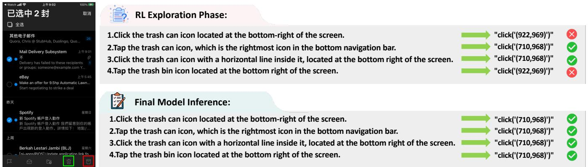  
Trash Bin Icon GT Bounding box: [684,946,752,997]

Figure A.1: Instruction following comparison before and after cycle-consistency reinforcement, showing improved spatial grounding.  
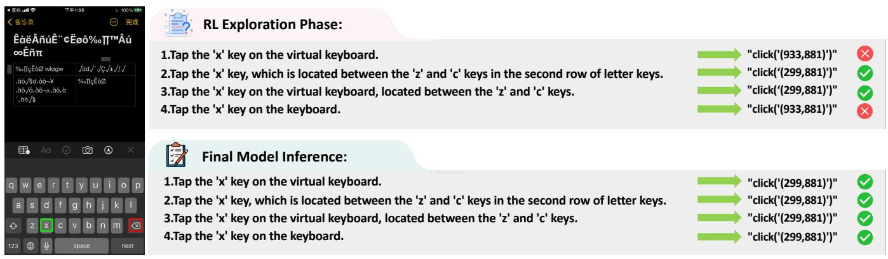  
X letter’s GT Bounding box: [294,876,304,885]

Figure A.2: Instruction following comparison before and after cycle-consistency reinforcement, showing improved icon ground ing.  
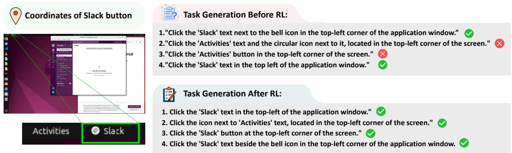  
Figure A.3: Analyzing the semantic generation capability before and after reinforcement learning.

## C.2 Evaluation Protocol

Each of the 2,256 queries is evaluated independently and then grouped by its source element, so that every group contains the four instructions (one original plus three variants)

that point to the same target. Predictions use the same GUIagent action prompt as our grounding evaluation, decoded greedily (temperature 0). A predicted coordinate is parsed from the emitted click(start\_box=’(x,y)’) action, mapped from the normalized [0, 1000] range back to absolute pixels, and reduced to its center point. A query is counted as correct when this center point lies inside the target region: point-in-rectangle for bbox annotations, point-in-polygon for polygon annotations, and a negative sentinel coordinate for refusal cases (where the correct behavior is to abstain).

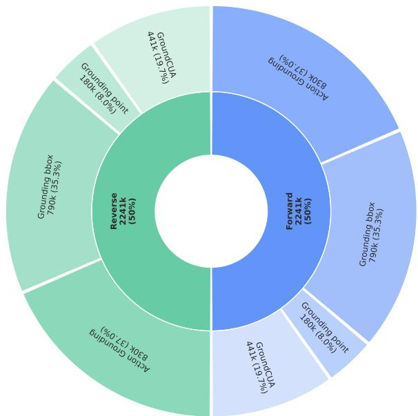  
Figure B.1: Composition of the 4,482k-pair training corpus. The inner ring splits the data into forward (instruction→coordinate) and reverse (coordinate→instruction) halves of equal size; the outer ring breaks each half down by data source and grounding modality. The GroundCUA portion uses Video-Audio Production samples and their reverse counterparts. As an optional augmentation, the 790k Grounding bbox samples—those that already carry bounding-box annotations—have their instructions rewritten with Gemini-2.5-Flash to broaden localization-based reward coverage during RL; the core pipeline can be trained on open-source data alone.

On top of the per-query correctness r, we report four group-level quantities that together characterize robustness to instruction variation:

• Original Accuracy: accuracy computed over the 564 original instructions only, matching the standard OSWorld-G-Refine setting.

• Any-Correct Rate: the fraction of groups in which at least one of the four instructions is grounded correctly. This is an upper bound on achievable accuracy and equals Pass@4 over the paraphrase set.

• All-Correct Rate: the fraction of groups in which all four instructions are grounded correctly—a strict, worst-case measure of consistency.

• Any–All Gap: the diference between the Any- and All-Correct rates (in percentage points). A smaller gap indicates that the model’s success is less dependent on the particular phrasing of the instruction, i.e., more robust grounding.

As an auxiliary diagnostic, we also track the mean intragroup variance $\begin{array} { r } { \frac { 1 } { N } \sum _ { i } p _ { i } ( 1 - p _ { i } ) } \end{array}$ , where $p _ { i }$ is the fraction of the four instructions in group i that are grounded correctly; this attains 0 when every group is answered all-right or allwrong and is maximized (0.25) when the model is split evenly within groups. As reported in the main paper, BiGrounder attains the highest Original, Any-Correct, and All-Correct rates and shrinks the Any–All gap from 17.4 to 14.8 points relative to its Qwen3-VL-4B backbone, confirming that bidirectional training reduces sensitivity to instruction wording. We will release the rewritten instructions, the exact generation prompt, and the filtering procedure to support full reproducibility.

## D Reward Hacking and Semantic Noise

A central design question in BiGrounder is how to reward the reverse policy $\pi _ { \theta } ( \hat { x } \mid s , o ^ { * } )$ , which generates instructions from a ground-truth target coordinate $o ^ { * }$ . The natural choice is a semantic similarity reward such as BERTScore between the generated instruction ${ \hat { x } } _ { i }$ and the reference instruction x. However, semantic similarity alone is vulnerable to reward hacking: the reverse policy can learn to emit instructions that are lexically and semantically fluent, and therefore score high under BERTScore, yet do not actually point to the target element on the screen. Such instructions inject semantic noise into the reinforcement loop, because they are treated as valid supervision for the forward grounding policy even though grounding them would lead to the wrong location. If left unchecked, this noise not only wastes the on-policy instruction budget but can actively degrade grounding, since the model is reinforced toward describing the wrong element convincingly rather than the right element accurately.

Why BERTScore alone is insuficient. BERTScore measures token-level embedding similarity between ${ \hat { x } } _ { i }$ and x (Eqs. 2–4 in the main paper). We compute BERTScore using RoBERTa-large representations from layer 17. Two failure modes make it an unreliable standalone reward for GUI grounding. First, GUI screens contain many visually and functionally similar elements (e.g., repeated “star”, “bookmark”, “follow” afordances), so an instruction that describes a plausible-but-wrong element can be nearly indistinguishable from the reference in embedding space. Second, BERTScore rewards surface fluency and paraphrasing, which the policy can exploit to maximize reward without improving visual disambiguation. The case study in Table D.2 makes this concrete: the distractor “Click the star to follow the repository.” attains a high BERTScore of 0.86 against the ground truth “Click star to save this page.”, yet it refers to a diferent action on a diferent element. A reward that trusts BERTScore in isolation would happily reinforce this instruction.

Cycle-consistency as a grounding-verified gate. Bi-Grounder resolves this by never trusting the semantic score on its own. As formalized in the reverse reward (Eq. 5 of the main paper), the BERTScore of a generated instruction is retained only $i f$ the instruction survives two gates simultaneously:

$$
R _ { \mathrm { r e v } } = { \left\{ \begin{array} { l l } { \mathrm { B E R T S c o r e } ( { \hat { x } } _ { i } , x ) , } & { b _ { i } \geq t \ \wedge \ c _ { i } = 1 , } \\ { 0 , } & { { \mathrm { o t h e r w i s e } } , } \end{array} \right. }
$$

where $b _ { i } = F _ { \mathrm { B E R T } } ( \hat { x } _ { i } , x )$ is the semantic score, $t = 0$ .85 is the semantic threshold, and $c _ { i } = \mathbb { I } [ \exists k : \operatorname { s u c c e s s } ( \tau _ { i , k } , o ^ { * } ) ]$ is the cycle gate. The cycle gate is the key anti-hacking mechanism: for each candidate instruction xˆ that passes the semantic threshold, the same policy is asked to ground it back with K rollouts $\{ \tau _ { i , k } \} _ { k = 1 } ^ { K }$ , and $c _ { i } = 1$ only if at least one rollout returns to the true target (forward grounding reward $\geq 0 . 9 )$ Thus a fluent instruction that cannot be grounded back to $o ^ { * }$ receives $R _ { \mathrm { r e v } } = 0$ and is prevented from reinforcing the reverse policy, no matter how high its BERTScore. In the running example, “Click the star to follow the repository.” fails the cycle gate $( c _ { i } = 0 )$ and its reward collapses to 0.00, while the correct paraphrase “Click the star to bookmark this webpage.” grounds back successfully $( c _ { i } = 1 )$ and keeps its reward of 0.92 (Table D.2).

Ground-truth fallback keeps the forward loop clean. Rejecting a semantically noisy instruction does not waste the sample. When a candidate fails the semantic threshold $\left( b _ { i } ~ < ~ t \right)$ , BiGrounder substitutes the ground-truth instruction x into that forward loop $( q _ { i }  x ,$ the GT fallback in Algorithm 1). Consequently, every one of the G instruction branches still contributes valid forward grounding trajectories, but only semantically qualified and cycle-consistent generations are allowed to update the reverse policy. This decoupling is what lets BiGrounder harvest instruction diversity aggressively while keeping the forward supervision signal noise-free.

Quantifying noise removal. To verify that cycleconsistency actually suppresses semantic noise rather than merely filtering paraphrases, we manually annotate 300 reverse instructions (273 correct, 27 incorrect) and measure how well each gating strategy separates them. As shown in Table D.1, thresholding on BERTScore alone filters only 18.5% of the incorrect instructions (5/27), and even an LLM judge removes only 74.1% (20/27). In contrast, the cycleconsistency gate filters 25 of 27 incorrect instructions, reaching 92.6% Noise Filtering Rate (NFR) while simultaneously raising Precision to 99.2% on the retained set. This confirms that verifying groundability, rather than semantic plausibility, is the decisive signal for rejecting reward-hacking instructions, and that the two gates are complementary: the semantic threshold discards obviously of-topic generations cheaply, while the cycle gate catches the fluent-but-wrong cases that BERTScore cannot.

## E Training Analysis and Generalization

Tables E.1–E.3 report additional rollout-budget controls, instruction-generation ablations, and Qwen3.5 backbone experiments.

Rollout budget and reverse rewards. Table E.1 separates the gains of BiGrounder from simply sampling more grounding trajectories. Increasing forward-only rollouts from 16 to

<table><tr><td>Filter</td><td>Kept (C / I)</td><td>Precision ↑</td><td>NFR↑</td></tr><tr><td>No filter</td><td>273 /27</td><td>91.0% (273/300)</td><td>0.0% (0/27)</td></tr><tr><td>BERTScore  $> t$ </td><td>268 /22</td><td>92.4% (268/290)</td><td>18.5% (5/27)</td></tr><tr><td>LLM Judge</td><td>267 /7</td><td>97.4% (267/274)</td><td>74.1% (20/27)</td></tr><tr><td>Cycle-Consistency</td><td>260 / 2</td><td>99.2% (260/262)</td><td>92.6% (25/27)</td></tr></table>

Table D.1: Noise filtering on 300 manually annotated reverse instructions, including 273 correct and 27 incorrect ones. Precision: fraction of correct samples in the kept set. Noise Filtering Rate (NFR): percentage of incorrect samples successfully filtered out.
<table><tr><td>Reverse Instruction</td><td>BERTScore</td><td>Cycle-C.</td><td>Reward</td></tr><tr><td>Click the star to follow the repository.</td><td>0.86</td><td>x</td><td>0.00</td></tr><tr><td>Click the star to bookmark this webpage.</td><td>0.92</td><td>√</td><td>0.92</td></tr></table>

Table D.2: Case study showing that Cycle-Consistency filters out high-BERTScore but visually incorrect reverse instructions. GT: “Click star to save this page.”

20 raises the four-benchmark mean only from 77.3 to 77.5, whereas BiGrounder reaches 79.4 with four reverse and 16 forward trajectories, a gain of 1.9 percentage points at the same total trajectory count. Thus, allocating more rollouts to forward grounding alone does not recover the observed gains. With the same reverse/forward rollout counts, BiGrounder also outperforms Gate-only by 1.1 points (79.4 vs. 78.3), supporting the benefit of graded semantic feedback beyond binary cycle success.

On-policy generation and bidirectional updates. Table E.2 compares the three augmentation variants under matched rollout budgets and optimization-step counts. Replacing the frozen Bi-SFT generator with the current policy improves Original accuracy from 68.2 to 68.8 and All accuracy from 59.1 to 60.1, while reducing Gap from 15.9 to 15.1 points. Joint reverse-policy optimization further improves Original to 69.5 and All to 60.5, with Gap reduced to 14.8.

On-policy generation and reverse updates are mutually reinforcing. On-policy sampling refreshes training instructions as the model evolves, while reverse updates help sustain the GUI-understanding capability needed to generate meaningful, target-specific instructions. Because both tasks share model parameters, optimizing the forward objective alone does not explicitly preserve reverse generation, and this capability may weaken as grounding training proceeds. The reverse objective continually reinforces it through groundingverified semantic feedback, helping maintain useful onpolicy instruction exploration. BiGrounder thus couples an evolving source of training instructions with continued optimization of the capability that supports their generation. The observed gains are consistent with this mutually reinforcing design.

Dense and MoE backbones. Table E.3 shows that Bi-Grounder improves average accuracy on both Qwen3.5 backbones: from 76.3 to 77.7 (+1.4 points) for the dense 9B model, and from 77.7 to 78.9 (+1.2 points) for the 35B-A3B MoE model, supporting the applicability of our training framework across both architectures.

<table><tr><td>Method</td><td>Rev.</td><td>Fwd.</td><td>SS-Pro</td><td>SS-V2</td><td>OS-G-R</td><td>MM-L2</td><td>Avg.</td></tr><tr><td>Forward-only RL  $( 1 \times 1 6 )$ </td><td>0</td><td>16</td><td>63.7</td><td>92.9</td><td>67.4</td><td>85.3</td><td>77.3</td></tr><tr><td>Forward-only RL (1 × 20)</td><td>0</td><td>20</td><td>63.9</td><td>92.9</td><td>67.9</td><td>85.1</td><td>77.5</td></tr><tr><td>BiGrounder Gate-only</td><td>4</td><td>16</td><td>65.6</td><td>92.9</td><td>68.6</td><td>86.2</td><td>78.3</td></tr><tr><td>BiGrounder</td><td>4</td><td>16</td><td>66.6</td><td>93.9</td><td>69.5</td><td>87.5</td><td>79.4</td></tr></table>

Table E.1: Rollout-budget and reverse-reward controls. Rev./Fwd.: reverse/forward trajectories per target. SS-Pro: ScreenSpot-Pro; SS-V2: ScreenSpot-V2; OS-G-R: OSWorld-G-Refine; MM-L2: MMBench-GUI L2. Scores are accuracy (%). Avg. is the unweighted mean over these four benchmarks, excluding UI-Vision. The 1 × 20 baseline matches BiGrounder’s total trajectory count. Gate-only uses binary reverse rewards.

<table><tr><td>Method</td><td>Original</td><td>Any↑</td><td>All↑</td><td>Gap↓</td></tr><tr><td>Forward-only RL</td><td>67.4</td><td>74.5</td><td>58.2</td><td>16.3</td></tr><tr><td>Offline aug.</td><td>68.2</td><td>75.0</td><td>59.1</td><td>15.9</td></tr><tr><td>Online aug.</td><td>68.8</td><td>75.2</td><td>60.1</td><td>15.1</td></tr><tr><td>BiGrounder</td><td>69.5</td><td>75.3</td><td>60.5</td><td>14.8</td></tr></table>

Table E.2: Instruction-generation and reverse-update ablations on OSWorld-G-Refine-Variants. Original, Any, and All are accuracies (%); Gap is Any minus All in percentage points. Ofline/online augmentation use a frozen Bi-SFT/current-policy instruction generator, respectively, with forward-only updates; BiGrounder also updates the reverse policy. These three methods share rollout budgets and optimization-step counts.

## F Comparison with Related GUI Learning Methods

Table F.1 compares BiGrounder with WinClick, UI-Ins, and Look Where You’re Told. Our contribution is an on-policy bidirectional RL framework for the many-to-one instruction– element mapping problem, connecting instruction exploration with grounding feedback.

Relation to prior methods. WinClick (Hui et al. 2025) learns forward grounding and reverse description prediction through supervised losses. UI-Ins (Chen et al. 2025) uses instruction rewriting as intermediate reasoning with SFT and GRPO; its online reasoning difers from our independent, target-conditioned reverse task. Look Where You’re Told (Kim et al. 2026) reconstructs instructions from attended visual information and enforces attention consistency, whereas BiGrounder verifies whether generated instructions ground back to the annotated target.

Coupled on-policy reinforcement. ScaleCUA (Liu et al. 2025c) incorporates GUI-understanding data, including element appearance, functionality, and layout descriptions, into SFT alongside grounding supervision, motivating the use of interface semantics to support localization. BiGrounder extends this principle from SFT to RL: coordinate-conditioned reverse generation continues to train the model to describe GUI elements in language while the forward policy learns grounding. Joint reverse updates help preserve this descriptive capability during grounding optimization, sustaining the source of on-policy instructions rather than leaving it without direct reinforcement. The current policy samples instructions and grounds them back to the target; a positive reverse reward requires both semantic qualification and grounding success. Table E.2 demonstrates the grounding benefit: adding reverse updates to online generation raises Original accuracy from 68.8 to 69.5 and All accuracy from 60.1 to 60.5, while reducing Gap from 15.1 to 14.8 points. On-policy exploration and continued GUI understanding thus reinforce one another, using existing annotations and retaining standard forward-only inference.

## G Per-Benchmark Detailed Results

To complement the aggregated grounding accuracy reported in the main paper, this section provides the full per-category breakdown for each of the five GUI grounding benchmarks. Unless otherwise noted, all BiGrounder-4B results are obtained under the same unified evaluation protocol described in the main paper. Baseline numbers are taken from the corresponding original papers or technical reports, and entries marked with “∗” are re-evaluated by us. In every table, the best result is shown in bold and the second-best is underlined. The “Avg.” column reports micro accuracy over all benchmark examples, equivalently weighting each split by its number of examples; it therefore need not equal the unweighted arithmetic mean of the displayed split accuracies.

## G.1 ScreenSpot-V2

Table H.3 reports the full breakdown on ScreenSpot-V2 across the Mobile, Desktop, and Web platforms, each further split into text and icon/widget targets. BiGrounder-4B attains the highest overall average (93.9) and is particularly strong on the Desktop text/icon and Web icon splits, indicating that bidirectional training improves grounding of visually dense, non-textual elements without sacrificing performance on text targets.

## G.2 ScreenSpot-Pro

ScreenSpot-Pro targets high-resolution professional software with small, densely packed elements. Table H.4 details performance across six application domains (CAD, Development, Creative, Scientific, Ofice, and OS), each divided into text and icon targets. BiGrounder-4B reaches an average of 66.6, ranking second among all compared models and first among open-source models, with especially large margins on icon targets (e.g., CAD, Development, and OS icons), which are the hardest cases for coordinate prediction.

<table><tr><td>Method</td><td>SS-Pro</td><td>SS-V2</td><td>OS-G-R</td><td>MM-L2</td><td>Avg.</td></tr><tr><td>Qwen3.5-9B</td><td>65.2</td><td>91.8</td><td>67.7</td><td>80.4</td><td>76.3</td></tr><tr><td>+ BiGrounder</td><td>65.7</td><td>92.0</td><td>68.0</td><td>85.1</td><td>77.7</td></tr><tr><td>Qwen3.5-35B-A3B</td><td>64.5</td><td>95.2</td><td>63.6</td><td>87.5</td><td>77.7</td></tr><tr><td>+ BiGrounder</td><td>65.3</td><td>94.7</td><td>67.6</td><td>88.1</td><td>78.9</td></tr></table>

Table E.3: Additional backbone experiments with Bi-SFT on 100k samples followed by bidirectional RL on 10k samples. Scores are accuracy (%); Avg. is the mean over the four displayed benchmarks. Bold indicates the higher value within each backbone pair.
<table><tr><td>Method</td><td>Generation basis</td><td>On-policy generation</td><td>Cycle verification target</td><td>Bidirectional RL</td><td>Training</td></tr><tr><td>WinClick (Hui et al. 2025)</td><td>Annotations</td><td>X</td><td></td><td>X</td><td>SFT</td></tr><tr><td>Look Where You&#x27;re Told (Kim et al. 2026)</td><td>Attention</td><td>X</td><td>Attention distribution</td><td>X</td><td>SFT</td></tr><tr><td>UI-Ins (Chen et al. 2025)</td><td></td><td>X</td><td></td><td>X</td><td>SFT+GRPO</td></tr><tr><td>BiGrounder (Ours)</td><td>Coordinates</td><td>√</td><td>GT location</td><td>√</td><td>SFT+GRPO</td></tr></table>

Table F.1: Qualitative comparison of instruction generation and grounding. On-policy generation and bidirectional RL refer to an independent instruction-generation task, excluding UI-Ins’s instruction-as-reasoning. Annotations denotes labelled element information without specifying its input encoding. GT: ground truth.

## G.3 MMBench-GUI L2

Table H.5 presents the per-platform results on MMBench-GUI L2, covering Windows, MacOS, Linux, iOS, Android, and Web, with each platform reporting basic (“Bas.”) and advanced (“Adv.”) instruction splits. BiGrounder-4B achieves the best overall average (87.5). The gains are most pronounced on the advanced splits, where instructions carry more implicit intent, which is consistent with our claim that bidirectional self-reinforcement strengthens robustness to instruction variation.

## G.4 UI-Vision

UI-Vision evaluates grounding under Basic, Functional, and Spatial instruction types. As shown in Table H.1, BiGrounder-4B obtains the highest score in every category and the best overall average (46.6), substantially exceeding its Qwen3-VL-4B backbone (26.9). The largest relative improvement appears on Spatial instructions, which require reasoning about relative element positions, highlighting the benefit of learning semantic–spatial alignment from the reverse description task.

## G.5 OSWorld-G-Refine

Table H.2 reports the fine-grained results on OSWorld-G-Refine, which categorizes queries into Text Matching, Element Recognition, Layout Understanding, Fine-grained Manipulation, and Refusal. BiGrounder-4B achieves the best Text Matching accuracy and a competitive overall average (69.5), second only to the much larger OpenCUA-32B, while clearly surpassing all open-source models at comparable scale.

## H Full Per-Benchmark Result Tables

Tables H.1–H.5 present detailed results across five GUI grounding benchmarks, covering instruction semantics, text and icon targets, professional interfaces, and operating systems. They characterize BiGrounder’s performance under diverse semantic and spatial localization requirements.

<table><tr><td colspan="5">Model Basic Functional Spatial Avg</td></tr><tr><td>Proprietary Models</td><td colspan="3"></td></tr><tr><td>GPT-4o (OpenAI 2024)</td><td>1.6 9.5</td><td>1.5 7.7</td><td>1.0 7.6</td><td>1.4 8.3</td></tr><tr><td colspan="5">Claude-3.7-Sonnet (Anthropic 2024)</td></tr><tr><td>Open-source Models Qwen2.5-VL-7B (Bai et al. 2025b)</td><td></td><td>0.8</td><td>0.5</td><td>0.9</td></tr><tr><td>UGround-V1-7B (Gou et al. 2025)</td><td>1.2 15.4</td><td>17.1</td><td>6.3</td><td>12.9</td></tr><tr><td>OS-Atlas-7B (Wu et al. 2024)</td><td>12.2</td><td>11.2</td><td>3.7</td><td>9.0</td></tr><tr><td>JEDI-7B (Xie et al. 2025)</td><td>32.3</td><td>30.5</td><td>12.8</td><td>24.8</td></tr><tr><td>InfiGUI-G1-7B (Liu et al. 2025b)</td><td>36.2</td><td>31.9</td><td>11.5</td><td>26.1</td></tr><tr><td>UI-Venus-7B (Gu et al. 2025)</td><td>36.1</td><td>32.8</td><td>11.9</td><td>26.5</td></tr><tr><td>Phi-Ground-7B (Zhang et al. 2025)</td><td>36.8</td><td>37.1</td><td>7.6</td><td>27.2</td></tr><tr><td>Qwen3-VL-4B (Bai et al. 2025a)*</td><td>32.8</td><td>34.2</td><td>14.7</td><td>26.9</td></tr><tr><td>MAI-UI-8B (Zhou et al. 2025a)</td><td>51.7</td><td>49.6</td><td>22.5</td><td>40.7</td></tr><tr><td>UI-TARS-72B (Qin et al. 2025)</td><td>31.4</td><td>30.5</td><td>14.7</td><td>25.5</td></tr><tr><td>UI-Venus-72B (Gu et al. 2025)</td><td>45.6</td><td>42.3</td><td>23.7</td><td>36.8</td></tr><tr><td colspan="5"></td></tr><tr><td>Ours BiGrounder-4B</td><td>55.9</td><td>52.8</td><td>32.3</td><td>46.6</td></tr></table>

Table H.1: Performance comparison on the UI-Vision benchmark. The best results are highlighted in bold, and the second-best results are underlined.

<table><tr><td>Model</td><td>Text</td><td>Element</td><td>Layout Matching Recognition Understanding</td><td>Fine-grained Manipulation</td><td>Refusal Avg</td><td></td></tr><tr><td colspan="7">Open-Source Models</td></tr><tr><td>Jedi-3B (Xie et al. 2025)</td><td></td><td></td><td></td><td></td><td></td><td>61.0</td></tr><tr><td>Jedi-7B (Xie et al. 2025)</td><td></td><td></td><td></td><td></td><td></td><td>63.8</td></tr><tr><td>UI-TARS-1.5-7B (Seed 2025)</td><td>52.6</td><td>75.4</td><td>72.4</td><td>66.7</td><td>0.0</td><td>64.2</td></tr><tr><td>Qwen3-VL-4B (Bai et al. 2025a)*</td><td>78.2</td><td>71.6</td><td>76.5</td><td>55.2</td><td>1.9</td><td>65.3</td></tr><tr><td>GTA1-7B (Yang et al. 2025)</td><td>63.2</td><td>82.1</td><td>74.2</td><td>70.5</td><td>0.0</td><td>67.7</td></tr><tr><td>GUI-Owl-1.5-4B-Instruct (Xu et al. 2026)</td><td>73.1</td><td>71.8</td><td>72.9</td><td>74.1</td><td>29.6</td><td>68.4</td></tr><tr><td>Qwen3-VL-32B (Bai et al. 2025a)</td><td>77.4</td><td>73.6</td><td>76.3</td><td>57.7</td><td></td><td>69.0</td></tr><tr><td>OpenCUA-32B (Wang et al. 2025a)</td><td>63.2</td><td>79.9</td><td>84.9</td><td>62.1</td><td>7.4</td><td>70.2</td></tr><tr><td colspan="7">Ours</td></tr><tr><td>BiGrounder-4B</td><td>77.4</td><td>76.7</td><td>77.1</td><td>56.4</td><td>0.0</td><td>69.5</td></tr></table>

Table H.2: Performance comparison on the OSWorld-G-Refine benchmark. The best results are highlighted in bold, and the second-best results are underlined.

<table><tr><td rowspan="2">Model</td><td colspan="2">Mobile</td><td colspan="2">Desktop</td><td colspan="2">Web</td><td rowspan="2">Avg.</td></tr><tr><td>Text</td><td>Icon.</td><td>Text</td><td>Icon.</td><td>Text</td><td>Icon.</td></tr><tr><td>Open-Source Models</td><td></td><td></td><td></td><td></td><td></td><td></td><td></td></tr><tr><td>Qwen3-VL-2B (Bai et al. 2025a)</td><td>95.5</td><td>82.0</td><td>95.4</td><td>73.6</td><td>89.7</td><td>76.4</td><td>86.7</td></tr><tr><td>Phi-ground (Zhang et al. 2025)</td><td>90.2</td><td>76.4</td><td>93.6</td><td>75.9</td><td>96.5</td><td>62.0</td><td>83.8</td></tr><tr><td>OS-Atlas-7B (Wu et al. 2024)</td><td>95.2</td><td>75.8</td><td>90.7</td><td>63.6</td><td>90.6</td><td>77.3</td><td>85.1</td></tr><tr><td>UGround-v1-7B (Gou et al. 2025)</td><td>83.6</td><td>90.5</td><td>85.8</td><td>86.3</td><td>95.5</td><td>83.2</td><td>87.7</td></tr><tr><td>UI-Tars-1.5-7B (Seed 2025)</td><td>92.2</td><td>81.5</td><td>91.0</td><td>84.2</td><td>95.5</td><td>84.5</td><td>90.3</td></tr><tr><td>SE-GUI-7B (Yuan et al. 2025)</td><td></td><td></td><td></td><td></td><td></td><td></td><td>68.9</td></tr><tr><td>UI-TARS-7B (Qin et al. 2025)</td><td>96.9</td><td>89.1</td><td>95.4</td><td>85.0</td><td>93.6</td><td>85.2</td><td>91.6</td></tr><tr><td>Qwen3-VL-8B (Bai et al. 2025a)</td><td>97.9</td><td>84.8</td><td>95.9</td><td>87.9</td><td>95.7</td><td>83.7</td><td>91.7</td></tr><tr><td>GUI-Actor-7B (Wu et al. 2025)</td><td>97.6</td><td>88.2</td><td>96.9</td><td>85.7</td><td>93.2</td><td>86.7</td><td>92.1</td></tr><tr><td>OpenCUA-7B (Wang et al. 2025a)</td><td></td><td></td><td></td><td></td><td></td><td></td><td>92.3</td></tr><tr><td>GTA1-7B (Yang et al. 2025)</td><td>99.0</td><td>88.6</td><td>94.9</td><td>89.3</td><td>92.3</td><td>86.7</td><td>92.4</td></tr><tr><td>GUI-Owl-7B (Ye et al. 2025)</td><td>99.0</td><td>92.4</td><td>96.9</td><td>85.0</td><td>93.6</td><td>85.2</td><td>92.8</td></tr><tr><td>GUI-G²-7B (Tang et al. 2025)</td><td>98.3</td><td>91.9</td><td>95.4</td><td>89.3</td><td>94.0</td><td>87.7</td><td>93.3</td></tr><tr><td>InfiGUI-G1-7B (Liu et al. 2025b)</td><td>99.0</td><td>91.9</td><td>94.3</td><td>82.1</td><td>97.9</td><td>89.2</td><td>93.5</td></tr><tr><td>MAI-UI-2B (Zhou et al. 2025a)</td><td>99.3</td><td>87.2</td><td>97.4</td><td>88.6</td><td>94.0</td><td>84.7</td><td>92.5</td></tr><tr><td>Qwen3-VL-32B (Bai et al. 2025a)</td><td>96.2</td><td>90.0</td><td>97.4</td><td>85.0</td><td>95.7</td><td>89.7</td><td>93.0</td></tr><tr><td>GUI-Owl-32B (Ye et al. 2025)</td><td>98.6</td><td>90.0</td><td>97.9</td><td>87.8</td><td>94.4</td><td>86.7</td><td>93.2</td></tr><tr><td>OpenCUA-32B (Wang et al. 2025a)</td><td></td><td></td><td></td><td></td><td></td><td></td><td>93.4</td></tr><tr><td colspan="10">Ours</td></tr><tr><td>BiGrounder-4B</td><td>97.8</td><td>90.1</td><td>98.1</td><td>92.5</td><td>94.2</td><td>90.7</td><td>93.9</td></tr></table>

Table H.3: Performance comparison on ScreenSpot-V2. The best results are highlighted in bold, and the second-best results are underlined.

<table><tr><td rowspan="2">Model</td><td colspan="2">CAD</td><td colspan="2">Dev.</td><td colspan="2">Creative</td><td colspan="2">Scientific</td><td colspan="2">Office</td><td colspan="2">os</td><td rowspan="2">Avg.</td></tr><tr><td>Text Icon</td><td></td><td>Text Icon</td><td></td><td>Text Icon</td><td></td><td colspan="2">Text Icon</td><td>Text Icon</td><td></td><td>Text Icon</td><td></td></tr><tr><td colspan="10">Proprietary Models</td><td colspan="3"></td><td></td><td></td></tr><tr><td>GPT-4o (OpenAI 2024)</td><td>2.0</td><td>0.0</td><td>1.3</td><td>0.0</td><td>1.0</td><td>0.0</td><td>2.1</td><td>0.0</td><td>1.1</td><td>0.0</td><td>0.0</td><td>0.0</td><td>0.8</td></tr><tr><td>Gemini-3-Pro (DeepMind 2025)</td><td></td><td></td><td>=</td><td></td><td>1</td><td></td><td>1</td><td></td><td>1</td><td></td><td></td><td></td><td>72.7</td></tr><tr><td colspan="10"></td><td colspan="3"></td></tr><tr><td>Open-Source Models UI-R1-3B (Lu et al. 2025)</td><td>11.2</td><td>6.3</td><td>22.7</td><td>4.1</td><td>27.3</td><td>3.5</td><td>42.4</td><td>11.8</td><td>32.2</td><td>11.3</td><td>13.1</td><td>4.5</td><td></td></tr><tr><td>GUI-R1-7B (Luo et al. 2025)</td><td>23.9</td><td>6.3</td><td>49.4</td><td>4.8</td><td>38.9</td><td>8.4</td><td>55.6</td><td>11.8</td><td>58.7</td><td>26.4</td><td>42.1</td><td>16.9</td><td>17.8 31.0</td></tr><tr><td>Phi-Ground-7B (Zhang et al. 2025)</td><td>26.9</td><td>17.2</td><td>70.8</td><td>16.7</td><td>56.6</td><td>13.3</td><td>58.0</td><td>29.1</td><td>76.4</td><td>44.0</td><td>55.1</td><td>25.8</td><td>43.2</td></tr><tr><td>GUI-Actor-7B (Wu et al. 2025)</td><td>47.7</td><td>9.4</td><td>59.1</td><td>15.9</td><td>59.6</td><td>16.1</td><td>70.1</td><td>25.5</td><td>69.5</td><td>41.5</td><td>55.1</td><td>19.1</td><td>44.6</td></tr><tr><td>SE-GUI-7B (Yuan et al. 2025)</td><td>51.3</td><td>14.1</td><td>68.2</td><td>19.3</td><td>57.6</td><td>9.1</td><td>75.0</td><td>28.2</td><td>78.5</td><td>43.4</td><td>49.5</td><td>25.8</td><td>47.3</td></tr><tr><td>GUI-G2-7B (Tang et al. 2025)</td><td>55.8</td><td>12.5</td><td>68.8</td><td>17.2</td><td>57.1</td><td>15.4</td><td>77.1</td><td>24.5</td><td>74.0</td><td>32.7</td><td>57.9</td><td>21.3</td><td>47.5</td></tr><tr><td>ScaleCUA-7B (Liu et al. 2025c)</td><td>54.8</td><td>21.9</td><td>66.2</td><td>20.7</td><td>56.6</td><td>20.3</td><td>77.1</td><td>24.5</td><td>74.0</td><td>45.3</td><td>49.5</td><td>18.0</td><td>47.9</td></tr><tr><td>UI-TARS-1.5-7B (Seed 2025)</td><td></td><td></td><td></td><td></td><td></td><td></td><td></td><td></td><td></td><td></td><td></td><td></td><td>49.6</td></tr><tr><td>OpenCUA-7B (Wang et al. 2025a)</td><td></td><td></td><td>1</td><td></td><td></td><td></td><td></td><td></td><td></td><td></td><td></td><td></td><td>50.0</td></tr><tr><td>InfiGUI-G1-7B (Liu et al. 2025b)</td><td>57.4</td><td>23.4</td><td>74.7</td><td>24.1</td><td>64.6</td><td>18.2</td><td>80.6</td><td>31.8</td><td>75.7</td><td>39.6</td><td>57.0 </td><td>29.2</td><td>51.9</td></tr><tr><td>UI-Ins-7B (Chen et al. 2025)</td><td>60.9</td><td>20.3</td><td>75.3</td><td>18.6</td><td>65.2</td><td>18.9</td><td>81.3</td><td>29.1</td><td>79.7</td><td>37.7</td><td>57.0</td><td>25.8</td><td>52.2</td></tr><tr><td>GUI-Owl-7B (Ye et al. 2025)</td><td>64.5</td><td>21.9</td><td>76.6</td><td>31.0</td><td>59.6</td><td>27.3</td><td>79.1</td><td>37.3</td><td>77.4</td><td>39.6</td><td>59.8</td><td>33.7</td><td>54.9</td></tr><tr><td>Qwen3-VL-4B (Bai et al. 2025a)</td><td>59.4</td><td>20.3</td><td>81.8</td><td>33.8</td><td>71.2</td><td>23.8</td><td>80.6</td><td>34.5</td><td>88.8</td><td>47.2</td><td>78.5</td><td>41.6</td><td>59.3</td></tr><tr><td>StepGUI-4B (Yan et al. 2025)</td><td></td><td></td><td></td><td></td><td></td><td></td><td></td><td></td><td></td><td></td><td></td><td></td><td>60.0</td></tr><tr><td>MAI-UI-8B (Zhou et al. 2025a)</td><td>72.6</td><td>35.9</td><td>83.8</td><td>52.4</td><td>76.3</td><td>33.6</td><td>79.9</td><td>37.3</td><td>88.7</td><td>60.4</td><td>76.6</td><td>49.4</td><td>65.8</td></tr><tr><td>Ours</td><td></td><td></td><td></td><td></td><td></td><td></td><td></td><td></td><td></td><td></td><td></td><td></td><td></td></tr><tr><td colspan="10">BiGrounder-4B 68.5 45.3 81.2 62.0 71.2 37.0 84.0 47.3 86.4 52.8 74.8 54.7</td><td></td><td></td><td></td><td>66.6</td></tr></table>

Table H.4: Performance comparison on the ScreenSpot-Pro benchmark. The best results are highlighted in bold, and the second-best results are underlined

<table><tr><td rowspan="2">Model</td><td colspan="2">Windows MacOS</td><td colspan="2"></td><td colspan="2">Linux</td><td colspan="2">iOS</td><td colspan="2">Android Web</td><td rowspan="2">Avg.</td></tr><tr><td>Bas. Adv. Bas. Adv. Bas. Adv. Bas. Adv. Bas. Adv. Bas. Adv.</td><td></td><td></td><td></td><td></td><td></td><td></td><td></td><td></td><td></td></tr><tr><td>Proprietary Models</td><td colspan="10"></td></tr><tr><td>GPT-40 (OpenAI 2024)</td><td>1.5</td><td>1.1 8.7</td><td>4.3</td><td>1.1</td><td>1.0</td><td>5.1</td><td>3.3</td><td>2.5</td><td>1.4</td><td>3.2 2.9</td><td>2.9</td></tr><tr><td>Claude-3.7-Sonnet (Anthropic 2024)</td><td>1.5</td><td>0.7 12.5</td><td>7.5</td><td>1.1</td><td>0.0</td><td>13.7 10.6</td><td></td><td>1.4 1.4</td><td>3.2</td><td>2.3</td><td>4.7</td></tr><tr><td colspan="10"></td></tr><tr><td>Open-Source Models OS-Atlas-7B (Wu et al. 2024)</td><td></td><td></td><td></td><td>36.9 18.8 44.4 21.7 31.4 13.3 74.8 48.8 69.6 46.8 61.3 35.4</td><td></td><td></td><td></td><td></td><td></td><td></td><td></td></tr><tr><td>Aguvis-7B (Xu et al. 2025)</td><td>37.321.748.1 33.3 33.5 25.0 67.5 65.2 61.0 51.0 61.6 45.5</td><td></td><td></td><td></td><td></td><td></td><td></td><td></td><td></td><td></td><td>41.4 45.7</td></tr><tr><td>UI-TARS-1.5-7B (Seed 2025)</td><td></td><td>68.3 39.069.0 44.564.4 37.888.5 69.4 90.5 69.3 81.0 56.5</td><td></td><td></td><td></td><td></td><td></td><td></td><td></td><td></td><td>64.3</td></tr><tr><td>Qwen2.5-VL-7B (Bai et al. 2025b)*</td><td></td><td>69.1 42.770.5 51.4 74.4 30.8 86.9 85.5 85.7 85.1 78.9 74.6</td><td></td><td></td><td></td><td></td><td></td><td></td><td></td><td></td><td>69.9</td></tr><tr><td>SE-GUI-7B (Yuan et al. 2025)</td><td></td><td></td><td></td><td></td><td></td><td></td><td></td><td></td><td></td><td></td><td>34.5</td></tr><tr><td>ScaleCUA-7B (Liu et al. 2025c)</td><td></td><td>78.654.082.3 58.774.4 56.6 94.3 81.8 96.1 81.1 92.6 73.1</td><td></td><td></td><td></td><td></td><td></td><td></td><td></td><td></td><td>78.2</td></tr><tr><td>Qwen3-VL-4B (Bai et al. 2025a)*</td><td>88.6</td><td>61.885.5 69.1 74.9 53.1 95.2 82.4 95.5 84.4 96.8 72.1</td><td></td><td></td><td></td><td></td><td></td><td></td><td></td><td></td><td>81.2</td></tr><tr><td>GUI-Owl-7B (Ye et al. 2025)</td><td>86.4</td><td>61.8</td><td>81.7 64.5 74.4 61.7 94.983.0 95.8 83.7 93.2 72.7</td><td></td><td></td><td></td><td></td><td></td><td></td><td></td><td>80.5</td></tr><tr><td>InfiGUI-G1-7B (Liu et al. 2025b)</td><td>82.7</td><td>61.8</td><td>83.8 63.9 72.3 52.0 94.9 89.4 95.2 85.6 93.5 76.3</td><td></td><td></td><td></td><td></td><td></td><td></td><td></td><td></td></tr><tr><td>UI-Ins-7B (Chen et al. 2025)</td><td>82.7</td><td>64.7</td><td>87.2</td><td>75.1 71.7 51.5</td><td></td><td>94.9</td><td></td><td>89.7 95.8</td><td></td><td>89.0 93.2 80.8</td><td>80.8 83.1</td></tr><tr><td>InternVL3-78B (Zhu, Wang et al. 2025)</td><td>70.1</td><td>42.6</td><td>75.7 52.3 59.2 41.3</td><td></td><td></td><td></td><td></td><td></td><td></td><td></td><td>72.2</td></tr><tr><td>UI-TARS-DPO-72B (Qin et al. 2025)</td><td>78.6</td><td>51.8</td><td>80.3 62.7 68.6 51.5</td><td></td><td></td><td></td><td>90.8 81.2 93.0 80.0 88.1 68.5</td><td></td><td></td><td>93.6 80.6 92.7 78.6 90.7 65.9</td><td></td></tr><tr><td>GUI-Owl-32B (Ye et al. 2025)</td><td>85.6</td><td>65.1</td><td>84.9 67.1 77.0 63.3</td><td></td><td></td><td>95.2</td><td></td><td>85.5 96.1 87.0</td><td></td><td>95.5</td><td>74.3 83.0</td></tr><tr><td>Qwen3-VL-32B (Bai et al. 2025a)</td><td>93.4</td><td>71.3</td><td>92.8 74.3 78.0</td><td></td><td></td><td>56.1 95.5</td><td>88.8</td><td>97.2</td><td>88.5</td><td>80.8 92.6 78.6</td><td>85.3</td></tr><tr><td>Ours</td><td></td><td></td><td></td><td></td><td></td><td></td><td></td><td></td><td></td><td></td><td></td></tr><tr><td colspan="10">BiGrounder-4B 85.5 78.1 87.3 81.0 88.6 76.0 93.1 92.0 93.5 93.5 92.8 86.8</td></tr></table>

Table H.5: Performance comparison on the MMBench-GUI L2 benchmark. “Bas.” and “Adv.” denote the basic and advanced instruction splits, respectively. The best results are highlighted in bold, and the second-best results are underlined.

## I A Policy-Gradient Analysis of Multi-Instruction and On-Policy Sampling

We analyze two aspects of BiGrounder’s reinforcement-learning design: allocating grounding rollouts across multiple instructions, and refreshing instructions with the evolving reverse policy. The first reduces sampling variance for a fixed expectedreward objective. The second avoids instruction-distribution mismatch when estimating the current objective, yielding a conditional mean-squared-error advantage over a fixed instruction source.

## I.1 Grounding as Expected-Reward Optimization

Fix a screenshot s, target $o ^ { * }$ , and training iteration t. Let q<sub>t</sub> denote the instruction distribution induced by the current reverse policy, including the semantic check and ground-truth fallback. We idealize these instructions as target-preserving; passing a semantic threshold alone does not guarantee this assumption. The forward grounding policy $\pi _ { \theta } ( \tau \mid s , x )$ generates a token trajectory τ , evaluated by the parameter-independent grounding reward $\dot { \boldsymbol { R } } ( \tau , o ^ { * } )$ . Its local objective is

$$
\begin{array} { r } { J _ { t } ^ { \mathrm { f w d } } ( \theta ) = \mathbb { E } _ { x \sim q _ { t } } \mathbb { E } _ { \tau \sim \pi _ { \theta } ( \cdot | s , x ) } \left[ R ( \tau , o ^ { * } ) \right] . } \end{array}\tag{I.1}
$$

The distribution q<sub>t</sub> is held fixed in this forward-policy derivative, even though the generator and grounder share parameters in implementation. Thus, we analyze the forward contribution to the update, rather than the full derivative through instruction generation.

Write $V _ { \theta } ( x ) = \mathbb { E } _ { \tau \sim \pi _ { \theta } } [ R ( \tau , o ^ { * } ) ]$ and let $b _ { t } ( x )$ be a baseline independent of the sampled trajectory. The score-function policy-gradient sample at $\theta _ { t }$ is

$$
Z _ { t } ( x , \tau ) = \left( R ( \tau , o ^ { * } ) - b _ { t } ( x ) \right) \nabla _ { \theta } \log \pi _ { \theta } ( \tau \mid s , x ) | _ { \theta _ { t } } .\tag{I.2}
$$

For an autoregressive model, the trajectory score is the sum of token log-probability gradients. Under the usual diferentiationunder-expectation conditions,

$$
\begin{array} { r } { \mathbb { E } [ Z _ { t } \mid x ] = \nabla _ { \theta } V _ { \theta } ( x ) | _ { \theta _ { t } } = : g _ { t } ( x ) , } \end{array}\tag{I.3}
$$

$$
\begin{array} { r } { \mathbb E _ { \boldsymbol { x } \sim \boldsymbol { q } _ { t } , \tau \sim \pi _ { \boldsymbol { \theta } _ { t } } } \left[ Z _ { t } \right] = \nabla _ { \boldsymbol { \theta } } J _ { t } ^ { \mathrm { f w d } } ( \boldsymbol { \theta } ) \Big | _ { \boldsymbol { \theta } _ { t } } = : \mu _ { t } . } \end{array}\tag{I.4}
$$

Indeed, diferentiating the trajectory probabilities gives the reward term, while the baseline contributes $\begin{array} { r } { b _ { t } ( x ) \bigtriangledown \bar { \psi } _ { \theta } \sum _ { \tau } \pi _ { \theta } ( \tau \ | } \end{array}$ $s , x ) \ = \ 0$ . This establishes conditional unbiasedness directly from the reinforcement-learning objective.

## I.2 Why Multiple Instructions Reduce Gradient Variance

Assume finite second moments and define total variance for a vector $U$ as $\operatorname { V a r } ( U ) = \mathbb { E } \lVert U - \mathbb { E } U \rVert _ { 2 } ^ { 2 }$ . Let

$$
\begin{array} { r l } & { \boldsymbol { B } _ { t } = \operatorname { V a r } _ { \boldsymbol { x } \sim \boldsymbol { q } _ { t } } \left( \boldsymbol { g } _ { t } ( \boldsymbol { x } ) \right) , } \\ & { \boldsymbol { W } _ { t } = \mathbb { E } _ { \boldsymbol { x } \sim \boldsymbol { q } _ { t } } \left[ \operatorname { V a r } ( \boldsymbol { Z } _ { t } \mid \boldsymbol { x } ) \right] . } \end{array}\tag{I.5}
$$

(I.6)

Here $B _ { t }$ captures diferences in expected policy gradients across valid expressions ofthe same target; $W _ { t }$ captures trajectory noise for a given expression. Semantically equivalent instructions need not produce identical gradients in a language-conditioned policy.

Proposition I.1 Sample M instructions independently from q<sub>t</sub> and K conditionally independent grounding trajectories per instruction, with independent instruction groups. Then

$$
\hat { g } _ { M , K } = \frac { 1 } { M } \sum _ { i = 1 } ^ { M } \bar { Z } _ { i } , \qquad \bar { Z } _ { i } = \frac { 1 } { K } \sum _ { k = 1 } ^ { K } Z _ { t } ( x _ { i } , \tau _ { i , k } )\tag{I.7}
$$

is unbiased for $\mu _ { t } .$ At a forward-rollout budget $N = M K$ , its mean-squared error satisfies

$$
\mathbb { E } \| \hat { g } _ { M , K } - \mu _ { t } \| _ { 2 } ^ { 2 } = \mathrm { V a r } ( \hat { g } _ { M , K } ) = \frac { B _ { t } } { M } + \frac { W _ { t } } { N } .\tag{I.8}
$$

Proof. Equation I.3 gives $\mathbb { E } [ \bar { Z } _ { i } \mid x _ { i } ] = g _ { t } ( x _ { i } )$ , and conditional independence gives $\operatorname { V a r } ( { \bar { Z } } _ { i } \mid x _ { i } ) = \operatorname { \dot { V a r } } ( Z _ { t } \mid x _ { i } ) / K$ . Therefore,

$$
\mathrm { V a r } ( \bar { Z } _ { i } ) = B _ { t } + \frac { W _ { t } } { K }\tag{I.9}
$$

by total variance. Averaging M independent groups divides this variance by M. The tower property gives $\mathbb { E } [ \mathcal { \bar { g } } _ { M , K } ] = \mu _ { t } ;$ ; hence variance equals mean-squared error. □

For one instruction with 16 rollouts versus four independently sampled instructions with four rollouts each,

$$
\operatorname { V a r } ( \hat { g } _ { 1 , 1 6 } ) = B _ { t } + \frac { W _ { t } } { 1 6 } ,\tag{I.10}
$$

$$
\operatorname { V a r } ( \hat { g } _ { 4 , 4 } ) = \frac { B _ { t } } { 4 } + \frac { W _ { t } } { 1 6 } .\tag{I.11}
$$

Repeated rollouts of one instruction better estimate that instruction’s gradient, but do not average away the choice of wording. Four instructions reduce the between-expression component by 75%, decreasing total mean-squared error by $3 B _ { t } / 4$ when $B _ { t } > 0$ . This comparison holds $q _ { t }$ fixed and counts only the same 16 forward grounding rollouts; it does not equate total generation cost.

Implication for expected-reward improvement. If $J _ { t } ^ { \mathrm { f w d } }$ has an L-Lipschitz gradient along the update and $\theta ^ { + } = \theta _ { t } +$ $\eta \hat { g } _ { M , K }$ , smoothness and unbiasedness give

$$
\begin{array} { r l } & { \mathbb { E } [ J _ { t } ^ { \mathrm { f w d } } ( \theta ^ { + } ) ] \geq J _ { t } ^ { \mathrm { f w d } } ( \theta _ { t } ) + \eta \| \mu _ { t } \| _ { 2 } ^ { 2 } } \\ & { \qquad - \displaystyle \frac { L \eta ^ { 2 } } { 2 } \left( \| \mu _ { t } \| _ { 2 } ^ { 2 } + \displaystyle \frac { B _ { t } } { M } + \frac { W _ { t } } { N } \right) . } \end{array}\tag{I.12}
$$

To obtain this inequality, apply the smoothness lower bound to the update and use $\mathbb { E } \| \hat { g } _ { M , K } \| _ { 2 } ^ { 2 } = \| \mu _ { t } \| _ { 2 } ^ { 2 } + \operatorname { V a r } ( \hat { g } _ { M , K } )$ . At the same step size and 16 forward rollouts, using four instructions raises this lower bound by $3 L \eta ^ { 2 } B _ { t } / 8$ . This connects variance reduction to a larger lower bound on expected RL reward improvement, rather than guaranteeing the ordering of realized rewards.

## I.3 When On-Policy Instructions Improve Gradient Estimation

Let q be a frozen instruction source, such as a frozen SFT generator or the sampling distribution over a fixed library. All grounding trajectories below are still freshly generated by $\pi _ { \theta _ { t } }$ Thus, we isolate instruction-source mismatch rather than stale grounding trajectories. Both estimators use M independent instruction draws and K grounding rollouts per draw; for a fixed library, draws are with replacement and the analysis conditions on that library.

The unweighted fixed-source estimator has expectation $\mu _ { 0 , t } = \mathbb { E } _ { x \sim q _ { 0 } } [ g _ { t } ( x ) ]$ ]. Relative to the current objective in Eq. I.1, its bias is

$$
\delta _ { t } = \mu _ { 0 , t } - \mu _ { t } = \mathbb { E } _ { q _ { 0 } } [ g _ { t } ( x ) ] - \mathbb { E } _ { q _ { t } } [ g _ { t } ( x ) ] .\tag{I.13}
$$

Define $B _ { 0 , t } = \operatorname { V a r } _ { q _ { 0 } } ( g _ { t } ( x ) )$ and $W _ { 0 , t } = \mathbb { E } _ { q _ { 0 } } [ \operatorname { V a r } ( Z _ { t } \mid x ) ]$ , both evaluated at the same current grounding policy.

Proposition I.2 Under the preceding assumptions, the $o n \cdot$ policy-source and fixed-source estimators have errors

$$
\mathcal { E } _ { \mathrm { o n } } : = \mathbb { E } \Vert \hat { g } _ { \mathrm { o n } } - \mu _ { t } \Vert _ { 2 } ^ { 2 } = \frac { B _ { t } } { M } + \frac { W _ { t } } { N } ,\tag{I.14}
$$

$$
\mathcal { E } _ { \mathrm { f i x e d } } : = \mathbb { E } \| \hat { g } _ { \mathrm { f i x e d } } - \mu _ { t } \| _ { 2 } ^ { 2 }
$$

$$
= \frac { B _ { 0 , t } } { M } + \frac { W _ { 0 , t } } { N } + \| \delta _ { t } \| _ { 2 } ^ { 2 } .\tag{I.15}
$$

Consequently, on-policy instruction sampling has strictly smaller mean-squared error whenever

$$
\| \delta _ { t } \| _ { 2 } ^ { 2 } > \frac { B _ { t } - B _ { 0 , t } } { M } + \frac { W _ { t } - W _ { 0 , t } } { N } .\tag{I.16}
$$

Proof. Apply Proposition I.1 under each instruction distribution. For the fixed source, write $\hat { g } _ { \mathrm { f i x e d } } - \mu _ { t } = ( \hat { g } _ { \mathrm { f i x e d } } - \mu _ { 0 , t } ) + \delta _ { t }$ . The first term has zero mean, so its cross term with $\delta _ { t }$ vanishes. The bias–variance decomposition gives Eq. I.15; subtraction gives Eq. I.16. □

For a fixed iteration and fixed $K ,$ increasing M drives $\varepsilon _ { \mathrm { o n } }$ to zero, whereas $\mathcal { E } _ { \mathrm { f i x e d } }$ approaches $\lVert \delta t \rVert _ { 2 } ^ { 2 }$ . If $\delta _ { t } ~ \neq ~ 0 .$ , onpolicy sampling therefore has smaller error for suficiently large matched budgets. More grounding rollouts cannot remove this distribution-mismatch term. However, diferent instruction distributions need not yield diferent mean gradients, and a wellmatched fixed library can have zero bias or lower variance. This is a conditional advantage for tracking the current generatordefined objective, not proof that this objective is optimal for held-out user instructions.

Importance correction and coverage. If $q _ { t }$ is absolutely continuous with respect to $q _ { 0 }$ , instruction-level importance weights $w _ { t } ( x ) = q _ { t } ( x ) / q _ { 0 } ( x )$ recover the current gradient:

$$
\mathbb { E } _ { q _ { 0 } , \pi _ { \theta _ { t } } } \big [ w _ { t } ( x ) Z _ { t } ( x , \tau ) \big ] = \mu _ { t } .\tag{I.17}
$$

The bias is therefore avoidable in principle, but correction requires coverage and accurate instruction probabilities. Let $\begin{array} { r } { \hat { g } _ { \mathrm { I S } } = M ^ { - 1 } \sum _ { i } w _ { t } ( x _ { i } ) \bar { Z } _ { i } } \end{array}$ and $\chi ^ { 2 } ( q _ { t } \lVert q _ { 0 } ) \stackrel {  } { = } \mathbb { E } _ { q _ { 0 } } [ ( w _ { t } - 1 ) ^ { 2 } ]$ $\mathrm { I f } \mathbb { E } [ \| \bar { Z } _ { i } \| _ { 2 } ^ { 2 } | x ] \leq C ^ { 2 }$ uniformly, the corrected estimator obeys

$$
\begin{array} { r l r } & { } & { \mathrm { V a r } ( \hat { g } _ { \mathrm { I S } } ) \leq \displaystyle \frac { C ^ { 2 } } { M } \mathbb { E } _ { q _ { 0 } } [ w _ { t } ( x ) ^ { 2 } ] \qquad } \\ & { } & { \quad = \displaystyle \frac { C ^ { 2 } } { M } \big ( 1 + \chi ^ { 2 } ( q _ { t } \| q _ { 0 } ) \big ) . } \end{array}\tag{I.18}
$$

This follows by bounding variance by the second moment of an independent weighted group and using ${ \mathbb E } _ { q _ { 0 } } [ w _ { t } ] = 1$ . On-policy sampling sets the weights to one and removes this mismatch factor from the bound. The bound does not imply that every importance-weighted estimator has higher actual variance. If a finite library omits instructions with positive current probability, exact importance correction cannot recover their contributions.

## I.4 Connection to GRPO and Bidirectional Updates

In language-model GRPO, responses are sampled from a recent policy snapshot, rewarded, and used in a clipped, importanceratio update before the sampling policy is refreshed (Guo et al. 2025). Fixed question prompts are compatible with on-policy response sampling. Accordingly, a fixed instruction library does not by itself make the forward grounding trajectories of-policy.

BiGrounder adds a second policy-controlled trajectory: the instruction itselfis the output ofthe reverse policy. To distinguish the two roles of shared parameters, write the raw reverse policy as $\nu _ { \phi } ( \hat { x } \mid s , o ^ { * } )$ and the forward policy as $\pi _ { \theta }$ . The semantic check and fallback map raw generations to the efective forward distribution $q _ { t }$ . With the forward policy frozen at $\theta _ { t }$ for this local analysis, let $\bar { r } _ { t } ( \hat { x } )$ be the expected reverse reward after semantic and cycle verification. Its reverse expected-reward objective is

$$
J _ { t } ^ { \mathrm { r e v } } ( \phi ) = \mathbb { E } _ { \hat { x } \sim \nu _ { \phi } ( \cdot \vert s , o ^ { * } ) } \left[ \bar { r } _ { t } ( \hat { x } ) \right] .\tag{I.19}
$$

The score-function identity gives

$$
\nabla _ { \phi } J _ { t } ^ { \mathrm { r e v } } ( \phi ) \big \vert _ { \phi _ { t } } = \mathbb { E } _ { \hat { x } \sim \nu _ { \phi _ { t } } } \left[ \bar { r } _ { t } ( \hat { x } ) \nabla _ { \phi } \log \nu _ { \phi } ( \hat { x } \mid s , o ^ { * } ) \big \vert _ { \phi _ { t } } \right] .\tag{I.20}
$$

Thus, fresh reverse generations play the role of fresh response trajectories in standard language-model RL: their distribution matches the policy whose expected reward is being diferentiated. Reusing old reverse outputs without correction generally estimates a diferent expectation. Fresh forward rollouts also evaluate these instructions against the current grounder’s behavior.

The two updates serve complementary purposes. On-policy generation refreshes the instructions encountered by the forward policy, while the reverse reward reinforces semantically valid, cycle-consistent generation. Forward-only training provides no explicit reverse-task objective under shared parameters. This explains the role of reverse updates in supporting continued instruction generation, without proving immunity to forgetting. Because forward and reverse rewards difer, these local identities are not asserted to be the full gradient of one shared scalar objective.

Scope of the analysis. The propositions analyze expectedreward policy gradients with trajectory-independent baselines and independent rollouts. GRPO additionally uses sampledependent group normalization, clipping, KL regularization, and token/sequence averaging. Its normalized gradient samples are dependent, so these results do not establish unbiasedness or variance ordering for full GRPO updates with diferent group sizes (16 versus 4). They explain sampling and distribution tracking; Appendix E evaluates the coupled algorithm empirically.

## J Prompt Templates

This section collects the prompts for instruction generation, grounding, data refinement, variant generation, and agentic planning.

## J.1 Instruction Generation Prompt

To unify diverse GUI tasks, we design a task-adaptive prompt template. This template guides the VLM to generate specific instruction formats conditioned on the input Task Type ID and spatial coordinates. Specifically, it encompasses three modalities: action-oriented instruction generation (Action Grounding), region description (Grounding bbox), and fine-grained element description (Grounding point). Furthermore, the prompt explicitly constrains the model to generate unambiguous descriptions, ensuring that the output corresponds uniquely to the target element within the current screen context.

Prompt: GUI Instruction Generation Across Diferent Tasks.   
You are specialized in GUI understanding and grounding.   
There are three types of tasks with diferent output requirements:   
1. Action grounding: Generate a grounding instruction starting with a verb (e.g., ’Click ...’).   
2. Grounding bbox: Generate a descriptive caption for the region within the bounding box.   
3. Grounding point: Generate a descriptive caption for the element at the specific point.   
Instruction:   
Based on the provided task type ID and screen coordinates, generate the corresponding sentence. The output must correspond to one   
and only one element on the entire screen.   
Current Task Configuration:   
- Coordinates: {coord\_str}   
- Task Type ID: {task\_type\_id}   
Please generate the result for the current task:

## J.2 Grounding Instruction Prompt

To bridge the gap between high-level user intentions and low-level executable operations, we design a comprehensive Grounding Instruction Prompt. This prompt explicitly defines the agent’s action space, encompassing atomic actions ranging from basic interactions such as ’click and ’type’ to complex gestures like ’scrollmenu’. By enforcing the embedding of specific coordinate tokens including <|box\_start|> within action arguments, we ensure precise spatial grounding of generated actions. Furthermore, the prompt mandates a strict output format and incorporates exception handling mechanisms, specifically the ’stop’ action for invisible elements, enabling the agent to robustly navigate and interact within the GUI environment based on visual feedback.

Prompt: GUI Agent Action Grounding   
You are a GUI agent. You are given a task, with screenshots. You need to perform the next action to complete the task.   
## Output Format   
Action: ...   
## Action Space   
1. click(start\_box=’<|box\_start|>(x1,y1)<|box\_end|>’)   
2. rightclick(start\_box=’<|box\_start|>(x1,y1)<|box\_end|>’)   
3. doubleclick(start\_box=’<|box\_start|>(x1,y1)<|box\_end|>’)   
4. select(start\_box=’<|box\_start|>(x1,y1)<|box\_end|>’) % To expand a dropdown menu or select an item from it.   
5. type(content=’’,start\_box=’<|box\_start|>(x1,y1)<|box\_end|>’) % First click on the textbox, and then type the content.   
6. hotkey(key=”)   
7. stop(reason=”) % If the item can not found in the image, give the reason.   
8. scrolldown() / scrollup() % If the all screenshot need to scroll down/up.   
9. scrollmenu(start\_box=’<|box\_start|>(x1,y1),(x2,y2)<|box\_end|>’) % If the part of screenshot need to scroll and give the area need   
to scroll.   
10. finish()   
## User Instruction:   
{user\_instruction}

## J.3 Grounding Instruction Refinement Prompt

The following template implements the dual-view refinement procedure described in Appendix B.1.

```markdown
## Task: GUI Instruction Verification & Refinement
You are a GUI agent expert. You will receive:
1. First Image: The Full Screenshot with a red bounding box highlighting a specific element.
2. Second Image: A Cropped Image zoomed in on the same element (also marked with a RED BOX).
3. Current Instruction: The user’s command provided in the input.
## Steps:
1. Verify: Does the "Current Instruction" accurately and unambiguously describe the element inside the red box in the images?
- If the instruction matches the visual element perfectly, set ‘is_aligned‘ to true.
- If the instruction is wrong, vague, refers to a diferent element, or mentions "red box", set ‘is_aligned‘ to false.
2. Generate New: Regardless of alignment, generate a high-quality, unambiguous, action-oriented instruction based strictly on the
visual appearance in the Cropped Image. The spatial position description can refer to the full screenshot.
- Use the visual text on the element if available (e.g., "Click the ’Submit’ button").
- If no text, use icon description or clear function (e.g., "Click the search icon").
- Do NOT mention bounding boxes, or "red".
## Output JSON Format:
Your output MUST be a single, well-formed JSON object with the following exact keys:
{{
"reasoning": "Brief analysis of the match...", "is_aligned": true or false,
"new_instruction": "The newly generated instruction based on the cropped image..." }}
Current Instruction is: {current_instruction}
```

## J.4 Instruction Variant Generation Prompt

The following template generates target-preserving paraphrases for the benchmark described in Appendix C.

Prompt: Instruction Variant Generation for OSWorld-G-Refine-Variants   
You are a professional instruction rewriter for GUI grounding benchmarks.   
Given an original instruction that tells a user to click/interact with a specific UI element on a screenshot, generate exactly 3 diferent   
rephrased versions of this instruction.   
Requirements:   
1. Each variant MUST refer to the EXACT SAME UI element/location as the original.   
2. Each variant should use DIFFERENT wording, sentence structure, or perspective.   
3. Maintain the same level of specificity — don’t add or remove critical spatial/visual details.   
4. Keep instructions natural and fluent in English.   
5. Variants should be diverse from each other (not just synonym substitution).   
Strategies you can use:   
- Use diferent spatial references (“top-left” → “upper-left corner”)   
- Emphasize diferent visual attributes (color, shape, icon, text, position)   
- Change verb choice (“click” → “select” → “tap on” → “press”)   
- Reorder the descriptive clauses   
Return your answer as a JSON array of exactly 3 strings, nothing else:   
["variant1", "variant2", "variant3"]

## J.5 Agentic Evaluation: Planner Prompt

In the interactive agentic setting on Android, BiGrounder serves as the downstream grounding/action model inside a two-stage planner– executor loop. At each step, a planner VLM analyzes the current screenshot, the user’s overall task, and the interaction history, and emits the next intended operation as structured natural language—never as executable code, JSON actions, screen coordinates, or UI element indexes. The downstream grounding/action model—BiGrounder, driven by the grounding prompt in Appendix J.2—consumes this intended operation and its target description and converts them into a concrete executable action. This decoupling isolates high-level decision making (the planner) from pixel-level localization and low-level execution (the actor), letting us evaluate BiGrounder’s grounding ability independently of the planner’s reasoning. The planner’s action\_type\_hint, target\_description, and value\_hint mirror the (operation, element, value) decomposition popularized by SeeAct (Zheng et al. 2024), cleanly separating what to do, where to do it, and with what argument. The planner is driven by two prompts: a fixed system prompt that defines its role, action-type hints, planning rules, and output format; and a user prompt filled in at each step with the current task and operation history (placeholders {instruction} and {actions} are substituted at run time). Both are shown below.

## Planner System Prompt — Role, Inputs, Action Types, Planning Rules, and Output Format

<table><tr><td>You are an autonomous GUI planner operating on the Android platform. Your primary function is to analyze the current Android screenshot, the user&#x27;s task, and the previous operation history, then generate the next intended operation for a downstream action/grounding model.</td></tr><tr><td>You are only the planner. You must not execute actions. You must not output coordinates. You must not output executable function calls. You must not output JSON actions. You must not choose UI element indexes. The downstream action/grounding model will convert your planned operation into a concrete action such as click, swipe, long press, open app, type text, press back, wait, answer, or terminate. ## Input Specification. You will receive: the screenshot of the current Android screen; the user&#x27;s overall task; and your past interaction history with the UI. The screenshot</td></tr><tr><td>is provided as image input and is the most reliable source of truth. Previous operations may be incomplete, inaccurate, or over-claiming effects; always verify progress from the current screenshot. ## Planning Objective. For each step, decide the next intended operation that should be performed to make progress toward the task. You should determine: what screen or app is currently visible; what has already been completed; whether the previous operation succeeded; what remains to be done; what the next local operation should be; what target the downstream grounding model should locate; what value is needed, if any; and how to check whether the operation worked.</td></tr><tr><td>## Available Action Type Hints. The downstream model may execute one of the following action types: CLICK, LONG_PRESS, INPUT_TEXT, SWIPE, OPEN_APP, KEYBOARD_ENTER, NAVIGATE_HOME, NAVIGATE_BACK, WAIT, ANSWER, TERMINATE_SUCCESS, TERMINATE_FAILURE. You should provide one action type hint, but you must not output the final executable action. ## Planning Rules</td></tr><tr><td>General: Carefully inspect the current screenshot and understand the user&#x27;s overall task before planning. Prefer the simplest reliable next step, and plan only one next operation. The next operation must be grounded in the current screen or in a valid navigation/open-app action. Do not repeat the same failed operation; if the previous operation did not work, or the agent appears stuck in a loop, switch to a different approach.</td></tr><tr><td>Completion: Do not plan TERMINATE_SUCCESS unless the screenshot or history clearly proves the task is complete. If the user asks a question and the answer is known, plan ANSWER first; the following step should usually be TERMINATE_SUCCESS. If the task is impossible because of a missing app, missing permission, unavailable information, blocked UI, or an unsupported operation, plan TERMINATE_FAILURE.</td></tr><tr><td>Navigation: If the current screen is irrelevant, plan to open the relevant app, navigate back, or return home; if the task requires entering a specific app, prefer OPEN_APP. If the screen is loading or unstable, plan WAI T. If a dialog blocks progress, handle the dialog first if relevant. If the target item is not visible, plan to scroll, search, or navigate to reveal it.</td></tr><tr><td>Text input: If text needs to be entered, plan to focus the correct field and input the exact text; if the field is already focused, plan direct text input. If text was just entered, check whether confirmation is needed (e.g., pressing Enter or tapping Search, OK, Save, Send, or Done). If the correct text is already present, do not plan to type it again.</td></tr><tr><td>Scrolling: If the target content is likely below the visible area, plan to scroll down; if likely above, plan to scroll up. If the previous scroll did not help, try the opposite direction or another route. Safety: Avoid planning actions that delete data, purchase items, send messages, make calls, create accounts, log in, submit final forms, or expose private data unless the user&#x27;s</td></tr><tr><td>task explicitly requires it. If such an action is required, proceed only when the current UI clearly matches the user&#x27;s intent. If risky or ambiguous, plan TERMI NATE_FAI LURE with a clear reason. ## Output Format. Your response must be exactly:</td></tr><tr><td>&lt;think&gt; A concise analysis of the current screen, task progress, previous operation result, and why the next operation is appropriate. &lt;/think&gt; &lt;operat i on&gt; One clear next intended operation for the downstream action/grounding model. This should be a local instruction, not executable code. &lt;/operat ion&gt; &lt;action_type_hint&gt; One of: CLICK, LONG_PRESS, INPUT_TEXT, SWIPE, OPEN_APP, KEYBOARD_ENTER, NAVIGATE_HOME, NAVIGATE_BACK, WAIT,</td></tr><tr><td>ANSWER, TERMINATE_SUCCESS,TERMINATE_FAILURE.&lt;/action_type_hint&gt; &lt;target_descript ion&gt; Natural-language description of the target UI element, screen area, app, or information source. Use visible text, icon, position, role, or nearby</td></tr><tr><td>context when possible. Use None if no target is needed. &lt;/target_description&gt; &lt;value_hint&gt; Exact text to input, app name, answer text, scroll direction, or termination reason if applicable. Use None otherwise. &lt;/value_hint&gt;</td></tr><tr><td>&lt;success_check&gt; What should be observed after the downstream actor performs this operation if it succeeds. &lt;/ success_check&gt;</td></tr><tr><td></td></tr><tr><td>&lt;fal1back&gt; What to try next if this operation fails. &lt;/ fallback&gt;</td></tr><tr><td></td></tr><tr><td></td></tr><tr><td>## Output Constraints. Do not output anything outside the required tags. Do not output executable actions, coordinates, UI element indexes, or JSON actions. Keep each</td></tr><tr><td></td></tr><tr><td>field concise.</td></tr><tr><td></td></tr><tr><td></td></tr><tr><td></td></tr><tr><td></td></tr><tr><td></td></tr><tr><td></td></tr><tr><td></td></tr><tr><td></td></tr><tr><td>Planner User Prompt (sent with the current screenshot at every step)</td></tr><tr><td></td></tr><tr><td></td></tr><tr><td></td></tr><tr><td></td></tr><tr><td></td></tr><tr><td></td></tr><tr><td></td></tr><tr><td></td></tr><tr><td></td></tr><tr><td></td></tr><tr><td>Please generate the next planned operation according to the UI screenshot, the task and previous operations.</td></tr><tr><td></td></tr><tr><td></td></tr><tr><td></td></tr><tr><td></td></tr><tr><td></td></tr><tr><td></td></tr><tr><td></td></tr><tr><td></td></tr><tr><td>The current Android screenshot is provided as image input.</td></tr><tr><td></td></tr><tr><td></td></tr><tr><td></td></tr><tr><td>Task: {instruction}</td></tr><tr><td></td></tr><tr><td></td></tr><tr><td></td></tr><tr><td></td></tr><tr><td>Previous operations: {actions }</td></tr><tr><td></td></tr><tr><td></td></tr><tr><td></td></tr><tr><td></td></tr><tr><td></td></tr><tr><td></td></tr><tr><td></td></tr><tr><td></td></tr><tr><td></td></tr><tr><td></td></tr><tr><td></td></tr><tr><td></td></tr><tr><td></td></tr><tr><td></td></tr><tr><td></td></tr><tr><td></td></tr><tr><td></td></tr><tr><td></td></tr><tr><td></td></tr><tr><td></td></tr><tr><td></td></tr><tr><td></td></tr><tr><td></td></tr><tr><td></td></tr><tr><td></td></tr><tr><td></td></tr><tr><td></td></tr><tr><td></td></tr><tr><td></td></tr><tr><td></td></tr><tr><td></td></tr><tr><td></td></tr><tr><td></td></tr><tr><td></td></tr><tr><td></td></tr><tr><td></td></tr><tr><td></td></tr><tr><td></td></tr><tr><td></td></tr><tr><td></td></tr><tr><td></td></tr><tr><td></td></tr><tr><td></td></tr><tr><td></td></tr><tr><td></td></tr><tr><td></td></tr><tr><td></td></tr><tr><td></td></tr><tr><td></td></tr><tr><td></td></tr><tr><td></td></tr><tr><td></td></tr><tr><td></td></tr><tr><td></td></tr><tr><td></td></tr><tr><td></td></tr></table>