# Bri3D: Bridging the Object–Scene Gap in Single-Image 3D Generation via Scene-Anchor

Hongye Hou1,\*, Shuai Zhang1,\*, Hongjie Li2,\*, Zhuoxiao Li1, Haiping Wang3, Yuan Liu3, Wufan Zhao1,†

1The Hong Kong University of Science and Technology (Guangzhou) 2Taobao & Tmall Group of Alibaba 3The Hong Kong University of Science and Technology \*Equal contribution: Hongye Hou, Shuai Zhang, and Hongjie Li.   
†Corresponding author: Wufan Zhao (wufanzhao@hkust-gz.edu.cn).

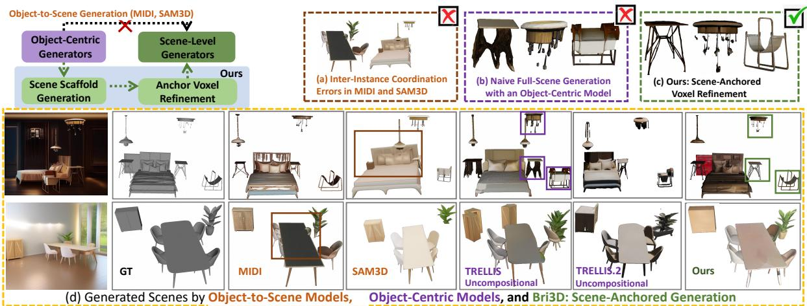  
Figure 1 Bridging the object–scene generation gap. Object-to-scene methods, such as MIDI and SAM3D, extend object generation to scene composition, where coordination errors can still produce collisions and implausible arrangements. Object-centric generators produce high-fidelity individual shapes, but their naive extension to full scenes causes structural collapse and distorted geometry. In contrast, Bri3D first generates a coherent instance-aware scene scafold and then performs scene-anchored prior refinement, producing pose-preserving voxel supports for detail synthesis.

## Abstract

Generating compositional 3D scenes from a single image requires recovering detailed object geometry and coherent spatial arrangements. Existing object-to-scene methods, including SAM3D and MIDI, ex tend object generation through image-context reasoning or inter-instance modeling. Coordinating objects remains challenging with limited scene-level supervision. Directly extending object-centric generators to entire scenes can degrade geometry and fail to preserve instance scale, orientation, and pose. We propose Bri3D, a framework bridging scene-level structural reasoning and object-level generative priors through instance-aware voxel scene anchors. Bri3D predicts a color-coded scene scafold encoding coarse object geometry and spatial arrangements. Each instance is extracted as a scene anchor and refined into a pose-preserving, prior-compatible voxel support, enabling a frozen object generator to synthesize detailed textured geometry in the anchor-defined spatial reference. This coarse-to-fine design separates scene organization from object-scale detail synthesis, focusing scene-level training on spatial organization and anchor refinement while reusing pretrained object priors. Experiments demonstrate improvements in scene layout, object geometry, visual quality, and generalization. Bri3D predicts scene layouts eficiently; full scene generation is faster than SceneGen and SAM3D.

## 1 Introduction

Generating high-fidelity 3D indoor scenes from a single image remains a long-standing challenge at the intersection of computer vision, graphics, and embodied AI [6, 10, 26, 30, 41]. Recent 3D generative models have achieved remarkable progress in synthesizing realistic individual objects [4, 22, 34, 36–39, 42, 44]. Extending this progress to indoor scenes, however, remains dificult. Unlike isolated object generation, scene reconstruction must jointly recover detailed object geometry and a globally valid spatial configuration governed by relative scale, orientation, support relationships, and collision avoidance.

Recent object-to-scene methods combine object priors with inter-instance modeling or image-conditioned shape and pose inference [3, 18, 28]. They improve scene composition, yet coordinating object geometry and placement remains challenging: errors can produce intersections, floating furniture, and inconsistent arrangements, as shown in Fig. 1(a). These dificulties become more pronounced as object counts and spatial relationships grow more complex. Meanwhile, compositional scene data remain limited in quantity and diversity [7, 12], providing limited supervision for jointly learning global arrangements and fine-grained object geometry. This motivates a division of learning responsibilities: scene-level supervision establishes a coherent scafold, while a pretrained object generator supplies detailed geometry and appearance priors. An explicit spatial interface between these two capabilities allows scene organization to guide detailed object synthesis.

In contrast, object-centric generators are trained on abundant collections of clean and normalized shapes, such as Objaverse-XL [8, 9], and therefore learn strong geometry and appearance priors. However, these priors are designed for isolated objects rather than multiple instances embedded in a shared scene coordinate system. Directly extending an object-centric generator to synthesize an entire scene in a single pass requires its representation capacity and spatial resolution to be distributed across all objects and their arrangements. A resolution suficient for a single object therefore becomes too coarse at the scene scale, often resulting in incomplete geometry, distorted shapes, and incorrect orientations, as illustrated in Fig. 1(b). In addition, the object representation cannot be directly aligned with the scale and orientation of each scene instance.

These observations motivate a diferent route for transferring strong object-level generative priors to scene generation. We use a shared spatial scafold as the intermediate representation connecting scene-level struc ture with object-level generation. Such a representation should establish globally coordinated layouts in a shared scene space, while remaining decomposable into individual instances that can be processed by a pre-trained object generator. It should further retain the anchor-defined spatial reference of each instance while providing suficient object-scale resolution for high-fidelity geometry and appearance synthesis.

To bridge this gap, we propose Bri3D, an image-to-compositional 3D scene generation framework built upon a scene scafold that serves as the intermediate representation between scene-level structure and object level generation. Bri3D therefore uses scene anchors to connect scene-level layout learning with pretrained object-level detail synthesis, reducing the need to learn both capabilities jointly from scene data. Bri3D first constructs a unified, instance-aware scene scafold. This scafold provides a globally coordinated structural anchor that jointly captures coarse object geometry and spatial arrangements. Specifically, the Scene Scafold Generator predicts a color-coded, instance-aware voxel scafold from an RGB image and its corresponding segmentation result. Since all foreground objects are generated within a shared scene representation, their placements and coarse geometry are jointly determined under a common scene context. The predicted color labels separate the scafold into coarse object voxel clusters, each serving as a scene anchor for object-scale refinement. The Anchored Voxel Refiner encodes each clustered voxel into a structural latent and injects Gaussian noise to construct a scene-anchored latent initialization. Conditioned on the corresponding image evidence, it denoises the latent into a pose-preserving, prior-compatible voxel support. This support is then processed by the frozen detail-synthesis module of a pre-trained object generator to synthesize a high-fidelity textured 3D object. The generated objects are finally transformed back to their scafold-derived spatial configurations and composed into the complete scene.

In summary, our contributions are threefold:

• We propose Bri3D, an image-to-compositional 3D scene generation framework that bridges coordinated scene-level modeling and detailed object-level synthesis through instance-aware voxel scene anchors.

• We introduce a Scene Scafold Generator that predicts a unified, instance-aware voxel scafold encoding globally coordinated object arrangements and coarse geometry.

• We develop an Anchored Voxel Refiner that converts clustered scene anchors into pose-preserving, priorcompatible voxel supports for a frozen object-level detail-synthesis module.

## 2 Related Work

## 2.1 3D Object Generation

Recent 3D object generators achieve high geometric fidelity by learning from large-scale collections of iso lated shapes. Existing methods mainly use point-, voxel-, or mesh-based representations. Point-based meth ods, such as 3DShape2VecSet [43], encode unordered point sets into compact latents, while difusion and rectified-flow models further improve generation quality and scalability [22, 44]. Mesh-based methods model surface connectivity and produce high-quality geometry, but autoregressive decoding often incurs substantial inference cost [35]. Voxel-based methods provide explicit spatial structure and are well suited for imageconditioned generation. TRELLIS [39, 40] introduces Sparse Structured Latents that combine sparse voxel supports with per-voxel features and support decoding into multiple 3D representations. Subsequent methods further improve geometric fidelity and eficiency [38, 42]. However, these models are trained on isolated, normalized shapes and lack the scene-level reasoning required for object placement, scale, orientation, and spatial coordination. Directly extending them to full-scene generation therefore often degrades structural quality.

## 2.2 Compositional 3D Scene Reconstruction

A common strategy for single-image scene reconstruction is to generate or retrieve individual objects and place them in a shared 3D coordinate system. Earlier methods rely on CAD retrieval and alignment [14, 21], while recent approaches use scene graphs, geometric cues, or vision-language models to infer object identities and spatial configurations [13, 41]. Although these pipelines can reuse high-quality assets, they depend heavily on monocular depth, pose, and scale estimation. Errors propagate through registration and assembly, producing floating objects, intersections, or inconsistent layouts. Independently generated objects may also be geometrically incompatible, limiting global scene coherence. SceneDreamer [5] learns unbounded 3D landscape generation from 2D image collections through adversarial training. Our focus is single-image reconstruction of compositional scenes, where object geometry and relative placement must jointly explain the observation.

## 2.3 Object-to-Scene Generation

Recent methods extend object priors to scene reconstruction through diferent forms of spatial reasoning. MIDI [18] introduces multi-instance attention to coordinate object generation. SceneGen [28] adds global attention and position prediction to a frozen object generator. SAM3D [3] predicts object shape and pose from a target mask and image context. Other approaches use hierarchical or compositional representations to model scene layout and local geometry [24, 27].

Structured or staged processing is also explored across 3D vision tasks [11, 16, 17, 23, 46].

These methods demonstrate the value of object priors for scene synthesis. Bri3D connects these priors to scene organization through an explicit, shared voxel scafold. The scafold jointly represents coarse geometry, instance identity, and placement, and is decomposed into spatially anchored object conditions. Refinement then adapts each coarse anchor to the detail generator while retaining its scene-defined coordinate reference. This interface assigns global spatial coordination to the scene model and detailed synthesis to the object prior, allowing the two levels to operate at their respective spatial resolutions.

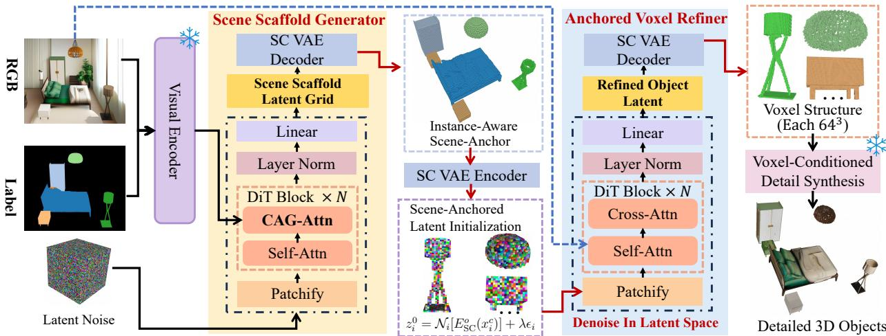  
Figure 2 Overview of Bri3D. The Scene Scafold Generator and Anchored Voxel Refiner replace the voxel-generation stage of a two-stage object generator, while its detail-synthesis stage remains frozen. SC-VAE denotes the Structure-Color VAE, and snowflakes indicate frozen modules. The scafold is generated in latent space and decoded at $1 2 8 ^ { 3 }$ each object is refined to a $6 4 ^ { 3 }$ voxel support. The anchor initialization follows Eq. 5, including object-wise latent normalization.

## 3 Method

## 3.1 Overview

Bri3D transfers the strong geometry and appearance priors of a pre-trained single-object generator to com positional scene generation through a unified, instance-aware scene scafold. Rather than generating objects independently and relying primarily on inter-instance interactions, Bri3D first establishes their coarse geometry and spatial arrangements within a shared scene representation. It contains two trainable modules: a Scene Scafold Generator $\mathcal { G } _ { S }$ , which predicts a color-coded voxel scafold for all foreground objects, and an Anchored Voxel Refiner $\mathcal { R } _ { A }$ , which converts each scafold-derived object cluster into a high-resolution voxel support compatible with the pre-trained object generator. The key to our design is to use voxel structure as the interface between scene-level spatial organization and object-level detail synthesis. The scene scafold establishes coarse object geometry and spatial relationships in a shared coordinate system, providing struc tural anchors for subsequent refinement. Guided by these anchors and object-specific image evidence, the Anchored Voxel Refiner recovers finer object geometry within the spatial reference established by the scaffold. The refined voxel supports then condition a frozen detail-synthesis module from a pre-trained object generator [39] to produce detailed geometry and appearance. Finally, the generated objects are mapped back into the shared scene using their scafold-derived spatial transformations. This design allows Bri3D to learn scene organization and anchored geometry refinement while reusing pre-trained object-level priors for detail synthesis.

## 3.2 Scene Scafold Generator

The Scene Scafold Generator $\mathcal { G } _ { S }$ predicts the coarse voxel geometry and instance organization of all foreground objects. Its training target is a color-coded occupancy volume $\mathbf { x } _ { s }$ at a resolution of $1 2 8 ^ { 3 }$ . Empty voxels represent free space, while each occupied voxel carries the color label of its corresponding object instance. Distinct instance colors allow adjacent objects, including instances from the same category, to remain separable within the shared scene representation. At voxel $j ,$ we use the four-channel representation $\mathbf { v } _ { j } = [ o _ { j } , r _ { j } , g _ { j } , b _ { j } ] ^ { \top }$ , where $o _ { j } \in \{ 0 , 1 \}$ denotes occupancy and $( r _ { j } , g _ { j } , b _ { j } ) \in [ 0 , 1 ] ^ { 3 }$ encodes instance identity, not object texture. Thus, the scafold separates instance labeling from the appearance synthesized by the frozen object generator.

Structure-color latent representation: We employ a scene-scale Structure-Color VAE (SC-VAE) to

encode the color-coded scafold into a spatial latent grid:

$$
\begin{array} { r } { \mathbf { Z } _ { s } = E _ { \mathrm { S C } } ^ { s } \left( \mathbf { x } _ { s } \right) , \qquad \hat { \mathbf { x } } _ { s } = D _ { \mathrm { S C } } ^ { s } \left( \mathbf { Z } _ { s } \right) . } \end{array}\tag{1}
$$

Unlike a single global latent code, $\mathbf { Z } _ { s }$ retains a regular 3D organization in which each token corresponds to a local scene region. $\mathbf { Z } _ { s } \in \mathbb { R } ^ { h _ { s } \times w _ { s } \times d _ { s } \times c _ { s } }$ , it therefore preserves local object structure while providing global spatial context for scene generation.

We adopt the same SC-VAE design at the scene and object scales, with superscripts s and o denoting their corresponding resolution-specific models.

Color-aware conditional generation: A rectified-flow DiT $\mathcal { G } _ { S }$ generates the scene scafold latent $\mathbf { Z } _ { s }$ from Gaussian noise of the same latent-grid dimensions. Decoding yields a $1 2 8 ^ { 3 }$ scene scafold. The RGB image $I _ { \mathrm { r g b } }$ and its color-coded instance label map $I _ { \mathrm { l a b } }$ are encoded by a shared DINOv2 [31] backbone, producing appearance and instance-layout features.

Instead of directly concatenating these conditioning modalities, we introduce Color-Attention Gating (CAG) in each cross-attention block. For the k-th latent query $\mathbf q _ { k }$ and conditioning modality $m \in \{ \mathrm { r g b } , \mathrm { l a b } \}$ , the corresponding gating coeficient is

$$
g _ { m } ^ { k } = \sigma \left( \mathrm { M L P } _ { m } \left( \mathbf { q } _ { k } \right) \right) ,\tag{2}
$$

and the conditioning features are fused as

$$
{ \bf q } _ { k } ^ { \prime } = { \bf q } _ { k } + \sum _ { m \in \{ \mathrm { r g b } , \mathrm { l a b } \} } g _ { m } ^ { k } \mathrm { A t t n } _ { m } \left( { \bf q } _ { k } , { \bf F } _ { m } \right) ,\tag{3}
$$

where ${ \bf { F } } _ { m }$ denotes the feature tokens of modality m. CAG allows each spatial region to adaptively select appearance or instance-layout evidence according to color cues. Since the instance colors in $I _ { \mathrm { l a b } }$ are assigned arbitrarily, CAG is designed to be robust to the specific color assignment and to color perturbations; a robustness analysis under imperfect instance label maps is provided in Section 4.4. The generated latent grid is finally decoded by $D _ { \mathrm { S C } } ^ { s }$ into the instance-aware scene scafold $\hat { \mathbf { x } } _ { s }$

## 3.3 Anchored Voxel Refiner

The Anchored Voxel Refiner $\mathcal { R } _ { A }$ converts each coarse object extracted from the scene scafold into a highresolution voxel support compatible with the pre-trained object generator. It takes a clustered coarse voxel and its corresponding image evidence as input, using the voxel structure as a scene anchor for object-scale refinement.

Instance extraction: We apply DBSCAN to occupied voxels using both spatial positions and predicted instance colors. Spatial proximity and color similarity jointly determine the clusters, accommodating contin uous color predictions without requiring exact RGB equality. This helps distinguish touching instances that geometry-only connected component analysis would merge. Each cluster retains its coordinates in the shared scene and becomes an object anchor for normalization and refinement. This inference-time clustering difers from the K-means partitioning used to construct single-object training labels.

Anchor-defined spatial reference: We normalize each scene anchor using its center $\mathbf { c } _ { i }$ and isotropic scale $s _ { i } > 0$ , refine its geometry in the resulting local coordinate frame, and map the output back using the same inverse transformation:

$$
\mathbf { u } = \frac { \mathbf { x } - \mathbf { c } _ { i } } { s _ { i } } , \qquad \hat { \mathbf { x } } = s _ { i } \hat { \mathbf { u } } + \mathbf { c } _ { i } .\tag{4}
$$

Here, x is a point in scene coordinates, u is its local coordinate, and uˆ is an output point after refinement and detail synthesis. We retain the original $\left( \mathbf { c } _ { i } , s _ { i } \right)$ throughout the pipeline; the output is not re-normalized using its predicted bounding box. Normalization applies only translation and isotropic scaling, so the anchor’s orientation remains encoded in the local voxels without a separate rotation estimate. Here, pose preservation refers to retaining the anchor-defined spatial reference without additional pose estimation or registration. Object geometry is refined within this fixed spatial reference. We denote the normalized coarse voxel structure by $\mathbf { x } _ { i } ^ { c }$

Scene-anchored latent initialization: The coarse voxel is encoded by the object-scale SC-VAE, and Gaussian noise is injected into its structural latent:

$$
\begin{array} { r } { \mathbf { z } _ { i } ^ { 0 } = \mathcal { N } _ { i } [ E _ { \mathrm { S C } } ^ { o } ( \mathbf { x } _ { i } ^ { c } ) ] + \lambda \epsilon _ { i } , \qquad \epsilon _ { i } \sim \mathcal { N } \left( \mathbf { 0 } , \mathbf { I } \right) . } \end{array}\tag{5}
$$

Here, ${ \mathcal { N } } _ { i }$ uses the coarse anchor latent’s per-channel mean and standard deviation for both condition and target normalization; the same statistics are saved for inverse normalization before decoding (Appendix A.2.3). We refer to $\mathbf { z } _ { i } ^ { 0 }$ as the scene-anchored latent initialization. Its encoded component preserves the scafold-derived pose and coarse geometry, while the noise provides the flexibility required to recover missing and unobserved structures.

Multi-resolution training conditions: We construct coarse conditions from ground-truth (GT) object voxel grids rather than requiring predicted scene anchors for every training example. Each GT object is voxelized at resolutions $r ^ { 3 }$ , with $r \in \{ 4 , 8 , 1 6 , 3 2 \}$ , and the coarse grid is restored to the fixed $6 4 ^ { 3 }$ input grid before entering the object-scale encoder:

$$
\begin{array} { r } { \mathbf { x } _ { i , r } ^ { c } = \mathcal { U } _ { 6 4 } \big ( \mathcal { V } _ { r } ( \mathbf { x } _ { i } ^ { \mathrm { G T } } ) \big ) , \qquad \mathbf { z } _ { i , r } ^ { \mathrm { c o n d } } = \mathcal { N } _ { i } \big [ E _ { \mathrm { S C } } ^ { o } ( \mathbf { x } _ { i , r } ^ { c } ) \big ] . } \end{array}
$$

Here, $\mathcal { V } _ { r }$ denotes coarse voxelization and $\mathcal { U } _ { 6 4 }$ restores the grid resolution while retaining the coarse geometric information. Gaussian noise is added to this encoded condition as in $\operatorname { E q . 5 ; }$ the full-resolution GT grid provides the clean target latent. These four levels expose the refiner to varying amounts of structural detail during training.

Image-conditioned latent refinement: Starting from ${ \bf z } _ { i } ^ { 0 } ,$ a Geometry Flow Transformer progressively recovers a refined object latent. The refiner is conditioned on an image feature $\mathbf { f } _ { i }$ extracted from the corre sponding object region. The refinement trajectory is formulated as

$$
\frac { d \mathbf { z } _ { i } } { d t } = \mathbf { v } _ { \boldsymbol { \theta } } \left( \mathbf { z } _ { i } , t ; \mathbf { f } _ { i } \right) , \qquad \mathbf { z } _ { i } ( 0 ) = \mathbf { z } _ { i } ^ { 0 } .\tag{6}
$$

The initialization carries the coarse anchor geometry, while image conditioning guides the recovery of objectspecific geometry.

After inverse normalization, the object-scale SC-VAE decodes $\mathcal { N } _ { i } ^ { - 1 } ( \hat { \mathbf { z } } _ { i } )$ into a four-channel occupancy–RGB volume $\hat { \mathbf { x } } _ { i } ^ { o } \in [ 0 , 1 ] ^ { 6 4 \times 6 4 \times 6 4 \times 4 }$ . We explicitly select its occupancy channel:

$$
\hat { \mathbf { V } } _ { i } = \pi _ { \mathrm { o c c } } \left[ D _ { \mathrm { S C } } ^ { o } ( \mathcal { N } _ { i } ^ { - 1 } ( \hat { \mathbf { z } } _ { i } ) ) \right] , \qquad \hat { \mathbf { V } } _ { i } \in [ 0 , 1 ] ^ { 6 4 \times 6 4 \times 6 4 } .\tag{7}
$$

Here, $\pi _ { \mathrm { o c c } }$ selects the occupancy channel and discards the three instance-color channels. We threshold this field to obtain the binary support $\mathbf { B } _ { i } ( \mathbf { p } ) = \mathbf { 1 } [ \hat { \mathbf { V } } _ { i } ( \mathbf { p } ) > \tau _ { \mathrm { o c c } } ]$ , where $\tau _ { \mathrm { o c c } }$ is the occupancy threshold. Only occupied locations $\{ \mathbf { p } : \mathbf { B } _ { i } ( \mathbf { p } ) = 1 \}$ are passed to the object generator as its sparse structural support.

Voxel-conditioned detail synthesis: The thresholded voxel support $\mathbf { B } _ { i }$ is passed to the frozen detailsynthesis module of the pre-trained object generator [39]. Conditioned on the occupied voxel and the corresponding image, this module generates detailed geometry and appearance to synthesize a high-fidelity textured 3D object. The generated objects are transformed back using the same saved $\left( \mathbf { c } _ { i } , s _ { i } \right)$ in Eq. 4 and composed into the final 3D scene, without an additional registration step.

## 3.4 Training Objectives

SC-VAE objective: The scene-scale and object-scale SC-VAEs are trained to reconstruct structure-color voxel representations. Given an input volume x and its reconstruction xˆ, the objective is

$$
\begin{array} { r l } & { \mathcal { L } _ { \mathrm { S C } } = \lambda _ { \mathrm { r e c } } \| \mathbf { x } - \hat { \mathbf { x } } \| _ { 1 } + \beta \operatorname { K L } ( q ( \mathbf { Z } \mid \mathbf { x } ) \| p ( \mathbf { Z } ) ) } \\ & { \qquad +  \lambda _ { \mathrm { r e n d e r } } \mathcal { L } _ { \mathrm { r e n d e r } } .  } \end{array}\tag{8}
$$

The reconstruction term preserves voxel occupancy and color information, while the KL term regularizes the spatial latent distribution.

To better preserve projected object boundaries and spatial arrangements, ground-truth and reconstructed instance-color volumes are rendered from the same camera to obtain label images $I _ { \mathrm { g t } }$ and $I _ { \mathrm { p r e d } }$ . The rendering loss is defined as

$$
\mathcal { L } _ { \mathrm { p i x e l } } = \Vert I _ { \mathrm { g t } } - I _ { \mathrm { p r e d } } \Vert _ { 1 } + 0 . 2 \left[ 1 - \mathrm { S S I M } \left( I _ { \mathrm { g t } } , I _ { \mathrm { p r e d } } \right) \right] .\tag{9}
$$

$$
\mathcal { L } _ { \mathrm { r e n d e r } } = \mathcal { L } _ { \mathrm { p i x e l } } + 0 . 2 \mathrm { L P I P S } \left( I _ { \mathrm { g t } } , I _ { \mathrm { p r e d } } \right) .\tag{10}
$$

This supervision improves view-consistent object separation and scene-level spatial organization.

Rectified flow matching: Both the Scene Scafold Generator and Anchored Voxel Refiner are trained using rectified flow matching. Given an initial latent $\mathbf { z } _ { 0 }$ and a target latent $\mathbf { z } _ { 1 }$ , we define the linear interpolation

$$
{ \bf z } ( t ) = ( 1 - t ) { \bf z } _ { 0 } + t { \bf z } _ { 1 } , \qquad t \sim \mathcal { U } [ 0 , 1 ] ,
$$

and optimize

$$
\mathcal { L } _ { \mathrm { f l o w } } = \mathbb { E } _ { t } \left[ \| \mathbf { v } _ { \theta } \left( \mathbf { z } ( t ) , t ; \mathbf { f } \right) - ( \mathbf { z } _ { 1 } - \mathbf { z } _ { 0 } ) \| _ { 2 } ^ { 2 } \right] .\tag{11}
$$

Here, f denotes the RGB/label conditioning features for scene scafold generation and the object image feature $\mathbf { f } _ { i }$ for refinement. For the Scene Scafold Generator, $\mathbf { z } _ { 0 }$ is Gaussian noise and $\mathbf { z } _ { 1 }$ is the SC-VAE latent of the ground-truth scene scafold. For the Anchored Voxel Refiner, $\mathbf { z } _ { 0 }$ is the scene-anchored initialization defined in $\operatorname { E q . }$ 5, while $\mathbf { z } _ { 1 }$ is the object-scale SC-VAE latent of the corresponding ground-truth voxel structure, normalized using the coarse anchor’s saved statistics.

## 4 Experiments

## 4.1 Experimental Setup

Implementation details. Bri3D trains a Scene Scafold Generator and an Anchored Voxel Refiner using Objaverse-XL [9] and 3D-FRONT [12]. Each 3D-FRONT instance is assigned a unique color, while Objaverse XL objects are partitioned into 1–6 K-means clusters with distinct colors to construct structure-color super vision. An SC-VAE encodes and reconstructs these color-coded voxel structures with rasterization-based rendering losses, providing latents for both scafold generation and object refinement. The generator predicts a $1 2 8 ^ { 3 }$ instance-aware scafold, and the refiner converts each object cluster into a prior-compatible $6 4 ^ { 3 }$ voxel structure. Random occluders improve robustness to partial observations. Bri3D reconstructs foreground ob jects and their layouts, excluding floors, walls, and ceilings. Scene-level training follows MIDI’s 3D-FRONT split [18], drawn from its cleaned corpus of approximately 15,000 scenes. Separately, the object-level data construction uses 500,000 single-object instances to provide coarse conditions and GT targets for refinement. Both the Scene Scafold Generator and Anchored Voxel Refiner are trained for 10 epochs on 16 NVIDIA H20 GPUs, using AdamW with a learning rate of $1 \times 1 0 ^ { - 4 }$ and a per-GPU batch size of 4.

Evaluation metrics. We evaluate geometry, layout, and visual quality following existing 3D scene generation methods [18, 28]. Geometric fidelity is measured using Chamfer Distance (CD) and F-Score, computed at both the scene and object levels. We use CD-S/CD-O and F-S/F-O for scene/object metrics throughout; all reported CD values are scaled by 100, and F-S/F-O are percentages. Spatial layout accuracy is assessed using the Intersection over Union (BBox IoU) between corresponding axis-aligned bounding boxes in the generated and ground-truth scenes. For Bri3D, BBox IoU evaluates the scafold-derived anchor boxes, which are retained through refinement and detail synthesis. Collision rate is the percentage of object pairs whose voxelized occupancies overlap in shared scene coordinates. For Bri3D, scafold instances are extracted and voxelized separately before refinement; collisions are measured between these instance volumes. For visual quality, we compare rendered views of the generated scenes with corresponding ground-truth images to evalu ate texture realism and perceptual fidelity. Multiple perceptual metrics are reported, including PSNR, SSIM, LPIPS [45], FID [15], CLIP similarity [33], and DINOv2 similarity [31].

Baselines. We compare Bri3D against representative 3D scene generation methods: PartCrafter [24], DepR [47], Gen3DSR [1], MIDI [18], SceneGen [28], and SAM3D [3]. Since PartCrafter and DepR do not support texture rendering, we exclude them from visual-quality evaluation. In-domain quantitative evaluation uses MIDI’s released 3D-FRONT [12, 18] test split of 1,000 images, with the corresponding 3D scenes and instance masks. Consistent with the evaluation protocol of MIDI [18], we use the instance segmentation masks provided by the dataset, rather than masks predicted by an of-the-shelf segmentor, as the segmen tation input for standard quantitative comparisons. The robustness of Bri3D to erroneous segmentation maps is further analyzed in our ablation study (Fig. 8). For cross-dataset evaluation, we manually select 300 scenes: 150 from HSSD [20] and 150 independently collected from the BlendSwap platform [2]. We render multiple input views per scene ourselves, pairing each view with its GT 3D scene; each reconstruction uses one input image, so 300 denotes the number of scenes, not the number of input views. ScanNet [7], which lacks complete ground truth, is used for qualitative evaluation.

Table 1 Quantitative comparisons on the 3D-FRONT [12] test set. Geometric metrics: scene/object-level Chamfer Distance (CD-S/CD-O, 100), F-Score (F-S/F-O, %), and BBox IoU ([0, 1]). Visual metrics: PSNR, SSIM, LPIPS, FID, CLIP-S, DINO-S.
<table><tr><td rowspan="2">Method</td><td colspan="5">Geometry</td><td rowspan="2"></td><td colspan="5">Visual Quality</td></tr><tr><td>CD-S↓</td><td>CD-O↓</td><td>F-S↑</td><td>F-O↑</td><td>BBox IoU↑</td><td>PSNR↑</td><td>SSIM↑</td><td>LPIPS↓</td><td>FID↓</td><td>CLIP-S↑ DINO-S↑</td></tr><tr><td>DepR</td><td>9.07</td><td>18.81</td><td>78.91</td><td>56.15</td><td>0.3943</td><td></td><td></td><td></td><td></td><td></td><td></td></tr><tr><td>Gen3DSR</td><td>8.21</td><td>17.18</td><td>79.07</td><td>60.41</td><td>0.4456</td><td>16.30</td><td>0.8639</td><td>0.1621</td><td>19.96</td><td>0.9009</td><td>0.8139</td></tr><tr><td>PartCrafter</td><td>7.05</td><td></td><td>85.66</td><td></td><td></td><td></td><td></td><td></td><td></td><td></td><td></td></tr><tr><td>SceneGen</td><td>6.11</td><td>7.07</td><td>87.72</td><td>87.73</td><td>0.5382</td><td>16.50</td><td>0.8723</td><td>0.1552</td><td>19.80</td><td>0.9005</td><td>0.8201</td></tr><tr><td>MIDI</td><td>2.14</td><td>2.81</td><td>92.20</td><td>89.57</td><td>0.6238</td><td>16.97</td><td>0.8756</td><td>0.1522</td><td>19.78</td><td>0.9315</td><td>0.8247</td></tr><tr><td>SAM3D</td><td>2.11</td><td>2.76</td><td>92.34</td><td>89.72</td><td>0.6271</td><td>17.02</td><td>0.8791</td><td>0.1496</td><td>19.71</td><td>0.9328</td><td>0.8295</td></tr><tr><td>Ours</td><td>0.87</td><td>1.72</td><td>96.12</td><td>95.33</td><td>0.7540</td><td>17.20</td><td>0.9020</td><td>0.1312</td><td>19.27</td><td>0.9343</td><td>0.8366</td></tr></table>

Table 2 Cross-dataset generalization results. We evaluate scene- and object-level geometry, layout accuracy, and visual similarity on 300 scenes paired with rendered images and ground-truth 3D scenes. CD-S and CD-O are scaled by 100; F-S and F-O are F-Score percentages; BBox IoU is on the [0, 1] scale. The best results are in bold; the second-best results (SAM3D in all reported columns) are underlined.
<table><tr><td>Method</td><td>CD-S↓</td><td>F-S↑</td><td>CD-O↓</td><td>F-O↑</td><td>BBox IoU↑</td><td>LPIPS↓</td><td>DINO-S↑</td></tr><tr><td>DepR</td><td>14.20</td><td>64.80</td><td>13.85</td><td>66.10</td><td>0.2420</td><td></td><td></td></tr><tr><td>Gen3DSR</td><td>12.70</td><td>68.90</td><td>12.35</td><td>69.70</td><td>0.2785</td><td>0.3328</td><td>0.7218</td></tr><tr><td>PartCrafter</td><td>11.30</td><td>74.60</td><td></td><td></td><td></td><td></td><td></td></tr><tr><td>SceneGen</td><td>12.10</td><td>71.20</td><td>11.56</td><td>72.80</td><td>0.2864</td><td>0.3187</td><td>0.7382</td></tr><tr><td>MIDI</td><td>6.20</td><td>80.50</td><td>5.74</td><td>82.60</td><td>0.4315</td><td>0.2635</td><td>0.7756</td></tr><tr><td>SAM3D</td><td>3.85</td><td>87.10</td><td>3.48</td><td>89.30</td><td>0.5628</td><td>0.2218</td><td>0.8021</td></tr><tr><td>Ours</td><td>3.42</td><td>88.20</td><td>3.06</td><td>90.60</td><td>0.5946</td><td>0.2076</td><td>0.8104</td></tr></table>

Table 3 Comparison of layout accuracy, inference time, and observed object collisions. BBox IoU is in [0, 1]; collision rate is the percentage of overlapping object pairs. ∗Ours reports scafold-stage anchor BBox IoU and collisions after separately voxelizing extracted instances. Times outside parentheses are for scafold prediction; parentheses and baseline times report full generation.
<table><tr><td>Model</td><td colspan="2">1-10 Objects</td><td colspan="2">11-20 Objects</td><td rowspan="2">Collision Rate (%)↓</td></tr><tr><td></td><td>BBox IoU</td><td>Test Time</td><td>BBox IoU</td><td>Test Time</td></tr><tr><td>DepR</td><td>0.4032</td><td>15.3s</td><td>0.3008</td><td>20.8s</td><td>22</td></tr><tr><td>MIDI</td><td>0.6349</td><td>40.4s</td><td>0.4193</td><td>72.9s</td><td>14</td></tr><tr><td>SceneGen</td><td>0.5892</td><td>135.0s</td><td>0.4462</td><td>230.2s</td><td>38</td></tr><tr><td>SAM3D</td><td>0.6568</td><td>64.1s</td><td>0.4609</td><td>179.6s</td><td>34</td></tr><tr><td>Ours*</td><td>0.7980</td><td>5.1s (42.6s)</td><td>0.6732</td><td>5.2s (78.4s)</td><td>4</td></tr></table>

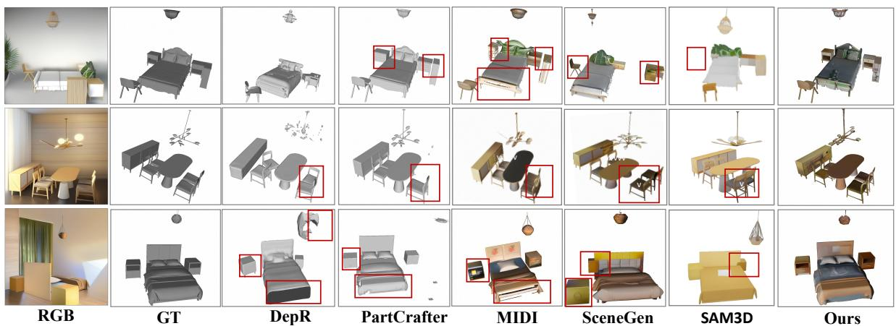  
Figure 3 Qualitative results on the 3D-FRONT [12] test set. Our method generates more plausible layouts and higher-fidelity geometry, consistent with the quantitative improvements. Red boxes indicate inferior baseline results.

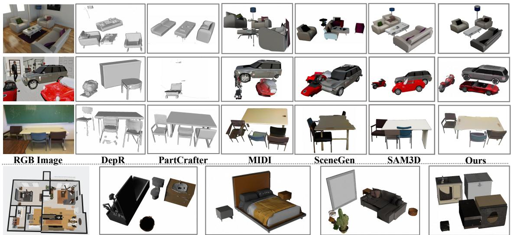  
Rooms Inputs  
(b) Bedroom  
(c) Livingroom

Figure 4 Generalization to diverse room scenes. The upper three rows compare reconstructions of a living room, a garage, and a classroom, with the input image followed by the results of DepR, PartCrafter, MIDI, SceneGen, SAM3D, and Bri3D. These examples cover diferent object categories, scales, and degrees of occlusion. The lower row shows a multi-room overview and reconstructions of its bathroom, bedroom, living room, and kitchen, each generated from a separate room-level input. Together, the examples illustrate object reconstruction across varied scene configurations and room types.

## 4.2 Scene Generation

As shown in Table 1, our method outperforms state-of-the-art approaches across both scene-level and object level metrics, achieving lower Chamfer Distance (CD-S: 0.87, CD-O: 1.72) and higher BBox IoU (0.7540). These improvements demonstrate better global layout fidelity and fine-grained object geometry. Qualitative comparisons in Fig. 3 further show that Bri3D produces coherent object arrangements while reducing floating objects, unnatural occlusions, and geometric distortions. The cross-dataset results in Table 2 further demon strate strong generalization to challenging unseen scenes. Bri3D consistently achieves the best scene- and object-level geometry, layout accuracy, and visual similarity, while SAM3D obtains the second-best results. These results indicate that the scene-anchor representation efectively transfers object-level generative priors beyond the training distribution. As shown in Fig. 4, Bri3D also generalizes to diverse room layouts with heavy occlusions and incomplete observations, producing high-fidelity reconstructions under challenging viewing conditions. The room-level examples span bathrooms, bedrooms, living rooms, and kitchens, showing coherent object arrangements across varied room functions and furniture configurations.

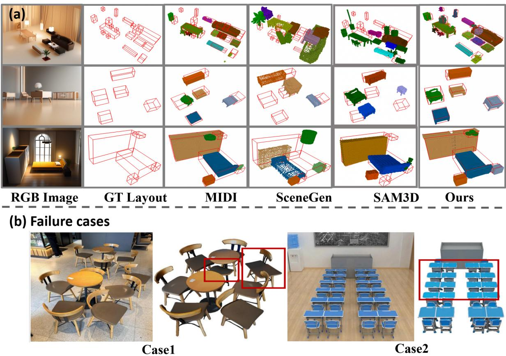  
Figure 5 Comparison of 3D scene layouts and failure cases. (a) Columns show the RGB input, ground-truth layout, and predictions from MIDI [18], SceneGen [28], SAM3D [3], and Bri3D. Red wireframe boxes mark the groundtruth object extents, making displacement, missing instances, and shape deviations visible. Bri3D better follows the reference arrangements in these examples. (b) Red rectangles highlight our failures: nearby objects may merge in the cluttered seating area (Case 1), and some instances may be omitted in the densely populated classroom (Case 2).

## 4.3 Scene Scafold Generation

A well-structured spatial layout is crucial for complete and realistic 3D scene generation. Our method supports independent layout prediction. To evaluate the efectiveness of our Scene Scafold Generator $\mathcal { G } _ { S }$ , we report both quantitative and qualitative results in Table 3 and Fig. 5 (a), respectively. As shown in Table 3, our $G _ { S }$ achieves a BBox IoU of 0.6732 in the 11–20 object range, significantly outperforming SAM3D [3] and MIDI [18]. In terms of eficiency, Bri3D produces a scene layout directly through scene scafold prediction, taking only 5.1 s on a NVIDIA A800 GPU for scenes with 1–10 objects. The scafold already provides the coarse geometry, instance organization, and spatial reference needed for object refinement. Subsequent object refinement and detail synthesis require an additional 37.5 s on average, bringing the total reconstruction time to 42.6 s per scene. For full scene reconstruction, Bri3D is approximately 3.2× faster than SceneGen (135.0 s) and 1.5× faster than SAM3D (64.1 s). For scenes with 11–20 objects, scafold prediction takes 5.2 s and full generation takes 78.4 s, compared with 230.2 s for SceneGen and 179.6 s for SAM3D. As shown in Fig. 5(b), Bri3D exhibits two failure modes: (1) under extreme clutter or ambiguous layouts, it may incorrectly merge distinct objects; and (2) in highly dense scenes with more than 30 objects, it may omit some instances.

Qualitative comparisons in Fig. 5 (a) further demonstrate that scene scafold produces visually compact and semantically consistent arrangements, with objects placed in plausible positions relative to room semantics and geometry. It efectively avoids common artifacts such as excessive gaps between furniture and unrealistic overlaps, which are frequently observed in the outputs of SceneGen [28] and MIDI [18].

Table 4 Ablation studies of Bri3D. Rows (b)–(f) progressively introduce the components of the Scene Scafold Generator. Rows $\left( \mathrm { { g } ) / ( h ) } \right.$ compare interpolation and latent refinement from $\mathrm { { ( f ) ; \Omega ( i ) / ( j ) } }$ apply detail synthesis after (h). All retain the anchor boxes and BBox IoU of (f). CD-S/F-S and CD- $. \mathrm { O } / \mathrm { F } { - } \mathrm { O }$ report scene/object metrics. CD is scaled by 100, F-Score is in percent, and BBox IoU is in [0, 1]. The best results within each component block are highlighted in bold.
<table><tr><td>Variant</td><td>CD-S/F-S↓/↑  $\mathbf { C D - O / F { - } O \downarrow / \uparrow }$  BBox IoU ↑</td></tr><tr><td colspan="2">Baseline (a)  $\mathrm { T R E L I S  – F T } \ ( 6 4 ^ { 3 } )$  10.80/52.91</td></tr><tr><td>Scene Scaffold Generator</td><td></td></tr><tr><td></td><td>0.3144</td></tr><tr><td>(b) One-hot representation + CE loss (c) Color representation loss  $( 6 4 ^ { 3 } )$ </td><td> $( 6 4 ^ { 3 } )$  13.00/43.24 13.90/41.23</td></tr><tr><td> $+ ~ \ell _ { 1 }$  (d) + Rendering-based label loss 5.47/69.88</td><td>7.24/55.57 8.61/53.55 0.3902</td></tr><tr><td>(e)</td><td>7.32/60.82 0.4653</td></tr><tr><td> $+ \mathrm { { C A G } }$  4.58/73.49</td><td>6.35/63.98 0.5804</td></tr><tr><td>(f) + Higher scaffold resolution  $( { 1 2 8 } ^ { 3 } )$  3.73/84.22</td><td>4.33/72.13 0.7540</td></tr><tr><td colspan="2">Anchored Voxel Refiner</td></tr><tr><td>(g) + Interpolation 1.92/93.53</td><td></td></tr><tr><td></td><td>2.02/91.38 1.24/94.27 1.85/93.61</td></tr><tr><td>(h) + Latent refinement</td><td>0.7540 1.79/95.05 0.7540</td></tr><tr><td>(i) + Detailed synthesis by Direct3D-S2 0.96/95.82 (j) + Detailed synthesis by TRELLIS</td><td>0.87/96.12 1.72/95.33 0.7540</td></tr></table>

## 4.4 Ablation Study

We evaluate the contributions of the Scene Scafold Generator and the Anchored Voxel Refiner in Table 4.

Direct object-to-scene transfer. We first fine-tune the voxel-generation stage of TRELLIS directly on scene data (a). Despite its strong object prior, TRELLIS-FT performs poorly at the scene level, confirming that directly extending an object-centric generator to full scenes cannot efectively preserve multi-object geometry and spatial organization.

Scene Scafold Generator. Rows (b)–(f) progressively evaluate the scafold design. Replacing one-hot labels with color-coded instance representations substantially improves both scene- and object-level reconstruction, as shown by the improvement from (b) to (c). Introducing the rendering-based label loss (d) further preserves instance boundaries and spatial structure, reducing CD-S from 7.24 to 5.47 and increasing F-S from 55.57 to 69.88. CAG-Attn (e) improves the integration of image and instance conditions, yielding more coherent object arrangements. Increasing the scafold resolution from $6 4 ^ { 3 }$ to $1 2 8 ^ { 3 }$ (f) provides the strongest scafold results, reaching 3.73/84.22 in CD-S/F-S and a BBox IoU of 0.7540.

Instance separation with color-coded scene anchors. To further demonstrate the efectiveness of the color-coded scene scafold, we analyze its critical role in instance separation. As shown in Fig. 6, the instance color labels predicted by the Scene Scafold Generator $G _ { S }$ enable reliable separation of closely adjacent objects into distinct instances. In contrast, traditional geometry-based methods such as connected component analysis (CCA) often fail to distinguish touching objects in the absence of color guidance. In the second stage, the Anchored Voxel Refiner $R _ { A }$ leverages the instance-wise voxel clusters from $G _ { S }$ as strong geometric constraints to refine object shapes under image conditioning, without relying on additional instance predictions. Together, this design enables high-quality 3D scene generation without requiring training from scratch or large-scale scene datasets.

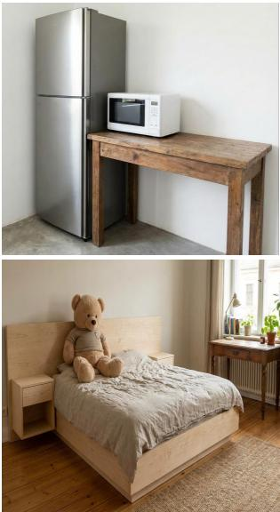  
RGB Image  
Label  
CCA  
Semantic Voxel Grid

# hhh

Figure 6 Color-coded scene scafold vs. connected component analysis. From left to right: RGB input, instance label map, geometry-only CCA result, and the predicted color-coded voxel grid. In the upper example, CCA groups the refrigerator, microwave, and table into one connected region; in the lower example, it merges the touching bed components and teddy bear. The predicted instance colors provide additional separation cues at these contacts, allowing joint position–color clustering to recover distinct object anchors. Colors indicate instance identity rather than surface texture.

Anchored Voxel Refiner. Using configuration (f), we first compare direct voxel interpolation (g) with scene-anchored latent refinement (h). Although interpolation increases voxel resolution, it cannot recover missing geometry or align the coarse scafold with the latent distribution of the pre-trained object generator. In contrast, latent refinement improves CD-O/F-O from 2.02/91.38 to 1.85/93.61, recovering more complete object structures within the anchor-defined spatial reference. BBox IoU remains 0.7540 through the retained scafold-derived anchor boxes. Finally, rows (i) and (j) pass the high-resolution structure from (h) to the subsequent generation stages of Direct3D-S2 and TRELLIS, respectively. Both further improve geometry without modifying the scafold-derived anchor boxes. TRELLIS achieves the best overall performance, with 0.87/96.12 CD-S/F-S, 1.72/95.33 CD-O/F-O, and a BBox IoU of 0.7540, showing that Bri3D can efectively transfer diferent pre-trained object priors through the same scene-anchor interface.

Preliminary attempt on structural elements. Note that Bri3D is designed for foreground objects, and floors, walls, and ceilings are excluded from reconstruction in all experiments reported above. Here we only make a preliminary attempt to extend the color-coded scafold to such large-scale structural elements. As shown in Fig. 7, when reliable labels of structural regions are available in the input image, the scafold genera tor can produce coherent floor and wall structures, indicating the potential of the scene-anchor representation for modeling global scene structures. A systematic treatment of structural elements, e.g., training with clean structural annotations or incorporating explicit priors such as Manhattan constraints, is left as future work.

Additional qualitative results and robustness to erroneous segmentation. Fig. 8(a) compares Bri3D with MIDI and SAM3D on both indoor and outdoor scenes. MIDI produces distorted geometry and implausible object arrangements, whereas Bri3D generates coherent layouts and object shapes that better match the input image. The standard quantitative comparisons use dataset-provided instance masks; here we also examine imperfect segmentation inputs encountered in practical deployment. Fig. 8(b) examines robustness to erroneous instance label maps. Bri3D exhibits only local cracks, whereas SAM3D produces incorrect object partitions and collisions: the teddy bear is present but partially intersects the bed.

Robustness to segmentation granularity and label colors. Fig. 9 examines how the semantic voxel

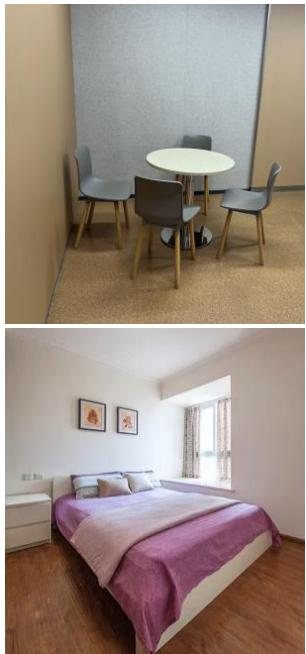  
RGB Image

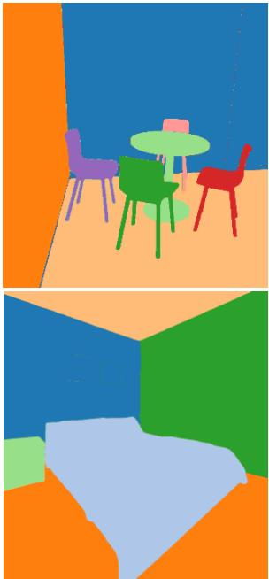  
Label

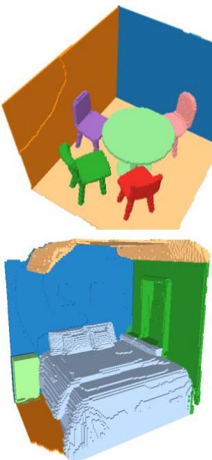  
Semantic Voxel Grid

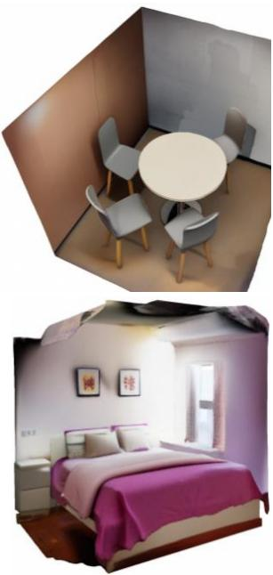  
Scene Mesh

Figure 7 Preliminary attempt on structural elements. From left to right: RGB input, label map including structural regions, predicted color-coded voxel grid, and reconstructed scene mesh. The dining-area and bedroom examples include room surfaces together with foreground furniture, illustrating how structural labels can extend the scafold beyond object instances. This extension depends on reliable labels for those regions and remains preliminary; floors, walls, and ceilings are excluded from the main Bri3D experiments and quantitative results.

grid responds to diferent instance partitions and label colors. The first two rows depict a tabletop scene with a bottle, mug, large box, ball, and two small stacks of blocks. The bottle, mug, box, and ball keep their instance labels, while the small stacks are labeled as whole stacks in the first row and as individual blocks in the second row. The predicted voxel grids follow these grouping choices while preserving the overall geometry and spatial arrangement. The last two rows show implausible partitions of a chair together with changes in label colors. Although the voxel partitions and bounding boxes vary with the input labels, the overall scene geometry and layout remain broadly consistent. These examples illustrate Bri3D’s flexibility across segmentation granularities and its robustness to the combined partition and color changes shown.

## 5 Conclusion

We presented Bri3D, a scene-anchored compositional 3D generation framework that achieves coherent spatial layouts and fine-grained object geometry. Bri3D connects scene-level structural reasoning with object-level generative priors through a unified scene scafold and anchored object refinement. By separating global scene organization from object-scale synthesis, scene-level training focuses on spatial organization and anchor refinement while reusing pretrained priors for detailed geometry and appearance. Through the proposed scene anchors and anchored voxel refinement, Bri3D produces more coordinated and unified scene reconstructions. Experiments demonstrate improvements in scene structure, object geometry, and visual quality. Scene scafold prediction provides layouts in about five seconds; full scene generation is faster than SceneGen and SAM3D.

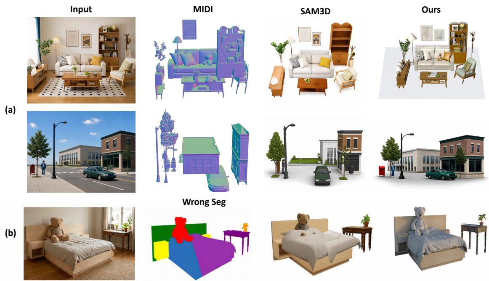  
Figure 8 Additional qualitative comparisons and robustness to imperfect segmentation. (a) Geometry and layout comparisons with MIDI and SAM3D on indoor and outdoor scenes; MIDI is shown with normal shading. Bri3D produces coherent layouts and faithful object geometry, while MIDI sufers from distorted shapes and implausible arrangements. (b) With an erroneous instance label map (Wrong Seg), Bri3D exhibits only local cracks, whereas SAM3D produces incorrect object partitions and collisions, including interpenetration between the teddy bear and the bed.

Input image

2D segmentation

Semantic voxel grid

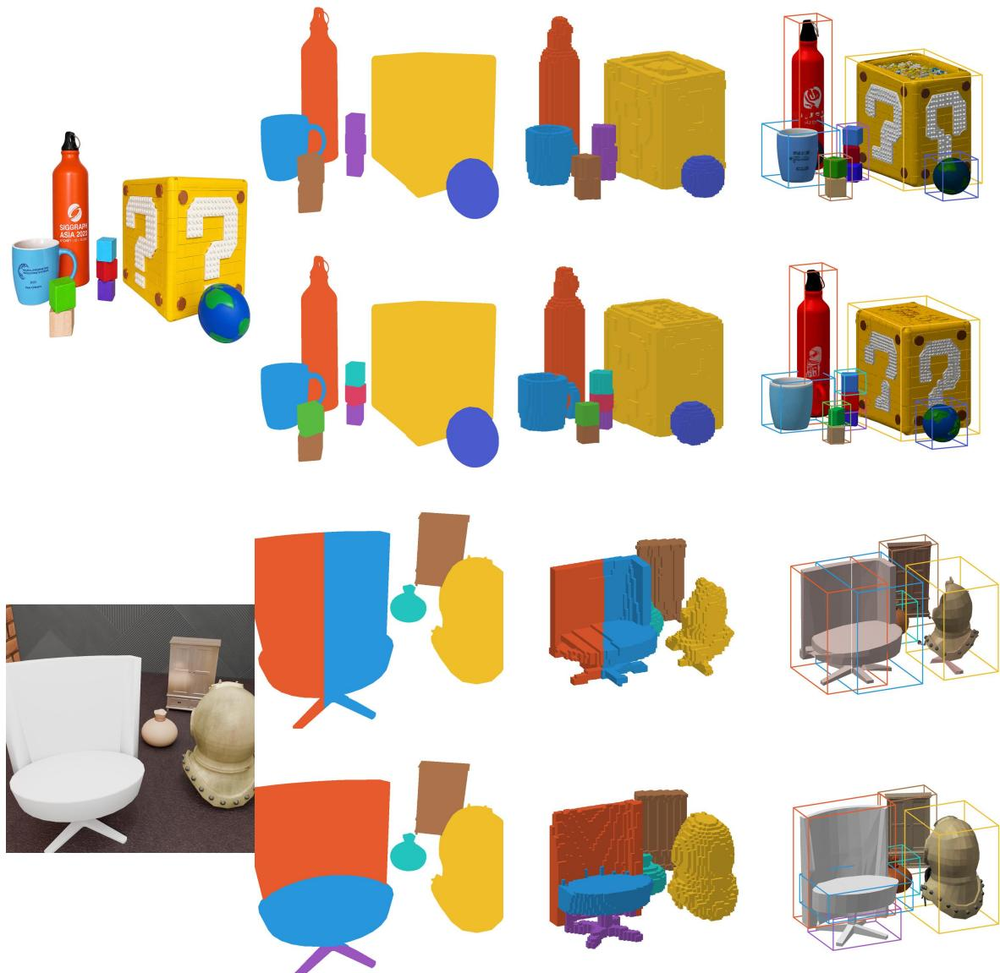

Figure 9 Robustness to instance segmentation granularity, label colors, and implausible partitions. From left to right: input image, input instance segmentation, predicted semantic voxel grid, and reconstructed textured meshes with bounding boxes. The first two rows show the same tabletop scene containing a bottle, a mug, a large box, a ball, and two small stacks of blocks. The segmentation changes only the grouping of these small stacks: each stack receives one label in the first row, while its individual blocks receive separate labels in the second row. The last two rows show deliberately implausible partitions of a chair, together with changes in instance label colors. Despite these inconsistent instance boundaries, Bri3D preserves the overall object geometry and spatial arrangement.

## References

[1] Andreea Ardelean, Mert Özer, and Bernhard Egger. Gen3dsr: Generalizable 3d scene reconstruction via divide and conquer from a single view. In 2025 International Conference on 3D Vision, pages 616–626, 2025.

[2] BlendSwap. BlendSwap: The blender community library. [Online]. Available: https://blendswap.com/. Accessed: Oct. 28, 2026.

[3] Xingyu Chen, Fu-Jen Chu, Pierre Gleize, Kevin J Liang, Alexander Sax, Hao Tang, Weiyao Wang, Michelle Guo, Thibaut Hardin, Xiang Li, Aohan Lin, Jia-Wei Liu, Ziqi Ma, Anushka Sagar, Bowen Song, Xiaodong Wang, Jianing Yang, Bowen Zhang, Piotr Dollár, Georgia Gkioxari, Matt Feiszli, and Jitendra Malik. SAM 3D: 3Dfy Anything in Images. In Proceedings of the IEEE/CVF Conference on Computer Vision and Pattern Recognition (CVPR), pages 7220–7232, June 2026.

[4] Yiwen Chen, Zhihao Li, Yikai Wang, Hu Zhang, Qin Li, Chi Zhang, and Guosheng Lin. Ultra3d: Eficient and high-fidelity 3d generation with part attention. arXiv preprint arXiv:2507.17745, 2025.

[5] Zhaoxi Chen, Guangcong Wang, and Ziwei Liu. Scenedreamer: Unbounded 3d scene generation from 2d image collections. IEEE transactions on pattern analysis and machine intelligence, 45(12):15562–15576, 2023.

[6] Tao Chu, Pan Zhang, Qiong Liu, and Jiaqi Wang. Buol: A bottom-up framework with occupancy aware lifting for panoptic 3d scene reconstruction from a single image. In Proceedings of the IEEE/CVF Conference on Computer Vision and Pattern Recognition, pages 4937–4946, 2023.

[7] Angela Dai, Angel X Chang, Manolis Savva, Maciej Halber, Thomas Funkhouser, and Matthias Nießner. Scannet: Richly-annotated 3d reconstructions of indoor scenes. In Proceedings of the IEEE conference on computer vision and pattern recognition, pages 5828–5839, 2017.

[8] Matt Deitke, Dustin Schwenk, Jordi Salvador, Luca Weihs, Oscar Michel, Eli VanderBilt, Ludwig Schmidt, Kiana Ehsani, Aniruddha Kembhavi, and Ali Farhadi. Objaverse: A universe of annotated 3d objects. In Proceedings of the IEEE/CVF Conference on Computer Vision and Pattern Recognition, pages 13142–13153, 2023.

[9] Matt Deitke, Ruoshi Liu, Matthew Wallingford, Huong Ngo, Oscar Michel, Aditya Kusupati, Alan Fan, Christian Laforte, Vikram Voleti, Samir Yitzhak Gadre, et al. Objaverse-xl: A universe of 10m+ 3d objects. Advances in Neural Information Processing Systems, 36, 2024.

[10] Wenqi Dong, Bangbang Yang, Zesong Yang, Yuan Li, Tao Hu, Hujun Bao, Yuewen Ma, and Zhaopeng Cui. Hiscene: creating hierarchical 3d scenes with isometric view generation. arXiv preprint arXiv:2504.13072, 2025.

[11] Fangyu Du, Yang Yang, Xuehao Gao, Hongye Hou, and Chen Sun. Hierarchical difusion for sparse-tofull human motion reconstruction. IEEE Signal Processing Letters, 33:2185–2189, 2026. doi: 10.1109/ LSP.2026.3694693.

[12] Huan Fu, Bowen Cai, Lin Gao, Ling-Xiao Zhang, Jiaming Wang, Cao Li, Qixun Zeng, Chengyue Sun, Rongfei Jia, Binqiang Zhao, et al. 3d-front: 3d furnished rooms with layouts and semantics. In Proceedings of the IEEE/CVF International Conference on Computer Vision, pages 10933–10942, 2021.

[13] Gege Gao, Weiyang Liu, Anpei Chen, Andreas Geiger, and Bernhard Schölkopf. Graphdreamer: Compositional 3d scene synthesis from scene graphs. In Proceedings of the IEEE/CVF Conference on Computer Vision and Pattern Recognition, pages 21295–21304, 2024.

[14] Can Gümeli, Angela Dai, and Matthias Nießner. Roca: Robust cad model retrieval and alignment from a single image. In Proceedings of the IEEE/CVF conference on computer vision and pattern recognition, pages 4022–4031, 2022.

[15] Martin Heusel, Hubert Ramsauer, Thomas Unterthiner, Bernhard Nessler, and Sepp Hochreiter. Gans trained by a two time-scale update rule converge to a local nash equilibrium. Advances in neural information processing systems, 30, 2017.

[16] Hongye Hou, Xuehao Gao, Zhan Liu, and Yang Yang. Dig into detailed structures: Key context encoding and semantic-based decoding for point cloud completion. In Proceedings of the 32nd ACM International Conference on Multimedia, pages 6686–6695, 2024. doi: 10.1145/3664647.3680565.

[17] Hongye Hou, Yang Yang, Zhan Liu, and Fangyu Du. Benefit from reference: Retrieval-augmented cross modal point cloud completion. Applied Soft Computing, 201:115626, 2026. doi: 10.1016/j.asoc.2026. 115626.

[18] Zehuan Huang, Yuan-Chen Guo, Xingqiao An, Yunhan Yang, Yangguang Li, Zi-Xin Zou, Ding Liang, Xihui Liu, Yan-Pei Cao, and Lu Sheng. Midi: Multi-instance difusion for single image to 3d scene generation. In Proceedings of the Computer Vision and Pattern Recognition Conference, pages 23646– 23657, 2025.

[19] Bernhard Kerbl, Georgios Kopanas, Thomas Leimkühler, and George Drettakis. 3d gaussian splatting for real-time radiance field rendering. ACM Trans. Graph., 42(4), 2023.

[20] Mukul Khanna, Yongsen Mao, Hanxiao Jiang, Sanjay Haresh, Brennan Shacklett, Dhruv Batra, Alexander Clegg, Eric Undersander, Angel X Chang, and Manolis Savva. Habitat synthetic scenes dataset (hssd-200): An analysis of 3d scene scale and realism tradeofs for objectgoal navigation. In Proceedings of the IEEE/CVF Conference on Computer Vision and Pattern Recognition, pages 16384–16393, 2024.

[21] Weicheng Kuo, Anelia Angelova, Tsung-Yi Lin, and Angela Dai. Mask2cad: 3d shape prediction by learning to segment and retrieve. In Computer Vision–ECCV 2020: 16th European Conference, Glasgow, UK, August 23–28, 2020, Proceedings, Part III 16, pages 260–277. Springer, 2020.

[22] Yangguang Li, Zi-Xin Zou, Zexiang Liu, Dehu Wang, Yuan Liang, Zhipeng Yu, Xingchao Liu, Yuan Chen Guo, Ding Liang, Wanli Ouyang, et al. Triposg: High-fidelity 3d shape synthesis using large-scale rectified flow models. arXiv preprint arXiv:2502.06608, 2025.

[23] Zhuoxiao Li, Xinyi Liu, Hongye Hou, Jing Ou, Kang Du, Shuai Zhang, Dongli Wu, Taoyu Wu, Siyuan Feng, Xiaohui Zhu, and Wufan Zhao. HoloRecon: Incremental reconstruction of long-range panoramas with global consistency. arXiv preprint arXiv:2610.36876, 2026. https://arxiv.org/abs/2610.36876.

[24] Yuchen Lin, Chenguo Lin, Panwang Pan, Honglei Yan, Yiqiang Feng, Yadong Mu, and Katerina Fragkiadaki. Partcrafter: Structured 3d mesh generation via compositional latent difusion transformers. arXiv preprint arXiv:2506.05573, 2025.

[25] Yaron Lipman, Ricky TQ Chen, Heli Ben-Hamu, Maximilian Nickel, and Matt Le. Flow matching for generative modeling. arXiv preprint arXiv:2210.02747, 2022.

[26] Haolin Liu, Yujian Zheng, Guanying Chen, Shuguang Cui, and Xiaoguang Han. Towards high-fidelity single-view holistic reconstruction of indoor scenes. In European Conference on Computer Vision, pages 429–446. Springer, 2022.

[27] Quan Meng, Lei Li, Matthias Nießner, and Angela Dai. Lt3sd: Latent trees for 3d scene difusion. In Proceedings of the Computer Vision and Pattern Recognition Conference, pages 650–660, 2025.

[28] Yanxu Meng, Haoning Wu, Ya Zhang, and Weidi Xie. Scenegen: Single-image 3d scene generation in one feedforward pass. arXiv preprint arXiv:2508.15769, 2025.

[29] Ben Mildenhall, Pratul P Srinivasan, Matthew Tancik, Jonathan T Barron, Ravi Ramamoorthi, and Ren Ng. Nerf: Representing scenes as neural radiance fields for view synthesis. Communications of the ACM, 65(1):99–106, 2021.

[30] Yinyu Nie, Xiaoguang Han, Shihui Guo, Yujian Zheng, Jian Chang, and Jian Jun Zhang. Total3dunderstanding: Joint layout, object pose and mesh reconstruction for indoor scenes from a single

image. In Proceedings of the IEEE/CVF Conference on Computer Vision and Pattern Recognition, pages 55–64, 2020.

[31] Maxime Oquab, Timothée Darcet, Théo Moutakanni, Huy Vo, Marc Szafraniec, Vasil Khalidov, Pierre Fernandez, Daniel Haziza, Francisco Massa, Alaaeldin El-Nouby, et al. Dinov2: Learning robust visual features without supervision. arXiv preprint arXiv:2304.07193, 2023.

[32] William Peebles and Saining Xie. Scalable difusion models with transformers. In Proceedings of the IEEE/CVF international conference on computer vision, pages 4195–4205, 2023.

[33] Alec Radford, Jong Wook Kim, Chris Hallacy, Aditya Ramesh, Gabriel Goh, Sandhini Agarwal, Girish Sastry, Amanda Askell, Pamela Mishkin, Jack Clark, et al. Learning transferable visual models from natural language supervision. In International conference on machine learning, pages 8748–8763, 2021.

[34] Xuanchi Ren, Jiahui Huang, Xiaohui Zeng, Ken Museth, Sanja Fidler, and Francis Williams. Xcube: Large-scale 3d generative modeling using sparse voxel hierarchies. In Proceedings of the IEEE/CVF conference on computer vision and pattern recognition, pages 4209–4219, 2024.

[35] Yawar Siddiqui, Antonio Alliegro, Alexey Artemov, Tatiana Tommasi, Daniele Sirigatti, Vladislav Rosov, Angela Dai, and Matthias Nießner. Meshgpt: Generating triangle meshes with decoder-only transformers. In Proceedings of the IEEE/CVF conference on computer vision and pattern recognition, pages 19615– 19625, 2024.

[36] Dmitry Tochilkin, David Pankratz, Zexiang Liu, Zixuan Huang, Adam Letts, Yangguang Li, Ding Liang, Christian Laforte, Varun Jampani, and Yan-Pei Cao. Triposr: Fast 3d object reconstruction from a single image. arXiv preprint arXiv:2403.02151, 2024.

[37] Shuang Wu, Youtian Lin, Feihu Zhang, Yifei Zeng, Jingxi Xu, Philip Torr, Xun Cao, and Yao Yao. Direct3d: Scalable image-to-3d generation via 3d latent difusion transformer. arXiv preprint arXiv:2405.14832, 2024.

[38] Shuang Wu, Youtian Lin, Feihu Zhang, Yifei Zeng, Yikang Yang, Yajie Bao, Jiachen Qian, Siyu Zhu, Xun Cao, Philip Torr, et al. Direct3d-s2: Gigascale 3d generation made easy with spatial sparse attention. arXiv preprint arXiv:2505.17412, 2025.

[39] Jianfeng Xiang, Zelong Lv, Sicheng Xu, Yu Deng, Ruicheng Wang, Bowen Zhang, Dong Chen, Xin Tong, and Jiaolong Yang. Structured 3d latents for scalable and versatile 3d generation. In Proceedings of the Computer Vision and Pattern Recognition Conference, pages 21469–21480, 2025.

[40] Jianfeng Xiang, Xiaoxue Chen, Sicheng Xu, Ruicheng Wang, Zelong Lv, Yu Deng, Hongyuan Zhu, Yue Dong, Hao Zhao, Nicholas Jing Yuan, et al. Native and compact structured latents for 3d generation. In Proceedings of the IEEE/CVF Conference on Computer Vision and Pattern Recognition, pages 14419– 14429, 2026.

[41] Kaixin Yao, Longwen Zhang, Xinhao Yan, Yan Zeng, Qixuan Zhang, Lan Xu, Wei Yang, Jiayuan Gu, and Jingyi Yu. Cast: Component-aligned 3d scene reconstruction from an rgb image. ACM Transactions on Graphics, 44(4):1–19, 2025.

[42] Chongjie Ye, Yushuang Wu, Ziteng Lu, Jiahao Chang, Xiaoyang Guo, Jiaqing Zhou, Hao Zhao, and Xiaoguang Han. Hi3DGen: High-fidelity 3D geometry generation from images via normal bridging. In Proceedings of the IEEE/CVF International Conference on Computer Vision, pages 25050–25061, 2025.

[43] Biao Zhang, Jiapeng Tang, Matthias Niessner, and Peter Wonka. 3dshape2vecset: A 3d shape repre sentation for neural fields and generative difusion models. ACM Transactions On Graphics, 42(4):1–16, 2023.

[44] Longwen Zhang, Ziyu Wang, Qixuan Zhang, Qiwei Qiu, Anqi Pang, Haoran Jiang, Wei Yang, Lan Xu, and Jingyi Yu. Clay: A controllable large-scale generative model for creating high-quality 3d assets. ACM Transactions on Graphics, 43(4):1–20, 2024.

[45] Richard Zhang, Phillip Isola, Alexei A Efros, Eli Shechtman, and Oliver Wang. The unreasonable efectiveness of deep features as a perceptual metric. In Proceedings of the IEEE conference on computer vision and pattern recognition, pages 586–595, 2018.

[46] Shuai Zhang, Hongye Hou, Qinghe Liu, Zhuoxiao Li, Dongli Wu, Jing Ou, Yuan Liu, and Wufan Zhao. CitySTAR: Structured and topology-aware reasoning for open-vocabulary urban 3D grounding. arXiv preprint arXiv:2609.19911, 2026. https://arxiv.org/abs/2609.19911.

[47] Qingcheng Zhao, Xiang Zhang, Haiyang Xu, Zeyuan Chen, Jianwen Xie, Yuan Gao, and Zhuowen Tu. Depr: Depth guided single-view scene reconstruction with instance-level difusion. In Proceedings of the IEEE/CVF International Conference on Computer Vision, pages 5722–5733, 2025.

## A Architectural Details

## A.1 Preliminary: TRELLIS

TRELLIS [39] introduces Sparse Structured Latents (SLATs) for eficient 3D generation, representing a shape as $z _ { \mathrm { s l a t } } = \{ ( z _ { i } , \mathbf { p } _ { i } ) \} _ { i = 1 } ^ { L }$ , where $z _ { i } \in \mathbb { R } ^ { c }$ is a latent feature associated with spatial position $\mathbf { p } _ { i } \in \mathbb { R } ^ { 3 }$ , and $L \ll N ^ { 3 }$ ensures structural sparsity. The framework adopts a two-stage generation process: sparse voxel generation for coarse object structure, followed by structural latent generation for subsequent decoding into diverse 3D representations such as Meshes, NeRFs [29] and 3D Gaussians [19].

In the first stage, TRELLIS learns a compact representation of sparse voxel structures using a geometry VAE. Given occupied voxels $\left\{ \mathbf { p } _ { i } \right\}$ , we first embed them into a dense occupancy grid $V ,$ which serves as input to the encoder $E _ { \mathrm { g e o } }$ . The decoder $D _ { \mathrm { g e o } }$ reconstructs the structure as an occupancy field:

$$
z _ { \mathrm { g e o } } = E _ { \mathrm { g e o } } ( V ) , \quad \hat { V } = D _ { \mathrm { g e o } } ( z _ { \mathrm { g e o } } ) ,\tag{S1}
$$

and the final set of occupied voxels is extracted from $\hat { V }$ . A geometry flow transformer $F _ { \mathrm { g e o } }$ [25, 32] generates $z _ { \mathrm { g e o } }$ from noise ϵ, conditioned on an input image I and flow time t:

$$
F _ { \mathrm { g e o } } : ( \epsilon , t , I ) \mapsto z _ { \mathrm { g e o } } ,\tag{S2}
$$

enabling structured 3D shape synthesis from 2D inputs.

Given the decoded positions $\left\{ { \bf p } _ { i } \right\}$ , structured noise $\epsilon _ { \mathrm { a p p } } = \{ ( \epsilon _ { i } , { \bf p } _ { i } ) \}$ is constructed by associating random noise vectors $\epsilon _ { i }$ with each spatial location. A structured-latent flow transformer $F _ { \mathrm { a p p } }$ then predicts $z _ { \mathrm { s l a t } } \mathrm { : }$

$$
F _ { \mathrm { a p p } } : ( \epsilon _ { \mathrm { a p p } } , t , I ) \mapsto z _ { \mathrm { s l a t } } , \quad O = D _ { \mathrm { a p p } } ( z _ { \mathrm { s l a t } } ) ,\tag{S3}
$$

where $D _ { \mathrm { a p p } }$ decodes appearance and O is the final output. Bri3D leverages this two-stage interface by replacing object-level voxel generation with scene-level scafold prediction and anchored voxel refinement, while keeping the detail-synthesis module frozen.

## A.2 Implementation Details

## A.2.1 Structure-Color VAE Architecture

The SC-VAE encodes and decodes the four-channel occupancy and instance-color representation defined in Section 3.2. Each 3D-FRONT instance receives a unique color, while Objaverse-XL objects are partitioned into 1–6 K-means clusters with distinct colors.

The four-channel representation encodes geometric occupancy and instance identity in a shared latent space. The SC-VAE reconstructs both channels of information, with voxel reconstruction supervising the 3D volume and the rendering loss supervising projected instance boundaries. This representation supplies the scafold generator with a spatially organized target that retains the distinction between touching objects.

The core of our generative stages employs a DiT-based architecture. Specifically, the Scene Scafold Generator consists of 24 DiT blocks that jointly process appearance and instance-layout features extracted from the RGB image and its color-coded label map. The Color-Attention Gating module in each cross-attention block adaptively fuses the two conditioning modalities, linking appearance cues with instance-layout evidence.

## A.2.2 Instance Extraction from the Scene Scafold

The joint position–color DBSCAN procedure is described in Section 3.3. Its output clusters supply the object anchors used by the refiner; the training-time K-means labels serve a separate data-construction purpose.

## A.2.3 Scene-Anchored Latent Refinement

For the Anchored Voxel Refiner, we adopt a rectified flow matching strategy to support enhancement in the latent space. Specifically, the object-scale SC-VAE encoder $E _ { \mathrm { S C } } ^ { o }$ first encodes the coarse object voxel cluster $x _ { c i }$ extracted from the scene scafold into a structural latent, and Gaussian noise is injected to construct the scene-anchored latent initialization $z _ { i } ^ { 0 } = \mathcal { N } _ { i } [ E _ { \mathrm { S C } } ^ { o } ( x _ { c i } ) ] + \lambda \epsilon _ { i }$ with $\epsilon _ { i } \sim \mathcal { N } ( 0 , I )$ . Its encoded component preserves the scafold-derived pose and coarse geometry, while the noise provides the flexibility required to recover missing and unobserved structures.

For each object, we compute the per-channel mean $\pmb { \mu } _ { i }$ and standard deviation $\sigma _ { i }$ over the spatial positions of its coarse anchor latent $E _ { \mathrm { S C } } ^ { o } ( \mathbf { x } _ { i } ^ { c } )$ . We save these statistics and use the same transformation for the coarse latent and the corresponding GT target latent:

$$
\mathcal { N } _ { i } ( \mathbf { z } ) = \frac { \mathbf { z } - \pmb { \mu } _ { i } } { \pmb { \sigma } _ { i } + \varepsilon } ,\tag{S4}
$$

where $\varepsilon$ is a small numerical stability constant. Gaussian noise is added after normalization, as in Eq. 5. During training, we sample a time step $t \in [ 0 , 1 ]$ and construct the intermediate latent state ${ \bf z } ( t )$ by interpolating between the scene-anchored initialization $\mathbf { z } _ { 0 }$ and the target clean latent $\mathbf { z } _ { 1 }$ , i.e., the GT object latent normalized using the same coarse-anchor statistics:

$$
{ \bf z } ( t ) = ( 1 - t ) { \bf z } _ { 0 } + t { \bf z } _ { 1 } , \quad t \sim \mathcal { U } [ 0 , 1 ] .\tag{S5}
$$

The model is then trained to predict the velocity field pointing towards the target $\mathbf { z } _ { 1 }$ . The learned flow transforms the scene-anchored initialization into detailed voxel geometry under object image conditioning. The coarse anchor enters through the latent initialization. Before decoding, we restore the refined latent with the saved statistics:

$$
\mathcal { N } _ { i } ^ { - 1 } ( \hat { \mathbf { z } } _ { i } ) = ( \pmb { \sigma } _ { i } + \varepsilon ) \odot \hat { \mathbf { z } } _ { i } + \pmb { \mu } _ { i } .
$$

At inference, these statistics are computed from the input anchor.

Pose preservation and scene composition As defined in Section 3.3, pose preservation means retaining the anchor-defined spatial reference. The original center and isotropic scale are reused in Eq. 4 to map each generated object back into the scene, without additional pose estimation or registration and without re-normalizing the output bounding box. Geometry may change within this fixed coordinate reference.

## B Training Details

## B.1 Data Construction

We utilize the Objaverse-XL [9] and 3D-FRONT [12] datasets to construct our training corpus. Ground truth representations are prepared as color-coded voxel grids to supervise the SC-VAE. Training combines image conditioning with voxel and rendering supervision:

1. View-Consistent Supervision: We render ground-truth 3D scenes from the input camera pose to produce the RGB view and its color-coded instance label map. Both images condition the Scene Scafold Generator; only the color-coded instance label map supervises the rendering consistency loss $( \mathcal { L } _ { \mathrm { r e n d e r } } )$

2. Latent Space Supervision: The 4-channel color-coded voxel grids serve as the direct reconstruction target for the SC-VAE, providing dense supervision for learning the structured latent prior.

The multi-resolution coarse conditions and their $6 4 ^ { 3 }$ encoder inputs are defined in Section 3.3. The objectlevel corpus size and scene-level data source are reported separately in Section 4.1.

## B.2 Computational Details

We implement the models in $\mathrm { P y }$ Torch with Distributed Data Parallel (DDP). Training uses the hardware and hyperparameters reported in Section 4.1. The total training duration is one week, corresponding to 2,688 GPU-hours, and the model has 555.7 million parameters. Inference timing in Table 3 is measured on a single NVIDIA A800 GPU. Bri3D uses 25 sampling steps and processes object instances in parallel.

## C Additional Evaluation Details

## C.1 Cross-Dataset Evaluation Set

The scene sources, manual selection, and multi-view input rendering are described in Section 4.1. Table 2 evaluates the combined set; multiple views of one scene are distinct single-image reconstruction inputs.

## C.2 Geometric Evaluation Protocol

We follow the geometric evaluation settings of MIDI [18] for Chamfer Distance (CD), F-Score, and bounding box IoU (BBox IoU). We use MIDI’s evaluation implementation and settings for point sampling, distance computation, and instance matching across the compared methods. The F-Score distance threshold is 0.1 in the evaluation coordinate system. CD and F-Score are evaluated at both the scene and object levels, while bounding-box IoU measures agreement between corresponding axis-aligned object bounding boxes. For Bri3D, these are the scafold-derived anchor boxes retained throughout refinement and detail synthesis, measuring the layout established by the scafold. CD and F-Score evaluate the geometry produced by each stage. Throughout Tables 1, 2, and 4, CD-S and CD-O denote scene- and object-level CD, respectively, and are reported as 100× the unscaled distances. F-S and F-O denote scene- and object-level F-Score and are reported as percentages. BBox IoU is reported on the [0, 1] scale. Collision rates in Table 3 are percentages of overlapping object pairs, obtained by multiplying the overlap fraction by 100; for example, a fraction of 0.04 is reported as 4%. For Bri3D, we extract the scafold instances and voxelize them separately in the shared scene coordinate system before refinement. Collision detection compares the resulting instance occupancies in this common coordinate system.