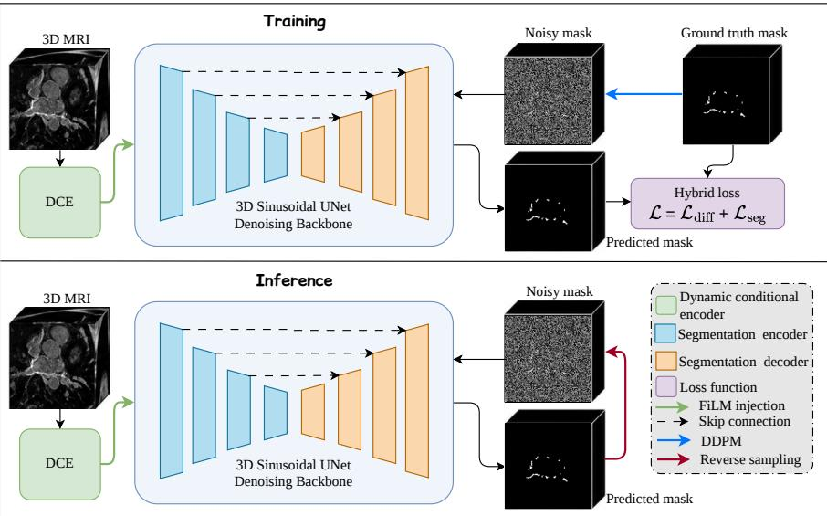
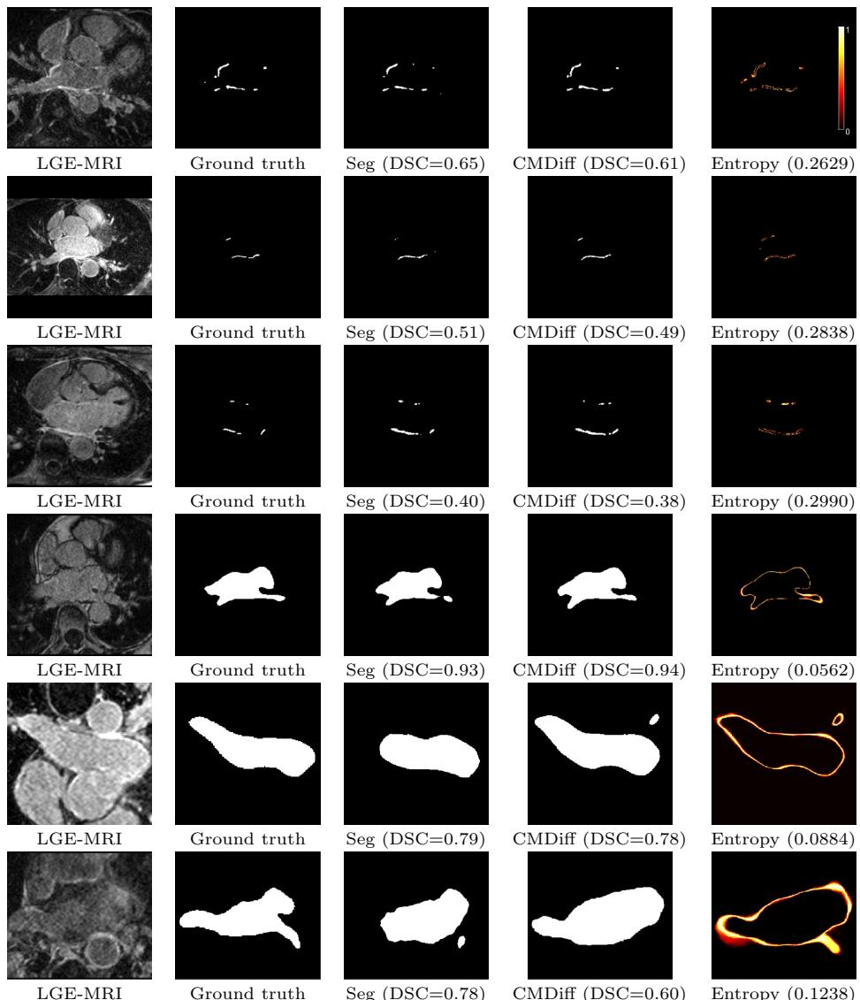
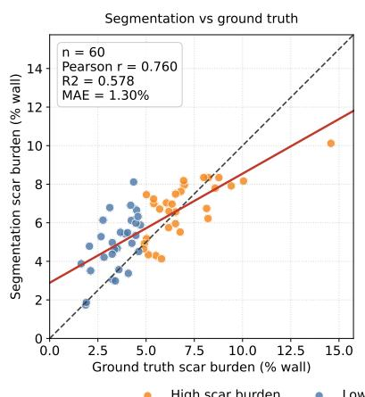
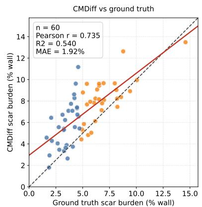
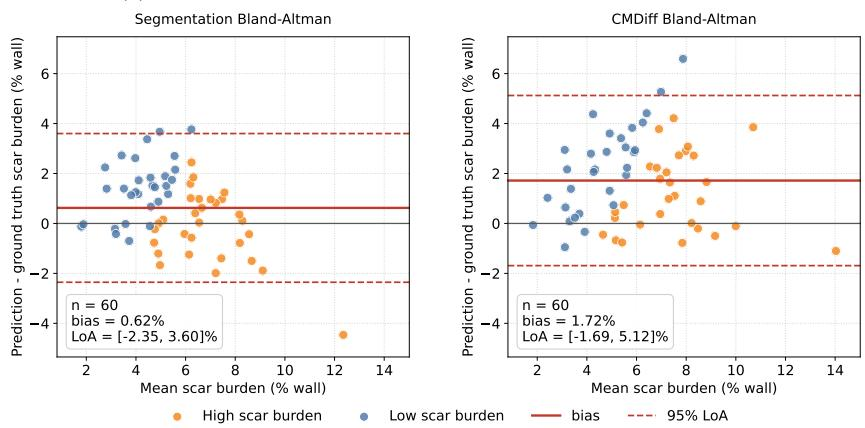

# CMDif: Left Atrial Scar Segmentation from 3D LGE MRI Using Conditional Mask Difusion Model: A Feasibility Study

Jing Zhang1 Bastien Bergere1 Jonas Leite1 Emilie Bollache1 Mika¨el Laredo1,2 Alban Redheuil1,3 Nadjia Kachenoura1

1 Laboratoire d’Imagerie Biom´edicale (LIB), Sorbonne Universit´e, INSERM, CNRS, Paris, France

2 APHP, Institut de Cardiologie, Hˆopital Piti´e-Salpˆetri\`ere, Paris, France 3 APHP, Imagerie Cardiovasculaire et Thoracique, Institut de Cardiologie, Hˆopital Piti´e-Salpˆetri\`ere, Paris, France

Abstract. Late gadolinium enhancement (LGE) cardiac MRI enables non-invasive assessment of left atrial (LA) scar, an imaging marker associated with atrial fibrillation ablation outcome. However, automatic scar segmentation is hindered by low contrast, the thin atrial wall, scarce labels, and extreme class imbalance. Conditional difusion ofers iterative mask generation, but its suitability for sparse 3D LA scar segmentation remains unclear. To address this gap, we propose Conditional Mask Difusion (CMDif), which predicts clean masks using a dynamicencoder-conditioned 3D sinusoidal UNet. We compared CMDif with a deterministic baseline on identical cases in five-fold cross-validation of 60 scar-labelled public LASCARQS subjects, with 48 training and 12 held-out cases per fold. CMDif achieved a scar DSC of $0 . 4 7 \pm 0 . 0 8$ HD95 of $1 2 . 8 9 \pm 6 . 3 9$ mm, and ASD of $1 . 9 1 \pm \ : 0 . 9 6$ mm, compared with deterministic baseline values of $0 . 5 1 \pm 0 . 0 8 , 1 0 . 8 6 \pm 5 . 3 9$ mm, and $1 . 5 8 \pm 1 . 0 3$ mm, respectively. Under the same implementation, clean mask prediction performed substantially better than the noise-prediction configuration evaluated in this study. Thus, CMDif was technically feasible but did not improve segmentation performance: DSC was lower, and both HD95 and ASD were higher. Direct mask difusion therefore provides an analytical alternative, but not a competitive performance advance for this task. The source code is publicly available at https://github.com/jizhang02/CMDiff.

Keywords: Atrial fibrillation, left atrial scar, LGE-MRI, difusion probabilistic model, segmentation.

## 1 Introduction

Atrial fibrillation (AF) is the most prevalent sustained cardiac arrhythmia, afecting an estimated 37.6 million people worldwide and increasing the risks of stroke, heart failure, and mortality [1]. Catheter ablation is an established rhythm-control therapy for symptomatic AF, but recurrence remains common. Because the burden and spatial distribution of left atrial (LA) fibrosis have been associated with ablation outcome [2], late gadolinium enhancement (LGE) cardiac MRI may help characterise the atrial substrate before treatment and scar after treatment [3].

Converting LGE-MRI into reliable scar maps is nevertheless dificult. Scarrelated signal is subtle and confined to the thin LA wall (∼2–4 mm), where it can resemble enhancement from the blood pool or adjacent tissue. Scar voxels are also sparse, manual boundaries vary between observers, and image appearance difers across patients, scanners, and acquisition protocols [4]. These constraints motivate segmentation methods that combine local LGE appearance with explicit anatomical context.

Early approaches treated scar mainly as an intensity outlier, using thresholding or standardised intensity rules [5, 6]. Convolutional encoder–decoder models then learned appearance and volumetric context directly from images [7–9], while nnU-Net provided a strong self-configuring baseline [10]. Cardiac-specific methods further combined learned scar likelihoods with graph-cut regularisation, multiview information, attention, spatial encoding, or joint LA–scar objectives [11–17].

More recent methods increasingly constrain scar to the LA wall. A boundaryfocused nnU-Net used the predicted LA distance map and reported a scar DSC of 64.08% on public LASCARQS dataset [18]; an anatomy-conditioned two-stage pipeline combined cavity and wall signed-distance maps with wallrestricted, boundary-aware supervision and reported 61.1% [19]. Our prior work similarly used a coarse LA prediction to constrain SwinUNETR-based scar delineation [20–22]. These values are contextual rather than directly comparable because data partitions, model selection, and evaluation implementations may difer. Collectively, however, they show that deterministic performance depends strongly on how anatomy is incorporated.

These anatomy-aware models remain deterministic: each image produces one mask. Difusion models ofer a diferent formulation by reversing a gradual noising process from diferent noise initialisations [23]. Applied to segmentation, the mask is denoised while the medical image supplies the condition. This principle has supported implicit segmentation ensembles [24], noise-prediction and dynamicconditioning models [25, 26], and distributions of plausible masks learned from multiple expert annotations [27].

Within cardiac imaging, difusion has been used to enhance left-ventricular scar contrast [28] and generate synthetic atrial fibrosis distributions [29], rather than segment patient-specific LA scar masks. Whether a 3D mask-denoising process can recover LA scar directly from LGE-MRI therefore remains unresolved.

To address this gap, we study difusion as an alternative rather than a presumed replacement for deterministic segmentation. We test whether 3D Conditional Mask Difusion (CMDif) can approach a matched deterministic baseline, identify efective and inefective design choices under a common implementation, and describe repeated-sample variability without treating it as calibrated uncertainty. CMDif predicts the clean mask at each denoising step to align the difusion output with the sparse binary target.

This paper makes the following contributions:

1. We present CMDif, to our knowledge the first task-specific feasibility and failure-mode study of 3D LA scar segmentation formulated as mask difusion conditioned on the LGE image.

2. We compare clean-mask and noise-prediction parameterisations under the same implementation and show that only clean-mask prediction produces useful scar masks in this experimental configuration.

3. We use a lightweight Dynamic Conditional Encoder (DCE) to inject multiscale LGE features into the denoising process.

4. We conduct target, conditioning, and sampler ablations; compare CMDif with a specialised deterministic LA scar segmentation model on identical held-out cases; and describe stochastic sample disagreement through entropy and variance maps.

## 2 Methods

CMDif treats the scar mask, rather than the LGE image, as the variable in a conditional difusion process. During training, Gaussian noise is added to the binary mask and the network learns to recover its clean form from the noisy mask, timestep, and LGE image. During inference, the learned reverse process transforms a random mask into a segmentation. Figure 1 summarises this workflow; the following subsections define the difusion target, image conditioning, and optimisation objective.

## 2.1 Conditional mask difusion model (CMDif)

Let $\pmb { x } \in \mathbb { R } ^ { D \times H \times W }$ denote a 3D LGE-MRI patch and $\pmb { y } \in \{ 0 , 1 \} ^ { D \times H \times W }$ the corresponding binary scar mask. Following DDPMs [23], we learn a denoising model gθ that reverses a gradual Gaussian noising process. To make the binary mask compatible with zero-centred Gaussian difusion, we map y from {0, 1} to $\pmb { y } _ { 0 } = 2 \hat { \pmb { y } } - 1 \in \{ - 1 , + 1 \} ^ { D \times H \times W }$ , where −1 and +1 denote background and scar voxels, respectively. Gaussian noise is then progressively added to $\pmb { y } _ { 0 }$ in the forward difusion process for timestep $t \in \{ 1 , \ldots , T \}$

$$
q ( \pmb { y } _ { t } \mid \pmb { y } _ { 0 } ) = \mathcal { N } \big ( \sqrt { \bar { \alpha } _ { t } } \pmb { y } _ { 0 } , ( 1 - \bar { \alpha } _ { t } ) \mathbf { I } \big )\tag{1}
$$

where $\begin{array} { r } { \bar { \alpha } _ { t } = \prod _ { s = 1 } ^ { t } ( 1 - \beta _ { s } ) } \end{array}$ and $\{ \beta _ { t } \} _ { t = 1 } ^ { T }$ is a linear noise schedule with $\beta _ { 1 } = 5 \times 1 0 ^ { - 4 }$ $\beta _ { T } = 1 . 9 5 \times \bar { 1 0 ^ { - 2 } } , T = 1 0 0 0$

In standard DDPM training, the denoising network is often parameterised to predict the injected Gaussian noise ϵ, which is efective for continuous image

  
Fig. 1: Overview of the proposed CMDif framework for 3D LGE-MRI scar segmentation. During training, noise is added to the ground-truth mask and the denoising backbone learns to recover the clean scar mask conditioned on the LGE image. During inference, a noisy mask is iteratively denoised through the sampling scheduler, while the DCE provides multi-scale image conditioning to the 3D sinusoidal UNet.

generation. Under this parameterisation, a noise-prediction network $\epsilon _ { \theta }$ is trained to approximate ϵ from the noisy sample, timestep, and condition:

$$
\epsilon _ { \theta } ( \pmb { y } _ { t } , t , \pmb { x } ) \approx \epsilon\tag{2}
$$

and the clean sample is recovered indirectly as:

$$
\hat { \pmb { y } } _ { 0 } = \frac { \pmb { y } _ { t } - \sqrt { 1 - \bar { \alpha } _ { t } } \epsilon _ { \theta } ( \pmb { y } _ { t } , t , \pmb { x } ) } { \sqrt { \bar { \alpha } _ { t } } }\tag{3}
$$

For LA scar segmentation, however, the target is a sparse binary mask rather than a natural image, and the main objective is accurate voxel classification under severe class imbalance. In contrast to the conventional noise-prediction network $\epsilon _ { \theta } .$ , we therefore parameterise CMDif $g _ { \theta }$ to directly predict the clean mask $\hat { \pmb y } _ { 0 }$ conditioned on the noisy mask $\pmb { y } _ { t }$ and the LGE image x.

$$
\hat { { \pmb y } } _ { 0 , \theta } = g _ { \theta } ( { \pmb y } _ { t } , t , f _ { \phi } ( { \pmb x } ) )\tag{4}
$$

where $f _ { \phi }$ denotes the DCE image encoder introduced in Sec. 2.2. This parameterisation aligns the difusion output with the segmentation target and permits direct supervision with the losses in Sec. 2.3. We test it as a task-specific design hypothesis against noise prediction, for which the clean mask is recovered indirectly through the scheduler equation.

## 2.2 Network architecture and image conditioning

The denoising network combines the current noisy mask with anatomical and intensity information from LGE-MRI. A residual 3D U-Net-style backbone with sinusoidal timestep embeddings, denoted SinUNet3D [8, 9], receives $[ { \pmb y } _ { t } , { \pmb x } ] \in$ $\mathbb { R } ^ { 2 \times D \times H \times W }$ and predicts $\hat { \mathbf { y } } _ { 0 }$ . The timestep embedding identifies the current noise level.

Because input concatenation alone does not provide LGE features at every resolution, we add a lightweight Dynamic Conditional Encoder (DCE), following prior difusion segmentation work [25]. The DCE processes the LGE image x and produces feature maps at multiple spatial resolutions. These features are combined with the timestep embedding to generate channel-wise scaling and shifting parameters, which modulate the normalised UNet features in a Feature-wise Linear Modulation (FiLM)-like manner [30]. Modulation is applied at multiple UNet stages, and the FiLM output layers are zero-initialised so that the DCE initially behaves close to an identity transformation. The resulting model $g _ { \theta } = ( \mathrm { S i n U N e t 3 D } , f _ { \phi } )$ jointly adapts to LGE appearance and difusion timestep.

## 2.3 Training and inference

Given the clean-mask target, training combines difusion reconstruction with segmentation supervision. The difusion component penalises the discrepancy between $\hat { \mathbf { y } } _ { 0 }$ and $\pmb { y } _ { 0 }$ . We use a signal-to-noise-ratio (SNR)-weighted MSE loss [31]:

$$
\mathcal { L } _ { \mathrm { d i f f } } ( t ) = \frac { \mathrm { S N R } ( t ) } { 1 + \mathrm { S N R } ( t ) } \left\| \hat { \pmb y } _ { 0 } - { \pmb y } _ { 0 } \right\| _ { 2 } ^ { 2 }\tag{5}
$$

where $\mathrm { S N R } ( t ) = \bar { \alpha } _ { t } / ( 1 - \bar { \alpha } _ { t } )$ . This weighting reduces the influence of very noisy timesteps, where the clean mask is weakly recoverable, and gives greater emphasis to denoising states that provide more informative supervision.

The segmentation term applies soft Dice and weighted binary cross-entropy (BCE) to $\hat { p } = \sigma ( \hat { \pmb y } _ { 0 } )$ to address foreground–background imbalance. Because voxelwise segmentation losses are most informative when the noisy mask remains suficiently close to the clean target, we modulate this term by a timestepdependent factor:

$$
{ \mathcal { L } } _ { \mathrm { s e g } } ( t ) = \left( 1 - { \frac { t } { T } } \right) \left( \lambda _ { \mathrm { D i c e } } { \mathcal { L } } _ { \mathrm { D i c e } } + \lambda _ { \mathrm { B C E } } { \mathcal { L } } _ { \mathrm { B C E } } \right)\tag{6}
$$

The final objective combines the difusion reconstruction term and the timestepweighted segmentation term:

$$
\mathcal { L } ( t ) = \mathcal { L } _ { \mathrm { d i f f } } ( t ) + \lambda _ { \mathrm { s e g } } \mathcal { L } _ { \mathrm { s e g } } ( t )\tag{7}
$$

Here, $( 1 - t / T )$ controls how strongly the segmentation loss is applied across difusion timesteps, whereas $\lambda _ { \mathrm { s e g } }$ controls the overall contribution of segmentation supervision relative to the difusion loss. In all experiments, we set $\lambda _ { \mathrm { D i c e } } = 0 . 8$ $\lambda _ { \mathrm { B C E } } = 0 . 2$ , and $\lambda _ { \mathrm { s e g } } = 0 . 5$

At inference, CMDif applies the reverse process to a random mask conditioned on the LGE image. We average $N = 3$ independent soft predictions and binarise the result at zero. To assess the accuracy–cost trade-of, we compare DDIM [32], DPM-Solver++ [33], Euler Discrete, and UniPC [34] across diferent step counts.

## 3 Experiments

## 3.1 Dataset and preprocessing

All experiments use the public LASCARQS 2022 dataset of 3D LGE-MRI from patients with AF [35]. Of 130 subjects with LA anatomy labels, 60 also have scar annotations. Accordingly, separate fixed five-fold partitions are used for the two tasks. Each scar fold contains 48 training and 12 held-out subjects, stratified by scar burden; each LA fold contains 104 and 26, respectively. Within each task, CMDif and the deterministic baseline use identical held-out cases. Images are resampled to $0 . 6 2 5 \times 0 . 6 2 5 \times 2 . 5 \mathrm { { m m ^ { 3 } } }$ and cropped around the LA to $6 0 \times 3 8 4 \times 2 5 6 \times 4 0$ voxels. Data augmentation by MONAI library [36] comprises random bias field, elastic deformation, rotation, zoom, smoothing, contrast adjustment, intensity shift, and Gaussian noise. Patch size uses $2 8 8 \times 1 9 2 \times 3 2$

## 3.2 Implementation details

Training is performed on an NVIDIA RTX A6000 GPU for 3000 epochs. AdamW uses weight decay $1 0 ^ { - 5 }$ , a 500-step linear warmup, and cosine annealing to $1 0 ^ { - 6 }$ A 20-step DDIM sampler is used for validation and model selection [32]; the broader scheduler benchmark is performed after training. An exponential moving average of the weights with decay 0.9999 is used for validation and inference.

## 3.3 Evaluation metrics

We report Dice similarity coeficient (DSC) for overlap, 95th-percentile Hausdorf distance (HD95) for worst-case boundary error, and average surface distance (ASD) for mean boundary error. Surface distances are calculated in millimetres using the resampled spacing; inference time is reported per subject. Unless stated otherwise, segmentation results are summarised as the mean ± standard deviation across held-out subjects.

## 3.4 Stochastic prediction variability analysis

To analyse within-model variability beyond the $N = 3$ samples used for segmentation, we generate $K = 2 0$ predictions per held-out case from independent Gaussian masks. Each clean-mask prediction $\hat { \pmb { y } } _ { 0 } ^ { ( k ) } \in [ - 1 , 1 ]$ is mapped to

$\pmb { p } ^ { ( k ) } = ( \hat { \pmb { y } } _ { 0 } ^ { ( k ) } + 1 ) / 2$ , with mean $\begin{array} { r } { \bar { \pmb { p } } = { \cal K } ^ { - 1 } \sum _ { k = 1 } ^ { K } \pmb { p } ^ { ( k ) } } \end{array}$ . The mean is thresholded at 0.5. Variance measures disagreement across predictions:

$$
\mathrm { V a r } ( \pmb { p } ) = \frac { 1 } { K } \sum _ { k = 1 } ^ { K } \left( \pmb { p } ^ { ( k ) } - \bar { \pmb { p } } \right) ^ { 2 }\tag{8}
$$

The corresponding standard deviation is $\operatorname { S t d } ( \pmb { p } ) = \sqrt { \operatorname { V a r } ( \pmb { p } ) }$ . Binary entropy measures how close the mean prediction is to 0.5:

$$
\mathscr { H } ( \bar { p } ) = - \bar { p } \log _ { 2 } ( \bar { p } ) - ( 1 - \bar { p } ) \log _ { 2 } ( 1 - \bar { p } )\tag{9}
$$

with probabilities clipped for numerical stability. For the deterministic baseline, $K = 2 0$ predictions are obtained with Monte Carlo dropout. Both models use the same foreground-restricted entropy and variance summaries because wholevolume values are dominated by background. These quantities describe sampling dispersion; they are not calibrated error probabilities.

## 4 Results

We first test the prediction target, then evaluate image conditioning and sampler choice, and finally compare CMDif with the deterministic baseline at segmentation and scar-burden levels.

## 4.1 Segmentation performance of CMDif

Table 1 compares clean-mask and noise prediction under the same loss design, training schedule, DCE conditioning, and 20-step DDIM inference. The noiseprediction variant yields near-zero DSC and large surface distances, whereas clean-mask prediction reaches a DSC of 0.4675 and substantially lower boundary errors. We therefore use clean-mask prediction in the remaining experiments.

Table 1: Clean-mask prediction vs. noise prediction under the matched implementation used in this study. Both models use DCE and DDIM with 20 inference steps.
<table><tr><td>Prediction target</td><td>DSC ↑</td><td>HD95↓</td><td>ASD↓</td></tr><tr><td>Noise €</td><td> $0 . 0 0 0 6 \pm 0 . 0 0 0 3$ </td><td> $9 2 . 6 1 6 7 \pm 4 . 2 4 9 1$ </td><td> $5 2 . 6 7 7 0 \pm 3 . 7 0 7 1$ </td></tr><tr><td>Clean mask  $\scriptstyle { \boldsymbol { \mathsf { y } } } _ { 0 }$ </td><td> $0 . 4 6 7 5 \pm 0 . 0 8 0 7$ </td><td> $1 2 . 5 9 3 4 \pm 6 . 3 4 7 7$ </td><td> $1 . 9 5 9 0 \pm 0 . 9 8 1 8$ </td></tr></table>

Having selected the prediction target, we next test whether multi-scale conditioning improves the denoiser. CMDif contains 15.17 million trainable parameters: 13.80 M in SinUNet3D and 1.37 M in the DCE, a 9.0% overhead. Compared with the same backbone using image concatenation alone, DCE improves DSC in most scheduler settings in Table 2. We then examine whether additional inference steps improve accuracy. For scar, UniPC at 50 steps gives the highest DSC (0.4687), whereas 20 steps remains close with lower runtime (Table 2). More steps do not consistently improve DSC. For LA, DPM-Solver++ at 20 steps gives the highest DSC (0.8709), and DPM-Solver++ and UniPC remain stable across step counts; DDIM degrades as the step count increases (Table 3).

Table 2: Scar CMDif scheduler benchmark with and without DCE across 5-fold cross-validation. ∆DSC is computed as w/ DCE minus w/o DCE.
<table><tr><td rowspan="2">Scheduler</td><td rowspan="2">Steps</td><td colspan="4">DSC ↑</td><td colspan="2">Time/case (s) ↓</td></tr><tr><td>w/o DCE</td><td></td><td>w/DCE</td><td>Δ</td><td>w/o DCE</td><td>w/ DCE</td></tr><tr><td rowspan="4">DDIM</td><td>20</td><td> $0 . 4 5 9 5 \pm 0 . 0 9$ </td><td> $0 . 4 6 7 5 \pm 0 . 0 8$ </td><td></td><td>+0.008</td><td>225</td><td>221</td></tr><tr><td></td><td> $0 . 4 5 9 6 \not \equiv 0 . 0 9$ </td><td>0.4686 ± 0.08</td><td></td><td>+0.009</td><td>543</td><td>555</td></tr><tr><td>100 200</td><td> $0 . 4 5 4 9 \pm 0 . 0 9$ </td><td>0.4649 ± 0.08</td><td></td><td>+0.010</td><td>1182</td><td>1110</td></tr><tr><td></td><td>0.4381 ± 0.09</td><td>0.4237 ± 0.09</td><td></td><td>-0.014</td><td>2009</td><td>2218</td></tr><tr><td rowspan="4">DPM-Solver++</td><td>20</td><td>0.4596 ± 0.09</td><td>0.4667 ± 0.08</td><td></td><td>+0.007</td><td>226</td><td>222</td></tr><tr><td>50</td><td> $0 . 4 5 6 6 \pm 0 . 0 9$ </td><td>0.4682 ± 0.08</td><td></td><td>+0.012</td><td>562</td><td>555</td></tr><tr><td>100</td><td> $0 . 4 5 9 2 \equiv 0 . 0 9$ </td><td></td><td>0.4661 ± 0.08</td><td>+0.007</td><td>1131</td><td>1110</td></tr><tr><td>200</td><td> $0 . 4 5 8 7 \pm 0 . 0 9$ </td><td>0.4677 ± 0.08</td><td></td><td>+0.009</td><td>2255</td><td>2220</td></tr><tr><td rowspan="4">Euler Discrete</td><td>20</td><td> $0 . 4 3 4 9 \pm 0 . 0 9$ </td><td>0.4588 ± 0.09</td><td></td><td>+0.024</td><td>226</td><td>222</td></tr><tr><td>50</td><td> $0 . 4 3 3 9 \pm 0 . 0 9$ </td><td>0.4589 ± 0.08</td><td></td><td>+0.025</td><td>560</td><td>555</td></tr><tr><td>100</td><td> $0 . 4 3 3 9 \pm 0 . 0 9$ </td><td>0.4586 ± 0.09</td><td></td><td>+0.025</td><td>1128</td><td>1111</td></tr><tr><td>200</td><td> $0 . 4 3 2 5 \pm 0 . 0 9$ </td><td>0.4581 ± 0.09</td><td></td><td>+0.026</td><td>1482</td><td>2218</td></tr><tr><td rowspan="4">UniPC</td><td>20</td><td> $\mathbf { 0 . 4 6 0 6 \ : \pm { \ : 0 . 0 9 } }$ </td><td> $_ { 0 . 4 6 6 2 \pm 0 . 0 8 }$ </td><td></td><td>+0.006</td><td>103</td><td>229</td></tr><tr><td>50</td><td> $0 . 4 5 9 6 \pm 0 . 0 9$ </td><td> $\mathbf { 0 . 4 6 8 7 \ : \mp { \ : 0 . 0 8 } }$ </td><td></td><td>+0.009</td><td>257</td><td>573</td></tr><tr><td>100</td><td> $0 . 4 5 6 9 \pm 0 . 0 9$ </td><td> $0 . 4 6 6 \dot { 8 } \equiv \dot { 0 } . \dot { 0 } 8$ </td><td></td><td>+0.010</td><td>514</td><td>1145</td></tr><tr><td>200</td><td> $0 . 4 5 8 7 \pm 0 . 0 9$ </td><td> $0 . 4 6 6 8 \pm \ : 0 . 0 8$ </td><td></td><td>+0.008</td><td>1029</td><td>2288</td></tr></table>

Table 3: LA CMDif with DCE scheduler benchmark across 5-fold cross-validation.
<table><tr><td>Scheduler</td><td>Steps</td><td>DSC ↑</td><td>Time/case (s) ↓</td></tr><tr><td rowspan="4">DDIM</td><td>20</td><td>0.8697 圭士 0.08</td><td>177</td></tr><tr><td></td><td>0.8628 0.08</td><td>501</td></tr><tr><td>100</td><td>0.8329 0.08</td><td>574</td></tr><tr><td>200</td><td>0.7425 0.10</td><td>980</td></tr><tr><td rowspan="4">DPM-Solver++</td><td></td><td> $\mathbf { 0 . 8 7 0 9 } \pm \mathbf { 0 . 0 8 }$ </td><td>206</td></tr><tr><td>20</td><td>0.8706 ± 0.08</td><td>513</td></tr><tr><td>100</td><td>0.8702 0.08</td><td>1023</td></tr><tr><td>200</td><td>0008 0.8706</td><td>2045</td></tr><tr><td rowspan="4">Euler Discrete</td><td>20</td><td>0.8500 ± 0.09</td><td>203</td></tr><tr><td>50</td><td>0.8443 主 0.09</td><td>456</td></tr><tr><td>100 200</td><td>0.8420 0.09</td><td>499</td></tr><tr><td></td><td> $0 . 8 4 0 3 \pm 0 . 1 0$ </td><td>996</td></tr><tr><td rowspan="4">UniPC</td><td>20</td><td>0.8700 ± 0.08</td><td>101</td></tr><tr><td>50</td><td> $0 . 8 7 0 6 \pm \ : 0 . 0 8$ </td><td>251</td></tr><tr><td>100</td><td> $0 . 8 7 0 4 \pm 0 . 0 8$ </td><td>502</td></tr><tr><td>200</td><td> $0 . 8 7 0 6 \stackrel {  } { \pm } 0 . 0 8$ </td><td>1002</td></tr></table>

Table 4 then compares CMDif with the deterministic models on identical held-out cases. For scar, CMDif has lower DSC (0.47 vs. 0.51), higher HD95 (12.89 vs. 10.86 mm), and higher ASD (1.91 vs. 1.58 mm). For LA, CMDif has lower DSC (0.87 vs. 0.88) and higher ASD (2.07 vs. 1.74 mm), but lower HD95 (7.31 vs. 7.82 mm). Entropy and variance describe repeated-sample variability and are not accuracy metrics.

Table 4: Segmentation performance and repeated-sample variability for the deterministic baselines and CMDif on identical held-out cases.
<table><tr><td>Task Model</td><td></td><td>DSC ↑</td><td>HD95↓</td><td>ASD ↓</td><td>Sampling source</td><td>Entropyfg</td><td>Varfg</td></tr><tr><td>Scar</td><td>Deterministic segmentation</td><td>[20] 0.51 ± 0.08</td><td>10.86 ± 5.39</td><td>1.58 ± 1.03</td><td>MC dropout</td><td>0.1157</td><td>9.32e-03</td></tr><tr><td>Scar</td><td>CMDiff (ours, UniPC 50 steps)</td><td>0.47 ± 0.08</td><td>12.89 ± 6.39</td><td>1.91 ± 0.96</td><td>Diffusion sampling</td><td>0.3046</td><td>2.82e-02</td></tr><tr><td>LA</td><td>Deterministic segmentation [20]</td><td>0.88 ± 0.07</td><td>7.82 ± 6.10</td><td>1.74 ± 1.30</td><td>MC dropout</td><td>0.0796</td><td>2.53e-04</td></tr><tr><td>LA</td><td>CMDiff (ours, DPM 20 steps)</td><td>0.87 ± 0.08</td><td>7.31 ± 5.60</td><td>2.07 ± 1.84</td><td>Diffusion sampling</td><td>0.0575</td><td>6.20e-03</td></tr></table>

## 4.2 Qualitative visualisation results

The examples provide a visual counterpart to the quantitative results across favourable, intermediate, and challenging cases. In favourable views, both methods recover the dominant scar distribution and LA cavity. The diferences become clearer for sparse scars and dificult boundaries, where small components may be missed and false-positive regions may appear away from the atrial wall. Repeated-sample entropy highlights locations where difusion predictions vary.

  
Fig. 2: Qualitative comparison between deterministic segmentation and CMDif for representative scar and LA cases. From left to right: LGE-MRI image, ground truth, deterministic segmentation, CMDif prediction, and CMDif repeated-sample entropy map.

## 4.3 Scar burden biomarker evaluation

To determine whether voxel-wise errors altered global quantification, scar burden was calculated as the scar-voxel count divided by a common 2.5 mm LA-wall shell derived from the ground-truth cavity. Using the same denominator for all methods isolates diferences in predicted scar extent.

The deterministic baseline reaches Pearson $r = 0 . 7 6 0 , R ^ { 2 } = 0 . 5 7 8$ , and MAE = 1.30% of wall volume (Fig. 3a); its bias is 0.62%, with 95% limits of agreement from −2.35% to 3.60% (Fig. 3b). CMDif also follows the reference burden $( r = 0 . 7 3 5 , R ^ { 2 } = 0 . 5 4 0 )$ , but its larger MAE of 1.92% indicates weaker agreement. Thus, both methods preserve the case-level trend, while the deterministic model is more accurate; this analysis does not establish clinical validity.

(a) Correlation between predicted and ground-truth scar burden.  
  
(b) Bland–Altman analysis of scar-burden agreement.  
Fig. 3: Scar-burden agreement between predicted masks and ground truth. In each subfigure, the deterministic segmentation result is shown on the left and CMDif on the right.

## 5 Discussion

Main findings. The experiments answer the feasibility question in three steps. First, direct clean-mask prediction enables CMDif to learn scar masks, whereas the tested noise-prediction configuration fails. Second, multi-scale LGE conditioning usually improves DSC, but additional sampling steps do not consistently improve accuracy. Third, CMDif remains worse than the matched deterministic baseline in scar overlap, both surface-distance metrics, burden agreement, and inference cost. Conditional difusion is therefore feasible, but not a performance advance in this setting.

Prediction target and conditioning. Clean-mask prediction connects each reverse step directly to Dice and BCE supervision, which may be advantageous for a sparse binary target. Its large gain over noise prediction nevertheless remains specific to the tested loss, timestep weighting, optimisation, and scheduler configuration; the noise-prediction baseline was not independently tuned. Once the target is fixed, the generally positive DCE efect indicates that multi-scale image features help the denoiser use LGE appearance beyond input concatenation. The remaining HD95 errors show that stronger conditioning alone does not enforce anatomically valid scar locations.

Sampling eficiency. The scheduler comparison shows that 20–50 reverse steps are suficient for the best observed performance, while longer trajectories add cost without reliable accuracy gains. Faster solvers therefore reduce, but do not remove, the practical disadvantage of iterative inference relative to one-pass deterministic segmentation.

Relation to deterministic methods. The matched deterministic model uses LA anatomy as a geometric prior and performs better overall [20]. This result is consistent with reports that distance maps, wall restrictions, and boundary-aware supervision benefit scar segmentation [18, 19]. Although published scores are not directly comparable across protocols, they indicate that explicit anatomy is a more important current lever than stochastic sampling. The burden analysis leads to the same conclusion: CMDif preserves the reference trend, but the deterministic model has tighter agreement.

Interpreting repeated samples. CMDif naturally produces multiple predictions, allowing entropy and variance to quantify variation across repeated samples. In this study, these metrics are used to compare within-model sampling stability: lower values indicate more consistent outputs for the same image and inference settings. They do not measure segmentation accuracy and are therefore interpreted together with Dice and surface-distance metrics.

Limitations and future work. Three limitations define the scope of these findings. First, 60 scar-labelled subjects from one public dataset cannot establish generali sation across centres, scanners, or annotation styles. Second, iterative inference remains substantially slower than a deterministic forward pass. Third, CMDif was trained only on the 60 scar-labelled cases and did not exploit the 70 additional LA-labelled cases through anatomy pretraining or shared representation learning; nor did it explicitly constrain scar predictions to the LA wall. The present results therefore do not determine whether anatomy-assisted difusion would perform better. Future work should include multi-centre evaluation, independently tuned target parameterisations, faster sampling, and explicit anatomical conditioning. The 70 LA-only cases could first support pretraining of an LA encoder or wall representation. With a larger set of high-quality scar annotations, difusion could then be evaluated as a refiner conditioned on the LGE image, LA anatomy, and a strong deterministic scar-probability map. In this formulation, difusion would learn corrections to an initial segmentation rather than generate the complete scar mask from noise.

## 6 Conclusion

This feasibility study explored 3D conditional difusion for left atrial scar segmentation from LGE-MRI. CMDif learned to generate scar masks using clean-mask prediction, but it did not outperform the matched deterministic baseline in accuracy or eficiency. The moderate overlap and remaining surface errors of both approaches underscore the dificulty of delineating sparse, low-contrast scar along the thin LA wall. The study therefore establishes the technical feasibility of direct mask difusion and identifies its current failure modes, motivating future difusion refinement with larger, high-quality scar-labelled cohorts.

## Acknowledgements

This research is funded by Institut Universitaire d’Ing´enierie en Sant´e (IUIS).

## References

1. Haijiang Dai, Quanyu Zhang, Arsalan Abu Much, Elad Maor, Amit Segev, Roy Beinart, Salim Adawi, Yao Lu, Nicola Luigi Bragazzi, and Jianhong Wu. Global, regional, and national prevalence, incidence, mortality, and risk factors for atrial fibrillation, 1990–2017: results from the global burden of disease study 2017. European Heart Journal - Quality of Care and Clinical Outcomes, 7(6):574–582, 2021.

2. Nassir F Marrouche, David Wilber, Gerhard Hindricks, Pierre Jais, Nazem Akoum, Francis Marchlinski, Eugene Kholmovski, Nathan Burgon, Nan Hu, Lluis Mont, et al. Association of atrial tissue fibrosis identified by delayed enhancement mri and atrial fibrillation catheter ablation: the decaaf study. Jama, 311(5):498–506, 2014.

3. Dana C Peters, John V Wylie, Thomas H Hauser, Reza Nezafat, Yuchi Han, Jeong Joo Woo, Jason Taclas, Kraig V Kissinger, Beth Goddu, Mark E Josephson, et al. Recurrence of atrial fibrillation correlates with the extent of post-procedural late gadolinium enhancement: a pilot study. JACC: Cardiovascular Imaging, 2(3):308–316, 2009.

4. Lei Li, Veronika A Zimmer, Julia A Schnabel, and Xiahai Zhuang. Medical image analysis on left atrial lge mri for atrial fibrillation studies: A review. Medical image analysis, 77:102360, 2022.

5. Robert S Oakes, Troy J Badger, Eugene G Kholmovski, Nazem Akoum, Nathan S Burgon, Eric N Fish, Joshua JE Blauer, Swati N Rao, Edward VR DiBella, Nathan M Segerson, et al. Detection and quantification of left atrial structural remodeling with delayed-enhancement magnetic resonance imaging in patients with atrial fibrillation. Circulation, 119(13):1758–1767, 2009.

6. Rashed Karim, Aruna Arujuna, Richard James Housden, Jaspal Gill, Hannah Clife, Kavir Matharu, Jaswinder Gill, Christopher Aldo Rindaldi, Mark O’Neill, Daniel Rueckert, et al. A method to standardize quantification of left atrial scar from delayed-enhancement mr images. IEEE journal of translational engineering in health and medicine, 2:1–15, 2017.

7. Olaf Ronneberger, Philipp Fischer, and Thomas Brox. U-net: Convolutional networks for biomedical image segmentation. In International Conference on Medical image computing and computer-assisted intervention, pages 234–241. Springer, 2015.

8. Ozg¨un¨ C¸ i¸cek, Ahmed Abdulkadir, Soeren S Lienkamp, Thomas Brox, and Olaf Ronneberger. 3d u-net: learning dense volumetric segmentation from sparse annotation. In International conference on medical image computing and computer-assisted intervention, pages 424–432. Springer, 2016.

9. Kaiming He, Xiangyu Zhang, Shaoqing Ren, and Jian Sun. Deep residual learning for image recognition. In Proceedings of the IEEE conference on computer vision and pattern recognition, pages 770–778, 2016.

10. Fabian Isensee, Paul F Jaeger, Simon AA Kohl, Jens Petersen, and Klaus H Maier-Hein. nnu-net: a self-configuring method for deep learning-based biomedical image segmentation. Nature methods, 18(2):203–211, 2021.

11. Lei Li, Fuping Wu, Guang Yang, Lingchao Xu, Tom Wong, Raad Mohiaddin, David Firmin, Jennifer Keegan, and Xiahai Zhuang. Atrial scar quantification via multi-scale cnn in the graph-cuts framework. Medical image analysis, 60:101595, 2020.

12. Lei Li et al. Atrialnet: Multi-view dilated convolutional neural network for lge-mri atrial scar segmentation. In Medical Image Computing and Computer-Assisted Intervention – MICCAI 2020, volume 12267 of Lecture Notes in Computer Science, Cham, Switzerland, 2020. Springer.

13. Jun Chen, Guang Yang, Zhifan Gao, Hao Ni, Elsa Angelini, Raad Mohiaddin, Tom Wong, Yanping Zhang, Xiuquan Du, Heye Zhang, et al. Multiview twotask recursive attention model for left atrium and atrial scars segmentation. In International Conference on Medical Image Computing and Computer-Assisted Intervention, pages 455–463. Springer, 2018.

14. Guang Yang, Jun Chen, Zhifan Gao, Shuo Li, Hao Ni, Elsa Angelini, Tom Wong, Raad Mohiaddin, Eva Nyktari, Ricardo Wage, et al. Simultaneous left atrium anatomy and scar segmentations via deep learning in multiview information with attention. Future Generation Computer Systems, 107:215–228, 2020.

15. Lei Li, Xin Weng, Julia A Schnabel, and Xiahai Zhuang. Joint left atrial segmentation and scar quantification based on a dnn with spatial encoding and shape attention. In International Conference on Medical Image Computing and Computer-Assisted Intervention, pages 118–127. Springer, 2020.

16. Lei Li, Veronika A Zimmer, Julia A Schnabel, and Xiahai Zhuang. Atrialjsqnet: a new framework for joint segmentation and quantification of left atrium and scars incorporating spatial and shape information. Medical image analysis, 76:102303, 2022.

17. Mengjun Wu, Wangbin Ding, Mingjing Yang, and Liqin Huang. Multi-depth boundary-aware left atrial scar segmentation network. In Left Atrial and Scar Quantification and Segmentation: First Challenge, LAScarQS 2022, Held in Conjunction with MICCAI 2022, volume 13586 of Lecture Notes in Computer Science, pages 16–23, Cham, Switzerland, 2023. Springer.

18. Yuchen Zhang, Yanda Meng, and Yalin Zheng. Automatically segment the left atrium and scars from LGE-MRIs using a boundary-focused nnU-Net. arXiv preprint arXiv:2304.14071, 2023.

19. Bipasha Kundu and Cristian Linte. A two stage pipeline for left atrial wall constrained scar segmentation and localization from LGE-MR images. arXiv preprint arXiv:2604.27101, 2026.

20. Jing Zhang, Bastien Bergere, Emilie Bollache, Jonas Leite, Mika¨el Laredo, Alban Redheuil, and Nadjia Kachenoura. Progressive learning with anatomical priors for reliable left atrial scar segmentation from late gadolinium enhancement mri. arXiv preprint arXiv:2603.26186, 2026.

21. Ze Liu, Yutong Lin, Yue Cao, Han Hu, Yixuan Wei, Zheng Zhang, Stephen Lin, and Baining Guo. Swin transformer: Hierarchical vision transformer using shifted windows. In Proceedings of the IEEE/CVF international conference on computer vision, pages 10012–10022, 2021.

22. Ali Hatamizadeh, Vishwesh Nath, Yucheng Tang, Dong Yang, Holger R Roth, and Daguang Xu. Swin unetr: Swin transformers for semantic segmentation of brain tumors in mri images. In International MICCAI brainlesion workshop, pages 272–284. Springer, 2021.

23. Jonathan Ho, Ajay Jain, and Pieter Abbeel. Denoising difusion probabilistic models. In Advances in Neural Information Processing Systems, volume 33, pages 6840–6851. Curran Associates, Inc., 2020.

24. Julia Wolleb, Robin Sandk¨uhler, Florentin Bieder, Philippe Valmaggia, and Philippe C. Cattin. Difusion models for implicit image segmentation ensembles. In Proceedings of The 5th International Conference on Medical Imaging with Deep Learning, volume 172 of Proceedings of Machine Learning Research, pages 1336–1348. PMLR, 2022.

25. Junde Wu, Rao Fu, Huihui Fang, Yu Zhang, Yehui Yang, Haoyi Xiong, Huiying Liu, and Yanwu Xu. Medsegdif: Medical image segmentation with difusion probabilistic model. In Medical imaging with deep learning, pages 1623–1639. PMLR, 2024.

26. Junde Wu, Wei Ji, Huazhu Fu, Min Xu, Yueming Jin, and Yanwu Xu. Medsegdif-v2: Difusion-based medical image segmentation with transformer. In Proceedings of the AAAI conference on artificial intelligence, volume 38, pages 6030–6038, 2024.

27. Aimon Rahman, Jeya Maria Jose Valanarasu, Ilker Hacihaliloglu, and Vishal M. Patel. Ambiguous medical image segmentation using difusion models. In Proceedings of the IEEE/CVF Conference on Computer Vision and Pattern Recognition, pages 11536–11546, 2023.

28. Marta Hasny, Omer B. Demirel, Amine Amyar, Shahrooz Faghihroohi, and Reza Nezafat. Myocardial scar enhancement in LGE cardiac MRI using localized difusion. In Medical Image Computing and Computer Assisted Intervention – MICCAI 2024, volume 15001 of Lecture Notes in Computer Science, pages 307–316. Springer Nature Switzerland, 2024.

29. Alexander M. Zolotarev, Kiane Johnson, Yusuf Mohammad, Omnia Alwazzan, Gregory Slabaugh, and Caroline H. Roney. Synthetic fibrosis distributions for data augmentation in predicting atrial fibrillation ablation outcomes: an in silico study. Frontiers in Cardiovascular Medicine, 12:1512356, 2025.

30. Ethan Perez, Florian Strub, Harm de Vries, Vincent Dumoulin, and Aaron Courville. Film: Visual reasoning with a general conditioning layer. In Proceedings of the AAAI Conference on Artificial Intelligence, volume 32. AAAI Press, 2018.

31. Tiankai Hang, Shuyang Gu, Chen Li, Jianmin Bao, Dong Chen, Han Hu, Xin Geng, and Baining Guo. Eficient difusion training via min-snr weighting strategy. In Proceedings of the IEEE/CVF international conference on computer vision, pages 7441–7451, 2023.

32. Jiaming Song, Chenlin Meng, and Stefano Ermon. Denoising difusion implicit models. In International Conference on Learning Representations (ICLR). OpenReview, 2021.

33. Cheng Lu, Yuhao Zhou, Fan Bao, Jianfei Chen, Chongxuan Li, and Jun Zhu. Dpm-solver++: Fast solver for guided sampling of difusion probabilistic models. Machine Intelligence Research, 22(4):730–751, 2025.

34. Wenliang Zhao, Lujia Bai, Yongming Rao, Jie Zhou, and Jiwen Lu. Unipc: A unified predictor-corrector framework for fast sampling of difusion models. Advances in Neural Information Processing Systems, 36:49842–49869, 2023.

35. Xiahai Zhuang, Lei Li, Sihan Wang, and Fuping Wu. Left Atrial and Scar Quantification and Segmentation: First Challenge, LAScarQS 2022, Held in Conjunction with MICCAI 2022, Singapore, September 18, 2022, Proceedings, volume 13586. Springer Nature, 2023.

36. M Jorge Cardoso, Wenqi Li, Richard Brown, Nic Ma, Eric Kerfoot, Yiheng Wang, Benjamin Murrey, Andriy Myronenko, Can Zhao, Dong Yang, et al. Monai: An opensource framework for deep learning in healthcare. arXiv preprint arXiv:2211.02701, 2022.