# COMPACT MOTION EMBEDDINGS FOR FEED-FORWARD UNIFIED HUMAN ANIMATION

Seonwook Park1 Hyunsoo Cha2∗ Amrita Mazumdar1 Shengze Wang1 Tianye Li1 Hanbyul Joo2 Koki Nagano1 Shalini De Mello1

NVIDIA1 Seoul National University2

## ABSTRACT

Animating a reference image with a driver’s motion requires a motion representation that captures face, hand, and body articulation but excludes the driver’s appearance. Most body animation methods take motion from external pose estimators and render it with many denoising steps; compact learned motion representations mostly cover the face. We present FUHA, a real-time-capable feed-forward transformer that learns a compact motion embedding of the whole human and uses it for face, upper-body, and full-body animation. A Q-Former compresses the driver’s features from a frozen visual encoder into this embedding. To disentangle motion from appearance, a novel contrastive loss pulls it toward the motion embedding of the driver’s rendered keypoint image and away from that of the same person in another pose. At inference time, FUHA needs no external pose estimators, keypoints, or parametric body models. As a retrieval key, the motion embedding matches body pose better than the learned global embeddings of ten vision encoders. Its same-person retrieval rate is 0.1%, against 9.5% for its own DINOv3 backbone. On our upper-body benchmark, FUHA outperforms all baselines on every self-reenactment metric and on cross-reenactment identity similarity. It is competitive on face and full-body and runs at up to 38.9 FPS at 5122 on a single RTX 4090.

## 1 INTRODUCTION

Animating an image of a human (the reference) with the motion of another human (the driver) is a long-standing problem underlying interactive avatars, telepresence, and content creation. It requires capturing the driver’s expressions, limb articulation, and hand pose independently of their identity and appearance, and rendering the reference faithfully under that motion. Interactive audio-visual avatars add three requirements: (a) region flexibility beyond the face, to the hands, upper body, and full body; (b) real-time capability, for smooth frame rates; and (c) a compact motion representation, since motion updates every frame and must share the per-frame token budget alongside audio and speech, whereas appearance is transmitted once at session start.

We summarize the existing landscape in Figure 1a, where each method category falls short on at least one of these three requirements. Diffusion-based multi-region methods such as Wan-Animate (Cheng et al., 2025) and UniAnimate-DiT (Wang et al., 2025b) attain high photorealism across face and upper body, but their iterative denoising, typically conditioned on externally estimated keypoints, requires minutes to render seconds of video. While such models can be distilled to shorten the runtime, they still take body motion from externally estimated keypoints rather than from a compact learned representation. X-UniMotion (Song et al., 2025) and IM-Animation (Xu et al., 2026) do learn compact whole-body motion embeddings, but decode them with multi-step video diffusion. At the opposite extreme are face-only animation methods. LivePortrait (Guo et al., 2024) and MegaPortraits (Drobyshev et al., 2022) provide compact face-only motion embeddings that have, in turn, become a standard input for recent autoregressive real-time motion generators such as ARIG (Guo et al., 2025) and Teller (Zhen et al., 2025). PersonaLive (Li et al., 2026) instead pursues real-time inference by distilling a diffusion-based portrait animator. None of these categories meets all three requirements: region flexibility, real-time capability, and a compact motion representation.

<table><tr><td></td><td>Multi Region</td><td>Real Time</td><td>Compact Motion</td></tr><tr><td>Multi-region diffusion (e.g., Wan-Animate, UniAnimate-DiT)</td><td>V</td><td>×</td><td>×</td></tr><tr><td>Multi-region learned-motion diffusion (e.g., X-UniMotion, IM-Animation)</td><td>√</td><td>×</td><td>√</td></tr><tr><td>Face-only feed-forward (e.g., LivePortrait, MegaPortraits)</td><td>×</td><td>√</td><td></td></tr><tr><td>Face-only diffusion (e.g., X-Portrait, X-NeMo)</td><td>×</td><td>×</td><td>√1×</td></tr><tr><td>Face-only faster diffusion (e.g., PersonaLive)</td><td>×</td><td>√</td><td>×</td></tr><tr><td>FUHA (ours)</td><td>√</td><td>√</td><td>√</td></tr></table>

(a) Method categories

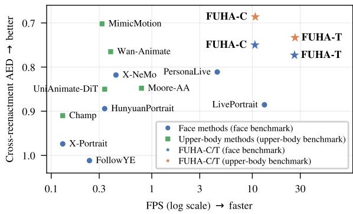  
(b) Speed vs. expression error  
Figure 1: FUHA drives face, upper-body, and full-body animation from one compact motion embedding. (a) Method categories against the three requirements; no prior category meets all three. (b) Speed vs. cross-reenactment expression error per benchmark; FUHA-C/T (Cosmos/TAESD3 tokenizers) appear in both.

In this paper we present FUHA: Feed-forward Unified Human Animation, a single feed-forward model built around a compact motion embedding of the whole human; it is real-time-capable and handles face, upper-body, and full-body regions flexibly. FUHA extracts patch features from the driver image via a frozen visual encoder (Siméoni et al., 2025) and compresses them through a small Q-Former into this embedding. A similar process happens with appearance information, but with less compression, and the appearance and motion embeddings are used together in a final transformer decoder to render the target image directly. The result is a network that produces an animated reference frame in a single forward pass (face, hands, and body alike) without iterative denoising, external pose/keypoint estimation, or parametric models of the human (face, hands, or body). At inference time, FUHA takes only a reference image and a driver frame without requiring warm-up frames, per-clip alignment, or other preprocessing routines. We evaluate two variants (Figure 1b) that differ only in the frozen tokenizer, which encodes the reference image and decodes the output image: Cosmos for FUHA-C and the faster TAESD3 for FUHA-T. At 5122 with TorchScript and FP16 on a single RTX 4090, they run at 12.4 and 38.9 FPS, respectively.

Learning this embedding hinges on appearance–motion disentanglement: training reconstructs the driver from a reference of the same person, so appearance can leak into the embedding and resurface as identity errors in cross-reenactment. We constrain the embedding in three ways. First, its input: an asymmetric encoder pathway gives tokenizer latents to the appearance branch only, and the motion branch sees frozen visual features alone. Second, its capacity: the motion embedding is an information bottleneck by design, sized for per-frame motion rather than pixel-level appearance. Third, its training target: a novel contrastive loss pulls the motion embedding toward that of a rendered keypoint image of the driver and away from that of the reference (same identity, different pose), without requiring explicit keypoint regression.

Contributions. Our contributions are (i) a compact motion embedding of the whole human (face, hands, and body), learned by constraining its input, capacity, and training target, that needs no pose estimator at inference time, (ii) FUHA, a feed-forward transformer that uses this embedding for face, upper-body, and full-body animation at up to 38.9 FPS at 512 × 512 on a single RTX 4090; it outperforms every baseline on all nine self-reenactment metrics of our upper-body benchmark and is competitive on face and full-body, and (iii) evidence that the embedding carries motion with little identity: in upper-body cross-reenactment, FUHA preserves the reference identity better than every baseline, and in retrieval the embedding returns the query’s own person in 0.1% of queries, against 9.5% for the learned global embedding of its own DINOv3 backbone (Table 6).

## 2 RELATED WORK

Portrait Animation. Portrait animation follows two rendering paradigms. The first drives a feed-forward decoder with a learned motion embedding: LivePortrait (Guo et al., 2024), MegaPortraits (Drobyshev et al., 2022), and VOODOO XP (Tran et al., 2024) render the reference in a single forward pass (other work used parametric 3DMM (Ren et al., 2021) or StyleGAN (Yin et al., 2022) intermediaries). The second conditions a diffusion model on the driving signal and denoises over many steps: X-NeMo (Zhao et al., 2025), X-Portrait (Xie et al., 2024), Follow-Your-Emoji (Ma et al., 2024), and HunyuanPortrait (Xu et al., 2025) trade inference speed for quality; PersonaLive (Li et al., 2026) reduces the number of denoising steps through appearance distillation, and FlashPortrait (Tu et al., 2026) accelerates sampling with adaptive latent prediction. Both paradigms target face-centered crops. FUHA keeps the feed-forward design of the first paradigm but extends it beyond the face.

Multi-Region Human Animation. Upper- and full-body animation has mostly relied on externally estimated pose (2D body keypoints, 3D skeletons, SMPL (Loper et al., 2015) parameters, or hand keypoints) driving a diffusion backbone. U-Net-based methods such as Champ (Zhu et al., 2024), Animate Anyone (Hu et al., 2024), MimicMotion (Zhang et al., 2025b), UniAnimate (Wang et al., 2025a), Animate-X (Tan et al., 2025), and Animate Anyone 2 (Hu et al., 2025) were followed by DiT-based ones (UniAnimate-DiT (Wang et al., 2025b), Wan-Animate (Cheng et al., 2025)) that improve visual quality at greater computational cost. OmniHuman-1 (Lin et al., 2025b), DreamActor-M1 (Luo et al., 2025), and CyberHost (Lin et al., 2025a) combine audio or video with pose in a single diffusion model, but remain multi-step and still extract pose externally. DiT-based methods rarely run in real time; StreamAvatar (Sun et al., 2026), an audio-driven avatar, does so through autoregressive distillation. FUHA needs no pose estimator at inference time and renders each frame in a single feed-forward pass.

Compact Motion Embeddings. FOMM (Siarohin et al., 2019) and face-vid2vid (Wang et al., 2021) showed that a low-dimensional motion descriptor can drive a feed-forward warping decoder, and LIA (Wang et al., 2022) replaced keypoints with orthogonal latent motion directions. Such embeddings now serve as interfaces for downstream generation: real-time audio-driven head generators (Guo et al., 2025; Zhen et al., 2025) autoregressively predict LivePortrait-style motion embeddings (implicit keypoints). X-NeMo (Zhao et al., 2025) distills a 1D identity-agnostic motion embedding that condi tions a diffusion backbone. Beyond the face, X-UniMotion (Song et al., 2025) learns region-specific motion embeddings (body, face, two hands) jointly with a DiT generator, and IM-Animation (Xu et al., 2026) compresses per-frame motion into a compact 1D embedding; both decode with multi-step video diffusion. Pretrained vision encoders (Siméoni et al., 2025; Tschannen et al., 2025; Khirodkar et al., 2024; 2026; Ranzinger et al., 2026) also yield learned global embeddings, but these encode identity along with pose (Section 4.4). FUHA learns a compact motion embedding for face, hands, and body that carries little identity, and decodes it with a real-time-capable feed-forward transformer.

## 3 METHOD

## 3.1 OVERVIEW

A feed-forward architecture for cross-person reenactment must disentangle appearance factors from motion factors. Here, motion has typically referred to the pose and expression of the human head, and we extend it to include finger and limb articulation, and overall body translation and scale. Throughout, “motion” denotes a per-frame property, not inter-frame temporal dynamics.

Such appearance–motion disentanglement is hard to enforce in practice, as training only occurs via self-reenactment, where driver and target come from the same clip of the same person. In this supervision setting, the network can satisfy pixel reconstruction by simply copying the driver (learning a shortcut), sidestepping the disentanglement entirely. Earlier works achieve disentanglement through an information bottleneck: learned keypoints (Siarohin et al., 2019), latent motion directions (Wang et al., 2022), or a compact mixture of the two (Guo et al., 2024; Drobyshev et al., 2022). We constrain the motion embedding’s input, capacity, and training target.

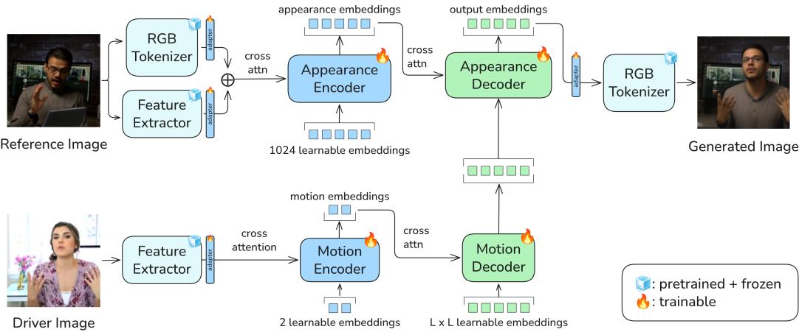  
Figure 2: FUHA inference flow. Given a reference image and a driver frame, two pretrained, frozen backbones (an RGB tokenizer and a visual feature extractor) produce the cross-attention inputs for two trainable Q-Formers. The Appearance Encoder sums RGB tokens and features and compresses them via cross-attention into a fixed set of appearance embeddings; the Motion Encoder attends to visual features only, yielding a compact motion embedding. A Motion Decoder expands it into a motion map, and the Appearance Decoder cross-attends motion to appearance to produce the final output embeddings, which the frozen RGB tokenizer decodes back to an image. The entire pipeline is feed-forward, frame-by-frame, and real-time-capable.

Input: asymmetric features. We use a frozen visual encoder whose patch features are semantically coherent: they carry pose, expression, and articulation cues across face, hands, and body without region-specific tuning. A single encoder therefore serves all three settings, and no parametric face or body model is needed. The two branches read this encoder differently (Figure 2): the appearance encoder takes its features summed with RGB tokens from a frozen tokenizer (Agarwal et al., 2025), while the motion encoder takes the visual features alone. Because the motion path never sees the tokenizer latents, the motion embedding can only carry what the frozen visual encoder encodes – primarily semantic content rather than raw photometric detail. Concretely, we use DINOv3 ViT-B/16 (Siméoni et al., 2025) as the visual encoder.

Capacity: learned compression. We adopt the Q-Former (Li et al., 2023) architecture to compress the information contained in a large number of patch tokens into a smaller number of learned query tokens, which form the motion embedding, with the input feature map injected via cross-attention. The same architecture can be used to expand information, by defining a larger number of learnable query tokens. We take advantage of this in our motion decoder module, where a Q-Former broadcasts the compact motion embedding onto a motion map matching the RGB tokenizer’s latent grid.

Target: contrastive objective. Input and capacity alone do not stop appearance, such as hair shape and length, from reaching the motion embedding through the visual features themselves. We therefore propose a contrastive loss (Figure 3): we draw the driver’s face, hand, and body keypoints into an image (pose preserved, appearance removed), using keypoints precomputed during dataset construction (Appendix ${ \mathrm { F } } ) ,$ and pull the motion embedding toward that of this image and away from that of the reference (same identity, different pose; Section 3.3).

## 3.2 ARCHITECTURE

We describe each block of Figure 2 below. $I _ { r }$ is the reference image, $I _ { d }$ the driver, $\hat { I }$ the output.

Frozen backbones. Two pretrained networks are kept frozen throughout: an RGB tokenizer $( \mathcal { E } _ { \mathrm { t o k } }$ $\mathcal { D } _ { \mathrm { t o k } }$ , we use Cosmos (Agarwal et al., 2025) for FUHA-C and TAESD3 (Boer Bohan, 2023) for FUHA-T) mapping images to and from an $L \times L$ latent grid, and a visual encoder $\phi _ { \mathrm { v i s } }$ producing per-patch features. Image-space losses backpropagate through $\mathcal { D } _ { \mathrm { t o k } }$ without updating its weights.

Appearance encoder. Both backbones run on the reference. Their outputs are projected to a shared embedding dimension d by per-modality MLPs, summed at every spatial location, and added to a 2D sinusoidal positional encoding $\sigma _ { 2 D } .$ , giving the fused reference features $\mathbf { f } _ { r }$ . The Appearance Encoder $E _ { a }$ is a Q-Former with $N _ { a } = 1 0 2 4$ learned queries that cross-attend to $\mathbf { f } _ { r } .$ , producing the appearance embeddings $\mathbf { a } \in \mathbb { R } ^ { N _ { a } \times d }$

Motion encoder. For the driver, only the feature extractor $\phi _ { \mathrm { v i s } }$ runs; its output is projected to d dimensions and added to $\sigma _ { 2 D }$ , forming the driver features $\mathbf { f } _ { d } .$ . The Motion Encoder $E _ { m }$ is a Q-Former with $N _ { m } = 2$ learned queries that produces the motion embedding $\mathbf { m } = E _ { m } ( \mathbf { f } _ { d } ) \in \mathbb { R } ^ { N _ { m } \times d }$ , made of $N _ { m }$ motion tokens.

Motion decoder. The Motion Decoder $D _ { m }$ broadcasts m onto a motion map matched to the tokenizer’s latent grid via a Q-Former whose $L ^ { 2 }$ learned queries (with $\sigma _ { 2 D }$ positional encoding) attend to the motion tokens, producing $\mathbf { M } = D _ { m } ( \mathbf { m } ) \in \mathbb { R } ^ { L ^ { 2 } \times d }$

Appearance decoder. The main decoder $D _ { a }$ is a transformer decoder whose queries are the motion map (with $\sigma _ { 2 D }$ re-applied). The appearance embeddings a are injected via vanilla cross-attention layers. A small MLP g maps its output to the tokenizer’s latent dimension, and the frozen tokenizer reconstructs the image: $\hat { I } = { \mathcal { D } } _ { \mathrm { t o k } } \big ( g \big ( { \cal D } _ { a } ( { \mathbf { M } } , { \mathbf { a } } ) \big ) \big )$ .

The appearance embeddings are computed once per reference image; each driver frame then runs independently through $\phi _ { \mathrm { v i s } } , E _ { m } , D _ { m } , D _ { a } , g , \mathcal { D } _ { \mathrm { t o k } }$ in a single feed-forward pass, with no iterative denoising and no external pose estimation modules.

## 3.3 TRAINING OBJECTIVES

We train FUHA in a self-reenactment setting: reference and target frames come from the same clip, with the driver being a photometrically augmented version of the target (Zhao et al., 2025; Tran et al., 2024). This trains the motion encoder to ignore lighting and color changes that do not affect pose (details in Section D.2). A reconstruction loss $\mathcal { L } _ { \mathrm { r e c } }$ combines L1 and LPIPS (Zhang et al., 2018), with spatial reweighting and other details in Appendix D. The remaining two losses target appearance–motion disentanglement and identity preservation.

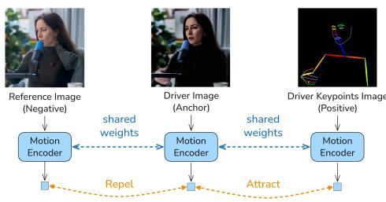  
Figure 3: Contrastive loss. The driver’s motion embedding is pulled toward the rendered keypoints’ and away from the reference’s.

Contrastive triplet on the motion embedding. We further disentangle the motion embedding via a triplet loss on its flattened form m¯ $\in \mathbb { R } ^ { N _ { m } d }$ (Figure 3):

$$
{ \mathcal { L } } _ { \mathrm { t r i } } = \mathrm { s o f t p l u s } \big ( \delta ( { \bar { \mathbf { m } } } _ { a } , { \bar { \mathbf { m } } } _ { + } ) - \delta ( { \bar { \mathbf { m } } } _ { a } , { \bar { \mathbf { m } } } _ { - } ) \big ) ,\tag{1}
$$

where δ is the cosine distance, the anchor $\bar { \mathbf { m } } _ { a }$ is the driver’s flattened motion embedding, the positive $\bar { \mathbf { m } } _ { + }$ is that of a rendered keypoint image of the driver (a foreground crop when face keypoints are missing), and the negative m¯ − is that of the reference – same identity, different pose. The soft-margin form follows Hermans et al. (2017); the choice of positive and negative is ours. The positive shares the anchor’s pose and the negative its appearance, so the loss ranks pose above appearance (Appendix D).

Identity preservation. ${ \mathcal { L } } _ { \mathrm { i d } }$ is the cosine distance between AdaFace (Kim et al., 2022a) embeddings of aligned face crops. We compare against the driver/target frame (pose-matched and same-identity) to avoid confounding identity drift with pose drift, since AdaFace embeddings are not fully invariant to pose, expression, or shape.

Further training and implementation details, including the full training loss and loss term weights, are in Appendix D.

## 4 RESULTS

Implementation Details. We train FUHA-C and FUHA-T for 60 epochs using a dataset consisting of 1,056,941 clips from Internet videos, totaling 5,172 hours of content. FUHA-C uses the Cosmos

Table 1: Upper-body animation evaluation on our benchmark at 5122 ( 1st , 2nd , 3rd )
<table><tr><td rowspan="2">Method</td><td colspan="9">Self-Reenactment</td><td colspan="6">Cross-Reenactment</td></tr><tr><td>L1↓</td><td>SSIM ↑</td><td>LPIPS ↓</td><td>ID↑</td><td>AED↓</td><td>AKD-B↓</td><td>AKD-H↓</td><td>FID↓</td><td>FVD↓</td><td>ID↑</td><td>AED↓</td><td>AKD-B↓</td><td>AKD-H↓</td><td>FID↓ FVD↓</td></tr><tr><td>Moore-AA (Hu et al., 2024)</td><td>0.0619</td><td>0.694</td><td>0.206</td><td>0.657</td><td>0.548</td><td>42.3</td><td>81.7</td><td>26.2</td><td>185.9 0.511</td><td>0.848</td><td>56.5</td><td></td><td>103.1 53.2</td><td>368.0</td></tr><tr><td>Champ (Zhu et al., 2024)</td><td>0.0980</td><td>0.611</td><td>0.335</td><td>0.571 0.670</td><td>56.3</td><td>103.2</td><td>33.8</td><td>274.8</td><td>0.452</td><td>0.910</td><td>60.2</td><td>117.8</td><td>56.4</td><td>378.8</td></tr><tr><td>MimicMotion (Zhang et al., 2025b)</td><td>0.0816</td><td>0.677</td><td>0.278</td><td>0.582 0.506</td><td>43.2</td><td>65.6</td><td>27.1</td><td>80.3</td><td>0.131</td><td>0.702</td><td>53.8</td><td>86.1</td><td>64.8</td><td>203.7</td></tr><tr><td>Wan-Animate (Cheng et al., 2025)</td><td>0.0643</td><td>0.712</td><td>0.219</td><td>0.668 0.467</td><td>37.6</td><td>70.5</td><td>24.4</td><td>133.4</td><td>0.489</td><td>0.765</td><td>50.8</td><td>93.4</td><td>57.5</td><td>207.4</td></tr><tr><td>UniAnimate-DiT (Wang et al., 2025b)</td><td>0.0717</td><td>0.724</td><td>0.201</td><td>0.694 0.618</td><td>46.6</td><td>86.6</td><td>20.3</td><td>66.0</td><td>0.630</td><td>0.850</td><td>55.7</td><td>97.2</td><td>50.2</td><td>145.8</td></tr><tr><td>FUHA-C</td><td>0.0287</td><td>0.838</td><td>0.106</td><td>0.820</td><td>0.315 27.1</td><td></td><td>48.5</td><td>15.2 38.9</td><td>0.701</td><td>0.686</td><td>51.5</td><td>88.8</td><td>55.9</td><td>171.7</td></tr><tr><td>FUHA-T</td><td>0.0320</td><td>0.826</td><td>0.117</td><td>0.812</td><td>0.348</td><td>30.6</td><td>55.9</td><td>17.0</td><td>55.3 0.723</td><td>0.733</td><td>56.1</td><td>91.9</td><td>55.5</td><td>193.2</td></tr></table>

tokenizer, while FUHA-T uses the smaller TAESD3 tokenizer for faster inference. Both use the same transformer architecture and training objective. Further information about our training and dataset curation process can be found in Appendices D and F, respectively.

## 4.1 EXPERIMENTAL SETUP

FUHA handles face, upper-body, and full-body animation with a single model and no region-specific fine-tuning. We compare it against baselines in all three settings, with reference images matched to each.

Datasets. We evaluate face self-reenactment on the TalkingHead-1KH test set (Wang et al., 2021) and extend the LivePortrait (Guo et al., 2024) protocol for cross-reenactment by using the first 100 FFHQ (Karras et al., 2019) images as references paired with random TalkingHead clips, 128 frames per clip. For upper-body, no publicly available standardized evaluation datasets exist, so we curate a new test set from public YouTube videos outside the training split: 96 clips, 10–20 s long at 25 Hz. Cross-reenactment uses each video’s first frame paired with a different driving clip (96 pairs). For full-body, we use the TikTok dance test set (Jafarian & Park, 2021). All methods are evaluated at 5122 image resolution for face and upper-body, and at source image resolution for full-body, where possible, and otherwise with letterboxing and downscaling (due to varying aspect ratios).

Baselines. We select recent baselines with public inference code and pre-trained weights (X-UniMotion and IM-Animation, the closest learned-motion methods, have not released their animation models), and follow each baseline’s prescribed preprocessing protocols for image cropping and driving signal construction (e.g., pose estimation and normal map rendering in Champ). For face animation, we compare against LivePortrait (Guo et al., 2024), X-Portrait (Xie et al., 2024), Follow-Your-Emoji (Ma et al., 2024), X-NeMo (Zhao et al., 2025), HunyuanPortrait (Xu et al., 2025), and PersonaLive (Li et al., 2026). For upper-body animation, we compare against Moore-AnimateAnyone (Hu et al., 2024), Champ (Zhu et al., 2024), MimicMotion (Zhang et al., 2025b), Wan-Animate (Cheng et al., 2025), and UniAnimate-DiT (Wang et al., 2025b). For full-body animation, in addition to the upper-body baselines, we also compare against Animate-X (Tan et al., 2025). We omit Animate-X from the upper-body evaluation: unlike the other baselines, it does not condition on precise keypoints, so its output is not pixel-aligned to the driver pose.

Evaluation Metrics. We adopt standard metrics across image fidelity, motion transfer, and identity. For image fidelity, we report image-level (L1, SSIM, PSNR, LPIPS) and distribution-level (FID (Parmar et al., 2022), FVD (Skorokhodov et al., 2022; Unterthiner et al., 2018)) metrics; in cross-reenactment, FID and FVD use the driving videos as the real set. For motion transfer, we report AED (Average Expression Distance) and APD (Average Pose Distance) using SMIRK (Retsinas et al., 2024) as a face encoder. We also adopt the AKD (Average Keypoint Distance) metric (Siarohin et al., 2019; Lin et al., 2025a;b) and report it separately for the body (AKD-B, 17 COCO keypoints) and the hands (AKD-H, 42 keypoints). For identity, we report ArcFace (Deng et al., 2019) cosine similarity (ID). Paired metrics such as L1, SSIM, and LPIPS require known targets, so they can only be reported for self-reenactment. AKD-B and AKD-H are reported only for upper-body and full-body, where the body and hands are visible. Further details regarding the evaluation metrics are in Appendix E.

Wan-Animate

Champ  
MimicMotion  
Reference  
Driver  
Moore-AA  
FUHA-C  
FUHA-T  
  
Figure 4: Qualitative results for upper-body cross-reenactment. FUHA keeps the reference identity while following the driver’s expression, body pose, and hand pose. The final two columns show FUHA-C and FUHA-T, respectively. More results, including face and full-body, are in Appendix B.

Table 2: Face animation evaluation on the TalkingHead-1KH (Wang et al., 2021) test split for self-reenactment. For cross-reenactment we use 100 FFHQ (Karras et al., 2019) images as reference, paired randomly with a TalkingHead-1KH test set clip. All methods receive FFHQ-aligned 5122 frames. Table cells are shaded based on per-column rank: 1st , 2nd , and 3rd .
<table><tr><td rowspan="2">Method</td><td colspan="8">Self-Reenactment</td><td colspan="5">Cross-Reenactment</td></tr><tr><td>L1 ↓</td><td>SSIM ↑</td><td>LPIPS ↓</td><td>ID↑</td><td>AED↓</td><td>APD↓</td><td>FID↓</td><td>FVD↓</td><td>ID↑</td><td>AED↓</td><td>APD↓</td><td>FID↓</td><td>FVD↓</td></tr><tr><td>LivePortrait (Guo et al., 2024)</td><td>0.0990</td><td>0.655</td><td>0.359</td><td>0.868</td><td>0.341</td><td>0.0256</td><td>40.4</td><td>224.7</td><td>0.658</td><td>0.885</td><td>0.0705</td><td>164.9</td><td>533.0</td></tr><tr><td>X-Portrait (Xie et al., 2024)</td><td>0.0820</td><td>0.685</td><td>0.271</td><td>0.855</td><td>0.414</td><td>0.0449</td><td>37.1</td><td>271.3</td><td>0.793</td><td>0.974</td><td>0.1186</td><td>162.9</td><td>655.5</td></tr><tr><td>FollowYE (Ma et al., 2024)</td><td>0.0746</td><td>0.699</td><td>0.250</td><td>0.844</td><td>0.440</td><td>0.0282</td><td>39.4</td><td>184.6</td><td>0.747</td><td>1.012</td><td>0.0483</td><td>160.0</td><td>678.2</td></tr><tr><td>X-NeMo (Zhao et al., 2025)</td><td>0.1072</td><td>0.600</td><td>0.376</td><td>0.832</td><td>0.401</td><td>0.0206</td><td>43.8</td><td>245.4</td><td>0.654</td><td>0.818</td><td>0.0486</td><td>154.3</td><td>546.6</td></tr><tr><td>HunyuanPortrait (Xu et al., 2025)</td><td>0.0943</td><td>0.660</td><td>0.312</td><td>0.853</td><td>0.376</td><td>0.0313</td><td>35.0</td><td>203.8</td><td>0.691</td><td>0.894</td><td>0.0880</td><td>159.8</td><td>571.8</td></tr><tr><td>PersonaLive (Li et al., 2026)</td><td>0.0721</td><td>0.698</td><td>0.239</td><td>0.870</td><td>0.323</td><td>0.0171</td><td>32.6</td><td>210.1</td><td>0.698</td><td>0.811</td><td>0.0365</td><td>154.9</td><td>561.3</td></tr><tr><td>FUHA-C</td><td>0.0526</td><td>0.782</td><td>0.185</td><td>0.876</td><td>0.293</td><td>0.0131</td><td>35.0</td><td>153.8</td><td>0.654</td><td>0.750</td><td>0.0321</td><td>158.2</td><td>645.3</td></tr><tr><td>FUHA-T</td><td>0.0561</td><td>0.770</td><td>0.196</td><td>0.863</td><td>0.334</td><td>0.0154</td><td>36.9</td><td>180.7</td><td>0.661</td><td>0.773</td><td>0.0324</td><td>156.5</td><td>645.1</td></tr></table>

## 4.2 COMPARISON WITH BASELINES

Upper-body Animation. In Table 1, FUHA-C achieves the best scores across all reported selfreenactment metrics, including image fidelity, identity preservation, and motion transfer. For crossreenactment, FUHA-T has the highest ID and FUHA-C the lowest AED. No baseline has significantly lower cross-reenactment motion errors than FUHA-C (clip-level 95% intervals; Appendix E). UniAnimate-DiT has lower dataset-level FID and FVD, and Moore-AA lower FID. Rendering FUHA C’s frozen motion embedding with a video diffusion decoder (FUHA-W, Appendix A.3) lowers cross-FVD from 171.7 to 125.0, at higher motion errors. FUHA-T, the faster variant, also outperforms every baseline on all nine self-reenactment metrics.

Figure 4 shows representative qualitative comparisons against the upper-body baselines; side-by-side videos are in the supplementary material. We observe that each method has strengths but makes compromises. For example, MimicMotion achieves good AED, AKD-B, and AKD-H scores, but visibly loses the reference identity (also reflected in its low ID score). Wan-Animate and UniAnimate DiT render fine detail well. FUHA encodes the reference appearance once and renders every frame from it, without conditioning on previous outputs. FUHA has the lowest self-reenactment hand error (AKD-H 48.5 vs. 65.6 for the best baseline) without external pose estimators at inference time; in cross-reenactment, no baseline has significantly lower hand error.

Face Animation. In Table 2, FUHA-C achieves the best self-reenactment scores for seven of the eight reported metrics, with PersonaLive achieving a lower FID. For cross-reenactment, FUHA-C has the lowest expression and head-pose errors; X-Portrait and FollowYE lead identity similarity but have the highest expression errors, and several baselines obtain lower FID or FVD. Here FID and FVD compare outputs for FFHQ references with TalkingHead-1KH driving videos; across this domain gap, every method scores 154–165 FID. FUHA-T remains competitive on reconstruction and motion transfer, with slightly higher cross-ID than FUHA-C.

Table 3: Full-body animation evaluation on the TikTok (Jafarian & Park, 2021) test set (selfreenactment). ( 1st , 2nd , 3rd ).
<table><tr><td>Method</td><td>L1↓</td><td>SSIM ↑</td><td>PSNR ↑</td><td>LPIPS ↓</td><td>ID↑</td><td>AED↓</td><td>AKD-B↓</td><td>AKD-H↓</td><td>FID↓</td><td>FVD↓</td></tr><tr><td>Moore-AA (Hu et al., 2024)</td><td>0.0812</td><td>0.770</td><td>17.58</td><td>0.302</td><td>0.448</td><td>0.733</td><td>48.6</td><td>87.5</td><td>44.8</td><td>235.8</td></tr><tr><td>Champ (Zhu et al., 2024)</td><td>0.1223</td><td>0.719</td><td>14.45</td><td>0.399</td><td>0.356</td><td>0.993</td><td>85.3</td><td>118.9</td><td>42.2</td><td>281.1</td></tr><tr><td>MimicMotion (Zhang et al., 2025b)</td><td>0.1118</td><td>0.728</td><td>15.40</td><td>0.363</td><td>0.282</td><td>0.778</td><td>65.8</td><td>88.9</td><td>37.9</td><td>188.7</td></tr><tr><td>Animate-X (Tan et al., 2025)</td><td>0.1145</td><td>0.745</td><td>15.00</td><td>0.385</td><td>0.421</td><td>0.961</td><td>91.3</td><td>151.2</td><td>31.0</td><td>229.5</td></tr><tr><td>Wan-Animate (Cheng et al., 2025)</td><td>0.0815</td><td>0.768</td><td>17.76</td><td>0.310</td><td>0.427</td><td>0.705</td><td>46.8</td><td>84.5</td><td>36.1</td><td>168.2</td></tr><tr><td>UniAnimate-DiT (Wang et al., 2025b)</td><td>0.0672</td><td>0.818</td><td>19.11</td><td>0.247</td><td>0.458</td><td>0.705</td><td>44.9</td><td>76.4</td><td>25.9</td><td>170.8</td></tr><tr><td>FUHA-C</td><td>0.0559</td><td>0.852</td><td>20.50</td><td>0.236</td><td>0.519</td><td>0.605</td><td>44.2</td><td>69.5</td><td>37.9</td><td>230.5</td></tr><tr><td>FUHA-T</td><td>0.0630</td><td>0.840</td><td>19.44</td><td>0.258</td><td>0.508</td><td>0.637</td><td>51.2</td><td>82.1</td><td>40.0</td><td>263.7</td></tr></table>

Table 4: FUHA-C ablations on the upper-body set at $5 1 2 ^ { 2 }$ . Table C.1 adds a ReLU variant of the contrastive loss. ( 1st , 2nd , 3rd ).
<table><tr><td></td><td colspan="4">Self-Reenactment</td><td colspan="6">Cross-Reenactment</td></tr><tr><td>Variant</td><td>LPIPS↓</td><td>ID↑</td><td>FID↓</td><td>FVD↓</td><td>ID↑</td><td>AED↓</td><td>AKD-B↓</td><td>AKD-H↓</td><td>FID↓</td><td>FVD↓</td></tr><tr><td>1 motion token</td><td>0.351</td><td>0.134</td><td>78.8</td><td>258.5</td><td>0.088</td><td>0.724</td><td>57.8</td><td>92.6</td><td>88.0</td><td>310.8</td></tr><tr><td>2 motion tokens</td><td>0.106</td><td>0.820</td><td>15.2</td><td>38.9</td><td>0.701</td><td>0.686</td><td>51.5</td><td>88.8</td><td>55.9</td><td>171.7</td></tr><tr><td>4 motion tokens</td><td>0.127</td><td>0.812</td><td>17.7</td><td>63.1</td><td>0.733</td><td>0.761</td><td>58.9</td><td>91.6</td><td>55.7</td><td>201.9</td></tr><tr><td>w/o contrastive loss</td><td>0.340</td><td>0.199</td><td>88.8</td><td>263.9</td><td>0.057</td><td>0.606</td><td>47.8</td><td>80.3</td><td>101.1</td><td>325.9</td></tr><tr><td>w/o DINO in appearance</td><td>0.125</td><td>0.811</td><td>18.3</td><td>59.4</td><td>0.712</td><td>0.732</td><td>55.8</td><td>91.1</td><td>56.1</td><td>202.4</td></tr><tr><td>w/o 2D motion decoder</td><td>0.116</td><td>0.799</td><td>16.9</td><td>49.2</td><td>0.689</td><td>0.685</td><td>51.9</td><td>86.9</td><td>57.6</td><td>193.0</td></tr><tr><td>w/o ID loss</td><td>0.110</td><td>0.764</td><td>15.6</td><td>41.5</td><td>0.568</td><td>0.671</td><td>52.1</td><td>86.5</td><td>56.8</td><td>170.6</td></tr><tr><td>FUHA-C</td><td>0.106</td><td>0.820</td><td>15.2</td><td>38.9</td><td>0.701</td><td>0.686</td><td>51.5</td><td>88.8</td><td>55.9</td><td>171.7</td></tr></table>

Full-body Animation. We follow previous works and evaluate self-reenactment only on the TikTok test set. In Table 3, FUHA-C achieves the best image-level, identity, expression, and keypoint scores, leading eight of the ten reported metrics. UniAnimate-DiT and Wan-Animate have the lowest FID and FVD, respectively. FUHA-T has higher reconstruction and motion errors than FUHA-C, but remains competitive with the baselines.

## 4.3 ABLATION STUDY

We ablate the most impactful components of FUHA-C on our upper-body set in Table 4. Each ablation variant and the full model are trained for 60 epochs using the Cosmos tokenizer. Cross-reenactment is a direct test of appearance–motion disentanglement: appearance leakage in the motion embedding leads to identity confusion and visual artifacts when motion is transferred between identities.

Number of motion tokens. The bottleneck has a sweet spot. One token is too few: outputs lose identity even in self-reenactment (self-ID 0.134, cross-ID 0.088). Four tokens keep identity (cross-ID 0.733) but worsen cross-AED (0.686 to 0.761) and every self-reenactment metric. We use two.

Contrastive loss. Without it, appearance flows through the motion embedding. Outputs take the driver’s hair, gender, and face shape at low detail, but the reference’s background and clothing color (Figure C.1). Cross-ID falls to 0.057, and self-reenactment fails too (self-ID 0.199). Its lower cross-AED and AKD reflect leaked driver appearance, not better transfer.

DINOv3 features in the appearance branch. DINOv3 features in the appearance branch improve reconstruction and expression transfer. Removing them increases self-LPIPS from 0.106 to 0.125 and cross-AED from 0.686 to 0.732, though cross-ID improves slightly.

Motion decoder. In this variant, the motion embedding is concatenated with the appearance embeddings, and the appearance decoder cross-attends to both. Dropping the 2D motion decoder degrades reconstruction and video quality: self-LPIPS increases from 0.106 to 0.116 and cross-FVD rises from 171.7 to 193.0. Cross-ID also decreases slightly, from 0.701 to 0.689.

  
Driver A

  
t = 0

  
0.25

  
0.5

  
0.75

  
t = 1

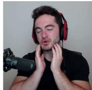  
Driver B  
Figure 5: Motion latent-space walk. We linearly interpolate between the FUHA-C motion embeddings of two drivers and decode each step on one reference. Over 25 measured pose and expression walks, motion tracks t (median Spearman $\rho = 1 . 0 0 , R ^ { 2 } = 0 . 9 9 )$ and identity stays with the reference (median ArcFace 0.75; at most 0.19 to either driver; Appendix A.2).

Table 5: Inference efficiency. FPS and peak VRAM (GB) at $5 1 2 ^ { 2 }$ on a single GPU. ( 1st , 2nd , 3rd ).  
(a) Face methods.
<table><tr><td>Method</td><td>FPS ↑ VRAM↓</td><td></td></tr><tr><td>LivePortrait</td><td>13.20</td><td>1.4</td></tr><tr><td>X-Portrait</td><td>0.13</td><td>59.1</td></tr><tr><td>FollowYE</td><td>0.24</td><td>8.4</td></tr><tr><td>X-NeMo</td><td>0.44</td><td>20.2</td></tr><tr><td>HunyuanPortrait</td><td>0.34</td><td>22.3</td></tr><tr><td>PersonaLive</td><td>4.48</td><td>9.4</td></tr><tr><td>FUHA-C</td><td>10.62</td><td>3.5</td></tr><tr><td>FUHA-T</td><td>26.29</td><td>2.5</td></tr></table>

(b) Upper-body methods.
<table><tr><td>Method</td><td>FPS ↑ VRAM↓</td><td></td></tr><tr><td>Moore-AA</td><td>0.79</td><td>9.9</td></tr><tr><td>Champ</td><td>0.13</td><td>11.6</td></tr><tr><td>MimicMotion</td><td>0.32</td><td>17.3</td></tr><tr><td>Wan-Animate</td><td>0.39</td><td>54.6</td></tr><tr><td>UniAnimate-DiT</td><td>0.34</td><td>39.8</td></tr><tr><td></td><td></td><td></td></tr><tr><td>FUHA-C</td><td>10.71</td><td>4.7</td></tr><tr><td>FUHA-T</td><td>26.60</td><td>3.7</td></tr></table>

Table 6: Motion retrieval. Pose errors use a person-disjoint gallery; same-person retrieval uses an overlapping gallery. Protocol and full results in Appendix A.1.

<table><tr><td>Encoder</td><td>Body AKD↓ (px)</td><td>Hand AKD↓ (px)</td><td>Head (deg.)</td><td>Same pose ↓ person ↓ (%)</td></tr><tr><td>Random</td><td>110.8</td><td>166.2</td><td>10.61</td><td>0.0</td></tr><tr><td>Sapiens2 0.1B</td><td>85.5</td><td>143.8</td><td>9.09</td><td>9.5</td></tr><tr><td>DINOv3 ViT-B/16</td><td>84.9</td><td>142.6</td><td>9.19</td><td>9.5</td></tr><tr><td>FUHA-C</td><td>78.1</td><td>140.4</td><td>9.18</td><td>0.1</td></tr></table>

Identity supervision. The identity loss helps preserve the reference’s appearance. Removing it reduces self-ID from 0.820 to 0.764 and cross-ID from 0.701 to 0.568. A ReLU variant of the contrastive loss and qualitative examples are in Appendix C.

## 4.4 MOTION REPRESENTATION

We probe the motion embedding by nearest-neighbor retrieval, independently of the animation decoder. Against the learned global embeddings of vision encoders (CLS token or pooled output), FUHA-C has the lowest body-pose error (78.1 pixels) with near-zero same-person retrieval (0.1%, against 9.5% for DINOv3; random embeddings give 0.0%); hand and head-pose results are competitive (Table 6). The full protocol, additional baselines, and examples are in Appendix A.1. Linear walks between two motion embeddings decode to smooth changes in head pose, expression, and hands while the reference identity holds (Figure 5; more in Figure A.3). The frozen embedding can also replace the skeleton and face-crop inputs of Wan-Animate, a video diffusion model, with adapters and LoRA fine-tuned on our training data (FUHA-W, Appendix A.3).

## 4.5 EFFICIENCY

Table 5 compares inference speed and peak VRAM with face and upper-body methods. On a single RTX Pro 6000, FUHA-C and FUHA-T run at 10.7 and 26.6 FPS, respectively, for upper-body animation at $5 1 2 ^ { 2 }$ . Exported to TorchScript with FP16, they reach 12.4 and 38.9 FPS on a single RTX 4090. Further timing details are reported in Appendix G.

## 5 CONCLUSION

We present FUHA, a real-time-capable feed-forward transformer for face, upper-body, and full-body animation, driven by a compact learned motion embedding of the whole human. Its input, capacity, and training target are constrained, so it carries little identity: it retrieves the query’s own person in only 0.1% of queries. Linear walks through the motion embedding decode to smooth, identitypreserving motion, and the frozen embedding can drive a video diffusion model in place of keypoints. On our upper-body benchmark, FUHA leads every self-reenactment metric and outperforms every baseline on cross-reenactment identity; it is competitive on face and full-body, with FUHA-T reaching 38.9 FPS at $5 1 2 ^ { 2 }$ on a single RTX 4090. FUHA renders each frame independently and without a generative prior, so fine detail is softer than with multi-step diffusion; we discuss limitations and next steps in Appendix H.

## ETHICS STATEMENT

Animating a person’s image with another person’s motion can be misused to create deceptive media (deepfakes); use of such systems should require consent from the people depicted. Our training and evaluation data come from public video sources and public benchmarks; we use them for research only.

## REPRODUCIBILITY STATEMENT

Appendix D gives the architecture, parameter counts, losses, loss weights, and training settings. Appendix E defines every metric and evaluation protocol. Appendix F describes the data sources and processing pipeline, and Appendix G the timing protocol.

## AI USE STATEMENT

We used LLM-based assistants for coding (including parts of the model, evaluation, and benchmarking code), for feedback on experimental design and the interpretation of results, for literature search, and for drafting and editing text. The authors reviewed and verified all AI-assisted code, analyses, and text, and take full responsibility for the content of this paper.

## REFERENCES

Niket Agarwal, Arslan Ali, Maciej Bala, Yogesh Balaji, Erik Barker, Tiffany Cai, Prithvijit Chattopadhyay, Yongxin Chen, Yin Cui, Yifan Ding, et al. Cosmos world foundation model platform for physical ai. arXiv preprint arXiv:2501.03575, 2025.

Ollin Boer Bohan. TAESD: Tiny autoencoder for stable diffusion. https://github.com/ madebyollin/taesd, 2023.

Shunian Chen, Hejin Huang, Yexin Liu, Zihan Ye, Pengcheng Chen, Chenghao Zhu, Michael Guan, Rongsheng Wang, Junying Chen, Guanbin Li, Ser-Nam Lim, Harry Yang, and Benyou Wang. Talkvid: A large-scale diversified dataset for audio-driven talking head synthesis, 2025. URL https://arxiv.org/abs/2508.13618.

Zhe Chen, Jiahao Wang, Wenhai Wang, Guo Chen, Enze Xie, Ping Luo, and Tong Lu. Fast: Faster arbitrarily-shaped text detector with minimalist kernel representation, 2021.

Gang Cheng, Xin Gao, Li Hu, Siqi Hu, Mingyang Huang, Chaonan Ji, Ju Li, Dechao Meng, Jinwei Qi, Penchong Qiao, et al. Wan-animate: Unified character animation and replacement with holistic replication. arXiv preprint arXiv:2509.14055, 2025.

Mengyu Chu, You Xie, Jonas Mayer, Laura Leal-Taixé, and Nils Thuerey. Learning temporal coherence via self-supervision for gan-based video generation. ACM Transactions on Graphics (TOG), 39(4):75–1, 2020.

Jiankang Deng, Jia Guo, Niannan Xue, and Stefanos Zafeiriou. Arcface: Additive angular margin loss for deep face recognition. In CVPR, pp. 4690–4699, 2019.

Nikita Drobyshev, Jenya Chelishev, Taras Khakhulin, Aleksei Ivakhnenko, Victor Lempitsky, and Egor Zakharov. Megaportraits: One-shot megapixel neural head avatars. In ACM MM, pp. 2663–2671, 2022.

Jianzhu Guo, Dingyun Zhang, Xiaoqiang Liu, Zhizhou Zhong, Yuan Zhang, Pengfei Wan, and Di Zhang. Liveportrait: Efficient portrait animation with stitching and retargeting control. arXiv preprint arXiv:2407.03168, 2024.

Ying Guo, Xi Liu, Cheng Zhen, Pengfei Yan, and Xiaoming Wei. Arig: Autoregressive interactive head generation for real-time conversations. In ICCV, pp. 12956–12965, 2025.

Alexander Hermans, Lucas Beyer, and Bastian Leibe. In defense of the triplet loss for person re-identification. arXiv preprint arXiv:1703.07737, 2017.

Li Hu, Xin Gao, Peng Zhang, Ke Sun, Bang Zhang, and Liefeng Bo. Animate anyone: Consistent and controllable image-to-video synthesis for character animation. In CVPR, pp. 8153–8163, 2024.

Li Hu, Guangyuan Wang, Zhen Shen, Xin Gao, Dechao Meng, Lian Zhuo, Peng Zhang, Bang Zhang, and Liefeng Bo. Animate anyone 2: High-fidelity character image animation with environment affordance. In ICCV, pp. 10207–10217, 2025.

Yasamin Jafarian and Hyun Soo Park. Learning high fidelity depths of dressed humans by watching social media dance videos. In CVPR, pp. 12753–12762, 2021.

Tao Jiang, Peng Lu, Li Zhang, Ningsheng Ma, Rui Han, Chengqi Lyu, Yining Li, and Kai Chen. Rtmpose: Real-time multi-person pose estimation based on mmpose. arXiv preprint arXiv:2303.07399, 2023.

Tao Jiang, Xinchen Xie, and Yining Li. Rtmw: Real-time multi-person 2d and 3d whole-body pose estimation. arXiv preprint arXiv:2407.08634, 2024.

Tero Karras, Samuli Laine, and Timo Aila. A style-based generator architecture for generative adversarial networks. In CVPR, pp. 4401–4410, 2019.

Rawal Khirodkar, Timur Bagautdinov, Julieta Martinez, Su Zhaoen, Austin James, Peter Selednik, Stuart Anderson, and Shunsuke Saito. Sapiens: Foundation for human vision models. In ECCV, pp. 206–228. Springer, 2024.

Rawal Khirodkar, He Wen, Julieta Martinez, Yuan Dong, Zhaoen Su, and Shunsuke Saito. Sapiens2. In ICLR, pp. 58484–58507, 2026.

Minchul Kim, Anil K Jain, and Xiaoming Liu. Adaface: Quality adaptive margin for face recognition. In CVPR, pp. 18750–18759, 2022a.

Taehun Kim, Kunhee Kim, Joonyeong Lee, Dongmin Cha, Jiho Lee, and Daijin Kim. Revisiting image pyramid structure for high resolution salient object detection. In ACCV, pp. 108–124, 2022b.

Junnan Li, Dongxu Li, Silvio Savarese, and Steven Hoi. Blip-2: Bootstrapping language-image pre-training with frozen image encoders and large language models. In ICML, pp. 19730–19742. PMLR, 2023.

Zhiyuan Li, Chi-Man Pun, Chen Fang, Jue Wang, and Xiaodong Cun. Personalive! expressive portrait image animation for live streaming. In CVPR, 2026.

Gaojie Lin, Jianwen Jiang, Chao Liang, Tianyun Zhong, Jiaqi Yang, Zerong Zheng, and Yanbo Zheng. Cyberhost: A one-stage diffusion framework for audio-driven talking body generation. In ICLR, 2025a.

Gaojie Lin, Jianwen Jiang, Jiaqi Yang, Zerong Zheng, Chao Liang, Yuan Zhang, and Jingtuo Liu. Omnihuman-1: Rethinking the scaling-up of one-stage conditioned human animation models. In ICCV, pp. 13847–13858, 2025b.

Matthew Loper, Naureen Mahmood, Javier Romero, Gerard Pons-Moll, and Michael J Black. Smpl: A skinned multi-person linear model. ACM Transactions on Graphics (TOG), 34(6), 2015.

Ilya Loshchilov and Frank Hutter. Decoupled weight decay regularization. In ICLR, 2019.

Yuxuan Luo, Zhengkun Rong, Lizhen Wang, Longhao Zhang, and Tianshu Hu. Dreamactor-m1: Holistic, expressive and robust human image animation with hybrid guidance. In ICCV, pp. 11036–11046, 2025.

Yue Ma, Hongyu Liu, Hongfa Wang, Heng Pan, Yingqing He, Junkun Yuan, Ailing Zeng, Chengfei Cai, Heung-Yeung Shum, Wei Liu, et al. Follow-your-emoji: Fine-controllable and expressive freestyle portrait animation. In SIGGRAPH Asia, pp. 1–12, 2024.

Gaurav Parmar, Richard Zhang, and Jun-Yan Zhu. On aliased resizing and surprising subtleties in gan evaluation. In CVPR, 2022.

Rolandos Alexandros Potamias, Jinglei Zhang, Jiankang Deng, and Stefanos Zafeiriou. Wilor: End-to-end 3d hand localization and reconstruction in-the-wild. In CVPR, pp. 12242–12254, 2025.

Andrés Prados-Torreblanca, José M Buenaposada, and Luis Baumela. Shape preserving facial landmarks with graph attention networks. In BMVC, 2022.

Mike Ranzinger, Greg Heinrich, Collin McCarthy, Jan Kautz, Andrew Tao, Bryan Catanzaro, and Pavlo Molchanov. C-RADIOv4 (tech report). arXiv preprint arXiv:2601.17237, 2026.

Yurui Ren, Ge Li, Yuanqi Chen, Thomas H Li, and Shan Liu. Pirenderer: Controllable portrait image generation via semantic neural rendering. In ICCV, pp. 13759–13768, 2021.

George Retsinas, Panagiotis P Filntisis, Radek Danecek, Victoria F Abrevaya, Anastasios Roussos, Timo Bolkart, and Petros Maragos. 3d facial expressions through analysis-by-neural-synthesis. In CVPR, pp. 2490–2501, 2024.

Aliaksandr Siarohin, Stéphane Lathuilière, Sergey Tulyakov, Elisa Ricci, and Nicu Sebe. First order motion model for image animation. In NeurIPS, December 2019.

Oriane Siméoni, Huy V Vo, Maximilian Seitzer, Federico Baldassarre, Maxime Oquab, Cijo Jose, Vasil Khalidov, Marc Szafraniec, Seungeun Yi, Michaël Ramamonjisoa, et al. Dinov3. arXiv preprint arXiv:2508.10104, 2025.

Ivan Skorokhodov, Sergey Tulyakov, and Mohamed Elhoseiny. Stylegan-v: A continuous video generator with the price, image quality and perks of stylegan2. In CVPR, pp. 3626–3636, 2022.

Guoxian Song, Hongyi Xu, Xiaochen Zhao, You Xie, Tianpei Gu, Zenan Li, Chenxu Zhang, and Linjie Luo. X-unimotion: Animating human images with expressive, unified and identity-agnostic motion latents. In SIGGRAPH Asia, pp. 1–11, 2025.

Tomás Soucek and Jakub Lokoc. Transnet v2: An effective deep network architecture for fast shot transition detection. In ACM MM, pp. 11218–11221, 2024.

Zhiyao Sun, Ziqiao Peng, Yifeng Ma, Yi Chen, Zhengguang Zhou, Zixiang Zhou, Guozhen Zhang, Youliang Zhang, Yuan Zhou, Qinglin Lu, and Yong-Jin Liu. StreamAvatar: Streaming diffusion models for real-time interactive human avatars. In CVPR, pp. 10887–10897, 2026.

Shuai Tan, Biao Gong, Xiang Wang, Shiwei Zhang, DanDan Zheng, Ruobing Zheng, Kecheng Zheng, Jingdong Chen, and Ming Yang. Animate-x: Universal character image animation with enhanced motion representation. In ICLR, 2025.

Phong Tran, Egor Zakharov, Long-Nhat Ho, Liwen Hu, Adilbek Karmanov, Aviral Agarwal, McLean Goldwhite, Ariana Bermudez Venegas, Anh Tuan Tran, and Hao Li. Voodoo xp: Expressive one-shot head reenactment for vr telepresence. ACM Transactions on Graphics (SIGGRAPH Asia 2024), 2024.

Michael Tschannen, Alexey Gritsenko, Xiao Wang, Muhammad Ferjad Naeem, Ibrahim Alabdulmohsin, Nikhil Parthasarathy, Talfan Evans, Lucas Beyer, Ye Xia, Basil Mustafa, et al. Siglip 2: Multilingual vision-language encoders with improved semantic understanding, localization, and dense features. arXiv preprint arXiv:2502.14786, 2025.

Shuyuan Tu, Yueming Pan, Yinming Huang, Xintong Han, Zhen Xing, Qi Dai, Kai Qiu, Chong Luo, and Zuxuan Wu. FlashPortrait: 6x faster infinite portrait animation with adaptive latent prediction. In CVPR, pp. 25163–25173, 2026.

Thomas Unterthiner, Sjoerd Van Steenkiste, Karol Kurach, Raphael Marinier, Marcin Michalski, and Sylvain Gelly. Towards accurate generative models of video: A new metric & challenges. arXiv preprint arXiv:1812.01717, 2018.

Ting-Chun Wang, Arun Mallya, and Ming-Yu Liu. One-shot free-view neural talking-head synthesis for video conferencing. In CVPR, pp. 10039–10049, 2021.

Xiang Wang, Shiwei Zhang, Changxin Gao, Jiayu Wang, Xiaoqiang Zhou, Yingya Zhang, Luxin Yan, and Nong Sang. Unianimate: Taming unified video diffusion models for consistent human image animation. Science China Information Sciences, 2025a.

Xiang Wang, Shiwei Zhang, Longxiang Tang, Yingya Zhang, Changxin Gao, Yuehuan Wang, and Nong Sang. Unianimate-dit: Human image animation with large-scale video diffusion transformer, 2025b. URL https://arxiv.org/abs/2504.11289.

Yaohui Wang, Di Yang, Francois Bremond, and Antitza Dantcheva. Latent image animator: Learning to animate images via latent space navigation. In ICLR, 2022.

Haoning Wu, Erli Zhang, Liang Liao, Chaofeng Chen, Jingwen Hou, Annan Wang, Wenxiu Sun, Qiong Yan, and Weisi Lin. Exploring video quality assessment on user generated contents from aesthetic and technical perspectives. In ICCV, pp. 20144–20154, 2023.

You Xie, Hongyi Xu, Guoxian Song, Chao Wang, Yichun Shi, and Linjie Luo. X-portrait: Expressive portrait animation with hierarchical motion attention. In SIGGRAPH, pp. 1–11, 2024.

Zhufeng Xu, Xuan Gao, Feng-Lin Liu, Haoxian Zhang, Zhixue Fang, Yu-Kun Lai, Xiaoqiang Liu, Pengfei Wan, and Lin Gao. IM-Animation: An implicit motion representation for identitydecoupled character animation. In CVPR Findings, pp. 4635–4646, 2026.

Zunnan Xu, Zhentao Yu, Zixiang Zhou, Jun Zhou, Xiaoyu Jin, Fa-Ting Hong, Xiaozhong Ji, Junwei Zhu, Chengfei Cai, Shiyu Tang, et al. Hunyuanportrait: Implicit condition control for enhanced portrait animation. In CVPR, pp. 15909–15919, 2025.

Hongwei Xue, Tiankai Hang, Yanhong Zeng, Yuchong Sun, Bei Liu, Huan Yang, Jianlong Fu, and Baining Guo. Advancing high-resolution video-language representation with large-scale video transcriptions. In CVPR, pp. 5036–5045, 2022.

Fei Yin, Yong Zhang, Xiaodong Cun, Mingdeng Cao, Yanbo Fan, Xuan Wang, Qingyan Bai, Baoyuan Wu, Jue Wang, and Yujiu Yang. Styleheat: One-shot high-resolution editable talking face generation via pre-trained stylegan. In ECCV, pp. 85–101. Springer, 2022.

Jianhui Yu, Hao Zhu, Liming Jiang, Chen Change Loy, Weidong Cai, and Wayne Wu. Celebv-text: A large-scale facial text-video dataset. In CVPR, pp. 14805–14814, 2023.

Richard Zhang, Phillip Isola, Alexei A Efros, Eli Shechtman, and Oliver Wang. The unreasonable effectiveness of deep features as a perceptual metric. In CVPR, pp. 586–595, 2018.

Youliang Zhang, Zhaoyang Li, Duomin Wang, Jiahe Zhang, Deyu Zhou, Zixin Yin, Xili Dai, Gang Yu, and Xiu Li. Speakervid-5m: A large-scale high-quality dataset for audio-visual dyadic interactive human generation. arXiv preprint arXiv:2507.09862, 2025a.

Yuang Zhang, Jiaxi Gu, Li-Wen Wang, Han Wang, Junqi Cheng, Yuefeng Zhu, and Fangyuan Zou. Mimicmotion: High-quality human motion video generation with confidence-aware pose guidance. In ICML, pp. 74896–74910. PMLR, 2025b.

Xiaochen Zhao, Hongyi Xu, Guoxian Song, You Xie, Chenxu Zhang, Xiu Li, Linjie Luo, Jinli Suo, and Yebin Liu. X-nemo: Expressive neural motion reenactment via disentangled latent attention. In ICLR, 2025.

Dingcheng Zhen, Shunshun Yin, Shiyang Qin, Hou Yi, Ziwei Zhang, Siyuan Liu, Gan Qi, and Ming Tao. Teller: Real-time streaming audio-driven portrait animation with autoregressive motion generation. In CVPR, pp. 21075–21085, 2025.

Peng Zheng, Dehong Gao, Deng-Ping Fan, Li Liu, Jorma Laaksonen, Wanli Ouyang, and Nicu Sebe. Bilateral reference for high-resolution dichotomous image segmentation. CAAI Artificial Intelligence Research, 3:1–12, 2024.

Shenhao Zhu, Junming Leo Chen, Zuozhuo Dai, Zilong Dong, Yinghui Xu, Xun Cao, Yao Yao, Hao Zhu, and Siyu Zhu. Champ: Controllable and consistent human image animation with 3d parametric guidance. In ECCV, pp. 145–162. Springer, 2024.

## APPENDIX

This appendix is organized as follows. Appendix A analyzes the motion embedding through nearestneighbor retrieval, latent-space walks, and a video diffusion decoder (FUHA-W). Appendices B and C present temporal-consistency and additional qualitative results, and the full ablation study. Appendices D–G describe the implementation, evaluation, datasets, and timing protocol, and Appendix H discusses limitations.

## A MOTION REPRESENTATION

We probe the motion embedding in three ways: nearest-neighbor retrieval, interpolation, and conditioning a different decoder.

## A.1 MOTION RETRIEVAL

We probe the motion representation independently of the animation decoder by retrieving a nearest neighbor for each of 782 test frames from 10,442 validation frames. The query and gallery sets are disjoint by person: overlapping identities were removed from the gallery by ArcFace matching, followed by a manual check of the closest remaining matches. FUHA-C represents each frame with its motion embedding (1,024 dimensions). The comparison encoders use their learned global embedding per frame (CLS token or pooled output), and retrieval uses cosine similarity.

In Table A.1, body and hand keypoint distances are measured at 5122, and head-pose error is measured in degrees. Hand retrieval uses 475 queries with visible hands and restricts the gallery to frames showing the query’s visible hands. Same-person retrieval uses the gallery before identity removal (15,122 frames, 796 videos); a top-1 frame counts as the same person if its ArcFace similarity to the query reaches 0.25, the 99.9th percentile over random cross-video frame pairs. Rates are over all 782 queries; 296 have such a frame in this gallery.

FUHA-C has lower body-pose error than all ten learned global embeddings. Its hand-pose error is comparable to the strongest of these embeddings, while head-pose error is similar to Sapiens2 and DINOv3. On same-person retrieval, FUHA-C retrieves the query’s person in 0.1% of cases, compared with 3.2–11.5% for the learned global embeddings. The motion embedding thus retains body pose but little identity.

Table A.1: Motion retrieval with learned global embeddings. Body/hand keypoint errors (AKD-B/H) are in pixels at 5122; head-pose error is in degrees. Pose scores use a person-disjoint gallery; same-person retrieval is measured separately with shared identities retained. Lower is better. AKD-H uses 475 queries with visible hands.
<table><tr><td>Encoder</td><td>AKD-B↓ (px)</td><td>AKD-H↓ (px)</td><td>Head pose ↓ (degrees)</td><td>Same person ↓ (%)</td></tr><tr><td>Random</td><td>110.8</td><td>166.2</td><td>10.61</td><td>0.0</td></tr><tr><td>SigLIP2 base-p16-224</td><td>91.0</td><td>157.1</td><td>10.23</td><td>10.4</td></tr><tr><td>SigLIP2 so400m-p16-512</td><td>91.3</td><td>152.4</td><td>10.09</td><td>11.3</td></tr><tr><td>Sapiens 0.3B</td><td>98.9</td><td>167.9</td><td>10.22</td><td>3.2</td></tr><tr><td>Sapiens 1B</td><td>102.3</td><td>162.1</td><td>10.35</td><td>3.8</td></tr><tr><td>Sapiens2 0.1B</td><td>85.5</td><td>143.8</td><td>9.09</td><td>9.5</td></tr><tr><td>Sapiens2 1B</td><td>91.4</td><td>153.2</td><td>9.24</td><td>8.6</td></tr><tr><td>C-RADIOv4 SO400M</td><td>88.7</td><td>148.1</td><td>9.90</td><td>11.5</td></tr><tr><td>C-RADIOv4 H</td><td>88.2</td><td>149.2</td><td>9.76</td><td>11.5</td></tr><tr><td>DINOv3 ViT-B/16</td><td>84.9</td><td>142.6</td><td>9.19</td><td>9.5</td></tr><tr><td>DINOv3 ViT-L/16</td><td>89.1</td><td>146.1</td><td>9.18</td><td>9.6</td></tr><tr><td>FUHA-C</td><td>78.1</td><td>140.4</td><td>9.18</td><td>0.1</td></tr></table>

Figure A.1 shows selected retrievals from the person-disjoint gallery.

Query  
FUHA-C  
DINOv3  
C-RADIOv4  
Sapiens2  
Sapiens  
SigLIP2  
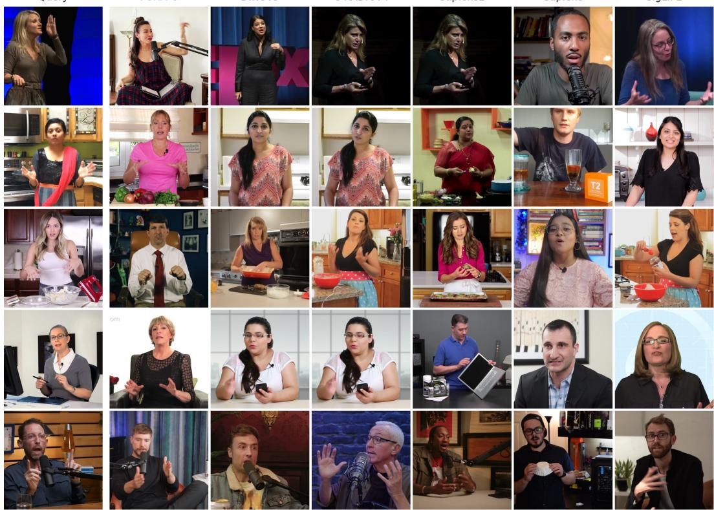  
Figure A.1: Motion retrieval across identities. Selected queries (left) and their nearest neighbors from FUHA-C and five vision-encoder baselines. The gallery excludes the query’s identity. Baseline variants are DINOv3 ViT-B/16, C-RADIOv4-SO400M, Sapiens2-0.1B, Sapiens-0.3B, and SigLIP2- base-p16-224, from left to right.

## A.2 MOTION LATENT-SPACE WALKS

Using FUHA-C, we linearly interpolate between the motion embeddings of two driver frames, $\mathbf { m } ( t ) = ( 1 - t ) \mathbf { m } _ { A } + t \mathbf { m } _ { B }$ , and decode each step on a fixed reference (Figure A.3). Over 25 head-pose and expression walks (16 within a clip, 9 across people) and six references, the dominant SMIRK (Retsinas et al., 2024) parameter typically changes monotonically and almost linearly in t (median Spearman $\rho = 1 . 0 0 , R ^ { 2 } = 0 . 9 9$ ; Figure A.2). Each walk pairs two test frames that differ mainly in one factor (head yaw, pitch, roll, torso lean, mouth, eyes, or smile; two cross-person walks mix pose and expression); $\rho$ and $R ^ { 2 }$ are medians over walks of per-walk medians over the six references. ArcFace (Deng et al., 2019) similarity to the reference stays flat (median 0.75), and similarity to either driver stays at or below 0.19. The motion embedding space is thus smooth and shared across people: straight lines between two embeddings decode to gradual, near-linear motion, cross-person walks behave like same-clip ones, and the rendered identity stays with the reference throughout. The bottom two walks in Figure A.3 also articulate the hands.

## A.3 CONDITIONING A DIFFUSION MODEL

We test whether the motion embedding transfers to a different decoder by conditioning Wan2.2- Animate-14B (Cheng et al., 2025) on the frozen FUHA-C motion embedding and the motion maps decoded from it, denoted FUHA-W. A convolutional adapter maps FUHA-C’s mean-centered motion maps to Wan’s 16-channel pose input with 4× temporal downsampling. We mean-center each motion map by subtracting a fixed per-position mean, computed over 6,400 training frames from 200 clips. A two-layer MLP maps the flattened motion embedding to 512-dimensional expression features, replacing Wan’s face-crop motion encoder. We retain Wan’s reference-image conditioning and train the adapters, pose-input convolution, expression encoder, and rank-64 LoRA in its attention and feed-forward layers for 12,000 self-reenactment steps on our training data with a flow-matching loss. FUHA-C, the Wan VAE, and the CLIP image encoder remain frozen; keypoints are used only for face and hand weighting of the training loss.

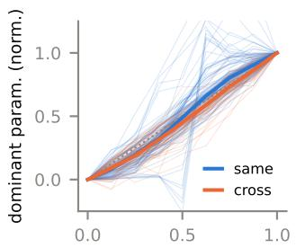  
t

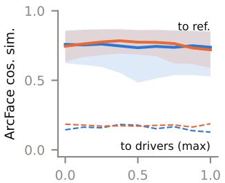  
t  
Figure A.2: Walk measurements over 25 walks and six references. Left: dominant SMIRK parameter, normalized by the decoded endpoints (thin: walk and reference; thick: median; dotted: linear). Right: ArcFace similarity to the reference (solid: median; band: 10th–90th percentile) and to either driver (dashed: maximum). Same: both drivers from one clip; cross: from two people.

Table A.2 compares FUHA-W with FUHA-C and diffusion baselines across all three driving regions. For upper-body animation, FUHA-W lowers FVD relative to FUHA-C (self 38.9 to 27.9; cross 171.7 to 125.0), while FID worsens (self 15.2 to 18.4; cross 55.9 to 56.4), ID drops (self 0.820 to 0.781; cross 0.701 to 0.676), and expression and keypoint errors rise. For face animation, FUHA-W improves cross-ID and cross-FVD but is worse than FUHA-C on every self-reenactment metric and on cross-reenactment expression and head-pose errors. On full-body animation, FUHA-C performs better across the reported metrics.

Compared with the released Wan-Animate and UniAnimate-DiT, FUHA-W achieves lower upperbody cross-FVD (125.0 versus 207.4 and 145.8) and higher cross-ID (0.676 versus 0.489 and 0.630). Against Wan-Animate, its cross-reenactment motion errors are higher (AED 0.827 versus 0.765, AKD-B 61.4 versus 50.8, AKD-H 94.8 versus 93.4). For face animation, FUHA-W improves self-FVD over PersonaLive (189.2 versus 210.1) and cross-ID (0.763 versus 0.698), while PersonaLive has lower cross-AED (0.811 versus 0.929) and cross-FVD (561.3 versus 581.4). The gains do not extend to full-body FVD, where Wan-Animate and UniAnimate-DiT score 168.2 and 170.8, compared with 260.8 for FUHA-W. With 10 denoising steps at 5122, FUHA-W runs at 0.74 FPS on a single RTX Pro 6000, compared with 10.7 FPS for FUHA-C. The frozen motion embedding thus drives a video diffusion model in place of skeletons and face crops; the diffusion prior improves upper-body video quality at the cost of speed and motion accuracy.

Figure A.4 compares FUHA-C and FUHA-W with UniAnimate-DiT and Wan-Animate on upper-body cross-reenactment.

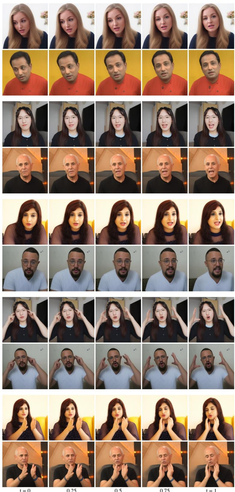

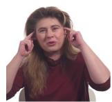

  
Driver A  
t = 0  
0.25  
0.5  
0.75  
t = 1

Figure A.3: Motion latent-space walks. We linearly interpolate between the FUHA-C motion embeddings of two driver frames (left and right) and decode each step on two fixed references. The top three walks change head pose and expression; the bottom two move the hands. Walks 3 and 5 interpolate between two different people. Motion changes smoothly while the reference identity is preserved.  

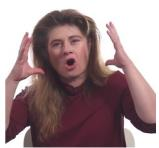

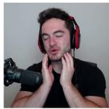  
Driver B

Table A.2: Animation with a diffusion decoder. FUHA-W uses the FUHA-C motion embedding to condition Wan. Baseline results are reproduced from Tables 1–3. Cells are ranked within each setting and region ( 1st , 2nd , 3rd )
<table><tr><td colspan="11">(a) Upper-body</td></tr><tr><td>Setting</td><td>Model</td><td>L1↓</td><td>SSIM↑</td><td>LPIPS ↓</td><td>ID↑</td><td>AED↓</td><td>AKD-B↓</td><td>AKD-H↓</td><td>FID↓</td><td>FVD↓</td></tr><tr><td rowspan="4">Self</td><td>Wan-Animate</td><td>0.0643</td><td>0.712</td><td>0.219</td><td>0.668</td><td>0.467</td><td>37.6</td><td>70.5</td><td>24.4</td><td>133.4</td></tr><tr><td>UniAnimate-DiT0.0717</td><td></td><td>0.724</td><td>0.201</td><td>0.694</td><td>0.618</td><td>46.6</td><td>86.6</td><td>20.3</td><td>66.0</td></tr><tr><td>FUHA-C</td><td>0.0287</td><td>0.838</td><td>0.106</td><td>0.820</td><td>0.315</td><td>27.1</td><td>48.5</td><td>15.2</td><td>38.9</td></tr><tr><td>FUHA-W</td><td>0.0413</td><td>0.781</td><td>0.140</td><td>0.781</td><td>0.472</td><td>32.8</td><td>56.6</td><td>18.4</td><td>27.9</td></tr><tr><td rowspan="4">Cross</td><td>Wan-Animate</td><td></td><td></td><td>一</td><td>0.489</td><td>0.765</td><td>50.8</td><td>93.4</td><td>57.5</td><td>207.4</td></tr><tr><td>UniAnimate-DiT</td><td></td><td></td><td>一</td><td>0.630</td><td>0.850</td><td>55.7</td><td>97.2</td><td>50.2</td><td>145.8</td></tr><tr><td>FUHA-C</td><td></td><td></td><td></td><td>0.701</td><td>0.686</td><td>51.5</td><td>88.8</td><td>55.9</td><td>171.7</td></tr><tr><td>FUHA-W</td><td></td><td></td><td></td><td>0.676</td><td>0.827</td><td>61.4</td><td>94.8</td><td>56.4</td><td>125.0</td></tr><tr><td colspan="11">(b) Face</td></tr><tr><td>Setting</td><td>Model</td><td>L1↓</td><td>SSIM↑</td><td>LPIPS↓</td><td></td><td>ID↑</td><td>AED↓</td><td>APD↓</td><td>FID↓</td><td>FVD↓</td></tr><tr><td rowspan="3">Self</td><td>PersonaLive</td><td>0.0721</td><td>0.698</td><td>0.239</td><td></td><td>0.870</td><td>0.323</td><td>0.0171</td><td>32.6</td><td>210.1</td></tr><tr><td>FUHA-C</td><td>0.0526</td><td>0.782</td><td>0.185</td><td></td><td>0.876</td><td>0.293</td><td>0.0131</td><td>35.0</td><td>153.8</td></tr><tr><td>FUHA-W</td><td>0.0685</td><td>0.724</td><td>0.234</td><td></td><td>0.855</td><td>0.429</td><td>0.0297</td><td>42.0</td><td>189.2</td></tr><tr><td rowspan="3">Cross</td><td>PersonaLive</td><td></td><td></td><td></td><td></td><td>0.698</td><td></td><td></td><td></td><td></td></tr><tr><td>FUHA-C</td><td></td><td>一 一</td><td></td><td></td><td>0.654</td><td>0.811 0.750</td><td>0.0365 0.0321</td><td>154.9</td><td>561.3</td></tr><tr><td>FUHA-W</td><td></td><td></td><td></td><td></td><td>0.763</td><td>0.929</td><td>0.0651</td><td>158.2 157.1</td><td>645.3 581.4</td></tr><tr><td colspan="11">(c) Full-body</td></tr><tr><td colspan="11">Setting Model L1↓ SSIM ↑ PSNR ↑ LPIPS</td></tr><tr><td colspan="3"></td><td></td><td></td><td>ID↑</td><td></td><td>AED↓ AKD-B↓AKD-H↓FID↓FVD↓</td><td></td><td></td><td></td></tr><tr><td>Self</td><td>Wan-Animate</td><td>0.0815</td><td>0.768</td><td>17.76</td><td>0.310</td><td>0.427 0.705</td><td>46.8</td><td>84.5</td><td>36.1</td><td>168.2</td></tr><tr><td rowspan="4"></td><td>UniAnimate-DiT</td><td>0.0672</td><td>0.818</td><td>19.11</td><td>0.247</td><td>0.458</td><td>0.705</td><td>44.9</td><td>76.4</td><td>25.9 170.8</td></tr><tr><td>FUHA-C</td><td>0.0559</td><td>0.852</td><td>20.50</td><td>0.236</td><td>0.5190.605</td><td>44.2</td><td>69.5</td><td>37.9</td><td>230.5</td></tr><tr><td>FUHA-W</td><td>0.0842</td><td>0.795</td><td>16.98</td><td>0.309</td><td>0.438</td><td>0.751 58.7</td><td>92.2</td><td></td><td>54.3 260.8</td></tr><tr><td></td><td></td><td></td><td></td><td></td><td></td><td></td><td></td><td></td><td></td></tr></table>

Reference  
Driver  
UniAnimate-DiT  
Wan-Animate  
FUHA-C  
FUHA-W  
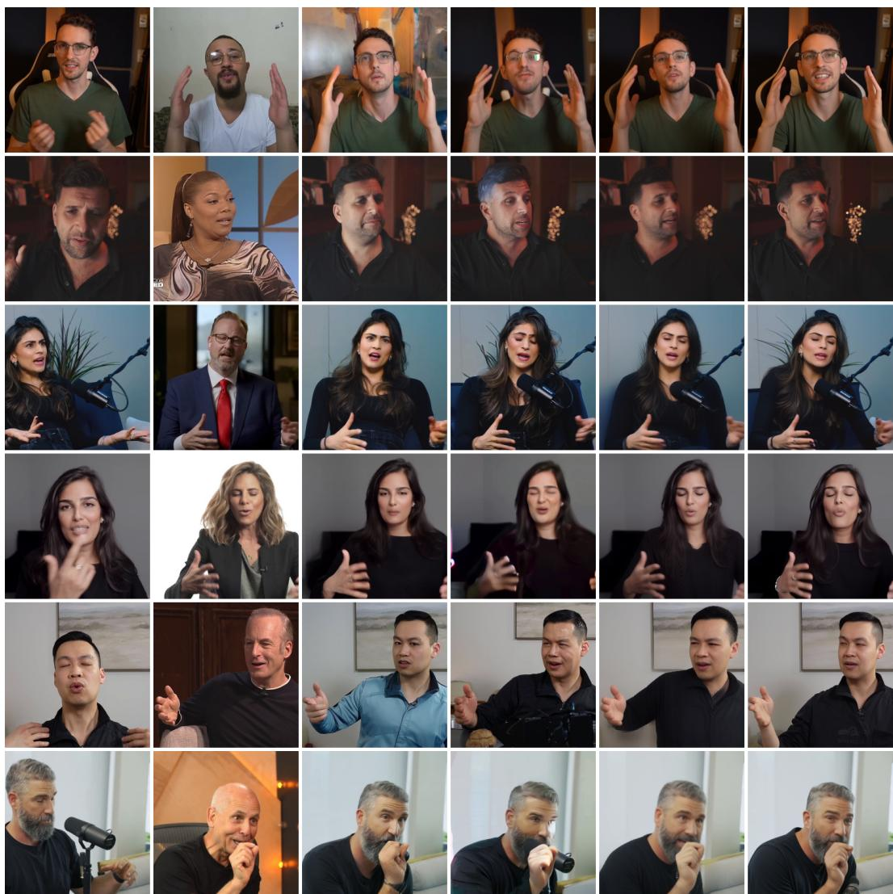  
Figure A.4: Qualitative results with FUHA-W. The diffusion decoder used in FUHA-W yields improved visual details at a slight expense of pose accuracy. All methods use the same reference image and driving frame in each row.

## B ADDITIONAL RESULTS

## B.1 TEMPORAL CONSISTENCY

Table B.1 reports tLP (Chu et al., 2020) for self-reenactment: the mean absolute difference between the LPIPS of consecutive output frames and that of consecutive ground-truth frames. Cross-reenactment has no ground-truth motion, so tLP is not reported there. FUHA-C has the lowest tLP on face and upper-body, although it renders every frame independently. It is trained with reconstruction losses and uses keypoints only as soft guidance through the contrastive loss, which likely keeps its output close to each driver frame, so its frame-to-frame change tracks that of the ground truth. On full-body, three baselines are lower.

Table B.1: Temporal consistency: self-reenactment tLP ↓ (×100). – marks methods not evaluated on a benchmark. Cells are shaded by per-column rank: 1st , 2nd , and 3rd .
<table><tr><td>Method</td><td>Face</td><td>Upper-body</td><td>Full-body</td></tr><tr><td>LivePortrait</td><td>1.96</td><td></td><td></td></tr><tr><td>X-Portrait</td><td>2.60</td><td></td><td></td></tr><tr><td>FollowYE</td><td>1.90</td><td></td><td></td></tr><tr><td>X-NeMo</td><td>1.97</td><td></td><td></td></tr><tr><td>HunyuanPortrait</td><td>2.01</td><td></td><td>一</td></tr><tr><td>PersonaLive</td><td>2.47</td><td></td><td></td></tr><tr><td>Moore-AA</td><td></td><td>2.61</td><td>2.33</td></tr><tr><td>Champ</td><td></td><td>3.21</td><td>3.77</td></tr><tr><td>MimicMotion</td><td></td><td>0.77</td><td>2.62</td></tr><tr><td>Wan-Animate</td><td></td><td>2.59</td><td>4.41</td></tr><tr><td>UniAnimate-DiT</td><td></td><td>1.01</td><td>2.50</td></tr><tr><td>Animate-X</td><td></td><td></td><td>3.47</td></tr><tr><td>FUHA-C</td><td>1.87</td><td>0.47</td><td>3.22</td></tr><tr><td>FUHA-T</td><td>1.93</td><td>0.56</td><td>3.45</td></tr></table>

## B.2 QUALITATIVE COMPARISONS

We provide extended qualitative comparisons for face (Figure B.1), upper-body (Figure B.2), and full-body (Figure B.3) animation against the baselines from Table 2, Table 1, and Table 3, respectively.

Reference  
Driver  
LivePortrait  
X-Portrait  
FollowYE  
X-NeMo  
HunyuanPortrait  
PersonaLive  
FUHA-C  
FUHA-T  
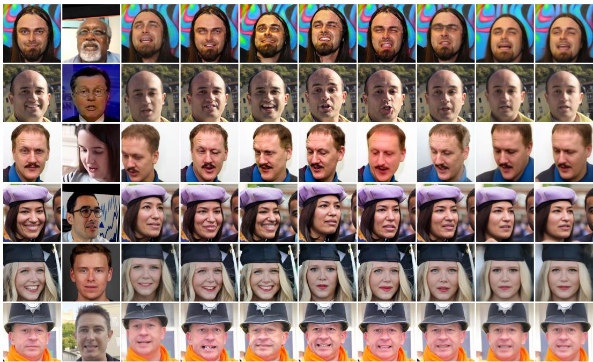  
Figure B.1: Qualitative results for face animation. The final two columns show FUHA-C and FUHA-T, respectively. Beyond head pose and facial expression, FUHA captures shoulder pose and camera-relative head distance.

Reference  
Driver  
Moore-AA  
Champ  
MimicMotion  
Wan-Animate  
UniAnimate-DiT  
FUHA-C  
FUHA-T  
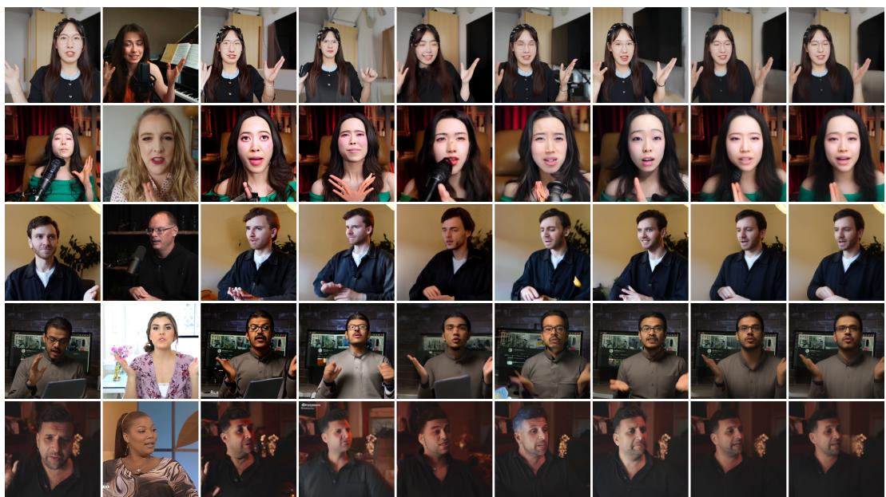  
Figure B.2: Additional qualitative results for upper-body animation. The final two columns show FUHA-C and FUHA-T, respectively.

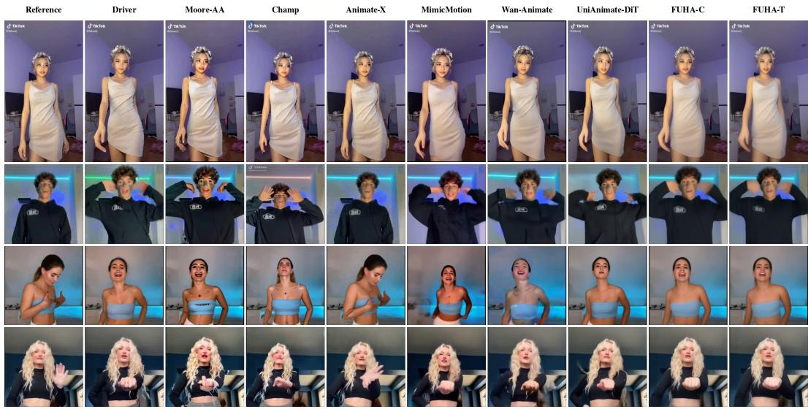  
Figure B.3: Qualitative results for full-body animation. The final two columns show FUHA-C and FUHA-T, respectively. FUHA transfers body pose and facial expression accurately.

## C FULL ABLATION STUDY

We provide the full FUHA-C ablation numbers in Table C.1 (self- and cross-reenactment) and qualitative samples in Figure C.1. All variants use the Cosmos tokenizer and are trained for 60 epochs. The ReLU contrastive variant raises cross-ID to 0.730 but is worse than softplus on every self-reenactment metric and on every cross-reenactment motion error.

Table C.1: FUHA-C ablations on the upper-body set at $5 1 2 ^ { 2 } .$ . ( 1st , 2nd , 3rd )
<table><tr><td></td><td colspan="4">Self-Reenactment</td><td colspan="6">Cross-Reenactment</td></tr><tr><td>Variant</td><td>LPIPS↓</td><td>ID↑</td><td>FID↓</td><td>FVD↓</td><td>ID↑</td><td>AED↓</td><td>AKD-B↓</td><td>AKD-H↓</td><td>FID↓</td><td>FVD↓</td></tr><tr><td>1 motion token</td><td>0.351</td><td>0.134</td><td>78.8</td><td>258.5</td><td>0.088</td><td>0.724</td><td>57.8</td><td>92.6</td><td>88.0</td><td>310.8</td></tr><tr><td>2 motion tokens</td><td>0.106</td><td>0.820</td><td>15.2</td><td>38.9</td><td>0.701</td><td>0.686</td><td>51.5</td><td>88.8</td><td>55.9</td><td>171.7</td></tr><tr><td>4 motion tokens</td><td>0.127</td><td>0.812</td><td>17.7</td><td>63.1</td><td>0.733</td><td>0.761</td><td>58.9</td><td>91.6</td><td>55.7</td><td>201.9</td></tr><tr><td>ReLU contrastive</td><td>0.125</td><td>0.813</td><td>16.8</td><td>54.6</td><td>0.730</td><td>0.709</td><td>55.4</td><td>91.9</td><td>55.6</td><td>189.2</td></tr><tr><td>w/o DINO in appearance</td><td>0.125</td><td>0.811</td><td>18.3</td><td>59.4</td><td>0.712</td><td>0.732</td><td>55.8</td><td>91.1</td><td>56.1</td><td>202.4</td></tr><tr><td>w/o contrastive loss</td><td>0.340</td><td>0.199</td><td>88.8</td><td>263.9</td><td>0.057</td><td>0.606</td><td>47.8</td><td>80.3</td><td>101.1</td><td>325.9</td></tr><tr><td>w/o 2D motion decoder</td><td>0.116</td><td>0.799</td><td>16.9</td><td>49.2</td><td>0.689</td><td>0.685</td><td>51.9</td><td>86.9</td><td>57.6</td><td>193.0</td></tr><tr><td>w/o ID loss</td><td>0.110</td><td>0.764</td><td>15.6</td><td>41.5</td><td>0.568</td><td>0.671</td><td>52.1</td><td>86.5</td><td>56.8</td><td>170.6</td></tr><tr><td>FUHA-C</td><td>0.106</td><td>0.820</td><td>15.2</td><td>38.9</td><td>0.701</td><td>0.686</td><td>51.5</td><td>88.8</td><td>55.9</td><td>171.7</td></tr></table>

Reference  
Driver  
w/o contrastive  
w/o DINO app.  
w/o motion dec.  
w/o ID  
FUHA-C (full)  
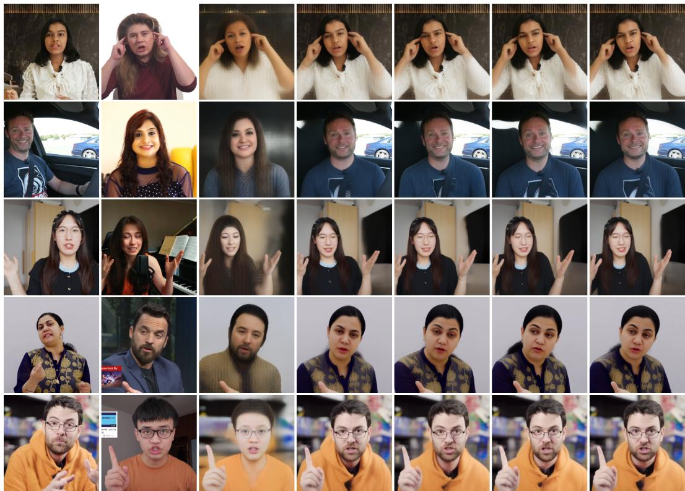  
Figure C.1: Qualitative ablation comparisons on the upper-body cross-reenactment set. Each row is a (reference, driver) pair; from left to right we show the reference image, the driver frame, four component ablations, and the full FUHA-C model. Without the contrastive loss (third column), outputs take the driver’s hair, gender, and face shape at low detail, but the reference’s background and clothing; the other ablations stay close to FUHA-C. See Table C.1 for matching numerical values.

## D IMPLEMENTATION DETAILS

## D.1 ARCHITECTURE

FUHA uses a transformer-based encoder–decoder architecture with the components below. All trainable transformers use Pre-LayerNorm, GELU activations, dropout 0.1, hidden dimension d=512, and feed-forward dimension 4d=2048.

Frozen feature extractors. We use two frozen backbones: (1) a DINOv3 ViT-B/16 (Siméoni et al., 2025) with 768-dimensional patch features at patch size 16, and (2) a Cosmos CV8×8×8 tokenizer (Agarwal et al., 2025) with a spatial compression factor of 8 and 16 latent channels. FUHA-T replaces Cosmos with TAESD3. Both the visual encoder and the tokenizer are kept frozen throughout training. Image-space losses backpropagate through the tokenizer decoder but do not update its weights.

Feature fusion (appearance side only). The reference image’s tokenizer features and DINOv3 features are independently projected to dimension d via two-layer MLPs $( d _ { \mathrm { i n } }  d  d _ { \cdot }$ , GELU + LayerNorm) and summed at every spatial location, with a 2D sinusoidal positional encoding $\sigma _ { 2 D }$ added before the appearance encoder. Driver features use the same projection but are not fused with tokenizer features; the motion encoder reads DINOv3 features only.

Appearance encoder. A Q-Former (Li et al., 2023) with 12 transformer-decoder layers and 8 attention heads, attending with $N _ { a } { = } 1 0 2 4$ learned query tokens.

Motion encoder. A Q-Former with 8 layers and 8 heads, attending with $N _ { m } { = } 2$ learned query tokens to driver DINOv3 features only.

Motion decoder. A Q-Former with 8 layers and 8 heads. Its $L ^ { 2 }$ learned spatial queries (with $\sigma _ { 2 D } )$ attend to the motion tokens, producing a motion map matched to the tokenizer latent grid: L=64 at 512×512 input (L=32 at 256×256).

Appearance decoder. A transformer decoder with 16 layers and 8 heads. Its queries are the motion map (with PE re-applied); its memory is the appearance embeddings a. The output is projected to the tokenizer latent dimension via a two-layer MLP and decoded by the frozen tokenizer decoder.

The transformer modules contain 189M trainable parameters: 51M in the appearance encoder, evaluated once per reference, and 138M in the modules evaluated for each driving frame. Including the frozen DINOv3 and Cosmos backbones, FUHA-C contains 380M parameters.

## D.2 TRAINING

Optimizer. We use AdamW (Loshchilov & Hutter, 2019) with peak learning rate $5 \times 1 0 ^ { - 4 }$ and no weight decay. The learning rate follows a OneCycleLR schedule with linear warmup over 1 epoch and cosine annealing, starting and ending at $\mathrm { { l r } _ { p e a k } \bar { / 1 0 ^ { 4 } } }$ . Gradients are clipped to a maximum norm of 1.0. We train for 60 epochs (approx. 3 days) on 64 H100 GPUs (8 nodes) with BF16 mixed precision and DDP. Each GPU processes batches of 8 with 2 gradient accumulation steps, for an effective batch size of 1,024.

Loss weights. The objective combines the three losses defined in Section 3.3:

$$
\begin{array} { r } { \mathcal { L } = \mathcal { L } _ { \mathrm { r e c } } + \lambda _ { \mathrm { t r i } } \mathcal { L } _ { \mathrm { t r i } } + \lambda _ { \mathrm { i d } } \mathcal { L } _ { \mathrm { i d } } , } \end{array}\tag{2}
$$

which expands as

$$
\mathcal { L } = \lambda _ { \mathrm { L 1 } } \mathcal { L } _ { \mathrm { L 1 } } + \lambda _ { \mathrm { L P I P S } } \mathcal { L } _ { \mathrm { L P I P S } } + \lambda _ { \mathrm { t r i } } \mathcal { L } _ { \mathrm { t r i } } + \lambda _ { \mathrm { i d } } \mathcal { L } _ { \mathrm { i d } } ,\tag{3}
$$

with $\lambda _ { \mathrm { L 1 } } { = } 1 . 0 ,$ λLPIPS=1.0, $\lambda _ { \mathrm { t r i } } { = } 0 . 2 ,$ and $\lambda _ { \mathrm { i d } } { = } 0 . 0 1$

Spatial weighting. The image-space losses (L1 and LPIPS) are spatially weighted using perpixel region masks. The per-region weights are: background 0.1, foreground 0.2, face 1.0, eyes 10.0, mouth 5.0, hands 10.0. Foreground masks are produced by BiRefNet (Zheng et al., 2024); face/eyes/mouth/hands masks are computed on the fly from precomputed keypoints (Appendix F).

Contrastive loss. We apply a triplet loss (Equation 1) on the L2-normalized, flattened motion embedding with cosine distance δ and softplus activation (margin 0). The normalization is applied only when computing the loss; the decoder receives the unnormalized embeddings. The anchor is the motion embedding of the driver frame. The positive is the motion embedding of a second view of the driver: a rendered keypoint image when face keypoints are available (the majority of samples), or a foreground-segmented crop otherwise (BiRefNet matting (Zheng et al., 2024) applied to a grayscale or RGB foreground). The negative is the motion embedding of the reference frame, which has the same identity as the target output but a different pose.

Identity loss. We use the AdaFace (Kim et al., 2022a) cosine distance on aligned 5-point landmark face crops, computed against the driver/target frame (pose-matched, same identity). The loss is gated to samples for which face keypoints are available.

Input dropout. During training, we apply token-level dropout (rate 0.1) to both the driver and reference feature sequences before the motion and appearance encoders, respectively, to improve robustness.

Data augmentation. We apply photometric augmentations to the driver input only, each with probability 0.5: brightness (±0.3), contrast (±0.3), hue shift (±40◦), saturation shift (±50), value shift (±40), CLAHE (clip limit 4.0, tile grid 8 × 8), Gaussian blur, and Gaussian noise. Gamma correction (range [0.8, 1.2]) is applied with probability 0.3. Driver, target, and reference share one random square crop (scale 0.9–1.0).

## E EVALUATION DETAILS

We evaluate FUHA in three settings: face, upper body, and full body. Each has its own test set and metric set.

## E.1 METRIC DEFINITIONS

## Spatial (per-frame).

• L1 ↓: pixel mean absolute error.

• SSIM ↑: standard SSIM, averaged across frames.

• PSNR ↑: standard PSNR (full-body only).

• LPIPS ↓: LPIPS with AlexNet backbone (Zhang et al., 2018).

## Temporal.

• FVD ↓: Fréchet distance computed at the dataset level over 400-dim I3D features extracted in 16-frame chunks at 224 × 224 resolution (StyleGAN-V protocol (Skorokhodov et al., 2022)). The real videos are the ground-truth targets for self-reenactment and the driving videos for crossreenactment.

## Distribution.

• FID ↓: standard Inception-v3 FID, computed dataset-wide over all predicted and real frames (ground-truth targets for self-reenactment, driving frames for cross-reenactment).

In cross-reenactment, the real set shows the driver’s identity, clothing, and background, so we read FID and FVD together with ID. The 95% intervals are paired bootstrap intervals of per-clip differences to FUHA-C (10,000 resamples of clips or pairs); they reflect clip sampling, not seed variance, and do not apply to the dataset-level FID and FVD.

## Identity and Face-Driven.

• ID ↑: ArcFace (Deng et al., 2019) identity similarity (InsightFace buffalo\_l embeddings), averaged across frames. For self-reenactment, the target for each predicted frame pred is the driving frame at the same time step drv , following Guo et al. (2024). For cross-reenactment, where no per-frame ground truth in the source identity exists, we use similarity against the static reference

image, following prior reenactment evaluation (Xu et al., 2025; Zhao et al., 2025; Li et al., 2026;   
Xie et al., 2024).

• AED ↓: L1 distance between SMIRK (Retsinas et al., 2024) expression parameters (50-dim) of prediction and target (GT for self-reenactment; driving frame for cross-reenactment).

• APD ↓: L1 distance between SMIRK head-rotation parameters (3-dim axis-angle) of prediction and target.

Body- and Hand-Pose (body settings only). We use the RTMW-x 133-keypoint wholebody estimator (Jiang et al., 2024) (performance mode, 384 × 288 input). A keypoint is included only if both GT and prediction detection confidences exceed 0.3. Distance is raw pixel L2 after resizing predictions to GT resolution.

• AKD-B ↓: average pixel L2 over the 17 COCO body keypoints.

• AKD-H ↓: average pixel L2 over 42 hand keypoints (21 per hand).

Face crop for body settings. For AED in body settings (face is small in frame), we detect the GT face with InsightFace (largest bounding box, padded by 0.3, cached so prediction and GT share the same crop), resize to 256 × 256, then run SMIRK. Frames with no GT face detection are excluded. For ID, images are not pre-cropped: the standard InsightFace pipeline (detection → 5-keypoint similarity warp → 112 × 112 aligned face → ArcFace) is applied identically to prediction and target, with InsightFace handling face localization.

Face protocol. We use the TalkingHead-1KH (Wang et al., 2021) test set at 512 × 512, 128 frames per clip. One of its test videos also appears in our training data; excluding its clips leaves the ranking on every per-clip face metric unchanged. Self-reenactment (37 clips): frame 0 is the reference; frames 1:128 are the driver and ground truth. Metrics: L1, SSIM, LPIPS, ID, AED, APD, FID, FVD. Cross-reenactment (100 pairs): the first 100 FFHQ (Karras et al., 2019) images serve as reference identities, each paired with a clip drawn at random, with replacement, from the 37 TalkingHead-1KH clips (33 distinct). Metrics: ID, AED, APD, FID, FVD (no pixel-paired metrics, since no ground truth exists).

Upper-body protocol. We use our upper-body benchmark with 96 self-reenactment clips and 96 cross-reenactment pairs, curated from public video sources following Appendix F. Test clips come from videos excluded from training. As is common in web-scale video data, the same people, and occasionally the same footage, can recur in training videos. Self-reenactment (96 clips): L1, SSIM, LPIPS, ID, AED, AKD-B, AKD-H, FID, FVD. Cross-reenactment (96 pairs): each clip is the reference once and the driver once, never paired with itself. Metrics: ID, AED, AKD-B, AKD-H, FID, FVD.

Full-body protocol. We use the TikTok dance test set (Jafarian & Park, 2021) (10 clips) for full-body self-reenactment only; no cross-reenactment protocol is standardized for this benchmark. Metrics: L1, SSIM, PSNR, LPIPS, ID, AED, AKD-B, AKD-H, FID, FVD.

Resolution. We evaluate face and upper-body at 512 × 512, our training resolution, and full-body at the source resolution of the TikTok videos.

Test-set availability. The test sets of CyberHost (Lin et al., 2025a), OmniHuman-1 (Lin et al., 2025b), X-UniMotion (Song et al., 2025), and Animate-X (Tan et al., 2025) are not public. We therefore curate our upper-body benchmark (96 self-reenactment clips, 96 cross-reenactment pairs) and use the public TikTok dance test split (Jafarian & Park, 2021) (10 clips) for full-body, matching the protocol of DreamActor-M1 (Luo et al., 2025).

## F DATASET DETAILS

We describe the preprocessing details for our curated training dataset. The same pipeline produced the upper-body test set of Table 1.

Composition. We aggregate raw video files from four public sources: HD-VILA-100M (Xue et al., 2022), CelebV-Text (Yu et al., 2023), TalkVid (Chen et al., 2025), and SpeakerVid-5M (Zhang et al.,

2025a). Of 430,989 source videos, 169,443 pass all filtering stages, yielding 1,056,941 clips of 10–20 seconds each and totaling 5,172.1 hours of footage. Each clip carries per-frame body, face, and hand keypoint annotations.

Preprocessing pipeline. Table F.1 summarizes the per-stage filtering applied to source videos. We additionally require $\geq 7 2 0 \mathrm { p }$ source resolution, apply 2× bounding-box expansion around the detected person, and resample to 25 FPS.

Table F.1: Training data processing pipeline.
<table><tr><td>Stage</td><td>Model used</td><td>Criterion / output</td></tr><tr><td>Shot boundaries Single-human detection</td><td>TransNetV2 (Soucek &amp; Lokoc, 2024) RTMW-x (Jiang et al., 2024)</td><td>score threshold 0.2; 10–20 s shots conf ≥ 0.5 on 5 sampled frames; vis- ible motion</td></tr><tr><td>Video-quality filter</td><td>DOVER (Wu et al., 2023)</td><td>score  $\geq 0 . 5 0$ </td></tr><tr><td>Static-background filter</td><td>InSPyReNet (Kim et al., 2022b)</td><td>median background pixel std ≤ 1.0</td></tr><tr><td>Text-overlay filter</td><td>FAST-Tiny (Chen et al., 2021)</td><td>detected text area  $\leq 2 \%$  of frame</td></tr><tr><td>Body keypoints</td><td>RTMPose-Body (Jiang et al., 2023)</td><td>17 COCO-format keypoints</td></tr><tr><td></td><td></td><td></td></tr><tr><td>Face keypoints</td><td>SPIGA (Prados-Torreblanca et al., 2022)</td><td>98 landmarks + head pose</td></tr><tr><td>Hand keypoints</td><td>WiLoR-mini (Potamias et al., 2025)</td><td>21 3D keypoints per hand</td></tr></table>

## G EFFICIENCY

Table 5 reports single-GPU inference in eager mode, with most methods measured on an RTX Pro 6000; FollowYE uses a Titan V and Champ an RTX 4090. FUHA-C/T use BF16 mixed precision. We report the median of three passes over 128 driving frames (125 for UniAnimate-DiT, which requires 4k+1 frames) at $5 1 2 ^ { 2 }$ , including reference and motion encoding, image generation, and the baselines pose, landmark, or guidance extraction; model loading, video decoding, and file I/O are excluded. The RTX 4090 speeds in Section 4.5 use the four TorchScript-exported modules in FP16, frame by frame (batch size 1) over 128 synthetic $5 1 2 ^ { 2 }$ driving frames, with the appearance encoded once inside the timed region and host-to-device copies excluded; we report the median of three passes after two warm-up passes. Peak VRAM on the RTX 4090 is 3.6 GB (FUHA-C) and 2.6 GB (FUHA-T). Peak VRAM is the PyTorch allocator peak after one warm-up pass (FollowYE and Champ: without warm-up, on their GPUs). The diffusion baselines use 4 (PersonaLive), 20 (Wan-Animate, Champ), 25 (HunyuanPortrait, MimicMotion), 30 (Moore-AA, X-Portrait, FollowYE), 35 (X-NeMo), and 50 (UniAnimate-DiT, with TeaCache) denoising steps.

## H LIMITATIONS

FUHA renders each frame independently, without temporal modeling or a generative prior; this favors speed and statelessness, and on full-body the best diffusion baselines are temporally smoother (Appendix B.1). Fine detail such as hair and fabric, and regions hidden in the reference, are softer than with diffusion-based methods, the best of which obtain lower FID and FVD in cross-reenactment and on full-body. Training relies on keypoints from offline estimators and inherits their errors. Our data contains no non-human characters, which FUHA animates less reliably. A video diffusion decoder driven by the same frozen motion embedding (FUHA-W) closes the upper-body cross-FVD gap but runs far from real time (Appendix A.3). Future work includes a faster, temporally aware decoder for the motion embedding, and driving the embedding from audio.