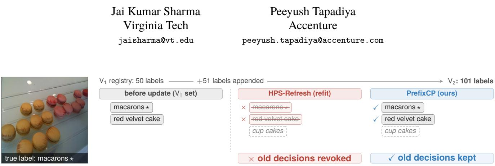
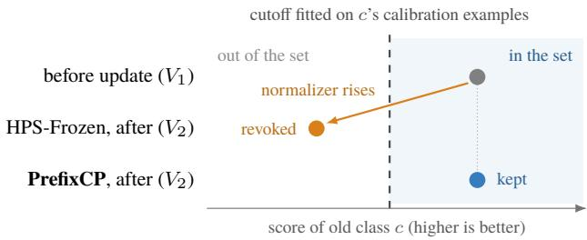
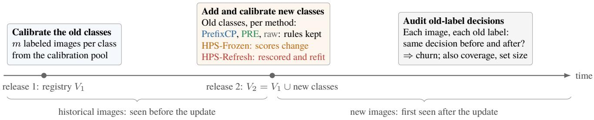
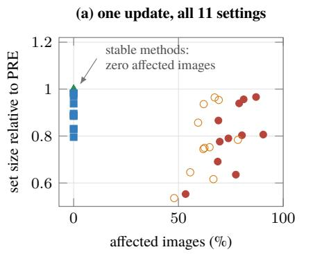
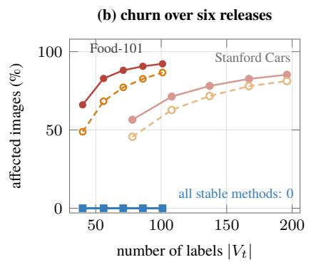
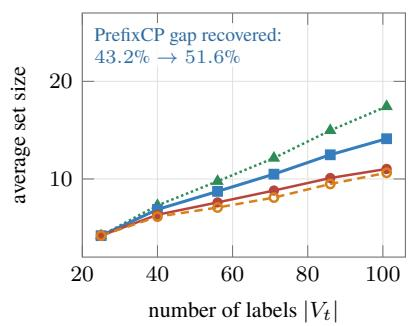
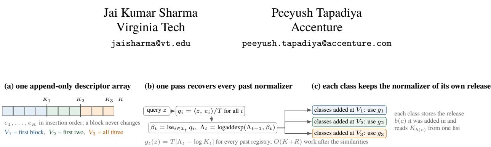

# Coverage Hides Churn: Auditing and Preserving Conformal Decisions as VLM Label Registries Grow

  
Figure 1. Recalibrating can revoke old decisions. For this Food-101/SigLIP image, HPS-Refresh rescores and refits the old classes afte 51 labels are added, and drops both previously included labels, including the true class. PrefixCP lets each class keep the registry it was added with, so both old decisions survive. Both methods also include the new label, shown dashed. It is the first evaluation image, in identifier order, whose sets are small enough to show and whose true old label HPS-Refresh drops (supplement Sec. M); it was scored blurred, as in all Food-101 settings, and is shown clean for legibility.

## Abstract

Vision–language classifiers can learn new labels from text alone, so the label lists they serve keep growing. We show that this growth silently changes conformal decisions about old labels. Common softmax-based conformal scores compare each label with an average over all labels; adding labels changes that average, and with it the score ofevery old label, even when the model, the image, and the old calibration data stay the same. Recalibrating after the update keeps the coverage guarantee, yet across eleven settings it changes at least one old decision on 53–90% ofnew images. Coverage cannot reveal this, because it checks only the true label: in five controlled settings that keep the old calibration, so that only the normalizer changes, old-class coverage moves by at most 0.01 while 60–67% of images change. We propose a lifecycle audit that measures these changes alongside coverage and set size, and a simple fix, PrefixCP: each class keeps the label registry that existed when it was added. Its old decisions then never change, each class keeps exact class-conditional coverage under exchangeability, and one prefix scan computes all historical normalizers at once. PrefixCP recovers 40.9–58.5% of the set-size gap between never updating the reference and recalibrating, which gives

smaller sets but changes old decisions.

## 1. Introduction

Vision–language models (VLMs) classify an image by comparing it with a text description of each label [22, 42]. Adding a label therefore needs no retraining: a product catalog can add a category by adding its name. We call the current list of labels the label registry. Deployments often wrap such classifiers in conformal prediction, which returns a prediction set of plausible labels instead of a single guess. A small set of labeled calibration examples decides which labels enter the set, and the method guarantees coverage: the set contains the true label with a chosen probability, such as 90% [3, 35].

Downstream systems often act on the labels in that set. A catalog might send an image for manual review whenever its set contains “damaged packaging.” Now suppose the catalog adds new product subcategories. The image has not changed, and neither has its similarity to “damaged packaging,” yet that label can drop out of the set and the review never happens. The cause is a shared normalizer: common softmax-based conformal scores compare each label’s similarity with an average over all labels [25], so adding labels changes the score of every old label (Fig. 2). We call changes

to old-label decisions churn.

Recalibrating after the update does not prevent churn. It restores the coverage guarantee, yet across eleven settings it changes at least one old decision on 53–90% of new images (Sec. 6.2; Fig. 1 shows one example). Standard evaluation misses this because coverage only checks the true label. In five controlled settings on Food-101 and Stanford Cars that keep the old calibration (HPS-Frozen), old-class coverage moves by at most 0.01 while at least one old decision changes on 60–67% of images (Sec. 6.1). Logging past outputs does not help either: a log can replay decisions for images already seen, but not for images that arrive after the update.

Our fix rests on one observation: conformal calibration can be done separately for each class, so classes need not share a score. PrefixCP lets each class keep the registry that existed when it was added. Its decisions then never change, and it keeps exact class-conditional coverage under the usual exchangeability assumption. Every earlier registry is a prefix of the current label list, so one prefix scan computes all of them cheaply. Stability has a price: recalibrating every class returns smaller sets in every setting we test.

We contribute (1) a lifecycle audit for conformal classifiers with a growing label registry, which measures churn on new images, coverage, set size, and dependence on release history; (2) an evaluation on five datasets, two encoders, and eleven settings; and (3) PrefixCP, with coverage and stability guarantees, an eficient implementation, and a measured trade-of between stability and set size.

## 2. Related work

Conformal prediction with a fixed label set. Conformal methods for VLMs improve the model, the score, or the calibration procedure, but evaluate one fixed label set [2, 10, 12, 17, 18, 29, 32, 41]. We keep the model fixed and let the label set grow. The closest set-size competitor, Conf-OT [30], is transductive: it reads an unlabeled batch of test images and guarantees marginal coverage. PrefixCP reads no test batch and guarantees class-conditional coverage and unchanged old decisions.

New labels and open-set prediction. Other work handles labels that have no calibration data [20, 21, 38, 39]. In our setting every new class arrives with labeled examples, so we ask a diferent question: does a class that is already deployed keep its rule when labels are added after it?

Model updates and fixed references. Backwardcompatible learning reduces prediction changes when the model is updated [13, 19, 27, 33, 40]; we fix the model and grow the label list. Hubness corrections and frozen label banks normalize every class against one shared reference [6, 8, 11, 15, 31, 43], and separated softmax uses diferent normalizers during training [1]. PrefixCP instead gives each class the reference that existed when it was added. Our earlier workshop audit [26] found poor per-class coverage under distribution shift; it did not study churn and supplies none of the evidence here.

## 3. Setting: a label registry that grows

Labels arrive in releases. The registry grows as $V _ { 1 } \subseteq \cdots \subseteq$ $V _ { R } ,$ with $K _ { t } = | V _ { t } |$ labels at version t and $K = K _ { R }$ . Each release adds at least one label, and $b ( c )$ is the version at which class c was added. At an update, old classes are those already in the registry and new classes are those being added. Each label has a fixed text descriptor (its prompt). A frozen VLM maps an image x to a unit vector $\bar { z } = \bar { \phi } ( x ) \in \mathbb { S } ^ { d - 1 }$ and the descriptor of class c to a unit vector $e _ { c } ;$ their inner product is the cosine similarity.

The shared normalizer. Homogeneous prediction sets (HPS) [25], the standard conformal method for softmax classifiers, subtract from every similarity one image-dependent ofset computed from all current labels:

$$
g _ { t } ( z ) = T \log \left[ \frac { 1 } { K _ { t } } \sum _ { j \in V _ { t } } \exp \left( \frac { \langle z , e _ { j } \rangle } { T } \right) \right] ,\tag{1}
$$

where $T > 0$ is the model temperature. We call $g _ { t } ( z )$ the normalizer. The score of class c is

$$
s _ { t } ( z , c ) = \langle z , e _ { c } \rangle - g _ { t } ( z ) .\tag{2}
$$

This is the temperature-scaled log-softmax probability $T \log p _ { t } ( c \mid z )$ plus the constant T log $K _ { t }$ . Each class has its own similarity, but all classes share one normalizer. Figure 2 shows what happens when labels are added: the similarity of an old class stays the same, the normalizer changes, and the score can cross the cutof fitted on that class’s calibration examples. The factor $1 / K _ { t }$ removes the efect of label count alone, so only which labels are added matters. After an update, HPS can be applied in two ways: HPS-Refresh rescores the old calibration examples with the new registry and refits every class, and HPS-Frozen rescores but keeps the old calibration values.

Classwise calibration. When class c is added, it is calibrated with $m _ { c }$ labeled examples; we call this onboarding, and the resulting rule its onboarding rule. The setting is few-shot, not zero-shot. To decide whether c enters the set for a new image, we rank the image’s score for c among the calibration scores of class c alone; higher scores mean better matches, and the true class is not needed. This classwise calibration (Mondrian conformal prediction [34]) is the design choice PrefixCP relies on: because each class is compared only with its own examples, diferent classes need not share a normalizer. Its cost is that every class needs labeled examples.

  
Figure 2. How adding labels revokes an old label (schematic). The image’s similarity to old class c is unchanged, but the new labels in $V _ { 2 }$ raise the shared normalizer, so $c \mathbf { \hat { s } }$ score falls below the cutof fitted on its own calibration examples and c leaves the set. HPS-Frozen keeps that cutof; HPS-Refresh also refits it, which can move decisions either way. PrefixCP keeps scoring c against V1, so its score and decision do not move.

A little randomness makes coverage exact. With $m _ { c } =$ 20 and target $\tau = 0 . 9$ , the image takes one of 21 equally likely ranks, so a fixed cutof gives coverage 18/21 or 19/21, never exactly 0.9. Instead, ranks 1–18 are included and rank 19 is included with probability 0.9, giving $( 1 8 + 0 . 9 ) / 2 1 =$ 0.9. A boundary variable makes this draw and a tie variable breaks ties [9, 25, 28, 34]; we call them the class’s random keys. They are derived from a stable record identifier $\iota ( x )$ such as a digest of the image bytes with an occurrence index, so the same record always gets the same draws and an unchanged rule reproduces its decisions exactly (supplement Sec. B). We write $\Gamma _ { t } ( x , \iota ) \subseteq V _ { t }$ for the prediction set and $D _ { t } ( x , c ; \iota ) = \mathbf 1 \{ c \in \Gamma _ { t } ( x , \iota ) \}$ for the decision about class c.

Definition 1 (Prospective old-label consistency). A system is prospectively old-label consistent if every old class keeps the same decision after every later registry update. Formally, for every $t ^ { \prime } \geq t , e \nu e r y c \in V _ { t } ,$ , and every input record $( x , \iota ( x ) )$

$$
D _ { t ^ { \prime } } ( x , c ; \iota ) = D _ { t } ( x , c ; \iota ) .\tag{3}
$$

Here everything fixed when c was added (its descriptor, score, calibration values, and random keys) stays fixed; see supplement Sec. B.4, What must remain fixed after a class is added.

The definition concerns old labels only: new labels may still join the set. It is also stronger than replaying a log, because it covers images first seen after the update.

## 4. PrefixCP

PrefixCP has two parts: a scoring rule that keeps old decisions fixed, and a computation that makes the rule cheap to serve.

1. Each class keeps the registry it was added with. Class c is scored against the registry $V _ { b ( c ) }$ that existed when it was

added:

$$
s _ { c } ( z ) = \langle z , e _ { c } \rangle - g _ { b ( c ) } ( z ) .\tag{4}
$$

We call $V _ { b ( c ) }$ the reference of class $c .$ The reference labels are fixed; the normalizer is still computed for each image. Class c keeps its onboarding rule: its calibration values and random keys never change, and labels added later never enter its score. A new class uses the full registry at the time it is added.

For example, let $V _ { 1 } = \{ \mathrm { c a t , d o g } \} , V _ { 2 } = V _ { 1 } \cup \{ \mathrm { f o x } \}$ , and $V _ { 3 } = V _ { 2 } \cup \{ \mathrm { w o l f } \}$ . Cat and dog keep $g _ { 1 }$ , fox keeps $g _ { 2 } .$ , and wolf uses $g _ { 3 } .$ Adding wolf changes every HPS score but no old PrefixCP rule. Had fox and wolf arrived together, both would use the four-label registry: a diferent release history gives diferent, equally stable rules.

Two baselines bracket PrefixCP. PRE (projective reference energy) never updates the reference: every class, including later ones, is scored against the first registry $V _ { 1 }$ . HPS always uses the newest registry for every class. PrefixCP sits between them: old classes keep their old reference, and each new class gets the newest one.

2. All historical normalizers in one pass. Computing every historical normalizer separately costs $\begin{array} { r } { \Theta ( \sum _ { u < t } K _ { u } ) } \end{array}$ work. Because labels are appended in blocks, every historical registry is a prefix of one list, so PrefixCP sums each block once and accumulates the sums. With $\begin{array} { l l } { { \mathcal { Z } } _ { u } } & { = } \end{array}$ $\left\{ K _ { u - 1 } + 1 , \ldots , K _ { u } \right\} ( K _ { 0 } = 0 )$ the labels added at version u and $q _ { i } = \langle z , e _ { i } \rangle / T ,$

$$
\beta _ { u } = \log \sum _ { i \in \mathcal { T } _ { u } } e ^ { q _ { i } } ,\tag{5}
$$

$$
\Lambda _ { 1 } = \beta _ { 1 } , \qquad \Lambda _ { u } = \mathrm { l o g a d d e x p } ( \Lambda _ { u - 1 } , \beta _ { u } ) ,\tag{6}
$$

$$
g _ { u } ( z ) = T \bigl ( \Lambda _ { u } - \log K _ { u } \bigr ) ,\tag{7}
$$

with logaddexp $( a , b ) = \log ( e ^ { a } + e ^ { b } )$ . All normalizers then cost $\Theta ( K + R )$ after the similarities are computed. The scan is classical [5]; our contribution is the scoring rule that makes every required registry a prefix of one list (pseudocode and storage bound: supplement Secs. C.2 and D.4).

## 5. Guarantees

PrefixCP makes two promises that answer diferent questions. Coverage asks whether a future image’s true class is in the set, on average over the calibration data, the image, and the random keys. Stability asks whether an old decision stays the same, for every single image. We state both in exact arithmetic; proofs and conditions for numerical replay are in supplement Sec. D.

Coverage, one class at a time. Fix a class $c ,$ and let $\mathcal { F } _ { c }$ collect everything chosen before its calibration examples are seen: the model, prompts, registry history, temperature, and score.

Theorem 1 (Exact marginal-within-class coverage). Suppose that, conditional on $( Y = c , \mathcal { F } _ { c } )$ , the $m _ { c }$ calibration examples and onefuture class-c example are exchangeable. Also suppose that, under the same conditioning, all tie and boundary variables are mutually independent continuous uniforms, independent of the calibration and test examples. Then the randomized classwise rank rule satisfies

$$
\operatorname* { P r } \{ c \in \Gamma ( X , \iota ) \mid Y = c , { \mathcal F } _ { c } \} = \tau .\tag{8}
$$

Exchangeability makes the image’s rank uniform, and the boundary variable includes exactly a τ fraction of ranks. Only ranks within a class matter, so classes may use diferent references, even though their scores then no longer form one probability vector. We call this marginal-within-class guarantee simply class-conditional coverage: it holds for each class, on average over calibration draws. It does not hold for each individual image or under arbitrary distribution shift.

Stability, image by image. Let $H _ { c } ( x , \iota ) \in \{ 0 , 1 \}$ be the decision of class $c \mathbf { \hat { s } }$ onboarding rule, that is, the decision HPS makes for c at version $b ( c )$ with the same calibration examples and random keys as PrefixCP.

Theorem 2 (Equality to the onboarding rule). Assume an append-only registry and that, after onboarding, class c keeps its descriptor, score definition, calibration values, and random-key rulefixed. In exact arithmetic,for every class c, every later version $t ^ { \prime } \geq b ( c )$ , and every input record $( x , \iota )$

$$
\begin{array} { r } { \mathbf { 1 } \big \{ c \in \Gamma _ { t ^ { \prime } } ^ { \mathrm { P r e f i x C P } } ( x , \iota ) \big \} = H _ { c } ( x , \iota ) . } \end{array}\tag{9}
$$

Later releases change none of the inputs to an old rule, so its decision is fixed for every future image, and no exchangeability is needed: PrefixCP is prospectively old-label consistent (Def. 1). The equality holds class by class; the full PrefixCP set need not equal any single HPS set.

Is PrefixCP’s rule the only option? Among rules that choose each class’s reference before seeing its calibration data, PrefixCP’s is the only one that both keeps old references fixed and gives every new class the current registry: PRE fixes everything at $V _ { 1 } .$ , and HPS always moves to the newest registry (supplement Sec. D.5, Prop. 1).

## 6. Lifecycle audit

Our audit asks six questions, answered in Secs. 6.1–6.6. Figure 3 shows the protocol, and Table 1 lists the eleven development settings used while building the method; GeoDE (RQ6) was held out.

Data. We use Food-101 [7], Stanford Cars [16], CUB [36], ImageNet-R [14], and ImageNet-Sketch [37], with CLIP [22] and SigLIP [42] encoders, both ViT-B/16; for SigLIP, softmax is a diagnostic choice rather than its native head. The first three datasets are strongly blurred to make classification harder; the blur is applied to calibration and evaluation images alike, so it is a stress test, not a distribution shift. ImageNet-R and Sketch use their natural renditions and sketches instead. Each class has $m _ { c } = m$ calibration images, with $m = 2 0$ in most settings and also 40 and 80 on Food-101. Calibration and evaluation images come from disjoint pools of the same corpus (supplement Sec. N).

Protocol. Seeds 100–104 split each dataset’s classes into an old half and a new half, giving 55 runs. We onboard the old classes, add the new half, and compare every old-label decision before and after the update. Churn is measured on historical images, seen before the update, and on new images, first seen after it; new images test what a log cannot. Coverage is measured on the full evaluation split after the update. All methods share calibration examples within a run.

Methods. Three stable methods keep old rules fixed: raw cosine (the similarity $\langle z , e _ { c } \rangle$ with no normalizer), PRE, and PrefixCP. Two mutable methods update old classes (Sec. 3). HPS-Refresh keeps a valid coverage guarantee for the new registry but must keep the old calibration images or their embeddings. HPS-Frozen’s guarantee no longer holds, so we use it only as a diagnostic, marked ‡. Conf-OT is compared separately in its own transductive setting (Sec. 6.3).

Metrics. For each image and old label we compare the decision before and after the update. The churn rate is the fraction of these decisions that change; the revocation rate is the fraction of previously included old labels that are excluded, and the addition rate the fraction of previously excluded ones that are included. Each image has many old labels, so even a small churn rate can touch many images; the afected-image rate is the fraction of images with at least one changed old decision. Set size is the average number of labels returned, and macro coverage averages coverage over classes. Paired 95% intervals vary the five class splits of fixed data, not the datasets.

## 6.1. RQ1: can coverage hide churn?

Yes. The cleanest test keeps everything fixed except the normalizer. In five settings, Food-101/SigLIP at three calibration sizes and Stanford Cars with both encoders, we rescore old classes with the larger registry but keep their calibration (HPS-Frozen), so only the normalizer changes. On the full post-update split, the revocation rate is 8.5–34.7% and the afected-image rate 60–67%, yet old-class coverage moves by at most 0.01 (supplement Sec. E). Coverage looks only at the true label; churn looks at every old label. This shows that a small coverage change can hide widespread churn; it does not make HPS-Frozen valid after the update.

Figure 3. Audit protocol. The old classes are calibrated at release 1. At release 2 the new classes are added and calibrated, and each method either keeps or changes the old classes’ rules. The audit compares every old-label decision before and after the update, on historical images and on new images first seen after it. Calibration and evaluation images are disjoint; repeated releases repeat this audit
<table><tr><td>Dataset</td><td>Encoders</td><td>m</td><td>Calibration / evaluation pools</td><td>Processing on both pools</td></tr><tr><td>Food-101</td><td>SigLIP</td><td>20,40,80</td><td>Provided train / test</td><td>Blur severity 5 (radius 6)</td></tr><tr><td>Stanford Cars</td><td>CLIP, SigLIP</td><td>20</td><td>Provided train / test</td><td>Blur severity 5 (radius 6)</td></tr><tr><td>CUB</td><td>CLIP, SigLIP</td><td>20</td><td>Within-class identity-group halves</td><td>Blur severity 5 (radius 6)</td></tr><tr><td>ImageNet-R</td><td>CLIP, SigLIP</td><td>20</td><td>Within-class identity-group halves</td><td>Natural renditions</td></tr><tr><td>ImageNet-Sketch</td><td>CLIP, SigLIP</td><td>20</td><td>Within-class identity-group halves</td><td>Sketches</td></tr></table>

Table 1. Settings. CLIP is ViT-B/16; SigLIP is Base/16; m is the number of calibration images per class. Each setting uses five random half/half class splits and target coverage τ = 0.9. Calibration and evaluation pools are disjoint. For CUB, ImageNet-R, and Sketch we form them by splitting each class’s identity groups (sets of pixel-identical images) in half, so duplicates never straddle the two pools. Blur is a stress test applied to both pools. Full protocol: supplement Sec. N.
<table><tr><td></td><td>revocation rate (%)</td><td>addition rate (%)</td><td>affected-image rate (%)</td><td>worst coverage</td><td>valid coverage?</td><td>old classes refit?</td></tr><tr><td>HPS-Frozen‡</td><td>8.4-51.8</td><td>0.1-0.9</td><td>48-78</td><td>0.153–0.789</td><td>no</td><td>none</td></tr><tr><td>HPS-Refresh</td><td>11.6–52.7</td><td>0.2–2.5</td><td>53-90</td><td>0.504–0.833</td><td>by refit</td><td>all</td></tr><tr><td>raw cosine</td><td>0</td><td>0</td><td>0</td><td>0.503–0.823</td><td>yes</td><td>none</td></tr><tr><td>PRE</td><td>0</td><td>0</td><td>0</td><td>0.500–0.833</td><td>yes</td><td>none</td></tr><tr><td>PrefixCP</td><td>0</td><td>0</td><td>0</td><td>0.483-0.843</td><td>yes</td><td>none</td></tr></table>

Table 2. Old-label decisions after one update. The first three columns measure changes on new images (lower is better). Ranges span all eleven settings. The three stable methods change no old decision in any of the 55 runs. Rates are defined in Sec. 6 (Metrics). HPS-Frozen‡ rescores old classes but keeps their old calibration, so its coverage guarantee no longer applies; “valid coverage?” refers to that guarantee under exchangeability, and “by refit” means HPS-Refresh keeps it only by refitting every class. Worst coverage is the lowest realized coverage over all classes on the post-update split; it is low for every method, including the valid ones, because it picks the worst of many finite classes (Sec. 6.3).

Why are revocations so much more common than additions (Table 2)? Adding labels can lower the normalizer of Eq. (1) by at most T log $\left( K _ { 2 } / K _ { 1 } \right)$ , when every new label is far from the image, but can raise it without bound when a new label is close to the image. A higher normalizer lowers every old score, so old labels mostly leave the set; without the $1 / K _ { t }$ factor (sum normalization) they can only leave.

The eleven-setting audit (Table 2) measures new images only, so its ranges difer, but the pattern is the same: HPS-

Frozen’s revocation rate is 8.4–51.8% and its afected-image rate 48–78%. On three settings, two other conformal scores, APS [24] and RAPS [4], give the same qualitative result; LAC [25] makes exactly the same decisions as HPS without the $1 / K _ { t }$ factor (supplement Sec. I).

## 6.2. RQ2: which methods keep old decisions fixed?

Only the three stable methods. Raw cosine, PRE, and PrefixCP change no old decision, on historical or new images, in any of the 55 runs (new images: Table 2, Fig. 4a; historical: supplement Sec. F.5). PrefixCP also reproduces each new class’s independently fitted onboarding rule in every run (largest score diference $1 . 1 1 \times 1 0 ^ { - 1 6 } )$ . HPS-Refresh, despite valid coverage, changes at least one old decision on 53–90% of new images, more than HPS-Frozen, because it changes the cutof as well as the score and also draws new random keys. Fresh keys do not explain this away: with every random draw replayed exactly, HPS-Refresh still changes at least one old decision on 67.7–79.3% of images on three settings (supplement Sec. I). HPS-Frozen can return even smaller sets, but only by losing valid coverage.

## 6.3. RQ3: what does stability cost?

Stability costs set size, and PrefixCP recovers about half of that cost. PRE is stable but returns large sets; HPS-Refresh returns smaller sets but changes old decisions. We measure how far PrefixCP moves from PRE toward HPS-Refresh. Let $M ( A )$ be the average number of labels returned by method A, over images and the five class splits, and define

$$
C = 1 0 0 \frac { M ( \mathrm { P R E } ) - M ( \mathrm { P r e f i x C P } ) } { M ( \mathrm { P R E } ) - M ( \mathrm { H P S } { \mathrm { - R e f r e s h } } ) } .\tag{10}
$$

C = 0% means PRE’s set size and C = 100% means HPS-Refresh’s (computed only when the denominator is clearly positive).

PrefixCP recovers 40.9–58.5% of the gap across the eleven settings, with zero churn (Fig. 4a; Table 3 shows the nine with $m = 2 0 )$ . HPS-Refresh is smaller in every setting, and every paired interval for PrefixCP minus HPS-Refresh lies above zero. On Food-101/SigLIP with m = 20, for example, PrefixCP returns 12.15 labels on average and HPS-Refresh 11.03.

Why about half? An intuition: after one update, PrefixCP scores old labels with the same reference as PRE and new labels with the same registry as HPS-Refresh. Set size adds up over labels, so PrefixCP recovers roughly the part of the gap that new labels contribute. With half the classes new, that is about half whenever old and new labels contribute similarly. PrefixCP does not repair classes that were already under-covered.

Conf-OT returns smaller sets on the three matched settings (Food-101/SigLIP and Stanford Cars with both encoders), but it reads the whole unlabeled test batch and guarantees only marginal coverage (supplement Sec. J.2).

Which method should a deployment use? It depends on what a set triggers. In the catalog example, PrefixCP keeps the review trigger working as the registry grows, at the cost of more candidate labels to review. If changing old actions is acceptable and small sets matter most, HPS-Refresh is the better choice, provided the old calibration images or their embeddings are kept. We do not measure application costs, so we cannot give a universal threshold.

Prompts and temperature. Stability, onboarding-rule equality, and the set-size ordering hold for three prompt styles on three settings (supplement Sec. F.8) and for the native temperature and ±20% on Stanford Cars/SigLIP (Table 4). Each variant is calibrated separately; we do not claim stability across a prompt or temperature change.

Calibration redraws and worst-class coverage. Redrawing the calibration examples 20 times on Food-101/SigLIP and ImageNet-Sketch/SigLIP keeps PrefixCP stable and between PRE and HPS-Refresh every time. Its worst-class coverage is 0.718 [0.587, 0.788] and 0.478 [0.423, 0.520], respectively (mean and 2.5th–97.5th percentiles over draws). Such low minima are not specific to PrefixCP: every valid method in Table 2 shows similar worst-class values. Theorem 1 promises coverage on average over calibration draws, so the realized worst of many classes can fall well below the target; these minima do not separate sampling variation from shift (supplement Secs. F.1 and G).

## 6.4. RQ4: what happens over many releases?

Old decisions stay fixed, but set size depends on the release history. Over six releases that grow the registry from a quarter of the classes to all of them, PrefixCP and PRE never change an old decision, while the share of images afected by HPS-Frozen and HPS-Refresh keeps growing (Fig. 4b). PrefixCP also moves closer to HPS-Refresh in set size: gap recovery rises from 43.2 to 51.6% on Food-101 (Fig. 4c) and from 36.7 to 56.5% on Stanford Cars (supplement Sec. F.6), in line with the intuition of Sec. 6.3: each release adds classes whose references are more recent than $V _ { 1 }$ . Each new class matches its onboarding rule in all 60 version–seed runs.

Because each class keeps the registry it was added with, the order and grouping of releases decide which rules a deployment ends up with. Holding the final label set and the first registry fixed, we compare 17 release schedules on three settings. They order the new labels randomly, by text similarity to the first registry (nearest or farthest first), or mostconfusable first, and release them in batches of decreasing size, from all at once to one class at a time. Releasing one class at a time uses up 53.9–64.0% of PrefixCP’s set-size advantage over PRE in the worst tested order (Table 5) and 31.7–40.5% in the best (supplement Sec. H), but PrefixCP stays smaller than PRE in every schedule. On average, fewer, larger releases give smaller sets in every setting and order we tested (individual seeds occasionally reverse this), consistent with the same intuition: in a larger release, more classes are scored against a larger, more recent registry.

Schedules shift mean set size by 0.20–0.85 labels yet change the full set on 49.6–65.8% of images, while macro coverage moves by at most 0.0015, the paper’s theme again. These are designed orders, not natural arrivals, so a deployment should fix its release policy before seeing calibration results and audit its cost (supplement Secs. D.5 and H).

Figure 4. Stability versus set size. (a) Across all eleven settings, the stable methods change no old decision, and the mutable methods return smaller sets by changing old decisions. HPS-Frozen‡ has no valid coverage guarantee; raw cosine lies of the plot at 1.26–2.05 PRE. (b) Over six releases, the share of afected images grows for the mutable methods (lighter lines: Stanford Cars) and stays at zero for the stable ones, including raw cosine (drawn for Food-101; also zero on Stanford Cars). (c) Over the same releases, PrefixCP’s set size stays between PRE and HPS-Refresh and moves toward HPS-Refresh. In (b) and (c) the first registry holds a quarter of the classes, not half as in Table 3, so PRE’s sets are larger.
<table><tr><td></td><td>stable</td><td colspan="5">average number of labels returned</td><td></td><td colspan="3">paired set-size difference</td></tr><tr><td></td><td></td><td colspan="3"></td><td colspan="2">mutable</td><td></td><td></td><td></td><td></td></tr><tr><td>Setting (τ=0.9)</td><td>K</td><td>raw</td><td>PRE</td><td>PrefixCP</td><td>HPS-Refresh</td><td>HPS-Frozen‡</td><td>gap recovered (%)</td><td>PrefixCP - PRE</td><td></td><td>PrefixCP – HPS-Refresh (95% CI)</td></tr><tr><td>Food-101 / SigLIP</td><td>101</td><td>17.74</td><td>13.73</td><td>12.15</td><td>11.03</td><td>10.33</td><td>58.5</td><td>-1.58</td><td></td><td>+1.12 [+0.58, +1.66]</td></tr><tr><td>Stanford Cars / CLIP</td><td>196</td><td>44.85</td><td>30.09</td><td>29.55</td><td>28.78</td><td>29.02</td><td>40.9</td><td>-0.54</td><td></td><td>+0.77[+0.55, +1.00]</td></tr><tr><td>Stanford Cars / SigLIP</td><td>196</td><td>30.13</td><td>17.60</td><td>16.51</td><td>15.24</td><td>15.08</td><td>46.4</td><td>-1.09</td><td></td><td>+1.26 [+1.00, +1.52]</td></tr><tr><td>CUB / CLIP</td><td>200</td><td>60.29</td><td>30.25</td><td>29.72</td><td>29.23</td><td>28.85</td><td>52.1</td><td>-0.53</td><td></td><td>+0.49 [+0.25, +0.72]</td></tr><tr><td>CUB / SigLIP</td><td>200</td><td>44.45</td><td>21.63</td><td>21.01</td><td>20.32</td><td>20.25</td><td>47.1</td><td>-0.62</td><td></td><td>+0.69 [+0.46, +0.92]</td></tr><tr><td>ImageNet-R / CLIP</td><td>200</td><td>14.16</td><td>7.03</td><td>5.83</td><td>4.86</td><td>4.54</td><td>55.3</td><td>-1.20</td><td></td><td>+0.97 [+0.56, +1.38]</td></tr><tr><td>ImageNet-R / SigLIP</td><td>200</td><td>5.67</td><td>3.30</td><td>2.63</td><td>1.82</td><td>1.77</td><td>45.7</td><td>-0.67</td><td></td><td>+0.80 [+0.35, +1.26]</td></tr><tr><td>ImageNet-Sketch / CLIP</td><td>930</td><td>45.48</td><td>30.16</td><td>27.01</td><td>24.31</td><td>23.64</td><td>53.8</td><td>-3.14</td><td></td><td>+2.70 [+2.01, +3.39]</td></tr><tr><td>ImageNet-Sketch / SigLIP</td><td>930</td><td>22.20</td><td>14.05</td><td>11.68</td><td>8.93</td><td>8.66</td><td>46.3</td><td>-2.37</td><td></td><td>+2.75 [+2.16, +3.33]</td></tr></table>

Table 3. Average number of labels returned after one update (smaller is better) for the nine m=20 settings. PrefixCP is smaller than PRE and larger than HPS-Refresh in every setting. Gap recovery (Eq. (10)) uses HPS-Refresh, not HPS-Frozen‡, as the small-set end. The last two columns are negative and positive in every setting, so PrefixCP always lies between PRE and HPS-Refresh. Intervals vary the five class splits of fixed data. The supplement adds the m=40, 80 Food-101 settings and coverage (Secs. F.1–F.3).

<table><tr><td> $T / T _ { 0 }$ </td><td>PRE PrefixCP</td><td>HPS- Refresh†</td><td></td><td>PrefixCP PrefixCP coverage churn rate</td></tr><tr><td>0.8017.55</td><td>16.54</td><td>15.36</td><td>0.898</td><td>0</td></tr><tr><td>1.0017.60</td><td>16.51</td><td>15.24</td><td>0.898</td><td>0</td></tr><tr><td>1.20 17.85</td><td>16.69</td><td>15.40</td><td>0.899</td><td>0</td></tr></table>

Table 4. Temperature sensitivity on Stanford Cars/SigLIP $( m =$ 20, target 0.9; $T _ { 0 }$ native). Labels per image and macro coverage, averaged over five class splits; each temperature is calibrated separately. †Run with its random keys held fixed; expected set size does not depend on those keys, so its value at $T / T _ { 0 } = 1 . 0 0$ matches Table 3.

## 6.5. RQ5: what does PrefixCP cost to serve?

Little. We compare the shared prefix computation with a direct implementation that computes each historical normalizer separately, using identical rules and stored state. Once similarities are available, PrefixCP’s normalizers take 1.07–1.96× the time of one current-registry normalizer across the measured batch sizes, rather than repeating one computation per release; the ratio rises with the number of releases, and for small registries at batch size 1 a simple sequential scan can be faster (supplement Sec. K). On ImageNet-Sketch (K = 930, batch size 24,003, one CPU thread), similarity plus normalizer time exceeds that of HPS by 4.7% with R = 2 releases and 18.3% with $R = 6 ,$ excluding image encoding and membership tests. PrefixCP stores the descriptors, the release boundaries, the version at which each class was added, and fixed calibration values; old calibration images can be deleted after fitting, whereas HPS-Refresh must keep them or their embeddings.

<table><tr><td rowspan="2">Setting</td><td rowspan="2">PRE</td><td colspan="2">PrefixCP</td><td rowspan="2">advantage over</td><td rowspan="2">worst tested order</td></tr><tr><td>all at once</td><td>one class per release</td></tr><tr><td>Food-101 / SigLIP</td><td>13.73</td><td>12.15</td><td>13.00</td><td>53.9</td><td>high-confusion-first</td></tr><tr><td>Stanford Cars / CLIP</td><td>30.09</td><td>29.55</td><td>29.85</td><td>54.9</td><td>near-base-first</td></tr><tr><td>Stanford Cars / SigLIP</td><td>17.60</td><td>16.51</td><td>17.20</td><td>64.0</td><td>near-base-first</td></tr></table>

Table 5. Release schedules. Labels per image, averaged over five class splits, with the final label set and the first registry fixed. We compare PrefixCP with all new labels released at once against one class per release in the worst tested order, named in the last column (near-base-first: labels most similar to the first registry first; high-confusion-first: most confusable first). “Used up” is the share of PrefixCP’s advantage over PRE lost by releasing one class at a time in that order; it is the worst tested order, not a worst-case bound. Every schedule keeps its own old decisions fixed.

## 6.6. RQ6: do the findings transfer to a new dataset?

Stability does; eficiency only partly. We ran GeoDE [23], which groups images by world region, after the method was fixed, as an exploratory test with each region run separately. Stability and onboarding-rule equality hold in all 120 runs (6 regions, 10 seeds, two encoders), and PrefixCP is smaller than PRE in every region. It recovers only 37.9% (CLIP) and 39.1% (SigLIP) of the gap, however, below the development range. On images of new classes alone, raw cosine beats PrefixCP by 0.131 labels on average on GeoDE/SigLIP, and in all six regions, although PrefixCP is smaller on all images for both encoders (supplement Sec. L). Eficiency therefore depends on the corpus.

## 7. Limitations and conclusion

Limitations. Assumptions: PrefixCP requires append-only growth, a fixed encoder and label descriptors, labeled data for each new class, and frozen old-class calibration. Deleting labels, changing prompts, or updating the encoder needs a new, recalibrated deployment outside Theorem 2; renaming a label for display only, with its identifier and descriptor unchanged, leaves the rule unchanged. Guarantees: coverage is class-conditional and on average under exchangeability; it does not hold per image or under arbitrary shift. A stable rule also preserves its mistakes, and in our experiments smaller sets require giving up stability. Exact-arithmetic identities do not imply byte-identical replay across hardware. Stability holds for any arrival order; set size depends on release history. Evidence: we test two ViT-B/16 encoders on the development settings; calibration redraws cover two settings at one class split, designed release orders cover three settings, and GeoDE is exploratory. We have not established the quantitative findings for larger encoders or for natural arrivals of new labels.

Conclusion. When a label registry grows, coverage can stay nearly unchanged while many old decisions change. Audits of growing registries should therefore report churn on new images alongside coverage, release history, and set size. PrefixCP shows that old decisions can be preserved without giving up class-conditional coverage, at a measured set-size cost relative to recalibration. Whether to recalibrate then becomes an explicit choice about which old actions a deployment may change.

## References

[1] Hongjoon Ahn, Jihwan Kwak, Subin Lim, Hyeonsu Bang, Hyojun Kim, and Taesup Moon. SS-IL: Separated softmax for incremental learning. In ICCV, pages 844–853, 2021. 2

[2] Navid Akhavan Attar, Hesam Asadollahzadeh, Ling Luo, and Uwe Aickelin. Softmax is not enough (for adaptive conformal classification). In ICLR, 2026. arXiv:2602.19498. 2

[3] Anastasios N. Angelopoulos and Stephen Bates. Conformal prediction: A gentle introduction. Foundations and Trends in Machine Learning, 16(4):494–591, 2023. 1

[4] Anastasios N. Angelopoulos, Stephen Bates, Jitendra Malik, and Michael I. Jordan. Uncertainty sets for image classifiers using conformal prediction. In ICLR, 2021. 5

[5] Guy E. Blelloch. Prefix sums and their applications. Technical Report CMU-CS-90-190, School of Computer Science, Carnegie Mellon University, 1990. 3

[6] Simion-Vlad Bogolin, Ioana Croitoru, Hailin Jin, Yang Liu, and Samuel Albanie. Cross modal retrieval with querybank normalisation. In CVPR, pages 5194–5205, 2022. 2

[7] Lukas Bossard, Matthieu Guillaumin, and Luc Van Gool. Food-101 – mining discriminative components with random forests. In ECCV, pages 446–461, 2014. 4

[8] Yongwei Che and Benjamin Eysenbach. The “Law” of the unconscious contrastive learner: Probabilistic alignment of unpaired modalities. In ICLR, 2025. arXiv:2501.11326. 2

[9] Tifany Ding, Anastasios N. Angelopoulos, Stephen Bates, Michael I. Jordan, and Ryan J. Tibshirani. Class-conditional conformal prediction with many classes. In NeurIPS, pages 64555–64576, 2023. 3

[10] Leo Fillioux, Julio Silva-Rodríguez, Ismail Ben Ayed, Paul-Henry Cournède, Maria Vakalopoulou, Stergios Christodoulidis, and Jose Dolz. Are foundation models for computer vision good conformal predictors? Transactions on Machine Learning Research, 2026. arXiv:2412.06082. 2

[11] Hao Fu, Naman Patel, Prashanth Krishnamurthy, and Farshad Khorrami. CLIPScope: Enhancing zero-shot OOD detection with Bayesian scoring. In WACV, pages 5346–5355, 2025. 2

[12] Clément Fuchs, Tim Bary, and Benoît Macq. Localized conformal prediction for image classification with visionlanguage models. In EUVIP, pages 1–6, 2025. 2

[13] Rui Gao and Weiwei Liu. Model uncertainty quantification by conformal prediction in continual learning. In ICML, pages 18453–18469, 2025. 2

[14] Dan Hendrycks, Steven Basart, Norman Mu, Saurav Kadavath, Frank Wang, Evan Dorundo, Rahul Desai, Tyler Zhu, Samyak Parajuli, Mike Guo, Dawn Song, Jacob Steinhardt, and Justin Gilmer. The many faces of robustness: A critical analysis of out-of-distribution generalization. In ICCV, pages 8340–8349, 2021. 4

[15] Xue Jiang, Feng Liu, Zhen Fang, Hong Chen, Tongliang Liu, Feng Zheng, and Bo Han. Negative label guided OOD detection with pretrained vision-language models. In ICLR, 2024. 2

[16] Jonathan Krause, Michael Stark, Jia Deng, and Li Fei-Fei. 3D object representations for fine-grained categorization. In ICCV Workshops, pages 554–561, 2013. 4

[17] Kangdao Liu, Hao Zeng, Jianguo Huang, Huiping Zhuang, Chi-Man Vong, and Hongxin Wei. C-Adapter: Adapting deep classifiers for eficient conformal prediction sets. In ECAI, pages 3379–3386, 2025. 2

[18] Badr-Eddine Marani, Julio Silva-Rodríguez, Ismail Ben Ayed, Maria Vakalopoulou, Stergios Christodoulidis, and Jose Dolz. Class adaptive conformal training. arXiv:2601.09522, 2026. 2

[19] Mahdi Milani Fard, Quentin Cormier, Kevin Canini, and Maya Gupta. Launch and iterate: Reducing prediction churn. In NeurIPS, 2016. 2

[20] Christian Ngnie. CP-POL + PPI: Conformal guarantees in partially-observed label space. Transactions on Machine Learning Research, 2026. 2

[21] Sima Noorani, Shayan Kiyani, George J. Pappas, and Hamed Hassani. Conformal prediction beyond the seen: A missing mass perspective for uncertainty quantification in generative models. In NeurIPS, pages 32318–32351, 2025. arXiv:2506.05497. 2

[22] Alec Radford, Jong Wook Kim, Chris Hallacy, Aditya Ramesh, Gabriel Goh, Sandhini Agarwal, Girish Sastry, Amanda Askell, Pamela Mishkin, Jack Clark, Gretchen Krueger, and Ilya Sutskever. Learning transferable visual models from natural language supervision. In ICML, pages 8748–8763, 2021. 1, 4

[23] Vikram V. Ramaswamy, Sing Yu Lin, Dora Zhao, Aaron B. Adcock, Laurens van der Maaten, Deepti Ghadiyaram, and Olga Russakovsky. GeoDE: a geographically diverse evaluation dataset for object recognition. In NeurIPS Datasets and Benchmarks, pages 66127–66137, 2023. 8

[24] Yaniv Romano, Matteo Sesia, and Emmanuel J. Candès. Classification with valid and adaptive coverage. In NeurIPS, pages 3581–3591, 2020. 5

[25] Mauricio Sadinle, Jing Lei, and Larry Wasserman. Least ambiguous set-valued classifiers with bounded error levels. Journal of the American Statistical Association, 114(525):223– 234, 2019. 1, 2, 3, 5

[26] Jai Kumar Sharma and Amartya Dutta. Does marginal coverage guarantee class-conditional safety for zero-shot VLMs under shift? arXiv preprint arXiv:2608.19376, 2026. 2

[27] Yantao Shen, Yuanjun Xiong, Wei Xia, and Stefano Soatto. Towards backward-compatible representation learning. In CVPR, pages 6368–6377, 2020. 2

[28] Yuanjie Shi, Subhankar Ghosh, Taha Belkhouja, Janardhan Rao Doppa, and Yan Yan. Conformal prediction for class-wise coverage via augmented label rank calibration. In NeurIPS, pages 132133–132178, 2024. 3

[29] Yuanjie Shi, Hooman Shahrokhi, Xuesong Jia, Xiongzhi Chen, Janardhan Rao Doppa, and Yan Yan. Direct prediction set minimization via bilevel conformal classifier training. In ICML, pages 55016–55045, 2025. 2

[30] Julio Silva-Rodríguez, Ismail Ben Ayed, and Jose Dolz. Conformal prediction for zero-shot models. In CVPR, pages 19931–19941, 2025. 2

[31] Samuel L. Smith, David H. P. Turban, Steven Hamblin, and Nils Y. Hammerla. Ofline bilingual word vectors, orthogonal transformations and the inverted softmax. In ICLR, 2017. 2

[32] Christian Stavan, Kunal Tilaganji, Sai Mathura Krishnan, Sai Srinivas Kancheti, and Vineeth N. Balasubramanian. Conformal prediction in the age of multimodal foundation models: A survey. In The Importance of Being Learnable: Essays Dedicated to Alexander Gammerman, pages 269–305. Springer, 2026. 2

[33] Frederik Träuble, Julius von Kügelgen, Matthäus Kleindessner, Francesco Locatello, Bernhard Schölkopf, and Peter Gehler. Backward-compatible prediction updates: A probabilistic approach. In NeurIPS, pages 116–128, 2021. arXiv:2107.01057. 2

[34] Vladimir Vovk, David Lindsay, Ilia Nouretdinov, and Alex Gammerman. Mondrian confidence machine. On-line Compression Modelling Project Working Paper 4, Royal Holloway, University of London, 2003. 2, 3

[35] Vladimir Vovk, Alexander Gammerman, and Glenn Shafer. Algorithmic Learning in a Random World. Springer, 2005. 1

[36] Catherine Wah, Steve Branson, Peter Welinder, Pietro Perona, and Serge Belongie. The Caltech-UCSD Birds-200-2011 dataset. Technical Report CNS-TR-2011-001, California Institute of Technology, 2011. 4

[37] Haohan Wang, Songwei Ge, Eric P. Xing, and Zachary C. Lipton. Learning robust global representations by penalizing local predictive power. In NeurIPS, 2019. 4

[38] Tianmin Xie, Ziyi Liang, Stefano Favaro, and Matteo Sesia. Conformal classification with new labels. In COPA (PMLR v266), pages 765–767, 2025. Extended abstract. 2

[39] Tianmin Xie, Yanfei Zhou, Ziyi Liang, Stefano Favaro, and Matteo Sesia. Conformal inference for open-set and imbalanced classification. arXiv:2510.13037, 2025. 2

[40] Sijie Yan, Yuanjun Xiong, Kaustav Kundu, Shuo Yang, Siqi Deng, Meng Wang, Wei Xia, and Stefano Soatto. Positivecongruent training: Towards regression-free model updates. In CVPR, pages 14299–14308, 2021. 2

[41] Jiapeng Zeng, Yogesh Prabhu, Zhanpeng Zeng, Michael A. Newton, and Vikas Singh. Empirical Bayes conformal prediction for vision and language models. arXiv:2605.23189, 2026. 2

[42] Xiaohua Zhai, Basil Mustafa, Alexander Kolesnikov, and Lucas Beyer. Sigmoid loss for language image pre-training. In ICCV, pages 11975–11986, 2023. 1, 4

[43] Yifei Zhou, Juntao Ren, Fengyu Li, Ramin Zabih, and Ser-Nam Lim. Test-time distribution normalization for contrastively learned vision-language models. In NeurIPS, pages 47105–47123, 2023. 2

# Supplementary Material: Coverage Hides Churn: Auditing and Preserving Conformal Decisions as VLM Label Registries Grow

  
Figure 1. PrefixCP keeps one growing array and reads every old registry from its front. (a) Labels are only ever appended, so an old registry Vt is simply the first Kt entries of the current descriptor array; the three colours are three releases. (b) For one image, the similarities to all K descriptors are computed once. Each release block is summarised once and the summaries are combined left to right, so the normalizer of every past registry (g1, g2, g3) falls out of a single pass, in O(K+R) work after the similarities. (c) Each class remembers the release it was added in and uses that release’s normalizer. Adding a release appends one block and one boundary; nothing stored for an old class is touched.

## A. Supplement overview

An audit of a growing label registry must distinguish four questions: whether the true label is covered, whether old decisions change, how many candidates are returned, and what serving those rules costs. This supplement supplies the definitions, proofs, and complete results behind those comparisons. Figure 1 shows the construction: an old class retains a reference registry, while its normalizer is recomputed for each new image. Table 1 directs each main-paper claim to its supporting evidence and starting page. Section N is the shared protocol reference; each empirical section states the changes specific to that study.

How to interpret the evidence. The primary suite comprises five datasets, two ViT-B/16 encoders, and eleven corpus–encoder–calibration-size settings. Its five seeds change the old/new class split on fixed data; paired intervals describe variation across those partitions, not replication on new datasets. The count/composition audit uses five matched settings within this suite. Calibration redraws, release schedules, and score-family controls answer separate sensitivity questions and must not be pooled as independent replications of the primary result. GeoDE is an exploratory, post-hoc transfer evaluation.

<table><tr><td>Question or main-paper claim</td><td>Evidence (page)</td></tr><tr><td>What is measured and randomized? What does each method retain and</td><td>Sec. B (2) Table 2 (6)</td></tr><tr><td>read? Why do coverage and stability hold? Sec. D (7)</td><td></td></tr><tr><td>Coverage can hide churn (RQ1) Stability and set-size cost (RQ2–3)</td><td>Tables 5, 13 (15, 20)</td></tr><tr><td>Calibration-sample sensitivity</td><td>Secs. F.1, F.5 (16, 19) Sec. G (23)</td></tr><tr><td>Repeated releases and history (RQ4) Other score families</td><td>Secs. F.6, H (19, 24) Sec. I (25)</td></tr><tr><td>External and frozen-bank compar-</td><td>Sec. J (28)</td></tr><tr><td>isons Serving cost and state (RQ5)</td><td></td></tr><tr><td>Transfer and its exceptions (RQ6)</td><td>Secs. D.4, K (10, 30)</td></tr><tr><td></td><td>Sec. L (31)</td></tr><tr><td>Motivating example selection</td><td>Sec. M (34)</td></tr><tr><td>Data roles, model versions, and Sec. N (34) seeds</td><td></td></tr></table>

Table 1. Reading guide. Each section states the relevant protocol, results, and scope. References at the end of this supplement are self-contained.

Guarantees and measurements. Coverage averages over calibration, the future example, and auxiliary randomness under class-conditional exchangeability. Stability preserves the old membership function, including any poor decisions. Section D states the assumptions for each guarantee; Sec. B.4 distinguishes mathematical invariance from numerical replay, and Sec. F.7 reports the implementation checks.

Names used in both documents. HPS is the homogeneous-prediction-set score of Sadinle et al. [4]; it normalizes every class against the current registry. Two mutable methods apply it after an update. HPS-Refresh rescores the retained calibration examples with the new registry and refits every class; its coverage guarantee holds for the new registry under the exchangeability and randomization assumptions, but old decisions may change. HPS-Frozen rescores old classes with the new registry but keeps their old calibration values, so its coverage guarantee no longer applies; we mark it ‡ and use it only as a diagnostic. Three stable methods keep old rules fixed: raw cosine; PRE (projective reference energy), which scores every class against the first registry $V _ { 1 } ;$ and PrefixCP, which scores each class against its reference, the registry $V _ { b ( c ) }$ that existed when it was added (its birth version $b ( c ) )$ , and computes all historical normalizers with one prefix scan. Its statistical rule is birth-version scoring (Birth-Version HPS in the archived records). DirectBV evaluates the same rule by computing each historical normalizer separately; it is the direct implementation of main-paper Sec. 6.5, a computational baseline rather than a diferent rule. A setting is one dataset–encoder–calibration-size combination; seeds 100–104 give five class splits of fixed data. Rates follow the main paper: churn rate, revocation rate, addition rate, and afected-image rate (Sec. B). Formal statements keep the archived names active HPS (HPS) and uniform PRE (PRE). Some tables say closure or closed for gap recovery (C, main Eq. (10)) and novel for new classes.

## B. Definitions, metrics, and exact calibration

This section defines the quantities reported in main Sec. 6 (Metrics) and the exact randomized calibration rule of main Sec. 3.

Score for a finite reference collection. Let A be a nonempty finite set of candidate identifiers and let $| A |$ be its size. Candidate $a \in A$ has a unit text descriptor $e _ { a } ;$ distinct candidates may share the same descriptor. The candidate c being tested need not belong to A. For $T > 0$ , define

$$
g _ { A } ( z ) = T \log \left[ \frac { 1 } { | A | } \sum _ { a \in A } \exp \left( \frac { \langle z , e _ { a } \rangle } { T } \right) \right] ,\tag{1}
$$

$$
s _ { A } ( z , c ) = \langle z , e _ { c } \rangle - g _ { A } ( z ) .\tag{2}
$$

The reference collection A fixes which labels contribute; $g _ { A } ( z )$ still varies with the query image. Equal descriptors are counted with multiplicity. Freezing a reference therefore fixes a score function, not one numerical ofset for all images. Choosing $A = V _ { t }$ gives the mean-form active-HPS normalizer $g _ { t }$ . Choosing $A = V _ { b ( c ) }$ gives the birth-version normalizer of class $c .$ Because the registry is append-only, every $V _ { t }$ is a prefix of one indexed candidate array.

For the frozen-bank controls we use the same definition with a probability measure ν in place of the finite average:

$$
\begin{array} { c l c r } { { g _ { \nu } ( z ) = T \log \displaystyle \int \exp \left( \frac { \langle z , a \rangle } { T } \right) d \nu ( a ) , } } \\ { { s _ { \nu } ( z , c ) = \langle z , e _ { c } \rangle - g _ { \nu } ( z ) . } } \end{array}
$$

The empirical measure $\begin{array} { r } { \nu _ { A } = | A | ^ { - 1 } \sum _ { a \in A } \delta _ { e _ { a } } } \end{array}$ preserves candidate multiplicity and satisfies $g _ { \nu _ { A } } = g _ { A }$

## B.1. Expected membership and set size

Fix the model, the active registry of K candidates, and the fitted classwise calibration values. For an image x, let $p _ { c } ( x )$ be the probability that class c is included after we average only over the final randomized boundary decision. If $J _ { c } ( x )$ is the one-indexed lexicographic rank of the query among the augmented class-c calibration pairs of Sec. B.3, then

$$
p _ { c } ( x \mid \mathcal { D } _ { \mathrm { c a l } } , \omega _ { \mathrm { t i e } } ) = \mathbf { 1 } \{ J _ { c } ( x ) \leq j _ { c } \} + \lambda _ { c } \mathbf { 1 } \{ J _ { c } ( x ) = j _ { c } + 1 \} .\tag{3}
$$

Here $J _ { c } ( x ) , j _ { c } ,$ , and $\lambda _ { c }$ are the query rank and the boundary quantities defined in Eq. (13) below. Thus the class is included with probability 1 below the boundary, with probability $\lambda _ { c }$ at the boundary, and with probability 0 above it. The calibration sample $\mathcal { D } _ { \mathrm { c a l } }$ and the tie keys $\omega _ { \mathrm { t i e } }$ are held fixed throughout, and the independent boundary coin is the only quantity averaged out. Eq. (3) displays this conditioning; it is abbreviated to $p _ { c } ( x )$ below.

The expected number of labels returned for image x is

$$
\sum _ { c = 1 } ^ { K } p _ { c } ( x ) .\tag{4}
$$

Coverage is diferent: it is computed from sampled, realized membership bits, not from the expected memberships $p _ { c }$ of Eq. (3).

For classwise summaries, let $Q _ { k }$ denote the evaluation distribution for true class k (empirically, the uniform distribution over its eligible evaluation rows). Define

$$
M _ { k , c } = \mathbb { E } _ { X \sim Q _ { k } } \left[ p _ { c } ( X \mid \mathcal { D } _ { \mathrm { c a l } } , \omega _ { \mathrm { t i e } } ) \right] .\tag{5}
$$

Here $M _ { k , k }$ is the Rao–Blackwellized coverage estimand for class k (every coverage column in the tables instead reports the realized-bit estimator; the two are never mixed), and $M _ { k , c }$ for $c \neq \lambda$ k is the expected inclusion of a wrong label. The expected set size on true-class-k images is $\textstyle \sum _ { c } M _ { k , c }$

Tail statistic. Some tables report a tail value. For each evaluated class k, take the expected set size on its images divided by $K ;$ the tail is the mean of the largest $q =$ min $\{ L , \operatorname* { m a x } ( 5 , \lceil 0 . 1 L \rceil ) \}$ of these values over the L evaluated classes (lower is better). It is a secondary class-tail diagnostic, not the primary set-size metric.

Primary metric. The primary eficiency metric is the image-weighted expected set size: the mean of $\sum _ { c } p _ { c }$ over evaluation images. A class-macro summary instead averages within each true class and weights classes equally. The development headline uses all evaluation rows. GeoDE first computes the image-weighted mean within each region and then weights regions equally (Sec. L); it also reports a classmacro counterpart. These weightings answer diferent questions and are labeled separately.

Primary set-size recovery measure. Let $M ( A )$ be the image-weighted expected set size of Eq. (4) for method A on one experimental run, computed over all evaluation rows. PRE is the stable, larger-set endpoint. HPS-Refresh is the valid active-registry, smaller-set endpoint. We define

$$
C _ { \mathrm { a l l } } = 1 0 0 \frac { M ( \mathrm { P R E } ) - M ( \mathrm { P r e f i x C P } ) } { M ( \mathrm { P R E } ) - M ( \mathrm { H P S } \mathrm { - R e f r e s h } ) } .\tag{6}
$$

$C _ { \mathrm { a l l } } = 0 \%$ means that PrefixCP has the same average set size as PRE. $C _ { \mathrm { a l l } } = 1 0 0 \%$ means that it matches HPS-Refresh. The HPS-Frozen‡ diagnostic is never used in the denominator. The ratio is not clipped: it may in principle fall below 0% or exceed 100% if PrefixCP lies outside the two endpoints, and such a value would be printed as computed. On every primary setting used for the headline range, the seedmean PrefixCP value lies strictly between the PRE and HPS-Refresh values.

For each setting, we first average M over its five class splits and then form the ratio from those three means. The headline range spans these setting-level ratios. It is neither a pooled-row estimate nor a mean of per-seed ratios. The calibration-draw study separately reports per-draw ratios and their distribution (Sec. G). Novel-row and class-tail recovery use the same comparison restricted to the stated population or metric; neither replaces the all-row result.

Small denominators. We report $C _ { \mathrm { a l l } }$ only when the PRE– Refresh diference is positive and is at least 1% of the PRE value, that is $\left( M ( \mathrm { P R E } ) - M ( \mathrm { H P S - R e f r e s h } ) \right) / M ( \mathrm { P R E } ) \geq$ 0.01. Below that floor the ratio is too sensitive to a nearly zero denominator, so we print a dash and record the reason. A suppressed setting-level ratio (or, in the calibrationdraw study, a suppressed draw-level ratio) is never imputed and never counted as 0% or 100%. We always report the two raw paired diferences M(PRE) − M(PrefixCP) and

M(HPS-Refresh) − M(PrefixCP) beside the ratio; they are well defined regardless of the denominator. Intervals attached to closure in the calibration-resampling study (Sec. G) are empirical percentiles over calibration draws, not dataset-level confidence intervals.

Interval constructions. We use three diferent kinds of interval, and none is a confidence interval over new corpora, models, or label vocabularies.

(i) Label-partition intervals. For each class-split seed the two methods share, compute the paired diference $\Delta _ { i } = M ( \mathrm { c o m p a r a t o r } ) _ { i } - M ( \mathrm { P r e f i x C P } ) _ { i }$ . With n such seeds $( n ~ = ~ 5$ on the primary settings), report $\bar { \Delta } \pm$ $t _ { 0 . 9 7 5 , n - 1 } s / { \sqrt { n } }$ . Here $\bar { \Delta }$ and s are the sample mean and sample standard deviation of the $\Delta _ { i }$ with denominator n−1, and $t _ { 0 . 9 7 5 , n - 1 }$ is the two-sided 0.975 Student-t quantile with $n - 1$ degrees of freedom $( t _ { 0 . 9 7 5 , 4 } = 2 . 7 7 6$ on the primary settings; $t _ { 0 . 9 7 5 , 5 } = 2 . 5 7 1$ across the 6 GeoDE regions). The quantile actually used is recorded in the ci\_method field of every stored record, so the arithmetic can be reproduced from the per-seed diferences, which are stored beside it. These intervals summarize variation across the five class partitions.

(ii) GeoDE region intervals. First average the partition seeds within each of the 6 geographic regions. Then apply the same paired Student-t calculation across regions, so the pairing unit is the region.

(iii) Calibration-draw ranges. At a fixed corpus, model, evaluation split, and class split, report the empirical 2.5th and 97.5th percentiles of the per-draw values over the 20 calibration draws, with linear interpolation between order statistics (the numpy.percentile default). These are percentile ranges, not Student-t intervals.

## B.2. Lifecycle decision-change metrics

Fix two registry versions $t < t ^ { \prime }$ . Use the same n evaluation records $x _ { 1 } , \ldots , x _ { n } ,$ the same query identifiers, and the same old candidate set $V _ { t }$ in both versions. For record i and old candidate $c ,$ write

$$
B _ { i c } ^ { \mathrm { b e f o r e } } = \mathbf { 1 } \{ c \in \Gamma _ { t } ( x _ { i } , \iota ( x _ { i } ) ) \} ,\tag{7}
$$

$$
B _ { i c } ^ { \mathrm { a f t e r } } = \mathbf { 1 } \{ c \in \Gamma _ { t ^ { \prime } } ( x _ { i } , \iota ( x _ { i } ) ) \} ,\tag{8}
$$

for $\textit { i } \leq \textit { n }$ and $c \in \ V _ { t }$ . Both matrices have the same shape: one row per record and one column per old candidate. Newly introduced candidates are never counted. Stable methods, HPS-Frozen, and pinned-stream controls reuse tie and boundary auxiliaries for matched records. Primary HPS-Refresh uses a fresh version-keyed stream on refitting, so its measured churn can include score, artifact, and auxiliary-stream changes. The score-family controls in Sec. I hold the stream fixed to isolate score and refit efects.

The four metrics are

$$
\mathrm { c h u r n \ : r a t e } = \frac { \sum _ { i } \sum _ { c \in V _ { t } } \left| B _ { i c } ^ { \mathrm { a f t e r } } - B _ { i c } ^ { \mathrm { b e f o r e } } \right| } { n \left| V _ { t } \right| } ,\tag{9}
$$

$$
\mathrm { r e v o c a t i o n } = \frac { \sum _ { i = 1 } ^ { n } \sum _ { c \in V _ { t } } B _ { i c } ^ { \mathrm { b e f o r e } } \left( 1 - B _ { i c } ^ { \mathrm { a f t e r } } \right) } { \sum _ { i = 1 } ^ { n } \sum _ { c \in V _ { t } } B _ { i c } ^ { \mathrm { b e f o r e } } } ,\tag{10}
$$

$$
{ \mathrm { a d d i t i o n } } = { \frac { \sum _ { i = 1 } ^ { n } \sum _ { c \in V _ { t } } \left( 1 - B _ { i c } ^ { \mathrm { b e f o r e } } \right) B _ { i c } ^ { \mathrm { a f t e r } } } { \sum _ { i = 1 } ^ { n } \sum _ { c \in V _ { t } } \left( 1 - B _ { i c } ^ { \mathrm { b e f o r e } } \right) } } ,\tag{11}
$$

$$
{ \mathrm { a f f e c t e d - i m a g e ~ r a t e } } = { \frac { 1 } { n } } \sum _ { i } \mathbf { 1 } \{ \exists c \in V _ { t } : B _ { i c } ^ { \mathrm { a f t e r } } \neq B _ { i c } ^ { \mathrm { b e f o r e } } \} .\tag{12}
$$

The churn rate divides by all old candidate–image decisions. Revocation divides by the old decisions that were previously included. Addition divides by the old decisions that were previously excluded. The afected-image rate divides by records and asks whether any old decision changed on that record.

Empty denominators. Revocation is undefined when $\begin{array} { r } { \sum _ { i = 1 } ^ { n } \sum _ { c \in V _ { t } } B _ { i c } ^ { \mathrm { b e f o r e } } = 0 . } \end{array}$ , and addition is undefined when $\begin{array} { r } { \sum _ { i = 1 } ^ { n } \sum _ { c \in V _ { t } } ( 1 - B _ { i c } ^ { \mathrm { b e f o r e } } ) = 0 } \end{array}$ . We print a dash in either case and never report an undefined ratio as zero, because a zero numerator over a zero denominator is not a stability result. Neither case arises in any reported run: the persetting included- and excluded-bit denominators are the last two columns of Table 4 and are all far from zero. The churn rate and afected-image rate have strictly positive denominators whenever the evaluation split and the old registry are non-empty.

Old-class coverage movement. Old-class coverage is measured on the evaluation rows whose true label is an old class. For each such row we record whether its own true label is in the returned set. The reported movement is that quantity after the append minus its value before the append, computed within a partition seed and then averaged over seeds. On the balanced Food-101 evaluation split this rowweighted quantity coincides with the class-macro average up to identity-aware filtering; on Stanford Cars the evaluation split is not exactly balanced and the two difer slightly. Coverage is always computed from realized, sampled prediction sets, never from Eq. (3).

## B.3. Exact randomized classwise calibration

The calibration rule is easiest to view as a rank test. For class c we have $m _ { c }$ labeled calibration examples and one future class-c query. Under exchangeability, the rank of the query among these $m _ { c } + 1$ examples is uniform. We include the ranks needed to reach the target coverage $\tau . \mathrm { ~ I f ~ } \tau ( m _ { c } +$ 1) is not an integer, one boundary rank is included with a matching probability. Independent tie keys make the rank well defined even when scalar scores are equal.

The rest of this subsection gives the exact form of that rule, which is the classwise calibration subroutine shared by every classwise method in this paper; Conf-OT follows its native transductive calibration and is not covered. For class $c ,$ let $s _ { c }$ be the fixed conformity score used by the method, evaluated at the embedding ϕ(x), and let the nonconformity score be $r _ { c } ( x ) = - s _ { c } ( \phi ( x ) )$ , with smaller values better. For an HPS-type method, $s _ { c } ( z ) = s _ { A } ( z , c )$ for its selected reference collection A; raw cosine, LAC, APS, and RAPS supply their own $s _ { c } .$ Augment each of the $m _ { c }$ calibration values $r _ { c } ( X _ { c i } )$ with an independent continuous tie key $W _ { c i }$ and sort the pairs $( r _ { c } ( X _ { c i } ) , W _ { c i } )$ lexicographically. Define

$$
N _ { c } = m _ { c } + 1 , \qquad j _ { c } = \lfloor N _ { c } \tau \rfloor , \qquad \lambda _ { c } = N _ { c } \tau - j _ { c } .\tag{13}
$$

Since $\tau < 1 , j _ { c } \leq m _ { c } , \mathrm { s o } A _ { c } ^ { + }$ below is always defined; when $N _ { c } \tau$ is an integer, $\lambda _ { c } = 0$ and the boundary clause never fires. A query receives its own tie key. It is always included at ranks at most $j _ { c } ,$ , included at rank $j _ { c } + 1$ with independent probability $\lambda _ { c } ,$ and excluded at larger ranks. This reaches every $\tau \in \mathsf { \Gamma } ( 0 , 1 )$ exactly and remains valid when scalar scores have atoms. For example, at $\tau = 0 . 9$ and $m _ { c } = 2 0$ we have $N _ { c } = 2 1 , j _ { c } = 1 8$ , and $\lambda _ { c } = 0 . 9 $ : the first 18 ranks are always included and rank 19 is included with probability 0.9. The three calibration sizes $m \in \{ 2 0 , 4 0 , 8 0 \}$ give $( j , \lambda ) \in \{ ( 1 8 , 0 . 9 ) , ( 3 6 , 0 . 9 ) , ( 7 2 , 0 . 9 ) \}$ at that target.

The coverage theorem treats the tie and boundary variables as mutually independent continuous uniforms, independent of the examples. The deployed keyed stream is a deterministic implementation interpreted through an idealrandom-function model; without that interpretation, genuinely independent draws must be persisted. The deployed stream is a keyed hash of the run seed and length-prefixed inputs with disjoint purpose tags,

$$
\begin{array} { l } { { W _ { c , \iota } = \mathrm { P R F } _ { k } \mathrm { ( q u e r y - t i e , } c , \iota \mathrm { ) } , } } \\ { { U _ { c , \iota } = \mathrm { P R F } _ { k } \mathrm { ( b o u n d a r y , } c , \iota \mathrm { ) } , } } \end{array}
$$

and a separate cal-tie tag for calibration-row keys, so no hash input is reused for two logically independent variables; the boundary test is the strict comparison $U _ { c , \iota } < \lambda _ { c } .$ The theorem averages over this auxiliary randomization; no conditional-on-key coverage is claimed.

What must be stored for one class. The full reference implementation can retain all $m _ { c }$ sorted calibration pairs. Deployment needs only the two pairs adjacent to the randomized boundary. The following lemma shows why. Let

$$
P _ { c } [ 1 ] \preceq \cdots \preceq P _ { c } [ m _ { c } ]
$$

be the sorted augmented calibration pairs, with sentinels $P _ { c } [ 0 ] = ( - \infty , - \infty )$ and $P _ { c } [ m _ { c } + 1 ] = ( + \infty , + \infty )$ , the bottom and top elements of . Set

$$
A _ { c } ^ { - } = P _ { c } [ j _ { c } ] , \qquad A _ { c } ^ { + } = P _ { c } [ j _ { c } + 1 ] .\tag{14}
$$

Lemma 1 (Adjacent order statistics implement the exact rank rule). For query pair $A _ { c } ( x ) = ( r _ { c } ( x ) , W _ { c , \iota ( x ) } )$ , define

$$
J _ { c } ( x ) = 1 + \# \{ i \leq m _ { c } : P _ { c } [ i ] \prec A _ { c } ( x ) \} .
$$

Then

$$
\begin{array} { c } { { J _ { c } ( x ) \leq j _ { c } \iff A _ { c } ( x ) \preceq A _ { c } ^ { - } , } } \\ { { J _ { c } ( x ) = j _ { c } + 1 \iff A _ { c } ^ { - } \prec A _ { c } ( x ) \preceq A _ { c } ^ { + } . } } \end{array}
$$

Hence class c is included exactly when $A _ { c } ( x ) \ \preceq \ A _ { c } ^ { - }$ , or when $A _ { c } ^ { - } \prec A _ { c } ( x ) \preceq A _ { c } ^ { + }$ and $U _ { c , \iota ( x ) } < \lambda _ { c }$

Proof. The inequality $J _ { c } ( x ) \leq j _ { c }$ means that at most $j _ { c } - 1$ calibration pairs are strictly below $A _ { c } ( x )$ , which is equivalent to $A _ { c } ( x ) \preceq P _ { c } [ j _ { c } ] = A _ { c } ^ { - }$ . Likewise, $J _ { c } ( x ) = j _ { c } + 1$ means that exactly $j _ { c }$ calibration pairs are strictly below $A _ { c } ( x )$ , which is equivalent to $P _ { c } [ j _ { c } ] \prec A _ { c } ( x ) \prec P _ { c } [ j _ { c } + 1 ]$ The sentinels cover $j _ { c } ~ = ~ 0$ and $j _ { c } ~ = ~ m _ { c } .$ The equivalences remain exact at repeated scalar scores and repeated tie keys. □

For later use, write the resulting membership predicate as

$$
\begin{array} { l } { { \Phi ( A ; A ^ { - } , A ^ { + } , \lambda , U ) : = { \bf 1 } \{ A \preceq A ^ { - } \} } } \\ { { \qquad + { \bf 1 } \{ A ^ { - } \prec A \preceq A ^ { + } \} { \bf 1 } \{ U < \lambda \} , } } \end{array}\tag{15}
$$

so that class c is included exactly when $\begin{array} { r l r } { \Phi ( A _ { c } ( x ) ; A _ { c } ^ { - } , A _ { c } ^ { + } , \lambda _ { c } , U _ { c , \iota ( x ) } ) } & { { } = } & { 1 ; } \end{array}$ ; here $U _ { c , \iota ( x ) }$ is the boundary uniform keyed from the record identifier.

The reported statistical results use the full sorted list $P _ { c }$ as a reference implementation. The deployed test needs only $\left( A _ { c } ^ { - } , A _ { c } ^ { + } , \lambda _ { c } \right)$ and the fixed random-key rule. It therefore uses a constant number of comparisons for each class. PrefixCP stores the version-routing state separately, as one birth index $b ( c )$ per class plus one shared boundary table. Lemma 1 makes the two evaluators exactly decisionequivalent, and regression checks verify that they return identical decisions. The $\Theta ( K )$ membership term in Theorem 3 refers to this compact evaluator.

## B.4. What must remain fixed after a class is added

Definition 1 of the main paper describes a complete futureinput rule, not a log of earlier outputs. For a fixed class $c ,$ write its membership bit at version t as $D _ { t } ( x , c ; \iota ) = \mathbf { 1 } \{ c \in$ $\Gamma _ { t } ( x , \iota ) \}$ }, as in the main paper. The fixed identifier map ι assigns one stable key to each input record and supplies the tie and boundary randomization. Prospective consistency and historical-serving equivalence hold for any fixed identifier map. Exact randomized coverage also requires the resulting auxiliary values to satisfy the independence and continuity assumptions of Theorem 1.

A practical record can be represented as a pair $( x , \rho )$ where x is the image and $\rho$ is a stable record identifier. One possible key is

$$
\iota ( x , \rho ) = \big ( \mathrm { d i g e s t } ( x ) , \sec ( \rho ) \big ) .
$$

Throughout, $\iota ( x )$ abbreviates ι evaluated on the record that contains x. The content digest supports replay of the same image, while the occurrence identifier gives diferent keys to duplicate image contents. The experiments use a stable, row-unique corpus-provenance identifier over the fixed cached corpus.

The following items must remain fixed for an old class:

1. Model. Image encoder, text encoder, processors, revisions, and data types.

2. Class definition. Literal prompts, candidate identifiers, descriptor bytes, and insertion order. The descriptor array may only be extended at the end.

3. Normalizer choice. For PrefixCP, the class birth index $b ( c )$ , the shared boundary table, the indexed descriptor prefix, and the exact temperature. For one-snapshot freezing, the stored reference bank.

4. Score formula. Score sign and normalizer equation.

5. Calibration values. The deployed tuple $\left( A _ { c } ^ { - } , A _ { c } ^ { + } , \lambda _ { c } \right)$ and the calibration-sample identity. The reference record may additionally retain $P _ { c } , j _ { c } ,$ , and verification metadata.

6. Random-key rule. The identifier map ι and the tie and boundary values keyed from it.

7. Numerical kernel. Similarity kernel, reduction order, precision, and BLAS thread configuration.

8. Reference output for verification. An immutable result record against which a reproduced output can be compared.

Items 1–6 fix the mathematical decision rule used by Corollary 2. Item 7 is additionally required for byte-identical reproduction under Corollary 4. Item 8 is not an input to the rule; it is the comparison target used to verify that a replay is byte-identical. The consolidated system and access contracts appear in Sec. C.

## Four levels of numerical reproducibility.

(a) Same mathematical rule. In exact arithmetic, an old class reads the same descriptor prefix after an append, so its score function does not change.

(b) Same finite-precision score function. If calibration and later inference use the same deterministic similarity and reduction procedure for the old coordinates, the computed score is one fixed measurable function and Corollary 5 applies.

<table><tr><td></td><td>raw cosine</td><td>PRE</td><td>Prefix CP</td><td>Direct BV</td><td>HPS- Frozen‡</td><td>HPS- Refresh</td><td>Conf- OT</td><td>decision log</td></tr><tr><td>Statistical and access contract</td><td></td><td></td><td></td><td></td><td></td><td></td><td>marginal</td><td></td></tr><tr><td>Classwise coverage guarantee at the deployed version</td><td>yes</td><td>yes</td><td>yes</td><td>yes</td><td>no</td><td>yes</td><td>only</td><td></td></tr><tr><td>Prospective old-rule preserva- tion guaranteed</td><td>yes</td><td>yes</td><td>yes</td><td>yes</td><td>no</td><td>no</td><td>no</td><td>no</td></tr><tr><td>Historical decision replay</td><td>yes</td><td>yes</td><td>yes</td><td>yes</td><td>no</td><td>no</td><td>no</td><td>yes</td></tr><tr><td>Matches HPS for a class at on- boarding</td><td>no</td><td>only at V1</td><td>yes</td><td>yes</td><td>yes</td><td>yes</td><td>no</td><td></td></tr><tr><td>Active registry enters an old score after append</td><td>no</td><td>no</td><td>no</td><td>no</td><td>yes</td><td>yes</td><td>yes</td><td></td></tr><tr><td>Reads the unlabeled query batch</td><td>no</td><td>no</td><td>no</td><td>no</td><td>no</td><td>no</td><td>yes</td><td>no</td></tr><tr><td>One shared cross-class score or- dering</td><td>yes</td><td>yes</td><td>no</td><td>no</td><td>yes</td><td>yes</td><td>yes</td><td></td></tr><tr><td>Update work and lifecycle state Old calibration rows rescored</td><td>0</td><td>0</td><td>0</td><td>0</td><td>0</td><td>all</td><td>0</td><td></td></tr><tr><td>after append Old classwise artifacts refit after append</td><td>0</td><td>0</td><td>0</td><td>0</td><td>0</td><td>all</td><td>0</td><td></td></tr><tr><td>Post-similarity partition work</td><td></td><td>K1</td><td>K+R</td><td>∑tKt</td><td>K</td><td>K</td><td>batch OT solve</td><td></td></tr><tr><td>per query Extra state beyond classwise ar- none tifacts</td><td></td><td>bank</td><td>first-registry birth index/class birth index/class</td><td>+ R boundaries + R boundaries</td><td>none</td><td>retained calibration rows</td><td>query batch</td><td>issued-output archive</td></tr></table>

Table 2. System and comparator contracts. “Yes” in the preservation row denotes a structural guarantee; “no” means that preservation is not guaranteed, not that every decision must change. ‡HPS-Frozen changes the score but retains the onboarding artifact, so it is an uncertified diagnostic. HPS-Refresh rescores retained calibration examples and refits every old artifact, restoring a current-version classwise coverage guarantee under the assumptions in Sec. D.2. The coverage row describes the applicable construction, not an empirical coverage certificate under arbitrary shift. Conf-OT performs a batch-level transport solve and is therefore not assigned a directly comparable scalar per-query partition-work count. Dashes mark properties or costs that do not apply.

(c) Same-machine replay. If the old similarities, reduction order, precision, stored calibration values, and random keys are bit-identical, the old serialized decisions are bitidentical. The main experiments verify this level by reducing prefixes of one shared widest-registry similarity vector.

(d) Replay across matrix widths or hardware. We do not prove this. The paper-scale cross-width GEMM audit in Sec. F.7 checks the required premise on the archived runtime. It is evidence for that platform, not a hardwareindependent guarantee.

## C. System and comparator contracts

This section states what each method of main Sec. 6 (Methods) reads, retains, and refits, and gives the serving pseudocode behind main Sec. 4 and RQ5.

Table 2 separates information access, statistical guarantees, and update work. Its normalizer-work counts begin after image–text similarities are available. DirectBV evaluates the same rules as PrefixCP by reducing each historical registry separately. A decision log stores issued outputs but does not specify a rule for future images.

Reading the comparison. The table separates the methods defined in Sec. A by the resources they need. Refresh requires retained images or suficient cached representations to rescore old calibration examples. PrefixCP and DirectBV retain the same classwise artifacts; their normalizer work difers by $\Theta ( K + R )$ versus $\Theta ( \sum _ { t } K _ { t } )$ (Theorem 3).

No single active-registry probability vector. PrefixCP tests each class with the normalizer from that class’s release. It therefore does not produce one softmax vector whose entries are directly comparable across all active classes, which is row 7 of Table 2. Classwise conformal calibration remains valid because each class is tested separately. Choosing a normalizer does not change raw-similarity rankings over a fixed candidate set, although adding candidates can change the overall argmax. The deployment returns the conforma set without forcing that argmax to belong to it.

## C.1. Additional control methods

The core setting contains the systems needed to state the paper’s contract and primary comparisons. Later control sections add methods with narrower roles. IS, QB-Norm, DN, and CSLS use frozen text or image banks and therefore keep a fixed normalizer after onboarding; candidate-only monotone corrections do not change conformal decisions once the classwise artifact is refitted under the corrected score, by Proposition 5. RC3P reads the active vocabulary and requires substantially larger per-class labeled budgets than the fresh-target regime used here. Conf-OT already appears in Table 2: it reads both the active registry and the unlabeled query batch, so its decisions can change when either changes (Sec. J.2). PRE is the one-snapshot frozen-reference system.

Algorithm 1 PrefixCP. ONBOARD touches only the new classes; PREDICT reduces each onboarding block once and evaluates   
every class against its own birth-version artifact.   
Require: frozen encoder $\phi ;$ current descriptors $e _ { 1 } , \ldots , e _ { K } ;$ current 1: procedure PREDICT(input record $( x , \iota ( x ) ) )$   
boundaries $K _ { 1 } ~ < ~ \cdots ~ < ~ K _ { t } ;$ temperature $T ;$ target coverage τ; 2: $z  \phi ( x )$   
birth indices $b ( c )$ ; classwise artifacts $\dot { \boldsymbol { \mathcal { A } } } _ { c } = ( A _ { c } ^ { - } , A _ { c } ^ { + } , \lambda _ { c } )$ with their 3: $q _ { i }  \langle z , e _ { i } \rangle / T , { \mathrm { f o r } } i = 1 , \dots , K$   
auxiliary-key contract 4: for $u = 1 , \ldots , t$ do   
1: procedure ONBOARD(new classes $B _ { t + 1 }$ , examples $\{ D _ { c } \} )$ 5: $\beta _ { u } \gets \mathtt { B L O C K L S E } ( q ; \mathcal { T } _ { u } )$   
2: append $\{ e _ { c } : c \in B _ { t + 1 } \}$ , in release order, to the descriptor array 6: end for   
3: $K _ { t + 1 } \gets K _ { t } + | \mathcal { B } _ { t + 1 } | ;$ append $K _ { t + 1 }$ to the boundary list 7: $\Lambda  \mathbf { C } _ { }$ UMLOGADDEXP $\beta _ { 1 } , \ldots , \beta _ { t } )$   
4: for all $c \in B _ { t + 1 }$ do 8: $g _ { u } ( z ) \gets T [ \Lambda _ { u } -$ log Ku], for $u = 1 , \ldots , t$   
5: $b ( c ) \gets t + 1$ 9: $\Gamma  \emptyset$   
6: $\mathcal { A } _ { c } \gets$ EXACTCLASSWISECALIBRATE $( D _ { c } , s _ { c } , \tau )$ 10: for all $c \in V _ { t }$ do   
7: end for 11: $s _ { c } ( z ) \gets \langle z , e _ { c } \rangle - g _ { b ( c ) } ( z )$   
8: return updated deployment state 12: if EXACTCLASSWISEINCLUD $\dot { \mathfrak { z } } ( s _ { c } ( z ) , \mathcal { A } _ { c } , \iota ( x ) )$ then   
9: end procedure 13: $\Gamma  \Gamma \cup \{ c \}$   
14: end if   
15: end for   
16: return Γ   
17: end procedure

## C.2. PrefixCP in pseudocode

Alg. 1 states the onboarding and prediction routines of the main paper’s Sec. 4. ONBOARD touches only the new classes: it appends their descriptors, records the new boundary, and calibrates each new class against its own birth-version score. No artifact belonging to an old class is read or written, which is the operational form of Def. 1. PREDICT reduces each onboarding block once, combines the block summaries cumulatively to recover every historical normalizer, and then evaluates each class against its own artifact; this is the $\Theta ( K + R )$ route of Theorem 3, as opposed to the $\Theta ( \sum _ { t } K _ { t } )$ route that reduces each historical prefix independently.

## D. Proofs

This section proves the guarantees of main Sec. 5. The proofs follow the method’s two parts. Theorem 1 permits class-specific fixed scores; Theorem 2 shows that birthversion scoring preserves each class’s onboarding rule. Theorem 3 then establishes the work and state needed to serve those rules. Coverage needs exchangeability; the pointwise serving identity does not. Numerical replay has additional conditions stated alongside the corresponding corollaries. Sections D.5–D.9 delimit the policy choice, release-history dependence, and normalization alternatives. None of these results asserts that stability minimizes prediction-set size.

## D.1. Conventions and assumptions

Notation. Registries are append-only prefixes $V _ { 1 } \subseteq \cdots \subseteq$ $V _ { R } .$ , with $V _ { t }$ occupying descriptor positions $1 , \ldots , K _ { t }$ . Class c is born at $b ( c ) ;$ define the derived boundary $\kappa _ { c } : = K _ { b ( c ) }$ and the birth cohort $\begin{array} { r } { B _ { t } : = V _ { t } \setminus V _ { t - 1 } } \end{array}$ , with $B _ { 1 } : = V _ { 1 }$ . For a query embedding z, write $q _ { i } = \langle z , e _ { i } \rangle / T$

$$
g _ { t } ( z ) = T \log \left[ K _ { t } ^ { - 1 } \sum _ { i \leq K _ { t } } e ^ { q _ { i } } \right] , \qquad s _ { c } ( z ) = \langle z , e _ { c } \rangle - g _ { b ( c ) } ( z ) .
$$

Let ${ \mathcal { Z } } : = \phi ( { \mathcal { X } } )$ denote the deployed embedding domain. The optimized online membership predicate is

$$
\begin{array} { r l } & { \Pi _ { c } ( x , \iota ) = \Phi \big ( A _ { c } ( x ) ; A _ { c } ^ { - } , A _ { c } ^ { + } , \lambda _ { c } , U _ { c , \iota } \big ) , } \\ & { \quad A _ { c } ( x ) = \big ( { - s _ { c } ( \phi ( x ) ) } , { W _ { c , \iota } } \big ) , } \end{array}\tag{16}
$$

where Φ is the predicate of Eq. (15). Lemma 1 shows that this constant-time form is exactly equivalent to the full-rank reference evaluator used for the reported statistical results.

Standing assumptions. Every result below uses the following hypotheses unless stated otherwise.

1. Labels are only appended. The descriptor array is extended only at the end, and every published version adds at least one class.

2. Old-class rule is fixed. For each class, the descriptor, prompt, temperature, mathematical score definition, calibration artifact, and auxiliary-key contract are fixed after onboarding. The compact versioning state is one birth index $b ( c )$ per class plus the shared boundary table $( K _ { 1 } , \ldots , K _ { R } )$ ; the full sorted calibration array $P _ { c }$ may be retained for audit, but the optimized online predicate reads only $\left( A _ { c } ^ { - } , A _ { c } ^ { + } , \lambda _ { c } \right)$

3. Score chosen before calibration data. Let $\mathcal { F } _ { c }$ contain all information available before class $c \mathbf { \hat { s } }$ calibration sample is observed: the registry history, descriptors, prompts, temperature, encoder, the fixed mathematical score map, and any development information independent of that sample. The score $s _ { c }$ must be determined by $\mathcal { F } _ { c } ,$ , that is, $\mathcal { F } _ { c }$ -measurable. Conditional on $\left( Y = c , \mathcal { F } _ { c } \right)$ the calibration examples and one future class-c example are exchangeable. Under the same conditioning, the tie and boundary auxiliaries are mutually independent continuous uniforms, independent of the calibration and test examples. The calibration artifact is fitted from the sample once and then kept fixed.

4. Record identifier is fixed. A fixed map ι assigns each input record its query identifier. Stability and versionserving hold for any pinned ι. Exact randomized coverage additionally requires the induced auxiliaries to satisfy Assumption 3; a deterministic keyed stream is therefore interpreted through an ideal-random-function model, or genuinely independent values must be persisted. A practical deployment can pair a content digest with a stable per-record occurrence identifier so that duplicate contents receive distinct auxiliaries while repeated evaluation of the same record replays exactly.

5. Mathematical statements use exact arithmetic. Theorems are real-arithmetic statements. Finite-precision validity and byte replay additionally require the numerical score map, reduction route, precision, and relevant runtime configuration to remain fixed; these claims are stated separately below.

Two existence witnesses below (Secs. D.5 and D.6) use exact duplicate descriptors; they are not generic and serve only as existence proofs.

## D.2. Theorem 1: exact marginal-within-class coverage with class-specific scores

Theorem 1 (Exact marginal-within-class coverage with class-specific scores). Fix class c and condition on $\mathcal { F } _ { c }$ . Under Assumption 3, the exact randomized classwise rank rule satisfies

$$
\operatorname* { P r } \{ c \in \Gamma ( X , \iota ) \mid Y = c , { \mathcal F } _ { c } \} = \tau .\tag{17}
$$

Proof idea. After continuous tie-breaking, the future classc example has a uniform rank among the $m _ { c } + 1$ exchangeable examples. The randomized boundary includes exactly a fraction τ of those ranks.

Proof. Augment the $N _ { c } = m _ { c } + 1$ class-c nonconformity values with their independent continuous tie keys and sort the resulting pairs lexicographically. Conditional on $( Y =$ $c , \mathcal { F } _ { c } )$ the examples are exchangeable and the tie keys are i.i.d. continuous and independent of them (Assumption 3), so the augmented calibration pairs and the future pair are exchangeable; because the keys are continuous and mutually independent, no two pairs coincide almost surely, so the lexicographic order is almost surely total. The future pair therefore has a uniform rank $J \in \{ 1 , \ldots , N _ { c } \}$ . The rule includes $J \le j _ { c }$ and includes $J = j _ { c } + 1$ when $U _ { c , \iota } < \lambda _ { c }$ , where the boundary uniform is independent of J (it is independent of both the examples and the tie keys), so

$$
\operatorname* { P r } \{ c \in \Gamma ( X , \iota ) \mid Y = c , \mathcal { F } _ { c } \} = \frac { j _ { c } + \lambda _ { c } } { N _ { c } } = \tau
$$

by Eq. (13). Since $\tau \in ( 0 , 1 )$ , the boundary rank $j _ { c } + 1$ is always legal. □

Interpretation and scope. The proof uses only the ranks generated by the single fixed function $s _ { c } ;$ it never compares $s _ { c }$ with $s _ { c ^ { \prime } }$ . Diferent classes may therefore use different birth-version normalizers. The guarantee is marginal within class, averages over the calibration draw and the auxiliary randomization, and does not provide input-conditional coverage or robustness to arbitrary calibration-to-test shift. Prompts, temperatures, insertion order, and birth versions may depend on pre-calibration information, but not on class $c \mathbf { \hat { s } }$ own calibration outcomes. Deterministic keyed auxiliaries require the ideal-random-function interpretation stated in Assumption 4.

## D.3. Theorem 2: candidate-wise birth-version serving

Definition 1 (Version-t cohort predictor). Let $\mathcal { H } _ { t }$ be a separately instantiated reference HPS predictor frozen at registry $V _ { t }$ and calibrated only for the classes born at that version. For every $c \in \ B _ { t }$ , it uses the active-registry score $s ^ { ( t ) } ( z , c ) = \langle \dot { z } , e _ { c } \rangle - g _ { t } ( z )$ , the same onboarding sample as PrefixCP, and the same tie and boundary variables. Its cohort prediction is

$$
\begin{array} { r l } & { \Gamma _ { \mathcal { B } _ { t } } ^ { \mathcal { H } _ { t } } ( x , \iota ) : = \big \{ c \in \mathcal { B } _ { t } : \Phi \big ( ( - s ^ { ( t ) } ( \phi ( x ) , c ) , W _ { c , \iota } ) ; } \\ & { \qquad A _ { c } ^ { - , ( t ) } , A _ { c } ^ { + , ( t ) } , \lambda _ { c } , U _ { c , \iota } \big ) = 1 \big \} . } \end{array}\tag{18}
$$

This is a predictor for the birth cohort $B _ { t } ,$ , not a complete set over all of $V _ { t } .$

Theorem 2 (Candidate-wise birth-version serving). Under the append-only clause of Assumption 1, Assumptions 2 and 4, and exact arithmetic (Assumption 5)—Assumption 3 is not needed—for every class $c ,$ every $t ^ { \prime } \geq b ( c )$ , and every input record $( x , \iota )$

$$
\begin{array} { r } { \mathbf { 1 } \big \{ c \in \Gamma _ { t ^ { \prime } } ^ { \mathrm { P r e f i x C P } } ( x , \iota ) \big \} = \mathbf { 1 } \Big \{ c \in \Gamma _ { B _ { b ( c ) } } ^ { \mathcal { H } _ { b ( c ) } } ( x , \iota ) \Big \} } \end{array}\tag{19}
$$

in exact arithmetic.

Proof idea. PrefixCP and the onboarding HPS rule use the same normalizer, calibration sample, fitted boundary values, and random keys for class c. Later releases change none of these quantities.

Proof. Let $t = b ( c )$

Score. The prefix positions $1 , \ldots , K _ { t }$ contain exactly the descriptors of $V _ { t }$ and are never changed later. Hence PrefixCP’s normalizer for class c equals $\mathcal { H } _ { t } \mathbf { \bar { s } }$ active normalizer pointwise, and

$$
s _ { c } \equiv s ^ { ( t ) } ( \cdot , c ) \quad \mathrm { o n } \mathcal { Z } .\tag{20}
$$

Artifact. Both systems fit class c on the same onboarding sample under the identical score values and tie keys. Their full augmented arrays, rank index, boundary mass, and therefore their adjacent online order statistics are identical.

Decision and persistence. Both sides of Eq. (19) apply the same deterministic predicate Φ to the same score, artifact, and auxiliary values. Later versions append descriptors after $K _ { t }$ and write only artifacts of newly born classes, so none of those arguments changes. The equality therefore holds for all $t ^ { \prime } \geq t$ □

Corollary 1 (Cohort-wise set decomposition). For every version $t ^ { \prime }$ and every input record $( x , \iota )$

$$
\Gamma _ { t ^ { \prime } } ^ { \mathrm { { P r e f i x C P } } } ( x , \iota ) = \bigsqcup _ { t \leq t ^ { \prime } } \Gamma _ { { B _ { t } } } ^ { \mathcal { H } _ { t } } ( x , \iota ) .\tag{21}
$$

Proof. The birth cohorts form the disjoint partition $V _ { t ^ { \prime } } =$ $\textstyle \bigcup _ { t \leq t ^ { \prime } } B _ { t }$ . Apply Theorem 2 to every class in each cohort. □

Corollary 2 (Prospective old-label consistency). For every $t ^ { \prime } \geq t ,$ every $c \in V _ { t } ,$ and every input record $( x , \iota )$

$$
\mathbf { 1 } \{ c \in \Gamma _ { t ^ { \prime } } ^ { \mathrm { P r e f i x C P } } ( x , \iota ) \} = \mathbf { 1 } \{ c \in \Gamma _ { t } ^ { \mathrm { P r e f i x C P } } ( x , \iota ) \} .
$$

Thus PrefixCP satisfies Definition 1 of the main paper.

Proof. Both sides equal the fixed birth-cohort decision identified by Theorem 2. □

Remark 1 (Coverage at every later version). Theorem 1 is stated for $\Gamma ( X , \iota )$ without a version index. By Theorem 2, for every $t ^ { \prime } \geq b ( c )$ the deployed bit $\mathbf { 1 } \{ c \in \Gamma _ { t ^ { \prime } } ^ { \bar { \operatorname { P r e f i x C P } } } ( X , \iota ) \}$ equals the onboarding bit, so $\operatorname* { P r } \{ c \in \mathring { \Gamma } _ { t ^ { \prime } } ^ { \mathrm { P r e f i x C P } } ( X , \iota ) \ | \ Y =$ $c , \mathcal { F } _ { c } \} = \tau$ at every later version.

Serving interpretation and scope. Equation (21) says that PrefixCP assembles the cohort rules fitted at successive onboarding versions without instantiating the historical systems separately. The equivalence is candidate-wise: a complete PrefixCP set need not equal the complete set of any single active-HPS version. Prospective consistency alone also does not identify which stable rule is served; PRE is consistent as well, whereas Theorem 2 identifies the birth-version rule exactly.

Corollary 3 (Bitwise version serving under identical numerical inputs). Suppose both sides of Theorem 2 receive bit-identical old similarities $q _ { 1 } , \ldots , q _ { \kappa _ { c } }$ and use the same deterministic reduction route, precision, stored class artifact, and auxiliary values. Then the serialized membership outputs are bit-identical.

Proof. The two sides execute the same finite operation sequence (Lemma 2) on identical inputs, then apply the same comparisons and auxiliary value. □

Corollary 4 (Replay). Historical decision replay follows by restricting Corollary 2 to previously scored inputs. Under the additional hypotheses of Corollary 3, the old serialized membership output also replays bytefor byte.

Corollary 5 (Finite-precision validity). Suppose calibration and later inference evaluate class c with the same deterministic finite-precision score map ${ \widehat { s } } _ { c } .$ . Assume that this bmap is fixed before class c’s calibration sample is observed (so $\widehat { s } _ { c }$ is $\mathcal { F } _ { c }$ -measurable), that the old similarity coordibnates and the blocked reduction graph are reproduced by the same numerical route, and that the ideal tie and boundary auxiliaries satisfy Assumption 3. Then $\widehat { s } _ { c }$ is one fixed $\mathcal { F } _ { c }$ b-measurable score function, so Theorem 1 applies to it verbatim. Moreover, PrefixCP’s old membership bit is reproduced bit for bit at later versions when its numerical inputs, reduction graph, stored artifact, and auxiliary values are bit-identical. Candidate-wise bitwise equality to the reference onboarding predictor $\mathcal { H } _ { b ( c ) }$ additionally requires that the reference predictor be evaluated with that same numerical route.

Proof. The statistical statement follows because the proof of Theorem 1 requires only one fixed measurable score function; finite precision may create score atoms, but the independent tie keys already handle atoms. The bitwise statements follow from Lemma 2 and Corollary 3. □

Limit of the statement (finite-precision claims). Real-arithmetic validity and consistency do not require bit identity. Byte replay ad ditionally requires bit-identical similarity inputs and a pinned numerical implementation. A conventional BLAS does not guarantee that old columns are bit-identical when the descriptor-matrix width changes. The paper-scale audit in Sec. F.7 verifies this premise on the archived runtime over 83,293,692 old coordinates; it is evidence for that runtime, not a cross-hardware theorem. A deploy ment that requires the premise by construction can usefixed-order row-wise dot products, fixed-shape block GEMMs, or another explicitly width-invariant similarity kernel. The implementation derives each auxiliary as a deterministic binary64 surrogate ofa 64- bit keyed hash value n, namely $( n + { \frac { 1 } { 2 } } ) 2 ^ { - 6 4 }$ rounded to binary64; these surrogates serve deterministic replay, equal surrogates inside a score atom are detected and rejected by the harness rather than bounded, and no finite-setting coverage theorem is claimed for them.

## D.4. Theorem 3: post-similarity work and state

Definition 2 (Post-similarity model). The input is an already-computed (materialized) vector $\begin{array} { r } { \cdot q = ( q _ { 1 } , \dots , q _ { K } ) \in } \end{array}$ $\mathbb { R } ^ { K }$ together with the boundary table $( K _ { 1 } , \ldots , K _ { R } )$ . The algorithm accesses q only by reading coordinates, and its control flow and output are functions of the values read. Cost counts unit-cost real operations— $- + , \ - , \ \times , \ \div$ , exp, log, and logaddexp—and coordinates ofq read. The shared $\Theta ( K d )$ similarity computation is excluded. Since every version adds at least one descriptor, $1 \leq R \leq K$

Theorem 3 (Work and state). In the model ofDefinition $2 { : }$

(i) DirectBirthVersion computes every historical prefix independently in $\textstyle \Theta ( \sum _ { t = 1 } ^ { R } K _ { t } )$ work.

(ii) Blocked PrefixCP computes all historical partitions in $\Theta ( K + R ) = \Theta ( K )$ work.

(iii) Evaluating all K class-membership predicates adds $\Theta ( K )$ work using the two stored adjacent order statistics per class.

(iv) Using an explicit fixed-width birth-index array and an explicit fixed-width boundary array, PrefixCP’s routing representation occupies Θ(K log R + R log K) bits. A raw boundary ofset stored explicitlyfor every class occupies Θ(K log K) bits. No state-minimality claim is made.

(v) For one class per version, direct serving costs $\Theta ( K ^ { 2 } )$ and blocked serving $\Theta ( K )$ . More generally, with nonempty cohorts,

$$
K + { \frac { R ( R - 1 ) } { 2 } } \leq \sum _ { t } K _ { t } \leq R K - { \frac { R ( R - 1 ) } { 2 } } .
$$

(vi) Any deterministic or zero-error randomized algorithm that returns the exact current log-partition $L _ { K } ( q ) \ =$ lo $\textstyle \sum _ { i = 1 } ^ { K } e ^ { q _ { i } }$ from an arbitrary materialized q reads all $K$ coordinates on every input if deterministic, and reads every coordinate almost surely if zero-error randomized; hence at least K coordinate reads are required in expectation.

Proof idea. Every similarity belongs to exactly one release block. Reducing each block therefore costs $\Theta ( K )$ operations in total. Combining the R block summaries from left to right costs a further $\Theta ( R )$ operations, which gives the stated bound.

Proof. (i). A stable reduction of prefix $q _ { 1 : K _ { t } }$ costs $\Theta ( K _ { t } )$ The prefixes are reduced independently, so summing over t gives $\Theta ( \sum _ { t } K _ { t } )$

(ii). Let $\mathcal { T } _ { t } = \{ K _ { t - 1 } + 1 , \ldots , K _ { t } \}$ . Reducing each block to $\beta _ { t } = \log \sum _ { i \in \mathcal { T } _ { t } }$ eqi costs $\begin{array} { r } { \Theta ( \sum _ { t } | \mathcal { T } _ { t } | ) = \Theta ( K ) } \end{array}$ . The recurrence $\Lambda _ { 1 } = \bar { \beta } _ { 1 } , \Lambda _ { t } = \mathrm { l o g a d d e x p } ( \Lambda _ { t - 1 } , \beta _ { t } )$ costs $\Theta ( R )$ and induction gives

$$
\Lambda _ { t } = \log \sum _ { i \leq K _ { t } } e ^ { q _ { i } } , \qquad g _ { t } ( z ) = T \big [ \Lambda _ { t } - \log K _ { t } \big ] .\tag{22}
$$

Thus the total is $\Theta ( K + R ) = \Theta ( K )$

(iii). Each class performs one boundary lookup, one score subtraction, at most two lexicographic comparisons, and one optional boundary draw: $\Theta ( 1 )$ per class. Lemma 1 gives exact equivalence to the full-rank rule.

(iv). A birth index needs $\lceil \log _ { 2 } R \rceil$ bits and each boundary needs $\lceil \log _ { 2 } K \rceil$ bits, yielding $\Theta ( K$ log $R { + } R \log K )$ . A raw ofset in $\{ 1 , \ldots , K \}$ per class uses $\Theta ( K$ log K) bits.

(v). If $K _ { t } = t$ and $R = K ,$ , then $\begin{array} { r } { \sum _ { t } K _ { t } = K ( K + 1 ) / 2 } \end{array}$ For fixed K and R, non-empty cohorts imply $t \le K _ { t } \le$ $K - ( R - t )$ , and $K _ { R } = K$ exactly. Summing the upper bounds over $t = 1 , \ldots , R$ gives $\begin{array} { r } { \sum _ { t } K _ { t } \le R K - R ( R - } \end{array}$ $1 ) / 2 ;$ summing the lower bounds over $t \leq R - 1$ and adding $K _ { R } = K$ gives $\textstyle \sum _ { t } K _ { t } \geq K + R ( R - 1 ) / 2$ . Both extrema are attained, by $K _ { t } = t$ for $t < R$ with $K _ { R } = K$ , and by $K _ { t } = K - ( R - t )$

(vi), deterministic algorithms. If an algorithm skips coordinate i on input $q ,$ change only that coordinate to $q _ { i } + \delta$ with $\delta > 0$ . The execution is unchanged, but

$$
L _ { K } ( q ^ { \prime } ) - L _ { K } ( q ) = \log \left( 1 + \frac { e ^ { q _ { i } } ( e ^ { \delta } - 1 ) } { \sum _ { j } e ^ { q _ { j } } } \right) > 0 ,
$$

so the algorithm is wrong on one of the two inputs.

(vi), zero-error randomized algorithms. Fix q and i, and let $E$ be the event that coordinate i is unread. $\operatorname { I f } \operatorname* { P r } ( E ) > 0 ,$ form $q ^ { \prime }$ by changing only $q _ { i }$ . For every seed in $E ,$ , the two executions are identical and return the same value. The events of exactness on $q$ and on $q ^ { \prime }$ each have probability one, so their intersection with E has positive probability, contradicting $L _ { K } ( q ) \neq L _ { K } ( q ^ { \prime } )$ . Hence every coordinate is read almost surely. Since rereads are allowed, the expected number of read operations is at least $K ,$ not necessarily exactly $K .$ □

What the lower bound does not claim (Theorem 3, part (vi)). The bound concerns exact, zero-error computation of the active log-partition from an already-computed similarity vector. It does not cover approximate partitions, algorithms that never form the partition, randomized algorithms with error, the shared $\Theta ( K d )$ similarity computation, or batch amortization. The model treats the materialized similarity vector as an arbitrary input; it does not rule out a method that exploits additional geometric restrictions on the feasible similarity set before or during the similarity computation. This result means only that exact active-partition evaluation must read all K similarities, and that blocked PrefixCP matches this linear read cost while also recovering every historical normalizer, up to $O ( R )$ boundary merges.

Concrete state scale. On Stanford Cars/SigLIP $\begin{array} { r l } { ( K } & { { } = } \end{array}$ 196, $R \ : = \ : 6 )$ , the compact encoding—4-bit birth indices and 32-bit boundaries—occupies 122 bytes, versus a 602 kB descriptor bank. A deployed int64 raw ofset per class occupies 1,568 bytes. These numbers illustrate the encodings; no result depends on choosing one over the other.

<table><tr><td></td><td>old class keeps its normalizer</td><td>new class uses current registry</td><td>one normalizer for all classes</td></tr><tr><td>PRE</td><td>yes</td><td>no</td><td>yes</td></tr><tr><td>PrefixCP</td><td>yes</td><td>yes</td><td>no</td></tr><tr><td>HPS</td><td>no</td><td>yes</td><td>yes</td></tr></table>

Table 3. Three simple policy choices. Policies that fix, before seeing calibration outcomes, which registry version normalizes each class. Each keeps two of the three properties.

Lemma 2 (Append-stability of the blocked kernel). Fix a version t. At every later version, the operation graph producing $\Lambda _ { t }$ contains exactly the same block reductions and cumulative combinations as it did at version t. Therefore $\Lambda _ { t }$ is unchanged in exact arithmetic; under a fixed numerical route and bit-identical inputs $q _ { 1 : K _ { t } }$ , it is also unchanged bit for bit.

Proof. Later versions append new blocks after $K _ { t }$ and do not alter $\mathcal { T } _ { 1 } , \ldots , \mathcal { T } _ { t }$ . The reductions and combinations up to $\Lambda _ { t }$ are therefore identical. □

Remark 2 (Changing the reduction route requires a rerun). The blocked and sequential routes use diferent summation orders and agree only to floating-point rounding. Replacing one by the other therefore requires recomputing calibration artifacts under the final route; it does not change any realarithmetic theorem. The measured route diferences and rerun record are reported in Secs. F.7 and K.

Remark 3 (The deployed route is fixed before calibration). All reported PrefixCP systems use the blocked route from the first registry onward. It is fixed before calibration outcomes are observed. A mid-lifecycle route change would violate the numerical replay contract and must raise a version error. Direct and sequential reductions appear only as runtime baselines.

## D.5. Which registry version should each class use?

We study policies that choose one earlier registry version for each class. The choice is made before seeing that class’s calibration outcomes. Let $\sigma ( c , t ) \in \{ 1 , \ldots , t \}$ be the registry version used for class c when the deployed system is at version t. The class then uses the score $s _ { c , t } ( z ) ~ =$ $\langle z , e _ { c } \rangle - g _ { \sigma ( c , t ) } ( z )$ . We write $\mathfrak { F }$ for this family of policies.

Definition 3 (Snapshot-selector family $\mathfrak { F } )$ . Fix the appendonly chain $V _ { 1 } \subseteq \cdots \subseteq V _ { R } ,$ the frozen descriptors, and the temperature T. A scheme in $\mathfrak { F }$ selects, for each class $c \in V _ { t } ,$ a registry version

$$
\sigma ( c , t ) \in \{ 1 , \ldots , t \}
$$

and uses the score $s _ { c , t } ( z ) = \langle z , e _ { c } \rangle - g _ { \sigma ( c , t ) } ( z )$ . The selector is computable from information available at version t and is independent ofcalibration outcomes. Class c is recalibrated whenever $\sigma ( c , \cdot )$ changes and otherwise retains its fitted artifact.

The three properties summarized in Table 3 are:

$\mathbf { A } _ { \mathrm { r e s } }$ Old rule stays fixed: $\sigma ( c , t ) = \sigma ( c , b ( c ) )$ for every $t \geq$ $b ( c )$

$\mathrm { \bf B } _ { \mathrm { r e s } }$ New class uses the active registry: $\sigma ( c , b ( c ) ) = b ( c )$

$\mathbf { C } _ { \mathrm { r e s } } \ A l l$ classes share one normalizer: for every t there is one $u ( t )$ such that $\sigma ( c , t ) = u ( t )$ for all $c \in V _ { t }$

Proposition 1 (Snapshot-selector design map). Assume every version has a non-empty birth cohort. Within ${ \mathfrak { F } } .$

(1) $\mathbf { A } _ { \mathrm { r e s } } \wedge \mathbf { B } _ { \mathrm { r e s } }$ holds if and only if $\dot { \boldsymbol { \sigma } } ( c , t ) = \boldsymbol { b } ( c )$ : Birth-Version HPS;

(2) $\mathbf { B } _ { \mathrm { r e s } } \wedge \mathbf { C } _ { \mathrm { r e s } }$ holds if and only $i f \sigma ( c , t ) = t \colon$ active HPS;

(3) $\mathbf { A } _ { \mathrm { r e s } } \wedge \mathbf { C } _ { \mathrm { r e s } }$ holds if and only $i f \sigma \equiv 1 ,$ : founding-snapshot freezing (uniform PRE);

(4) $i f R \geq 2 ,$ , no selector satisfies all three properties.

Thus each pair is realized by exactly one selector in this fam-$i l y .$

Proof. For (1), persistence gives $\sigma ( c , t ) = \sigma ( c , b ( c ) )$ and active onboarding gives $\sigma ( c , b ( c ) ) = b ( c )$ ; the converse is immediate. For (2), fix t and choose $\boldsymbol { c } _ { 0 } \in \boldsymbol { B } _ { t }$ . Sharedness gives a common value $u ( t )$ , while active onboarding gives $\sigma ( c _ { 0 } , t ) = t .$ , hence $u ( t ) = t ;$ again the converse is immediate. For (3), persistence makes the selector independent of t and sharedness makes it independent of $c .$ Admissibility at version 1 forces the common value to be 1. Finally, (2) and (3) are incompatible when $R \geq 2 .$ . Each displayed selector is admissible, completing the proof. □

Why the result is about the selected normalizer. Write $g \approx \widetilde g$ when their diference is constant on the deployment eembedding domain $\mathcal { Z } .$

Lemma 3 (Conformally null normalizer changes). Suppose two classwise fits use the same calibration sample, target coverage, tie keys, and boundary variables. $\textit { I f g } _ { u } \approx \ g _ { v }$ thenfitting and evaluating the class under $g _ { u }$ or gv gives the same randomized classwise membershipfunction.

Proof. The class score changes by one constant on every calibration example and on the query. The within-class strict order, equality pattern, lexicographic rank, $j _ { c } , \lambda _ { c } ,$ , and auxiliary variables are therefore unchanged. □

The converse is false: membership equality does not identify the selected normalizer. Let $V _ { 1 } ~ = ~ \{ 1 , 2 \}$ and $V _ { 2 } = \{ 1 , 2 , 3 \}$ be candidate sets whose descriptors satisfy $e _ { 3 } = e _ { 2 }$ , and define $d ( z ) = [ \langle z , e _ { 2 } \rangle - \langle z , e _ { 1 } \rangle ] / T .$ . Class 1’s mean-form nonconformities are

$$
r _ { 1 } ( z ) = T \log \frac { 1 + e ^ { d ( z ) } } { 2 } , \qquad r _ { 2 } ( z ) = T \log \frac { 1 + 2 e ^ { d ( z ) } } { 3 } .\tag{23}
$$

Both are strictly increasing functions of the same scalar $d ( z )$ , so they induce identical within-class ranks and memberships after refitting on the same sample. Yet $r _ { 1 } - r _ { 2 } =$ $T \log \frac { 3 ( 1 + e ^ { d } ) } { 2 ( 1 + 2 e ^ { d } ) }$ is non-constant. Thus a non-constant normalizer change need not change membership, and membership agreement need not imply ≈-equivalent normalizers.

What this result does not claim (Proposition 1). The proposition classifies which registry snapshot a class reads inside F. It does not classify membershipfunctions or all conformal predictors. Frozen external banks, transductive scores, cumulative/rank-based scores, learned adapters, and retrained models lie outside F. This result means only that within this selector family, Birth-Version HPS is the unique policy that keeps each class’s selected normalizer fixed after onboarding while assigning the active registry at onboarding.

Updates that change ranks, and updates that do not. Registry growth can leave every membership unchanged. For example, if a new batch consists of new candidate identities whose descriptor multiset is an exact copy of the previous registry’s descriptor multiset, then the mean-form numerator and cardinality both double, so $g _ { t + 1 } ~ = ~ g _ { t }$ pointwise. More generally, a change that multiplies the partition by a constant shifts g by a constant and is conformally null for a class fitted and evaluated under the changed normalizer (Lemma 3); it need not be null for a class that retains an artifact fitted under the old normalizer (Prop. 4). The paper therefore does not derive churn from a generic non-constant-change claim. Whether an update changes the within-class ranks is measured instead: every deployed transition evaluated in the count/composition and six-version studies changes old membership bits, with the magnitudes reported in the main paper and in Sec. F.6.

## D.6. Release-history dependence (Prop. 2)

Proposition 2 (Release-history dependence). Consider two append histories H and H′ over the samefinal candidate set. Couple the histories so that every candidate has the same descriptor in both, and so that each class uses the same onboarding sample, target τ , calibration algorithm, identifier map, tie keys, and boundary variables. Only the release partition and the within-release candidate order may difer. Then, for any class c:

(i) if the two birth normalizers are ≈-equivalent (in particular, if the birth candidate sets are equal), the two histories induce the same class-c membership function in exact arithmetic;

(ii) permuting candidates within one release leaves the exact-arithmetic PrefixCP system unchanged;

(iii) there exist two histories with the same final candidate set, number ofversions, and batch sizes that induce different membership bitsfor one class;

(iv) each history separately satisfies prospective consistency.

Hence consistency does not depend on the history, but the stable rule assigned to a class can.

Proof. For (i), ≈-equivalent birth normalizers produce scores difering by a constant; Lemma 3 applies. For (ii), the exact registry normalizer depends on a release only through the indexed multiset of candidate descriptors and its cardinality, so a within-release permutation changes neither the birth registry nor its exact-arithmetic normalizer. Part (iii) follows from Example D.6. Part (iv) follows from Corollary 2, which holds for any append-only chain. □

First-registry degeneracy. If every candidate in class $c \mathbf { \hat { s } }$ birth registry has descriptor $e _ { c } .$ , then $s _ { c } \equiv 0$ and the resulting rule is a valid but content-free τ-coin rule; a singleton first registry is the smallest such case. Conversely, $s _ { c } \equiv 0$ on the full unit sphere forces every birth-registry descriptor to equal $e _ { c }$ (evaluate at $z = e _ { c } )$ , but this converse need not hold on a restricted deployed embedding support. The operational nondegeneracy condition is therefore

$$
z \longmapsto \langle z , e _ { c } \rangle - g _ { 1 } ( z ) \quad { \mathrm { n o n - c o n s t a n t ~ o n ~ } } \phi ( \mathcal { X } ) .\tag{24}
$$

At least two non-identical first-registry descriptors are necessary but not, by themselves, suficient for this condition on the deployed embedding support.

Proposition 3 (Cadence coarsening nests birth registries). $I f$ H′ is a coarsening ofH, that is, each batch ofH′ is a union of consecutive batches of H, then for every class $c _ { * }$

$$
V _ { b _ { \mathsf { H } } ( c ) } \subseteq V _ { b _ { \mathsf { H } ^ { \prime } } ( c ) } ^ { \prime } \subseteq V .
$$

Thus coarsening weakly enlarges every birth registry and weakly reduces the number ofstored version boundaries.

Proof. If c belongs to a fine batch t and the enclosing coarse batch ends at fine version $t _ { 1 } \geq t ,$ , then its coarse birth registry is $V _ { t _ { 1 } } \supseteq V _ { t }$ □

Limit of the statement (Proposition 3). Only registry nesting is proved. The claim that larger birth registries yield smaller prediction sets is an empirical pattern in Sec. H, not a theorem; individual calibration draws can reverse the ordering.

Published release batches. A deployment may group arrivals into published release batches, or epochs. Coarser epochs give classes weakly larger birth registries and reduce the $O ( R )$ boundary term, while Corollary 2 keeps every published epoch immutable. Within-epoch order is irrelevant in real arithmetic but remains pinned for byte-level replay.

## D.7. Sum/mean invariance at a fixed snapshot (Prop. 4)

For a fixed registry $V _ { t }$ , the sum-form and mean-form normalizers are

$$
g _ { \mathrm { s u m } , t } ( z ) = T \log \sum _ { a \in V _ { t } } \exp \left( \frac { \langle z , e _ { a } \rangle } { T } \right) ,
$$

$$
g _ { \mathrm { m e a n } , t } ( z ) = T \log \left[ \frac { 1 } { | V _ { t } | } \sum _ { a \in V _ { t } } \exp \left( \frac { \langle z , e _ { a } \rangle } { T } \right) \right] .
$$

Proposition 4 (Sum/mean invariance). For a fixed registry $V _ { t } ,$

$$
g _ { \mathrm { s u m } , t } ( z ) = g _ { \mathrm { m e a n } , t } ( z ) + T \log | V _ { t } | ,
$$

and the two conventions produce identical randomized classwise memberships.

Proof. The normalizers difer by a constant independent of the image and candidate. Every calibration and query score in a class column is shifted by the same amount, so the strict order, equality pattern, lexicographic rank, and inclusion predicate are unchanged. □

Across registry versions the constant changes. With a retained onboarding artifact, sum-form insertion strictly increases the query nonconformity of every old class at every $z ,$ because the positive exponential sum grows, while the stored order statistics $A _ { c } ^ { \pm }$ are unchanged; the query rank can therefore only weakly increase, so old memberships may be revoked but not added. This eviction-only conclusion is specific to frozen artifacts. Under HPS-Refresh the calibration scores and order statistics are recomputed, so no one-sided conclusion follows.

## D.8. Candidate-only monotone corrections are null (Prop. 5)

Proposition 5 (Candidate-wise monotone invariance). For each class c, let $\psi _ { c } : \mathbb { R } $ R be strictly increasing and independent of the image. If the classwise artifact is fitted under $\psi _ { c } \circ s ( \cdot , c )$ and inference uses the same $\psi _ { c } ,$ then replacing $s ( z , c )$ by $\psi _ { c } ( s ( z , c ) )$ leaves exact randomized classwise memberships unchanged. In particular, any frozen candidate-only additive correction $s ( z , c ) - h ( c )$ is conformally null.

Proof. Within class $c ,$ the same strictly increasing map is applied to every calibration score and the query score. It preserves strict order, equality patterns, lexicographic ranks, and hence the randomized inclusion predicate. □

This covers transposed hubness corrections such as inverted softmax and query-bank normalization when they reduce to a frozen candidate-only shift. It does not constrain class-specific image-dependent normalizers; PrefixCP operates precisely in that remaining design space. Bitwise identity of selected measured cases is an empirical check, not a consequence of the real-arithmetic proposition.

## D.9. One shared frozen normalizer cannot reconstruct every future active partition

Proposition 6 (Shared-normalizer reconstruction limit). Let $d \geq 2 , \ : f x \ : a$ unit image descriptor $z ,$ and fix an old candidate $e _ { c }$ with $\langle z , e _ { c } \rangle = 0 .$ . Consider two size-K candidate registries containing candidate c; in $\nu _ { + }$ each of the other $K - 1$ candidates has descriptor $z ,$ and in $\nu _ { - }$ each has descriptor −z. Their active normalizers difer by

$$
\Delta _ { K } = T \log \frac { 1 + ( K - 1 ) e ^ { 1 / T } } { 1 + ( K - 1 ) e ^ { - 1 / T } } .\tag{25}
$$

Any single registry-independent normalizer g therefore has error at least $\Delta _ { K } / 2$ on one ofthe two worlds, and $\Delta _ { K }  2$ as $K  \infty$

Proof. The two normalizers are $T \log [ K ^ { - 1 } ( 1 + ( K - 1$ $1 ) e ^ { \pm 1 / T } ) ]$ , whose diference is Eq. (25). A fixed normalizer outputs the same value in both worlds, so the triangle inequality gives the half-separation lower bound. The limit follows from the dominant exponential terms. Distinct descriptors in arbitrarily small clusters around z and −z give the same limit if exact duplicates are disallowed. □

What this result does not claim (Proposition 6). This is a numerical reconstruction limit. It shows that one shared, registryindependent normalizer cannot equal every possible future active partition, and hence cannot satisfy condition $\mathrm { \Delta B _ { r e s } }$ (new class uses the active registry) for all future registries. It does not imply that the induced membershipfunctions difer; Eq. (23) shows why. PrefixCP avoids the restriction by storing class birth indices and evaluating several historical normalizers through one shared prefix computation. No claim is made that every stable method must pay a positive set-size cost.

The same two worlds apply to any normalizer $g _ { \nu }$ inferred from a fixed base bank ν with no assumption linking the bank to future descriptors: for every such $\nu ,$ $\operatorname* { s u p } _ { A : | A | = K } \operatorname* { s u p } _ { \| z \| = 1 } | g _ { A } ( z ) - g _ { \nu } ( z ) | \geq \Delta _ { K } / 2  1$ as $K  \infty$ , where A ranges over size-K candidate registries with multiplicity preserved through the descriptor map (take $A \in \{ \gamma _ { + } , \gamma _ { - } \}$ and apply the triangle inequality). Stronger transfer guarantees therefore require a semantic or metadistributional assumption.

## E. Count/composition decomposition

This experiment asks whether old decisions still change after we remove the known score shift caused only by the number of labels. We compare the ordinary sum normalizer with the mean normalizer, which divides by the registry size. The same old classes, images, calibration values, and appended labels are used in both versions. A setting here is one dataset–encoder–calibration-size combination.

This section states the protocol and gives the per-setting numbers behind the main paper’s headline: on the five matched settings a half-vocabulary append changes at least one old-label membership on 60–67% of images while oldclass coverage moves by at most 0.010. Every number below is generated from the archived decomposition run; the churn metrics themselves are Eqs. (9)–(12).

Settings, versions, and candidate split. Table 4 lists the five settings that carry the decomposition. Each is replayed at exactly two registry versions: $V _ { 1 }$ is the base half of the vocabulary and $V _ { 2 }$ is the full vocabulary, so the old candidate set is $V _ { 1 }$ and the appended candidates are the novel half. The model, the descriptors, the old classwise thresholds, the candidate and record identifiers, and the tie and boundary coins are all held frozen across the two versions; only the normalizer changes. Partition seeds are 100–104, the classwise calibration seed is 400, and the target coverage is $\tau { = } 0 . 9 .$ , giving 25 setting–seed runs.

<table><tr><td rowspan="2">Setting</td><td colspan="2">registry</td><td rowspan="2"></td><td colspan="2">evaluation rows</td><td colspan="2">old-bit denom.</td></tr><tr><td> $K _ { 1 }$ </td><td>old  $K _ { 2 }$  cls.</td><td>all</td><td>old true</td><td>incl.</td><td>excl.</td></tr><tr><td>Stanford Cars / CLIP</td><td>98 196</td><td></td><td>98</td><td>8,007</td><td>4,003</td><td>122,983</td><td>661,703</td></tr><tr><td>Stanford Cars / SigLIP</td><td>98 196</td><td></td><td>98</td><td>8,007</td><td>4,003</td><td>72,922</td><td>711,764</td></tr><tr><td>Food-101 / SigLIP m=20</td><td>50</td><td>101</td><td>50</td><td>25,224</td><td>12,486</td><td>170,111</td><td>1,091,089</td></tr><tr><td>Food-101 / SigLIP m=40</td><td>50</td><td>101</td><td>50</td><td>25,224</td><td>12,486</td><td>145,569</td><td>1,115,631</td></tr><tr><td>Food-101 / SigLIP m=80</td><td>50</td><td>101</td><td></td><td>50 25,224</td><td>12,486</td><td>141,404</td><td>1,119,796</td></tr></table>

Table 4. Design of the count/composition replay. $K _ { 1 }$ and $K _ { 2 }$ are the registry sizes before and after the append; “old true” counts the evaluation rows whose true label is an old class. The last two columns are the denominators of Eqs. (10) and (11); they sum to $n | V _ { 1 } |$ , the denominator of Eq. (9). Values are means over the five partition seeds.

Query population. Rates are computed over the full fixed evaluation split of each corpus (column “all” of Table 4), including images first revealed after the append; the separate historical-versus-new split is Sec. F.5. Coverage movement uses the “old true” subset. This is a wider query population than Table 13, which reports the eleven-setting ranges on the held-out future subset only.

The two normalizer conventions. For an active registry V the sum and mean forms of the normalizer are

$$
g _ { V } ^ { \mathrm { s u m } } ( z ) = T \log \sum _ { a \in V } e ^ { \langle z , e _ { a } \rangle / T } , \quad g _ { V } ^ { \mathrm { m e a n } } ( z ) = g _ { V } ^ { \mathrm { s u m } } ( z ) - T \log | V | ,\tag{26}
$$

so the score shift they induce across $V _ { 1 } ~  ~ V _ { 2 }$ difers by the deterministic cardinality term $T \log ( K _ { 2 } / K _ { 1 } )$ , the same for every class and every image. At a fixed registry the two forms induce identical classwise memberships (Prop. 4): a constant ofset cannot move a rank-calibrated set. They can difer only when the registry changes while the old thresholds are retained. The sum form is therefore eviction-only in this replay (its addition column is 0 in every run): appending descriptors strictly increases $\textstyle \sum _ { a \in V } e ^ { { \big ( } z , e _ { a } \big ) / T }$ , so $g _ { V _ { 2 } } ^ { \mathrm { s u m } } > g _ { V _ { 1 } } ^ { \mathrm { s u m } }$ pointwise and, with the $V _ { 1 }$ artifact frozen, every old query rank can only worsen (Prop. 4). The mean form removes the cardinality part of that shift and is two-sided.

Count-only counterfactual. A third comparison applies only the cardinality term and freezes composition: $g _ { V _ { 2 } } ^ { \mathrm { c o u n t } } ( z ) : = g _ { V _ { 1 } } ^ { \mathrm { s u m } } ( z ) + T \log ( K _ { 2 } / K _ { 1 } )$ , the $V _ { 1 }$ sum-form normalizer shifted by the cardinality term alone. The shift is a positive constant, so this control is eviction-only by construction, and its zero addition column is a consistency check rather than a finding. It is a counterfactual control, not a deployable method: no serving system computes it. Its purpose is to show what the cardinality term alone would do in bit space, next to what the composition-dependent residual actually does. In score space, the cardinality term accounts for 39–82% of the image-mean sum-form shift across the five settings.

What this result does not claim (the decomposition). Flip rates are threshold crossings, not additive contributions to a score, so the count-only and mean-form rows of Table 5 do not sum to the sum-form row. The bit-space decomposition is an attribution of two named mechanisms, not a partition of the observed churn, and no single number is quoted for “the fraction of churn caused by $T \log | V | ^ { \prime \prime } .$ What the mean-form row supports is the narrower statement made in the main paper: after the known cardinalityonly ofset is removed, a substantial composition-dependent change remains.

Aggregation. Within a setting, each statistic is computed per partition seed on that seed’s own registry split, then averaged over the five seeds to give one setting mean. The ranges quoted in the abstract and in RQ1 are ranges of the five setting means, not pooled rows and not seed-level extremes. Because the seeds are repeated class splits of the same corpora, their spread describes partition sensitivity, not independent replication.

Recomputing the headline. In the mean-form block of Table 5, the smallest and largest afected-image-rate entries round to the reported 60–67%, and the smallest and largest revocation entries to 8.5–34.7%. The addition column spans 0.4–0.9% and the churn rate column 2.11–5.08%. The signed coverage movement runs from −0.010 to +0.003, so its largest magnitude is 0.010, the bound quoted in the abstract. The sum-form block gives the wider 63–85% afected-image rate and 34.6–53.5% revocation that the cardinality term inflates.

Relation to the eleven-setting table. Table 13 reports HPS-Frozen under the mean convention across all eleven development settings: 48–78% afected-image rate and 8.4–51.8% revocation. The two summaries difer in two declared ways: the setting set (five matched settings here, eleven there) and the query population (all evaluation rows here, held-out future rows there). The five-setting ranges lie inside the eleven-setting ranges. They are nested scopes, not competing estimates of one quantity, and neither is a correction of the other.

<table><tr><td>churn revoc. addn. affected-</td></tr><tr><td>∆ old rate (%) (%) (%) image rate (%) coverage</td></tr><tr><td>sum form (carries the T log |V| cardinality offset) Stanford Cars / CLIP 5.41 34.6 0.00 85.1 -0.077</td></tr><tr><td>Stanford Cars / SigLIP 3.39 36.5 0.00 62.7 -0.060</td></tr><tr><td>Food-101  $/ \mathrm { S i g L I P } m { = } 2 0$  6.72 50.1 0.00 66.9 -0.052</td></tr><tr><td>Food-101  $/ \mathrm { S i g L I P } m { = } 4 0$  6.08 52.8 0.00 65.8 -0.055</td></tr><tr><td>Food-101 / SigLIP m=80 5.98 53.5 0.00 65.3 -0.053</td></tr><tr><td>count-only counterfactual (cardinality term alone; composition frozen)</td></tr><tr><td>Stanford Cars / CLIP 5.02 32.0 0.00 90.2 -0.089</td></tr><tr><td>Stanford Cars / SigLIP 2.27 24.5 0.00 67.4 -0.140</td></tr><tr><td>Food-101 / SigLIP m=20 4.13 30.8 0.00 72.8 -0.069</td></tr><tr><td>Food-101 / SigLIP m=40 3.84 33.3 0.00 69.9 -0.062</td></tr><tr><td>Food-101 / SigLIP m=80 3.79 33.9 0.00 69.2 -0.062</td></tr><tr><td>mean form (cardinality-corrected; primary)</td></tr><tr><td>Stanford Cars / CLIP 2.11 8.5 0.93 67.3 +0.003</td></tr><tr><td>Stanford Cars / SigLIP 2.23 19.7 0.43 59.9 +0.000</td></tr><tr><td>Food-101 / SigLIP m=20 5.08 32.5 0.84 64.8 -0.006</td></tr><tr><td>Food-101 / SigLIP m=40 4.57 34.1 0.73 62.6 -0.009</td></tr><tr><td>Food-101 / SigLIP m=80 4.51 34.7 0.71 62.1 -0.010</td></tr><tr><td></td></tr></table>

Table 5. Count/composition decomposition, per setting. Setting means over the five partition seeds, on the full evaluation split. Columns are Eqs. (9)–(12) and the signed old-class coverage movement. The mean-form block is the primary analysis; the count-only block is a counterfactual control and not a deployable system.

Controls. This protocol has no duplicate-registry null control: V2 always contains genuinely new descriptors, so there is no “append nothing” run. Three controls stand in its place. First, two projective zero controls, raw cosine and PRE, are replayed under both conventions and produce zero flips, zero revocations, zero additions and zero afectedimage rate with unchanged coverage on 5/5 settings; any nonzero entry there would indicate a replay fault rather than registry churn. Second, the mean-form and sum-form membership decisions at $V _ { 1 }$ are compared bitwise and are identical in 25/25 runs, which is the decision-level check corresponding to Prop. 4; the scores themselves difer by the constant T log |V1|. Third, the sum-form and projective methods are compared digit-exact against the earlier undecomposed run of the same experiment, and the run aborts on any nonzero diference (Sec. F.7).

## F. Complete primary results

This section provides the full numerical support for the main tables. It reports all eleven settings, classwise coverage and set-size distributions, paired class-split diferences, old and new image groups, six-version growth, and the exact implementation checks. The evidence status and the interpretation of the five partition seeds are stated once in Sec. A.

<table><tr><td rowspan="2">Method</td><td colspan="2">expected set size</td><td colspan="4">classwise expected size</td><td colspan="2">sampled sets (%)</td><td colspan="3">classwise coverage</td></tr><tr><td>image- weighted</td><td>class- macro</td><td>median</td><td>p90</td><td>p95</td><td></td><td>worst singleton empty</td><td></td><td>macro</td><td>p10</td><td>worst</td></tr><tr><td colspan="10">Food-101 / SigLIP m=20 (K=101)</td></tr><tr><td>raw cosine</td><td>17.736</td><td>17.735</td><td>18.06</td><td>24.68</td><td>25.79</td><td>27.80</td><td>1.08</td><td>0.16</td><td>0.9334</td><td>0.8692</td><td>0.7600</td></tr><tr><td>PRE</td><td>13.727</td><td>13.725</td><td>13.89</td><td>21.07</td><td>22.60</td><td>26.74</td><td>8.44</td><td>0.00</td><td>0.9269</td><td>0.8575</td><td>0.7440</td></tr><tr><td>PrefixCP</td><td>12.148</td><td>12.147</td><td>12.33</td><td>17.44</td><td>18.53</td><td>20.77</td><td>6.78</td><td>0.00</td><td>0.9267</td><td>0.8597</td><td>0.7424</td></tr><tr><td>HPS-Refresh</td><td>11.029</td><td>11.027</td><td>11.04</td><td>16.60</td><td>17.72</td><td>20.02</td><td>10.89</td><td>0.00</td><td>0.9283</td><td>0.8536</td><td>0.7448</td></tr><tr><td>HPS-Frozen‡</td><td>10.330</td><td>10.328</td><td>10.38</td><td>15.70</td><td>16.60</td><td>18.85</td><td>11.66</td><td>0.00</td><td>0.9239</td><td>0.8512</td><td>0.7088</td></tr><tr><td colspan="10">Food-101 / SigLIP m=40 (K=101)</td></tr><tr><td>raw cosine</td><td>15.199</td><td>15.198</td><td>15.52</td><td>21.75</td><td>22.68</td><td>24.35</td><td>2.25</td><td>0.35</td><td>0.9314</td><td>0.8751</td><td>0.7918</td></tr><tr><td>PRE</td><td>11.781</td><td>11.779</td><td>11.85</td><td>18.33</td><td>19.72</td><td>23.75</td><td>10.36</td><td>0.00</td><td>0.9253</td><td>0.8693</td><td>0.7984</td></tr><tr><td>PrefixCP</td><td>10.475</td><td>10.473</td><td>10.66</td><td>15.15</td><td>16.14</td><td>18.29</td><td>8.39</td><td>0.00</td><td>0.9256</td><td>0.8678</td><td>0.8046</td></tr><tr><td>HPS-Refresh</td><td>9.308</td><td>9.306</td><td>9.26</td><td>14.34</td><td>15.17</td><td>17.27</td><td>13.86</td><td>0.00</td><td>0.9263</td><td>0.8758</td><td>0.7976</td></tr><tr><td>HPS-Frozen‡</td><td>8.832</td><td>8.831</td><td>8.79</td><td>13.63</td><td>14.54</td><td>16.50</td><td>14.63</td><td>0.00</td><td>0.9214</td><td>0.8653</td><td>0.7488</td></tr><tr><td colspan="10">Food-101 / SigLIP m=80 (K=101)</td></tr><tr><td>raw cosine</td><td>14.307</td><td>14.305</td><td>14.68</td><td>20.85</td><td>21.64</td><td>23.24</td><td>2.67</td><td>0.47</td><td>0.9342</td><td>0.8903</td><td>0.8228</td></tr><tr><td>PRE</td><td>11.316</td><td>11.315</td><td>11.25</td><td>17.69</td><td>18.93</td><td>22.71</td><td>10.84</td><td>0.00</td><td>0.9292</td><td>0.8880</td><td>0.8332</td></tr><tr><td>PrefixCP</td><td>10.051</td><td>10.050</td><td>10.13</td><td>14.66</td><td>15.59</td><td>17.70</td><td>8.75</td><td>0.00</td><td>0.9288</td><td>0.8880</td><td>0.8428</td></tr><tr><td>HPS-Refresh</td><td>8.784</td><td>8.783</td><td>8.64</td><td>13.48</td><td>14.32</td><td>16.52</td><td>14.77</td><td>0.00</td><td>0.9289</td><td>0.8871</td><td>0.8333</td></tr><tr><td>HPS-Frozen‡</td><td>8.425</td><td>8.424</td><td>8.28</td><td>13.04</td><td>13.87</td><td>15.84</td><td>15.43</td><td>0.00</td><td>0.9241</td><td>0.8839</td><td>0.7887</td></tr><tr><td colspan="10">Stanford Cars / SigLIP (K=196)</td></tr><tr><td>raw cosine</td><td>30.13330.225</td><td></td><td>30.8445.70</td><td></td><td>49.85</td><td>57.86</td><td>0.51</td><td>0.19</td><td>0.8972</td><td>0.7927</td><td>0.6226</td></tr><tr><td>PRE</td><td>17.598</td><td>17.631</td><td>17.46</td><td>28.27</td><td>31.04</td><td>37.52</td><td>7.51</td><td>0.03</td><td>0.8983</td><td>0.7954</td><td>0.6378</td></tr><tr><td>PrefixCP</td><td>16.506</td><td>16.558</td><td>16.25</td><td>26.91</td><td>30.31</td><td>36.23</td><td>6.74</td><td>0.02</td><td>0.8983</td><td>0.7977</td><td>0.6308</td></tr><tr><td>HPS-Refresh</td><td>15.242</td><td>15.315</td><td>14.76</td><td>26.13</td><td>29.03</td><td>35.89</td><td>11.33</td><td>0.02</td><td>0.8987</td><td>0.7906</td><td>0.6258</td></tr><tr><td>HPS-Frozen‡</td><td>15.083</td><td>15.153</td><td>14.60</td><td>25.92</td><td>28.60</td><td>35.67</td><td>11.27</td><td>0.01</td><td>0.8983</td><td>0.7908</td><td>0.5790</td></tr><tr><td colspan="10">Stanford Cars / CLIP (K=196)</td></tr><tr><td>raw cosine</td><td>44.85444.957</td><td></td><td>46.19</td><td>63.97</td><td>69.75</td><td>90.12</td><td>0.29</td><td>0.15</td><td>0.9068</td><td>0.8090</td><td>0.6451</td></tr><tr><td>PRE</td><td>30.090</td><td>30.158</td><td>30.83</td><td>40.56</td><td>43.01</td><td>53.39</td><td>0.54</td><td>0.00</td><td>0.9020</td><td>0.7979</td><td>0.6450</td></tr><tr><td>PrefixCP</td><td>29.555</td><td>29.629</td><td>29.81</td><td>40.21</td><td>42.40</td><td>53.20</td><td>0.42</td><td>0.00</td><td>0.9023</td><td>0.7970</td><td>0.6539</td></tr><tr><td>HPS-Refresh</td><td>28.780</td><td>28.860</td><td>28.90</td><td>39.90</td><td>42.03</td><td>52.80</td><td>0.58</td><td>0.00</td><td>0.9031</td><td>0.7993</td><td>0.6640</td></tr><tr><td>HPS-Frozen‡</td><td>29.021</td><td>29.101</td><td>29.13</td><td>40.27</td><td>42.23</td><td>53.43</td><td>0.55</td><td>0.00</td><td>0.9035</td><td>0.8030</td><td>0.6304</td></tr><tr><td></td><td></td><td></td><td></td><td></td><td></td><td></td><td></td><td></td><td></td><td></td><td></td></tr></table>

Table 6. Complete size and coverage diagnostics on the five blur-5 settings (τ = 0.9; mean over partition seeds 100–104). Lower is better for size and higher for coverage. ‡HPS-Frozen is an uncertified diagnostic; HPS-Refresh is the valid active-registry comparator.

## F.1. Full eleven-setting efficiency and distributional diagnostics

The main paper summarizes the nine m = 20 settings. Tables 6 and 7 give all size, coverage, singleton, and emptyset diagnostics for every method; the two additional Food-101/SigLIP budgets appear in Table 12. Across all eleven settings, image-weighted expected set size follows

$$
\mathrm { r a w \ c o s i n e } > \mathrm { P R E } > \mathrm { P r e f i x C P } > \mathrm { H P S - R e f r e s h } ,
$$

where smaller is better. PrefixCP therefore improves on the one-snapshot stable endpoint while HPS-Refresh remains smaller.

The same ordering usually extends to the classwise size distribution, but not universally. PRE > PrefixCP > the mutable methods holds on the median and p95 on all eleven settings, on p90 on ten, and on worst-class expected size on nine. We report the exceptions rather than impose a monotone interpretation. Singleton rate is also not an inverse proxy for mean size: PrefixCP has smaller sets than PRE but a lower singleton rate on every setting.

HPS-Frozen is the important coverage warning. Its worst-class coverage is below both PrefixCP and HPS-Refresh on ten of eleven settings, and the gap is largest on ImageNet-Sketch/SigLIP: 0.1528 versus 0.5314 and 0.5160. Its smaller sets can therefore reflect undercoverage rather than valid eficiency.

Realized worst-class coverage can be poor for every method, including PrefixCP. The calibration and query pools use matched processing, so this observation alone does not identify a calibration-to-query shift. Macro coverage remains near τ (0.892–0.934 over the eleven settings and five methods), but many individual classes fall below target. On ImageNet-Sketch/CLIP, for example, 372 of 930 classes fall below τ under PrefixCP. These realized minima do not contradict Theorem 1, which is marginal within class and averages over the calibration draw and one future example.

The two larger Food-101/SigLIP calibration sizes. At $m = 4 0 \mathrm { a n d } m = 8 0$ , the ordering above is unchanged. Gap closure against HPS-Refresh is 52.8% and 50.0%, compared with 58.5% at m = 20. Larger calibration budgets shrink every method’s sets; the recovered fraction falls slightly because the one-snapshot endpoint improves faster than the refreshed endpoint.

<table><tr><td rowspan="2">Method</td><td colspan="2">expected set size</td><td colspan="4">classwise expected size</td><td colspan="2">sampled sets (%)</td><td colspan="3">classwise coverage</td></tr><tr><td>image- weighted</td><td>class- macro</td><td>median</td><td>p90</td><td>p95</td><td></td><td>worst singleton empty</td><td></td><td>macro</td><td>p10</td><td>worst</td></tr><tr><td colspan="10">ImageNet-R / CLIP (K=200)</td><td></td><td></td></tr><tr><td>raw cosine</td><td>14.159</td><td>14.244</td><td>13.79</td><td>19.86 20.98</td><td></td><td>29.08</td><td>3.64</td><td>1.02</td><td>0.9037</td><td>0.8153</td><td>0.5813</td></tr><tr><td>PRE</td><td>7.033</td><td>6.892</td><td>6.12</td><td>12.45</td><td>13.66</td><td>16.34</td><td>17.73</td><td>0.04</td><td>0.9012</td><td>0.8001</td><td>0.5922</td></tr><tr><td>PrefixCP</td><td>5.833</td><td>5.728</td><td>5.59</td><td>8.70</td><td>9.54</td><td>11.46</td><td>15.43</td><td>0.03</td><td>0.9024</td><td>0.8066</td><td>0.5929</td></tr><tr><td>HPS-Refresh</td><td>4.861</td><td>4.773</td><td>4.61</td><td>7.06</td><td>7.68</td><td>10.41</td><td>25.23</td><td>0.02</td><td>0.9039</td><td>0.8090</td><td>0.5714</td></tr><tr><td>HPS-Frozen</td><td>4.541</td><td>4.459</td><td>4.30</td><td>6.57</td><td>7.27</td><td>9.74</td><td>27.00</td><td>0.02</td><td>0.9027</td><td>0.8112</td><td>0.5996</td></tr><tr><td colspan="10">ImageNet-R / SigLIP (K=200)</td></tr><tr><td>raw cosine</td><td>5.674</td><td>5.752</td><td>5.42</td><td>8.50</td><td>9.31</td><td>11.45</td><td>14.76</td><td>2.96</td><td>0.9036</td><td>0.8123</td><td>0.5550</td></tr><tr><td>PRE</td><td>3.300</td><td>3.293</td><td>2.54</td><td>6.31</td><td>6.94</td><td>9.07</td><td>36.85</td><td>0.79</td><td>0.9036</td><td>0.8124</td><td>0.6508</td></tr><tr><td>PrefixCP</td><td>2.626</td><td>2.635</td><td>2.41</td><td>4.40</td><td>4.75</td><td>5.90</td><td>36.67</td><td>0.69</td><td>0.9037</td><td>0.8136</td><td>0.6500</td></tr><tr><td>HPS-Refresh</td><td>1.824</td><td>1.844</td><td>1.72</td><td>2.74</td><td>3.03</td><td>3.94</td><td>58.89</td><td>0.67</td><td>0.9025</td><td>0.8051</td><td>0.6460</td></tr><tr><td>HPS-Frozen‡</td><td>1.767</td><td>1.785</td><td>1.65</td><td>2.66</td><td>2.90</td><td>3.77</td><td>62.05</td><td>0.55</td><td>0.9127</td><td>0.8262</td><td>0.6349</td></tr><tr><td colspan="10">CUB-200 / CLIP (K=200)</td></tr><tr><td>raw cosine</td><td>60.291</td><td>60.163</td><td>63.45</td><td>81.07</td><td>83.57</td><td>88.80</td><td>0.05</td><td>0.00</td><td>0.8984</td><td>0.7733</td><td>0.5933</td></tr><tr><td>PRE</td><td>30.250</td><td>30.247</td><td>30.03</td><td>43.96</td><td>45.96</td><td>57.25</td><td>0.24</td><td>0.00</td><td>0.8945</td><td>0.7800</td><td>0.6000</td></tr><tr><td>PrefixCP</td><td>29.721</td><td>29.721</td><td>29.46</td><td>43.25</td><td>45.27</td><td>58.19</td><td>0.14</td><td>0.00</td><td>0.8957</td><td>0.7733</td><td>0.6108</td></tr><tr><td>HPS-Refresh</td><td>29.234</td><td>29.237</td><td>29.19</td><td>42.80</td><td>45.10</td><td>58.75</td><td>0.16</td><td>0.00</td><td>0.8969</td><td>0.7793</td><td>0.6067</td></tr><tr><td>HPS-Frozen‡</td><td>28.849</td><td>28.853</td><td>28.62</td><td>42.42</td><td>44.59</td><td>58.22</td><td>0.17</td><td>0.00</td><td>0.8922</td><td>0.7733</td><td>0.5634</td></tr><tr><td colspan="10">CUB-200 / SigLIP (K=200)</td></tr><tr><td>raw cosine</td><td>44.448</td><td>44.345</td><td>46.57</td><td>67.46</td><td>70.96</td><td>81.87</td><td>0.49</td><td>0.48</td><td>0.8948</td><td>0.7865</td><td>0.5267</td></tr><tr><td>PRE</td><td>21.630</td><td>21.613</td><td>19.12</td><td>37.35</td><td>39.77</td><td>44.72</td><td>2.33</td><td>0.00</td><td>0.8955</td><td>0.7533</td><td>0.6200</td></tr><tr><td>PrefixCP</td><td>21.014</td><td>21.001</td><td>18.22</td><td>36.87</td><td>38.94</td><td>43.94</td><td>1.84</td><td>0.00</td><td>0.8955</td><td>0.7533</td><td>0.5975</td></tr><tr><td>HPS-Refresh</td><td>20.320</td><td>20.312</td><td>17.72</td><td>36.51</td><td>38.51</td><td>43.46</td><td>2.72</td><td>0.00</td><td>0.8960</td><td>0.7659</td><td>0.5800</td></tr><tr><td>HPS-Frozen‡</td><td>20.248</td><td>20.239</td><td>17.64</td><td>36.33</td><td>38.16</td><td>43.23</td><td>2.70</td><td>0.00</td><td>0.8943</td><td>0.7653</td><td>0.5533</td></tr><tr><td colspan="10">ImageNet-Sketch / CLIP (K=930)</td></tr><tr><td>raw cosine</td><td>45.477</td><td>45.431</td><td>40.15</td><td>75.18</td><td>92.00</td><td>175.81</td><td>0.17</td><td>0.08</td><td>0.9041</td><td>0.7905</td><td>0.5090</td></tr><tr><td>PRE</td><td>30.157</td><td>30.100</td><td>27.62</td><td>50.82</td><td>58.17</td><td>87.37</td><td>1.52</td><td>0.00</td><td>0.9034</td><td>0.7891</td><td>0.5000</td></tr><tr><td>PrefixCP</td><td>27.014</td><td>26.982</td><td>25.53</td><td>42.67</td><td>46.86</td><td>65.68</td><td>1.10</td><td>0.00</td><td>0.9037 0.9045</td><td>0.7918</td><td>0.4833</td></tr><tr><td>HPS-Refresh HPS-Frozen</td><td>24.314</td><td>24.308</td><td>22.63</td><td>39.55</td><td>43.36</td><td>64.43</td><td>1.79</td><td>0.00</td><td></td><td>0.7912</td><td>0.5043</td></tr><tr><td></td><td>23.638</td><td>23.632</td><td>22.09</td><td>38.34</td><td>42.07</td><td>62.21</td><td>1.84</td><td>0.01</td><td>0.9010</td><td>0.7789</td><td>0.3077</td></tr><tr><td colspan="10">ImageNet-Sketch / SigLIP (K=930)</td></tr><tr><td>raw cosine</td><td>22.199</td><td>22.243</td><td>19.42</td><td>38.53</td><td>45.30</td><td>88.60</td><td>2.55</td><td>1.26</td><td>0.9015</td><td>0.7742</td><td>0.5034</td></tr><tr><td>PRE</td><td>14.049</td><td>14.025</td><td>12.10</td><td>27.13</td><td>32.06</td><td>50.12</td><td>5.50</td><td>0.03</td><td>0.9031</td><td>0.7905</td><td>0.5294</td></tr><tr><td>PrefixCP</td><td>11.677</td><td>11.678</td><td>11.11</td><td>19.84</td><td>22.95</td><td>37.14</td><td>4.50</td><td>0.02</td><td>0.9039</td><td>0.7852</td><td>0.5314</td></tr><tr><td>HPS-Refresh</td><td>8.929</td><td>8.956</td><td>7.91</td><td>15.59</td><td>19.22</td><td>33.80</td><td>7.44</td><td>0.03</td><td>0.9032</td><td>0.7726</td><td>0.5160</td></tr><tr><td>HPS-Frozen‡</td><td>8.660</td><td>8.686</td><td>7.68</td><td>15.06</td><td>18.56</td><td>32.29</td><td>7.29</td><td>0.02</td><td>0.9054</td><td>0.7789</td><td>0.1528</td></tr></table>

Table 7. Complete diagnostics on CUB-200 and the two natural-shift corpora (conventions as in Table 6). The ImageNet-Sketch rows use the largest registry in this work (K = 930).

Paired class-split diferences. Table 8 reports raw paired diferences for all three comparators. PrefixCP is smaller than PRE in 5/5 partitions on ten settings and 4/5 on CUB-200/SigLIP. HPS-Refresh is smaller than PrefixCP in 5/5 partitions on all eleven settings, and every HPS-Refresh– PrefixCP interval excludes zero. These are summaries of class-split variation, not confidence statements about new corpora.

## F.2. HPS-Frozen versus HPS-Refresh

HPS-Refresh returns larger sets than HPS-Frozen on ten of eleven settings, with Stanford Cars/CLIP reversing the sign (Table 9). The paired interval excludes zero on 5/11 settings; elsewhere the direction is not resolved. The coverage columns explain why the diagnostic can look smaller: HPS-Frozen has lower worst-class coverage on ten of eleven settings.

Gap closure is therefore reported against HPS-Refresh. Across the eleven settings, closure against the valid comparator is 40.9–58.5%, while closure against HPS-Frozen is 37.8–50.1%. On Stanford Cars/CLIP, using the valid comparator gives the less favorable value, 40.9%, rather than 50.1%; we nevertheless use the valid comparator throughout.

<table><tr><td></td><td colspan="3">PRE - PrefixCP</td><td colspan="3">HPS-Refresh – PrefixCP</td><td colspan="3">HPS-Frozen‡ — PrefixCP</td></tr><tr><td>Setting</td><td>∆</td><td>95% paired</td><td>wins</td><td>∆</td><td>95% paired</td><td>wins</td><td>∆</td><td>95% paired</td><td>wins</td></tr><tr><td>Food-101 / SigLIP m=20</td><td>+1.578</td><td>[+1.073, +2.084]</td><td>5/5</td><td>-1.120</td><td>[-1.663,-0.577]</td><td>0/5</td><td>-1.818</td><td>[-2.188, -1.449]</td><td>0/5</td></tr><tr><td>Food-101 / SigLIP m=40</td><td>+1.306</td><td>[+0.981,+1.632]</td><td>5/5</td><td>-1.167</td><td>[-1.514,-0.820]</td><td>0/5</td><td>-1.642</td><td>[-1.784,-1.500]</td><td>0/5</td></tr><tr><td>Food-101 / SigLIP m=80</td><td>+1.265</td><td>[+0.993, +1.538]</td><td>5/5</td><td>-1.267</td><td>[-1.530,-1.004]</td><td>0/5</td><td>-1.626</td><td>[-1.766,-1.487]</td><td>0/5</td></tr><tr><td>Stanford Cars / SigLIP</td><td>+1.092</td><td>[+0.893, +1.291]</td><td>5/5</td><td>-1.264</td><td>[-1.525,-1.002]</td><td>0/5</td><td>-1.423</td><td>[-1.769,-1.077]</td><td>0/5</td></tr><tr><td>Stanford Cars / CLIP</td><td>+0.535</td><td>[+0.263, +0.807]</td><td>5/5</td><td>-0.775</td><td>[-0.999, -0.550]</td><td>0/5</td><td>-0.534</td><td>[-0.787,-0.281]</td><td>0/5</td></tr><tr><td>ImageNet-R / CLIP</td><td>+1.200</td><td>[+0.880, +1.520]</td><td>5/5</td><td>-0.971</td><td>[-1.384,-0.559]</td><td>0/5</td><td>-1.292</td><td>[-1.459,-1.125]</td><td>0/5</td></tr><tr><td>ImageNet-R / SigLIP</td><td>+0.674</td><td>[+0.422, +0.926]</td><td>5/5</td><td>-0.802</td><td>[-1.257,-0.347]</td><td>0/5</td><td>-0.859</td><td>[-1.058,-0.660]</td><td>0/5</td></tr><tr><td>CUB-200 / CLIP</td><td>+0.529</td><td>[+0.203, +0.856]</td><td>5/5</td><td>-0.487</td><td>[-0.724,-0.250]</td><td>0/5</td><td>-0.872</td><td>[-1.412,-0.331]</td><td>0/5</td></tr><tr><td>CUB-200 / SigLIP</td><td>+0.617</td><td>[+0.134, +1.099]</td><td>4/5</td><td>-0.694</td><td>[-0.924, -0.464]</td><td>0/5</td><td>-0.766</td><td>[-0.958,-0.574]</td><td>0/5</td></tr><tr><td>ImageNet-Sketch / CLIP</td><td>+3.143</td><td>[+2.709,+3.577]</td><td>5/5</td><td>-2.700</td><td>[-3.391,-2.008]</td><td>0/5</td><td>-3.376</td><td>[-3.738,-3.014]</td><td>0/5</td></tr><tr><td>ImageNet-Sketch / SigLIP</td><td>+2.372</td><td>[+1.888, +2.855]</td><td>5/5</td><td>-2.749</td><td>[-3.335,-2.163]</td><td>0/5</td><td>-3.017</td><td>[-3.340, -2.694]</td><td>0/5</td></tr></table>

Table 8. Paired diferences against PrefixCP for image-weighted expected set size over the five class splits. Here ∆ = comparator − PrefixCP, so positive values favor PrefixCP. Intervals are 95% paired seed-variation intervals, constructed as in Sec. B.1 (Interval construc tions); “wins” counts partitions in which PrefixCP is smaller. They describe partition variation, not uncertainty over new corpora.
<table><tr><td rowspan="2">Setting</td><td colspan="2">Refresh – Frozen‡</td><td colspan="3">worst-class coverage</td><td colspan="2">macro coverage</td></tr><tr><td>∆</td><td>95% paired</td><td>Frozen‡</td><td>Refresh</td><td>PrefixCP</td><td>Frozen</td><td>Refresh</td></tr><tr><td>Food-101 / SigLIP m=20</td><td>+0.698</td><td>[+0.364,+1.033]</td><td>0.7088</td><td>0.7448</td><td>0.7424</td><td>0.9239</td><td>0.9283</td></tr><tr><td>Food-101 / SigLIP m=40</td><td>+0.475</td><td>[+0.191,+0.760]</td><td>0.7488</td><td>0.7976</td><td>0.8046</td><td>0.9214</td><td>0.9263</td></tr><tr><td>Food-101 / SigLIP m=80</td><td>+0.359</td><td>[+0.229, +0.489]</td><td>0.7887</td><td>0.8333</td><td>0.8428</td><td>0.9241</td><td>0.9289</td></tr><tr><td>Stanford Cars / SigLIP</td><td>+0.159</td><td>[-0.045, +0.363]</td><td>0.5790</td><td>0.6258</td><td>0.6308</td><td>0.8983</td><td>0.8987</td></tr><tr><td>Stanford Cars / CLIP</td><td>-0.241</td><td>[-0.562, +0.081]</td><td>0.6304</td><td>0.6640</td><td>0.6539</td><td>0.9035</td><td>0.9031</td></tr><tr><td>ImageNet-R / CLIP</td><td>+0.321</td><td>[-0.015, +0.656]</td><td>0.5996</td><td>0.5714</td><td>0.5929</td><td>0.9027</td><td>0.9039</td></tr><tr><td>ImageNet-R / SigLIP</td><td>+0.057</td><td>[-0.211,+0.326]</td><td>0.6349</td><td>0.6460</td><td>0.6500</td><td>0.9127</td><td>0.9025</td></tr><tr><td>CUB-200 / CLIP</td><td>+0.384</td><td>[+0.047, +0.722]</td><td>0.5634</td><td>0.6067</td><td>0.6108</td><td>0.8922</td><td>0.8969</td></tr><tr><td>CUB-200 / SigLIP</td><td>+0.072</td><td>[-0.108, +0.252]</td><td>0.5533</td><td>0.5800</td><td>0.5975</td><td>0.8943</td><td>0.8960</td></tr><tr><td>ImageNet-Sketch / CLIP</td><td>+0.676</td><td>[+0.276,+1.077]</td><td>0.3077</td><td>0.5043</td><td>0.4833</td><td>0.9010</td><td>0.9045</td></tr><tr><td>ImageNet-Sketch / SigLIP</td><td>+0.269</td><td>[-0.064, +0.602]</td><td>0.1528</td><td>0.5160</td><td>0.5314</td><td>0.9054</td><td>0.9032</td></tr></table>

Table 9. HPS-Refresh minus HPS-Frozen in image-weighted expected set size, paired over the five class splits. Positive ∆ means that the valid refreshed method produces larger sets than the uncertified frozen-artifact diagnostic. Coverage columns show the corresponding worst-class and macro coverage.

<table><tr><td>Setting</td><td>classes</td><td>old cal. rows rescored</td><td>artifacts refit</td><td>(s)</td><td>refit PrefixCP fit (s)</td></tr><tr><td>Food-101 / SigLIP m=20</td><td>50</td><td>1,000</td><td></td><td>50 0.005</td><td>0.005</td></tr><tr><td>Food-101 / SigLIP m=40</td><td>50</td><td>2,000</td><td></td><td>50 0.010</td><td>0.009</td></tr><tr><td>Food-101 / SigLIP m=80</td><td>50</td><td>4,000</td><td>50</td><td>0.020</td><td>0.018</td></tr><tr><td>Stanford Cars / SigLIP</td><td>98</td><td>1,960</td><td></td><td>98 0.011</td><td>0.010</td></tr><tr><td>Stanford Cars / CLIP</td><td>98</td><td>1,960</td><td>98</td><td>0.011</td><td>0.010</td></tr><tr><td>ImageNet-R / CLIP</td><td>100</td><td>2,000</td><td>100</td><td>0.013</td><td>0.011</td></tr><tr><td>ImageNet-R / SigLIP</td><td>100</td><td>2,000</td><td>100</td><td>0.012</td><td>0.011</td></tr><tr><td>CUB-200 / CLIP</td><td>100</td><td>2,000</td><td>100</td><td>0.012</td><td>0.010</td></tr><tr><td>CUB-200 / SigLIP</td><td>100</td><td>2,000</td><td></td><td>1000.012</td><td>0.011</td></tr><tr><td>ImageNet-Sketch / CLIP</td><td>465</td><td>9,300</td><td>465</td><td>0.327</td><td>0.080</td></tr><tr><td>ImageNet-Sketch / SigLIP</td><td>465</td><td>9,300</td><td>465</td><td>0.104</td><td>0.097</td></tr></table>

Table 10. Operational work required by HPS-Refresh (mean over seeds 100–104). “PrefixCP fit” is PrefixCP’s onboarding-only calibration fit on the same setting. PrefixCP and PRE rescore no old rows and refit no old artifacts.

Refresh requires retained data and rewritten state as well as computation. Table 10 reports the calibration rows rescored, artifacts refit, and measured fit times. At K = 930,

HPS-Refresh rescores 9,300 rows and rewrites 465 classwise artifacts. A deployment that retains neither old examples nor suficient representations cannot perform this refresh.

Table 11 repeats the two-stage comparison at τ ∈ {0.8, 0.9, 0.95} on Food-101/SigLIP and Stanford Cars/CLIP. The sign of Refresh–Frozen and the ordering raw > PRE > PrefixCP > HPS-Refresh remain unchanged, and closure against HPS-Refresh stays within 40.9–58.5%. This sweep is two-stage only.

## F.3. The remaining calibration sizes: Food-101/SigLIP m = 40, 80

Table 12 gives the base-, novel-, and all-row decompositions at the two larger budgets. The m = 20 pattern persists: base-class old-candidate decisions match PRE, newcandidate columns match active HPS at onboarding, and whole-row PrefixCP metrics lie between the two endpoints.

<table><tr><td>Setting</td><td>T</td><td>raw</td><td>PRE</td><td>PrefixCP</td><td>HPS-Refresh</td><td>HPS-Frozen‡</td><td>HPS-Refresh – HPS-Frozen</td><td>closed vs HPS-Refresh (%)</td><td>macro cov PrefixCP</td><td>macro cov HPS-Refresh</td></tr><tr><td>Food-101 / SigLIP m=20</td><td>0.8</td><td>7.652</td><td>6.353</td><td>5.709</td><td>4.977</td><td>4.812‡</td><td>+0.165</td><td>46.8</td><td>0.8445</td><td>0.8447</td></tr><tr><td>Food-101 / SigLIP m=20</td><td>0.9</td><td>17.736</td><td>13.727</td><td>12.148</td><td>11.029</td><td>10.330</td><td>+0.698</td><td>58.5</td><td>0.9267</td><td>0.9283</td></tr><tr><td>Food-101 / SigLIP m=20</td><td>0.95</td><td>34.267</td><td>24.975</td><td>22.788</td><td>20.241</td><td>19.854‡</td><td>+0.387</td><td>46.2</td><td>0.9651</td><td>0.9651</td></tr><tr><td>Stanford Cars / CLIP</td><td>0.8</td><td>24.861</td><td>17.600</td><td>17.102</td><td>16.582</td><td>16.747†</td><td>-0.165</td><td>48.9</td><td>0.8023</td><td>0.8015</td></tr><tr><td>Stanford Cars / CLIP</td><td>0.9</td><td>44.854</td><td>30.090</td><td>29.555</td><td>28.780</td><td>29.021</td><td>-0.241</td><td>40.9</td><td>0.9023</td><td>0.9031</td></tr><tr><td>Stanford Cars / CLIP</td><td>0.95</td><td>65.465</td><td>45.928</td><td>45.117</td><td>44.103</td><td> $4 4 . 3 7 3 ^ { \frac { 1 } { + } }$ </td><td>-0.270</td><td>44.5</td><td>0.9534</td><td>0.9527</td></tr></table>

Table 11. Coverage-level sensitivity for image-weighted expected set size (mean over seeds 100–104). The sign of Refresh–Frozen and the ordering raw > PRE > PrefixCP > HPS-Refresh are stable across the three coverage targets on both settings. ‡HPS-Frozen has no current-version coverage guarantee.

<table><tr><td></td><td colspan="2">m=40</td><td colspan="2"> $m { = } 8 0$ </td></tr><tr><td>Method</td><td>tail</td><td>size</td><td>tail</td><td>size</td></tr><tr><td>Base-class rows</td><td></td><td></td><td></td><td></td></tr><tr><td>raw cosine</td><td>0.2257</td><td>15.251</td><td>0.2153</td><td>14.336</td></tr><tr><td>PRE</td><td>0.1431</td><td>8.359</td><td>0.1376</td><td>7.959</td></tr><tr><td>PrefixCP</td><td>0.1470</td><td>8.813</td><td>0.1409</td><td>8.391</td></tr><tr><td>HPS-Refresh†</td><td>0.1529</td><td>9.354</td><td>0.1450</td><td>8.813</td></tr><tr><td>Novel-class rows</td><td></td><td></td><td></td><td></td></tr><tr><td>raw cosine</td><td>0.2237</td><td>15.149</td><td>0.2142</td><td>14.277</td></tr><tr><td>PRE</td><td>0.2122</td><td>15.135</td><td>0.2049</td><td>14.607</td></tr><tr><td>PrefixCP</td><td>0.1695</td><td>12.103</td><td>0.1640</td><td>11.679</td></tr><tr><td>HPS-Refresh†</td><td>0.1499</td><td>9.262</td><td>0.1422</td><td>8.756</td></tr><tr><td>All rows</td><td></td><td></td><td></td><td></td></tr><tr><td>raw cosine</td><td>0.2331</td><td>15.199</td><td>0.2228</td><td>14.307</td></tr><tr><td>PRE</td><td>0.2122</td><td>11.781</td><td>0.2049</td><td>11.316</td></tr><tr><td>PrefixCP</td><td>0.1711</td><td>10.475</td><td>0.1651</td><td>10.051</td></tr><tr><td>HPS-Refresh†</td><td>0.1620</td><td>9.308</td><td>0.1537</td><td>8.784</td></tr><tr><td colspan="5">Novel candidates per novel-class image</td></tr><tr><td>PRE</td><td>8.122</td><td></td><td>7.779</td><td></td></tr><tr><td>PrefixCP = HPS-Refresh†</td><td>5.090</td><td></td><td>4.851</td><td></td></tr><tr><td>change</td><td>-37.3%</td><td></td><td>-37.6%</td><td></td></tr></table>

Table 12. Food-101/SigLIP at $m = 4 0$ and $m = 8 0$ (mean over seeds $1 0 0 { - } 1 0 4 ; \tau = 0 . 9 )$ . The ordering observed at $m = 2 0$ is unchanged. †HPS-Refresh here is the run’s “active mean-HPS”: HPS-Refresh with the auxiliary stream fixed at the canonical calibration seed; its shared metrics agree exactly with the primary HPS-Refresh records.

## F.4. CUB-200-2011 and ImageNet-Sketch

CUB-200-2011 [7] is evaluated under the same blur-5 protocol as Food and Cars. ImageNet-Sketch [8] is a natural shift with no corruption operator. The common identity-group preflight retains 930 of 1000 ImageNet-Sketch classes after removing cross-label duplicate groups; this makes the retained problem somewhat easier than the nominal 1000-way task and is a limitation. Dataset acquisition, digests, classname handling, and the retained-class manifest are recorded with the archived runs.

Before CUB was encoded, we recorded the prediction that the fine-grained corpus would favor PRE over DN-Mondrian and CSLS on both reported axes. The prediction was confirmed on both encoders. ImageNet-Sketch instead follows the coarse-corpus pattern: CSLS improves the novel-row tail while losing on mean set size. We interpret this only as evidence that both granularity and vocabulary size matter; granularity is confounded with encoder accuracy in the available corpus set.

## F.5. Old-label churn on historical and new images

Before registry growth, a dedicated keyed split partitions evaluation rows into a historical subset scored under $V _ { 1 }$ and a future subset first revealed after the append. We compare pre- and post-append old-class memberships on both subsets using the same $V _ { 1 }$ calibration artifacts.

Table 14 shows that PrefixCP is bitwise unchanged on both subsets, while HPS-Frozen changes comparable fractions on historical and future rows. The result is therefore not an artifact of rescoring previously observed images. The included-bit columns also show why a small global bit rate can be operationally large: on ImageNet-R, mean-form churn changes only about 1–2% of all old bits while evicting roughly 43–52% of previously included bits. Under frozen onboarding artifacts, sum-form churn is pure eviction and can produce substantial coverage loss.

The two CUB settings were archived with an imagelevel historical/future split rather than the included-bit split used for the other settings, so their last two table entries are marked n/a in Table 14 rather than reported under a bit-rate header. For the record, their afected-image rate on the historical and new-image subsets is 70.2 and 69.2% (CUB/CLIP, mean form), 90.9 and 91.5% (CUB/CLIP, sum form), 63.5 and 62.0% (CUB/SigLIP, mean form), and 76.7 and 76.9% (CUB/SigLIP, sum form). The conclusion is the same as for the bit rates: the historical and future subsets move together, so the efect is prospective rather than a replay artifact.

## F.6. Sequential growth over six versions

The first registry contains a seeded 25% of the class list. Five additional batches grow it to $4 0 / 5 5 / 7 0 / 8 5 / 1 0 0 \% ;$ each newly introduced class receives a fresh $m = 2 0$ calibration size and no old artifact is modified. Evaluation uses the full split after every version. Each new class matches its independently fitted onboarding rule in all 60 version–seed runs.

<table><tr><td></td><td colspan="4">HPS-Frozen‡</td><td colspan="4">HPS-Refresh</td></tr><tr><td>Setting</td><td>old bits</td><td>revoked</td><td>added</td><td>images</td><td>old bits</td><td>revoked</td><td>added</td><td>images</td></tr><tr><td>Food / SigLIP, m = 20</td><td>5.08</td><td>32.51</td><td>0.83</td><td>64.86</td><td>6.62</td><td>32.90</td><td>2.53</td><td>80.30</td></tr><tr><td>Food / SigLIP, m = 40</td><td>4.57</td><td>34.19</td><td>0.72</td><td>62.42</td><td>5.24</td><td>32.93</td><td>1.63</td><td>73.83</td></tr><tr><td>Food / SigLIP, m = 80</td><td>4.50</td><td>34.66</td><td>0.69</td><td>61.89</td><td>4.78</td><td>32.64</td><td>1.25</td><td>69.71</td></tr><tr><td>Cars / CLIP</td><td>2.09</td><td>8.37</td><td>0.92</td><td>67.28</td><td>2.87</td><td>11.61</td><td>1.25</td><td>81.12</td></tr><tr><td>Cars / SigLIP</td><td>2.19</td><td>19.63</td><td>0.42</td><td>59.38</td><td>2.80</td><td>21.98</td><td>0.85</td><td>69.07</td></tr><tr><td>CUB / CLIP</td><td>2.13</td><td>10.02</td><td>0.75</td><td>69.23</td><td>2.97</td><td>11.57</td><td>1.47</td><td>87.03</td></tr><tr><td>CUB / SigLIP</td><td>1.80</td><td>12.21</td><td>0.58</td><td>62.04</td><td>2.45</td><td>15.01</td><td>0.98</td><td>78.97</td></tr><tr><td>ImageNet-R / CLIP</td><td>1.70</td><td>43.16</td><td>0.22</td><td>55.61</td><td>2.11</td><td>44.24</td><td>0.59</td><td>68.75</td></tr><tr><td>ImageNet-R / SigLIP</td><td>1.03</td><td>51.80</td><td>0.08</td><td>47.96</td><td>1.14</td><td>52.66</td><td>0.17</td><td>53.42</td></tr><tr><td>Sketch / CLIP</td><td>1.09</td><td>28.62</td><td>0.19</td><td>78.38</td><td>1.43</td><td>31.64</td><td>0.44</td><td>90.46</td></tr><tr><td>Sketch / SigLIP</td><td>0.80</td><td>45.40</td><td>0.08</td><td>66.68</td><td>0.94</td><td>47.87</td><td>0.18</td><td>77.39</td></tr></table>

Table 13. Complete new-image churn after one half-vocabulary append. All entries are percentages, averaged over class-split seeds 100–104. “Old bits” divides changed decisions by all image–old-label pairs; “revoked” and “added” divide by previously included and excluded pairs, respectively; “images” divides afected images by all new images. Raw cosine, PRE, and PrefixCP are zero in every column in all 55 runs. Primary Refresh uses fresh version-keyed auxiliaries; Sec. I gives pinned-stream controls. This table expands the main paper’s range summary; Table 5 uses a diferent query population and five-setting scope.
<table><tr><td colspan="2"></td><td colspan="2"></td><td colspan="2">churn rate (%) revocation rate (%)</td></tr><tr><td>Setting</td><td>Method</td><td>hist.</td><td>new</td><td>hist.</td><td>new</td></tr><tr><td>Food m=20</td><td>) PrefixCP</td><td>0</td><td>0</td><td>0</td><td>0</td></tr><tr><td></td><td>HPS-Frozen‡ mean 5.08</td><td></td><td>5.08</td><td>32.4</td><td>32.5</td></tr><tr><td>Food m=40</td><td>HPS-Frozen‡ sum</td><td>6.72</td><td>6.72</td><td>50.1</td><td>50.1</td></tr><tr><td></td><td>PrefixCP</td><td>0</td><td>0</td><td>0</td><td>0</td></tr><tr><td></td><td>HPS-Frozen‡ mean 4.57</td><td></td><td>4.57</td><td>34.05</td><td>34.19</td></tr><tr><td>Food m=80 PrefixCP</td><td>HPS-Frozen‡ sum</td><td>6.07</td><td>6.08</td><td>52.73</td><td>52.83</td></tr><tr><td></td><td></td><td>0</td><td>0</td><td>0</td><td>0</td></tr><tr><td></td><td>HPS-Frozen‡ mean 4.51</td><td></td><td>4.50</td><td>34.66</td><td>34.66</td></tr><tr><td>Cars/SigLIP</td><td>HPS-Frozen sum</td><td>5.98</td><td>5.99</td><td>53.50</td><td>53.47</td></tr><tr><td></td><td>PrefixCP</td><td>0</td><td>0</td><td>0</td><td>0</td></tr><tr><td></td><td>HPS-Frozen‡ mean 2.26</td><td></td><td>2.19</td><td>19.9</td><td>19.6</td></tr><tr><td>Cars/CLIP</td><td>HPS-Frozen‡ sum</td><td>3.43</td><td>3.35</td><td>36.6</td><td>36.4</td></tr><tr><td></td><td>PrefixCP</td><td>0</td><td>0</td><td>0</td><td>0</td></tr><tr><td></td><td>HPS-Frozen mean 2.14</td><td></td><td>2.09</td><td>8.58</td><td>8.37</td></tr><tr><td>INet-R/CLIP PrefixCP</td><td>HPS-Frozen sum</td><td>5.44</td><td>5.39</td><td>34.65</td><td>34.50</td></tr><tr><td></td><td></td><td>0</td><td>0</td><td>0</td><td>0</td></tr><tr><td></td><td>HPS-Frozen‡ mean</td><td>11.72</td><td>1.70</td><td>42.97</td><td>43.16</td></tr><tr><td></td><td>HPS-Frozen‡ sum</td><td>2.03</td><td>2.01</td><td>57.83</td><td>57.82</td></tr></table>

<table><tr><td rowspan="2">Setting</td><td rowspan="2">Method</td><td colspan="2"></td><td colspan="2">churn rate (%) revocation rate (%)</td></tr><tr><td>hist.</td><td>new</td><td>hist.</td><td>new</td></tr><tr><td>INet-R/SigLIP</td><td>PrefixCP</td><td>0</td><td>0</td><td>0</td><td>0</td></tr><tr><td></td><td>HPS-Frozen‡ mean</td><td>1.02</td><td>1.03</td><td>51.28</td><td>51.80</td></tr><tr><td></td><td>HPS-Frozen‡ sum</td><td>1.06</td><td>1.06</td><td>57.93</td><td>57.98</td></tr><tr><td>CUB/CLIP</td><td>PrefixCP</td><td>0</td><td>0</td><td>0</td><td>0</td></tr><tr><td></td><td>HPS-Frozen‡ mean</td><td>2.19</td><td>2.13</td><td>n/a</td><td>n/a</td></tr><tr><td></td><td>HPS-Frozen‡ sum</td><td>5.80</td><td>5.79</td><td>n/a</td><td>n/a</td></tr><tr><td>CUB/SigLIP</td><td>PrefixCP</td><td>0</td><td>0</td><td>0</td><td>0</td></tr><tr><td></td><td>HPS-Frozen‡ mean</td><td>1.87</td><td>1.80</td><td>n/a</td><td>n/a</td></tr><tr><td>Sketch/CLIP</td><td>HPS-Frozen‡ sum</td><td>3.46</td><td>3.46</td><td>n/a</td><td>n/a</td></tr><tr><td></td><td>PrefixCP</td><td>0</td><td>0</td><td>0</td><td>0</td></tr><tr><td></td><td>HPS-Frozen‡</td><td>mean 1.09</td><td>1.09</td><td>28.57</td><td>28.62</td></tr><tr><td></td><td>HPS-Frozen‡ sum</td><td>1.54</td><td>1.54</td><td>48.31</td><td>48.37</td></tr><tr><td>Sketch/SigLIP</td><td>PrefixCP</td><td>0</td><td>0</td><td>0</td><td>0</td></tr><tr><td></td><td>HPS-Frozen‡</td><td>mean 0.80</td><td>0.80</td><td>45.45</td><td>45.40</td></tr><tr><td></td><td>HPS-Frozen‡ sum</td><td>0.87</td><td>0.88</td><td>54.94</td><td>54.77</td></tr></table>

Table 14. Historical versus new-image churn. Raw cosine and PRE are zero controls and are omitted. Both mutable rows are HPS Frozen under diferent score conventions. Every column carries one metric: the last two columns are revocation rates among previously included old labels. The two CUB settings were archived with image-level rather than included-bit historical/future splits, so those four table entries are marked n/a and the image-level values are given in the text above rather than mixed into a bit-rate column. HPS-Refresh is omitted because the prospective-versus-replay conclusion already follows from the HPS-Frozen comparison; its overall churn is reported in Table 13. PrefixCP is bitwise unchanged on both subsets in every seed.

Tables 15–16 report cumulative stability, new- and all-class size, the valid refreshed comparison, and final mutable-method detail. PrefixCP, PRE, and raw cosine remain exactly zero on every stability row. Both mutable methods accumulate churn, with HPS-Refresh changing more decisions but providing better coverage than HPS-Frozen.

PrefixCP remains between PRE and HPS-Refresh throughout the lifecycle. The all-row fraction of the PREto-Refresh gap that it closes rises from 43.2 to 51.6% on Food and from 36.7 to 56.5% on Cars. HPS-Refresh remains smaller at every post-first-registry version in all five partitions.

Pathwise and endpoint churn measure diferent experiences. On Food, HPS-Frozen accumulates 158,220 per-step flips but only 120,459 net changes from onboarding; some bits move and later return. Holding the auxiliary stream fixed changes the final churn only modestly, so the additional HPS-Refresh churn is caused by refitting rather than by a fresh randomization stream.

<table><tr><td>t |Vt|</td><td>method</td><td></td><td>cum. revoc.</td><td>cum. add.</td><td>cum. churn rate (%)</td><td>images w/ any old change (%)</td><td>old-class macro cov</td></tr><tr><td colspan="6">Food-101 / SigLIP (K=101)</td><td></td><td></td></tr><tr><td>2</td><td>40</td><td>HPS-Frozen‡</td><td>23,992</td><td>5,426</td><td>4.66</td><td>48.9</td><td>0.9200</td></tr><tr><td>2</td><td>40</td><td>HPS-Refresh</td><td>26,491</td><td>12,824</td><td>6.23</td><td>66.1</td><td>0.9223</td></tr><tr><td>3</td><td>56</td><td>HPS-Frozen</td><td>50,310</td><td>8,581</td><td>5.84</td><td>68.3</td><td>0.9222</td></tr><tr><td>3</td><td>56</td><td>HPS-Refresh</td><td>51,750</td><td>23,292</td><td>7.44</td><td>82.9</td><td>0.9312</td></tr><tr><td>4</td><td>71</td><td>HPS-Frozen‡</td><td>71,332</td><td>10,770</td><td>5.81</td><td>77.2</td><td>0.9195</td></tr><tr><td>4</td><td>71</td><td>HPS-Refresh</td><td>72,109</td><td>29,798</td><td>7.21</td><td>88.1</td><td>0.9281</td></tr><tr><td>5</td><td>86</td><td>HPS-Frozen‡</td><td>88,579</td><td>13,187</td><td>5.68</td><td>82.6</td><td>0.9202</td></tr><tr><td>5</td><td>86</td><td>HPS-Refresh</td><td>91,512</td><td>31,600</td><td>6.87</td><td>90.7</td><td>0.9255</td></tr><tr><td>6</td><td>101</td><td>HPS-Frozen</td><td>104,244</td><td>16,215</td><td>5.55</td><td>86.6</td><td>0.9238</td></tr><tr><td>6</td><td>101</td><td>HPS-Refresh</td><td>110,439</td><td>32,458</td><td>6.59</td><td>92.2</td><td>0.9272</td></tr><tr><td>all t</td><td></td><td>raw / PRE / PrefixCP</td><td>0</td><td>0</td><td>0.00</td><td>0.0</td><td></td></tr><tr><td colspan="8">Stanford Cars / SigLIP (K=196)</td></tr><tr><td>2</td><td>78</td><td>HPS-Frozen‡</td><td>6,948</td><td>1,879</td><td>2.25</td><td>45.6</td><td>0.9013</td></tr><tr><td>2</td><td>78</td><td>HPS-Refresh</td><td>7,929</td><td>3,244</td><td>2.85</td><td>56.5</td><td>0.9012</td></tr><tr><td>3</td><td>108</td><td>HPS-Frozen‡</td><td>13,248</td><td>2,807</td><td>2.57</td><td>62.8</td><td>0.8986</td></tr><tr><td>3</td><td>108</td><td>HPS-Refresh</td><td>14,223</td><td>5,161</td><td>3.10</td><td>71.3</td><td>0.8959</td></tr><tr><td>4</td><td>137</td><td>HPS-Frozen‡</td><td>18,125</td><td>3,760</td><td>2.53</td><td>71.7</td><td>0.8986</td></tr><tr><td>4</td><td>137</td><td>HPS-Refresh</td><td>19,750</td><td>6,793</td><td>3.07</td><td>78.1</td><td>0.9012</td></tr><tr><td>5</td><td>167</td><td>HPS-Frozen</td><td>23,212</td><td>4,626</td><td>2.54</td><td>78.0</td><td>0.8970</td></tr><tr><td>5</td><td>167</td><td>HPS-Refresh</td><td>25,527</td><td>8,071</td><td>3.06</td><td>82.6</td><td>0.8970</td></tr><tr><td>6</td><td>196</td><td>HPS-Frozen‡</td><td>27,570</td><td>4,998</td><td>2.44</td><td>81.2</td><td>0.8967</td></tr><tr><td>6</td><td>196</td><td>HPS-Refresh</td><td>30,064</td><td>10,016</td><td>3.00</td><td>85.3</td><td>0.8989</td></tr><tr><td>all t</td><td></td><td>raw / PRE / PrefixCP</td><td>0</td><td>0</td><td>0.00</td><td>0.0</td><td></td></tr></table>

Table 15. Cumulative old-label stability over six registry versions (mean over seeds 100–104), measured against each class’s own onboarding-version decisions. Raw cosine, PRE, and PrefixCP have zero churn throughout; this does not mean zero coverage. HPS-Refresh is the valid mutable comparator.
<table><tr><td rowspan="2"></td><td colspan="2">Food-101 / SigLIP</td><td colspan="2">Stanford Cars / SigLIP</td></tr><tr><td>HPS-Frozen</td><td>HPS-Refresh</td><td>HPS-Frozen</td><td>HPS-Refresh</td></tr><tr><td>old-candidate bits under audit</td><td>2,169,264</td><td>2,169,264</td><td>1,337,169</td><td>1,337,169</td></tr><tr><td>cumulative revocations</td><td>104,244</td><td>110,439</td><td>27,570</td><td>30,064</td></tr><tr><td>cumulative additions</td><td>16,215</td><td>32,458</td><td>4,998</td><td>10,016</td></tr><tr><td>revocation rate among onboarded positives</td><td>33.1</td><td>35.0</td><td>22.6</td><td>24.5</td></tr><tr><td>addition rate among onboarded negatives</td><td>0.87</td><td>1.75</td><td>0.41</td><td>0.82</td></tr><tr><td>path-cumulative flips (summed step to step)</td><td>158,220</td><td>236,238</td><td>43,633</td><td>65,663</td></tr><tr><td>as a rate</td><td>7.29</td><td>10.89</td><td>3.26</td><td>4.91</td></tr><tr><td>images with  $\geq 1$  old-label change</td><td>86.6</td><td>92.2</td><td>81.2</td><td>85.3</td></tr><tr><td>old-class images with  $\geq 1$  old-label change</td><td>85.6</td><td>91.3</td><td>80.0</td><td>84.1</td></tr><tr><td>max per-class flip rate</td><td>26.4</td><td>32.0</td><td>15.2</td><td>17.3</td></tr><tr><td>old-class macro cov. at onboarding</td><td>0.9287</td><td>0.9287</td><td>0.9008</td><td>0.9008</td></tr><tr><td>old-class macro cov. at  $V _ { 6 }$ </td><td>0.9238</td><td>0.9272</td><td>0.8967</td><td>0.8989</td></tr><tr><td>worst old-class cov. at  $V _ { 6 }$ </td><td>0.7588</td><td>0.7536</td><td>0.4642</td><td>0.6258</td></tr><tr><td>all-class macro cov. at  $V _ { 6 }$ </td><td>0.9255</td><td>0.9284</td><td>0.8967</td><td>0.8986</td></tr><tr><td>raw / PRE / PrefixCP, change metrics only</td><td colspan="2">0</td><td colspan="2">0</td></tr><tr><td>worst / macro old-class / all-class macro cov. at  $V _ { 6 } ,$  raw cosine</td><td colspan="2">0.7600 / 0.9318 / 0.9334</td><td colspan="2">0 0.6282 / 0.8963 / 0.8972</td></tr><tr><td>worst / macro old-class / all-class macro cov. at  $V _ { 6 } ,$  PRE worst / macro old-class / all-class macro cov. at  $V _ { 6 } ,$  PrefixCP</td><td colspan="2">0.7459 / 0.9270 / 0.9273</td><td colspan="2">0.6360 / 0.8995 / 0.9000</td></tr></table>

Table 16. End-of-lifecycle detail for the two mutable methods Coverage rows identify the evaluated class population. The three stable methods are exactly zero on every churn row.

## F.7. Verification and numerical checks

The theorem-predicted identities are checked inside each experimental pipeline before a result record is written.

• Two-stage settings. Across all 55 setting–partition runs,

PrefixCP old-class memberships are bitwise unchanged on both historical and future rows, with maximum oldcolumn score diference exactly 0. New-class memberships match an independent direct active-HPS implementation; the worst score diference is $1 . 1 1 \times 1 0 ^ { - 1 6 }$

• Prompt and temperature sensitivity. The identities hold across 12/12 setting–descriptor-bank configurations and 3/3 temperature configurations, each evaluated over five class splits (Sec. F.8). Configuration counts and seed-run counts are distinct.

• Sequential growth and release cadence. Old-class decisions and inclusion probabilities remain unchanged against each class’s onboarding version; each birth cohort matches HPS at its own version. The cadence study verifies the same properties over 255 runs and 6,710 boundaries.

• Count/composition and transfer controls. Projective methods replay under both score conventions, frozenartifact sum-form changes are eviction-only, and the GeoDE evaluation reproduces the same zero-churn and onboarding identities over 120 runs.

Reduction-route checks. All primary results were regenerated after fixing the blocked route from the first registry onward. Within any one route, reading an earlier boundary from the grown registry is bitwise identical to reading it before the append. Diferent routes are diferent floatingpoint summation orders and are not claimed to be byteidentical: their worst score diference is $1 . 8 9 \times 1 0 ^ { - 1 5 }$ , but 0 of 941,688,240 membership bits difer. Every shared reported metric agrees exactly across the compared routes (0 of 8,250 values difer), although the raw calibration float digests need not match. Decision identity is therefore weaker than artifact-byte identity.

Regression gates. Before a new record is accepted, each pipeline reproduces the corresponding stored control rows and verifies their content digests. These gates cover the two-stage settings, decomposition, sequential growth, CUB, ImageNet-Sketch, and prompt and temperature runs. A failed gate invalidates the run rather than writing a partially updated result. The complete gate inventory and artifact map accompany the archived runs.

Numerical scope and matrix-width checks. Section B.4 defines the four levels of reproducibility. The checks above test deterministic replay under a pinned implementation: one similarity vector is computed at the widest registry and earlier normalizers read its prefixes. They hold old similarities fixed by construction. We also test whether computing those similarities at diferent GEMM widths changes them. Across four runs, both encoders, float32 and float64, and up to K = 930, birth-width and final-width computations agree bitwise on 83,293,692 old coordinates (maximum absolute diference 0.0, maximum ULP distance 0). The resulting old-class scores are identical and 0 of 47,727,372 membership bits change. A reversed-accumulation positive control difers by 26–98,304 ULP, confirming that the comparison can detect accumulation-order changes. This is evidence for the archived runtime (accelerate, NumPy 2.4.6), not a cross-platform theorem.

A thread-configuration observation from the archived GeoDE runtime motivates the same scope. Synthetic reconstruction anchors matched bitwise under the 8-thread Open-BLAS configuration that had built them, but not under 1 or 16 threads, because the library selected diferent accumulation kernels. That check ran before any score or membership was computed and changed no stored byte, formula, comparator, or result. It is why the fixed-item list of Sec. B.4 fixes the BLAS thread configuration, and why byte-level replay is treated throughout as strictly stronger than realarithmetic invariance.

## F.8. Prompt-template and temperature sensitivity

Design. The primary experiments use the single template a photo of a {}.. On Food-101/SigLIP, Stanford Cars/SigLIP, and Stanford Cars/CLIP we compare the cached bank with the same template re-encoded on another host (re-coded), a class-context template, and the bare class name. Stanford Cars/SigLIP additionally perturbs the normalizer temperature by ±20%. All methods reuse the same image embeddings, class splits, calibration rows, and evaluation rows.

Findings. Within each separately calibrated configuration, old decisions are preserved and new classes match their onboarding rules. The principal set-size ordering also holds in 12/12 setting–descriptor-bank configurations and 3/3 temperature configurations, each averaged over five class splits. These checks concern growth within a configuration; changing its prompt or temperature defines a diferent deployment. Novel-row gap closure stays within 45.6–53.9%, moving by at most 2.8 points within a setting (Table 18). Third, absolute set sizes are prompt-dependent: the bare template improves Food-101 but worsens both Cars settings, while the class-context template is close to neutral for the normalized methods. Absolute set sizes in this paper should therefore be interpreted conditional on the stated prompt.

Re-encoding the original template moves every reported metric by at most $1 . 2 \times 1 0 ^ { - 4 }$ expected labels, far below the deliberate template efects. Every tail-closure denominator in Table 18 clears the 1% floor of Sec. B.1; the smallest, Stanford Cars/CLIP under the cached and re-coded templates, is about 4% of the PRE tail, so those two ratios are the least stable and are read for ordering rather than magnitude.

<table><tr><td> $T / T _ { 0 }$ </td><td></td><td>PRE PrefixCP Refresh†</td><td></td><td>PrefixCP macro PrefixCP old coverage</td><td>churn</td></tr><tr><td>0.80</td><td>17.553</td><td>16.536</td><td>15.357</td><td>0.8982</td><td>0</td></tr><tr><td>1.00</td><td>17.598</td><td>16.506</td><td>15.242</td><td>0.8983</td><td>0</td></tr><tr><td>1.20</td><td>17.853</td><td>16.692</td><td>15.405</td><td>0.8992</td><td>0</td></tr></table>

Table 17. Temperature sensitivity. Stanford Cars/SigLIP, $m =$ 20, target 0.9, native temperature $T _ { 0 } ,$ cached descriptors; means over five class splits of fixed data. Size columns are expected labels per image. †The archived HPS-Refresh comparator refits under the current registry with the canonical auxiliary stream; it is the pinned-stream refresh control. Each temperature is calibrated separately, not changed inside an already deployed rule. Zero churn is within each temperature, not between temperatures.
<table><tr><td>setting</td><td>metric</td><td>cached</td><td>re- coded</td><td>class context</td><td>bare</td></tr><tr><td>Food/SigLIP</td><td>novel tail</td><td>71.8</td><td>71.8</td><td>72.4</td><td>68.9</td></tr><tr><td rowspan="3">Cars/SigLIP</td><td>novel size</td><td>53.8</td><td>53.8</td><td>53.7</td><td>753.9</td></tr><tr><td>novel tail</td><td>55.8</td><td>55.8</td><td>55.8</td><td>58.9</td></tr><tr><td>novel size</td><td>47.3</td><td>47.3</td><td>47.4</td><td>46.9</td></tr><tr><td rowspan="2">Cars/CLIP</td><td>novel tail</td><td>52.5</td><td>52.5</td><td>57.1</td><td>52.8</td></tr><tr><td>novel size</td><td>45.6</td><td>45.6</td><td>48.3</td><td>46.5</td></tr></table>

Table 18. Novel-row gap closure under alternative descriptor banks (%; the ratio of Eq. (6) formed from seed-mean set sizes over seeds 100–104). re-coded re-encodes the paper’s own template and serves as the numerical noise-floor control.

What this result does not claim (prompt and temperature sensitivity). This study covers three development settings, single prompts rather than prompt ensembles, and one ±20% temperature perturbation. It does not cover the natural-shift settings, other calibration sizes, or the six-version lifecycle. Food-101/CLIP was not evaluated because no matching image cache exists in the evidence base.

## G. Calibration-draw robustness

This section supports the calibration-redraw statement of main RQ3 (Sec. 6.3).

The primary experiments vary the old/new class split over five seeds while holding one calibration stream fixed. This section instead keeps one class split fixed and redraws the m=20 classwise calibration sample. It tests whether the observed set-size ordering and decision-change rates depend on one particular calibration sample.

Protocol. Only the selected calibration examples vary. Each draw samples m eligible representatives without replacement within each class; all methods use the same selected rows. The encoder cache, descriptors, temperature, class split, release order, evaluation rows, query identifiers, and query-side auxiliaries remain fixed. The driver calls the unmodified primary harness, including its scoring, calibration, metrics, and identity checks. Refresh rescores the sampled old rows under the enlarged registry; PrefixCP and PRE retain their onboarding references.

Design and seed domain. Settings Food-101 / SigLIP; ImageNet-Sketch / SigLIP; class split 100; 20 independent calibration draws per setting, for 40 setting–partition– draw runs. Draw seeds are seed $1 ( p , d ) ~ = ~ 8 , 1 0 0 , 0 0 0 ~ + ~$ 100 $( p \ - \ 1 0 0 ) \ + \ d ,$ a contiguous predeclared domain 8,100,000–8,100,999 reserved only after enumerating every seed constant this codebase turns into a random stream; the full registry of those constants is recorded with the archived runs. The largest pre-existing stream seed is 90,104, so the reserved domain cannot collide with any of them. Query identifiers and query-side boundary uniforms are held at their canonical values across draws, and calibration tie keys are derived from stable row and class identifiers, so the only source of variation is the sample itself.

Table 19 summarizes the draws per setting (mean and 2.5th–97.5th percentiles over the draws).

Uncertainty language. The intervals below are calibration-draw variation intervals conditional on this fixed corpus, model, evaluation split, and class split, constructed as in Sec. B.1 (Interval constructions, case iii). They are not confidence intervals over new corpora, and they are not comparable to the five-seed class-split intervals reported elsewhere: the two vary diferent things.

Regression and identity checks. nine checks are enforced for each draw and checked again when the result macros are generated. (i) No calibration/evaluation identity-group overlap. (ii) All methods consume identical calibration row identifiers within a draw. (iii) PrefixCP old memberships are bitwise unchanged across the append: exactly zero churn in 40/40 runs, a regression gate rather than a statistic. (iv) PrefixCP base columns equal PRE and (v) PrefixCP novel columns equal direct active-HPS onboarding columns, in every draw. (vi) Every draw is a distinct calibration sample, verified by row digest, and (vii) the evaluation row set and (viii) the calibration row count are constant across draws. (ix) A replay at the original calibration stream reproduces the committed primary record for the same setting and partition to every printed digit (24 compared values per setting, and the protocol digest is identical), which is what establishes that this study runs the published code path rather than a re-implementation.

What moves and what does not. The qualitative conclusions are draw-stable. PrefixCP is exactly zero-churn in every run, lies strictly between PRE and HPS-Refresh in expected set size in 40/40 runs, and HPS-Frozen afectedimage rate stays large on both settings (65.2 [62.5, 66.8]% and 70.5 [69.2, 72.0]%). Class-macro coverage is stable (0.9265 [0.9163, 0.9334] and 0.9030 [0.9006, 0.9054]), while worst-class coverage is the volatile statistic (0.718 [0.587, 0.788] and 0.478 [0.423, 0.520]); a worstclass number from a single calibration draw should not be read as a property of the method.

<table><tr><td></td><td colspan="3">mean [2.5%, 97.5%] over draws</td><td colspan="3">PrefixCP coverage (mean)</td></tr><tr><td>Setting</td><td>HPS-Frozen affected-image rate (%)</td><td>PRE - PrefixCP</td><td>HPS-Refresh - PrefixCP</td><td>macro</td><td>p10</td><td>worst</td></tr><tr><td>Food-101 / SigLIP</td><td>65.2 [62.5, 66.8]</td><td>+1.25 [+0.83, +1.60]</td><td>-1.43 [-1.74, -1.07]</td><td>0.9265</td><td>0.858</td><td>0.718</td></tr><tr><td>ImageNet-Sketch / SigLIP</td><td>70.5 [69.2, 72.0]</td><td>+1.89 [+1.61, +2.09]</td><td>-3.23 [-3.66, -2.93]</td><td>0.9030</td><td>0.782</td><td>0.478</td></tr></table>

Table 19. Calibration-draw robustness summary. Class split 100 held fixed; only the classwise calibration sample is redrawn, 20 times per setting. Brackets are calibration-draw percentiles at a fixed corpus, model, evaluation split and class split, not confidence intervals over new corpora. The percentiles are computed with numpy.percentile at its default linear interpolation. PrefixCP retains exactly zero old-label churn in 40/40 runs and lies between PRE and HPS-Refresh in 40/40.

The magnitude that is draw-sensitive. Gap closure is the quantity most exposed to the calibration draw. Its calibration-draw mean is 46.3% (2.5–97.5% range 38.0– 52.2%) on Food-101 / SigLIP and 37.0% (31.2–41.2%) on ImageNet-Sketch / SigLIP. The denominator floor of Sec. B.1 (Small denominators) leaves 0 and 0 draw-level ratios undefined on the two settings, so both percentile ranges use all 20 draws. The ratio of aggregate means is a different reported quantity and is reported separately: 46.6% and 36.9%. The main paper reports only stability, the PRE– HPS-Refresh ordering, and worst-class coverage from these draws.

What this result does not claim (calibration-draw robustness). The study covers two settings at one class split each, with 20 redraws. Separating calibration and partition efects would require a nested design across partitions. Prompts, temperature, schedule, and evaluation data are fixed. In addition, on ImageNet-Sketch / SigLIP the eligible pool per class is barely larger than the budget m, so successive draws necessarily share most of their rows. That high overlap constrains the observed draw-to-draw variation and may understate what would be seen with a larger, more heterogeneous pool; it is not a formal lower bound without further assumptions. On Food-101 / SigLIP the pool is large and consecutive draws are nearly disjoint.

## H. Efect of the release schedule

This section supports the release-schedule results of main RQ4 (Sec. 6.4) and main Table 5.

PrefixCP keeps every published old rule fixed, but the rule assigned to a new class depends on the registry available when that class is added. This controlled experiment therefore holds the final registry, descriptors, temperature, calibration rows, and evaluation rows fixed, and changes only how the novel half is grouped and ordered across releases. Proposition 2 implies that every resulting deployment is prospectively stable, but classes can inherit diferent onboarding normalizers and therefore diferent stable rules.

## H.1. Design and exact checks

We evaluate four cadences (T2, T6, T20, and one novel class per append) and four descriptor-only insertion policies: random, near-base-first, far-base-first, and high-confusion-first. The canonical order supplies an additional T2 reference: the four-by-four design plus this reference gives 17 schedules per setting and partition. The order statistics use only frozen text descriptors; no image, calibration outcome, or evaluation row enters the construction. The first registry $V _ { 1 }$ is held fixed so the comparison isolates scheduling of the novel half.

In exact arithmetic, every T2 order assigns each novel class the same final birth registry, so all candidate-wise rules coincide. Across all settings and seeds, every cross-order T2 comparison has zero membership disagreement and zero per-row set-size diference. Earlier boundary normalizers also replay bitwise, the canonical T2 run reproduces the published two-stage result, and equality to each new class’s onboarding rule holds in all 255 runs. These checks establish the numerical floor before measuring schedule efects.

## H.2. Set-size effects

Averaged over the five partition seeds, coarser releases produce smaller expected sets for every tested schedule; the seed-level exceptions are reported in Sec. H.5. The difference largely saturates by T20. At a fixed final registry, moving from one large append to the finest cadence consumes 31.7–64.0% of PrefixCP’s advantage over PRE, but PrefixCP remains ahead of PRE for every tested cadence and order (Table 20).

The base-candidate contribution is exactly invariant because those classes always retain g ; the full schedule efect lies in the novel columns (Table 22). Classwise size tails can move more than the image-weighted mean, especially on Food-101 (Table 21).

<table><tr><td>Setting</td><td>uniform PRE</td><td>PrefixCP T2</td><td>advan- tage</td><td>worst schedule</td><td>PrefixCP worst</td><td>advan- tage</td><td>consumed, worst  $( \% )$ </td><td>consumed, best (%)</td></tr><tr><td>Food-101 / SigLIP</td><td>13.727</td><td>12.148</td><td>1.578</td><td>high-confusion-first</td><td>12.999</td><td>0.728</td><td>53.9</td><td>40.5</td></tr><tr><td>Stanford Cars / CLIP</td><td>30.090</td><td>29.555</td><td>0.535</td><td>near-base-first</td><td>29.848</td><td>0.241</td><td>54.9</td><td>37.3</td></tr><tr><td>Stanford Cars / SigLIP</td><td>17.598</td><td>16.506</td><td>1.092</td><td>near-base-first</td><td>17.205</td><td>0.393</td><td>64.0</td><td>31.7</td></tr></table>

Table 20. Fraction of PrefixCP’s advantage over PRE consumed by release policy, at one fixed final registry. “Advantage” is M(PRE) − M(PrefixCP, T2) in expected labels, and the fraction consumed by a schedule is 100 [M(PrefixCP, schedule) − $M ( \mathrm { P r e f i x C P } , \mathrm { T 2 } ) ] / [ M ( \mathrm { P R E } ) - M ( \mathrm { P r e f i x C P } , \mathrm { T 2 } ) ]$ ; the same $1 \%$ denominator floor as $\operatorname { E q . }$ (6) is satisfied on every setting (the smalles denominator, Stanford Cars/CLIP, is 1.8% of M(PRE)); for this ratio the floor is verified by inspection rather than enforced by the reporting code. PrefixCP remains ahead of PRE at every tested cadence and order.
<table><tr><td></td><td colspan="3"> $\mathsf { p } 9 0$  classwise</td><td colspan="3"> $\mathsf { p } 9 5$  classwise</td><td colspan="3">worst class</td><td colspan="3">image-weighted mean</td></tr><tr><td>Setting</td><td>T2</td><td>worst</td><td> $\%$ </td><td>T2</td><td>worst</td><td> $\%$ </td><td>T2</td><td>worst</td><td> $\%$ </td><td>T2</td><td>worst</td><td> $\%$ </td></tr><tr><td>Food-101 / SigLIP</td><td>17.44</td><td>19.37</td><td>+11.1</td><td>18.53</td><td>20.87</td><td>+12.7</td><td>20.77</td><td>24.11</td><td>+16.1</td><td>12.15</td><td>13.00</td><td>+7.0</td></tr><tr><td>Stanford Cars / CLIP</td><td>40.21</td><td>40.38</td><td>+0.4</td><td>42.40</td><td>42.92</td><td>+1.2</td><td>53.20</td><td>53.64</td><td>+0.8</td><td>29.55</td><td>29.85</td><td>+1.0</td></tr><tr><td>Stanford  $\mathrm { C a r s / S i g L I P }$ </td><td>26.91</td><td>27.59</td><td>+2.5</td><td>30.31</td><td>30.82</td><td>+1.7</td><td>36.23</td><td>37.06</td><td>+2.3</td><td>16.51</td><td>17.20</td><td> $+ 4 . 2$ </td></tr></table>

Table 21. Classwise size tails and image-weighted mean under the worst tested schedule. $\mathrm { ^ { 6 6 } W o r s t ^ { 5 3 } }$ is the finest cadence at the most expensive insertion order for that setting.

<table><tr><td>Setting</td><td>base block, all schedules</td><td>novel T2</td><td>worst</td><td>novel change (%)</td></tr><tr><td>Food-101 / SigLIP</td><td>6.745</td><td>5.403</td><td>6.254</td><td>+15.7</td></tr><tr><td>Stanford Cars / CLIP</td><td>15.362</td><td>14.193</td><td>14.486</td><td>+2.1</td></tr><tr><td>Stanford Cars / SigLIP</td><td>9.107</td><td>7.399</td><td>8.098</td><td>+9.4</td></tr></table>

Table 22. The base block is invariant and the novel block is schedule-dependent (expected candidate counts per image, PrefixCP).

## H.3. Per-image differences

Mean set-size diferences can be modest while individual sets difer widely. Against the one-append reference, the finest cadence changes the set on 49.6–65.8% of evaluation images, with mean symmetric diference (the image-mean of $| \Gamma ^ { \mathrm { f i n e } } \triangle \Gamma ^ { \mathrm { T } 2 } |$ on realized sets) 1.0–1.6 labels (Table 23). At fixed finest cadence, changing only the insertion order moves a further substantial fraction of images. Release policy is therefore a real output-level choice even when aggregate means difer by less than one label.

## H.4. Coverage, churn, and normalizer work

Macro coverage varies by at most 0.0015 across the tested schedules and remains within the partition-seed variation. PrefixCP, PRE, and raw cosine have exactly zero old-label churn in all 255 runs. HPS-Frozen instead accumulates more churn under finer cadence, because each additional release changes the active score read by every old class.

Direct historical serving grows with $\textstyle \sum _ { t } K _ { t }$ , whereas the blocked route is $K _ { R } + c _ { \mathrm { m e r g e } } ( R - 1 )$ in the analytic columnequivalent proxy (Table 24). The indicative wall-clock values have the same direction. The controlled latency com-

parison is reported in Sec. K.

## H.5. Scope and limitations

• The setting-mean cadence direction is not universal at the seed level. Two of the twelve finest-cadence setting– order runs, both on Stanford Cars/CLIP, have a single seed with a very small reversal. The sign is consistent in 10/12 finest-cadence and 58/60 total per-seed comparisons, not all of them. Stanford Cars/CLIP is also close to a null efect on the mean, despite large per-image diferences.

• The finest cadence atomizes only the novel half. $V _ { 1 }$ remains fixed, giving R = 52 on Food-101 and $R = 9 9$ on Cars rather than $R = K$ . Atomizing the first registry would change the control and is a diferent experiment.

• The order search is limited. High-confusion-first is one descriptor-based adversarial policy, not an optimum; no worst-case release-order bound is claimed.

• The evidence is narrow. This experiment covers meanform HPS on three blur-5 development settings with five class splits. It does not cover deletion, renaming, naturalshift or fine-grained corpora, or cadence efects for sumform HPS, APS, or RAPS.

## I. Score-family controls: LAC, APS, and RAPS

This section supports the score-family statement of main RQ1 and the replayed-key HPS-Refresh result of main RQ2.

The main analysis uses HPS. Here we repeat the registrygrowth audit with least-ambiguous classification / thresholding (LAC/THR) [4], adaptive prediction sets (APS) [3], and regularized adaptive prediction sets (RAPS) [1]. LAC/THR thresholds a candidate probability; APS accumulates probabilities in ranked order; RAPS adds a penalty beyond a chosen rank. This section asks two questions. First, is the observed old-label churn specific to HPS, or does it also appear for other scores that depend on the active registry? Second, which of those score families admit the same fixedsize blocked-prefix compression as PrefixCP? The experiments use three development settings (Food-101/SigLIP, Stanford Cars/SigLIP, and Stanford Cars/CLIP) under the same $V _ { 1 }  V _ { 2 }$ half-vocabulary append, seeds 100–104, and $\tau = 0 . 9$ . This section does not introduce or evaluate a PrefixCP variant for APS or RAPS.

<table><tr><td>Setting</td><td>order</td><td>mean Δ</td><td>mean |∆|</td><td>p95 |∆|</td><td>max |∆|</td><td>rows w/ any ∆ (%)</td><td>bit dis- agree. (%)</td><td>images w/ ≥ 1 label changed (%)</td><td>mean sym. difference</td></tr><tr><td>Food-101 / SigLIP</td><td>random</td><td>+0.640</td><td>1.346</td><td>5.26</td><td>18.1</td><td>68.8</td><td>1.55</td><td>61.8</td><td>1.56</td></tr><tr><td>Food-101 / SigLIP</td><td>near-base first</td><td>+0.783</td><td>1.298</td><td>5.38</td><td>16.7</td><td>65.9</td><td>1.43</td><td>57.9</td><td>1.44</td></tr><tr><td>Food-101 / SigLIP</td><td>far-base first</td><td>+0.658</td><td>1.373</td><td>5.02</td><td>15.4</td><td>72.7</td><td>1.59</td><td>64.8</td><td>1.61</td></tr><tr><td>Food-101 / SigLIP</td><td>high-confusion first</td><td>+0.851</td><td>1.400</td><td>5.80</td><td>16.7</td><td>68.4</td><td>1.54</td><td>59.9</td><td>1.55</td></tr><tr><td>Stanford Cars / CLIP</td><td>random</td><td>+0.200</td><td>1.017</td><td>3.26</td><td>16.1</td><td>74.6</td><td>0.66</td><td>63.5</td><td>1.29</td></tr><tr><td>Stanford Cars / CLIP</td><td>near-base first</td><td>+0.294</td><td>1.241</td><td>4.42</td><td>19.6</td><td>75.6</td><td>0.78</td><td>65.4</td><td>1.53</td></tr><tr><td>Stanford Cars / CLIP</td><td>far-base first</td><td>+0.220</td><td>1.012</td><td>3.14</td><td>10.3</td><td>76.7</td><td>0.66</td><td>65.5</td><td>1.29</td></tr><tr><td>Stanford Cars / CLIP</td><td>high-confusion first</td><td>+0.275</td><td>1.207</td><td>4.15</td><td>20.4</td><td>75.7</td><td>0.78</td><td>65.8</td><td>1.52</td></tr><tr><td>Stanford Cars / SigLIP</td><td>random</td><td>+0.412</td><td>0.975</td><td>3.92</td><td>16.4</td><td>57.9</td><td>0.59</td><td>50.5</td><td>1.16</td></tr><tr><td>Stanford Cars / SigLIP</td><td>near-base first</td><td>+0.699</td><td>1.315</td><td>5.55</td><td>19.8</td><td>61.8</td><td>0.79</td><td>55.3</td><td>1.54</td></tr><tr><td>Stanford Cars / SigLIP</td><td>far-base first</td><td>+0.346</td><td>0.843</td><td>3.18</td><td>12.6</td><td>57.2</td><td>0.52</td><td>49.6</td><td>1.02</td></tr><tr><td>Stanford Cars / SigLIP</td><td>high-confusion first</td><td>+0.662</td><td>1.209</td><td>5.20</td><td>19.2</td><td>60.1</td><td>0.71</td><td>53.1</td><td>1.39</td></tr></table>

Table 23. Per-image diference between the finest cadence and one large append, at an identical final registry (mean over seeds 100– 104). ∆ is the expected-set-size diference; membership statistics are computed after restoring the original class order.
<table><tr><td>Setting</td><td>cadence</td><td>score versions R</td><td>direct (cols)</td><td>blocked (cols)</td><td>analytic ratio</td><td>blocked (ms)</td><td>direct (ms)</td><td>measured ratio</td></tr><tr><td>Food-101 / SigLIP</td><td>T2</td><td>2</td><td>151</td><td>109</td><td>1.4</td><td>8.4</td><td>11.6</td><td>1.4</td></tr><tr><td>Food-101 / SigLIP</td><td>T6</td><td>6</td><td>455</td><td>141</td><td>3.2</td><td>10.4</td><td>36.6</td><td>3.5</td></tr><tr><td>Food-101 / SigLIP</td><td>T20</td><td>20</td><td>1,549</td><td>253</td><td>6.1</td><td>15.2</td><td>124.9</td><td>8.2</td></tr><tr><td>Food-101 / SigLIP</td><td>per-class</td><td>52</td><td>3,926</td><td>509</td><td>7.7</td><td>20.7</td><td>318.6</td><td>15.4</td></tr><tr><td>Stanford Cars / CLIP</td><td>T2</td><td>2</td><td>294</td><td>204</td><td>1.4</td><td>5.0</td><td>6.2</td><td>1.2</td></tr><tr><td>Stanford Cars / CLIP</td><td>T6</td><td>6</td><td>885</td><td>236</td><td>3.8</td><td>4.9</td><td>19.4</td><td>4.0</td></tr><tr><td>Stanford Cars / CLIP</td><td>T20</td><td>20</td><td>2,964</td><td>348</td><td>8.5</td><td>6.8</td><td>66.1</td><td>9.7</td></tr><tr><td>Stanford Cars / CLIP</td><td>per-class</td><td>99</td><td>14,553</td><td>980</td><td>14.9</td><td>11.1</td><td>320.5</td><td>28.9</td></tr><tr><td>Stanford Cars / SigLIP</td><td>T2</td><td>2</td><td>294</td><td>204</td><td>1.4</td><td>4.3</td><td>6.6</td><td>1.5</td></tr><tr><td>Stanford Cars / SigLIP</td><td>T6</td><td>6</td><td>885</td><td>236</td><td>3.8</td><td>4.8</td><td>19.3</td><td>4.0</td></tr><tr><td>Stanford Cars / SigLIP</td><td>T20</td><td>20</td><td>2,964</td><td>348</td><td>8.5</td><td>6.9</td><td>65.2</td><td>9.4</td></tr><tr><td>Stanford Cars / SigLIP</td><td>per-class</td><td>99</td><td>14,553</td><td>980</td><td>14.9</td><td>14.4</td><td>340.2</td><td>23.6</td></tr></table>

Table 24. Normalizer work after similarity computation, by cadence. direct $= \textstyle \sum _ { t }$ $K _ { t }$ columns and blocked $= K _ { R } + c _ { \mathrm { m e r g e } } ( R - 1 )$ column-equivalents, with $c _ { \mathrm { m e r g e } } = 8$ column-equivalents per boundary merge, a fixed planner constant. Wall-clock values are indicative Sec. K is the controlled latency comparison.

## I.1. Protocol and exact identities

All candidate and sample identifiers, calibration and query tie keys, boundary coins, and APS/RAPS randomization uniforms are replayed identically between $V _ { 1 }$ and $V _ { 2 } .$ . A measured flip therefore comes from the changed score and, in refresh mode, the refitted artifact rather than from resampled auxiliary randomness. We evaluate sum- and meanform HPS, LAC/THR $( 1 - \pi _ { c } ,$ , with $\pi _ { c }$ the active softmax probability), randomized and deterministic APS, and RAPS with $k _ { \mathrm { r e g } } ~ = ~ 5$ and regularization weight $\lambda \in \{ 0 . 0 1 , 0 . 1 \}$ (RAPS’s own λ, distinct from the boundary mass $\lambda _ { c } )$ . Each score is evaluated in frozen mode, which retains the $V _ { 1 }$ artifact, and where applicable in refresh mode, which rescores the retained calibration examples under $V _ { 2 }$ and refits the artifact.

Before running the additional families, the published HPS rows are reproduced exactly: 45 method-level and 930 statistic-level comparisons have maximum absolute difference 0.0. One further identity serves as an internal check: LAC and sum-form HPS are strictly monotone reexpressions of one another and therefore give identical classwise memberships; the implementation confirms zero differing bits in all 15/15 runs.

## I.2. Churn under active-vocabulary scores

Every active-vocabulary score family tested here exhibits substantial old-label churn under the measured append (Table 25). This supports a limited conclusion: the phenomenon is not specific to the HPS formula. It does not imply that every active-vocabulary score or every registry transition must churn; Eq. (23) gives a null transition.

<table><tr><td>Method</td><td>revoc. (%)</td><td>add. (%)</td><td>churn rate (%)</td><td>affected- image rate (%)</td><td>old-class macro cov  $V _ { 1 }  V _ { 2 }$ </td><td>worst-class cov  $V _ { 1 }  V _ { 2 }$ </td><td>p10 cov  $\bar { V _ { 1 } }  V _ { 2 }$ </td><td>mean old set size  $V _ { 1 }  V _ { 2 }$ </td></tr><tr><td colspan="7">Food-101 / SigLIP (50 → 101 labels)</td><td></td><td></td></tr><tr><td>Sum-form HPS, frozen</td><td>50.12</td><td>0.00</td><td>6.72</td><td>66.9</td><td>0.9256→0.8737</td><td>0.7640→0.5624</td><td>0.8611→0.7723</td><td>6.74→3.38</td></tr><tr><td>LAC (1 − p), frozen</td><td>50.12</td><td>0.00</td><td>6.72</td><td>66.9</td><td>0.9256→0.8737</td><td>0.7640→0.5624</td><td>0.8611→0.7723</td><td>6.74→3.38</td></tr><tr><td>HPS-Frozen‡ (mean-form)</td><td>32.46</td><td>0.84</td><td>5.08</td><td>64.8</td><td>0.9256→0.9199</td><td>0.7640→0.7360</td><td>0.8611→0.8484</td><td>6.74→4.93</td></tr><tr><td>HPS-Refresh (mean-form)</td><td>31.83</td><td>2.37</td><td>6.34</td><td>79.3</td><td>0.9256→0.9287</td><td>0.7640→0.7678</td><td>0.8611→0.8507</td><td>6.74→5.62</td></tr><tr><td>APS (randomized), frozen</td><td>35.29</td><td>1.29</td><td>7.63</td><td>72.3</td><td>0.9181→0.9157</td><td>0.7570→0.7500</td><td>0.8446→0.8381</td><td>9.35→6.58</td></tr><tr><td>APS (randomized), refresh</td><td>36.21</td><td>2.62</td><td>8.88</td><td>81.4</td><td>0.9181→0.9238</td><td>0.7570→0.7720</td><td>0.8446→0.8469</td><td>9.35→7.04</td></tr><tr><td>APS (deterministic), frozen</td><td>23.34</td><td>4.12</td><td>12.58</td><td>88.0</td><td>0.8964→0.9535</td><td>0.6819→0.7686</td><td>0.7878→0.8828</td><td>22.11→18.11</td></tr><tr><td>RAPS, λ=0.01, frozen</td><td>51.93</td><td>0.23</td><td>10.22</td><td>96.9</td><td>0.9214→0.8959</td><td>0.7530→0.7348</td><td>0.8372→0.8256</td><td>9.65→4.73</td></tr><tr><td>RAPS, λ=0.01, refresh</td><td>20.62</td><td>2.49</td><td>5.92</td><td>90.8</td><td>0.9214→0.9257</td><td>0.7530→0.7644</td><td>0.8372→0.8535</td><td>9.65→8.70</td></tr><tr><td>RAPS, λ=0.1, frozen</td><td>55.57</td><td>0.11</td><td>11.09</td><td>99.3</td><td>0.9240→0.8815</td><td>0.7491→0.6868</td><td>0.8511→0.8046</td><td>9.90→4.44</td></tr><tr><td colspan="9">Stanford Cars / SigLIP (98 → 196 labels)</td></tr><tr><td>Sum-form HPS, frozen</td><td></td><td>36.50 0.00</td><td>3.39</td><td>62.7</td><td>0.8989→0.8388</td><td>0.6426→0.3414</td><td>0.8005→0.7093</td><td>9.11→5.78</td></tr><tr><td>LAC (1 − p), frozen</td><td>36.50</td><td>0.00</td><td>3.39</td><td>62.7</td><td>0.8989→0.8388</td><td>0.6426→0.3414</td><td>0.8005→0.7093</td><td>9.11→5.78</td></tr><tr><td>HPS-Frozen‡ (mean-form)</td><td>19.74</td><td>0.43</td><td>2.23</td><td>59.9</td><td>0.8989→0.8988</td><td>0.6426→0.5790</td><td>0.8005→0.7910</td><td>9.11→7.68</td></tr><tr><td>HPS-Refresh (mean-form)</td><td>20.86</td><td>0.72</td><td>2.60</td><td>67.7</td><td>0.8989→0.8987</td><td>0.6426→0.6286</td><td>0.8005→0.7933</td><td>9.11→7.84</td></tr><tr><td>APS (randomized), frozen</td><td>18.77</td><td>0.57</td><td>2.80</td><td>63.8</td><td>0.8939→0.8925 0.8939→0.8959</td><td>0.6085→0.5589</td><td>0.7811→0.7800</td><td>11.97→10.21</td></tr><tr><td>APS (randomized), refresh</td><td>20.70</td><td>1.02</td><td>3.43 5.77</td><td>69.7 81.2</td><td>0.8993→0.9464</td><td>0.6085→0.6521</td><td>0.7811→0.7818</td><td>11.97→10.37</td></tr><tr><td>APS (deterministic), frozen</td><td>16.69</td><td>1.31</td><td></td><td></td><td>0.8938→0.8448</td><td>0.6374→0.7142</td><td>0.7880→0.8546</td><td>28.47→24.64</td></tr><tr><td>RAPS, λ=0.01, frozen RAPS, λ=0.01, refresh</td><td>49.39 7.49</td><td>0.06 1.79</td><td>11.12 3.06</td><td>100.0 92.5</td><td>0.8938→0.8962</td><td>0.6225→0.5665</td><td>0.7826→0.7276</td><td>21.96→11.16</td></tr><tr><td>RAPS, λ=0.1, frozen</td><td>51.88</td><td>0.03</td><td>12.15</td><td>100.0</td><td>0.8931→0.8312</td><td>0.6225→0.6556</td><td>0.7826→0.7902</td><td>21.96→21.67</td></tr><tr><td></td><td></td><td></td><td></td><td></td><td></td><td>0.6411→0.5473</td><td>0.7853→0.7101</td><td>22.91→11.05</td></tr><tr><td colspan="9">Stanford Cars / CLIP (98 → 196 labels)</td></tr><tr><td>Sum-form HPS, frozen</td><td>34.57</td><td>0.00</td><td>5.41</td><td>85.1</td><td>0.9014→0.8252</td><td>0.6539→0.3291</td><td>0.8023→0.7024</td><td>15.36→10.05</td></tr><tr><td>LAC (1 − p), frozen</td><td>34.57</td><td>0.00</td><td>5.41</td><td>85.1</td><td>0.9014→0.8252</td><td>0.6539→0.3291</td><td>0.8023→0.7024</td><td>15.36→10.05</td></tr><tr><td>HPS-Frozen‡ (mean-form)</td><td>8.48</td><td>0.93</td><td>2.11</td><td>67.3</td><td>0.9014→0.9039</td><td>0.6539→0.6304</td><td>0.8023→0.8090</td><td>15.36→14.82</td></tr><tr><td>HPS-Refresh (mean-form)</td><td>10.50</td><td>1.01</td><td>2.50</td><td>77.1</td><td>0.9014→0.9023</td><td>0.6539→0.6645</td><td>0.8023→0.8049</td><td>15.36→14.58</td></tr><tr><td>APS (randomized), frozen</td><td>9.10</td><td>1.24</td><td>2.70</td><td>77.3</td><td>0.8984→0.9087</td><td>0.6452→0.6763</td><td>0.7863→0.8111</td><td>18.16→17.50</td></tr><tr><td>APS (randomized), refresh</td><td>13.35</td><td>1.38</td><td>3.60</td><td>85.4</td><td>0.8984→0.8979</td><td>0.6452→0.6641</td><td>0.7863→0.7923</td><td>18.16→16.84</td></tr><tr><td>APS (deterministic), frozen</td><td>7.68</td><td>1.70</td><td>3.14</td><td>83.2</td><td>0.8976→0.9312</td><td>0.6464→0.7032</td><td>0.7976→0.8425</td><td>23.55→23.01</td></tr><tr><td>RAPS, λ=0.01, frozen</td><td>45.68 6.74</td><td>0.11</td><td>12.10 3.51</td><td>100.0 96.0</td><td>0.8986→0.8494 0.8986→0.8999</td><td>0.6505→0.4825</td><td>0.7927→0.7204</td><td>25.74→14.04</td></tr><tr><td>RAPS, λ=0.01, refresh</td><td>51.72</td><td>2.38 0.03</td><td>14.77</td><td>100.0</td><td>0.9012→0.8228</td><td>0.6505→0.6360 0.6215→0.4139</td><td>0.7927→0.7948 0.7897→0.6917</td><td>25.74→25.73 27.94→13.50</td></tr><tr><td>RAPS, λ=0.1, frozen</td><td></td><td></td><td></td><td></td><td></td><td></td><td></td><td></td></tr></table>

Table 25. Old-label churn across the tested active-vocabulary scores (mean over seeds 100–104). Frozen rows retain the $V _ { 1 }$ artifact; refresh rows rescore the retained calibration examples and refit it. Mean-form rows are the main paper’s HPS-Frozen and HPS-Refresh with every random key replayed; sum-form HPS and LAC (1 − p) give identical decisions.

After removing the cardinality term for mean-form HPS, or using scores already expressed in normalized-probability units, the append still changes at least one old decision on a majority of images for mean-form HPS/LAC, randomized APS, deterministic APS, and RAPS. APS is not a lowchurn alternative to HPS on these settings: its churn rate and afected-image rate are larger on every setting, and the deterministic variant changes still more old bits. Thus the APS result is not an artifact of its randomized boundary term.

RAPS is the most registry-dependent score tested. Its penalty

$$
\lambda \operatorname* { m a x } ( 0 , \operatorname { r a n k } _ { V } ( c ) - k _ { \mathrm { r e g } } )
$$

depends directly on the candidate’s rank in the active registry. Adding labels pushes many old candidates down the ranking and therefore increases their penalties. $\mathrm { A t } \lambda = 0 . 0 1$ RAPS reaches 96.9–100.0% of images; increasing λ to 0.1 raises revocation to 51.7–55.6% and afected-image rate to 99.3–100.0%. These values describe this tested regime rather than a general eficiency claim about RAPS.

## I.3. Refresh restores a coverage guarantee, not old decisions

Refreshing changes the coverage and set-size behavior, but it does not restore decision stability. For HPS and APS, refresh produces more churn rate than freezing:

$$
2 . 1 1 \mathrm { - 5 . 0 8 ^ { \circ } } / \mathrm {  o }  2 . 5 0 \mathrm { - 6 . 3 4 ^ { \circ } } \quad \mathrm { f o r ~ m e a n \mathrm { - f o r m ~ H P S } , }
$$

and

$$
2 . 7 0 { - } 7 . 6 3 ^ { \circ } \%  3 . 4 3 { - } 8 . 8 8 ^ { \circ } \mathrm { { / o } \quad \ f o r \ A P S . }
$$

For RAPS, refresh absorbs part of the systematic rankpenalty shift and reduces churn, but afected-image rate remains 90.8–96.0%. In all three families, neither frozen nor refreshed active-vocabulary scoring has a prospective oldrule preservation guarantee.

Table 26 isolates the refit by holding the $V _ { 2 }$ score fixed and comparing only the frozen and refreshed artifacts. The refit alone changes old decisions and reorders the calibration set for 98–100% of old classes. The appropriate interpretation is therefore a trade-of: freezing retains the old artifact but loses its coverage guarantee under the changed score, whereas refresh restores a current-version coverage guarantee and changes additional decisions.

<table><tr><td>Setting</td><td>Method</td><td>refresh-vs-frozen bit diff. (%)</td><td>image diff. (%)</td><td>frozen-only bits</td><td>refresh-only bits</td><td>mean old set size frozen → refresh</td><td>classes re- ordered</td><td>mean |∆ cutoff|</td></tr><tr><td>Food-101 / SigLIP</td><td>LAC (mean-form HPS)</td><td>2.85</td><td>60.5</td><td>9,179</td><td>26,801</td><td>4.93→5.62</td><td>49.8/50</td><td>0.4036</td></tr><tr><td>Food-101 / SigLIP</td><td>APS (randomized)</td><td>3.28</td><td>62.6</td><td>14,955</td><td>26,466</td><td>6.58→7.04</td><td>50.0/50</td><td>0.0336</td></tr><tr><td>Food-101 / SigLIP</td><td>RAPS, λ=0.01</td><td>8.31</td><td>98.6</td><td>2,331</td><td>102,503</td><td>4.73→8.70</td><td>50.0/50</td><td>0.0911</td></tr><tr><td>Stanford Cars / SigLIP</td><td>LAC (mean-form HPS)</td><td>0.95</td><td>42.4</td><td>3,089</td><td>4,360</td><td>7.68→7.84</td><td>96.6/98</td><td>0.3399</td></tr><tr><td>Stanford Cars / SigLIP</td><td>APS (randomized)</td><td>1.36</td><td>45.2</td><td>4,729</td><td>5,960</td><td>10.21→10.37</td><td>96.4/98</td><td>0.0208</td></tr><tr><td>Stanford Cars / SigLIP</td><td>RAPS, λ=0.01</td><td>10.83</td><td>100.0</td><td>398</td><td>84,610</td><td>11.16→21.67</td><td>96.2/98</td><td>0.1832</td></tr><tr><td>Stanford Cars / CLIP</td><td>LAC (mean-form HPS)</td><td>1.24</td><td>59.2</td><td>5,849</td><td>3,903</td><td>14.82→14.58</td><td>97.6/98</td><td>0.1810</td></tr><tr><td>Stanford Cars / CLIP</td><td>APS (randomized)</td><td>2.11</td><td>72.5</td><td>10,918</td><td>5,654</td><td>17.50→16.84</td><td>98.0/98</td><td>0.0354</td></tr><tr><td>Stanford Cars / CLIP</td><td>RAPS, λ=0.01</td><td>12.18</td><td>100.0</td><td>980</td><td>94,580</td><td>14.04→25.73</td><td>98.0/98</td><td>0.1943</td></tr></table>

Table 26. Efect of the refit with the $V _ { 2 }$ score held fixed (mean over seeds 100–104). Cutof diferences are reported in each score family’s native units and are not comparable across families.

## I.4. Which scores admit scalar prefix compression?

PrefixCP’s blocked computation applies when historicalregistry dependence factors through a fixed-size, candidateindependent, associative summary. A suficient form is

$$
s _ { c } = \varphi ( q _ { c } , \Lambda ( V ) ) , \qquad \Lambda ( V ) = \bigoplus _ { u \leq t } \Lambda ( \mathcal { T } _ { u } ) ,
$$

where each block summary has $O ( 1 )$ size and ⊕ is associative. This is a suficient condition only; no lower bound proves it necessary.

HPS and LAC satisfy this condition because their registry dependence is one scalar log-partition per image and version. Raw cosine and one-snapshot frozen scores are registry-independent and qualify trivially. APS and RAPS remain statistically valid if a class is frozen on its birthversion score: the score is fixed before calibration, so Theorem 1 applies, and the birth-version score equals the active score at onboarding. The obstruction is computational and structural, not statistical.

For APS, the required historical quantity for candidate c under a registry V is the threshold-restricted sum

$$
U _ { V } ( c ) = \sum _ { a \in V : \ a \succ c } \exp \left( { \frac { \langle z , e _ { a } \rangle } { T } } \right) ,
$$

the exponentiated weight of the candidates of V ranked above c in the descending-similarity order with its declared tie rule; its threshold is the candidate’s own weight, so a scalar block summary cannot answer all such candidatedependent queries. An exact all-version construction is nevertheless possible. Sort the K candidates once by that order and sweep it from largest to smallest weight while maintaining a Fenwick tree indexed by birth version that stores the weight already swept from each birth cohort. For candidate $c ,$ a prefix query through $b ( c )$ returns $U _ { V _ { b ( c ) } } ( c )$

and the birth-prefix partition normalizer is already available from the blocked HPS summaries; a second Fenwick tree of counts gives the corresponding RAPS rank. Processing all candidates therefore costs

$$
O ( K \log K + K \log R )
$$

time after the similarities are materialized, with $O ( K + R )$ auxiliary storage including the sorted order. The implemented single-version APS and RAPS scores use the generalized inverse quantile $\begin{array} { r } { \sum _ { j \leq r ( c ) } p _ { ( j ) } - u p _ { c } } \end{array}$ with one keyed uniform u per image, shared across candidates and replayed across versions, and break ties in the descending-probability sort deterministically by candidate index; the sketch above matches that convention up to tie bookkeeping. It is a construction upper bound, not a minimality result, and it was not implemented or benchmarked.

Freezing APS or RAPS per class also changes the sharedset interpretation. APS normally returns a top-ranked prefix of one posterior; candidate-wise birth-version scores instead combine decisions formed in diferent label spaces, so the final set need not be a prefix of any single posterior. RAPS adds rank penalties measured on diferent registry sizes. PrefixCP therefore claims cheap, exact scalar compression for HPS/LAC, not a universal recipe for every conformal score.

What this result does not claim (score-family controls). The experiments cover one half-vocabulary append on three development settings. No PrefixCP variant for APS or RAPS was built. RAPS uses $k _ { \mathrm { r e g } } = 5$ and $\lambda \in \{ 0 . 0 1 , 0 . 1 \}$ , without tuning for this fewshot regime. Sequential growth, natural-shift corpora, fine-grained CUB, and partial or periodic refresh policies were not evaluated for APS or RAPS.

## J. External baselines and frozen-normalizer controls

This section supports the Conf-OT comparison of main RQ3.

<table><tr><td></td><td colspan="6">Food-101 / SigLIP</td></tr><tr><td></td><td colspan="2">m=20</td><td colspan="2">m=40</td><td colspan="2">m=80</td></tr><tr><td>Method</td><td>tail</td><td>size</td><td>tail</td><td>size</td><td>tail</td><td>size</td></tr><tr><td>raw</td><td>0.2530</td><td>17.74</td><td>0.2237</td><td>15.20</td><td>0.2142</td><td>14.31</td></tr><tr><td>PRE</td><td>0.2414</td><td>13.73</td><td>0.2122</td><td>11.78</td><td>0.2049</td><td>11.32</td></tr><tr><td>DN (Mondrian)</td><td>0.2158</td><td>16.70</td><td>0.1907</td><td>14.44</td><td>0.1837</td><td>13.72</td></tr><tr><td>CSLS, top-5</td><td>0.2060</td><td>14.36</td><td>0.1832</td><td>12.49</td><td>0.1766</td><td>11.90</td></tr><tr><td>CSLS, top-10</td><td>0.2056</td><td>15.05</td><td>0.1831</td><td>13.09</td><td>0.1754</td><td>12.37</td></tr><tr><td>mean-centring</td><td>0.2283</td><td>19.46</td><td>0.2042</td><td>17.05</td><td>0.2006</td><td>16.47</td></tr><tr><td>max-centring</td><td>0.2861</td><td>15.02</td><td>0.2549</td><td>12.96</td><td>0.2462</td><td>12.41</td></tr><tr><td>active HPS (oracle)</td><td>0.1743</td><td>11.03</td><td>0.1499</td><td>9.31</td><td>0.1422</td><td>8.78</td></tr></table>

<table><tr><td rowspan="3"></td><td colspan="4">Stanford Cars, m=20</td></tr><tr><td colspan="2">SigLIP</td><td colspan="2">CLIP</td></tr><tr><td>tail</td><td>size</td><td>tail</td><td>size</td></tr><tr><td>raw</td><td>0.2521</td><td>30.13</td><td>0.3672</td><td>44.85</td></tr><tr><td>PRE</td><td>0.1716</td><td>17.60</td><td>0.2293</td><td>30.09</td></tr><tr><td>DN (Mondrian)</td><td>0.2439</td><td>34.91</td><td>0.3031</td><td>44.71</td></tr><tr><td>CSLS, top-5</td><td>0.1965</td><td>22.34</td><td>0.2781</td><td>34.39</td></tr><tr><td>CSLS, top-10</td><td>0.2008</td><td>23.96</td><td>0.2759</td><td>35.32</td></tr><tr><td>mean-centring</td><td>0.2842</td><td>48.62</td><td>0.3463</td><td>56.81</td></tr><tr><td>max-centring</td><td>0.1967</td><td>18.46</td><td>0.2759</td><td>31.40</td></tr><tr><td>active HPS (oracle)</td><td>0.1523</td><td>15.24</td><td>0.2194</td><td>28.78</td></tr></table>

Table 27. Frozen-bank normalizers (novel-row tail statistic of Sec. B.1 / expected mean set size; mean over seeds 100–104). Bold marks the best stable value for each axis. The active-HPS row is calibrated directly on the full vocabulary and is shown only as an eficiency reference; no append occurs within this comparison.
<table><tr><td>Setting</td><td>LAC COV.</td><td>LAC size</td><td>class-cov. gap (pts)</td><td>APS size</td><td>no-adapt LAC size</td></tr><tr><td>Food m=20</td><td>0.9305</td><td>7.82</td><td>4.72</td><td>9.54</td><td>9.55</td></tr><tr><td>Food m=40</td><td>0.9277</td><td>7.50</td><td>4.59</td><td>9.01</td><td>9.03</td></tr><tr><td>Food m=80</td><td>0.9290</td><td>7.63</td><td>4.63</td><td>9.23</td><td>9.35</td></tr><tr><td>Cars/SigLIP</td><td>0.8974</td><td>13.21</td><td>8.30</td><td>16.56</td><td>15.73</td></tr><tr><td>Cars/CLIP</td><td>0.9049</td><td>25.55</td><td>6.68</td><td>27.72</td><td>30.73</td></tr></table>

Table 28. Conf-OT under its native transductive contract (author metrics). LAC is the same score family as sum-form HPS up to a strictly monotone transformation.

This section collects comparison methods that are not components of PrefixCP. All development rows use the same identity-aware caches, class splits, and classwise calibration sizes as the primary experiments. Method-specific settings and protocol deviations are stated below.

## J.1. Frozen-bank normalizers

Table 27 compares stable normalizers built from one frozen reference bank. Under per-class calibration, the two-sided rules reduce to image-side corrections at method-specific scales: DN [9] uses one half of the bank-mean similarity, and CSLS uses one half of the top-k bank mean after accounting for its doubled-cosine convention. With sim $( x , b ) = \langle \phi ( x ) , e _ { b } \rangle$ and B the frozen base-label descriptor bank, the implemented conformity scores are

<table><tr><td>Setting</td><td>Insert.: old-bit (%)</td><td>Insert.: among incl. (%)</td><td>old-bit (%)</td><td>Cohort —10%: Cohort —10%: images (%)</td></tr><tr><td>Food m=20</td><td>7.36</td><td>49.0</td><td>0.149</td><td>13.3</td></tr><tr><td>Food m=40</td><td>6.42</td><td>50.7</td><td>0.123</td><td>11.1</td></tr><tr><td>Food m=80</td><td>6.23</td><td>51.6</td><td>0.102</td><td>9.3</td></tr><tr><td>Cars/SigLIP</td><td>3.49</td><td>35.3</td><td>0.165</td><td>22.3</td></tr><tr><td>Cars/CLIP</td><td>4.57</td><td>29.4</td><td>0.137</td><td>21.7</td></tr></table>

Table 29. Conf-OT replay sensitivity (seeds 100–102). Insertion changes old-label decisions; deleting 10% of other queries measures dependence on the query cohort with the vocabulary fixed.

$$
\begin{array} { r } { s ^ { \mathrm { D N } } ( x , c ) = \langle \phi ( x ) , e _ { c } \rangle - \frac { 1 } { 2 } \overline { { \mathrm { s i m } } } _ { B } ( x ) , } \\ { s ^ { \mathrm { C S L S - } k } ( x , c ) = \langle \phi ( x ) , e _ { c } \rangle - \frac { 1 } { 2 } \overline { { \mathrm { s i m } } } _ { B } ^ { ( k ) } ( x ) , } \end{array}
$$

where $\overline { { \mathrm { s i m } } } _ { B } ( x )$ is the mean of $\sin ( x , b )$ over $b \in B$ and $\overline { { \sin } } _ { B } ^ { ( k ) } ( x )$ is the mean of its k largest values; mean- and maxcentring subtract the full mean and the maximum instead. Every correction is a per-image scalar, so the candidate-only term of each two-sided rule is removed by the classwise rank rule (Prop. 5); the candidate-only Inverted-Softmax shift is verified to leave every realized set bitwise equal to raw cosine. The full-mean and max-bank rows bracket the uniform-PRE temperature family. Text-side banks use frozen base-label descriptors, image-side banks use baseclass fit rows, and no evaluation-image statistic is read. As an internal check, CSLS, top-50 and DN (Mondrian) agree exactly on Food, where the bank contains 50 descriptors.

PRE is undominated across both axes on the Cars settings. On Food, moderate-k CSLS improves the tail diagnostic but gives larger mean sets than PRE. The fullmean and max-bank endpoints each fail on at least one corpus, showing that no single classical frozen-bank correction dominates the one-snapshot reference across these settings.

## J.2. Conf-OT under its native transductive contract

Conf-OT is transductive: it uses the whole unlabeled test batch when it predicts. Conf-OT [6] is evaluated from the authors’ code at commit 1a29cedd65a7 with torchcp==0.1.3, Sinkhorn $\varepsilon = 0 . 8$ , three iterations, and the observed calibration marginal. We replace only the random dataset split with the fixed equal-budget calibration and evaluation rows used throughout this paper and use the checkpoint-native input scale.

Table 28 reports marginal coverage near target, consistent with the quantity Conf-OT’s guarantee targets. The empirical result does not itself prove the guarantee. Its classwise coverage gap, the CovGap statistic 100 times the mean over evaluated classes of $\vert \widehat { \mathrm { c o v } } _ { c } - \tau \vert$ (a mean absolute deviation, cnot a worst-class or maximum deviation), remains 4.6–8.3 points over the five evaluated runs (4.7–8.3 on the three settings reported in the main paper), which its marginal contract does not control. Table 29 evaluates replay sensitivity. Vocabulary insertion produces old-label churn comparable to HPS, and removing 10% of the other queries changes retained-query decisions even with no vocabulary change. Conf-OT is therefore an appropriate eficiency comparator under a diferent information and replay contract, not a prospectively stable alternative.

<table><tr><td>corpus</td><td>K R</td><td></td><td>batch</td><td>matmul (f64)</td><td>one active partition</td><td>direct</td><td>sequential scan</td><td>blocked</td><td>blocked ÷active</td><td>direct ÷blocked</td><td>blocked ÷matmul</td></tr><tr><td>Food-101</td><td>101</td><td></td><td>2 25,250</td><td>10.26 ms</td><td>6.28 ms</td><td>10.53 ms</td><td>55.85 ms</td><td>7.64 ms</td><td>1.22</td><td>1.38</td><td>0.74</td></tr><tr><td>Food-101</td><td>101</td><td>6</td><td>25,250</td><td>10.26 ms</td><td>6.28 ms</td><td>28.87 ms</td><td>56.06 ms</td><td>12.28 ms</td><td>1.96</td><td>2.35</td><td>1.20</td></tr><tr><td>Stanford Cars</td><td>196</td><td>2</td><td>8,041</td><td>5.69 ms</td><td>3.86 ms</td><td>6.18 ms</td><td>33.74 ms</td><td>4.40 ms</td><td>1.14</td><td>1.40</td><td>0.77</td></tr><tr><td>Stanford Cars</td><td>196</td><td>6</td><td>8,041</td><td>5.69 ms</td><td>3.86 ms</td><td>16.44 ms</td><td>33.77 ms</td><td>5.60 ms</td><td>1.45</td><td>2.93</td><td>0.98</td></tr><tr><td>ImageNet-Sketch</td><td>930</td><td>2</td><td>24,003</td><td>70.68 ms</td><td>52.38 ms</td><td>85.47 ms</td><td>494.20 ms</td><td>58.18 ms</td><td>1.11</td><td>1.47</td><td>0.82</td></tr><tr><td>ImageNet-Sketch</td><td>930</td><td>6</td><td>24,003</td><td>70.68 ms</td><td>52.38 ms</td><td>226.08 ms</td><td>494.40 ms</td><td>74.95 ms</td><td>1.43</td><td>3.02</td><td>1.06</td></tr></table>

Table 30. Real cached similarities at paper scales (one thread, 31 repetitions on the quiet host). $R = 2$ is the two-stage split and $R = 6$ is the lifecycle of Sec. F.6.

## K. Historical-partition kernel benchmark

Purpose and scope. This benchmark tests whether shared prefix computation reduces the cost of serving the same birth-version rules. One active normalizer, a sequential prefix scan, blocked PrefixCP, and direct historical reductions receive the same precomputed $( n , K )$ float64 similarity matrix. Route timings exclude image encoding and similarity multiplication. A separate component comparison adds measured multiplication time; no complete serving pipeline is timed. Each run first checks agreement within $1 0 ^ { - 1 2 }$ in raw inner-product units (worst deviations $1 . 1 6 \times 1 0 ^ { - 1 3 }$ $1 . 1 6 \times 1 0 ^ { - 1 3 }$ , and $1 . 3 3 \times 1 0 ^ { - 1 5 } )$ and identical membership decisions. Timing comparisons use the same host and workload.

Host and protocol. Measurements use an Apple M5 Pro (18 cores), macOS 26.5 (arm64), Python 3.11.15, and NumPy 2.4.6 with Accelerate. Unless noted, timings use one thread and report medians after warm-up. The benchmark compares: (i) one active-registry partition; (ii) DirectBV, which reduces every historical prefix indepen dently; (iii) blocked PrefixCP; and (iv) the element-wise cumulative scan, included to test whether linear work alone is suficient for low latency. PRE is timed at its actual firstregistry width $K _ { 1 }$ , not at the final width K. Validation-free mirrors are also timed to separate algorithmic work from argument checking; they are bitwise equal to their validating counterparts.

## K.1. Break-even and release-layout shape

Blocked PrefixCP is faster than DirectBV in every measured run with $R \ \geq \ 2 ;$ at R = 1 the two routes are the same single reduction. The advantage is small near $R = 2$ and grows as repeated historical work accumulates. One large case at $K { = } 1 0 ^ { 5 }$ , batch 4,096 is recorded as skipped because it exceeds the predeclared memory budget.

<table><tr><td>batch</td><td>one active partition</td><td>direct</td><td>blocked</td><td>direct÷ blocked</td><td>blocked ÷ active</td></tr><tr><td>1</td><td>54.88 μs</td><td>610.92µs</td><td> $1 2 3 . 1 7 \mu \mathrm { s }$ </td><td>4.96×</td><td>2.24×</td></tr><tr><td>32</td><td>954.75 μs</td><td>16.95 ms</td><td>1.04 ms</td><td>16.22×</td><td>1.09×</td></tr><tr><td>1,024</td><td>29.00 ms</td><td>540.47 ms</td><td>31.18ms</td><td>17.34×</td><td>1.08×</td></tr><tr><td>4,096</td><td>112.37 ms</td><td>2.17 s</td><td>121.62 ms</td><td>17.84×</td><td>1.08×</td></tr></table>

Table 31. Skewed schedule: one large first-registry block and twenty small appends (K=10,000, R=21).

A deployment often has one large first registry followed by small appends. The skewed schedule in Table 31 has $K _ { 1 } = 8 { , } 0 0 0$ followed by twenty appends of 100. It increases the direct route’s repeated work while allowing blocked PrefixCP to reduce most descriptors in one wide vectorized block. For batches of at least 32, direct costs 4.96–17.84× blocked, while blocked costs 1.08–1.09× one active partition. Table 31 also reports batch 1, where the ratios difer.

## K.2. Real corpora and measured component costs

Table 30 uses the actual cached similarities from the twostage and six-version experiments. Across all measured batch sizes above one (the table shows the full-batch runs), blocked PrefixCP costs 1.07–1.96× one current-registry normalizer, a ratio that rises with the number of releases, and 0.73–1.20× the shared similarity multiplication; direct reductions cost 1.36–3.66× blocked. The sequential scan is slower than blocked at the realistic batch sizes, by 5.3–9.1× over the batch-1,024 runs. These ratios, rather than the hostspecific absolute times, are the intended reading.

Table 32 summarizes kernel latency and additional memory for the principal serving methods. The first three rows report post-similarity kernel time per batch on alreadycomputed float64 similarities; the fourth reports the peak resident-set increase of one fresh subprocess per route, measured as in Table 34, not a model or similarity-cache footprint. Conf-OT is not a post-similarity partition route and is therefore not timed on this axis.

<table><tr><td></td><td>unif. PRE</td><td>Prefix CP</td><td>Direct BV</td><td>HPS- Frozen</td><td>HPS- Refresh</td><td>Conf- OT</td></tr><tr><td>K=930, R=2, ms/batch</td><td>26.98</td><td>58.18</td><td>85.47</td><td>52.38</td><td>52.38</td><td></td></tr><tr><td>K=930, R=6, ms/batch</td><td>13.45</td><td>74.95</td><td>226.08</td><td>52.38</td><td>52.38</td><td></td></tr><tr><td> $K { = } 1 0 ^ { 5 } , R { = } 5 0 0 , \mathrm { m s }$ </td><td>0.50</td><td>390.22</td><td>145 s</td><td>263.95</td><td>263.95</td><td></td></tr><tr><td> $K { = } 1 0 ^ { 5 } , R { = } 1 0 0 , \mathbf { M i B }$ </td><td>24</td><td>122</td><td>14,645</td><td>2,442</td><td>2,442</td><td></td></tr></table>

Table 32. Measured post-similarity kernel cost. Rows 1–3 are kernel time per batch (ms) on already-computed float64 similarities; row 4 is the peak resident-set increase (MiB) over the same route. PRE reduces only its first-registry prefix $K _ { 1 }$ , which is why its absolute time falls as R grows at fixed K; it preserves old rules but does not match current-registry onboarding for classes added later.
<table><tr><td>corpus</td><td>KR</td><td> $\textstyle \sum _ { t } K _ { t } / K$ </td><td>stack ÷ PrefixCP (estimated time)</td><td>descriptor bytes ratio</td></tr><tr><td>Food-101</td><td>101 2</td><td>1.50</td><td>1.45</td><td>1.50</td></tr><tr><td>Food-101</td><td>101 6</td><td>3.75</td><td>2.99</td><td>3.75</td></tr><tr><td>Stanford Cars</td><td>196 2</td><td>1.50</td><td>1.46</td><td>1.50</td></tr><tr><td>Stanford Cars</td><td>196 6</td><td>3.75</td><td>3.35</td><td>3.75</td></tr><tr><td>ImageNet-Sketch 930</td><td>2</td><td>1.50</td><td>1.49</td><td>1.50</td></tr><tr><td>ImageNet-Sketch 930</td><td></td><td>6 3.75</td><td>3.37</td><td>3.75</td></tr></table>

Table 33. Estimated duplicated-version-stack cost, assembled from measured components and width extrapolation. No version stacks were built; the estimate is not a measured latency bound.

The main paper’s similarity-plus-normalizer overhead uses the Sketch workload with $K = 9 3 0$ , batch 24,003, and one thread. Adding the measured multiplication and normalizer times gives 4.7% overhead at R = 2 and 18.3% at $R = 6$ . Image encoding and membership tests are excluded. This component sum is not a measured end-to-end latency or a hardware-independent bound.

Table 33 estimates a literal duplicated-version implementation: one similarity multiplication per historical bank, extrapolated in bank width, plus the measured direct reductions. No such stacks were built, and shared encoding or batched multiplications could change their cost. The table is a component-based estimate, not a measured runtime bound. DirectBV remains the decision-equivalent baseline for the algorithmic claim.

## K.3. Memory

Peak memory is measured in a fresh single-threaded subprocess for each route. Inputs are computed before the probe, and the reported change in ru\_maxrss is a lower bound on the route’s transient working set. Blocked PrefixCP keeps one block and one running vector rather than a full $( n , K )$ cumulative matrix. $\mathrm { A t } \ K = 1 0 ^ { 5 }$ , batch 1,024, its measured peak is 122 MiB at $R = 1 0 0 .$ , compared with 2,442 MiB for one active partition and 14,645 MiB for direct historical reductions. Direct’s increasing prefix allocations also raise the process high-water mark as R grows.

<table><tr><td>route</td><td>(n, K) sims (MiB)</td><td>peak RSS delta (MiB)</td></tr><tr><td>K=1,000, batch 4,096, R=50</td><td></td><td></td></tr><tr><td>one active partition</td><td>31</td><td>98</td></tr><tr><td>direct</td><td>31</td><td>1,402</td></tr><tr><td>sequential (superseded)</td><td>31</td><td>66</td></tr><tr><td>blocked</td><td>31</td><td>9</td></tr><tr><td>K=10,000, batch 1,024, R=10</td><td></td><td></td></tr><tr><td>one active partition</td><td>78</td><td>244</td></tr><tr><td>direct</td><td>78</td><td>1,300</td></tr><tr><td>sequential (superseded)</td><td>78</td><td>166</td></tr><tr><td>blocked</td><td>78</td><td>25</td></tr><tr><td>K=10,000, batch 4,096, R=100</td><td></td><td></td></tr><tr><td>one active partition</td><td>313</td><td>977</td></tr><tr><td>direct</td><td>313</td><td>8,994</td></tr><tr><td>sequential (superseded)</td><td>313</td><td>664</td></tr><tr><td>blocked</td><td>313</td><td>52</td></tr><tr><td>K=100,000, batch 1,024, R=10</td><td></td><td></td></tr><tr><td>one active partition</td><td>781</td><td>2,441</td></tr><tr><td>direct</td><td>781</td><td>10,229</td></tr><tr><td>sequential (superseded)</td><td>781</td><td>1,660</td></tr><tr><td>blocked</td><td>781</td><td>254</td></tr><tr><td>K=100,000, batch 1,024, R=100</td><td></td><td></td></tr><tr><td>one active partition</td><td>781</td><td>2,442</td></tr><tr><td>direct</td><td>781</td><td>14,645</td></tr><tr><td>sequential (superseded)</td><td>781</td><td>1,660</td></tr><tr><td>blocked</td><td>781</td><td>122</td></tr></table>

Table 34. Peak resident-memory increase in one fresh subprocess per route.

## K.4. Negative regimes and limitations

• Small single-query regime. At batch 1 on the small six-version registries, the sequential scan is faster than both blocked and direct: 7.2–9.8 µs versus 18.5–22.0 µs and 25.5–32.8 µs. Python/ufunc dispatch dominates at this scale. The blocked-kernel advantage is therefore a batched or suficiently large-K result, not a universal perquery claim.

• Validation and allocation overhead. Argument checking widens the measured time gap but is a minority of the large-case time diference; it contributes more substantially to blocked peak memory. Direct can also degrade faster than $\textstyle \sum _ { t } K _ { t }$ when its increasing transient allocations raise resident memory. The analytic work mode and host allocation efects are reported separately.

• Single-host CPU evidence. The synthetic sweep experienced background load, so its smallest margins should be read as indicative. The real-corpus benchmark was rerun on a quiet host with 31 repetitions and is the controlled latency comparison. No GPU, parallel segmented-scan, or second-host measurement is available.

## L. Post-hoc transfer to GeoDE

GeoDE tests whether the stability properties and set-size trends observed in development also appear on a geographically diverse corpus. It was not used to design PrefixCP. The analysis separates the exact stability checks from the empirical eficiency comparison, including the slices on which a simpler baseline returns smaller sets.

What this evidence does not establish. This evaluation is posthoc and exploratory. PrefixCP was not part ofthe earlier GeoDE study; the evaluation below reuses that study’sfrozen dataproducts after its outcome was known. It is therefore an out-of-developmentcorpus transfer evaluation, not preregistered or confirmatory evidence, and no main-paper claim is upgraded on its basis.

Protocol. GeoDE [2] contains 40 object classes observed across 6 regions, and the conformal layer is fitted separately within each region. We reuse the earlier audit’s [5] frozen image and text caches, identity-aware grouping, calibration and evaluation roles, 20/20 base/novel class partitions, native temperatures, and exact classwise calibration; PrefixCP’s registry construction, birth-version score, and the metrics of Sec. F.1 are new, and every PrefixCP score, artifact, and comparison is recomputed from those caches. Each run uses one append $( V _ { 1 }$ is the base half, the novel half enters as one batch, $R = 2 )$ , giving 2 encoders × 6 regions $\times \ 1 0$ seeds = 120 runs. The earlier study’s own preregistered test concerned a diferent method, a smoothing refinement of the one-snapshot frozen reference, and returned a negative result under geographic shift; PrefixCP was not part of that study and has no preregistered GeoDE evidence. In the Americas one class fails the earlier eligibility floor, leaving a 39-class registry there.

Input provenance and replay exceptions. The Americas eligibility filter removes the boat class. At partition seeds 203, 205, 207, 208, its first registry therefore has 19 eligible labels, whereas the earlier PRE reference bank retained 20 descriptors. The 8 afected region–seed–encoder runs are exempt only from reproducing that earlier PRE score; raw cosine and HPS remain checked in every run. Their PRE values use the declared eligible first registry. These are replay exceptions, not exclusions from the reported transfer results.

A second check detected a stale local text-descriptor cache: it failed 176 of 352 score comparisons at tolerance $1 0 ^ { - 1 2 }$ , although all decision comparisons passed. The reported PrefixCP evaluation uses the sealed study’s actual inputs, for which all 352 non-exempt score and decision checks pass (maximum score error 1 $. . 2 2 \times 1 0 ^ { - 1 5 } )$ . The input hashes, per-check records, and mirror erratum are retained with the result artifacts. The stale mirror was not used to produce the reported transfer results.

Aggregation. Let R be the set of regions and, for one partition seed, let $I _ { r }$ be the eligible evaluation rows of region r. For method A, the within-region image-weighted mean is

$$
\begin{array} { c } { { \displaystyle M _ { r } ( A ) = \frac { 1 } { | I _ { r } | } \sum _ { i \in I _ { r } } \sum _ { c } p _ { c } ( x _ { i } ) , } } \\ { { \displaystyle M _ { \mathrm { G e o D E } } ( A ) = \frac { 1 } { | \mathcal { R } | } \sum _ { r \in \mathcal { R } } M _ { r } ( A ) , } } \end{array}\tag{27}
$$

and every GeoDE all-row value below is $M _ { \mathrm { G e o D E } }$ averaged over the 10 partition seeds: an equal-region average of within-region image-weighted means. It equals a pooled image-weighted mean only when all regions contain the same number of eligible rows, which they do not. The classmacro counterpart replaces Mr(A) by the equal-class average of the per-class mean expected set size over the classes present in that region and seed, and is aggregated the same way. Gap closure (Eq. (6)) is applied to the three region- and seed-averaged values, so it is a ratio of means, not a mean of per-region or per-seed ratios.

## L.1. Prediction-set results

PrefixCP produces smaller expected sets than PRE in every region for both encoders. Paired over regions, the all-row diferences are +0.228 [+0.151, +0.306] for CLIP $( 6 / 6$ regions) and $+ 0 . 1 4 1 \ [ + 0 . 1 1 6 , + 0 . 1 6 7 ]$ for SigLIP (6/6 regions). On novel-class rows the corresponding diferences are +0.497 [+0.345, +0.649] and +0.298 [+0.238, +0.358]. Every region-paired PRE–PrefixCP interval excludes zero. Table 36 localizes the efect; gains are largest in Africa and smallest in Europe for both encoders.

Gap closure. Table 37 measures closure against HPS-Refresh, the valid active-registry comparator. On the novelcandidate block alone, PrefixCP closes 100.0% of the gap for CLIP and 100.0% for SigLIP because those columns are exactly HPS at onboarding. All-row closure is 37.9% and 39.1%; novel-row closure is 38.5% and 39.1%. Table 37 reports the all-row figure under both weightings. The main paper’s cross-corpus closure comparison uses the all-row image-weighted expected set size, as everywhere else in this work; GeoDE additionally reports the class-macro version because its regional class counts are unequal. The two are never merged, and the diference between them here is under one percentage point.

The all-row GeoDE range, 37.9–39.1%, lies below the entire 40.9–58.5% development range. Absolute changes are only +0.228 and +0.141 expected labels, and median PrefixCP sets are near one label (1.575 for CLIP and 1.165 for SigLIP). The direction transfers, but the available headroom and the recovered fraction are smaller than on any primary development setting.

<table><tr><td rowspan="2"></td><td colspan="2">expected set size</td><td colspan="3">classwise expected size</td><td colspan="2">sampled sets (%)</td><td colspan="2">coverage</td><td colspan="2">novel block</td></tr><tr><td>image- weighted</td><td>class- macro</td><td>median</td><td>p95</td><td>worst</td><td>singleton empty</td><td></td><td>macro</td><td>p10</td><td>novel-row E|Γ|</td><td>novel cand.</td></tr><tr><td>CLIP ViT-B/16</td><td></td><td></td><td></td><td></td><td></td><td></td><td></td><td></td><td></td><td></td><td></td></tr><tr><td>raw cosine</td><td>2.286</td><td>2.278</td><td>2.192</td><td>3.841</td><td>4.878</td><td>37.7</td><td>4.8</td><td>0.8971</td><td>0.8000</td><td>2.235</td><td>1.071</td></tr><tr><td>PRE</td><td>1.871</td><td>1.865</td><td>1.693</td><td>3.342</td><td>4.134</td><td>47.4</td><td>2.7</td><td>0.8991</td><td>0.8003</td><td>2.537</td><td>0.835</td></tr><tr><td>PrefixCP</td><td>1.643</td><td>1.632</td><td>1.575</td><td>2.506</td><td>2.812</td><td>50.2</td><td>2.4</td><td>0.9006</td><td>0.8053</td><td>2.040</td><td>0.607</td></tr><tr><td>HPS-Refresh</td><td>1.268</td><td>1.258</td><td>1.195</td><td>1.800</td><td>2.028</td><td>74.7</td><td>2.7</td><td>0.9008</td><td>0.8109</td><td>1.248</td><td>0.607</td></tr><tr><td>HPS-Frozen</td><td>1.286</td><td>1.276</td><td>1.205</td><td>1.834</td><td>2.061</td><td>75.0</td><td>1.8</td><td>0.9137</td><td>0.8255</td><td>1.242</td><td>0.607</td></tr><tr><td>SigLIP B/16</td><td></td><td></td><td></td><td></td><td></td><td></td><td></td><td></td><td></td><td></td><td></td></tr><tr><td>raw cosine</td><td>1.397</td><td>1.400</td><td>1.219</td><td>2.312</td><td>2.815</td><td>61.9</td><td>7.0</td><td>0.8966</td><td>0.7956</td><td>1.395</td><td>0.659</td></tr><tr><td>PRE</td><td>1.425</td><td>1.426</td><td>1.270</td><td>2.389</td><td>2.788</td><td>61.3</td><td>4.5</td><td>0.9042</td><td>0.8178</td><td>1.823</td><td>0.664</td></tr><tr><td>PrefixCP</td><td>1.284</td><td>1.279</td><td>1.165</td><td>1.992</td><td>2.225</td><td>67.4</td><td>4.6</td><td>0.9056</td><td>0.8210</td><td>1.525</td><td>0.523</td></tr><tr><td>HPS-Refresh</td><td>1.064</td><td>1.059</td><td>0.990</td><td>1.440</td><td>1.815</td><td>84.8</td><td>5.1</td><td>0.9071</td><td>0.8281</td><td>1.061</td><td>0.523</td></tr><tr><td>HPS-Frozen</td><td>1.081</td><td>1.078</td><td>1.018</td><td>1.435</td><td>1.746</td><td>86.9</td><td>3.1</td><td>0.9269</td><td>0.8418</td><td>1.051</td><td>0.523</td></tr></table>

Table 35. GeoDE post-hoc transfer results (equal-region mean, then mean over the 10 partition seeds; $\tau = 0 . 9 )$ . ‡HPS-Frozen is an uncertified diagnostic. Raw cosine and HPS-Refresh do not depend on the base/novel partition and therefore have zero seed spread.

<table><tr><td>Encoder</td><td>method</td><td>Africa</td><td>East Asia</td><td>S.E. Asia</td><td>Amer- icas</td><td>West Asia</td><td>Europe</td></tr><tr><td>CLIP ViT-B/16</td><td>PRE</td><td>2.261</td><td>1.920</td><td>1.830</td><td>1.932</td><td>1.570</td><td>1.713</td></tr><tr><td>CLIP ViT-B/16</td><td>PrefixCP</td><td>1.930</td><td>1.648</td><td>1.609</td><td>1.692</td><td>1.374</td><td>1.602</td></tr><tr><td>CLIP ViT-B/16</td><td>gain</td><td>0.330</td><td>0.272</td><td>0.220</td><td>0.240</td><td>0.197</td><td>0.111</td></tr><tr><td>SigLIP B/16</td><td>PRE</td><td>1.570</td><td>1.459</td><td>1.452</td><td>1.432</td><td>1.442</td><td>1.198</td></tr><tr><td>SigLIP B/16</td><td>PrefixCP</td><td>1.411</td><td>1.306</td><td>1.300</td><td>1.276</td><td>1.310</td><td>1.102</td></tr><tr><td>SigLIP B/16</td><td>gain</td><td>0.159</td><td>0.153</td><td>0.152</td><td>0.156</td><td>0.132</td><td>0.095</td></tr></table>

Table 36. Per-region image-weighted expected set size (mean over partition seeds). PrefixCP’s gain over PRE ranges from 0.111–0.330 labels for CLIP and 0.095–0.159 for SigLIP.
<table><tr><td>Encoder</td><td>metric</td><td></td><td>PRE PrefixCP</td><td>Refresh</td><td>HPS- closed (%)</td></tr><tr><td>CLIP ViT-B/16 all-row E|Γ|</td><td></td><td>1.871</td><td>1.643</td><td>1.268</td><td>37.9</td></tr><tr><td></td><td>CLIP ViT-B/16 class-macro E|Γ|</td><td>1.865</td><td>1.632</td><td>1.258</td><td>38.4</td></tr><tr><td>CLIP ViT-B/16 novel-row E|Γ|</td><td></td><td>2.537</td><td>2.040</td><td>1.248</td><td>38.5</td></tr><tr><td></td><td>CLIP ViT-B/16 novel-candidate block</td><td>0.835</td><td>0.607</td><td>0.607</td><td>100.0</td></tr><tr><td>SigLIP B/16</td><td>all-row E|Γ|</td><td>1.425</td><td>1.284</td><td>1.064</td><td>39.1</td></tr><tr><td>SigLIP B/16</td><td>class-macro E|Γ|</td><td>1.426</td><td>1.279</td><td>1.059</td><td>39.9</td></tr><tr><td>SigLIP B/16</td><td>novel-row E|Γ|</td><td>1.823</td><td>1.525</td><td>1.061</td><td>39.1</td></tr><tr><td>SigLIP B/16</td><td>novel-candidate block 0.664</td><td></td><td>0.523</td><td>0.523</td><td>100.0</td></tr></table>

Table 37. GeoDE gap closure against HPS-Refresh. Each entry applies Eq. (6) to the three equal-region, seed-mean values beside it (Eq. (27)); it is a ratio of means, not a mean of per-region or perseed ratios.

## L.2. Stability and coverage

PrefixCP, PRE, and raw cosine have exactly zero old-label churn in all 120 runs: no revoked or added old memberships, zero afected-image rate, and bitwise-identical inclusion probabilities. The mutable methods do not (Table 38). HPS-Frozen revokes 40.14% of previously included old labels under CLIP and 31.82% under SigLIP, touching 37.96% and 26.69% of evaluation images. HPS-Refresh restores the current classwise coverage guarantee but exhibits comparable churn: refitting restores validity, not old decisions.

<table><tr><td>Method</td><td>churn rate (%)</td><td>images w/ ≥ 1 old change (%)</td><td>revoked among incl. (%)</td><td>added among excl. (%)</td></tr><tr><td>CLIP ViT-B/16</td><td></td><td></td><td></td><td></td></tr><tr><td>HPS-Frozen‡</td><td>2.46</td><td>37.96</td><td>40.14</td><td>0.35</td></tr><tr><td>HPS-Refresh</td><td>2.49</td><td>38.12</td><td>41.02</td><td>0.32</td></tr><tr><td>SigLIP B/16</td><td></td><td></td><td></td><td></td></tr><tr><td>HPS-Frozen</td><td>1.51</td><td>26.69</td><td>31.82</td><td>0.26</td></tr><tr><td>HPS-Refresh</td><td>1.47</td><td>25.82</td><td>32.30</td><td>0.19</td></tr></table>

Table 38. Old-label churn on GeoDE. The three stable methods are omitted because every entry is exactly zero in all 120 runs.

All-row macro realized coverage remains near target for every method (Table 35). PrefixCP’s p10 and worst-class coverage show the same small-m spread seen in the other classwise methods; the empty-set rate lies between PRE and HPS-Frozen. No coverage advantage is attributed to PrefixCP.

## L.3. Negative results and scope

• Raw cosine wins on the dificult SigLIP novel-row slice. The diference raw−PrefixCP is −0.131 with region-paired interval [−0.213, −0.048]. Raw cosine returns the smaller set in every region on this slice. PrefixCP remains better on all-row averages (+0.113, [+0.038, +0.188]). For CLIP, the novel-row contrast favors PrefixCP by +0.195, but its interval [−0.150, +0.541] includes zero.

• PRE returns larger sets than raw cosine on GeoDE/SigLIP. Its expected set size is 1.425 versus 1.397 for raw cosine. PrefixCP (1.284) is the only stable method that improves on raw in the all-row average, so PRE-relative gains must be read together with the raw row.

• The efect is small and the evidence is dependent. Gap closure 37.9–39.1% is below the full development range, and absolute changes are fractions of a label. The 6 regions and 10 partitions reuse the same classes, images, and encoders; the region-paired intervals (Sec. B.1, Interval constructions, case ii) describe variation within this corpus, not independent replication.

• The evaluation covers one append only. It uses $R = 2$ and does not measure GeoDE release cadence. The Americas replay exceptions and the descriptor-cache correction are stated in the input-provenance paragraph above.

Onboarding equivalence and the cohort decomposition hold bit for bit at the decision level in all $1 2 0 / 1 2 0$ runs; the corresponding scores difer by at most $1 . 1 \dot { 1 } \times 1 0 ^ { - 1 6 } .$ The prediction-set-size gain, however, is smaller than on the development settings and depends on encoder and evaluation slice. The transfer therefore supports the stability mechanism while showing that its eficiency benefit remains corpus- and slice-dependent.

## M. Main-paper Figure 1 provenance

Main-paper Fig. 1 shows one refresh-versus-preservation example; aggregate HPS-Refresh churn is in Table 13, and the HPS-Frozen count/composition results are in Sec. E. The sets in the figure are real outputs of the Food-101/SigLIP m=20 setting at class-split seed 100 $( | V _ { 1 } | = 5 0 , | V _ { 2 } | =$ 101). The example was chosen by a fixed rule: the evaluation rows are scanned in ascending order of their stable sample identifiers, a row is displayable when all three sets hold at most 4 labels, and the shown row is the first displayable one whose true label is old, is in its $V _ { 1 }$ set, and is dropped by HPS-Refresh. Its true label is macarons; the $V _ { 1 }$ set is {macarons, red velvet cake}, HPS-Refresh returns {cup cakes}, and PrefixCP returns {cup cakes, macarons, red velvet cake}.

## N. Data protocol and reproducibility

This section collects the data roles and sources of variation shared by the experiments. Method-specific settings and numerical results remain with their analyses, so the protocol can be read without conflating distinct studies. Table 39 records the exact class counts, sample counts, and temperatures for all eleven settings. The data roles are specified below; GeoDE uses the separate regional protocol in Sec. L.

## N.1. Data roles, identities, and image processing

Food and Cars use the provided training split for calibration and test split for evaluation. CUB, ImageNet-R, and Sketch use custom splits: seed 700 shufles exact-pixel identity groups within class, placing the first half in the calibration pool and the rest in the evaluation pool. This replaces

CUB’s oficial split. Calibration samples eligible representatives from its pool; queries never enter calibration. Crosslabel identity conflicts and train/test overlap are removed. Sketch’s eligibility filtering retains 930 classes. Food, Cars, and CUB receive the same blur on both pools: severity level 5 means Pillow GaussianBlur(6). ImageNet-R and Sketch retain their rendition and sketch domains. The study does not calibrate on clean images and then test on corrupted ones.

The frozen encoders are openai/clip-vit-base-patch16 (revision 57c21647) and google/siglip-base-patch16-224 (revision 7fd15f06). Their normalized image/text embeddings have 512 and 768 dimensions. The default prompt is a photo of a {}.. The exact model revisions and input-cache hashes identify the scored assets; Sec. F.8 separately varies the descriptor bank and normalizer temperature.

## N.2. Queries and auxiliary randomness

Historical and new images are disjoint subsets of evaluation data; neither supplies calibration examples. Future queries are first revealed after the append and scored counterfactually by the old and new rules with matched record identifiers. This comparison tests whether the published rule changes on previously unseen inputs, rather than whether saved outputs can be replayed. Table 13 summarizes the resulting old-label changes; Sec. F.5 gives the full comparison.

Stable methods and HPS-Frozen retain auxiliary keys. Primary HPS-Refresh uses a fresh version-keyed stream, with seed $4 0 0 + 1 0 0 0 0 ( t - 1 )$ at version t. The first-registry seed is 400, and the first refit uses 10400. Its measured changes therefore include both refitting and refreshed auxiliary randomness. The score-family controls in Sec. I pin the stream to isolate score and artifact changes. The temperature comparison in Table 17 also uses the archived pinned-stream refresh control. Each temperature defines a separately calibrated deployment; zero within-deployment churn does not imply identical predictions across temperatures.

## N.3. Units of variation and scope of inference

## Class splits.

The primary suite uses seeds 100–104 on fixed corpora, encoders, and evaluation pools. These seeds vary which classes enter at first-registry and which enter later. Paired comparisons retain the same partition for both methods. They do not estimate uncertainty across new datasets or encoder scales.

## Calibration redraws.

Section G fixes one class split and redraws calibration examples. Its percentile ranges describe variation over those draws, not the paired partition intervals of the primary suite.

<table><tr><td>Setting</td><td>K</td><td>m</td><td>Calibration rows</td><td>Evaluation rows</td><td>Native T</td></tr><tr><td>Food / SigLIP, m = 20</td><td>101</td><td>20</td><td>2,020</td><td>25,224</td><td>0.0085229138</td></tr><tr><td>Food / SigLIP, m = 40</td><td>101</td><td>40</td><td>4,040</td><td>25,224</td><td>0.0085229138</td></tr><tr><td>Food / SigLIP, m = 80</td><td>101</td><td>80</td><td>8,080</td><td>25,224</td><td>0.0085229138</td></tr><tr><td>Cars / CLIP</td><td>196</td><td>20</td><td>3,920</td><td>8,007</td><td>0.0099999988</td></tr><tr><td>Cars / SigLIP</td><td>196</td><td>20</td><td>3,920</td><td>8,007</td><td>0.0085229138</td></tr><tr><td>CUB / CLIP</td><td>200</td><td>20</td><td>4,000</td><td>5,914</td><td>0.0099999992</td></tr><tr><td>CUB / SigLIP</td><td>200</td><td>20</td><td>4,000</td><td>5,914</td><td>0.0085229138</td></tr><tr><td>ImageNet-R / CLIP</td><td>200</td><td>20</td><td>4,000</td><td>14,991</td><td>0.0099999992</td></tr><tr><td>ImageNet-R / SigLIP</td><td>200</td><td>20</td><td>4,000</td><td>14,991</td><td>0.0085229138</td></tr><tr><td>Sketch / CLIP</td><td>930</td><td>20</td><td>18,600</td><td>23,460</td><td>0.0099999992</td></tr><tr><td>Sketch / SigLIP</td><td>930</td><td>20</td><td>18,600</td><td>23,460</td><td>0.0085229138</td></tr></table>

Table 39. Exact primary-study dimensions from the saved run records. Each row uses five old/new class splits. Calibration counts cover all classes after the append (Km); evaluation counts cover the complete post-update pool before its historical/future subdivision. Temperatures are printed to ten decimal places; the cache-specific full-precision values and cache hashes are retained in the result records. Minor CLIP temperature diferences reflect the cached numerical representations, not a tuned sweep.

## Release schedules.

Section H fixes the first-registry and final registries while varying when and in what descriptor-based order the novel classes arrive. All histories share data and models; they are policy comparisons, not independent datasets. The worst tested order in Table 20 is not a worst-case bound.

## Transfer evaluation.

Section L uses ten class splits and region-specific calibration. Its aggregate is an equal-region average of withinregion means, not a pooled average over all images. The analysis is post-hoc and does not establish robustness to arbitrary acquisition or geographic shift.

## N.4. Reproducing the statistical and computational comparisons

The exact rank rule and its boundary randomization are specified in Sec. B.3; Sec. B.4 lists the resources that must remain fixed after onboarding. Table 2 distinguishes the access, refitting, and state requirements of the comparison methods. PrefixCP and direct birth-version serving implement the same classwise rule; their computational diference is established in Sec. D.4 and measured in Sec. K.

Expected membership and realized binary membership serve diferent purposes. Set-size summaries average the boundary variable as defined in Sec. B.1; churn compares realized decisions using the prescribed identifier-keyed randomness in Sec. B.2. Gap closure is a relative set-size improvement, not a coverage measure, and uses the denominator floor stated in Sec. B.1. Numerical replay checks and their floating-point limitations are reported in Sec. F.7.

These distinctions also delimit the practical conclusions. A stable deployment must preserve its model, descriptors, scoring rule, classwise artifacts, and auxiliary keys. Deleting historical descriptors, changing class semantics or prompts, or updating the encoder requires a separate lifecycle policy. Display-only renaming that preserves candidate identifiers and descriptor bytes need not change the rule. The present evidence concerns append-only registries with fixed encoders; neither the sensitivity studies nor the transfer study establishes larger-encoder or natural-arrival robustness.

## References

[1] Anastasios N. Angelopoulos, Stephen Bates, Jitendra Malik, and Michael I. Jordan. Uncertainty sets for image classifiers using conformal prediction. In ICLR, 2021. 25

[2] Vikram V. Ramaswamy, Sing Yu Lin, Dora Zhao, Aaron B. Adcock, Laurens van der Maaten, Deepti Ghadiyaram, and Olga Russakovsky. GeoDE: a geographically diverse evaluation dataset for object recognition. In NeurIPS Datasets and Benchmarks, pages 66127–66137, 2023. 32

[3] Yaniv Romano, Matteo Sesia, and Emmanuel J. Candès. Classification with valid and adaptive coverage. In NeurIPS, pages 3581–3591, 2020. 25

[4] Mauricio Sadinle, Jing Lei, and Larry Wasserman. Least ambiguous set-valued classifiers with bounded error levels. Journal of the American Statistical Association, 114(525):223– 234, 2019. 2, 25

[5] Jai Kumar Sharma and Amartya Dutta. Does marginal coverage guarantee class-conditional safety for zero-shot VLMs under shift? arXiv preprint arXiv:2608.19376, 2026. 32

[6] Julio Silva-Rodríguez, Ismail Ben Ayed, and Jose Dolz. Conformal prediction for zero-shot models. In CVPR, pages 19931–19941, 2025. 29

[7] Catherine Wah, Steve Branson, Peter Welinder, Pietro Perona, and Serge Belongie. The Caltech-UCSD Birds-200-2011 dataset. Technical Report CNS-TR-2011-001, California Institute of Technology, 2011. 19

[8] Haohan Wang, Songwei Ge, Eric P. Xing, and Zachary C. Lipton. Learning robust global representations by penalizing local predictive power. In NeurIPS, 2019. 19

[9] Yifei Zhou, Juntao Ren, Fengyu Li, Ramin Zabih, and Ser-Nam Lim. Test-time distribution normalization for contrastively learned vision-language models. In NeurIPS, pages 47105–47123, 2023. 29