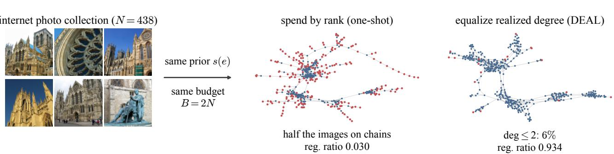
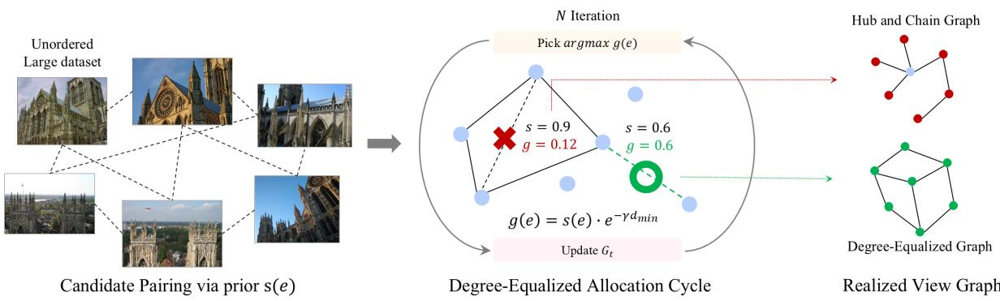
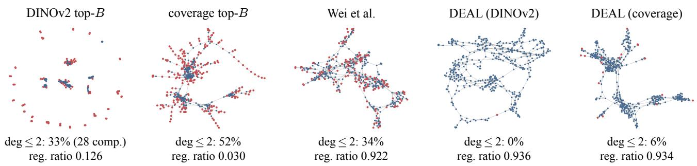
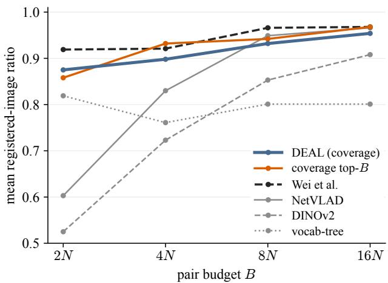

# Degree-Equalized View-Graph Selection under Tight Pair Budgets

Minhyeok Im1 Jongseong Brad Choi2,3,4,∗

1Department of Computer Science, State University of New York, Stony Brook, NY, United States   
2Department of Mechanical Engineering, State University of New York, Korea, Incheon, South Korea 3Department of Computer Science, State University of New York, Korea, Incheon, South Korea   
4Department of Mechanical Engineering, State University of New York, Stony Brook, NY, United States Corresponding author

  
Figure 1. Yorkminster at B=2N with the same prior. Top-B allocation concentrates verified edges and registers 3% of images. DEAL spreads them across under-covered images and registers 93%. Red marks degree at most two.

## Abstract

Fully matching all image pairs in Structure-from-Motion is quadratic in the number of images, so practical pipelines pass a budgeted subset to the final matching and reconstruction backend. One-shot selectors score candidates with image retrieval, cheap geometric probes, or a learned prior andfinalize B pairs beforefull matching. Their priorities do not accountfor the degree already allocated to each image, which can concentrate edges on afew images. Across nine large 1DSfM internet photo collections at B=2N, the coverage top-B selector leaves 54% ofcovered images with realized degree at most two. Reconstruction can thenfail even when the selected graph is nearly connected and almostfully verified. Our training-free greedy rule, Degree-Equalized Allocation (DEAL), exponentially downweights pairs whose endpoints are already well covered. On these collections, DEAL improves the one-shot selector built on the same prior (0.776 → 0.929) and matches the mean registered-image ratio ofan SfM-supervised edge prior under the shared backend (0.929 vs 0.930), without training. On the largely saturated 38-scene standard benchmark suite, DEAL gives the highest mean among the evaluated training-free selectors (0.875 vs 0.858 one-shot).

## 1. Introduction

Incremental Structure-from-Motion (SfM) [31, 37] reconstructs camera poses and sparse geometry from an image collection. Fully matching all $\binom { N } { 2 }$ pairs is quadratic in the number of images N, so practical pipelines pass only a sparse subset to the final matching and reconstruction backend. Under a hard budget of B pairs, this selection bounds all downstream stages. An image left disconnected by the graph cannot be registered. Setting B=2N enforces a strictly linear final-matching budget of two pair matches per input image, the same K·N form with small K that interleaved systems have budgeted [22]. The budget exceeds the N−1 pairs of a spanning tree but leaves little slack for redundant geometric constraints.

A selector chooses image pairs from a candidate pool using a scalar score, which we call the prior. Full matching establishes correspondences for the chosen pairs, geometric verification filters them, and the mapper estimates camera poses and 3D points. Selection thus determines which image pairs can provide geometric constraints to the reconstruction.

One-shot selectors differ in their scoring and repair rules but finalize the budget before final matching. Retrieval selectors rank pairs by appearance similarity, from vocabulary trees [25] to NetVLAD [2] and DINOv2 neighbors [26].

Probe-scored selectors run a cheap geometric check per candidate [32, 45]. Learned edge priors score pairs with a graph network trained on SfM outcomes [43]. Although their scoring signals differ, these selectors compute pair priorities before final matching and do not update them according to the degree already allocated to each image. Consequently, the allocation can concentrate edges on images favored by the prior. Across the nine 1DSfM collections evaluated below at B=2N, the coverage top-B selector leaves 54% of covered images with realized degree at most two, and incremental mappers can fail on the resulting hub-and-chain graphs (Figure 1). Such failures need not appear as disconnected graphs or as failed matches, since a selector can produce a nearly connected graph of individually verified pairs whose reconstruction still fails (Sec. 3).

We allocate the budget to reduce degree imbalance, favoring pairs that reach under-covered images even when their prior score is lower. Our greedy rule, Degree-Equalized Allocation (DEAL, Sec. 4), conditions each pick on evolving selected degree, with a bonus for component-merging edges and an exponential decay for edges whose endpoints are already well covered. Its observed form uses thresholded full-match counts between rounds. Ablations attribute most of the gain to degree-aware allocation rather than this feedback. We consider a fixed tight budget of B=2N and evaluate downstream reconstruction quality (Sec. 5.1).

The four standard benchmarks are largely saturated at B=2N. The one-shot baseline already registers every image on 17 of 38 scenes. We therefore add nine larger internet photo collections from 1DSfM [44], where budgeted pair selection is more challenging. On these scenes, DEAL improves the coverage top-B selector from 0.776 to 0.929 in mean registered-image ratio and reaches the same end-toend ratio as a learned edge-prior system under the shared matching and mapping backend (0.929 vs. 0.930). DEAL also reaches higher completeness-weighted rotation mAA (0.117 vs. 0.098), which combines registration and pose error. Across the full 38-scene suite, DEAL reaches 0.875, while the learned prior remains slightly better overall at 0.919.

We make two contributions.

(1) DEAL, a training-free degree-equalizing selection rule for budgeted view graphs, which contains oneshot top-B selection as the special case with its graph terms disabled. Ablations attribute most of the gain to degree control rather than to the specific decay form (Sec. 4, Sec. 5).

(2) A diagnosis of one-shot selection at tight budgets, showing that reconstruction can still fail with a nearly connected and almost fully verified graph under severe degree concentration, together with graph-structure and budget evaluations on nine large 1DSfM collections (Sec. 3, Sec. 5).

## 2. Related Work

View graphs in Structure-from-Motion. Incremental SfM builds a model from a verified view graph [31, 36, 37], and global pipelines take the same graph as input [27, 39]. DEAL operates at the pre-matching stage that produces it and is agnostic to the downstream solver.

One-shot pair selection. The standard cheap selector ranks pairs by appearance. Examples are vocabulary trees [25], NetVLAD [2], GeM [28], DINOv2 neighbors [26], and retrieval inside hierarchical localization [29]. MASt3R-SfM builds its graph from foundation-model features in one shot [11]. PAIGE learns a static pair-overlap classifier [32], and a recent learned edge prior scores pairs with a graph network trained on SfM-derived supervision, modulating scores by predicted connectivity and allocating over predicted spanning structures [43]. All of these finalize all B pairs before full matching. The learned prior’s connectivity modulation adapts to a predicted topology, while DEAL recomputes priorities from the evolving selected-degree state. Its observed form can use full-match outcomes rather than assume every spent edge succeeds.

Interleaved selection and verification. Building Rome in a Day alternates rounds of query expansion with geometric verification [1, 5]. Image Webs prioritizes component-merging pairs and re-ranks candidates by the Fiedler vector of the revealed graph under an explicit verification budget [14]. MatchMiner runs rounds under a K·N pair budget, feeds successes and failures back into its shortlists, and weighs pairs by expected component-entropy reduction [22]. Kim et al. alternate link prediction and verification with an explicit failure matrix [19], and GraphMatch samples and propagates from verified edges until per-node saturation [7]. These systems target graph completeness or component discovery. DEAL targets reconstruction quality under a fixed near-2N budget, and Sec. 5.5 evaluates their objectives within the same selection loop.

View-graph sparsification and repair. A complementary line operates on a graph that already exists. Skeletal graphs select a quality-preserving subset of an existing match graph [38]. Viewing-graph optimization refines fundamental matrices through loop consistency [40]. Other methods filter inconsistent epipolar geometries and disambiguate look-alike or duplicate structures [3, 6, 15, 34, 35, 44, 46, 47, 49]. SLAM selects pose-graph constraints under budgets by connectivity criteria [8, 18, 41], including direct algebraic-connectivity maximization [10], but over realized or odometry-backed edges. These methods consume matches as input, while budgeted selection decides which matches will exist at all.

Coverage as a conditioning signal. The spatial spread of correspondences is a long-standing conditioning signal [12, 13], used by COLMAP for next-image ranking [31]. Our coverage prior applies the same principle and scores probe inliers on a coverage grid. Learned features and matchers [9, 21, 23, 30, 48] change which pairs survive, so every selector in our comparison runs through one fixed backend (Sec. 5.1).

## 3. Motivating Analysis

Table 1. Selection quality at B=2N, as mean registered-image ratio over 38 scenes. Rows below the midrule alter multiple factors.
<table><tr><td>selector</td><td>adds</td><td>mean ratio</td></tr><tr><td>DINOv2 top-B</td><td>appearance ranking</td><td>0.525</td></tr><tr><td>+ max-similarity MST</td><td>connectedness</td><td>0.710</td></tr><tr><td>+ mid-rank band fill</td><td>rank statistics</td><td>0.727</td></tr><tr><td>vocab-tree (SIFT-verified)</td><td>geometric verification</td><td>0.819</td></tr><tr><td>coverage top-B</td><td>geometric probe scoring</td><td>0.858</td></tr><tr><td>Wei et al. (learned prior)</td><td>learned global context</td><td>0.919</td></tr></table>

We first compare selection factors on 38 scenes from DTU, ETH3D, Tanks&Temples and IMC2023. Each selector spends B=2N full pair matches with the same ALIKED features, LightGlue matcher and COLMAP incremental mapper. Quality is the fraction of input images registered in one model, with zero for a failed reconstruction. Table 1 compares selectors under this protocol. Its first three rows form a controlled progression over the same candidate pool. The last three change several factors together and do not isolate individual contributions.

Within the controlled progression, graph connectedness gives the largest observed increase (+0.185) in registeredimage ratio. Forcing a spanning backbone over the same appearance ranking recovers 56% of the gap between retrieval methods and probe methods without additional matching. Filling the remaining budget from moderate similarity ranks adds only +0.017, so rank position explains little beyond the backbone. A vocabulary tree with SIFT-verified candidates reaches 0.819, and the coverage top-B selector reaches 0.858 after probe-scoring every candidate with RANSAC. The learned prior reaches 0.919, though that comparison changes more than one factor. These comparisons associate connectedness and verified geometry with better registration, but a nearly connected graph of verified pairs can still fail to reconstruct.

Yorkminster, one of the nine larger 1DSfM collections evaluated in Sec. 5.3, illustrates this remaining failure. Coverage top-B already includes connectivity repair and produces 2.6 components on average across these collections. On Yorkminster, 866 of its 876 selected pairs reach at least 15 inliers, yet the mapper registers only 13 of 438 images. The verified edges are also distributed unevenly across images. Roughly half of the images hold at most two of them while 15% hold eight or more, so the graph couples a wellcovered core to long weakly redundant chains (Figure 1).

The result does not vary monotonically with the budget. The same selector registers 0.904 of Yorkminster at B=1.5N and 0.920 at 4N but only 0.030 at 2N (Sec. 5.7). This non-monotonic case is consistent with a mappersensitive regime in which additional high-ranked edges alter the incremental trajectory without resolving weakly supported chains. Selection at these budgets should account for how pairs are allocated across images as well as how they are ranked. Section 4 introduces a rule for this allocation.

## 4. Method

To reduce the degree concentration observed in Sec. 3, DEAL combines prior scores with the graph produced by earlier picks to favor under-covered images. Its graph tracks image pairs, degrees and components. The backend verifies fullmatch correspondences and passes them to the mapper, while the allocation rule uses graph state rather than relative-pose constraints.

## 4.1. Problem Statement

Given N images, a candidate pool C, a positive scalar prior s(e) per pair and budget B, the reconstruction objective is

$$
\mathcal { E } ^ { \star } = \arg \operatorname* { m a x } _ { \mathcal { E } \subseteq \mathcal { C } , | \mathcal { E } | = B } R ( \mathcal { E } ) ,\tag{1}
$$

where R is the fraction of input images registered in one reconstructed model. Evaluating R requires matching and mapping, so it is unavailable during pair allocation. Selectors instead use prior scores as a surrogate. These scores rank pairs rather than estimate calibrated success probabilities. Pure top-B selection treats their utility as additive and maximizes

$$
\mathcal { E } _ { \mathrm { t o p } } = \arg \operatorname* { m a x } _ { | \mathcal { E } | = B } \sum _ { e \in \mathcal { E } } s ( e ) .\tag{2}
$$

Sorting solves this additive objective without considering what earlier pairs already cover. DEAL instead carries a graph $G _ { t }$ with a degree $d _ { t } ( u )$ for each image and updates pair priorities after every pick. $G _ { t }$ contains selected pairs under assumed success, or pairs passing the observation threshold under observed updates.

## 4.2. Degree-Equalized Allocation

Graph redundancy. For a connected graph of N images and a subset S of $k \leq N / 2$ images, the variational form of algebraic connectivity gives

$$
\lambda _ { 2 } \leq \frac { N \left| \partial S \right| } { k \left( N - k \right) } ,\tag{3}
$$

where ∂S contains the edges leaving S [4, 24]. A chain attached through two edges has an upper bound of

  
Figure 2. DEAL overview. The prior scores each candidate pair once. DEAL selects by Equation (4), matches the pick, and updates the graph. Degree decay lets an under-covered pair (s=0.6) outrank a covered pair (s=0.9). Red marks degree at most two.

$2 N / [ k ( N - k ) ]$ , so a large weakly attached subset can limit redundancy even when the graph is connected. Pair ranking alone does not account for the support already assigned to each endpoint. DEAL uses endpoint degree to redirect spending toward under-covered images through the score below.

Selection rule. In each round DEAL takes the unspent candidate with the highest gain (Figure 2)

$$
g ( e ) = \left\{ \begin{array} { l l } { \beta s ( e ) } & { u \not \simeq _ { t } v } \\ { s ( e ) e ^ { - \gamma d _ { t } ^ { \mathrm { m i n } } ( e ) } } & { \mathrm { o t h e r w i s e } , } \end{array} \right.\tag{4}
$$

where $u \sim _ { t }$ v denotes membership in the same component and $d _ { t } ^ { \operatorname* { m i n } } ( e ) \ = \ \operatorname* { m i n } ( d _ { t } ( u ) , d _ { t } ( v ) )$ Component-merging pairs receive a multiplier $\beta$ without degree decay. Other pairs are downweighted when both endpoints already have support. The minimum preserves the prior score when either endpoint is uncovered. Unlike a hard threshold, the decay still allows a high-scoring pair between covered images to outrank a low-scoring one. Setting $\beta { = } 1$ and $\gamma { = } 0$ removes both graph terms and recovers pure top-B selection in Equation (2).

Graph updates. The assumed-success form adds every spent pair to $G _ { t }$ . The observed form adds a pair only when full LightGlue matching returns at least τ correspondences. This pre-MAGSAC count supplies feedback for the next round, while the backend separately verifies pair geometry with a fundamental-matrix fit. Observation adds no full matching because the spent pairs are the final matches. The two update forms nearly coincide when selected pairs match at high rates, as on 1DSfM (Sec. 5.5).

Priors. Both instantiations use a DINOv2 candidate pool. The DINOv2 prior is cosine similarity. The coverage prior probes candidates with mutual nearest-neighbor matching and RANSAC over the backend’s ALIKED descriptors, then scores the fraction of $4 \times 4$ grid cells containing an inlier. The corresponding one-shot baselines use the same priors, isolating allocation from scoring.

Cost. The loop rescans candidates after each pick and adds a dependency between rounds, but no extra full matching. A batch is planned assuming its picks succeed, then outcomes update G. With a resident LightGlue matcher, Temple’s sequential 604-pair loop takes 12.7 s, including 10.1 s of matching. Coverage probing over the 8.3k-pair pool adds about 8 s outside B. Batch sizes 8 and 32 give Jaccard $\geq 0 . 9 9 7$ and identical reconstructions. The sequential run reproduces the precomputed-outcome simulation’s selections exactly.

Algorithm 1 DEAL: degree-equalized view-graph selection   
Require: candidates C with prior s(e), budget B, batch k,   
β, γ, threshold τ   
1: G ← empty graph over the N images   
2: while fewer than B pairs spent do   
3: P ← working copy of G   
4: for i = 1, . . . , min(k, remaining budget) do   
5: pick unspent $e ^ { * } = \arg \operatorname* { m a x } _ { e } g ( e )$ by Equation (4)   
evaluated on P   
6: add $e ^ { * }$ to P {in-round picks assume success}   
7: end for   
8: match the picked batch {these matches are final}   
9: observed form add to G pairs with at least τ full   
LightGlue matches, assumed form add the whole   
batch   
10: end while   
11: return the B spent pairs and their matches

## 5. Experiments

## 5.1. Setup

Benchmarks. The benchmark suite covers 38 scenes drawn from DTU [16] (13), ETH3D [33] (13), Tanks & Temples [20] (5), and IMC2023 [17] (7). This suite is largely saturated at $B { = } 2 N$ , as the coverage top-B selector already registers every image on 17 of its 38 scenes, so we add nine larger internet photo collections from 1DSfM [44] under the same protocol.

Table 2. Mean registered-image ratio on 38 scenes at B=2N. Rows above the divider allocate by rank. ‘fail’ counts scenes below 0.1, and bold marks the best training-free selector.
<table><tr><td>Method</td><td>DTU</td><td>ETH3D</td><td>T&amp;T</td><td>IMC</td><td>ALL</td><td>ALL\IMC</td><td>fail</td></tr><tr><td>DINOv2 top-B</td><td>0.738</td><td>0.426</td><td>0.285</td><td>0.486</td><td>0.525</td><td>0.534</td><td>2/38</td></tr><tr><td>NetVLAD top-B</td><td>0.818</td><td>0.585</td><td>0.292</td><td>0.457</td><td>0.603</td><td>0.635</td><td>1/38</td></tr><tr><td>vocab-tree</td><td>0.986</td><td>0.730</td><td>0.966</td><td>0.573</td><td>0.819</td><td>0.875</td><td>4/38</td></tr><tr><td>coverage top-B</td><td>0.995</td><td>0.839</td><td>0.891</td><td>0.612</td><td>0.858</td><td>0.913</td><td>1/38</td></tr><tr><td>Wei et al. [43]</td><td>0.997</td><td>0.863</td><td>0.997</td><td>0.820</td><td>0.919</td><td>0.941</td><td>0/38</td></tr><tr><td>DEAL (DINOv2 prior)</td><td>1.000</td><td>0.757</td><td>0.979</td><td>0.563</td><td>0.834</td><td>0.895</td><td>2/38</td></tr><tr><td>DEAL (coverage prior)</td><td>0.995</td><td>0.865</td><td>0.990</td><td>0.589</td><td>0.875</td><td>0.940</td><td>2/38</td></tr></table>

Protocol and metrics. Each selector receives a hard budget of B=2N pairs, and its pairs are matched and reconstructed by the same ALIKED+LightGlue+COLMAP incremental backend. The backend initializes and refines a shared SIM-PLE PINHOLE camera without ground-truth intrinsics. The supplementary specifies this calibration setup and also evaluates the same databases with the global GLOMAP solver. The budget counts pairs passed to full LightGlue matching and reconstruction. The coverage prior additionally performs a cheaper mutual-nearest-neighbor and RANSAC probe over the candidate pool. This scoring cost lies outside B and is reported separately in Sec. 4.2. The DINOv2 candidate pool is shared by every pool-based selector, while vocab-tree and the learned prior generate their own. We report the registeredimage ratio, the fraction of images COLMAP registers into one model, where 0.000 means no model. COLMAP’s mapper is nondeterministic, so the DEAL configurations, the coverage top-B selector and all 1DSfM numbers are medians over three mapper repeats, and a difference of at most 0.01 on unrounded values counts as a tie.

Baselines. Static baselines are NetVLAD top-B, DI-NOv2 top-B, vocab-tree and the learned edge prior of Wei et al. [43], run zero-shot from its released IMC2023- trained checkpoint with its pairs fed through the shared backend. Coverage top-B starts from the B highest coverageranked pairs and swaps low-score cycle edges for componentmerging candidates. It is top-B with connectivity repair, not the pure solution of Equation (2), and is the direct one-shot reference because DEAL uses the same pool and prior. The two DEAL configurations use the coverage prior and the DINOv2 prior with $\beta { = } 5 , \gamma { = } 1$ , observation on, batch size k=1 and threshold τ=15 pre-MAGSAC LightGlue matches.

## 5.2. Benchmark Suite at B=2N

DEAL improves registration under the tight B=2N budget (Tab. 2). With the coverage prior, it reaches 0.875 on the 38-scene suite versus 0.858 for coverage top- $B ~ ( 1 0 / 2 4 / 4$

W/T/L), with the largest gains on scenes where the baseline remains below saturation (wall 0.558→1.000, terrains 0.738→1.000, Temple 0.831→0.997). Excluding IMC2023, where the benchmark is largely saturated and the coverage prior is unreliable on several scenes, DEAL reduces the remaining registration error by 31% (0.913→0.940). With the weaker DINOv2 prior, DEAL improves DINOv2 from 0.525 to 0.834 without geometric probing, a +0.309 gain.

The IMC2023 results differ between the two priors. With the coverage prior, DEAL matches or improves every family except IMC2023, where it falls to 0.589 versus 0.612 for coverage top-B. The largest regressions occur on the randomized-viewpoint scenes cyprus (0.333→0.000), where DEAL produces no model and raises the ‘fail’ count from one to two, and dioscuri (0.397→0.328). With the DINOv2 prior, equalization improves the IMC mean (0.486→0.563). These opposite family-level trends indicate sensitivity to the prior, although they do not identify the underlying cause of the failures.

Wei et al. has the highest suite mean at 0.919, with most of its lead over DEAL concentrated in IMC2023, the checkpoint’s training family. Outside IMC, their means are nearly identical (0.940 vs 0.941). On chairs, the coverage prior produces no model at B=32, while the DINOv2 prior reaches 0.750, further indicating sensitivity to the prior.

## 5.3. Large Internet Collections

On the nine 1DSfM scenes, DEAL closes the gap to the learned prior (Tab. 3). It reaches 0.929 versus 0.930 for Wei et al.. Under the unrounded 0.01 tie rule, it wins five scenes, ties three and loses Montreal. Against coverage top-B it wins all nine (0.776→0.929), and on Yorkminster it raises registration from 0.030 to 0.934 with the same pool, prior, and budget, replacing the chained graph with an equalized one (Figure 3). Excluding Yorkminster, DEAL still improves over coverage top-B by +0.059 with eight wins in eight, while remaining near parity with the learned prior (0.928 vs 0.931).

The margin over coverage top-B differs across the evaluated groups. It is +0.018 on the full suite (one-sided sign test p=0.09), +0.076 on the sixteen IMC+1DSfM scenes (10/3/3, p=0.046) and +0.153 on the nine 1DSfM scenes (nine of nine, p=0.002). On the sixteen IMC+1DSfM scenes, the learned prior retains the highest mean (0.882, scene-wise $5 / 6 / 5 )$ . Its advantage is concentrated in IMC, its training family, and two failures of the coverage prior (supplementary).

  
Figure 3. Realized Yorkminster view graphs at B=2N. Red marks degree at most two. DINOv2 top-B shows the full graph, and the other panels show the largest component. DEAL distributes verified edges more evenly than rank-based selectors.

## 5.4. Graph Structure

The selected-graph statistics show the allocation difference (Tab. 4). One-shot selectors concentrate edges on a small subset of images. Across these selectors 34% to 67% of covered images have selected degree at most two, compared with 6% and 3% for DEAL.

For all selectors except DINOv2 top-B, these fractions are nearly unchanged after matching (within 0.03), showing that the concentration is introduced during selection rather than by geometric verification. DINOv2 top-B instead fails primarily through isolation, with roughly half of the images receiving no verified edge. Its largest component holds 26% of the images, so the $\lambda _ { 2 }$ of the full graph is zero and the value in Tab. 4 is not comparable to the other rows.

Table 3. Registered-image ratio on nine 1DSfM collections at B=2N. Values are three-repeat medians except DINOv2 top-B, and W/T/L uses unrounded values with the 0.01 tie rule. Bold marks the best per scene.
<table><tr><td></td><td colspan="2">top-B</td><td>learned</td><td colspan="2">DEAL</td></tr><tr><td>Scene</td><td>DINOv2</td><td>coverage</td><td>Wei et al. 1</td><td>DINOv2</td><td>coverage</td></tr><tr><td>Alamo</td><td>0.323</td><td>0.938</td><td>0.947</td><td>0.950</td><td>0.950</td></tr><tr><td>Ellis Island</td><td>0.304</td><td>0.883</td><td>0.930</td><td>0.856</td><td>0.940</td></tr><tr><td>Gendarmenmarkt</td><td>0.195</td><td>0.919</td><td>0.947</td><td>0.956</td><td>0.971</td></tr><tr><td>Madrid Metropolis</td><td>0.302</td><td>0.940</td><td>0.947</td><td>0.933</td><td>0.956</td></tr><tr><td>Montreal Notre Dame</td><td>0.413</td><td>0.720</td><td>0.880</td><td>0.729</td><td>0.736</td></tr><tr><td>NYC Library</td><td>0.289</td><td>0.731</td><td>0.936</td><td>0.900</td><td>0.948</td></tr><tr><td>Piazza del Popolo</td><td>0.193</td><td>0.914</td><td>0.974</td><td>0.958</td><td>0.982</td></tr><tr><td>Tower of London</td><td>0.108</td><td>0.909</td><td>0.883</td><td>0.910</td><td>0.941</td></tr><tr><td>Yorkminster</td><td>0.126</td><td>0.030</td><td>0.922</td><td>0.936</td><td>0.934</td></tr><tr><td>mean</td><td>0.250</td><td>0.776</td><td>0.930</td><td>0.903</td><td>0.929</td></tr></table>

Table 4. Mean view-graph structure over nine 1DSfM scenes at B=2N. ‘selected’ and ‘realized’ report degree at most two before and after verification. Degree fractions use covered images, and λ2 uses the largest component.
<table><tr><td rowspan="2">Selector</td><td colspan="2">deg≤2</td><td colspan="3"></td></tr><tr><td>selected</td><td>1 realized</td><td>deg≥8</td><td>comp.</td><td>λ2</td></tr><tr><td>DINOv2 top-B</td><td>0.67</td><td>0.35</td><td>0.39</td><td>26.8</td><td>0.100</td></tr><tr><td>coverage top-B</td><td>0.54</td><td>0.54</td><td>0.15</td><td>2.6</td><td>0.007</td></tr><tr><td>Wei et al.</td><td>0.34</td><td>0.35</td><td>0.08</td><td>3.2</td><td>0.027</td></tr><tr><td>DEAL (DINOv2)</td><td>0.03</td><td>0.06</td><td>0.02</td><td>1.0</td><td>0.010</td></tr><tr><td>DEAL (coverage)</td><td>0.06</td><td>0.04</td><td>0.05</td><td>3.1</td><td>0.045</td></tr></table>

For coverage top-B the realized graphs show the degree concentration diagnosed in Sec. 3. Relative to coverage top-B, DEAL reduces the degree-≤ 2 fraction from 54% to 4% and increases the algebraic connectivity of the largest component by 2.5× to 33× across the nine 1DSfM scenes. The component count does not improve (3.1 versus 2.6), so DEAL does not guarantee connectedness and $\lambda _ { 2 }$ describes only the largest component. These statistics diagnose fragile graphs rather than predict registration. Degree imbalance falls broadly, while gains concentrate where the baseline structure is particularly harmful.

Despite near-equal registration on 1DSfM, DEAL and the learned prior select substantially different pair sets, with a mean IoU of 0.108 (range 0.077–0.154), identical across repeats. Similar registration therefore does not require close agreement between the selected pair sets.

## 5.5. Ablations

Decay and hard-threshold ablation. Equalization, rather than the specific form of the penalty, accounts for most of the gain (Tab. 5). Removing the decay (γ=0) reduces the 1DSfM mean to 0.793, Yorkminster to 0.027 and the suite mean to 0.839, where it wins no scene against the full configuration. A one-batch hard-threshold variant uses s(e) while $d ^ { \mathrm { m i n } } < \kappa$ and $1 0 ^ { - 1 2 } s ( e )$ afterward for non-merging pairs. It still rescans and fills B under assumed success. $\mathrm { { A t \ } } \kappa { = } 2 ,$ , the hard threshold recovers most of the 1DSfM improvement (0.925, Yorkminster 0.927) but remains close to coverage top-B on the full suite (0.861 vs 0.858). Increasing the threshold to κ=4 reduces the mean on both sets (0.897 and 0.840). Neither tested threshold matches the decay across both evaluation sets, while a post-hoc γ sweep stays within 0.012 of the default.

Table 5. Ablation at B=2N, as three-repeat median registeredimage ratios. ‘Min’ is the worst 1DSfM scene. Threshold controls use one assumed-success batch and still spend all B pairs.
<table><tr><td></td><td>1DSfM (9)</td><td>suite (38)</td></tr><tr><td>Variant</td><td>mean min</td><td>mean</td></tr><tr><td>coverage top-B hard threshold  $\kappa { = } 4$ </td><td>0.776 0.030 0.897 0.716</td><td>0.858 0.840</td></tr><tr><td>hard threshold  $\kappa { = } 2$ </td><td>0.925 0.731</td><td>0.861</td></tr><tr><td>DEAL,  $\gamma { = } 0$  (no decay) DEAL,  $\beta { = } 1$  (no bridge multiplier)</td><td>0.793 0.027 0.946 0.882</td><td>0.839 0.875</td></tr><tr><td>DEAL, entropy gain (MatchMiner)</td><td>0.786 0.027</td><td>0.828</td></tr><tr><td>DEAL, Fiedler gain (Image Webs)</td><td>0.955</td><td></td></tr><tr><td>DEAL, assumed success</td><td>0.934</td><td>0.821</td></tr><tr><td>DEAL, observed (default)</td><td>0.931 0.738 0.929 0.736</td><td>0.876 0.875</td></tr></table>

The suite mean is insensitive to the merging multiplier, but Montreal is not. Setting β=1 leaves the suite mean at 0.875 and raises the 1DSfM mean from 0.929 to 0.946, almost entirely through Montreal (0.736→0.882); β∈{2, 10} moves the mean by at most 0.001. We retain the fixed $\beta { = } 5$ rather than tune it to this collection. The multiplier is not the main source of the gain, but its scene-level effect is not uniformly negligible.

Observing outcomes and assuming success produce identical selections on eight of nine scenes and indistinguishable reconstructions (0.929 vs 0.931 on 1DSfM, 0.875 vs 0.876 on the suite). Only five selected pairs miss the observation threshold, so full-match outcomes rarely change subsequent scores in this setting.

Under assumed success, batch size does not affect the selection trajectory. Setting k=B gives a static planner that applies Equation (4) to selected rather than realized degree. Plain top-B is recovered only after also setting β=1 and $\gamma { = } 0 ,$ , which removes the graph-dependent gain. Observation adds no matching cost and may matter more when selected pairs fail more often.

Classical graph gains use the same loop. Entropy remains near coverage top-B (0.786). A Fiedler gain reaches 0.955 on 1DSfM but requires an eigensolve per pick and falls to

Table 6. Completeness-weighted rotation mAA at B=2N on 33 scenes with pose ground truth. Unregistered images count as failures. The five Tanks & Temples Advanced scenes are excluded because their reference camera poses are not public. The IMC reference is a COLMAP model.
<table><tr><td>Selector</td><td>DTU</td><td>ETH3D</td><td>IMC ALL</td></tr><tr><td>DINOv2</td><td>0.718</td><td>0.420 0.379</td><td>0.529</td></tr><tr><td>NetVLAD</td><td>0.785</td><td>0.584</td><td>0.324 0.608 0.729</td></tr><tr><td>vocab-tree coverage top-B</td><td>0.953 0.952</td><td>0.694 0.792</td><td>0.377 0.414 0.775</td></tr><tr><td>Wei et al.</td><td>0.961</td><td>0.791</td><td>0.553 0.807</td></tr><tr><td>DEAL (DINOv2 prior)</td><td>0.959</td><td></td><td></td></tr><tr><td>DEAL (coverage prior)</td><td>0.960</td><td>0.683 0.823</td><td>0.442 0.741 0.321 0.770</td></tr></table>

0.721 on the sixteen IMC+1DSfM scenes and 0.821 on the suite, versus 0.780 and 0.875 for the decay (supplementary). Its higher 1DSfM mean therefore does not persist across the broader sets.

## 5.6. Pose Accuracy

Registration alone can hide misplaced cameras. On courtyard a contiguous block of 15 cameras is misplaced inside an accurate model while every one of them counts as registered. Table 6 therefore reports completeness-weighted mAA of rotation error over the thresholds {1, 2, 3, 5, 10}◦ after RANSAC similarity alignment of the camera centers, with the alignment rotation also applied to camera orientations. Unregistered images fail every threshold, so mAA combines completeness and pose accuracy. Median rotation error among registered cameras with reference poses measures conditional accuracy, with camera support varying by selector. The supplementary reports registration, mAA and this conditional error separately for the pose-evaluation runs.

Pose follows registration on the suite, since completeness dominates the metric and mAA equals the registration ratio on 11 of the 13 ETH3D scenes. DEAL has the highest mAA on ETH3D (0.823 against 0.792 for coverage top-B and 0.791 for Wei et al.), remains close to coverage top-B overall (0.770 against 0.775) and trails Wei et al. (0.807). Its 0.321 on IMC is the lowest listed score (coverage top-B reaches 0.414), matching the prior-sensitive regressions in Sec. 5.2. On the 1DSfM collections the reference is itself an SfM model and absolute values are low, so we compare relative ordering. DEAL has the highest mAA (0.117 against 0.098 for the learned prior and 0.083 for coverage top-B) and the lowest aggregate median rotation error $( 2 7 ^ { \circ }$ against $3 0 ^ { \circ }$ and $4 2 ^ { \circ } )$ . Both summaries favor DEAL on this collection set, while the per-scene ordering varies (supplementary).

  
Figure 4. Mean registered-image ratio over 38 scenes versus pair budget. DEAL and the 2N coverage top-B and Wei et al. points are three-repeat medians. The other points are single runs.

## 5.7. Budget Sweep

The budget sweep bounds the regime in which degree equalization matters. On the suite, the mean reverses at 4N (0.898 vs 0.932, 4/30/4 W/T/L) and stays 0.010 to 0.014 behind coverage top-B at 8N and 16N (0.932 vs 0.942, 0.954 vs 0.968). The reversal does not appear on 1DSfM. DEAL wins all nine scenes at 4N (0.956 vs 0.904, p=0.002) and leads at 1.5N (0.923 vs 0.875, 7/2/0, p=0.008; supplementary). Coverage top-B registers Yorkminster at both adjacent budgets (0.904 and 0.920), so its isolated 0.030 at 2N is mapper-sensitive rather than a general pair shortage. In Figure 4, the learned prior converges with the higher-performing selectors by 8N, appearance retrieval reaches them by 8N to 16N, and the vocabulary tree stays near 0.8.

## 6. Discussion

The ablations identify selected-degree regularization as the main source of DEAL’s gain. Degree fractions and λ2 describe the structures it changes, while the mapper trajectory determines whether these structures cause failure. Observation remains available when selected pairs fail.

DEAL helps most when the prior proposes verifiable pairs but concentrates the budget, as on 1DSfM. Its gains are less consistent on the IMC scenes, where the observed gains differ between the two priors.

Coverage probing adds preprocessing but gives the higher DEAL mean. DINOv2 avoids that probe at lower suite accuracy (0.834). The learned prior retains the highest overall mean, led by its IMC training family.

## 7. Limitations

DEAL inherits omissions in its candidate pool and errors in its prior, and does not detect an unreliable prior or switch allocations online. Evidence for its benefit is concentrated near B≈2N; on the 38-scene suite, its advantage over coverage top-B narrows or reverses as the budget grows.

The degree-based gain is an empirical surrogate for registration, with no approximation guarantee for Equation (1). Degree balance and connectedness alone do not certify viewing-graph solvability, which also depends on geometric constraints [42]. The backend’s pairwise verification filters correspondences but does not enforce multi-view loop consistency. Such optimization is complementary to allocation.

The main evaluation uses one matcher and one incremental mapper. In the supplementary GLOMAP evaluation over the same databases, DEAL retains the highest mean (0.946, $8 / 1 / 0$ against the learned prior), while GLOMAP partially recovers some weak coverage top-B cases. This sensitivity indicates that the magnitude of these failures depends partly on the mapper. Registered-image ratio can also overstate quality, as on courtyard. We therefore report pose metrics where public reference poses are available and exclude the five Tanks & Temples Advanced scenes, whose reference camera poses are not public.

## 8. Conclusion

Budgeted view-graph selection is commonly formulated as ranking, but allocation across images also affects reconstruction under tight budgets. On 1DSfM, DEAL raises the coverage top-B mean from 0.776 to 0.929 and matches the learned system under the shared backend. Relative to coverage top-B, its realized graphs reduce the mean degree- $\cdot \leq 2$ fraction from 54% to 4% and raise algebraic connectivity by 2.5× to 33× on the same scenes. These statistics diagnose weak chains rather than predict registration directly.

## Acknowledgments

This work was supported by the Technology Innovation Program (Game-Changing Technology Project, No. RS-2026-25545225, Development of a Real-World Integrated Spatial Intelligence Platform Based on Multimodal 3D Space Generation and Hyper-Intelligent Operating Engines) funded by the Ministry of Trade, Industry and Energy (MOTIE), Korea.

## References

[1] Sameer Agarwal, Noah Snavely, Ian Simon, Steven M. Seitz, and Richard Szeliski. Building Rome in a day. In ICCV, 2009. 2

[2] Relja Arandjelovic, Petr Gronat, Akihiko Torii, Tomas Pajdla,´ and Josef Sivic. NetVLAD: CNN architecture for weakly supervised place recognition. In CVPR, 2016. 1, 2

[3] Ruojin Cai, Joseph Tung, Qianqian Wang, Hadar Averbuch-Elor, Bharath Hariharan, and Noah Snavely. Doppelgangers: Learning to disambiguate images of similar structures. In IEEE/CVF International Conference on Computer Vision (ICCV), 2023. 2

[4] Jeff Cheeger. A lower bound for the smallest eigenvalue of the Laplacian. In Problems in Analysis: A Symposium in Honor of Salomon Bochner, pages 195–199. Princeton University Press, 1970. 3

[5] Ondˇrej Chum and Jiˇr´ı Matas. Large-scale discovery of spatially related images. IEEE TPAMI, 32(2), 2010. 2

[6] Hainan Cui, Tianxin Shi, Jun Zhang, Pengfei Xu, Yiping Meng, and Shuhan Shen. View-graph construction framework for robust and efficient structure-from-motion. Pattern Recognition, 114:107712, 2021. 2

[7] Qiaodong Cui, Victor Fragoso, Chris Sweeney, and Pradeep Sen. GraphMatch: Efficient large-scale graph construction for structure from motion. In 3DV, 2017. 2

[8] Christopher E. Denniston, Yun Chang, Andrzej Reinke, Kamak Ebadi, Gaurav S. Sukhatme, Luca Carlone, Benjamin Morrell, and Ali-akbar Agha-mohammadi. Loop closure prioritization for efficient and scalable multi-robot SLAM. IEEE RA-L, 7(4), 2022. 2

[9] Daniel DeTone, Tomasz Malisiewicz, and Andrew Rabinovich. SuperPoint: Self-supervised interest point detection and description. In CVPR Workshops, 2018. 3

[10] Kevin J. Doherty, Alan Papalia, Yewei Huang, David M. Rosen, Brendan Englot, and John J. Leonard. MAC: Graph sparsification by maximizing algebraic connectivity. arXiv preprint arXiv:2403.19879, 2024. 2

[11] Bardienus P. Duisterhof, Lojze Zust, Philippe Weinzaepfel, ˇ Vincent Leroy, Yohann Cabon, and Jer´ ome Revaud. MASt3R-ˆ SfM: A fully-integrated solution for unconstrained structurefrom-motion. In International Conference on 3D Vision (3DV), 2025. 2

[12] Clive S. Fraser. Network design considerations for nontopographic photogrammetry. Photogrammetric Engineering and Remote Sensing, 50(8):1115–1126, 1984. 2

[13] Richard Hartley and Andrew Zisserman. Multiple View Geometry in Computer Vision. Cambridge University Press, 2nd edition, 2003. 2

[14] Kyle Heath, Natasha Gelfand, Maks Ovsjanikov, Mridul Aanjaneya, and Leonidas J. Guibas. Image webs: Computing and exploiting connectivity in image collections. In CVPR, 2010. 2

[15] Jared Heinly, Enrique Dunn, and Jan-Michael Frahm. Correcting for duplicate scene structure in sparse 3D reconstruction. In European Conference on Computer Vision (ECCV), 2014. 2

[16] Rasmus Jensen, Anders Dahl, George Vogiatzis, Engin Tola, and Henrik Aanæs. Large scale multi-view stereopsis evaluation. In Proceedings ofthe IEEE Conference on Computer Vision and Pattern Recognition (CVPR), 2014. 4

[17] Yuhe Jin, Dmytro Mishkin, Anastasiia Mishchuk, Jiˇr´ı Matas, Pascal Fua, Kwang Moo Yi, and Eduard Trulls. Image matching across wide baselines: From paper to practice. International Journal of Computer Vision, 2021. 4

[18] Kasra Khosoussi, Matthew Giamou, Gaurav S. Sukhatme, Shoudong Huang, Gamini Dissanayake, and Jonathan P. How. Reliable graphs for SLAM. IJRR, 38(2-3), 2019. 2

[19] Kwang In Kim, James Tompkin, Martin Theobald, Jan Kautz, and Christian Theobalt. Match graph construction for large image databases. In ECCV, 2012. 2

[20] Arno Knapitsch, Jaesik Park, Qian-Yi Zhou, and Vladlen Koltun. Tanks and Temples: Benchmarking large-scale scene reconstruction. In ACM Transactions on Graphics (SIG-GRAPH), 2017. 4

[21] Philipp Lindenberger, Paul-Edouard Sarlin, and Marc Pollefeys. LightGlue: Local feature matching at light speed. In IEEE/CVF International Conference on Computer Vision (ICCV), 2023. 3

[22] Yin Lou, Noah Snavely, and Johannes Gehrke. MatchMiner: Efficient spanning structure mining in large image collections. In ECCV, 2012. 1, 2

[23] David G. Lowe. Distinctive image features from scaleinvariant keypoints. International Journal of Computer Vision, 60(2):91–110, 2004. 3

[24] Bojan Mohar. Isoperimetric numbers of graphs. Journal of Combinatorial Theory, Series B, 47(3):274–291, 1989. 3

[25] David Nister and Henrik Stew´ enius. Scalable recognition´ with a vocabulary tree. In CVPR, 2006. 1, 2

[26] Maxime Oquab, Timothee Darcet, Th´ eo Moutakanni, et al.´ DINOv2: Learning robust visual features without supervision. Transactions on Machine Learning Research (TMLR), 2024. 1, 2

[27] Linfei Pan, Daniel Bar ´ ath, Marc Pollefeys, and Johannes L.´ Schonberger. Global structure-from-motion revisited. In¨ European Conference on Computer Vision (ECCV), 2024. 2

[28] Filip Radenovic, Giorgos Tolias, and Ond ´ ˇrej Chum. Finetuning CNN image retrieval with no human annotation. IEEE Transactions on Pattern Analysis and Machine Intelligence, 41(7):1655–1668, 2019. 2

[29] Paul-Edouard Sarlin, Cesar Cadena, Roland Siegwart, and Marcin Dymczyk. From coarse to fine: Robust hierarchical localization at large scale. In CVPR, 2019. 2

[30] Paul-Edouard Sarlin, Daniel DeTone, Tomasz Malisiewicz, and Andrew Rabinovich. SuperGlue: Learning feature matching with graph neural networks. In IEEE/CVF Conference on Computer Vision and Pattern Recognition (CVPR), 2020. 3

[31] Johannes L. Schonberger and Jan-Michael Frahm. Structure-¨ from-motion revisited. In CVPR, 2016. 1, 2

[32] Johannes L. Schonberger, Alexander C. Berg, and Jan-¨ Michael Frahm. PAIGE: PAirwise image geometry encoding for improved efficiency in structure-from-motion. In CVPR, 2015. 2

[33] Thomas Schops, Johannes L. Sch¨ onberger, Silvano Galliani,¨ Torsten Sattler, Konrad Schindler, Marc Pollefeys, and Andreas Geiger. A multi-view stereo benchmark with highresolution images and multi-camera videos. In CVPR, 2017. 4

[34] Rajvi Shah, Visesh Chari, and P. J. Narayanan. View-graph selection framework for SfM. In European Conference on Computer Vision (ECCV), 2018. 2

[35] Tianwei Shen, Siyu Zhu, Tian Fang, Runze Zhang, and Long Quan. Graph-based consistent matching for structure-frommotion. In ECCV, 2016. 2

[36] Noah Snavely, Steven M. Seitz, and Richard Szeliski. Photo tourism: Exploring photo collections in 3D. ACM Transactions on Graphics (Proc. SIGGRAPH), 25(3):835–846, 2006. 2

[37] Noah Snavely, Steven M. Seitz, and Richard Szeliski. Modeling the world from Internet photo collections. International Journal of Computer Vision, 2008. 1, 2

[38] Noah Snavely, Steven M. Seitz, and Richard Szeliski. Skeletal graphs for efficient structure from motion. In CVPR, 2008. 2

[39] Chris Sweeney, Victor Fragoso, Tobias Hollerer, and Matthew¨ Turk. Theia: A fast and scalable structure-from-motion library. In ACM International Conference on Multimedia (ACM MM), 2015. 2

[40] Chris Sweeney, Torsten Sattler, Tobias Hollerer, Matthew¨ Turk, and Marc Pollefeys. Optimizing the viewing graph for structure-from-motion. In Proceedings ofthe IEEE International Conference on Computer Vision, pages 801–809, 2015. 2

[41] Yulun Tian, Kasra Khosoussi, Matthew Giamou, Jonathan P. How, and Jonathan Kelly. Near-optimal budgeted data exchange for distributed loop closure detection. In RSS, 2018. 2

[42] Matthew Trager, Brian Osserman, and Jean Ponce. On the solvability of viewing graphs. In Proceedings ofthe European Conference on Computer Vision, 2018. 8

[43] Tong Wei, Giorgos Tolias, Jiˇr´ı Matas, and Daniel Barath. Global-aware edge prioritization for pose graph initialization. In Proceedings of the IEEE/CVF Conference on Computer Vision and Pattern Recognition (CVPR), 2026. 2, 5

[44] Kyle Wilson and Noah Snavely. Robust global translations with 1DSfM. In European Conference on Computer Vision (ECCV), 2014. 2, 5

[45] Changchang Wu. Towards linear-time incremental structure from motion. In 3DV, 2013. 2

[46] Teng Xiao, Qingsong Yan, Weile Ma, and Fei Deng. Progressive structure from motion by iteratively prioritizing and refining match pairs. Remote Sensing, 13(12):2340, 2021. 2

[49] Pengwei Zhou, Hongche Yin, Guozheng Xu, Xiaosong Wei, Annan Zhou, Jian Yao, Li Li, and Huang Jing. PGVS: A probabilistic graph-theoretic framework for view-graph selection in structure-from-motion. ISPRS Journal ofPhotogrammetry and Remote Sensing, 231:641–663, 2026. 2

[47] Christopher Zach, Manfred Klopschitz, and Marc Pollefeys. Disambiguating visual relations using loop constraints. In IEEE Conference on Computer Vision and Pattern Recognition (CVPR), 2010. 2

[48] Xiaoming Zhao, Xingming Wu, Weihai Chen, Peter C. Y. Chen, Qingsong Xu, and Zhengguo Li. ALIKED: A lighter keypoint and descriptor extraction network via deformable transformation. IEEE Transactions on Instrumentation and Measurement, 72:1–16, 2023. 3