# Do You Miss the Nights We Spent Crafting Figures? Rethinking Teaser and Framework Figures in the Age of Generative AI

Xiaoqi Zhao, Youwei Pang, Kailai Zhou Nanyang Technological University, Singapore

Scientific figures give research ideas a visual form through choices of abstraction, composition, and emphasis. Generative AI ofers new ways to realize these choices, raising questions about explanatory clarity and purposeful visual expression. We examine these questions through a visual retrospective of 371 motivation and framework figures from 200 papers. The corpus comprises a quota-based main sample of 160 papers spanning four temporal periods and a separate purposive style-contrast sample of 40 papers. A single multimodal judge evaluates six dimensions of communication and design, with three repeated judgments per figure. We attempt sourceconstrained revisions of all 371 figures, of which 369 pass the recorded fidelity checks. Originalfigure ratings show no uniform decline across periods. Revisions increase mean clarity ratings by 0.428 points and decrease aesthetic coherence ratings by 0.111 points on a five-point scale. Gains in the six-dimension average are larger for main-sample motivation figures than for frameworks. Case analyses show that added explanation can clarify comparisons while leaving typographic hierarchy and visual economy unresolved. These model-based findings support researcher-led design, with AI assisting exploration and authors retaining responsibility for explanatory purpose, composition, and scientific relationships. The accompanying atlas and evaluation records are available at https://ntu-ai4x.github.io/Rethinking\_Figures/index\_en.html.

## Contents

1 Introduction .   
Study Overview and Research Questions   
3 Dataset Construction .   
3.1 Sampling Design: Stages, Topics, and Sources .   
3.2 Collection and Figure Verification .   
3.3 Corpus Characteristics and Comparison Scope   
4 Multimodal Evaluation and Source-Constrained Revision 9   
4.1 Assessment Criteria . 9   
4.2 Anonymous Repeated Judgments . 10   
4.3 Source-Constrained Revision and Fidelity Review 10   
4.4 Paired Analysis and Uncertainty 11   
5 Results and Summary 12   
5.1 Original Profiles and Temporal Context 53   
5.2 Visual Conventions in the Style-Contrast Sample 53   
5.3 Revision Outcomes across Dimensions and Figure Roles 54   
5.4 Tradeofs Concealed by Aggregate Scores 56   
5.5 Case Studies: Explanation and Compositional Judgment 57   
5.6 Reliability and Scope of Interpretation 61   
Concerns and Outlook . 64   
Conclusion . 65   
A Complete Paper Index 82

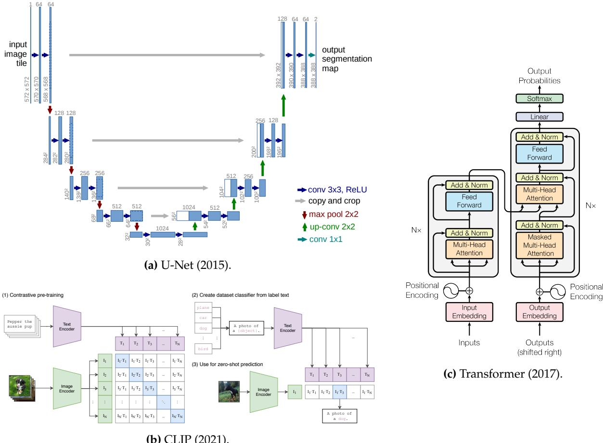  
small patches allow the network to see only little context. More recent approachestarget dataset’s classes.Figure 1. Distinctive visual designs in U-Net, CLIP, and the Transformer, reproduced from Figure 1 of the [11,4] proposed a classifier output that takes into account the features from       where the query, keys, values, and output are allrespective papers [1–3]. These illustrative examples are outside the analytical corpus.

## In this paper, we build upo     2020), ICMLM (Bulent Sariyildiz et al., 2021 Introduction

Figure 1. The main idea in [9] is to supplement a usual contracting network bylanguage modeling, and contrastive objectives to learn im-age representations from text. “zero-shot” capabilities. queries and keys of dimension dk, and values of dimension dv. We compute thquery with all keys, divide each by √ , and apply a softmax function to obtaA familiar scene unfolds before many paper deadlines. The manuscript is almost ready, yet successive layers, where pooling operators are replaced by upsampling operators.While exciting as proofs of concept, using natural language els and recent explorations of learning image representationsvalues.Figure 1 remains open on the screen. An arrow is rerouted, a color is given a clearer meaning, This is likely because demonstrated performance on com- (2018) and Kolesnikov et al. (2019) trained their models for            into a matrix Q. The keys and values are also packed together into matrices Kand a generic box gives way to an example that reveals the central idea. Such revisions help For example, Li et al. (2017) reach only 11.5% accuracy ICMLM, and ConVIRT trained for accelerator days on one    shape the scientific argument. They influence what a reader notices, which relationships become 88.4% accuracy of the current state of the art (Xie et al., this gap and study the behaviors of image classifiers trained Tintelligible, and how a contribution is remembered. The nights recalled in our title represent puter vision approaches (Deng et al., 2012). Instead, more by the large amounts of publicly available data of this formthis efort to find a visual form that belongs to a particular idea.

that predicting ImageNet-related hashtags on Instagram im-         ConVIRT trained from scratch, which we call CLIP, for Con- 3Teaser and framework figures serve complementary roles in this process. A teaser may introduce ImageNet these pre-trained models increased accuracy by      of learning from natural language supervision. We studya problem, expose a limitation, or communicate an insight, while a framework figure presents Kolesnikov et al. (2019) and Dosovitskiy et al. (2020) have          spanning almost 2 orders of magnitude of compute and ob-the organization of a method. Our study focuses on motivation-oriented teasers and overall also demonstrated large gains on a broader set of transferbenchmarks by pre-training models to predict the classes of serve that transfer performance is a smoothly predictablefunction of compute (Hestness et al., 2017; Kaplan et al.,frameworks. Three familiar framework diagrams illustrate how composition can expose scientific the noisily labeled JFT-300M dataset. 2020). We find that CLIP, similar to the GPT family, learnsto perform a wide set of tasks during pre-training includingstructure. U-Net uses a U-shaped arrangement to express contraction, expansion, and crossground between learning from a limited amount of super- OCR, geo-localization, action recognition, and many others.We measure this by benchmarking the zero-shot transferscale transfer. The Transformer organizes its principal operations around the relationship amounts of raw text. However, it is not without compro- performance of CLIP on over 30 existing datasets and findbetween an encoder and a decoder, while CLIP places contrastive pretraining alongside zero-shot classification [1–3]. Fig. 1 presents these deliberately selected landmarks as qualitative reference points outside the analytical corpus. Their value here lies in the correspondence between visual arrangement and scientific structure.

Generative models broaden the ways in which researchers develop such compositions. They can propose layouts, create illustrative elements, and support iterative refinement. Recent systems also target scientific diagrams explicitly [4]. This assistance makes alternative designs easier to explore, but authors must still decide which arrangement best explains the intended claim. An attractive draft may obscure a dependency, repeat information, or give a secondary detail undue prominence. Additional labels may resolve ambiguity while increasing reading efort. Assessing AI assistance therefore requires examining how revisions afect communication, visual economy, and scientific fidelity.

Visual appearance alone cannot establish how a figure was produced or how efectively it communicates. Likewise, an overall quality score can conceal improvements in clarity that coincide with weaker organization or aesthetic coherence. A useful assessment must distinguish production provenance from visible design properties and examine communication through multiple dimensions. This motivates an analysis that places existing figures in their historical context and follows changes within individual figures.

Within this multidimensional assessment, we give particular attention to purposeful visual inventiveness and problem-specific design. A revealing comparison, a meaningful spatial correspondence, or a carefully organized example can make an unfamiliar concept accessible. These qualities can appear in a restrained block diagram or a detailed illustration, depending on the message and audience [5]. They give a concrete interpretation to the “human touch” that motivates this study without treating appearance as evidence of authorship or efort. A polished figure can still leave its central claim implicit, and a detailed diagram can identify its components without making their interactions traceable.

Evidence from other creative activities further highlights the distinction between individual evaluations and collective diversity. Doshi and Hauser report improved individual evaluations of AI-assisted stories alongside greater similarity among outputs [6]. Ashkinaze et al. find that extensive exposure to AI-generated ideas increases collective diversity without improving individual creativity [7]. These task-dependent findings motivate distinguishing communicative quality, expressive design, and stylistic diversity. Our evaluation addresses the first two, while claims about community-wide stylistic convergence require separate evidence.

We combine a retrospective analysis of existing figures with a source-constrained revision study. The corpus contains 371 figures from 200 papers, including a quota-based main sample of 160 papers spanning four periods and a separate purposive style-contrast sample of 40 papers. A fixed protocol uses a single multimodal judge to assess six dimensions of communication and design (Section 2). Under this protocol, original-figure ratings show no uniform deterioration across periods. Revisions receive higher mean clarity ratings but lower aesthetic-coherence ratings, with larger increases in the six-dimension average for main-sample motivation figures than for frameworks. Case analyses connect these outcomes to specific design decisions, particularly the balance between making explanations explicit and preserving a coherent composition.

This study makes three contributions:

1. We construct a traceable corpus and illustrated atlas of 200 papers and 371 figures, retaining source and visual-version evidence and distinguishing the main sample from the purposive contrast sample.

2. We evaluate original figures and 369 study-generated revisions that pass the recorded fidelity checks across six dimensions, preserving repeated judgments and reporting both dimension-level tradeofs and fidelity failures.

3. We develop practical guidance for researcher-led figure design, connecting observed tradeofs to decisions about visual narrative, typographic hierarchy, information selection, and scientific fidelity.

## 2 Study Overview and Research Questions

## Our scope: assistance without surrendering design

Design principle. Researchers should determine what a figure communicates and how its composition, colors, symbols, and connections express the scientific idea.

Study approach. We combine a retrospective analysis of existing figures with paired assessment of source-constrained revisions, documenting both design tradeofs and fidelity failures.

Evaluation focus. Six dimensions characterize visual communication and design under a fixed multimodal judging protocol.

The study distinguishes visual appearance, production provenance, and communication quality. Appearance can be inspected directly, while provenance requires evidence about how a figure was produced. We assess communication and design through six dimensions: Communicative Clarity, Organization and Readability, Graphical Consistency, Aesthetic Coherence, Purposeful Visual Inventiveness, and Design Specificity. The latter two respectively assess whether a visual device contributes to explanation and whether the depicted elements and relationships are specific to the research problem. These dimensions are examined separately to preserve tradeofs that an overall score may conceal.

Two research questions guide the analysis:

RQ1. How do communication and design ratings vary across periods and figure roles? The retrospective analysis compares motivation and framework figures across the four periods within the main sample. The purposive contrast sample supports closer examination of selected visual conventions and is analyzed separately.

RQ2. How do these ratings change following source-constrained AI-assisted revision? Paired comparisons identify gains, losses, and unchanged ratings across dimensions. Revisions that fail fidelity checks are retained as workflow outcomes without receiving quality scores.

Both questions are descriptive and concern the documented corpus and configured evaluator. The fixed protocol provides a standardized assessment procedure, while the correspondence between its ratings and human understanding or preference remains to be established [8]. These analyses inform our argument for researcher-led design and identify questions for subsequent reader studies.

## 3 Dataset Construction

We constructed a traceable corpus of 200 papers and 371 motivation and framework figures through two complementary collection paths. The quota-based main sample contains 160 papers and 320 figures for comparisons across temporal stages and research topics. A separate purposive style-contrast sample contains 40 papers and 51 figures for examining selected visual conventions. Papers are the units of inclusion and deduplication, while figures are the units of assessment. Eligible material was publicly available by 20 October 2026, and collection was finalized on 29 October 2026. The sampling procedure was refined through pilot collection and checks of candidate availability and was not preregistered.

## 3.1 Sampling Design: Stages, Topics, and Sources

The main sample crosses four temporal stages with four research topics that recur throughout the study period (Fig. 2). Object detection primarily concerns 2D objects, while image segmentation

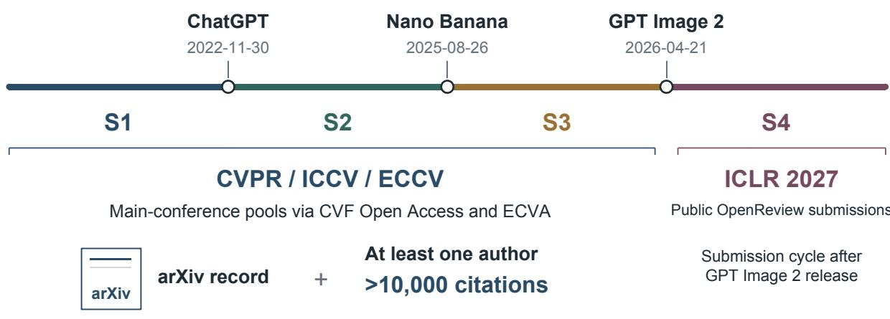

## 3D Vision Image Segmentation Object Detection Image Restoration

Figure 2. Main-sample design across temporal stages, candidate source pools, and recurring research topics. Source labels identify the search scope, and release milestones indicate tool availability. Timeline lengths are schematic.

includes semantic and instance segmentation. Image restoration covers denoising, deblurring, and super-resolution, and 3D vision primarily concerns reconstruction. Each of the 16 combinations of stage and topic contains 10 papers, with each paper contributing one motivation (M) figure and one distinct framework (F) figure. These quotas maintain a common topical scope while accommodating changes in methods and subtopics within each research area.

The eligibility window extends from 1 January 2016 to 20 October 2026. The public releases of ChatGPT on 30 November 2022, Gemini 2.5 Flash Image (Nano Banana) on 26 August 2025, and ChatGPT Images 2.0 (GPT Image 2) on 21 April 2026 mark the beginnings of S2, S3, and S4, respectively [9–11]. Each preceding stage ends on the previous day. Stage assignment follows public evidence for the sampled visual version. These milestones indicate tool availability and do not establish use by the original authors.

For S1–S3, discovery began with CVPR, ICCV, and ECCV main-conference directories on CVF Open Access and ECVA, supplemented by arXiv version records. Eligibility required an arXiv record and at least one author with more than 10,000 cumulative citations on a verifiable public scholarly profile. Citation snapshots were collected on 21–28 October 2026, after the material cutof. This criterion reflects author visibility at retrieval and does not validate paper quality.

For S4, discovery used public ICLR 2027 submissions on OpenReview. The September 2026 submission cycle followed the release of GPT Image 2 [12], and the submissions were under review when collected. We initially applied the same arXiv and author-citation requirements. When reviewed candidates satisfying both requirements did not fill a topic quota, either or both requirements were waived. Papers admitted under the original and relaxed criteria remain separately identified.

## 3.2 Collection and Figure Verification

Fig. 3 summarizes the two collection paths. Main-sample selection used figure-role and version checks to fill the temporal and topical quotas without considering aesthetic appeal or perceived AI-like style. The contrast sample used title-guided inspection and purposive visual selection without requiring paired M and F figures. The retained paper sets are disjoint, although their candidate pools overlap and their retrieval counts cannot be summed.

A Quota-based Main Sample  
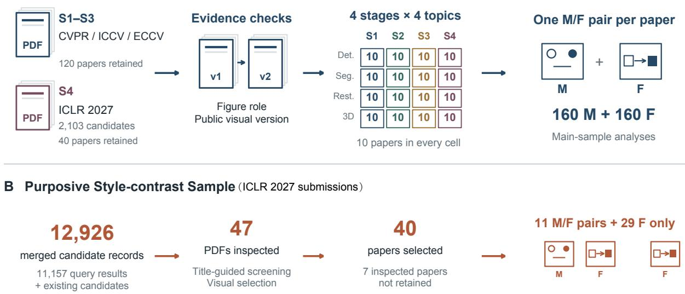  
Figure 3. Two collection paths produce 200 papers and 371 figures. A: Role and version checks support quota-based selection of paired motivation (M) and framework (F) figures. B: Purposive selection retains eligible M and/or F figures. Candidate pools overlap. In the contrast pool, 47 PDFs underwent visual inspection.

Main-sample searches used topic-specific terms. Detection queries included object detection and object detector, while segmentation queries included semantic segmentation and instance segmentation. Restoration queries covered image restoration, denoising, deblurring, and super-resolution. Queries for 3D vision included 3D reconstruction, multi-view reconstruction, and surface reconstruction. Retrieval snapshots preserve the query scope and pagination. The 11 S4 queries yielded 2,103 distinct candidate records within this search scope and do not constitute a census of the conference. The cumulative S1–S3 retrieval history has not been reconstructed into a deduplicated screening funnel, so aggregate retrieval and exclusion counts are unavailable for those stages.

Figure roles were assessed from the complete image, its caption, and relevant body text. An M figure introduces a problem through limitations, failure cases, conceptual contrasts, or application needs. An F figure depicts an overall architecture, major module relationships, or a principal training or inference workflow. Performance-only charts, ordinary result montages, and isolated module diagrams do not qualify solely because they contain relevant visual elements. When several figures qualified, we prioritized the first problem-introducing figure for M and the explicitly designated overall framework for F. Remaining ties were resolved by figure number.

For each main-sample figure, we sought the earliest verifiable public occurrence of the sampled visual version. Composition, elements, colors, and connections were compared across available versions, with posting and submission records establishing dates or date ranges. Changes to surrounding text or experiments do not alter the visual-version date when the sampled figure remains unchanged. A later redraw is dated from its own verifiable public appearance. Both M and F figures must qualify for the paper’s assigned stage, and an earlier arXiv figure may therefore be retained instead of a later conference version. A figure was not assigned to a stage when a possible earlier-stage occurrence remained unresolved. These records establish public availability rather than creation dates. Historical tracing is more limited for S4 papers without matched arXiv records, and the manifest preserves the available date precision.

The contrast path searched additional ICLR 2027 submissions without topic quotas, arXiv matching, or author-citation requirements. The four queries were multi-agent, agentic, multimodal, and benchmark. They returned 11,157 distinct records, and merging these results with existing candidates yielded a pool of 12,926 records. Title relevance guided inspection of 47 PDFs, of which 40 were retained and seven were not. Selected figures prominently combined conventions such as nested boxes, labeled panels, explanatory text, icons, and pastel colors. Selection required neither a numerical threshold nor the presence of every feature. Candidates that were not inspected are not counted as exclusions following full-text assessment.

Eleven contrast papers contribute both M and F figures, and 29 contribute F figures only. The legacy label S4-AI-Style identifies this collection path. It does not establish AI authorship or an earliest visual occurrence within S4. Fixed submission PDFs and public-date evidence are archived, but earliest matching visual versions were not systematically traced across arXiv and project histories. The contrast sample is therefore analyzed separately from temporal stage means and cannot estimate the prevalence of its selected conventions.

Complete figure regions were cropped from fixed PDFs, retaining all panels, labels, legends, arrows, and symbols. The cropped PDF assets preserve the original PDF objects, including embedded raster content. PNG versions were rendered at 300 dpi with the original aspect ratio, without redrawing, recoloring, text replacement, or generative enhancement. Each export was visually inspected and linked to its caption, source page, crop coordinates, URL, version evidence, and file hash. Anonymous evaluation copies omit external source labels while retaining content within the figure. Drawing-tool disclosures are recorded separately, and production provenance remains unknown in the absence of direct evidence.

The archive preserves paper and figure manifests, exclusions, retrieval logs, fixed sources, and blind-ID mappings. The accompanying methods project provides aggregate plotting data, source-file hashes, editable vector figures, and figure-generation code. Corpus counts derive from the main-sample manifests of 160 papers and 320 figures and the contrast-sample manifests of 40 papers and 51 figures. Collection, role assessment, version comparison, and cropping used OpenAI’s gpt-6-astra under researcher-specified rules, in sessions separate from quality assessment. Independent expert verification and inter-rater reliability were not established.

## 3.3 Corpus Characteristics and Comparison Scope

Fig. 4 summarizes the realized corpus and the diferences that remain despite balanced quotas. Each main-sample stage contains 40 papers and 80 figures, but S4 includes two eligibility tiers (panel A). Its 17 original-criteria papers comprise nine restoration papers and eight 3D papers. The 23 relaxed-criteria papers comprise all 10 detection papers, all 10 segmentation papers, one restoration paper, and two 3D papers.

Source composition also varies across stages (panel B). At the paper level, 39, 38, and 32 papers in S1, S2, and S3, respectively, use conference PDFs as their fixed figure sources. The corresponding arXiv-source counts are one, two, and eight, yielding 109 conference-source papers and 11 arXiv-source papers overall. The retained conference labels are CVPR and ECCV. No ICCV paper was retained despite its inclusion in the search scope. Three papers with arXiv figure sources also have a CVPR venue label, demonstrating that the fixed source version does not determine publication status. All S4 figure sources are fixed ICLR 2027 submission PDFs.

The contrast sample is concentrated in two OpenReview primary\_area categories (panel C). Modality applications and datasets and benchmarks each contribute 13 papers, with the remaining 14 papers distributed across nine other areas. These metadata categories difer from the four task families used in the main sample. Panel D reports 160 M and 160 F figures in the main sample and 11 M and 40 F figures in the contrast sample, yielding 171 M and 200 F figures overall.

A Stage × topic allocation
<table><tr><td></td><td>S1</td><td>S2</td><td>S3</td><td>S4</td></tr><tr><td>Detection</td><td></td><td></td><td></td><td>ooooo ooooo</td></tr><tr><td></td><td></td><td></td><td></td><td>ooooo</td></tr><tr><td>Segmentation</td><td></td><td></td><td></td><td>ooooo</td></tr><tr><td>Restoration</td><td></td><td></td><td></td><td></td></tr><tr><td></td><td></td><td></td><td></td><td>O</td></tr><tr><td>3D vision</td><td></td><td></td><td></td><td>oo</td></tr><tr><td></td><td></td><td></td><td></td><td></td></tr><tr><td>S4 original: 17</td><td>O</td><td></td><td></td><td></td></tr><tr><td></td><td></td><td>S4 relaxed: 23</td><td></td><td></td></tr><tr><td>Each cell: 10 papers / 20 figures</td><td></td><td></td><td></td><td></td></tr></table>

B Fixed figure-source PDFs  
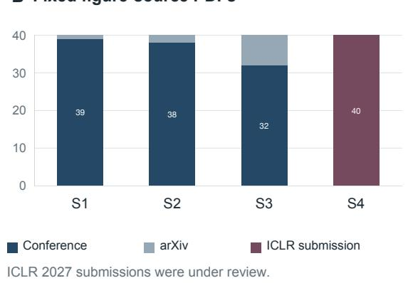

## C Submission areas of the style-contrast sample

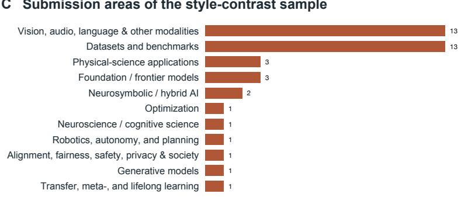

D Figure roles
<table><tr><td></td><td>M</td><td>F</td></tr><tr><td>Main</td><td>160</td><td>160</td></tr><tr><td>Contrast</td><td>11</td><td>40</td></tr><tr><td>Total</td><td>171</td><td>200</td></tr></table>

Figure 4. Corpus composition. A: Main-sample allocation and S4 eligibility tiers. B: Fixed PDF sources, distinct from publication venues. C: OpenReview submission areas of the contrast sample, with shortened metadata labels. D: Motivation (M) and framework (F) figure counts. The contrast sample is excluded from temporal stage averages.

Table 1. Temporal distribution of verified figure versions in the main sample. Entries count figures, and dashes denote zero.
<table><tr><td colspan="11"></td><td rowspan="2">Total</td></tr><tr><td>Stage</td><td>2018</td><td>2019</td><td>2020</td><td>Year of verified figure version 2021</td><td>2022</td><td>2023</td><td>2024</td><td>2025</td><td>2026</td></tr><tr><td>S1</td><td>3</td><td>3</td><td>1</td><td>21</td><td>52</td><td>一</td><td>一</td><td>一</td><td>一</td><td>80</td></tr><tr><td>S2</td><td>一</td><td>一</td><td>一</td><td>一</td><td>一</td><td>3</td><td>35</td><td>42</td><td>一</td><td>80</td></tr><tr><td>S3</td><td>一</td><td></td><td></td><td></td><td></td><td>一</td><td></td><td>20</td><td>60</td><td>80</td></tr><tr><td>S4</td><td>一</td><td>一</td><td>一</td><td>一</td><td>一</td><td>一</td><td>1</td><td>一</td><td>80</td><td>80</td></tr><tr><td>Total</td><td>3</td><td>3</td><td>1</td><td>21</td><td>52</td><td>3</td><td>35</td><td>62</td><td>140</td><td>320</td></tr></table>

Temporal coverage is also uneven (Table 1). Stage windows difer in duration, and sampling was not balanced by year. In S1, 52 of the 80 figures date to 2022, and none date to 2016 or 2017. The start of the eligibility window therefore precedes the earliest retained figure versions.

These characteristics delimit the comparisons supported by the corpus. Neither collection path produces a probability sample. Equal quotas do not equalize source populations, eligibility conditions, review status, or the distribution of years within each stage. The contrast sample additionally reflects purposive selection by appearance and a diferent topical scope. Temporal diferences therefore cannot isolate the efects of AI assistance, and figures drawn from the same paper must be treated as clustered observations.

Table 2. Operational dimensions and compact scoring anchors. Scores of 2 and 4 indicate performance between adjacent anchors. The same frozen rubric is used for original and revised figures.
<table><tr><td>Dimension</td><td>Score 1</td><td>Score 3</td><td>Score 5</td></tr><tr><td>Communicative Clarity</td><td>stantial inference.</td><td>The central message is un- The main problem or pro- The intended problem or clear, and key objects or cess is identifiable, but contrast, or the main in- relationships require sub- important relationships or puts, operations, relation- emphasis remain unclear. ships, and outputs, are</td><td>readily understood.</td></tr><tr><td>Organization &amp; Confusing Readability</td><td>sequence.</td><td>hierarchy, Most information can be Reading order and hier- crowding, or illegible key followed, but grouping, archy are clear, grouping text obstructs the reading density, hierarchy, or text manages complexity, and requires noticeable effort.key labels are legible.</td><td></td></tr><tr><td>tency</td><td>biguous.</td><td>Graphical Consis- Conflicting or unexplained Encodings are mostly con- Visual encodings are con- visual encodings make im- sistent, with some ambigu- sistent and traceable, with portant relationships am- ous labels, directions, con- necessary labels or legends nections, or repeated ele- clarifying relationships. ments.</td><td></td></tr><tr><td>ence</td><td>pete with the message.</td><td>Aesthetic Coher- Clashing typography, col- The composition is broadly Color, typography, spac- ors, spacing, or styles com- coherent but has uneven ing, alignment, and bal- alignment, spacing, em- ance jointly support the in- phasis, or balance.</td><td>formation.</td></tr><tr><td>Inventiveness</td><td>standing.</td><td>Purposeful Visual Generic arrangement or A deliberate comparison, A well-chosen explanatory ornament contributes lit- arrangement, example, or device provides a partic- tle problem-specific under- explanatory device helps, ularly effective account of but much remains generic. the concept.</td><td></td></tr><tr><td></td><td>lems.</td><td>Design Specificity Replacing the labels would Some elements are tai- The elements and their ar- allow the design to repre- lored to the problem, while rangement express distinc- sent many unrelated prob- much of the design re- tive problem-specific ob- mains interchangeable.</td><td>jects, relationships, or op- erations.</td></tr></table>

## 4 Multimodal Evaluation and Source-Constrained Revision

Scientific figure revision seeks to improve visual communication while preserving scientific meaning. Our protocol evaluates these objectives separately through anonymous image-based quality assessment and source-informed fidelity review. Revisions that pass fidelity review are compared with their originals using the same quality criteria.

## 4.1 Assessment Criteria

The six dimensions in Table 2 assess the accessibility of an explanation, the coherence of its visual organization, and the specificity and inventiveness of its expression. Scores range from 1 to 5, with explicit anchors at 1, 3, and 5 and intermediate scores of 2 and 4. The definitions and anchors remain fixed across original and revised figures. These study-defined criteria operationalize the design concerns introduced in Section 2 and do not constitute a validated psychometric instrument. Because each dimension uses distinct criteria, diferences between their means describe a rubric profile rather than calibrated diferences on a common quality scale.

The rubric evaluates visual devices by their explanatory function. Conventional boxes may receive high scores, while illustrations, icons, gradients, and hand-drawn marks receive no automatic preference. Framework overviews are assessed at their intended level of abstraction. The judge is instructed to avoid inferences about authorship, efort, historical period, software, or paper reputation. Because external captions and manuscript text are withheld, clarity and specificity concern the information conveyed by the supplied figure. Correspondence with source evidence is assessed separately during fidelity review.

Responses follow a structured JSON format. For each dimension, the judge provides an integer score or a null value, a concrete visual observation, and an assessment limitation. A null value requires an explicit reason. Image-level fields record readability and general limitations. Retaining this evidence alongside the scores makes the basis of each judgment available for inspection.

## 4.2 Anonymous Repeated Judgments

Each request contains the frozen rubric, the figure’s motivation (M) or framework (F) role, and three image views. These comprise the complete anonymized figure and two deterministic crops along its longer axis. The crops jointly cover the figure with a 10% overlap, with boundaries rounded outward to integer pixels. Local preparation preserves the pixels of the prepared rating image without resizing or enhancement. External captions, paper titles, author identities, venues, years, stage and sample labels, and previous ratings are withheld. Text and imagery within the figure remain intact, so familiar figures may still be recognizable. Any additional image processing within the model service is unobserved.

Each original figure receives three repeated judgments, yielding 1,113 validated responses for 371 figures. Failed requests are archived and retried within the same slot defined by figure and repetition. Only one validated response per slot enters the analysis. Visual observations are preserved in the judge’s original English wording. A procedural pilot used eight figures spanning all combinations of stage and role and collectively covering the four main topics. The pilot assessed instruction compliance and the grounding of explanations in visible evidence. Its responses are excluded from the primary analysis.

All reported quality judgments were obtained using OpenAI’s gpt-6-astra through Codex (version 0.163.0-alpha.10.2). Original figures were evaluated on 31 October 2026, and revision evaluation continued through 1 November 2026. Each repetition used a fresh ephemeral request with external retrieval, persistent memory, shell and multi-agent tools, apps, plugins, project-document loading, and host-skill discovery disabled. These controls standardize the supplied context but do not remove implicit service instructions. Because a hosted model can change behind a fixed identifier, timestamps, requested settings, request metadata, and raw responses are archived. All reported quality ratings come from this configuration. The same model was also used, in separate sessions, for corpus construction, revision briefs, and fidelity review (Sections 3.2 and 4.3). Across the entire project, the workflow consumed an estimated one billion tokens. Cross-model agreement, counterbalanced pairwise preferences, and agreement with human assessments were not evaluated.

## 4.3 Source-Constrained Revision and Fidelity Review

We attempted a revision of every original figure. Each brief combined the source image, its caption and relevant manuscript explanation, and limitations identified in the original ratings. Briefs were prepared and revisions directed by gpt-6-astra in sessions separate from quality assessment. The revision process therefore had access to source information withheld during quality assessment. It also incorporated feedback from the same model used for subsequent scoring, although revised figures were scored in fresh sessions without access to the briefs or the original ratings. Paired changes characterize this feedback-guided workflow under the configured evaluator.

The workflow combined OpenAI’s gpt-image-2.5 for image generation, with programmatic restoration of source content where necessary. Photographs, masks, heatmaps, curves, numerical values, and other protected data-bearing regions were retained from the source. The archive records source regions, their placements, and applicable pixel-preservation checks. Revisions range from reorganized diagrams to retained scientific panels supplemented with reading guides or explanatory keys. Observed changes can therefore reflect both altered presentation and additional information made explicit within the image. The intervention does not isolate the contributions of layout, color, or generative rendering.

Fidelity review used gpt-6-astra in sessions separate from quality assessment to compare each derivative with the source figure and available caption and body text. The review examined objects, relationships, labels, and scope alongside applicable pixel-restoration checks. Passing indicates that the recorded checks found no disqualifying discrepancy and does not constitute independent expert validation. Of 371 attempted revisions, 369 passed and received three fresh anonymous quality judgments each, yielding 1,107 final-version responses. Two figures remained unsuccessful after an initial draft and two semantic repairs. The EAGLE motivation figure incorrectly connected image inputs to authenticity instructions. The Make It Up framework omitted a pooling-to-local-prototype update and introduced an unsupported reverse connection. Both remain in the revision-attempt denominator without revision quality scores. Paired quality analysis is therefore conditional on passing fidelity review.

Semantic repairs do not constitute additional intervention samples, and accepted revisions were not regenerated in response to low quality scores. An earlier scored PhoenixSR revision was superseded after further verification. Its three responses are retained as historical records and excluded from the final analysis. Checksums link images, anonymous views, prompts, responses, and accepted derivatives to ensure that scores correspond to the final image version. Original rating records remain unchanged.

## 4.4 Paired Analysis and Uncertainty

Let $y _ { i d r } ^ { t }$ denote the score for figure $i ,$ dimension $d ,$ repeat $r ~ \in ~ \{ 1 , 2 , 3 \}$ , and version $t \in$ {original revision}. We summarize valid numerical responses by

$$
\begin{array} { r } { m _ { i d } ^ { t } = \mathrm { m e d i a n } _ { r \in \mathcal { R } _ { i d } ^ { t } } y _ { i d r } ^ { t } , } \end{array}\tag{1}
$$

where $\mathcal { R } _ { i d } ^ { t }$ contains repeats with numerical scores. The number and range of valid numerical scores are retained. When this set is empty, the median is undefined, and missing values are not imputed. For a revision that passes fidelity review and has numerical medians in both versions for dimension $d ,$ the paired change is

$$
\Delta _ { i d } = m _ { i d } ^ { \mathrm { r e v i s i o n } } - m _ { i d } ^ { \mathrm { o r i g i n a l } } .\tag{2}
$$

The six dimensions remain the primary outcomes. Group profiles report arithmetic means of figure-level medians. Paired summaries report mean changes and counts of increases, ties, and decreases with their valid denominators. Main-sample analyses distinguish temporal stages and figure roles while retaining topic, source, and eligibility-tier information. The contrast sample is analyzed separately and excluded from temporal stage means. Explicitly pooled paired results describe the accepted revision set.

The gallery additionally reports a post hoc equal-weight mean across the six dimensions,

$$
\bar { m } _ { i } ^ { t } = \frac { 1 } { 6 } \sum _ { d = 1 } ^ { 6 } m _ { i d } ^ { t } , \qquad \Delta \bar { m } _ { i } = \bar { m } _ { i } ^ { \mathrm { r e v i s i o n } } - \bar { m } _ { i } ^ { \mathrm { o r i g i n a l } } .\tag{3}
$$

This mean is computed only when all six dimension medians are available for the corresponding version. It is a descriptive average of ordinal ratings and does not constitute a validated overall-quality scale. Diferences are calculated before display rounding.

Uncertainty in reported mean changes is summarized using 95% paper-cluster bootstrap percentile intervals with 5,000 resamples and random seed 20261020. Paper identifiers are sampled uniformly with replacement within the relevant analysis set. Each sampled paper contributes all its included figures and their matched versions, and each replicate recomputes the figure-weighted mean. The 2.5th and 97.5th percentiles define the interval. This procedure preserves within-paper dependence and the original figure weighting, using frozen score files linked to paper identities through the manifest. Neither the 2,220 validated responses nor the 2,214 paired figure–dimension outcomes are treated as independent sampling units. The intervals quantify resampling variability within the corpus. They do not account for non-probability selection, source and eligibility diferences, service drift, or systematic evaluator bias.

## 5 Results and Summary

We begin with 40 paper-level cases, comprising eight papers from each of S1–S4, with two per topic, and eight from the separate contrast sample. The complete atlas of 200 papers, including original figures, revision outcomes, and evaluation scores, is available at https: //ntu-ai4x.github.io/Rethinking\_Figures/index\_en.html.

The gallery provides visual context for analyses based on the complete eligible samples. Motivation (M) and framework (F) figures are distinguished throughout. C, O, G, A, I, and S denote clarity, organization and readability, graphical consistency, aesthetic coherence, purposeful visual inventiveness, and design specificity. Displayed scores are figure-level medians of three judgments. The six-dimension mean is a post hoc descriptive summary, and changes are calculated before rounding.

001 A Dual Weighting Label Assignment Scheme for Object Detection [13]

S1 | Object detection | CVPR 2022

Source PDF, p. 1; ID: P65

Motivation (source Fig. 1)  
Original
<table><tr><td colspan="2">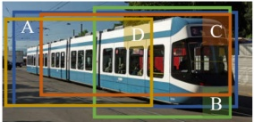</td><td></td><td>Score</td><td>A 0.95</td><td>B 0.7</td><td>C D 0.6</td></tr><tr><td colspan="2"></td><td></td><td>IoU</td><td>0.95</td><td>0.4 0.6</td><td>0.3 0.6</td></tr><tr><td colspan="2">A 0.</td><td>B</td><td>C</td><td></td><td>D</td><td></td></tr><tr><td colspan="2">Wpos Wneg 0.9</td><td>0.04 0.05</td><td>0. 0.</td><td></td><td>0.05 0.04</td><td>GFL</td></tr><tr><td colspan="2">Wpos Wneg 0.05</td><td>0.16 = 0.24 </td><td>0.36 0.24</td><td></td><td>0.36 0.24</td><td>VFL</td></tr><tr><td colspan="2">Wpos 1.0</td><td>0.01</td><td>0.06&quot;</td><td></td><td></td><td></td></tr><tr><td colspan="2">Wneg 0.</td><td>0.55</td><td>0.31</td><td></td><td>0.03 0.08</td><td>DW</td></tr></table>

Study-generated derivative  
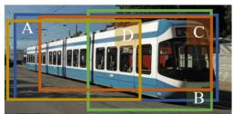

<table><tr><td></td><td>A</td><td>B</td><td>C</td><td>D</td></tr><tr><td>Score</td><td>0.95</td><td>0.7</td><td>0.6</td><td>0.3</td></tr><tr><td>IoU</td><td>0.95</td><td>0.4</td><td>0.6</td><td>0.6</td></tr></table>

<table><tr><td>GFL</td><td>Wpos</td><td>A</td><td>B</td><td>C</td><td>D</td><td>GFL:</td></tr><tr><td></td><td>Wneg</td><td>0. 0. 0.9</td><td>0.04 0.05 0.16 =</td><td>0. 0.</td><td>0.05 0.04</td><td>B and D receive nearly the same weights. VFL:</td></tr><tr><td>VFL</td><td>Wpos Wneg</td><td>0.05</td><td>0.24</td><td>0.36 0.24</td><td>0.36 0.24-</td><td>C and D receive the same weights.</td></tr><tr><td>DW</td><td>Wpos Wneg</td><td>1.0 0.</td><td>0.01 0.55</td><td>0.06 0.31</td><td>0.03 0.08</td><td>DW: A distinct (positive, negative) pair for each anchor.</td></tr></table>

<table><tr><td>C</td><td>O</td><td>G</td><td>A</td><td>I</td><td>S</td><td>Mean</td></tr><tr><td>3</td><td>4</td><td>5</td><td>4</td><td>4</td><td>5</td><td>4.17</td></tr></table>

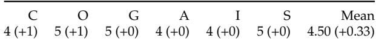

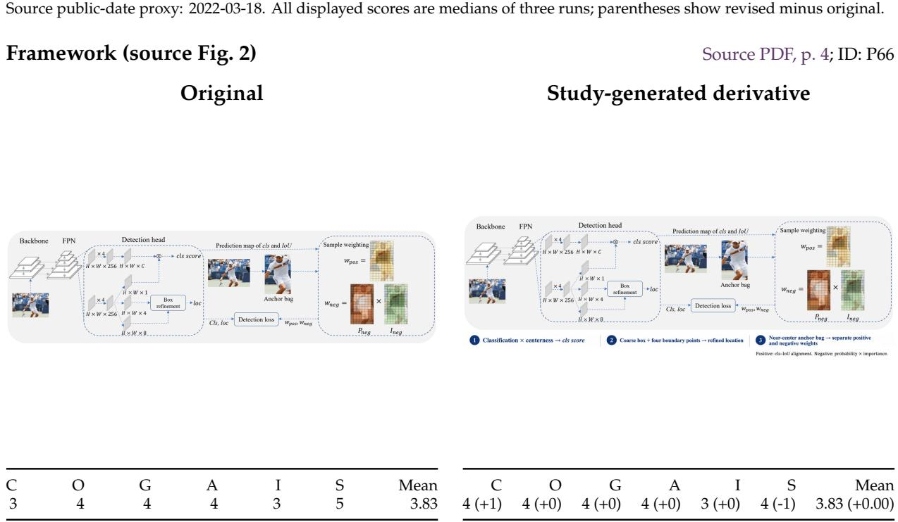  
Source public-date proxy: 2022-03-18. All displayed scores are medians of three runs; parentheses show revised minus original.

Source PDF, p. 1; ID: P213

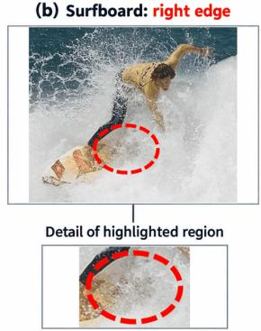  
004 Localization Distillation for Dense Object Detection [14] S1 | Object detection | CVPR 2022  
Original

Motivation (source Fig. 1)

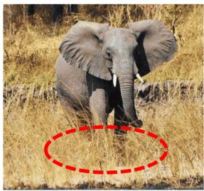

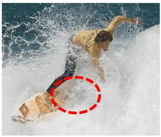  
Study-generated derivative  
Ambiguous object boundaries

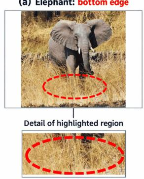  
Edges cannot be confidently located in these regions.

<table><tr><td>C</td><td>O</td><td>G</td><td>A</td><td>I</td><td>S</td><td>Mean</td></tr><tr><td>2</td><td>4</td><td>4</td><td>4</td><td>2</td><td>3</td><td>3.17</td></tr></table>

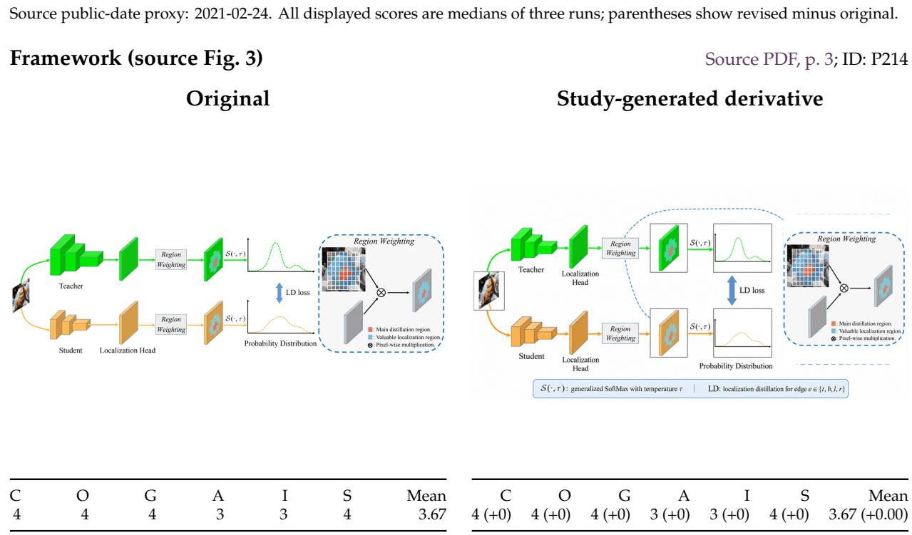

<table><tr><td>C</td><td>O</td><td>G</td><td>A</td><td>I</td><td>S</td><td>Mean</td></tr><tr><td>4</td><td>4</td><td>4</td><td>3</td><td>3</td><td>4</td><td>3.67</td></tr></table>

Source public-date proxy: 2021-11-25. All displayed scores are medians of three runs; parentheses show revised minus original.

## 012 Decoupling Zero-Shot Semantic Segmentation [15]

## S1 | Image segmentation | CVPR 2022

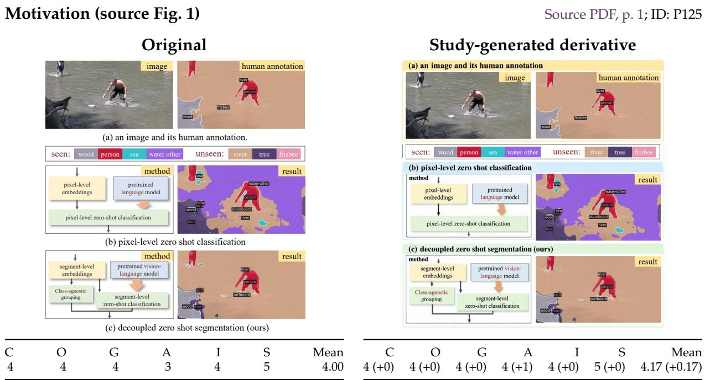

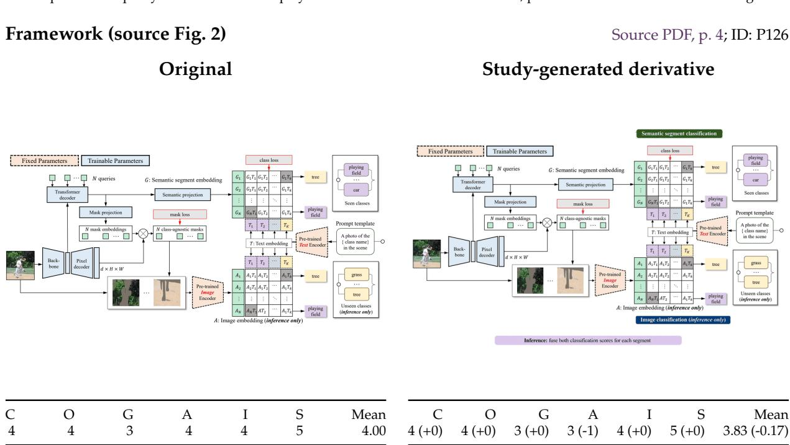  
Source public-date proxy: 2022-04-15. All displayed scores are medians of three runs; parentheses show revised minus original.

<table><tr><td>C</td><td>O</td><td>G</td><td>A</td><td>I</td><td>S</td><td>Mean</td></tr><tr><td>3</td><td>4</td><td>3</td><td>3</td><td>3</td><td>4</td><td>3.33</td></tr></table>

# 016 Open-World Instance Segmentation: Exploiting Pseudo Ground Truth From Learned Pairwise Afinity [16]

S1 | Image segmentation | CVPR 2022

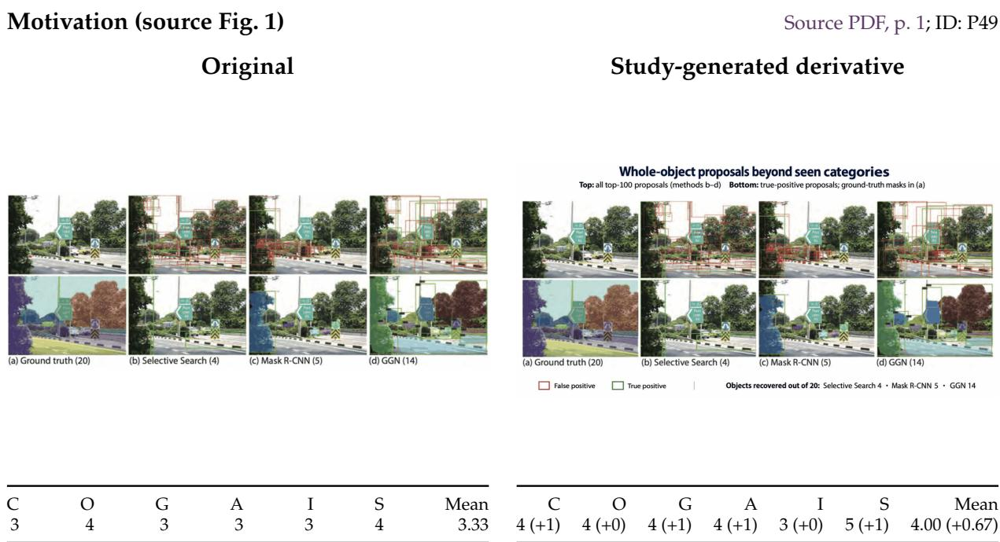

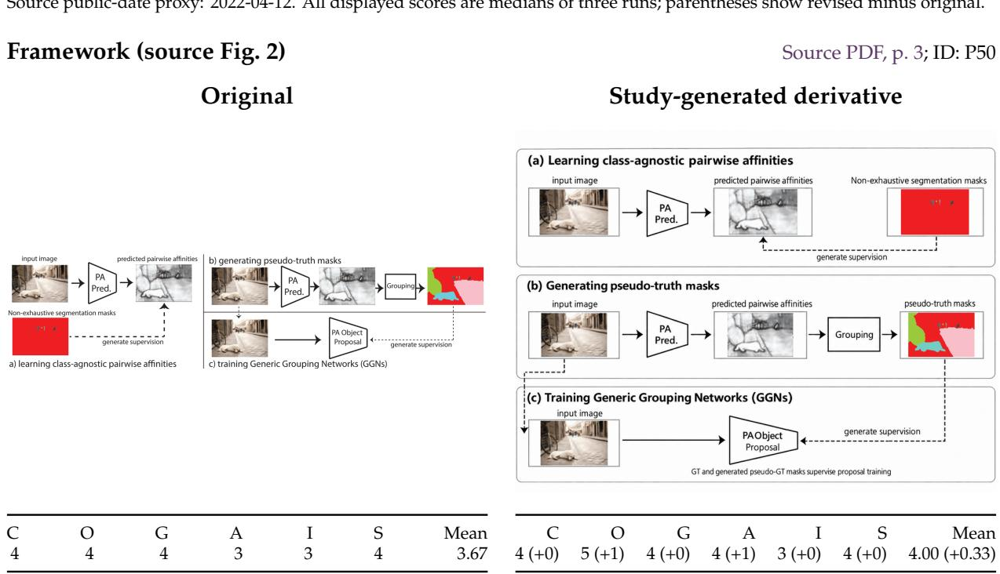

<table><tr><td>C</td><td>O</td><td>G</td><td>A</td><td>I</td><td>S</td><td>Mean</td></tr><tr><td>4</td><td>4</td><td>4</td><td>3</td><td>3</td><td>4</td><td>3.67</td></tr></table>

Source public-date proxy: 2022-04-12. All displayed scores are medians of three runs; parentheses show revised minus original.

C: clarity; O: organization/readability; G: graphical consistency; A: aesthetic coherence; I: visual inventiveness; S: design specificity.   
Mean is the arithmetic mean of six dimension medians, a descriptive display value, not a validated quality index. C: clarity; O: organization/readability; G: graphical consistency; A: aesthetic coherence; I: visual inventiveness; S: design specificity.   
Mean is the arithmetic mean of six dimension medians, a descriptive display value, not a validated quality index.

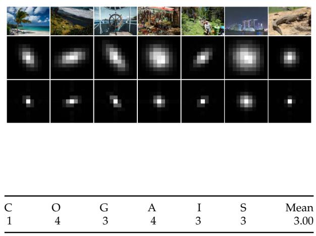

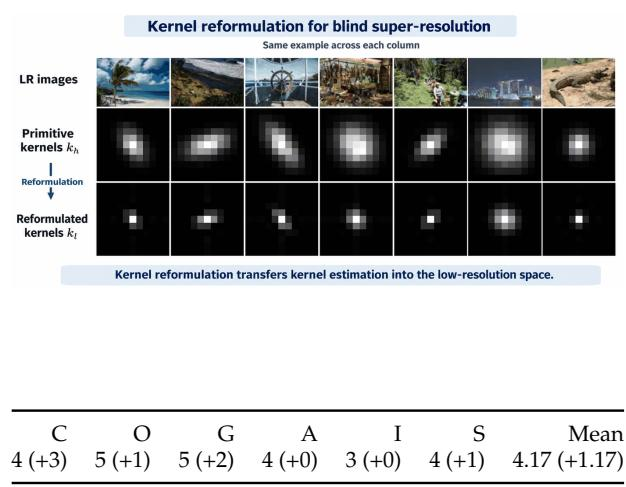  
024 Deep Constrained Least Squares for Blind Image Super-Resolution [17]  
Study-generated derivative

Source public-date proxy: 2022-02-15. All displayed scores are medians of three runs; parentheses show revised minus original.  
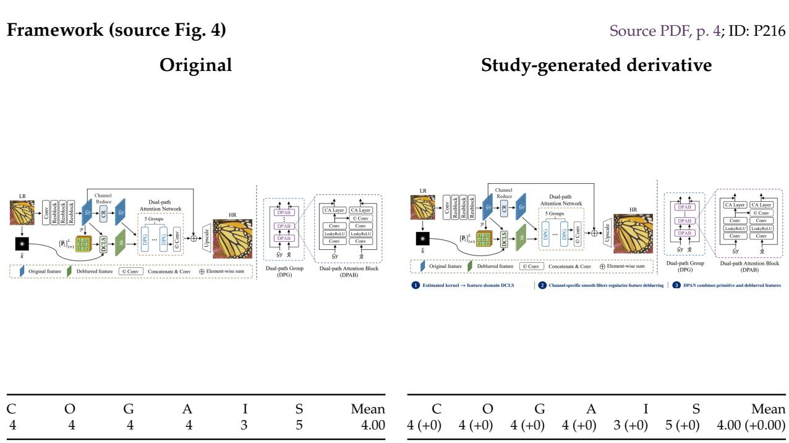  
Source public-date proxy: 2022-02-15. All displayed scores are medians of three runs; parentheses show revised minus original.

# 030 Unsupervised Real-World Image Super Resolution via Domain-Distance Aware Training [18]

S1 | Image restoration | CVPR 2021

Motivation (source Fig. 1)

Original  
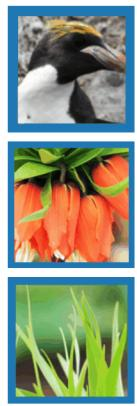  
Bicubic  
Original

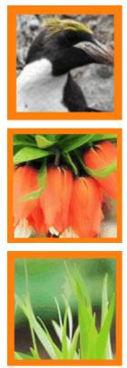  
FSSR [16]

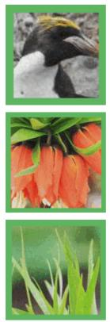  
DASR(ours)

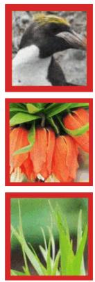  
Real-world  
Source PDF, p. 1; ID: P325  
Study-generated derivative

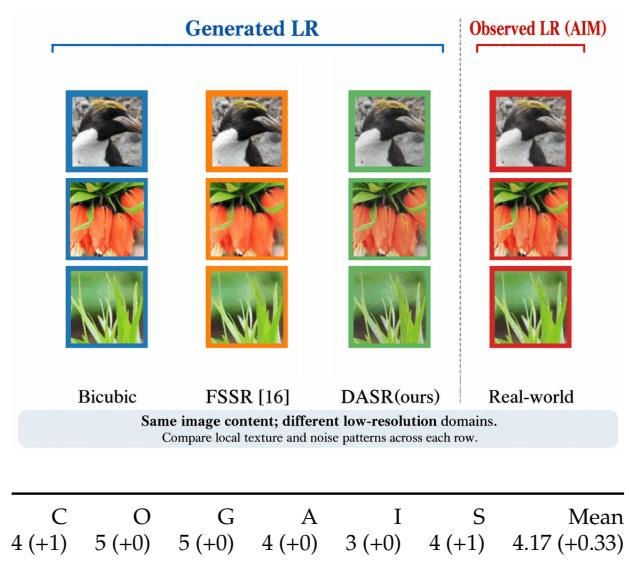

<table><tr><td>C</td><td>O</td><td>G</td><td>A</td><td>I</td><td>S</td><td>Mean</td></tr><tr><td>3</td><td>5</td><td>5</td><td>4</td><td>3</td><td>3</td><td>3.83</td></tr></table>

Source public-date proxy: 2021-06. All displayed scores are medians of three runs; parentheses show revised minus original.

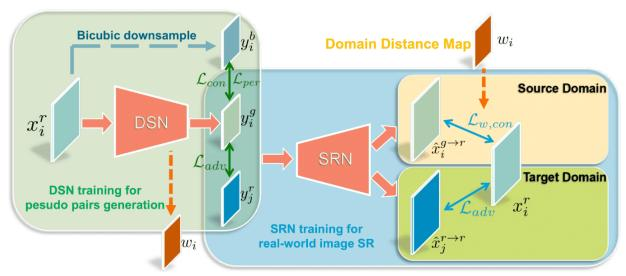

Study-generated derivative  
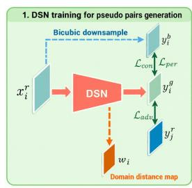

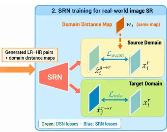

<table><tr><td>C</td><td>O</td><td>G</td><td>A</td><td>I</td><td>S</td><td>Mean</td></tr><tr><td>3</td><td>3</td><td>4</td><td>3</td><td>3</td><td>4</td><td>3.33</td></tr></table>

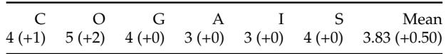  
Source public-date proxy: 2021-06. All displayed scores are medians of three runs; parentheses show revised minus original.

<table><tr><td>C</td><td>O</td><td>G</td><td>A</td><td>I</td><td>S</td><td>Mean</td></tr><tr><td>4</td><td>4</td><td>5</td><td>4</td><td>4</td><td>5</td><td>4.33</td></tr></table>

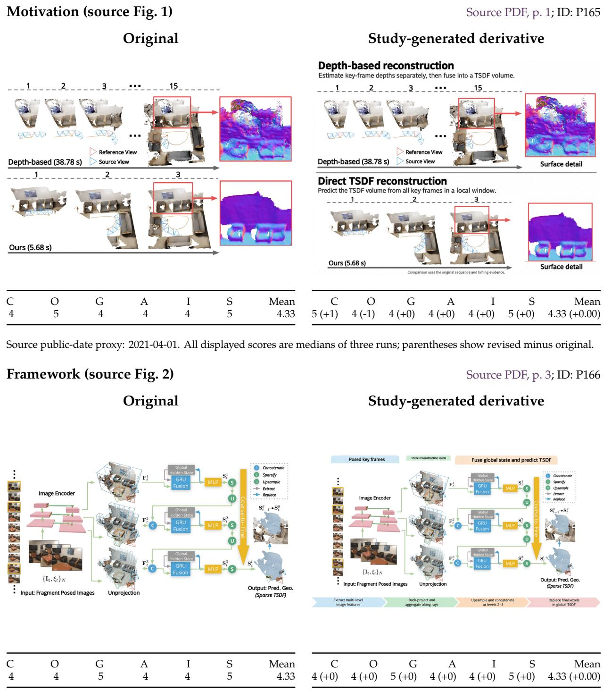  
Source public-date proxy: 2021-04-01. All displayed scores are medians of three runs; parentheses show revised minus original.

# 034 NeuralRecon: Real-Time Coherent 3D Reconstruction From Monocular Video [19]

S1 | 3D vision | CVPR 2021

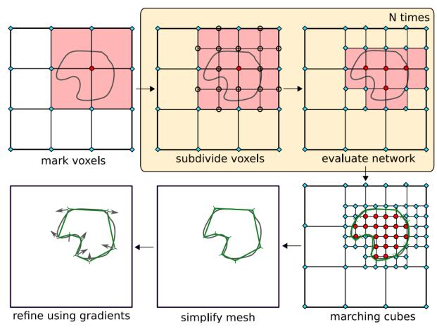

# 035 Occupancy Networks: Learning 3D Reconstruction in Function Space [20]

S1 | 3D vision | CVPR 2019

Motivation (source Fig. 1) Original

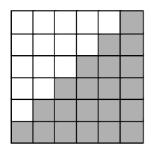

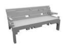  
(a) Voxel

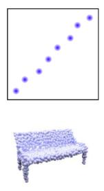  
(b) Point

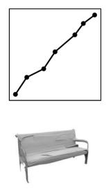  
(c) Mesh

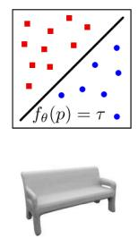  
(d) Ours

Source PDF, p. 1; ID: P167 Study-generated derivative

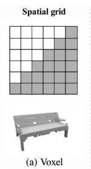

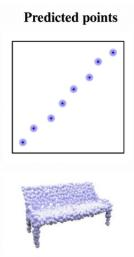  
Red squares / blue circles: two occupancy classes fθ(p): occupancy prediction at query point p; τ: surface threshold.

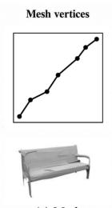

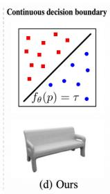  
Surface: fθ(p) = τ; mesh extraction at arbitrary resolution.

<table><tr><td>C</td><td>O</td><td>G</td><td>A</td><td>I</td><td>S</td><td>Mean</td></tr><tr><td>4</td><td>5</td><td>4</td><td>4</td><td>4</td><td>4</td><td>4.17</td></tr></table>

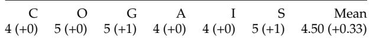

Source public-date proxy: 2019-04-30. All displayed scores are medians of three runs; parentheses show revised minus original. Framework (source Fig. 2) Source PDF, p. 4; ID: P168

Original  
Study-generated derivative  
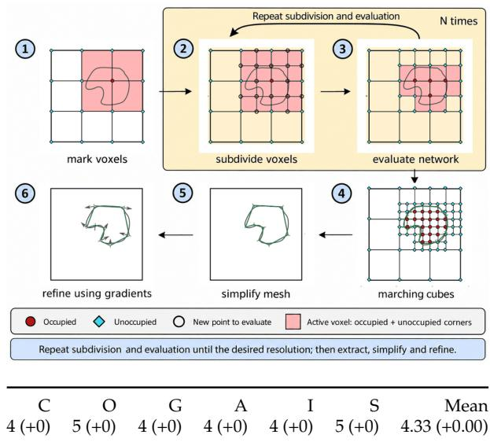

<table><tr><td>C</td><td>O</td><td>G</td><td>A</td><td>I</td><td>S</td><td>Mean</td></tr><tr><td>4</td><td>5</td><td>4</td><td>4</td><td>4</td><td>5</td><td>4.33</td></tr></table>

Source public-date proxy: 2018-12-10. All displayed scores are medians of three runs; parentheses show revised minus original.

C: clarity; O: organization/readability; G: graphical consistency; A: aesthetic coherence; I: visual inventiveness; S: design specificity.   
Mean is the arithmetic mean of six dimension medians, a descriptive display value, not a validated quality index.

# 042 Eficient Test-time Adaptive Object Detection via Sensitivity-Guided Pruning [21]

S2 | Object detection | CVPR 2025

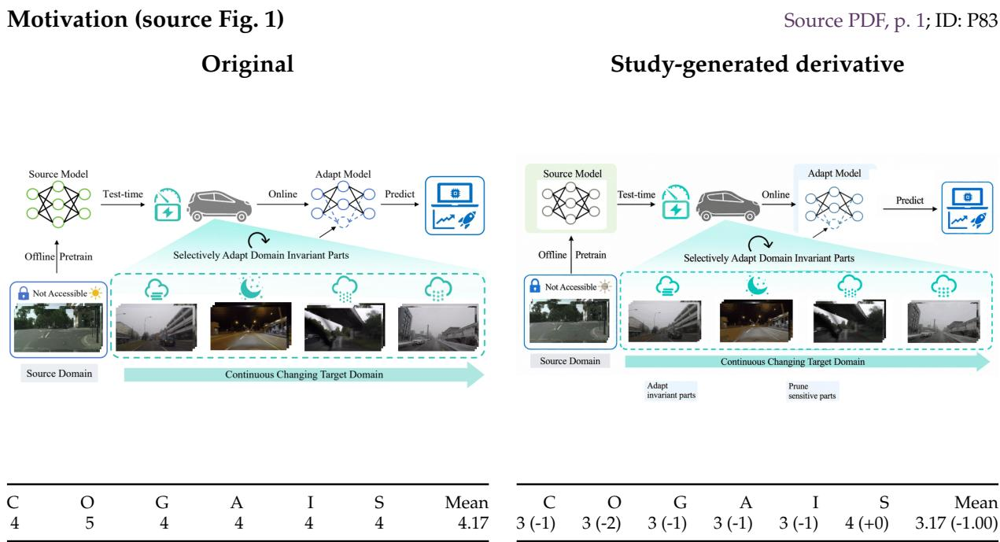

Source public-date proxy: 2025-06-03. All displayed scores are medians of three runs; parentheses show revised minus original. Framework (source Fig. 4) Source PDF, p. 3; ID: P84 Original Study-generated derivative  
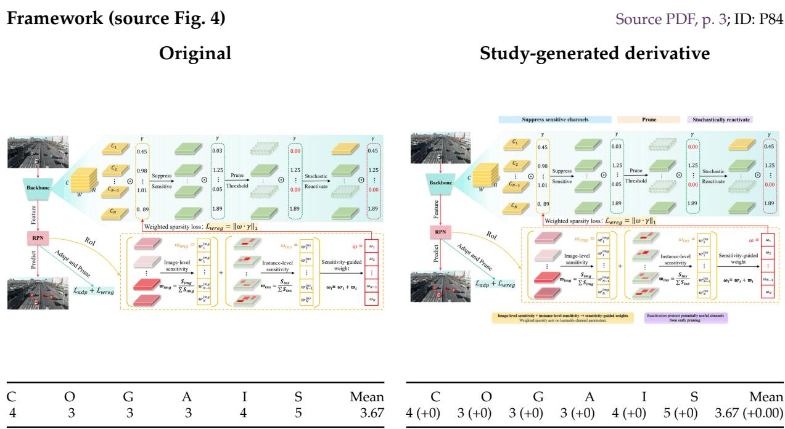  
Source public-date proxy: 2025-06-03. All displayed scores are medians of three runs; parentheses show revised minus original.

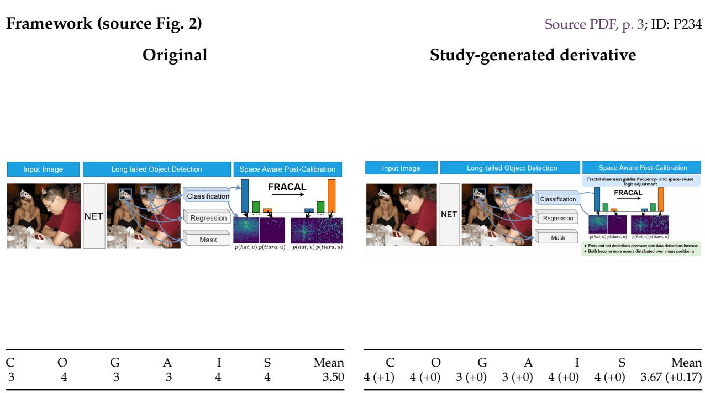

## 043 Fractal Calibration for Long-tailed Object Detection [22]

S2 | Object detection | CVPR 2025

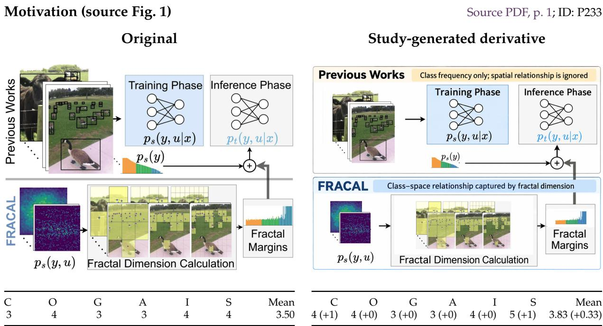  
Source public-date proxy: 2025-03-05. All displayed scores are medians of three runs; parentheses show revised minus original. Framework (source Fig. 2) Source PDF, p. 3; ID: P234 Original Study-generated derivative

<table><tr><td>C</td><td>O</td><td>G</td><td>A</td><td>I</td><td>S</td><td>Mean</td></tr><tr><td>3</td><td>4</td><td>3</td><td>3</td><td>4</td><td>4</td><td>3.50</td></tr></table>

Source public-date proxy: 2024-10-15. All displayed scores are medians of three runs; parentheses show revised minus original.

C: clarity; O: organization/readability; G: graphical consistency; A: aesthetic coherence; I: visual inventiveness; S: design specificity.   
Mean is the arithmetic mean of six dimension medians, a descriptive display value, not a validated quality index.

## 052 DFormerv2: Geometry Self-Attention for RGBD Semantic Segmentation [23]

S2 | Image segmentation | CVPR 2025

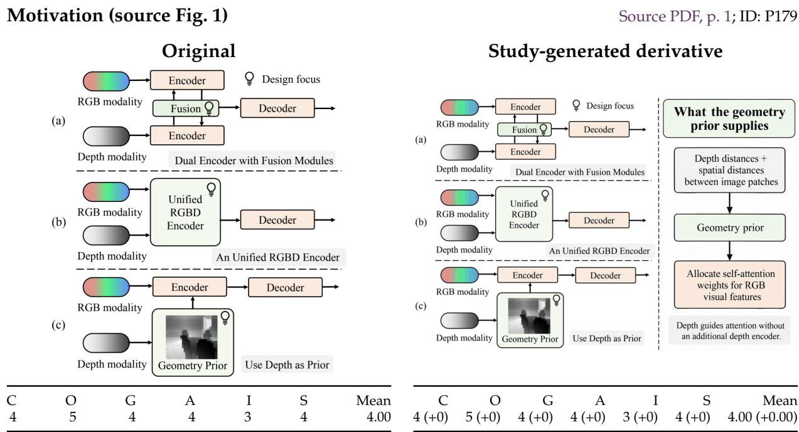

Source public-date proxy: 2025-04-07. All displayed scores are medians of three runs; parentheses show revised minus original.  
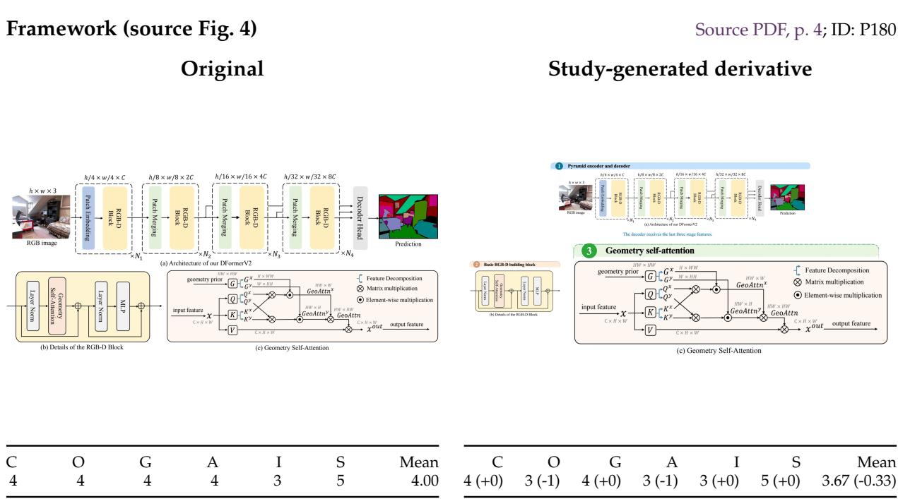  
Source public-date proxy: 2025-04-07. All displayed scores are medians of three runs; parentheses show revised minus original.

C: clarity; O: organization/readability; G: graphical consistency; A: aesthetic coherence; I: visual inventiveness; S: design specificity.   
Mean is the arithmetic mean of six dimension medians, a descriptive display value, not a validated quality index.

## 053 Distilling Spectral Graph for Object-Context Aware Open-Vocabulary Semantic Segmentation [24]

S2 | Image segmentation | CVPR 2025

Source public-date proxy: 2024-11-26. All displayed scores are medians of three runs; parentheses show revised minus original. Framework (source Fig. 1) Source PDF, p. 1; ID: P128  
Motivation (source Fig. 3)  
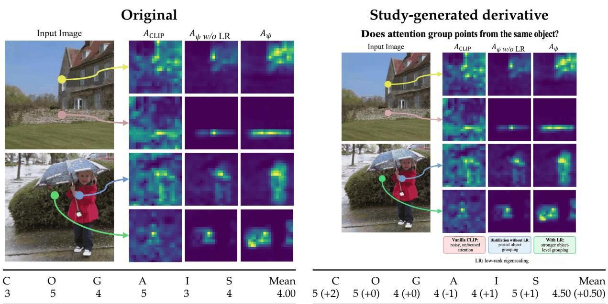  
Source PDF, p. 4; ID: P127

  
Source public-date proxy: 2025-03-16. All displayed scores are medians of three runs; parentheses show revised minus original.

## 062 Complexity Experts are Task-Discriminative Learners for Any Image Restoration [25]

S2 | Image restoration | CVPR 2025

  
Source public-date proxy: 2025-03-13. All displayed scores are medians of three runs; parentheses show revised minus original.

068 QMambaBSR: Burst Image Super-Resolution with Query State Space Model [26]

S2 | Image restoration | CVPR 2025

Source public-date proxy: 2025-03-10. All displayed scores are medians of three runs; parentheses show revised minus original. Framework (source Fig. 2) Source PDF, p. 4; ID: P178  

  
Source public-date proxy: 2025-03-10. All displayed scores are medians of three runs; parentheses show revised minus original.

C: clarity; O: organization/readability; G: graphical consistency; A: aesthetic coherence; I: visual inventiveness; S: design specificity.   
Mean is the arithmetic mean of six dimension medians, a descriptive display value, not a validated quality index.

  
073 CrossSDF: 3D Reconstruction of Thin Structures From Cross-Sections [27]

S2 | 3D vision | CVPR 2025

Source PDF, p. 1; ID: P221

  
Study-generated derivative

<table><tr><td>C</td><td>O</td><td>G</td><td>A</td><td>I</td><td>S</td><td>Mean</td></tr><tr><td>3</td><td>4</td><td>4</td><td>3</td><td>3</td><td>5</td><td>3.67</td></tr></table>

<table><tr><td>C</td><td>0</td><td>G</td><td>A</td><td>I</td><td>S</td><td>Mean</td></tr><tr><td>4(+1)</td><td>4(+0)</td><td>4(+0)</td><td>3 (+0)</td><td>3 (+0)</td><td>5(+0)</td><td>3.83 (+0.17)</td></tr></table>

Source public-date proxy: 2024-12-05. All displayed scores are medians of three runs; parentheses show revised minus original. Framework (source Fig. 2) Source PDF, p. 3; ID: P222 Original Study-generated derivative

<table><tr><td>C</td><td>O</td><td>G</td><td>A</td><td>I</td><td>S</td><td>Mean</td></tr><tr><td>4</td><td>4</td><td>4</td><td>4</td><td>3</td><td>5</td><td>4.00</td></tr></table>

Source public-date proxy: 2024-12-05. All displayed scores are medians of three runs; parentheses show revised minus original.

078 Parametric Point Cloud Completion for Polygonal Surface Reconstruction [28]

S2 | 3D vision | CVPR 2025

<table><tr><td>C</td><td>O</td><td>G</td><td>A</td><td>I</td><td>S</td><td>Mean</td></tr><tr><td>4</td><td>4</td><td>4</td><td>4</td><td>4</td><td>5</td><td>4.17</td></tr></table>

Source public-date proxy: 2025-03-11. All displayed scores are medians of three runs; parentheses show revised minus original.

C: clarity; O: organization/readability; G: graphical consistency; A: aesthetic coherence; I: visual inventiveness; S: design specificity.   
Mean is the arithmetic mean of six dimension medians, a descriptive display value, not a validated quality index.

085 Instance-Free Domain Adaptive Object Detection [29] S3 | Object detection | arXiv 2602.06484  

Source public-date proxy: 2026-02-06. All displayed scores are medians of three runs; parentheses show revised minus original. Framework (source Fig. 2) Source PDF, p. 3; ID: P288 Original Study-generated derivative  
  
Source public-date proxy: 2026-02-06. All displayed scores are medians of three runs; parentheses show revised minus original.

# 087 LAB-Det: Language as a Domain-Invariant Bridge for Training-Free One-Shot Domain Generalization in Object Detection [30]

S3 | Object detection | arXiv 2602.06474

  
Source public-date proxy: 2026-02-06. All displayed scores are medians of three runs; parentheses show revised minus original.

C: clarity; O: organization/readability; G: graphical consistency; A: aesthetic coherence; I: visual inventiveness; S: design specificity.   
Mean is the arithmetic mean of six dimension medians, a descriptive display value, not a validated quality index.

## 098 Rewis3d: Reconstruction Improves Weakly-Supervised Semantic Segmentation [31]

S3 | Image segmentation | CVPR 2026

Source public-date proxy: 2026-03-06. All displayed scores are medians of three runs; parentheses show revised minus original. Framework (source Fig. 3) Source PDF, p. 3; ID: P06  

  
Source public-date proxy: 2026-03-06. All displayed scores are medians of three runs; parentheses show revised minus original.

C: clarity; O: organization/readability; G: graphical consistency; A: aesthetic coherence; I: visual inventiveness; S: design specificity.   
Mean is the arithmetic mean of six dimension medians, a descriptive display value, not a validated quality index.

# 100 SegEarth-OV3: Exploring SAM 3 for Open-Vocabulary Semantic Segmentation in Remote Sensing Images [32]

S3 | Image segmentation | arXiv 2512.08730

Source PDF, p. 2; ID: P293 Study-generated derivative  
Source public-date proxy: 2025-12-09. All displayed scores are medians of three runs; parentheses show revised minus original. Framework (source Fig. 2) Source PDF, p. 3; ID: P294 Original Study-generated derivative  
Motivation (source Fig. 1)  
Original  

  
(b) Amorphous regions (e.g., road).

<table><tr><td>C</td><td>O</td><td>G</td><td>A</td><td>I</td><td>S</td><td>Mean</td></tr><tr><td>3</td><td>4</td><td>4</td><td>4</td><td>3</td><td>4</td><td>3.67</td></tr></table>

<table><tr><td>C</td><td>O</td><td>G</td><td>A</td><td>I</td><td>S</td><td>Mean</td></tr><tr><td>4(+1)</td><td>5(+1)</td><td>5(+1)</td><td>4(+0)</td><td>4(+1)</td><td>5(+1)</td><td>4.50 (+0.83)</td></tr></table>

<table><tr><td>C</td><td>O</td><td>G</td><td>A</td><td>I</td><td>S</td><td>Mean</td></tr><tr><td>4</td><td>4</td><td>4</td><td>3</td><td>4</td><td>5</td><td>4.00</td></tr></table>

<table><tr><td>C</td><td>0</td><td>G</td><td>A</td><td>I</td><td>S</td><td>Mean</td></tr><tr><td>5(+1)</td><td>4(+0)</td><td>4(+0)</td><td>4(+1)</td><td>4(+0)</td><td>5 (+0)</td><td>4.33 (+0.33)</td></tr></table>

Source public-date proxy: 2025-12-09. All displayed scores are medians of three runs; parentheses show revised minus original.

  
Study-generated derivative  
Motivation (source Fig. 2)  
Source PDF, p. 2; ID: P149

## 102 Enhancing Unregistered Hyperspectral Image Super-Resolution via Unmixing-based Abundance Fusion Learning [33]

S3 | Image restoration | CVPR 2026

<table><tr><td>C</td><td>O</td><td>G</td><td>A</td><td>I</td><td>S</td><td>Mean</td></tr><tr><td>3</td><td>3</td><td>4</td><td>3</td><td>4</td><td>5</td><td>3.67</td></tr></table>

<table><tr><td>C</td><td>O</td><td>G</td><td>A</td><td>I</td><td>S</td><td>Mean</td></tr><tr><td>4(+1)</td><td>3 (+0)</td><td>4(+0)</td><td>3 (+0)</td><td>4(+0)</td><td>5(+0)</td><td>3.83 (+0.17)</td></tr></table>

Source public-date proxy: 2026-03-09. All displayed scores are medians of three runs; parentheses show revised minus original.

Original  

<table><tr><td>C</td><td>O</td><td>G</td><td>A</td><td>I</td><td>S</td><td>Mean</td></tr><tr><td>4</td><td>3</td><td>5</td><td>4</td><td>3</td><td>5</td><td>4.00</td></tr></table>

Source public-date proxy: 2026-03-09. All displayed scores are medians of three runs; parentheses show revised minus original.

# 110 UARE: A Unified Vision-Language Model for Image Quality Assessment, Restoration, and Enhancement [34]

S3 | Image restoration | CVPR 2026

Source public-date proxy: 2025-12-07. All displayed scores are medians of three runs; parentheses show revised minus original. Framework (source Fig. 2) Source PDF, p. 3; ID: P38  

  
Source public-date proxy: 2025-12-07. All displayed scores are medians of three runs; parentheses show revised minus original.

C: clarity; O: organization/readability; G: graphical consistency; A: aesthetic coherence; I: visual inventiveness; S: design specificity.   
Mean is the arithmetic mean of six dimension medians, a descriptive display value, not a validated quality index.

## 112 E-RayZer: Self-supervised 3D Reconstruction as Spatial Visual Pre-training [35]

S3 | 3D vision | CVPR 2026

Motivation (source Fig. 3) Original  

Source public-date proxy: 2025-12-11. All displayed scores are medians of three runs; parentheses show revised minus original. Framework (source Fig. 2) Source PDF, p. 4; ID: P188 Original Study-generated derivative  
  
Source public-date proxy: 2025-12-11. All displayed scores are medians of three runs; parentheses show revised minus original.

C: clarity; O: organization/readability; G: graphical consistency; A: aesthetic coherence; I: visual inventiveness; S: design specificity.   
Mean is the arithmetic mean of six dimension medians, a descriptive display value, not a validated quality index.

# 117 PoInit-of-View: Poisoning Initialization of Views Transfers Across Multiple 3D Reconstruction Systems [36]

S3 | 3D vision | CVPR 2026

  
Source public-date proxy: 2026-04-17. All displayed scores are medians of three runs; parentheses show revised minus original.

# 121 AnyDepth-DETR/-YOLO: Any-depth object detection with a single network [37]

S4 | Object detection | ICLR 2027 submission (under review)

Source PDF, p. 6; ID: ICLR27\_8qFCNFz8Tq\_M Study-generated derivative

  
Source public-date proxy: 2026-05-10. All displayed scores are medians of three runs; parentheses show revised minus original. Framework (source Fig. 1) Source PDF, p. 2; ID: ICLR27\_8qFCNFz8Tq\_F Original Study-generated derivative

<table><tr><td>C</td><td>O</td><td>G</td><td>A</td><td>I</td><td>S</td><td>Mean</td></tr><tr><td>3</td><td>4</td><td>3</td><td>4</td><td>3</td><td>4</td><td>3.50</td></tr><tr><td>4</td><td>4</td><td>4</td><td>4</td><td>3</td><td>5</td><td>4.00</td></tr></table>

Source public-date proxy: 2026-05-10. All displayed scores are medians of three runs; parentheses show revised minus original.

# 127 PULSE: PERSISTENT UTILIZATION OF LIMITED SUPPORT EVIDENCE FOR CROSS-DOMAIN FEW-SHOT OBJECT DETECTION [38]

S4 | Object detection | ICLR 2027 submission (under review)

<table><tr><td>C</td><td>O</td><td>G</td><td>A</td><td>I</td><td>S</td><td>Mean</td></tr><tr><td>4</td><td>5</td><td>4</td><td>5</td><td>4</td><td>5</td><td>4.50</td></tr></table>

Source public-date proxy: 2026-10-03. All displayed scores are medians of three runs; parentheses show revised minus original. Framework (source Fig. 2) Source PDF, p. 4; ID: ICLR27\_ad0Os8QbxN\_F Original Study-generated derivative

  
Source public-date proxy: 2026-10-03. All displayed scores are medians of three runs; parentheses show revised minus original.

C: clarity; O: organization/readability; G: graphical consistency; A: aesthetic coherence; I: visual inventiveness; S: design specificity.   
Mean is the arithmetic mean of six dimension medians, a descriptive display value, not a validated quality index.

Study-generated derivative

<table><tr><td>C</td><td>O</td><td>G</td><td>A</td><td>I</td><td>S</td><td>Mean</td></tr><tr><td>5(+1)</td><td>4(+0)</td><td>4(+0)</td><td>4(+1)</td><td>4 (+0)</td><td>5(+1)</td><td>4.33 (+0.50)</td></tr></table>

Source PDF, p. 3; ID: ICLR27\_NYrrKvi2Dy\_M

  
Motivation (source Fig. 2)

## 132 Calibration-Guided State Selection and Class-Conditioned Fusion for Frozen Difusion Segmentation [39]

S4 | Image segmentation | ICLR 2027 submission (under review)

<table><tr><td>C</td><td>O</td><td>G</td><td>A</td><td>I</td><td>S</td><td>Mean</td></tr><tr><td>4</td><td>4</td><td>4</td><td>3</td><td>4</td><td>4</td><td>3.83</td></tr></table>

Source public-date proxy: 2026-10-03. All displayed scores are medians of three runs; parentheses show revised minus original.

C: clarity; O: organization/readability; G: graphical consistency; A: aesthetic coherence; I: visual inventiveness; S: design specificity.   
Mean is the arithmetic mean of six dimension medians, a descriptive display value, not a validated quality index.

# 134 HIVE: Holistic Image-Adaptive Vocabulary Evolution for Training-Free Dense Vision-Language Inference [40]

S4 | Image segmentation | ICLR 2027 submission (under review)

Source PDF, p. 1; ID: ICLR27\_kv0BeIZGMk\_M Study-generated derivative

  
Source public-date proxy: 2026-10-03. All displayed scores are medians of three runs; parentheses show revised minus original. Framework (source Fig. 2) Source PDF, p. 4; ID: ICLR27\_kv0BeIZGMk\_F Original Study-generated derivative

  
Source public-date proxy: 2026-10-03. All displayed scores are medians of three runs; parentheses show revised minus original.

  
Source public-date proxy: 2026-10-03. All displayed scores are medians of three runs; parentheses show revised minus original.

# 143 Fixing the Last Mile: Failure-Aware Image Restoration with Region-Specific Guidance [41]

S4 | Image restoration | ICLR 2027 submission (under review)

C: clarity; O: organization/readability; G: graphical consistency; A: aesthetic coherence; I: visual inventiveness; S: design specificity.   
Mean is the arithmetic mean of six dimension medians, a descriptive display value, not a validated quality index.

  
Source public-date proxy: 2026-10-03. All displayed scores are medians of three runs; parentheses show revised minus original.

# 147 Look Before You Restore: Learning to Predict Before Acting for Agentic Image Restoration [42]

S4 | Image restoration | ICLR 2027 submission (under review)

C: clarity; O: organization/readability; G: graphical consistency; A: aesthetic coherence; I: visual inventiveness; S: design specificity.   
Mean is the arithmetic mean of six dimension medians, a descriptive display value, not a validated quality index.

<table><tr><td>C</td><td>O</td><td>G</td><td>A</td><td>I</td><td>S</td><td>Mean</td></tr><tr><td>4</td><td>4</td><td>4</td><td>4</td><td>4</td><td>5</td><td>4.17</td></tr></table>

# 155 LonGaussian: Tracking Foundation Priors for Long-Context Feedforward Gaussian Reconstruction [43]

S4 | 3D vision | ICLR 2027 submission (under review)

Source public-date proxy: 2026-10-03. All displayed scores are medians of three runs; parentheses show revised minus original. Framework (source Fig. 3) Source PDF, p. 4; ID: ICLR27\_WiNCsgDP25\_F Original Study-generated derivative  
  
Source public-date proxy: 2026-10-03. All displayed scores are medians of three runs; parentheses show revised minus original.

<table><tr><td>C</td><td>O</td><td>G</td><td>A</td><td>I</td><td>S</td><td>Mean</td></tr><tr><td>4</td><td>4</td><td>4</td><td>4</td><td>4</td><td>5</td><td>4.17</td></tr></table>

# 160 VASC: Value-Aware Sparse Attention with Cross-layer Memory for Eficient 3D Reconstruction [44]

S4 | 3D vision | ICLR 2027 submission (under review)

<table><tr><td>C</td><td>O</td><td>G</td><td>A</td><td>I</td><td>S</td><td>Mean</td></tr><tr><td>3</td><td>4</td><td>4</td><td>4</td><td>4</td><td>5</td><td>4.00</td></tr></table>

Source public-date proxy: 2026-10-01. All displayed scores are medians of three runs; parentheses show revised minus original. Framework (source Fig. 4) Source PDF, p. 5; ID: ICLR27\_X7FI3N35Hq\_F Original Study-generated derivative

  
Source public-date proxy: 2026-10-01. All displayed scores are medians of three runs; parentheses show revised minus original.

C: clarity; O: organization/readability; G: graphical consistency; A: aesthetic coherence; I: visual inventiveness; S: design specificity.   
Mean is the arithmetic mean of six dimension medians, a descriptive display value, not a validated quality index.

# 162 A Simulation-Grounded VLM Framework for Agentic Wildfire Monitoring and Reporting [45]

S4-AI-Style | Wildfire monitoring and multimodal agents | ICLR 2027 submission (under review)

Framework (source Fig. 1)

Source PDF, p. 3; ID: AI\_gGGjmjPJi4\_F Study-generated derivative

<table><tr><td>C</td><td>O</td><td>G</td><td>A</td><td>I</td><td>S</td><td>Mean</td><td>C</td><td>O</td><td>G</td><td>A</td><td></td><td></td><td>S</td><td>Mean</td></tr><tr><td>3</td><td>3</td><td>3</td><td>4</td><td>4</td><td>5</td><td>3.67</td><td>3 (+0)</td><td>3 (+0)</td><td>4 (+1)</td><td>3 (-1)</td><td>4 (+0)</td><td></td><td>5(+0)</td><td>3.67 (+0.00)</td></tr></table>

Source public-date proxy: 2026-10-03. All displayed scores are medians of three runs; parentheses show revised minus original. Only this qualifying figure was included for this paper. A missing M or F figure is not imputed.

# 164 Agent Skills Under Change: A Lifecycle Benchmark and Coordinate-Guided Updates [46]

S4-AI-Style | Agent skill lifecycles | ICLR 2027 submission (under review)

Source PDF, p. 2; ID: AI\_O7Vvd7kb57\_M Study-generated derivative

  
Source public-date proxy: 2026-10-03. All displayed scores are medians of three runs; parentheses show revised minus original. Framework (source Fig. 2) Source PDF, p. 3; ID: AI\_O7Vvd7kb57\_F Original Study-generated derivative

  
Source public-date proxy: 2026-10-03. All displayed scores are medians of three runs; parentheses show revised minus original.

C: clarity; O: organization/readability; G: graphical consistency; A: aesthetic coherence; I: visual inventiveness; S: design specificity.   
Mean is the arithmetic mean of six dimension medians, a descriptive display value, not a validated quality index.

  
Source public-date proxy: 2026-10-03. All displayed scores are medians of three runs; parentheses show revised minus original.

# 167 BKBAgent: A Battery Parameter Identification Agent with Bayesian Experimental Design and Knowledge Graph [47]

S4-AI-Style | Battery parameter identification | ICLR 2027 submission (under review)

C: clarity; O: organization/readability; G: graphical consistency; A: aesthetic coherence; I: visual inventiveness; S: design specificity.   
Mean is the arithmetic mean of six dimension medians, a descriptive display value, not a validated quality index.

# 184 Look Back to Move Forward: Learning to Revisit for Agentic Compositional Image Generation [48]

S4-AI-Style | Compositional image-generation agents | ICLR 2027 submission (under review)

Motivation (source Fig. 1)

  
Source public-date proxy: 2026-10-03. All displayed scores are medians of three runs; parentheses show revised minus original.

C: clarity; O: organization/readability; G: graphical consistency; A: aesthetic coherence; I: visual inventiveness; S: design specificity.   
Mean is the arithmetic mean of six dimension medians, a descriptive display value, not a validated quality index.

# 190 Ontology-Harnessing Multi-Agent System for Abstractive Visual Understanding [49]

S4-AI-Style | Abstract visual reasoning | ICLR 2027 submission (under review)

Source public-date proxy: 2026-10-03. All displayed scores are medians of three runs; parentheses show revised minus original.  
  
Source public-date proxy: 2026-10-03. All displayed scores are medians of three runs; parentheses show revised minus original.

C: clarity; O: organization/readability; G: graphical consistency; A: aesthetic coherence; I: visual inventiveness; S: design specificity.   
Mean is the arithmetic mean of six dimension medians, a descriptive display value, not a validated quality index.

# 191 OpenAgentFlow: Enabling System-Wide Safety Boundaries for Heterogeneous AI Agent Fleets [50]

Source public-date proxy: 2026-10-03. All displayed scores are medians of three runs; parentheses show revised minus original. Framework (source Fig. 2) Source PDF, p. 6; ID: AI\_I6Gx5US2sY\_F Original Study-generated derivative  
  
Source public-date proxy: 2026-10-03. All displayed scores are medians of three runs; parentheses show revised minus original.

C: clarity; O: organization/readability; G: graphical consistency; A: aesthetic coherence; I: visual inventiveness; S: design specificity.   
Mean is the arithmetic mean of six dimension medians, a descriptive display value, not a validated quality index.

Source public-date proxy: 2026-10-03. All displayed scores are medians of three runs; parentheses show revised minus original. Framework (source Fig. 2) Source PDF, p. 5; ID: AI\_VA0yCrShah\_F Original Study-generated derivative  

# 194 Sprout: Building Dynamic Memory While Reasoning for Agentic Video Understanding [51]

S4-AI-Style | Video understanding and memory | ICLR 2027 submission (under review)

  
Source public-date proxy: 2026-10-03. All displayed scores are medians of three runs; parentheses show revised minus original.

# 198 VEvo-Harness: Causally-Guarded Self-Evolving Harness for Agentic Image Generation [52]

Source public-date proxy: 2026-10-03. All displayed scores are medians of three runs; parentheses show revised minus original. Framework (source Fig. 2) Source PDF, p. 3; ID: AI\_UPFHZRl39C\_F Original Study-generated derivative  
  
Source public-date proxy: 2026-10-03. All displayed scores are medians of three runs; parentheses show revised minus original.

C: clarity; O: organization/readability; G: graphical consistency; A: aesthetic coherence; I: visual inventiveness; S: design specificity.   
Mean is the arithmetic mean of six dimension medians, a descriptive display value, not a validated quality index.

## 5.1 Original Profiles and Temporal Context

Orderly presentation, distinctive content, and explanatory clarity do not necessarily coincide (Fig. 5). Across all four stages, main-sample motivation figures have higher mean organization ratings than clarity ratings. The numerical diference narrows from 0.875 in S1 to 0.550 in S4, as clarity increases by 0.550 and organization by 0.225. The kernel-reformulation example illustrates the underlying design distinction. Its aligned image panels provide an orderly comparison, but the significance of that comparison remains insuficiently stated [17]. Organizing examples and explaining their relevance are separate compositional decisions.

Framework figures receive their highest mean ratings for specificity in every stage. From S1 to S4, specificity increases from 4.400 to 4.800, while clarity changes from 3.625 to 3.725 and consistency decreases from 4.000 to 3.725. High specificity therefore does not imply equally favorable ratings for the explanation of relationships or the consistency of visual encodings. Both roles have their lowest mean aesthetic scores in S3 (3.425 for each) and their highest in S4 (3.825 for motivation figures and 3.600 for frameworks). S4 motivation figures also have the highest mean clarity and organization scores, whereas S4 frameworks have the lowest mean consistency score. The profiles consequently reveal changes that difer by dimension and figure role, rather than a uniform historical decline.

Purposeful visual inventiveness also remains distinct from technical specificity and visual polish. Mean inventiveness scores across the main-sample stage and role groups range from 3.275 to 3.550. Across all original figures, 58 receive a specificity median of 5 but an inventiveness median no greater than 3. Another 68 receive an aesthetic median of at least 4 but a clarity median no greater than 3. These exploratory combinations illustrate why a favorable score in one dimension cannot substitute for examining the complete profile.

The gallery provides examples of expanding explanatory scope. Within image restoration, the S1 framework in entry 030 organizes two training components around pseudo-pair generation and transfer between source and target domains [18]. In S2, Complexity Experts combines an overall architecture, transformer blocks, and nested expert routing [25]. In S3, UARE coordinates instructions, images, two expert pathways, training stages, and multimodal outputs [34]. The S4 framework in entry 147 extends the account to prediction, action selection, execution, verification, and tool evolution [42]. Across these selected examples, a single composition accommodates progressively more levels of explanation.

Increasing technical scope can create a need to depict additional interacting functions. AI assistance may also make panels, icons, and annotations easier to produce, potentially encouraging elaboration. The present collection cannot separate these explanations or establish a monotonic historical trend in visual complexity. Early entry 030 already uses gradients, rounded panels, and shadows, while the later E-RayZer framework retains a clear horizontal reading path [35]. These examples direct attention to whether each visual layer expresses a necessary relationship and remains integrated with the overall explanation.

## 5.2 Visual Conventions in the Style-Contrast Sample

The purposive style-contrast sample contains 40 papers and 51 figures. Its atlas label, S4-AI-Style, identifies a selection path and does not establish AI production or define a fifth temporal stage. The 11 motivation figures reverse the ordering observed in the main sample, with mean clarity exceeding mean organization. Relative to S4 main-sample motivation figures, they receive higher clarity and inventiveness ratings but lower organization and aesthetic ratings. The 40 contrast frameworks exceed their S4 counterparts in aesthetics and consistency while retaining high specificity (4.650). The selected conventions therefore accompany diferent rating profiles across the two roles.

(a) Motivation figures in the main sample  
  
(c) Purposive style contrast sample

(b) Framework figures in the main sample  

  
Figure 5. Original-figure profiles across stages and roles. Cells show means of per-figure medians from three judgments, and panel labels report figure counts. The main sample retains equal topic quotas, and the purposive contrast sample is displayed separately. All panels share the same 1–5 color scale.

Their explanatory potential is visible in individual compositions. Agent Skills Under Change uses recurring robots, folders, targets, and shields to compare immediate updates with checks of adaptation and retention. Its clarity, organization, and consistency medians are all 5 [46]. Sprout connects queries and operations through timelines and shared memory, receiving inventiveness and specificity medians of 5 for both roles [51]. AccessWorld, the original framework with the highest six-dimension mean, also belongs to this sample [53]. These cases illustrate how familiar graphical elements can support distinctive explanations when their relationships carry specific meaning.

The revision workflow nevertheless produces limited aggregate gains for contrast frameworks. Their six-dimension mean increases in five figures, remains unchanged in 16, and decreases in 19. Mean aesthetics, organization, and inventiveness decrease by 0.300, 0.175, and 0.100, respectively. Specificity remains unchanged in 37 figures and decreases in three. OpenAgentFlow illustrates the role diference within one paper. Its motivation mean increases from 3.83 to 4.50, while its framework mean decreases from 3.50 to 3.17 following a revision that adds an outcome key beneath an already dense workflow [50]. Such cases suggest that selective emphasis and consolidation deserve consideration when a composition already contains extensive explanatory material.

## 5.3 Revision Outcomes across Dimensions and Figure Roles

The largest rating gains occur in clarity, while changes in other dimensions are more mixed. Of 371 attempted revisions, 369 pass the recorded fidelity checks, and the two failures remain unscored. The accepted pairs span all 200 papers. Table 3 and Fig. 6 show a mean clarity increase of 0.428, accompanied by smaller increases in specificity and consistency. Mean aesthetics decreases by 0.111, while inventiveness remains unchanged in 317 figures (85.9%). Across 2,214 paired dimension outcomes, 401 increase (18.1%), 1,607 remain unchanged (72.6%), and 206 decrease (9.3%). Most changed medians move by one point, comprising 370 increases and 205 decreases. The six-dimension mean rises from 3.842 to 3.945 (+0.103), combining these opposing movements.

Table 3. Paired dimension scores for 369 revisions that pass the recorded fidelity checks. Values are means of figure-level medians from three judgments, and Δ denotes revised minus original. Intervals are 95% paper-cluster bootstrap percentile intervals based on 5,000 resamples with seed 20261020. Direction counts refer to figure-level median changes.
<table><tr><td>Dimension</td><td>Original</td><td>Revised</td><td>∆</td><td>95% interval</td><td>Up / Same / Down</td></tr><tr><td>Communicative clarity</td><td>3.629</td><td>4.057</td><td>+0.428</td><td>[+0.367, +0.492]</td><td>142 / 220 / 7</td></tr><tr><td>Organization and readability</td><td>3.973</td><td>3.951</td><td>-0.022</td><td>[-0.084, +0.040]</td><td>51 / 257 / 61</td></tr><tr><td>Graphical consistency</td><td>3.949</td><td>4.060</td><td>+0.111</td><td>[+0.056, +0.168]</td><td>69 / 268 / 32</td></tr><tr><td>Aesthetic coherence</td><td>3.591</td><td>3.480</td><td>-0.111</td><td>[-0.170, -0.054]</td><td>38 / 252 / 79</td></tr><tr><td>Purposeful visual inventiveness</td><td>3.450</td><td>3.501</td><td>+0.051</td><td>[+0.014, +0.089]</td><td>35 / 317 / 17</td></tr><tr><td>Design specificity</td><td>4.461</td><td>4.623</td><td>+0.163</td><td>[+0.114, +0.212]</td><td>66 / 293 / 10</td></tr></table>

(b) Mean change and 95% interval  
  
Figure 6. Paired outcomes for 369 revisions that pass the recorded fidelity checks. Left: counts of increased, unchanged, and decreased figure-level medians. Right: mean changes and 95% paper-cluster bootstrap percentile intervals.

The pooled gain difers substantially by figure role (Table 4). The six-dimension average increases by 0.242 for main-sample motivation figures and by 0.018 for frameworks. Motivation clarity and specificity increase by 0.800 and 0.306, compared with 0.151 and 0.082 for frameworks. Framework aesthetics decreases by 0.164. The contrast sample similarly combines a small motivation gain with a framework decline. Under this workflow, motivation figures therefore receive more favorable average rating changes than frameworks.

This role diference recurs in every main-sample topic (Table 5). Detection motivation figures have the largest mean gain and form the only motivation topic group with a positive mean aesthetic change. Framework aesthetics decreases in all four topics. The distinction also appears within individual papers. Among the 159 papers with accepted revisions for both roles, the motivation change exceeds the framework change in 103, equals it in 23, and falls below it in 33. Of the 31 papers with opposing directions of change, 27 combine a motivation gain with a framework loss, and four show the reverse. Averaging the two roles within a paper would conceal these diferences.

Table 4. Paired six-dimension averages by sample and figure role. M and F denote motivation and framework figures, and � is the number of accepted original–revision pairs. Intervals are 95% papercluster bootstrap percentile intervals within each row. Direction counts refer to changes in the post hoc six-dimension average.
<table><tr><td>Sample</td><td>Role</td><td>n</td><td>Original</td><td>Revised</td><td>Δ</td><td>95% interval</td><td>Up / Same / Down</td></tr><tr><td>Main</td><td>M</td><td>160</td><td>3.818</td><td>4.059</td><td>+0.242</td><td>[+0.186, +0.298]</td><td>107 / 29 / 24</td></tr><tr><td>Main</td><td>F</td><td>159</td><td>3.824</td><td>3.842</td><td>+0.018</td><td>[-0.018, +0.055]</td><td>57 / 54 / 48</td></tr><tr><td>Style contrast</td><td>M</td><td>10</td><td>4.067</td><td>4.133</td><td>+0.067</td><td>[-0.083, +0.233]</td><td>4/3/3</td></tr><tr><td>Style contrast</td><td>F</td><td>40</td><td>3.954</td><td>3.854</td><td>-0.100</td><td>[-0.167, -0.033]</td><td>5 / 16 / 19</td></tr></table>

Table 5. Main-sample revision changes by topic and figure role, pooling S1–S4. Δ� and Δ� denote mean changes in clarity and aesthetic coherence, while Δ�¯ denotes the change in the post hoc six-dimension average. Counts refer to accepted figure pairs. One segmentation framework failed fidelity review, leaving 39 pairs in that cell and 40 in every other cell.
<table><tr><td></td><td colspan="4">Motivation</td><td colspan="4">Framework</td></tr><tr><td>Topic</td><td>n</td><td>∆C</td><td>∆A</td><td>∆m</td><td>n</td><td>∆C</td><td>∆A</td><td>∆m</td></tr><tr><td>Object detection</td><td>40</td><td>+0.900</td><td>+0.125</td><td>+0.367</td><td>40</td><td>+0.150</td><td>-0.150</td><td>+0.046</td></tr><tr><td>Image segmentation</td><td>40</td><td>+0.600</td><td>-0.050</td><td>+0.146</td><td>39</td><td>+0.205</td><td>-0.128</td><td>+0.013</td></tr><tr><td>Image restoration</td><td>40</td><td>+0.850</td><td>-0.100</td><td>+0.225</td><td>40</td><td>+0.150</td><td>-0.125</td><td>+0.021</td></tr><tr><td>3D vision</td><td>40</td><td>+0.850</td><td>-0.100</td><td>+0.229</td><td>40</td><td>+0.100</td><td>-0.250</td><td>-0.008</td></tr></table>

Revision outcomes also vary across stages. Mean motivation clarity increases by 1.075, 0.900, 0.650, and 0.575 in S1–S4, respectively. The six-dimension mean increases for 35 S1 motivation figures, remains unchanged for five, and decreases for none. In S4, the corresponding counts are 14 increases, 14 ties, and 12 decreases. Framework aesthetics decreases in every stage. These patterns place the pooled result in the context of diferent initial scores and compositions, but stage membership does not identify the mechanisms responsible. Revisions can introduce caption-derived information, alter the canvas, and combine retained panels with explanatory guides. The findings therefore characterize the complete intervention and do not isolate changes in visual style.

## 5.4 Tradeoffs Concealed by Aggregate Scores

The small overall gain conceals substantial variation among individual figures. Six-dimension means increase for 173 figures (46.9%), remain unchanged for 102 (27.6%), and decrease for 94 (25.5%). Only 79 figures retain all six medians. The 72.6% unchanged rate reported above therefore concerns individual dimension outcomes, not complete figure profiles. Table 6 distinguishes gains without losses, losses without gains, mixed changes, and fully unchanged profiles. Among the 102 figures with unchanged means, 23 have ofsetting dimension changes. Another 20 figures show a higher mean despite a decline in at least one dimension. Twenty-one figures gain clarity while losing aesthetic coherence.

PULSE illustrates how opposing changes can leave an average unchanged. Its clarity median increases from 4 to 5 while aesthetics decreases from 5 to 4, leaving the mean at 4.50 [38]. In the wildfire-reporting framework, added headings and an enlarged interaction detail accompany a consistency increase from 3 to 4 and an aesthetic decrease from 4 to 3 [45]. Its mean also remains unchanged. In both cases, the stable aggregate conceals a changed evaluation profile.

Initial scores also constrain the available range of change. Specificity reaches the maximum of 5 in 201 of the 371 originals, whereas inventiveness reaches 5 in only three. Within the 369 matched pairs, the number of specificity maxima increases from 199 to 239 and the number of clarity maxima from 16 to 66. Aesthetic maxima decrease from 13 to three. Among matched pairs, originals with means in [3, 4) gain 0.209 on average (� = 212), while those starting at 4 or above change by −0.050 (� = 156). Entry 128 M is the sole original with a mean below 3. The bounded scale constrains improvement at high starting scores, while regression toward the mean and feedback-informed revision may also contribute to this association. Their contributions were not separately estimated. These observations favor identifying the dimensions that require attention before adopting a higher aggregate score as the design objective.

Table 6. Mutually exclusive patterns of dimension-level change across 369 accepted revisions. A gain or loss denotes an increase or decrease in a figure’s median score on at least one dimension. The unchanged category requires all six medians to remain identical. Percentages use 369 figures as the denominator.
<table><tr><td>Pattern</td><td>Figures</td><td>Percentage</td></tr><tr><td>Gains without losses</td><td>153</td><td>41.5%</td></tr><tr><td>Losses without gains</td><td>80</td><td>21.7%</td></tr><tr><td>Mixed gains and losses</td><td>57</td><td>15.4%</td></tr><tr><td>All six dimensions unchanged</td><td>79</td><td>21.4%</td></tr><tr><td>Total</td><td>369</td><td>100.0%</td></tr></table>

Table 7. Absolute score extrema selected by the post hoc six-dimension mean. Entry 163 F is the unique maximum within the original set and within the accepted-revision set. Entry 128 M is the unique original minimum, while 136 F and 195 F tie for the accepted-revision minimum. Vectors follow (�, �, �, �, �, �), and means and changes are computed before rounding. These ranks concern model-rated figures, not the scientific quality of their papers.
<table><tr><td rowspan="2">Case</td><td colspan="2">Original</td><td colspan="2">Revised</td><td rowspan="2">∆m</td></tr><tr><td>Score vector</td><td>Mean</td><td>Score vector</td><td>Mean</td></tr><tr><td>163 F: AccessWorld [53]</td><td>(4,5,5,5,5,5)</td><td>4.83</td><td>(5,5,5,5,5,5)</td><td>5.00</td><td>+0.17</td></tr><tr><td>128 M: Over-segmentation [54]</td><td>(2,3,3,3,2,3)</td><td>2.67</td><td>(4,4,5,4,4,5)</td><td>4.33</td><td>+1.67</td></tr><tr><td>136 F: ReTax-Seg [55]</td><td>(3,3,3,2,3,4)</td><td>3.00</td><td>(3,3,3,2,3,4)</td><td>3.00</td><td>0.00</td></tr><tr><td>195 F: Stride [56]</td><td>(3,3,3,3,4,5)</td><td>3.50</td><td>(3,2,3,2,3,5)</td><td>3.00</td><td>-0.50</td></tr></table>

## 5.5 Case Studies: Explanation and Compositional Judgment

A revision can make a claim more explicit without improving the composition through which it is read. The following cases connect this distinction to visible changes in individual figures. Table 7 identifies absolute score extrema using the post hoc six-dimension mean. Subsequent comparisons examine how annotations, typography, and repeated detail accompany diferent rating outcomes. These extrema rank images under the configured rubric, and the illustrative selections do not estimate the prevalence of design patterns across the corpus.

AccessWorld, the highest-rated original, organizes its explanation around a repeated task (Fig. 7A) [53]. The upper panel connects the task, agent, assistive-technology interface, applications, and grading process. The lower panel compares interaction modes through corresponding examples. Its original mean is 4.83. The revision preserves this arrangement and explicitly labels the grading connection. Clarity increases to 5, bringing the six-dimension mean to 5.00. Although all six medians reach the maximum, the 18 individual ratings are not unanimously 5. Its membership in the contrast sample also demonstrates that the conventions used for purposive selection are compatible with highly rated visual communication.

  
C 4 O 4 G 5 A 4 I 4 S 5  
B. Over-segmentation: lowest original and largest paired increase [54] Original Study-generated revision

## A. AccessWorld: highest original and highest accepted revision [53] Original Study-generated revision

  
Six-score mean: 4.83

  
Six-score mean: 2.67  
Six-score mean: 4.33 (Δ = +1.67)

Figure 7. Absolute original-score extrema and their revisions. AccessWorld (163 F) is the unique original maximum, and the over-segmentation example (128 M) is the unique original minimum. Both were identified after scoring using the six-median average. Images are reproduced in full, with three-request median scores in C/O/G/A/I/S order. Original artwork is credited to the cited papers, and revisions are study-generated derivatives.

The lowest-rated original illustrates the importance of making an intended comparison explicit. The over-segmentation motivation figure shows overlapping proposals, small instances, and part-biased support, but provides little explanation beyond panel letters (Fig. 7B) [54]. The revision names these contrasts, defines the boxes and confidence values, and explains why a high-confidence fragment can be selected instead of the whole object. Clarity increases from 2 to 4 and specificity from 3 to 5. The mean rises from 2.67 to 4.33, yielding the largest paired increase (+1.67). Information previously confined to the caption becomes available to the image-only judge, so the gain cannot be attributed to layout alone.

Additional explanation does not necessarily resolve a dificult underlying arrangement. ReTax-Seg and Stride share the lowest accepted revised mean of 3.00 (Fig. 8). ReTax-Seg retains all six medians after explanatory guidance is appended to its dense feature and prior-related pathways [55]. Stride’s mean decreases from 3.50 to 3.00, with specificity remaining at 5 and organization, aesthetic coherence, and inventiveness each decreasing by one point [56]. These outcomes distinguish the presence of problem-specific content from the efectiveness of its organization.

The largest decline occurs in a diferent case. The continual-adaptation motivation figure decreases from 4.17 to 3.17 [21]. Adaptation and pruning annotations supplement its weather and driving examples, while white restoration patches interrupt the colored model panels.

A. ReTax-Seg: unchanged scores after adding explanatory guidance [55] Original Study-generated revision  
  
Figure 8. The two accepted revisions tied for the lowest six-score mean (3.00). ReTax-Seg (136 F) retains all six medians, while Stride (195 F) loses one point each in organization, aesthetic coherence, and inventiveness. Selection is post hoc and illustrative. Full images and three-request median scores are shown. Original artwork is credited to the cited papers.

Organization decreases from 5 to 3 and aesthetic coherence from 4 to 3. The lowest revised scores and the largest score decrease therefore identify diferent figures.

The typographic comparisons illustrate limited coordination between added emphasis and an existing visual hierarchy (Fig. 9). Complexity Experts adds bold headings that repeat the retained Dense Model and MoE labels, thick panel frames, and explanatory prose below the network comparisons [25]. Clarity increases from 3 to 4, but organization decreases from 5 to 4 and inventiveness from 4 to 3. Aesthetic coherence remains at 4. VEvo-Harness replaces an integrated brush-like title with a conventional title, subtitle, and matching heading strips, while varied lettering remains within the retained panels [52]. Clarity and specificity improve, but organization and aesthetic coherence remain at 3. These cases concern the integration of headings, technical labels, and annotations across the composition. A uniform outer treatment can make the message more explicit while leaving the internal hierarchy unresolved.

BKBAgent illustrates the limits of adding explanation around an already elaborate visual argument (Fig. 10). Its dialogue, physical mechanisms, and knowledge base already combine substantial text with diagrams. The revision appends three connected explanation boxes and a summary sentence [47]. Clarity remains at 4 and organization at 3, while aesthetic coherence and inventiveness decrease from 4 to 3. The added reading layer leaves the main arrangement largely intact and produces no increase in the clarity median.

A. Complexity Experts: repeated headings [25] Original Study-generated revision  
  
(a) Dense Model

  
(b) MoE  
Match restoration capacity to degradation complexity

  
(c) Complexity Experts (ours)

  
Size-varving units and a spring-inspired force guide routing toward simpler experts when possible Spring symbol: routing force proportional to input-degradation complexity.  
C 3 O 5 G 3 A 4 I 4 S 4 Six-score mean: 3.83

## B. VEvo-Harness: standardized outer typography [52] Original Study-generated revision

  
Six-score mean: 3.67

Figure 9. Typographic changes in two motivation figures (062 M and 198 M). Added headings repeat retained labels in Complexity Experts. A conventional title and matching heading strips replace the integrated title treatment in VEvo-Harness. C, O, G, A, I, and S denote clarity, organization, graphical consistency, aesthetic coherence, inventiveness, and specificity. Scores are three-request medians, and changes are computed before display rounding. Images are shown in full. Original artwork is credited to the cited papers, and revisions are study-generated derivatives.

Repeating an existing region creates a related challenge of coordinating detail with the overall structure (Fig. 11). Look Before You Restore places a reduced overview above an enlarged panel for state and action encoding. The detail heading is more prominent than the overall title, and organization decreases from 4 to 3 [42]. Stride similarly places an enlarged champion-evolution region beside a smaller complete workflow [56]. The tool, image, and award pictograms already appear in the original figures. These revisions repeat source content at diferent scales, making the selection and integration of detail central to their composition. The observations do not isolate typography, duplication, or scale as causes of the rating changes.

  
Figure 10. Added explanatory layers in BKBAgent (167 M). Three connected explanation boxes and a summary sentence extend the original composition. Clarity and organization remain unchanged, while aesthetic coherence and inventiveness each decrease by one point. Both images are shown in full, with three-request median scores in C/O/G/A/I/S order. Original artwork is credited to the cited paper, and the revision is a study-generated derivative.

Annotation is more useful when it identifies a specific missing correspondence (Fig. 12). SegEarth-OV3 labels the input image, transformer-decoder output, and semantic-segmentation output and explains their contrasts [32]. Five dimensions increase by one point while aesthetic coherence remains at 4. PULSE adds a question headline, stronger red emphasis, and explanatory notes [38]. Clarity increases from 4 to 5, but aesthetic coherence decreases from 5 to 4. These outcomes frame restraint as a functional design decision. An addition should contribute necessary meaning while fitting the surrounding visual hierarchy.

Compositional judgment remains distinct from the fidelity review described in Section 4.3. The rejected Make It Up framework changes an update relation, while the rejected EAGLE motivation figure misroutes image inputs [57, 58]. Neither receives revision quality scores. Passing the recorded fidelity checks is a prerequisite for quality assessment, but accepted revisions can still lose organization or aesthetic coherence. The clarity and coherence of the resulting composition therefore require separate judgment.

## 5.6 Reliability and Scope of Interpretation

Repeated judgments show substantial agreement under the fixed protocol. All three scores agree in 1,897 of 2,226 original figure–dimension cells (85.2%) and 1,938 of 2,214 revised cells (87.5%). Every remaining cell spans one integer point, indicating repeat stability within the configured procedure. The results distinguish explicit information from efective organization. Motivation figures receive larger average rating gains than frameworks, with inspected cases linking clarified comparisons to higher clarity scores. Framework revisions can retain high specificity while losing visual coherence. Added explanations may leave hierarchies unresolved or repeat detail without clarifying structure. These findings characterize the complete workflow, including generation, source-content preservation, and annotation informed by the same judge. Each revision should therefore serve the figure’s explanatory purpose and preserve scientific relationships, with consolidation and omission considered alongside elaboration.

## A. Look Before You Restore: enlarged detail and a reduced overview [42] Original Study-generated revision

  
State-action encoding - enlarged view

  
Execute, verify, then commit or rollback. Tool evolution audits the candidate frontier and adapts tools

  
Figure 11. Repeated content in two framework revisions (147 F and 195 F). Enlarged details duplicate regions retained in the complete overviews, repeating existing labels and pictograms. Organization decreases in both cases. Images are fitted individually without cropping, preserving their difering canvas proportions. Scores are three-request medians in C/O/G/A/I/S order. Original artwork is credited to the cited papers, and revisions are study-generated derivatives.

## A. SegEarth-OV3: annotations clarify the comparison [32] Original Study-generated revision

  
(a) Countable objects (e.g., cars).

  
(b) Amorphous regions (e.g., road).

  
Less precise small-target boundaries  
Precise countable-object outlines (a) Countable objects (e.g., cars).

C 3 O 4 G 4 A 4 I 3 S 4 Six-score mean: 3.67

  
Fragmented amorphous masks  
Continuous amorphous regions  
(b) Amorphous regions (e.g., road).

C 4 O 5 G 5 A 4 I 4 S 5 Six-score mean: 4.50 (Δ = +0.83)

## B. PULSE: clarity and aesthetics move in opposite directions [38] Original Study-generated revision

  
Is support evidence still used when scoring a query?

  
C 4 O 5 G 4 A 5 I 4 S 5 Six-score mean: 4.50  
C 5 O 5 G 4 A 4 I 4 S 5 Six-score mean: 4.50 (Δ = 0.00)

Figure 12. Contrasting annotation outcomes in motivation figures (100 M and 127 M). SegEarth-OV3 gains in five dimensions while retaining its aesthetic score. PULSE gains one clarity point and loses one aesthetic point, leaving the six-score mean unchanged. Images are shown in full, with three-request median scores in C/O/G/A/I/S order. Original artwork is credited to the cited papers, and revisions are study-generated derivatives.

## 6 Concerns and Outlook

The observed tradeofs raise a broader question about how scientific visual communication should be evaluated when models contribute to both its production and assessment. The following considerations connect the findings to design practice and examine possible implications for scholarly evaluation and future model development.

I) From figure scores to reviewing decisions. Evidence of LLM-assisted review writing [59] motivates investigating whether multimodal assistance could influence how reviewers interpret scientific figures. If reviewers consult MLLMs, revisions that receive higher figure ratings could also afect their recommendations. Such changes might reflect clearer scientific communication, sensitivity to favored visual conventions, or both. Our six dimensions, however, define an imageassessment rubric. They do not characterize the preferences of all reviewing models or establish how figures contribute to full-paper assessments. Whether figure-level gains transfer to reviewer recommendations therefore remains an untested hypothesis. Its practical significance should be examined through reader understanding and the reasons supporting a recommendation, alongside changes in numerical ratings.

II) When evaluation criteria become design targets. A rubric can guide revision, but repeated optimization against its scores may favor features that an evaluator readily recognizes. Headings, labels, and familiar layouts can clarify relationships. Applied indiscriminately, they can also become formulas that receive insuficient adaptation to the figure’s purpose. In this study, the same judge configuration supplied feedback for revision and evaluated the resulting figures. Such a loop may also amplify biases reported for text-based LLM judges [60]. Even inventiveness risks becoming formulaic if evaluators reward familiar visual cues as evidence of creativity.

III) Visual conformity and dependence on model versions. A possible feedback loop connects design choices, scholarly visibility, and subsequent model development. Authors may adopt compositions favored by model-assisted assessments. These compositions could become more visible and widely imitated, then reappear in training data or tool templates that reinforce the same conventions. In the most pessimistic scenario, the literature becomes visually polished but narrower in its explanatory forms, with unfamiliar yet efective representations receiving less recognition. Reliance on a few services could also expose authors to changing preferences across model versions, prompts, and deployment settings. Design efort might increasingly be directed toward satisfying opaque evaluators, potentially favoring authors with greater resources for repeated optimization. Versioned reference collections and longitudinal audits could reveal how rankings of the same figures change as evaluators evolve.

IV) Independent validation of communication and diversity. Future experiments should compare original figures, reader-oriented revisions, and evaluator-oriented revisions under matched scientific content and information quantity. Distinguishing layout changes from captionderived explanation would clarify what a rating increase represents. Independent models could assess complete paper variants, while targeted reader studies measure recovery of intended relationships, comprehension accuracy, reading time, and preference. Held-out model families and versions would test whether gains transfer beyond the evaluator that informed revision. Comparisons between human-only and model-assisted assessments would help examine efects on reviewer recommendations. Studies of stylistic convergence additionally require explicit measures of layout, visual encodings, and spatial organization within comparable topics and figure roles. Fidelity failures and unfavorable changes should remain part of the reported outcomes.

V) Human alignment for future self-improving systems. Routine model updates should not be equated with recursive self-improvement (RSI). For future systems that participate in improving their own capabilities and improvement mechanisms, progress in scientific visualization should be evaluated against evidence beyond their own scores. A constructive process would combine diverse design proposals, targeted human feedback, and independent fidelity checks. Alignment with human aesthetic judgments should accommodate diferences across disciplines, expertise, cultures, and accessibility needs, including reasonable disagreement about efective expression. Optimizing a single aggregate preference score could marginalize useful but less common approaches. Evaluation should therefore consider comprehension, reading efort, and recognition of efective unfamiliar designs alongside aesthetic preference. Human evidence should also remain capable of revising the objectives that guide improvement.

VI) Human authority as a practical design requirement. Researchers should retain control over a figure’s explanatory purpose and composition, together with responsibility for its scientific relationships. This includes deciding when clarification requires an additional annotation and when it requires consolidation or removal. Reviewers and editors should likewise retain responsibility for judgments of validity, novelty, and significance, supported by reasons that can be examined independently of model scores. Tools should support these decisions by preserving editable sources, exposing semantic changes, and reporting uncertainty and dimensional tradeofs. Authors must remain able to reject a highly rated revision or defend an efective composition that a model undervalues. Assistance is most useful when it makes these decisions easier to inspect, revise, and defend.

## 7 Conclusion

This study examines scientific visual communication through a documented corpus and sourceconstrained revisions. Within the collected sample, model ratings show no uniform historical decline. Revisions receive higher clarity ratings on average but lower aesthetic-coherence ratings, revealing tradeofs that a single score can conceal. These findings inform our argument for researcher-led design, in which AI expands the available alternatives and authors determine what to emphasize, what to omit, and how to preserve scientific meaning. As models participate in both production and assessment, their judgments should remain accountable to human understanding. The nights recalled in our title matter for the care invested in giving an idea a visual form. As crafting figures becomes easier, the responsibility to decide what is worth showing remains ours.

## References

[1] Olaf Ronneberger, Philipp Fischer, and Thomas Brox. U-Net: Convolutional networks for biomedical image segmentation. In Medical Image Computing and Computer-Assisted Intervention – MICCAI 2015, 2015. doi: 10.1007/978-3-319-24574-4\_28. URL https://doi.org/10.1007/978-3-319-24574-4\_28. 2

[2] Ashish Vaswani, Noam Shazeer, Niki Parmar, Jakob Uszkoreit, Llion Jones, Aidan N. Gomez, Łukasz Kaiser, and Illia Polosukhin. Attention is all you need. In Advances in Neural Information Processing Systems, 2017. URL https://papers.nips.cc/paper\_files/paper/2017/hash/ 3f5ee243547dee91fbd053c1c4a845aa-Abstract.html.

[3] Alec Radford, Jong Wook Kim, Chris Hallacy, Aditya Ramesh, Gabriel Goh, Sandhini Agarwal, Girish Sastry, Amanda Askell, Pamela Mishkin, Jack Clark, Gretchen Krueger, and Ilya Sutskever. Learning transferable visual models from natural language supervision. In Proceedings of the 38th International Conference on Machine Learning, 2021. URL https://proceedings.mlr.press/v139/radford21a.html. 2

[4] Dawei Zhu, Rui Meng, Yale Song, Xiyu Wei, Sujian Li, Tomas Pfister, and Jinsung Yoon. PaperBanana: Automating academic illustration for AI scientists. In Proceedings ofthe 43rd International Conference on Machine Learning, 2026. URL https://proceedings.mlr.press/v306/zhu26ag.html. 2

[5] Nicolas P. Rougier, Michael Droettboom, and Philip E. Bourne. Ten simple rules for better figures. PLOS Computational Biology, 10(9):e1003833, 2014. doi: 10.1371/journal.pcbi.1003833. URL https://journals.plos.org/ploscompbiol/article?id=10.1371/journal.pcbi.1003833. 3

[6] Anil R. Doshi and Oliver P. Hauser. Generative AI enhances individual creativity but reduces the collective diversity of novel content. Science Advances, 10(28):eadn5290, 2024. doi: 10.1126/sciadv.adn5290. URL https://doi.org/10.1126/sciadv.adn5290. 3

[7] Joshua Ashkinaze, Julia Mendelsohn, Li Qiwei, Ceren Budak, and Eric Gilbert. How AI ideas afect the creativity, diversity, and evolution of human ideas: Evidence from a large, dynamic experiment. In Proceedings ofthe ACM Collective Intelligence Conference, 2025. doi: 10.1145/3715928.3737481. URL https://doi.org/10.1145/3715928.3737481. 3

[8] Dongping Chen, Ruoxi Chen, Shilin Zhang, Yaochen Wang, Yinuo Liu, Huichi Zhou, Qihui Zhang, Yao Wan, Pan Zhou, and Lichao Sun. MLLM-as-a-judge: Assessing multimodal LLM-as-a-judge with vision-language benchmark. In Proceedings of the 41st International Conference on Machine Learning, 2024. URL https://proceedings.mlr.press/v235/chen24h.html. 4

[9] OpenAI. Introducing ChatGPT, November 2022. URL https://openai.com/index/chatgpt/. Published November 30, 2022; accessed November 1, 2026. 5

[10] David Sharon and Nicole Brichtova. Image editing in Gemini just got a major upgrade, August 2025. URL https: //blog.google/products-and-platforms/products/gemini/updated-image-editing-model/. Google. Published August 26, 2025; accessed November 1, 2026.

[11] OpenAI. Introducing ChatGPT Images 2.0, April 2026. URL https://openai.com/index/introducing-chatgpt-images-2-0/. Published April 21, 2026; accessed November 1, 2026. 5

[12] International Conference on Learning Representations. ICLR 2027 dates and deadlines, 2026. URL https://iclr.cc/Conferences/2027/Dates. Paper deadline September 25, 2026, Anywhere on Earth; accessed November 1, 2026. 5

[13] Shuai Li, Chenhang He, Ruihuang Li, and Lei Zhang. A Dual Weighting Label Assignment Scheme for Object Detection. In Proceedings of the IEEE/CVF Conference on Computer Vision and Pattern Recognition (CVPR), 2022. URL https://openaccess.thecvf.com/content/CVPR2022/html/Li\_A\_ Dual\_Weighting\_Label\_Assignment\_Scheme\_for\_Object\_Detection\_CVPR\_2022\_paper.html. 12, 82

[14] Zhaohui Zheng, Rongguang Ye, Ping Wang, Dongwei Ren, Wangmeng Zuo, Qibin Hou, and Ming-Ming Cheng. Localization Distillation for Dense Object Detection. In Proceedings ofthe IEEE/CVF Conference on Computer Vision and Pattern Recognition (CVPR), 2022. URL https://openaccess.thecvf.com/content/CVPR2022/html/Zheng\_Localization\_Distillation\_ for\_Dense\_Object\_Detection\_CVPR\_2022\_paper.html. 14, 82

[15] Jian Ding, Nan Xue, Gui-Song Xia, and Dengxin Dai. Decoupling Zero-Shot Semantic Segmentation. In Proceedings of the IEEE/CVF Conference on Computer Vision and Pattern Recognition (CVPR), 2022. URL https://openaccess.thecvf.com/content/CVPR2022/html/Ding\_Decoupling\_ Zero-Shot\_Semantic\_Segmentation\_CVPR\_2022\_paper.html. 15, 82

[16] Weiyao Wang, Matt Feiszli, Heng Wang, Jitendra Malik, and Du Tran. Open-World Instance Segmentation: Exploiting Pseudo Ground Truth From Learned Pairwise Afinity. In Proceedings of the IEEE/CVF Conference on Computer Vision and Pattern Recognition (CVPR), 2022. URL https: //openaccess.thecvf.com/content/CVPR2022/html/Wang\_Open-World\_Instance\_Segmentation\_ Exploiting\_Pseudo\_Ground\_Truth\_From\_Learned\_Pairwise\_CVPR\_2022\_paper.html. 16, 82

[17] Ziwei Luo, Haibin Huang, Lei Yu, Youwei Li, Haoqiang Fan, and Shuaicheng Liu. Deep Constrained Least Squares for Blind Image Super-Resolution. In Proceedings ofthe IEEE/CVF Conference on Computer Vision and Pattern Recognition (CVPR), 2022. URL https://openaccess.thecvf.com/content/CVPR2022/html/Luo\_Deep\_Constrained\_Least\_ Squares\_for\_Blind\_Image\_Super-Resolution\_CVPR\_2022\_paper.html. 17, 53, 82

[18] Yunxuan Wei, Shuhang Gu, Yawei Li, Radu Timofte, Longcun Jin, and Hengjie Song. Unsupervised Real-World Image Super Resolution via Domain-Distance Aware Training. In Proceedings ofthe IEEE/CVF Conference on Computer Vision and Pattern Recognition (CVPR), 2021. URL https://openaccess.thecvf.com/content/CVPR2021/html/Wei\_Unsupervised\_Real-World\_ Image\_Super\_Resolution\_via\_Domain-Distance\_Aware\_Training\_CVPR\_2021\_paper.html. 18, 53, 82

[19] Jiaming Sun, Yiming Xie, Linghao Chen, Xiaowei Zhou, and Hujun Bao. NeuralRecon: Real-Time Coherent 3D Reconstruction From Monocular Video. In Proceedings ofthe IEEE/CVF Conference on Computer Vision and Pattern Recognition (CVPR), 2021. URL https://openaccess.thecvf.com/content/CVPR2021/html/Sun\_NeuralRecon\_Real-Time\_ Coherent\_3D\_Reconstruction\_From\_Monocular\_Video\_CVPR\_2021\_paper.html. 19, 82

[20] Lars Mescheder, Michael Oechsle, Michael Niemeyer, Sebastian Nowozin, and Andreas Geiger.

Occupancy Networks: Learning 3D Reconstruction in Function Space. In Proceedings ofthe IEEE/CVF Conference on Computer Vision and Pattern Recognition (CVPR), 2019. URL https://openaccess.thecvf.com/content\_CVPR\_2019/html/Mescheder\_Occupancy\_Networks\_ Learning\_3D\_Reconstruction\_in\_Function\_Space\_CVPR\_2019\_paper.html. 20, 82

[21] Kunyu Wang, Xueyang Fu, Xin Lu, Chengjie Ge, Chengzhi Cao, Wei Zhai, and Zheng-Jun Zha. Eficient Test-time Adaptive Object Detection via Sensitivity-Guided Pruning. In Proceedings of the IEEE/CVF Conference on Computer Vision and Pattern Recognition (CVPR), 2025. URL https://openaccess.thecvf.com/content/CVPR2025/html/Wang\_Efficient\_Test-time\_ Adaptive\_Object\_Detection\_via\_Sensitivity-Guided\_Pruning\_CVPR\_2025\_paper.html. 21, 58, 82

[22] Konstantinos Panagiotis Alexandridis, Ismail Elezi, Jiankang Deng, Anh Nguyen, and Shan Luo. Fractal Calibration for Long-tailed Object Detection. In Proceedings ofthe IEEE/CVF Conference on Computer Vision and Pattern Recognition (CVPR), 2025. URL https://openaccess.thecvf.com/content/CVPR2025/html/Alexandridis\_Fractal\_Calibration\_ for\_Long-tailed\_Object\_Detection\_CVPR\_2025\_paper.html. 22, 82

[23] Bo-Wen Yin, Jiao-Long Cao, Ming-Ming Cheng, and Qibin Hou. DFormerv2: Geometry Self-Attention for RGBD Semantic Segmentation. In Proceedings of the IEEE/CVF Conference on Computer Vision and Pattern Recognition (CVPR), 2025. URL https://openaccess.thecvf.com/content/CVPR2025/html/Yin\_DFormerv2\_Geometry\_ Self-Attention\_for\_RGBD\_Semantic\_Segmentation\_CVPR\_2025\_paper.html. 23, 83

[24] Chanyoung Kim, Dayun Ju, Woojung Han, Ming-Hsuan Yang, and Seong Jae Hwang. Distilling Spectral Graph for Object-Context Aware Open-Vocabulary Semantic Segmentation. In Proceedings of the IEEE/CVF Conference on Computer Vision and Pattern Recognition (CVPR), 2025. URL https://openaccess.thecvf.com/content/CVPR2025/html/Kim\_Distilling\_Spectral\_Graph\_ for\_Object-Context\_Aware\_Open-Vocabulary\_Semantic\_Segmentation\_CVPR\_2025\_paper.html. 24, 83

[25] Eduard Zamfir, Zongwei Wu, Nancy Mehta, Yuedong Tan, Danda Pani Paudel, Yulun Zhang, and Radu Timofte. Complexity Experts are Task-Discriminative Learners for Any Image Restoration. In Proceedings ofthe IEEE/CVF Conference on Computer Vision and Pattern Recognition (CVPR), 2025. URL https://openaccess.thecvf.com/content/CVPR2025/html/Zamfir\_Complexity\_Experts\_are\_ Task-Discriminative\_Learners\_for\_Any\_Image\_Restoration\_CVPR\_2025\_paper.html. 25, 53, 59, 60, 83

[26] Xin Di, Long Peng, Peizhe Xia, Wenbo Li, Renjing Pei, Yang Cao, Yang Wang, and Zheng-Jun Zha. QMambaBSR: Burst Image Super-Resolution with Query State Space Model. In Proceedings of the IEEE/CVF Conference on Computer Vision and Pattern Recognition (CVPR), 2025. URL https://openaccess.thecvf.com/content/CVPR2025/html/Di\_QMambaBSR\_Burst\_Image\_ Super-Resolution\_with\_Query\_State\_Space\_Model\_CVPR\_2025\_paper.html. 26, 83

[27] Thomas Walker, Salvatore Esposito, Daniel Rebain, Amir Vaxman, Arno Onken, Changjian Li, and Oisin Mac Aodha. CrossSDF: 3D Reconstruction of Thin Structures From Cross-Sections. In Proceedings ofthe IEEE/CVF Conference on Computer Vision and Pattern Recognition (CVPR), 2025. URL https://openaccess.thecvf.com/content/CVPR2025/html/Walker\_CrossSDF\_3D\_ Reconstruction\_of\_Thin\_Structures\_From\_Cross-Sections\_CVPR\_2025\_paper.html. 27, 83

[28] Zhaiyu Chen, Yuqing Wang, Liangliang Nan, and Xiao Xiang Zhu. Parametric Point Cloud Completion for Polygonal Surface Reconstruction. In Proceedings ofthe IEEE/CVF Conference on Computer Vision and Pattern Recognition (CVPR), 2025. URL https://openaccess.thecvf.com/content/CVPR2025/html/Chen\_Parametric\_Point\_Cloud\_ Completion\_for\_Polygonal\_Surface\_Reconstruction\_CVPR\_2025\_paper.html. 28, 83

[29] Hengfu Yu, Jinhong Deng, Lixin Duan, and Wen Li. Instance-Free Domain Adaptive Object Detection. arXiv preprint, 2026. URL https://arxiv.org/abs/2602.06484. 29, 83

[30] Xu Zhang, Zhe Chen, Jing Zhang, and Dacheng Tao. LAB-Det: Language as a Domain-Invariant Bridge for Training-Free One-Shot Domain Generalization in Object Detection. arXiv preprint, 2026. URL https://arxiv.org/abs/2602.06474. 30, 83

[31] Jonas Ernst, Wolfgang Boettcher, Lukas Hoyer, Jan Eric Lenssen, and Bernt Schiele. Rewis3d: Reconstruction Improves Weakly-Supervised Semantic Segmentation. In Proceedings of the IEEE/CVF Conference on Computer Vision and Pattern Recognition (CVPR), 2026. URL https://openaccess.thecvf.com/content/CVPR2026/html/Ernst\_Rewis3d\_Reconstruction\_ Improves\_Weakly-Supervised\_Semantic\_Segmentation\_CVPR\_2026\_paper.html. 31, 83

[32] Kaiyu Li, Shengqi Zhang, Yujie Wang, Yupeng Deng, Zhi Wang, Deyu Meng, and Xiangyong Cao. SegEarth-OV3: Exploring SAM 3 for Open-Vocabulary Semantic Segmentation in Remote Sensing

Images. arXiv preprint, 2025. URL https://arxiv.org/abs/2512.08730. 32, 61, 63, 84

[33] Yingkai Zhang, Tao Zhang, Jing Nie, and Ying Fu. Enhancing Unregistered Hyperspectral Image Super-Resolution via Unmixing-based Abundance Fusion Learning. In Proceedings ofthe IEEE/CVF Conference on Computer Vision and Pattern Recognition (CVPR), 2026. URL https://openaccess. thecvf.com/content/CVPR2026/html/Zhang\_Enhancing\_Unregistered\_Hyperspectral\_Image\_ Super-Resolution\_via\_Unmixing-based\_Abundance\_Fusion\_Learning\_CVPR\_2026\_paper.html. 33, 84

[34] Weiqi Li, Xuanyu Zhang, Bin Chen, Jingfen Xie, Yan Wang, Kexin Zhang, Junlin Li, Li zhang, Jian Zhang, and Shijie Zhao. UARE: A Unified Vision-Language Model for Image Quality Assessment, Restoration, and Enhancement. In Proceedings of the IEEE/CVF Conference on Computer Vision and Pattern Recognition (CVPR), 2026. URL https://openaccess.thecvf.com/content/CVPR2026/html/Li\_UARE\_A\_Unified\_ Vision-Language\_Model\_for\_Image\_Quality\_Assessment\_Restoration\_CVPR\_2026\_paper.html. 34, 53, 84

[35] Qitao Zhao, Hao Tan, Qianqian Wang, Sai Bi, Kai Zhang, Kalyan Sunkavalli, Shubham Tulsiani, and Hanwen Jiang. E-RayZer: Self-supervised 3D Reconstruction as Spatial Visual Pre-training. In Proceedings ofthe IEEE/CVF Conference on Computer Vision and Pattern Recognition (CVPR), 2026. URL https://openaccess.thecvf.com/content/CVPR2026/html/Zhao\_E-RayZer\_Self-supervised\_3D\_ Reconstruction\_as\_Spatial\_Visual\_Pre-training\_CVPR\_2026\_paper.html. 35, 53, 84

[36] Weijie Wang, Songlong Xing, Zhengyu Zhao, Nicu Sebe, and Bruno Lepri. PoInit-of-View: Poisoning Initialization of Views Transfers Across Multiple 3D Reconstruction Systems. In Proceedings ofthe IEEE/CVF Conference on Computer Vision and Pattern Recognition (CVPR), 2026. URL https://openaccess.thecvf.com/content/CVPR2026/html/Wang\_PoInit-of-View\_Poisoning\_ Initialization\_of\_Views\_Transfers\_Across\_Multiple\_3D\_Reconstruction\_CVPR\_2026\_paper. html. 36, 84

[37] Woochul Kang, Hyungseop Lee, and Jiho Lee. AnyDepth-DETR/-YOLO: Any-depth object detection with a single network. Manuscript submitted to the International Conference on Learning Representations (ICLR 2027), 2026. URL https://openreview.net/forum?id=8qFCNFz8Tq. 37, 84

[38] Anonymous. PULSE: PERSISTENT UTILIZATION OF LIMITED SUPPORT EVIDENCE FOR CROSS-DOMAIN FEW-SHOT OBJECT DETECTION. Manuscript submitted to the International Conference on Learning Representations (ICLR 2027), 2026. URL https://openreview.net/forum?id=ad0Os8QbxN. 38, 56, 61, 63, 84

[39] Anonymous. Calibration-Guided State Selection and Class-Conditioned Fusion for Frozen Difusion Segmentation. Manuscript submitted to the International Conference on Learning Representations (ICLR 2027), 2026. URL https://openreview.net/forum?id=NYrrKvi2Dy. 39, 84

[40] Anonymous. HIVE: Holistic Image-Adaptive Vocabulary Evolution for Training-Free Dense Vision-Language Inference. Manuscript submitted to the International Conference on Learning Representations (ICLR 2027), 2026. URL https://openreview.net/forum?id=kv0BeIZGMk. 40, 84

[41] Anonymous. Fixing the Last Mile: Failure-Aware Image Restoration with Region-Specific Guidance. Manuscript submitted to the International Conference on Learning Representations (ICLR 2027), 2026. URL https://openreview.net/forum?id=kQkih2eMHu. 41, 85

[42] Xu Zhang, Jun Wan, Lefei Zhang, and Liangpei Zhang. Look Before You Restore: Learning to Predict Before Acting for Agentic Image Restoration. Manuscript submitted to the International Conference on Learning Representations (ICLR 2027), 2026. URL https://openreview.net/forum?id=rCgxaWvBRj. 42, 53, 60, 62, 85

[43] Zhoufeng Xie, Guanjun Wu, Shuai Zhang, Xinggang Wang, and Wenyu Liu. LonGaussian: Tracking Foundation Priors for Long-Context Feedforward Gaussian Reconstruction. Manuscript submitted to the International Conference on Learning Representations (ICLR 2027), 2026. URL https://openreview.net/forum?id=WiNCsgDP25. 43, 85

[44] Junyi Wu, Fanqing Kong, Leyang Chen, Shaoqiu Zhang, and Yulun Zhang. VASC: Value-Aware Sparse Attention with Cross-layer Memory for Eficient 3D Reconstruction. Manuscript submitted to the International Conference on Learning Representations (ICLR 2027), 2026. URL https://openreview.net/forum?id=X7FI3N35Hq. 44, 85

[45] Anonymous. A Simulation-Grounded VLM Framework for Agentic Wildfire Monitoring and Reporting. Manuscript submitted to the International Conference on Learning Representations (ICLR 2027), 2026. URL https://openreview.net/forum?id=gGGjmjPJi4. 45, 56, 85

[46] Anonymous. Agent Skills Under Change: A Lifecycle Benchmark and Coordinate-Guided Updates. Manuscript submitted to the International Conference on Learning Representations (ICLR 2027), 2026. URL https://openreview.net/forum?id=O7Vvd7kb57. 46, 54, 85

[47] Anonymous. BKBAgent: A Battery Parameter Identification Agent with Bayesian Experimental Design and Knowledge Graph. Manuscript submitted to the International Conference on Learning Representations (ICLR 2027), 2026. URL https://openreview.net/forum?id=whcg806KGZ. 47, 59, 61, 85

[48] Anonymous. Look Back to Move Forward: Learning to Revisit for Agentic Compositional Image Generation. Manuscript submitted to the International Conference on Learning Representations (ICLR 2027), 2026. URL https://openreview.net/forum?id=C4VFESNXLV. 48, 85

[49] Anonymous. Ontology-Harnessing Multi-Agent System for Abstractive Visual Understanding. Manuscript submitted to the International Conference on Learning Representations (ICLR 2027), 2026. URL https://openreview.net/forum?id=jVkkfpmnAw. 49, 86

[50] Anonymous. OpenAgentFlow: Enabling System-Wide Safety Boundaries for Heterogeneous AI Agent Fleets. Manuscript submitted to the International Conference on Learning Representations (ICLR 2027), 2026. URL https://openreview.net/forum?id=I6Gx5US2sY. 50, 54, 86

[51] Anonymous. Sprout: Building Dynamic Memory While Reasoning for Agentic Video Understanding. Manuscript submitted to the International Conference on Learning Representations (ICLR 2027), 2026. URL https://openreview.net/forum?id=VA0yCrShah. 51, 54, 86

[52] Anonymous. VEvo-Harness: Causally-Guarded Self-Evolving Harness for Agentic Image Generation. Manuscript submitted to the International Conference on Learning Representations (ICLR 2027), 2026. URL https://openreview.net/forum?id=UPFHZRl39C. 52, 59, 60, 86

[53] Anonymous. AccessWorld: A Benchmark for Computer Use Agents Operating Assistive Technologies. Manuscript submitted to the International Conference on Learning Representations (ICLR 2027), 2026. URL https://openreview.net/forum?id=uLkUAjKWe6. 54, 57, 58, 85

[54] Anonymous. Rethinking Over-Segmentation in Few-Shot Object Detection with Vision Foundation Models: A Training-Free Prototype Refinement and Occlusion-Aware Discrimination Approach. Manuscript submitted to the International Conference on Learning Representations (ICLR 2027), 2026. URL https://openreview.net/forum?id=V5RmhtXTMG. 57, 58, 84

[55] Anonymous. ReTax-Seg: Visually Grounded Reversible Taxonomy Transport for Image Segmentation. Manuscript submitted to the International Conference on Learning Representations (ICLR 2027), 2026. URL https://openreview.net/forum?id=dMBwWu68Lm. 57, 58, 59, 84

[56] Anonymous. Stride: Scale-Aware Multi-Agent Evolutionary Refinement for Infographic Generation. Manuscript submitted to the International Conference on Learning Representations (ICLR 2027), 2026. URL https://openreview.net/forum?id=qT1Thc0dst. 57, 58, 59, 60, 62, 86

[57] Guohuan Xie, Xin He, Dingying Fan, Le Zhang, Ming-Ming Cheng, and Yun Liu. Make It Up: Fake Images, Real Gains in Generalized Few-shot Semantic Segmentation. arXiv preprint, 2026. URL https://arxiv.org/abs/2603.27206. 61, 83

[58] Anonymous. EAGLE: Grounding Multimodal LLM Judges for AI-Generated Image Assessment via Evidence Anchors. Manuscript submitted to the International Conference on Learning Representations (ICLR 2027), 2026. URL https://openreview.net/forum?id=Qask3lw679. 61, 85

[59] Weixin Liang, Zachary Izzo, Yaohui Zhang, Haley Lepp, Hancheng Cao, Xuandong Zhao, Lingjiao Chen, Haotian Ye, Sheng Liu, Zhi Huang, Daniel Mcfarland, and James Y. Zou. Monitoring AI-modified content at scale: A case study on the impact of ChatGPT on AI conference peer reviews. In Proceedings of the 41st International Conference on Machine Learning, 2024. URL https://proceedings.mlr.press/v235/liang24b.html. 64

[60] Lianmin Zheng, Wei-Lin Chiang, Ying Sheng, Siyuan Zhuang, Zhanghao Wu, Yonghao Zhuang, Zi Lin, Zhuohan Li, Dacheng Li, Eric P. Xing, Hao Zhang, Joseph E. Gonzalez, and Ion Stoica. Judging LLM-as-a-judge with MT-Bench and Chatbot Arena. In Advances in Neural Information Processing Systems, 2023. doi: 10.52202/075280-2020. URL https://papers.neurips.cc/paper\_files/paper/2023/hash/ 91f18a1287b398d378ef22505bf41832-Abstract-Datasets\_and\_Benchmarks.html. 64

[61] Mengzhe He, Yali Wang, Jiaxi Wu, Yiru Wang, Hanqing Li, Bo Li, Weihao Gan, Wei Wu, and Yu Qiao. Cross Domain Object Detection by Target-Perceived Dual Branch Distillation. In Proceedings ofthe IEEE/CVF Conference on Computer Vision and Pattern Recognition (CVPR), 2022. URL https://openaccess.thecvf.com/content/CVPR2022/html/He\_Cross\_Domain\_Object\_Detection\_ by\_Target-Perceived\_Dual\_Branch\_Distillation\_CVPR\_2022\_paper.html. 82

[62] Binghui Chen, Pengyu Li, Xiang Chen, Biao Wang, Lei Zhang, and Xian-Sheng Hua. Dense Learning Based Semi-Supervised Object Detection. In Proceedings ofthe IEEE/CVF Conference on Computer Vision and Pattern Recognition (CVPR), 2022. URL

https://openaccess.thecvf.com/content/CVPR2022/html/Chen\_Dense\_Learning\_Based\_ Semi-Supervised\_Object\_Detection\_CVPR\_2022\_paper.html. 82

[63] Ismail Elezi, Zhiding Yu, Anima Anandkumar, Laura Leal-Taixé, and Jose M. Alvarez. Not All Labels Are Equal: Rationalizing the Labeling Costs for Training Object Detection. In Proceedings of the IEEE/CVF Conference on Computer Vision and Pattern Recognition (CVPR), 2022. URL https://openaccess.thecvf.com/content/CVPR2022/html/Elezi\_Not\_All\_Labels\_Are\_Equal\_ Rationalizing\_the\_Labeling\_Costs\_for\_CVPR\_2022\_paper.html. 82

[64] Anlin Zheng, Yuang Zhang, Xiangyu Zhang, Xiaojuan Qi, and Jian Sun. Progressive End-to-End Object Detection in Crowded Scenes. In Proceedings ofthe IEEE/CVF Conference on Computer Vision and Pattern Recognition (CVPR), 2022. URL https://openaccess.thecvf.com/content/CVPR2022/html/Zheng\_Progressive\_End-to-End\_ Object\_Detection\_in\_Crowded\_Scenes\_CVPR\_2022\_paper.html. 82

[65] Qiushan Guo, Yao Mu, Jianyu Chen, Tianqi Wang, Yizhou Yu, and Ping Luo. Scale-Equivalent Distillation for Semi-Supervised Object Detection. In Proceedings of the IEEE/CVF Conference on Computer Vision and Pattern Recognition (CVPR), 2022. URL https://openaccess.thecvf.com/content/CVPR2022/html/Guo\_Scale-Equivalent\_ Distillation\_for\_Semi-Supervised\_Object\_Detection\_CVPR\_2022\_paper.html. 82

[66] Hanjun Li, Xingjia Pan, Ke Yan, Fan Tang, and Wei-Shi Zheng. SIOD: Single Instance Annotated per Category per Image for Object Detection. In Proceedings of the IEEE/CVF Conference on Computer Vision and Pattern Recognition (CVPR), 2022. URL https://openaccess.thecvf.com/content/CVPR2022/html/Li\_SIOD\_Single\_Instance\_ Annotated\_per\_Category\_per\_Image\_for\_Object\_CVPR\_2022\_paper.html. 82

[67] Liang Zhao and Limin Wang. Task-Specific Inconsistency Alignment for Domain Adaptive Object Detection. In Proceedings of the IEEE/CVF Conference on Computer Vision and Pattern Recognition (CVPR), 2022. URL https://openaccess.thecvf.com/content/CVPR2022/html/Zhao\_Task-Specific\_Inconsistency\_ Alignment\_for\_Domain\_Adaptive\_Object\_Detection\_CVPR\_2022\_paper.html. 82

[68] Xinyu Liu, Wuyang Li, Qiushi Yang, Baopu Li, and Yixuan Yuan. Towards Robust Adaptive Object Detection Under Noisy Annotations. In Proceedings of the IEEE/CVF Conference on Computer Vision and Pattern Recognition (CVPR), 2022. URL https://openaccess.thecvf.com/content/CVPR2022/html/Liu\_Towards\_Robust\_Adaptive\_ Object\_Detection\_Under\_Noisy\_Annotations\_CVPR\_2022\_paper.html. 82

[69] Ruihuang Li, Shuai Li, Chenhang He, Yabin Zhang, Xu Jia, and Lei Zhang. Class-Balanced Pixel-Level Self-Labeling for Domain Adaptive Semantic Segmentation. In Proceedings ofthe IEEE/CVF Conference on Computer Vision and Pattern Recognition (CVPR), 2022. URL https://openaccess.thecvf.com/content/CVPR2022/html/Li\_Class-Balanced\_Pixel-Level\_ Self-Labeling\_for\_Domain\_Adaptive\_Semantic\_Segmentation\_CVPR\_2022\_paper.html. 82

[70] Lixiang Ru, Yibing Zhan, Baosheng Yu, and Bo Du. Learning Afinity From Attention: End-to-End Weakly-Supervised Semantic Segmentation With Transformers. In Proceedings of the IEEE/CVF Conference on Computer Vision and Pattern Recognition (CVPR), 2022. URL https://openaccess. thecvf.com/content/CVPR2022/html/Ru\_Learning\_Affinity\_From\_Attention\_End-to-End\_ Weakly-Supervised\_Semantic\_Segmentation\_With\_Transformers\_CVPR\_2022\_paper.html. 82

[71] Lian Xu, Wanli Ouyang, Mohammed Bennamoun, Farid Boussaid, and Dan Xu. Multi-Class Token Transformer for Weakly Supervised Semantic Segmentation. In Proceedings ofthe IEEE/CVF Conference on Computer Vision and Pattern Recognition (CVPR), 2022. URL https://openaccess.thecvf.com/content/CVPR2022/html/Xu\_Multi-Class\_Token\_Transformer\_ for\_Weakly\_Supervised\_Semantic\_Segmentation\_CVPR\_2022\_paper.html. 82

[72] Yuyang Zhao, Zhun Zhong, Nicu Sebe, and Gim Hee Lee. Novel Class Discovery in Semantic Segmentation. In Proceedings of the IEEE/CVF Conference on Computer Vision and Pattern Recognition (CVPR), 2022. URL https://openaccess.thecvf.com/content/CVPR2022/html/Zhao\_Novel\_ Class\_Discovery\_in\_Semantic\_Segmentation\_CVPR\_2022\_paper.html. 82

[73] Chang-Bin Zhang, Jia-Wen Xiao, Xialei Liu, Ying-Cong Chen, and Ming-Ming Cheng. Representation Compensation Networks for Continual Semantic Segmentation. In Proceedings ofthe IEEE/CVF Conference on Computer Vision and Pattern Recognition (CVPR), 2022. URL https://openaccess.thecvf.com/content/CVPR2022/html/Zhang\_Representation\_ Compensation\_Networks\_for\_Continual\_Semantic\_Segmentation\_CVPR\_2022\_paper.html. 82

[74] Tianfei Zhou, Wenguan Wang, Ender Konukoglu, and Luc Van Gool. Rethinking Semantic Segmentation: A Prototype View. In Proceedings ofthe IEEE/CVF Conference on Computer Vision and Pattern Recognition (CVPR), 2022. URL https://openaccess.thecvf.com/content/CVPR2022/html/

Zhou\_Rethinking\_Semantic\_Segmentation\_A\_Prototype\_View\_CVPR\_2022\_paper.html. 82

[75] Xiaoqing Guo, Jie Liu, Tongliang Liu, and Yixuan Yuan. SimT: Handling Open-Set Noise for Domain Adaptive Semantic Segmentation. In Proceedings ofthe IEEE/CVF Conference on Computer Vision and Pattern Recognition (CVPR), 2022. URL https://openaccess.thecvf.com/content/CVPR2022/html/Guo\_SimT\_Handling\_Open-Set\_Noise\_ for\_Domain\_Adaptive\_Semantic\_Segmentation\_CVPR\_2022\_paper.html. 82

[76] Zhiyuan Liang, Tiancai Wang, Xiangyu Zhang, Jian Sun, and Jianbing Shen. Tree Energy Loss: Towards Sparsely Annotated Semantic Segmentation. In Proceedings ofthe IEEE/CVF Conference on Computer Vision and Pattern Recognition (CVPR), 2022. URL https://openaccess.thecvf.com/content/CVPR2022/html/Liang\_Tree\_Energy\_Loss\_Towards\_ Sparsely\_Annotated\_Semantic\_Segmentation\_CVPR\_2022\_paper.html. 82

[77] Jianqi Ma, Zhetong Liang, and Lei Zhang. A Text Attention Network for Spatial Deformation Robust Scene Text Image Super-Resolution. In Proceedings of the IEEE/CVF Conference on Computer Vision and Pattern Recognition (CVPR), 2022. URL https://openaccess.thecvf.com/content/CVPR2022/html/Ma\_A\_Text\_Attention\_Network\_for\_ Spatial\_Deformation\_Robust\_Scene\_Text\_CVPR\_2022\_paper.html. 82

[78] Zongsheng Yue, Qian Zhao, Jianwen Xie, Lei Zhang, Deyu Meng, and Kwan-Yee K. Wong. Blind Image Super-Resolution With Elaborate Degradation Modeling on Noise and Kernel. In Proceedings ofthe IEEE/CVF Conference on Computer Vision and Pattern Recognition (CVPR), 2022. URL https://openaccess.thecvf.com/content/CVPR2022/html/Yue\_Blind\_Image\_Super-Resolution\_ With\_Elaborate\_Degradation\_Modeling\_on\_Noise\_and\_CVPR\_2022\_paper.html. 82

[79] Jay Whang, Mauricio Delbracio, Hossein Talebi, Chitwan Saharia, Alexandros G. Dimakis, and Peyman Milanfar. Deblurring via Stochastic Refinement. In Proceedings of the IEEE/CVF Conference on Computer Vision and Pattern Recognition (CVPR), 2022. URL https://openaccess.thecvf.com/ content/CVPR2022/html/Whang\_Deblurring\_via\_Stochastic\_Refinement\_CVPR\_2022\_paper.html. 82

[80] Jie Liang, Hui Zeng, and Lei Zhang. Details or Artifacts: A Locally Discriminative Learning Approach to Realistic Image Super-Resolution. In Proceedings of the IEEE/CVF Conference on Computer Vision and Pattern Recognition (CVPR), 2022. URL https://openaccess.thecvf.com/content/CVPR2022/html/Liang\_Details\_or\_Artifacts\_A\_ Locally\_Discriminative\_Learning\_Approach\_to\_Realistic\_CVPR\_2022\_paper.html. 82

[81] Xiaoqian Xu, Pengxu Wei, Weikai Chen, Yang Liu, Mingzhi Mao, Liang Lin, and Guanbin Li. Dual Adversarial Adaptation for Cross-Device Real-World Image Super-Resolution. In Proceedings ofthe IEEE/CVF Conference on Computer Vision and Pattern Recognition (CVPR), 2022. URL https://openaccess.thecvf.com/content/CVPR2022/html/Xu\_Dual\_Adversarial\_Adaptation\_ for\_Cross-Device\_Real-World\_Image\_Super-Resolution\_CVPR\_2022\_paper.html. 82

[82] Liyuan Pan, Shah Chowdhury, Richard Hartley, Miaomiao Liu, Hongguang Zhang, and Hongdong Li. Dual Pixel Exploration: Simultaneous Depth Estimation and Image Restoration. In Proceedings ofthe IEEE/CVF Conference on Computer Vision and Pattern Recognition (CVPR), 2021. URL https://openaccess.thecvf.com/content/CVPR2021/html/Pan\_Dual\_Pixel\_Exploration\_ Simultaneous\_Depth\_Estimation\_and\_Image\_Restoration\_CVPR\_2021\_paper.html. 82

[83] Cheng Zhang, Shaolin Su, Yu Zhu, Qingsen Yan, Jinqiu Sun, and Yanning Zhang. Exploring and Evaluating Image Restoration Potential in Dynamic Scenes. In Proceedings ofthe IEEE/CVF Conference on Computer Vision and Pattern Recognition (CVPR), 2022. URL https://openaccess.thecvf.com/content/CVPR2022/html/Zhang\_Exploring\_and\_Evaluating\_ Image\_Restoration\_Potential\_in\_Dynamic\_Scenes\_CVPR\_2022\_paper.html. 82

[84] Sanghyun Son and Kyoung Mu Lee. SRWarp: Generalized Image Super-Resolution under Arbitrary Transformation. In Proceedings of the IEEE/CVF Conference on Computer Vision and Pattern Recognition (CVPR), 2021. URL https://openaccess.thecvf.com/content/CVPR2021/html/Son\_SRWarp\_Generalized\_Image\_ Super-Resolution\_under\_Arbitrary\_Transformation\_CVPR\_2021\_paper.html. 82

[85] Jan Bechtold, Maxim Tatarchenko, Volker Fischer, and Thomas Brox. Fostering Generalization in Single-View 3D Reconstruction by Learning a Hierarchy of Local and Global Shape Priors. In Proceedings of the IEEE/CVF Conference on Computer Vision and Pattern Recognition (CVPR), 2021. URL https: //openaccess.thecvf.com/content/CVPR2021/html/Bechtold\_Fostering\_Generalization\_in\_ Single-View\_3D\_Reconstruction\_by\_Learning\_a\_Hierarchy\_CVPR\_2021\_paper.html. 82

[86] Francis Engelmann, Konstantinos Rematas, Bastian Leibe, and Vittorio Ferrari. From Points to Multi-Object 3D Reconstruction. In Proceedings of the IEEE/CVF Conference on Computer Vision and

Pattern Recognition (CVPR), 2021. URL https://openaccess.thecvf.com/content/CVPR2021/html/ Engelmann\_From\_Points\_to\_Multi-Object\_3D\_Reconstruction\_CVPR\_2021\_paper.html. 82

[87] Hiroharu Kato and Tatsuya Harada. Learning View Priors for Single-View 3D Reconstruction. In Proceedings ofthe IEEE/CVF Conference on Computer Vision and Pattern Recognition (CVPR), 2019. URL https://openaccess.thecvf.com/content\_CVPR\_2019/html/Kato\_Learning\_View\_Priors\_for\_ Single-View\_3D\_Reconstruction\_CVPR\_2019\_paper.html. 82

[88] Thiemo Alldieck, Mihai Zanfir, and Cristian Sminchisescu. Photorealistic Monocular 3D Reconstruction of Humans Wearing Clothing. In Proceedings ofthe IEEE/CVF Conference on Computer Vision and Pattern Recognition (CVPR), 2022. URL https://openaccess.thecvf.com/content/CVPR2022/html/Alldieck\_Photorealistic\_ Monocular\_3D\_Reconstruction\_of\_Humans\_Wearing\_Clothing\_CVPR\_2022\_paper.html. 82

[89] Kalyan Vasudev Alwala, Abhinav Gupta, and Shubham Tulsiani. Pre-Train, Self-Train, Distill: A Simple Recipe for Supersizing 3D Reconstruction. In Proceedings ofthe IEEE/CVF Conference on Computer Vision and Pattern Recognition (CVPR), 2022. URL https://openaccess.thecvf.com/content/CVPR2022/html/Alwala\_Pre-Train\_Self-Train\_ Distill\_A\_Simple\_Recipe\_for\_Supersizing\_3D\_Reconstruction\_CVPR\_2022\_paper.html. 82

[90] Zehao Yu, Jia Zheng, Dongze Lian, Zihan Zhou, and Shenghua Gao. Single-Image Piece-Wise Planar 3D Reconstruction via Associative Embedding. In Proceedings of the IEEE/CVF Conference on Computer Vision and Pattern Recognition (CVPR), 2019. URL https://openaccess.thecvf.com/content\_CVPR\_2019/html/Yu\_Single-Image\_Piece-Wise\_ Planar\_3D\_Reconstruction\_via\_Associative\_Embedding\_CVPR\_2019\_paper.html. 82

[91] Baorui Ma, Yu-Shen Liu, Matthias Zwicker, and Zhizhong Han. Surface Reconstruction From Point Clouds by Learning Predictive Context Priors. In Proceedings ofthe IEEE/CVF Conference on Computer Vision and Pattern Recognition (CVPR), 2022. URL https://openaccess.thecvf.com/content/CVPR2022/html/Ma\_Surface\_Reconstruction\_From\_ Point\_Clouds\_by\_Learning\_Predictive\_Context\_Priors\_CVPR\_2022\_paper.html. 82

[92] Shivam Duggal and Deepak Pathak. Topologically-Aware Deformation Fields for Single-View 3D Reconstruction. In Proceedings of the IEEE/CVF Conference on Computer Vision and Pattern Recognition (CVPR), 2022. doi: 10.1109/cvpr52688.2022.00159. URL https://doi.org/10.1109/cvpr52688.2022.00159. 82

[93] Mikhail Kennerley, Jian-Gang Wang, Bharadwaj Veeravalli, and Robby T. Tan. CAT: Exploiting Inter-Class Dynamics for Domain Adaptive Object Detection. In Proceedings of the IEEE/CVF Conference on Computer Vision and Pattern Recognition (CVPR), 2024. URL https://openaccess.thecvf.com/content/CVPR2024/html/Kennerley\_CAT\_Exploiting\_ Inter-Class\_Dynamics\_for\_Domain\_Adaptive\_Object\_Detection\_CVPR\_2024\_paper.html. 82

[94] Chuang Lin, Yi Jiang, Lizhen Qu, Zehuan Yuan, and Jianfei Cai. Generative Region-Language Pretraining for Open-Ended Object Detection. In Proceedings of the IEEE/CVF Conference on Computer Vision and Pattern Recognition (CVPR), 2024. URL https://openaccess.thecvf.com/content/CVPR2024/html/Lin\_Generative\_Region-Language\_ Pretraining\_for\_Open-Ended\_Object\_Detection\_CVPR\_2024\_paper.html. 82

[95] Chengjian Feng, Yujie Zhong, Zequn Jie, Weidi Xie, and Lin Ma. InstaGen: Enhancing Object Detection by Training on Synthetic Dataset. In Proceedings of the IEEE/CVF Conference on Computer Vision and Pattern Recognition (CVPR), 2024. URL https://openaccess.thecvf.com/content/CVPR2024/html/Feng\_InstaGen\_Enhancing\_Object\_ Detection\_by\_Training\_on\_Synthetic\_Dataset\_CVPR\_2024\_paper.html. 82

[96] Marc-Antoine Lavoie, Anas Mahmoud, and Steven L. Waslander. Large Self-Supervised Models Bridge the Gap in Domain Adaptive Object Detection. In Proceedings ofthe IEEE/CVF Conference on Computer Vision and Pattern Recognition (CVPR), 2025. URL https://openaccess.thecvf.com/content/CVPR2025/html/Lavoie\_Large\_Self-Supervised\_ Models\_Bridge\_the\_Gap\_in\_Domain\_Adaptive\_Object\_CVPR\_2025\_paper.html. 82

[97] Shenghao Fu, Qize Yang, Qijie Mo, Junkai Yan, Xihan Wei, Jingke Meng, Xiaohua Xie, and Wei-Shi Zheng. LLMDet: Learning Strong Open-Vocabulary Object Detectors under the Supervision of Large Language Models. In Proceedings of the IEEE/CVF Conference on Computer Vision and Pattern Recognition (CVPR), 2025. URL https://openaccess.thecvf.com/content/CVPR2025/html/Fu\_LLMDet\_Learning\_Strong\_ Open-Vocabulary\_Object\_Detectors\_under\_the\_Supervision\_of\_CVPR\_2025\_paper.html. 82

[98] Mingxin Liu, Peiyuan Zhang, Yuan Liu, Wei Zhang, Yue Zhou, Ning Liao, Ziyang Gong, Junwei Luo, Zhirui Wang, Yi Yu, and Xue Yang. Partial Weakly-Supervised Oriented Object Detection. In Proceedings ofthe IEEE/CVF Conference on Computer Vision and Pattern Recognition (CVPR), 2026. URL

https://openaccess.thecvf.com/content/CVPR2026/html/Liu\_Partial\_Weakly-Supervised\_ Oriented\_Object\_Detection\_CVPR\_2026\_paper.html. 83

[99] Junwei Luo, Xue Yang, Yi Yu, Qingyun Li, Junchi Yan, and Yansheng Li. PointOBB: Learning Oriented Object Detection via Single Point Supervision. In Proceedings of the IEEE/CVF Conference on Computer Vision and Pattern Recognition (CVPR), 2024. URL https://openaccess.thecvf.com/content/CVPR2024/html/Luo\_PointOBB\_Learning\_Oriented\_ Object\_Detection\_via\_Single\_Point\_Supervision\_CVPR\_2024\_paper.html. 83

[100] Mankeerat Sidhu, Hetarth Chopra, Ansel Blume, Jeonghwan Kim, Revanth Gangi Reddy, and Heng Ji. Search and Detect: Training-Free Long Tail Object Detection via Web-Image Retrieval. In Proceedings of the IEEE/CVF Conference on Computer Vision and Pattern Recognition (CVPR), 2025. URL https://openaccess.thecvf.com/content/CVPR2025/html/Sidhu\_Search\_and\_Detect\_ Training-Free\_Long\_Tail\_Object\_Detection\_via\_Web-Image\_CVPR\_2025\_paper.html. 83

[101] Hongmei Yin, Tingliang Feng, Fan Lyu, Fanhua Shang, Hongying Liu, Wei Feng, and Liang Wan. Beyond Background Shift: Rethinking Instance Replay in Continual Semantic Segmentation. In Proceedings ofthe IEEE/CVF Conference on Computer Vision and Pattern Recognition (CVPR), 2025. URL https://openaccess.thecvf.com/content/CVPR2025/html/Yin\_Beyond\_Background\_Shift\_ Rethinking\_Instance\_Replay\_in\_Continual\_Semantic\_Segmentation\_CVPR\_2025\_paper.html. 83

[102] Ziyu Zhao, Xiaoguang Li, Lingjia Shi, Nasrin Imanpour, and Song Wang. DPSeg: Dual-Prompt Cost Volume Learning for Open-Vocabulary Semantic Segmentation. In Proceedings ofthe IEEE/CVF Conference on Computer Vision and Pattern Recognition (CVPR), 2025. URL https://openaccess.thecvf.com/content/CVPR2025/html/Zhao\_DPSeg\_Dual-Prompt\_Cost\_ Volume\_Learning\_for\_Open-Vocabulary\_Semantic\_Segmentation\_CVPR\_2025\_paper.html. 83

[103] Bingfeng Zhang, Siyue Yu, Yunchao Wei, Yao Zhao, and Jimin Xiao. Frozen CLIP: A Strong Backbone for Weakly Supervised Semantic Segmentation. In Proceedings of the IEEE/CVF Conference on Computer Vision and Pattern Recognition (CVPR), 2024. URL https://openaccess.thecvf.com/content/CVPR2024/html/Zhang\_Frozen\_CLIP\_A\_Strong\_ Backbone\_for\_Weakly\_Supervised\_Semantic\_Segmentation\_CVPR\_2024\_paper.html. 83

[104] Feilong Tang, Zhongxing Xu, Zhaojun Qu, Wei Feng, Xingjian Jiang, and Zongyuan Ge. Hunting Attributes: Context Prototype-Aware Learning for Weakly Supervised Semantic Segmentation. In Proceedings ofthe IEEE/CVF Conference on Computer Vision and Pattern Recognition (CVPR), 2024. URL https://openaccess.thecvf.com/content/CVPR2024/html/Tang\_Hunting\_Attributes\_Context\_ Prototype-Aware\_Learning\_for\_Weakly\_Supervised\_Semantic\_Segmentation\_CVPR\_2024\_paper. html. 83

[105] Yuan Wang, Rui Sun, Naisong Luo, Yuwen Pan, and Tianzhu Zhang. Image-to-Image Matching via Foundation Models: A New Perspective for Open-Vocabulary Semantic Segmentation. In Proceedings ofthe IEEE/CVF Conference on Computer Vision and Pattern Recognition (CVPR), 2024. URL https://openaccess.thecvf.com/content/CVPR2024/html/Wang\_Image-to-Image\_Matching\_via\_ Foundation\_Models\_A\_New\_Perspective\_for\_Open-Vocabulary\_CVPR\_2024\_paper.html. 83

[106] Xin Zhang and Robby T. Tan. Mamba as a Bridge: Where Vision Foundation Models Meet Vision Language Models for Domain-Generalized Semantic Segmentation. In Proceedings of the Computer Vision and Pattern Recognition Conference (CVPR), 2025. URL https://openaccess.thecvf.com/content/CVPR2025/html/Zhang\_Mamba\_as\_a\_Bridge\_Where\_ Vision\_Foundation\_Models\_Meet\_Vision\_CVPR\_2025\_paper.html. 83

[107] Chenxi Xie, Minghan Li, Hui Zeng, Jun Luo, and Lei Zhang. MaSS13K: A Matting-level Semantic Segmentation Benchmark. In Proceedings of the Computer Vision and Pattern Recognition Conference (CVPR), 2025. URL https://openaccess.thecvf.com/content/CVPR2025/html/Xie\_MaSS13K\_A\_ Matting-level\_Semantic\_Segmentation\_Benchmark\_CVPR\_2025\_paper.html. 83

[108] Yunxiang Fu, Meng Lou, and Yizhou Yu. SegMAN: Omni-scale Context Modeling with State Space Models and Local Attention for Semantic Segmentation. In Proceedings of the Computer Vision and Pattern Recognition Conference (CVPR), 2025. URL https://openaccess.thecvf.com/content/CVPR2025/html/Fu\_SegMAN\_Omni-scale\_Context\_ Modeling\_with\_State\_Space\_Models\_and\_Local\_CVPR\_2025\_paper.html. 83

[109] Bin Chen, Gehui Li, Rongyuan Wu, Xindong Zhang, Jie Chen, Jian Zhang, and Lei Zhang. Adversarial Difusion Compression for Real-World Image Super-Resolution. In Proceedings of the IEEE/CVF Conference on Computer Vision and Pattern Recognition (CVPR), 2025. URL https://openaccess.thecvf.com/content/CVPR2025/html/Chen\_Adversarial\_Diffusion\_ Compression\_for\_Real-World\_Image\_Super-Resolution\_CVPR\_2025\_paper.html. 83

[110] Zhengxue Wang, Zhiqiang Yan, Jinshan Pan, Guangwei Gao, Kai Zhang, and Jian Yang. DORNet: A Degradation Oriented and Regularized Network for Blind Depth Super-Resolution. In

Proceedings ofthe IEEE/CVF Conference on Computer Vision and Pattern Recognition (CVPR), 2025. URL https://openaccess.thecvf.com/content/CVPR2025/html/Wang\_DORNet\_A\_Degradation\_ Oriented\_and\_Regularized\_Network\_for\_Blind\_Depth\_CVPR\_2025\_paper.html. 83

[111] Junyang Chen, Jinshan Pan, and Jiangxin Dong. FaithDif: Unleashing Difusion Priors for Faithful Image Super-resolution. In Proceedings of the IEEE/CVF Conference on Computer Vision and Pattern Recognition (CVPR), 2025. URL https://openaccess.thecvf.com/content/CVPR2025/html/Chen\_FaithDiff\_Unleashing\_ Diffusion\_Priors\_for\_Faithful\_Image\_Super-resolution\_CVPR\_2025\_paper.html. 83

[112] Chen Zhao, Zhizhou Chen, Yunzhe Xu, Enxuan Gu, Jian Li, Zili Yi, Qian Wang, Jian Yang, and Ying Tai. From Zero to Detail: Deconstructing Ultra-High-Definition Image Restoration from Progressive Spectral Perspective. In Proceedings of the IEEE/CVF Conference on Computer Vision and Pattern Recognition (CVPR), 2025. URL https://openaccess.thecvf.com/content/CVPR2025/html/ Zhao\_From\_Zero\_to\_Detail\_Deconstructing\_Ultra-High-Definition\_Image\_Restoration\_from\_ Progressive\_CVPR\_2025\_paper.html. 83

[113] Sudarshan Rajagopalan, Nithin Gopalakrishnan Nair, Jay N. Paranjape, and Vishal M. Patel. GenDeg: Difusion-based Degradation Synthesis for Generalizable All-In-One Image Restoration. In Proceedings of the IEEE/CVF Conference on Computer Vision and Pattern Recognition (CVPR), 2025. URL https://openaccess.thecvf.com/content/CVPR2025/html/Rajagopalan\_GenDeg\_ Diffusion-based\_Degradation\_Synthesis\_for\_Generalizable\_All-In-One\_Image\_Restoration\_ CVPR\_2025\_paper.html. 83

[114] Libo Zhu, Jianze Li, Haotong Qin, Wenbo Li, Yulun Zhang, Yong Guo, and Xiaokang Yang. PassionSR: Post-Training Quantization with Adaptive Scale in One-Step Difusion based Image Super-Resolution. In Proceedings of the Computer Vision and Pattern Recognition Conference (CVPR), 2025. URL https://openaccess.thecvf.com/content/CVPR2025/html/Zhu\_PassionSR\_Post-Training\_ Quantization\_with\_Adaptive\_Scale\_in\_One-Step\_Diffusion\_based\_CVPR\_2025\_paper.html. 83

[115] Hanze Liu, Jiahong Fu, Qi Xie, and Deyu Meng. Rotation-Equivariant Self-Supervised Method in Image Denoising. In Proceedings of the IEEE/CVF Conference on Computer Vision and Pattern Recognition (CVPR), 2025. URL https://openaccess.thecvf.com/content/CVPR2025/html/Liu\_ Rotation-Equivariant\_Self-Supervised\_Method\_in\_Image\_Denoising\_CVPR\_2025\_paper.html. 83

[116] Kangfu Mei, Hossein Talebi, Mojtaba Ardakani, Vishal M. Patel, Peyman Milanfar, and Mauricio Delbracio. The Power of Context: How Multimodality Improves Image Super-Resolution. In Proceedings ofthe IEEE/CVF Conference on Computer Vision and Pattern Recognition (CVPR), 2025. URL https://openaccess.thecvf.com/content/CVPR2025/html/Mei\_The\_Power\_of\_Context\_How\_ Multimodality\_Improves\_Image\_Super-Resolution\_CVPR\_2025\_paper.html. 83

[117] Jiangbei Hu, Yanggeng Li, Fei Hou, Junhui Hou, Zhebin Zhang, Shengfa Wang, Na Lei, and Ying He. A Lightweight UDF Learning Framework for 3D Reconstruction Based on Local Shape Functions. In Proceedings of the IEEE/CVF Conference on Computer Vision and Pattern Recognition (CVPR), 2025. URL https://openaccess.thecvf.com/content/CVPR2025/html/Hu\_A\_Lightweight\_UDF\_Learning\_ Framework\_for\_3D\_Reconstruction\_Based\_on\_CVPR\_2025\_paper.html. 83

[118] Desai Xie, Jiahao Li, Hao Tan, Xin Sun, Zhixin Shu, Yi Zhou, Sai Bi, Sören Pirk, and Arie E. Kaufman. Carve3D: Improving Multi-view Reconstruction Consistency for Difusion Models with RL Finetuning. In Proceedings of the IEEE/CVF Conference on Computer Vision and Pattern Recognition (CVPR), 2024. URL https://openaccess.thecvf.com/content/CVPR2024/html/Xie\_Carve3D\_Improving\_Multi-view\_ Reconstruction\_Consistency\_for\_Diffusion\_Models\_with\_RL\_CVPR\_2024\_paper.html. 83

[119] Akash Sengupta, Thiemo Alldieck, Nikos Kolotouros, Enric Corona, Andrei Zanfir, and Cristian Sminchisescu. DifHuman: Probabilistic Photorealistic 3D Reconstruction of Humans. In Proceedings ofthe IEEE/CVF Conference on Computer Vision and Pattern Recognition (CVPR), 2024. URL https://openaccess.thecvf.com/content/CVPR2024/html/Sengupta\_DiffHuman\_Probabilistic\_ Photorealistic\_3D\_Reconstruction\_of\_Humans\_CVPR\_2024\_paper.html. 83

[120] Hadi Alzayer, Philipp Henzler, Jonathan T. Barron, Jia-Bin Huang, Pratul P. Srinivasan, and Dor Verbin. Generative Multiview Relighting for 3D Reconstruction under Extreme Illumination Variation. In Proceedings of the Computer Vision and Pattern Recognition Conference (CVPR), 2025. URL https://openaccess.thecvf.com/content/CVPR2025/html/Alzayer\_Generative\_Multiview\_ Relighting\_for\_3D\_Reconstruction\_under\_Extreme\_Illumination\_Variation\_CVPR\_2025\_paper. html. 83

[121] Xiao Chen, Quanyi Li, Tai Wang, Tianfan Xue, and Jiangmiao Pang. GenNBV: Generalizable Next-Best-View Policy for Active 3D Reconstruction. In Proceedings of the IEEE/CVF Conference on Computer Vision and Pattern Recognition (CVPR), 2024. URL https://openaccess.thecvf.com/content/CVPR2024/html/Chen\_GenNBV\_Generalizable\_ Next-Best-View\_Policy\_for\_Active\_3D\_Reconstruction\_CVPR\_2024\_paper.html. 83

[122] Yufei Han, Heng Guo, Koki Fukai, Hiroaki Santo, Boxin Shi, Fumio Okura, Zhanyu Ma, and Yunpeng Jia. NeRSP: Neural 3D Reconstruction for Reflective Objects with Sparse Polarized Images. In Proceedings of the IEEE/CVF Conference on Computer Vision and Pattern Recognition (CVPR), 2024. URL https://openaccess.thecvf.com/content/CVPR2024/html/Han\_NeRSP\_Neural\_3D\_ Reconstruction\_for\_Reflective\_Objects\_with\_Sparse\_Polarized\_CVPR\_2024\_paper.html. 83

[123] Bin Tan, Rui Yu, Yujun Shen, and Nan Xue. PlanarSplatting: Accurate Planar Surface Reconstruction in 3 Minutes. In Proceedings of the IEEE/CVF Conference on Computer Vision and Pattern Recognition (CVPR), 2025. URL https://openaccess.thecvf.com/content/CVPR2025/html/Tan\_PlanarSplatting\_Accurate\_ Planar\_Surface\_Reconstruction\_in\_3\_Minutes\_CVPR\_2025\_paper.html. 83

[124] Wonbong Jang, Philippe Weinzaepfel, Vincent Leroy, Lourdes Agapito, and Jerome Revaud. Pow3R: Empowering Unconstrained 3D Reconstruction with Camera and Scene Priors. In Proceedings ofthe IEEE/CVF Conference on Computer Vision and Pattern Recognition (CVPR), 2025. URL https://openaccess.thecvf.com/content/CVPR2025/html/Jang\_Pow3R\_Empowering\_ Unconstrained\_3D\_Reconstruction\_with\_Camera\_and\_Scene\_Priors\_CVPR\_2025\_paper.html. 83

[125] Yaoteng Zhang, Qing Zhou, Junyu Gao, and Qi Wang. Beyond Prompt Degradation: Prototype-guided Dual-pool Prompting for Incremental Object Detection. In Proceedings of the IEEE/CVF Conference on Computer Vision and Pattern Recognition (CVPR), 2026. URL https://openaccess.thecvf.com/content/CVPR2026/html/Zhang\_Beyond\_Prompt\_Degradation\_ Prototype-guided\_Dual-pool\_Prompting\_for\_Incremental\_Object\_Detection\_CVPR\_2026\_paper. html. 83

[126] Munish Monga, Vishal Chudasama, Pankaj Wasnik, and C.V. Jawahar. EW-DETR: Evolving World Object Detection via Incremental Low-Rank DEtection TRansformer. In Proceedings of the IEEE/CVF Conference on Computer Vision and Pattern Recognition (CVPR), 2026. URL https://openaccess.thecvf.com/content/CVPR2026/html/Monga\_EW-DETR\_Evolving\_World\_ Object\_Detection\_via\_Incremental\_Low-Rank\_DEtection\_TRansformer\_CVPR\_2026\_paper.html. 83

[127] Changyu Gu, Linwei Chen, Lin Gu, and Ying Fu. Fourier Angle Alignment for Oriented Object Detection in Remote Sensing. In Proceedings of the IEEE/CVF Conference on Computer Vision and Pattern Recognition (CVPR), 2026. URL https://openaccess.thecvf.com/content/CVPR2026/html/Gu\_Fourier\_Angle\_Alignment\_for\_ Oriented\_Object\_Detection\_in\_Remote\_Sensing\_CVPR\_2026\_paper.html. 83

[128] Xu Zhang, Zhe Chen, Jing Zhang, and Dacheng Tao. Heuristic-inspired Reasoning Priors Facilitate Data-Eficient Referring Object Detection. In Proceedings of the IEEE/CVF Conference on Computer Vision and Pattern Recognition (CVPR), 2026. URL https: //openaccess.thecvf.com/content/CVPR2026/html/Zhang\_Heuristic-inspired\_Reasoning\_ Priors\_Facilitate\_Data-Efficient\_Referring\_Object\_Detection\_CVPR\_2026\_paper.html. 83

[129] Benedikt Brückner, Alejandro J. Mercado, Yanghao Zhang, Panagiotis Kouvaros, and Alessio Lomuscio. IoUCert: Robustness Verification for Anchor-Based Object Detectors. In Computer Vision – ECCV 2026, 2026. doi: 10.1007/978-3-032-37574-2\_20. URL https://doi.org/10.1007/978-3-032-37574-2\_20. 83

[130] Yupeng Zhang, Ruize Han, Zhiwei Chen, Wei Feng, and Liang Wan. NoOVD: Novel Category Discovery and Embedding for Open-Vocabulary Object Detection. In Proceedings of the IEEE/CVF Conference on Computer Vision and Pattern Recognition (CVPR), 2026. URL https://openaccess.thecvf.com/content/CVPR2026/html/Zhang\_NoOVD\_Novel\_Category\_ Discovery\_and\_Embedding\_for\_Open-Vocabulary\_Object\_Detection\_CVPR\_2026\_paper.html. 83

[131] Zhangchi Hu, Yifan Zhao, Yansong Peng, Wenzhang Sun, Jie Chen, Peixi Wu, Xinghao Wang, Xiangchen Yin, Dongsheng Jiang, Hebei Li, and Xiaoyan Sun. RiO-DETR: DETR for Real-Time Oriented Object Detection. In Computer Vision – ECCV 2026, 2026. doi: 10.1007/978-3-032-37083-9\_26. URL https://doi.org/10.1007/978-3-032-37083-9\_26. 83

[132] Atif Belal, Heitor R. Medeiros, Marco Pedersoli, and Eric Granger. VLOD-TTA: Test-Time Adaptation of Vision-Language Object Detectors. In Computer Vision – ECCV 2026, 2026. doi: 10.1007/978-3-032-37016-7\_27. URL https://doi.org/10.1007/978-3-032-37016-7\_27. 83

[133] Jiahao Li, Yang Lu, Yachao Zhang, Fangyong Wang, Yuan Xie, and Yanyun Qu. Direct

Segmentation without Logits Optimization for Training-Free Open-Vocabulary Semantic Segmentation. In Proceedings of the IEEE/CVF Conference on Computer Vision and Pattern Recognition (CVPR), 2026. URL https://openaccess.thecvf.com/content/CVPR2026/html/Li\_Direct\_ Segmentation\_without\_Logits\_Optimization\_for\_Training-Free\_Open-Vocabulary\_Semantic\_ Segmentation\_CVPR\_2026\_paper.html. 83

[134] Anurag Das, Anna Kukleva, Xinting Hu, Yuki M. Asano, and Bernt Schiele. Do Instance Priors Help Weakly Supervised Semantic Segmentation? Manuscript submitted to Transactions on Machine Learning Research (TMLR), 2026. URL https://openreview.net/forum?id=4bHFNKe8OU. 83

[135] Chonghua Lv, Dong Zhao, Shuang Wang, Dou Quan, Ning Huyan, Nicu Sebe, and Zhun Zhong. Generalizable Knowledge Distillation from Vision Foundation Models for Semantic Segmentation. In Proceedings of the IEEE/CVF Conference on Computer Vision and Pattern Recognition (CVPR), 2026. URL https://openaccess.thecvf.com/content/CVPR2026/html/Lv\_Generalizable\_Knowledge\_ Distillation\_from\_Vision\_Foundation\_Models\_for\_Semantic\_Segmentation\_CVPR\_2026\_paper. html. 83

[136] Bingyu Li, Feiyu Wang, Da Zhang, Zhiyuan Zhao, Junyu Gao, and Xuelong Li. MARIS: Marine Open-Vocabulary Instance Segmentation. In Proceedings of the IEEE/CVF Conference on Computer Vision and Pattern Recognition (CVPR), 2026. URL https://openaccess.thecvf.com/content/CVPR2026/html/Li\_MARIS\_Marine\_Open-Vocabulary\_ Instance\_Segmentation\_CVPR\_2026\_paper.html. 83

[137] Gensheng Pei, Xiruo Jiang, Xinhao Cai, Tao Chen, Yazhou Yao, and Byeungwoo Jeon. PEARL: Geometry Aligns Semantics for Training-Free Open-Vocabulary Semantic Segmentation. In Proceedings of the IEEE/CVF Conference on Computer Vision and Pattern Recognition (CVPR), 2026. URL https: //openaccess.thecvf.com/content/CVPR2026/html/Pei\_PEARL\_Geometry\_Aligns\_Semantics\_ for\_Training-Free\_Open-Vocabulary\_Semantic\_Segmentation\_CVPR\_2026\_paper.html. 83

[138] Xuewei Li, Xinghan Bao, Zhimin Chen, and Xi Li. REL-SF4PASS: Panoramic Semantic Segmentation with REL Depth Representation and Spherical Fusion. In Proceedings ofthe IEEE/CVF Conference on Computer Vision and Pattern Recognition (CVPR), 2026. URL https: //openaccess.thecvf.com/content/CVPR2026/html/Li\_REL-SF4PASS\_Panoramic\_Semantic\_ Segmentation\_with\_REL\_Depth\_Representation\_and\_Spherical\_CVPR\_2026\_paper.html. 83

[139] Qingmei Li, Yang Zhang, Peifeng Zhang, Haohuan Fu, and Juepeng Zheng. SAGE: Style-Adaptive Generalization for Privacy-Constrained Semantic Segmentation Across Domains. In Proceedings of the IEEE/CVF Conference on Computer Vision and Pattern Recognition (CVPR), 2026. URL https: //openaccess.thecvf.com/content/CVPR2026/html/Li\_SAGE\_Style-Adaptive\_Generalization\_ for\_Privacy-Constrained\_Semantic\_Segmentation\_Across\_Domains\_CVPR\_2026\_paper.html. 84

[140] Donghun Ryou, Inju Ha, Sanghyeok Chu, and Bohyung Han. Beyond the Ground Truth: Enhanced Supervision for Image Restoration. In Proceedings of the IEEE/CVF Conference on Computer Vision and Pattern Recognition (CVPR), 2026. URL https://openaccess.thecvf.com/content/CVPR2026/html/Ryou\_Beyond\_the\_Ground\_Truth\_ Enhanced\_Supervision\_for\_Image\_Restoration\_CVPR\_2026\_paper.html. 84

[141] Yidi Liu, Zihao Fan, Jie Huang, Jie Xiao, Dong Li, Wenlong Zhang, Lei Bai, Xueyang Fu, and Zheng-Jun Zha. FinPercep-RM: A Fine-grained Reward Model and Co-evolutionary Curriculum for RL-based Real-world Super-Resolution. In Proceedings ofthe IEEE/CVF Conference on Computer Vision and Pattern Recognition (CVPR), 2026. URL https://openaccess.thecvf.com/content/CVPR2026/html/Liu\_FinPercep-RM\_A\_Fine-grained\_ Reward\_Model\_and\_Co-evolutionary\_Curriculum\_for\_RL-based\_CVPR\_2026\_paper.html. 84

[142] Qiaosi Yi, Shuai Li, Rongyuan Wu, Lingchen Sun, Zhengqiang Zhang, and Lei Zhang. GDPO-SR: Group Direct Preference Optimization for One-Step Generative Image Super-Resolution. In Proceedings ofthe IEEE/CVF Conference on Computer Vision and Pattern Recognition (CVPR), 2026. URL https: //openaccess.thecvf.com/content/CVPR2026/html/Yi\_GDPO-SR\_Group\_Direct\_Preference\_ Optimization\_for\_One-Step\_Generative\_Image\_Super-Resolution\_CVPR\_2026\_paper.html. 84

[143] Yushun Fang, Yuxiang Chen, Shibo Yin, Qiang Hu, Jiangchao Yao, Ya Zhang, Xiaoyun Zhang, and Yanfeng Wang. One-Step Difusion Transformer for Controllable Real-World Image Super-Resolution. In Proceedings of the IEEE/CVF Conference on Computer Vision and Pattern Recognition (CVPR), 2026. URL https://openaccess.thecvf.com/content/CVPR2026/html/Fang\_One-Step\_Diffusion\_ Transformer\_for\_Controllable\_Real-World\_Image\_Super-Resolution\_CVPR\_2026\_paper.html. 84

[144] Yushuai Song, Weize Quan, Weining Wang, Jiahui Sun, Jing Liu, Pengbin Yu, Zhentao Chen, Meng Li, Wei Shen, Lunxi Yuan, and Dong-Ming Yan. RefReward-SR: LR-Conditioned Reward Modeling for Preference-Aligned Super-Resolution. In Computer Vision – ECCV 2026, 2026. doi: 10.1007/978-3-032-37324-3\_6. URL https://doi.org/10.1007/978-3-032-37324-3\_6. 84

[145] Hebaixu Wang, Jing Zhang, Haoyang Chen, Haonan Guo, Di Wang, Jiayi Ma, and Bo Du. Residual Difusion Bridge Model for Image Restoration. In Proceedings of the IEEE/CVF Conference on Computer Vision and Pattern Recognition (CVPR), 2026. URL https://openaccess.thecvf.com/content/CVPR2026/html/Wang\_Residual\_Diffusion\_Bridge\_ Model\_for\_Image\_Restoration\_CVPR\_2026\_paper.html. 84

[146] Hesong Li, Ziqi Wu, Ruiwen Shao, and Ying Fu. Statistical Characteristic-Guided Denoising for Rapid High-Resolution Transmission Electron Microscopy Imaging. In Proceedings ofthe IEEE/CVF Conference on Computer Vision and Pattern Recognition (CVPR), 2026. URL https://openaccess. thecvf.com/content/CVPR2026/html/Li\_Statistical\_Characteristic-Guided\_Denoising\_for\_ Rapid\_High-Resolution\_Transmission\_Electron\_Microscopy\_Imaging\_CVPR\_2026\_paper.html. 84

[147] Guoli Jia, Yisheng Zhang, Haote Hu, Shanxu Zhao, Kaikai Zhao, Long Sun, Xinwei Long, Kai Tian, Che Jiang, Zhaoxiang Liu, Kai Wang, Shiguo Lian, Kaiyan Zhang, and Bowen Zhou. TIR-Agent: Training an Explorative and Eficient Agent for Image Restoration. In Computer Vision – ECCV 2026, 2026. doi: 10.1007/978-3-032-37281-9\_32. URL https://doi.org/10.1007/978-3-032-37281-9\_32. 84

[148] Binbin Huang, Haobin Duan, Yiqun Zhao, Zibo Zhao, Yi Ma, and Shenghua Gao. CUPID: Generative 3D Reconstruction via Joint Object and Pose Modeling. In Proceedings ofthe IEEE/CVF Conference on Computer Vision and Pattern Recognition (CVPR), 2026. URL https://openaccess.thecvf.com/content/CVPR2026/html/Huang\_CUPID\_Generative\_3D\_ Reconstruction\_via\_Joint\_Object\_and\_Pose\_Modeling\_CVPR\_2026\_paper.html. 84

[149] Yumeng He, Zanwei Zhou, Yekun Zheng, Chen Liang, Yunbo Wang, and Xiaokang Yang. EMGauss: Continuous Slice-to-3D Reconstruction via Dynamic Gaussian Modeling in Volume Electron Microscopy. In Proceedings of the IEEE/CVF Conference on Computer Vision and Pattern Recognition (CVPR), 2026. URL https: //openaccess.thecvf.com/content/CVPR2026/html/He\_EMGauss\_Continuous\_Slice-to-3D\_ Reconstruction\_via\_Dynamic\_Gaussian\_Modeling\_in\_Volume\_CVPR\_2026\_paper.html. 84

[150] Ranran Huang, Weixun Luo, Ye Mao, and Krystian Mikolajczyk. From None to All: Self-Supervised 3D Reconstruction via Novel View Synthesis. In Proceedings ofthe IEEE/CVF Conference on Computer Vision and Pattern Recognition (CVPR), 2026. URL https://openaccess.thecvf.com/content/CVPR2026/html/Huang\_From\_None\_to\_All\_ Self-Supervised\_3D\_Reconstruction\_via\_Novel\_View\_CVPR\_2026\_paper.html. 84

[151] Wenbo Hu, Jingli Lin, Yilin Long, Yunlong Ran, Lihan Jiang, Yifan Wang, Chenming Zhu, Runsen Xu, Tai Wang, and Jiangmiao Pang. G2VLM: Geometry Grounded Vision Language Model with Unified 3D Reconstruction and Spatial Reasoning. In Proceedings ofthe IEEE/CVF Conference on Computer Vision and Pattern Recognition (CVPR), 2026. URL https://openaccess.thecvf.com/content/CVPR2026/html/Hu\_G2VLM\_Geometry\_Grounded\_ Vision\_Language\_Model\_with\_Unified\_3D\_Reconstruction\_CVPR\_2026\_paper.html. 84

[152] Yijing Guo, Mengjun Chao, Luo Wang, Tianyang Zhao, Haizhao Dai, Yingliang Zhang, Jingyi Yu, and Yujiao Shi. PanoVGGT: Feed-Forward 3D Reconstruction from Panoramic Imagery. In Proceedings ofthe IEEE/CVF Conference on Computer Vision and Pattern Recognition (CVPR), 2026. URL https://openaccess.thecvf.com/content/CVPR2026/html/Guo\_PanoVGGT\_Feed-Forward\_3D\_ Reconstruction\_from\_Panoramic\_Imagery\_CVPR\_2026\_paper.html. 84

[153] Feiran Wang, Zezhou Shang, Gaowen Liu, and Yan Yan. RayMap3R: Inference-Time RayMap for Dynamic 3D Reconstruction. In Computer Vision – ECCV 2026, 2026. doi: 10.1007/978-3-032-37135-5\_12. URL https://doi.org/10.1007/978-3-032-37135-5\_12. 84

[154] Yunshan Qi, Lin Zhu, Nan Bao, Yifan Zhao, and Jia Li. Seeing through Light and Darkness: Sensor-Physics Grounded Deblurring HDR NeRF from Single-Exposure Images and Events. In Proceedings ofthe IEEE/CVF Conference on Computer Vision and Pattern Recognition (CVPR), 2026. URL https://openaccess.thecvf.com/content/CVPR2026/html/Qi\_Seeing\_through\_Light\_and\_ Darkness\_Sensor-Physics\_Grounded\_Deblurring\_HDR\_NeRF\_CVPR\_2026\_paper.html. 84

[155] Pranav Asthana, Alex Hanson, Allen Tu, Tom Goldstein, Matthias Zwicker, and Amitabh Varshney. SplatSuRe: Selective Super-Resolution for Multi-view Consistent 3D Gaussian Splatting. In Proceedings ofthe IEEE/CVF Conference on Computer Vision and Pattern Recognition (CVPR), 2026. URL https://openaccess.thecvf.com/content/CVPR2026/html/Asthana\_SplatSuRe\_Selective\_

Super-Resolution\_for\_Multi-view\_Consistent\_3D\_Gaussian\_Splatting\_CVPR\_2026\_paper.html. 84

[156] Anonymous. CANDIDATE-BOX SELECTION MATTERS FOR CROSS-DOMAIN FEW-SHOT OBJECT DETECTION. Manuscript submitted to the International Conference on Learning Representations (ICLR 2027), 2026. URL https://openreview.net/forum?id=6kDoAMVPn5. 84

[157] Anonymous. DCHA: Dynamic Compositional Adaptation with Hierarchical Drift Constraints for Incremental Vision-Language Object Detection. Manuscript submitted to the International Conference on Learning Representations (ICLR 2027), 2026. URL https://openreview.net/forum?id=WrLCWdkY49. 84

[158] Anonymous. DeCo: A Multimodal Detection Framework based on Density Consensus Learning. Manuscript submitted to the International Conference on Learning Representations (ICLR 2027), 2026. URL https://openreview.net/forum?id=8P9XSKFW9N. 84

[159] Anonymous. Diferent Instances, Diferent Supervision: Instance-Adaptive Point-Supervised Oriented Object Detection. Manuscript submitted to the International Conference on Learning Representations (ICLR 2027), 2026. URL https://openreview.net/forum?id=AUmtOiMvCa. 84

[160] Anonymous. Imbalance-Adaptive Cross Consistency Learning for Semi-Supervised Oriented Object Detection. Manuscript submitted to the International Conference on Learning Representations (ICLR 2027), 2026. URL https://openreview.net/forum?id=0jbdTGiGaz. 84

[161] Anonymous. Towards Trustworthy Object Detection: Adaptive Boundary Optimization with Joint Classification and Localization Risk Control. Manuscript submitted to the International Conference on Learning Representations (ICLR 2027), 2026. URL https://openreview.net/forum?id=1I3yfptfr1. 84

[162] Anonymous. UniOSE: Semantics-Enriched Object Queries for Open-Ended Detection and Segmentation. Manuscript submitted to the International Conference on Learning Representations (ICLR 2027), 2026. URL https://openreview.net/forum?id=vTYhIzoLzY. 84

[163] Anonymous. Architectural Missing-Modality Robustness in Semantic Segmentation. Manuscript submitted to the International Conference on Learning Representations (ICLR 2027), 2026. URL https://openreview.net/forum?id=ymk7OpPLY8. 84

[164] Anonymous. DevoSeg: Budget-Aware Self-Evolving Semantic Segmentation under Visual Degradation. Manuscript submitted to the International Conference on Learning Representations (ICLR 2027), 2026. URL https://openreview.net/forum?id=8aErJ21sV6. 84

[165] Anonymous. Past as Guidance, Not Just Constraint: Cross-Level Knowledge Reorganization for Class-Incremental Semantic Segmentation. Manuscript submitted to the International Conference on Learning Representations (ICLR 2027), 2026. URL https://openreview.net/forum?id=9S1a6H8xUR. 84

[166] Anonymous. Rethinking Unaligned RGB-T Dense Prediction as Cross-Modal Information Transport. Manuscript submitted to the International Conference on Learning Representations (ICLR 2027), 2026. URL https://openreview.net/forum?id=OHqdlezqWF. 84

[167] Anonymous. SEER: Semantic Evidence for Executable Region Propagation in Open-Vocabulary Semantic Segmentation. Manuscript submitted to the International Conference on Learning Representations (ICLR 2027), 2026. URL https://openreview.net/forum?id=hEBqQJhg1b. 84

[168] Anonymous. SHAPE: Structural Hierarchy of Afinities for Patch Enhancement in Training-Free Open-Vocabulary Semantic Segmentation. Manuscript submitted to the International Conference on Learning Representations (ICLR 2027), 2026. URL https://openreview.net/forum?id=67ApUu5dSo. 84

[169] Anonymous. Where from Above, What from the Street: Learning Semantic Routing for Cross-View Segmentation under Pose Uncertainty. Manuscript submitted to the International Conference on Learning Representations (ICLR 2027), 2026. URL https://openreview.net/forum?id=J2V6tPOCod. 84

[170] Yukun Cui, Jiangshe Zhang, Shuang Xu, Lilun Deng, Haowen Bai, Tao Feng, Haotong Qin, Konrad Schindler, and Zixiang Zhao. S3-PnP: Plug-and-Play Denoising for Scientific Imaging with Self-Supervised Score Priors. Manuscript submitted to the International Conference on Learning Representations (ICLR 2027), 2026. URL https://openreview.net/forum?id=v44KR7QgKE. 85

[171] Xinghua Huang, Zhixiong Yang, Chen Wu, Shengxi Li, Shuaifeng Zhi, Yue Zhang, Qibin Hou, Xin Deng, and Jingyuan Xia. Degradation Frequency Curve: An Explicit Frequency-Quantified Representation for All-in-One Image Restoration. Manuscript submitted to the International Conference on Learning Representations (ICLR 2027), 2026. URL https://openreview.net/forum?id=IP9k9VdnnS. 85

[172] Xiangtao Kong, Jixin Zhao, Lingchen Sun, Rongyuan Wu, and Lei Zhang. GGT-100K: Generative Ground Truth for Generalizable Real-World Image Restoration. Manuscript submitted to the International Conference on Learning Representations (ICLR 2027), 2026. URL https://openreview.net/forum?id=1n4L8nXB1I. 85

[173] Xiangtao Kong, Shuaizheng Liu, Rongyuan Wu, Lingchen Sun, Zhengqiang Zhang, Jixin Zhao, Yuhui Wu, and Lei Zhang. HarnessIR: Harnessing Multimodal Foundation Models for Universal Real-World Image Restoration. Manuscript submitted to the International Conference on Learning Representations (ICLR 2027), 2026. URL https://openreview.net/forum?id=QlpWNkJcBr. 85

[174] Hu Gao, Yulong Chen, and Lizhuang Ma. Learning to Restore More: Continual Capability Expansion for Pretrained Image Restoration Models. Manuscript submitted to the International Conference on Learning Representations (ICLR 2027), 2026. URL https://openreview.net/forum?id=Cdx9a9GdBy. 85

[175] Xin Di, Mingyu Shi, Yuanfei Bao, Long Peng, Yue Zhao, Jiaming Guo, Renjing Pei, Xueyang Fu, Yang Cao, and Zheng-Jun Zha. PhoenixSR: Generative Heterogeneous Distillation Unleashes Eficient Models for Real-World Super-Resolution. Manuscript submitted to the International Conference on Learning Representations (ICLR 2027), 2026. URL https://openreview.net/forum?id=anN7bIopnC. 85

[176] Xin Feng, Jin Zhao, Yizhen Zhang, Wenjie Pei, Fanglin Chen, and Guangming Lu. Restoring without Forgetting: Filter-Level Continual Image Restoration via Parameter-Space Integrated Gradients. Manuscript submitted to the International Conference on Learning Representations (ICLR 2027), 2026. URL https://openreview.net/forum?id=80XJOuh0nO. 85

[177] Ping Chen, Xiangming Wang, Yongyong Chen, Jiezhang Cao, Kai Zhang, Jingyong Su, Jie Liu, and Haijin Zeng. SegDem: Segmentation helps Demosaicing. Manuscript submitted to the International Conference on Learning Representations (ICLR 2027), 2026. URL https://openreview.net/forum?id=3Kt188v0Yl. 85

[178] Ilya Fradlin, Christian Schmidt, Jens Piekenbrinck, Karim Knaebel, Gonzalo Martin Garcia, and Bastian Leibe. ARROW: Arbitrary Reconstruction and Tracking of 4D Observations in the Wild. Manuscript submitted to the International Conference on Learning Representations (ICLR 2027), 2026. URL https://openreview.net/forum?id=hShILxckIE. 85

[179] Tianyi Yang, Haojun Yang, Jipeng Xiao, Xuesong Chen, Shaoshuai Shi, Li Jiang, and Zhipeng Zhang. Drive3R: Block-wise Streaming Geometric Foundation Models for Autonomous Driving. Manuscript submitted to the International Conference on Learning Representations (ICLR 2027), 2026. URL https://openreview.net/forum?id=4hJ82iauw9. 85

[180] Anonymous. Failure-Aware Adaptation for Transparent Objects in Feed-Forward 3D Reconstruction. Manuscript submitted to the International Conference on Learning Representations (ICLR 2027), 2026. URL https://openreview.net/forum?id=iRCP1uMP8S. 85

[181] Shuai Zhang, Zhanpeng Ouyang, Zhengqing Chen, Ruohong Mei, Shaoyu Chen, Weiqiang Ren, Hui Sun, Qian Zhang, Wenyu Liu, and Xinggang Wang. Latent Bridge: From Video Latents to 3D Geometry via Feature Alignment. Manuscript submitted to the International Conference on Learning Representations (ICLR 2027), 2026. URL https://openreview.net/forum?id=dPyGZiJESZ. 85

[182] Anonymous. PAIR3D: Learning Physics-Aligned and Visually Consistent 3D Scene Layouts from Verifiable Rewards. Manuscript submitted to the International Conference on Learning Representations (ICLR 2027), 2026. URL https://openreview.net/forum?id=e8KzLssuLH. 85

[183] Vitor Matias, Filipe Nascimento, Kiyohiro Nakayama, João Paulo Lima, Márcus Lobo, Gordon Wetzstein, Leonidas Guibas, Afonso Paiva, and Tiago Novello. PCAsplat: Gaussian Splatting with Local PCA Regularization. Manuscript submitted to the International Conference on Learning Representations (ICLR 2027), 2026. URL https://openreview.net/forum?id=0X2ay3NW4Z. 85

[184] Shing Ho J. Lin, Wenzhao Zheng, Dong Zhuo, Yuqi Wu, Jie Zhou, and Jiwen Lu. SM4RT: Learning Structured Motion Geometry for 4D Reconstruction. Manuscript submitted to the International Conference on Learning Representations (ICLR 2027), 2026. URL https://openreview.net/forum?id=Y69S27nWgp. 85

[185] Wenjue Chen, Wenyue Chen, Heliang Zheng, Rongfei Jia, Yuan Liu, and Meng Li. UniForge3D: Joint 3D Reconstruction and Generation in a Shared Anchor-Guided Space. Manuscript submitted to the International Conference on Learning Representations (ICLR 2027), 2026. URL https://openreview.net/forum?id=dpOjIHiDKY. 85

[186] Anonymous. E2IR-Agent: Experience-Driven Self-Evolving Image Restoration Agentic System. Manuscript submitted to the International Conference on Learning Representations (ICLR 2027), 2026. URL https://openreview.net/forum?id=hFRPKRZXeS. 85

[187] Anonymous. An Agentic AI Scientific Community for Automated Neural Operator Discovery. Manuscript submitted to the International Conference on Learning Representations (ICLR 2027), 2026. URL https://openreview.net/forum?id=RPFKIcqk1w. 85

[188] Anonymous. Beyond Dyadic Memory: Interaction-Aware Multimodal Memory with Adaptive Agentic Retrieval for Multi-Party Spoken Conversations. Manuscript submitted to the International Conference on Learning Representations (ICLR 2027), 2026. URL https://openreview.net/forum?id=0ZTqgrmYaQ. 85

[189] Anonymous. BodyBound: A Benchmark for Diagnosing Robot-Policy Responses to Body Changes Beyond Task Success. Manuscript submitted to the International Conference on Learning Representations (ICLR 2027), 2026. URL https://openreview.net/forum?id=skorOYrYml. 85

[190] Anonymous. BrainIPAgent: Multi-Agent Interpretable Structural Priors for Multimodal Brain Network Learning. Manuscript submitted to the International Conference on Learning Representations (ICLR 2027), 2026. URL https://openreview.net/forum?id=YLI8SRurGG. 85

[191] Anonymous. CADForge: Agentic Single-View CAD Reconstruction with Explicit Geometry Reasoning. Manuscript submitted to the International Conference on Learning Representations (ICLR 2027), 2026. URL https://openreview.net/forum?id=yLEH2uLAgc. 85

[192] Anonymous. CUAWright: A Minimal Unified Interface for Computer Use Agents. Manuscript submitted to the International Conference on Learning Representations (ICLR 2027), 2026. URL https://openreview.net/forum?id=zploFP1iVU. 85

[193] Anonymous. Don’t Ask Agents to Do Everything: Selective Agentic Reasoning for Single Image to 3D Scene Generation. Manuscript submitted to the International Conference on Learning Representations (ICLR 2027), 2026. URL https://openreview.net/forum?id=djznyPY9n1. 85

[194] Anonymous. DUDA-Bench: Benchmarking LLM Agents on Multimodal Data-Driven Urban Diagnosis. Manuscript submitted to the International Conference on Learning Representations (ICLR 2027), 2026. URL https://openreview.net/forum?id=FqbDu6m3j2. 85

[195] Anonymous. EmboScope: A Multi-Source Comprehensive Benchmark for Embodied Perception, Understanding, and Planning. Manuscript submitted to the International Conference on Learning Representations (ICLR 2027), 2026. URL https://openreview.net/forum?id=vowOuAXSIO. 85

[196] Anonymous. EngiWorld: What Can Frontier Agents Deliver in Professional Engineering Environments? Manuscript submitted to the International Conference on Learning Representations (ICLR 2027), 2026. URL https://openreview.net/forum?id=4kPwNYWJYm. 85

[197] Anonymous. FinFIRST: Benchmarking Search Agents for Financial Information Retrieval, Sourcing and Traceability. Manuscript submitted to the International Conference on Learning Representations (ICLR 2027), 2026. URL https://openreview.net/forum?id=8ztJtapkEV. 85

[198] Anonymous. FM-Bench: A Benchmark for Long-Horizon Management with Competing Agents. Manuscript submitted to the International Conference on Learning Representations (ICLR 2027), 2026. URL https://openreview.net/forum?id=ZEeYfne3aD. 85

[199] Anonymous. Frameworkers: A Dynamic Multi-Agent Framework for AI Video Production. Manuscript submitted to the International Conference on Learning Representations (ICLR 2027), 2026. URL https://openreview.net/forum?id=X31pnGGh8D. 85

[200] Anonymous. GATOR: Generative and Agentic 3D Object Reconstruction from Casual Images. Manuscript submitted to the International Conference on Learning Representations (ICLR 2027), 2026. URL https://openreview.net/forum?id=12nS7mYinw. 85

[201] Anonymous. GRASP: Grounded Restoration with Agent-Refined Semantic Prompts for Real-World Image Super-Resolution. Manuscript submitted to the International Conference on Learning Representations (ICLR 2027), 2026. URL https://openreview.net/forum?id=3gogFGspDb. 85

[202] Anonymous. Harmony Harness: Multi-Objective Self-Evolution of Agent Harnesses. Manuscript submitted to the International Conference on Learning Representations (ICLR 2027), 2026. URL https://openreview.net/forum?id=cR0St8qS2n. 85

[203] Anonymous. LEGO-Anything: Coding Agents for 3D Scene Reconstruction. Manuscript submitted to the International Conference on Learning Representations (ICLR 2027), 2026. URL https://openreview.net/forum?id=olW2A6zx75. 85

[204] Anonymous. Maestro: Agentic Formal Proof Development by Coordination. Manuscript submitted to the International Conference on Learning Representations (ICLR 2027), 2026. URL https://openreview.net/forum?id=02vIJnLoLo. 85

[205] Anonymous. MASCraft: Multi-Agent Specialization through Role–Skill Composition and Self-Evolving Orchestration. Manuscript submitted to the International Conference on Learning Representations (ICLR 2027), 2026. URL https://openreview.net/forum?id=7zleBvksX6. 85

[206] Anonymous. MatGym: An Agent-Centric Environment Bridging Materials Discovery and Reproducible Synthesis. Manuscript submitted to the International Conference on Learning Representations (ICLR 2027), 2026. URL https://openreview.net/forum?id=1Xi9fslMSG. 85

[207] Anonymous. MemVista: Benchmarking Long-Term Memory for Multimodal Agents in Evolving Projects. Manuscript submitted to the International Conference on Learning Representations (ICLR 2027), 2026. URL https://openreview.net/forum?id=Dli0qriFyd. 86

[208] Anonymous. OmniClinic: Evaluating Active Evidence Acquisition in a Multimodal Clinical Sandbox. Manuscript submitted to the International Conference on Learning Representations (ICLR 2027), 2026. URL https://openreview.net/forum?id=EkkRujJohS. 86

[209] Anonymous. OPTScientist: Toward Recursive Self-Improving Agents via Automated Optimizer Discovery. Manuscript submitted to the International Conference on Learning Representations (ICLR 2027), 2026. URL https://openreview.net/forum?id=VkVp7CjajL. 86

[210] Anonymous. SpatialAgent: Working Memory for Long-Horizon Spatial Reasoning. Manuscript submitted to the International Conference on Learning Representations (ICLR 2027), 2026. URL https://openreview.net/forum?id=xGIdDM5rYW. 86

[211] Anonymous. TARSphere: A Robot-Oriented Full-Stack Framework for Long-Horizon Embodied Agents in Evolving Physical and Social Environments. Manuscript submitted to the International Conference on Learning Representations (ICLR 2027), 2026. URL https://openreview.net/forum?id=eFi9w6vSHP. 86

[212] Anonymous. Topological Coherence for Self-Evolving Multi-Agent Systems. Manuscript submitted to the International Conference on Learning Representations (ICLR 2027), 2026. URL https://openreview.net/forum?id=VJ7YUdWOrj. 86

[213] Anonymous. VideoWeaver: Evaluating and Evolving Skills for Agentic Long Video Generation. Manuscript submitted to the International Conference on Learning Representations (ICLR 2027), 2026. URL https://openreview.net/forum?id=ahcNtcQxsO. 86

[214] Anonymous. When Should AI Chime In? Benchmarking Timely Contribution of Proactive Agents in Multi-Party Chat. Manuscript submitted to the International Conference on Learning Representations (ICLR 2027), 2026. URL https://openreview.net/forum?id=MI8d8y9Hja. 86

## A Complete Paper Index

This index lists all 200 collected papers. Each linked title opens the recorded paper page; each citation identifies its bibliography entry. Atlas identifiers match the 200 illustrated pages in the companion Figure Atlas. M and F denote motivation and framework figures. “Style” denotes the separately selected S4-AI-Style contrast cohort, not a fifth chronological stage. OpenReview entries are submissions, not confirmed acceptances.

ID Cohort Paper (clickable title and citation) M/F   
001 S1 A Dual Weighting Label Assignment Scheme for Object Detection [13] M/F   
002 S1 Cross Domain Object Detection by Target-Perceived Dual Branch Distillation [61] M/F   
003 S1 Dense Learning Based Semi-Supervised Object Detection [62] M/F   
004 S1 Localization Distillation for Dense Object Detection [14] M/F   
005 S1 Not All Labels Are Equal: Rationalizing the Labeling Costs for Training Object Detection [63] M/F   
006 S1 Progressive End-to-End Object Detection in Crowded Scenes [64] M/F   
007 S1 Scale-Equivalent Distillation for Semi-Supervised Object Detection [65] M/F   
008 S1 SIOD: Single Instance Annotated per Category per Image for Object Detection [66] M/F   
009 S1 Task-Specific Inconsistency Alignment for Domain Adaptive Object Detection [67] M/F   
010 S1 Towards Robust Adaptive Object Detection Under Noisy Annotations [68] M/F   
011 S1 Class-Balanced Pixel-Level Self-Labeling for Domain Adaptive Semantic Segmentation [69] M/F   
012 S1 Decoupling Zero-Shot Semantic Segmentation [15] M/F   
013 S1 Learning Afinity From Attention: End-to-End Weakly-Supervised Semantic Segmentation With M/F   
Transformers [70]   
014 S1 Multi-Class Token Transformer for Weakly Supervised Semantic Segmentation [71] M/F   
015 S1 Novel Class Discovery in Semantic Segmentation [72] M/F   
016 S1 Open-World Instance Segmentation: Exploiting Pseudo Ground Truth From Learned Pairwise Afinity M/F   
[16]   
017 S1 Representation Compensation Networks for Continual Semantic Segmentation [73] M/F   
018 S1 Rethinking Semantic Segmentation: A Prototype View [74] M/F   
019 S1 SimT: Handling Open-Set Noise for Domain Adaptive Semantic Segmentation [75] M/F   
020 S1 Tree Energy Loss: Towards Sparsely Annotated Semantic Segmentation [76] M/F   
021 S1 A Text Attention Network for Spatial Deformation Robust Scene Text Image Super-Resolution [77] M/F   
022 S1 Blind Image Super-Resolution With Elaborate Degradation Modeling on Noise and Kernel [78] M/F   
023 S1 Deblurring via Stochastic Refinement [79] M/F   
024 S1 Deep Constrained Least Squares for Blind Image Super-Resolution [17] M/F   
025 S1 Details or Artifacts: A Locally Discriminative Learning Approach to Realistic Image Super-Resolution M/F   
[80]   
026 S1 Dual Adversarial Adaptation for Cross-Device Real-World Image Super-Resolution [81] M/F   
027 S1 Dual Pixel Exploration: Simultaneous Depth Estimation and Image Restoration [82] M/F   
028 S1 Exploring and Evaluating Image Restoration Potential in Dynamic Scenes [83] M/F   
029 S1 SRWarp: Generalized Image Super-Resolution under Arbitrary Transformation [84] M/F   
030 S1 Unsupervised Real-World Image Super Resolution via Domain-Distance Aware Training [18] M/F   
031 S1 Fostering Generalization in Single-View 3D Reconstruction by Learning a Hierarchy of Local and Global M/F   
Shape Priors [85]   
032 S1 From Points to Multi-Object 3D Reconstruction [86] M/F   
033 S1 Learning View Priors for Single-View 3D Reconstruction [87] M/F   
034 S1 NeuralRecon: Real-Time Coherent 3D Reconstruction From Monocular Video [19] M/F   
035 S1 Occupancy Networks: Learning 3D Reconstruction in Function Space [20] M/F   
036 S1 Photorealistic Monocular 3D Reconstruction of Humans Wearing Clothing [88] M/F   
037 S1 Pre-Train, Self-Train, Distill: A Simple Recipe for Supersizing 3D Reconstruction [89] M/F   
038 S1 Single-Image Piece-Wise Planar 3D Reconstruction via Associative Embedding [90] M/F   
039 S1 Surface Reconstruction From Point Clouds by Learning Predictive Context Priors [91] M/F   
040 S1 Topologically-Aware Deformation Fields for Single-View 3D Reconstruction [92] M/F   
041 S2 CAT: Exploiting Inter-Class Dynamics for Domain Adaptive Object Detection [93] M/F   
042 S2 Eficient Test-time Adaptive Object Detection via Sensitivity-Guided Pruning [21] M/F   
043 S2 Fractal Calibration for Long-tailed Object Detection [22] M/F   
044 S2 Generative Region-Language Pretraining for Open-Ended Object Detection [94] M/F   
045 S2 InstaGen: Enhancing Object Detection by Training on Synthetic Dataset [95] M/F   
046 S2 Large Self-Supervised Models Bridge the Gap in Domain Adaptive Object Detection [96] M/F   
047 S2 LLMDet: Learning Strong Open-Vocabulary Object Detectors under the Supervision of Large Language M/F   
Models [97]   
ID Cohort Paper (continued) M/F   
048 S2 Partial Weakly-Supervised Oriented Object Detection [98] M/F   
049 S2 PointOBB: Learning Oriented Object Detection via Single Point Supervision [99] M/F   
050 S2 Search and Detect: Training-Free Long Tail Object Detection via Web-Image Retrieval [100] M/F   
051 S2 Beyond Background Shift: Rethinking Instance Replay in Continual Semantic Segmentation [101] M/F   
052 S2 DFormerv2: Geometry Self-Attention for RGBD Semantic Segmentation [23] M/F   
053 S2 Distilling Spectral Graph for Object-Context Aware Open-Vocabulary Semantic Segmentation [24] M/F   
054 S2 DPSeg: Dual-Prompt Cost Volume Learning for Open-Vocabulary Semantic Segmentation [102] M/F   
055 S2 Frozen CLIP: A Strong Backbone for Weakly Supervised Semantic Segmentation [103] M/F   
056 S2 Hunting Attributes: Context Prototype-Aware Learning for Weakly Supervised Semantic Segmentation M/F   
[104]   
057 S2 Image-to-Image Matching via Foundation Models: A New Perspective for Open-Vocabulary Semantic M/F   
Segmentation [105]   
058 S2 Mamba as a Bridge: Where Vision Foundation Models Meet Vision Language Models for Domain- M/F   
Generalized Semantic Segmentation [106]   
059 S2 MaSS13K: A Matting-level Semantic Segmentation Benchmark [107] M/F   
060 S2 SegMAN: Omni-scale Context Modeling with State Space Models and Local Attention for Semantic M/F   
Segmentation [108]   
061 S2 Adversarial Difusion Compression for Real-World Image Super-Resolution [109] M/F   
062 S2 Complexity Experts are Task-Discriminative Learners for Any Image Restoration [25] M/F   
063 S2 DORNet: A Degradation Oriented and Regularized Network for Blind Depth Super-Resolution [110] M/F   
064 S2 FaithDif: Unleashing Difusion Priors for Faithful Image Super-resolution [111] M/F   
065 S2 From Zero to Detail: Deconstructing Ultra-High-Definition Image Restoration from Progressive Spectral M/F   
Perspective [112]   
066 S2 GenDeg: Difusion-based Degradation Synthesis for Generalizable All-In-One Image Restoration [113] M/F   
067 S2 PassionSR: Post-Training Quantization with Adaptive Scale in One-Step Difusion based Image Super- M/F   
Resolution [114]   
068 S2 QMambaBSR: Burst Image Super-Resolution with Query State Space Model [26] M/F   
069 S2 Rotation-Equivariant Self-Supervised Method in Image Denoising [115] M/F   
070 S2 The Power of Context: How Multimodality Improves Image Super-Resolution [116] M/F   
071 S2 A Lightweight UDF Learning Framework for 3D Reconstruction Based on Local Shape Functions [117] M/F   
072 S2 Carve3D: Improving Multi-view Reconstruction Consistency for Difusion Models with RL Finetuning M/F   
[118]   
073 S2 CrossSDF: 3D Reconstruction of Thin Structures From Cross-Sections [27] M/F   
074 S2 DifHuman: Probabilistic Photorealistic 3D Reconstruction of Humans [119] M/F   
075 S2 Generative Multiview Relighting for 3D Reconstruction under Extreme Illumination Variation [120] M/F   
076 S2 GenNBV: Generalizable Next-Best-View Policy for Active 3D Reconstruction [121] M/F   
077 S2 NeRSP: Neural 3D Reconstruction for Reflective Objects with Sparse Polarized Images [122] M/F   
078 S2 Parametric Point Cloud Completion for Polygonal Surface Reconstruction [28] M/F   
079 S2 PlanarSplatting: Accurate Planar Surface Reconstruction in 3 Minutes [123] M/F   
080 S2 Pow3R: Empowering Unconstrained 3D Reconstruction with Camera and Scene Priors [124] M/F   
081 S3 Beyond Prompt Degradation: Prototype-guided Dual-pool Prompting for Incremental Object Detection M/F   
[125]   
082 S3 EW-DETR: Evolving World Object Detection via Incremental Low-Rank DEtection TRansformer [126] M/F   
083 S3 Fourier Angle Alignment for Oriented Object Detection in Remote Sensing [127] M/F   
084 S3 Heuristic-inspired Reasoning Priors Facilitate Data-Eficient Referring Object Detection [128] M/F   
085 S3 Instance-Free Domain Adaptive Object Detection [29] M/F   
086 S3 IoUCert: Robustness Verification for Anchor-Based Object Detectors [129] M/F   
087 S3 LAB-Det: Language as a Domain-Invariant Bridge for Training-Free One-Shot Domain Generalization in M/F   
Object Detection [30]   
088 S3 NoOVD: Novel Category Discovery and Embedding for Open-Vocabulary Object Detection [130] M/F   
089 S3 RiO-DETR: DETR for Real-Time Oriented Object Detection [131] M/F   
090 S3 VLOD-TTA: Test-Time Adaptation of Vision-Language Object Detectors [132] M/F   
091 S3 Direct Segmentation without Logits Optimization for Training-Free Open-Vocabulary Semantic Segmen- M/F   
tation [133]   
092 S3 Do Instance Priors Help Weakly Supervised Semantic Segmentation? [134] M/F   
093 S3 Generalizable Knowledge Distillation from Vision Foundation Models for Semantic Segmentation [135] M/F   
094 S3 Make It Up: Fake Images, Real Gains in Generalized Few-shot Semantic Segmentation [57] M/F   
095 S3 MARIS: Marine Open-Vocabulary Instance Segmentation [136] M/F   
096 S3 PEARL: Geometry Aligns Semantics for Training-Free Open-Vocabulary Semantic Segmentation [137] M/F   
097 S3 REL-SF4PASS: Panoramic Semantic Segmentation with REL Depth Representation and Spherical Fusion M/F   
[138]   
098 S3 Rewis3d: Reconstruction Improves Weakly-Supervised Semantic Segmentation [31] M/F   
ID Cohort Paper (continued) M/F   
099 S3 SAGE: Style-Adaptive Generalization for Privacy-Constrained Semantic Segmentation Across Domains M/F   
[139]   
100 S3 SegEarth-OV3: Exploring SAM 3 for Open-Vocabulary Semantic Segmentation in Remote Sensing M/F   
Images [32]   
101 S3 Beyond the Ground Truth: Enhanced Supervision for Image Restoration [140] M/F   
102 S3 Enhancing Unregistered Hyperspectral Image Super-Resolution via Unmixing-based Abundance Fusion M/F   
Learning [33]   
103 S3 FinPercep-RM: A Fine-grained Reward Model and Co-evolutionary Curriculum for RL-based Real-world M/F   
Super-Resolution [141]   
104 S3 GDPO-SR: Group Direct Preference Optimization for One-Step Generative Image Super-Resolution [142] M/F   
105 S3 One-Step Difusion Transformer for Controllable Real-World Image Super-Resolution [143] M/F   
106 S3 RefReward-SR: LR-Conditioned Reward Modeling for Preference-Aligned Super-Resolution [144] M/F   
107 S3 Residual Difusion Bridge Model for Image Restoration [145] M/F   
108 S3 Statistical Characteristic-Guided Denoising for Rapid High-Resolution Transmission Electron Microscopy M/F   
Imaging [146]   
109 S3 TIR-Agent: Training an Explorative and Eficient Agent for Image Restoration [147] M/F   
110 S3 UARE: A Unified Vision-Language Model for Image Quality Assessment, Restoration, and Enhancement M/F   
[34]   
111 S3 CUPID: Generative 3D Reconstruction via Joint Object and Pose Modeling [148] M/F   
112 S3 E-RayZer: Self-supervised 3D Reconstruction as Spatial Visual Pre-training [35] M/F   
113 S3 EMGauss: Continuous Slice-to-3D Reconstruction via Dynamic Gaussian Modeling in Volume Electron M/F   
Microscopy [149]   
114 S3 From None to All: Self-Supervised 3D Reconstruction via Novel View Synthesis [150] M/F   
115 S3 G2VLM: Geometry Grounded Vision Language Model with Unified 3D Reconstruction and Spatial M/F   
Reasoning [151]   
116 S3 PanoVGGT: Feed-Forward 3D Reconstruction from Panoramic Imagery [152] M/F   
117 S3 PoInit-of-View: Poisoning Initialization of Views Transfers Across Multiple 3D Reconstruction Systems M/F   
[36]   
118 S3 RayMap3R: Inference-Time RayMap for Dynamic 3D Reconstruction [153] M/F   
119 S3 Seeing through Light and Darkness: Sensor-Physics Grounded Deblurring HDR NeRF from Single- M/F   
Exposure Images and Events [154]   
120 S3 SplatSuRe: Selective Super-Resolution for Multi-view Consistent 3D Gaussian Splatting [155] M/F   
121 S4 AnyDepth-DETR/-YOLO: Any-depth object detection with a single network [37] M/F   
122 S4 CANDIDATE-BOX SELECTION MATTERS FOR CROSS-DOMAIN FEW-SHOT OBJECT DETECTION M/F   
[156]   
123 S4 DCHA: Dynamic Compositional Adaptation with Hierarchical Drift Constraints for Incremental Vision- M/F   
Language Object Detection [157]   
124 S4 DeCo: A Multimodal Detection Framework based on Density Consensus Learning [158] M/F   
125 S4 Diferent Instances, Diferent Supervision: Instance-Adaptive Point-Supervised Oriented Object Detection M/F   
[159]   
126 S4 Imbalance-Adaptive Cross Consistency Learning for Semi-Supervised Oriented Object Detection [160] M/F   
127 S4 PULSE: PERSISTENT UTILIZATION OF LIMITED SUPPORT EVIDENCE FOR CROSS-DOMAIN M/F   
FEW-SHOT OBJECT DETECTION [38]   
128 S4 Rethinking Over-Segmentation in Few-Shot Object Detection with Vision Foundation Models: A M/F   
Training-Free Prototype Refinement and Occlusion-Aware Discrimination Approach [54]   
129 S4 Towards Trustworthy Object Detection: Adaptive Boundary Optimization with Joint Classification and M/F   
Localization Risk Control [161]   
130 S4 UniOSE: Semantics-Enriched Object Queries for Open-Ended Detection and Segmentation [162] M/F   
131 S4 Architectural Missing-Modality Robustness in Semantic Segmentation [163] M/F   
132 S4 Calibration-Guided State Selection and Class-Conditioned Fusion for Frozen Difusion Segmentation M/F   
[39]   
133 S4 DevoSeg: Budget-Aware Self-Evolving Semantic Segmentation under Visual Degradation [164] M/F   
134 S4 HIVE: Holistic Image-Adaptive Vocabulary Evolution for Training-Free Dense Vision-Language Inference M/F   
[40]   
135 S4 Past as Guidance, Not Just Constraint: Cross-Level Knowledge Reorganization for Class-Incremental M/F   
Semantic Segmentation [165]   
136 S4 ReTax-Seg: Visually Grounded Reversible Taxonomy Transport for Image Segmentation [55] M/F   
137 S4 Rethinking Unaligned RGB-T Dense Prediction as Cross-Modal Information Transport [166] M/F   
138 S4 SEER: Semantic Evidence for Executable Region Propagation in Open-Vocabulary Semantic Segmentation M/F   
[167]   
139 S4 SHAPE: Structural Hierarchy of Afinities for Patch Enhancement in Training-Free Open-Vocabulary M/F   
Semantic Segmentation [168]   
140 S4 Where from Above, What from the Street: Learning Semantic Routing for Cross-View Segmentation M/F   
under Pose Uncertainty [169]   
ID Cohort Paper (continued) M/F   
141 S4 S3-PnP: Plug-and-Play Denoising for Scientific Imaging with Self-Supervised Score Priors [170] M/F   
142 S4 Degradation Frequency Curve: An Explicit Frequency-Quantified Representation for All-in-One Image M/F   
Restoration [171]   
143 S4 Fixing the Last Mile: Failure-Aware Image Restoration with Region-Specific Guidance [41] M/F   
144 S4 GGT-100K: Generative Ground Truth for Generalizable Real-World Image Restoration [172] M/F   
145 S4 HarnessIR: Harnessing Multimodal Foundation Models for Universal Real-World Image Restoration M/F   
[173]   
146 S4 Learning to Restore More: Continual Capability Expansion for Pretrained Image Restoration Models M/F   
[174]   
147 S4 Look Before You Restore: Learning to Predict Before Acting for Agentic Image Restoration [42] M/F   
148 S4 PhoenixSR: Generative Heterogeneous Distillation Unleashes Eficient Models for Real-World Super- M/F   
Resolution [175]   
149 S4 Restoring without Forgetting: Filter-Level Continual Image Restoration via Parameter-Space Integrated M/F   
Gradients [176]   
150 S4 SegDem: Segmentation helps Demosaicing [177] M/F   
151 S4 ARROW: Arbitrary Reconstruction and Tracking of 4D Observations in the Wild [178] M/F   
152 S4 Drive3R: Block-wise Streaming Geometric Foundation Models for Autonomous Driving [179] M/F   
153 S4 Failure-Aware Adaptation for Transparent Objects in Feed-Forward 3D Reconstruction [180] M/F   
154 S4 Latent Bridge: From Video Latents to 3D Geometry via Feature Alignment [181] M/F   
155 S4 LonGaussian: Tracking Foundation Priors for Long-Context Feedforward Gaussian Reconstruction [43] M/F   
156 S4 PAIR3D: Learning Physics-Aligned and Visually Consistent 3D Scene Layouts from Verifiable Rewards M/F   
[182]   
157 S4 PCAsplat: Gaussian Splatting with Local PCA Regularization [183] M/F   
158 S4 SM4RT: Learning Structured Motion Geometry for 4D Reconstruction [184] M/F   
159 S4 UniForge3D: Joint 3D Reconstruction and Generation in a Shared Anchor-Guided Space [185] M/F   
160 S4 VASC: Value-Aware Sparse Attention with Cross-layer Memory for Eficient 3D Reconstruction [44] M/F   
161 Style E2IR-Agent: Experience-Driven Self-Evolving Image Restoration Agentic System [186] F   
162 Style A Simulation-Grounded VLM Framework for Agentic Wildfire Monitoring and Reporting [45] F   
163 Style AccessWorld: A Benchmark for Computer Use Agents Operating Assistive Technologies [53] F   
164 Style Agent Skills Under Change: A Lifecycle Benchmark and Coordinate-Guided Updates [46] M/F   
165 Style An Agentic AI Scientific Community for Automated Neural Operator Discovery [187] F   
166 Style Beyond Dyadic Memory: Interaction-Aware Multimodal Memory with Adaptive Agentic Retrieval for F   
Multi-Party Spoken Conversations [188]   
167 Style BKBAgent: A Battery Parameter Identification Agent with Bayesian Experimental Design and Knowledge M/F   
Graph [47]   
168 Style BodyBound: A Benchmark for Diagnosing Robot-Policy Responses to Body Changes Beyond Task F   
Success [189]   
169 Style BrainIPAgent: Multi-Agent Interpretable Structural Priors for Multimodal Brain Network Learning [190] F   
170 Style CADForge: Agentic Single-View CAD Reconstruction with Explicit Geometry Reasoning [191] F   
171 Style CUAWright: A Minimal Unified Interface for Computer Use Agents [192] F   
172 Style Don’t Ask Agents to Do Everything: Selective Agentic Reasoning for Single Image to 3D Scene Generation F   
[193]   
173 Style DUDA-Bench: Benchmarking LLM Agents on Multimodal Data-Driven Urban Diagnosis [194] F   
174 Style EAGLE: Grounding Multimodal LLM Judges for AI-Generated Image Assessment via Evidence Anchors M/F   
[58]   
175 Style EmboScope: A Multi-Source Comprehensive Benchmark for Embodied Perception, Understanding, and F   
Planning [195]   
176 Style EngiWorld: What Can Frontier Agents Deliver in Professional Engineering Environments? [196] F   
177 Style FinFIRST: Benchmarking Search Agents for Financial Information Retrieval, Sourcing and Traceability F   
[197]   
178 Style FM-Bench: A Benchmark for Long-Horizon Management with Competing Agents [198] F   
179 Style Frameworkers: A Dynamic Multi-Agent Framework for AI Video Production [199] F   
180 Style GATOR: Generative and Agentic 3D Object Reconstruction from Casual Images [200] F   
181 Style GRASP: Grounded Restoration with Agent-Refined Semantic Prompts for Real-World Image Super- M/F   
Resolution [201]   
182 Style Harmony Harness: Multi-Objective Self-Evolution of Agent Harnesses [202] F   
183 Style LEGO-Anything: Coding Agents for 3D Scene Reconstruction [203] F   
184 Style Look Back to Move Forward: Learning to Revisit for Agentic Compositional Image Generation [48] M/F   
185 Style Maestro: Agentic Formal Proof Development by Coordination [204] F   
186 Style MASCraft: Multi-Agent Specialization through Role–Skill Composition and Self-Evolving Orchestration M/F   
[205]   
187 Style MatGym: An Agent-Centric Environment Bridging Materials Discovery and Reproducible Synthesis F   
[206]

<table><tr><td>ID</td><td></td><td>Cohort Paper (continued)</td><td>M/F</td></tr><tr><td>188</td><td>Style</td><td>MemVista: Benchmarking Long-Term Memory for Multimodal Agents in Evolving Projects [207]</td><td>F</td></tr><tr><td>189</td><td>Style</td><td>OmniClinic: Evaluating Active Evidence Acquisition in a Multimodal Clinical Sandbox [208]</td><td>F</td></tr><tr><td>190</td><td>Style</td><td>Ontology-Harnessing Multi-Agent System for Abstractive Visual Understanding [49]</td><td>M/F</td></tr><tr><td>191</td><td>Style</td><td>OpenAgentFlow: Enabling System-Wide Safety Boundaries for Heterogeneous AI Agent Fleets [50]</td><td>M/F</td></tr><tr><td>192</td><td>Style</td><td>OPTScientist: Toward Recursive Self-Improving Agents via Automated Optimizer Discovery [209]</td><td>F</td></tr><tr><td>193</td><td>Style</td><td>SpatialAgent: Working Memory for Long-Horizon Spatial Reasoning [210]</td><td>F</td></tr><tr><td>194</td><td>Style</td><td>Sprout: Building Dynamic Memory While Reasoning for Agentic Video Understanding [51]</td><td>M/F</td></tr><tr><td>195</td><td>Style</td><td>Stride: Scale-Aware Multi-Agent Evolutionary Refinement for Infographic Generation [56]</td><td>F</td></tr><tr><td>196</td><td>Style</td><td>TARSphere: A Robot-Oriented Full-Stack Framework for Long-Horizon Embodied Agents in Evolving M/F Physical and Social Environments [211]</td><td></td></tr><tr><td>197</td><td>Style</td><td>Topological Coherence for Self-Evolving Multi-Agent Systems [212]</td><td>F</td></tr><tr><td>198</td><td>Style</td><td>VEvo-Harness: Causally-Guarded Self-Evolving Harness for Agentic Image Generation [52]</td><td>M/F</td></tr><tr><td>199</td><td>Style</td><td>VideoWeaver: Evaluating and Evolving Skills for Agentic Long Video Generation [213]</td><td>F</td></tr><tr><td>200</td><td>Style</td><td>When Should AI Chime In? Benchmarking Timely Contribution of Proactive Agents in Multi-Party Chat F [214]</td><td></td></tr></table>