Text Initial image Video Initial state Action  
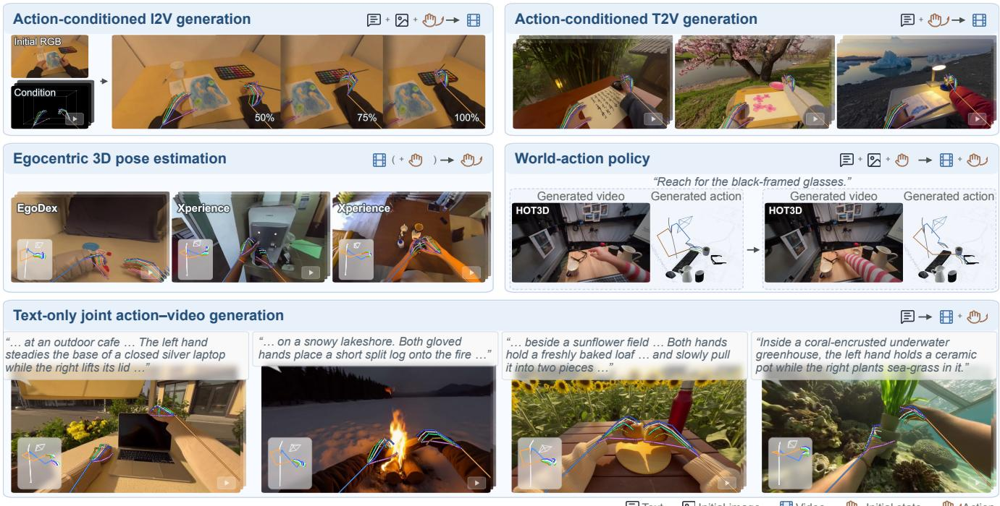  
Figure 1. Five capabilities of EgoGeneralist. Our framework unifies action-conditioned ego video generation, egocentric 3D pose estimation, and joint action–video generation, defining six inference modes across the five tasks illustrated above. Reusing the pretrained video prior enables generalization to unseen scenes with physically coherent interactions.

# EgoGeneralist: Unifying Egocentric Action–Video Tasks through Video-Native Modeling

Yanlin Jin1,2 Bowen Yang2 Cheng Zhang1 Yifan Yang3,2

Zhe Li2 Jianfei Cai1,† Kai Zhu2,†

1Monash University 2Ant Digital Technologies, Ant Group 3Institute of Automation, Chinese Academy of Sciences †Corresponding authors Project page: peaceneil.github.io/egogeneralist page

## Abstract

Modern video models possess strong visual priors, yet do not natively represent human action in metric 3D space. We present EgoGeneralist, which adapts pretrained video generators to unify action-conditioned egocentric video generation, pose estimation, and joint action–video generation. Our role-adaptive action renderer provides videonative representations for multidirectional action–video learning, making metric motion usable as both a spatial control signal and a recoverable generation target. Crossstream action–video coupling establishes close correspondence between metric motion and visual dynamics through lightweight adaptation while preserving the pretrained vi-

sual prior. Together, these designs establish a generalist framework spanning five action–video tasks. Despite adaptation only on controlled laboratory recordings, EgoGeneralist generalizes to diverse unseen scenes and interactions with effective action control and visual quality, bridging pretrained visual knowledge and metric 3D human motion.

## 1. Introduction

Modern video generators have acquired strong priors over appearance, motion, and visual interactions [38]. These priors make them a promising foundation for egocentric video generation, with applications spanning embodied learning, human–object interaction, and AR/VR [11, 26, 51]. In egocentric video, what a person sees is shaped jointly by body movement, hand manipulation, and camera motion. A video generator can imagine these visual experiences, yet does not natively represent what the person does in metric 3D space. Integrating metric 3D action would connect embodied motion with its visual consequences.

This connection is inherently multidirectional. Actions guide video generation, video observations provide evidence for recovering motion, and joint generation captures how the two evolve together. Although often studied separately, these tasks describe different directions of the same action–video relationship. Recent unified systems connect several of these directions, yet rely on separately parameterized action representations [22, 37, 42, 60]. Aligning these representations with video often requires largescale joint training, undermining reuse of the generative prior [7, 29, 42]. This raises a central question: can a pretrained video generator become an egocentric action–video generalist, extending its visual prior to metric 3D motion and generalizing broadly?

To this end, we introduce EgoGeneralist, a video-native framework for unified egocentric action–video learning. A role-adaptive renderer represents action as video, which the pretrained model can natively consume as a condition or generate as a target. Cross-stream action–video coupling then establishes correspondence through shared attention and target-specific LoRA in the video latent space, without extra input channels or conditioning encoders.

Our framework supports six action–video inference modes across five tasks (Fig. 1). These capabilities encompass action-conditioned video synthesis, action recovery from video, and joint action–video generation with metric upper-body, hand, and camera motion. Despite being trained only on controlled laboratory recordings, the adapted video generators generalize to unseen scenes, objects, and interactions. From text alone, they further synthesize paired metric action and video, offering a new means of action–video data generation.

Our contributions are as follows:

• A unified framework for egocentric action–video learning. We formulate action-conditioned video synthesis, metric action recovery, and joint action–video generation as a single video-based problem, coupling visual generation with metric upper-body, hand, and camera motion within a unified framework.

• Role-adaptive rendering with cross-stream action– video coupling. We introduce role-adaptive action renderings for spatial control and metric action recovery, coupled with video within the pretrained model’s native latent space through shared attention and target-specific low-rank updates. This design learns action–video correspondence with less disruption to the visual prior.

• Unified capabilities competitive with task-specific experts. Experiments across five evaluation settings show that our framework, adapted only on laboratory recordings, matches or surpasses specialized baselines, while generalizing to in-the-wild action–video generation.

## 2. Related Work

## 2.1. Action-Conditioned Ego Video Generation

A central design choice in action-conditioned egocentric video generation is how motion is represented and fused with the denoising network. Embedding-based methods encode action sequences and inject them into the video model, e.g., through adaptive normalization [4], timestep embeddings [3], or feature modulation and cross-attention [30], with camera motion folded into the same representation [30] or encoded as camera-ray features [51]. Some methods further augment action embeddings with encoded skeleton renderings [51] or occlusion-aware reference features propagated along hand trajectories [56]. Across these designs, motion control still relies on aligning learned conditioning features with the pretrained video features.

Spatially aligned methods instead render prescribed motion in the image plane, using projected skeletons [9, 12, 47, 50] or hand-mesh renderings [16] as explicit spatial guidance. These renderings, however, are typically coupled to the generator through expanded input channels [12, 16] or auxiliary conditioning branches [47], which alter the pretrained computation path and can weaken reuse of the visual prior [8, 17, 24]. Camera control poses a further challenge, since body and hand projections leave viewpoint motion implicit. Existing approaches usually embed camera motion [9, 51] or derive viewpoint-dependent conditions from reconstructed scenes and 3D scene memory [12, 16, 52], the latter demanding additional geometric reconstruction and scene-state maintenance. In contrast, our framework provides explicit body and camera control without scene reconstruction or separate camera embeddings. Moreover, rendered motion in these methods serves only as a condition, whereas ours supports both spatial control and metric action readout within the native latent space of the pretrained video model.

## 2.2. Egocentric 3D Pose Estimation

Egocentric 3D pose estimation seeks to recover body and hand motion from first-person observations. Hand reconstruction has advanced from single-image estimation [31, 33, 35] to video-based methods that exploit temporal cues for pose estimation [49] and account for camera motion to recover world-space hand trajectories [55, 58]. Extending reconstruction to the body further requires inferring motion from incomplete and distorted observations [39]. Prior work addresses this ambiguity through geometric context and learned motion priors. Specifically, external-view supervision during training, scene geometry, and stereotemporal observations provide constraints on body configuration [2, 43, 44]. Learned motion priors also support estimation conditioned on head or camera trajectories [20, 32, 54]. Modeling correlations between body and hand motion further enables their joint recovery [19, 45, 54]. More recent work jointly reconstructs human motion, camera trajectories, and scene geometry from monocular egocentric video [27]. Unlike these methods, our framework reformulates upper-body, hand, and camera motion recovery as a unified video generation task, jointly recovering metric 3D motion through a pretrained video denoiser.

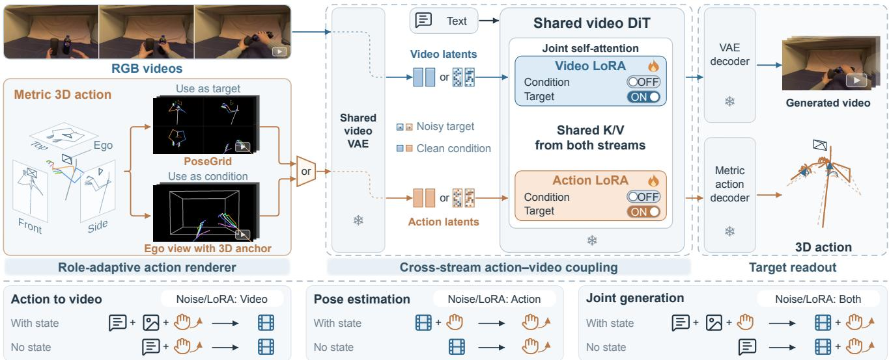  
Figure 2. Overview of EgoGeneralist. Role-adaptive rendering (Sec. 3.2) tailors the visual representation of metric 3D action to its task role: an ego-view map with a fixed 3D anchor for conditioning, or a multiview Posegrid for generation and metric readout. A shared frozen video VAE encodes rendered action and video into two latent streams. Cross-stream coupling (Sec. 3.3) uses joint self-attention and attention LoRAs activated only for generation targets, retaining the backbone weights and per-stream input structure. The bottom panel illustrates condition–target assignments for the three prediction directions defined in Sec. 3.1.

## 3. Method

## 2.3. Unified Egocentric Action–Video Learning

Unified multimodal diffusion supports multiple prediction directions within a shared model by varying which modalities are observed and generated [6, 8, 18]. In robotics, this principle has been used to couple video prediction with action inference [7, 22, 60]. Closely related works extend unified modeling to egocentric interactions, jointly generating video and hand actions [37, 42]. However, they only consider hand motion and rely on action-specific encoders, denoisers, or conditioning networks. In contrast, our framework jointly models metric upper-body, hand, and camera motion and couples action and video through lightweight adaptation. By retaining the pretrained backbone and perstream input structure, we effectively reuse the visual prior and achieve strong generalization.

## 3.1. Problem Formulation

Our goal is to enable pretrained video generators to synthesize egocentric video under action control, to recover action from video, and to jointly generate action and video. Let $\mathbf { V } = \{ \mathbf { v } _ { t } \} _ { t = 1 } ^ { F }$ denote an egocentric video and ${ \mathbf { A } } = \{ { \mathbf { a } } _ { t } \} _ { t = 1 } ^ { F }$ its synchronized metric 3D action sequence. Each action state comprises upper-body and hand joint positions, together with the camera pose, expressed in the initial camera coordinate frame. We denote a text prompt by p.

We formulate three tasks, each with two inference modes depending on whether an initial target state is provided.

Action-conditioned egocentric video generation. Given a prescribed action sequence and a text prompt, generate the corresponding video:

$$
\mathrm { ( a ) } ( \mathbf { A } , \mathbf { p } )  \mathbf { V } \qquad \mathrm { ( b ) } ( \mathbf { A } , \mathbf { v } _ { 1 } , \mathbf { p } )  \mathbf { V } _ { 2 : F }\tag{1}
$$

Egocentric pose estimation. Given an observed video, recover its metric 3D action sequence:

$$
\mathrm { ( a ) } \ \mathbf { V }  \mathbf { A } \qquad \mathrm { ( b ) } \ \bigl ( \mathbf { V } , \mathbf { a } _ { 1 } \bigr )  \mathbf { A } _ { 2 : F }\tag{2}
$$

Joint action–video generation. Given a text prompt, generate synchronized action and video:

$$
{ \mathrm { ( a ) } } \ \mathbf { p } \to \left( \mathbf { V } , \mathbf { A } \right) \qquad { \mathrm { ( b ) } } \ \left( \mathbf { p } , \mathbf { v } _ { 1 } , \mathbf { a } _ { 1 } \right) \to \left( \mathbf { V } _ { 2 : F } , \mathbf { A } _ { 2 : F } \right)\tag{3}
$$

In each pair, the first mapping generates the complete target sequence, while the second predicts its continuation from the provided initial state. We next describe how action is encoded according to its role in each task (Sec. 3.2) and how action and video are coupled while preserving the video prior (Sec. 3.3).

## 3.2. Role-Adaptive Action Rendering

To ease action–video alignment and better leverage the pretrained visual prior, we render action as video. Action rendering, however, serves two roles. As a condition, its spatial alignment with the egocentric view yields more direct correspondence with video in the spatially structured latent space. As a generation target, it must preserve 3D geometry for metric readout, which a single ego-view projection leaves ambiguous (Sec. C.1). We therefore introduce a roleadaptive action renderer that selects between two video representations according to the role of action.

Ego-view action map for action conditioning. For visual control, we project action A onto the egocentric image plane under the same camera and resolution as the RGB video. The resulting spatial alignment directly indicates where each body part should appear and move. Semantic colors identify body parts, while perspective changes in projected size provide depth cues. We omit explicit color coding of depth or coordinates, which we found to provide little additional benefit in practice.

The remaining ambiguity is camera motion. A moving skeleton alone provides no static reference with which to separate camera motion from body motion. We address this with a sparse, fixed-size 3D anchor cage defined by two rectangular planes at depths of 0.25 and 0.70 m, with corresponding corners connected. The cage remains fixed in the initial camera frame $\mathcal { C } _ { s }$ and is reprojected at each timestep, encoding camera motion through changes in its projection. For anchor $\mathbf { g } _ { j } \in \mathbb { R } ^ { 3 }$ , its projection at time t is

$$
[ \mathbf { u } _ { t , j } ] = \frac { 1 } { Z _ { t , j } } \mathbf { K } T _ { \mathcal { C } _ { t }  \mathcal { C } _ { s } } [ \mathbf { g } _ { j } ] ,\tag{4}
$$

where K is the camera intrinsic matrix and $Z _ { t , j }$ is the anchor’s depth in the current camera frame $\mathcal { C } _ { t } .$ Because the anchors are static in ${ \mathcal { C } } _ { s } ,$ , their image motion directly reveals camera translation and rotation. Together, the aligned skeleton and 3D anchors form $\mathbf { A } _ { \mathrm { e g o } }$ , the action condition used for video generation, as illustrated in Figs. 2 and 3.

Multiview Posegrid for action readout. To explicitly preserve 3D information, we render the human action sequence A as Posegrid $\mathbf { A } _ { \mathrm { m u l t i } } , \mathbf { a }$ 2×2 video canvas combining front, side, and top orthographic skeleton projections with the egocentric view (Fig. 2). All poses are expressed in the initial camera frame $\mathcal { C } _ { s } .$ . The complementary orthographic axes expose depth and articulation that a single projection collapses. A camera frustum records camera translation and rotation relative to $\mathcal { C } _ { s }$ . Consistent colors distinguish body parts and fingers, while depth-aware rendering places nearer skeleton segments in front of farther ones at projected crossings.

By retaining explicit geometric information, Posegrid makes metric readout readily learnable. We encode $\mathbf { A } _ { \mathrm { m u l t i } }$ with the frozen video VAE E and train an action decoder D to recover joint and camera translations and 6D rotations:

$$
\begin{array} { r } { \widehat { \bf A } = \mathcal { D } ( \mathcal { E } ( { \bf A } _ { \mathrm { m u l t i } } ) ) . } \end{array}\tag{5}
$$

The decoder is easily trained independently of the video model and then frozen. Decoder architecture and training details are provided in Sec. A.1 of the supplementary material. Posegrid thus provides a video-native readout space that maps generated latents back to metric action.

## 3.3. Cross-Stream Action–Video Coupling

We process the latents of video V and the role-selected action rendering $\mathbf { A } _ { r } , r \in \lbrace \mathrm { e g o , m u l t i } \rbrace$ , as separate streams of a shared denoiser. Each stream keeps the pretrained input structure, while attention across streams enables action– video interaction (Fig. 2).

Cross-stream interaction. The shared frozen encoder maps these inputs to $\mathbf { z } ^ { v } = { \mathcal { E } } ( \mathbf { V } )$ and $\mathbf { z } ^ { a } = \mathcal { E } ( \mathbf { A } _ { r } )$ . Motivated by prior cross-domain diffusion designs [17, 24], we pack these latents along the batch dimension and process them with the same DiT. This preserves each stream’s channel width, spatiotemporal layout, and input projection. Within self-attention, each stream retains its own queries and positional encoding but attends to keys and values from both streams:

$$
{ \bf H } _ { m } = \mathrm { A t t n } ( { \bf Q } _ { m } , [ { \bf K } _ { v } ; { \bf K } _ { a } ] , [ { \bf V } _ { v } ; { \bf V } _ { a } ] ) , \qquad m \in \{ v , a \} .\tag{6}
$$

The shared context allows action and video to exchange information without a separate fusion network.

Unified action–video denoising. Building on this latent interaction, each task τ specifies the prediction direction by assigning streams to observed conditions $ { \mathcal { C } } _ { \tau }$ or generation targets $\mathcal { T } _ { \tau }$ (Fig. 2). Action conditions use the ego-view map, whereas action targets use Posegrid (Sec. 3.2).

We use separate attention LoRA adapters [14] for action and video to learn modality-specific denoising from the shared action–video context. To retain pretrained features for conditioning, we adopt target-gated adaptation [8], activating each adapter only when its modality is a generation target. We adapt the query, key, value, and output projections of self-attention. For each projection and modality

m ∈ {v, a},

$$
\mathbf { h } _ { m } = W _ { 0 } \mathbf { x } _ { m } + g _ { \tau , m } B _ { m } A _ { m } \mathbf { x } _ { m } , \qquad g _ { \tau , m } = \mathbb { I } [ m \in \mathcal { T } _ { \tau } ] ,\tag{7}
$$

where $\mathbf { x } _ { m }$ is the projection input, $W _ { 0 }$ is the frozen pretrained weight, and $A _ { m } , B _ { m }$ are modality-specific low-rank matrices. The binary task gate $g _ { \tau , m }$ leaves condition-stream attention projections unchanged.

We then train all three mappings with one conditional flow-matching objective [23], following unified multimodal diffusion [8, 18]. Initial observations and action states use the backbone’s native first-frame conditioning. We perturb each latent stream as

$$
\widetilde { \mathbf { z } } _ { t } ^ { m } = ( 1 - \sigma _ { m } ) \mathbf { z } ^ { m } + \sigma _ { m } \mathbf { \epsilon } ^ { m } ,\tag{8}
$$

where $\epsilon ^ { m } \sim \mathcal { N } ( \mathbf { 0 } , \mathbf { I } )$ is Gaussian noise. The noise level $\sigma _ { m }$ is sampled for target streams and fixed at the minimum training noise level for condition streams. Let $\widetilde { \mathbf { Z } } _ { t }$ collect the perturbed action and video streams. The denoiser predicts $\mathbf { v } _ { \theta } ^ { m } ( \widetilde { \mathbf { Z } } _ { t } , t , \mathbf { p } _ { \tau } )$ , and we minimize the mean squared velocity error over the target streams:

$$
\mathcal { L } _ { \tau } = \mathbb { E } \left[ \frac { 1 } { | T _ { \tau } | } \sum _ { m \in \mathcal { T } _ { \tau } } \mathrm { M S E } ( \mathbf { v } _ { \boldsymbol { \theta } } ^ { m } , \epsilon ^ { m } - \mathbf { z } ^ { m } ) \right] .\tag{9}
$$

For Posegrid targets, we double the squared-error contribution of latent locations covering upper-limb, hand, or camera geometry. The text condition pτ is an empty prompt when text is not used. Changing only which streams act as conditions and which are denoised yields the three mappings without task-specific denoisers.

## 4. Experiments

## 4.1. Implementation Details

We instantiate our method on the I2V and T2V variants of Wan2.2-A14B [38, 41] and use the EgoDex dataset [13] for training. EgoDex’s controlled recording environments allow us to assess generalization from visually limited training scenes to more diverse environments. We train for one epoch on the official EgoDex training split, sampling one 41-frame clip from each episode. Videos are processed at 832 × 464 resolution, and action renderings are generated on the fly from motion expressed in the clip’s initial camera coordinate frame. Further implementation details are provided in the supplementary material.

## 4.2. Experimental Setup

Evaluation settings. We evaluate the three prediction directions introduced in Sec. 3.1 across five evaluation settings. Quantitative experiments cover actionconditioned video generation with and without an initial image (Sec. 4.3), egocentric pose estimation (Sec. 4.4), and world-action policy (Sec. 4.5). Finally, we qualitatively examine text-only joint generation (Sec. 4.5). Prompts displayed in qualitative figures are abbreviated for readability.

Evaluation Datasets. The in-domain test set contains 111 clips randomly sampled from the EgoDex test split, one per activity category to ensure balanced coverage. For out-ofdistribution evaluation, we sample 50 Xperience-10M [36] clips with valid annotations, spanning diverse scenes and activities in the wild. For quantitative world-action policy evaluation, we use HOT3D [5], which provides the 3D object annotations required for proximity measurement and lies outside our training domain. We randomly sample 50 initial states with visible hands and reachable targets within 5–30 cm, yielding 99 target-reaching tasks. Following the camera-normalization principle of Being-H0 [26], we rectify Xperience-10M and HOT3D fisheye videos to a fixed target pinhole camera and use the same rectified inputs for all methods. Details of the benchmark construction are provided in the supplementary material.

## 4.3. Action-Conditioned Ego Video Generation

Action-conditioned image-to-video generation. Given an initial image, a prescribed action sequence, and a text prompt, we evaluate motion adherence and visual fidelity (Eq. 1b). We compare the methods in Tab. 1 using their recommended inference settings. Evaluation uses the first 41 frames within a common image region at 832 × 480. We report PSNR [15], SSIM [48], and FVD [40] for visual quality, together with MediaPipe-based [57] PCK@20, hand IoU, and hand-matching failure following LOME [9]. Failure is the fraction of frames with detected hands in the reference video for which at least one reference hand remains unmatched in the generated video.

Table 1 shows that EgoGeneralist outperforms all external baselines across the reported EgoDex metrics. On Xperience-10M, it achieves the best PSNR, SSIM, FVD, and failure rate, demonstrating strong generalization to outof-distribution settings. Zhang et al. [56] obtain higher PCK and hand IoU on matched hands, whereas we achieve better overall video quality with a lower hand-matching failure rate. Removing the 3D anchor at inference lowers Xperience-10M PSNR from 19.67 to 15.78. Figure 3 provides qualitative comparisons, with additional results in supplementary Figs. S2 and S3.

Action-conditioned text-to-video generation. Without an initial RGB image, we generate video from a prescribed action sequence and a text prompt (Eq. 1a). For both EgoDex and Xperience-10M, we pair 20 randomly selected benchmark clips with five LLM-generated prompt variants each, yielding 100 test instances per dataset. We compare with Wan2.2 Fun-Control and VACE-Fun [1] using identical source actions and prompts. PCK@20, hand IoU, and failure rate assess action control, while EgoVideo-S measures video–text alignment using frozen EgoVideo encoders [34], following EgoVid-5M [46]. Figure 4 shows how different prompts change the visual context of a fixed action. Additional examples and baseline comparisons appear in supplementary Figs. S4 and S5.

"Unstack the lego bricks to disassemble the built form on a blue tablecloth."  
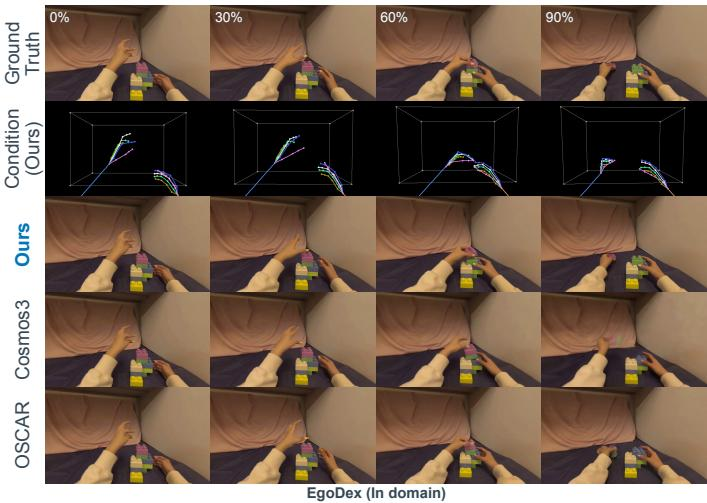  
"The person tilts a large blue bucket with both hands and pours the water into the sink."

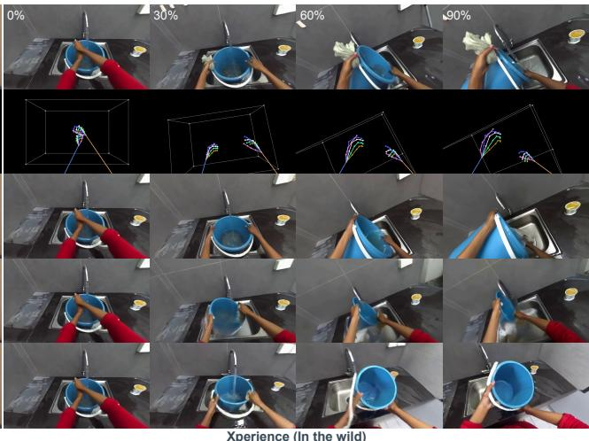  
Figure 3. Action-conditioned image-to-video generation. Comparisons on EgoDex (left) and Xperience-10M (right, out-of-distribution). Adapted only on laboratory recordings, EgoGeneralist generalizes to in-the-wild scenes. The generated videos follow the prescribed motion with physically coherent interactions, correctly removing the purple block and tilting the bucket.

Table 1. Action-conditioned image-to-video generation on EgoDex and Xperience-10M. EgoGeneralist achieves strong visual fidelity and action control in both datasets. PCK, IoU, and Failure are in percentages; best and second-best are bold and underlined. EgoSimO/EgoSimQ use dataset-provided/Qwen-generated prompts.
<table><tr><td></td><td colspan="6">EgoDex (111 clips)</td><td colspan="6">Xperience-10M (50 clips)</td></tr><tr><td>Method</td><td>PSNR↑</td><td>SSIM↑</td><td>FVD↓</td><td>PCK@20↑</td><td>IoU↑</td><td>Failure↓</td><td>PSNR↑</td><td>SSIM↑</td><td>FVD↓</td><td>PCK@20↑</td><td>IoU↑</td><td>Failure↓</td></tr><tr><td>EgoSimo [12]</td><td>21.44</td><td>0.8572</td><td>333.51</td><td>65.11</td><td>63.47</td><td>29.26</td><td>16.81</td><td>0.6501</td><td>1035.55</td><td>47.91</td><td>50.96</td><td>56.38</td></tr><tr><td>LOME [9]</td><td>22.33</td><td>0.8446</td><td>350.61</td><td>60.09</td><td>64.87</td><td>37.77</td><td>11.99</td><td>0.5413</td><td>2114.01</td><td>50.85</td><td>57.50</td><td>87.24</td></tr><tr><td>EgoSimQ [12]</td><td>22.48</td><td>0.8654</td><td>264.87</td><td>71.83</td><td>66.62</td><td>26.99</td><td>17.02</td><td>0.6535</td><td>869.67</td><td>51.92</td><td>52.41</td><td>55.15</td></tr><tr><td>Zhang et al. [56]</td><td>23.18</td><td>0.8429</td><td>253.16</td><td>62.78</td><td>64.33</td><td>29.14</td><td>14.99</td><td>0.5897</td><td>667.10</td><td>72.33</td><td>64.05</td><td>43.21</td></tr><tr><td>RynnWorld-Teleop [59]</td><td>25.79</td><td>0.8796</td><td>258.75</td><td>69.28</td><td>71.14</td><td>38.43</td><td>16.05</td><td>0.6510</td><td>763.77</td><td>50.65</td><td>54.30</td><td>69.57</td></tr><tr><td>Cosmos3 Nano [29]</td><td>26.72</td><td>0.8810</td><td>239.05</td><td>59.23</td><td>64.34</td><td>30.54</td><td>18.79</td><td>0.6932</td><td>519.49</td><td>50.56</td><td>51.15</td><td>48.07</td></tr><tr><td>OSCAR [50]</td><td>27.18</td><td>0.8798</td><td>171.85</td><td>85.54</td><td>78.96</td><td>26.93</td><td>14.96</td><td>0.5841</td><td>685.74</td><td>61.41</td><td>60.38</td><td>43.03</td></tr><tr><td>Ours w/o anchor (inference)</td><td>27.48</td><td>0.8861</td><td>145.69</td><td>86.92</td><td>78.57</td><td>21.94</td><td>15.78</td><td>0.6200</td><td>607.23</td><td>56.99</td><td>56.26</td><td>42.07</td></tr><tr><td>Ours</td><td>30.35</td><td>0.9302</td><td>114.16</td><td>86.52</td><td>79.12</td><td>21.69</td><td>19.67</td><td>0.7273</td><td>453.03</td><td>62.24</td><td>57.86</td><td>40.66</td></tr></table>

EgoGeneralist achieves the highest PCK and lowest hand-matching failure rate on both datasets (Tab. 2). Despite adaptation only on EgoDex’s visually limited laboratory recordings, it remains responsive to text prompts specifying different scenes and object appearances, with comparable EgoVideo-S scores.

## 4.4. Egocentric 3D Pose Estimation

We evaluate metric hand, upper-body, and camera recovery on the same EgoDex and Xperience-10M clips used for action-conditioned video generation (Eq. 2a). Our method receives no initial action state for fair comparison. We compare with HaMeR [33] and HaWoR [58], established hand reconstruction methods used for pseudo-ground-truth annotation [10, 61], alongside MINT [61], ReViV [27], and EgoForce [28]. HaMeR, HaWoR, and EgoForce receive ground-truth camera intrinsics. HaMeR and EgoForce additionally use HaWoR’s camera trajectories.

Table 2. Action-conditioned text-to-video generation on 100 action–prompt instances per dataset. PCK, hand IoU, and Fail assess action control, while EgoV-S measures video–text semantic alignment. Our method maintains competitive action adherence across text-specified visual contexts.
<table><tr><td></td><td colspan="4">EgoDex</td><td colspan="4">Xperience-10M</td></tr><tr><td>Method</td><td>PCK↑</td><td>IoU↑</td><td>Fail↓</td><td>EgoV-S↑</td><td>PCK↑</td><td>IoU↑</td><td>Fail↓</td><td>EgoV-S↑</td></tr><tr><td>Fun-Control</td><td>35.41</td><td>48.11</td><td>51.81</td><td>0.3583</td><td>47.91</td><td>52.64</td><td>63.17</td><td>0.4213</td></tr><tr><td>VACE-Fun</td><td>37.09</td><td>48.94</td><td>53.74</td><td>0.3440</td><td>49.04</td><td>49.61</td><td>63.33</td><td>0.4095</td></tr><tr><td>EgoGeneralist</td><td>67.91</td><td>66.36</td><td>40.15</td><td>0.3773</td><td>50.59</td><td>50.52</td><td>61.99</td><td>0.4126</td></tr></table>

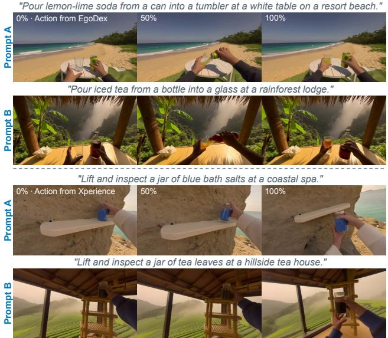  
Figure 4. Action-conditioned text-to-video generation. Ego-Generalist generates videos that share the same prescribed 3D motion while varying scenes and object appearances according to different text prompts. Actions are drawn from EgoDex (top) and Xperience-10M (bottom).

Following SLAHMR [53] and HaWoR [58], we report PA-MPJPE for local hand pose and W-/WA-MPJPE for world-space motion, as well as absolute MPJPE (Abs-MPJPE) and adjacent-frame camera errors (RPE-T and RPE-R). Hand metrics evaluate hands appearing in the image; failure rates account for missing predictions. Since skeletal definitions differ, body evaluation uses shared upper-limb joints.

Table 3 shows that EgoGeneralist achieves the lowest hand and upper-limb reconstruction errors across all reported pose metrics on EgoDex. Differences in skeletal definitions and body proportions create a substantial geometric domain gap between EgoDex and Xperience-10M. Nevertheless, EgoGeneralist maintains comparable performance on Xperience-10M, notably the lowest hand Abs-MPJPE, which measures absolute 3D joint error in a common first frame camera coordinate system. Furthermore, EgoGeneralist shows the lowest aligned upper-limb errors on both datasets, underscoring its ability to jointly recover body motion and detailed hand poses. Qualitative pose comparisons are provided in supplementary Fig. S6.

## 4.5. Joint Action–Video Generation

World-action policy. Given an initial observation, action state, and instruction, EgoGeneralist jointly predicts future 3D action and video (Eq. 3b). We compare with VITRA [21] and Being-H0 [26] on HOT3D [5], following VITRA’s target-reaching criterion. We report minimum fingertip-to-target surface distance over the predicted trajectory (MinDist), reaching rates within 2/5 cm (Reach@2/5), and percentage distance reduction from the initial state (Progress). Figure 5 visualizes the jointly predicted video and 3D action.

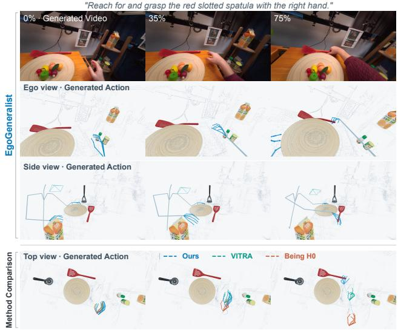  
Figure 5. World-action policy on HOT3D. Top: EgoGeneralist’s generated video and 3D action in ego and side views. Bottom: action predictions from all three methods in a shared top view. GT object meshes and scene points are used only for visualization. Additional examples are provided in supplementary Fig. S7.

As shown in Tab. 4, our method achieves lower mean and median minimum target distances and higher reaching rates. Despite training only on EgoDex, the generated actions follow target-specific instructions for unseen objects and environments.

Text-only joint action–video generation. Given only a text prompt, EgoGeneralist generates synchronized video and metric 3D motion (Eq. 3a). Figure 6 illustrates scenes visually distinct from the training domain. The generated actions remain closely aligned with the motion depicted in the videos. These qualitative results illustrate the potentia for paired action–video data generation beyond the training settings. More examples are in the supplementary material.

## 4.6. Ablation Studies

To evaluate the effectiveness of role-adaptive rendering, we compare ego-view rendering and multiview Posegrid for both video control and metric action readout. We further assess cross-stream action–video coupling against alternative conditioning strategies. These ablations validate our designs. Detailed ablations and results are presented in Sec. C of the supplementary material.

Table 3. Hand, upper-limb, and camera reconstruction on EgoDex and Xperience-10M. EgoGeneralist remains competitive with specialist estimators while jointly recovering hand, upper-limb, and camera motion. HaMeR † and EgoForce † use HaWoR’s camera estimates with camera scores reported in the HaWoR row. ReViV keeps its native two-second input context and all methods are evaluated on 41 frames.  
Abs↓/PA↓/W↓/WA↓: absolute/Procrustes-/world-/world-aligned MPJPE (mm); RPE-T↓ (mm), RPE-R↓ (◦), Fail↓ (%): no failure / some fail / highest failure rate.
<table><tr><td></td><td></td><td colspan="3">Method properties</td><td colspan="7">EgoDex (111 clips)</td><td colspan="7">Xperience-10M (50 clips)</td></tr><tr><td></td><td>Method</td><td>Camera</td><td>Pose output</td><td>Data</td><td>Abs</td><td>PA</td><td>W</td><td>WA</td><td>Fail</td><td>RPE-T RPE-R</td><td></td><td>Abs</td><td>PA</td><td>W</td><td>WA</td><td>Fail</td><td>RPE-T RPE-R</td><td></td></tr><tr><td></td><td>ReViV [27]</td><td>Predicted</td><td>Hand + body</td><td>Incl. wild</td><td>334.04</td><td>21.21</td><td>126.84</td><td>43.96</td><td>0.00</td><td>1.08</td><td>0.135</td><td>192.79</td><td>15.93</td><td>114.81</td><td>44.23</td><td>0.00</td><td>4.32</td><td>0.431</td></tr><tr><td rowspan="6">(a) Hand + camera</td><td>MINT [61]</td><td>Predicted</td><td>Hand only</td><td>Incl. wild</td><td>186.62</td><td>10.50</td><td>30.94</td><td>18.22</td><td>0.34</td><td>0.74</td><td>0.087</td><td>131.97</td><td>7.90</td><td>61.55</td><td>26.56</td><td>0.85</td><td>3.09</td><td>0.220</td></tr><tr><td>HaMeR [33]†</td><td>SLAM†</td><td>Hand only</td><td>Incl. wild</td><td>119.47</td><td>12.12</td><td>77.05</td><td>32.31</td><td>14.19</td><td></td><td></td><td>124.92</td><td>6.95</td><td>82.80</td><td>34.20</td><td>6.79</td><td></td><td></td></tr><tr><td>EgoForce [28]†</td><td>SLAM†</td><td>Hand + forearm</td><td>Lab only</td><td>114.71</td><td>11.79</td><td>61.42</td><td>31.73</td><td>15.17</td><td></td><td></td><td>105.50</td><td>8.27</td><td>81.13</td><td>39.16</td><td>14.24</td><td></td><td></td></tr><tr><td>HaWoR [58]</td><td>SLAM</td><td>Hand only</td><td>Lab only</td><td>111.98</td><td>11.75</td><td>46.44</td><td>25.09</td><td>9.65</td><td>5.17</td><td>0.176</td><td>110.43</td><td>8.38</td><td>77.56</td><td>32.71</td><td>2.54</td><td>4.78</td><td>0.134</td></tr><tr><td>EgoGeneralist</td><td>Predicted</td><td>Hand + body</td><td>Lab only</td><td>27.73</td><td>7.47</td><td>22.65</td><td>13.08</td><td>0.00</td><td>0.67</td><td>0.138</td><td>91.01</td><td>12.42</td><td>68.23</td><td>33.31</td><td>0.00</td><td>3.49</td><td>0.610</td></tr><tr><td>Method</td><td></td><td>Evaluated joints</td><td></td><td>Abs</td><td></td><td>PA</td><td></td><td>W</td><td>WA</td><td>Fail</td><td></td><td>Abs</td><td>PA</td><td>W</td><td></td><td>WA</td><td>Fail</td></tr><tr><td rowspan="6">(b) Upper</td><td>ReViV [27]</td><td colspan="3">4 joints</td><td colspan="10">343.90</td><td colspan="3">143.35</td><td colspan="3">0.00</td></tr><tr><td>EgoForce [28]†</td><td colspan="3"></td><td colspan="3">175.79</td><td colspan="3">131.08 113.08</td><td colspan="3">0.00 11.62</td><td colspan="3">382.55 68.94 144.50 53.57</td><td colspan="3">100.07 89.77</td></tr><tr><td colspan="5">limbs</td><td colspan="3">47.46 33.25</td><td colspan="3">83.83 24.28</td><td colspan="3">0.00</td><td colspan="3">125.89 33.63</td><td colspan="3">6.93 49.97</td></tr><tr><td colspan="3">EgoGeneralist</td><td colspan="3"></td><td colspan="3">15.91 96.05</td><td colspan="3">19.49 107.88</td><td colspan="3">161.37 337.62</td><td colspan="3">72.40</td><td colspan="3">0.00 0.00</td></tr><tr><td colspan="4">ReViV [27]</td><td colspan="3">288.73</td><td colspan="3">120.95</td><td colspan="3">0.00</td><td colspan="3">84.09 191.19</td><td colspan="3">130.93 103.55 79.84</td></tr><tr><td colspan="5">EgoGeneralist</td><td colspan="3">32.64 18.44</td><td colspan="3">24.28 20.98</td><td colspan="3">0.00</td><td colspan="3">55.94</td><td colspan="3">65.21</td></tr></table>

“Inside a sea cave with turquoise reflections, both hands open a wooden treasure chest on a stone ledge and reach for a brass compass resting on folded velvet.”  
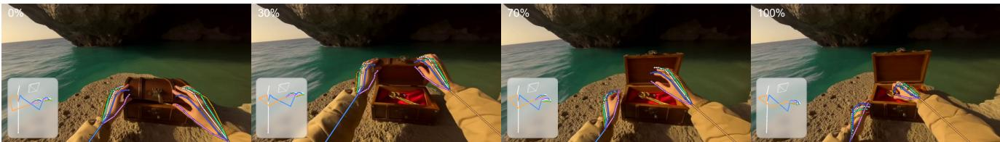  
“At a lakeside terrace at dusk, the left hand steadies a candleholder as the right lights the candle with a wooden match, then moves away with the match.”

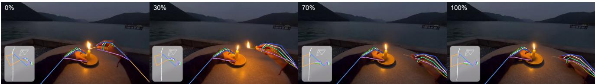  
Figure 6. Text-only joint action–video generation. Each example shows jointly generated video and 3D action, with the action projected onto video frames. Insets show the generated 3D upper-body skeleton and camera pose. Additional examples appear in Figs. S8 and S9.

Table 4. World-action policy evaluation on HOT3D. Our method outperforms specialized policy baselines in target reaching on unseen HOT3D scenes while jointly generating video. All methods receive an initial observation and instruction. VITRA and Ego-Generalist also receive initial action states. †Being-H0 uses a single wrist-anchored rigid alignment to the GT initial hand.
<table><tr><td></td><td colspan="2">MinDist (cm)↓</td><td colspan="2">Reach (%)↑</td><td>Progress↑</td></tr><tr><td>Method</td><td>Mean</td><td>Med.</td><td>@2cm</td><td>@5cm</td><td>(%)</td></tr><tr><td>Initial state</td><td>15.98</td><td>16.20</td><td>0.00</td><td>0.00</td><td>0.00</td></tr><tr><td>Being-H0†</td><td>11.64</td><td>11.90</td><td>16.16</td><td>25.25</td><td>32.64</td></tr><tr><td>VITRA</td><td>6.32</td><td>4.59</td><td>31.31</td><td>52.53</td><td>61.96</td></tr><tr><td>EgoGeneralist</td><td>3.81</td><td>1.07</td><td>58.59</td><td>77.78</td><td>77.42</td></tr></table>

## 5. Conclusion

We presented EgoGeneralist, a unified framework for action-conditioned ego video generation, metric pose estimation, and joint action–video generation. Role-adaptive rendering and cross-stream coupling connect metric motion with the video generator’s native representation through lightweight adaptation. Experiments demonstrate effective action control and generalization beyond laboratory training scenes, alongside competitive motion recovery and targetreaching performance. Text-only joint generation further enables paired synthesis of action and video. Together, these results establish pretrained video models as a practical foundation for egocentric action–video learning.

Limitations. EgoDex’s multi-camera fusion introduces projection mismatches between 3D annotations and images. These discrepancies can carry over into generated sequences, occasionally affecting action–video alignment. More accurately aligned training data could reduce these artifacts. Further, although our method generalizes well, the EgoDex recordings cover a limited range of environments and body motion. More diverse annotated data, including standing, walking, and outdoor activities, could further extend our framework’s capabilities.

## References

[1] aigc-apps. VideoX-Fun: A video generation pipeline for diffusion transformer, 2026. 6

[2] Hiroyasu Akada, Jian Wang, Vladislav Golyanik, and Christian Theobalt. 3d human pose perception from egocentric stereo videos. In IEEE Conf. Comput. Vis. Pattern Recog., pages 767–776, 2024. 3

[3] Anurag Bagchi, Zhipeng Bao, Homanga Bharadhwaj, Yu-Xiong Wang, Pavel Tokmakov, and Martial Hebert. Walk through paintings: Egocentric world models from internet priors. In Eur. Conf. Comput. Vis., pages 472–489. Springer, 2026. 2

[4] Yutong Bai, Danny Tran, Amir Bar, Yann LeCun, Trevor Darrell, and Jitendra Malik. Whole-body conditioned egocentric video prediction. In Adv. Neural Inform. Process. Syst., pages 164375–164418. Curran Associates, Inc., 2025. 2

[5] Prithviraj Banerjee, Sindi Shkodrani, Pierre Moulon, Shreyas Hampali, Shangchen Han, Fan Zhang, Linguang Zhang, Jade Fountain, Edward Miller, Selen Basol, Richard Newcombe, Robert Wang, Jakob Julian Engel, and Tomas Hodan. HOT3D: Hand and object tracking in 3d from egocentric multi-view videos. In IEEE Conf. Comput. Vis. Pattern Recog., pages 7061–7071, 2025. 5, 7

[6] Fan Bao, Shen Nie, Kaiwen Xue, Chongxuan Li, Shi Pu, Yaole Wang, Gang Yue, Yue Cao, Hang Su, and Jun Zhu. One transformer fits all distributions in multi-modal diffusion at scale. In International Conference on Machine Learning, pages 1692–1717, 2023. 3

[7] Hongzhe Bi, Hengkai Tan, Shenghao Xie, Zeyuan Wang, Shuhe Huang, Haitian Liu, Ruowen Zhao, Yao Feng, Chendong Xiang, Yinze Rong, Hongyan Zhao, Hanyu Liu, Zhizhong Su, Lei Ma, Hang Su, and Jun Zhu. Motus: A unified latent action world model. In IEEE Conf. Comput. Vis. Pattern Recog., pages 35101–35113, 2026. 2, 3

[8] Houyuan Chen, Hong Li, Xianghao Kong, Tianrui Zhu, Shaocong Xu, Weiqing Xiao, Yuwei Guo, Chongjie Ye, Lvmin Zhang, Hao Zhao, and Anyi Rao. Unividx: A unified multimodal framework for versatile video generation via diffusion priors. ACM Trans. Graph., 45(4), 2026. 2, 3, 4, 5

[9] Quankai Gao, Jiawei Yang, Qiangeng Xu, Le Chen, and Yue Wang. Lome: Learning human-object manipulation with action-conditioned egocentric world model. arXiv preprint arXiv:2603.27449, 2026. 2, 5, 6

[10] Alexey Gavryushin, Xi Wang, Robert J. S. Malate, Chenyu Yang, Davide Liconti, Rene Zurbr´ ugg, Robert K.¨ Katzschmann, and Marc Pollefeys. MAPLE: Encoding dexterous robotic manipulation priors learned from egocentric videos. arXiv preprint arXiv:2504.06084, 2025. 6

[11] Kristen Grauman, Andrew Westbury, Eugene Byrne, Zachary Chavis, Antonino Furnari, Rohit Girdhar, Jackson Hamburger, Hao Jiang, Miao Liu, Xingyu Liu, Miguel Martin, Tushar Nagarajan, Ilija Radosavovic, Santhosh Kumar Ramakrishnan, Fiona Ryan, Jayant Sharma, Michael Wray, Mengmeng Xu, Eric Zhongcong Xu, Chen Zhao, Siddhant Bansal, Dhruv Batra, Vincent Cartillier, Sean Crane, Tien Do, Morrie Doulaty, Akshay Erapalli, Christoph Feichtenhofer, Adriano Fragomeni, Qichen Fu, Abrham Gebreselasie, Cristina Gonzalez, James Hillis, Xuhua Huang, Yifei´ Huang, Wenqi Jia, Weslie Khoo, Jachym Kol´ a´ˇr, Satwik Kottur, Anurag Kumar, Federico Landini, Chao Li, Yanghao Li, Zhenqiang Li, Karttikeya Mangalam, Raghava Modhugu, Jonathan Munro, Tullie Murrell, Takumi Nishiyasu, Will Price, Paola Ruiz, Merey Ramazanova, Leda Sari, Kiran Somasundaram, Audrey Southerland, Yusuke Sugano, Ruijie Tao, Minh Vo, Yuchen Wang, Xindi Wu, Takuma Yagi, Ziwei Zhao, Yunyi Zhu, Pablo Arbelaez, David Crandall,´ Dima Damen, Giovanni Maria Farinella, Christian Fuegen, Bernard Ghanem, Vamsi Krishna Ithapu, C. V. Jawahar, Hanbyul Joo, Kris Kitani, Haizhou Li, Richard Newcombe, Aude Oliva, Hyun Soo Park, James M. Rehg, Yoichi Sato, Jianbo Shi, Mike Zheng Shou, Antonio Torralba, Lorenzo Torresani, Mingfei Yan, and Jitendra Malik. Ego4D: Around the world in 3,000 hours of egocentric video. In IEEE Conf. Comput. Vis. Pattern Recog., pages 18995–19012, 2022. 2

[12] Jinkun Hao, Mingda Jia, Ruiyan Wang, Xihui Liu, Ran Yi, Lizhuang Ma, Jiangmiao Pang, and Xudong Xu. Egosim: Egocentric world simulator for embodied interaction gener ation. In Eur. Conf. Comput. Vis., pages 598–614. Springer, 2026. 2, 6

[13] Ryan Hoque, Peide Huang, David Yoon, Mouli sivapurapu, and Jian Zhang. EgoDex: Learning dexterous manipulation from large-scale egocentric video. In Int. Conf. Learn. Represent., pages 4218–4237, 2026. 5

[14] Edward J. Hu, Yelong Shen, Phillip Wallis, Zeyuan Allen-Zhu, Yuanzhi Li, Shean Wang, Lu Wang, and Weizhu Chen. LoRA: Low-rank adaptation of large language models. In Int. Conf. Learn. Represent., 2022. 4

[15] Quan Huynh-Thu and Mohammed Ghanbari. Scope of validity of PSNR in image/video quality assessment. Electronics Letters, 44(13):800–801, 2008. 5

[16] Byungjun Kim, Taeksoo Kim, Junyoung Lee, and Hanbyu Joo. Dexterous world models. In IEEE Conf. Comput. Vis. Pattern Recog., pages 29663–29673, 2026. 2

[17] Peter Kocsis, Lukas Hollein, and Matthias Niessner. In-¨ trinsiX: High-quality PBR generation using image priors. In Adv. Neural Inform. Process. Syst., pages 77698–77732. Curran Associates, Inc., 2025. 2, 4

[18] Duong H. Le, Tuan Pham, Sangho Lee, Christopher Clark, Aniruddha Kembhavi, Stephan Mandt, Ranjay Krishna, and Jiasen Lu. One diffusion to generate them all. In IEEE Conf. Comput. Vis. Pattern Recog., pages 2671–2682, 2025. 3, 5

[19] Jihyun Lee, Weipeng Xu, Alexander Richard, Shih-En Wei, Shunsuke Saito, Shaojie Bai, Te-Li Wang, Minhyuk Sung, Tae-Kyun Kim, and Jason Saragih. REWIND: Real-time egocentric whole-body motion diffusion with exemplarbased identity conditioning. In IEEE Conf. Comput. Vis. Pattern Recog., pages 7095–7104, 2025. 3

[20] Jiaman Li, C. Karen Liu, and Jiajun Wu. Ego-body pose estimation via ego-head pose estimation. In IEEE Conf. Comput. Vis. Pattern Recog., pages 17142–17151, 2023. 3

[21] Qixiu Li, Yu Deng, Yaobo Liang, Lin Luo, Lei Zhou, Chengtang Yao, Lingqi Zeng, Zhiyuan Feng, Huizhi Liang, Sicheng Xu, Yizhong Zhang, Xi Chen, Hao Chen, Lily Sun, Dong Chen, Jiaolong Yang, and Baining Guo. Scalable vision-language-action model pretraining for robotic manipulation with real-life human activity videos. In IEEE Int. Conf. Robot. Autom., pages 6303–6310, 2026. 7

[22] Shuang Li, Yihuai Gao, Dorsa Sadigh, and Shuran Song. Unified video action model. In Proceedings ofRobotics: Science and Systems, 2025. 2, 3

[23] Yaron Lipman, Ricky T. Q. Chen, Heli Ben-Hamu, Maximilian Nickel, and Matt Le. Flow matching for generative modeling. In Int. Conf. Learn. Represent., 2023. 5

[24] Xiaoxiao Long, Yuan-Chen Guo, Cheng Lin, Yuan Liu, Zhiyang Dou, Lingjie Liu, Yuexin Ma, Song-Hai Zhang, Marc Habermann, Christian Theobalt, and Wenping Wang. Wonder3d: Single image to 3d using cross-domain diffusion. In IEEE Conf. Comput. Vis. Pattern Recog., pages 9970– 9980. IEEE, 2024. 2, 4

[25] Ilya Loshchilov and Frank Hutter. Decoupled weight decay regularization. In Int. Conf. Learn. Represent., 2019. 1

[26] Hao Luo, Yicheng Feng, Wanpeng Zhang, Sipeng Zheng, Ye Wang, Haoqi Yuan, Jiazheng Liu, Chaoyi Xu, Haiweng Xu, Qin Jin, and Zongqing Lu. Vision-language-action pretraining from large-scale human videos. In International Conference on Machine Learning, pages 82265–82293, 2026. 2, 5, 7

[27] Xiaozhong Lyu, Gen Li, Zhiyin Qian, Xucong Zhang, Marc Pollefeys, and Siyu Tang. ReViV: Reconstructing the viewer and the view in 4d from monocular egocentric video. In Eur. Conf. Comput. Vis., pages 428–446, 2026. 3, 6, 8

[28] Christen Millerdurai, Shaoxiang Wang, Yaxu Xie, Vladislav Golyanik, Didier Stricker, and Alain Pagani. EgoForce: Forearm-guided camera-space 3d hand pose from a monocular egocentric camera. In Proceedings of the ACM SIG GRAPH (Conference Track), 2026. 6, 8

[29] NVIDIA. Cosmos 3: Omnimodal world models for physical AI. arXiv preprint arXiv:2606.02800, 2026. 2, 6

[30] Enrico Pallotta, Sina Mokhtarzadeh Azar, Lars Doorenbos, Serdar Ozsoy, Umar Iqbal, and Juergen Gall. Egocontrol: Controllable egocentric video generation via 3d full-body poses. In IEEE Conf. Comput. Vis. Pattern Recog., pages 4269–4279, 2026. 2

[31] JoonKyu Park, Yeonguk Oh, Gyeongsik Moon, Hongsuk Choi, and Kyoung Mu Lee. Handoccnet: Occlusion-robust 3d hand mesh estimation network. In IEEE Conf. Comput. Vis. Pattern Recog., pages 1486–1495. IEEE, 2022. 2

[32] Chaitanya Patel, Hiroki Nakamura, Yuta Kyuragi, Kazuki Kozuka, Juan Carlos Niebles, and Ehsan Adeli. UniEgoMotion: A unified model for egocentric motion reconstruction, forecasting, and generation. In Int. Conf. Comput. Vis., pages 10318–10329, 2025. 3

[33] Georgios Pavlakos, Dandan Shan, Ilija Radosavovic, Angjoo Kanazawa, David Fouhey, and Jitendra Malik. Reconstructing hands in 3d with transformers. In IEEE Conf. Comput. Vis. Pattern Recog., pages 9826–9836, 2024. 2, 6, 8

[34] Baoqi Pei, Guo Chen, Jilan Xu, Yuping He, Yicheng Liu, Kanghua Pan, Yifei Huang, Yali Wang, Tong Lu, Limin Wang, and Yu Qiao. EgoVideo: Exploring egocentric foun dation model and downstream adaptation. arXiv preprint arXiv:2406.18070, 2024. 6

[35] Rolandos Alexandros Potamias, Jinglei Zhang, Jiankang Deng, and Stefanos Zafeiriou. WiLoR: End-to-end 3d hand localization and reconstruction in-the-wild. In IEEE Conf. Comput. Vis. Pattern Recog., pages 12242–12254, 2025. 2

[36] Ropedia. Xperience-10M: A large-scale egocentric mul timodal dataset with structured 3d/4d annotations, 2026. Dataset. 5

[37] Zhihao Sun, Zhiying Du, Xitong Yang, and Zuxuan Wu. Handworld: Hand-centric unified video action generation. In IEEE Conf. Comput. Vis. Pattern Recog., pages 15976– 15985, 2026. 2, 3

[38] Team Wan, Ang Wang, Baole Ai, Bin Wen, Chaojie Mao, Chen-Wei Xie, Di Chen, Feiwu Yu, Haiming Zhao, Jianxiao Yang, Jianyuan Zeng, Jiayu Wang, Jingfeng Zhang, Jingren Zhou, Jinkai Wang, Jixuan Chen, Kai Zhu, Kang Zhao, Keyu Yan, Lianghua Huang, Mengyang Feng, Ningyi Zhang, Pandeng Li, Pingyu Wu, Ruihang Chu, Ruili Feng, Shiwei Zhang, Siyang Sun, Tao Fang, Tianxing Wang, Tianyi Gui, Tingyu Weng, Tong Shen, Wei Lin, Wei Wang, Wei Wang, Wenmeng Zhou, Wente Wang, Wenting Shen, Wenyuan Yu, Xianzhong Shi, Xiaoming Huang, Xin Xu, Yan Kou, Yangyu Lv, Yifei Li, Yijing Liu, Yiming Wang, Yingya Zhang, Yitong Huang, Yong Li, You Wu, Yu Liu, Yulin Pan, Yun Zheng, Yuntao Hong, Yupeng Shi, Yutong Feng, Zeyinzi Jiang, Zhen Han, Zhi-Fan Wu, and Ziyu Liu. Wan: Open and advanced large-scale video generative models. arXiv preprint arXiv:2503.20314, 2025. 1, 5

[39] Denis Tome, Patrick Peluse, Lourdes Agapito, and Hernan Badino. xR-EgoPose: Egocentric 3d human pose from an HMD camera. In Int. Conf. Comput. Vis., pages 7727–7737, 2019. 2

[40] Thomas Unterthiner, Sjoerd van Steenkiste, Karol Kurach, Raphael Marinier, Marcin Michalski, and Sylvain Gelly. Towards accurate generative models of video: A new metric & challenges. arXiv preprint arXiv:1812.01717, 2018. 5

[41] Wan-Video. Wan2.2: Official code and model release, 2025. 5

[42] Dingrui Wang, YuAn Wang, Jinkun Liu, Yue Zhang, Mattia Piccinini, Yu Sun, and Johannes Betz. Unified videoaction joint denoising for dexterous action and data generation. arXiv preprint arXiv:2606.03868, 2026. 2, 3

[43] Jian Wang, Lingjie Liu, Weipeng Xu, Kripasindhu Sarkar, Diogo Luvizon, and Christian Theobalt. Estimating egocen

tric 3d human pose in the wild with external weak supervision. In IEEE Conf. Comput. Vis. Pattern Recog., pages 13147–13156, 2022. 3

[44] Jian Wang, Diogo Luvizon, Weipeng Xu, Lingjie Liu, Kripasindhu Sarkar, and Christian Theobalt. Scene-aware egocentric 3d human pose estimation. In IEEE Conf. Comput. Vis. Pattern Recog., pages 13031–13040, 2023. 3

[45] Jian Wang, Zhe Cao, Diogo Luvizon, Lingjie Liu, Kripasindhu Sarkar, Danhang Tang, Thabo Beeler, and Christian Theobalt. Egocentric whole-body motion capture with FisheyeViT and diffusion-based motion refinement. In IEEE Conf. Comput. Vis. Pattern Recog., pages 777–787, 2024. 3

[46] Xiaofeng Wang, Kang Zhao, Feng Liu, Jiayu Wang, Guosheng Zhao, Xiaoyi Bao, Zheng Zhu, and Yingya Zhang. EgoVid-5M: A large-scale video-action dataset for egocentric videos generation. In Adv. Neural Inform. Process. Syst., 2025. 6

[47] Yuang Wang, Chao Wen, Haoyu Guo, Sida Peng, Minghan Qin, Hujun Bao, Xiaowei Zhou, and Ruizhen Hu. Precise action-to-video generation through visual action prompts. In Int. Conf. Comput. Vis., pages 12713–12724. IEEE, 2025. 2

[48] Zhou Wang, Alan Conrad Bovik, Hamid Rahim Sheikh, and Eero P. Simoncelli. Image quality assessment: From error visibility to structural similarity. IEEE Trans. Image Process., 13(4):600–612, 2004. 5

[49] Yilin Wen, Hao Pan, Lei Yang, Jia Pan, Taku Komura, and Wenping Wang. Hierarchical temporal transformer for 3d hand pose estimation and action recognition from egocentric RGB videos. In IEEE Conf. Comput. Vis. Pattern Recog., pages 21243–21253, 2023. 2

[50] Zhuoyuan Wu and Jun Gao. Oscar: Omni-embodiment action-conditioned world model for robotics. arXiv preprint arXiv:2606.04463, 2026. 2, 6

[51] Linxi Xie, Lisong C Sun, Ashley Neall, Tong Wu, Shengqu Cai, and Gordon Wetzstein. Generated reality: Humancentric world simulation using interactive video generation with hand and camera control. arXiv preprint arXiv:2602.18422, 2026. 2

[52] Zexuan Yan, Yuzhou Wu, Yue Ma, Zonghang He, Kaibo Yin, Xiaobing Tu, Yinggui Wang, Jinkui Ren, Xiantao Zhang, Shijian Wang, Jinghong Liu, and Linfeng Zhang. Egogenesis: Egocentric world-action modeling with online anchored projective memory and action-3d rope. arXiv preprint arXiv:2607.28243, 2026. 2

[53] Vickie Ye, Georgios Pavlakos, Jitendra Malik, and Angjoo Kanazawa. Decoupling human and camera motion from videos in the wild. In IEEE Conf. Comput. Vis. Pattern Recog., pages 21222–21232, 2023. 7, 2

[54] Brent Yi, Vickie Ye, Maya Zheng, Yunqi Li, Lea Muller,¨ Georgios Pavlakos, Yi Ma, Jitendra Malik, and Angjoo Kanazawa. Estimating body and hand motion in an egosensed world. In IEEE Conf. Comput. Vis. Pattern Recog., pages 7072–7084, 2025. 3

[55] Zhengdi Yu, Stefanos Zafeiriou, and Tolga Birdal. Dyn-HaMR: Recovering 4d interacting hand motion from a dynamic camera. In IEEE Conf. Comput. Vis. Pattern Recog., pages 27716–27726, 2025. 2

[56] Chenyangguang Zhang, Botao Ye, Boqi Chen, Alexandros Delitzas, Fangjinhua Wang, Marc Pollefeys, and Xi Wang. Controllable egocentric video generation via occlusion aware sparse 3d hand joints. In Eur. Conf. Comput. Vis., pages 668–687. Springer, 2026. 2, 5, 6

[57] Fan Zhang, Valentin Bazarevsky, Andrey Vakunov, Andrei Tkachenka, George Sung, Chuo-Ling Chang, and Matthias Grundmann. MediaPipe Hands: On-device real-time hand tracking. arXiv preprint arXiv:2006.10214, 2020. 5

[58] Jinglei Zhang, Jiankang Deng, Chao Ma, and Rolandos Alexandros Potamias. HaWoR: World-space hand motion reconstruction from egocentric videos. In IEEE Conf. Comput. Vis. Pattern Recog., pages 1805–1815, 2025. 2, 6, 7, 8

[59] Haoyu Zhao, Xingyue Zhao, Hangyu Li, Biao Gong, Kehan Li, Siteng Huang, Xin Li, Deli Zhao, and Zhongyu Li. RynnWorld-Teleop: An action-conditioned world model for digital teleoperation. arXiv preprint arXiv:2607.06558, 2026. 6

[60] Chuning Zhu, Raymond Yu, Siyuan Feng, Benjamin Burch fiel, Paarth Shah, and Abhishek Gupta. Unified world models: Coupling video and action diffusion for pretraining on large robotic datasets. In Robotics: Science and Systems, 2025. 2, 3

[61] Zijie Zhu, Weiren Cai, Yizhou Wang, Zhenjie Yang, Yide Liu, Jiahao Chen, and Guanqi He. MINT: A unified model for world-space camera and hand motion estimation from scalable egocentric pipeline supervision. arXiv preprint arXiv:2609.04958, 2026. 6, 8

# EgoGeneralist: Unifying Egocentric Action–Video Tasks through Video-Native Modeling

Supplementary Material

## A. Implementation Details

Optimization. The pretrained backbone and video VAE remain frozen and we optimize rank-32 action and video attention LoRAs. We train the I2V and T2V variants separately using AdamW [25] with an initial learning rate of $1 \times 1 0 ^ { - 4 }$ , weight decay of 0.01, a global batch size of 16, and gradient clipping at 1.0. We sample the three prediction directions uniformly (1:1:1) and use cosine learningrate decay throughout training. Training runs on NVIDIA A800 GPUs using BF16 mixed precision.

Initial-state conditioning. Our framework allows all tasks to share a single backbone. In our implementation, however, we use separate Wan2.2 I2V and T2V checkpoints to match their native conditioning settings and better leverage their pretrained generative priors. The I2V variant retains the backbone’s native first-frame conditioning for the target streams, following the task definitions in Sec. 3.1. The T2V variant generates the complete target sequence without an initial target state.

Inference. We use 40 denoising steps. For textconditioned generation, we follow the default classifier-free guidance settings of the corresponding Wan2.2 backbone. Pose estimation does not use text conditioning.

## A.1. Posegrid Decoder

Architecture. The Posegrid decoder converts latents from the frozen video VAE into metric 3D motion through a shared spatiotemporal encoder and two output branches. The encoder projects the 16-channel latents to 384 channels and processes them with three residual 3D convolutional blocks. Features are spatially pooled to a $1 2 \times 1 6$ grid, projected to a temporal sequence, and refined by four residual temporal blocks. Linear interpolation restores the original frame count. The two output branches recover positions and rotations for 68 skeletal joints and the camera, all expressed in the initial camera coordinate frame. We use replicate padding in the convolutional blocks to avoid introducing zero-valued features at sequence boundaries.

Training. We train the decoder independently on the official EgoDex training split, using ground-truth Posegrid videos encoded by the frozen video VAE. Only decoder parameters are optimized. We use AdamW with an initial learning rate of $\bar { 1 0 } ^ { - 4 }$ , weight decay of 0.01, a global batch size of 32, and gradient clipping at 1.0. The learning rate follows cosine decay toward $1 0 ^ { - 6 }$ . The reconstruction objective combines joint and camera supervision:

$$
\mathcal { L } _ { \mathrm { d e c } } = \sum _ { s \in \{ \mathrm { j o i n t , c a m e r a } \} } \left( \mathcal { L } _ { \mathrm { p o s } } ^ { s } + 0 . 3 \mathcal { L } _ { \mathrm { r o t } } ^ { s } + 0 . 5 \mathcal { L } _ { \mathrm { d i s p } } ^ { s } \right) .\tag{10}
$$

Here, $\mathcal { L } _ { \mathrm { p o s } } ^ { s }$ and $\mathcal { L } _ { \mathrm { r o t } } ^ { s }$ denote mean squared errors in 3D positions and 6D rotation representations, respectively. $\mathcal { L } _ { \mathrm { d i s p } } ^ { s }$ supervises adjacent-frame position differences to encourage temporal consistency. The superscript s identifies joint or camera predictions. Joint losses assign weights of 1, 5, and 10 to body joints, hand joints, and fingertips, respectively. Invalid annotations are masked. After training, the decoder remains frozen and converts generated Posegrid latents directly into metric motion.

## B. Benchmark Construction and Evaluation Protocols

## B.1. Dataset Construction

EgoDex. We construct the in-domain benchmark from the official EgoDex test split, randomly selecting one episode from each of its 111 activity categories. Evaluation uses the first 41 frames of each selected episode, with identical frame indices for all methods. Action-conditioned video generation and pose estimation share these 111 clips.

Xperience-10M. The out-of-distribution benchmark contains 50 clips spanning diverse scenes and activities, such as plant watering, cooking, household chores, and shopping. Because the released sample data contain many lowquality segments, we first automatically exclude segments with incomplete annotations. Then, to reduce the overrepresentation of repetitive craft activities, we further filter tasks by their titles, excluding assembly- and bead-related tasks, along with repetitive paper crafts and cardboard-cutting tasks. We finally randomly sample 50 clips from the remaining candidates to cover diverse scene types. All methods are evaluated on the same finalized 41-frame windows.

HOT3D. We construct the world-action policy benchmark from 136 HOT3D Aria recordings with ground-truth annotations. Candidate initial states are screened at twosecond intervals for annotation validity, hand visibility, noncontact initialization, and target reachability, with redundant nearby states excluded. Eligible targets have reliable geometry and sufficient visibility, lie within 60 cm of the camera, and are 5–30 cm from an operating fingertip. We randomly sample from the eligible candidates and the final benchmark contains 50 initial states and 99 tasks, each specifying an initial state, target object, and operating hand. We complete the missing HOT3D body state using EgoDex pose and bone-length statistics, providing an approximate initialization that need not be accurate.

Action-conditioned text-to-video generation. We randomly select 20 activity categories from the fixed EgoDex benchmark and 20 clips from the fixed Xperience-10M benchmark. An LLM generates five prompt variants per source caption using a fixed instruction that preserves the action, its order, and explicitly specified hand roles while varying compatible environments and object appearance. This produces 100 test instances per dataset. All methods receive the same text and source motion, converted into their supported conditioning representations.

We use the following prompt-generation instruction, replacing “EgoDex” with “Xperience” for the corresponding dataset:

“For each provided EgoDex test prompt, generate 5 variations. Structure each prompt as an action description specifying the objects and hand roles, followed by a concise description of the setting and lighting. Preserve the original action and action order. Vary the environment, lighting, and object appearance while keeping them compatible with the original interaction. Use diverse, plausible indoor and outdoor settings with clear visual details.”

## B.2. Metric Computation

Video generation. We compute PSNR and SSIM per frame and average the scores first within clips and then across clips. For hand alignment, MediaPipe detects joints in both reference and generated videos. PCK@20 measures the fraction of matched joints within 20 pixels of their corresponding reference detections, while hand IoU measures the intersection over union of matched hand bounding boxes. Both metrics are computed over matched hands. Failure is the fraction of frames with at least one unmatched reference hand among frames containing reference-hand detections. EgoVideo-S measures cosine similarity between frozen text and video embeddings, using frames 5, 15, 25, and 35.

Pose reconstruction. Abs-MPJPE measures mean Euclidean joint error in a common first-frame camera coordinate system, preserving the predicted scale. PA-MPJPE independently aligns each hand to its reference through a per-frame similarity transform. Following HaWoR [58] and

Table 5. Hand, upper-limb, and camera readout on EgoDex. Multiview Posegrid gives lower reconstruction errors, indicating that its VAE latents better preserve metric action information for readout.
<table><tr><td colspan="7">(a) Hands and camera</td></tr><tr><td>Rendering</td><td>Abs↓</td><td>PA↓</td><td>W↓</td><td>WA↓</td><td>RPE-T↓</td><td>RPE-R↓</td></tr><tr><td>Ego-view</td><td>38.70</td><td>12.61</td><td>36.28</td><td>22.07</td><td>2.13</td><td>0.219</td></tr><tr><td>Posegrid</td><td>21.67</td><td>12.01</td><td>22.91</td><td>15.74</td><td>1.59</td><td>0.186</td></tr><tr><td colspan="7">(b) Upper limbs (six joints)</td></tr><tr><td>Rendering</td><td colspan="2">Abs↓</td><td colspan="2">PA↓</td><td>W↓</td><td>WA↓</td></tr><tr><td>Ego-view</td><td colspan="2">53.68</td><td colspan="2">32.49</td><td>44.86</td><td>38.38</td></tr><tr><td>Posegrid</td><td colspan="2">38.66</td><td colspan="2">26.04</td><td>32.34</td><td>28.95</td></tr></table>

SLAHMR [53], W-MPJPE fits one similarity transform per hand using frames 0–1 and applies it throughout the clip. WA-MPJPE instead fits the transform using the complete clip. For upper-limb evaluation, both arms form a single alignment group. Reconstruction errors are computed over valid prediction–reference pairs, while failure statistics account for missing pose predictions and unavailable camera estimates required for world-space reconstruction. Camera RPE-T and RPE-R measure translation and rotation errors in adjacent-frame relative motion.

Target reaching. For each task, let $d _ { 0 }$ denote the minimum initial fingertip-to-target distance and $d _ { \mathrm { m i n } }$ the minimum over generated states. Distances are computed to mesh triangles with the target fixed at its initial pose. Reach@2/5 reports the percentage of tasks with $d _ { \mathrm { m i n } }$ within 2/5 cm, and Progress is 100 max(0, $1 - d _ { \mathrm { m i n } } / d _ { 0 } )$ . Results are aggregated over individual tasks.

## C. Ablation Experiments

To limit computational cost, we train on smaller EgoDex subsets for fewer updates. Within each ablation group, variants use the same training data and number of updates and are evaluated at the end of training. We use the EgoDex and Xperience-10M evaluation sets from the main experiments.

## C.1. Role-Adaptive Rendering

We test whether multiview Posegrid is better suited to metric readout and ego-view rendering to video control. For readout, we train identical decoders on GT ego-view renderings and multiview Posegrid, encoded by the same frozen VAE. Both receive body, hand, and camera supervision and use the same 8,192 training episodes for 8,000 updates at global batch size 32. Table 5 reports hand, upper-limb, and camera reconstruction errors on EgoDex. Multiview Posegrid produces lower hand, upper-limb, and camera reconstruction errors, supporting its use for metric action readout. Figure S1 presents the decoder validation curves.

Table 6. Ablations of two design components for action-conditioned video generation. We evaluate how different action–video coupling strategies and action renderings affect video controllability under matched data and training budgets. The full configuration performs best on most metrics, supporting our cross-stream coupling and role-adaptive rendering design. Best and second-best scores are bold and underlined.
<table><tr><td></td><td></td><td colspan="6">EgoDex (111 clips)</td><td colspan="6">Xperience-10M (50 clips)</td></tr><tr><td>Ablation component</td><td>Configuration</td><td>PSNR↑</td><td>SSIM↑</td><td>FVD↓</td><td>PCK@20↑</td><td>IoU↑</td><td>Failure↓</td><td>PSNR↑</td><td>SSIM↑</td><td>FVD↓</td><td>PCK@20↑</td><td>IoU↑</td><td>Failure↓</td></tr><tr><td rowspan="2">Action-video coupling</td><td>Action embedding</td><td>22.14</td><td>0.834</td><td>369.06</td><td>31.94</td><td>43.16</td><td>48.91</td><td>14.72</td><td>0.589</td><td>790.48</td><td>25.65</td><td>34.19</td><td>64.80</td></tr><tr><td>Latent channel concatenation</td><td>24.02</td><td>0.854</td><td>270.98</td><td>43.23</td><td>52.87</td><td>34.57</td><td>15.06</td><td>0.605</td><td>823.82</td><td>27.94</td><td>37.76</td><td>57.29</td></tr><tr><td rowspan="2">Action rendering</td><td>Multiview Posegrid</td><td>24.95</td><td>0.865</td><td>254.77</td><td>50.53</td><td>58.21</td><td>33.56</td><td>15.01</td><td>0.604</td><td>749.33</td><td>36.73</td><td>43.36</td><td>58.19</td></tr><tr><td>Ego-view w/o 3D anchor</td><td>26.07</td><td>0.877</td><td>205.15</td><td>67.09</td><td>69.37</td><td>24.71</td><td>15.65</td><td>0.626</td><td>667.88</td><td>58.03</td><td>57.67</td><td>38.45</td></tr><tr><td>Full model</td><td>Ego-view + 3D anchor (ours)</td><td>28.42</td><td>0.916</td><td>170.96</td><td>68.43</td><td>71.46</td><td>24.57</td><td>19.06</td><td>0.707</td><td>506.83</td><td>58.77</td><td>56.79</td><td>41.18</td></tr></table>

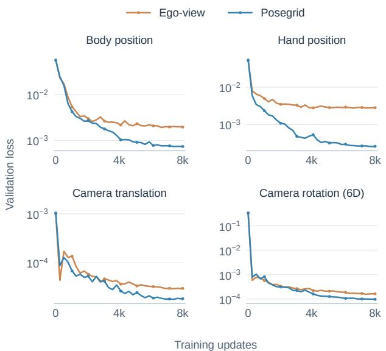  
Figure S1. Decoder learning curves. Multiview Posegrid enables faster loss reduction, particularly for body and hand positions, and reaches lower final validation losses across all supervised components, making it better suited for metric action readout.

For control, we compare three action renderings: multiview Posegrid, ego-view rendering without the 3D anchor cage, and our full ego-view rendering with the cage (Tab. 6, “Action rendering” and “Full model”). Unlike the inference-time removal of the 3D anchor cage in Tab. 1, the no-anchor variant here is trained and evaluated without the 3D anchor cage. All variants in Tab. 6 use 2,048 training episodes and 1,200 updates at a global batch size of 8, and are evaluated using the same video-generation metrics. Ego-view rendering with the 3D anchor cage performs best on most metrics, followed by its no-anchor variant, whereas multiview Posegrid is less effective for video control. The no-anchor variant obtains higher hand IoU and a lower fail ure rate on Xperience-10M, but the lack of explicit camera control leads to worse visual metrics than the full method.

## C.2. Cross-Stream Action–Video Coupling

Using the video-generation training and evaluation settings in Sec. C.1, we further evaluate the advantages of crossstream action–video coupling design. We compare crossstream coupling with two alternative conditioning strategies: latent channel concatenation, which concatenates action and video latents along the channel dimension, and action embedding, which injects encoded numerical motion through separate cross-attention. All variants train the active LoRA adapters, together with any added conditioning modules. Our full configuration outperforms both alternative coupling strategies across all reported metrics on both datasets (Tab. 6), learning more effective action control and video generation within the same short training budget. Despite using only 0.65% of the full training episodes and limited updates, our method approaches the full-training results on several metrics (Tab. 1), suggesting the potential for data-efficient adaptation through effective reuse of the pretrained video prior.

## D. Additional Qualitative Results

We recommend viewing the supplementary video for a more intuitive demonstration of EgoGeneralist’s capabilities across all five tasks.

## D.1. Action-Conditioned Ego Video Generation

Action-conditioned image-to-video generation. Figures S2 and S3 extend the comparisons and examples on EgoDex and Xperience-10M, showing generated videos alongside ground truth and ego-view action conditions.

Action-conditioned text-to-video generation. Figure S4 illustrates how different prompts vary the visual context of a prescribed action without an initial RGB image. Figure S5 compares our method with Wan2.2 Fun-Control and VACE-Fun using the same source actions and prompts.

"The user uses both hands to straighten and position red Chinese paper cuttings on the wall."

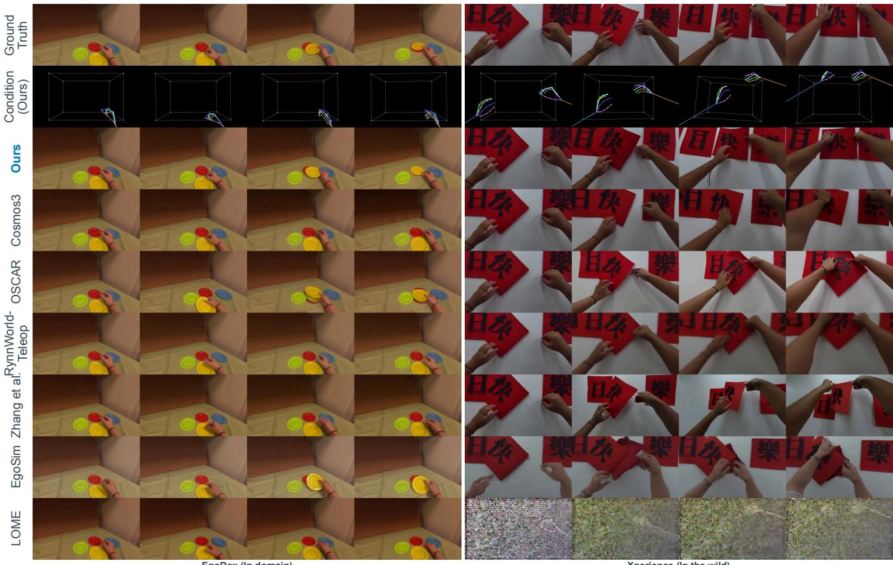  
Figure S2. Additional action-conditioned image-to-video generation comparisons on EgoDex and Xperience-10M. EgoGeneralist main tains effective action control and coherent object interactions. Columns show 0%, 30%, 60%, and 90% progress through each 41-frame clip.

## D.2. Egocentric 3D Pose Estimation

Figure S6 compares ground-truth and predicted hand and upper-limb poses projected onto the input videos from EgoDex and Xperience-10M.

## D.3. Joint Action–Video Generation

World-action policy. Figure S7 presents additional HOT3D examples, showing jointly generated video and action together with hand-trajectory comparisons against the policy baselines.

Text-only joint action–video generation. Figures S8 and S9 show synchronized video and motion generated from text alone across diverse scenes and interactions.

## D.4. Long-Sequence Generation

Figure S10 demonstrates action-conditioned generation beyond the 41-frame training window, maintaining physically coherent object interactions over the extended sequence.

## D.5. Generalization to Edited Appearances and Environments

We evaluate action control under changes in hand appearance and scene background (Fig. S11). With the first frame edited to show robotic hands or different indoor and outdoor settings, EgoGeneralist continues to generate videos consistent with the prescribed action.

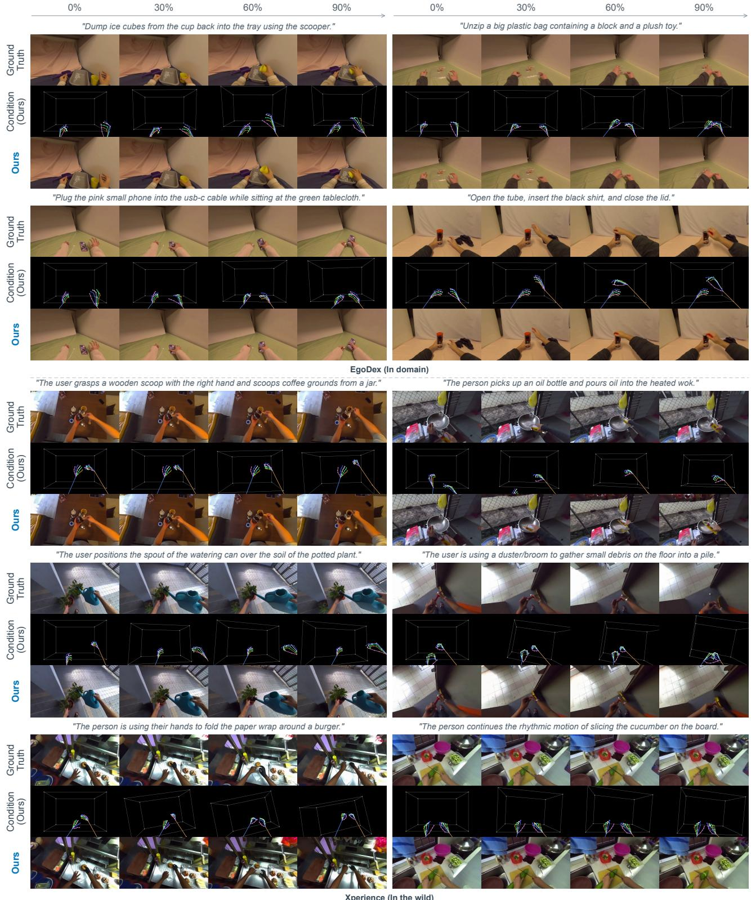  
Figure S3. Action-conditioned image-to-video generation across EgoDex and Xperience-10M. Adapted only on EgoDex, EgoGeneralist generates motion-consistent interactions across laboratory scenes and diverse in-the-wild environments. Each example shows reference frames, the ego-view action condition, and our generated video. Columns show 0%, 30%, 60%, and 90% progress through each 41-frame clip.

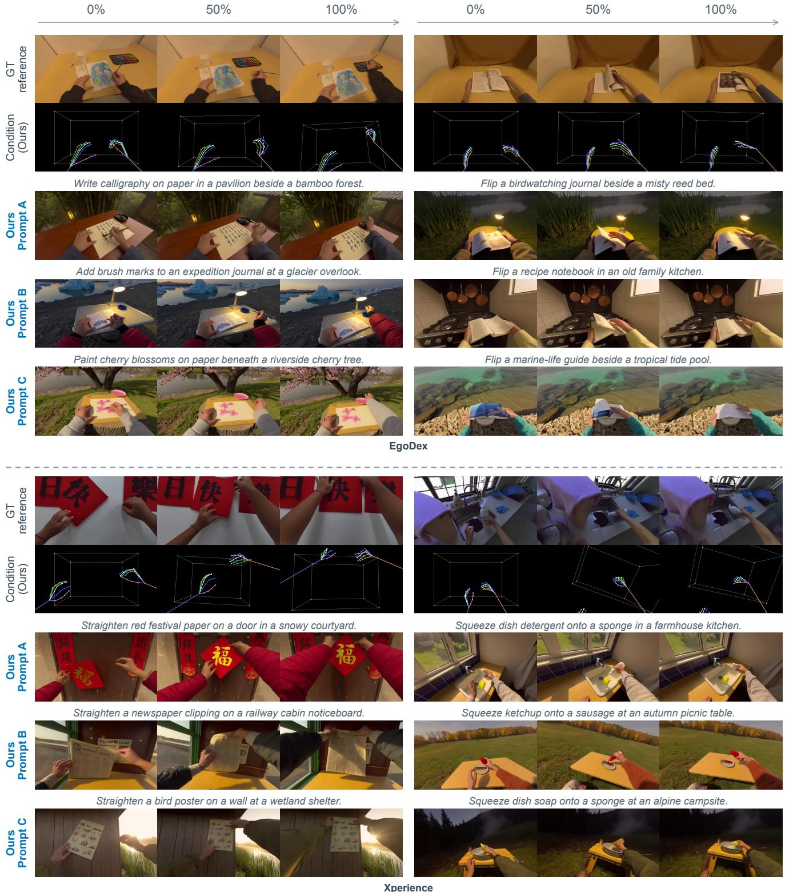  
Figure S4. Additional action-conditioned text-to-video generation. Action sequences from EgoDex (top) and Xperience-10M (bottom) are each paired with three text prompts. EgoGeneralist varies scenes and objects according to text while maintaining the prescribed motion. GT video is reference only.

"Type on a white keyboard in a botanical garden."  
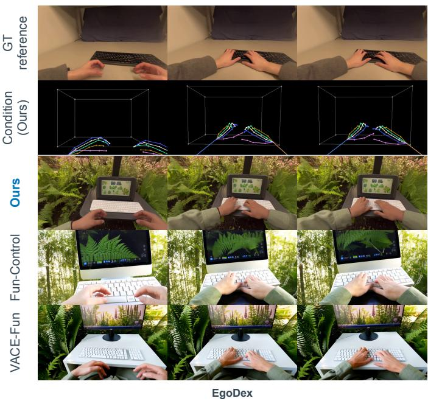

"Place garlic from a bowl onto a board in a farmhouse kitchen."  
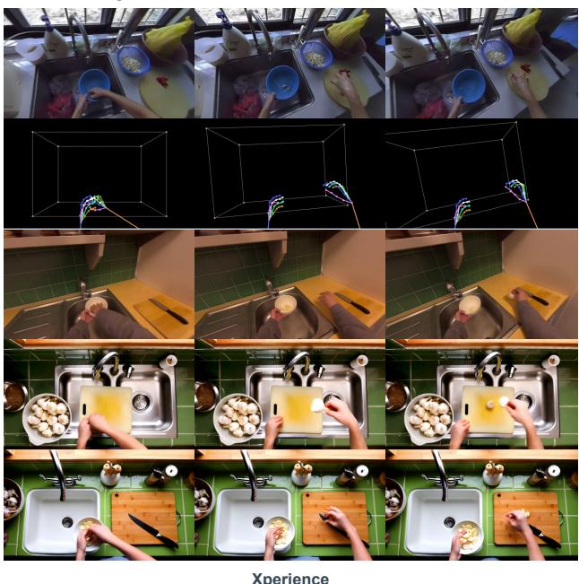  
Figure S5. Action-conditioned text-to-video generation on EgoDex (left) and Xperience-10M (right), compared with Wan2.2 Fun-Contro and VACE-Fun. Our 3D anchor enables explicit camera-motion control, allowing EgoGeneralist to reproduce prescribed viewpoint changes more faithfully than the baselines. Methods share source actions and prompts but use their native condition representations. The displayed ego-view condition is ours. Columns show frames 0, 20, and 40 of the shared 41-frame evaluation window.

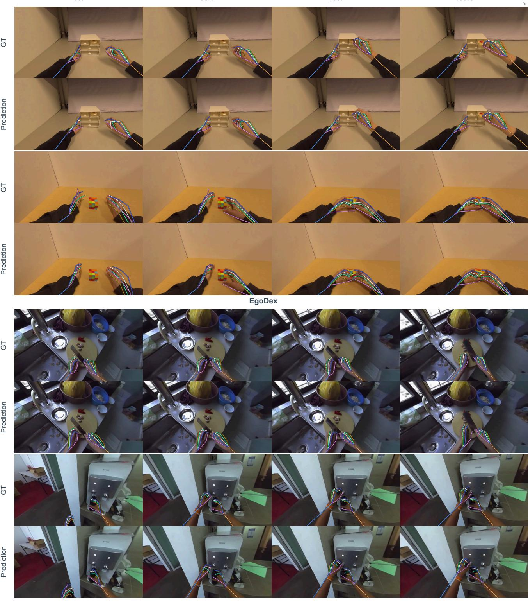  
XperienceFigure S6. Egocentric pose estimation. Ground-truth (GT) and predicted hand and arm poses are projected onto the same input frames on XperienceEgoDex (top two examples) and Xperience-10M (bottom two examples). EgoGeneralist’s projected hand and arm predictions align closely with the visible hands and ground-truth overlays. Columns indicate relative progress through each displayed window.

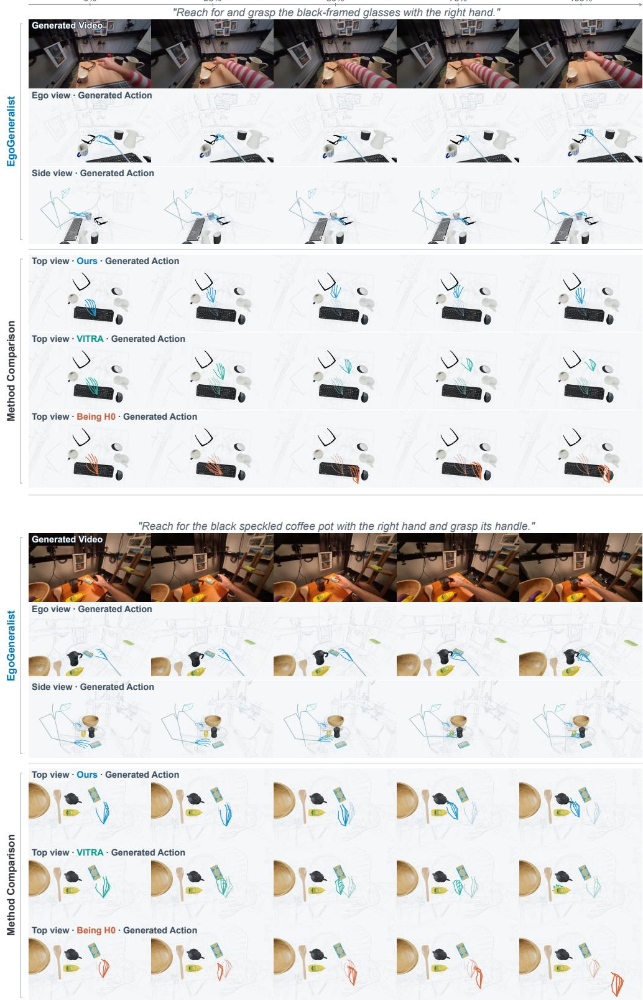  
Figure S7. Additional HOT3D examples of joint action–video generation and hand-action comparisons. EgoGeneralist generates smooth hand trajectories that accurately approach the specified objects, whereas the baseline trajectories miss the targets in these examples Columns show normalized prediction progress, with visualization conventions following Fig. 5.

“On a snowy hillside, both hands in red mittens pack snow into a snowball, with pine trees beyond.”  
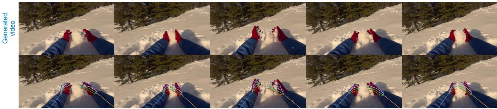  
“At a dim cocktail bar, the left hand steadies a glass as the right pours amber liquid from a metal jigger.”

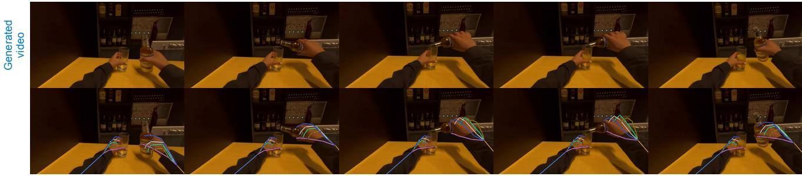  
“In a cabin by a fireplace, the left hand holds a mug as the right pours hot cocoa from a small pan.”

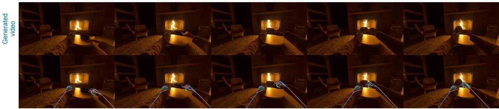  
“At a picnic table beside a sunflower field, both hands pull a warm loaf apart above a board, beside a red thermos.”

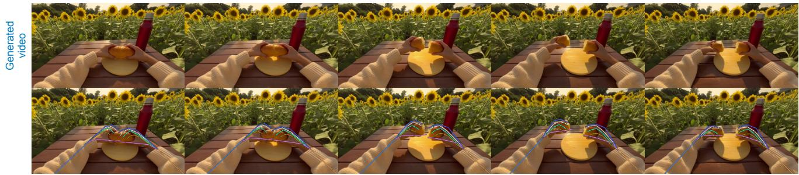  
Figure S8. Additional text-only joint action–video generation. Across diverse scenes, generated actions remain well aligned with the overall hand-motion trends in the generated videos. Each example pairs generated video with decoded action overlays at frames 0, 10, 20, 30, and 40.

“By a window on a grey afternoon, both hands knit cream yarn with two needles, beside a basket of yarn.”  
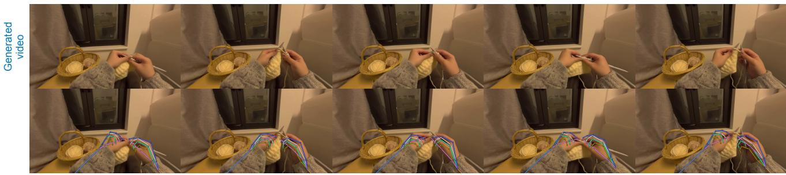

“On a snowy lakeshore, both gloved hands place a log on a campfire and withdraw as flames rise.”  
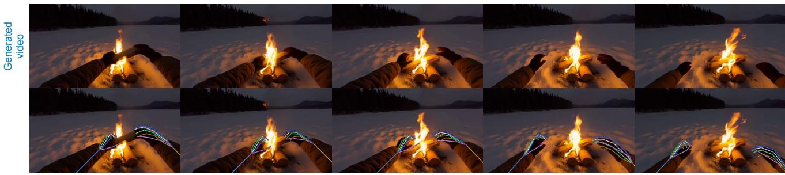  
“In an alien canyon beneath two moons, the left hand activates a blue lightsaber and sweeps it sideways.”

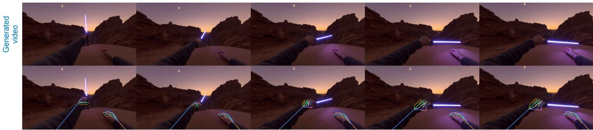  
“On a rock terrace above a calm dawn sea, both hands roll a purple mat into a cylinder, keeping its edges aligned.”

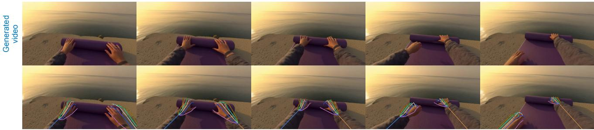  
Figure S9. Further examples of text-only joint action–video generation.

Long-sequence generation  
4 autoregressive chunks  
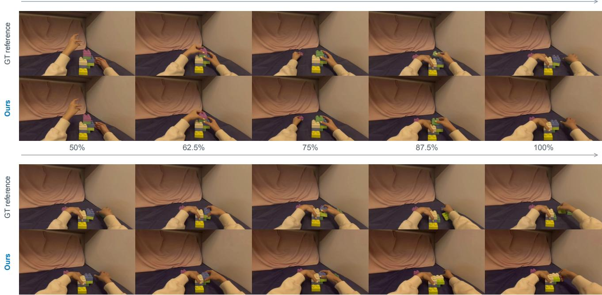  
Figure S10. Long-sequence generation. EgoGeneralist maintains physically coherent interactions over multiple autoregressive chunks. Four chunks are generated by conditioning each continuation on the preceding generated final frame. Alternating rows compare ground truth and generated video over the first and second halves of the sequence.

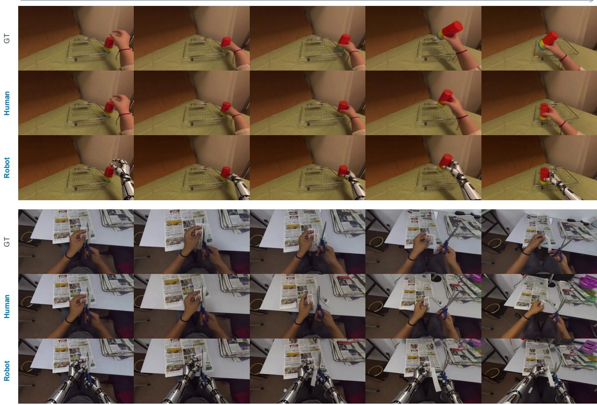

(b) Background generalization0%  
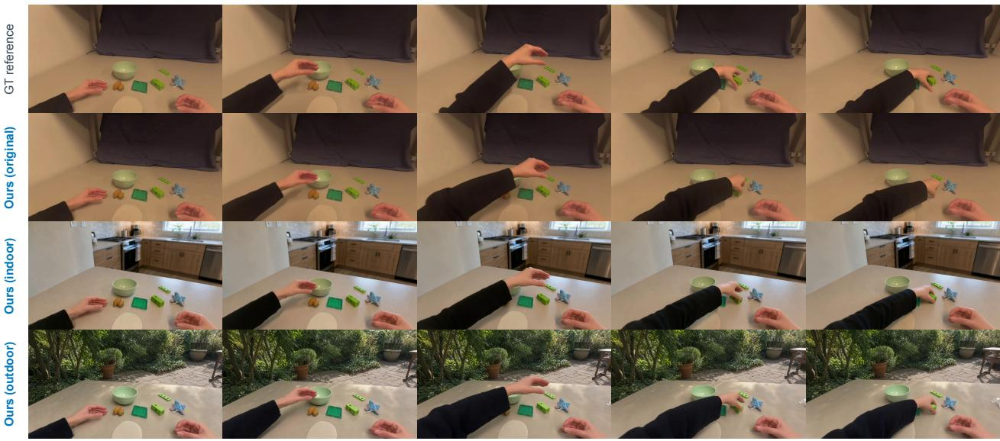  
Figure S11. Appearance and background variation. EgoGeneralist generalizes to changes in appearance and environment, opening up further applications of action-conditioned video generation. (a) Two human-to-robot appearance-transfer examples. (b) Ground truth and generated videos in the original scene and edited indoor and outdoor settings.