# FLUX AS A CODEC: ZERO-SHOT LOSSY COMPRESSION WITH FLUX

Fuma Kimishima   
Hosei University, Tokyo, Japan   
fuma.kimishima.3c@stu.hosei.ac.jp

Jinjia Zhou Hosei University, Tokyo, Japan zhou@hosei.ac.jp

## ABSTRACT

We propose FluxC, a zero-shot codec that uses Flux as a compression prior. Al though DiffC has shown that pretrained diffusion models can serve as zero-shot codecs, we ask how the choice of coding path and reconstruction method affects rate–distortion–perception behavior. We analyze FluxC along three axes: coding cost and bit allocation, reconstruction method, and low rate distortion. At matched signal-to-noise ratio (SNR), we show that the path choice does not affect the ideal information rate, but changes how bits are allocated across time steps. For reconstruction, we compare ancestral sampling, one-step ODE reconstruction, and many-step ODE reconstruction. Our analysis shows that ODE-based reconstruction can achieve lower distortion than ancestral sampling, especially in the low rate regime. Experiments on Gaussian sources and natural images support this prediction. Moreover, FluxC performs competitively with, and in some cases outperforms, recent neural image compression methods, suggesting that Flux can serve as a principled zero-shot codec.

## 1 INTRODUCTION

Probabilistic modeling and lossless compression are two views of the same likelihood-optimization problem. If a sender and receiver share a distribution p, then arithmetic coding can encode an input x using approximately − log p(x) bits. Learning p by maximum likelihood therefore reduces the expected ideal codelength assigned by the model. This principle underlies flow models compressed with local bits-back coding (Ho et al., 2019), and language models used as arithmetic-coding predictors (Deletang et al., 2024; Haddadi & Teahan, 2026).

Lossy compression keeps this probabilistic-coding viewpoint but changes the object being encoded. The sender need not describe x itself; it instead communicates a lower-rate random variable from which the receiver reconstructs an approximation of x. DiffC (Theis et al., 2022; Liu et al., 2025) makes this connection concrete for diffusion models (Sohl-Dickstein et al., 2015; Ho et al., 2020). It uses reverse channel coding (RCC) (Li & El Gamal, 2018; Theis & Ahmed, 2022; Flamich et al., 2022) to communicate samples from the sender-side Gaussian kernels along the variance preserving (VP) path, with a coding cost characterized by the negative evidence lower bound (NELBO) (Theis et al., 2022). Thus, the diffusion models can be viewed not only as a generative prior, but also as specifying a lossy codec. Because lossy compression discards information about the source, reconstruction quality must be assessed beyond codelength alone. Standard criteria include distortion, which measures pointwise fidelity such as mean squared error (MSE), and perception, or realism, which measures the distance between the data distribution and the reconstructed one. It is known that these quantities are linked by the rate–distortion–perception trade-off (Blau & Michaeli, 2018; 2019).

Modern image generation has increasingly moved toward Flow Matching (Lipman et al., 2023) and Rectified Flow (Liu et al., 2023), which learn a velocity field that transports between distributions along an optimal transport (OT) path. Flux is a prominent model in this family (Black Forest Labs, 2024), but its existing use in DiffC reparameterizes the Flux velocity field as a DDPM style prediction and performs coding on a normalized VP path (Liu et al., 2025), instead of the OT path (Liu et al., 2025) (dubbed as DiffC Flux in this paper). Although the DiffC family has been shown to achieve strong distortion performance, it remains unclear whether Flux can define a codec directly on its native OT path. This motivates studying whether Flux can instead define a zero-shot codec directly on its native OT path, and how this choice affects its rate–distortion–perception behavior.

We propose FluxC, a zero-shot codec that defines its Markov transitions directly on the Flux OT path, communicates noisy variables through RCC, and reconstructs from the communicated variables using ODE-based decoders. To characterize its coding performance, we analyze this codec from three perspectives. First, we study coding cost and bit allocation. VP and OT paths have the same ideal information rate at matched signal-to-noise ratio (SNR), but allocate bits differently across coding steps. Second, we compare reconstruction methods, including one-step and many-step ODE reconstruction, and relate them to the DiffC Flux ancestral sampling baseline. Third, we analyze the low rate regime and show that, under the assumptions of our analysis, deterministic ODE reconstruction admits an order $\sqrt { R }$ distortion improvement, whereas ancestral sampling improves at order R, where R denotes the rate in bits. Empirically, FluxC is competitive with existing generative compression baselines and achieves strong distortion performance in the ultra low rate regime.

## 2 PRELIMINARIES

Unless otherwise stated, uppercase bold symbols such as X and $\mathbf { Z } _ { t }$ denote random variables, while lowercase bold symbols such as x and z denote their realizations. All information quantities and coding costs are measured in bits. Therefore, logarithms in mutual information and KL divergences are base 2. We defer a detailed discussion of related work to Appendix A.

## 2.1 DDPMS

Denoising diffusion probabilistic models (DDPMs) define a Markov forward process that gradually corrupts data into Gaussian noise (Sohl-Dickstein et al., 2015; Ho et al., 2020). We use latent variables $\mathbf { z } _ { t }$ for $t = 0 , \ldots , T$ , where ${ \bf z } _ { 0 } = { \bf x } _ { 0 }$ is a sample from the data distribution and $\mathbf { z } _ { T }$ is approximately standard Gaussian. For a variance-preserving (VP) path, let $\beta _ { t } \in ( 0 , 1 )$ be the variance increment, define $a _ { t } = 1 - \beta _ { t }$ and $\begin{array} { r } { \bar { a } _ { t } = \prod _ { s = 1 } ^ { t } a _ { s } , } \end{array}$ , and set $\alpha _ { t } ^ { \mathrm { V P } } = \sqrt { \bar { a } _ { t } }$ and $\sigma _ { t } ^ { \mathrm { V P } } = \sqrt { 1 - \bar { a } _ { t } }$ . The forward marginal is $q ^ { \mathrm { V P } } ( \mathbf { z } _ { t } \mid \mathbf { x } _ { 0 } ) = \bar { \mathcal { N } } \bar { ( } \alpha _ { t } ^ { \mathrm { V P } } \mathbf { x } _ { 0 } , ( \sigma _ { t } ^ { \mathrm { V P } } ) ^ { 2 } I \big )$ , or equivalently ${ \bf z } _ { t } = \alpha _ { t } ^ { \mathrm { V P } } { \bf x } _ { 0 } + \sigma _ { t } ^ { \mathrm { V P } } \epsilon$ where $\mathbf { \epsilon } \gets \mathcal { N } ( \mathbf { 0 } , I )$ and $( \alpha _ { t } ^ { \mathrm { V P } } ) ^ { 2 } + ( \sigma _ { t } ^ { \mathrm { V P } } ) ^ { 2 } = 1$ . Consequently, the marginal variance scale of $\mathbf { z } _ { t }$ remains approximately constant as the signal coefficient decreases and the noise coefficient increases.

For the path-level comparisons below, we also use the continuous time VP-SDE parameterization. Let $\begin{array} { r } { B ( t ) = \int _ { 0 } ^ { t } \beta ( s ) d s } \end{array}$ . Then $( \alpha _ { t } ^ { \mathrm { V P } } ) ^ { 2 } = e ^ { - B ( t ) } , ( \sigma _ { t } ^ { \mathrm { V P } } ) ^ { 2 } = 1 - e ^ { - B ( t ) }$ , and the corresponding SNR is

$$
\gamma _ { t } ^ { \mathrm { V P } } = \frac { ( \alpha _ { t } ^ { \mathrm { V P } } ) ^ { 2 } } { ( \sigma _ { t } ^ { \mathrm { V P } } ) ^ { 2 } } = \frac { e ^ { - B ( t ) } } { 1 - e ^ { - B ( t ) } } .\tag{1}
$$

DDPMs generate samples by learning Gaussian reverse kernels that map z back to $\mathbf { z } _ { 0 }$ through the sequence ${ \bf z } _ { T - 1 } , \ldots , { \bf z } _ { 0 }$ . Since the marginal reverse conditional $q ^ { \mathrm { V P } } ( \mathbf { z } _ { t } ^ { \mathrm { ~ \bar { ~ } { ~ } { ~ } { ~ } } } | \textbf { z } _ { t + 1 } )$ is generally intractable, DDPMs learn a Gaussian kernel $p _ { \theta } ^ { \mathrm { V P } } ( \mathbf { z } _ { t } \mid \mathbf { z } _ { t + 1 } )$ using the tractable forward posterior $q ^ { \mathrm { V P } } ( \mathbf { z } _ { t } \mid \mathbf { z } _ { t + 1 } , \mathbf { x } _ { 0 } )$ . With $\alpha _ { t + 1 | t } ^ { \mathrm { V P } } = \alpha _ { t + 1 } ^ { \mathrm { V P } } / \alpha _ { t } ^ { \mathrm { V P } }$ and $( \bar { \sigma } _ { t + 1 | t } ^ { \mathrm { V P } } ) ^ { 2 } = ( \bar { \sigma } _ { t + 1 } ^ { \mathrm { V P } } ) ^ { 2 } - ( \alpha _ { t + 1 | t } ^ { \mathrm { V P } } ) ^ { 2 } ( \sigma _ { t } ^ { \mathrm { V P } } ) ^ { 2 }$ , these kernels are

$$
\begin{array} { r l } & { q ^ { \mathrm { V P } } ( \mathbf { z } _ { t } \mid \mathbf { z } _ { t + 1 } , \mathbf { x } _ { 0 } ) = \mathcal { N } \big ( \mu _ { q } ( \mathbf { z } _ { t + 1 } , \mathbf { x } _ { 0 } , \boldsymbol { \alpha } _ { t } ^ { \mathrm { V P } } , \boldsymbol { \sigma } _ { t } ^ { \mathrm { V P } } ; t ) , \Sigma _ { t } \big ) , } \\ & { \quad p _ { \theta } ^ { \mathrm { V P } } ( \mathbf { z } _ { t } \mid \mathbf { z } _ { t + 1 } ) = \mathcal { N } ( \mu _ { \theta } ( \mathbf { z } _ { t + 1 } , t ) , \Sigma _ { t } ) . } \end{array}\tag{2}
$$

where $\begin{array} { r } { \mu _ { \theta } ( \mathbf { z } _ { t + 1 } , t ) = \mu _ { q } ( \mathbf { z } _ { t + 1 } , \hat { \mathbf { x } } _ { \theta } ^ { \mathrm { V P } } ( \mathbf { z } _ { t + 1 } , \alpha _ { t + 1 } ^ { \mathrm { V P } } , \sigma _ { t + 1 } ^ { \mathrm { V P } } , t + 1 ) , \alpha _ { t } ^ { \mathrm { V P } } , \sigma _ { t } ^ { \mathrm { V P } } ; t ) } \end{array}$ . Under the fixed-variance parameterization of (Ho et al., 2020), the reverse variance is set to the forward posterior variance $\Sigma _ { t }$ (Ho et al., 2020). Thus learning the reverse kernel amounts to learning its mean. Because the forward process is linear Gaussian, the forward posterior mean admits the closed form

$$
\pmb { \mu } _ { q } ( \mathbf { z } _ { t + 1 } , \mathbf { x } _ { 0 } , \alpha _ { t } , \sigma _ { t } ; t ) = \frac { \alpha _ { t } { \sigma _ { t + 1 } } _ { | t } { } ^ { 2 } } { \sigma _ { t + 1 } { } ^ { 2 } } \mathbf { x } _ { 0 } + \frac { \alpha _ { t + 1 } { | t ^ { \sigma _ { t } } } ^ { 2 } } { { \sigma _ { t + 1 } } ^ { 2 } } \mathbf { z } _ { t + 1 } .\tag{3}
$$

The unavailable clean sample $\mathbf { x } _ { \mathrm { 0 } }$ is replaced by the denoised estimate $\hat { \mathbf { x } } _ { \theta }$ constructed from the predicted noise ϵˆ :

$$
\hat { \mathbf { x } } _ { \theta } ( \mathbf { z } _ { t + 1 } , \alpha _ { t + 1 } , \sigma _ { t + 1 } , t + 1 ) = \frac { \mathbf { z } _ { t + 1 } - \sigma _ { t + 1 } \hat { \epsilon } _ { \theta } ( \mathbf { z } _ { t + 1 } , t + 1 ) } { \alpha _ { t + 1 } } .\tag{4}
$$

Thus the KL-divergence between $p _ { \theta } ^ { \mathrm { V P } } ( \mathbf { z } _ { t } \mid \mathbf { z } _ { t + 1 } )$ and $q ^ { \mathrm { V P } } ( \mathbf { z } _ { t } \mid \mathbf { z } _ { t + 1 } , \mathbf { x } _ { 0 } )$ depends on the model only through this mean (Ho et al., 2020):

$$
\begin{array} { l } { { \displaystyle { \cal D } _ { \mathrm { K L } } \big ( q ^ { \mathrm { V P } } ( { \bf z } _ { t } \mid { \bf z } _ { t + 1 } , { \bf x } _ { 0 } ) \big \| p _ { \theta } ^ { \mathrm { V P } } ( { \bf z } _ { t } \mid { \bf z } _ { t + 1 } ) \big ) } \ ~ } \\ { { \displaystyle ~ = \frac { 1 } { 2 } \Big \| \mu _ { q } ( { \bf z } _ { t + 1 } , { \bf x } _ { 0 } , \alpha _ { t } ^ { \mathrm { V P } } , \sigma _ { t } ^ { \mathrm { V P } } ; t ) - \mu _ { \theta } ( { \bf z } _ { t + 1 } , \alpha _ { t } ^ { \mathrm { V P } } , \sigma _ { t } ^ { \mathrm { V P } } ; t ) \Big \| _ { { \Sigma } _ { t } ^ { - 1 } } ^ { 2 } + \mathrm { c o n s t . } } } \end{array}\tag{5}
$$

The variational training objective for DDPMs is obtained by summing these reverse-transition KL terms, together with the endpoint Gaussian terms, over the noising chain:

$$
\begin{array} { r l } & { \mathcal { L } _ { \mathrm { N E L B O } } = D _ { \mathrm { K L } } \big ( q ^ { \mathrm { V P } } ( \mathbf { z } _ { T } \mid \mathbf { x } _ { 0 } ) \parallel p ^ { \mathrm { V P } } ( \mathbf { z } _ { T } ) \big ) } \\ & { \qquad + \displaystyle \sum _ { t = 0 } ^ { T - 1 } D _ { \mathrm { K L } } \big ( q ^ { \mathrm { V P } } ( \mathbf { z } _ { t } \mid \mathbf { z } _ { t + 1 } , \mathbf { x } _ { 0 } ) \parallel p _ { \theta } ^ { \mathrm { V P } } ( \mathbf { z } _ { t } \mid \mathbf { z } _ { t + 1 } ) \big ) - \log p _ { \theta } ^ { \mathrm { V P } } ( \mathbf { x } _ { 0 } \mid \mathbf { z } _ { 1 } ) . } \end{array}\tag{6}
$$

Sampling can then be performed either by ancestral sampling from $p _ { \theta } ^ { \mathrm { V P } } ( \mathbf { z } _ { t } \mid \mathbf { z } _ { t + 1 } )$ or by the corresponding probability-flow ODE (Song et al., 2021).

## 2.2 DIFFC

DiffC (Theis et al., 2022; Liu et al., 2025) interprets the variational optimization of diffusion as a coding scheme. Its communication primitive is reverse channel coding (RCC) (Li & El Gamal, 2018; Theis & Ahmed, 2022; Flamich et al., 2022). If the sender samples $\mathbf { z } _ { t } \sim q ^ { \mathrm { V P } } ( \mathbf { z } _ { t } \mid \mathbf { z } _ { t + 1 } , \mathbf { x } _ { 0 } )$ and the receiver shares a proposal $p _ { \theta } ^ { \mathrm { V P } } ( \mathbf { z } _ { t } \mid \mathbf { z } _ { t + 1 } )$ , zt can be communicated at the cost approximately $D _ { \mathrm { K L } } ( q ^ { \mathrm { V P } } ( \mathbf { z } _ { t } \mid \mathbf { z } _ { t + 1 } , \mathbf { x } _ { 0 } ) \Vert p _ { \theta } ^ { \mathrm { V P } } ( \mathbf { z } _ { t } \mid \mathbf { z } _ { t + 1 } ) )$ (Theis & Ahmed, 2022). If the sender and receiver share the Gaussian randomness, apply RCC to the intermediate samples over the $T - 1$ reverse steps, and entropy-coding the final data sample with $p _ { \theta } ^ { \mathrm { V P } } ( \mathbf { x } _ { 0 } \mid \mathbf { z } _ { 0 } )$ , then the resulting total lossless coding cost coincides with the negative ELBO in Eq. 6 (Theis et al., 2022). Thus, training the diffusion model by maximizing ELBO is equivalent to minimizing the total coding cost induced by DiffC. For lossy compression, DiffC reconstructs from the intermediate sample $\mathbf { x } _ { t }$ by ancestral sampling (DiffC-A) or probability-flow ODE (DiffC-F).

## 2.3 RECTIFIED FLOW

Rectified Flow learns a velocity field that transports samples between two distributions (Lipman et al., 2023; Liu et al., 2023). We use the OT path parameterization with data at $t = 0$ and Gaussian noise $\epsilon \sim \mathcal { N } ( \mathbf { 0 } , I )$ at $t = 1$ . Let $\mathbf { X } \in \mathbb { R } ^ { d }$ denote a data sample. Then the corresponding random path is $\mathbf { Z } _ { t } ^ { \mathrm { { O T } } } = ( 1 - t ) \mathbf { X } + t \epsilon$ . Its target velocity, which is constant along the linear OT path, is $\begin{array} { r } { \dot { \bf Z } _ { t } ^ { \mathrm { O T } } : = \dot { \frac { \mathrm { d } } { \mathrm { d } t } } { \bf Z } _ { t } ^ { \mathrm { O T } } = \epsilon - { \bf X } . } \end{array}$ . A Rectified Flow model learns a velocity field ${ \bf v } _ { \theta } ( { \bf Z } _ { t } , t )$ by minimizing $\mathbb { E } \left\lceil \left\| \mathbf { v } _ { \theta } ( \mathbf { Z } _ { t } , t ) - \dot { \mathbf { Z } } _ { t } \right\| _ { 2 } ^ { 2 } \right\rceil$ . Although this parameterization differs from DDPM noise prediction in Eq. 4, the velocity can be converted into denoising and noise predictions Lai et al. (2025) as

$$
\hat { \mathbf { x } } _ { \theta } ^ { \mathrm { O T } } ( \mathbf { z } , t ) = \mathbf { z } - t \mathbf { v } _ { \theta } ( \mathbf { z } , t ) .\tag{7}
$$

$$
\hat { \epsilon } _ { \theta } ^ { \mathrm { O T } } ( { \bf z } , t ) = { \bf z } + ( 1 - t ) { \bf v } _ { \theta } ( { \bf z } , t ) .\tag{8}
$$

This reparameterization is the bridge between Rectified Flow velocity models and the denoising quantities used below.

Algorithm 1 FluxC Sender Algorithm 2 FluxC Receiver   
1: Send ${ \bf z } _ { T } \sim q _ { T } ^ { \mathrm { O T } } ( \cdot \mid { \bf x } _ { 0 } )$ using $p _ { \theta } ( \mathbf { z } _ { T } )$ // shared 1: Receive zT using $p _ { \theta } ( \mathbf { z } _ { T } )$ // shared seed   
seed 2: for $t = T - 1 , \bar { T } - \dot { 2 } , \dots , 1$ do   
2: for $t = T - 1 , T - 2 , \dots , 1$ do 3: Receive zt using $p _ { \theta } ^ { \mathrm { O T } } \bigl ( \mathbf { z } _ { t } \mid \mathbf { z } _ { t + 1 } \bigr )$   
3: Send ${ \bf z } _ { t } \sim \boldsymbol { q } ^ { \mathrm { O T } } ( { \bf z } _ { t } \mid { \bf z } _ { t + 1 } , { \bf x } _ { 0 } )$ using $p _ { \theta } ^ { \mathrm { { O T } } } ( \mathbf { z } _ { t }$ | 4: $\hat { \mathbf { x } } = \Psi ^ { 1 } ( \mathbf { z } _ { t } , t )$ // one-step lossy decode   
$\mathbf { z } _ { t + 1 } )$ ${ \boldsymbol { \mathsf { S } } } \colon \quad { \hat { \mathbf { x } } } = \Psi ^ { \mathrm { O D E } } ( \mathbf { z } _ { t } , t )$ // many-step lossy decode   
4: end for 6: end for   
5: Send ${ \mathbf z } _ { 0 } \sim q ^ { \mathrm { O T } } ( { \mathbf z } _ { 0 } \mid { \mathbf z } _ { 1 } , { \mathbf x } _ { 0 } )$ using $p _ { \theta } ^ { \mathrm { O T } } ( \mathbf { z } _ { 0 } \mid \mathbf { z } _ { 1 } )$ 7: Receive $\mathbf { x } _ { \mathrm { 0 } }$ with $p _ { \theta } ^ { \mathrm { O T } } ( \mathbf { x } _ { 0 } \mid \mathbf { z } _ { 1 } )$ // lossless decode

## 3 FLUXC: FLUX AS A CODEC AND ITS ANALYSIS

## 3.1 FLUXC

FluxC is a zero-shot codec that performs coding along the OT path of Flux. As in DiffC (Theis et al., 2022), the sender and receiver share the Gaussian random seed and use RCC to communicate intermediate noisy variables. However, using a Flux backbone does not uniquely determine the Markov reverse transition $q ( \cdot \mid \mathbf { z } _ { t + 1 } , \mathbf { x } _ { 0 } )$ or require the VP diffusion path. DiffC Flux (Liu et al., 2025) reparametrizes the Flux OT path into the VP path, and the Flux velocity is converted into a denoising prediction through Eq. 7. In contrast, FluxC keeps the Markov process on the OT path as

$$
\begin{array} { r } { { q } ^ { \mathrm { O T } } ( \mathbf { z } _ { t } \mid \mathbf { z } _ { t + 1 } , \mathbf { x } _ { 0 } ) = \mathcal { N } \big ( \mu _ { q } ( \mathbf { z } _ { t + 1 } , \mathbf { x } _ { 0 } , \boldsymbol { \alpha } _ { t } ^ { \mathrm { O T } } , \boldsymbol { \sigma } _ { t } ^ { \mathrm { O T } } ; t ) , \Sigma _ { t } \big ) . } \end{array}\tag{9}
$$

Note that the scheduling parameters used to compute $\mu _ { q }$ are $\alpha _ { t } ^ { \mathrm { O T } } = 1 - t$ and $\sigma _ { t } ^ { \mathrm { { O T } } } = t$ . The receiver approximates this transition by

$$
\begin{array} { r } { p _ { \theta } ^ { \mathrm { O T } } \bigl ( \mathbf { z } _ { t } \mid \mathbf { z } _ { t + 1 } \bigr ) = \mathcal { N } \bigl ( \mu _ { \theta } \bigl ( \mathbf { z } _ { t + 1 } , \hat { \mathbf { x } } _ { \theta } ^ { \mathrm { O T } } \bigl ( \mathbf { z } _ { t + 1 } , t + 1 \bigr ) ; t \bigr ) , \Sigma _ { t } \bigr ) . } \end{array}\tag{10}
$$

where $\mu _ { q }$ and $\Sigma _ { t }$ are the Gaussian posterior mean and covariance obtained by applying the DDPM posterior formulas in Eqs. 3 and 4 with the OT coefficients. Equation 10 uses the velocity–denoising reparameterization in Eq. 7.

At each coding step, RCC communicates the sender-side sample using the receiver-side distribution, giving the ideal step cost $D _ { \mathrm { K L } } \big ( q ^ { \mathrm { O T } } ( \mathbf { z } _ { t } \mid \mathbf { z } _ { t + 1 } , \mathbf { x } _ { 0 } ) \mid \mid p _ { \theta } ^ { \mathrm { O T } } ( \mathbf { z } _ { t } \mid \mathbf { \dot { z } } _ { t + 1 } ) \big )$  . Repeating this procedure over the $\check { T } - 1$ intermediate steps, together with the shared Gaussian seed and the final entropy coding term, yields the FluxC lossless coding cost, which coincides with the OT path NELBO. Algorithms 1 and 2 summarize the sender and receiver in detail

## 3.2 CODING COST AND BIT ALLOCATION

In this section, we ask whether the path selection affects the coding cost. We compare VP and OT through the scalar Gaussian observation

$$
{ \bf Z } _ { t } = \alpha _ { t } { \bf X } + \sigma _ { t } \epsilon , \qquad \gamma _ { t } = \frac { \alpha _ { t } ^ { 2 } } { \sigma _ { t } ^ { 2 } } , \qquad \epsilon \sim \mathcal { N } ( { \bf 0 } , I ) ,\tag{11}
$$

where $\gamma _ { t }$ is the SNR at t. Here αt and $\sigma _ { t }$ denote the coefficients of the path being compared. VP uses the DDPM coefficients $( \alpha _ { t } ^ { \mathrm { V P } } , \sigma _ { t } ^ { \mathrm { V P } } )$ , whereas OT uses $\big ( \alpha _ { t } ^ { \mathrm { O T } } , \sigma _ { t } ^ { \mathrm { O T } } \big ) ^ { \bullet } = ( 1 - \check { t , } t )$ . For lossless coding, both FluxC and DiffC yield coding costs that coincide with their NELBO objectives. For lossy compression, however, the rate depends on where the coding process is stopped. Since the VP and OT paths map the same time t to different noise levels, we compare their lossy coding costs at matched SNR, where their Gaussian observation channels are equivalent, and ask which components of the cost remain path dependent.

Observation 1 (Lossy coding cost decomposition). Let $\mathbf { X } \sim P _ { X }$ be an $\mathbb { R } ^ { d }$ valued source random variable satisfying $\mathbb { E } \bar { \| } \mathbf { X } \| _ { 2 } ^ { 2 } < \infty , \gamma \geq 0$ be the SNR, and $\epsilon \sim \mathcal { N } ( \mathbf { 0 } , \mathbf { I } _ { d } )$ be independent Gaussian noise. We define the Gaussian observation at SNR γ as $\mathbf { Y } _ { \gamma } = \sqrt { \gamma } \mathbf { X } + \epsilon ,$ and its posterior mean estimator as $\hat { \mathbf { X } } _ { \mathrm { M M S E } } ( \mathbf { Y } _ { \gamma } , \gamma ) : = \mathbb { E } [ \mathbf { X } \mid \mathbf { Y } _ { \gamma } ]$ . Let $\mathcal { C } _ { \theta } ( t )$ denote the lossy coding cost stopping at t, whose SNR $i s \gamma _ { t } .$ . In the continuous SNR limit, this cost decomposes as

$$
\mathcal { C } _ { \theta } ( t ) = I ( \mathbf { X } ; \mathbf { Y } _ { \gamma _ { t } } ) + \frac { 1 } { 2 \ln 2 } \int _ { 0 } ^ { \gamma _ { t } } \mathbb { E } \bigg [ \Big \| \hat { \mathbf { X } } _ { \theta } ( \mathbf { Y } _ { \gamma } , \gamma ) - \hat { \mathbf { X } } _ { \mathrm { M M S E } } ( \mathbf { Y } _ { \gamma } , \gamma ) \Big \| _ { 2 } ^ { 2 } \bigg ] \mathrm { d } \gamma .\tag{12}
$$

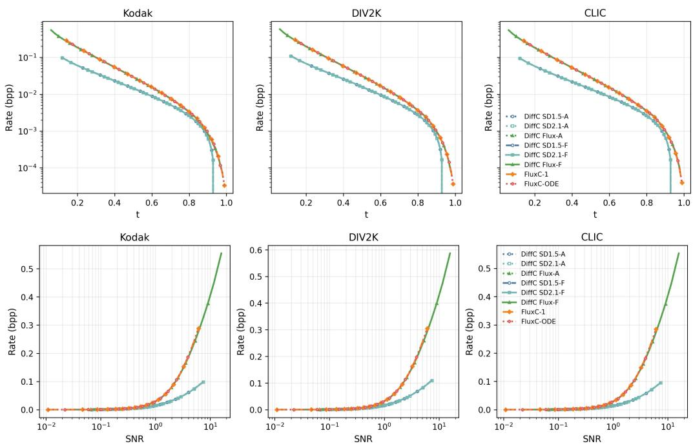  
Figure 1: (Top) Rate as a function of the path time t on three datasets. (Bottom) Rate as a function of SNR on a logarithmic scale.

See Appendix B.1 for details. The first term is the mutual information required to communicate the observation at $\operatorname { S N R } \gamma _ { t }$ and therefore depends only on the matched SNR. The second term is the excess coding cost induced by denoiser mismatch. Thus, at matched SNR, differences in coding cost reflect how accurately the respective backbones approximate the posterior mean along the encoding path.

The model mismatch in Eq. 12 is characterized as a function of SNR. We now specialize this term to time. Changing variables from the continuous SNR coordinate γ to the path time t yields the following corollary.

Corollary 1 (FluxC coding cost as weighted velocity error). For the OTpath, let $t \in [ 0 , 1 ]$ denote the path time. The noisy state at time t is $\mathbf Z _ { t } = ( 1 - t ) \mathbf X + t { \boldsymbol { \epsilon } } $ , and the target velocity is $\dot { \mathbf { Z } } _ { t } = \mathbf { \epsilon } \mathbf { \epsilon } - \mathbf { X }$ The coding cost stopping at time t is

$$
\mathcal { C } _ { \theta } ( t ) = \frac { 1 } { \ln 2 } \int _ { t } ^ { 1 } \frac { 1 - s } { s } \mathbb { E } \bigg [ \Big \| \mathbf { v } _ { \theta } ( \mathbf { Z } _ { s } , s ) - \dot { \mathbf { Z } } _ { s } \Big \| _ { 2 } ^ { 2 } \bigg ] \mathrm { d } s .\tag{13}
$$

See Appendix B.2 for details. This corollary show that FluxC coding cost can be interpreted as evaluating the velocity regression error of Flux under the coding induced weight $1 - s / ( s \ln 2 )$

Although VP and OT have the same ideal coding cost (i.e. zero model mismatch) at matched SNR, they parameterize SNR differently over path time. We next examine how the information cost is distributed along each path.

Observation 2 (Bit allocation over path time). For a path with coefficients $\alpha _ { t }$ and $\sigma _ { t } ,$ define its SNR as $\begin{array} { r } { \gamma _ { t } = \frac { \alpha _ { t } ^ { 2 } } { \sigma _ { t } ^ { 2 } } } \end{array}$ . The information increment per unit path time satisfies

$$
\left| \frac { \mathrm { d } } { \mathrm { d } t } I ( { \bf X } ; { \bf Y } _ { \gamma _ { t } } ) \right| = \frac { 1 } { 2 \ln 2 } \mathrm { m m s e } ( \gamma _ { t } ) \left| \frac { \mathrm { d } \gamma _ { t } } { \mathrm { d } t } \right| .\tag{14}
$$

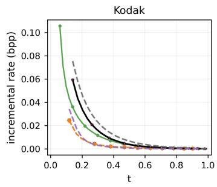

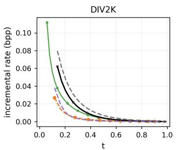

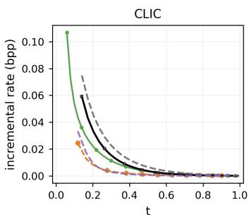  
Figure 2: Incremental rate as a function of t. The incremental rate denotes the additional coding cost assigned to each coding step, i.e., the increase in rate between adjacent time points.

where mmse $( \gamma ) = \mathbb { E } \bigg [ \bigg \| \mathbf { X } - \hat { \mathbf { X } } _ { \mathrm { M M S E } } \big ( \mathbf { Y } _ { \gamma } , \gamma \big ) \bigg \| _ { 2 } ^ { 2 } \bigg ]$ . For the continuous time VP path, let $B ( t ) =$ $\textstyle \int _ { 0 } ^ { t } { \beta ( s ) }$ ds. The derivatives ofthe VP and OT SNRs are, respectively,

$$
\left| \frac { \mathrm { d } \gamma _ { t } ^ { \mathrm { V P } } } { \mathrm { d } t } \right| = \frac { \beta ( t ) e ^ { - B ( t ) } } { \left( 1 - e ^ { - B ( t ) } \right) ^ { 2 } } ,\tag{15}
$$

$$
\left. \frac { \mathrm { d } \gamma _ { t } ^ { \mathrm { O T } } } { \mathrm { d } t } \right. = \frac { 2 ( 1 - t ) } { t ^ { 3 } } .\tag{16}
$$

See Appendix B.3 for derivation. Although the MMSE is fixed at a given SNR, the path dependent SNR derivative $| \mathrm { d } \gamma _ { t } / \mathrm { d } t |$ causes VP and OT to allocate information differently over path time.

## 3.3 RECONSTRUCTION AND RATE–DISTORTION-PERCEPTION TRADEOFFS

We next study how the reconstruction method changes distortion and perception. We consider three reconstruction methods. First, DiffC Flux Liu et al. (2025) which reparameterizes the Flux velocity field as a DDPM style denoising prediction using Eq. 7, computes the reverse mean as Eq. 3, and then samples by ancestral sampling in our settings. Second, FluxC-1 applies a one-step ODE in FluxC from the communicated time t to the data endpoint. Third, FluxC-ODE integrates the many-step ODE. Under exact population regression, the learned field equals the conditional mean of the target velocity, $\mathbf { v } _ { t } ( \mathbf { z } ) = \bar { \mathbb { E } } [ \bar { \boldsymbol { \epsilon } } - \mathbf { X } \mid \mathbf { Z } _ { t } = \mathbf { z } ]$ (Liu et al., 2023; Lipman et al., 2023). Then one backward Euler step from t to 0 gives

$$
\hat { \bf X } _ { \mathrm { F l u x C - 1 } , \gamma _ { t } } : = { \bf Z } _ { t } - t { \bf v } _ { t } ( { \bf Z } _ { t } ) = \mathbb { E } [ { \bf X } \mid { \bf Z } _ { t } ] .\tag{17}
$$

Thus FluxC-1 is a posterior-mean estimator (see Appendix C.2 for derivation). Since conditional expectation is the Bayes estimator under squared-error loss (Cover & Thomas, 2006), this decoder is distortion-oriented. However, a posterior mean is not generally a sample from the data distribution conditioned on the transmitted variable. It can therefore reduce pointwise distortion while shifting the reconstruction distribution, which worsens perception. In contrast, DiffC Flux uses ancestral sampling, while FluxC-ODE follows a deterministic transport trajectory to the data endpoint. These reconstruction methods provide the main receiver-side axis for the rate–distortion–perception comparisons.

## 3.4 LOW RATE ANALYSIS

Low rate compression is practically important because it reduces communication and storage cost. However, a small coding cost is useful only if the reconstruction preserves meaningful source content. This has made low bitrate distortion and perception a central focus of recent generative compression methods (Careil et al., 2024; Liu et al., 2025). We analyze this regime with finite second moment under the Gaussian observation channel induced by the communicated noisy variable.

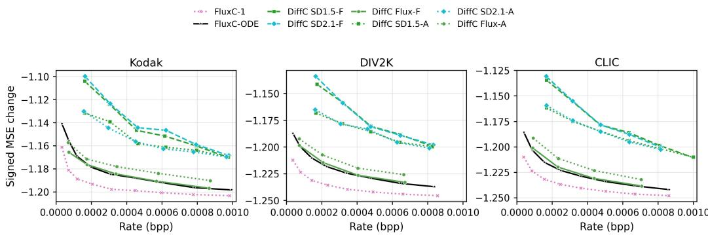  
Figure 3: Signed MSE change relative to the corresponding zero rate reconstruction in the ultra low rate regime $\hat { ( R \le 1 0 ^ { - 3 } \mathrm { b p p ) } }$ . More negative values indicate larger distortion reductions.

Result 1 (Low rate distortion scaling). Let $R \geq 0$ denote the rate in bits. Assume $\mathbb { E } [ \mathbf { X } ] = \mathbf { 0 }$ $0 < \mathbb { E } [ \| \mathbf { X } \| _ { 2 } ^ { 2 } ] < \infty ,$ , and that the MMSE curve is right differentiable at $\gamma = 0 .$ . Let $D _ { 0 } : = \dot { \mathbb { E } } \big [ \lVert \mathbf { X } -$ $\widehat { \bf X } _ { 0 } \| _ { 2 } ^ { 2 } ] = 2 \mathbb { E } [ \| { \bf X } \| _ { 2 } ^ { 2 } ]$ , where $\widehat { \mathbf { X } } _ { 0 } \sim P _ { X }$ is the reconstructed sample at $\gamma = 0$ and independent ofX. Let $D _ { \mathrm { O D E } } ( R )$ and $D _ { \mathrm { A } } ( R )$ denote the MSE distortions ofideal deterministic ODE reconstruction and ancestral sampling at rate $R ,$ respectively. Ifthe ideal ODE decoder preserves the source marginal, admits a one-sided $L ^ { 2 }$ expansion at the noise endpoint $t = 1$ , and has a positivefirst-order source response, then, as $R \downarrow 0 ,$

$$
D _ { \mathrm { O D E } } ( R ) = D _ { 0 } - c _ { \mathrm { O D E } } \sqrt { R } + o ( \sqrt { R } ) , \qquad c _ { \mathrm { O D E } } > 0 .\tag{18}
$$

Ideal ancestral sampling satisfies

$$
D _ { \mathrm { { A } } } ( R ) = D _ { 0 } - c _ { \mathrm { { A } } } R + o ( R ) , \qquad c _ { \mathrm { { A } } } \geq 0 .\tag{19}
$$

Appendix D gives the proof. The result indicates that, near zero rate, ODE-based reconstruction can reduce distortion at order $\sqrt { R } .$ , whereas ancestral sampling reduces only linearly in R.

## 4 EXPERIMENTAL RESULTS

We focus on results on natural images in the main text, and Gaussian source experiments are provided in Appendix E.1. Because the rate–distortion and rate–perception behavior can be characterized in closed form for Gaussian sources, this setting provides a controlled test of the consistency of our theoretical analysis. The resulting experiments show that ODE based reconstruction achieves a larger distortion reduction than stochastic sampling, particularly in the low rate regime.

Setup. Due to computational constraints, we implement FluxC using the public FLUX.1-dev model (Black Forest Labs, 2024) on NVIDIA RTX 3090 GPUs with 24 GB of memory. We follow the practical RCC implementation of the pretrained DiffC baseline (Liu et al., 2025), and use 50 encoding steps and 50 decoding steps. For the OT path, however, the SNR diverges near data endpoint $t = 0$ . We therefore stop encoding before reaching the data endpoint, at approximately $t = 0 . 2$ For a fair comparison, we apply the same stopping rule to the DiffC variants. See details in Table 1 in Appendix E.2. DiffC with Stable Diffusion (SD) 1.5 or 2.1 communicates VP-path variables, DiffC Flux uses a Flux backbone in VP-normalized DiffC, FluxC-1 and FluxC-ODE are our OT-path variants and reconstruct with one-step or many-step ODE. We compare against representative neural compression baselines, including PerCo (Careil et al., 2024), MS-ILLM (Muckley et al., 2023), DDCM (Ohayon et al., 2025), and DiT-IC (Shi et al., 2026). We evaluate on Kodak (Eastman Kodak Company, 1999), DIV2K (Agustsson & Timofte, 2017), and CLIC (CLIC Organizers, 2024). To make the inputs comparable across methods, each image is center cropped to $5 1 2 \times 5 1 2$ before compression. We report bits per pixel (bpp) as the rate. For distortion, we use PSNR and MS-SSIM (Wang et al., 2003), where higher is better, and LPIPS (Zhang et al., 2018), where lower is better. For perception, we report FID (Heusel et al., 2017) where lower is better. Because FID is unreliable with very small sample counts, we report it only on DIV2K and CLIC. For FID evaluation, each input and reconstruction is split into four non-overlapping $2 5 6 \times 2 5 6$ patches, and 10,000 patches are randomly sampled from the resulting patch pool.

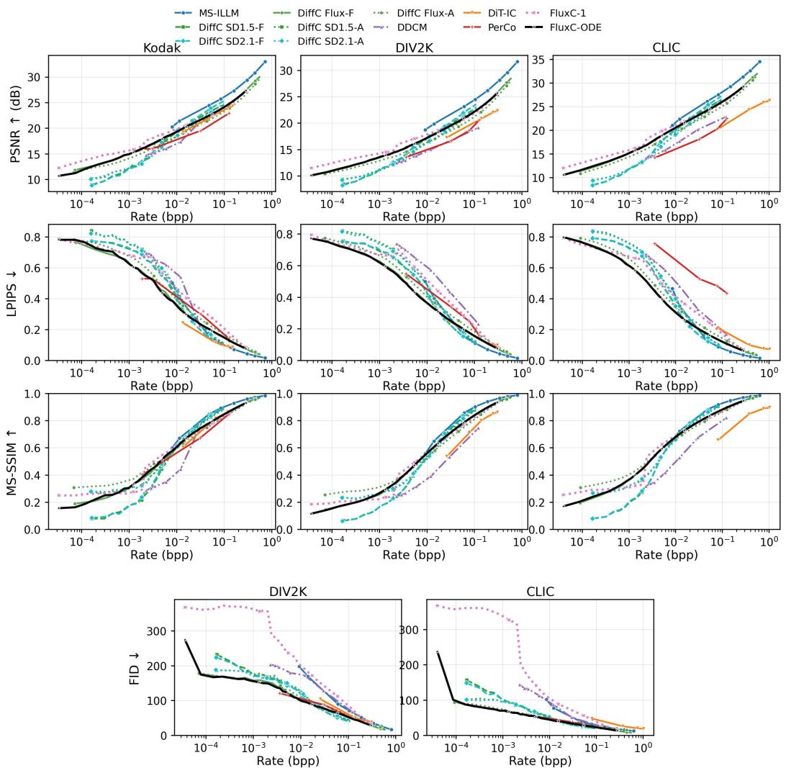  
Figure 4: Rate–distortion and rate–perception curves on natural images. We report PSNR, LPIPS, and MS-SSIM as distortion and FID as perception on a logarithmic rate axis.

Coding Cost and Bit Allocation In the rate–time plot of Figure 1, SD 1.5 and SD 2.1 produce nearly identical curves, suggesting that the allocation pattern is governed primarily by the VP path rather than the backbone. DiffC allocates most of its rate near the data endpoint, whereas FluxC distributes it over a broader range of path times. In contrast, the rate–SNR curves of DiffC and FluxC closely agree at low SNR, consistent with Observation 2. At high SNR, empirical coding overhead and the divergence of $\gamma _ { t } ^ { \mathrm { O T } } = ( 1 - t ) ^ { 2 } / t ^ { 2 }$ as t → 0 lead to larger deviations from the ideal matched-SNR prediction.

The incremental–rate plot reported in Figure 2 shows that both DiffC and FluxC closely follow their corresponding theoretical allocation curves (Eq. 15 and Eq. 16, respectively), especially near the noise endpoint t = 1. FluxC begins to allocate noticeably more rate after approximately $t = 0 . 6 $ whereas DiffC shows a sharper increase only after approximately $t = 0 . 2$ . We note that DiffC Flux does not exactly follow the OT path theoretical curve. Its implementation uses the diffusion time schedule and imposes a diffusion-style normalization on the OT path, namely $( \alpha _ { t } ^ { \mathrm { { O T } } } ) ^ { 2 } + ( \sigma _ { t } ^ { \mathrm { { O T } } } ) ^ { 2 } = 1$

Distortion improvement in the ultra low rate regime. Figure 3 shows the distortion improvement in the ultra low rate regime, $R \leq 1 0 ^ { - 3 }$ bpp. For a reconstruction $\hat { \mathbf { X } } _ { R }$ at rate R, we define $\Delta _ { \mathrm { M S E } } ( R ) : = \mathbb { E } \Vert \mathbf { X } - \hat { \mathbf { X } } _ { R } \Vert _ { 2 } ^ { 2 } - \mathbb { E } \Vert \mathbf { X } - \hat { \mathbf { X } } _ { 0 } \Vert _ { 2 } ^ { 2 }$ , where $\hat { \mathbf { X } } _ { 0 }$ is the corresponding zero-rate reconstruction; hence, more negative values indicate larger distortion reductions. Result 1 predicts a leading $\sqrt { R }$ improvement for deterministic ODE reconstruction and a linear in R improvement for ancestral sampling. Consistent with this prediction, the ODE-based methods exhibit a pronounced initial decrease below approximately $2 \times 1 0 ^ { - 4 }$ bpp, whereas the ancestral DiffC variants decrease more gradually over the same range.

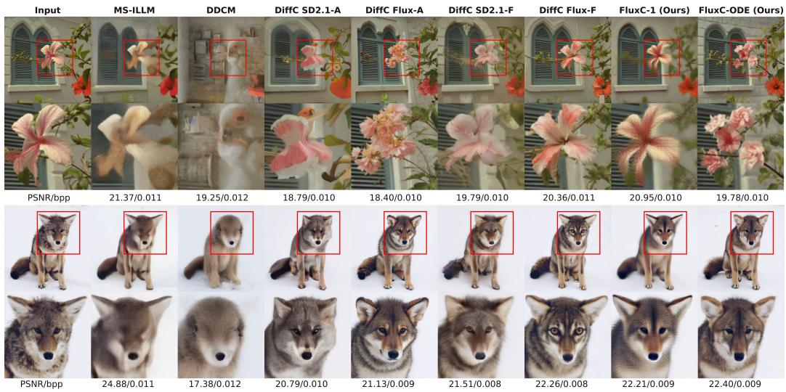  
Figure 5: Qualitative reconstructions at approximately 0.01 bpp. The examples compare MS-ILLM (Muckley et al., 2023), DDCM (Ohayon et al., 2025), DiffC and FluxC variants

Rate–distortion–perception behavior. Figure 4 summarizes the natural image rate–distortion and rate–perception behavior. At low rates, FluxC-1 and FluxC-ODE consistently achieve higher PSNR than the ancestral baselines, qualitatively aligning with Result 1. However, DiffC-A outperforms the deterministic DiffC-F in PSNR, and the ordering also varies across metrics: ODE reconstruction performs better in LPIPS, whereas ancestral sampling performs better in MS-SSIM. Thus, the asymp totic MSE result does not imply a universal ranking for natural images or practical distortion metrics. The Gaussian-source analysis and experiments in Appendix E.1, which satisfy the assumptions of the result, provide a controlled verification of the predicted low rate behavior. This distortion improvement is accompanied by worse FID than FluxC-ODE. The smoother FluxC-1 reconstructions illustrate the expected perception cost of posterior mean decoding. Beyond the ultra low bitrate regime, FluxC remains competitive with existing neural codecs, particularly in LPIPS and FID across a broad range of rates.

Figure 5 shows qualitative reconstructions around 0.01 bpp. At this rate, several baseline methods lose fine details and local structure, and the generative decoders compensate by hallucinating plausible image content from their priors. FluxC-1 instead preserves more of the input-aligned structure, but outputs smoother reconstructions. FluxC-ODE produces more natural looking reconstructions, which is consistent with their respective distortion- and perception-oriented behavior.

## 5 CONCLUSION

We proposed Flux as a codec, FluxC, that defines the Markov transition directly on the OT path, and analyzed the consequences of this design. The analysis separates three factors. First, VP and OT variables have the same ideal information rate at matched SNR, but allocate bits differently across coding steps. Second, DiffC Flux provides a VP-normalized ancestral sampling baseline, while FluxC-1 and FluxC-ODE use OT path with deterministic ODE reconstruction. Third, the low rate expansion predicts a distortion advantage for ODE reconstruction over ancestral sampling. Experimental results support this view: FluxC improves distortion, especially in the ultra low bit rate regime. Future work could investigate stronger Flux backbones, such as Flux.2 (Labs, 2025) and Flux.3 (Black Forest Labs, 2026).

## AI USE STATEMENT

In this work, generative AI tools were used to assist with implementation, to check the assumptions and intermediate derivations underlying Result 1 and to refine the presentation of its proof. The statement, proof strategy, and mathematical claims were formulated by the authors, who independently verified all AI-assisted derivations. Generative AI tools were also used to improve the clarity, correctness of expression, and readability of the manuscript. The initial draft, title, and overall structure of the paper were created by the authors. Therefore the AI tools were not used to determine the paper’s scientific claims or organization. All AI-assisted code was reviewed and tested by the authors using unit tests and the experiments reported in the paper.

## ETHICS STATEMENT

Although FluxC may reduce the storage and communication costs of high-resolution images, its generative decoder may hallucinate or alter visual content, making reconstructed images unsuitable for applications that require faithful preservation of evidence without additional validation.

## REPRODUCIBILITY STATEMENT

Section 3.1 describes the proposed algorithm and the experimental setup in Section 4 specifies the datasets, preprocessing procedures and computational resources used in our experiments. Tables 1 and 2 report the encoding and decoding times, as well as the number of encoding steps used in our experiments.

## REFERENCES

Eirikur Agustsson and Lucas Theis. Universally quantized neural compression. Advances in neural information processing systems, 33:12367–12376, 2020.

Eirikur Agustsson and Radu Timofte. Ntire 2017 challenge on single image super-resolution: Dataset and study. In Proceedings of the IEEE Conference on Computer Vision and Pattern Recognition Workshops, July 2017. doi: 10.1109/CVPRW.2017.150.

Eirikur Agustsson, Michael Tschannen, Fabian Mentzer, Radu Timofte, and Luc Van Gool. Generative adversarial networks for extreme learned image compression. In Proceedings ofthe IEEE/CVF international conference on computer vision, pp. 221–231, 2019.

Johannes Balle, Valero Laparra, and Eero P Simoncelli. End-to-end optimized image compression.´ arXiv preprint arXiv:1611.01704, 2016.

Johannes Balle, David Minnen, Saurabh Singh, Sung Jin Hwang, and Nick Johnston. Variational´ image compression with a scale hyperprior. arXiv preprint arXiv:1802.01436, 2018.

Black Forest Labs. FLUX. https://github.com/black-forest-labs/flux, 2024.

Black Forest Labs. FLUX 3: Real world models: Towards multimodal flow models as the backbone of visual intelligence. https://bfl.ai/blog/flux-3, July 2026. Accessed: 2026-08-04.

Yochai Blau and Tomer Michaeli. The perception-distortion tradeoff. In Proceedings ofthe IEEE conference on computer vision and pattern recognition, pp. 6228–6237, 2018.

Yochai Blau and Tomer Michaeli. Rethinking lossy compression: The rate-distortion-perception tradeoff. In International Conference on Machine Learning, pp. 675–685. PMLR, 2019.

Marlene Careil, Matthew J. Muckley, Jakob Verbeek, and Stephane Lathuili ´ ere. Towards image \` compression with perfect realism at ultra-low bitrates. In International Conference on Learning Representations, 2024. URL https://openreview.net/forum?id=ktdETU9JBg.

CLIC Organizers. Challenge on learned image compression (clic). https://clic2024. compression.cc/, 2024. Accessed: 2026-08-04.

Thomas M. Cover and Joy A. Thomas. Elements of Information Theory. Wiley-Interscience, 2 edition, 2006.

Gregoire Deletang, Anian Ruoss, Paul-Ambroise Duquenne, Elliot Catt, Tim Genewein, Christopher Mattern, Jordi Grau-Moya, Li Kevin Wenliang, Matthew Aitchison, Laurent Orseau, Marcus Hutter, and Joel Veness. Language modeling is compression. In International Conference on Learning Representations, 2024. URL https://arxiv.org/abs/2309.10668.

Eastman Kodak Company. Kodak lossless true color image suite. http://r0k.us/graphics/ kodak/, 1999. Accessed: 2026-08-04.

Gergely Flamich, Stratis Markou, and Jose Miguel Hernandez-Lobato. Fast relative entropy coding with a\* coding. In International Conference on Machine Learning, pp. 6548–6577. PMLR, 2022. URL https://proceedings.mlr.press/v162/flamich22a.html.

Leonardo Galteri, Lorenzo Seidenari, Marco Bertini, and Alberto Del Bimbo. Deep generative adversarial compression artifact removal. In Proceedings ofthe IEEE international conference on computer vision, pp. 4826–4835, 2017.

Dongning Guo, Shlomo Shamai, and Sergio Verdu. Mutual information and minimum mean-square error in gaussian channels. IEEE Transactions on Information Theory, 51(4):1261–1282, 2005.

Mehran Haddadi and William John Teahan. Comparing text compression capabilities of large language models with traditional compression algorithms. In Proceedings ofthe 19th Conference of the European Chapter of the Association for Computational Linguistics (Volume 4: Student Research Workshop), pp. 219–232. Association for Computational Linguistics, 2026. URL https: //aclanthology.org/2026.eacl-srw.16/.

Martin Heusel, Hubert Ramsauer, Thomas Unterthiner, Bernhard Nessler, and Sepp Hochreiter. Gans trained by a two time-scale update rule converge to a local nash equilibrium. In Advances in Neural Information Processing Systems, volume 30, pp. 6629–6640, 2017.

Jonathan Ho, Evan Lohn, and Pieter Abbeel. Compression with flows via local bits-back coding. In Advances in Neural Information Processing Systems, 2019. URL https://openreview. net/forum?id=BJeMOErgIH.

Jonathan Ho, Ajay Jain, and Pieter Abbeel. Denoising diffusion probabilistic models. In Advances in Neural Information Processing Systems, volume 33, pp. 6840– 6851, 2020. URL https://proceedings.neurips.cc/paper/2020/hash/ 4c5bcfec8584af0d967f1ab10179ca4b-Abstract.html.

Fuma Kimishima and Jinjia Zhou. Few-step generative models as lossy compression, 2026. URL https://arxiv.org/abs/2606.10450.

Diederik P Kingma and Max Welling. Auto-encoding variational bayes. arXiv preprint arXiv:1312.6114, 2013.

Diederik P. Kingma, Tim Salimans, Ben Poole, and Jonathan Ho. Variational diffusion models. In Advances in Neural Information Processing Systems, volume 34, pp. 21696–21707, 2021. URL https://openreview.net/forum?id=2LdBqxc1Yv.

Black Forest Labs. FLUX.2: Frontier Visual Intelligence. https://bfl.ai/blog/flux-2, 2025.

Chieh-Hsin Lai, De-An Chen, Han-Yi Chen, Chin-Wei Huang, Yen-Chen Lin, Max Welling, Jong Chul Yoon, and Cho-Jui Hsieh. The principles of diffusion models, 2025. URL https://arxiv.org/abs/2510.21890.

Cheuk Ting Li and Abbas El Gamal. Strong functional representation lemma and applications to coding theorems. IEEE Transactions on Information Theory, 64(11):6967–6978, 2018.

Yaron Lipman, Ricky T. Q. Chen, Heli Ben-Hamu, Maximilian Nickel, and Matt Le. Flow matching for generative modeling. In International Conference on Learning Representations, 2023. URL https://openreview.net/forum?id=PqvMRDCJT9t.

Feng Liu et al. Lossy compression with pretrained diffusion models. In International Conference on Learning Representations, volume 2025, pp. 687–702, 2025.

Xingchao Liu, Chengyue Gong, and Qiang Liu. Flow straight and fast: Learning to generate and transfer data with rectified flow. In International Conference on Learning Representations, 2023. URL https://openreview.net/forum?id=XVjTT1nw5z.

Yu Mao, Holger Pirk, and Chun Jason Xue. Lossless compression of large language model-generated text via next-token prediction. arXiv preprint arXiv:2505.06297, 2025.

Fabian Mentzer, George D Toderici, Michael Tschannen, and Eirikur Agustsson. High-fidelity generative image compression. Advances in neural information processing systems, 33:11913– 11924, 2020.

Matthew J Muckley, Alaaeldin El-Nouby, Karen Ullrich, Herve Jegou, and Jakob Verbeek. Improving statistical fidelity for neural image compression with implicit local likelihood models. In International Conference on Machine Learning, pp. 25426–25443. PMLR, 2023.

Guy Ohayon, Hila Manor, Tomer Michaeli, and Michael Elad. Compressed image generation with denoising diffusion codebook models. arXiv preprint arXiv:2502.01189, 2025. URL https: //arxiv.org/abs/2502.01189.

Roy Rinberg, Annabelle Michael Carrell, Simon Henniger, Nicholas Carlini, and Keri Warr. Haiku to opus in just 10 bits: LLMs unlock large compression gains. arXiv preprint arXiv:2604.02343, 2026.

Junqi Shi, Ming Lu, Xingchen Li, Anle Ke, Ruiqi Zhang, and Zhan Ma. DiT-IC: Aligned diffusion transformer for efficient image compression. arXiv preprint arXiv:2603.13162, 2026. URL https://arxiv.org/abs/2603.13162.

Jascha Sohl-Dickstein, Eric Weiss, Niru Maheswaranathan, and Surya Ganguli. Deep unsupervised learning using nonequilibrium thermodynamics. In Proceedings of the 32nd International Conference on Machine Learning, volume 37 of Proceedings of Machine Learning Research, pp. 2256–2265. PMLR, 2015. URL https://proceedings.mlr.press/v37/ sohl-dickstein15.html.

Yang Song, Jascha Sohl-Dickstein, Diederik P. Kingma, Abhishek Kumar, Stefano Ermon, and Ben Poole. Score-based generative modeling through stochastic differential equations. In International Conference on Learning Representations, 2021. URL https://openreview.net/forum? id=PxTIG12RRHS.

Lucas Theis and Noureldin Ahmed. Algorithms for the communication of samples. In International Conference on Machine Learning, pp. 21308–21328. PMLR, 2022. URL https: //proceedings.mlr.press/v162/theis22a.html.

Lucas Theis, Wenzhe Shi, Andrew Cunningham, and Ferenc Huszar. Lossy image compression with´ compressive autoencoders. arXiv preprint arXiv:1703.00395, 2017.

Lucas Theis, Tim Salimans, Matthew D. Hoffman, and Fabian Mentzer. Lossy compression with gaussian diffusion. arXiv preprint arXiv:2206.08889, 2022. URL https://arxiv.org/ abs/2206.08889.

Hui-Po Wang and Mario Fritz. Language models as zero-shot lossless gradient compressors: Towards general neural parameter prior models. In Advances in Neural Information Processing Systems, 2024.

Zhou Wang, Eero P. Simoncelli, and Alan C. Bovik. Multiscale structural similarity for image quality assessment. In The Thirty-Seventh Asilomar Conference on Signals, Systems & Computers, pp. 1398–1402, 2003. doi: 10.1109/ACSSC.2003.1292216.

Yibo Yang, Justus C. Will, and Stephan Mandt. Progressive compression with universally quantized diffusion models. arXiv preprint arXiv:2412.10935, 2024. URL https://arxiv.org/abs/ 2412.10935.

Richard Zhang, Phillip Isola, Alexei A. Efros, Eli Shechtman, and Oliver Wang. The unreasonable effectiveness of deep features as a perceptual metric. In Proceedings of the IEEE Conference on Computer Vision and Pattern Recognition, pp. 586–595, 2018. doi: 10.1109/CVPR.2018.00068.

## A RELATED WORK

## A.1 PROBABILISTIC MODELS AND COMPRESSION

Probabilistic modeling and compression are linked by likelihood optimization: if a shared model assigns probability $p ( \mathbf { x } )$ to data x, arithmetic coding can encode it using approximately $- \log _ { 2 } p ( \mathbf { x } )$ bits. Maximum-likelihood training can therefore be viewed as minimizing an expected codelength. Recent work makes this connection especially explicit by treating large language models as generalpurpose compressors or as probability models for arithmetic coding, including compression across modalities, LLM-generated text, gradients, and interactive lossy text protocols (Deletang et al., 2024; Haddadi & Teahan, 2026; Wang & Fritz, 2024; Mao et al., 2025; Rinberg et al., 2026). Related lossless coding views also appear in local bits-back coding for flow models (Ho et al., 2019), but our focus is lossy compression with generative decoders. Lossy compression keeps this coding viewpoint but transmits a lower-rate variable rather than the full signal. In generative lossy compression, the decoder uses a shared probabilistic prior to fill in information. DiffC (Theis et al., 2022; Liu et al., 2025) is a representative work that communicates a noisy diffusion variable through reverse channel coding and reconstructs with a shared diffusion prior.

## A.2 NEURAL LOSSY IMAGE COMPRESSION

Neural lossy image compression is commonly built on transform coding based on VAE (Kingma & Welling, 2013). An analysis transform maps an image to quantized latents, an entropy model codes those latents, and a synthesis transform reconstructs the image (Balle et al., 2016; 2018; Theis et al.,´ 2017; Agustsson $\&$ Theis, 2020). Recent systems improve either statistical fidelity or perceptual quality by adding stronger likelihood models, adversarial objectives, or generative priors (Agustsson et al., 2019; Galteri et al., 2017; Mentzer et al., 2020); examples include MS-ILLM (Muckley et al., 2023) and recent very-low-bitrate neural codecs such as PerCo (Careil et al., 2024). Diffusion-based codecs replace or augment the decoder with a diffusion prior. DiffC communicates noisy diffusion states and reconstructs by reverse diffusion (Theis et al., 2022; Liu et al., 2025). DDCM uses selected noise-codebook entries as compressed representations (Ohayon et al., 2025), and DiT-IC adapts a pretrained diffusion transformer into a compact one-step compression decoder (Shi et al., 2026). Few-step generative codecs formulate short generative trajectories as zero-shot codecs on small images (Kimishima & Zhou, 2026). In contrast, we focus on a high-resolution Flux-based Rectified Flow codec whose coding transition is defined on the OT path, and analyze how this choice changes coding cost, bit allocation, and reconstruction behavior relative to DiffC.

## A.3 REVERSE CHANNEL CODING

Reverse channel coding (RCC) communicates a sample x $\sim q ( \mathbf { x } )$ using a shared proposal distribution $p ( \mathbf { x } )$ and common randomness between the sender and receiver (Li & El Gamal, 2018). In the ideal setting, such a sample can be transmitted using approximately $D _ { \mathrm { K L } } ( q \| p )$ bits (Theis & Ahmed, 2022; Flamich et al., 2022). A practical limitation of RCC is its computational cost, since exact or high-quality channel simulation can require many proposal samples. UQDM addresses this issue by replacing the Gaussian channel with a uniform noise channel and using universal quantization, avoiding explicit RCC while preserving a coding cost of NELBO (Yang et al., 2024). A natural next step is to develop universal quantization-based zero-shot compression methods for Rectified Flow, as well as plug-in mechanisms that make such codecs practical for high-resolution images. We leave these directions to future work.

## B CODING COST DECOMPOSITION AND BIT ALLOCATION

## B.1 VARIATIONAL CODING COST DECOMPOSITION

Observation 1 (Lossy coding cost decomposition). Let $\mathbf { X } \sim P _ { X }$ be an $\mathbb { R } ^ { d }$ valued source random variable satisfying $\mathbb { E } \| \mathbf { X } \| _ { 2 } ^ { 2 } < \infty , \gamma \geq 0$ be the SNR, and $\epsilon \sim \mathcal { N } ( \mathbf { 0 } , \mathbf { I } _ { d } )$ be independent Gaussian noise. We define the Gaussian observation at SNR γ as $\mathbf { Y } _ { \gamma } = \sqrt { \gamma } \mathbf { X } + \epsilon ,$ , and its posterior mean estimator as $\hat { \mathbf { X } } _ { \mathrm { M M S E } } ( \mathbf { Y } _ { \gamma } , \gamma ) : = \mathbb { E } [ \mathbf { X } \mid \mathbf { Y } _ { \gamma } ]$ . Let $\mathcal { C } _ { \theta } ( t )$ denote the lossy coding cost stopping at $t ,$ whose SNR is $\gamma _ { t }$ . In the continuous SNR limit, this cost decomposes as

$$
\mathcal { C } _ { \theta } ( t ) = I ( \mathbf { X } ; \mathbf { Y } _ { \gamma _ { t } } ) + \frac { 1 } { 2 \ln 2 } \int _ { 0 } ^ { \gamma _ { t } } \mathbb { E } \bigg [ \Big \| \hat { \mathbf { X } } _ { \theta } ( \mathbf { Y } _ { \gamma } , \gamma ) - \hat { \mathbf { X } } _ { \mathrm { M M S E } } ( \mathbf { Y } _ { \gamma } , \gamma ) \Big \| _ { 2 } ^ { 2 } \bigg ] \mathrm { d } \gamma .\tag{12}
$$

Proof. By the I-MMSE identity (Guo et al., 2005),

$$
\frac { d } { d \gamma } I ( \mathbf { X } ; \mathbf { Y } _ { \gamma } ) = \frac { 1 } { 2 \ln 2 } \operatorname { m m s e } ( \gamma ) , \qquad \operatorname { m m s e } ( \gamma ) = \mathbb { E } \Vert \mathbf { X } - \hat { \mathbf { X } } _ { \mathrm { M M S E } } ( \mathbf { Y } _ { \gamma } , \gamma ) \Vert _ { 2 } ^ { 2 } .\tag{20}
$$

Integrating from 0 to the stopping-time SNR $\gamma _ { t }$ gives

$$
I ( \mathbf { X } ; \mathbf { Y } _ { \gamma _ { t } } ) - I ( \mathbf { X } ; \mathbf { Y } _ { 0 } ) = \frac { 1 } { 2 \ln 2 } \int _ { 0 } ^ { \gamma _ { t } } \operatorname* { m m s e } ( \gamma ) d \gamma .\tag{21}
$$

Since ${ \bf Y } _ { 0 } = \epsilon$ is independent of X, $I ( \mathbf { X } ; \mathbf { Y } _ { 0 } ) = 0 .$ , and therefore

$$
I ( \mathbf { X } ; \mathbf { Y } _ { \gamma _ { t } } ) = \frac { 1 } { 2 \ln 2 } \int _ { 0 } ^ { \gamma _ { t } } \mathrm { m m s e } ( \gamma ) d \gamma .\tag{22}
$$

Now consider any denoiser $\hat { \mathbf { X } } _ { \theta } ( \mathbf { Y } _ { \gamma } , \gamma )$ and define

$$
\mathbf { g } _ { \theta } ( \mathbf { Y } _ { \gamma } ) = \hat { \mathbf { X } } _ { \mathrm { M M S E } } ( \mathbf { Y } _ { \gamma } , \gamma ) - \hat { \mathbf { X } } _ { \theta } ( \mathbf { Y } _ { \gamma } , \gamma ) .\tag{23}
$$

Then

$$
\mathbf { X } - \hat { \mathbf { X } } _ { \theta } = \mathbf { X } - \hat { \mathbf { X } } _ { \mathrm { M M S E } } ( \mathbf { Y } _ { \gamma } , \gamma ) + \mathbf { g } _ { \theta } ( \mathbf { Y } _ { \gamma } ) .\tag{24}
$$

Squaring and taking expectation gives

$$
\begin{array} { r l } & { \mathbb { E } \| { \mathbf { X } } - \hat { { \mathbf { X } } } _ { \theta } \| _ { 2 } ^ { 2 } = \mathbb { E } \| { \mathbf { X } } - \hat { { \mathbf { X } } } _ { \mathrm { M M S E } } ( { \mathbf { Y } } _ { \gamma } , \gamma ) \| _ { 2 } ^ { 2 } + \mathbb { E } \| { \mathbf { g } } _ { \theta } ( { \mathbf { Y } } _ { \gamma } ) \| _ { 2 } ^ { 2 } } \\ & { \qquad + ~ 2 \mathbb { E } \left. { \mathbf { X } } - \hat { { \mathbf { X } } } _ { \mathrm { M M S E } } ( { \mathbf { Y } } _ { \gamma } , \gamma ) , { \mathbf { g } } _ { \theta } ( { \mathbf { Y } } _ { \gamma } ) \right. . } \end{array}\tag{25}
$$

Since $\mathbf { g } _ { \boldsymbol { \theta } } ( \mathbf { Y } _ { \gamma } )$ is measurable with respect to $\mathbf { Y } _ { \gamma }$

$$
\begin{array} { r l } & { \mathbb { E } \left. \mathbf { X } - \hat { \mathbf { X } } _ { \mathrm { M M S E } } ( \mathbf { Y } _ { \gamma } , \gamma ) , \mathbf { g } _ { \theta } ( \mathbf { Y } _ { \gamma } ) \right. } \\ & { \quad = \mathbb { E } \left[ \mathbb { E } \left[ \left. \mathbf { X } - \hat { \mathbf { X } } _ { \mathrm { M M S E } } ( \mathbf { Y } _ { \gamma } , \gamma ) , \mathbf { g } _ { \theta } ( \mathbf { Y } _ { \gamma } ) \right. \Big \vert \mathbf { Y } _ { \gamma } \right] \right] } \\ & { \quad = \mathbb { E } \left[ \left. \mathbb { E } [ \mathbf { X } - \hat { \mathbf { X } } _ { \mathrm { M M S E } } ( \mathbf { Y } _ { \gamma } , \gamma ) \mid \mathbf { Y } _ { \gamma } ] , \mathbf { g } _ { \theta } ( \mathbf { Y } _ { \gamma } ) \right. \right] } \\ & { \quad = \mathbb { E } \left[ \left. \mathbb { E } [ \mathbf { X } \mid \mathbf { Y } _ { \gamma } ] - \hat { \mathbf { X } } _ { \mathrm { M M S E } } ( \mathbf { Y } _ { \gamma } , \gamma ) , \mathbf { g } _ { \theta } ( \mathbf { Y } _ { \gamma } ) \right. \right] = 0 . } \end{array}\tag{26}
$$

Therefore

$$
\mathbb { E } \| \mathbf { X } - \hat { \mathbf { X } } _ { \theta } \| _ { 2 } ^ { 2 } = \operatorname* { m m s e } ( \gamma ) + \mathbb { E } \| \hat { \mathbf { X } } _ { \theta } ( \mathbf { Y } _ { \gamma } , \gamma ) - \hat { \mathbf { X } } _ { \mathrm { M M S E } } ( \mathbf { Y } _ { \gamma } , \gamma ) \| _ { 2 } ^ { 2 } .\tag{27}
$$

Following the SNR coordinate formulation of variational diffusion models (Kingma et al., 2021), we use the continuous SNR variational coding cost

$$
\mathcal { C } _ { \theta } ( t ) = \frac { 1 } { 2 \ln 2 } \int _ { 0 } ^ { \gamma _ { t } } \mathbb { E } \| \mathbf { X } - \hat { \mathbf { X } } _ { \theta } ( \mathbf { Y } _ { \gamma } , \gamma ) \| _ { 2 } ^ { 2 } d \gamma .\tag{28}
$$

Substituting Eq. 27 into Eq. 28 yields

$$
\begin{array} { l } { \displaystyle \mathcal { C } _ { \theta } ( t ) = \frac { 1 } { 2 \ln 2 } \int _ { 0 } ^ { \gamma t } \operatorname* { m m s e } ( \gamma ) d \gamma + \frac { 1 } { 2 \ln 2 } \int _ { 0 } ^ { \gamma t } \mathbb { E } \| \hat { \mathbf { X } } _ { \theta } ( \mathbf { Y } _ { \gamma } , \gamma ) - \hat { \mathbf { X } } _ { \mathrm { M M S E } } ( \mathbf { Y } _ { \gamma } , \gamma ) \| _ { 2 } ^ { 2 } d \gamma } \\ { \displaystyle \qquad = I ( { \mathbf { X } } ; \mathbf { Y } _ { \gamma t } ) + \frac { 1 } { 2 \ln 2 } \int _ { 0 } ^ { \gamma t } \mathbb { E } \| \hat { \mathbf { X } } _ { \theta } ( \mathbf { Y } _ { \gamma } , \gamma ) - \hat { \mathbf { X } } _ { \mathrm { M M S E } } ( \mathbf { Y } _ { \gamma } , \gamma ) \| _ { 2 } ^ { 2 } d \gamma , } \end{array}\tag{29}
$$

where the last equality uses Eq. 22.

## B.2 FLUXC MISMATCH AS WEIGHTED VELOCITY ERROR

Corollary 1 (FluxC coding cost as weighted velocity error). For the OTpath, let $t \in [ 0 , 1 ]$ denote the path time. The noisy state at time t is $\mathbf Z _ { t } = ( 1 - t ) \mathbf X + t { \boldsymbol { \epsilon } } $ , and the target velocity is $\dot { \mathbf Z } _ { t } = { \boldsymbol \epsilon } - { \mathbf X }$ The coding cost stopping at time t is

$$
\mathcal { C } _ { \theta } ( t ) = \frac { 1 } { \ln 2 } \int _ { t } ^ { 1 } \frac { 1 - s } { s } \mathbb { E } \bigg [ \Big \| \mathbf { v } _ { \theta } ( \mathbf { Z } _ { s } , s ) - \dot { \mathbf { Z } } _ { s } \Big \| _ { 2 } ^ { 2 } \bigg ] \mathrm { d } s .\tag{13}
$$

Proof. For the OT path used in FluxC,

$$
{ \bf Z } _ { t } = ( 1 - t ) { \bf X } + t \epsilon = { \bf X } + t \dot { \bf Z } _ { t } , \qquad \dot { \bf Z } _ { t } = \epsilon - { \bf X } .\tag{30}
$$

By the denoising reparameterization in Eq. 8, the velocity prediction induces

$$
\hat { \mathbf { X } } _ { \theta } ( \mathbf { Z } _ { t } , t ) = \mathbf { Z } _ { t } - t \mathbf { v } _ { \theta } ( \mathbf { Z } _ { t } , t ) .\tag{31}
$$

Using ${ \bf X } = { \bf Z } _ { t } - t \dot { \bf Z } _ { t }$ , the denoising error becomes

$$
\Vert \mathbf { X } - \hat { \mathbf { X } } _ { \boldsymbol { \theta } } ( \mathbf { Z } _ { t } , t ) \Vert _ { 2 } ^ { 2 } = t ^ { 2 } \Vert \mathbf { v } _ { \boldsymbol { \theta } } ( \mathbf { Z } _ { t } , t ) - \dot { \mathbf { Z } } _ { t } \Vert _ { 2 } ^ { 2 } .\tag{32}
$$

For the OT path, the SNR is

$$
\gamma _ { t } ^ { \mathrm { O T } } = \frac { ( 1 - t ) ^ { 2 } } { t ^ { 2 } } .\tag{33}
$$

Differentiating gives

$$
\frac { d \gamma _ { t } ^ { \mathrm { O T } } } { d t } = - \frac { 2 ( 1 - t ) } { t ^ { 3 } } ,\tag{34}
$$

Since $\gamma _ { t } ^ { \mathrm { { O T } } }$ is the SNR at the stopping time t and $\gamma _ { 1 } ^ { \mathrm { { O T } } } = 0$ , changing variables from the SNR coordinate γ to the path time t in Eq. 28 gives

$$
\begin{array} { l } { { \displaystyle { \mathcal { C } } _ { \theta } ( t ) = \frac { 1 } { 2 \ln 2 } \int _ { t } ^ { 1 } \mathbb { E } \| { \mathbf { X } } - \hat { { \mathbf { X } } } _ { \theta } ( { \mathbf { Z } } _ { s } , s ) \| _ { 2 } ^ { 2 } \left| \frac { d \gamma _ { s } ^ { \mathrm { O T } } } { d s } \right| d s } \ ~ } \\ { { \displaystyle ~ = \frac { 1 } { 2 \ln 2 } \int _ { t } ^ { 1 } s ^ { 2 } \mathbb { E } \| { \mathbf { v } } _ { \theta } ( { \mathbf { Z } } _ { s } , s ) - \dot { \mathbf { Z } } _ { s } \| _ { 2 } ^ { 2 } \frac { 2 ( 1 - s ) } { s ^ { 3 } } d s } } \\ { { \displaystyle ~ = \frac { 1 } { \ln 2 } \int _ { t } ^ { 1 } \frac { 1 - s } { s } \mathbb { E } \| { \mathbf { v } } _ { \theta } ( { \mathbf { Z } } _ { s } , s ) - \dot { \mathbf { Z } } _ { s } \| _ { 2 } ^ { 2 } d s } . } \end{array}\tag{35}
$$

This proves Eq. 13.

## B.3 BIT ALLOCATION OVER T

Observation 2 (Bit allocation over path time). For a path with coefficients $\alpha _ { t }$ and $\sigma _ { t } ,$ , define its SNR as $\begin{array} { r } { \gamma _ { t } = \frac { \alpha _ { t } ^ { 2 } } { \sigma _ { t } ^ { 2 } } } \end{array}$ . The information increment per unit path time satisfies

$$
\left| \frac { \mathrm { d } } { \mathrm { d } t } I ( { \bf X } ; { \bf Y } _ { \gamma _ { t } } ) \right| = \frac { 1 } { 2 \ln 2 } \mathrm { m m s e } ( \gamma _ { t } ) \left| \frac { \mathrm { d } \gamma _ { t } } { \mathrm { d } t } \right| .\tag{14}
$$

where mmse $( \gamma ) = \mathbb { E } \bigg \lceil \bigg \| \mathbf { X } - \hat { \mathbf { X } } _ { \mathrm { M M S E } } \big ( \mathbf { Y } _ { \gamma } , \gamma \big ) \bigg \| _ { 2 } ^ { 2 } \bigg \rceil$ . For the continuous time VP path, let $B ( t ) =$ $\textstyle \int _ { 0 } ^ { t } { \beta ( s ) }$ ds. The derivatives of the VP and OT SNRs are, respectively,

$$
\left| \frac { \mathrm { d } \gamma _ { t } ^ { \mathrm { V P } } } { \mathrm { d } t } \right| = \frac { \beta ( t ) e ^ { - B ( t ) } } { \left( 1 - e ^ { - B ( t ) } \right) ^ { 2 } } ,\tag{15}
$$

$$
\left. \frac { \mathrm { d } \gamma _ { t } ^ { \mathrm { O T } } } { \mathrm { d } t } \right. = \frac { 2 ( 1 - t ) } { t ^ { 3 } } .\tag{16}
$$

Proof. By the I-MMSE identity (Guo et al., 2005) and the chain rule,

$$
\begin{array} { r l r } & { } & { \left| \frac { d } { d t } I ( \mathbf { X } ; \mathbf { Y } _ { \gamma _ { t } } ) \right| = \left| \frac { d } { d \gamma } I ( \mathbf { X } ; \mathbf { Y } _ { \gamma } ) \right| _ { \gamma = \gamma _ { t } } \left| \frac { d \gamma _ { t } } { d t } \right| } \\ & { } & { = \frac { 1 } { 2 \ln 2 } \operatorname* { m m s e } ( \gamma _ { t } ) \left| \frac { d \gamma _ { t } } { d t } \right| . } \end{array}\tag{36}
$$

For FluxC, with Eq. 34,

$$
\left| \frac { d } { d t } I ( \mathbf { X } ; \mathbf { Y } _ { \gamma _ { t } ^ { \mathrm { O T } } } ) \right| = \frac { 1 } { \ln 2 } \mathrm { m m s e } ( \gamma _ { t } ^ { \mathrm { O T } } ) \frac { 1 - t } { t ^ { 3 } } .\tag{37}
$$

For VP DiffC, from Eq. 1,

$$
\left| \frac { d \gamma _ { t } ^ { \mathrm { V P } } } { d t } \right| = \frac { \beta ( t ) e ^ { - B ( t ) } } { ( 1 - e ^ { - B ( t ) } ) ^ { 2 } } .\tag{38}
$$

Substituting this derivative into Eq. 36 gives

$$
\left| \frac { d } { d t } I ( \mathbf { X } ; \mathbf { Y } _ { \gamma _ { t } ^ { \mathrm { V P } } } ) \right| = \frac { 1 } { 2 \ln 2 } \operatorname { m m s e } ( \gamma _ { t } ^ { \mathrm { V P } } ) \frac { \beta ( t ) e ^ { - B ( t ) } } { ( 1 - e ^ { - B ( t ) } ) ^ { 2 } } .\tag{39}
$$

## C GAUSSIAN-SOURCE DIAGNOSTIC AND CLOSED FORMS

This appendix collects the Gaussian source closed forms used in Section E.1.

## C.1 SETUP AND METRICS

Let

$$
{ \bf X } \sim { \mathcal N } ( { \bf 0 } , \Sigma ) , \qquad \Sigma = \mathrm { d i a g } ( \lambda _ { 1 } , \dots , \lambda _ { d } ) , \qquad \lambda _ { i } > 0 ,\tag{40}
$$

and $\mathbf { \epsilon } \gets \mathcal { N } ( \mathbf { 0 } , I )$ be independent of X. We compare reconstruction methods through the common Gaussian observation channel

$$
{ \mathbf Y } _ { \gamma } = \epsilon + \sqrt { \gamma } { \mathbf X } , \qquad \sqrt { \gamma } \ge 0 .\tag{41}
$$

By the standard mutual information formula for a scalar Gaussian channel (Cover & Thomas, 2006),

$$
R _ { i } ( \gamma ) = I ( X _ { i } ; Y _ { \gamma , i } ) = \frac { 1 } { 2 } \log _ { 2 } ( 1 + \gamma \lambda _ { i } ) .\tag{42}
$$

so the total rate $R ( \gamma )$ is

$$
R ( \gamma ) = \frac 1 2 \sum _ { i = 1 } ^ { d } \log _ { 2 } ( 1 + \gamma \lambda _ { i } ) .\tag{43}
$$

For the OT path ${ \bf Z } _ { t } ^ { \mathrm { O T } } = ( 1 - t ) { \bf X } + t \epsilon$ , setting $\textstyle \gamma = \left( { \frac { 1 - t } { t } } \right) ^ { 2 }$ gives $\mathbf { Z } _ { t } ^ { \mathrm { { O T } } } = t \mathbf { Y } _ { \gamma }$ . Hence $I ( \mathbf { X } ; \mathbf { Z } _ { t } ^ { \mathrm { O T } } ) =$ $I ( \mathbf { X } ; \mathbf { Y } _ { \gamma } )$ , because multiplication by a nonzero scalar does not change mutual information.

For a reconstruction $\widehat { \mathbf { X } } _ { \widetilde { \mathbf { \Gamma } } }$ obtained from $\mathbf { Y } _ { \gamma }$ , we define its MSE distortion and perception using the squared 2-Wasserstein distance at SNR γ as

$$
D ( \gamma ) : = \mathbb { E } \left[ \left\| \mathbf { X } - \widehat { \mathbf { X } } _ { \gamma } \right\| _ { 2 } ^ { 2 } \right] ,\tag{44}
$$

$$
P ( \gamma ) : = W _ { 2 } ^ { 2 } \Big ( P _ { \mathbf { X } } , P _ { \widehat { \mathbf { X } } _ { \gamma } } \Big ) .\tag{45}
$$

Method-specific subscripts on $D , P ,$ and $\widehat { \mathbf X }$ identify the reconstruction rule used below. This choice follows the rate–distortion–perception formulation used in the main text.

## C.2 POSTERIOR-MEAN RECONSTRUCTION: FLUXC-1

Derivation. For the affine OT path and $t \in ( 0 , 1 ]$ , assume that the velocity regression objective is minimized exactly. Its population minimizer is the ideal conditional velocity field

$$
\mathbf { v } _ { t } ^ { \star } ( \mathbf { z } ) : = \mathbb { E } [ \dot { \mathbf { Z } } _ { t } \mid \mathbf { Z } _ { t } = \mathbf { z } ] = \mathbb { E } [ \epsilon - \mathbf { X } \mid \mathbf { Z } _ { t } = \mathbf { z } ] ,\tag{46}
$$

where the second equality follows from $\dot { \mathbf { Z } } _ { t } = \mathbf { \epsilon } \mathbf { \epsilon } - \mathbf { X }$ . Using $\epsilon = \{ \mathbf { Z } _ { t } - ( 1 - t ) \mathbf { X } \} / t$ , we obtain

$$
\begin{array} { l } { { \displaystyle { \bf v } _ { t } ^ { \star } ( { \bf z } ) = \mathbb { E } [ \frac { { \bf z } - ( 1 - t ) { \bf X } } { t } - { \bf X } ] { \bf Z } _ { t } = { \bf z } } ] } \\ { { \displaystyle ~ = \frac { { \bf z } - \mathbb { E } [ { \bf X } \mid { \bf Z } _ { t } = { \bf z } ] } { t } . } } \end{array}\tag{47}
$$

A single explicit Euler update from time t to 0, with the velocity evaluated at $\left( \mathbf { Z } _ { t } , t \right)$ , defines

$$
\hat { \mathbf { X } } _ { \mathrm { F l u x - 1 } } : = \mathbf { Z } _ { t } - t \mathbf { v } _ { t } ^ { \star } ( \mathbf { Z } _ { t } ) = \mathbb { E } [ \mathbf { X } \mid \mathbf { Z } _ { t } ] .\tag{48}
$$

Hence, under the exact conditional velocity field, the one-step FluxC reconstruction is exactly the posterior mean associated with the communicated variable $\mathbf { Z } _ { t }$ . With a learned field $\mathbf { v } _ { \theta }$ , this identity is approximate, and the deviation is determined by the velocity-estimation error. The identity itself does not require a Gaussian source; it follows from the affine OT path and the ideal conditional velocity field.

Assume $\mathbb { E } \| \mathbf { X } \| _ { 2 } ^ { 2 } < \infty$ and define

$$
\begin{array} { r } { \bar { \mathbf { X } } _ { t } : = \mathbb { E } [ \mathbf { X } \mid \mathbf { Z } _ { t } ] . } \end{array}\tag{49}
$$

Let $g _ { t } : \mathbb { R } ^ { d }  \mathbb { R } ^ { d }$ be any measurable reconstruction rule satisfying $\mathbb { E } \| g _ { t } ( \mathbf { Z } _ { t } ) \| _ { 2 } ^ { 2 } < \infty$ . Then

$$
\begin{array} { r l } & { \mathbb { E } \| { \mathbf { X } } - g _ { t } ( { \mathbf { Z } } _ { t } ) \| _ { 2 } ^ { 2 } = \mathbb { E } \| { \mathbf { X } } - \bar { { \mathbf { X } } } _ { t } + \bar { { \mathbf { X } } } _ { t } - g _ { t } ( { \mathbf { Z } } _ { t } ) \| _ { 2 } ^ { 2 } } \\ & { \qquad = \mathbb { E } \| { \mathbf { X } } - \bar { { \mathbf { X } } } _ { t } \| _ { 2 } ^ { 2 } + \mathbb { E } \| \bar { { \mathbf { X } } } _ { t } - g _ { t } ( { \mathbf { Z } } _ { t } ) \| _ { 2 } ^ { 2 } } \\ & { \qquad + 2 \mathbb { E } \big [ \big \langle { \mathbf { X } } - \bar { { \mathbf { X } } } _ { t } , \bar { { \mathbf { X } } } _ { t } - g _ { t } ( { \mathbf { Z } } _ { t } ) \big \rangle \big ] . } \end{array}\tag{50}
$$

The cross term vanishes as

$$
\begin{array} { r l } & { \mathbb { E } \big [ \big \langle \mathbf { X } - \bar { \mathbf { X } } _ { t } , \bar { \mathbf { X } } _ { t } - g _ { t } ( \mathbf { Z } _ { t } ) \big \rangle \big ] } \\ & { \quad \quad = \mathbb { E } \big [ \big \langle \mathbb { E } [ \mathbf { X } - \bar { \mathbf { X } } _ { t } \mid \mathbf { Z } _ { t } ] , \bar { \mathbf { X } } _ { t } - g _ { t } ( \mathbf { Z } _ { t } ) \big \rangle \big ] = 0 . } \end{array}\tag{51}
$$

Therefore,

$$
\mathbb { E } \| { \mathbf { X } } - g _ { t } ( { \mathbf { Z } } _ { t } ) \| _ { 2 } ^ { 2 } = \mathbb { E } \| { \mathbf { X } } - \bar { \mathbf { X } } _ { t } \| _ { 2 } ^ { 2 } + \mathbb { E } \| \bar { \mathbf { X } } _ { t } - g _ { t } ( \mathbf { Z } _ { t } ) \| _ { 2 } ^ { 2 } ,\tag{52}
$$

so the unique minimizer up to almost-sure equality is $g _ { t } ( \mathbf Z _ { t } ) = \bar { \mathbf X } _ { t }$

We now specialize to the Gaussian source to obtain closed-form distortion and perception. Since $\mathbf { Z } _ { t } = t \mathbf { Y } _ { \gamma }$ with $\gamma = ( ( 1 - t ) / t ) ^ { 2 }$ and $t > 0$ , the variables $\mathbf { Z } _ { t }$ and $\mathbf { Y } _ { \gamma }$ generate the same sigma-algebra. Tl

$$
\mathbb { E } [ \mathbf { X } \mid \mathbf { Z } _ { t } ] = \mathbb { E } [ \mathbf { X } \mid \mathbf { Y } _ { \gamma } ] .\tag{53}
$$

Because $\Sigma$ is diagonal, the coordinates are independent and the posterior factorizes. For coordinate i,

$$
\operatorname { C o v } ( X _ { i } , Y _ { \gamma , i } ) = \sqrt { \gamma } \lambda _ { i } , \qquad \operatorname { V a r } ( Y _ { \gamma , i } ) = 1 + \gamma \lambda _ { i } .\tag{54}
$$

Thus, the Gaussian conditioning formula gives

$$
{ \hat { X } } _ { \operatorname { F l u x } - 1 , i } = \mathbb { E } [ X _ { i } \mid \mathbf { Y } _ { \gamma } ] = \mathbb { E } [ X _ { i } \mid Y _ { \gamma , i } ] = { \frac { { \sqrt { \gamma } } \lambda _ { i } } { 1 + \gamma \lambda _ { i } } } Y _ { \gamma , i } .\tag{55}
$$

The posterior variance in coordinate i is

$$
{ \begin{array} { r } { \operatorname { V a r } ( X _ { i } \mid Y _ { \gamma , i } ) = \operatorname { V a r } ( X _ { i } ) - { \frac { \operatorname { C o v } ( X _ { i } , Y _ { \gamma , i } ) ^ { 2 } } { \operatorname { V a r } ( Y _ { \gamma , i } ) } } } \\ { = \lambda _ { i } - { \frac { \gamma \lambda _ { i } ^ { 2 } } { 1 + \gamma \lambda _ { i } } } = { \frac { \lambda _ { i } } { 1 + \gamma \lambda _ { i } } } . } \end{array} }\tag{56}
$$

Therefore, the MSE distortion of FluxC-1 at SNR $\gamma$ is

$$
D _ { \mathrm { F l u x - 1 } } ( \gamma ) = \sum _ { i } \frac { \lambda _ { i } } { 1 + \gamma \lambda _ { i } } .\tag{57}
$$

The reconstruction marginal is Gaussian with coordinate variance

$$
\operatorname { V a r } ( \hat { X } _ { \mathrm { F l u x - 1 } , i } ) = \left( \frac { \sqrt { \gamma } \lambda _ { i } } { 1 + \gamma \lambda _ { i } } \right) ^ { 2 } \operatorname { V a r } ( Y _ { \gamma , i } ) = \frac { \gamma \lambda _ { i } ^ { 2 } } { 1 + \gamma \lambda _ { i } } .\tag{58}
$$

For one-dimensional zero-mean Gaussians, $W _ { 2 } ^ { 2 } ( { \mathcal { N } } ( 0 , a ) , { \mathcal { N } } ( 0 , b ) ) = ( { \sqrt { a } } - { \sqrt { b } } ) ^ { 2 }$ . Since the source and reconstruction marginals are diagonal in the same basis, the total squared Wasserstein distance is

$$
P _ { \mathrm { F l u x - 1 } } ( \gamma ) = \sum _ { i } \left( \sqrt { \lambda _ { i } } - \frac { \sqrt { \gamma } \lambda _ { i } } { \sqrt { 1 + \gamma \lambda _ { i } } } \right) ^ { 2 } .\tag{59}
$$

Thus, under the ideal conditional velocity field, FluxC-1 attains the minimum MSE among all squareintegrable reconstructions measurable with respect to the communicated observation. This distortion optimality generally comes at a nonzero perception cost because the posterior-mean marginal need not equal $\bar { P _ { \mathbf { X } } }$

## C.3 ANCESTRAL SAMPLING AND PROBABILITY-FLOW ODE

Derivation. For VP DiffC, Theis et al. (2022) analyze two idealized reconstruction methods for Gaussian sources: ancestral sampling, denoted DiffC-A, and probability-flow ODE reconstruction, denoted DiffC-F. We recall the consequences needed for comparison with FluxC. Their derivation is given for Gaussian sources but in our anisotropic setting, we diagonalize Σ and apply the same one-dimensional Gaussian calculation independently to each eigen coordinate.

Ancestral sampling can be idealized as drawing a fresh posterior sample,

$$
\hat { \mathbf { X } } _ { \mathrm { D i f f C - } A } \sim P ( \mathbf { X } \mid \mathbf { Y } _ { \gamma } ) .\tag{60}
$$

Conditioned on $\mathbf { Y } _ { \gamma } = \mathbf { y }$ , ancestral sampling draws an independent posterior sample $\hat { \mathbf { X } } _ { \mathrm { D i f f C } - A } \sim$ $P ( \mathbf { X } \mid \mathbf { Y } _ { \gamma } = \mathbf { y } )$ . Hence, for each coordinate,

$$
\begin{array} { r l } & { \mathbb { E } \Big [ ( X _ { i } - \hat { X } _ { \mathrm { D i f f C } \cdot A , i } ) ^ { 2 } \mid Y _ { i } = y _ { i } \Big ] = \mathbb { E } \Big [ \{ X _ { i } - \mathbb { E } [ X _ { i } \mid Y _ { i } ] \} - \{ \hat { X } _ { \mathrm { D i f f C } \cdot A , i } - \mathbb { E } [ X _ { i } \mid Y _ { i } ] \} \Big ] ^ { 2 } } \\ & { \qquad = \mathrm { V a r } ( X _ { i } \mid Y _ { i } = y _ { i } ) + \mathrm { V a r } ( \hat { X } _ { \mathrm { D i f f C } \cdot A , i } \mid Y _ { i } = y _ { i } ) } \\ & { \qquad = 2 \mathrm { V a r } ( X _ { i } \mid Y _ { i } = y _ { i } ) . } \end{array}\tag{61}
$$

Using

$$
\operatorname { V a r } ( X _ { i } \mid Y _ { \gamma , i } ) = { \frac { \lambda _ { i } } { 1 + \gamma \lambda _ { i } } } ,
$$

Hence the distortion of DiffC-A at SNR $\gamma$ is

$$
D _ { \mathrm { { D i f f } } \mathrm { { C } } - A } ( \gamma ) = 2 \sum _ { i } \frac { \lambda _ { i } } { 1 + \gamma \lambda _ { i } } .\tag{62}
$$

The marginal of a posterior sample is $P _ { \mathbf { X } }$ , so

$$
P _ { \mathrm { D i f f C } - A } ( \gamma ) = 0 .\tag{63}
$$

DiffC-F uses the probability-flow ODE associated with the VP diffusion. For the standard normal case, Theis et al. (2022) derive the corresponding flow-based distortion. For the multivariate Gaussian source considered here, we apply the same Gaussian probability-flow calculation coordinate-wise in the eigenbasis of Σ.

The normalized observation has correlation

$$
\begin{array} { l } { r _ { i } ( \gamma ) = \mathrm { C o r r } ( X _ { i } , Y _ { \gamma , i } ) } \\ { \displaystyle = \frac { \mathrm { C o v } ( X _ { i } , Y _ { \gamma , i } ) } { \sqrt { \mathrm { V a r } ( X _ { i } ) \mathrm { V a r } ( Y _ { \gamma , i } ) } } } \\ { \displaystyle = \frac { \sqrt { \gamma } \sqrt { \lambda _ { i } } } { \sqrt { 1 + \gamma \lambda _ { i } } } . } \end{array}\tag{64}
$$

The ideal probability-flow reconstruction is marginal-preserving, so $\hat { X } _ { \mathrm { D i f f C - } F , i } \sim { \mathcal N } ( 0 , { \lambda } _ { i } )$ and hence

$$
{ \cal P } _ { \mathrm { D i f f C } - F } ( \gamma ) = 0 .\tag{65}
$$

Applying the standard-normal flow calculation in this coordinate gives

$$
\mathrm { C o v } ( X _ { i } , \hat { X } _ { \mathrm { D i f f C - } F , i } ) = \lambda _ { i } r _ { i } ( \gamma ) = \frac { \sqrt { \gamma } \lambda _ { i } ^ { 3 / 2 } } { \sqrt { 1 + \gamma \lambda _ { i } } } .\tag{66}
$$

Therefore

$$
\begin{array} { r } { \mathbb { E } \Big [ ( X _ { i } - \hat { X } _ { \mathrm { D i f f C } \cdot F , i } ) ^ { 2 } \Big ] = \mathrm { V a r } ( X _ { i } ) + \mathrm { V a r } ( \hat { X } _ { \mathrm { D i f f C } \cdot F , i } ) - 2 \mathrm { C o v } ( X _ { i } , \hat { X } _ { \mathrm { D i f f C } \cdot F , i } ) } \end{array}
$$

$$
= 2 \lambda _ { i } - 2 \frac { \sqrt { \gamma } \lambda _ { i } ^ { 3 / 2 } } { \sqrt { 1 + \gamma \lambda _ { i } } } .\tag{67}
$$

Summing over coordinates gives

$$
D _ { \mathrm { D i f f } \mathrm { C \it { F } } } ( \gamma ) = 2 \sum _ { i } \lambda _ { i } - 2 \sum _ { i } \frac { \sqrt { \gamma } \lambda _ { i } ^ { 3 / 2 } } { \sqrt { 1 + \gamma \lambda _ { i } } } , \qquad P _ { \mathrm { D i f f } \mathrm { C } . F } ( \gamma ) = 0 .\tag{68}
$$

We use this formula as the VP-ODE reference curve in the Gaussian-source experiment.

## C.4 OT ODE RECONSTRUCTION: FLUXC-ODE

Derivation. We now derive the OT counterpart. An ideal many-step OT ODE decoder transports the noisy marginal back to the data marginal. Hence the perception for FluxC-ODE $P _ { \mathrm { F l u x - } O D E } ( \gamma )$ is zero.

For Gaussian sources at the same ${ \mathrm { S N R } } ~ \gamma$ , the many-step OT ODE induces the same Gaussian deterministic coupling as the VP probability-flow ODE. In the eigenbasis of $\Sigma ,$ each coordinate evolves independently. Since both the source coordinate $X _ { i }$ and the decoded coordinate have variance $\lambda _ { i } ,$ the coupling is determined by their correlation. The covariance calculation can be made explicit from the matched observation channel. Since $Y _ { \gamma , i } = \epsilon _ { i } + \sqrt { \gamma } X _ { i }$

$$
\operatorname { C o r r } ( X _ { i } , Y _ { \gamma , i } ) = { \frac { \operatorname { C o v } ( X _ { i } , Y _ { \gamma , i } ) } { { \sqrt { \operatorname { V a r } ( X _ { i } ) \operatorname { V a r } ( Y _ { \gamma , i } ) } } } } = { \frac { \sqrt { \gamma } { \sqrt { \lambda _ { i } } } } { \sqrt { 1 + \gamma \lambda _ { i } } } } .\tag{69}
$$

The many-step Gaussian ODE reconstruction is marginal-preserving, so $\begin{array} { r } { \mathrm { V a r } ( \hat { X } _ { i } ^ { \mathrm { F l u x } . O D E } ) = \lambda _ { i } ; } \end{array}$ ; the transported coupling therefore has

$$
r _ { i } ( \gamma ) = \mathrm { C o r r } ( X _ { i } , \hat { X } _ { i } ^ { \mathrm { F l u x \it - O D E } } ) = \frac { \sqrt { \gamma } \sqrt { \lambda _ { i } } } { \sqrt { 1 + \gamma \lambda _ { i } } } .\tag{70}
$$

Thus

$$
\mathrm { C o v } ( X _ { i } , \hat { X } _ { i } ^ { \mathrm { F l u x \it { O D E } } } ) = \lambda _ { i } r _ { i } ( \gamma ) = \frac { \sqrt { \gamma } \lambda _ { i } ^ { 3 / 2 } } { \sqrt { 1 + \gamma \lambda _ { i } } } .\tag{71}
$$

Since both $X _ { i }$ and the many-step ODE reconstruction have variance $\lambda _ { i } ,$ , their coordinate-wise squared error is

$$
\begin{array} { r } { \mathbb { E } \left[ ( X _ { i } - \hat { X } _ { i } ^ { \mathrm { F l u x } . O D E } ) ^ { 2 } \right] = 2 \lambda _ { i } - 2 \lambda _ { i } r _ { i } ( \gamma ) . } \end{array}\tag{72}
$$

Therefore

$$
D _ { \mathrm { F l u x \it O D E } } ( \gamma ) = 2 \sum _ { i } \lambda _ { i } - 2 \sum _ { i } \frac { \sqrt { \gamma } \lambda _ { i } ^ { 3 / 2 } } { \sqrt { 1 + \gamma \lambda _ { i } } } , \qquad P _ { \mathrm { F l u x \it O D E } } ( \gamma ) = 0 .\tag{73}
$$

Comparing Eqs. 68 and 73, VP ODE and OT ODE coincide in this matched-SNR Gaussian setting.

## D LOW RATE EXPANSION FOR RECONSTRUCTION METHODS

Result 1 (Low rate distortion scaling). Let $R \geq 0$ denote the rate in bits. Assume $\mathbb { E } [ \mathbf { X } ] = \mathbf { 0 }$ $0 < \mathbb { E } [ \| \mathbf { X } \| _ { 2 } ^ { 2 } ] < \infty ,$ , and that the MMSE curve is right differentiable at $\gamma = 0$ . Let $D _ { 0 } : = \dot { \mathbb { E } } \big [ \lVert \mathbf { X } -$ $\widehat { \bf X } _ { 0 } \| _ { 2 } ^ { 2 } ] = 2 \mathbb { E } [ \| { \bf X } \| _ { 2 } ^ { 2 } ]$ , where $\widehat { \mathbf { X } } _ { 0 } \sim P _ { X }$ is the reconstructed sample at $\gamma = 0$ and independent of $\mathbf { X }$ Let $\bar { D _ { \mathrm { O D E } } } ( \bar { R } )$ and $\bar { D } _ { \mathrm { A } } ( R )$ denote the MSE distortions ofideal deterministic ODE reconstruction and ancestral sampling at rate $R ,$ respectively. If the ideal ODE decoder preserves the source marginal, admits a one-sided $L ^ { 2 }$ expansion at the noise endpoint $t = 1$ , and has a positivefirst-order source response, then, as $R \downarrow 0 ,$

$$
D _ { \mathrm { O D E } } ( R ) = D _ { 0 } - c _ { \mathrm { O D E } } \sqrt { R } + o ( \sqrt { R } ) , \qquad c _ { \mathrm { O D E } } > 0 .\tag{18}
$$

Ideal ancestral sampling satisfies

$$
D _ { \mathrm { { A } } } ( R ) = D _ { 0 } - c _ { \mathrm { { A } } } R + o ( R ) , \qquad c _ { \mathrm { { A } } } \geq 0 .\tag{19}
$$

Proof. We use the SNR-parameterized Gaussian observation channel

$$
{ \bf Y } _ { \gamma } = \sqrt { \gamma } { \bf X } + \epsilon , \qquad \gamma \ge 0 ,
$$

and define the corresponding rate in bits as $R ( \gamma ) : = I ( \mathbf { X } ; \mathbf { Y } _ { \gamma } )$ . By the I–MMSE identity (Guo et al., 2005),

$$
\frac { \mathrm { d } } { \mathrm { d } \gamma } R ( \gamma ) = \frac { 1 } { 2 \ln 2 } \operatorname { m m s e } ( \gamma ) , \qquad \operatorname { m m s e } ( \gamma ) : = \mathbb { E } \left[ \left\| \mathbf { X } - \mathbb { E } [ \mathbf { X } \mid \mathbf { Y } _ { \gamma } ] \right\| _ { 2 } ^ { 2 } \right] .
$$

Since ${ \bf Y } _ { 0 } = \epsilon$ is independent of the centered source, $\mathrm { m m s e } ( 0 ) = \mathbb { E } [ \| \mathbf { X } \| _ { 2 } ^ { 2 } ]$

$\operatorname { A s } \gamma \downarrow 0 .$ , right-continuity of mmse(γ) at $\gamma = 0$ gives

$$
\begin{array} { r } { \operatorname { m m s e } ( \gamma ) = \operatorname { m m s e } ( 0 ) + o ( 1 ) = \mathbb { E } \left[ \| \mathbf { X } \| _ { 2 } ^ { 2 } \right] + o ( 1 ) . } \end{array}
$$

Integrating the I–MMSE identity from 0 to γ gives

$$
\begin{array} { r l r } {  { R ( \gamma ) = R ( 0 ) + \frac { 1 } { 2 \ln 2 } \int _ { 0 } ^ { \gamma } \mathrm { m m s e } ( s ) \mathrm { d } s } } \\ & { } & { = \frac { 1 } { 2 \ln 2 } \int _ { 0 } ^ { \gamma } ( \mathbb { E } \bigl [ \| \mathbf { X } \| _ { 2 } ^ { 2 } \bigr ] + o ( 1 ) ) \mathrm { d } s } \\ & { } & { = \frac { \mathbb { E } \bigl [ \| \mathbf { X } \| _ { 2 } ^ { 2 } \bigr ] } { 2 \ln 2 } \gamma + o ( \gamma ) , \qquad \gamma \downarrow 0 , } \end{array}\tag{74}
$$

where we used $R ( 0 ) = 0$ because ${ \bf Y } _ { 0 } = \epsilon$ is independent of $\mathbf { X }$

Deterministic ODE reconstruction. For the local analysis, parameterize the OT path from data to noise, with the noise endpoint at $t = 1$ . Its normalized observation has SNR

$$
\gamma _ { t } = \left( \frac { 1 - t } { t } \right) ^ { 2 } = ( 1 - t ) ^ { 2 } + o \bigl ( ( 1 - t ) ^ { 2 } \bigr ) , \qquad t \uparrow 1 .
$$

Let $\widehat { \mathbf { X } } _ { \mathrm { O D E } , t }$ denote the output of the ideal ODE decoder initialized at path time t. We assume that the decoder admits a one-sided first-order Taylor expansion in $L ^ { 2 }$ at the noise endpoint:

$$
\widehat { \mathbf { X } } _ { \mathrm { O D E } , t } = \widehat { \mathbf { X } } _ { \mathrm { O D E } , 1 } + ( 1 - t ) \dot { \widehat { \mathbf { X } } } _ { \mathrm { O D E } , 1 } + o _ { L ^ { 2 } } ( 1 - t ) .
$$

$\mathrm { A t } ~ t = 1 , \widehat { \mathbf { X } } _ { \mathrm { O D E , 1 } }$ is independent of X. Under the positive first-order source response condition, define

$$
\kappa _ { \mathrm { O D E } } : = \mathbb { E } \Big [ \Big \langle \mathbf { X } , \dot { \hat { \mathbf { X } } } _ { \mathrm { O D E } , 1 } \Big \rangle \Big ] > 0 .
$$

Substituting the $L ^ { 2 }$ expansion of the decoder output gives

$$
\begin{array} { r l } & { \mathbb { E } \Big [ \Big \langle \mathbf { X } , \widehat { \mathbf { X } } _ { \mathrm { O D E } , t } \Big \rangle \Big ] = \mathbb { E } \Big [ \Big \langle \mathbf { X } , \widehat { \mathbf { X } } _ { \mathrm { O D E } , 1 } \Big \rangle \Big ] + ( 1 - t ) \mathbb { E } \Big [ \Big \langle \mathbf { X } , \dot { \widehat { \mathbf { X } } } _ { \mathrm { O D E } , 1 } \Big \rangle \Big ] + o ( 1 - t ) } \\ & { \qquad = \kappa _ { \mathrm { O D E } } ( 1 - t ) + o ( 1 - t ) , \qquad t \uparrow 1 . } \end{array}\tag{75}
$$

Here, the first term vanishes because $\widehat { \mathbf { X } } _ { \mathrm { O D E } , 1 }$ is independent of X and both variables are centered. The ODE distortion can be expanded as

$$
\begin{array} { r l } & { D _ { \mathrm { O D E } } ( t ) : = \mathbb { E } \bigg [ \bigg \| \mathbf { X } - \widehat { \mathbf { X } } _ { \mathrm { O D E } , t } \bigg \| _ { 2 } ^ { 2 } \bigg ] } \\ & { \qquad = \mathbb { E } \big [ \| \mathbf { X } \| _ { 2 } ^ { 2 } \big ] + \mathbb { E } \bigg [ \bigg \| \widehat { \mathbf { X } } _ { \mathrm { O D E } , t } \bigg \| _ { 2 } ^ { 2 } \bigg ] - 2 \mathbb { E } \Big [ \Big \langle \mathbf { X } , \widehat { \mathbf { X } } _ { \mathrm { O D E } , t } \Big \rangle \Big ] . } \end{array}\tag{76}
$$

Since the ideal ODE decoder preserves the source marginal, $\widehat { \mathbf { X } } _ { \mathrm { O D E } , t } \sim P _ { X }$ , and hence

$$
\begin{array} { r } { \mathbb { E } \bigg [ \Big \| \widehat { \mathbf { X } } _ { \mathrm { O D E } , t } \Big \| _ { 2 } ^ { 2 } \bigg ] = \mathbb { E } \big [ \| \mathbf { X } \| _ { 2 } ^ { 2 } \big ] . } \end{array}
$$

Therefore,

$$
\begin{array} { r l } { D _ { \mathrm { O D E } } ( t ) = 2 \mathbb { E } \big [ \| \mathbf { X } \| _ { 2 } ^ { 2 } \big ] - 2 \mathbb { E } \Big [ \Big \langle \mathbf { X } , \widehat { \mathbf { X } } _ { \mathrm { O D E } , t } \Big \rangle \Big ] } & { { } } \\ { = D _ { 0 } - 2 \kappa _ { \mathrm { O D E } } ( 1 - t ) + o ( 1 - t ) , } & { { } \quad t \uparrow 1 , } \end{array}\tag{77}
$$

where $D _ { 0 } = 2 \mathbb { E } [ \| \mathbf { X } \| _ { 2 } ^ { 2 } ]$

Moreover,

$$
R ( t ) : = R ( \gamma _ { t } ) = \frac { \mathbb { E } [ \| \mathbf { X } \| _ { 2 } ^ { 2 } ] } { 2 \ln 2 } ( 1 - t ) ^ { 2 } + o \big ( ( 1 - t ) ^ { 2 } \big ) .
$$

Since $\mathbb { E } [ \| \mathbf { X } \| _ { 2 } ^ { 2 } ] / ( 2 \ln { 2 } ) > 0$ and $1 - t \geq 0$ as t ↑ 1, taking square roots and inverting this expansion gives

$$
1 - t = \sqrt { \frac { 2 \ln 2 } { \mathbb { E } [ \| \mathbf { X } \| _ { 2 } ^ { 2 } ] } } \sqrt { R } + o ( \sqrt { R } ) .\tag{78}
$$

Substituting Eq. 78 into Eq. 77 yields

$$
D _ { \mathrm { O D E } } ( R ) = D _ { 0 } - c _ { \mathrm { O D E } } \sqrt { R } + o ( \sqrt { R } ) ,
$$

where

$$
c _ { \mathrm { O D E } } = 2 \kappa _ { \mathrm { O D E } } \sqrt { \frac { 2 \ln 2 } { \mathbb { E } [ \| \mathbf { X } \| _ { 2 } ^ { 2 } ] } } > 0 .
$$

Ancestral sampling. Let $\widehat { \mathbf { X } } _ { \mathrm { A } , \gamma }$ be an ideal posterior sample. Conditioned on $\mathbf { Y } _ { \gamma }$ , it is independent of X and has the same posterior distribution. Therefore,

$$
D _ { \mathrm { A } } ( \gamma ) : = \mathbb { E } \bigg [ \bigg \| \mathbf { X } - \widehat { \mathbf { X } } _ { \mathrm { A } , \gamma } \bigg \| _ { 2 } ^ { 2 } \bigg ] = 2 \operatorname { m m s e } ( \gamma ) .
$$

Right differentiability at zero gives

$$
\operatorname { m m s e } ( \gamma ) = \operatorname { m m s e } ( 0 ) - k \gamma + o ( \gamma ) , \qquad k : = - \operatorname { m m s e } ^ { \prime } ( 0 + ) \geq 0 , \qquad \gamma \downarrow 0 .
$$

Since $D _ { 0 } = 2$ mmse(0), it follows that

$$
D _ { \mathrm { { A } } } ( \gamma ) = D _ { 0 } - 2 k \gamma + o ( \gamma ) , \qquad \gamma \downarrow 0 .\tag{79}
$$

The rate expansion above can be inverted as

$$
\gamma = \frac { 2 \ln 2 } { \mathbb { E } [ \| \mathbf { X } \| _ { 2 } ^ { 2 } ] } R + o ( R ) , \qquad R \downarrow 0 .\tag{80}
$$

Substituting Eq. equation 80 into Eq. equation 79 gives

$$
D _ { \mathrm { { A } } } ( R ) = D _ { 0 } - c _ { \mathrm { { A } } } R + o ( R ) , \qquad R \neq 0 ,
$$

where

$$
c _ { \mathrm { A } } = \frac { 4 k \ln 2 } { \mathbb { E } [ \| \mathbf { X } \| _ { 2 } ^ { 2 } ] } \geq 0 .
$$

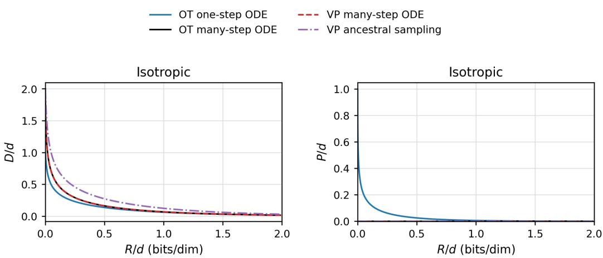  
Figure 6: Experiments on isotropic Gaussian source. Lower $D / d$ and lower $P / d$ are better.

Gaussian-source verification. For $\mathbf { X } \sim { \mathcal { N } } ( \mathbf { 0 } , { \boldsymbol { \Sigma } } )$ with eigenvalues $\{ \lambda _ { i } \} _ { i = 1 } ^ { d }$

$$
R ( \gamma ) = \frac { 1 } { 2 } \sum _ { i = 1 } ^ { d } \log _ { 2 } ( 1 + \gamma \lambda _ { i } ) , \qquad \operatorname { m m s e } ( \gamma ) = \sum _ { i = 1 } ^ { d } \frac { \lambda _ { i } } { 1 + \gamma \lambda _ { i } } .
$$

Thus $k = \textstyle \sum _ { i } \lambda _ { i } ^ { 2 }$ , which verifies the ancestral expansion in closed form. For the ideal ODE decoder, Eqs. 68 and 73 give

$$
\mathbb { E } \Big [ \Big \langle \mathbf { X } , \widehat { \mathbf { X } } _ { \mathrm { O D E } , t } \Big \rangle \Big ] = \sum _ { i = 1 } ^ { d } \frac { \sqrt { \gamma _ { t } } \lambda _ { i } ^ { 3 / 2 } } { \sqrt { 1 + \gamma _ { t } \lambda _ { i } } } = ( 1 - t ) \sum _ { i = 1 } ^ { d } \lambda _ { i } ^ { 3 / 2 } + o ( 1 - t ) .
$$

Hence $\begin{array} { r } { \kappa _ { \mathrm { O D E } } = \sum _ { i } \lambda _ { i } ^ { 3 / 2 } > 0 } \end{array}$ , verifying the first-order ODE response in this controlled setting.

## E ADDITIONAL EXPERIMENTS

## E.1 GAUSSIAN SOURCE

Setup. We use a Gaussian source for the reconstruction analysis in Section 3.3 and the low rate analysis in Section 3.4. Although this experiment is not intended to capture the full structure of high-dimensional data, it has an important advantage: the rate–distortion–perception curves can be computed in closed form when the source is Gaussian. This allows us to isolate how the reconstruction method changes distortion and perception at a fixed observation rate, and to test whether the low rate advantage predicted for ODE-based reconstruction appears. The source is $\mathbf { X } \sim { \mathcal { N } } ( \mathbf { 0 } , { \boldsymbol { \Sigma } } )$ where Σ is the source covariance matrix. We write its eigenvalues as $\lambda _ { 1 } , \ldots , \lambda _ { d } ,$ so that each λ represents the source variance along one principal direction. We use four spectra: isotropic with $\lambda _ { i } = 1$ , mild power law with $\lambda _ { i } \propto i ^ { - 0 . 5 }$ , heavy-tailed power law with $\lambda _ { i } \propto i ^ { - 1 . 2 5 }$ , and a low rank spectrum with large variance in the top 32 dimensions and small variance elsewhere. These choices assess whether the reconstruction trends persist as the source changes from uniformly distributed energy to strongly concentrated, low rank structure. We compare stochastic ancestral sampling, VP ODE, FluxC-1, and FluxC-ODE. The dimension d is set to 256 and the observation is $\mathbf { Y } _ { \gamma } \overset { - } { = } \sqrt { \gamma } \mathbf { X } + \epsilon .$ . The metrics are the rate per dimension $R / d$

$$
\frac { R ( \gamma ) } { d } = \frac { 1 } { 2 d } \sum _ { i = 1 } ^ { d } \log _ { 2 } ( 1 + \gamma \lambda _ { i } ) ,\tag{81}
$$

which is Eq. 43 normalized by $d ,$ the distortion per dimension $D / d ,$ where $D = \mathbb { E } \| \mathbf { X } - \hat { \mathbf { X } } \| _ { 2 } ^ { 2 }$ , and perception per dimension $P / d$ with P defined in Eq. 45. Appendix C derives the closed-form R–D–P curves. For each covariance spectrum, we estimate the distortion and perception curves using 100,000 independent Monte Carlo samples.

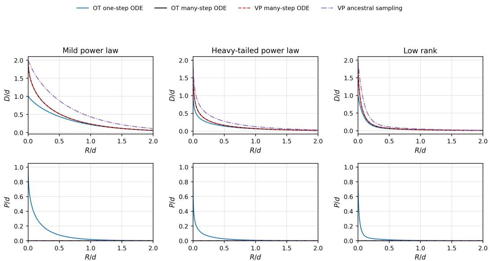  
Figure 7: Experiments on Gaussian source across mild power-law, heavy-tailed power-law, and low rank spectra.

Table 1: Encode and decode time on 512×512 images across three datasets. Times are seconds per image. Encode and decode denote the average processing times per image. Bold indicates the lowest runtime for each dataset.
<table><tr><td>Dataset</td><td>Method</td><td>Enc steps</td><td>Encode</td><td>Decode</td></tr><tr><td>Kodak Kodak</td><td>DiffC SD1.5 DiffC SD2.1</td><td>50 50</td><td>39.41 38.27</td><td>72.82 69.81</td></tr><tr><td>Kodak Kodak Kodak</td><td>DiffC Flux FluxC-1 FluxC-ODE</td><td>46 46 46</td><td>36.00 27.35 35.05</td><td>517.08 47.91 574.51</td></tr><tr><td>DIV2K DIV2K DIV2K DIV2K DIV2K</td><td>DiffC SD1.5 DiffC SD2.1 DiffC Flux FluxC-1 FluxC-ODE</td><td>50 50 46 46 46</td><td>40.10 38.82 36.59 28.24 40.79</td><td>73.14 70.14 517.84 51.67</td></tr><tr><td>CLIC</td><td>DiffC SD1.5</td><td>50</td><td>39.48</td><td>555.98</td></tr><tr><td>CLIC</td><td></td><td></td><td></td><td>73.07</td></tr><tr><td></td><td>DiffC SD2.1</td><td>50</td><td>38.61</td><td>70.44</td></tr><tr><td>CLIC CLIC</td><td>DiffC Flux FluxC-1</td><td>46</td><td>35.14</td><td>517.41</td></tr></table>

Results. Figure 6 shows three effects for an isotropic Gaussian source: first, VP ODE and FluxC-ODE coincide in this Gaussian setting, as derived in Eqs. 68 and 73. This confirms that the path selection alone does not explain a distortion gap when the observation SNR and ideal ODE decoder are matched. Second, FluxC-1 attains the lowest distortion at a fixed observation rate, as the one-step OT update coincides with the posterior mean in Eq. 57. However, it incurs nonzero perception cost because the reconstruction marginal no longer matches the source marginal. Third, the low rate expansion shows that deterministic ODE reconstruction improves from the zero-rate distortion, whereas stochastic posterior sampling achieves only a slight improvement. Figure 7 shows the results for mild power-law, heavy-tailed power-law, and low rank covariance spectra. Consistent with the isotropic case in Figure $^ { 6 , }$ the one-step ODE reconstruction achieves the lowest distortion, with the improvement being most pronounced for the mild power-law spectrum.

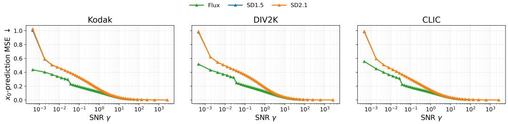  
Figure 8: Estimation MSE of x -prediction as a function of SNR for Flux, SD 1.5, and SD 2.1 on each dataset.

Table 2: FluxC encoding and decoding time (s/image) on average. Bold indicates the lowest runtime for each dataset.
<table><tr><td>Dataset</td><td>Method</td><td>Enc steps</td><td>Encode</td><td>Decode</td></tr><tr><td>Kodak Kodak</td><td>FluxC-ODE FluxC-ODE</td><td>16 6</td><td>11.79 4.57</td><td>99.14 26.59</td></tr><tr><td>Kodak Kodak Kodak</td><td>FluxC-ODE FluxC-1 FluxC-1</td><td>4 16 6</td><td>5.09 11.67 4.45</td><td>9.65 18.48 7.69</td></tr><tr><td>Kodak DIV2K DIV2K</td><td>FluxC-1</td><td>4</td><td>5.08</td><td>5.09</td></tr><tr><td></td><td>FluxC-ODE</td><td>16</td><td>12.02</td><td>98.83</td></tr><tr><td>DIV2K DIV2K DIV2K DIV2K</td><td>FluxC-ODE FluxC-ODE FluxC-1 FluxC-1</td><td>6 4 16</td><td>4.58 5.31 11.95</td><td>26.65 9.70 18.46</td></tr></table>

## E.2 NATURAL IMAGES

Computational Efficiency. Table 1 reports the average encoding/decoding time per image (seconds) and the number of encoding steps for DiffC and FluxC variants. In FluxC, SNR diverges as the trajectory approaches the data distribution (t = 0), making communication with RCC impractical (Liu et al., 2025). To address this issue, encoding starts from Gaussian noise at t = 1 and is terminated after 46 encoding steps, before reaching the data distribution. Consequently, FluxC transmits a lossy latent representation rather than a lossless one. During decoding, the received latent is used to reconstruct the remaining 46 latent samples along the reverse trajectory. For a fair comparison, DiffC Flux also uses 46 encoding steps. By contrast, DiffC employs 50 encoding steps to achieve lossless transmission, while the final latent corresponding to the input data itself is not denoised.

In terms of encoding time, the Markov transition along OT path is slightly faster than the diffusionbased counterpart. For decoding, methods based on Flux require longer runtime because the underly ing backbone is substantially larger than SD 1.5 and SD 2.1. Nevertheless, when using a one-step decoder, FluxC can achieve faster reconstruction than DiffC.

Model mismatch. Figure 8 reports the estimation MSE of natural images obtained with SD 1.5, SD 2.1, and Flux across different SNRs for each dataset. SD 1.5 and SD 2.1 exhibit nearly identical errors, while the errors of all three models approach zero as the SNR increases. In the low SNR regime, $\gamma \le 1 0 ^ { 0 }$ , Flux consistently achieves lower estimation MSE than the SD models. Since the

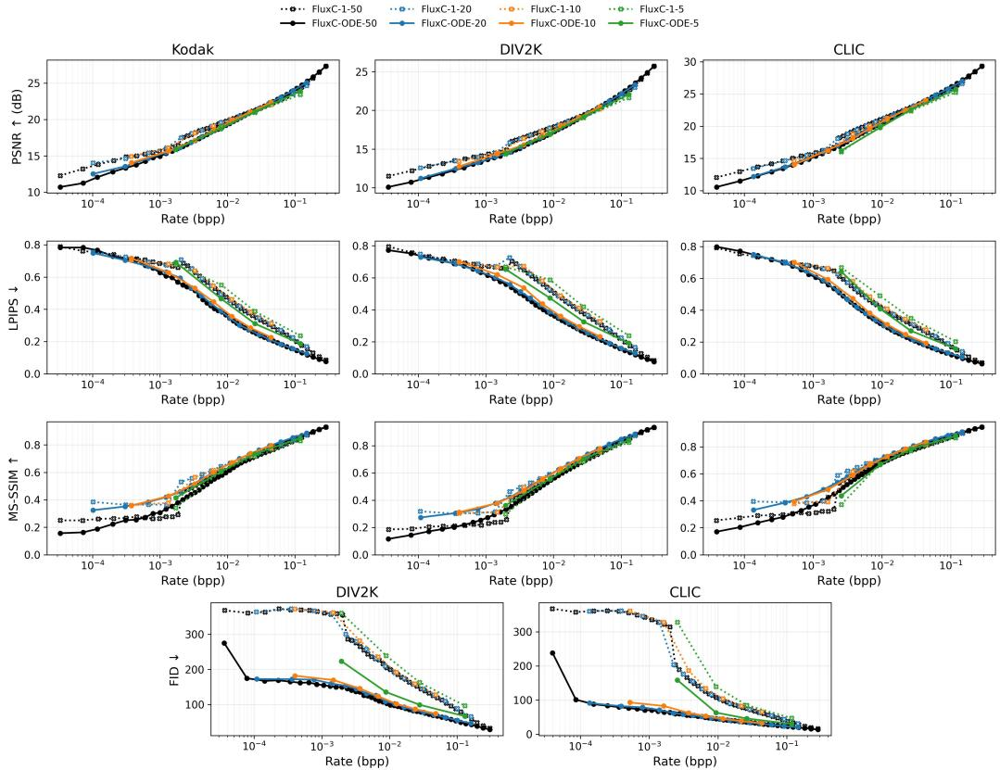  
Figure 9: Rate–distortion and rate–perception curves for FluxC with nominal encoding schedules of 50, 20, 10, and 5 steps.

MMSE is common to all estimators at a fixed SNR, the decomposition in Observation 1 attributes this difference to the denoiser-mismatch term. This suggests that FluxC incurs a smaller accumulated mismatch cost, and hence a lower total coding cost at matched low SNR empirically.

Encoding steps. Table 2 reports the computational cost for nominal encoding schedules of 50, 20, 10, and 5 steps. To avoid the SNR divergence near the data endpoint, the implementation terminates each schedule early, resulting in 16, 6, and 4 effective encoding steps, respectively. Reducing the number of encoding steps generally decreases both encoding and decoding time, with FluxC-1 providing particularly fast decoding through its one-step reconstruction.

Figure 9 presents the corresponding rate–distortion and rate–perception curves. Using more encoding steps supports a broader range of rates, particularly in the low rate regime. At a fixed rate, configurations with more steps consistently achieve better distortion and perception across the evaluated settings.

Additional Qualitative Results. Figure 10 provides additional reconstructions at around 0.003 bpp for qualitative inspection. The overall trend is consistent with that reported in Section 4. At these low bit rates, FluxC-1 achieves the lowest distortion, but its reconstructions are typically blurred and resemble averaged images. By contrast, FluxC-ODE may reconstruct fine details that differ slightly from the input, while appearing to better preserve the naturalness of the image.

Figure 11 complements the lower-rate examples by showing reconstructions around 0.02 bpp. FluxC-ODE better preserves fine details from the input while producing more natural-looking reconstructions, consistent with the lower perceptual distortion (LPIPS) reported in Figure 4.

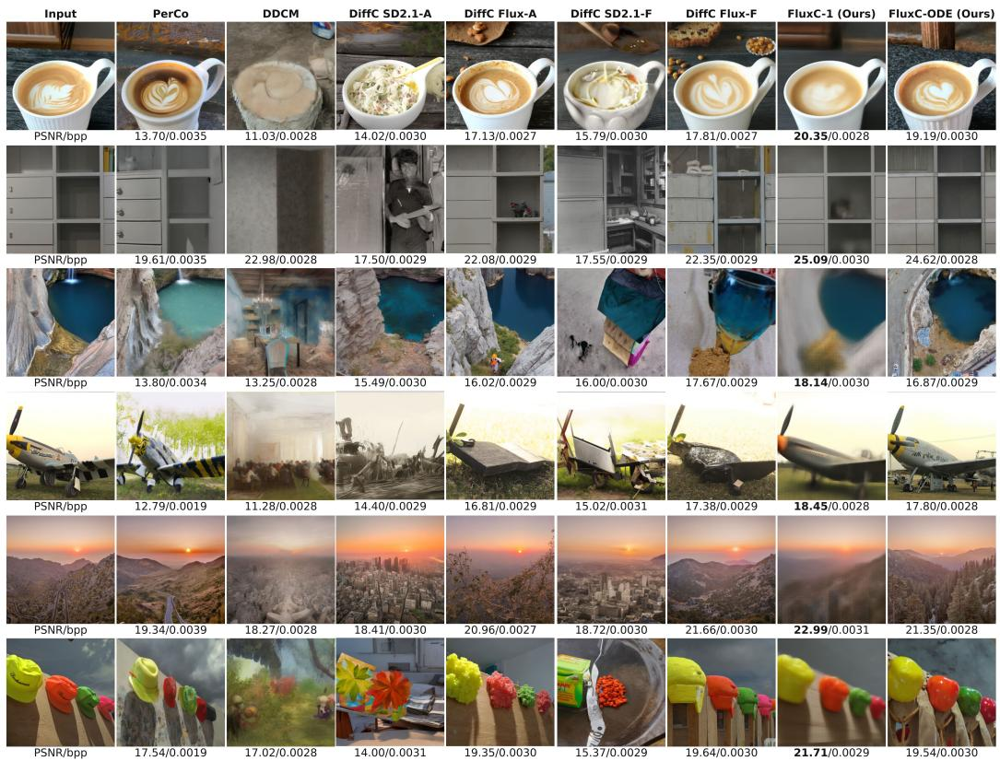  
Figure 10: Additional qualitative reconstructions at approximately 0.003 bpp compared with PerCo, DDCM, and DiffC variants and our FluxC variants.

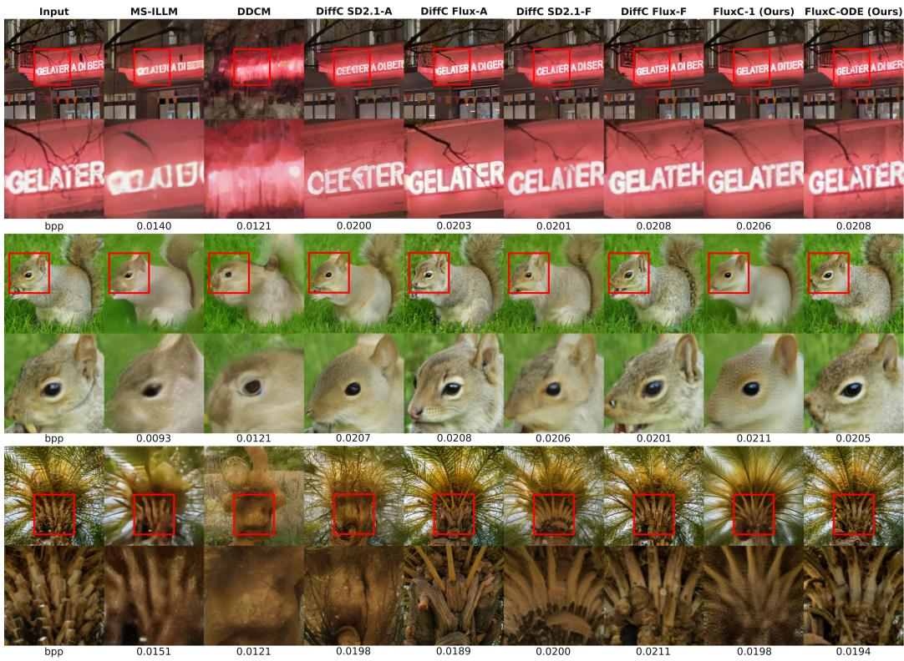  
Figure 11: Additional qualitative reconstructions at method-specific rates near the 0.02 bpp operating region.