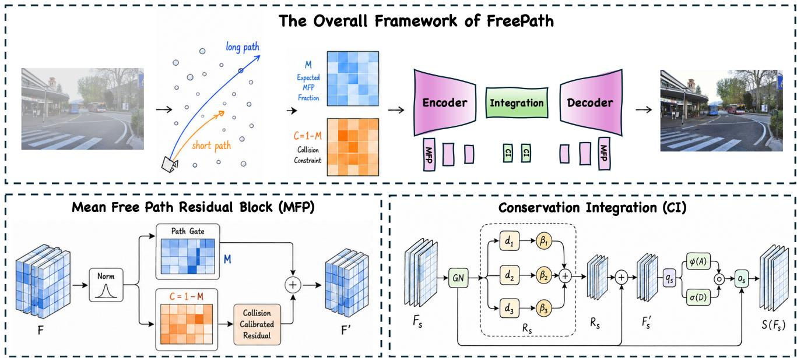
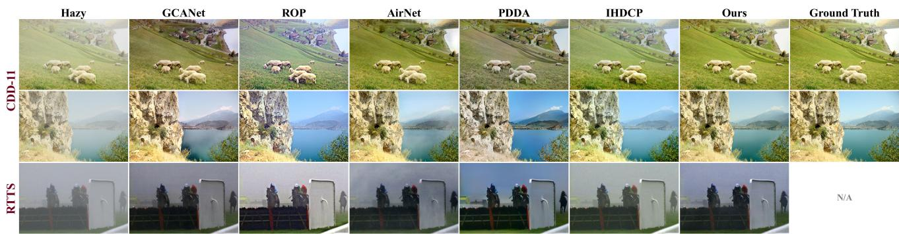

# FREEPATH: NEURAL MEAN FREE PATH FOR IMAGE DEHAZING

Rongrong Gao1 Jingxuan Feng2 Wenyu Xu3

1 Tsinghua University 2Wuchang University of Technology 3The Hong Kong Polytechnic University

## ABSTRACT

Single image dehazing requires recovering scene radiance from visual responses that are weakened and veiled by participating media. Existing methods either invert explicit scattering variables, which can be unstable under complex scenes, or learn direct restoration mappings, which often discard the physical organization of haze formation. We present FreePath, a neural mean free path framework for image dehazing. Instead of estimating atmospheric parameters, FreePath represents dehazing as feature space path state restoration, inspired by the expected distance a visual response can propagate before interacting with haze. Within a residual encoder and decoder, the Mean Free Path Residual Block learns path and collision fields to guide haze constrained correction, while FreePath State Conservation Integration preserves restored path states during deep feature aggregation. Experiments on paired CDD-11 haze images and real RTTS scenes show that FreePath consistently improves full reference fidelity, no reference perceptual quality, and visual faithfulness over representative dehazing baselines.

Index Terms— Image dehazing, mean free path, image restoration, computer vision

## 1. INTRODUCTION

Images captured in haze lose contrast, color fidelity, and distant structures, which makes visual understanding and downstream perception unreliable [1, 2]. Classical dehazing explains this degradation through atmospheric scattering, where the recorded image mixes attenuated scene radiance with airlight scattered by suspended particles [3, 1]. This view has inspired influential priors and neural designs, but the usual variables are often too coarse to describe the feature ambiguity handled by learned restoration networks [2, 4, 5, 6].

Learning based dehazing improves restoration through scattering related prediction, gated or attention based aggregation, and general restoration architectures [6, 7, 8, 9]. Yet dehazing still needs a representation that is more physically meaningful than generic enhancement and less brittle than explicit single image parameter estimation [10, 11, 12]. From this perspective, a dehazing network should identify which feature responses can remain as reliable scene evidence and which responses require medium aware correction. This motivates a learnable path state that connects a physical notion of path freedom with residual image restoration.

We address this gap with FreePath, a neural mean free path framework. Mean free path describes the expected travel distance before a medium interaction [10, 11]. FreePath translates this concept into a feature space path state, where path free responses preserve scene structure and collision constrained responses receive stronger residual correction.

As shown in Fig. 1, FreePath keeps the residual encoder and decoder topology but reorganizes internal computation around this path state. The Mean Free Path Residual Block corrects hazy responses, and FreePath State Conservation Integration consolidates deep features without assigning another path state. Our contributions are summarized as:

• We propose FreePath, a neural mean free path framework that reformulates image dehazing as feature space path state restoration.

• We instantiate the framework with a Mean Free Path Residual Block and a FreePath State Conservation Integration module, respectively correcting collision constrained responses and preserving restored path states during deep aggregation.

• Experiments on paired CDD-11 haze images and real RTTS scenes demonstrate strong full reference accuracy, no reference quality, and visually faithful dehazing performance.

## 2. RELATED WORK

Physical image dehazing. Physical dehazing methods are rooted in atmospheric scattering and radiative propagation [10, 11, 1]. Following this formulation, classical algorithms design image priors based on contrast maximization, dark channel statistics, boundary constraints, color attenuation, haze lines, and probabilistic inference [13, 2]. These methods expose meaningful physical structure, but their hand crafted assumptions can be fragile when haze density, illumination, and scene content vary jointly [14, 15, 16].

Learning based dehazing and restoration. Learning based dehazing has benefited from synthetic and real benchmarks [14, 17, 16]. Early networks estimate haze related maps or directly regress clear images [18, 19, 6], while later methods introduce gated fusion, adversarial translation, grid processing, feature attention, contrastive learning, domain adaptation, codebook priors, and transformer architectures [20, 7, 21]. The evaluated baselines span gated context aggregation [7], rank oriented recovery [22], all in one restoration [23], prompt driven adaptation [24], and haze density correction [25]. General restoration models further motivate stable encoder and decoder restoration [26, 9, 27, 28, 29], while FreePath organizes this restoration with a neural mean free path state.

  
Fig. 1. The overall framework of FreePath. The first row shows neural mean free path restoration inside an encoder and decoder pipeline. The lower panels show the Mean Free Path Residual Block and Conservation Integration, which perform path guided correction and state preserving aggregation.

## 3. METHOD

## 3.1. Overview

FreePath is designed to keep the optimization reliability of a residual encoder and decoder while giving its feature evolution a scattering aware organization. Given a hazy image $\mathbf { x } \in \mathbb { R } ^ { 3 \times H \times W }$ , the network predicts a dehazed image yˆ as

$$
\hat { \mathbf { y } } = \mathbf { x } + \Phi _ { \mathrm { o u t } } \big ( D ( S ( E ( \Phi _ { \mathrm { i n } } ( \mathbf x ) ) ) ) \big ) ,\tag{1}
$$

where $\Phi _ { \mathrm { i n } }$ and $\Phi _ { \mathrm { o u t } }$ are $1 \times 1$ projection layers, E is a four stage encoder, S is the FreePath State Conservation Integration module, and D is the decoder with skip connections. The residual output form encourages the model to focus on haze removal rather than reconstructing the whole scene from scratch, which is consistent with recent restoration networks [26, 9, 30].

The key representation in FreePath is the neural mean free path state. Each Mean Free Path Residual Block estimates a path gate M and a complementary collision constraint C = 1 − M. The gate is not treated as a calibrated physical distance. It is a learned feature field whose role mirrors the mean free path concept: large M marks responses that can be carried forward as scene evidence, while large C marks responses that should receive stronger haze correction [10, 11]. The integration stage then aggregates deep features without creating a second path assignment, so the restored state remains consistent between the encoder and decoder.

## 3.2. Mean Free Path Residual Block

The Mean Free Path Residual Block is the core computation unit of FreePath. For an input feature F, the block first normalizes the feature and predicts the path state:

$$
\mathbf { M } = \sigma ( g ( \mathrm { G N } ( \mathbf { F } ) ) ) , \qquad \mathbf { C } = 1 - \mathbf { M } ,\tag{2}
$$

where $g ( \cdot )$ is a convolutional predictor and σ denotes the sigmoid function. The normalized feature is modulated by the free path field before residual extraction:

$$
\tilde { \mathbf { F } } = ( 0 . 5 + \mathbf { M } ) \odot \mathrm { G N } ( \mathbf { F } ) .\tag{3}
$$

This keeps path free responses prominent and assigns larger residual correction to collision constrained responses.

To retain the strong optimization behavior of convolutional restoration blocks [31, 26, 30], FreePath uses a set of depthwise residual filters and predicts data dependent re-

sponse weights:

$$
{ \bf R } = \sum _ { k = 1 } ^ { 3 } \alpha _ { k } ( \tilde { \bf F } ) d _ { k } ( \tilde { \bf F } ) , \quad \sum _ { k = 1 } ^ { 3 } \alpha _ { k } = 1 ,\tag{4}
$$

where $d _ { k }$ are depthwise filter bases. The collision constraint controls the residual energy:

$$
\mathbf { F } ^ { \prime } = \mathbf { F } + r \big ( ( 0 . 7 5 + \mathbf { C } ) \odot \mathbf { R } \big ) ,\tag{5}
$$

where $r ( \cdot )$ is a pointwise recomposition layer. A gated channel mixer then produces the block output. The block therefore does not invert an explicit haze equation. It learns residual updates from paired supervision, but the updates are routed by the neural free path and collision fields.

## 3.3. FreePath State Conservation Integration

After repeated path sensitive correction, the deepest representation should be aggregated without changing its recovered path state. FreePath therefore uses State Conservation Integration. Its principle is simple: once the restoration stream has inferred neural mean free path states, the integration stage should consolidate deep features instead of predicting another independent path gate.

Given a deep feature $\mathbf { F } _ { s } ,$ the integration module applies a path preserving residual transform:

$$
\mathbf { R } _ { s } = \sum _ { k = 1 } ^ { 3 } \beta _ { k } ( \bar { \mathbf { F } } _ { s } ) d _ { k } ( \bar { \mathbf { F } } _ { s } ) , \quad \bar { \mathbf { F } } _ { s } = \mathrm { G N } ( \mathbf { F } _ { s } ) , \quad \sum _ { k = 1 } ^ { 3 } \beta _ { k } = 1 ,\tag{6}
$$

where $d _ { k }$ are depthwise residual filter bases and $\beta _ { k }$ are adaptive response weights. The integrated feature is then obtained by

$$
\mathbf { F } _ { s } ^ { \prime } = \mathbf { F } _ { s } + r _ { s } ( \mathbf { R } _ { s } ) ,\tag{7}
$$

followed by a gated channel integration:

$$
S ( \mathbf { F } _ { s } ) = \mathbf { F } _ { s } ^ { \prime } + o _ { s } \big ( \phi ( \mathbf { A } ) \odot \sigma ( \mathbf { D } ) \big ) , \quad [ \mathbf { A } , \mathbf { D } ] = q _ { s } ( \mathrm { G N } ( \mathbf { F } _ { s } ^ { \prime } ) ) .\tag{8}
$$

Different from the Mean Free Path Residual Block, this module does not predict a new free path gate or collision field. It preserves the path states restored by surrounding FreePath blocks and performs stable deep feature aggregation. Thus, FreePath first corrects features according to inferred path freedom and then conserves those states for decoding.

## 3.4. Training Objective

We train FreePath with image level restoration supervision. The hazy input is normalized to [−1, 1], and the prediction is mapped back to [0, 1] before being compared with the clear target y:

$$
\mathcal { L } = 0 . 7 \mathcal { L } _ { \mathrm { S L 1 } } ( \hat { \bf y } , { \bf y } ) + 0 . 3 \mathcal { L } _ { \mathrm { M S S S I M } } ( \hat { \bf y } , { \bf y } ) + 0 . 0 1 \mathcal { L } _ { \mathrm { p e r c } } ( \hat { \bf y } , { \bf y } ) ,\tag{9}
$$

where ${ \mathcal { L } } _ { \mathrm { S L 1 } }$ is the smooth $\ell _ { 1 }$ loss, $\mathcal { L } _ { \mathrm { M S S I M } } = 1 - \mathrm { M S S I M } .$ and $\mathcal { L } _ { \mathrm { p e r c } }$ is a VGG 16 feature perceptual loss computed with the first 16 feature layers fixed [32, 33]. The mean free path and collision fields are not directly annotated; they emerge from paired image restoration.

## 4. EXPERIMENTS

## 4.1. Dataset and Protocol

Experiments use two complementary datasets. For paired training and full reference evaluation, we use the haze subset of CDD-11 [16], which provides aligned hazy and clear images. We sort the training pairs by numerical identifiers and train FreePath on the first 500 hazy and clear pairs. Testing uses 200 paired CDD-11 haze images. We report PSNR, SSIM [32], FSIM [34], VSI [35], LPIPS [33], and GMSD [36].

For real scene evaluation, we select 50 RTTS images from RESIDE [14]. Since RTTS has no aligned clear targets, we report CLIPIQA and visual comparisons to assess no reference dehazing quality.

## 4.2. Implementation Details

All models, including FreePath and the ablation variants, are trained under the same setting on a single NVIDIA RTX 3080 GPU. We use Adam optimization with an initial learning rate of $1 0 ^ { - 4 }$ and batch size 4, and train each model for 50 epochs. The learning rate is divided by 2 every 10 epochs, and the last checkpoint after the 50th epoch is used for testing. The network width is set to 32 channels. For CDD-11 testing, outputs are denormalized to the [0, 1] range and compared with aligned clear targets. For RTTS testing, the same trained model is directly applied to real hazy images without fine tuning.

## 4.3. Main Comparisons

We compare FreePath with representative dehazing and restoration baselines, including GCANet [7], ROP [22], Air-Net [23], PDDA [24], and IHDCP [25]. Table 1 aligns the quantitative evidence with the two evaluation regimes: the left group reports full reference metrics on paired CDD-11 images, and the last column reports no reference quality on RTTS. FreePath achieves the best CDD-11 scores across PSNR, SSIM, FSIM, VSI, LPIPS, and GMSD. It also obtains the highest RTTS CLIPIQA score. These results show consistent gains in pixel fidelity, perceptual structure, and real scene quality within the same architecture. The metric pattern is consistent with the intended role of FreePath. PSNR and SSIM reflect improved paired fidelity, FSIM and VSI indicate stronger structural preservation, and LPIPS and GMSD show reduced perceptual and gradient distortion. On RTTS, CLIP-IQA further suggests that the learned path state transfers to real haze without paired real scene supervision.

Table 1. Main comparison on CDD-11 and RTTS. Results are reported as mean ± standard deviation. Higher is better for PSNR, SSIM, FSIM, VSI, and CLIPIQA, while lower is better for LPIPS and GMSD.
<table><tr><td rowspan="2">Method</td><td colspan="6">CDD-11</td><td rowspan="2">RTTS</td></tr><tr><td>PSNR↑</td><td>SSIM ↑</td><td>FSIM↑</td><td>VSI↑</td><td>LPIPS↓</td><td>GMSD↓</td></tr><tr><td>GCANet [7]</td><td></td><td></td><td></td><td></td><td> $1 7 . 9 9 1 \pm 4 . 5 0 0 \ 0 . 8 9 3 \pm 0 . 0 6 3 \ 0 . 9 4 0 \pm 0 . 0 3 4 \ 0 . 9 7 9 \pm 0 . 0 1 3 \ 0 . 1 5 4 \pm 0 . 0 8 1 \ 0 . 0 4 8 \pm 0 . 0 1 9 \ 0 . 3 7 7 \pm 0 . 2 1 0 9 \ 0 . 3 7 3 2 \ 0 . 1 9 2$ </td><td></td><td>CLIPIQA ↑</td></tr><tr><td>ROP [22]</td><td></td><td></td><td></td><td></td><td> $1 7 . 8 3 3 \pm 3 . 1 1 3 \ 0 . 9 3 0 \pm 0 . 0 4 1 \ 0 . 9 2 7 \pm 0 . 0 3 0 \ 0 . 9 6 9 \pm 0 . 0 1 5 \ 0 . 1 3 9 \pm 0 . 0 6 9 \ 0 . 0 4 4 \pm 0 . 0 1 7 \ 0 . 3 5 3 \pm 0 . 1 9 0 9 $ </td><td></td><td></td></tr><tr><td>AirNet [23]</td><td></td><td></td><td></td><td></td><td> $1 7 . 0 1 2 \pm 2 . 7 5 4 \ 0 . 6 0 7 \pm 0 . 1 1 7 \ 0 . 8 9 7 \pm 0 . 0 2 2 \ 0 . 9 7 2 \pm 0 . 0 0 9 \ 0 . 1 3 7 \pm 0 . 0 4 9 \ 0 . 1 3 7 \pm 0 . 0 2 6 \ 0 . 3 7 9 \pm 0 . 1 3 5$ </td><td></td><td></td></tr><tr><td>PDDA [24]</td><td></td><td></td><td></td><td></td><td> $1 8 . 7 6 1 \pm 2 . 6 2 9 \ 0 . 8 8 6 \pm 0 . 0 4 6 \ 0 . 9 5 1 \pm 0 . 0 3 2 \ 0 . 9 8 0 \pm 0 . 0 1 4 \ 0 . 1 7 6 \pm 0 . 0 6 7 \ 0 . 0 4 5 \pm 0 . 0 2 5 \ 0 . 3 9 4 \pm 0 . 1 5 0 0 \ 0 . 3 9 4 1$ </td><td></td><td></td></tr><tr><td>IHDCP [25]</td><td></td><td></td><td></td><td></td><td> $1 9 . 5 5 0 \pm 3 . 7 2 5 \ 0 . 9 4 1 \pm 0 . 0 3 9 \ 0 . 9 6 0 \pm 0 . 0 2 4 \ 0 . 9 8 2 \pm 0 . 0 1 2 \ 0 . 0 7 8 \pm 0 . 0 5 3 \ 0 . 0 2 7 \pm 0 . 0 1 1 \ 0 . 4 2 3 \pm 0 . 2 0 7 1 \ 0 . 0 3 2 \ 0 . 0 3 2 \ 0 . 0 4 1 ]$ </td><td></td><td></td></tr><tr><td>FreePath</td><td></td><td></td><td></td><td></td><td> $2 7 . 6 0 8 \div 4 . 5 4 9 \ 0 . 9 8 6 \div 0 . 0 1 2 \ 0 . 9 9 0 \div 0 . 0 1 0 \ 0 . 9 9 7 \div 0 . 0 0 3 \ 0 . 0 1 6 \div 0 . 0 1 4 \ 0 . 0 1 0 \div 0 . 0 0 8 \ 0 . 4 3 3 \div 0 . 1 9 9$ </td><td></td><td></td></tr></table>

  
Fig. 2. Visual comparison on CDD-11 and RTTS. Columns follow Table 1. Ground truth is available only for CDD-11.

Figure 2 gives the corresponding visual evidence. On CDD-11, FreePath removes the dense veil while preserving natural colors and scene structures, producing results closest to the aligned clear targets. On RTTS, where ground truth is unavailable, FreePath better suppresses veiling while preserving scene structures, matching the quantitative conclusion in Table 1.

## 4.4. Ablation Study

To verify the effectiveness of the proposed architecture, we conduct an ablation study under the same data, training setting, and testing protocol as the main experiment. FreePath w/o Mean Free Path Residual Block replaces the proposed residual blocks with path agnostic residual units, reducing PSNR from 27.608 to 27.440. FreePath w/o State Conservation Integration keeps the Mean Free Path Residual Blocks but removes the conservation principle at the integration stage, causing a larger drop to 26.644 PSNR and 0.983 SSIM. The first variant verifies that the learned path and collision fields provide useful guidance beyond standard residual transformation, while the second shows that path states must be preserved during deep aggregation. The two results jointly support the central claim of neural mean free path restoration.

Table 2. Ablation studies on CDD-11. Results are mean ± standard deviation under the same training and testing protocol.
<table><tr><td>Method</td><td>PSNR ↑</td><td>SSIM↑</td></tr><tr><td>FreePath w/o MFP Block</td><td> $2 7 . 4 4 0 { \pm } 4 . 6 0 0 0 . 9 8 5 { \pm } 0 . 0 1 2$ </td><td rowspan="3"></td></tr><tr><td>FreePath w/o State Conservation</td><td> $2 6 . 6 4 4 { \pm } 4 . 8 2 2 0 . 9 8 3 { \pm } 0 . 0 1 3$ </td></tr><tr><td>FreePath</td><td> $\mathbf { 2 7 . 6 0 8 { \overset { . } { = } } 4 . 5 4 9 0 . 9 8 6 { \overset { . } { = } } 0 . 0 1 2 }$ </td></tr></table>

## 5. CONCLUSION

We presented FreePath, an image dehazing framework built around neural mean free path restoration. Instead of explicitly estimating atmospheric light or transmission, FreePath learns feature path states inside a residual encoder and decoder. The Mean Free Path Residual Block performs path sensitive correction, while FreePath State Conservation Integration preserves restored path states during deep aggregation. Experiments on paired CDD-11 haze images and real RTTS scenes show strong performance under full reference and no reference evaluations, together with consistent visual improvements over representative baselines. Ablation results further confirm that path guided correction and state preserving aggregation are both necessary for effective neural mean free path restoration. These results indicate that mean free path is not merely a naming device, but the organizing variable that connects residual correction and state conservation into one restoration process.

## 6. REFERENCES

[1] Srinivasa G Narasimhan and Shree K Nayar, “Vision and the atmosphere,” IJCV, vol. 48, no. 3, pp. 233–254, 2002.

[2] Kaiming He, Jian Sun, and Xiaoou Tang, “Single image haze removal using dark channel prior,” IEEE Trans. Pattern Anal. Mach. Intell., vol. 33, no. 12, pp. 2341–2353, 2010.

[3] Harald Koschmieder, Theorie der horizontalen Sichtweite, Keim & Nemnich, 1925.

[4] Gaofeng Meng, Ying Wang, Jiangyong Duan, et al., “Efficient image dehazing with boundary constraint and contextual regularization,” in ICCV, 2013, pp. 617–624.

[5] Dana Berman, Tali Treibitz, and Shai Avidan, “Non-local image dehazing,” in CVPR, 2016, pp. 1674–1682.

[6] Boyi Li, Xiulian Peng, Zhangyang Wang, et al., “Aod-net: All-in-one dehazing network,” in ICCV. Ieee, 2017, pp. 4780– 4788.

[7] Dongdong Chen, Mingming He, Qingnan Fan, et al., “Gated context aggregation network for image dehazing and deraining,” in WACV. IEEE, 2019, pp. 1375–1383.

[8] Xu Qin, Zhilin Wang, Yuanchao Bai, et al., “Ffa-net: Feature fusion attention network for single image dehazing,” in AAAI, 2020, vol. 34, pp. 11908–11915.

[9] Syed Waqas Zamir, Aditya Arora, Salman Khan, et al., “Restormer: Efficient transformer for high-resolution image restoration,” in CVPR, 2022, pp. 5728–5739.

[10] Akira Ishimaru, Wave propagation and scattering in random media, vol. 12, John Wiley & Sons, 1999.

[11] Craig F Bohren and Donald R Huffman, Absorption and scattering oflight by small particles, John Wiley & Sons, 2008.

[12] Yu Zheng, Jiahui Zhan, Shengfeng He, et al., “Curricular contrastive regularization for physics-aware single image dehazing,” in CVPR. IEEE, 2023, pp. 5785–5794.

[13] Raanan Fattal, “Single image dehazing,” ACM TOG, vol. 27, no. 3, pp. 1–9, 2008.

[14] Boyi Li, Wenqi Ren, Dengpan Fu, et al., “Benchmarking single-image dehazing and beyond,” IEEE Trans. Image Process., vol. 28, no. 1, pp. 492–505, 2018.

[15] Codruta O Ancuti, Cosmin Ancuti, Mateu Sbert, et al., “Densehaze: A benchmark for image dehazing with dense-haze and haze-free images,” in ICIP. IEEE, 2019, pp. 1014–1018.

[16] Yu Guo, Yuan Gao, Yuxu Lu, et al., “Onerestore: A universal restoration framework for composite degradation,” in ECCV. Springer, 2024, pp. 255–272.

[17] Codruta Ancuti, Cosmin Ancuti, Radu Timofte, et al., “Ohaze: a dehazing benchmark with real hazy and haze-free outdoor images,” in CVPRW, 2018.

[18] Bolun Cai, Xiangmin Xu, Kui Jia, et al., “Dehazenet: An endto-end system for single image haze removal,” IEEE Trans. Image Process., vol. 25, no. 11, pp. 5187–5198, 2016.

[19] Wenqi Ren, Si Liu, Hua Zhang, et al., “Single image dehazing via multi-scale convolutional neural networks,” in ECCV. Springer, 2016, pp. 154–169.

[20] Wenqi Ren, Lin Ma, Jiawei Zhang, et al., “Gated fusion network for single image dehazing,” in CVPR. IEEE, 2018, pp. 3253–3261.

[21] Rui-Qi Wu, Zheng-Peng Duan, Chun-Le Guo, et al., “Ridcp: Revitalizing real image dehazing via high-quality codebook priors,” in CVPR. IEEE, 2023, pp. 22282–22291.

[22] Jun Liu, Ryan Wen Liu, Jianing Sun, et al., “Rank-one prior: Real-time scene recovery,” IEEE Trans. Pattern Anal. Mach. Intell., vol. 45, no. 7, pp. 8845–8860, 2022.

[23] Boyun Li, Xiao Liu, Peng Hu, et al., “All-in-one image restoration for unknown corruption,” in CVPR. IEEE, 2022, pp. 17431–17441.

[24] Yan Zhang, Yuxin Feng, Xin Li, et al., “Pdda: Prompt-driven domain adaptation for real-world image dehazing,” IEEE Trans. Image Process., 2026.

[25] Yun Liu, Tao Li, Chunping Tan, et al., “Ihdcp: Single image dehazing using inverted haze density correction prior,” IEEE Trans. Image Process., 2026.

[26] Syed Waqas Zamir, Aditya Arora, Salman Khan, et al., “Multistage progressive image restoration,” in CVPR. IEEE, 2021, pp. 14816–14826.

[27] Jingyun Liang, Jiezhang Cao, Guolei Sun, et al., “Swinir: Image restoration using swin transformer,” in ICCVW. IEEE, 2021, pp. 1833–1844.

[28] Zhendong Wang, Xiaodong Cun, Jianmin Bao, et al., “Uformer: A general u-shaped transformer for image restoration,” in CVPR. IEEE, 2022, pp. 17662–17672.

[29] Vaishnav Potlapalli, Syed Waqas Zamir, Salman H Khan, et al., “Promptir: Prompting for all-in-one image restoration,” in NeurIPS, 2023, vol. 36, pp. 71275–71293.

[30] Liangyu Chen, Xiaojie Chu, Xiangyu Zhang, et al., “Simple baselines for image restoration,” in ECCV. Springer, 2022, pp. 17–33.

[31] Hang Dong, Jinshan Pan, Lei Xiang, et al., “Multi-scale boosted dehazing network with dense feature fusion,” in CVPR. IEEE, 2020, pp. 2154–2164.

[32] Zhou Wang, Alan C Bovik, Hamid R Sheikh, et al., “Image quality assessment: from error visibility to structural similarity,” IEEE Trans. Image Process., vol. 13, no. 4, pp. 600–612, 2004.

[33] Richard Zhang, Phillip Isola, Alexei A Efros, et al., “The unreasonable effectiveness of deep features as a perceptual metric,” in CVPR. IEEE, 2018, pp. 586–595.

[34] Lin Zhang, Lei Zhang, Xuanqin Mou, et al., “Fsim: A feature similarity index for image quality assessment,” IEEE Trans. Image Process., vol. 20, no. 8, pp. 2378–2386, 2011.

[35] Lin Zhang, Ying Shen, and Hongyu Li, “Vsi: A visual saliency-induced index for perceptual image quality assessment,” IEEE Trans. Image Process., vol. 23, no. 10, pp. 4270– 4281, 2014.

[36] Wufeng Xue, Lei Zhang, Xuanqin Mou, et al., “Gradient magnitude similarity deviation: A highly efficient perceptual image quality index,” IEEE Trans. Image Process., vol. 23, no. 2, pp. 684–695, 2013.