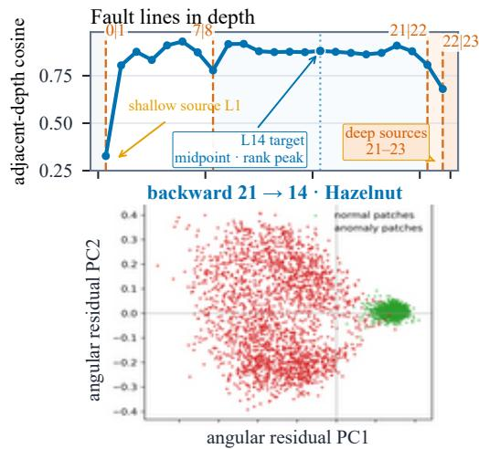
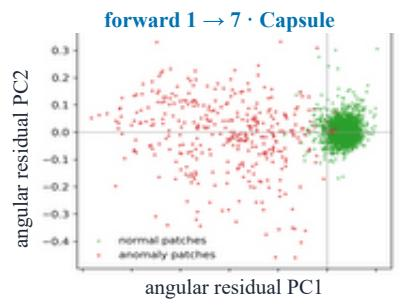
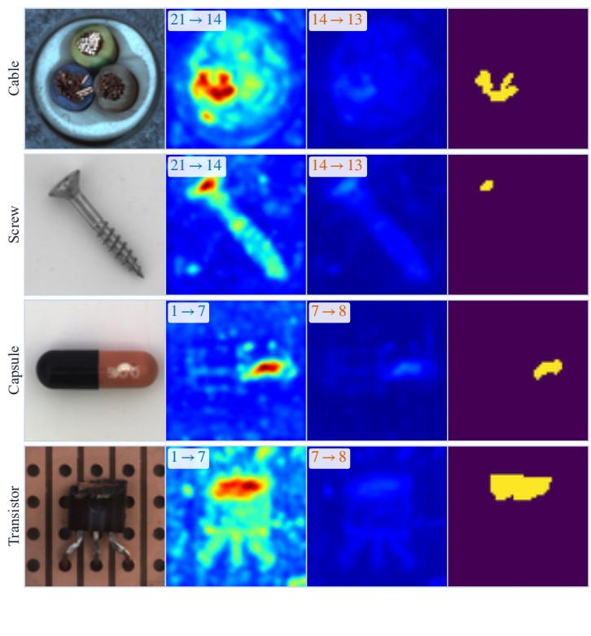
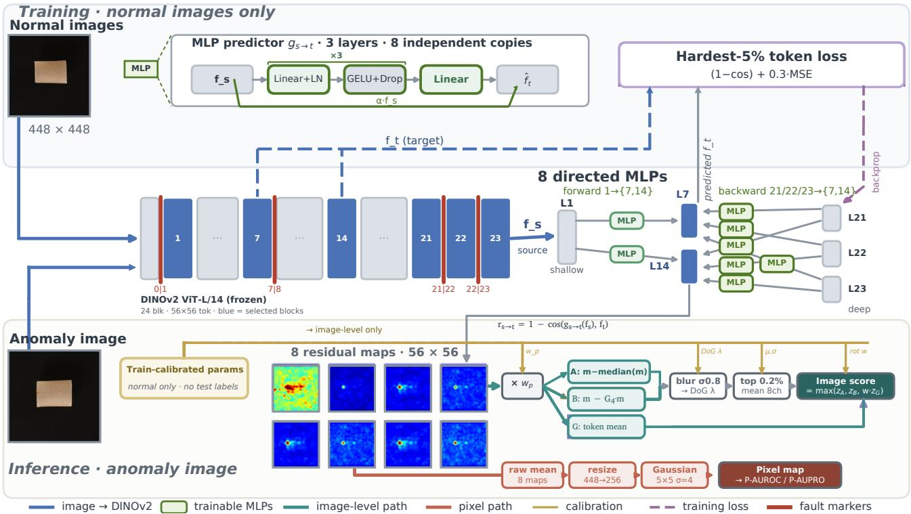
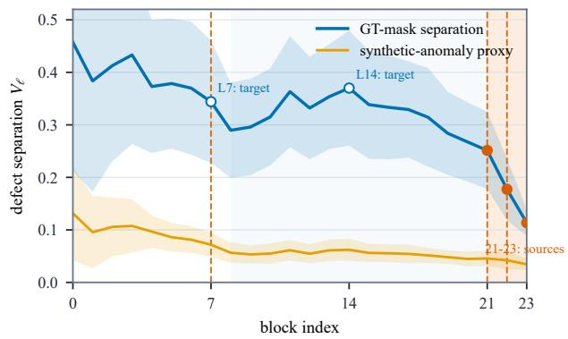
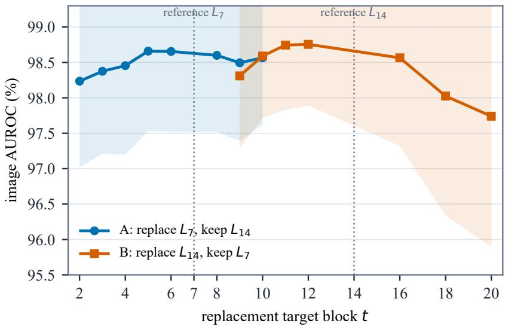

# Fault-Guided Cross-Layer Prediction for Unsupervised Anomaly Detection

Tao Wang

## Abstract

Feature reconstruction is widely used for unsupervised industrial anomaly detection in the single-class setting, where only normal images from one product category are available for training. We propose a single-class detector that asks what information one block can pass to another. We

  
(a) Fault geometry and residual separation

treat the depth of a frozen vision transformer as a sequence of discrete transitions. A directed predictor learns a block-to-block hidden-state transition pointwise over tokens. Adjacent-layer cosine similarity exposes four sharp fault lines in DINOv2 ViT-L, separating stable depth segments. The deepest blocks retain semantic context but lose local detail; a prediction from deep or shallow sources to sensitive targets therefore exposes the information that cannot be transported. The fault structure fixes the source and target roles, and the same rule transfers to ViT-B and RADIO-B.

  
Input Cross-layer residual Adjacent residual Ground truth  
(b) Cross-layer localization across four categories  
Figure 1. Measured evidence for fault-guided cross-layer prediction. (a) Adjacent-depth cosine similarity averaged over five categories Four faults separate stable depth segments. L14 is marked as the midpoint of the stable segment and the participation-ratio peak. The two angular-residual manifolds show normal patches concentrating near the origin while defect patches spread outward for backward 21→14 and forward 1→7. (b) One anomaly from each of four MVTec-AD categories. The first two rows use 21→14 and the last two use 1→7, illustrating complementary backward and forward evidence; the adjacent column compares these with 14→13 and $7 {  } 8$ under the same training run.

We use a boundedforeground prior calibrated solely on training images: it attenuates background evidence without also erasing defects outside the estimated foreground. Using one predictor architecture and a common training-only calibrationprotocol, image AUROC is 99.75 on MVTec-AD, 99.42 on VisA and 94.27 on Real-IAD. On Real-IAD the object-level AUROC is 96.26. At 256 × 256 pixel resolution, P-AUROC/P-AUPRO are 98.46/95.97 on MVTec-AD, 99.21/96.12 on VisA and 99.26/96.59 on Real-IAD.

## 1. Introduction

Industrial inspection must detect defects that cannot be enumerated in advance. We consider the single-class setting, where training uses only normal images from one product category. MVTec-AD [3], VisA [42] and Real-IAD [36] follow this protocol. The leading methods reconstruct features from a frozen encoder [11, 16, 17]. A bottleneck compresses the features, a decoder reconstructs selected teacher features, and anomalies appear as large residuals. Fig. 1 motivates a different design: the deepest features remain insensitive to local defects, while an asymmetric cross-layer predictor tests whether deep and shallow sources can transport the missing evidence to sensitive blocks; the transfer failure becomes the anomaly signal.

Reconstruction methods share two assumptions. First, the decoder can see the features it must reproduce, which permits a copying shortcut. Second, the target representations are selected by architectural convention. RD4AD [11] reconstructs multi-scale encoder representations through a one-class bottleneck, whereas the Dinomaly line [16, 17] reconstructs a fixed group of ViT blocks. Neither choice is tied to a measured property of the representation, and sensitive and insensitive layers are treated alike.

We test the backbone directly. Adjacent-layer cosine similarity is not smooth in depth. In DINOv2 ViT-L it drops sharply at 0|1, 7|8, 21|22 and 22|23, partitioning the 24 blocks into [1..7], [8..21], [22] and [23], with block 0 isolated before the first fault. Effective feature rank and the response to a local perturbation change at the same boundaries. The deepest blocks therefore carry semantic context but little local defect detail. These signatures are consistent with rank-collapse analyses of deep attention and transformer stacks [12, 28]. The layer-wise phase transitions in ViTs are consistent with terminal neural-collapse geometry [23], building on the general neural-collapse phenomenon [30].

We treat depth as a sequence of transitions [1, 20, 35]. A directed channel $( s , t )$ learns $g _ { s  t }$ from block s to block t, while the backbone remains frozen. The residual $1 - \cos ( g _ { s  t } ( f _ { s } ) , f _ { t } )$ is the part of the target state that the source cannot transport. The source and target therefore become explicit design choices. A deep block is useful as a source because it lacks local detail; a sensitive block is useful as a target because that missing detail becomes visible there.

The fault structure determines the roles. Block 1 is the shallow source, block 7 is the near target before the 7|8 fault, block 14 is the midpoint of [8..21], and blocks 21– 23 are deep sources. Fig. 3 checks this assignment against ground-truth and synthetic anomalies. The curves remain sensitive at L7 and L14 and decay in the final segment. L7 remains the near target, while L14 supplies the mid-depth target. Each channel is scored independently, then the eight scores are averaged. A soft foreground prior can attenuate background residuals but never sets them to zero.

Directed transfer between selected patch embeddings was used by Costanzino et al. [8], with layer pairs chosen by ablation. We keep the directed transfer and derive the pairs and their direction from the backbone’s fault structure. The same rule selects layers for ViT-L, ViT-B and RADIO-B.

Our contributions are:

• a label-free layer-selection rule that detects adjacent-layer cosine faults, corroborated by effective-rank and localsensitivity diagnostics;

• a directed cross-layer predictor that turns asymmetric source-to-sensitive transfer failure into an anomaly score, with deep-to-sensitive channels as the principal signal and shallow-to-sensitive channels as complementary evidence;

• a shared scoring and foreground-prior procedure that transfers across three backbones and three industrial benchmarks without per-category channel selection.

With the same predictor architecture and training-only calibration, image AUROC is 99.75 on MVTec-AD, 99.42 on VisA and 94.27 on Real-IAD. Real-IAD object-level AUROC is 96.26; at 256 × 256 pixel resolution, P-AUROC/P-AUPRO is 99.26/96.59.

## 2. Related Work

Reconstruction and distillation. RD4AD [11] reconstructs multi-scale frozen encoder representations through a one-class bottleneck. The Dinomaly line [16, 17] reconstructs a selected group of ViT blocks. DeSTSeg [41] adds segmentation-guided denoising, while unified models alter their architecture, bottleneck, objective or aggregation [15, 19, 38, 40]. These methods condition the decoder on the features it reconstructs and choose the target representations by convention. Our predictor maps one layer to a different layer, and the measured fault structure defines the source and target roles.

Directed prediction. Costanzino et al. [8] train forward and backward MLPs between a benchmark-selected layer pair and multiply their residuals as a bidirectional fail-safe, assuming that the selected inter-layer transition is invertible. Our measurements instead expose a segmented regime. The 0|1 fault isolates the initial block and identifies block 1 as the first stable shallow source, while participation collapses across the final segment after 21|22, with further compression at 22|23. The deepest blocks therefore no longer carry the fine local evidence needed to predict sensitive targets faithfully. We use both shallow and deep blocks as sources and sensitive blocks as targets. The fault structure determines these roles rather than benchmark ablation: L7 is the last sensitive block before the 7|8 fault, L14 is the midpoint of [8..21] with a participation-ratio tie-break, and block 0 is not used as a production endpoint. Forward and backward predictors remain distinct directed channels rather than being collapsed into a single symmetric bidirectional fail-safe design.

Embedding and synthesis methods. PatchCore [34] scores a coreset of normal patch features, and PaDiM [10] models each spatial position with a Gaussian. Cut-Paste [24], DRAEM [39], SimpleNet [25], GLASS [5] and EfficientAD [2] use synthetic anomalies, discriminative training or a lightweight student. These methods do not model directed relations along depth. A more detailed discussion of related work is provided in Appendix A.1.

## 3. Method

## 3.1. Overview

Given the normal images of one category, the pipeline contains a frozen feature extractor, eight directed predictors and a label-free scoring stage (Fig. 2). Every reported model is trained separately for one category; no multi-class objective or cross-category predictor parameters are used. We use DINOv2 ViT-L/14 with registers [9, 29]. Its parameters remain frozen. $\mathrm { ~ A t ~ } 4 4 8 ^ { 2 }$ , the $1 4 \times 1 4$ patch embedding uses stride 8 and padding 3, producing an overlapping 56 × 56 token grid (3136 tokens); the positional embedding is interpolated to the same grid. We keep blocks $\mathcal { L } ~ = ~ \{ 1 , 7 , 1 4 , 2 1 , 2 2 , 2 3 \}$ from the 24-block backbone (zero-based indices).

Each channel is an ordered pair $( s , t ) , s \neq t .$ , implemented by a separate three-layer MLP with hidden width 512. A learnable source shortcut preserves information that lies close to $f _ { s } \colon$

$$
\hat { f } _ { t } = g _ { s  t } ( f _ { s } ) = \mathrm { M L P } ( f _ { s } ) + \alpha _ { s  t } f _ { s } ,\tag{1}
$$

where $\alpha _ { s \to t }$ is initialised to 0.1 and trained jointly with the MLP. Source and target features have the same width in all evaluated backbones. The forward and backward pairs are listed in Table 1.

<table><tr><td>branch</td><td>source block s</td><td>target blocks t</td></tr><tr><td>forward</td><td>1</td><td>14, 7</td></tr><tr><td>backward</td><td>21, 22, 23</td><td> $^ { 1 4 , ~ 7 }$ </td></tr></table>

Table 1. The eight directed channels. Both branches are trained jointly; the pairing rule is derived in Sec. 3.2 and the role of each direction is analysed in Sec. 3.3.

Objective and optimisation. For prediction $\begin{array} { r l } { \hat { f } _ { t } } & { { } = } \end{array}$ $g _ { s \to t } ( f _ { s } )$ , the token loss is

$$
\ell _ { t } ^ { i } = \big ( 1 - \cos ( \hat { f } _ { t } ^ { i } , f _ { t } ^ { i } ) \big ) + \frac { 0 . 3 } { D } \big \| \hat { f } _ { t } ^ { i } - f _ { t } ^ { i } \big \| _ { 2 } ^ { 2 } ,\tag{2}
$$

and the channel averages ℓ over the hardest 5% of tokens. This prevents well-modelled normal tokens from dominating a small defect. The loss averages within each direction and then weights the forward and backward branch means equally; an individual forward channel therefore has three times the weight of a backward channel. All coefficients are fixed across categories, datasets and backbones. We optimise only the predictors with AdamW (weight decay $1 0 ^ { - 4 } ,$ learning rate $3 \times 1 0 ^ { - 3 }$ , cosine schedule, feature batch size 8) [26]. The epoch budget is clip(round( $N _ { \mathrm { t r a i n } } / 8 )$ , 10, 40); training stops after two epochs without 0.1% relative improvement, with a minimum of five epochs.

## 3.2. Fault Lines in the Backbone

We select layers without labels, masks or test images. For training images, let $\bar { c } ( \ell )$ be the mean cosine similarity between block ℓ and block ℓ+1 over positions and images. Across five categories and three datasets, it drops at four repeatable fault lines:

$$
\bar { c } ( \ell ) \approx \left\{ \begin{array} { l l } { { 0 . 2 8 \mathrm { - } 0 . 3 9 , } } & { { \ell = 0 \quad ( 0 | 1 ) , } } \\ { { 0 . 7 7 \mathrm { - } 0 . 7 9 , } } & { { \ell = 7 \quad ( 7 | 8 ) , } } \\ { { 0 . 8 0 \mathrm { - } 0 . 8 1 , } } & { { \ell = 2 1 \quad ( 2 1 | 2 2 ) , } } \\ { { 0 . 6 5 \mathrm { - } 0 . 6 9 , } } & { { \ell = 2 2 \quad ( 2 2 | 2 3 ) , } } \end{array} \right.\tag{3}
$$

while the remaining boundaries lie between 0.85 and 0.93. We detect faults with relative tests and shared constants δ and k. A boundary $\ell = 1 , \ldots , 2 1$ is a fault if

$$
\bar { c } ( \ell ) < \frac { \bar { c } ( \ell - 1 ) + \bar { c } ( \ell + 1 ) } { 2 } - \delta\tag{4}
$$

or if the drop into it is large relative to the whole sequence, for $\ell = 1 , \ldots , 2 2$

$$
\bar { c } ( \ell - 1 ) - \bar { c } ( \ell ) > k \mathrm { s t d } ( \bar { c } ) .\tag{5}
$$

The left endpoint 0|1 uses the same drop test in the opposite direction,

$$
\bar { c } ( 1 ) - \bar { c } ( 0 ) > k \mathrm { s t d } ( \bar { c } ) .\tag{6}
$$

  
Figure 2. Pipeline overview. Training and inference share a frozen DINOv2 ViT-L/14 and eight directed predictors. Four cosine faults select six blocks; each MLP maps one source block to one target, and the loss averages the hardest 5% of tokens. The residual $r _ { s  t } =$ $1 - \cos ( g _ { s  t } ( f _ { s } ) , f _ { t } )$ measures what the source cannot carry, and the predictor retains a trainable source shortcut $\alpha _ { s \to t } f _ { s }$ . At test time, a training-only soft prior weights the residuals. The image score uses max $( z _ { A } , z _ { B } , w z _ { G } )$ after median/spatial baselines, smoothing, highpass filtering and top-0.2% pooling. Pixel localization bypasses these image-level branches and is evaluated at 256 × 256 resolution as the direct mean of the eight residual maps.

For ViT-L, δ = 0.08 and k = 0.5; ViT-B and RADIO use the same rule. The faults partition the 24 blocks into four stable segments

$$
[ 1 . . . 7 ] , \qquad [ 8 . . 2 1 ] , \qquad [ 2 2 ] , \qquad [ 2 3 ] ,\tag{7}
$$

with block 0 isolated before the first fault. Two labelfree diagnostics follow the same boundaries. The participation ratio peaks in the middle segment (34.5 at block 14 for cable) and falls to 10.7 at block 23. A synthetic local perturbation also produces a weaker and broader response in the deepest blocks. These signatures agree with rank-collapse analyses of deep attention and transformer stacks [12, 28]. The layer-wise phase transitions in ViTs further agree with terminal neural-collapse geometry [23, 30].

The layer sequence can also be viewed through a discrete-time analogy: block-recurrent, linearized, and dynamic-mode analyses model relations across ViT depth [1, 20, 35], while Koopman, neural-ODE, and stablearchitecture formulations provide the broader dynamicalsystems language [6, 7, 18, 31]. We use this only as an analysis analogy; each deployed transition remains a separately trained pointwise MLP. The rule transfers directly to 12-block backbones: ViT-B and RADIO-B both show a shallow notch at 3|4 and a late collapse, giving near target $^ { 3 , }$ mid target 7, and deep sources 10, 11 (Table 2). Only the layer indices change; the predictors, scoring and prior rules remain the same.

<table><tr><td>backbone</td><td>detected faults</td><td>near target mid target deep</td><td></td><td>band</td></tr><tr><td>ViT-L</td><td>0|1, 7|8, 21|22, 22|23</td><td>7</td><td>14</td><td>21,22,23</td></tr><tr><td>ViT-B</td><td>3|4, 9|10</td><td>3</td><td>7</td><td>10,11</td></tr><tr><td>RADIO-B</td><td>3|4, 9|10</td><td>3</td><td>7</td><td>10,11</td></tr></table>

Table 2. Fault boundaries produced by the relative rule on the recorded cosine curves, together with the layer set they imply. The ViT-B and RADIO-B rows are the configurations used in the completed backbonegeneralization experiments.

## 3.3. Directed Cross-Layer Prediction

Reconstruction residuals mix two effects: information lost in the bottleneck and the ability of the teacher representation to reproduce itself. A directed channel avoids the second effect. With depth treated as discrete time, the hidden states form a trajectory, and $g _ { s  t }$ learns the transition from block s to block t pointwise over tokens. At inference, the residual $1 - \cos ( \hat { f } _ { t } , f _ { t } )$ measures the part of the target state that the source cannot transport. We use this as an analysis abstraction, not as a formal claim that a transformer block is an autonomous dynamical system.

## 3.4. Layer-Role Diagnostics

Two diagnostics, neither used at inference, check the inferred roles. For layer $\ell ,$

$$
d _ { \ell } \big ( x , p \big ) = 1 - \cos \big ( f _ { \ell } ( x , p ) , \bar { f } _ { \ell } ^ { \mathrm { t r a i n } } ( p ) \big ) ,\tag{8}
$$

$$
\begin{array} { r } { V _ { \ell } = \mathrm { m e a n } _ { p \in \mathcal { D } } [ d _ { \ell } ( x , p ) ] } \end{array}
$$

$$
- \mathrm { m e d i a n } _ { p \in N } [ d _ { \ell } ( x , p ) ] ,\tag{9}
$$

where $\bar { f } _ { \ell } ^ { \mathrm { t r a i n } } ( p )$ is the mean training feature at position $p .$ The sets D and $\mathcal { N }$ contain defect and normal positions. We compute $V _ { \ell }$ once with test masks for diagnosis and once with synthetic occlusions as a label-free proxy. Both curves fall over blocks 21–23. Fig. 3 therefore keeps L7 and L14 as targets and 21–23 as sources. L7 is slightly weaker than L14 but sits immediately before the 7|8 fault, so it remains the near target; L14 is the mid-depth target. Participation ratio gives the same picture: the middle layers retain many feature directions, while the late layers become compact and insensitive.

For a segment [a..b], the mid target is the nearest integer to $( a + b ) / 2 .$ , with ties broken by participation ratio; this gives L14 for [8..21] in ViT-L and L7 for [4..9] in the 12-block backbones. The faults constrain the role regions rather than uniquely determine every endpoint. We fix block 1 as the shared shallow source, a design convention rather than a claim of uniqueness. Targets are fixed without test labels, and the ablation below tests nearby targets and alternative source counts.

## 3.5. Scoring: Dual Per-Image Baseline and Train-Calibrated High-Pass

Let m be a channel’s 56 × 56 residual map after multiplication by the soft-prior weight $w _ { p }$ from Eq. (16). We score the map with two complementary per-image baselines. Branch A removes a global offset using the median over all tokens:

$$
m _ { A } = m - \mathrm { m e d i a n } ( m ) .\tag{10}
$$

Branch B removes a smooth spatial field estimated by a $\sigma = 4$ Gaussian:

$$
m _ { B } = m - G _ { 4 } * m .\tag{11}
$$

This keeps narrow peaks from scratches and small holes while suppressing illumination drift. Both maps are then smoothed with a $3 \times 3$ Gaussian $( \sigma = 0 . 8 )$ and high-pass filtered:

$$
m _ { * }  m _ { * } - \lambda G _ { \sigma ^ { * } } m _ { * } , \qquad \sigma = 2 . 0 ,\tag{12}
$$

Figure 3. Source/target placement from layer-wise defect separation. Blue uses ground-truth masks; orange uses synthetic anomalies. Shading shows ±1 standard deviation over five categories. L7 and L14 remain sensitive and serve as targets; separation falls over blocks 21–23, which serve as sources. L7 is kept as the near target because it is the last sensitive block before $^ { 7 | 8 , }$ not because it is the global maximum.
<table><tr><td>quantity</td><td>symbol</td><td>value</td></tr><tr><td>high-pass strength</td><td>λ</td><td> $0 . 7 5 \cdot \mathrm { c l i p } ( ( \rho - 0 . 8 0 ) / 0 . 0 8 , 0 , 1 )$ </td></tr><tr><td>high-pass scale</td><td>σ</td><td>2.0</td></tr><tr><td>smoothing</td><td></td><td>3 × 3 Gaussian,  $\sigma = 0 . 8$ </td></tr><tr><td>pooling ratio</td><td></td><td>top  $, 0 . 2 \% ( k \geq 5 )$ </td></tr><tr><td>B-branch field</td><td>σB</td><td>4</td></tr><tr><td>global reliability</td><td>w</td><td> $\exp ( - \mathrm { r o t } / 0 . 3 0 ) ; w = 0$  for no mask or multi-object</td></tr><tr><td>multi-object test</td><td></td><td>connected components  $n _ { \mathrm { c o m p } } > 2$ </td></tr><tr><td>prior floor</td><td>f</td><td>0.7 if multi-object; else 0.1 if  $B C \ \geq$  0.40, else 0.7</td></tr><tr><td>mask-off</td><td></td><td>prior not applied</td></tr></table>

Table 3. Fixed inference values and training-only calibration rules. Thresholds are shared; λ, normalisation and the mask prior use only normal train ing images.

The mean of the largest 0.2% patches $( k \geq 5 )$ gives one channel score. The eight channel scores are averaged separately for A and B. Smoothing removes pixel noise; the high-pass suppresses low-frequency drift. Its strength λ is computed once per category from the first 25 normal training images in deterministic loader order:

$$
\rho = \frac { \sum \left. G _ { \sigma } * m \right. } { \sum \left. m \right. } ,\tag{13}
$$

followed by

$$
\lambda = 0 . 7 5 \cdot \mathrm { c l i p } \left( \frac { \rho - 0 . 8 0 } { 0 . 8 8 - 0 . 8 0 } , 0 , 1 \right) .\tag{14}
$$

Table 3 lists the fixed inference values and calibration rules.

When normal residuals are already high frequency, $\rho <$ 0.80 and the filter switches off. A low-frequency normal residual increases λ up to 0.75. The per-category values appear in the supplement.

## 3.6. Label-Free Soft Fusion

Lighting and contrast vary from image to image, so the correction has to be estimated per image. The A and B branches provide the two baselines above. A third global branch uses the soft-mask-weighted token mean of the residual and responds to whole-object shifts. We convert each branch to a z-score using the first 60 normal training images in deterministic loader order, then fuse:

$$
\begin{array} { r } { s _ { \mathrm { i m g } } = \operatorname* { m a x } \bigl ( z _ { A } , ~ z _ { B } , ~ w \cdot z _ { \mathrm { g l o b a l } } \bigr ) , } \\ { w = \exp \bigl ( - r / \tau \bigr ) , ~ } \end{array}\tag{15}
$$

where $\tau = 0 . 3 0$ and w is separate from the token weight $w _ { p }$ . To estimate pose rigidity $r ,$ we compute the foreground principal-axis angle of each training SAM-2 mask, double it to remove the $1 8 0 ^ { \circ }$ sign ambiguity, and take the circular standard deviation. Rotating or texture categories therefore turn the global branch off. For multi-object categories (ncomp $> 2 )$ , the global mean mixes several objects and often anti-correlates with a single-object defect, so we also set $w = 0$ and retain floor 0.7.

## 3.7. Pixel-Level Localization Score

The pixel metric deliberately bypasses the image-level branches: it does not apply the foreground prior, the A/B median and spatial baselines, global fusion, DoG filtering or branch z-scores. Instead, the localization map is the equal mean of the eight raw directed $5 6 \times$ 56 residual maps; it is rasterized to $4 4 8 ^ { 2 }$ , resized to $2 5 6 ^ { 2 }$ , then smoothed by a $5 \times 5$ Gaussian with $\sigma = 4$ and zero padding. Ground truth is resized directly to the same $2 5 6 ^ { 2 }$ grid, and P-AUROC and P-AUPRO are computed over all test pixels. This common 256 × 256 evaluation grid preserves the spatial defect response without adding a second, separately tuned localization pipeline.

## 3.8. Soft Foreground Prior

Unlike reconstruction, the pointwise residual has no bottleneck that compresses background variation. Foreground filtering is therefore part of the detector rather than an optional post-processing add-on. We train a foreground probe from SAM 2 [33] masks on normal training images. For the six blocks in ${ \mathcal { L } } ,$ we use up to 50 cached masks in deterministic loader order, sample 800 patches per image with a fixed seed, fit an L2 logistic regression per block $( C = 1 )$ , and keep the three blocks with the highest separation. A joint L2 probe on their concatenated features gives a foreground probability p per patch. The cap keeps calibration cost fixed when Real-IAD categories contain more than 1,000 normal images.

Before use, masks whose mean four-corner foreground coverage exceeds 0.5 are polarity-flipped; this guard is active for one VisA category. A separate fallback disables the probe when its training-side pseudo-mask AUC is below 0.60, and fewer than four cached masks also disable it. The AUC fallback did not trigger on the reported benchmarks. All checks use training images and pseudo-masks only.

The probe is trained on pseudo-masks, so p acts as a prior rather than a decision. The patch weight is

$$
w _ { p } = f + ( 1 - f ) p ,\tag{16}
$$

so background patches retain at least a fraction $f$ of their residual. The prior can attenuate evidence but cannot erase a misclassified defect.

The floor depends on how often the model’s top residual patches fall outside the predicted foreground. Let $T$ contain the top-eight residual patches and let $\mathcal { F }$ be the predicted foreground set:

$$
B C = { \frac { | \{ t \in T : t \not \in { \mathcal { F } } \} | } { | T | } } ,\tag{17}
$$

$$
f = \left\{ \begin{array} { l l } { 0 . 7 , } & { \mathrm { n c o m p > 2 } , } \\ { 0 . 1 , } & { B C \geq 0 . 4 0 , } \\ { 0 . 7 , } & { \mathrm { o t h e r w i s e } , } \end{array} \right.\tag{18}
$$

averaged over the first 25 normal training images and both branches. A high BC can reflect either background distractors or an incomplete mask, which training data alone cannot distinguish. We use the contrastive floor $f = 0 . 1$ only for accepted single-object masks; multi-object and unreliable masks retain $f = 0 . 7 $ . The fixed 0.40 threshold is an operational calibration, not an optimality result; the supplement lists its category decisions and calibration scope.

## 3.9. Reliability Gate

Pseudo-masks can miss a thin object or include textured background. From the first 25 training masks we compute foreground fraction, connected components, aspect ratio and foreground/background variance. The prior remains on for multi-object categories. Otherwise it is disabled when either rule holds:

$$
\begin{array} { r l } { \mathrm { r u l e ~ A : } } & { \mathrm { n c o m p \leq 1 . 5 ~ \wedge ~ a r \geq 2 . 5 ~ \wedge ~ f g < 0 . 2 5 , } } \\ { \mathrm { r u l e ~ B : } } & { \frac { \mathrm { v a r _ { f g } } } { \mathrm { v a r _ { b g } } } \leq 1 . 0 . } \end{array}\tag{19}
$$

Rule A catches a thin, small object with an implausible mask. Rule B catches masks with no usable foreground/background contrast. Both use training images and pseudo-masks only; the disabled categories are listed in the supplement.

## 4. Experiments

## 4.1. Experimental Settings

Datasets and experimental protocol. We evaluate on MVTec-AD [3] (15 categories), VisA [42] (12), and Real-

<table><tr><td>method</td><td>S-AUROC I-AUROC P-AUPRO</td><td></td></tr><tr><td>PaDiM [10]</td><td>91.2</td><td>80.3</td></tr><tr><td>CFlow [14]</td><td>89.8</td><td>90.5</td></tr><tr><td>PatchCore [34]</td><td>93.7</td><td>91.5</td></tr><tr><td>SoftPatch [22]</td><td>92.8</td><td>90.8</td></tr><tr><td>SimpleNet [25]</td><td>94.9</td><td>84.6</td></tr><tr><td>DeSTSeg [41]</td><td>94.0</td><td>81.5</td></tr><tr><td>RD [11]</td><td>83.7</td><td>93.8</td></tr><tr><td>UniAD [38]</td><td>88.1</td><td>86.1</td></tr><tr><td>Ours, ViT-L, 252²</td><td>95.10</td><td>92.21 93.86</td></tr></table>

Table 4. Real-IAD reference benchmark. S, I and PRO are sample AU-ROC, image AUROC and P-AUPRO. The first eight rows use the official 256-side protocol; our patch-aligned 2522 run is an approximate resolution match. This table is used for benchmark-level calibration, not as a strict protocol-identical claim.

IAD [36] (30), training one model per category, averaging category scores, and also grouping Real-IAD by object across its five views (O-ROC).

Implementation. All datasets use a frozen DINOv2 ViT-L/14 at $4 4 8 ^ { 2 }$ with images enhanced at their native aspect ratio and resized directly to $4 4 8 ^ { 2 }$ without letterbox padding, while input synthesis and target scratch/noise synthesis are disabled, training and optimisation follow Sec. 3, the backbone, predictor architecture, channel pairs, loss weights, floor rule, and gate thresholds are shared, and category-specific calibration statistics for λ, branch normalisation, and the mask prior are computed only from normal training images.

Metrics. We use image-level AUROC as the primary score (I-ROC on Real-IAD), compute the pixel map for the refreshed 4482 results as the equal mean of the eight raw residual maps before foreground weighting or image-level branch calibration, rasterized to $4 4 8 ^ { 2 }$ , resized to $2 5 6 ^ { 2 }$ , and smoothed by a 5 × 5 Gaussian with σ = 4 with ground truth evaluated on the same $2 5 6 ^ { 2 }$ grid, and report P-AUROC and P-AUPRO with the AUPRO false-positive limit at 0.3 from deterministic single runs, while category-level dispersion is reported in the supplement and training-seed variance is not estimated.

Additional portability tests on MPDD [21], BTAD [27], DAGM [37], and Kolektor Surface-Defect Dataset 2 (KSDD2) [4] are reported in Appendix A.10.

## 4.2. Comparison Results

We report the official Real-IAD low-resolution benchmark, a controlled Dinomaly2 comparison, and a backbone transfer test separately, since they answer different questions.

Table 4 is an approximate 2522/256 protocol comparison, not a state-of-the-art ranking; newer single-class methods use different Real-IAD protocols and are omitted. Table 5 controls backbone, setting and resolution.

Under the refreshed 4482 protocol, our method leads on VisA image AUROC by 0.52 pp and on Real-IAD image AUROC by 2.29 pp. Dinomaly2 leads on MVTec-AD image AUROC by 0.10 pp, Real-IAD object AUROC by 0.37 pp, and both pixel metrics on all three datasets. The result is therefore an image-level advantage on two benchmarks, not a universal pixel-localization win. The 3922 row is retained from the preceding matched run; only the 4482 benchmark set was retrained for the refreshed geometry.

## 4.3. Ablation Study

We ablate on four categories (cable, screw, pcb1, macaroni2) with the production soft-gated scoring. The matched reference configuration has mean image AUROC 0.9902; every row of Table 6 changes one component while everything else stays fixed. These mechanism controls use the preceding locked checkpoints; the main $4 4 8 ^ { 2 }$ table is the independently refreshed run, so the ablation is interpreted within its matched family rather than as an absolute delta to the refreshed score.

Source identity has a smaller effect: equidistant and random sources stay within 0.33 pp, one and two deep sources lose 0.29 and 0.10 pp, and a fourth adds nothing. Target depth has a larger effect: replacing L7 loses 2.76 pp and a blind target loses 5.17 pp. A supplementary one-target scan changes half of the channels and shows a broad sensitive plateau; it supports a target segment, not a uniquely optimal block. The branch groups are not interchangeable: forwardonly loses 2.39 pp, while backward-only loses 0.28 pp. Fusion gains at most 0.06 pp.

Per-channel analysis on five categories shows complementary specialization. Cable’s layout changes are almost solved by 1→14 alone (0.998), screw is strongest through deep-to-L7 (21→7, 0.990), and pcb1, macaroni2 and audiojack favor deep-to-L14 channels (best 0.993, 0.991 and 0.849). These are diagnostic per-channel measurements, not a rule for selecting channels per category; the exact table is in the supplement. The model keeps the same eigh channels everywhere.

The complete ablation configurations and all measured results are provided in Appendix A.4.

## 4.4. Generalization across Backbones

We repeat layer selection on 12-block DINOv2 ViT-B/14 and RADIO-B [32]. Both have a shallow notch and a late collapse, and the same rule yields {1, 3, 7, 10, 11}. Only the layer indices change; the predictors, probe, scoring and floor rules remain the same. Table 7 reports the image-leve comparison.

ViT-L remains strongest, ViT-B is close, and RADIO-B loses most on VisA. From ViT-L to ViT-B, image AU-ROC drops by 0.29, 0.38 and 0.26 pp on MVTec-AD, VisA and Real-IAD. RADIO-B loses 1.07 pp image AUROC on VisA.

The change from ViT-L to ViT-B is smaller than the change from ViT-B to RADIO-B. On Real-IAD, ViT-B keeps object AUROC within 0.24 pp of ViT-L. RADIO-B remains competitive on MVTec-AD, but it loses most on VisA. Because RADIO mixes several pretraining signals [32], we do not attribute this drop to one representation property. These comparisons keep the backbone fixed within each row and therefore isolate representation quality from layer selection.

<table><tr><td rowspan="2">dataset</td><td rowspan="2">method</td><td colspan="4"> $3 9 2 ^ { 2 }$ </td><td colspan="4"> $4 4 8 ^ { 2 }$ </td></tr><tr><td>I</td><td>0</td><td>P</td><td>PRO</td><td>I</td><td>0</td><td>P</td><td>PRO</td></tr><tr><td rowspan="2">MVTec-AD</td><td>ours</td><td>99.70</td><td></td><td>97.30</td><td>95.94</td><td>99.75</td><td></td><td>98.46</td><td>95.97</td></tr><tr><td>Dinomaly2</td><td>99.84</td><td></td><td>98.54</td><td>95.83</td><td>99.85</td><td></td><td>98.75</td><td>96.42</td></tr><tr><td rowspan="2">VisA</td><td>ours</td><td>99.29</td><td></td><td>98.95</td><td>94.83</td><td>99.42</td><td></td><td>99.21</td><td>96.12</td></tr><tr><td>Dinomaly2</td><td>99.05</td><td></td><td>99.21</td><td>95.90</td><td>98.90</td><td></td><td>99.39</td><td>96.64</td></tr><tr><td rowspan="2">Real-IAD</td><td>ours</td><td>94.01</td><td>96.13</td><td>98.70</td><td>97.33</td><td>94.27</td><td>96.26</td><td>99.26</td><td>96.59</td></tr><tr><td>Dinomaly2</td><td>92.67</td><td>96.61</td><td>99.24</td><td>96.26</td><td>91.98</td><td>96.63</td><td>99.43</td><td>96.79</td></tr></table>

Table 5. Controlled Dinomaly2 comparison. I and O are image- and object-level AUROC; P and PRO are P-AUROC and P-AUPRO. Each pair uses the same resolution. Dinomaly2 uses its native center crop, whereas the refreshed ours run resizes the full image directly to 4482; its pixel maps and ground truth are compared on a common 256 × 256 grid. The $3 9 2 ^ { 2 }$ row is retained from the preceding matched protocol and is not part of the refreshed result.

<table><tr><td>configuration</td><td>mean AUROC</td><td>∆ (pp)</td></tr><tr><td>reference (8 predictors, B3) branch group</td><td>0.9902</td><td></td></tr><tr><td>forward channels only</td><td>0.9663</td><td>-2.39</td></tr><tr><td>all backward channels (BWD6) targets</td><td>0.9874</td><td>-0.28</td></tr><tr><td>drop target L7 (ONLY14)</td><td>0.9866</td><td>-0.36</td></tr><tr><td>same-source 14→7 test (B7)</td><td>0.9626</td><td>-2.76</td></tr><tr><td>targets in blind/far depth (FAR4)</td><td>0.9386</td><td>-5.17</td></tr><tr><td>target block  $L _ { 0 }$  (TGT0)</td><td>0.9795</td><td>-1.07</td></tr><tr><td>sources one deep source {23} (B1)</td><td>0.9873</td><td>-0.29</td></tr><tr><td>two deep sources {22, 23} (B2)</td><td>0.9892</td><td>-0.10</td></tr><tr><td>four deep sources {20, 21, 22, 23} (B4)</td><td>0.9902</td><td>0.00</td></tr><tr><td>deep sources {8, 9, 10}</td><td>0.9827</td><td>-0.76</td></tr><tr><td>equidistant sources (EQ8)</td><td>0.9881</td><td></td></tr><tr><td>random 8-channel pairing (RND8)</td><td>0.9870</td><td>-0.22 -0.33</td></tr><tr><td>fusion fused source/target groups (FALL2)</td><td>0.9908</td><td>+0.06</td></tr><tr><td colspan="3">patch resolution (Real-IAD six-category subset)</td></tr><tr><td></td><td>0.9350</td><td></td></tr><tr><td>overlapping patch-8, stride 8 (ours)</td><td></td><td></td></tr><tr><td>native patch-14, stride 14</td><td>0.9016</td><td>-3.34</td></tr></table>

Table 6. Ablation on cable, screw, pcb1 and macaroni2 (mean image AU-ROC). Full channel sets and per-category results are in the supplement. The patch-resolution block uses six Real-IAD categories and is compared only within that subset.

<table><tr><td>backbone</td><td>MVTec-AD I</td><td>VisA I</td><td>Real-IAD I/O</td></tr><tr><td>ViT-L/14</td><td>99.75</td><td>99.42</td><td>94.27 / 96.26</td></tr><tr><td>ViT-B/14</td><td>99.46</td><td>99.04</td><td>94.01 / 96.02</td></tr><tr><td>RADIO-B</td><td>99.33</td><td>98.35</td><td>93.27 / 95.78</td></tr></table>

Table 7. Backbone generalization at $4 4 8 ^ { 2 }$ in image-level AU-ROC. The Real-IAD cell includes object-level AUROC (I/O). Pixel columns are omitted because their protocol was refreshed only for the final ViT-L run. The layer set changes only when the backbone changes.

Cost and operating regime. The backbone runs once and only the directed predictors and foreground probes are trained. The eight predictors share the same token dimension and hidden width, so inference consists of eight tokenwise MLPs after one six-layer feature read. No test image updates the model, and no channel is selected from test performance. We do not claim an end-to-end efficiency ranking: wall-clock latency and peak memory were not measured under a controlled hardware protocol. SAM-2 is needed only to build training pseudo-masks. When masks are unavailable, the prior is disabled as a degraded fallback: removing it lowers image AUROC by 0.14, 1.05 and 3.71 pp on cable, pcb1 and macaroni2, respectively.

The mixed comparison with Dinomaly2 is useful for deployment choices. Our gains are largest at the image level on Real-IAD and VisA, while Dinomaly2 remains stronger in pixel ranking and on the nearly saturated MVTec-AD benchmark. Applications that need to decide whether a part is abnormal can therefore use the image-level score; pixel localization remains the weaker side of our method.

The main failure modes are also visible from the design. Multi-object scenes lose the global branch because its mean mixes unrelated objects. Thin objects can produce incomplete SAM-2 masks, which is why the reliability gate disables the prior when geometry or foreground/background contrast is implausible. Finally, the method assumes that a category has a stable normal training set; cross-category training would require recalibrating the background prior and the target-depth statistics.

## 4.5. Discussion

The fixed eight-channel set avoids label-dependent channel search and combines 1→14 reconfiguration, L7 fine structure and deep-to-L14 regional deviations. Using one or two deep sources instead of three costs 0.29 and 0.10 pp, while leaving the sensitive segment costs over 5 pp. Target depth therefore matters more than source identity, which mainly provides a robustness margin. Branch A corrects a perimage offset, and branch B removes a smooth spatial background. The global branch captures whole-part shifts but cannot localise, so it is excluded from the pixel metric; pixel scoring averages the eight residual maps directly.

The pointwise predictor cannot model cross-token information flow; its residual emphasises local mismatch, consistent with the strength on scratches and texture. Dinomaly2 reconstructs layer groups and is stronger in dense pixel ranking, whereas our score is stronger on image/object decisions. The two methods are complementary; a coarseto-fine combination remains untested. The training-only foreground prior is gated and disabled when unreliable.

The main comparison uses direct square resizing. Its statistical limits remain: models are trained independently per category, and main results are deterministic single runs, so we do not interpret sub-percentage-point differences as stable category rankings. The supplement reports category dispersion, but training-seed variance, calibration-budget sensitivity and full cross-category training remain unestimated; the evidence therefore supports a mechanism-level gain from the fixed channel set, rather than universal perclass superiority or a claim that the calibration budgets are optimal.

Single-class scope and multi-category extension. We retain one model per category because the benchmark defines a separate one-class normal support for each category and because the high-pass strength, branch normalisation and foreground prior are estimated from category-specific normal images; pooling categories without explicit conditioning would mix several normal manifolds, so a change that is nominal for one object could become anomalous for another. Multi-category anomaly detectors are therefore complementary [15, 17, 19, 38, 40], but evaluating them requires a different protocol. The present choice also exposes the main extension cost: adding a new single category requires training its eight predictors and recalibrating the three category-specific statistics. A useful next test is a shared predictor with category-conditioned calibration or lightweight mixture-of-experts heads, evaluated on heldout-category and object-level protocols; full multi-category training and unseen-category transfer remain outside the scope of this paper.

## 5. Conclusion

Adjacent-layer cosine similarity reveals stable depth segments. Using deep and shallow blocks as sources and segment boundaries or midpoints as targets turns crosslayer transfer failure into an anomaly score. The rule and scorer work with ViT-L, ViT-B and RADIO-B. Against Dinomaly2, ours is stronger on VisA/Real-IAD image AU-

ROC; Dinomaly2 is stronger on MVTec image AUROC, Real-IAD object AUROC and all pixel metrics under the refreshed protocol. The foreground prior is training-only and gated. Pixel localization remains the main gap. A useful next test is to combine the pointwise score with regional layer-group reconstruction.

## LLM Usage Statement

OpenAI Codex, DeepSeek, and Kimi were used to assist with English-language editing, manuscript organization, LaTeX formatting, figure and table preparation, and code-assisted aggregation of experimental results. The experimental data were produced by our implementation and verified by the authors. All technical claims, numerical results, figures, and citations were checked against the source code, logs, papers, and documentation. The authors take full responsibility for the content of the submission.

## A. Supplementary Material

The main $4 4 8 ^ { 2 }$ table and per-category table use the refreshed direct-square, no-synthesis run. The four-category ablations, backbone-transfer rows, high-pass tables and mask-gate counts are matched mechanism studies from the preceding locked run. They are not used to compute absolute deltas against the refreshed main scores.

## A.1. Extended Related Work

Reconstruction family. RD4AD [11] keeps a pretrained encoder frozen, fuses multi-scale teacher features into a compact one-class embedding, and uses a student decoder to reconstruct the teacher’s multi-scale representations. DeSTSeg [41] adds a denoising student and a segmentation network to this skeleton. Dinomaly2 [16, 17] aggregates eight ViT blocks into a noisy MLP bottleneck and reconstructs grouped layer representations. Its over-generalisation argument is that strict layer-to layer supervision can make the decoder too capable of restoring anomalous content. Loose Reconstruction therefore group multiple encoder layers into semantic clusters, reconstructs the cluster sums, and randomly drops bottleneck activations.

This remedy changes how strongly the decoder is pushed to reproduce its input, but not what it is asked to predict. A block that is intrinsically insensitive to a defect can therefore retain a near-zero residual. In contrast, our deep-to-sensitive channels make a deep source predict a sensitive target it cannot faithfully represent. Insensitivity then determines the anomaly signal instead of suppressing it.

Embedding and synthesis families. PatchCore [34] stores a coreset of nominal patch features and uses nearest-neighbour distance, while PaDiM [10] models each spatial position with a Gaussian and scores by Mahalanobis distance. Syntheticanomaly methods include CutPaste [24], DRAEM [39], SimpleNet [25] and GLASS [5]; EfficientAD distils a lightweight student from a teacher. Their performance is tied to the realism of the synthetic defects or the capacity of the student, and none models directed relations along depth.

Benchmarks and backbone context. MVTec-AD [3] contains 15 single-view categories, VisA [42] contains more complex products with multiple objects, and Real-IAD [36] contains 30 categories captured from five views. MANTA [13] targets tiny defects with high-resolution multi-view captures. We use the per-category single-class protocol throughout and also report object-level Real-IAD AUROC by grouping the five views of each object. The frozen DINOv2 backbone famil supplies the features on which the fault structure is measured.

## A.2. Per-Category High-Pass Calibration

Tables 8–10 list the high-pass strength λ produced by the training-only calibration described in the main paper’s scoring section. Each value follows directly from $\lambda = 0 . 7 5 \mathrm { c l i p } ( ( \rho - 0 . 8 0 ) / 0 . 0 8 , 0 , 1 )$ and the category’s own $\rho .$ The filter switches off on 13 of 15 MVTec-AD categories, while VisA pcb3 and Real-IAD switch reach the maximum of 0.75.

## A.3. Calibration, Statistical Scope, and Comparison Boundaries

Sampling for training-only calibration. All calibration quantities use normal training images only. The A/B/global z-score uses the first 60 images in deterministic loader order. The high-pass coefficient uses the first 25 normal training images, while the mask-gate statistics use the first 25 cached masks. The foreground probe uses up to 50 cached masks, samples 800 patches per image with a fixed seed, and fits an L2 logistic regression with $C = 1$ . The mask-generation stage samples at most 50 images with fixed seed 555, so production runs use at most 50 masks per category. These caps keep calibration cost fixed for Real-IAD categories that contain more than 1,000 normal images. We did not perform a sensitivity study over the 25/50/60/800 sample budgets, so they should be read as fixed implementation choices rather than tuned optima.

Thresholds and category adaptation. The fault detector, channel set, MLP architecture, top-0.2% pooling, floor values and gate thresholds are shared across datasets. Three quantities adapt to a category: λ is a differentiable function of its training residual spectrum; the branch statistics are normalised on its training images; and the mask prior is fitted from its training pseudo-masks. The floor threshold $B C = 0 . 4 0$ separates observed training-only values of 0.266 and 0.421, and the reliability-gate constants were then held across all 57 main categories. We also swept the BC threshold over [0.2, 0.6] using the paired $f = 0 . 1$ and $f = 0 . 7$ predictions available for the 27 mask-on/off categories. The MVTec mean changes by less than 0.01 pp over this range, and the VisA mean varies by at most 0.056 pp. The choice is therefore operationally stable on this diagnostic set, although it should not be interpreted as a formal held-out optimality result: a high BC can indicate either background distractors or an incomplete mask, and the reliability gate is the primary safeguard for the latter.

Category dispersion. Table 11 reports the mean and standard deviation over categories for the refreshed production ViT-L/14 results. These values describe heterogeneity across object categories, not variance over repeated training seeds. In particular, the Real-IAD image-level standard deviation is 3.51 pp across 30 categories, so its aggregate gap should not be interpreted as a uniform improvement on every object.

<table><tr><td>category</td><td>λ</td><td>ρ</td></tr><tr><td>bottle</td><td>0.000</td><td>0.7960</td></tr><tr><td>cable</td><td>0.000</td><td>0.7123</td></tr><tr><td>capsule</td><td>0.000</td><td>0.6818</td></tr><tr><td>carpet</td><td>0.000</td><td>0.5752</td></tr><tr><td>grid</td><td>0.000</td><td>0.6649</td></tr><tr><td>hazelnut</td><td>0.000</td><td>0.7785</td></tr><tr><td>leather</td><td>0.000</td><td>0.6567</td></tr><tr><td>metal_nut</td><td>0.000</td><td>0.7784</td></tr><tr><td>pill</td><td>0.000</td><td>0.7353</td></tr><tr><td>screw</td><td>0.000</td><td>0.7108</td></tr><tr><td>tile</td><td>0.000</td><td>0.5972</td></tr><tr><td>toothbrush</td><td>0.282</td><td>0.8301</td></tr><tr><td>transistor</td><td>0.000</td><td>0.6601</td></tr><tr><td>wood</td><td>0.000</td><td>0.6282</td></tr><tr><td>zipper</td><td>0.001</td><td>0.8001</td></tr></table>

Table 8. MVTec-AD high-pass calibration.

<table><tr><td>category</td><td>λ</td><td>ρ</td></tr><tr><td>candle</td><td>0.000</td><td>0.6455</td></tr><tr><td>capsules</td><td>0.631</td><td>0.8673</td></tr><tr><td>cashew</td><td>0.000</td><td>0.7130</td></tr><tr><td>chewinggum</td><td>0.000</td><td>0.7926</td></tr><tr><td>fryum</td><td>0.604</td><td>0.8644</td></tr><tr><td>macaroni1</td><td>0.596</td><td>0.8635</td></tr><tr><td>macaroni2</td><td>0.689</td><td>0.8735</td></tr><tr><td>pcb1</td><td>0.199</td><td>0.8212</td></tr><tr><td>pcb2</td><td>0.209</td><td>0.8223</td></tr><tr><td>pcb3</td><td>0.750</td><td>0.9047</td></tr><tr><td>pcb4</td><td>0.266</td><td>0.8284</td></tr><tr><td>pipe_fryum</td><td>0.000</td><td>0.7461</td></tr></table>

Table 9. VisA high-pass calibration.

Baseline and mechanism controls not completed. The reference Real-IAD table is retained for benchmark calibration, not as a protocol-identical ranking. We did not reproduce all recent single-class detectors or run a separate layer-group reconstruction model with our complete scoring pipeline. Such a control is necessary to quantify how much of the result is attributable to the cross-layer residual versus the shared post-processing. Our existing patch-resolution, direction, target-depth and source-count controls isolate parts of this question, but they do not replace that experiment. We also report no repeated seed variance, wall-clock efficiency, F1 at a fixed operating threshold, or a qualitative failure gallery. These omissions define the quantitative scope of the current submission.

Ablation breadth and loss weighting. The controlled component ablation uses cable, screw, pcb1 and macaroni2; the extra classes in the per-channel discussion are diagnostic examples, not part of the controlled mean. We did not repeat every ablation configuration across all 57 main categories. The training objective averages the two forward channels and six backward channels within their respective directions, then weights the two direction means equally. This is intentional branch balancing, but it gives each forward channel three times the per-channel weight of a backward channel; the forward-only and backward-only rows quantify the resulting trade-off.

## A.4. Complete Ablation Results

Table 12 gives the exact channel set behind every abbreviation used in the main ablation. BWD4 is the historical four-channel subset obtained by dropping source block 23; BWD6 contains all six backward channels. A missing entry denotes that the corresponding branch is disabled.

<table><tr><td>category</td><td>λ</td><td>ρ</td></tr><tr><td>audiojack</td><td>0.651</td><td>0.8695</td></tr><tr><td>bottle_cap</td><td>0.000</td><td>0.7186</td></tr><tr><td>button_battery</td><td>0.745</td><td>0.8795</td></tr><tr><td>end_cap</td><td>0.530</td><td>0.8566</td></tr><tr><td>eraser</td><td>0.000</td><td>0.6983</td></tr><tr><td>fire_hood</td><td>0.295</td><td>0.8315</td></tr><tr><td>mint</td><td>0.000</td><td>0.7479</td></tr><tr><td>mounts</td><td>0.000</td><td>0.7212</td></tr><tr><td>pcb</td><td>0.666</td><td>0.8710</td></tr><tr><td>phone_battery</td><td>0.000</td><td>0.7546</td></tr><tr><td>plastic_nut</td><td>0.000</td><td>0.7961</td></tr><tr><td>plastic_plug</td><td>0.000</td><td>0.7693</td></tr><tr><td>porcelain_doll</td><td>0.089</td><td>0.8095</td></tr><tr><td>regulator</td><td>0.000</td><td>0.7076</td></tr><tr><td>rolled_strip_base</td><td>0.000</td><td>0.6996</td></tr><tr><td>sim_card_set</td><td>0.000</td><td>0.6583</td></tr><tr><td>switch</td><td>0.750</td><td>0.8885</td></tr><tr><td>tape</td><td>0.000</td><td>0.7068</td></tr><tr><td>terminalblock</td><td>0.000</td><td>0.7178</td></tr><tr><td>toothbrush</td><td>0.066</td><td>0.8071</td></tr><tr><td>toy</td><td>0.000</td><td>0.7842</td></tr><tr><td>toy_brick</td><td>0.125</td><td>0.8133</td></tr><tr><td>transistor1</td><td>0.459</td><td>0.8490</td></tr><tr><td>u_block</td><td>0.000</td><td>0.7732</td></tr><tr><td>usb</td><td>0.644</td><td>0.8686</td></tr><tr><td>usb_adaptor</td><td>0.000</td><td>0.6860</td></tr><tr><td>vcpill</td><td>0.322</td><td>0.8344</td></tr><tr><td>wooden_beads</td><td>0.502</td><td>0.8536</td></tr><tr><td>woodstick</td><td>0.154</td><td>0.8165</td></tr><tr><td>zipper</td><td>0.000</td><td>0.7934</td></tr></table>

Table 10. Real-IAD high-pass calibration.
<table><tr><td>dataset</td><td>I-AUROC</td><td>O-AUROC</td><td>P-AUROC</td><td>P-AUPRO</td></tr><tr><td>MVTec-AD</td><td> $9 9 . 7 5 \pm 0 . 3 4$ </td><td>一</td><td> $9 8 . 4 6 \pm 1 . 2 2 $ </td><td> $9 5 . 9 7 \pm 4 . 1 2$ </td></tr><tr><td>VisA</td><td> $9 9 . 4 2 \pm 0 . 5 3 $ </td><td>一</td><td> $9 9 . 2 1 \pm 0 . 9 4$ </td><td> $9 6 . 1 2 \pm 1 . 9 8$ </td></tr><tr><td>Real-IAD</td><td> $9 4 . 2 7 \pm 3 . 5 1$ </td><td> $9 6 . 2 6 \pm 2 . 8 9$ </td><td> $9 9 . 2 6 \pm 1 . 1 2 $ </td><td> $9 6 . 5 9 \pm 3 . 7 6$ </td></tr></table>

Table 11. Category-level mean ± standard deviation for the production ViT-L/14 model. Standard deviations are computed over categories, not repeated runs.

Table 12. Exact source-to-target sets for the reported ablation configurations.
<table><tr><td>configuration</td><td>forward channels</td><td>backward channels</td></tr><tr><td>Ours (8)</td><td> $f _ { 1  1 4 } , f _ { 1  7 }$ </td><td> $b _ { 2 1  1 4 } , b _ { 2 1  7 } , b _ { 2 2  1 4 } , b _ { 2 2  7 } , b _ { 2 3  1 4 } , b _ { 2 3  7 }$ </td></tr><tr><td>forward-only</td><td> $f _ { 1  1 4 } , f _ { 1  7 }$ </td><td></td></tr><tr><td>BWD4</td><td></td><td> $b _ { 2 1  1 4 } , b _ { 2 1  7 } , b _ { 2 2  1 4 } , b _ { 2 2  7 }$ </td></tr><tr><td>BWD6</td><td></td><td> $b _ { 2 1  1 4 } , b _ { 2 1  7 } , b _ { 2 2  1 4 } , b _ { 2 2  7 } , b _ { 2 3  1 4 } , b _ { 2 3  7 }$ </td></tr><tr><td>B1</td><td> $f _ { 1  1 4 } , f _ { 1  7 }$ </td><td> $b _ { 2 3  1 4 } , b _ { 2 3  7 }$ </td></tr><tr><td>B2</td><td> $f _ { 1  1 4 } , f _ { 1  7 }$ </td><td> $b _ { 2 2  1 4 } , b _ { 2 2  7 } , b _ { 2 3  1 4 } , b _ { 2 3  7 }$ </td></tr><tr><td> $\mathbf { B } 3 \mathbf { \Psi } ( = \mathrm { O u r s } )$ </td><td> $f _ { 1  1 4 } , f _ { 1  7 }$ </td><td> $b _ { 2 1  1 4 } , b _ { 2 1  7 } , b _ { 2 2  1 4 } , b _ { 2 2  7 } , b _ { 2 3  1 4 } , b _ { 2 3  7 }$ </td></tr><tr><td>B4</td><td> $f _ { 1  1 4 } , f _ { 1  7 }$ </td><td> $b _ { 2 0  1 4 } , b _ { 2 0  7 } , b _ { 2 1  1 4 } , b _ { 2 1  7 } ,$   $b _ { 2 2  1 4 } , b _ { 2 2  7 } , b _ { 2 3  1 4 } , b _ { 2 3  7 }$ </td></tr><tr><td>B7</td><td> $f _ { 1 4  7 }$ </td><td> $b _ { 1 4  7 }$ </td></tr><tr><td>B8</td><td> $f _ { 1 4  8 }$ </td><td> $b _ { 1 4  8 }$ </td></tr><tr><td>ONLY14</td><td> $f _ { 1 \to 1 4 }$ </td><td> $b _ { 2 1  1 4 } , b _ { 2 2  1 4 } , b _ { 2 3  1 4 }$ </td></tr><tr><td>EQ8</td><td> $f _ { 2  1 4 } , f _ { 2  7 } , f _ { 9  1 4 } , f _ { 9  7 } , f _ { 1 6  1 4 } , f _ { 1 6  7 }$ </td><td> $b _ { 2 3  1 4 } , b _ { 2 3  7 }$ </td></tr><tr><td>RND8</td><td> $f _ { 2  1 6 } , f _ { 9  1 7 } , f _ { 1 3  1 6 } , f _ { 1 4  1 7 }$ </td><td> $b _ { 1 8  9 } , b _ { 1 9  1 1 } , b _ { 2 0  1 3 } , b _ { 2 0  1 5 }$ </td></tr><tr><td>FAR4</td><td> $f _ { 1 \to 2 2 } , f _ { 2 \to 2 3 }$ </td><td> $b _ { 2 2 \to 1 } , b _ { 2 3 \to 2 }$ </td></tr><tr><td>deep-source control</td><td> $f _ { 1  1 4 } , f _ { 1  7 }$ </td><td> $b _ { 8  1 4 } , b _ { 8  7 } , b _ { 9  1 4 } , b _ { 9  7 } , b _ { 1 0  1 4 } , b _ { 1 0  7 }$ </td></tr><tr><td>TGT0</td><td> $f _ { 1 \to 1 4 } , f _ { 1 \to 0 }$ </td><td> $b _ { 2 1  1 4 } , b _ { 2 1  0 } , b _ { 2 2  1 4 } , b _ { 2 2  0 } , b _ { 2 3  1 4 } , b _ { 2 3  0 }$ </td></tr><tr><td>FALL2</td><td> $f _ { \{ 0 , 1 \} \to \{ 1 2 , 1 4 , 1 6 \} } , f _ { \{ 0 , 1 \} \to \{ 7 , 8 \} }$ </td><td> $b _ { \{ 2 1 , 2 2 \}  \{ 1 2 , 1 4 , 1 6 \} } ,$   $b _ { \{ 2 1 , 2 2 \} \to \{ 7 , 8 \} } ,$   $b _ { \{ 2 2 , 2 3 \}  \{ 1 2 , 1 4 , 1 6 \} } , b _ { \{ 2 2 , 2 3 \}  \{ 7 , 8 \} }$ </td></tr><tr><td>MEAN / MEDIAN</td><td colspan="2">Same eight production channels; only score aggregation changes.</td></tr></table>

Table 13 reports every measured configuration on the four fixed categories. All rows use the production soft-gated scoring and differ from the matched reference in exactly one design variable. Table 14 further reports the per-category results for the backward-direction and source-count subsets.

Table 13. Complete four-category ablation results. I-ROC is reported as a fraction; $\Delta$ is relative to the matched no-input-injection reference (NOINP).
<table><tr><td>group</td><td>configuration</td><td>mean I-ROC</td><td> $\Delta \left( \mathsf { p p } \right)$ </td></tr><tr><td>reference</td><td>NOINP</td><td>0.9902</td><td></td></tr><tr><td>control</td><td>F8NOINP</td><td>0.9901</td><td>-0.02</td></tr><tr><td>direction</td><td>forward-only</td><td>0.9663</td><td>-2.39</td></tr><tr><td></td><td>BWD4</td><td>0.9868</td><td>-0.34</td></tr><tr><td></td><td>BWD6</td><td>0.9874</td><td>-0.28</td></tr><tr><td>source</td><td>A0</td><td>0.9901</td><td>-0.01</td></tr><tr><td></td><td>B1</td><td>0.9873</td><td>-0.29</td></tr><tr><td></td><td>B2</td><td>0.9892</td><td>-0.10</td></tr><tr><td></td><td>B4</td><td>0.9902</td><td>0.00</td></tr><tr><td></td><td>E1</td><td>0.9903</td><td>+0.01</td></tr><tr><td></td><td>EQ8</td><td>0.9881</td><td>-0.22</td></tr><tr><td></td><td>deep-source control</td><td>0.9827</td><td>-0.76</td></tr><tr><td></td><td>SRCS2B</td><td>0.9865</td><td>-0.37</td></tr><tr><td></td><td>RND8</td><td>0.9870</td><td>-0.33</td></tr><tr><td>target</td><td>A1</td><td>0.9893</td><td>-0.10</td></tr><tr><td></td><td>A2</td><td>0.9895</td><td>-0.07</td></tr><tr><td></td><td>B7</td><td>0.9626</td><td>-2.76</td></tr><tr><td></td><td>B8</td><td>0.9676</td><td>-2.27</td></tr><tr><td></td><td>T10</td><td>0.9885</td><td>-0.17</td></tr><tr><td></td><td>T12</td><td>0.9894</td><td>-0.08</td></tr><tr><td></td><td>T16</td><td>0.9899</td><td>-0.04</td></tr><tr><td></td><td>T18</td><td>0.9860</td><td>-0.43</td></tr><tr><td></td><td>TNear3</td><td>0.9880</td><td>-0.22</td></tr><tr><td></td><td>TMid18</td><td>0.9845</td><td>-0.57</td></tr><tr><td></td><td>TGT0</td><td>0.9795</td><td>-1.07</td></tr><tr><td></td><td></td><td>0.9881</td><td>-0.21</td></tr><tr><td></td><td>TGT2</td><td>0.9386</td><td>-5.17</td></tr><tr><td></td><td>FAR4 ONLY14</td><td>0.9866</td><td>-0.36</td></tr><tr><td>fusion</td><td>F0</td><td>0.9901</td><td>-0.01</td></tr></table>

<table><tr><td>configuration</td><td>cable</td><td>screw</td><td>pcb1</td><td>macaroni2</td><td>mean</td></tr><tr><td>BWD6</td><td>0.9888</td><td>0.9904</td><td>0.9969</td><td>0.9733</td><td>0.9874</td></tr><tr><td>B1 (1 deep source)</td><td>0.9981</td><td>0.9873</td><td>0.9927</td><td>0.9711</td><td>0.9873</td></tr><tr><td>B2 (2 deep sources)</td><td>0.9972</td><td>0.9902</td><td>0.9970</td><td>0.9722</td><td>0.9892</td></tr><tr><td>B4 (4 deep sources)</td><td>0.9951</td><td>0.9918</td><td>0.9980</td><td>0.9758</td><td>0.9902</td></tr></table>

Table 14. Per-category results for the new direction and deep-source-count ablations. B3 is the production reference (three deep sources) with mean 0.9902. Adding a fourth source matches B3, so accuracy saturates at the production set.

<table><tr><td>group</td><td>configuration</td><td>mean I-ROC</td><td>∆(pp)</td></tr><tr><td></td><td>F01</td><td>0.9899</td><td rowspan="4">-0.03 -0.01</td></tr><tr><td></td><td>F78</td><td>0.9901</td></tr><tr><td></td><td>F8</td><td>0.9896 -0.06</td></tr><tr><td></td><td>F1416</td><td>0.9900 -0.02</td></tr><tr><td>F2122</td><td></td><td>0.9900 -0.02</td></tr><tr><td></td><td>F2123</td><td>0.9882 -0.20</td></tr><tr><td>F2223</td><td></td><td>0.9899 -0.03</td></tr><tr><td>FALL</td><td></td><td>0.9888 -0.14</td></tr><tr><td>FALL2</td><td></td><td>0.9908 +0.06</td></tr></table>

## A.5. Per-Channel Specialization

Table 15 reports image-level AUROC when each directed channel is scored alone. The five categories cover structural layout changes (cable), fine geometry (screw), circuit patterns (pcb1), multi-object texture (macaroni2), and a small mixed-domain object (audiojack). The best channel changes with the anomaly type while the eight-channel set stays fixed.

The winning channel depends on the anomaly type rather than depth alone. Cable is nearly solved by the forward 1→14 path, whereas screw benefits most from deep information returned to the near target L7. The circuit and multi-object categories instead favor deep-to-L14 mappings. Audiojack is the hardest of the five and also peaks at 23→14. This variation is the empirical basis for retaining a fixed set of roles instead of choosing one layer pair for every category.

## A.6. Foreground-Prior Ablation

Table 16 compares the production foreground weighting with the same score when $w _ { p } \equiv 1$ . The checkpoint, test images, eight channels and post-processing remain fixed; only the foreground weight changes. A category whose reliability gate disables the mask has identical values in the two columns by construction.

The effect is not uniform: cable changes by only 0.14 pp, while pcb1 and macaroni2 gain 1.05 and 3.71 pp. The foreground prior is therefore a structural component of the pointwise-residual detector, not optional post-processing. The gate determines when the component is safe to apply.

## A.7. Mechanism-Control Pilot

Table 17 compares the cross-layer 21→14 map with two alternative objectives under the same normal tokens, training steps, foreground gate and post-processing. The ordinary reconstruction head reconstructs $f _ { 1 4 }$ through a bottleneck; the grouped head reconstructs $f _ { 1 4 }$ from the mean of $f _ { 7 }$ and $f _ { 1 4 }$ . All three heads have 1.58M parameters.

Cross-layer prediction is useful where fine local evidence is difficult to transport, but the results do not support universa superiority over reconstruction. A Real-IAD extension is still required before making a dataset-level claim.

## A.8. Marginal Target-Layer Sensitivity on VisA

This experiment measures the marginal sensitivity of one target group in the complete eight-channel model; it does not rank target blocks in isolation. Scan A replaces the four channels targeting $L _ { 7 }$ with channels targeting t, while retaining the four channels targeting $L _ { 1 4 }$ . Scan B performs the converse: it replaces the four $L _ { 1 4 }$ channels and retains the four $L _ { 7 }$ channels. Each point therefore changes exactly half of the predictor set, with training settings fixed. We evaluate VisA pcb1 and macaroni2, the two categories used for layer analysis. The curves show mean image AUROC and the bands span the two category values; Fig. 4 reports the resulting curves.

<table><tr><td>category</td><td>1→14</td><td>1→7</td><td>best deep→14</td><td>best deep→7</td><td>mean</td></tr><tr><td>cable</td><td>0.9981</td><td>0.9875</td><td>0.9893 (23→14)</td><td>0.9920 (21→7)</td><td>0.9985</td></tr><tr><td>screw</td><td></td><td></td><td>0.9283 0.9524 0.9889 (22→14) 0.9902 (21→7) 0.9920</td><td></td><td></td></tr><tr><td>pcb1</td><td></td><td></td><td>0.9818 0.9889 0.9927 (23→14) 0.9862 (23→7) 0.9918</td><td></td><td></td></tr><tr><td></td><td></td><td></td><td>macaroni2 0.9286 0.9811 0.9907 (23→14) 0.9893 (23→7) 0.9915</td><td></td><td></td></tr><tr><td>audiojack</td><td></td><td></td><td>0.7852 0.8358 0.8485 (23→14) 0.8393 (21→7) 0.8486</td><td></td><td></td></tr></table>

Table 15. Per-channel image AUROC on five diagnostic categories. “Best” is selected only for display within each category; the deployed model always uses all eight channels. The table illustrates channel specialization and is not used for per-category selection. The final mean column evaluates all eight channels together.
<table><tr><td>category</td><td>gate</td><td>prior off</td><td>prior on</td><td> $\Delta \left( \mathsf { p p } \right)$ </td></tr><tr><td>cable</td><td>ON</td><td>0.9971</td><td>0.9985</td><td> $+ 0 . 1 4$ </td></tr><tr><td>screw</td><td>OFF</td><td>0.9920</td><td>0.9920</td><td>0.00</td></tr><tr><td>pcb1</td><td>ON</td><td>0.9813</td><td>0.9918</td><td> $+ 1 . 0 5$ </td></tr><tr><td>macaroni2</td><td>ON</td><td>0.9544</td><td>0.9915</td><td> $+ 3 . 7 1$ </td></tr></table>

Table 16. Image-level AUROC with and without the foreground prior. The prior is required for accepted masks and can be decisive when background evidence competes with a defect. The reliability gate keeps it disabled when the training mask is unreliable.
<table><tr><td>category</td><td>cross 21→14</td><td>recon 14</td><td>grouped recon</td></tr><tr><td>cable</td><td>0.9648</td><td>0.9565</td><td>0.9515</td></tr><tr><td>screw</td><td>0.9553</td><td>0.9076</td><td>0.9129</td></tr><tr><td>pcb1</td><td>0.9658</td><td>0.9602</td><td>0.9630</td></tr><tr><td>macaroni2</td><td>0.9637</td><td>0.9806</td><td>0.9813</td></tr></table>

Table 17. Mechanism-control pilot under matched head capacity and identical scoring. Cross-layer prediction wins on cable, screw and pcb1, while reconstruction is stronger on macaroni2. This is a four-category local pilot, not the full six-category study, and it motivates a complementary rather than universal claim.

  
Figure 4. Marginal target sensitivity on VisA. Each scan replaces four channels associated with one target while retaining the four channels associated with the other. Dotted lines mark the production targets $L _ { 7 }$ and $L _ { 1 4 }$ . The broad plateaus show robustness inside the sensitive segment; they are not evidence that $L _ { 7 }$ or $L _ { 1 4 }$ is a uniquely optimal block. The t = 13 point is omitted because its checkpoint is unavailable under the locked protocol.

Scan A varies from 98.24 to 98.66 and stays essentially tied with the fixed $L _ { 7 } / L _ { 1 4 }$ reference at 98.67. Scan B peaks at

98.76 around blocks 11–12 and then declines; moving to blocks 18 and 20 loses 0.64 and 0.93 percentage points relative to the reference. The plateau is partly expected because the untouched target group still contributes four channels, so the figure should be read as a marginal-substitution test. Used this way, it supports two bounded claims. First, the full predictor set does not require a category-specific search for a unique target block. Second, the target still has to remain in the sensitive depth segment: the broad plateau disappears near the late collapse, consistent with the larger loss of the blind-target contro in the main text.

## A.9. Patch-Resolution Control

Table 18 reports the matched per-category and mean results. The patch-resolution control removes the overlapping stride-8 patchization used by the production model and instead uses the native DINOv2 14 × 14 patch embedding with stride 14. At $4 4 8 ^ { 2 }$ this produces a $3 2 \times 3 2$ token grid instead of $5 6 \times 5 6$ . We retain the six selected transformer blocks, the same eight directed source–target channels, the MLP predictor and the same scoring pipeline; the mask probe and floor calibration are re-fitted on the native token grid. Because this control was run on six Real-IAD categories, we compare it only with the production model on the identical six-category subset.

<table><tr><td>category</td><td>patch-8</td><td>native-14</td><td>∆ (pp)</td></tr><tr><td>bottle_cap</td><td>97.84</td><td>93.54</td><td>-4.30</td></tr><tr><td>button_battery</td><td>93.83</td><td>88.46</td><td>-5.37</td></tr><tr><td>end_cap</td><td>91.89</td><td>88.17</td><td>-3.72</td></tr><tr><td>eraser</td><td>96.31</td><td>92.93</td><td>-3.38</td></tr><tr><td>fire_hood</td><td>93.48</td><td>91.71</td><td>-1.77</td></tr><tr><td>mounts</td><td>87.63</td><td>86.13</td><td>-1.50</td></tr><tr><td>mean</td><td>93.50</td><td>90.16</td><td>-3.34</td></tr></table>

Table 18. Image-level AUROC for the patch-resolution control on six Real-IAD categories. patch-8 is the overlapping stride-8 tokeniza tion; native-14 uses DINOv2’s native patch embedding. Removing the overlapping patchization lowers the matched mean by 3.34 pp.

## A.10. Additional Dataset Results

Table 19 reports the four additional datasets evaluated with the same ViT-L/14, 4482, MLP, mask-head and scoring protocol: MPDD [21], BTAD [27], DAGM [37], and Kolektor Surface-Defect Dataset 2 (KSDD2) [4]. The official BTAD-02 normal training split contains unidentified anomalies; we retain it for comparability [16, 22]. For DAGM, files listed under Train/Label are excluded from normal training. KSDD2 has no ground-truth anomaly masks in the current release, so we report only image-level AUROC and mark the pixel columns unavailable when ground truth is absent.

These results are a portability check, not a matched-baseline ranking: we did not retrain baselines for BTAD, DAGM or KSDD2 and therefore do not compare quoted literature numbers across different protocols. MPDD has a matched Dinomaly2 run: the refreshed model leads by 0.45 pp in image AUROC but trails by 1.08 pp in P-AUROC and 1.38 pp in P-AUPRO (ours: 98.27/98.24/95.73; Dinomaly2: 97.82/99.32/97.11). We use the additional datasets as a portability check, not as evidence for a universal accuracy advantage.

Table 19. Per-category results on the additional datasets. All values are percentages; pixel metrics use the same 256 × 256 evaluation grid as the refreshed main experiments.
<table><tr><td>dataset</td><td>category</td><td>I-AUROC</td><td>P-AUROC</td><td>P-AUPRO</td></tr><tr><td>MPDD</td><td>bracket_black</td><td>92.75</td><td>99.16</td><td>98.42</td></tr><tr><td></td><td>bracket_brown</td><td>97.13</td><td>94.26</td><td>93.13</td></tr><tr><td></td><td>bracket_white</td><td>99.78</td><td>99.59</td><td>94.86</td></tr><tr><td></td><td>connector</td><td>100.00</td><td>97.82</td><td>93.17</td></tr><tr><td></td><td>metal_plate</td><td>100.00</td><td>99.53</td><td>97.98</td></tr><tr><td></td><td>tubes</td><td>99.95</td><td>99.10</td><td>96.82</td></tr><tr><td>BTAD</td><td>01</td><td>100.00</td><td>98.52</td><td>89.78</td></tr><tr><td></td><td>02</td><td>88.80</td><td>97.22</td><td>61.56</td></tr><tr><td></td><td>03</td><td>99.59</td><td>99.91</td><td>99.42</td></tr><tr><td>DAGM</td><td>Class1</td><td>100.00</td><td>89.69</td><td>81.81</td></tr><tr><td></td><td>Class2</td><td>100.00</td><td>99.71</td><td>99.69</td></tr><tr><td></td><td>Class3</td><td>100.00</td><td>95.93</td><td>94.27</td></tr><tr><td></td><td>Class4</td><td>100.00</td><td>99.42</td><td>98.49</td></tr><tr><td></td><td>Class5</td><td>100.00</td><td>97.97</td><td>95.91</td></tr><tr><td></td><td>Class6</td><td>100.00</td><td>99.16</td><td>98.20</td></tr><tr><td></td><td>Class7</td><td>100.00</td><td>96.92</td><td>95.30</td></tr><tr><td></td><td>Class8</td><td>100.00</td><td>99.16</td><td>99.34</td></tr><tr><td></td><td>Class9</td><td>100.00</td><td>99.99</td><td>99.96</td></tr><tr><td></td><td>Class10</td><td>100.00</td><td>99.94</td><td>99.85</td></tr><tr><td>KSDD2</td><td>ksdd2</td><td>97.13</td><td>一</td><td>一</td></tr><tr><td></td><td>MPDD mean</td><td>98.27</td><td>98.24</td><td>95.73</td></tr><tr><td></td><td>BTAD mean</td><td>96.13</td><td>98.55</td><td>83.59</td></tr><tr><td></td><td>DAGM mean</td><td>100.00</td><td>97.79</td><td>96.28</td></tr><tr><td></td><td>KSDD2</td><td>97.13</td><td>一</td><td>一</td></tr></table>

## A.11. Mask-Gate and Floor Decisions

Table 20 lists the deployment decisions from the training-only mask gate. The floor column counts categories ultimately assigned 0.1 versus 0.7; categories without enough SAM2 masks do not receive a foreground prior.

<table><tr><td>dataset</td><td>categories mask ON gate OFF no mask</td><td></td><td></td><td></td><td> $f = 0 . 1$ </td></tr><tr><td>MVTec-AD</td><td>15</td><td>7</td><td>3</td><td>5</td><td>2</td></tr><tr><td>VisA</td><td>12</td><td>11</td><td>1</td><td>0</td><td>9</td></tr><tr><td>Real-IAD</td><td>30</td><td>30</td><td>0</td><td>0</td><td>2</td></tr></table>

Table 20. Mask-gate and floor assignments for the production ViT-L/14 runs. Gate-off categories are capsule, screw and transistor on MVTec-AD, and pcb3 on VisA. Real-IAD is gate-on for all 30 categories.

## A.12. Per-Category Production Results

Table 21 reports the category-level production results.

Table 21. Per-category ViT-L/14 results for the refreshed $4 4 8 ^ { 2 }$ run. I, O, P and PRO denote image AUROC, object AUROC, P-AUROC and P-AUPRO.
<table><tr><td>dataset</td><td>category</td><td>I (0)</td><td>P</td><td>PRO</td></tr><tr><td>MVTec-AD</td><td>bottle</td><td>100.00</td><td>99.20</td><td>97.70</td></tr><tr><td></td><td>cable</td><td>99.55</td><td>98.69</td><td>95.79</td></tr><tr><td></td><td>capsule</td><td>99.16</td><td>98.79</td><td>97.69</td></tr><tr><td></td><td>carpet</td><td>100.00</td><td>99.43</td><td>98.35</td></tr><tr><td></td><td>grid</td><td>100.00</td><td>99.44</td><td>96.78</td></tr><tr><td></td><td>hazelnut</td><td>100.00</td><td>99.55</td><td>98.11</td></tr><tr><td></td><td>leather</td><td>100.00</td><td>99.37</td><td>98.68</td></tr><tr><td></td><td>metal_nut</td><td>100.00</td><td>98.48</td><td>96.68</td></tr><tr><td></td><td>pill</td><td>99.67</td><td>96.86</td><td>97.94</td></tr><tr><td></td><td>screw</td><td>99.04</td><td>99.45</td><td>97.15</td></tr><tr><td></td><td>tile</td><td>100.00</td><td>97.07</td><td>92.72</td></tr><tr><td></td><td>toothbrush</td><td>100.00</td><td>98.97</td><td>96.82</td></tr><tr><td></td><td>transistor</td><td>99.33</td><td>95.63</td><td>82.00</td></tr><tr><td></td><td>wood</td><td>99.65</td><td>97.01</td><td>96.40</td></tr><tr><td></td><td>zipper</td><td>99.84</td><td>98.96</td><td>96.79</td></tr><tr><td>VisA</td><td>candle</td><td>99.05</td><td>99.66</td><td>97.35</td></tr><tr><td></td><td>capsules</td><td>99.98</td><td>99.48</td><td>98.52</td></tr><tr><td></td><td>cashew</td><td>99.76</td><td>99.06</td><td>95.79</td></tr><tr><td></td><td>chewinggum</td><td>99.96</td><td>99.49</td><td>93.31</td></tr><tr><td></td><td>fryum</td><td>99.56</td><td>96.35</td><td>92.52</td></tr><tr><td></td><td>macaronil</td><td>100.00</td><td>99.81</td><td>97.12</td></tr><tr><td></td><td>macaroni2</td><td>98.60</td><td>99.86</td><td>98.75</td></tr><tr><td></td><td>pcb1</td><td>99.34</td><td>99.73</td><td>97.42</td></tr><tr><td></td><td>pcb2</td><td>99.01</td><td>99.45</td><td>94.81</td></tr><tr><td></td><td>pcb3</td><td>99.11</td><td>99.49</td><td>95.59</td></tr><tr><td></td><td>pcb4</td><td>98.62</td><td>98.98</td><td>94.86</td></tr><tr><td></td><td>pipe_fryum</td><td>100.00</td><td>99.20</td><td>97.36</td></tr><tr><td>Real-IAD</td><td>audiojack</td><td>94.50 (94.28)</td><td>99.74</td><td>97.92</td></tr><tr><td></td><td>bottle_cap</td><td>97.99 (98.84)</td><td>99.89</td><td>98.84</td></tr><tr><td></td><td>button_battery</td><td>94.10 (95.26)</td><td>99.39</td><td>96.05</td></tr><tr><td></td><td>end_cap</td><td>91.85 (95.74)</td><td>99.69</td><td>98.78</td></tr><tr><td></td><td>eraser</td><td>96.38 (96.87)</td><td>99.86</td><td>99.15</td></tr><tr><td></td><td>fire_hood</td><td>93.93 (95.87)</td><td>99.73</td><td>96.91</td></tr><tr><td></td><td>mint</td><td>85.98 (89.63)</td><td>98.90</td><td>91.27</td></tr><tr><td></td><td>mounts</td><td>87.78 (99.30)</td><td>99.66</td><td>97.33</td></tr><tr><td></td><td>pcb</td><td>93.49 (93.97)</td><td>99.64</td><td>98.23</td></tr><tr><td></td><td>phone_battery</td><td>95.35 (95.20)</td><td>99.83</td><td>98.68</td></tr><tr><td></td><td>plastic_nut</td><td>95.33 (98.56)</td><td>99.89</td><td>99.46</td></tr><tr><td></td><td>plastic-plug</td><td>93.83 (96.73)</td><td>99.26</td><td>96.57</td></tr><tr><td></td><td>porcelain_doll</td><td>92.55 (96.35)</td><td>99.08</td><td>95.77</td></tr><tr><td></td><td>regulator</td><td>92.12 (94.90)</td><td>99.74</td><td>98.02</td></tr><tr><td></td><td>rolled_strip_base</td><td>99.53 (99.43)</td><td>99.86</td><td>99.31</td></tr><tr><td></td><td>sim_card_set</td><td>96.56 (96.97)</td><td>99.74</td><td>97.52</td></tr><tr><td></td><td>switch</td><td>98.65 (99.33)</td><td>98.87</td><td>98.68</td></tr><tr><td></td><td>tape</td><td>98.65 (99.88)</td><td>99.88</td><td>99.10</td></tr><tr><td></td><td>terminalblock</td><td>98.71 (98.77)</td><td>99.86</td><td>99.50</td></tr><tr><td></td><td>toothbrush</td><td>87.76 (97.30)</td><td>95.04</td><td>81.48</td></tr><tr><td></td><td>toy</td><td>90.96 (91.42)</td><td>95.68</td><td>93.05</td></tr><tr><td></td><td>toy-brick</td><td>90.54 (91.51)</td><td>98.67</td><td>89.18</td></tr><tr><td></td><td>transistor1</td><td>96.92 (99.14)</td><td>99.55</td><td>98.20</td></tr><tr><td></td><td>u_block</td><td>95.73 (98.63)</td><td>99.75</td><td>98.22</td></tr><tr><td></td><td>usb</td><td>95.12 (96.26)</td><td>99.26</td><td>98.40</td></tr><tr><td></td><td>usb_adaptor</td><td>91.71 (94.74)</td><td>99.62</td><td>97.34</td></tr><tr><td></td><td>vcpill</td><td>95.96 (99.06)</td><td>99.22</td><td>93.42</td></tr><tr><td></td><td>wooden_beads</td><td>94.11 (92.70)</td><td>99.66</td><td>96.14</td></tr><tr><td></td><td>woodstick</td><td>92.18 (91.23)</td><td>99.67</td><td>96.88</td></tr><tr><td></td><td>zipper</td><td>99.70 (99.97)</td><td>99.24</td><td>98.19</td></tr></table>

## References

[1] Nishant Suresh Aswani and Saif Eddin Jabari. Dynamic mode decomposition along depth in vision transformers. arXiv preprint arXiv:2605.07556, 2026. 2, 4

[2] Kilian Batzner, Lars Heckler, and Rebecca Konig. EfficientAD: Accurate visual anomaly detection at millisecond-level latencies. In¨ IEEE Winter Conf. Appl. Comput. Vis. (WACV), pages 127–137, 2024. 3

[3] Paul Bergmann, Michael Fauser, David Sattlegger, and Carsten Steger. MVTec AD – a comprehensive real-world dataset for unsupervised anomaly detection. In CVPR, pages 9592–9600, 2019. 2, 6, 10

[4] Jakob Boziˇ c, Domen Tabernik, and Danijel Skoˇ caj. Mixed supervision for surface-defect detection: From weakly to fully supervisedˇ learning. Computers in Industry, 129:103459, 2021. 7, 16

[5] Qiyu Chen, Huiyuan Luo, Chengkan Lv, and Zhengtao Zhang. A unified anomaly synthesis strategy with gradient ascent for industria anomaly detection and localization. In ECCV, pages 37–54, 2024. 3, 10

[6] Ricky T. Q. Chen, Yulia Rubanova, Jesse Bettencourt, and David K. Duvenaud. Neural ordinary differential equations. In Advances in Neural Information Processing Systems, 2018. 4

[7] Matthew J. Colbrook and Alex Townsend. Rigorous data-driven computation of spectral properties of koopman operators for dynam ical systems. Communications on Pure and Applied Mathematics, 77(1):221–283, 2024. 4

[8] Alex Costanzino, Pierluigi Zama Ramirez, Giuseppe Lisanti, and Luigi Di Stefano. Learning to be a transformer to pinpoint anoma lies. IEEE Access, 13:109624–109637, 2025. arXiv:2407.04092. 2

[9] Timothee Darcet, Maxime Oquab, Julien Mairal, and Piotr Bojanowski. Vision transformers need registers. In´ ICLR, 2024. 3

[10] Thomas Defard, Aleksandr Setkov, Angelique Loesch, and Romaric Audigier. PaDiM: A patch distribution modeling framework fo anomaly detection and localization. In ICPR, pages 475–489, 2021. 3, 7, 10

[11] Hanqiu Deng and Xingyu Li. Anomaly detection via reverse distillation from one-class embedding. In CVPR, pages 9737–9746 2022. 2, 7, 10

[12] Yihe Dong, Jean-Baptiste Cordonnier, and Andreas Loukas. Attention is not all you need: Pure attention loses rank doubly exponen tially with depth. In Int. Conf. Mach. Learn. (ICML), pages 2793–2803, 2021. 2, 4

[13] Lei Fan, Dongdong Fan, Zhiguang Hu, Yiwen Ding, Donglin Di, Kai Yi, Maurice Pagnucco, and Yang Song. MANTA: A large-scale multi-view and visual-text anomaly detection dataset for tiny objects. In CVPR, pages 25518–25527, 2025. 10

[14] Denis Gudovskiy, Shun Ishizaka, and Kazuki Kozuka. CFLOW-AD: Real-time unsupervised anomaly detection with localization via conditional normalizing flows. In Proceedings of the IEEE/CVF Winter Conference on Applications of Computer Vision, pages 98–107, 2022. 7

[15] Jia Guo, Shuai Lu, Lize Jia, Weihang Zhang, and Huiqi Li. ReContrast: Domain-specific anomaly detection via contrastive recon struction. In NeurIPS, pages 10721–10740, 2023. 2, 9

[16] Jia Guo, Shuai Lu, Lei Fan, Zelin Li, Donglin Di, Yang Song, Weihang Zhang, Wenbing Zhu, Hong Yan, Fang Chen, Huiqi Li, and Hongen Liao. Dinomaly2: A unified framework for unsupervised image anomaly detection. arXiv preprint arXiv:2510.17611, 2025. 2, 10, 16

[17] Jia Guo, Shuai Lu, Weihang Zhang, Fang Chen, Huiqi Li, and Hongen Liao. Dinomaly: The less is more philosophy in multi-class unsupervised anomaly detection. In CVPR, pages 20405–20415, 2025. 2, 9, 10

[18] Eldad Haber and Lars Ruthotto. Stable architectures for deep neural networks. Inverse Problems, 34(1):014004, 2018. 4

[19] Haoyang He, Yuhu Bai, Jiangning Zhang, Qingdong He, Hongxu Chen, Zhenye Gan, Chengjie Wang, Xiangtai Li, Guanzhong Tian, and Lei Xie. MambaAD: Exploring state space models for multi-class unsupervised anomaly detection. In NeurIPS, pages 71162–71187, 2024. 2, 9

[20] Mozes Jacobs, Thomas Fel, Richard Hakim, Alessandra Brondetta, Demba Ba, and T. Andy Keller. Block-recurrent dynamics in vision transformers. arXiv preprint arXiv:2512.19941, 2025. 2, 4

[21] Stepan Jezek, Martin Jonak, Radim Burget, Pavel Dvorak, and Milos Skotak. Deep learning-based defect detection of metal parts: Evaluating current methods in complex conditions. In International Congress on Ultra Modern Telecommunications and Contro Systems and Workshops (ICUMT), pages 66–71, 2021. 7, 16

[22] Xi Jiang, Jianlin Liu, Jinbao Wang, Qiang Nie, Kai Wu, Yong Liu, Chengjie Wang, and Feng Zheng. SoftPatch: Unsupervised anomaly detection with noisy data. In NeurIPS, pages 15433–15445, 2022. 7, 16

[23] Anantha Padmanaban Krishna Kumar. Mechanisms of non-monotonic scaling in vision transformers. arXiv preprint arXiv:2511.21635, 2025. 2, 4

[24] Chun-Liang Li, Kihyuk Sohn, Jinsung Yoon, and Tomas Pfister. CutPaste: Self-supervised learning for anomaly detection and localization. In CVPR, pages 9664–9674, 2021. 3, 10

[25] Zhikang Liu, Yiming Zhou, Yuansheng Xu, and Zilei Wang. SimpleNet: A simple network for image anomaly detection and localization. In CVPR, pages 20402–20411, 2023. 3, 7, 10

[26] Ilya Loshchilov and Frank Hutter. Decoupled weight decay regularization. In ICLR, 2019. 3

[27] Pankaj Mishra, Riccardo Verk, Daniele Fornasier, Claudio Piciarelli, and Gian Luca Foresti. VT-ADL: A vision transformer network for image anomaly detection and localization. In IEEE International Symposium on Industrial Electronics (ISIE), pages 1–6, 2021. 7, 16

[28] Lorenzo Noci, Sotiris Anagnostidis, Luca Biggio, Antonio Orvieto, Sidak Pal Singh, and Aurelien Lucchi. Signal propagation in´ transformers: Theoretical perspectives and the role of rank collapse. In NeurIPS, pages 27198–27211, 2022. 2, 4

[29] Maxime Oquab, Timothee Darcet, Th´ eo Moutakanni, Huy Vo, Marc Szafraniec, Vasil Khalidov, Pierre Fernandez, Daniel Haziza,´ Francisco Massa, Alaaeldin El-Nouby, Mahmoud Assran, Nicolas Ballas, Wojciech Galuba, Russell Howes, Po-Yao Huang, Shang Wen Li, Ishan Misra, Michael Rabbat, Vasu Sharma, Gabriel Synnaeve, Hu Xu, Herve J´ egou, Julien Mairal, Patrick Labatut, Armand´ Joulin, and Piotr Bojanowski. DINOv2: Learning robust visual features without supervision. Transactions on Machine Learning Research, 2024. 3

[30] Vardan Papyan, X. Y. Han, and David L. Donoho. Prevalence of neural collapse during the terminal phase of deep learning training. Proceedings ofthe National Academy ofSciences, 117(40):24652–24663, 2020. 2, 4

[31] Christophe Patyn and Geert Deconinck. A concise introduction to Koopman operator theory and the Extended Dynamic Mode Decomposition. arXiv preprint arXiv:2410.02766, 2024. 4

[32] Mike Ranzinger, Greg Heinrich, Jan Kautz, and Pavlo Molchanov. AM-RADIO: Agglomerative vision foundation model – reduce al domains into one. In Proceedings of the IEEE/CVF Conference on Computer Vision and Pattern Recognition, pages 12490–12500, 2024. 7, 8

[33] Nikhila Ravi, Valentin Gabeur, Yuan-Ting Hu, Ronghang Hu, Chaitanya Ryali, Tengyu Ma, Haitham Khedr, Roman Radle, Chloe¨ Rolland, Laura Gustafson, Eric Mintun, Junting Pan, Kalyan Vasudev Alwala, Nicolas Carion, Chao-Yuan Wu, Ross Girshick, Piot Dollar, and Christoph Feichtenhofer. SAM 2: Segment anything in images and videos. In´ ICLR, 2025. 6

[34] Karsten Roth, Latha Pemula, Joaquin Zepeda, Bernhard Scholkopf, Thomas Brox, and Peter Gehler. Towards total recall in industrial¨ anomaly detection. In CVPR, pages 14318–14328, 2022. 3, 7, 10

[35] Dmitriy Shopkhoev, Ammar Ali, Magauiya Zhussip, Valentin Malykh, Stamatios Lefkimmiatis, Nikos Komodakis, and Sergey Zagoruyko. Replaceme: Network simplification via depth pruning and transformer block linearization. In NeurIPS, pages 22092– 22122, 2025. 2, 4

[36] Chengjie Wang, Wenbing Zhu, Bin-Bin Gao, Zhenye Gan, Jiangning Zhang, Zhihao Gu, Shuguang Qian, Mingang Chen, and Lizhuang Ma. Real-IAD: A real-world multi-view dataset for benchmarking versatile industrial anomaly detection. In CVPR, pages 22883–22892, 2024. 2, 7, 10

[37] M. Wieler and T. Hahn. Weakly supervised learning for industrial optical inspection. DAGM Symposium, Competition Track, 2007. 7, 16

[38] Zhiyuan You, Lei Cui, Yujun Shen, Kai Yang, Xin Lu, Yu Zheng, and Xinyi Le. A unified model for multi-class anomaly detection. In NeurIPS, pages 4571–4584, 2022. 2, 7, 9

[39] Vitjan Zavrtanik, Matej Kristan, and Danijel Skocaj. DRAEM – a discriminatively trained reconstruction embedding for surfaceˇ anomaly detection. In ICCV, pages 8330–8339, 2021. 3, 10

[40] Jiangning Zhang, Xuhai Chen, Yabiao Wang, Chengjie Wang, Yong Liu, Xiangtai Li, Ming-Hsuan Yang, and Dacheng Tao. Exploring plain ViT features for multi-class unsupervised visual anomaly detection. Computer Vision and Image Understanding, 253:104308, 2025. 2, 9

[41] Xuan Zhang, Shiyu Li, Xi Li, Ping Huang, Jiulong Shan, and Ting Chen. DeSTSeg: Segmentation guided denoising student-teacher for anomaly detection. In CVPR, pages 3914–3923, 2023. 2, 7, 10

[42] Yang Zou, Jongheon Jeong, Latha Pemula, Dongqing Zhang, and Onkar Dabeer. SPot-the-Difference self-supervised pre-training for anomaly detection and segmentation. In ECCV, pages 392–408, 2022. 2, 6, 10