# FewStepRL: Fine-tuning Few-step Difusion Models with Reinforcement Learning

Haitao Lin<sup>1,⋆,</sup>†, Minsi Ren<sup>2,⋆</sup>, Yang Li<sup>1,</sup>†, Xingtong Ge<sup>1</sup>, Zheyuan Hu<sup>1</sup>, Peiyan Hu<sup>2,3</sup>, Tailin Wu<sup>2,</sup>‡

Afiliation: <sup>1</sup>Tencent Hunyuan, <sup>2</sup> Westlake University, <sup>3</sup> University of Chinese Academy of Sciences <sup>⋆</sup>Equal contribution; †Project Leader; ‡Corresponding author: wutailin@westlake.edu.cn

Abstract. Reinforcement learning (RL) has become a standard post-training method for difusion models, but most RL objectives roll out the current policy at every iteration, and with a many-step sampler these rollouts typically dominate the cost of training. Few-step models cut this cost, yet they model an average velocity over an interval, whereas existing RL objectives are built for an instantaneous velocity with a many-step sampler. We adapt RL objectives to few-step models systematically in three phases, namely a transformation, a decomposition and an adaptation. The transformation to x-space expresses each objective we consider through a common policy prediction, at the clean end by default and at an explicitly marked level for transition or flow-map objectives, so that objectives stated over densities, velocities or rewards become comparable. The decomposition writes the gradient of each of these objectives as the sum of a self-regression toward a reference and a reward augmentation, so that a method reduces, at the gradient level, to a choice of anchors and weights. The adaptation computes each anchor from a few-step model at the end of its transport or along its tangent, with the instantaneous velocity recovered from the network itself or from an auxiliary network. This yields few-step versions of FlowGRPO, AWM, DifusionNFT, DifusionOPSD and ReFL in one modular codebase. In our experiments, reward-gradient-based methods are the most efective where the reward is diferentiable and its gradient afordable; otherwise DifusionNFT-style methods generally reach high rewards in relatively few iterations despite a sometimes higher per-iteration cost. Extra inference steps show no systematic aggregate benefit in our experiments, although selected outputs visibly improve with two to four times as many sampling steps as in training.

€ Project Page: fewsteprl.page

§ Code: fewsteprl-sd35 (images), fewsteprl-wan21 (videos)

Checkpoints: Hugging Face (coming soon)

1 Introduction 3   
2 Background 5   
3 Preliminaries 6   
3.1 Few-step Difusion Models with On-Policy Distillation 6   
3.2 Reinforcement Learning for Difusion Models 8   
4 Framework 10   
4.1 Transformation to x-space 11   
4.2 The Decoupled Loss Decomposition 12   
4.3 Adaptation to Few-Step Models . 17   
5 Implementation 23   
5.1 A General Training Step 24   
5.2 Introduction to the Key Stages 25   
5.3 FewStepGRPO: Replaying Stored Trajectories . 30   
5.4 FewStepAWM: MeanFlowAWM and DMDAWM 32   
5.5 FewStepNFT: MeanFlowNFT and DMDNFT 34   
5.6 FewStepOPSD: Extended Reward Augmentation and ReFL 35   
5.7 Cost of an Outer Iteration . 38   
6 Experiment 38   
6.1 Setup on Image Generation 39   
6.2 Setup on Video Generation 40   
6.3 Main Results on Image Generation 42   
6.4 Main Results on Video Generation 47   
6.5 Test-Time Scaling Analysis 48   
6.6 Practical Guidance 50   
7 Conclusion 52

## 1 Introduction

Difusion models and their flow-matching counterparts generate data by integrating a learned transport from noise to samples, and have become a dominant approach to image and video synthesis (Ho et al., 2020; Song et al., 2021b; Lipman et al., 2023; Liu et al., 2023; Rombach et al., 2022; Esser et al., 2024). Because the learned field is accurate only locally, sampling typically takes tens of network evaluations (Song et al., 2021a).

Few-step models remove most of this cost by learning the transport over long intervals directly. Consistency models and MeanFlow, which models the average velocity over an interval, and on-policy distilled flow maps such as DMD and AnyFlow generate in one to four evaluations (Song et al., 2023; Geng et al., 2025, 2026; Yin et al., 2024b; Gu et al., 2026).

Reinforcement learning (RL) has become a standard post-training method for difusion models. Fine-tuning against reward models of human preference, text rendering or composition measurably improves the outputs (Black et al., 2024; Fan et al., 2023; Clark et al., 2024; Xu et al., 2023; Liu et al., 2025a; Xue et al., 2026; Zheng et al., 2026a). This gain, however, typically requires samples from the current policy at every iteration and must be protected against reward hacking, in which the policy exploits the reward model instead of improving.

With a many-step sampler, these rollouts typically account for most of the time and memory of training, and more so for long video sequences. A few-step model shrinks this cost, but it models an average velocity over an interval, whereas the RL objectives above are built for an instantaneous velocity or for the transitions of a many-step sampler. Applied directly, they leave open which network evaluation should be diferentiated, how the reference policy should be evaluated, and which parts of the interval are trained. Prior work typically resolves these choices for one objective at a time (Huang et al., 2026b,a; Li et al., 2026b); what is, to our knowledge, missing is a systematic way to adapt RL objectives to few-step models. Figure 1 illustrates the efect of leaving them unresolved. Substituting the average velocity of a distilled few-step model for the instantaneous velocity required by FlowGRPO, AWM and DifusionNFT, i.e., applying the original objective to the distilled model without modification, gives a lower best GenEval2 than the adapted objective derived in this paper in each of the three cases.

This paper builds one in three phases (Figure 2), namely a transformation, a decomposition and an adaptation. The transformation maps each objective to x-space. Under a linear noise schedule, a velocity defines an afine map between noise levels, so each objective we consider can be expressed through a common policy prediction, at the clean end by default and at an explicitly marked level for transition or flow-map objectives. In x-space, objectives stated over densities, velocities or rewards become directly comparable. The decomposition splits the loss gradient. The gradient of every objective we consider is the sum of a self-regression term, which keeps the policy close to a reference, and a reward-augmentation term, which contains the reward, so that, at the gradient level, a method reduces to a choice of anchors and weights. The adaptation extends the anchors to few-step models. We show how each anchor is computed from a few-step model, either at the end of its transport or along the tangent of the trajectory, with the instantaneous velocity recovered from the network itself, as in MeanFlow, or from an auxiliary network, as in DMD.

All methods share one codebase, which is represented by a single training step with several methodspecific stages, namely rollout, reward and advantage, anchors and weights, and loss (plus auxiliary fitting and the refresh of the old policy), where each method overrides only the hooks in which it difers (§5). The methods are therefore compared under shared rollout, reward and evaluation code,

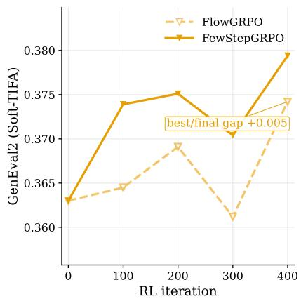  
(a) FewStepGRPO (§5.3) vs. FlowGRPO

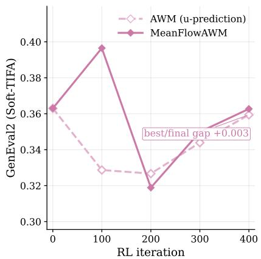  
(b) MeanFlowAWM (§5.4) vs. AWM

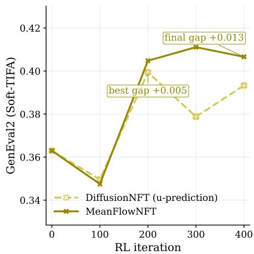  
(c) MeanFlowNFT (§5.5) vs. DifusionNFT

Figure 1: Held-out GenEval2 against the RL iteration in the mixed-reward setting of §6.1, from the shared pre-RL few-step checkpoint. Dashed: the original objective applied to the distilled model with the average velocity substituted for the instantaneous velocity (FlowGRPO, AWM, DifusionNFT). Solid: the corresponding few-step adaptation of this paper (FewStepGRPO, MeanFlowAWM, Mean-FlowNFT; §5). Each annotated gap is the adaptation minus the baseline, at the best checkpoint of the baseline and at iteration 400; the two coincide when the baseline is best at iteration 400.

and a new variant is specified mainly by its anchors and weights. Experimentally, we compare seven implementations on image generation with an AnyFlow-distilled SD3.5-Medium (Stability AI, 2024; Gu et al., 2026), under a non-diferentiable OCR reward and a diferentiable mixed reward, and on video generation with an AnyFlow-distilled Wan2.1-T2V-1.3B (Team Wan et al., 2025; Gu et al., 2026); we further test whether the fine-tuned few-step models improve when sampled with more steps.

The contributions of this paper are as follows.

• A general view. After the transformation to x-space, the gradients of the RL objectives considered here share one decoupled form, the sum of a self-regression term and a rewardaugmentation term, so that their gradients difer only in their anchors and weights.

• A systematic adaptation to few-step models. Each of these anchors can be computed from an average-velocity model at the end of the transport or along its tangent, which yields few-step versions of FlowGRPO, AWM, DifusionNFT, DifusionOPSD and ReFL within one modular codebase.

• Empirical guidance with experimental analysis. Where the reward is diferentiable and its gradient afordable, reward-gradient-based methods are the most efective in our experiments, and ReFL alone is a strong baseline. Otherwise, group-advantage methods apply. Among them, DifusionNFT-style methods generally reach high rewards in relatively few iterations, even when one iteration is expensive, and DMD-based variants are faster per iteration on image but slower on video, depending on the relative cost of forward and backward passes, and often coincide with larger held-out degradation. Additional inference steps bring little aggregate improvement in generation quality, while visual gains appear in selected outputs with more sampling steps than training.

## 2 Background

Difusion and flow-based generators. Difusion models learn to reverse a fixed noising process (Ho et al., 2020); score-based models cast this reversal as a reverse-time SDE whose probability-flow ODE gives a deterministic sampler, of which DDIM is a discrete instance (Song et al., 2021b,a). Flow matching and rectified flow instead regress the velocity of a prescribed interpolation between noise and data, the latter straightening the paths so that fewer integration steps sufice (Lipman et al., 2023; Liu et al., 2023). These models were scaled by moving to a latent space (Rombach et al., 2022), by transformer backbones (Peebles and Xie, 2023; Ma et al., 2024) and by larger, more eficient architectures (Podell et al., 2024; Esser et al., 2024; Xie et al., 2025a), with classifier-free guidance as a standard way to trade diversity for prompt fidelity (Ho and Salimans, 2021). Related generators include current text-to-image systems (OpenAI, 2022; Betker et al., 2023; Saharia et al., 2022; Black Forest Labs, 2024, 2025; Team Seedream et al., 2025; Z-Image Team et al., 2025; Qin et al., 2025), multimodal models that both generate and understand images in one network (Chen et al., 2025b; Ma et al., 2025a; Xie et al., 2025b; Wang et al., 2024b; OpenAI et al., 2024; Chen et al., 2025a), trained on web-scale image–text data (Schuhmann et al., 2022; Zou, 2024), and video generators such as Wan and LongCat-Video (Team Wan et al., 2025; Meituan LongCat Team et al., 2025). These models typically learn the instantaneous velocity of the sampling flow, or an afine transformation of it such as the score or the predicted noise. Since this velocity is instantaneous, the sampler integrates it with many small steps, typically 32 or 64, which makes inference costly.

Few-step generation. Sampling cost has been cut along several lines. Progressive distillation halves the number of steps repeatedly by training a student to match two teacher steps with one (Salimans and Ho, 2022). Consistency models map every point of a trajectory to its endpoint, and were extended to latent space, arbitrary trajectory jumps, multiple sub-intervals and segmented trajectories (Song et al., 2023; Luo et al., 2023a; Kim et al., 2024; Wang et al., 2024a; Ren et al., 2024); consistency has also been used as a training regulariser against sampling drift and to learn from noisy data (Daras et al., 2023, 2024). Shortcut models condition on the step size and learn to take large steps directly (Frans et al., 2025). Adversarial distillation adds a discriminator so that one to four steps produce sharp samples (Wang et al., 2023a; Sauer et al., 2025, 2024; Lin et al., 2024; Chadebec et al., 2025; Lu and Song, 2025). Distribution matching distillation (DMD) trains the generator so that its output distribution matches the teacher’s, using the diference between a teacher score and the score of an auxiliary network fitted to the generator’s samples (Yin et al., 2024b,a), an idea shared with Dif-Instruct and variational score distillation (Luo et al., 2023b; Wang et al., 2023b); later work scales it to flow models, splits it into sub-intervals, decouples guidance from matching, moves it to continuous time, regularises it with consistency, and adapts it to video (Ge et al., 2026a; Fan et al., 2026b; Liu et al., 2026a,b; Zheng et al., 2026b; Ge et al., 2026b; Nie et al., 2026; Luo et al., 2025). Flow maps learn the transport between any two noise levels. MeanFlow parameterises the average velocity over an interval and trains it through its identity with the instantaneous velocity (Geng et al., 2025; Lin et al., 2026; Geng et al., 2026), and AnyFlow distils such a map on policy for any step count (Gu et al., 2026). Unlike the many-step generators above, these flow-map models learn an average velocity over an interval, which can be read as the direction of a secant of the sampling trajectory, difering substantially from the instantaneous velocity where the trajectory is curved.

Reinforcement learning for difusion models. RL fine-tuning of generators builds on policy optimisation (Levine, 2018; Schulman et al., 2017), preference optimisation (Rafailov et al., 2023) and group-relative advantages, which normalise rewards within a group of samples for the same prompt (Shao et al., 2024; Guo et al., 2025). For difusion models, early work fine-tunes on human feedback (Lee et al., 2023), treats denoising as a Markov decision process optimised by policy gradients (Black et al., 2024; Fan et al., 2023), or optimises pairwise preferences directly (Wallace et al., 2024). FlowGRPO brings group-relative policy optimisation to flow models by turning the ODE sampler into an SDE with tractable transition likelihoods (Liu et al., 2025a); follow-ups extend it to video, mix ODE and SDE steps, weight timesteps, and preserve the noise coeficients of the sampler (Xue et al., 2025; Li et al., 2026a; He et al., 2026; Wang and Yu, 2025). A second family avoids transition likelihoods by acting on the forward process: AWM weights the pretraining loss by the advantage (Xue et al., 2026), reward-weighted and policy-gradient flow matching reweight or rescale the velocity regression (Fan et al., 2025; McAllister et al., 2026), adjoint matching is scaled to RL post-training (Bergmeister et al., 2026), and DifusionNFT contrasts positive and negative implicit policies built from the model and the frozen policy that generated its rollouts (Zheng et al., 2026a), following NFT in language models (Chen et al., 2026b). A third family backpropagates diferentiable rewards through the sampler, as in DRaFT and ReFL (Clark et al., 2024; Xu et al., 2023; Wang et al., 2026); the recently proposed DifusionOPSD (Zhou et al., 2026) belongs to this family but constructs detached points with normalised reward-gradient steps and fits the policy to them, thereby forming a surrogate gradient. These methods are built for an instantaneous velocity, and most of them need on-policy rollouts at every iteration, which are expensive with the many-step samplers discussed above; how to apply RL to few-step models is therefore an important question.

RL for few-step generators. Closest to this paper are methods that fine-tune few-step models with rewards. Several combine DMD with RL, by adding a reward term to distillation, guiding distillation with reward gradients, or recasting distribution matching itself as a reward (Chen et al., 2026a; Jiang et al., 2026; Dong et al., 2026; Fan et al., 2026a); others tune distilled models with nondiferentiable rewards, Kullback–Leibler (KL) regularised alignment or pairwise sample optimisation (Luo et al., 2026; Luo, 2025; Miao et al., 2025). For flow maps, Flow-Map GRPO composes stochastic steps of a flow-map generator (Li et al., 2026b), MeanFlowNFT applies DifusionNFT to an averagevelocity model through its self-induced instantaneous field (Huang et al., 2026b), and RTDMD optimises a reward-tilted distribution matching objective (Huang et al., 2026a). These works mostly adapt one objective to one kind of few-step model; we instead give a common construction that extends FlowGRPO, AWM, DifusionNFT, DifusionOPSD and ReFL to average-velocity models, and compare them under one implementation.

## 3 Preliminaries

## 3.1 Few-step Difusion Models with On-Policy Distillation

We write $t \in [ 0 , 1 ]$ for the noise level, with data at t = 0 and Gaussian noise at t = 1. A plain $x _ { t }$ denotes a point at level t on a sampling trajectory, and $\tilde { x } _ { t }$ denotes a renoised state at level t obtained by adding fresh noise to a clean sample (Equation (2)); every map below applies to either. The setting we focus on throughout is distillation, where a pretrained instantaneous-velocity field $v _ { \mathrm { r e a l } } ( \tilde { x } _ { t } , t )$ is available and frozen, which we call the teacher, and the student $u _ { \theta } ( \tilde { x } _ { t } , t , r )$ must reproduce its transport in one or a few network calls. The teacher is an ordinary flow-matching model, trained by regressing onto the conditional velocity $v _ { \mathrm { c o n d } } = \epsilon - x$ of a clean sample x and Gaussian noise $\epsilon \sim \mathcal { N } ( 0 , I )$ , and it provides the student’s regression target in Equation (8) (Lipman et al., 2023; Liu et al., 2023). The student is the average-velocity generator (Geng et al., 2025, 2026; Gu et al., 2026),

$$
u _ { \theta } ( x _ { t } , t , r ) = \frac { 1 } { t - r } \int _ { r } ^ { t } v _ { \theta } ( x _ { \nu } , \nu ) \mathrm { d } \nu ,\tag{1}
$$

where $v _ { \theta }$ is the instantaneous velocity induced by the student, $x _ { \nu }$ is the state at level ν on the probability-flow trajectory of $v _ { \theta }$ through $x _ { t } ,$ and $u _ { \theta } ( x _ { t } , t , t ) : = v _ { \theta } ( x _ { t } , t )$ closes the definition at $r = t$ Throughout, we identify this induced field with the flow-matching marginal velocity of the student’s sample distribution $p _ { \theta } , v _ { \theta } ( x _ { t } , t ) = \mathbb { E } [ \epsilon - \hat { x } \mid x _ { t } ]$ with $\hat { x } \sim p _ { \theta }$ (Appendix $\mathrm { A } )$ ; the two coincide when the flow map is exact.

Unlike of-policy methods, which query the model at $\tilde { x } _ { t } = \mathrm { A D D N O I S E } ( x _ { 0 } , t )$ with $x _ { 0 } \sim p _ { \mathrm { d a t a } } , o n – p o l i c y$ training draws the noised state from the student’s own distribution:

$$
\tilde { x } _ { t } = \mathrm { A D D N O I S E } \big ( \hat { x } _ { \theta } , t \big ) = ( 1 - t ) \hat { x } _ { \theta } + t \epsilon , \qquad \hat { x } _ { \theta } \sim p _ { \theta } ( x ) , \quad \epsilon \sim \mathcal { N } ( 0 , I ) .\tag{2}
$$

The subscript θ in Equation (2) is kept only where the sampler is diferentiated. The samples ${ \hat { x } } _ { \theta }$ are produced by a rollout operator Rollout, an ODE or SDE solver that maps Gaussian noise at level 1 to a clean sample at level 0 for a text prompt c in $M _ { \mathrm { { s t e p } } }$ steps, on a grid $1 = t _ { 0 } > t _ { 1 } > \cdot \cdot \cdot > t _ { M _ { \mathrm { s t e p } } } = 0 \colon$

$$
\begin{array} { r } { \hat { x } _ { \theta } = \mathrm { R o L L O U T } \big ( \epsilon , u _ { \theta } , c \big ) , \qquad \hat { x } _ { \theta , t _ { 0 } } = \epsilon \sim \mathcal { N } ( 0 , I ) . } \end{array}\tag{3}
$$

For an instantaneous field, one Euler step of the solver between $t _ { j }$ and $t _ { j + 1 }$ is

$$
\begin{array} { r } { \hat { x } _ { \theta , t _ { j + 1 } } = \hat { x } _ { \theta , t _ { j } } - ( t _ { j } - t _ { j + 1 } ) v _ { \theta } \big ( \hat { x } _ { \theta , t _ { j } } , t _ { j } \big ) , } \end{array}\tag{4}
$$

which is only first-order accurate, so $M _ { \mathrm { s t e p } }$ must be large. A displacement is the time integral of the velocity, and by Equation $( 1 ) \ ( t - r ) u _ { \theta }$ equals this integral over $[ r , t ]$ . With $u _ { \theta }$ as the generator, the Euler step is replaced by an exact jump,

$$
\begin{array} { r } { \hat { x } _ { \theta , r } = \hat { x } _ { \theta , t } - ( t - r ) u _ { \theta } \big ( \hat { x } _ { \theta , t } , t , r \big ) , } \end{array}\tag{5}
$$

so a few-step sampler is a chain of $M _ { \mathrm { s t e p } }$ such jumps, each a single subtraction rather than an integration. Taking the whole interval at once, $M _ { \mathrm { s t e p } } = 1 , t = 1$ and $r = 0$ , recovers the one-call generator.

MeanFlow. According to the definition of $u _ { \theta }$ in Equation (1) (Geng et al., 2025), multiplying by $( t - r )$ and diferentiating in t eliminates the integral and leaves the MeanFlow identity

$$
u _ { \theta } ( \tilde { x } _ { t } , t , r ) \ = \ v _ { \theta } ( \tilde { x } _ { t } , t ) \ - \ ( t - r ) \partial _ { t } u _ { \theta } ( \tilde { x } _ { t } , t , r ) ,\tag{6}
$$

where $\partial _ { t } u _ { \theta } = \mathrm { d } u _ { \theta } / \mathrm { d } t$ is the total derivative along the trajectory $x _ { \nu }$ of Equation (1); the implementation estimates it by a directional-diference estimate (Equation (87)). The identity follows from the definition Equation (1) and imposes no additional constraint; it expresses the average velocity as the instantaneous velocity minus $( t - r )$ times the total derivative of the average velocity with respect to t.

Every use of Equation (6) treats this correction as detached, so we define it once with the stop-gradient $\operatorname { s g } ( \cdot )$ , which is the identity in the forward pass and zero in the backward pass,

$$
\begin{array} { r } { J \big [ \boldsymbol { u } , t , \boldsymbol { r } \big ] : = ( t - \boldsymbol { r } ) \mathrm { s g } \big ( \partial _ { t } \boldsymbol { u } \big ) , } \end{array}\tag{7}
$$

the detached Jacobian-vector term. It gives the gap between an average velocity over $[ r , t ]$ and the instantaneous one at t, measured on the network itself and frozen before it is used. Substituting the teacher for $v _ { \theta }$ in Equation (6) then turns the identity into a regression whose target is assembled entirely from quantities available at the current state,

$$
\mathcal { L } _ { \mathrm { M F } } = \mathbb { E } _ { { \tilde { x } } _ { t } , t , r } \Big [ \left. u _ { \theta } ( { \tilde { x } } _ { t } , t , r ) - \big ( v _ { \mathrm { r e a l } } ( { \tilde { x } } _ { t } , t ) - J \big [ u _ { \theta } , t , r \big ] \big ) \right. ^ { 2 } \Big ] ,\tag{8}
$$

in which $v _ { \mathrm { r e a l } }$ is frozen and J contains a stop-gradient, so $u _ { \theta }$ is the only diferentiated quantity. Setting $r = t$ recovers instantaneous-velocity distillation onto $v _ { \mathrm { r e a l } } ;$ the case $r < t$ trains the flow map and hence the one-step transport $\tilde { x } _ { \theta , r } = \tilde { x } _ { t } - ( t - r ) u _ { \theta } ( \tilde { x } _ { t } , t , r )$ to level $r .$

DMD. Distribution matching distillation (Yin et al., $^ { 2 0 2 4 \mathrm { b } , \mathrm { a } ) }$ does not regress $u _ { \theta }$ onto a target. It maintains a second, auxiliary velocity $v _ { \phi } ( \tilde { x } _ { t } , t )$ with its own parameters $\phi ,$ , fitted online by flow matching to the samples generated by the student. Its target is the conditional velocity of each sample instead of the teacher, because $v _ { \phi }$ is meant to approximate the velocity of $p _ { \theta }$ instead of $p _ { \mathrm { d a t a } } \colon$

$$
\mathcal { L } _ { \mathrm { a u x } } = \mathbb { E } _ { \hat { x } \sim p _ { \theta } , \epsilon , t } \Big [ \| v _ { \phi } ( \tilde { x } _ { t } , t ) - v _ { \mathrm { c o n d } } \| ^ { 2 } \Big ] , \qquad \tilde { x } _ { t } = \mathrm { A D D N O I S E } ( \hat { x } , t ) , \quad v _ { \mathrm { c o n d } } = \epsilon - \hat { x } .\tag{9}
$$

The diference between the two fields then gives the score diference in the gradient of the reverse KL divergence, which is used to train $u _ { \theta } ( \tilde { x } _ { t } , t , r )$ :

$$
\nabla _ { \theta } \mathcal { L } _ { \mathrm { D M D } } = \mathbb { E } _ { \epsilon , t \in ( 0 , 1 ) } \Big [ \frac { 1 - t } { t } \operatorname { s g } \big [ v _ { \mathrm { r e a l } } ( \tilde { x } _ { t } , t ) - v _ { \phi } ( \tilde { x } _ { t } , t ) \big ] ^ { \top } \frac { \partial \hat { x } _ { \theta } } { \partial \theta } \Big ] ,\tag{10}
$$

The order of the two fields is fixed by the conversion between them. The score of the linear path is $\nabla \log p _ { t } ( \tilde { x } _ { t } ) = - \mathbb { E } [ \epsilon \mid \tilde { x } _ { t } ] / t$ with $\mathbb { E } [ \epsilon \mid \tilde { x } _ { t } ] = \tilde { x } _ { t } + ( 1 - t ) v$ , so the diference ∇ log $p _ { t } ^ { \phi } - \nabla \log p _ { t } ^ { \mathrm { r e a l } }$ of the scores of the two fields, which the reverse KL produces, equals $\begin{array} { r } { \frac { 1 - t } { t } \left( v _ { \mathrm { r e a l } } - v _ { \phi } \right) } \end{array}$ . Converting scores to velocities reverses the order of the two fields and introduces the score-to-velocity factor $\textstyle { \frac { 1 - t } { t } }$ , which is positive on $( 0 , 1 )$ and is absorbed into a per-t weight in practice. Descending Equation (10) therefore applies the direction $+ ( v _ { \phi } - v _ { \mathrm { r e a l } } )$ , reducing the mismatch to the data field relative to the auxiliary field that tracks $p _ { \theta }$

The term $\partial \hat { x } _ { \theta } / \partial \theta$ requires a diferentiable sampler, and the sampler used in practice is stochastic. A step at level t does not move directly to the next level; it first maps the state to $r = 0$ with one network evaluation and then renoises the result to an intermediate level $t ^ { \prime }$ with $0 < t ^ { \prime } < t$

$$
\hat { x } _ { \theta , 0 } = \hat { x } _ { \theta , t } - t u _ { \theta } \big ( \hat { x } _ { \theta , t } , t , 0 \big ) , \qquad \hat { x } _ { \theta , t ^ { \prime } } = ( 1 - t ^ { \prime } ) \hat { x } _ { \theta , 0 } + t ^ { \prime } \epsilon ^ { \prime } , \qquad \epsilon ^ { \prime } \sim \mathcal { N } ( 0 , I ) .\tag{11}
$$

Unlike the deterministic chain Equation (5), this sampler draws fresh noise $\epsilon ^ { \prime }$ at every step, so the state at level t′ is not a deterministic function of the previous state.

The levels follow a fixed grid of $M _ { \mathrm { s t e p } } + 1$ values spanning $M _ { \mathrm { s t e p } }$ intervals; a step count $\ell \in$ $\{ 1 , \ldots , M _ { \mathrm { s t e p } } \}$ is drawn per update, and only the last step remains in the computation graph, with all earlier steps detached. The backward pass therefore requires one network evaluation for any ℓ. Moreover, the diferentiated evaluation is $u _ { \theta } ( \cdot , t , 0 )$ at the level that the grid assigns to step $\ell ,$ so randomising ℓ changes this level across updates. Over training, the gradient therefore reaches $u _ { \theta } ( \cdot , t , 0 )$ at every grid level t instead of a single one.

## 3.2 Reinforcement Learning for Difusion Models

FlowGRPO. FlowGRPO combines a GRPO-style group baseline with a PPO transition objective (Schulman et al., 2017; Shao et al., 2024; Liu et al., 2025a). It scores a group of K rollouts that share a prompt c, and turns the raw scores into a group-normalised advantage. Writing $R ^ { ( i ) } = R \big ( { \mathcal { D } } ( { \hat { x } } ^ { ( i ) } ) , c \big )$ for the endpoint reward of member i (D the decoder), the advantage standardises the reward within the group,

$$
A ^ { ( i ) } = \frac { R ^ { ( i ) } - \mathrm { m e a n } \left( \{ R \} \right) } { \mathrm { s t d } \left( \{ R \} \right) + \varepsilon _ { \mathrm { s t d } } } , \qquad i = 1 , \ldots , K .\tag{12}
$$

Here $\{ R \}$ denotes the K rewards of the group and $\varepsilon _ { \mathrm { s t d } } > 0$ is a small floor. The advantage is a detached per-sample scalar with zero mean across the group; no value network is fitted, and the group mean serves as the baseline. AWM below uses the same $A ^ { ( i ) }$ ; DifusionNFT uses a bounded transform of it.

FlowGRPO formulates the stochastic diferential equation (SDE) sampler as a Markov decision process, whose state is the current noisy sample $x _ { t }$ (a point on the sampling trajectory, in the convention of §3) together with the prompt and the level and whose action is the next state produced by the sampler; the Gaussian transition $p _ { \theta } ^ { \mathrm { t r } } ( x _ { r } \mid x _ { t } )$ then provides a likelihood, which the deterministic sampler lacks. Optimisation is proximal policy optimisation on the realised action $x _ { r }$

$$
\begin{array} { r l r } { \mathcal { L } _ { \mathrm { G R P O } } = - \mathbb { E } _ { i , t } \Big [ \operatorname* { m i n } \left\{ A ^ { ( i ) } \rho _ { \mathrm { t r } } ^ { ( i ) } , ~ A ^ { ( i ) } \exp \left( \rho _ { \mathrm { t r } } ^ { ( i ) } , 1 \pm \varepsilon _ { \mathrm { c l i p } } \right) \right\} \Big ] , } & { } & { \rho _ { \mathrm { t r } } = \frac { p _ { \theta } ^ { \mathrm { t r } } \left( x _ { r } \mid x _ { t } \right) } { p _ { \mathrm { o l d } } ^ { \mathrm { t r } } \left( x _ { r } \mid x _ { t } \right) } . } \end{array}\tag{13}
$$

Here the old policy is the frozen policy, with parameters $\theta _ { \mathrm { o l d } }$ , that generated the rollouts on which the current policy is trained; it receives no gradient. In our implementation, $\theta _ { \mathrm { o l d } }$ is an exponential moving average (EMA) of $\theta ,$ refreshed after every outer iteration (§5.1) with the EMA-decay ratio as the weight kept on the previous $\theta _ { \mathrm { o l d } } ;$ an EMA-decay ratio of 0.0 therefore copies $\theta ,$ so that $\theta _ { \mathrm { o l d } } = \theta$ at the start of every outer iteration. The subscript old marks its quantities, so $p _ { \mathrm { o l d } } ^ { \mathrm { t r } }$ is its transition density, $v _ { \mathrm { o l d } }$ its instantaneous velocity and $p _ { \mathrm { o l d } }$ the distribution of its rollouts. The clipping radius is $\varepsilon _ { \mathrm { c l i p } }$ . For later clipped surrogates, define the detached unclipped-gradient gate

$$
\chi ( z , A ) : = { \bf 1 } [ ( A > 0 \mathrm { ~ \wedge ~ } z \leq 1 + \varepsilon _ { \mathrm { c l i p } } ) \mathrm { ~ ~ } \vee \mathrm { ~ ~ } ( A < 0 \mathrm { ~ \wedge ~ } z \geq 1 - \varepsilon _ { \mathrm { c l i p } } ) ] , \qquad \chi ( z , 0 ) : = 0 .\tag{14}
$$

At the two clipping kinks this convention selects the derivative of the unclipped branch. The sign of the reward advantage determines the direction of the update of the mean $\mu _ { \theta }$ of the Gaussian transition (the scoring kernel defined in Equation (95)) relative to the visited noisy state $x _ { r }$

AWM. Advantage Weighted Matching (Xue et al., 2026) keeps the signed advantage but does not evaluate a likelihood on the reverse process. Each update draws a fresh $( t , \epsilon )$ and constructs both the noised state and the regression target from the rollout sample,

$$
\tilde { x } _ { t } ^ { ( i ) } = \mathrm { A D D N O I S E } \big ( \hat { x } ^ { ( i ) } , t \big ) = \left( 1 - t \right) \hat { x } ^ { ( i ) } + t \epsilon , \qquad v _ { \mathrm { c o n d } } ^ { ( i ) } = \epsilon - \hat { x } ^ { ( i ) } ,\tag{15}
$$

where $v _ { \mathrm { c o n d } } ^ { ( i ) }$ is the conditional velocity, i.e., the velocity of the straight path from $\hat { x } ^ { ( i ) }$ to ϵ, which is computed from the two endpoints without a network evaluation. AWM then observes that the flow-matching loss against that target is, for a suitable time weight $w ( t )$ , an evidence-lower-bound surrogate for the sequence-level log-likelihood of the clean sample,

$$
\begin{array} { r } { \log p _ { \theta } \big ( \hat { x } ^ { ( i ) } \mid c \big ) \ge \log \hat { p } _ { \theta } \big ( \hat { x } ^ { ( i ) } \mid c \big ) + \mathrm { c o n s t } , \qquad \log \hat { p } _ { \theta } \big ( \hat { x } ^ { ( i ) } \mid c \big ) : = - \mathbb { E } _ { t , c } \Big [ w ( t ) \left. v _ { \theta } \big ( \bar { x } _ { t } ^ { ( i ) } , t \big ) - v _ { \mathrm { c o n d } } ^ { ( i ) } \right. ^ { 2 } \Big ] , } \end{array}\tag{16}
$$

so that the policy-gradient term $A ^ { ( i ) } \nabla _ { \theta }$ log ˆp<sub>θ</sub> reduces to the pretraining objective reweighted per sample:

$$
\mathcal { L } _ { \mathrm { A W M } } = \mathbb { E } _ { i , t , \epsilon } \Big [ A ^ { ( i ) } w ( t ) \left| \Big | v _ { \theta } \big ( \tilde { x } _ { t } ^ { ( i ) } , t \big ) - v _ { \mathrm { c o n d } } ^ { ( i ) } \right| \Big | ^ { 2 } \Big ] ,\tag{17}
$$

with the time weight $w ( t ) = 1$ in the original AWM (our implementation efectively uses $w ( t ) = \tau _ { \mathrm { A W M } } ^ { 2 }$ $\ S 5 . 4 )$ and a velocity-space proximal penalty $\| v _ { \theta } - v _ { \mathrm { o l d } } \| ^ { 2 }$ against the old policy $v _ { \mathrm { o l d } }$ , called a KL term in AWM, added for stability. Minimising Equation (17) decreases the matching residual at $\hat { x } ^ { ( i ) }$ when $A ^ { ( i ) } > 0$ and increases it when $A ^ { ( i ) } < 0$ . Since no reverse-time discretisation appears, the sampler can be chosen freely.

DifusionNFT. Negative-aware fine-tuning (Zheng et al., 2026a) builds on an optimality-variable construction (Levine, 2018) and requires neither a likelihood nor a signed weight. It first maps the advantage to a bounded optimality probability with a normaliser $Z _ { c } = \mathrm { s t d } ( \{ R \} ) + \varepsilon _ { \mathrm { s t d } }$

$$
\hat { r } ^ { ( i ) } = \frac { 1 } { 2 } + \frac { 1 } { 2 } \mathrm { c l i p } \left[ \frac { R ^ { ( i ) } - \mathrm { m e a n } \left( \{ R \} \right) } { Z _ { c } } , ~ - 1 , ~ 1 \right] = \frac { 1 } { 2 } + \frac { 1 } { 2 } \mathrm { c l i p } \left( A ^ { ( i ) } , - 1 , ~ 1 \right) ~ \in [ 0 , 1 ] ,\tag{18}
$$

since the bracketed quotient then equals Equation (12). Thus $A ^ { ( i ) }$ is signed, unclipped and zero-mean under Equation (12) and enters as a multiplier, whereas $\hat { r } ^ { ( i ) }$ is bounded, monotone in $A ^ { ( i ) }$ and equal to $\begin{array} { l } { { \frac { 1 } { 2 } } } \end{array}$ when $A ^ { ( i ) } = 0 .$ , and enters as a mixing weight. A positive advantage gives $\hat { r } ^ { ( i ) } > \frac { 1 } { 2 }$ and hence a larger weight on the positive branch.

Each update then draws a fresh $( t , \epsilon )$ and forms the noised state $\tilde { x } _ { t } ^ { ( i ) }$ and the conditional velocity $v _ { \mathrm { c o n d } } ^ { ( i ) }$ as in Equation (15); the target is the same as in AWM, and, besides the weight, only the regressed quantity difers. Two implicit policies are built from one trainable network $v _ { \theta }$ and the frozen old policy $v _ { \mathrm { o l d } }$ , both evaluated at that same $\tilde { x } _ { t } ^ { ( i ) }$ and mixed by a branch coeficient $\beta \colon$

$$
v _ { \theta } ^ { \pm } \big ( \tilde { x } _ { t } ^ { ( i ) } , t \big ) : = ( 1 \mp \beta ) v _ { \mathrm { o l d } } \big ( \tilde { x } _ { t } ^ { ( i ) } , t \big ) \pm \beta v _ { \theta } \big ( \tilde { x } _ { t } ^ { ( i ) } , t \big ) .\tag{19}
$$

Both are regressed onto the same target $v _ { \mathrm { c o n d } } ^ { ( i ) }$ , mixed by $\hat { r } ^ { ( i ) }$ :

$$
{ \mathcal { L } } _ { \mathrm { N F T } } = \mathbb { E } _ { i , t , \epsilon } \Bigl [ \hat { r } ^ { ( i ) } \left. v _ { \boldsymbol { \theta } } ^ { + } - v _ { \mathrm { c o n d } } ^ { ( i ) } \right. ^ { 2 } + \bigl ( 1 - \hat { r } ^ { ( i ) } \bigr ) \left. v _ { \boldsymbol { \theta } } ^ { - } - v _ { \mathrm { c o n d } } ^ { ( i ) } \right. ^ { 2 } \Bigr ] .\tag{20}
$$

Both branches are afine in the same trainable network $v _ { \theta } ;$ since $v _ { \mathrm { o l d } } , v _ { \mathrm { c o n d } } ^ { ( i ) }$ and $\hat { r } ^ { ( i ) }$ are detached, v<sub>θ</sub> is the only diferentiated quantity in Equation (20).

## 4 Framework

Each RL method of §3.2 increases the relative probability of high-reward samples under the rollout distribution $p _ { \mathrm { o l d } }$ of the old policy. The methods difer in the space in which the update is formulated (transition densities, velocities, or rewards diferentiated through the sample) and in how a few-step network computes the quantities that the update requires. This section resolves both diferences in three steps, summarised in Figure 2.

(i) Transformation to x-space (§4.1, Figure 2a). Under the linear noise schedule a velocity transports a state afinely, so each objective of §3 can be expressed through a common prediction in x-space. By default this prediction is the policy prediction ${ \tilde { x } } _ { \theta } ;$ MeanFlow and FewStepGRPO keep an explicitly marked level-r quantity. In x-space the methods become directly comparable

(ii) Decomposition of the gradient (§4.2, Figure 2b). In x-space, the gradient of each of these losses is the transposed Jacobian $( \partial \tilde { x } _ { \theta } / \partial \theta ) ^ { \top }$ applied to the sum of a reward-free self-regression toward an anchor ${ \tilde { x } } _ { \mathrm { r e g } } ,$ which limits how far the prediction moves, and a reward augmentation along $\tilde { x } _ { \mathrm { r w d } } - \tilde { x } _ { \mathrm { b a s e } }$ , which contains the reward. A method is then specified by the prediction, three anchors $( \tilde { x } _ { \mathrm { r e g } } , \tilde { x } _ { \mathrm { r w d } } , \tilde { x } _ { \mathrm { b a s e } } )$ and three weights $( W _ { \mathrm { r e g } } , W _ { \mathrm { r w d } } , \omega )$ instead of a new loss.

(iii) Adaptation to few-step models (§4.3, Figure 2c). The framework requires instantaneous velocities, whereas a few-step model outputs an average velocity. Its anchors are therefore computed either at the end of the transport curve (u-form) or along the tangent at the current state (v-form). The latter recovers the instantaneous velocity from the network itself, as in MeanFlow, or from an auxiliary network, as in DMD.

§5 then specifies the predictions, anchors and weights of each family.

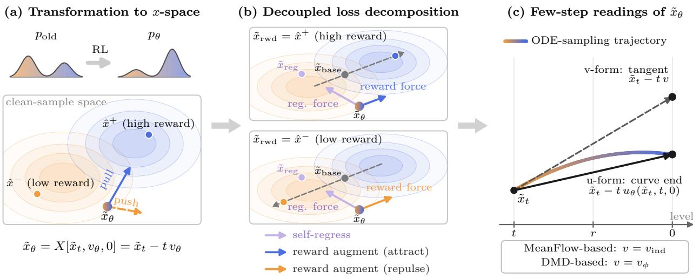  
Figure 2: Overview of the framework. (a) RL increases the relative mass of the high-reward mode under the rollout distribution $p _ { \mathrm { o l d } }$ of the old policy. The default objective is evaluated at the clean end, on the policy prediction (renoise-and-denoise sample) $\tilde { x } _ { \theta } = X \big [ \tilde { x } _ { t } , v _ { \theta } , 0 \big ] = \tilde { x } _ { t } - t v _ { \theta }$ , whose reward augmentation attracts it toward high-reward rollout samples and repels it from low-reward ones; in the figure, ${ \hat { x } } ^ { + }$ and $\hat { x } ^ { - }$ − denote a high-reward and a low-reward rollout sample $\hat { x } ^ { ( i ) }$ , respectively. (b) The RL-loss gradient can be decoupled into a self-regression term, visualised as a regression force toward the regression anchor ${ \tilde { x } } _ { \mathrm { r e g } } ,$ and a reward-augmentation term, visualised as a reward force along the displacement $\tilde { x } _ { \mathrm { r w d } } - \tilde { x } _ { \mathrm { b a s e } }$ from the baseline anchor $\tilde { x } _ { \mathrm { b a s e } }$ , which lies between the two modes, to the rewarded anchor $\tilde { x } _ { \mathrm { r w d } }$ . A high-reward sample produces attraction along that displacement (blue); a low-reward sample produces repulsion against it (orange), so both updates favour higher reward (§4.2). (c) For a few-step model, the prediction and the anchors $\{ \tilde { x } _ { \mathrm { r w d } } , \tilde { x } _ { \mathrm { b a s e } } , \tilde { x } _ { \mathrm { r e g } } \}$ are computed either at the end of the transport curve, $\tilde { x } _ { t } - t u \ ( \mathrm { u - f o r m } )$ , or along the tangent at $\tilde { x } _ { t } , \tilde { x } _ { t } - t v \ \mathrm { ( v  – f o r m ) }$ The instantaneous velocity is recovered from the network itself for MeanFlow, $v = u + ( t - r ) \ \mathrm { s g } ( \partial _ { t } u )$ with the detached correction evaluated on the old policy in the implemented methods (Equation (56)), and from an auxiliary network for DMD, $v = v _ { \phi }$ , fitted so that $v _ { \phi } ( \tilde { x } _ { t } , t ) \approx \mathbb { E } \left[ \epsilon - \hat { x } \mid \tilde { x } _ { t } \right] \ ( \ S 4 . 3 )$

## 4.1 Transformation to x-space

The objectives of $\ S 3$ are written in transition-density or velocity space. Under the linear noise schedule, a velocity instead identifies a point in x-space at any chosen level r. This x-space includes noisy level-r points; clean samples correspond to $r = 0$

For any point $x _ { t }$ at level t (in particular a renoised state $\tilde { x } _ { t } )$ , define the afine transport

$$
X [ x _ { t } , v , r ] : = x _ { t } - ( t - r ) v .\tag{21}
$$

For two velocities evaluated at the same $x _ { t }$ and transported to the same level $r < t ,$

$$
\| v _ { a } - v _ { b } \| ^ { 2 } = { \frac { 1 } { ( t - r ) ^ { 2 } } } \left\| X \big [ x _ { t } , v _ { a } , r \big ] - X \big [ x _ { t } , v _ { b } , r \big ] \right\| ^ { 2 } .\tag{22}
$$

Thus a velocity MSE equals a scaled MSE between transported points in x-space. At the clean level $r = 0$ the factor is $t ^ { - 2 }$ , and we omit the level subscript. In particular, for $\tilde { x } _ { t } = ( 1 - t ) x + t \epsilon$ and $v _ { \mathrm { c o n d } } = \epsilon - x$ , Equation (21) gives $X \left[ \tilde { x } _ { t } , v _ { \mathrm { c o n d } } , 0 \right] = x$

For the reward objectives below, a detached rollout endpoint $\hat { x } ^ { ( i ) }$ is re-noised to $\tilde { x } _ { t } ^ { ( i ) }$ , and the policy provides the current policy prediction

$$
\tilde { x } _ { \theta } ^ { ( i ) } = X \left[ \tilde { x } _ { t } ^ { ( i ) } , v _ { \theta } , 0 \right] = \tilde { x } _ { t } ^ { ( i ) } - t v _ { \theta } ,\tag{23}
$$

while the conditional target maps back to $\hat { x } ^ { ( i ) }$ . Hence the loss compares predictions at the same state $\tilde { x } _ { t } ^ { ( i ) }$ , and only $\tilde { x } _ { \theta } ^ { ( i ) }$ is diferentiated. §4.3 constructs this prediction when the network outputs an average velocity instead of an instantaneous one. Analysing a loss in x-space therefore shows how the prediction $\scriptstyle { \tilde { x } } _ { \theta }$ must change to reduce the loss, i.e., which points $\scriptstyle { \tilde { x } } _ { \theta }$ moves toward and which it moves away from. The same map applied to the old policy gives the old policy’s prediction

$$
\tilde { x } _ { \mathrm { o l d } } ^ { ( i ) } = X \big [ \tilde { x } _ { t } ^ { ( i ) } , v _ { \mathrm { o l d } } , 0 \big ] ,\tag{24}
$$

which serves as an anchor in several methods below; its few-step variants, the self-induced prediction of Example 5 and the u-prediction and J-free query of §4.3, are collected in Appendix A.

Example 1 (AWM in x-space). The target of Equation (17) is $v _ { \mathrm { c o n d } } ^ { ( i ) }$ , and Equation (21) sends it to the rollout endpoint itself, $X \left[ \tilde { x } _ { t } ^ { ( i ) } , v _ { \mathrm { c o n d } } ^ { ( i ) } , 0 \right] = \hat { x } ^ { ( i ) }$ . Applying Equation (22),

$$
\mathcal { L } _ { \mathrm { A W M } } = \mathbb { E } _ { i , t , \epsilon } \Big [ A ^ { ( i ) } \frac { w ( t ) } { t ^ { 2 } } \left. \tilde { x } _ { \theta } ^ { ( i ) } - \hat { x } ^ { ( i ) } \right. ^ { 2 } \Big ] .\tag{25}
$$

The method is a squared residual between the current prediction and the model’s sample, weighted by the signed advantage. Taking $w ( t ) = t ^ { 2 }$ cancels the prefactor and gives an x-space weight independent of $t ;$ this is the choice our few-step implementation makes up to a floor (§5.4).

Example 2 (DifusionNFT in x-space). The target of Equation (20) is again $v _ { \mathrm { c o n d } } ^ { ( i ) } ,$ so Equation (21) sends it to the same rollout endpoint $\hat { x } ^ { ( i ) }$ . Only the prediction difers; the two implicit policies Equation (19) are mapped to

$$
\tilde { x } _ { \theta } ^ { \pm } = X \big [ \tilde { x } _ { t } ^ { ( i ) } , v _ { \theta } ^ { \pm } , 0 \big ] = \tilde { x } _ { \mathrm { o l d } } ^ { ( i ) } \pm \beta \big ( \tilde { x } _ { \theta } ^ { ( i ) } - \tilde { x } _ { \mathrm { o l d } } ^ { ( i ) } \big ) ,\tag{26}
$$

with $\tilde { x } _ { \mathrm { o l d } } ^ { ( i ) }$ as in Equation (24). Applying Equation (22) to each branch,

$$
\mathcal { L } _ { \mathrm { N F T } } = \mathbb { E } _ { i , t , \epsilon } \Big [ \frac { 1 } { t ^ { 2 } } \Big ( \hat { r } ^ { ( i ) } \left. \tilde { x } _ { \theta } ^ { + } - \hat { x } ^ { ( i ) } \right. ^ { 2 } + \left( 1 - \hat { r } ^ { ( i ) } \right) \left. \tilde { x } _ { \theta } ^ { - } - \hat { x } ^ { ( i ) } \right. ^ { 2 } \Big ) \Big ] .\tag{27}
$$

The method mixes two squared residuals to the model’s sample with weights $\hat { r } ^ { ( i ) }$ and $1 - \hat { r } ^ { ( i ) }$ . The positive branch receives more weight when the reward of the sample is above the group mean, and the negative branch when it is below. The common prefactor $t ^ { - 2 }$ can be absorbed into the weights, so the mixing itself is independent of t.

## 4.2 The Decoupled Loss Decomposition

Under the transformation Equation (21), the gradient of each objective considered here is the transposed Jacobian $( \partial \tilde { x } _ { \theta } ^ { ( i ) } / \partial \theta ) ^ { \top }$ applied to the sum of two vectors in x-space (at the clean level by default and at level r in the explicit exceptions). We adopt this form as the general framework,

$$
\nabla _ { \theta } \mathcal { L } ^ { ( i ) } = 2 \left( \frac { \partial \tilde { x } _ { \theta } ^ { ( i ) } } { \partial \theta } \right) ^ { \top } \Big [ \underbrace { W _ { \mathrm { r e g } } ^ { ( i ) } \big ( \tilde { x } _ { \theta } ^ { ( i ) } - \tilde { x } _ { \mathrm { r e g } } ^ { ( i ) } \big ) } _ { \mathrm { s e l f - r e g r e s s i o n } } - \underbrace { W _ { \mathrm { r w d } } ^ { ( i ) } \omega ^ { ( i ) } \big ( \tilde { x } _ { \mathrm { r w d } } ^ { ( i ) } - \tilde { x } _ { \mathrm { b a s e } } ^ { ( i ) } \big ) } _ { \mathrm { r e w a r d ~ a u g m e n t a t i o n } } \Big ] ,\tag{28}
$$

with $W _ { \mathrm { r e g } } ^ { ( i ) } , W _ { \mathrm { r w d } } ^ { ( i ) } \geq 0$ and $\boldsymbol { \omega } ^ { ( i ) } \in \mathbb { R }$ detached scalars. The factor 2 from diferentiating a square is kept outside the bracket, so all weights below are defined relative to Equation (28); for example, the loss $W \left\| \tilde { x } _ { \theta } - \tilde { x } _ { \mathrm { r w d } } \right\| ^ { 2 }$ corresponds to $W _ { \mathrm { r w d } } = W$ . The prediction $\tilde { x } _ { \theta } ^ { ( i ) }$ is constructed by first noising the rollout sample $\hat { x } ^ { ( i ) }$ to level t and then transporting the resulting state $\tilde { x } _ { t } ^ { ( i ) }$ back to $r = 0$ by Equation (21). Here $\boldsymbol { \omega } ^ { ( i ) }$ is the signed reward coeficient used in the general loss Equation $( 3 0 )$ , and $| \boldsymbol { \omega } ^ { ( i ) } |$ is its magnitude. For methods whose coeficient follows the advantage, a non-zero $\boldsymbol { \omega } ^ { ( i ) }$ has the sign of $A ^ { ( i ) }$ in the theoretical weighting (the implemented DifusionNFT weighting of §5.5 can deviate), and a clipping gate may set it to zero.

Self-regression. The first term does not depend on the reward. It vanishes at $\tilde { x } _ { \theta } ^ { ( i ) } = \tilde { x } _ { \mathrm { r e g } } ^ { ( i ) }$ and grows with the distance from this anchor, so its gradient moves the prediction back toward the anchor. This self-regression term limits how far the reward-augmentation term can move the prediction and therefore helps protect against reward hacking.

The regression anchor is therefore chosen as a prediction that the policy should stay close to. A common choice is the old policy’s prediction $\tilde { x } _ { \mathrm { o l d } } ^ { ( i ) } = X \left[ \tilde { x } _ { t } ^ { ( i ) } , { v } _ { \mathrm { o l d } } , 0 \right]$ , so that the term penalises the deviation of the current prediction from that of the policy used for sampling. Since $\tilde { x } _ { \theta } ^ { ( i ) }$ is computed from $\tilde { x } _ { t } ^ { ( i ) }$ , the anchor $\tilde { x } _ { \mathrm { r e g } } ^ { ( i ) }$ must be computed from the same $\tilde { x } _ { t } ^ { ( i ) }$ ; otherwise, the diference $\tilde { x } _ { \theta } ^ { ( i ) } - \tilde { x } _ { \mathrm { r e g } } ^ { ( i ) }$ would mix a change of the velocity field with a change of the state and would no longer measure the deviation that the term is meant to bound.

Reward augmentation. For fixed anchors, the second term contributes a vector that does not depend on the current prediction and contains the reward. Under gradient descent it moves $\tilde { x } _ { \theta } ^ { ( i ) }$ along $+ \omega ^ { ( i ) } ( \tilde { x } _ { \mathrm { r w d } } ^ { ( i ) } - \tilde { x } _ { \mathrm { b a s e } } ^ { ( i ) } )$ , a displacement whose direction is set by the sign of $\boldsymbol { \omega } ^ { ( i ) }$ and whose coeficient has magnitude $| \boldsymbol { \omega } ^ { ( i ) } |$ . The magnitude of the full term also depends on $W _ { \mathrm { r w d } } ^ { ( i ) }$ and on the anchor displacement $\tilde { x } _ { \mathrm { r w d } } ^ { ( i ) } - \tilde { x } _ { \mathrm { b a s e } } ^ { ( i ) }$

The rewarded anchor $\tilde { x } _ { \mathrm { r w d } } ^ { ( i ) }$ is usually the rollout sample, since transporting $\tilde { x } _ { t } ^ { ( i ) }$ with the conditional velocity gives $X [ \tilde { x } _ { t } ^ { ( i ) } , v _ { \mathrm { c o n d } } ^ { ( i ) } , 0 ] = \hat { x } ^ { ( i ) }$ . This choice is natural because $A ^ { ( i ) }$ is obtained by scoring $\hat { x } ^ { ( i ) }$ and provides no direct information about other points. For methods whose coeficient follows the advantage, the sign of $\boldsymbol { \omega } ^ { ( i ) }$ determines whether the prediction moves toward $\tilde { x } _ { \mathrm { r w d } } ^ { ( i ) }$ or away from it.

The other end, $\tilde { x } _ { \mathrm { b a s e } } ^ { ( i ) }$ , is the baseline anchor. The displacement $\tilde { x } _ { \mathrm { r w d } } ^ { ( i ) } - \tilde { x } _ { \mathrm { b a s \epsilon } } ^ { ( i ) }$ points from the baseline anchor to the rewarded anchor, so $\tilde { x } _ { \mathrm { b a s e } } ^ { ( i ) }$ sets the reference point and the line along which the reward acts. Admissible choices for $\tilde { x } _ { \mathrm { b a s e } } ^ { ( i ) }$ include the old policy’s prediction $\tilde { x } _ { \mathrm { o l d } } ^ { ( i ) }$ and the detached current prediction $\mathrm { s g } ( \tilde { x } _ { \theta } ^ { ( i ) } )$ . In the RL methods, $\tilde { x } _ { \mathrm { b a s e } } ^ { ( i ) }$ is also evaluated at the state $\tilde { x } _ { t } ^ { ( i ) }$ from which $\tilde { x } _ { \theta } ^ { ( i ) }$ is computed, so that the two anchors define a displacement in the space on which the update acts.

An intuitive example. Consider a group-advantage-based method with the group-mean advantage of Equation (12) and a group in which $A ^ { ( 1 ) } > A ^ { ( 2 ) } > 0 > A ^ { ( 3 ) }$ . Members 1 and 2 both score above the group mean, so $\omega ^ { ( 1 ) } , \omega ^ { ( 2 ) } > 0$ and both predictions are attracted toward their rewarded samples. Member 2 is not penalised for scoring lower than member 1; it only receives a coeficient of smaller or equal magnitude, since $\vert \boldsymbol { \omega } ^ { ( 1 ) } \vert \geq \vert \boldsymbol { \omega } ^ { ( 2 ) } \vert$ in AWM and in the theoretical DifusionNFT weighting below. Member 3 scores below the mean, so $\omega ^ { ( 3 ) } < 0$ and its prediction is repelled away from $\tilde { x } _ { \mathrm { r w d } } ^ { ( 3 ) }$ , in the direction $\tilde { x } _ { \mathrm { b a s e } } ^ { ( 3 ) } - \tilde { x } _ { \mathrm { r w d } } ^ { ( 3 ) }$ . Whether a prediction is attracted or repelled is therefore determined by the baseline-subtracted advantage $A ^ { ( i ) }$ and not by the raw reward; a sample with a high reward is still repelled if it scores below its group mean.

Recovering the loss. For any $V _ { \theta }$ and any detached $U .$

$$
- \left( \frac { \partial V _ { \theta } } { \partial \theta } \right) ^ { \top } U \ = \ \nabla _ { \theta } \frac { 1 } { 2 } \left\| V _ { \theta } - \mathrm { s g } \left( V _ { \theta } + U \right) \right\| ^ { 2 } .\tag{29}
$$

Therefore, applying Equation (29) with $V _ { \theta } ~ = ~ \tilde { x } _ { \theta } ^ { ( i ) }$ and $U = g ^ { ( i ) } : = \omega ^ { ( i ) } ( \tilde { x } _ { \mathrm { r w d } } ^ { ( i ) } - \tilde { x } _ { \mathrm { b a s e } } ^ { ( i ) } )$ writes Equation (28) as a sum of two squares,

$$
\mathcal { L } ^ { ( i ) } = \underbrace { W _ { \mathrm { r e g } } ^ { ( i ) } \left\| \tilde { x } _ { \theta } ^ { ( i ) } - \tilde { x } _ { \mathrm { r e g } } ^ { ( i ) } \right\| ^ { 2 } } _ { \mathcal { L } _ { \mathrm { r e g } } ^ { ( i ) } } + \underbrace { W _ { \mathrm { r w d } } ^ { ( i ) } \left\| \tilde { x } _ { \theta } ^ { ( i ) } - \mathrm { s g } \left( \tilde { x } _ { \theta } ^ { ( i ) } + g ^ { ( i ) } \right) \right\| ^ { 2 } } _ { \mathcal { L } _ { \mathrm { r w d } } ^ { ( i ) } } ,\tag{30}
$$

which is the form $\ S 5$ implements.

Example 3 (Decoupling AWM loss). Applying the same decomposition to Equation (25) gives a limiting case of Equation (28). Diferentiating it and rewriting the residual as a diference of anchors,

$$
\begin{array} { r l } & { \nabla _ { \theta } \mathcal { L } _ { \mathrm { A W M } } ^ { ( i ) } = 2 \displaystyle \frac { w ( t ) } { t ^ { 2 } } A ^ { ( i ) } \left( \frac { \partial \tilde { x } _ { \theta } ^ { ( i ) } } { \partial \theta } \right) ^ { \top } \big ( \tilde { x } _ { \theta } ^ { ( i ) } - \hat { x } ^ { ( i ) } \big ) } \\ & { \quad \quad \quad = - 2 \left( \displaystyle \frac { \partial \tilde { x } _ { \theta } ^ { ( i ) } } { \partial \theta } \right) ^ { \top } \displaystyle \frac { w ( t ) } { t ^ { 2 } } A ^ { ( i ) } \left( \hat { x } ^ { ( i ) } - \mathrm { s g } ( \tilde { x } _ { \theta } ^ { ( i ) } ) \right) , } \end{array}\tag{31}
$$

which is Equation (28) with $W _ { \mathrm { r e g } } = 0$

$$
W _ { \mathrm { r e g } } ^ { ( i ) } = 0 , \qquad \tilde { x } _ { \mathrm { r w d } } ^ { ( i ) } = \hat { x } ^ { ( i ) } , \qquad \tilde { x } _ { \mathrm { b a s e } } ^ { ( i ) } = \mathrm { s g } \left( \tilde { x } _ { \theta } ^ { ( i ) } \right) , \qquad W _ { \mathrm { r w d } } ^ { ( i ) } = \frac { w ( t ) } { t ^ { 2 } } , \qquad \omega ^ { ( i ) } = A ^ { ( i ) } .\tag{32}
$$

The anchor $\tilde { x } _ { \mathrm { r e g } } ^ { ( i ) }$ is arbitrary, since it is multiplied by zero. Compared with the DifusionNFT decomposition (Example 4 below, Equation (35)), there are three main diferences. First, the baseline anchor is the detached current prediction, so one end of the reward displacement is fixed and the other moves with the policy. The term is therefore recomputed at every step and is proportional to the residual $\hat { x } ^ { ( i ) } - \mathrm { s g } ( \tilde { x } _ { \theta } ^ { ( i ) } )$ instead of being a fixed displacement; this is why AWM can be written as the single weighted square Equation (25). Second, in Equation (32) the magnitude $| \boldsymbol { \omega } ^ { ( i ) } | = | \boldsymbol { A } ^ { ( i ) } |$ is not clipped, whereas in DifusionNFT it saturates at $1 / \beta$ . Third, with $W _ { \mathrm { r e g } } ^ { ( i ) } = 0$ the matching loss contains no self-regression term; this role is played by the additional velocity-space proximal penalty $\| v _ { \theta } - v _ { \mathrm { o l d } } \| ^ { 2 }$ of §3.2, which under Equation (22) is a self-regression toward the old policy’s prediction $\tilde { x } _ { \mathrm { o l d } } ^ { ( i ) }$

Example 4 (Decoupling DifusionNFT loss). Applying the same decomposition to Equation (27) yields both terms of Equation (28). The two branches Equation (26) are afine in the same current prediction, so

$$
\frac { \partial \tilde { x } _ { \theta } ^ { + } } { \partial \theta } = \beta \frac { \partial \tilde { x } _ { \theta } ^ { ( i ) } } { \partial \theta } , \qquad \frac { \partial \tilde { x } _ { \theta } ^ { - } } { \partial \theta } = - \beta \frac { \partial \tilde { x } _ { \theta } ^ { ( i ) } } { \partial \theta } .\tag{33}
$$

Diferentiating Equation (27) and writing $\tilde { x } _ { \mathrm { b a s e } } ^ { ( i ) } : = \tilde { x } _ { \mathrm { o l d } } ^ { ( i ) }$ , the two branches collapse onto a single Jacobian. Since $\begin{array} { r } { \hat { r } ^ { ( i ) } = \frac { 1 } { 2 } + \frac { 1 } { 2 } \exp ( A ^ { ( i ) } , - 1 , 1 ) } \end{array}$ ，

$$
\nabla _ { \theta } \mathcal { L } _ { \mathrm { N F T } } ^ { ( i ) } = \frac { 2 \beta ^ { 2 } } { t ^ { 2 } } \left( \frac { \partial \tilde { x } _ { \theta } ^ { ( i ) } } { \partial \theta } \right) ^ { \top } \left[ \left( \tilde { x } _ { \theta } ^ { ( i ) } - \tilde { x } _ { \mathrm { b a s e } } ^ { ( i ) } \right) - \frac { \exp \left( A ^ { ( i ) } , - 1 , 1 \right) } { \beta } \big ( \hat { x } ^ { ( i ) } - \tilde { x } _ { \mathrm { b a s e } } ^ { ( i ) } \big ) \right] ,\tag{34}
$$

which matches Equation (28) term by term, with a self-regression toward $\tilde { x } _ { \mathrm { b a s e } } ^ { ( i ) }$ and a reward augmentation along the fixed direction $\hat { x } ^ { ( i ) } - \tilde { x } _ { \mathrm { b a s e } } ^ { ( i ) }$ . The corresponding anchors and weights are

$$
\tilde { x } _ { \mathrm { r e g } } ^ { ( i ) } = \tilde { x } _ { \mathrm { b a s e } } ^ { ( i ) } = X \left[ \tilde { x } _ { t } ^ { ( i ) } , \ v _ { \mathrm { o l d } } , \ 0 \right] , \quad \tilde { x } _ { \mathrm { r w d } } ^ { ( i ) } = \hat { x } ^ { ( i ) } , \quad W _ { \mathrm { r e g } } ^ { ( i ) } = W _ { \mathrm { r w d } } ^ { ( i ) } = \frac { \beta ^ { 2 } } { t ^ { 2 } } , \quad \omega ^ { ( i ) } = \frac { \exp \left( A ^ { ( i ) } , - 1 , 1 \right) } { \beta } .\tag{35}
$$

Both anchors coincide at the old policy’s clean prediction, so DifusionNFT regularises toward the point from which it measures the reward. The rewarded sample is the rollout produced by the model. The two weights are equal, which allows the published loss to be written as one fused square up to a detached term. The signed reward coeficient $\omega ^ { ( i ) } = \mathrm { c l i p } ( A ^ { ( i ) } , - 1 , 1 ) / \beta$ has a magnitude that increases with $| A ^ { ( i ) } |$ and saturates at $1 / \beta$ because of the clip. In comparison, methods with $W _ { \mathrm { r e g } } ^ { ( i ) } = 0$ such as AWM above, drop the self-regression from the matching loss.

Example 5 (Reward Augmentation for DMD and MeanFlow). The decomposition also applies to reward-free distillation losses and yields their decoupled form. Neither objective scores a group, so there is no advantage and no index (i); both move the policy toward the teacher. In the decomposition this is the limiting case

$$
\omega \equiv 1 ,
$$

i.e., a unit positive coeficient for every sample, with the rewarded anchor set to the teacher’s prediction

$$
\tilde { x } _ { \mathrm { r e a l } } = X \left[ \tilde { x } _ { t } , v _ { \mathrm { r e a l } } , 0 \right] = \tilde { x } _ { t } - t v _ { \mathrm { r e a l } } .\tag{36}
$$

MeanFlow. The network output in Equation (8) is an average velocity, so the corresponding instantaneous velocity is recovered before Equation (21) is applied. Rearranging the MeanFlow identity Equation (6) with Equation (7) recovers it as $\boldsymbol { u } _ { \theta } + \boldsymbol { J } \left[ \boldsymbol { u } _ { \theta } , t , \boldsymbol { r } \right]$ . The correction J is detached, so we evaluate it, together with the average velocity it corrects, on the frozen copy $u _ { \mathrm { o l d } }$ of the network, which is $\operatorname { s g } ( u _ { \theta } )$ in distillation and the old policy in RL. In particular, in MeanFlow $u _ { \mathrm { o l d } }$ equals $u _ { \theta }$ in value; we write $u _ { \mathrm { o l d } }$ only to unify the notation with the RL methods below:

$$
v _ { \mathrm { i n d } } \big ( \tilde { x } _ { t } , t , r \big ) : = u _ { \mathrm { o l d } } \big ( \tilde { x } _ { t } , t , r \big ) + J \big [ u _ { \mathrm { o l d } } , t , r \big ] ,\tag{37}
$$

and we call $v _ { \mathrm { i n d } }$ the self-induced instantaneous velocity. It is computed from the average velocity and its total derivative with respect to t, without a second network, and coincides with the instantaneous velocity of $u _ { \mathrm { o l d } }$ wherever the flow map is exact. Its clean prediction is

$$
\tilde { x } _ { \mathrm { i n d } } = X \left[ \tilde { x } _ { t } , v _ { \mathrm { i n d } } , 0 \right] = \tilde { x } _ { t } - t v _ { \mathrm { i n d } } ,\tag{38}
$$

where the subscript indicates the velocity used. Both $v _ { \mathrm { i n d } }$ and $\tilde { x } _ { \mathrm { i n d } }$ are detached.

Both fields are now instantaneous, so Equation (21) transports them over the same interval. According to Equation (8), the prediction in x-space is extended from the clean level to any level $r \ < \ t$ Transporting with the teacher and with the self-induced velocity to level r,

$$
\tilde { x } _ { \mathrm { r e a l } , r } = X \left[ \tilde { x } _ { t } , v _ { \mathrm { r e a l } } , r \right] = \tilde { x } _ { t } + ( r - t ) v _ { \mathrm { r e a l } } , \qquad \tilde { x } _ { \mathrm { i n d } , r } = X \left[ \tilde { x } _ { t } , v _ { \mathrm { i n d } } , r \right] = \tilde { x } _ { t } + ( r - t ) v _ { \mathrm { i n d } } ,\tag{39}
$$

whose clean ends at $r = 0$ are Equation (36) and Equation (38). The policy’s own transport with the same detached $J = J { \big [ } u _ { \mathrm { o l d } } , t , r { \big ] }$ is $X \left\lceil \tilde { x } _ { t } , u _ { \theta } + J , r \right\rceil = \tilde { x } _ { \theta , r } + ( r - t ) J$ , with $\boldsymbol { \tilde { x } } _ { \theta , r } = \boldsymbol { X } \left[ \tilde { { x } } _ { t } , { { u } } _ { \theta } , { r } \right]$ and equals $\tilde { x } _ { \mathrm { i n d } , r }$ in value. For $r < t$ , Equation (8) is

$$
\mathcal { L } _ { \mathrm { M F } } = \mathbb { E } _ { { \tilde { x } } _ { t } , t , r } \left[ \frac { \left| \left| X \left[ { \tilde { x } } _ { t } , u _ { \theta } + J , r \right] - { \tilde { x } } _ { \mathrm { r e a l } , r } \right| \right| ^ { 2 } } { ( t - r ) ^ { 2 } } \right] , \qquad r < t .\tag{40}
$$

At $r = t$ the quotient is defined by continuity:

$$
\operatorname* { l i m } _ { r \uparrow t } \frac { \left\| X \left[ \tilde { x } _ { t } , u _ { \theta } + J , r \right] - \tilde { x } _ { \mathrm { r e a l } , r } \right\| ^ { 2 } } { ( t - r ) ^ { 2 } } = \| u _ { \theta } ( \tilde { x } _ { t } , t , t ) - v _ { \mathrm { r e a l } } ( \tilde { x } _ { t } , t ) \| ^ { 2 } .
$$

Thus MeanFlow is the squared velocity residual written as a scaled distance between level-r predictions. To obtain the loss form from Equation (28), we diferentiate the average velocity, since J is detached:

$$
\frac { \partial } { \partial \theta } X \big [ \tilde { x } _ { t } , u _ { \theta } + J , r \big ] = \frac { \partial } { \partial \theta } \Big [ \tilde { x } _ { t } + ( r - t ) \big ( u _ { \theta } + J \big [ u _ { \mathrm { o l d } } , t , r \big ] \big ) \Big ] = \frac { \partial \tilde { x } _ { \theta , r } } { \partial \theta } ,\tag{41}
$$

where $\tilde { x } _ { \theta , r }$ is the one-step transport Equation (5) used by the sampler. Since J is detached, it shifts the prediction without changing its Jacobian. For $r < t ,$ , the gradient therefore corresponds to the reward augmentation,

$$
\nabla _ { \theta } \mathcal { L } _ { \mathrm { M F } } = - 2 \left( \frac { \partial \tilde { x } _ { \theta , r } } { \partial \theta } \right) ^ { \top } \frac { 1 } { ( t - r ) ^ { 2 } } \left( \tilde { x } _ { \mathrm { r e a l } , r } - \tilde { x } _ { \mathrm { i n d } , r } \right) ,\tag{42}
$$

which is the second term of Equation (28), as

$$
W _ { \mathrm { r e g } } = 0 , \quad \tilde { x } _ { \mathrm { r w d } } = \tilde { x } _ { \mathrm { r e a l } , r } , \quad \tilde { x } _ { \mathrm { b a s e } } = \tilde { x } _ { \mathrm { i n d } , r } , \quad W _ { \mathrm { r w d } } = \frac { 1 } { ( t - r ) ^ { 2 } } , \quad \omega = 1 .\tag{43}
$$

These x-space definitions apply for $r < t . { \mathrm { ~ A t ~ } } r = t$ we use the velocity-space limit above; no finite value of $W _ { \mathrm { r w d } } = ( t - r ) ^ { - 2 }$ is assigned to this case. Here the Jacobian is $\partial \tilde { x } _ { \theta , r } / \partial \theta$ instead of $\partial \tilde { x } _ { \theta } / \partial \theta$ because the reward augmentation acts at level $r ,$ which is resampled at every update.

DMD. The DMD gradient Equation (10) contains a velocity diference, and Equation (21) converts it into a diference of clean predictions. With $\scriptstyle { \tilde { x } } _ { \theta }$ in place of the sampler output ${ \hat { x } } _ { \theta }$ , the reverse KL of DMD evaluates the two fields at the noised prediction $\tilde { x } _ { t } ^ { \prime } = \mathrm { A D D N O I S E } \big ( \mathrm { s g } ( \tilde { x } _ { \theta } ) , t \big )$ rather than at $\tilde { x } _ { t } ;$ we write $\tilde { x } _ { \mathrm { r e a l } } = X \left[ \tilde { x } _ { t } ^ { \prime } , v _ { \mathrm { r e a l } } , 0 \right]$ and $\tilde { x } _ { \mathrm { a u x } } = X \left[ \tilde { x } _ { t } ^ { \prime } , v _ { \phi } , 0 \right]$ for the teacher’s and the auxiliary network’s predictions at that state, so that

$$
v _ { \mathrm { r e a l } } ( \tilde { x } _ { t } ^ { \prime } , t ) - v _ { \phi } ( \tilde { x } _ { t } ^ { \prime } , t ) = - \frac { 1 } { t } \big ( \tilde { x } _ { \mathrm { r e a l } } - \tilde { x } _ { \mathrm { a u x } } \big ) .\tag{44}
$$

The noised prediction is afine in $\scriptstyle { \tilde { x } } _ { \theta }$ , so its Jacobian passes through to $\partial \tilde { x } _ { \theta } / \partial \theta$

$$
\nabla _ { \theta } \mathcal { L } _ { \mathrm { D M D } } = - \frac { 1 - t } { t ^ { 2 } } \left( \frac { \partial \tilde { x } _ { \theta } } { \partial \theta } \right) ^ { \top } \left( \tilde { x } _ { \mathrm { r e a l } } - \tilde { x } _ { \mathrm { a u x } } \right) .\tag{45}
$$

With this convention, Equation (45) is Equation (28) with

$$
\tilde { x } _ { \mathrm { r w d } } = \tilde { x } _ { \mathrm { r e a l } } , \quad \tilde { x } _ { \mathrm { b a s e } } = \tilde { x } _ { \mathrm { a u x } } , \quad W _ { \mathrm { r e g } } = 0 , \quad W _ { \mathrm { r w d } } = \frac { 1 - t } { 2 t ^ { 2 } } , \quad \omega = 1 .\tag{46}
$$

The two distillation implementations therefore difer mainly in (i) how the instantaneous velocity of the current model distribution $p _ { \theta }$ is estimated and (ii) the state at which $\tilde { x } _ { \mathrm { r e a l } }$ and $\tilde { x } _ { \mathrm { b a s e } }$ are evaluated.

• DMD parameterises the instantaneous velocity with a second network $v _ { \phi }$ with parameters $\phi ,$ fitted online to the student’s samples by Equation (9), and sets $\tilde { x } _ { \mathrm { b a s e } } = \tilde { x } _ { \mathrm { a u x } }$ at $\tilde { x } _ { t } ^ { \prime }$ . It uses the clean-end prediction because Equation (45) uses $\partial \tilde { x } _ { \theta } / \partial \theta$ ; varying t distributes the update over noise levels but always trains the same map $u _ { \theta } ( \cdot , t , 0 )$ to the endpoint of the trajectory.

• MeanFlow induces the instantaneous velocity, computing $v _ { \mathrm { i n d } } = u _ { \mathrm { o l d } } + J \lceil u _ { \mathrm { o l d } } , t , r \rceil$ from the network itself, and sets $\tilde { x } _ { \mathrm { b a s e } } = \tilde { x } _ { \mathrm { i n d } , r }$ , whose $r = 0$ case is the clean end Equation (38). Since $v _ { \mathrm { i n d } }$ is defined at every queried $( t , r )$ , this restriction disappears; Equation (42) uses $\partial \tilde { x } _ { \theta , r } / \partial \theta$ and resampling $r$ at every update trains $u _ { \theta } ( \cdot , t , r )$ for all $r \in [ 0 , t ]$

## 4.3 Adaptation to Few-Step Models

The methods of §3.2 are built on an instantaneous velocity, where the clean predictions in $\ S 4$ are $\tilde { x } _ { \theta } ^ { ( i ) } = X \left[ \tilde { x } _ { t } ^ { ( i ) } , v _ { \theta } , \right.$ , Equation (30) uses $\partial \tilde { x } _ { \theta } ^ { ( i ) } / \partial \theta$ , and the anchors apply the same map to $v _ { \mathrm { o l d } }$ or $v _ { \mathrm { r e a l } }$ . A few-step policy instead outputs an average velocity $u _ { \theta } ( \tilde { x } _ { t } , t , r )$ . To evaluate Equation (30), the velocity in Equation (21) can be replaced by a velocity recovered from $u _ { \theta } .$ , and the anchors by the matching predictions of $u _ { \mathrm { o l d } }$ or the teacher. Therefore, methods difer in which predictions and anchors they use. A rollout sample $\hat { x } ^ { ( i ) }$ is already a sample and needs no reconstruction, and the teacher prediction Equation (36) remains instantaneous, so only $\scriptstyle { \tilde { x } } _ { \theta }$ and the old-policy anchors need to be rebuilt.

Building anchors with u-prediction. The direct substitution queries only the $r = 0$ edge of the domain $\{ 0 \leq r \leq t \leq 1 \}$ of the flow map,

$$
\tilde { x } _ { \theta , { \mathsf { u } } } = X \bigl [ \tilde { x } _ { t } , u _ { \theta } ( \tilde { x } _ { t } , t , 0 ) , 0 \bigr ] = \tilde { x } _ { t } - t u _ { \theta } ( \tilde { x } _ { t } , t , 0 ) .\tag{47}
$$

The policy velocity $v _ { \theta } ( \tilde { x } _ { t } , t )$ in $\ S 4$ is replaced by $u _ { \theta } ( \tilde { x } _ { t } , t , 0 )$ , and the old policy is treated in the same way,

$$
\tilde { x } _ { \mathrm { o l d } , \mathrm { u } } = X \left[ \tilde { x } _ { t } , u _ { \mathrm { o l d } } ( \tilde { x } _ { t } , t , 0 ) , 0 \right] = \tilde { x } _ { t } - t u _ { \mathrm { o l d } } ( \tilde { x } _ { t } , t , 0 ) .\tag{48}
$$

The current prediction of Equation (30) is then $\tilde { x } _ { \theta } \gets \tilde { x } _ { \theta , \mathrm { u } }$ , and both the regression and the baseline anchor are $\tilde { x } _ { \mathrm { o l d , u } } , \mathrm { o r } \tilde { x } _ { \mathrm { b a s e } } = \mathrm { s g } ( \tilde { x } _ { \theta , \mathrm { u } } )$ in the AWM case where the baseline follows the policy.

The Jacobian in Equation (28) is then $\partial \tilde { x } _ { \theta , \mathrm { u } } / \partial \theta$ , so each update trains only $u _ { \theta } ( \cdot , t , 0 )$ . The sampler Equation (5) uses $\hat { x } _ { \theta , r } = \hat { x } _ { \theta , t } - ( t - r ) u _ { \theta } ( \cdot , t , r )$ with r not necessarily zero. Therefore, in u-prediction, the flow map is trained only on its $r = 0$ edge and leaves the entries with $r \neq 0$ , which the sampler uses, without a gradient.

Building anchors with v-prediction. In u-prediction, the instantaneous velocity is not used. Alternatively, Equation (30) keeps $\boldsymbol { \tilde { x } _ { \theta } } = \boldsymbol { X } \left[ \boldsymbol { \tilde { x } _ { t } } , \boldsymbol { v } , \boldsymbol { 0 } \right]$ , and the remaining question is how to construct v from a network that outputs an average velocity. Following Example 5, there are two constructions.

Self-induced velocity. Equation (37) recovers the instantaneous velocity from the average velocity itself, as in MeanFlowNFT, which applies DifusionNFT, regressed on the forward (noising) process, to an average-velocity policy (Huang et al., 2026b). The current prediction adds the same detached J to $u _ { \theta }$ , which gives the v-prediction

$$
\tilde { x } _ { \theta , \mathrm { v } } = X \big [ \tilde { x } _ { t } , u _ { \theta } + J \big [ u _ { \mathrm { o l d } } , t , r \big ] , 0 \big ] = \tilde { x } _ { t } - t \big ( u _ { \theta } + J \big [ u _ { \mathrm { o l d } } , t , r \big ] \big ) ,\tag{49}
$$

and the old policy gives the self-induced anchor Equation (38),

$$
\tilde { x } _ { \mathrm { i n d } } = X \big [ \tilde { x } _ { t } , v _ { \mathrm { i n d } } , 0 \big ] = \tilde { x } _ { t } - t \big ( u _ { \mathrm { o l d } } + J \big [ u _ { \mathrm { o l d } } , t , r \big ] \big ) ,\tag{50}
$$

<table><tr><td></td><td>u-form</td><td>v-form, shared-J (v-ind)</td><td>v-form, auxiliary (v-aux)</td></tr><tr><td> $\scriptstyle { \tilde { x } } _ { \theta }$ </td><td> $X \left[ \tilde { x } _ { t } , u _ { \theta } ( \tilde { x } _ { t } , t , 0 ) , 0 \right]$ </td><td> $X \left[ \tilde { x } _ { t } , u _ { \theta } ( \tilde { x } _ { t } , t , r ) + J , 0 \right]$ </td><td> $X \left[ \tilde { x } _ { t } , u _ { \theta } ( \tilde { x } _ { t } , t , r ) , 0 \right]$ </td></tr><tr><td> $\tilde { x } _ { \mathrm { r e g } }$ </td><td> $X \left[ \tilde { x } _ { t } , { { u } _ { \mathrm { o l d } } } ( \tilde { x } _ { t } , t , 0 ) , 0 \right]$ </td><td> $X \left[ \tilde { x } _ { t } , { v } _ { \mathrm { i n d } } , 0 \right]$ </td><td> $X \left[ \tilde { x } _ { t } , { { u } } _ { { \mathrm { o l d } } } ( \tilde { x } _ { t } , t , r ) , 0 \right]$ </td></tr><tr><td> $\tilde { x } _ { \mathrm { b a s e } }$ </td><td> $X \left[ \tilde { x } _ { t } , { { u } _ { \mathrm { o l d } } } ( \tilde { x } _ { t } , t , 0 ) , 0 \right]$ </td><td> $X \left[ \tilde { x } _ { t } , { v } _ { \mathrm { i n d } } , 0 \right]$ </td><td> $X \left[ \tilde { x } _ { t } , v _ { \phi } , 0 \right]$ </td></tr><tr><td> $\tilde { x } _ { \mathrm { r w d } } ~ \mathrm { ( r o l l o u t ) }$ </td><td> $X \left[ \tilde { x } _ { t } , v _ { \mathrm { c o n d } } , 0 \right]$ </td><td> $X \left[ \tilde { x } _ { t } , v _ { \mathrm { c o n d } } , 0 \right]$ </td><td> $X \left[ \tilde { x } _ { t } , v _ { \mathrm { c o n d } } , 0 \right]$ </td></tr><tr><td>trained (t, r)</td><td>(t, 0)</td><td> $( t , r ) { \mathrm { ~ w i t h ~ } } 0 \leq r \leq t$ </td><td> $( t , r ) ; v _ { \phi }$  queried at  $( \tilde { x } _ { t } , t )$  only</td></tr></table>

Table 1: The three few-step forms of the prediction and the anchors, with $J = J \big [ u _ { \mathrm { o l d } } , t , r \big ]$ $v _ { \mathrm { i n d } } = u _ { \mathrm { o l d } } + J$ and $X \left[ \tilde { x } _ { t } , v _ { \mathrm { c o n d } } , 0 \right] = \hat { x }$ . The labels v-ind and v-aux are used in $\ S 5$

so that $\tilde { x } _ { \theta , \mathrm { v } } - \tilde { x } _ { \mathrm { i n d } } = - t ( u _ { \theta } - u _ { \mathrm { o l d } } )$ . Since J is detached, Equation (41) still holds; J shifts the prediction but does not change its Jacobian. The pair $( t , r )$ is the input of the network and r is resampled at every update, so every $u _ { \theta } ( \cdot , t , r )$ on the trajectory enters $\partial \tilde { x } _ { \theta } / \partial \theta$ . The loss itself is still evaluated at $r = 0 ; r$ enters only as a network input and through J, and does not change the level at which Equation (30) is evaluated.

Auxiliary velocity. The instantaneous velocity can instead be parameterised by a second network $v _ { \phi } .$ , fitted by Equation (9) to the samples of the model, so that its population target is the marginal velocity of $p _ { \theta }$

$$
v _ { \phi } ( \tilde { x } _ { t } , t ) \approx \mathbb { E } _ { \hat { x } \sim p _ { \theta } , \epsilon } \bigl [ \epsilon - \hat { x } \mid \tilde { x } _ { t } \bigr ] , \qquad \tilde { x } _ { t } = \left( 1 - t \right) \hat { x } + t \epsilon .\tag{51}
$$

In the RL setting of §3.2, however, the rollouts are samples from $p _ { \mathrm { o l d } }$ and not from $p _ { \theta }$ , so the target is the marginal velocity of $p _ { \mathrm { o l d } }$

$$
v _ { \phi } ( \tilde { x } _ { t } , t ) \approx \mathbb { E } _ { \hat { x } \sim p _ { \mathrm { o l d } } , \epsilon } \bigl [ \epsilon - \hat { x } \bigr | \tilde { x } _ { t } \bigr ] , \qquad \tilde { x } _ { t } = ( 1 - t ) \hat { x } + t \epsilon .\tag{52}
$$

Its clean prediction $\tilde { x } _ { \mathrm { a u x } } = X \left[ \tilde { x } _ { t } , v _ { \phi } , 0 \right]$ is detached, like $\tilde { x } _ { \mathrm { i n d } }$ , and serves only as an anchor. The current prediction cannot be computed from $v _ { \phi }$ , since $\partial \tilde { x } _ { \theta } / \partial \theta$ would then vanish and the reward would not afect the policy. It is therefore computed from $u _ { \theta } , \mathrm { e . g . }$ , as ${ \tilde { x } } _ { \theta , { \mathrm { u } } } , { \tilde { x } } _ { \theta , { \mathrm { v } } } ,$ or the $\boldsymbol { J } - f r e e \ ( t , \boldsymbol { r } )$ query $X \left\lceil \tilde { x } _ { t } , u _ { \theta } ( \tilde { x } _ { t } , t , r ) , 0 \right\rceil$ , i.e., the transport of $\tilde { x } _ { t }$ to the clean end with the average velocity queried at $( t , r )$ , which has the same Jacobian as $\tilde { { x } } _ { \theta , \mathrm { v } }$ . Its old-policy counterpart is $\tilde { x } _ { \mathrm { i n d } }$ with J dropped, $\tilde { x } _ { \mathrm { i n d } } | _ { J = 0 } = X \left[ \tilde { x } _ { t } , { u } _ { \mathrm { o l d } } ( \tilde { x } _ { t } , t , r ) , 0 \right]$ . The self-induced construction requires a Jacobian-vector product with a stop-gradient; the auxiliary construction requires a second network and optimiser that must follow a moving target.

Within the framework, a few-step method therefore does not introduce a new loss; it specifies how the four points of Equation (30) are computed and which entries $u _ { \theta } ( \cdot , t , r )$ of the flow map receive a gradient through $\partial \tilde { x } _ { \theta } / \partial \theta$ . Table 1 summarises the three forms.

The first column trains only the $r = 0$ edge of the map; the second and the third train all of it. The third column uses the auxiliary velocity only for the baseline and computes $\scriptstyle { \tilde { x } } _ { \theta }$ and $\tilde { x } _ { \mathrm { r e g } }$ at the same $( t , r )$ without $J ; { \tilde { x } } _ { \theta }$ has the same Jacobian as $\tilde { { \boldsymbol { x } } } _ { \boldsymbol { \theta } , \mathrm { v } }$

Example 6 (DifusionNFT with u-prediction). With u-prediction, the weights and the rewarded sample of Equation (35) are unchanged, $W _ { \mathrm { r e g } } = W _ { \mathrm { r w d } } = \beta ^ { 2 } / t ^ { 2 }$ and $\tilde { x } _ { \mathrm { r w d } } = \hat { x }$ , and both anchors become the $r = 0$ prediction of the old policy,

$$
\tilde { x } _ { \theta } = \tilde { x } _ { \theta , \mathrm { u } } = X \left[ \tilde { x } _ { t } , u _ { \theta } , 0 \right] , \qquad \tilde { x } _ { \mathrm { r e g } } = \tilde { x } _ { \mathrm { b a s e } } = \tilde { x } _ { \mathrm { o l d , u } } = X \left[ \tilde { x } _ { t } , u _ { \mathrm { o l d } } , 0 \right] .\tag{53}
$$

Starting from the two squares of Equation (30),

$$
\mathcal { L } _ { \mathrm { r e g } } = W _ { \mathrm { r e g } } \left. \left. X \left[ \tilde { x } _ { t } , u _ { \theta } , 0 \right] - X \left[ \tilde { x } _ { t } , u _ { \mathrm { o l d } } , 0 \right] \right. \right. ^ { 2 } ,\tag{54}
$$

$$
\mathcal { L } _ { \mathrm { r w d } } = W _ { \mathrm { r w d } } \left\| X \left[ \tilde { x } _ { t } , u _ { \theta } , 0 \right] - \mathrm { s g } \left( X \left[ \tilde { x } _ { t } , u _ { \theta } , 0 \right] + g _ { \mathrm { u } } \right) \right\| ^ { 2 } ,\tag{55}
$$

where $\tilde { x } _ { \theta } = X \left[ \tilde { x } _ { t } , u _ { \theta } , 0 \right]$ and $g _ { \mathrm { u } } = \omega \big ( \hat { x } - X \big [ \tilde { x } _ { t } , u _ { \mathrm { o l d } } , 0 \big ] \big )$ . The copy of $\scriptstyle { \tilde { x } } _ { \theta }$ inside sg does not cancel with the copy outside. No J appears, the two anchors coincide, and $\partial \tilde { x } _ { \theta } / \partial \theta$ involves only $r = 0$ This is DifusionNFT evaluated on the $r = 0$ edge (t, 0).

Example 7 (DifusionNFT with v-prediction). The decomposition Equation (35) carries over, and the self-induced construction below keeps $\tilde { x } _ { \mathrm { r e g } } = \tilde { x } _ { \mathrm { b a s e } }$ . The remaining choice is how to recover the instantaneous velocity used in Equation (21) from an average-velocity network, and Equation (49)– (52) give two ways to do so. The first is to use the self-induced velocity $v _ { \mathrm { i n d } } = u _ { \mathrm { o l d } } + J \bigl [ u _ { \mathrm { o l d } } , t , r \bigr ]$ which adds the Jacobian-vector term $J [ u _ { \mathrm { o l d } } , t , r ]$ to every prediction of the policy and of the oldpolicy anchor, as in Equation (49)–(50); this construction gives the MeanFlowNFT-style variant (Huang et al., 2026b). The second is to fit an auxiliary network $v _ { \phi }$ to the marginal velocity of the rollouts, Equation (51)–(52), and compute the baseline as $\tilde { x } _ { \mathrm { a u x } }$ , which leads to DMDNFT. In both cases the current prediction $\scriptstyle { \tilde { x } } _ { \theta }$ is computed from $u _ { \theta }$ , since otherwise $\partial \tilde { x } _ { \theta } / \partial \theta$ would vanish.

MeanFlowNFT queries the network at $( t , r )$ with $0 \leq r \leq t ,$ so every prediction of the policy is a v-prediction. Following prior directional-diference flow-map work (Nie et al., 2026; Gu et al., 2026), the MeanFlowNFT construction evaluates one derivative on the frozen old policy and shares it between the current and the old policy (Huang et al., 2026b), which gives the four points

$$
\begin{array} { r } { \tilde { x } _ { \theta } = \tilde { x } _ { \theta , \mathrm { v } } = X \left[ \tilde { x } _ { t } , \mathrm { ~ } u _ { \theta } + J \left[ u _ { \mathrm { o l d } } , \mathrm { ~ } t , \mathrm { ~ } r \right] , \mathrm { ~ } 0 \right] , } \\ { \tilde { x } _ { \mathrm { r e g } } = \tilde { x } _ { \mathrm { b a s e } } = \tilde { x } _ { \mathrm { i n d } } = X \left[ \tilde { x } _ { t } , \mathrm { ~ } u _ { \mathrm { o l d } } + J \left[ u _ { \mathrm { o l d } } , \mathrm { ~ } t , \mathrm { ~ } r \right] , \mathrm { ~ } 0 \right] } \\ { \tilde { x } _ { \mathrm { r w d } } = \hat { x } . \qquad \quad } \end{array}\tag{56}
$$

Starting from the two squares of Equation (30),

$$
\begin{array} { r l } & { \mathcal { L } _ { \mathrm { r e g } } = W _ { \mathrm { r e g } } \left. X \left[ \tilde { x } _ { t } , u _ { \theta } + J \left[ u _ { \mathrm { o l d } } , t , r \right] , 0 \right] - X \left[ \tilde { x } _ { t } , u _ { \mathrm { o l d } } + J \left[ u _ { \mathrm { o l d } } , t , r \right] , 0 \right] \right. ^ { 2 } } \\ & { \qquad = W _ { \mathrm { r e g } } \left. X \left[ \tilde { x } _ { t } , u _ { \theta } ( \tilde { x } _ { t } , t , r ) , 0 \right] - X \left[ \tilde { x } _ { t } , u _ { \mathrm { o l d } } ( \tilde { x } _ { t } , t , r ) , 0 \right] \right. ^ { 2 } , } \end{array}\tag{57}
$$

$$
\begin{array} { r l } & { \mathcal { L } _ { \mathrm { r w d } } = W _ { \mathrm { r w d } } \left\| X \left[ \tilde { x } _ { t } , u _ { \theta } + J \big [ u _ { \mathrm { o l d } } , t , r \big ] , 0 \right] - \sec \left( X \left[ \tilde { x } _ { t } , u _ { \theta } + J \big [ u _ { \mathrm { o l d } } , t , r \big ] , 0 \right] + g _ { \mathrm { v } } \right) \right\| ^ { 2 } } \\ & { \qquad = W _ { \mathrm { r w d } } \left\| X \left[ \tilde { x } _ { t } , u _ { \theta } ( \tilde { x } _ { t } , t , r ) , 0 \right] - \sec \left( X \left[ \tilde { x } _ { t } , u _ { \theta } ( \tilde { x } _ { t } , t , r ) , 0 \right] + g _ { \mathrm { v } } \right) \right\| ^ { 2 } . } \end{array}\tag{58}
$$

The prediction $\scriptstyle { \tilde { x } } _ { \theta }$ is still the v-prediction of Equation (56). In $\mathcal { L } _ { \mathrm { r e g } }$ , the shared detached J cancels between the current and old-policy predictions; in $\mathcal { L } _ { \mathrm { r w d } } .$ it cancels between the two copies of the current prediction. The reward displacement still contains the old-policy prediction,

$$
g _ { \mathrm { v } } = \omega \big ( \hat { x } - X \big [ \tilde { x } _ { t } , u _ { \mathrm { o l d } } + J \big [ u _ { \mathrm { o l d } } , t , r \big ] , 0 \big ] \big ) ,
$$

and therefore retains J. Since J is detached, the Jacobian is that of $X \left[ \tilde { x } _ { t } , u _ { \theta } ( \tilde { x } _ { t } , t , r ) , 0 \right]$ . Resampling r then updates the family $u _ { \theta } ( \cdot , t , r )$ instead of only its $r = 0$ edge.

DMDNFT is the alternative construction. In the losses, only the baseline changes, with $v _ { \phi }$ fitted online to the old-policy rollouts by Equation (52). The current prediction is still computed from $u _ { \theta }$ since substituting $v _ { \phi }$ would give $\partial \tilde { x } _ { \theta , \mathrm { v } } / \partial \theta = 0$ . As in Equation (41), J is detached, so

$$
\frac { \partial \tilde { x } _ { \theta , \mathrm { v } } } { \partial \theta } = \frac { \partial } { \partial \theta } X \big [ \tilde { x } _ { t } , u _ { \theta } + J \big [ u _ { \mathrm { o l d } } , t , r \big ] , 0 \big ] = \frac { \partial } { \partial \theta } X \big [ \tilde { x } _ { t } , u _ { \theta } , 0 \big ] .\tag{59}
$$

Therefore, the four points are

$$
\begin{array} { r } { \tilde { x } _ { \theta } = X \left[ \tilde { x } _ { t } , u _ { \theta } ( \tilde { x } _ { t } , t , r ) , 0 \right] , \qquad } \\ { \tilde { x } _ { \mathrm { r e g } } = \tilde { x } _ { \mathrm { i n d } } | _ { J = 0 } = X \left[ \tilde { x } _ { t } , u _ { \mathrm { o l d } } ( \tilde { x } _ { t } , t , r ) , 0 \right] , } \\ { \tilde { x } _ { \mathrm { b a s e } } = \tilde { x } _ { \mathrm { a u x } } , \qquad } \\ { \tilde { x } _ { \mathrm { r w d } } = \hat { x } . \qquad } \end{array}\tag{60}
$$

Example 8 (Few-step DifusionOPSD). DifusionOPSD keeps the training scheme of DifusionNFT but constructs the point toward which the policy should move, which requires a reward $R ( \mathcal { D } ( \cdot ) , c )$ that is diferentiable with respect to the clean sample. Three clean points are constructed at one query state $\tilde { { \boldsymbol x } } _ { t } ^ { ( i ) } = \mathrm { A D D N O I S E } \bar { ( \boldsymbol { x } ^ { ( i ) } , t ) }$ at a small noise level t (drawn from a law concentrated below 0.5, §6.1). The first is the old policy’s prediction at this state, given by Equation (24),

$$
\tilde { x } _ { \mathrm { o l d } } ^ { ( i ) } = X \left[ \tilde { x } _ { t } ^ { ( i ) } , v _ { \mathrm { o l d } } , 0 \right] .\tag{61}
$$

The other two points are obtained by $M _ { \mathrm { t g t } }$ normalised reward-gradient steps in x-space, in the ascent and in the descent direction. Suppressing (i) on the iterates and indexing them by $[ m ] , \tilde { x } _ { \pm } ^ { [ 0 ] } = \tilde { x } _ { \mathrm { o l d } } ^ { ( i ) }$ and

$$
\tilde { x } _ { \pm } ^ { [ m + 1 ] } = \tilde { x } _ { \pm } ^ { [ m ] } \pm h \frac { \nabla R \big ( \mathcal { D } ( \tilde { x } _ { \pm } ^ { [ m ] } ) , c \big ) } { \left\| \nabla R \big ( \mathcal { D } ( \tilde { x } _ { \pm } ^ { [ m ] } ) , c \big ) \right\| + \varepsilon _ { g } } , \qquad h = \frac { \eta \kappa \left\| \tilde { x } _ { \mathrm { o l d } } ^ { ( i ) } \right\| } { M _ { \mathrm { t g t } } } ,\tag{62}
$$

for $m = 0 , \ldots , M _ { \mathrm { t g t } } - 1$ , with a small floor ${ \varepsilon } _ { g } > 0$ , the relative trust radius $\kappa > 0$ and the total step length $\eta > 0$ in units of that radius. Each iterate is projected onto the ball of radius $\kappa \left\| \tilde { x } _ { \mathrm { o l d } } ^ { ( i ) } \right\|$ around the anchor; before projection, $M _ { \mathrm { t g t } } h$ is η times that radius. The final points $\tilde { x } _ { \pm } ^ { ( i ) } = \mathrm { s g } ( \tilde { x } _ { \pm } ^ { [ \tilde { M } _ { \mathrm { t g t } } ] } )$ are detached. For $\eta \leq 1$ the projection is inactive, and their displacements are

$$
\Delta _ { \mathrm { r w d } } \tilde { x } _ { \pm } ^ { ( i ) } : = \tilde { x } _ { \pm } ^ { ( i ) } - \tilde { x } _ { \mathrm { o l d } } ^ { ( i ) } = \pm h \sum _ { m = 0 } ^ { M _ { \mathrm { t g t } } - 1 } \frac { \nabla R \big ( \mathcal { D } ( \tilde { x } _ { \pm } ^ { [ m ] } ) , c \big ) } { \left\| \nabla R \big ( \mathcal { D } ( \tilde { x } _ { \pm } ^ { [ m ] } ) , c \big ) \right\| + \varepsilon _ { g } } .\tag{63}
$$

The labels ± indicate the directions of construction. We construct the loss function in three steps: (i) Fitting reuses the two x-space branches of Equation (26), now regressed onto the constructed points instead of the rollout sample:

$$
\begin{array} { r l r l } & { } & & { \tilde { x } _ { \theta } ^ { \pm } = \tilde { x } _ { \mathrm { o l d } } ^ { ( i ) } \pm \beta \big ( \tilde { x } _ { \theta } ^ { ( i ) } - \tilde { x } _ { \mathrm { o l d } } ^ { ( i ) } \big ) , \quad } \\ & { } & & { \mathcal { L } _ { \mathrm { O P S D } } = \mathbb { E } _ { i } \big [ \mathcal { L } _ { \mathrm { O P S D } } ^ { ( i ) } \big ] , \quad } & { \mathcal { L } _ { \mathrm { O P S D } } ^ { ( i ) } = a _ { + } \left\| \tilde { x } _ { \theta } ^ { + } - \tilde { x } _ { + } ^ { ( i ) } \right\| ^ { 2 } + a _ { - } \left\| \tilde { x } _ { \theta } ^ { - } - \tilde { x } _ { - } ^ { ( i ) } \right\| ^ { 2 } , } \end{array}\tag{64}
$$

with $a _ { + } = \hat { r } ^ { ( i ) } / \gamma _ { + }$ and $a _ { - } = ( 1 - \hat { r } ^ { ( i ) } ) / \gamma _ { - }$ non-negative and detached, $\hat { r } ^ { ( i ) }$ the weight of Equation (18) and $\begin{array} { r } { \gamma _ { \pm } = \operatorname* { m a x } \lbrace \mathrm { s g } \ \mathrm { m e a n } _ { \mathrm { s p } } \left[ \vert \tilde { x } _ { \theta } ^ { \pm } - \tilde { x } _ { \pm } ^ { ( i ) } \vert \right] , \varepsilon _ { \gamma } \rbrace } \end{array}$ the adaptive normalisers with floor $\varepsilon _ { \gamma } > 0$ , and where $\mathrm { m e a n _ { s p } [ \cdot ] }$ denotes the per-sample mean, i.e., the average over the N elements of one sample.

(ii) To decouple the loss into Equation (30) with gradient form Equation (28), note that the two branches are reflections of each other about the anchor, so both residuals are afine in the same displacement $\tilde { x } _ { \theta } ^ { ( i ) } - \tilde { x } _ { \mathrm { o l d } } ^ { ( i ) }$ . Expanding the squares of $\mathcal { L } _ { \mathrm { O P S D } } ^ { ( i ) }$ and discarding the θ-free remainder therefore

splits it into one square and two inner products, each written directly on the three constructed points:

$$
\begin{array} { r l } & { \mathcal { L } _ { \mathrm { O P S D } } ^ { ( i ) } = \underbrace { \beta ^ { 2 } ( a _ { + } + a _ { - } ) \left\| \tilde { x } _ { \theta } ^ { ( i ) } - \tilde { x } _ { \mathrm { o l d } } ^ { ( i ) } \right\| ^ { 2 } } _ { \mathrm { s e l f - r e g r e s s i o n } } } \\ & { \quad \quad - \underbrace { 2 \beta a _ { + } \big ( \tilde { x } _ { \theta } ^ { ( i ) } - \tilde { x } _ { \mathrm { o l d } } ^ { ( i ) } \big ) ^ { \top } \Delta _ { \mathrm { r w d } } \tilde { x } _ { + } ^ { ( i ) } } _ { \mathrm { r e w a r d ~ a u g m e n t a t i o n , ~ p o s i t i v e } } + \underbrace { 2 \beta a _ { - } \big ( \tilde { x } _ { \theta } ^ { ( i ) } - \tilde { x } _ { \mathrm { o l d } } ^ { ( i ) } \big ) ^ { \top } \Delta _ { \mathrm { r w d } } \tilde { x } _ { - } ^ { ( i ) } } _ { \mathrm { r e w a r d ~ a u g m e n t a t i o n , n e g a t i v e } } + \mathrm { c o n s t } , } \end{array}\tag{65}
$$

the constant being $a _ { + } \left\| \Delta _ { \mathrm { r w d } } \tilde { x } _ { + } ^ { ( i ) } \right\| ^ { 2 } + a _ { - } \left\| \Delta _ { \mathrm { r w d } } \tilde { x } _ { - } ^ { ( i ) } \right\| ^ { 2 }$ , which has no gradient. Diferentiating gives three terms with the same Jacobian,

$$
\nabla _ { \theta } \mathcal { L } _ { \mathrm { O P S D } } ^ { ( i ) } = 2 \left( \frac { \partial \tilde { x } _ { \theta } ^ { ( i ) } } { \partial \theta } \right) ^ { \top } \left[ \beta ^ { 2 } ( a _ { + } + a _ { - } ) \big ( \tilde { x } _ { \theta } ^ { ( i ) } - \tilde { x } _ { \mathrm { o l d } } ^ { ( i ) } \big ) - \beta a _ { + } \Delta _ { \mathrm { r w d } } \tilde { x } _ { + } ^ { ( i ) } + \beta a _ { - } \Delta _ { \mathrm { r w d } } \tilde { x } _ { - } ^ { ( i ) } \right] .\tag{66}
$$

Equations (65) and (66) contain one self-regression term and two reward-augmentation terms, indexed by $k = 1 , 2$

$$
\begin{array} { r l r l } & { \tilde { x } _ { \mathrm { r e g } } ^ { ( i ) } = \tilde { x } _ { \mathrm { o l d } } ^ { ( i ) } , } & { \quad W _ { \mathrm { r e g } } = W _ { \mathrm { r w d } } = \beta ^ { 2 } ( a _ { + } + a _ { - } ) , } \\ & { \tilde { x } _ { \mathrm { r w d , 1 } } ^ { ( i ) } = \tilde { x } _ { + } ^ { ( i ) } , } & { \tilde { x } _ { \mathrm { b a s e , 1 } } ^ { ( i ) } = \tilde { x } _ { \mathrm { o l d } } ^ { ( i ) } , } & { \omega _ { 1 } = \cfrac { a _ { + } } { \beta ( a _ { + } + a _ { - } ) } , } \\ & { \tilde { x } _ { \mathrm { r w d , 2 } } ^ { ( i ) } = \tilde { x } _ { - } ^ { ( i ) } , } & { \tilde { x } _ { \mathrm { b a s e , 2 } } ^ { ( i ) } = \tilde { x } _ { \mathrm { o l d } } ^ { ( i ) } , } & { \omega _ { 2 } = - \cfrac { a _ { - } } { \beta ( a _ { + } + a _ { - } ) } . } \end{array}\tag{67}
$$

The self-regression is toward the old policy’s prediction, as in Equation (35). The two reward terms share this baseline, $\tilde { x } _ { \mathrm { b a s e } , 1 } ^ { ( i ) } = \tilde { x } _ { \mathrm { b a s e } , 2 } ^ { ( i ) } = \tilde { x } _ { \mathrm { r e g } } ^ { ( i ) }$ , and difer only in the constructed rewarded point $\tilde { x } _ { \mathrm { r w d } , k } ^ { ( i ) }$ and its signed reward coeficient. The signs of $\omega _ { 1 }$ and $\omega _ { 2 }$ are not determined by the endpoint advantage $A ^ { ( i ) }$ ; no advantage is defined for the constructed points. They are fixed to be non-negative for the ascent branch and non-positive for the descent branch.

Applying Equation (29) to each reward term separately gives a loss with gradient Equation (66), in the form Equation (30) with two reward squares,

$$
\begin{array} { r l } & { \mathcal { L } _ { \mathrm { O P S D } } ^ { ( i ) } = \mathcal { L } _ { \mathrm { r e g } } ^ { ( i ) } + \mathcal { L } _ { \mathrm { r w d , 1 } } ^ { ( i ) } + \mathcal { L } _ { \mathrm { r w d , 2 } } ^ { ( i ) } , } \\ & { \quad \mathcal { L } _ { \mathrm { r e g } } ^ { ( i ) } = W _ { \mathrm { r e g } } \left\| \tilde { x } _ { \theta } ^ { ( i ) } - \tilde { x } _ { \mathrm { r e g } } ^ { ( i ) } \right\| ^ { 2 } , } \\ & { \mathcal { L } _ { \mathrm { r w d } , k } ^ { ( i ) } = W _ { \mathrm { r w d } } \left\| \tilde { x } _ { \theta } ^ { ( i ) } - \mathrm { s g } \left( \tilde { x } _ { \theta } ^ { ( i ) } + g _ { k } ^ { ( i ) } \right) \right\| ^ { 2 } , \qquad k = 1 , 2 , } \end{array}\tag{68}
$$

where $g _ { k } ^ { ( i ) } = \omega _ { k } \big ( \tilde { x } _ { \mathrm { r w d } , k } ^ { ( i ) } - \tilde { x } _ { \mathrm { b a s e } , k } ^ { ( i ) } \big )$ , i.e. $g _ { 1 } ^ { ( i ) } = \omega _ { 1 } \Delta _ { \mathrm { r w d } } \tilde { x } _ { + } ^ { ( i ) }$ and $g _ { 2 } ^ { ( i ) } = \omega _ { 2 } \Delta _ { \mathrm { r w d } } \tilde { x } _ { - } ^ { ( i ) }$ . The branch magnitudes satisfy $| \omega _ { 1 } | + | \omega _ { 2 } | = 1 / \beta ,$ so $\hat { r } ^ { ( i ) }$ redistributes that total between the two branches. It can also change the common weight $W = \beta ^ { 2 } ( a _ { + } + a _ { - } )$ whenever $\gamma _ { + } \neq \gamma _ { - } . { \mathrm { ~ A t ~ } } \hat { r } ^ { ( i ) }  1$ only the ascent displacement remains, at $\hat { r } ^ { ( i ) } \to 0$ only the descent displacement remains, and the self-regression and two rewardaugmentation contributions sum to zero at $\tilde { x } _ { \theta } ^ { ( i ) } = \tilde { x } _ { \mathrm { r e g } } ^ { ( i ) } + g _ { 1 } ^ { ( i ) } + g _ { 2 } ^ { ( i ) }$

(iii) For an average-velocity policy we take the v-prediction form of Equations (49)–(50), as in Example 7. Suppressing (i) and writing $J = J \left[ u _ { \mathrm { o l d } } , t , \mathit { r } \right]$ , the corresponding quantities are

$$
\begin{array} { r l r } & { } & { \tilde { x } _ { \theta } = X \big [ \tilde { x } _ { t } , u _ { \theta } + J , 0 \big ] , } \\ & { } & { \tilde { x } _ { \mathrm { r e g } } = \tilde { x } _ { \mathrm { b a s e , 1 } } = \tilde { x } _ { \mathrm { b a s e , 2 } } = \tilde { x } _ { \mathrm { i n d } } = X \big [ \tilde { x } _ { t } , u _ { \mathrm { o l d } } + J , 0 \big ] , } \\ & { } & { \tilde { x } _ { \mathrm { r w d , 1 } } = \tilde { x } _ { + } , \qquad \tilde { x } _ { \mathrm { r w d , 2 } } = \tilde { x } _ { - } , \qquad } \end{array}\tag{69}
$$

where the gradient steps Equation (62) are not started at $\tilde { x } _ { \mathrm { i n d } }$ , which contains J, but at the $r = 0$ prediction $\tilde { x } _ { \mathrm { o l d , u } }$ of Equation (48), and only the resulting displacement is transferred to the anchor:

$$
{ \Delta } = { { \tilde { x } } _ { \mathrm { o l d , u } } } - { { \tilde { x } } _ { \mathrm { i n d , } } } \qquad { { \tilde { x } } _ { \pm } } = \mathrm { [ a p p l y ~ E q u a t i o n ~ ( 6 2 ) ~ f r o m ~ } { { \tilde { x } } _ { \pm } } ^ { [ 0 ] } = { { \tilde { x } } _ { \mathrm { o l d , u } } } \mathrm { ] } - { \Delta } .\tag{70}
$$

The weights are unchanged. We expand the three squares of Equation (68) in turn.

The self-regression is the self-regression square of Equation (57):

$$
\mathcal { L } _ { \mathrm { r e g } } = W _ { \mathrm { r e g } } \left| \left| X \left[ \tilde { x } _ { t } , u _ { \theta } ( \tilde { x } _ { t } , t , r ) , 0 \right] - X \left[ \tilde { x } _ { t } , u _ { \mathrm { o l d } } ( \tilde { x } _ { t } , t , r ) , 0 \right] \right| \right| ^ { 2 } .\tag{71}
$$

Both copies of J are the same detached estimate computed from $u _ { \mathrm { o l d } } ,$ so they cancel.

The two reward squares are

$$
\begin{array} { r l } & { \mathcal { L } _ { \mathrm { r w d } , k } = W _ { \mathrm { r w d } } \left\| X \left[ \tilde { x } _ { t } , u _ { \theta } + J , 0 \right] - \sec \left( X \left[ \tilde { x } _ { t } , u _ { \theta } + J , 0 \right] + g _ { k } \right) \right\| ^ { 2 } } \\ & { \qquad = W _ { \mathrm { r w d } } \left\| X \left[ \tilde { x } _ { t } , u _ { \theta } ( \tilde { x } _ { t } , t , r ) , 0 \right] - \sec \left( X \left[ \tilde { x } _ { t } , u _ { \theta } ( \tilde { x } _ { t } , t , r ) , 0 \right] + g _ { k } \right) \right\| ^ { 2 } , \qquad k = 1 , 2 , } \end{array}\tag{72}
$$

where, by Equation (69),

$$
g _ { k } = \omega _ { k } \big ( \tilde { x } _ { \mathrm { r w d } , k } - \tilde { x } _ { \mathrm { b a s e } , k } \big ) , \qquad \mathrm { i . e . } \qquad g _ { 1 } = \omega _ { 1 } \big ( \tilde { x } _ { + } - \tilde { x } _ { \mathrm { i n d } } \big ) , \quad g _ { 2 } = \omega _ { 2 } \big ( \tilde { x } _ { - } - \tilde { x } _ { \mathrm { i n d } } \big ) .\tag{73}
$$

Because $\tilde { x } _ { \pm } - \tilde { x } _ { \mathrm { i n d } }$ is constructed from $\tilde { x } _ { \mathrm { o l d , u } }$ by Equation (70), J also cancels from both reward squares (Appendix C). Hence no square of the loss contains $^ { J , }$ Equation (68) depends only on $\tilde { x } _ { \theta } = X \left[ \tilde { x } _ { t } , u _ { \theta } ( \tilde { x } _ { t } , t , r ) , 0 \right] , \tilde { x } _ { \mathrm { r e g } } = \tilde { x } _ { \mathrm { i n d } } | _ { J = 0 }$ and the J-free $g _ { k }$ , and by Equation (41) the Jacobian is that of $X \left[ \tilde { x } _ { t } , u _ { \theta } ( \tilde { x } _ { t } , t , r ) , 0 \right]$ . FewStepOPSD in v-prediction form thus reduces to the J-free $( t , r )$ query of §4.3 for every $( t , r )$ , not only at $r = 0$

Example 9 (ReFL as Few-step DifusionOPSD). Reward feedback learning $( R e F L )$ backpropagates the gradient of a diferentiable reward through a single late denoising step. Classic ReFL stops a rollout of the old-policy sampler at a small noise level t without gradient and lets the policy predict the clean sample from that state with one network evaluation; as in Example $^ { 8 , }$ we instead evaluate the network at the re-noised state $\tilde { { x } } _ { t } ^ { ( i ) } = \mathrm { A D D N O I S E } ( \hat { { x } } ^ { ( i ) } , t )$ and maximise the reward of the resulting prediction,

$$
\mathcal { L } _ { \mathrm { R e F L } } = - \lambda \mathbb { E } _ { i , t } \Big [ R \big ( \mathcal { D } ( \tilde { x } _ { \theta } ^ { ( i ) } ) , c \big ) \Big ] , \qquad \tilde { x } _ { \theta } ^ { ( i ) } = X \big [ \tilde { x } _ { t } ^ { ( i ) } , v _ { \theta } , 0 \big ] ,\tag{74}
$$

with a loss weight $\lambda > 0$ . Only this final evaluation is diferentiated,

$$
\nabla _ { \theta } \mathcal { L } _ { \mathrm { R e F L } } ^ { ( i ) } = - \lambda \left( \frac { \partial \tilde { x } _ { \theta } ^ { ( i ) } } { \partial \theta } \right) ^ { \top } \nabla R \big ( \mathcal { D } ( \tilde { x } _ { \theta } ^ { ( i ) } ) , c \big ) ,\tag{75}
$$

where $\nabla R ( \boldsymbol { D } ( \cdot ) , c )$ is the gradient with respect to the clean sample, as in Equation (62). The backward pass therefore propagates through the decoder and the reward model.

Consider Equation (68) with a single reward-gradient step, $M _ { \mathrm { t g t } } = 1$ , no self-regression, $W _ { \mathrm { r e g } } = 0$ and only the ascent term $\mathcal { L } _ { \mathrm { r w d } , 1 }$ , with any detached $W _ { \mathrm { r w d } } , \omega _ { 1 } > 0$ . For $\eta \leq 1$ the single step is shorter than $\kappa \| \tilde { x } _ { \mathrm { o l d } } \|$ , the projection is inactive, and Equation (63) reads

$$
\tilde { x } _ { + } - \tilde { x } _ { \mathrm { o l d } } = h \frac { \nabla R \bigl ( \mathcal { D } ( \tilde { x } _ { \mathrm { o l d } } ) , c \bigr ) } { \left\| \nabla R \bigl ( \mathcal { D } ( \tilde { x } _ { \mathrm { o l d } } ) , c \bigr ) \right\| + \varepsilon _ { g } } .\tag{76}
$$

The loss is the single square $\mathcal { L } _ { \mathrm { r w d } , 1 } = W _ { \mathrm { r w d } } \| \tilde { x } _ { \theta } - \mathrm { s g } ( \tilde { x } _ { \theta } + g _ { 1 } ) \| ^ { 2 }$ of Equation (68), using Equation (67), $\tilde { x } _ { \mathrm { r w d , 1 } } = \tilde { x } _ { + } , \tilde { x } _ { \mathrm { b a s e , 1 } } = \tilde { x } _ { \mathrm { o l d } }$ and $\omega _ { 1 } > 0$ . Its gradient Equation (28) is

$$
\begin{array} { r l } & { \nabla _ { \theta } \mathcal { L } _ { \mathrm { r w d , 1 } } = - 2 \left( \frac { \partial \tilde { x } _ { \theta } } { \partial \theta } \right) ^ { \top } W _ { \mathrm { r w d } } \omega _ { 1 } \left( \tilde { x } _ { \mathrm { r w d , 1 } } - \tilde { x } _ { \mathrm { b a s e , 1 } } \right) = - 2 W _ { \mathrm { r w d } } \omega _ { 1 } \left( \frac { \partial \tilde { x } _ { \theta } } { \partial \theta } \right) ^ { \top } \left( \tilde { x } _ { + } - \tilde { x } _ { \mathrm { o l d } } \right) } \\ & { \qquad = - \frac { 2 W _ { \mathrm { r w d } } \omega _ { 1 } h } { \left\| \nabla R \left( \mathcal { D } \left( \tilde { x } _ { \mathrm { o l d } } \right) , c \right) \right\| + \varepsilon _ { g } } \left( \frac { \partial \tilde { x } _ { \theta } } { \partial \theta } \right) ^ { \top } \nabla R \left( \mathcal { D } ( \tilde { x } _ { \mathrm { o l d } } ) , c \right) . } \end{array}\tag{77}
$$

Compared with Equation (75), Equation (77) replaces λ by a detached, positive, sample-dependent factor and evaluates the reward gradient at the old policy’s prediction instead of at $\tilde { x } _ { \theta } \ ( \mathrm { a t } \ \tilde { x } _ { \mathrm { o l d } }$ for an instantaneous-velocity policy, and at $\tilde { x } _ { \mathrm { o l d , u } }$ in the few-step form below). It is therefore only a proxy for ReFL. If $\theta _ { \mathrm { o l d } } = \theta$ at the evaluation point, which holds at the first inner iteration after each refresh when the EMA-decay ratio is 0.0, then $\tilde { x } _ { \theta } = \tilde { x } _ { \mathrm { o l d } }$ and the per-sample directions are collinear; exact equality additionally requires the positive factor to equal λ. Thus the DifusionOPSD configuration with a single ascent step and no self-regression is a detached proxy of ReFL, by setting $M _ { \mathrm { t g t } } = 1$ 2 $W _ { \mathrm { r e g } } = 0 , \mathcal { L } _ { \mathrm { r w d , 2 } } = 0$ and the EMA-decay ratio as 0.0.

For the implemented few-step form, the current prediction and the old-policy anchor follow Equation (69), while the reward displacement is computed at the $r \ = \ 0$ prediction $\tilde { x } _ { \mathrm { o l d , u } }$ and transferred to $\tilde { x } _ { \mathrm { i n d } }$ by Equation (70):

$$
\begin{array} { r l } & { \tilde { x } _ { \mathrm { b a s e } , 1 } = \tilde { x } _ { \mathrm { i n d } } = X \left[ \tilde { x } _ { t } , { u } _ { \mathrm { o l d } } + J \big [ { u } _ { \mathrm { o l d } } , { t } , { r } \big ] , 0 \right] , } \\ & { \Delta _ { \mathrm { r w d } } \tilde { x } _ { + } = h \frac { \nabla R \big ( \mathcal { D } ( \tilde { x } _ { \mathrm { o l d } , \mathrm { u } } ) , c \big ) } { \left\| \nabla R \big ( \mathcal { D } ( \tilde { x } _ { \mathrm { o l d } , \mathrm { u } } ) , c \big ) \right\| + \varepsilon _ { g } } , \qquad \tilde { x } _ { \mathrm { r w d } , 1 } = \tilde { x } _ { + } = \tilde { x } _ { \mathrm { i n d } } + \Delta _ { \mathrm { r w d } } \tilde { x } _ { + } , } \\ & { \quad \quad { g } _ { 1 } = \omega _ { 1 } \big ( \tilde { x } _ { \mathrm { r w d } , 1 } - \tilde { x } _ { \mathrm { b a s e } , 1 } \big ) = \omega _ { 1 } \Delta _ { \mathrm { r w d } } \tilde { x } _ { + } . } \end{array}\tag{78}
$$

The reward augmentation loss is Equation (72) with this $g _ { 1 }$ ,

$$
\mathcal { L } _ { \mathrm { r w d } , 1 } = W _ { \mathrm { r w d } } \left\| X \left[ \tilde { x } _ { t } , u _ { \theta } ( \tilde { x } _ { t } , t , r ) , 0 \right] - \mathrm { s g } \left( X \left[ \tilde { x } _ { t } , u _ { \theta } ( \tilde { x } _ { t } , t , r ) , 0 \right] + g _ { 1 } \right) \right\| ^ { 2 } ,\tag{79}
$$

whose reward augmentation moves the prediction $X \left[ \tilde { x } _ { t } , u _ { \theta } ( \tilde { x } _ { t } , t , r ) , 0 \right]$ at each sampled $( t , r )$ along $\nabla R ( \mathcal { D } ( \tilde { x } _ { \mathrm { o l d , u } } ) , c )$ . Apart from $W _ { \mathrm { r w d } }$ and the velocity penalty, a step requires one detached rollout, two forward passes of $u _ { \mathrm { o l d } }$ (at r and at $r = 0 )$ , one reward gradient, and one forward and backward pass of u<sub>θ</sub>; J cancels, because it shifts both ends of the displacement equally, and is therefore dropped. With J dropped and $r = 0$ we have $\tilde { x } _ { \mathrm { i n d } } = \tilde { x } _ { \mathrm { o l d , u } }$ , which is the u-form. At a generic $r ,$ only the current prediction and its anchor use $( t , r )$ ; the decoder and the reward are still evaluated at the clean prediction $\tilde { x } _ { \mathrm { o l d , u } }$ , while the resulting displacement trains $u _ { \theta } ( \cdot , t , r )$

## 5 Implementation

The framework of $\ S 4$ is implemented as one base trainer whose method step runs one outer iteration. Each trainer of §§5.3–5.6 is a subclass that overrides a few stage methods, and the instantaneousvelocity estimator of §4.3, v-ind or v-aux, is a separate object passed to the trainer. Here v-ind uses the MeanFlow identity with the shared old-policy correction J to construct an instantaneous velocity from an average velocity, whereas v-aux uses an auxiliary velocity to approximate the instantaneous velocity of the old-policy rollout distribution $p _ { \mathrm { o l d } }$ (which DMD takes to be $p _ { \theta } )$ , as in Equation (52). Stages 1 and 2 below operate on groups, since they produce and score the K members of a prompt, and keep the index (i) as in §§3–4.3. From Stage 3 onward the framework acts on one member at a time. The prediction, the three anchors and the three weights are per-sample quantities; the index (i) is omitted in the equations and in the loss terms $\mathcal { L } _ { \mathrm { r e g } } , \mathcal { L } _ { \mathrm { r w d } }$ , and becomes the leading batch axis in code.

## 5.1 A General Training Step

One outer iteration fixes an old policy $u _ { \mathrm { o l d } }$ , rolls it out, scores the rollouts, and then takes one gradient step on the mean over $n _ { \mathrm { i t } }$ queries of

$$
\mathcal { L } ( \theta ) = \mathbb { E } \Big [ W _ { \mathrm { r e g } } \ \mathrm { m e a n } _ { \mathrm { s p } } \Big [ \big ( \tilde { x } _ { \theta } - \tilde { x } _ { \mathrm { r e g } } \big ) ^ { 2 } \Big ] + W _ { \mathrm { r w d } } \ \mathrm { m e a n } _ { \mathrm { s p } } \Big [ \big ( \tilde { x } _ { \theta } - \mathrm { s g } \big ( \tilde { x } _ { \theta } + g ) \big ) ^ { 2 } \Big ] + \lambda _ { \mathrm { K L } } \mathcal { L } _ { \mathrm { K L } } \Big ] ,\tag{80}
$$

where $\hat { x } ^ { ( i ) } =$ Rollout $( \epsilon ^ { ( i ) } , u _ { \mathrm { o l d } } , c )$ is a detached rollout of prompt c. The per-sample mean $\mathrm { m e a n _ { s p } [ \cdot ] }$ rescales every weight W by $1 / N$ relative to the squared norms of $\ S 4 . 2 ;$ this constant is absorbed into the learning rate. ${ \mathcal { L } } _ { \mathrm { K I } }$ is the velocity penalty of Stage 4 with weight $\lambda _ { \mathrm { K L } }$ , evaluated on the same method-specific query.

The training workflow. One outer iteration consists of five operations, executed in order; the four method-specific stages of $\ S 1$ are operations 1, 2, 4 and the loss inside 4, while operations 3 and 5 are shared bookkeeping.

(i) Rollout: the old policy $u _ { \mathrm { o l d } }$ samples K members per prompt with the sampler of Stage 1, and the endpoints $\hat { x } ^ { ( \bar { i } ) }$ are detached.

(ii) Reward and advantage: each endpoint is decoded and scored, $R ^ { ( i ) } = R \big ( \mathcal { D } ( \hat { x } ^ { ( i ) } ) , c \big )$ c, and Stage 2 turns the rewards into the advantage $A ^ { ( i ) }$ and the mixing weight $\hat { r } ^ { ( i ) }$ (Equation (83), Equation (84)).

(iii) Auxiliary $\textstyle \ f t !$ a trainer that uses the auxiliary velocity $v _ { \phi }$ first fits it to these rollouts with the flow-matching loss Equation (88) for $n _ { \mathrm { f m } }$ steps, before the policy is updated; the other trainers skip this step.

(iv) Training loss: $n _ { \mathrm { i t } }$ inner iterations each draw a query $\left( \mathrm { S t a g e \ 3 \ ( i ) } \right)$ , compute the prediction, anchors and coeficients (Stage $3 ( i i ) – ( i v ) )$ , and accumulate the gradient of Equation (80) (Stage 4); one optimiser step is taken on their mean.

(v) Refresh: $u _ { \mathrm { o l d } }$ becomes the EMA of $u _ { \theta }$ , and the next iteration rolls out with it.

In code, this is the method step of the base trainer in Code 1, one block per operation: rollout, advantage, estimator.fit, the loop over queries with anchors, weights and loss, and refresh\_old. Each Query object is a view of the batch for one method-specific training query; fields it does not set, such as the advantage, are read from the batch.

A trainer of §§5.3–5.6 is a subclass that implements anchors and weights, and overrides another hook only where it changes that stage (Table 2). anchors returns the prediction and three anchors of Equation (90), with a tuple of rewarded anchors for FewStepOPSD; weights returns the detached coeficients, with ω signed and a tuple for FewStepOPSD, and loss is shared by every trainer except FewStepOPSD and ReFL, which override it. The named methods of $\ S 6$ other than ReFL difer from their family only in the estimator they use.

## Code 1: The base trainer: one outer iteration

1 @dataclass   
2 class Points: # prediction and anchors of Eq. (90)   
3 x\_z: Tensor # the only tensor with a gradient   
4 x\_reg: Tensor | None # None disables self-regression   
5 x\_base: Tensor | None # None disables reward augmentation   
6 x\_rwd: Tensor | tuple[Tensor, ...] # a tuple for multi-branch FewStepOPSD   
7   
8 class FewStepRLTrainer:   
9 estimator = VInd() # Stage 3(ii)-(iii): \texttt{v-ind} or   
,→ \texttt{v-aux}   
10 n\_it = n\_ts # default; FewStepGRPO uses M<sub>step</sub>, FewStepOPSD   
,→ uses 1   
11   
12 def step(self, prompts): # ONE outer iteration   
13 batch = self.rollout(prompts) # Stage 1, detached   
14 R = reward(decode(batch.x\_hat), batch.c) # Stage 2   
15 batch.A, batch.r\_hat = self.advantage(R, batch.c)   
16 self.estimator.fit(batch) # \texttt{v-aux} only, Eq. (88)   
17 for q in self.queries(batch): # Stage 3(i): n queries   
18 p = self.anchors(q) # Stage 3(ii)-(iii)   
19 W\_reg, W\_rwd, omega = self.weights(q, p) # Stage 3(iv)   
20 loss = self.loss(p, W\_reg, W\_rwd, omega) # Stage 4   
21 accumulate(mean\_batch(loss + lam\_kl \* self.kl(q)) / self.n\_it)   
22 self.update() # one step on θ   
23 self.refresh\_old() # u<sub>old</sub> ← EMA of u<sub>θ</sub>   
24   
25 def rollout(self, prompts): # Eq. (81)   
26 return ode\_rollout(prompts, u\_old)   
27 def advantage(self, R, c): # Eqs. (83), (84)   
28 return adv\_and\_rhat(R, c)   
29 def queries(self, batch): # Stage 3(i)   
30 for \_ in range(self.n\_it):   
31 t, r = draw\_tr(batch) # r | t ∼ U(0, t); pinned r = t, r = 0   
32 eps = randn\_like(batch.x\_hat) # fresh noise at every query   
33 yield Query(batch, t=t, r=r, eps=eps, x\_t=add\_noise(batch.x\_hat, t, eps))   
34 def anchors(self, q): raise NotImplementedError # -> Points   
35 def weights(self, q, p): raise NotImplementedError # -> W\_reg, W\_rwd, omega   
36 def loss(self, p, W\_reg, W\_rwd, omega): # Code 3; OPSD overrides   
37 return loss(p, W\_reg, W\_rwd, omega)

## 5.2 Introduction to the Key Stages

This subsection describes, for each stage of Code 1, the default computation, its cost, and the choices that the framework determines.

## Stage 1: the rollout operator Let Rollout denote the sampler. We distinguish two cases.

(a) Sample-independent rollout. For every trainer except the FewStepOPSD family, the group members of a prompt are i.i.d. draws:

$$
\hat { x } ^ { ( i ) } = \mathrm { R o L L O U T } \big ( \epsilon ^ { ( i ) } , u _ { \mathrm { o l d } } , c \big ) , \qquad \epsilon ^ { ( i ) } \overset { \mathrm { i i d } } { \sim } \mathcal { N } ( 0 , I ) , \quad i = 1 , \dots , K ,\tag{81}
$$

i.e. the only stochasticity is the initial noise (and, for the stochastic sampler below, the per-step renoise). Members do not interact.

<table><tr><td></td><td></td><td>FewStepGRPO</td><td colspan="2">FewStepAWM</td><td colspan="2">FewStepNFT</td><td colspan="2">FewStepOPSD</td></tr><tr><td>stage</td><td>quantity</td><td></td><td>MeanFlowAWM</td><td>DMDAWM</td><td>MeanFlowNFT</td><td>DMDNFT</td><td>-general†</td><td>ReFL</td></tr><tr><td>rollout</td><td></td><td>SDE</td><td>ODE</td><td>ODE</td><td>ODE</td><td>ODE</td><td>ODE with x±</td><td>ODE with  ${ \tilde { x } } _ { + }$ </td></tr><tr><td>advantage</td><td></td><td></td><td></td><td></td><td></td><td></td><td></td><td> $\hat { r } \equiv 1$ </td></tr><tr><td>queries</td><td></td><td> $( t , s , r ) ,$  s drawn as r</td><td> $( t , r )$ </td><td>(t, r)</td><td>(t, r)</td><td> $( t , r )$ </td><td> $( t , r )$ </td><td>(t, r)</td></tr><tr><td></td><td> $\tilde { x } _ { \mathrm { r e g } }$ </td><td>∅</td><td>∅</td><td>∅</td><td> $\tilde { x } _ { \mathrm { i n d } }$ </td><td> $\tilde { x } _ { \mathrm { i n d } } | _ { J = 0 } { } ^ { \ddag }$ </td><td> $\tilde { x } _ { \mathrm { i n d } } | _ { J = 0 } { } ^ { \ddag }$ </td><td> $\tilde { x } _ { \mathrm { i n d } } | _ { J = 0 } { } ^ { \ddag }$ </td></tr><tr><td>anchors</td><td> $\tilde { x } _ { \mathrm { b a s e } }$ </td><td>sg(µθ)</td><td>sg(xθ)</td><td> $\tilde { x } _ { \mathrm { a u x } }$ </td><td> $\tilde { x } _ { \mathrm { i n d } }$ </td><td> $\tilde { x } _ { \mathrm { a u x } }$ </td><td> $\tilde { x } _ { \mathrm { i n d } } | _ { J = 0 } { } ^ { \ddag }$ </td><td> $\tilde { x } _ { \mathrm { i n d } } | _ { J = 0 } { } ^ { \ddag }$ </td></tr><tr><td></td><td> $\tilde { x } _ { \mathrm { r w d } }$ </td><td>xr</td><td>x</td><td>x</td><td>x</td><td>x</td><td> ${ \tilde { x } } _ { \pm }$ </td><td>x+</td></tr><tr><td></td><td> $W _ { \mathrm { r e g } }$ </td><td>0</td><td>0</td><td>0</td><td> $c _ { \mathrm { a d v } } \beta ^ { 2 } ( a _ { + } + a _ { - } ) ^ { \star }$ </td><td> $c _ { \mathrm { a d v } } \beta ^ { 2 } ( a _ { + } + a _ { - } ) ^ { \star }$ </td><td> $c _ { \mathrm { a d v } } \beta ^ { 2 } ( a _ { + } + a _ { - } ) ^ { \star }$ </td><td>0</td></tr><tr><td>weights</td><td> $W _ { \mathrm { r w d } }$ </td><td>ρGRPO</td><td>ρAWM</td><td>ρAWM</td><td> $W _ { \mathrm { r e g } }$ </td><td> $W _ { \mathrm { r e g } }$ </td><td> $W _ { \mathrm { r e g } }$ </td><td> $c _ { \mathrm { a d v } } \beta ^ { 2 } / { \gamma _ { + } } ^ { \star }$ </td></tr><tr><td></td><td>ω</td><td>XGRPOA</td><td> $\begin{array} { r } { \frac { \chi _ { \mathrm { A W M } } } { 2 \tau _ { \mathrm { A W M } } ^ { 2 } } A } \end{array}$ </td><td> $\begin{array} { r } { \frac { \chi _ { \mathrm { A W M } } } { 2 \tau _ { \mathrm { A W M } } ^ { 2 } } A } \end{array}$ </td><td> $\frac { a _ { + } - a _ { - } } { \beta ( a _ { + } + a _ { - } ) }$ </td><td> $\frac { a _ { + } - a _ { - } } { \beta ( a _ { + } + a _ { - } ) }$ </td><td> $\frac { ( a _ { + } , - a _ { - } ) } { \beta ( a _ { + } + a _ { - } ) } \star$ </td><td> $+ 1 / \beta ^ { \star }$ </td></tr><tr><td>loss</td><td></td><td>202k  $\mathcal { L } _ { \mathrm { r w d } }$ </td><td></td><td></td><td></td><td></td><td></td><td></td></tr><tr><td></td><td></td><td></td><td> $\mathcal { L } _ { \mathrm { r w d } }$ </td><td> $\mathcal { L } _ { \mathrm { r w d } }$ </td><td> $\mathcal { L } _ { \mathrm { r w d } } , \mathcal { L } _ { \mathrm { r e g } }$ </td><td> $\mathcal { L } _ { \mathrm { r w d } } , \mathcal { L } _ { \mathrm { r e g } }$ </td><td> $\mathcal { L } _ { \mathrm { r w d , 1 } } , \mathcal { L } _ { \mathrm { r w d , 2 } } , \mathcal { L } _ { \mathrm { r e g } }$ </td><td> $\mathcal { L } _ { \mathrm { r w d } , 1 }$ </td></tr><tr><td>estimator</td><td></td><td>v-ind, replay traj.</td><td>v-ind</td><td>v-aux</td><td>v-ind</td><td>v-aux</td><td>v-ind</td><td>v-ind</td></tr></table>

<sup>†</sup>-general is FewStepOPSD in its general form, with both the ascent and the descent points $\tilde { x } _ { \pm }$ . The ReFL proxy configuration sets ${ \hat { r } } \equiv 1 ,$ keeps only the ascent point ${ \tilde { x } } _ { + } ,$ and sets $W _ { \mathrm { r e g } } = 0 . \ ^ { \frac { \dag } { \dag } } \tilde { x } _ { \mathrm { i n d } } | _ { J = 0 } = X \left[ \tilde { x } _ { t } , \ u _ { \mathrm { o l d } } ( \tilde { x } _ { t } , t , r ) , 0 \right]$ , used together with the J-free (t, r) query $X \left\lceil \tilde { x } _ { t } , u _ { \theta } ( \tilde { x } _ { t } , t , r ) , 0 \right\rceil$ . Dropping J is exact, because J cancels in every diference whose two terms contain the same detached J. In DMDNFT it cancels in the self-regression square, Equation (60), while the baseline $\tilde { x } _ { \mathrm { a u x } }$ contains no $J ;$ in FewStepOPSD and ReFL it cancels in every square of the loss, Equation (71)–Equation (72), so the loss and its gradient are the same for every detached J (Section C.2). $^ { \star } a _ { + } = \hat { r } / \gamma _ { + }$ and $a _ { - } = ( 1 - \hat { r } ) / \gamma _ { - } ,$ , with the adaptive normalisers $\gamma _ { \pm }$ of Equation (105): measured against xˆ in MeanFlowNFT, centred at $\tilde { x } _ { \mathrm { b a s e } }$ and displaced along sg $( \tilde { x } _ { \theta } ) - \tilde { x } _ { \mathrm { r e g } }$ in DMDNFT, where $\tilde { x } _ { \mathrm { r e g } } \neq \tilde { x } _ { \mathrm { b a s e } } ,$ and measured against the constructed points $\tilde { x } _ { \pm }$ in FewStepOPSD and ReFL (Equation (107)). The factor $c _ { \mathrm { a d v } }$ scales W in NFT and general OPSD to undo the compression of the advantage in Equation (84) (§5.5), and is kept by the ReFL override. In FewStepOPSD and ReFL the sign of ω is fixed by construction, + for the ascent term and  for the descent term (Equation (67)), and is not determined by A.

Table 2: Specific implementation of stages of Code 1 for each trainer of $\ S 6 .$ . The method-specific quantities $\mu _ { \theta }$ , ρ¯<sub>GRPO</sub>, ρ<sub>AWM</sub>, χ<sub>GRPO</sub>, χ<sub>AWM</sub>, $\sigma _ { \mathrm { k } } ,$ τ<sub>AWM</sub>, $a _ { \pm } , \gamma _ { \pm }$ and $c _ { \mathrm { a d v } }$ are defined in §§5.2–5.5.

The sampler uses the old policy $u _ { \mathrm { o l d } }$ and not $u _ { \theta }$ , as indicated by the argument of Equation (81). One old policy is fixed per outer iteration, so that the rewarded endpoint $\hat { x } ^ { ( i ) }$ , the regression anchor and the baseline anchor all refer to the same distribution, as required in $\ S 4 . 2 \cdot$ , where $\tilde { x } _ { \mathrm { r e g } } ^ { ( i ) }$ and $\tilde { x } _ { \mathrm { b a s e } } ^ { ( i ) }$ must be evaluated at the state from which $\tilde { x } _ { \theta } ^ { ( i ) }$ is computed. If the samples were drawn from $u _ { \theta }$ , the reward would be evaluated on a distribution diferent from the one described by the anchors, and $A ^ { ( i ) }$ would not be the advantage of the policy that defines the anchors.

(b) Reward-coupled rollout. For reward-coupled rollout, FewStepOPSD extends the rollout with the reward,

$$
\left\{ \hat { x } ^ { ( i ) } , \tilde { x } _ { \mathrm { o l d } } ^ { \mathrm { u } , ( i ) } , \tilde { x } _ { \pm } ^ { ( i ) } \right\} _ { i = 1 } ^ { K } = \mathrm { R o L L O U T } \big ( \epsilon ^ { ( i ) } , u _ { \mathrm { o l d } } , R , c \big ) .\tag{82}
$$

The members remain i.i.d.; the reward does not couple diferent members. For each member, the sampler of Equation (81) runs unchanged. The reward-coupled construction then applies Equation (62) from the $r = 0$ prediction $\tilde { x } _ { \mathrm { o l d } } ^ { \mathrm { u } , ( i ) }$ and transfers the resulting displacements to the anchor by Equation (70), giving $\tilde { x } _ { \pm } ^ { ( i ) }$ together with the endpoint.

In code, rollout defaults to (a) with the deterministic sampler; FewStepGRPO overrides it with the stochastic sampler of §5.3, keeping the transitions, and FewStepOPSD appends the reward-coupled construction of (b).

Stage 2: reward and group advantage The generic advantage Equation (12) takes both the mean and the standard deviation over the group; the implementation changes the population of the standard deviation. With $R ^ { ( i ) } = R \big ( { \mathcal { D } } ( { \hat { x } } ^ { ( i ) } ) , c \big )$ the endpoint reward (D the VAE decoder), the

advantage is

$$
A ^ { ( i ) } = \frac { R ^ { ( i ) } - \bar { R } _ { c } } { \mathrm { s t d } \left( \{ R \} _ { B } \right) + 1 0 ^ { - 4 } } , \qquad \bar { R } _ { c } = \frac { 1 } { | H _ { c } | } \sum _ { R \in H _ { c } } R ,\tag{83}
$$

where $H _ { c }$ is the set of rewards of prompt c in the current outer iteration and $\{ R \} _ { B }$ is the current global batch gathered across all ranks. The numerator and denominator use diferent populations. The per-prompt mean reduces the efect of prompt dificulty, and the global standard deviation avoids division by a near-zero value when all rewards in a group are equal.

The advantage is then compressed into a bounded mixing weight, generalising Equation (18) by replacing the unit clip range with a tunable $c _ { \mathrm { a d v } }$

$$
\hat { r } ^ { ( i ) } = \frac { \mathrm { c l i p } \left( A ^ { ( i ) } , -  { c _ { \mathrm { a d v } } } ,  { c _ { \mathrm { a d v } } } \right) } { 2  { c _ { \mathrm { a d v } } } } + \frac { 1 } { 2 } \in [ 0 , 1 ] .\tag{84}
$$

Here $\hat { r }  1$ means “far above the prompt’s mean”, $\hat { r } \to 0$ “far below”, $\begin{array} { r } { \hat { r } = \frac { 1 } { 2 } \stackrel {  } { \mathrm { a v e r a g e } ^ { \ ' } } } \end{array}$ . This $[ 0 , 1 ]$ form distinguishes the $\mathrm { N F T / O P S D }$ families from FewStepGRPO and FewStepAWM, which use $\mathrm { c l i p } ( A , - c _ { \mathrm { a d v } } , c _ { \mathrm { a d v } } )$ as a signed multiplier (§3.2); A in Equation (97) and Equation (103) denotes this clipped value.

In code, advantage returns $( A , \hat { r } )$ ; ReFL overrides it with $\hat { r } \equiv 1$

Stage 3: anchors and weights The trainers difer mainly in this stage. It receives the detached rollout and returns the current prediction, the anchors and the detached coeficients; FewStepOPSD returns branch-indexed tuples for its rewarded anchors and ω. We describe it in four parts, namely $( i )$ the query levels, (ii) the two ways to compute the clean prediction, (iii) the two estimators of the instantaneous velocity that these predictions require, and $( i v )$ the weights.

(i) The training query $( t , r )$ . By default, a fresh pair $( t , r )$ is drawn at every inner iteration; $^ { 6 6 } r$ is resampled at every update” in §4.3 refers to this draw: t is drawn from a selectable law (the maximum of two uniforms or a logit-normal), $r \mid t \sim U ( 0 , t )$ , and a fixed fraction of the batch is set to $r = t$ and to $r = 0$ . The three cases play diferent roles. For $r = t$ the interval has zero length and $J \equiv 0$ so the network query is instantaneous and the loss reduces to its instantaneous-velocity form; $r = 0$ trains the one-step generator and gives J its largest prefactor $t - r ;$ the generic case lets $\partial \tilde { x } _ { \theta } / \partial \theta$ reach $u _ { \theta } ( \cdot , t , r )$ for every r in between, as required by the second column of Table 1.

(ii) The $u -$ and v-predictions. Except for the replayed transition score of FewStepGRPO, the implemented reward losses evaluate Equation (21) at the clean level $r = 0$ , but the network outputs the average velocity $u _ { \theta } ( \tilde { x } _ { t } , t , r )$ instead of the instantaneous velocity required by the map. Using u<sub>θ</sub> directly gives the u-form:

$$
\tilde { x } _ { \theta } = \tilde { x } _ { \theta , { \mathrm { u } } } = X \left[ \tilde { x } _ { t } , u _ { \theta } ( \tilde { x } _ { t } , t , 0 ) , 0 \right] \qquad \mathrm { ( u - f o r m ) . }\tag{85}
$$

Adding the detached correction of Equation (37) gives the v-form; since the prediction carries the gradient, v-ind builds it with the self-induced velocity, i.e.,

$$
\tilde { x } _ { \theta } = \tilde { x } _ { \theta , \mathrm { v } } = X \left[ \tilde { x } _ { t } , u _ { \theta } ( \tilde { x } _ { t } , t , r ) + J \big [ u _ { \mathrm { o l d } } , t , r \big ] , 0 \right] \qquad \mathrm { ( v \mathrm { - } f o r m , ~ v \mathrm { - } i n d ) . }\tag{86}
$$

As in Equation (37), J is computed from $u _ { \mathrm { o l d } }$ , so that a single estimate can be shared by all predictions, as required in $( i i i )$ . Since J is detached, by Equation (41) the Jacobian of the v-form $\scriptstyle { \tilde { x } } _ { \theta }$ is that of $X \left[ \tilde { x } _ { t } , u _ { \theta } ( \tilde { x } _ { t } , t , r ) , 0 \right]$

For the anchors ${ \tilde { x } } _ { \mathrm { b a s e } } , { \tilde { x } } _ { \mathrm { r e g } }$ and $\tilde { x } _ { \mathrm { r w d } }$ , there are two alternatives in v-form, namely v-aux and v-ind.

(iii) Estimating the instantaneous velocity. There are two estimators of the instantaneous velocity, following MeanFlow (a.k.a. v-ind) and DMD (a.k.a. v-aux), respectively.

Self-induced $v _ { \mathrm { i n d } }$ , with shared J (v-ind). The v-form needs J only as a detached vector. The directional-diference estimate, for a step size $\varepsilon _ { \mathrm { c d } } > 0$ , is

$$
J \big [ u _ { \mathrm { o l d } } , ~ t , ~ r \big ] = ( t - r ) \frac { u _ { \mathrm { o l d } } \big ( \tilde { x } _ { t } + \varepsilon _ { \mathrm { c d } } v _ { \mathrm { c o n d } } , t + \varepsilon _ { \mathrm { c d } } , r \big ) - u _ { \mathrm { o l d } } \big ( \tilde { x } _ { t } - \varepsilon _ { \mathrm { c d } } v _ { \mathrm { c o n d } } , t - \varepsilon _ { \mathrm { c d } } , r \big ) } { 2 \varepsilon _ { \mathrm { c d } } } .\tag{87}
$$

For $r = t$ the prefactor $t - r$ makes it zero. It requires two additional forward passes of $u _ { \mathrm { o l d } }$ per query, and one estimate is shared by the current prediction and the anchors, so the correction cancels in the self-regression diference $\tilde { x } _ { \theta } - \tilde { x } _ { \mathrm { r e g } }$ and across $\operatorname { s g } ( \cdot )$ , as discussed in Example 7.

Auxiliary $v _ { \phi } ,$ , trained online (v-aux). $v _ { \phi }$ is instead trained at every update by plain flow matching on the current rollout pool,

$$
\mathcal { L } _ { \mathrm { a u x } } = \mathrm { m e a n } _ { \mathrm { s p } } \Big [ \big ( v _ { \phi } ( \tilde { x } _ { t } , t ) - v _ { \mathrm { c o n d } } \big ) ^ { 2 } \Big ] , \qquad \tilde { x } _ { t } = \mathrm { A D D N O I S E } ( \hat { x } , t ) ,\tag{88}
$$

running $n _ { \mathrm { f m } }$ steps of Equation (88) per outer iteration, before the policy update. The auxiliary-topolicy optimiser-step ratio is $n _ { \mathrm { f m } } : 1 \ ( n _ { \mathrm { f m } } = 5 \ \mathrm { i n } \ \ S 6 )$ . This requires no extra rollout and no $J ,$ but it requires a second network and optimiser that must follow a target that changes with the policy, as stated in Example 7.

Code 2 implements the two instantaneous-velocity estimators as estimator objects. Their method fields returns the current and old-policy velocities of one query with one $J ,$ so the estimate of (iii) is shared by construction; VInd adds the correction Equation (87), ReplayVInd uses Equation (109), VInd(cd=False) drops $J$ where it cancels (Appendix C), and VAux adds $v _ { \phi }$ and fits it once per outer iteration by Equation (88).

## Code 2: Instantaneous-velocity estimators

```python
1 class VelocityEstimator: # Stage 3(ii)-(iii)
2 def r(self, q): return q.r # lower endpoint of the flow map
3 def J(self, q, r): return 0. # detached correction J-u , t, r
4 def v_base(self, q): return None # field of x˜<sub>base</sub>, \texttt{v-aux} only
5 def fit(self, batch): pass # once per outer iteration
6 def fields(self, q, r=None): # ONE J for current and old fields
7 r = self.r(q) if r is None else r
8 J = self.J(q, r)
9 v_th = u_theta(q.x_t, q.t, r) + J # current field; differentiated
10 v_old = sg(u_old(q.x_t, q.t, r)) + J # old policy
11 return v_th, v_old, self.v_base(q)
12
13 class VInd(VelocityEstimator): # Eq. (86)
14 def __init__(self, cd=True): self.cd = cd # cd=False: J cancels in the loss
15 def directional_J(self, q, lower, tangent): # Eq. (87), elementwise
16 if not self.cd: return 0.
17 up = u_old(q.x_t + eps_cd * tangent, q.t + eps_cd, lower)
18 dn = u_old(q.x_t - eps_cd * tangent, q.t - eps_cd, lower)
19 return (q.t - lower) * sg(up - dn) / (2 * eps_cd)
20 def J(self, q, r):
21 return self.directional_J(q, r, q.v_cond) # tangent v = ϵ − xˆ
22
23 class ReplayVInd(VInd): # Eq. (109), GRPO only
24 def J(self, q, s):
25 return self.directional_J(q, s, (q.x_t - q.x_hat) / q.t) # two forwards
26
27 class VAux(VelocityEstimator): # Eq. (60): no J
28 def v_base(self, q): return sg(v_phi(q.x_t, q.t))
29 def fit(self, batch): # Eq. (88), before the update
30 for _ in range(n_fm):
31 t, eps = draw_t(batch), randn_like(batch.x_hat)
32 x_t = add_noise(batch.x_hat, t, eps)
33 v_cond = eps - batch.x_hat
34 aux_step(mean_sp((v_phi(x_t, t) - v_cond) ** 2))
```

(iv) The loss weights. Equation (28) leaves three per-sample, detached weights free,

$$
( W _ { \mathrm { r e g } } , \ W _ { \mathrm { r w d } } , \ \omega ) ,\tag{89}
$$

namely the weight of the self-regression term, the weight of the reward-augmentation term, and the signed reward coeficient of the reward step. The four families difer mainly in these weights, which are given in Equation (97), Equation (103), Equation (106) and Equation (107) and returned, with the sign of ω, by the hook weights.

Stage 4: the decoupled two-term loss This stage implements Equation (30) without the group index and with the norms replaced by the per-sample mean $\mathrm { m e a n _ { s p } [ \cdot ] }$ of Appendix A, which is the reduction used in the code. Given $\left( \tilde { x } _ { \theta } ; \ \tilde { x } _ { \mathrm { r e g } } , \tilde { x } _ { \mathrm { b a s e } } , \tilde { x } _ { \mathrm { r w d } } ; \ W _ { \mathrm { r e g } } , W _ { \mathrm { r w d } } , \omega \right)$ , every trainer except FewStepOPSD, which adds a second reward square (§5.6), minimises

$$
\mathcal { L } ~ = \underbrace { W _ { \mathrm { r e g } } ~ \mathrm { m e a n } _ { \mathrm { s p } } \Big [ \big ( \tilde { x } _ { \theta } - \tilde { x } _ { \mathrm { r e g } } \big ) ^ { 2 } \Big ] } _ { \mathcal { L } _ { \mathrm { r e g } } ~ \mathrm { ( s e l f - r e g r e s s i o n ) } } + \underbrace { W _ { \mathrm { r w d } } ~ \mathrm { m e a n } _ { \mathrm { s p } } \Big [ \big ( \tilde { x } _ { \theta } - \mathrm { s g } ( \tilde { x } _ { \theta } + g ) \big ) ^ { 2 } \Big ] } _ { \mathcal { L } _ { \mathrm { r w d } } ~ \mathrm { ( r e w a r d ~ a u g m e n t a t i o n ) } } ,\tag{90}
$$

with the reward displacement

$$
g \ = \ \omega \big ( \tilde { x } _ { \mathrm { r w d } } - \tilde { x } _ { \mathrm { b a s e } } \big ) \qquad ( \mathrm { d e t a c h e d } ) .\tag{91}
$$

With a single reward term, the base interface is specified by six entries:

$$
\begin{array} { r } { \big ( \ \tilde { x } _ { \mathrm { r e g } } , \ \tilde { x } _ { \mathrm { b a s e } } , \ \tilde { x } _ { \mathrm { r w d } } , \ W _ { \mathrm { r e g } } , \ W _ { \mathrm { r w d } } , \ \omega \ \big ) . } \end{array}
$$

§§5.3–5.6 specify these quantities, one family at a time, from the derivations of Examples 6–9; FewStepOPSD provides branch-indexed $\left( \tilde { \boldsymbol { x } } _ { \mathrm { r w d } , k } , \omega _ { k } \right)$ entries. Setting $\tilde { x } _ { \mathrm { r e g } } = \emptyset$ switches of $\mathcal { L } _ { \mathrm { r e g } } \mathrm { ; }$ setting $\tilde { x } _ { \mathrm { b a s e } } = \emptyset$ switches of $\mathcal { L } _ { \mathrm { r w d } }$

## Code 3: The decoupled loss

```python
1 def self_regression(x_z, x_reg, W_reg): # L<sub>reg</sub>
2 return W_reg * mean_sp((x_z - x_reg) ** 2)
3
4 def reward_augmentation(x_z, x_rwd, x_base, omega, W_rwd): # L<sub>rwd</sub>
5 g = omega * (x_rwd - x_base) # Eq. (91); omega is signed
6 # value −g, Jacobian the identity: Eq. (29) holds exactly
7 return W_rwd * mean_sp((x_z - sg(x_z + g)) ** 2)
8
9 def loss(p, W_reg, W_rwd, omega): # Stage 4, Eq. (90)
10 l = 0.
11 if p.x_reg is not None: # x˜<sub>reg</sub> = ∅: no self-regression
12 l = l + self_regression(p.x_z, p.x_reg, W_reg)
13 if p.x_base is not None: # x˜<sub>base</sub> = ∅: no reward augmentation
14 l = l + reward_augmentation(p.x_z, p.x_rwd, p.x_base, omega, W_rwd)
15 return l
```

Code 3 implements Stage 4 except the velocity penalty. The ∅ cases correspond to the two None checks, so every trainer except FewStepOPSD and ReFL runs the same loss regardless of the anchors it defines.

In addition to Equation (90), an implemented loss may include a velocity penalty against a frozen reference with its own weight, which encourages the policy to stay close to the reference. This penalty is a separate term and not an additional anchor. The average-velocity reference $u _ { \mathrm { r e f } }$ is the initial pre-RL policy and remains fixed throughout training. For an endpoint-renoise query the KL-u penalty is

$$
\begin{array} { r } { \mathcal { L } _ { \mathrm { K L } } ^ { \mathrm { u } } = \mathrm { m e a n } _ { \mathrm { s p } } \Big [ \big ( u _ { \theta } ( \tilde { x } _ { t } , t , r ) - u _ { \mathrm { r e f } } ( \tilde { x } _ { t } , t , r ) \big ) ^ { 2 } \Big ] . } \end{array}\tag{92}
$$

When the reference is an instantaneous velocity, here the teacher $v _ { \mathrm { r e a l } } .$ , it cannot be compared with u<sub>θ</sub> directly for $r \neq t$ . We therefore convert it to an average-velocity target as in MeanFlow and regress u<sub>θ</sub> onto it (the KL-v penalty),

$$
\mathcal { L } _ { \mathrm { K L } } ^ { \mathrm { v } } = \mathrm { m e a n } _ { \mathrm { s p } } \bigg [ \Big ( u _ { \theta } ( \tilde { x } _ { t } , t , r ) - \big ( v _ { \mathrm { r e a l } } ( \tilde { x } _ { t } , t ) - J \big [ u _ { \mathrm { o l d } } , t , r \big ] \big ) \Big ) ^ { 2 } \bigg ] .\tag{93}
$$

## 5.3 FewStepGRPO: Replaying Stored Trajectories

FewStepGRPO is our replay-based surrogate adaptation of FlowGRPO (Liu et al., 2025a).

Stochastic sampler. The stochastic sampler generalises Equation (11). Each step first moves from $t _ { j }$ to a level $s _ { j } \leq t _ { j + 1 }$ , drawn uniformly from the remaining grid levels, and then adds noise to return to level $t _ { j + 1 }$ on the linear path,

$$
\hat { x } _ { s _ { j } } = X \big [ \hat { x } _ { t _ { j } } , u _ { \mathrm { o l d } } ( \hat { x } _ { t _ { j } } , t _ { j } , s _ { j } ) , s _ { j } \big ] , \qquad \hat { x } _ { t _ { j + 1 } } = \frac { 1 - t _ { j + 1 } } { 1 - s _ { j } } \hat { x } _ { s _ { j } } + \tau _ { j } \epsilon ^ { \prime } , \qquad \epsilon ^ { \prime } \sim \mathcal { N } ( 0 , I ) ,\tag{94}
$$

where the leading coeficient matches the clean component at level $t _ { j + 1 }$ and $\tau _ { j }$ matches the noise variance, $\begin{array} { r } { \tau _ { j } ^ { 2 } = t _ { j + 1 } ^ { 2 } - \big ( \frac { 1 - t _ { j + 1 } } { 1 - s _ { j } } \big ) ^ { 2 } s _ { j } ^ { 2 } } \end{array}$ , which is non-negative if and only if $s _ { j } \leq t _ { j + 1 }$ . In Equation $( 9 4 ) , s _ { j }$ is the level at which the flow map is queried and $t _ { j + 1 }$ is the target level of the step; in the notation of Equation (5), the flow map is thus queried with lower endpoint $s _ { j }$ rather than $r = t _ { j + 1 }$ , and $r = t _ { j + 1 }$ denotes the target level of the transition. Equation (11) is the case $s _ { j } = 0$ , with $t ^ { \prime }$ in place of $t _ { j + 1 }$

Replay-trajectory query. Unlike endpoint-renoise trainers, it retains the $M _ { \mathrm { s t e p } }$ transitions of the stochastic rollout, replays one stored $( x _ { t } , x _ { r } , t , r )$ per inner iteration, and redraws only the flow-map query level $s ,$ with the law of $r$ in Stage $3 ( i )$ . The redrawn s need not equal the grid level $s _ { j }$ used at rollout time; Section B.2 shows that the scored kernel is unafected by this choice at zero drift. Thus $n _ { \mathrm { i t } } = M _ { \mathrm { s t e p } }$ , one endpoint advantage supervises all transitions of a member, and the diferentiated quantity is the mean $\mu \theta$ of the scoring kernel at level r instead of a clean prediction.

Scoring kernel. FewStepGRPO scores $x _ { r }$ with an Euler–Maruyama Gaussian, which reads

$$
\begin{array} { r l } & { \mu _ { \theta } : = \alpha _ { t } x _ { t } - b _ { t } \big ( u _ { \theta } ( x _ { t } , t , s ) + J \big ) , } \\ & { \mu _ { \mathrm { o l d } } : = \alpha _ { t } x _ { t } - b _ { t } \big ( u _ { \mathrm { o l d } } ( x _ { t } , t , s ) + J \big ) , } \\ & { \alpha _ { t } : = 1 - \displaystyle \frac { \varsigma _ { t } ^ { 2 } } { 2 t } \Delta t , \qquad b _ { t } : = \Big ( 1 + \frac { \varsigma _ { t } ^ { 2 } ( 1 - t ) } { 2 t } \Big ) \Delta t , \qquad \sigma _ { \mathrm { k } } : = \varsigma _ { t } \sqrt { \Delta t } . } \end{array}\tag{95}
$$

Here $\Delta t = t - r , \alpha _ { t }$ and $b _ { t }$ are the Euler–Maruyama coeficients, $\sigma _ { \mathrm { k } }$ is the kernel width, $\varsigma _ { t }$ is the noise scale of the scoring kernel, and both means use the same detached correction $J = J \big [ u _ { \mathrm { o l d } } , t , s \big ]$ evaluated on the replay trajectory with lower endpoint $s .$ The definition of $\varsigma _ { t }$ that avoids the singularity at $t _ { 0 } = 1$ , the trajectory correction and the SDE derivation are deferred to Section B.2.

Anchors and weights. The tempered (per-element-averaged) scoring ratio and its detached clipping gate are, explicitly,

$$
\begin{array} { r l } & { \bar { \rho } _ { \mathrm { G R P O } } : = \exp \left[ \frac { \operatorname* { m e a n } _ { \mathrm { s p } } \left[ ( \mu _ { \mathrm { o l d } } - x _ { r } ) ^ { 2 } \right] - \operatorname* { m e a n } _ { \mathrm { s p } } \left[ ( \mu _ { \theta } - x _ { r } ) ^ { 2 } \right] } { 2 \sigma _ { \mathrm { k } } ^ { 2 } } \right] , } \\ & { \chi _ { \mathrm { G R P O } } : = \mathbf { 1 } \left[ \left( A > 0 \wedge \bar { \rho } _ { \mathrm { G R P O } } \leq 1 + \varepsilon _ { \mathrm { c l i p } } \right) \vee \left( A < 0 \wedge \bar { \rho } _ { \mathrm { G R P O } } \geq 1 - \varepsilon _ { \mathrm { c l i p } } \right) \right] . } \end{array}\tag{96}
$$

Thus $\chi _ { \mathrm { G R P O } } = 0$ when $A = 0$ . The quantity ρ¯<sub>GRPO</sub> is a surrogate scoring ratio rather than a rollout importance weight. The anchors and weights are

$$
\begin{array} { r l } { \tilde { x } _ { \theta } = \mu _ { \theta } , } & { \quad \tilde { x } _ { \mathrm { r e g } } = \emptyset , \qquad \tilde { x } _ { \mathrm { b a s e } } = \mathrm { s g } ( \mu _ { \theta } ) , \qquad \tilde { x } _ { \mathrm { r w d } } = x _ { r } , } \\ { W _ { \mathrm { r e g } } = 0 , } & { \quad W _ { \mathrm { r w d } } = W = \bar { \rho } _ { \mathrm { G R P O } } , \qquad \omega = \frac { \chi _ { \mathrm { G R P O } } A } { 2 \sigma _ { \mathrm { k } } ^ { 2 } } , } \end{array}\tag{97}
$$

so only $\mu _ { \theta }$ is diferentiated. Sections B.2 and B.3 give the tempered interpretation and show that Equation (90) reproduces its clipped gradient. An auxiliary (v-aux) variant is not used because $v _ { \phi }$ is fitted on endpoint-renoised states rather than replayed sampler states (Section B.1).

## Code 4: FewStepGRPO: the replayed transition

```python
1 class FewStepGRPO(FewStepRLTrainer): # replaces Stage 1 and Stage 3(i)
2 estimator = ReplayVInd() # Eq. (109)
3 n_it = M_step
4
5 def rollout(self, prompts): # Eq. (94)
6 return sde_rollout(prompts, u_old, keep_transitions=True)
7 def queries(self, batch): # replay; one A per member
8 for x_t, x_r, t, r in batch.transitions: # r: target level of the step
9 s = draw_s(t) # s drawn as r in Stage 3(i)
10 yield Query(batch, t=t, r=r, s=s, x_t=x_t, x_r=x_r)
11 def anchors(self, q): # Eqs. (95), (97)
12 v_th, v_old, _ = self.estimator.fields(q, r=q.s) # the velocity at (t, s)
13 a, b, q.tau = em_coeffs(q.t, q.r) # α<sub>t</sub>, b<sub>t</sub>, σ<sub>k</sub> of Eq. (95)
14 mu = a * q.x_t - b * v_th # x˜<sub>θ</sub> = µ<sub>θ</sub>, differentiated
15 q.mu_old = a * q.x_t - b * v_old # enters the ratio only
16 return Points(x_z=mu, x_reg=None, x_base=sg(mu), x_rwd=q.x_r)
17 def weights(self, q, p):
18 l_new = mean_sp((p.x_base - p.x_rwd) ** 2)
19 l_old = mean_sp((q.mu_old - p.x_rwd) ** 2)
20 rho_grpo = exp((l_old - l_new) / (2 * q.tau ** 2)) # ρ¯<sub>GRPO</sub>
21 chi_grpo = clip_gate(rho_grpo, q.A, clip_range) # χ<sub>GRPO</sub>
22 return 0., rho_grpo, chi_grpo * q.A / (2 * q.tau ** 2)
23 def kl(self, q): # same (x<sub>t</sub>, t, s)
24 return mean_sp((u_theta(q.x_t, q.t, q.s)
25 - u_ref(q.x_t, q.t, q.s)) ** 2)
```

## 5.4 FewStepAWM: MeanFlowAWM and DMDAWM

FewStepAWM adapts Equation (17) as one clipped reward-augmentation term on the matching residual of the model. It has no explicit self-regression term, and in MeanFlowAWM the reward displacement is measured from the detached current prediction.

Rollout and prediction. Stage 1 uses the deterministic rollout, $n _ { \mathrm { { i t } } } = n _ { \mathrm { { t s } } }$ , and every inner iteration draws a fresh $( t , r , \epsilon )$ , re-noises the rewarded endpoint and computes the v-prediction Equation (86),

$$
\begin{array} { r } { \tilde { x } _ { t } = \mathrm { A D D N O I S E } ( \hat { x } , t ) , \qquad \tilde { x } _ { \theta } = \tilde { x } _ { \theta , \mathrm { v } } = X \big [ \tilde { x } _ { t } , u _ { \theta } ( \tilde { x } _ { t } , t , r ) + J \big [ u _ { \mathrm { o l d } } , t , r \big ] , 0 \big ] , } \end{array}\tag{98}
$$

so that, by Equation (22),

$$
\tilde { x } _ { \theta } - \hat { x } = - t \Bigl ( u _ { \theta } - \bigl ( v _ { \mathrm { c o n d } } - J \bigl [ u _ { \mathrm { o l d } } , t , r \bigr ] \bigr ) \Bigr ) , \qquad v _ { \mathrm { c o n d } } = \epsilon - \hat { x } .\tag{99}
$$

Thus $u _ { \theta }$ regresses onto $v _ { \mathrm { c o n d } } - J _ { \cdot }$ , the MeanFlow target Equation (8) with the conditional velocity in place of the teacher.

MeanFlowAWM anchors and weights. The method uses the rollout endpoint as the rewarded anchor, no explicit self-regression, and the current prediction as baseline: $\tilde { x } _ { \mathrm { r w d } } = \hat { x } , \tilde { x } _ { \mathrm { r e g } } = \varnothing$ $\widetilde x _ { \mathrm { b a s e } } = \mathrm { s g } ( \widetilde x _ { \theta } )$ . Besides the shared J in $\scriptstyle { \tilde { x } } _ { \theta }$ , the old policy enters only through the weights, via the shared-J prediction of Stage 3 (iii),

$$
\begin{array} { r } { \tilde { x } _ { \mathrm { i n d } } = X \big [ \tilde { x } _ { t } , { u } _ { \mathrm { o l d } } ( \tilde { x } _ { t } , t , r ) + J \big [ { u } _ { \mathrm { o l d } } , t , r \big ] , \boldsymbol 0 \big ] , \qquad \tilde { x } _ { \theta } - \tilde { x } _ { \mathrm { i n d } } = - t \big ( { u } _ { \theta } - { u } _ { \mathrm { o l d } } \big ) . } \end{array}\tag{100}
$$

The weights reuse the quadratic-exponential form of §5.3, but not its probabilistic interpretation:

$$
\begin{array} { r l } & { \rho _ { \mathrm { A W M } } : = \exp \left[ \frac { \operatorname* { m e a n } _ { \mathrm { s p } } \left[ \left( \widetilde { x } _ { \mathrm { i n d } } - \hat { x } \right) ^ { 2 } \right] - \operatorname* { m e a n } _ { \mathrm { s p } } \left[ \left( \widetilde { x } _ { \theta } - \hat { x } \right) ^ { 2 } \right] } { 2 \tau _ { \mathrm { A W M } } ^ { 2 } } \right] , } \\ & { \chi _ { \mathrm { A W M } } : = \mathbf { 1 } \left[ \left( A > 0 \mathrm { ~ } \land \mathrm { ~ } \rho _ { \mathrm { A W M } } \leq 1 + \varepsilon _ { \mathrm { c l i p } } \right) \mathrm { ~ } \lor \left( A < 0 \mathrm { ~ } \land \mathrm { ~ } \rho _ { \mathrm { A W M } } \geq 1 - \varepsilon _ { \mathrm { c l i p } } \right) \right] . } \end{array}\tag{101}
$$

Thus $\chi _ { \mathrm { A W M } } = 0$ when $A = 0$ . The implemented residual scale is $\tau _ { \mathrm { A W M } } = \operatorname* { m a x } \{ t , \tau _ { \operatorname* { m i n } } \}$ ; unlike in FewStepGRPO, no sampler kernel determines this scale. The choice $\tau _ { \mathrm { A W M } } = t$ would cancel the factor $t ^ { 2 }$ in both residuals; when the floor is active, the factor $t ^ { 2 } / \tau _ { \mathrm { A W M } } ^ { 2 }$ remains:

$$
\frac { \partial \mathcal { L } } { \partial u _ { \theta } } = \frac { \rho _ { \mathrm { A W M } } \chi _ { \mathrm { A W M } } A } { N } \frac { t ^ { 2 } } { \tau _ { \mathrm { A W M } } ^ { 2 } } \Big ( u _ { \theta } - \big ( v _ { \mathrm { c o n d } } - J \big [ u _ { \mathrm { o l d } } , t , r \big ] \big ) \Big )\tag{102}
$$

and its factor $t ^ { 2 } / \tau _ { \mathrm { A W M } } ^ { 2 }$ equals one only above the floor. The resulting quantities are

$$
\tilde { x } _ { \mathrm { r e g } } = \varpi , \quad \tilde { x } _ { \mathrm { b a s e } } = \mathrm { s g } ( \tilde { x } _ { \theta } ) , \quad \tilde { x } _ { \mathrm { r w d } } = \hat { x } , \quad W _ { \mathrm { r e g } } = 0 , \quad W _ { \mathrm { r w d } } = W = \rho _ { \Lambda \mathrm { W M } } , \quad \omega = \frac { \chi _ { \mathrm { A W M } } ~ A } { 2 \tau _ { \mathrm { A W M } } ^ { 2 } } .\tag{103}
$$

Relative to Equation (32) with $w ( t ) = 1$ , the step has an extra factor $\frac { 1 } { 2 }$ , which comes from the Gaussian form of the statistic and is absorbed by the learning rate. ρ is not an importance weight, since $( \tilde { x } _ { t } , \hat { x } )$ is not a transition of the rollout; through the gate χ<sub>AWM</sub>, it limits one-sided changes of the matching residual relative to $u _ { \mathrm { o l d } }$ . We call this variant MeanFlowAWM.

DMDAWM variant. The reported v-aux variant, DMDAWM, drops J in the current and oldpolicy predictions (the J-free $( t , r )$ query and $\tilde { x } _ { \mathrm { i n d } } | _ { J = 0 }$ of §4.3) and replaces the reward baseline with the prediction of the auxiliary network:

$$
\begin{array} { r l } & { \tilde { x } _ { \theta } = X \left[ \tilde { x } _ { t } , u _ { \theta } ( \tilde { x } _ { t } , t , r ) , 0 \right] , \quad \quad \quad \tilde { x } _ { \mathrm { i n d } } | _ { J = 0 } = X \left[ \tilde { x } _ { t } , u _ { \mathrm { o l d } } ( \tilde { x } _ { t } , t , r ) , 0 \right] , \quad \quad \tilde { x } _ { \mathrm { b a s e } } = \tilde { x } _ { \mathrm { a u x } } , } \\ & { \quad \quad \quad \quad \rho _ { \mathrm { A W M } } = \exp \left[ \frac { \operatorname* { m e a n } _ { \mathrm { s p } } \left[ \left( \tilde { x } _ { \mathrm { i n d } } | _ { J = 0 } - \hat { x } \right) ^ { 2 } \right] - \operatorname* { m e a n } _ { \mathrm { s p } } \left[ \left( \tilde { x } _ { \theta } - \hat { x } \right) ^ { 2 } \right] } { 2 \tau _ { \mathrm { A W M } } ^ { 2 } } \right] , } \\ & { \quad \quad \quad \quad \quad \frac { \partial \mathcal { L } } { \partial u _ { \theta } } = \frac { \rho _ { \mathrm { A W M } } \chi _ { \mathrm { A W M } } A } { N } \frac { t ^ { 2 } } { \tau _ { \mathrm { A W M } } ^ { 2 } } ( v _ { \phi } - v _ { \mathrm { c o n d } } ) . } \end{array}\tag{104}
$$

Above the floor the factor $t ^ { 2 } / \tau _ { \mathrm { A W M } } ^ { 2 }$ equals one; descent moves u along $+ A ( v _ { \mathrm { c o n d } } - v _ { \phi } )$ , with $v _ { \phi }$ as a learned per-sample baseline. If a detached J were kept in the first two predictions, it would change only the scalar ratio $\rho _ { \mathrm { A W M } }$ and the clipping gate, but not the gradient direction. The reported method omits it, so it requires no directional-diference evaluation of J.

Decoupled loss. Both variants use Equation (90) with $W _ { \mathrm { r e g } } = 0$ , so only $\mathcal { L } _ { \mathrm { r w d } }$ remains. Mean-FlowAWM measures the reward displacement from $\operatorname { s g } ( \tilde { x } _ { \theta } )$ ; DMDAWM measures it from the auxiliary prediction $\tilde { x } _ { \mathrm { a u x } }$ . In code, FewStepAWM implements anchors and weights, and MeanFlowAWM and DMDAWM difer only in their estimator (Code 5).

<table><tr><td>anchors</td><td> $\scriptstyle { \tilde { x } } _ { \theta }$ </td><td> $\tilde { x } _ { \mathrm { r e g } } , \tilde { x } _ { \mathrm { b a s e } }$ </td></tr><tr><td>v-ind</td><td> $\begin{array} { r } { \tilde { x } _ { \theta , \mathrm { v } } = X \left[ \tilde { x } _ { t } , u _ { \theta } ( \tilde { x } _ { t } , t , r ) + J , 0 \right] \tilde { x } _ { \mathrm { r e g } } = \tilde { x } _ { \mathrm { b a s e } } = \tilde { x } _ { \mathrm { i n d } } } \end{array}$ </td><td></td></tr><tr><td>v-aux</td><td> $X \left[ \tilde { x } _ { t } , u _ { \theta } ( \tilde { x } _ { t } , t , r ) , 0 \right]$ </td><td> $\tilde { x } _ { \mathrm { r e g } } = \tilde { x } _ { \mathrm { i n d } } | _ { J = 0 } , \tilde { x } _ { \mathrm { b a s e } } = \tilde { x } _ { \mathrm { a u x } }$ </td></tr></table>

Table 3: Prediction and anchors of the two FewStepNFT variants; $J = J \left[ u _ { \mathrm { o l d } } , t , \mathit { r } \right]$

## Code 5: FewStepAWM: anchors and weights

```python
1 class FewStepAWM(FewStepRLTrainer): # no self-regression; x˜<sub>rwd</sub> = ˆx
2 def anchors(self, q):
3 v_th, v_old, v_b = self.estimator.fields(q)
4 x_z = X(q.x_t, v_th, 0) # Eq. (98)
5 q.x_old = X(q.x_t, v_old, 0) # Eq. (100): statistic only
6 # baseline: the current prediction, or the prediction of v<sub>ϕ</sub>, Eq. (104)
7 x_base = sg(x_z) if v_b is None else X(q.x_t, v_b, 0)
8 return Points(x_z=x_z, x_reg=None, x_base=x_base, x_rwd=q.x_hat)
9 def weights(self, q, p): # Eq. (103)
10 tau = clamp(q.t, min=TAU_MIN) # τ<sub>AWM</sub> = max(t, τ<sub>min</sub>)
11 l_new = mean_sp((sg(p.x_z) - p.x_rwd) ** 2)
12 l_old = mean_sp((q.x_old - p.x_rwd) ** 2)
13 rho_awm = exp((l_old - l_new) / (2 * tau ** 2)) # ρ<sub>AWM</sub>
14 chi_awm = clip_gate(rho_awm, q.A, clip_range) # χ<sub>AWM</sub>
15 return 0., rho_awm, chi_awm * q.A / (2 * tau ** 2)
16
17 class MeanFlowAWM(FewStepAWM): estimator = VInd() # shared J
18 class DMDAWM(FewStepAWM): estimator = VAux() # v baseline, no J
```

## 5.5 FewStepNFT: MeanFlowNFT and DMDNFT

FewStepNFT maps the two implicit branches of DifusionNFT to the two terms of Equation (90). It contains both a self-regression term and a signed reward-augmentation term, with $\tilde { x } _ { \mathrm { r w d } } = \hat { x }$ in both variants.

Anchors, predictions and weights. For the two variants, the quantities of Equation (35) are listed in Table 3.

The theoretical weights of Equation (35) are modified in the implementation, following its oficial implementation in (Zheng et al., 2026a). The derivation of §4.2 gives $W _ { \mathrm { r e g } } = W _ { \mathrm { r w d } } = \beta ^ { 2 } / t ^ { 2 }$ and $\omega = \mathrm { c l i p } ( A , - 1 , 1 ) / \beta$ , i.e. one fixed per-t scale for both branches, with rˆ from Equation (18) and A normalised within the group. The implementation keeps the two branches but changes the following: the per-t scale is replaced by one adaptive normaliser per branch, $\gamma _ { \pm }$ , the mean absolute residual of that branch; rˆ is the compressed weight Equation (84) with clip range $c _ { \mathrm { a d v } } ;$ and A is the advantage Equation (83). The weights are then

$$
\gamma _ { \pm } = \operatorname* { m a x } \Big \{ \operatorname* { m e a n } _ { \mathrm { s p } } \big [ \big | \tilde { x } _ { \mathrm { b a s e } } \pm \beta \big ( \mathrm { s g } ( \tilde { x } _ { \theta } ) - \tilde { x } _ { \mathrm { r e g } } \big ) - \hat { x } \big | \big ] , \ : \ : \varepsilon _ { \gamma } \Big \} , \quad a _ { + } = \frac { \hat { r } } { \gamma _ { + } } , \quad a _ { - } = \frac { 1 - \hat { r } } { \gamma _ { - } } ,\tag{105}
$$

$$
W _ { \mathrm { r e g } } = W _ { \mathrm { r w d } } = W = c _ { \mathrm { a d v } } \beta ^ { 2 } ( a _ { + } + a _ { - } ) , \qquad \omega = \frac { a _ { + } - a _ { - } } { \beta \left( a _ { + } + a _ { - } \right) } .\tag{106}
$$

If $\gamma _ { + } = \gamma _ { - } = t ^ { 2 } , c _ { \mathrm { a d v } } = 1$ and A is the group-normalised advantage Equation (12), they reduce to Equation (35), with $W = \beta ^ { 2 } / t ^ { 2 }$ and $\omega = \mathrm { c l i p } ( A , - 1 , 1 ) / \beta$ . In the implemented weighting, rˆ enters through $a _ { \pm }$ as a mixing weight, $c _ { \mathrm { a d v } }$ scales both loss terms to undo the compression of the advantage by $1 / ( 2 c _ { \mathrm { a d v } } )$ in Equation (84), so that the efective step does not shrink when the clip range is widened (Section B.3), and ω is defined directly. The v-ind estimator gives MeanFlowNFT, and the v-aux estimator gives DMDNFT.

Decoupled loss. Both variants minimise $\mathcal { L } _ { \mathrm { r e g } } + \mathcal { L } _ { \mathrm { r w d } }$ with the common weight W, the rollout endpoint as $\tilde { x } _ { \mathrm { r w d } }$ , and Table 3 defining $\tilde { x } _ { \mathrm { r e g } }$ and $\tilde { x } _ { \mathrm { b a s e } }$

Code 6: FewStepNFT: anchors and weights   
1 class FewStepNFT(FewStepRLTrainer): # both squares on; x˜ = ˆx   
2 def anchors(self, q):   
3 v\_th, v\_old, v\_b = self.estimator.fields(q)   
4 x\_z, x\_reg = X(q.x\_t, v\_th, 0), X(q.x\_t, v\_old, 0) # same (t, r), same J   
5 # baseline: aliased to x˜ , or the prediction of v , Eq. (60)   
6 x\_base = x\_reg if v\_b is None else X(q.x\_t, v\_b, 0)   
7 return Points(x\_z=x\_z, x\_reg=x\_reg, x\_base=x\_base, x\_rwd=q.x\_hat)   
8 def branch\_weights(self, q, p, x\_pos, x\_neg): # Eq. (105)   
9 dev = sg(p.x\_z) - p.x\_reg # direction from x˜<sub>reg</sub>, centre x˜<sub>base</sub>   
10 g\_pos = clamp(mean\_sp(abs(p.x\_base + beta \* dev - x\_pos)), min=eps\_gamma)   
11 g\_neg = clamp(mean\_sp(abs(p.x\_base - beta \* dev - x\_neg)), min=eps\_gamma)   
12 return q.r\_hat / g\_pos, (1 - q.r\_hat) / g\_neg # ˆr enters ONLY here   
13 def weights(self, q, p): # Eq. (106), not (35)   
14 a\_pos, a\_neg = self.branch\_weights(q, p, p.x\_rwd, p.x\_rwd)   
15 W = c\_adv \* beta \*\* 2 \* (a\_pos + a\_neg)   
16 return W, W, (a\_pos - a\_neg) / (beta \* (a\_pos + a\_neg))   
17   
18 class MeanFlowNFT(FewStepNFT): estimator = VInd() # x˜<sub>θ</sub> = ˜x<sub>θ,v</sub>, x˜<sub>reg</sub> = ˜x<sub>base</sub> = ˜x<sub>ind</sub>   
19 class DMDNFT(FewStepNFT): estimator = VAux() # x˜<sub>base</sub> = ˜x<sub>aux</sub> ̸= ˜x<sub>reg</sub>

## 5.6 FewStepOPSD: Extended Reward Augmentation and ReFL

FewStepOPSD belongs to the family of reward-gradient-based methods (Xu et al., 2023; Clark et al., 2024; Wang et al., 2026) and is related to gradient-guided distribution matching (Dong et al., 2026). It implements Example 8 (iii) as a FewStepNFT trainer whose rewarded points are constructed from the reward gradient instead of sampled; it therefore uses the normalisers of Equation (105), and its configuration with a single ascent step is the ReFL proxy of Example 9. It modifies more stages than FewStepNFT. Stage 1 depends on the reward, the rewarded anchors are constructed points instead of rollout samples, and Stage 4 overrides loss. Stage 2 is unchanged, and $\hat { r }$ enters only through the weights.

Rollout. FewStepOPSD uses the reward-coupled rollout Equation (82). It first draws the i.i.d. base samples with Equation (81). The reward-coupled construction then applies Equation (62), taking $M _ { \mathrm { t g t } }$ normalised reward-gradient steps in each direction from the $r = 0$ prediction $\tilde { x } _ { \mathrm { o l d , u } }$ , with the displacement transferred to the anchor by Equation (70), giving $\tilde { x } _ { \pm }$ . The points $\tilde { x } _ { \pm }$ are detached, so the computation graph of the reward ends here and the policy update does not back-propagate through the decoder or the reward model; the reward must be diferentiable.

Anchors and weights. (i) Query. Each member is queried at a single level t, drawn from the law given in §6.1; hence $n _ { \mathrm { { i t } } } = 1$ . As in Example 8 and Example 9, the query state is the re-noised endpoint $\tilde { x } _ { t } = \mathrm { A D D N O I S E } ( \hat { x } , t )$ , so the anchor is evaluated at the same state as the current prediction. The drawn r is stored and reused at fitting time, so the current prediction and the anchor are queried at the same (t, r).

(ii) Anchors. The u-form uses $\tilde { x } _ { \mathrm { r e g } } = \tilde { x } _ { \mathrm { b a s e } } = \tilde { x } _ { \mathrm { o l d , u } }$ and the v-form uses $\tilde { x } _ { \mathrm { r e g } } = \tilde { x } _ { \mathrm { b a s e } } = \tilde { x } _ { \mathrm { i n d } }$ Equation (69); in both, the rewarded anchors are $\tilde { x } _ { \pm }$ . For the v-form, the gradient steps start from the $r = 0$ prediction $\tilde { x } _ { \mathrm { o l d , u } }$ , which does not depend on J, and only the resulting displacement is added to the anchor $\tilde { x } _ { \mathrm { i n d } }$ by Equation (70).

(iii) Instantaneous velocity. The v-form uses the shared J of Stage 3 (iii). Because both rewarded points are constructed from the anchor, J cancels in every diference in the loss, as in Equation (71) and Equation (72). The v-form reported in §6 drops J and evaluates no directional diference (Equation (87)); in code its estimator is VInd(cd=False).

(iv) Weights. With Equation (105) evaluated at $\tilde { x } _ { \pm }$ ,

$$
\begin{array} { c } { { W _ { \mathrm { r e g } } = W _ { \mathrm { r w d } } = W = c _ { \mathrm { a d v } } \beta ^ { 2 } ( a _ { + } + a _ { - } ) , } } \\ { { \omega _ { 1 } = \displaystyle { \frac { a _ { + } } { \beta \left( a _ { + } + a _ { - } \right) } , \quad \omega _ { 2 } = - \frac { a _ { - } } { \beta \left( a _ { + } + a _ { - } \right) } , \qquad | \omega _ { 1 } | + | \omega _ { 2 } | = \frac { 1 } { \beta } , } } } \end{array}\tag{107}
$$

so the sum of coeficient magnitudes is fixed at $1 / \beta$ and rˆ redistributes it between the two terms. It can still change the common weight W when $\gamma _ { + } \neq \gamma _ { - }$ . The factor $c _ { \mathrm { a d v } }$ scales the common weight but not the split between the branches.

Decoupled loss. The loss Equation (68) consists of one self-regression term and two rewardaugmentation terms, which share the baseline and difer in the rewarded point $\tilde { x } _ { \mathrm { r w d } , k }$ and the coeficient $\omega _ { k } ;$ the signs of $\omega _ { k }$ are fixed by construction and do not depend on A.

Code 7: FewStepOPSD: reward-coupled construction and loss

```prolog
1 def tr_steps(x0, c, direction, M_tgt): # Eq. (62)
2 radius = kappa * norm(x0); h = eta * radius / M_tgt
3 x = x0
4 for _ in range(M_tgt):
5 grad_R = grad(reward(decode(x), c), x) # through reward model AND decoder
6 x = x + direction * h * grad_R / (norm(grad_R) + eps_g)
7 d = x - x0 # trust region on the displacement
8 x = x0 + d * clamp(radius / (norm(d) + eps_g), max=1.)
9 return sg(x)
10
11 class FewStepOPSD(FewStepNFT): # NFT onto constructed points
12 estimator = VInd(cd=False) # J cancels in the loss
13 M_tgt, directions = 2, (+1, -1)
14 def rollout(self, prompts): # Eq. (82)
15 b = super().rollout(prompts)
16 b.t, b.r = draw_t_logitnormal(b), draw_r(b) # stored, one per member
17 b.x_t = add_noise(b.x_hat, b.t)
18 x_old = X(b.x_t, u_old(b.x_t, b.t, b.r), 0) # the anchor
19 shift = X(b.x_t, u_old(b.x_t, b.t, 0.), 0) - x_old # Eq. (70)
20 b.x_pm = [tr_steps(x_old + shift, b.c, d, self.M_tgt) - shift
21 for d in self.directions] # detached
22 return b
23 def queries(self, batch): # n = 1, stored (t, r)
24 yield Query(batch, t=batch.t, r=batch.r, x_t=batch.x_t)
25 def anchors(self, q): # Eq. (69)
26 p = super().anchors(q) # $\tilde { x } _ { \mathrm { r e g } } = \tilde { x } _ { \mathrm { b a s e } } :$ old-policy prediction
27 return Points(x_z=p.x_z, x_reg=p.x_reg, x_base=p.x_base, x_rwd=q.x_pm)
28 def weights(self, q, p): # Eq. (107)
29 a_pos, a_neg = self.branch_weights(q, p, *p.x_rwd) # γ± at ˜x±
30 W = c_adv * beta ** 2 * (a_pos + a_neg)
31 s = beta * (a_pos + a_neg)
32 return W, W, (a_pos / s, -a_neg / s) # |ω | + |ω | = 1/β
33 def loss(self, p, W_reg, W_rwd, omega): # override, Eq. (68)
34 (x_pos, x_neg), (om_1, om_2) = p.x_rwd, omega
35 l_reg = self_regression(p.x_z, p.x_reg, W_reg)
36 l_pos = reward_augmentation(p.x_z, x_pos, p.x_base, om_1, W_rwd) # positive
,→ branch
37 l_neg = reward_augmentation(p.x_z, x_neg, p.x_base, om_2, W_rwd) # negative
,→ branch
38 return l_reg + l_pos + l_neg
```

ReFL. The ReFL configuration of Equation (68), identified in Example 9, reuses the stages above, with the changes below. Stage 1 takes a single ascent step, $M _ { \mathrm { t g t } } = 1$ , without a descent point. As for FewStepOPSD, the step starts at the $r = 0$ prediction and its displacement is added back by Equation (70), so ∇R is evaluated at $\tilde { x } _ { \mathrm { o l d , u } }$ as specified by Equation (78). Stage 2 is not used, because ReFL has no advantage; $\omega _ { 1 } > 0$ is fixed by construction and the implementation sets $\hat { r } \equiv 1$ in Equation (107), giving $\omega _ { 1 } = 1 / \beta$ and $W _ { \mathrm { r w d } } = c _ { \mathrm { a d v } } \beta ^ { 2 } / \gamma _ { + }$ , detached and positive as Example 9 allows. The ReFL override keeps the factor $c _ { \mathrm { a d v } }$ of Equation (107). Stage 3 keeps the same anchors. Stage 4 keeps only $\mathcal { L } _ { \mathrm { r w d } , 1 }$ with $W _ { \mathrm { r e g } } = 0$ , i.e. the loss of Code 7 reduces to its ascent term (Code 8). The resulting gradient is that of Equation (79), the few-step form of Equation (77).

Code 8: ReFL: the proxy configuration of FewStepOPSD   
1 class ReFL(FewStepOPSD): # proxy configuration of Eq. (68)   
2 M\_tgt, directions = 1, (+1,) # one ascent step, no descent point   
3 def advantage(self, R, c): # ˆr ≡ 1: no Stage 2   
4 return None, ones\_like(R)   
5 def weights(self, q, p): # $\omega _ { 1 } = 1 / \beta , \ W _ { \mathrm { r w d } } = c _ { \mathrm { a d v } } \beta ^ { 2 } / \gamma _ { + }$   
6 a\_pos, \_ = self.branch\_weights(q, p, p.x\_rwd[0], p.x\_rwd[0])   
7 return 0., c\_adv \* beta \*\* 2 \* a\_pos, (1. / beta,)   
8 def loss(self, p, W\_reg, W\_rwd, omega): # $W _ { \mathrm { r e g } } = 0 { : }$ ascent term only   
9 return reward\_augmentation(p.x\_z, p.x\_rwd[0], p.x\_base, omega[0], W\_rwd)

## 5.7 Cost of an Outer Iteration

Table 4 lists the network evaluations per inner iteration for each network. The rollout of Stage 1 is amortised over one outer iteration and is not counted here. Each entry is determined by the family and the estimator of §5.1: $n _ { \mathrm { i t } }$ by queries, $c _ { J }$ by the estimator (2 for the directional-diference estimate of v-ind, and 0 otherwise), and $c _ { \phi }$ and the auxiliary part of $c _ { \mathrm { e x t r a } }$ by v-aux; the reward-coupled construction of FewStepOPSD and ReFL is counted in $c _ { \mathrm { e x t r a } }$ . The counters $c _ { \theta } .$ , c<sub>old</sub>, c<sub>J</sub>, c<sub>ϕ</sub>, c<sub>ref</sub>, c<sub>extra</sub>, C and $C _ { \mathrm { r o l l o u t } }$ are defined in the caption and listed in Appendix A.
<table><tr><td>Trainers</td><td> $n _ { \mathrm { i t } }$ </td><td>Cθ</td><td>Cold</td><td>CJ</td><td> $c _ { \phi }$ </td><td> $c _ { \mathrm { r e f } }$ </td><td>Cextra</td></tr><tr><td>§5.3, FewStepGRPO</td><td> $M _ { \mathrm { { s t e p } } }$ </td><td>1</td><td>1</td><td>2</td><td></td><td>1</td><td></td></tr><tr><td>§5.4, MeanFlowAWM</td><td> $n _ { \mathrm { { t s } } }$ </td><td>1</td><td>1</td><td>2</td><td></td><td>1</td><td></td></tr><tr><td>§5.4, DMDAWM</td><td> $n _ { \mathrm { t s } }$ </td><td>1</td><td>1</td><td>0</td><td>1</td><td>1</td><td> $n _ { \mathrm { f m } }$  forwards and backwards of</td></tr><tr><td>§5.5, MeanFlowNFT</td><td> $n _ { \mathrm { t s } }$ </td><td>1</td><td>1</td><td>2</td><td></td><td>1</td><td></td></tr><tr><td>§5.5, DMDNFT</td><td> $n _ { \mathrm { t s } }$ </td><td>1</td><td>1</td><td>0</td><td>1</td><td>1</td><td> $n _ { \mathrm { f m } }$  forwards and backwards of  $v _ { \phi }$ </td></tr><tr><td>§5.6, FewStepOPSD</td><td>1</td><td>1</td><td>1</td><td>0†</td><td></td><td>1</td><td> $2 M _ { \mathrm { t g t } }$  reward backwards, 2 no-grad forwards of  $u _ { \mathrm { o l d } }$ </td></tr><tr><td>Example 9, ReFL</td><td>1</td><td>1</td><td>1</td><td>0†</td><td></td><td>1</td><td>1 reward backward, 2 no-grad forwards of</td></tr></table>

Table 4: Network evaluations per inner iteration. $n _ { \mathrm { { i t } } } \mathrm { { : } }$ : number of inner iterations per outer iteration, each querying every member once; $c _ { \theta } \colon$ forward–backward passes of $u _ { \theta } ; c _ { \mathrm { o l d } } \colon$ no-grad forwards of $u _ { \mathrm { o l d } }$ for the old-policy anchor; $c _ { J } \colon$ maximum extra no-grad forwards of $u _ { \mathrm { o l d } }$ for the directional-diference estimate of J (Equation (87) or Equation (109); 0 where the estimator uses no $J ;$ †with J dropped because it cancels, which leaves the loss and its gradient unchanged by Appendix C); $c _ { \phi } \colon$ forwards with no gradient of the auxiliary network $v _ { \phi } ; c _ { \mathrm { r e f } } .$ forwards of the frozen reference for the velocity penalty; $c _ { \mathrm { e x t r a } } .$ extra cost per outer iteration, where $n _ { \mathrm { f m } }$ is the number of flow-matching steps that fit $v _ { \phi }$ . The cost of one outer iteration is thus $C = C _ { \mathrm { r o l l o u t } } + c _ { \mathrm { e x t r a } } + n _ { \mathrm { i t } } \left( c _ { \theta } + c _ { \mathrm { o l d } } + c _ { J } + c _ { \phi } + c _ { \mathrm { r e f } } \right)$ where $C _ { \mathrm { r o l l o u t } }$ is the plain rollout of Stage 1.

## 6 Experiment

Having established a general view of these methods, we use experiments to answer three questions. Every trainer of §§5.3–5.6 implements one of these methods, minimises the same loss form, and difers mainly in its anchors and weights. $( i )$ Which of these choices, in particular the reward signal and the estimator of the instantaneous velocity, determine how efectively and how eficiently a few-step generator is fine-tuned, and how strongly it exploits the reward? (ii) Do these conclusions carry over to a diferent modality, or do they show limitations in other scenarios? (iii) Does a generator fine-tuned at a few steps improve when it is sampled with more steps, without retraining?

<table><tr><td>class</td><td>method</td><td>reward signal query of uθ</td><td></td><td> $\tilde { x } _ { \mathrm { b a s e } }$ </td><td>instantaneous field</td></tr><tr><td rowspan="5">Group-adv.</td><td>FewStepGRPO, §5.3</td><td>3 A</td><td>(t, s), replayed</td><td> $\operatorname { s g } ( \mu _ { \boldsymbol { \theta } } )$ </td><td>Eq. (109)</td></tr><tr><td>MeanFlowAWM, §5.4 A</td><td></td><td>(t, r)</td><td> $\operatorname { s g } ( \tilde { x } _ { \theta } )$ </td><td>Eq. (87)</td></tr><tr><td>DMDAWM, §5.4</td><td>A</td><td>(t, r)</td><td> $\tilde { x } _ { \mathrm { a u x } }$ </td><td> $v _ { \phi }$  baseline; J = 0</td></tr><tr><td>MeanFlowNFT, §5.5</td><td>r</td><td>(t, r)</td><td> $\tilde { x } _ { \mathrm { i n d } }$ </td><td>Eq. (87)</td></tr><tr><td>DMDNFT, §5.5</td><td>r</td><td>(t, r)</td><td> $\tilde { x } _ { \mathrm { a u x } }$ </td><td> $v _ { \phi }$ </td></tr><tr><td rowspan="2">Reward-grad.</td><td>FewStepOPSD, §5.6</td><td>∇R, ř</td><td>(t, r)</td><td> $\tilde { x } _ { \mathrm { i n d } }$ </td><td> $J = 0 \ ( \mathrm { A p p . ~ C } )$ </td></tr><tr><td>ReFL, §5.6</td><td>∇R</td><td>(t, r)</td><td> $\tilde { x } _ { \mathrm { i n d } }$ </td><td> $J = 0$ </td></tr></table>

Table 5: The methods compared; ReFL is Example 9. Class: the first five methods compute scalar rewards for the members of each prompt group and form per-sample advantages using the per-prompt mean and current global-batch standard deviation of Equation (83), so they are group-advantage-based. The final two obtain their clean-sample update direction from ∇R and are reward-gradient-based; FewStepOPSD still uses $\hat { r }$ only to split the ascent/descent weights. Reward signal: the advantage as a signed multiplier (A), as a mixing weight (rˆ, Stage 2), or the reward gradient (∇R, Equation (62)). Every method except FewStepGRPO uses the deterministic sampler of Equation (5) in Stage 1. Appendix C establishes when dropping J (last column) is admissible.

## 6.1 Setup on Image Generation

Generator and sampler. The policy is the average-velocity network $u _ { \theta } ( \tilde { x } _ { t } , t , r )$ of $\ S 3 .$ , initialised from the pretrained SD3.5-Medium backbone (Stability AI, 2024; Esser et al., 2024) and distilled with AnyFlow (Gu et al., 2026), which first trains with the MeanFlow identity Equation (6) and then applies on-policy distribution matching Equation (10) against the frozen teacher. Reinforcement learning trains a LoRA (Hu et al., 2022) of rank 32 (scaling 64) on the attention projections, at resolution $5 1 2 \times 5 1 2$ We set $M _ { \mathrm { { s t e p } } } = 4$ steps on the grid of levels $\{ 1 , 0 . 9 , 0 . 7 5 , 0 . 5 , 0 \}$ , without classifier-free guidance (Ho and Salimans, 2021), with the deterministic sampler of Equation (5) for every trainer except FewStepGRPO, which requires the stochastic sampler of Equation (94). Evaluation always uses the deterministic sampler on the same grid.

Optimisation. In Stage 1 and Stage 2, each outer iteration draws 48 prompts with $K = 2 4$ members each, i.e. 1152 rollouts, on 8 NVIDIA H20 GPUs. All methods use AdamW (Loshchilov and Hutter, 2019) with learning rate $3 \times 1 0 ^ { - 6 }$ , weight decay $1 0 ^ { - 4 }$ and gradient-norm clipping at 1; an old policy $u _ { \mathrm { o l d } }$ given by an EMA of $u _ { \theta }$ , refreshed once per outer iteration after the policy update with the decay schedule of the oficial DifusionNFT implementation (Section D.1); for the $\mathrm { N F T / O P S D }$ families, $\beta = 0 . 1$ and $c _ { \mathrm { a d v } } = 5$ in Equation (84); and the KL-u penalty against the fixed AnyFlow initial policy, using Equation (92) with weight $1 0 ^ { - 4 }$ . An ablation with the penalty Equation (93), labelled $_ \mathrm { K L - v }$ on MeanFlowNFT is given in Section D.4. Stage 3 (i) draws t and r as the maximum and the minimum of two uniforms before the time shift of the SD3 scheduler, ${ t \mapsto 3 t } / { ( 1 + 2 t ) }$ (shift 3.0, the same shifted grid as in sampling), sets half of each batch to r = t and a quarter to $r = 0$ and uses $n _ { \mathrm { t s } } = 4$ queries per member and outer iteration. The floors are $\tau _ { \mathrm { m i n } } = 1 0 ^ { - 2 } , \varepsilon _ { \gamma } = 1 0 ^ { - 5 }$ $\varepsilon _ { g } = 1 0 ^ { - 1 2 }$ and $\varepsilon _ { \mathrm { s t d } } = 1 0 ^ { - 4 }$ , and $\varepsilon _ { \mathrm { c d } } = 5 \times 1 0 ^ { - 3 }$ (Section D.1).

Rewards. We use two reward settings to test the methods. The first is the OCR setting, where the reward is the OCR accuracy of the text rendered in the image with the OCR prompts. It has no gradient with respect to the clean sample, so FewStepOPSD and ReFL, which require ∇R, do not apply. In the mixed-reward setting the reward is the unweighted sum of CLIPScore, HPSv2 and PickScore on the PickScore prompt set (Hessel et al., 2021; Wu et al., 2023; Kirstain et al., 2023).

Specific settings. For the group-advantage-based methods, $n _ { \mathrm { i t } } = 4$ , with $n _ { \mathrm { i t } } = M _ { \mathrm { s t e p } }$ for Few-StepGRPO and $n _ { \mathrm { { i t } } } = n _ { \mathrm { { t s } } }$ for the others. FewStepGRPO retains the states of Equation (94) and uses the base noise scale $\varsigma = 0 . 2 5$ of $\varsigma _ { t }$ in Equation (95) (Equation (110)), with clipping radius $\varepsilon _ { \mathrm { c l i p } } = 4 \times 1 0 ^ { - 3 }$ (OCR) or $3 \times 1 0 ^ { - 3 }$ (mixed reward) in χ ; MeanFlowAWM and DMDAWM use radius $1 0 ^ { - 2 }$ (OCR) or $2 \times 1 0 ^ { - 3 }$ (mixed reward) in $\chi _ { \mathrm { A W M } }$ . For DMDAWM and DMDNFT, the auxiliary velocity $v _ { \phi }$ is fitted by Equation (88) with learning rate $1 0 ^ { - 5 }$ and $n _ { \mathrm { f m } } = 5$ steps per outer iteration. FewStepOPSD uses $\kappa = 0 . 1 , M _ { \mathrm { t g t } } = 2$ and $\eta = 1$ in Equation (62), with ∇R of the full training reward, drawing t from a logit-normal law with median 0.278 (5–95% range [0.125, 0.508]), i.e., the small noise levels of Example 8, and r as in Stage $3 ( i )$ . ReFL is Example 9 with $M _ { \mathrm { t g t } } = 1$ $\hat { r } \equiv 1$ and ∇R of the full training reward; for a fair comparison, $u _ { \mathrm { o l d } }$ is also the EMA of u . A summary of the methods is given in Table 5.

Baselines. In the mixed-reward setting we additionally run the original objectives on the pre-RL few-step model without the adaptation of §4.3, i.e., with the average velocity $u _ { \theta } ( \tilde { x } _ { t } , t , r )$ , r drawn as in Stage $3 ( i )$ (s for FlowGRPO), substituted for the instantaneous velocity wherever the original objective requires one. For DifusionNFT and AWM, it is Equation (47) with $u _ { \theta } ( \tilde { x } _ { t } , t , r )$ in place of $u _ { \theta } ( \tilde { x } _ { t } , t , 0 )$ . For FlowGRPO, this substitution is not theoretically solid. We denote these baselines by the names of the original methods, FlowGRPO, AWM and DifusionNFT, and compare them with FewStepGRPO, MeanFlowAWM and MeanFlowNFT, respectively, while keeping the other setting the same. In addition, by Appendix C, the detached correction J cancels from its v-form loss, so the u-form in the FewStepOPSD family is the special case of the v-form in which r is fixed to 0 instead of being drawn at every query, so we did not compare them.

Evaluation. Three sources are used, with the conventions of the figures. (i) Online, every 50 iterations, within training: the aesthetic score, CLIPScore and OCR accuracy, and in the mixed-reward setting HPSv2 and PickScore; on DrawBench prompts (Saharia et al., 2022) in the mixed-reward setting, and on the OCR prompt set for OCR accuracy and for every dimension of the OCR setting. (ii) Ofline, at the checkpoints saved every 100 iterations, on 256 images with seed 12345 and the same prompts: HPSv3 and ImageReward (Ma et al., 2025b; Xu et al., 2023). (iii) Ofline, GenEval2 (Soft-TIFA) (Kamath et al., 2025), the successor to GenEval (Ghosh et al., 2023), in its oficial evaluation setting, following MeanFlowNFT (Huang et al., 2026b) (Section D.1). The LAION aesthetic score (Schuhmann, 2022), HPSv3, ImageReward and GenEval2 serve as held-out evaluators, as do OCR accuracy in the mixed-reward setting and CLIPScore in the OCR setting. Iteration 0 is the shared AnyFlow Init. checkpoint.

## 6.2 Setup on Video Generation

Generator and sampler. The policy is the few-step generator of $\ S 3$ on the Wan2.1-T2V-1.3B backbone (Team Wan et al., 2025), distilled on-policy with AnyFlow (Gu et al., 2026) against its frozen teacher as in the image setting. Reinforcement learning trains a LoRA (Hu et al., 2022) of rank 32 (scaling 64) on the attention projections, at $4 8 0 \times 8 3 2$ and 81 frames, i.e. latents of shape

$2 1 \times 1 6 \times 6 0 \times 1 0 4$ . We set $M _ { \mathrm { { s t e p } } } = 4$ steps without classifier-free guidance (Ho and Salimans, 2021), with the deterministic sampler of Equation (5) for every method except FewStepGRPO, which requires Equation (94). Evaluation always uses the deterministic sampler.

Optimisation. Each outer iteration draws two batches, each with 2 prompts per rank and $K = 1 6$ members, on 32 NVIDIA H20 GPUs, i.e. 2048 rollouts per outer iteration. We use AdamW (Loshchilov and Hutter, 2019) with learning rate $3 \times 1 0 ^ { - 6 }$ and gradient-norm clipping at 1; $u _ { \mathrm { o l d } }$ is an EMA of $u _ { \theta }$ refreshed once per outer iteration; for the NFT/OPSD families, $\beta = 0 . 1$ and $c _ { \mathrm { a d v } } = 5$ in Equation (84); the KL-u penalty against the fixed AnyFlow initial policy uses Equation (92) with weight 10−<sup>4</sup>; and each member is queried $n _ { \mathrm { t s } } = 4$ times, with half of each batch set to $r = t$ and a quarter to $r = 0$ . For $\mathrm { F e w S t e p O P S D }$ and ReFL, the world size is 48 instead, because computing the gradient with respect to the video latents requires much memory, while the per-rank batch is unchanged. FewStepOPSD and ReFL therefore use 3072 rollouts per outer iteration, 1.5 times as many as the 32-GPU runs. The runs are thus matched in the number of outer iterations but not in the number of samples, and the quality comparison should be interpreted with this caveat. GPU-hours remain comparable across runs, whereas s/iter is reported but is not comparable across runs with diferent world sizes.

Rewards. Using the same four reward components as the LongCat/MeanFlowNFT video setup (Meituan LongCat Team et al., 2025; Huang et al., 2026b), we define our training reward as an unweighted sum. The HPSv3 scorer (Ma et al., 2025b) enters through HPSv3-general and HPSv3- percentile (per-frame, the latter the mean of the top 30% of frames under the caption); VideoAlign’s motion quality (MQ) and text alignment (TA) are drawn from video-feedback scoring (Liu et al., 2025b). MQ and TA are z-normalised before entering the sum; tables report their raw scorer outputs. Only HPSv3 is diferentiable here, and its two reductions account for 96% of the aggregate reward under the z-normalised weights (Section D.5). The VideoAlign reward takes file paths as input and decodes the videos in its own pipeline, so there is no diferentiable path from the latents to this reward. FewStepOPSD and ReFL therefore use only the gradients of the HPSv3 terms, while they are evaluated on all four terms; Section D.5 quantifies this asymmetry, which does not occur in the image setting.

Specific settings. As in the image setting, $n _ { \mathrm { i t } } ~ = ~ 4$ for the group-advantage-based methods $( n _ { \mathrm { i t } } = M _ { \mathrm { s t e p } }$ for FewStepGRPO, $n _ { \mathrm { { i t } } } = n _ { \mathrm { { t s } } }$ for the others), and the auxiliary velocity $v _ { \phi }$ is fitted by Equation (88) with learning rate $1 0 ^ { - 5 }$ and $n _ { \mathrm { f m } } = 5$ steps per outer iteration for DMDAWM and DMDNFT. Because there is one reward setting rather than two, the gate radius $\varepsilon _ { \mathrm { c l i p } } = 1 0 ^ { - 3 }$ is used for both χ<sub>GRPO</sub> in FewStepGRPO and χ<sub>AWM</sub> in MeanFlowAWM/DMDAWM, and FewStepGRPO uses $\varsigma = 0 . 7$ in Equation (95). FewStepOPSD and ReFL require further settings, because the video backbone imposes three constraints on ∇R that do not occur in the image setting. First, as stated above, ∇R is computed from the two HPSv3 reductions instead of the full training reward; the VideoAlign terms still enter the reward and the advantage but do not contribute to the gradient. Second, the reward model is cast to fp32 with the sdpa attention backend; with the released bfloat16 weights, the reward gradient changes direction substantially while the reward value changes by only ∼0.003, and since Equation (62) normalises ∇R to unit length and thus uses only its direction, this error directly afects the update. Third, the video is decoded one latent frame at a time, so ∇R is computed from 21 of the 81 pixel frames of a clip, each decoded without its causal prefix; Section D.5 reports the memory measurements that make this necessary.

FewStepOPSD not applicable: OCR accuracy has no gradient with respect to the sample decoded from rollout latents   
ReFL

(a) OCR setting
<table><tr><td></td><td></td><td colspan="4">OCR accuracy at iteration</td><td>first it. with</td><td colspan="6">at the first saved checkpoint with OCR accuracy &gt; 0.82</td></tr><tr><td>trainer</td><td>s/iter</td><td>50</td><td>100</td><td>150</td><td>200</td><td>OCR ≥ 0.85 (h)</td><td>it.</td><td>OCR</td><td>aesthetic</td><td>HPSv3</td><td>ImageReward</td><td>GenEval2</td></tr><tr><td>AnyFlow Init.</td><td></td><td></td><td></td><td></td><td></td><td></td><td>0</td><td>0.498</td><td>5.24</td><td>12.86</td><td>1.233</td><td>0.363</td></tr><tr><td>FewStepGRPO</td><td>451</td><td>0.599</td><td>0.645</td><td>0.708</td><td>0.776</td><td></td><td></td><td></td><td></td><td></td><td></td><td></td></tr><tr><td>MeanFlowAWM</td><td>496</td><td>0.575</td><td>0.661</td><td>0.755</td><td>0.802</td><td>a</td><td></td><td></td><td></td><td></td><td></td><td></td></tr><tr><td>DMDAWM</td><td>342</td><td>0.698</td><td>0.820</td><td>0.902</td><td>0.936</td><td>150 (14.3)</td><td>200</td><td>0.936</td><td>4.49</td><td>5.05</td><td>0.092</td><td>0.244</td></tr><tr><td>MeanFlowNFT</td><td>483</td><td>0.785</td><td>0.850</td><td>0.945</td><td>0.934</td><td>100 (13.4)</td><td>100</td><td>0.850</td><td>4.99</td><td>10.64</td><td>0.887</td><td>0.306</td></tr><tr><td>DMDNFT</td><td>346</td><td>0.765</td><td>0.829</td><td>0.879</td><td>0.897</td><td>150 (14.4)</td><td>100</td><td>0.829</td><td>4.69</td><td>7.58</td><td>0.556</td><td>0.277</td></tr></table>

<sup>a</sup>Not reached within the 200-iteration horizon of Figure 3; OCR accuracy at iteration 200 is 0.776 (FewStepGRPO) and 0.802 (MeanFlowAWM).

(b) Mixed-reward setting, iteration 400
<table><tr><td></td><td></td><td></td><td colspan="4">training reward</td><td colspan="4">held-out reward</td><td colspan="4">GenEval2 (held-out)</td></tr><tr><td>method</td><td>s/iter</td><td>h</td><td>sum</td><td>HPSv2</td><td>PickScore</td><td>CLIPScore</td><td>aesthetic</td><td>OCR</td><td>HPSv3</td><td>ImageReward</td><td></td><td>it. 400</td><td>mean</td><td>best (it.)</td></tr><tr><td>AnyFlow Init.</td><td></td><td></td><td>1.450</td><td>0.297</td><td>0.864</td><td>0.289</td><td>5.36</td><td>0.507</td><td>10.30</td><td>1.113</td><td></td><td>0.363</td><td></td><td></td></tr><tr><td>FewStepGRPO</td><td>423</td><td>47.0</td><td>1.461</td><td>0.311</td><td>0.867</td><td>0.283</td><td>5.80</td><td>0.382</td><td>11.58</td><td></td><td>1.193</td><td>0.379</td><td>0.375</td><td>0.379 (400)</td></tr><tr><td>MeanFlowAWM</td><td>425</td><td>47.2</td><td>1.477</td><td>0.308</td><td>0.890</td><td>0.279</td><td>5.92</td><td>0.413</td><td>12.59</td><td></td><td>1.265</td><td>0.363</td><td>0.357</td><td>0.397 (100)</td></tr><tr><td>DMDAWM</td><td>304</td><td>33.8</td><td>1.498</td><td>0.326</td><td>0.891</td><td>0.281</td><td>5.86</td><td>0.424</td><td>13.10</td><td></td><td>1.272</td><td>0.353</td><td>0.346</td><td>0.377 (100)</td></tr><tr><td>MeanFlowNFT</td><td>435</td><td>48.3</td><td>1.509</td><td>0.329</td><td>0.899</td><td>0.281</td><td>6.04</td><td>0.461</td><td>13.23</td><td></td><td>1.385</td><td>0.407</td><td>0.393</td><td>0.411 (300)</td></tr><tr><td>DMDNFT</td><td>326</td><td>36.2</td><td>1.519</td><td>0.332</td><td>0.902</td><td>0.285</td><td>5.98</td><td>0.448</td><td>13.49</td><td></td><td>1.343</td><td>0.412</td><td>0.375</td><td>0.412 (400)</td></tr><tr><td>FewStepOPSD</td><td>268</td><td>29.8</td><td>1.641</td><td>0.373</td><td>0.946</td><td>0.322</td><td>5.91</td><td>0.493</td><td>13.06</td><td></td><td>1.476</td><td>0.463</td><td>0.442</td><td>0.463 (400)</td></tr><tr><td>ReFL</td><td>219</td><td>24.3</td><td>1.623</td><td>0.368</td><td>0.938</td><td>0.317</td><td>5.89</td><td></td><td>0.546 13.24</td><td></td><td>1.469</td><td>0.452</td><td>0.451</td><td>0.465 (200)</td></tr></table>

Table 6: Main results. (a) OCR setting, restricted to the 200-iteration horizon of Figure 3. (b) Mixedreward setting at iteration 400: s/iter and wall-clock hours to iteration 400; the training reward and its three summands; the held-out evaluators; GenEval2 at iteration 400, averaged over iterations 100–400, and at the best checkpoint. Bold: best among the trained methods per comparable column.

Evaluation. We use two evaluations that measure diferent properties. (i) Every 10 iterations, we compute the four training rewards on 256 held-out prompts with seed 12345. Since this is the training objective, it cannot distinguish a quality gain from reward hacking. (ii) At iteration 250, we evaluate VBench (Huang et al., 2024) on 946 GPT-augmented prompts × 5 samples = 4730 videos per method, with all 16 dimensions aggregated by the quality/semantic/overall weights of AnyFlow (Gu et al., 2026). No method optimises any part of it. Iteration 0 is the shared pre-RL checkpoint trained with AnyFlow.

## 6.3 Main Results on Image Generation

Efectiveness. Table 6 and Figures 3 and 4 support the following observations.

(i) The adaptation of §4.3 is beneficial in these runs, and the v-prediction form gives better performance in most of these comparisons (Figures 1 and 6). FewStepGRPO raises the training reward from 1.450 to 1.461 and the held-out HPSv3 from 10.30 to 11.58, whereas FlowGRPO, its counterpart with direct employment of average-velocity, leaves the training reward at 1.438 and lowers HPSv3 to 9.62. Meanwhile, MeanFlowNFT as the v-prediction counterpart of DifusionNFT, which is the direct employment of average-velocity, reaches a training reward of

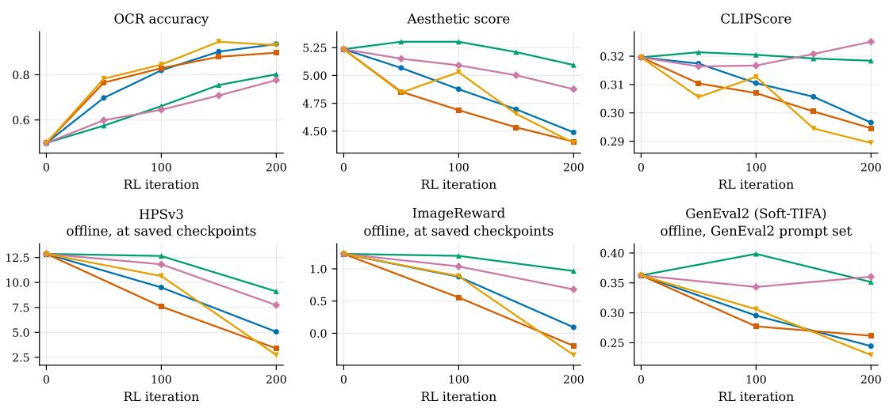  
Figure 3: OCR setting: the evaluated dimensions against the iteration, over the first 200 iterations. Top row: online evaluation every 50 iterations. Bottom row: ofline evaluation at saved checkpoints, every 100 iterations; HPSv3 and ImageReward on the OCR prompts, GenEval2 on its own prompts.  
Mixed-reward setting (400 RL iterations; online eval every 50, ofline every 100)

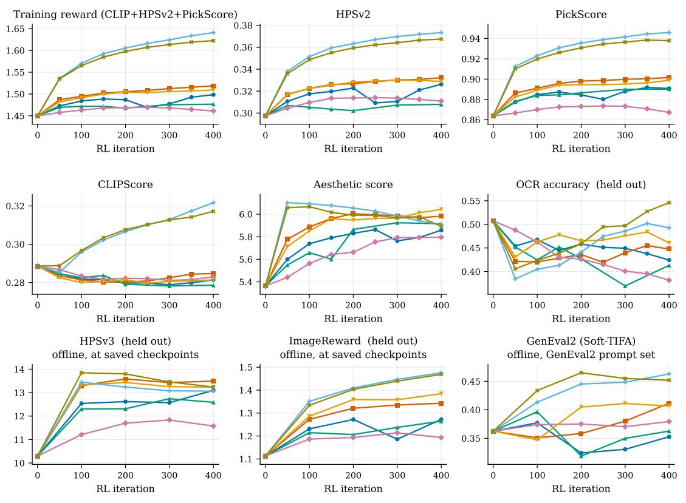  
Figure 4: Mixed-reward setting: the evaluated dimensions against the iteration, over the first 400 iterations. The first panel is the training reward; OCR accuracy, HPSv3, ImageReward and GenEval2 are held out. Online evaluation every 50 iterations, ofline evaluation at saved checkpoints every 100.

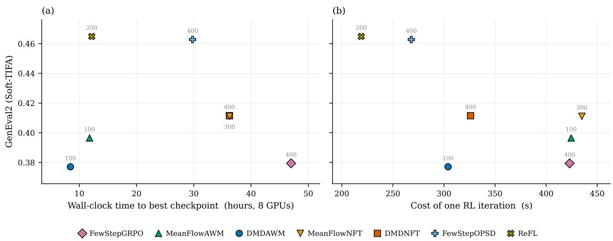  
Figure 5: Mixed-reward setting: GenEval2 of each trainer’s best checkpoint within 400 iterations. (a) Left: against the wall-clock time to reach it, s/iter times the iteration, on 8 GPUs. (b) Right: against s/iter. Both panels show the same checkpoints, so they share the vertical axis and the legend, and a trainer moves only horizontally from (a) to (b). The number beside each marker is the iteration of that checkpoint.

1.509 against 1.440, and is higher on the held-out HPSv3 (13.23 against 11.79), ImageReward (1.385 against 1.317) and best GenEval2 (0.411 against 0.399), the last within the ∼0.03 resolution.

(ii) In the OCR setting, DMDAWM, MeanFlowNFT and DMDNFT raise OCR accuracy from 0.498 to at least 0.85 within 100–150 iterations, whereas MeanFlowAWM and FewStepGRPO reach only 0.802 and 0.776 at iteration 200. Furthermore, it can be observed that within the 200-iteration horizon of Figure 3, the highest logged OCR accuracy is reached by MeanFlowNFT, about 0.945 at iteration 150, and it is also the first to reach 0.85, at iteration 100. DMDAWM starts lower at iteration 50 but rises steeply thereafter and reaches 0.936 at iteration 200, where the two curves coincide within the resolution of the plot (Table 6a). Its rapid rise is consistent with a combination of two properties. (i) It has no self-regression $( \tilde { x } _ { \mathrm { r e g } } = \emptyset )$ , so only reward augmentation contributes to its decoupled update. (ii) It is DMD-based and models the instantaneous velocity with the auxiliary network $v _ { \phi } .$ , which is refitted to the current rollouts at every iteration, so the baseline $\tilde { x } _ { \mathrm { b a s e } } = \tilde { x } _ { \mathrm { a u x } }$ follows the policy; since this baseline is fixed within an update, reward augmentation uses the direction $4 \left( v _ { \mathrm { c o n d } } - v _ { \phi } \right)$ instead of one based on the directional-diference estimate Equation (87). This fast increase coincides with the large held-out degradation; at its first checkpoint with OCR accuracy above 0.82, HPSv3 drops from 12.86 to 5.05 and ImageReward from 1.233 to 0.092.

(iii) In the mixed-reward setting, FewStepOPSD and ReFL achieve the two highest training rewards, with FewStepOPSD highest at the final iteration. Using the gradient of the full reward, the two raise the training reward from 1.450 to 1.64 and 1.62, against 1.46–1.52 for the five groupadvantage methods, and they also lead on ImageReward and GenEval2. Their curves nearly coincide (Figure 4); the logged coeficient magnitudes of FewStepOPSD difer by 0.24 between the two branches, i.e. 2.4% of their fixed sum $1 / \beta = 1 0$ , although the two reward-augmentation vectors also depend on their diferent increments (Section D.3). Among the five group-advantage

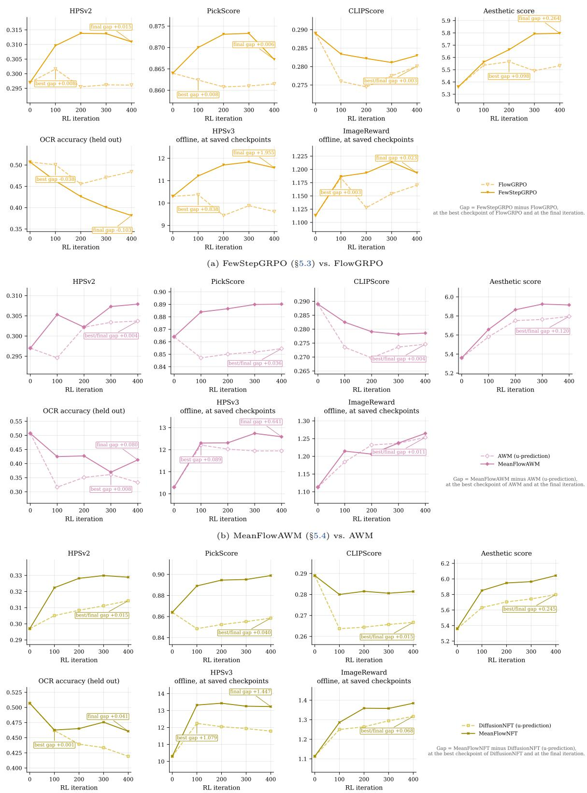  
(c) MeanFlowNFT (§5.5) vs. DifusionNFT

Figure 6: Mixed-reward setting: the baselines of §6.1 against the few-step adaptations of this paper (solid), from the shared pre-RL checkpoint. Panels as in Figure 4. Each annotated gap is the adaptation minus the baseline, at the best checkpoint of the baseline and at iteration 400; the two coincide when the baseline is best at iteration 400. GenEval2 for the same runs is shown in Figure 1.

<table><tr><td>trainer</td><td> $\mathrm { s / i t e r }$ </td><td>sampling (s) update (s)</td><td></td><td> $n _ { \mathrm { i t } }$ </td><td>forwards for J</td><td> $c _ { \phi }$ </td><td> $n _ { \mathrm { f m } }$ </td></tr><tr><td>FewStepGRPO</td><td>423</td><td>78.7</td><td>344.2</td><td>4</td><td>8</td><td>0</td><td>0</td></tr><tr><td>MeanFlowAWM</td><td>425</td><td>78.3</td><td>344.5</td><td>4</td><td>8</td><td>0</td><td>0</td></tr><tr><td>DMDAWM</td><td>304</td><td>78.2</td><td>223.4</td><td>4</td><td>0</td><td>1</td><td>5</td></tr><tr><td>MeanFlowNFT</td><td>435</td><td>78.8</td><td>354.6</td><td>4</td><td>8</td><td>0</td><td>0</td></tr><tr><td>DMDNFT</td><td>326</td><td>78.4</td><td>244.7</td><td>4</td><td>0</td><td>1</td><td>5</td></tr><tr><td>FewStepOPSD</td><td>268</td><td>224.7</td><td>43.3</td><td>1</td><td>0</td><td>0</td><td>0</td></tr><tr><td>ReFL</td><td>219</td><td>174.6</td><td>44.2</td><td>1</td><td>0</td><td>0</td><td>0</td></tr></table>

Table 7: Cost of one outer iteration in the mixed-reward setting, split into the sampling time (rollout, reward and, for FewStepOPSD and ReFL, the reward-coupled construction of Equation (82)) and the update time; medians over the timers in the training logs, on 8 H20 GPUs. The small residual between the sum of the two times and s/iter covers the refresh of $u _ { \mathrm { o l d } }$ and logging.

methods, DMDNFT and MeanFlowNFT come next and perform similarly (training reward 1.51–1.52, GenEval2 0.41 at iteration 400).

(iv) In the default mixed-reward configuration, none of the five group-advantage runs increases CLIPScore, which decreases slightly from 0.289 to 0.279–0.285, whereas FewStepOPSD and ReFL raise it to 0.317–0.322. Dedicated CLIP-focused group-advantage ablations do increase it (Section D.2).

Eficiency. We measure eficiency by the time per iteration (Table 7) and the time to reach the best checkpoint (Figure 5a). It can be observed that

(i) The two reward-gradient-based methods are the cheapest per iteration, 219 s for ReFL and 268 s for FewStepOPSD, because they compute one update direction per member in the clean-sample space with one query of $u _ { \theta }$ instead of four $( n _ { \mathrm { i t } } = 1 )$ , and because J cancels in their loss. However, their sampling time, which includes the reward-coupled rollout of Equation (82), is 175–225 s per iteration, against about 78 s for the plain rollout of the other five methods (Table 7). Since the reward is defined in pixel space, its gradient with respect to the clean latent requires back-propagation through both the reward model and the VAE decoder.

(ii) The directional-diference evaluations Equation (87) and Equation (109) for the shared-J v form plausibly account for most of the cost diference. FewStepGRPO, MeanFlowAWM and MeanFlowNFT require two additional forward passes of $u _ { \mathrm { o l d } }$ per query. These methods take 423–435 s, against 304–326 s for DMDAWM and DMDNFT, which compute the baseline from $v _ { \phi }$ and compute no J. The diference arises in the update time (344–355 against 223–245 s), and the OCR setting gives the same ordering (451–496 against 342–346 s).

(iii) ReFL has a marginally higher best GenEval2 point estimate than FewStepOPSD (0.465 against 0.463), but the 0.002 gap is below the stated 0.03 resolution and does not separate the two methods. ReFL reaches its selected checkpoint after 12.2 h (iteration 200), whereas FewStepOPSD continues to iteration 400 (29.8 h); both peak on the held-out aesthetic score and HPSv3 by iteration 100 (the aesthetic trajectory of FewStepOPSD is tabulated in Table S1; HPSv3 is read from Figure 4), after which these scores decline while the training reward still rises, which is consistent with the onset of reward hacking. Among the group-advantage-based

<table><tr><td></td><td></td><td></td><td></td><td colspan="5">training reward</td><td colspan="3">VBench (held-out)</td></tr><tr><td>method</td><td>GPUs s/iter</td><td></td><td>GPU-h</td><td>sum</td><td>HPSv3-G</td><td>HPSv3-P</td><td>MQ</td><td>TA</td><td>overall</td><td></td><td>quality semantic</td></tr><tr><td>AnyFlow Init.</td><td></td><td></td><td></td><td>16.54</td><td>6.42</td><td>9.43</td><td>2.64</td><td>1.85</td><td>83.68</td><td>85.36</td><td>76.98</td></tr><tr><td>FewStepGRPO</td><td>32</td><td>735</td><td>1633</td><td>15.89</td><td>6.24</td><td>9.38</td><td>2.40</td><td>1.23</td><td>83.62</td><td>85.27</td><td>76.98</td></tr><tr><td>MeanFlowAWM</td><td>32</td><td>737</td><td>1637</td><td>16.66</td><td>6.49</td><td>9.46</td><td>2.68</td><td>1.84</td><td>83.70</td><td>85.36</td><td>77.04</td></tr><tr><td>DMDAWM</td><td>32</td><td>821</td><td>1824</td><td>16.78</td><td>6.51</td><td>9.53</td><td>2.74</td><td>1.82</td><td>83.64</td><td>85.35</td><td>76.76</td></tr><tr><td>MeanFlowNFT</td><td>32</td><td>734</td><td>1631</td><td>16.80</td><td>6.53</td><td>9.51</td><td>2.76</td><td>1.80</td><td>83.62</td><td>85.34</td><td>76.75</td></tr><tr><td>DMDNFT</td><td>32</td><td>821</td><td>1824</td><td>17.93</td><td>7.01</td><td>10.01</td><td>3.06</td><td>1.68</td><td>83.38</td><td>85.07</td><td>76.63</td></tr><tr><td>FewStepOPSD</td><td>48</td><td>787</td><td>2623</td><td>16.26</td><td>6.30</td><td>9.32</td><td>2.54</td><td>1.91</td><td>83.60</td><td>85.37</td><td>76.53</td></tr><tr><td>ReFL</td><td>48</td><td>728</td><td>2426</td><td>16.46</td><td>6.39</td><td>9.38</td><td>2.61</td><td>1.89</td><td>83.69</td><td>85.40</td><td>76.85</td></tr></table>

The four component columns show raw scorer outputs; the sum uses the logged z-scores for MQ and TA. GPU-h = GPUs s/iter 250/3600, truncated to integer hours, is the comparable cost because the methods ran on diferent world sizes with a fixed per-rank batch. Consequently, the 48-GPU rows use 1.5 as many rollouts per iteration and are not sample-budget-matched to the 32-GPU rows. The dimension-level VBench results underlying the three aggregates are reported in Table S2 of Appendix D. For FewStepOPSD and ReFL, only part of the video reward is diferentiable, unlike in the image setting (Section D.5).

Table 8: Main results on video generation at iteration 250. Left: cost. Middle: the aggregate training reward and its four components on 256 held-out prompts. Right: VBench, which no method optimises. Bold: best per comparable column; s/iter is compared only among the 32-GPU rows.

methods, MeanFlowAWM and DMDAWM reach their best GenEval2 early, at iteration 100 (11.8 and 8.4 h), but at lower values (0.397 and 0.377).

## 6.4 Main Results on Video Generation

Efectiveness. Table 8 and Table S2 support the following observations.

(i) FewStepGRPO is the least efective at increasing the training reward. It is the only groupadvantage-based method that ends below the shared initialisation (15.89 against 16.54), and its TA drops markedly, from 1.85 to 1.23. Among the group-advantage-based methods DMDNFT is the most efective, raising the training reward to 17.93 (+1.39) and leading on three of its four terms. In this run the larger training-reward gain coincides with larger held-out degradation. Against MeanFlowAWM, the highest on VBench overall, DMDNFT is 0.32 lower in VBench overall (83.38 against 83.70, last of the seven), 5.56 lower in dynamic degree (53.33 against 58.89, the lowest of any method) and 0.16 lower in TA (1.68 against 1.84).

(ii) Among the remaining methods, FewStepOPSD and ReFL have the lowest training reward after FewStepGRPO, ending at 16.26 and 16.46, slightly below the initialisation. For video, the reward gradient must be computed for every latent token of a long sequence, through the decoder and the reward model, which requires several numerical simplifications in the reward-gradient-based runs. Their VBench point estimates degrade less than that of DMDNFT in these runs, which does not establish that they protect against reward exploitation. TA rises above the initialisation (1.91 and 1.89 against 1.85), ReFL is second on VBench overall (83.69) and first on quality (85.40), and FewStepOPSD has the highest aesthetic quality, background consistency and appearance style of any method (70.87, 95.68 and 74.53); FewStepOPSD and ReFL have the second- and third-highest dynamic degree (59.44 and 59.17).

Eficiency. The GPU-hours in Table 8 lead to the following observations.

(i) Unlike in the image setting, the DMD-based methods are slower than their MeanFlow counterparts, in both s/iter (821 against 734–737 s) and GPU-hours. With $n _ { \mathrm { f m } } = 5$ , omitting the directional diference saves up to 8 forward passes of $u _ { \mathrm { o l d } }$ without gradient per member $( n _ { \mathrm { t s } } = 4$ queries, two each) but adds 5 forward and backward passes of $v _ { \phi }$ per outer iteration. The fit costs about 144 s per iteration and the net s/iter diference is $+ 8 4  – 8 7 \mathrm { s } .$ so the saved J passes account for about 60 s by diference; the fit dominates, plausibly because backward passes through the larger video model are expensive.

(ii) The reward-gradient-based methods lose their cost advantage from the image setting and are the two most expensive in GPU-hours. FewStepOPSD and ReFL have a sampling time of up to 674 s per iteration (FewStepOPSD), which includes the reward-gradient computation, against ∼291 s for the other methods, and an update time of only 112 s. The gradient of a video reward with respect to the latent tokens is expensive, plausibly because the latent sequence is much longer than for images and because both the reward model and the decoder are larger than their image counterparts. In addition, MQ and TA are not diferentiable (§6.2), which further limits these two methods.

## 6.5 Test-Time Scaling Analysis

In deployment, a few-step model should ideally support several operating points on the quality–latency trade-of, using its training step count for most requests and more sampling steps when higher quality is required. This motivates training at a small $M _ { \mathrm { s t e p } }$ while allowing more solver steps at inference. If quality improves without retraining, the model supports test-time scaling and can trade compute for output quality. Flexible-step generation and inference-time scaling have also been studied for consistency-type models, improved MeanFlow and scalable generators (Kim et al., 2024; Wang et al., 2024a; Geng et al., 2026; Xie et al., 2025a); our experiment is restricted to the checkpoints and solver grid below.

Setup. We therefore consider the image generation task, and take the checkpoints trained and evaluated at $M _ { \mathrm { { s t e p } } } = 4$ in §6.1 and sample each at $M _ { \mathrm { s t e p } } \in \{ 4 , 8 , 1 6 , 3 2 \}$ . We use the checkpoints listed in Table S3. We keep the 256 DrawBench prompts, seed 12345, resolution, deterministic sampler Equation (5), absence of classifier-free guidance, and the time shift 3.0 of §6.1 fixed. Increasing $M _ { \mathrm { s t e p } }$ only refines the same shifted solver grid; no model is retrained. Thus the experiment isolates a 1×, 2×, 4×, or 8× inference-step budget. As references, we also evaluate the AnyFlow initialisation, from which all seven trainers start, and the pretrained SD3.5-Medium, with the same prompts, seed, resolution and shifted grid. SD3.5-Medium models the instantaneous velocity and is not distilled for few-step sampling, so it uses the Euler step Equation (4) with classifier-free guidance of scale 4.5, i.e., two network evaluations per step.

Main results. Figure 7 shows the per-step trends, and Table S3 in Appendix D reports the percentage changes. We draw four conclusions.

(i) Models at diferent training stages show diferent test-time scaling behaviour. The pretrained SD3.5-Medium models the instantaneous velocity, so four Euler steps are far too coarse; its scores rise sharply from four to eight steps and keep improving more slowly up to 32 steps (HPSv3 from −4.49 to 9.96, Figure 7). Even at 32 steps, i.e., 64 network evaluations, it remains below every fine-tuned model at four steps in HPSv3, ImageReward, the aesthetic score, HPSv2 and PickScore. In contrast, the AnyFlow initialisation, distilled from SD3.5-Medium for few-step sampling, appears to have already fixed its output patterns at the step count used in training, and its HPSv3, ImageReward and GenEval2 drop markedly with more steps; for example, from 4 to 32 steps, ImageReward falls from 1.11 to 1.02 and GenEval2 from 0.363 to 0.320 (Figure 7), beyond the ∼0.03 resolution. By comparison, the RL fine-tuned models, which all start from this initialisation, fluctuate less in these three evaluators.

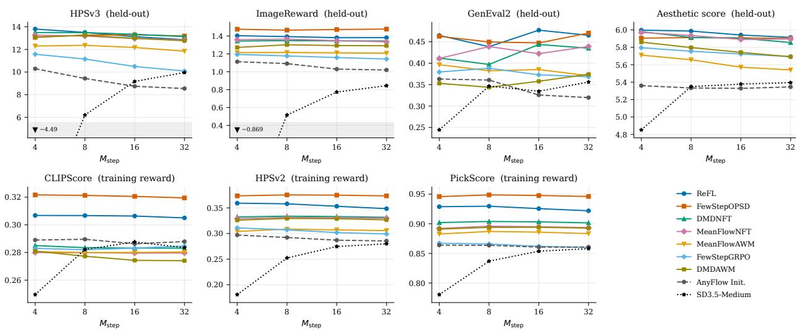  
Figure 7: Absolute value of each evaluated dimension against $M _ { \mathrm { s t e p } } ,$ one line per fine-tuned model, with the AnyFlow initialisation (dashed) and the pretrained SD3.5-Medium sampled with classifierfree guidance (dotted) as references. For the fine-tuned models, the three training-reward summands (CLIPScore, HPSv2 and PickScore) show little systematic gain from additional steps, while the held-out HPSv3 and aesthetic score more often decline. Trainer labels are as in Table 5; the checkpoint is given in Table S3. Figure S1 and Figure S2 in Appendix D show the same results as percentage changes from the four-step value, grouped by evaluator and by model, respectively.

(ii) There is no systematic gain on the training reward. Across the fine-tuned models, the three reward summands remain nearly flat (Figure 7 and Table S3). From 4 to 32 steps, the held-out HPSv3 changes by between +1.0% and −6.8% for six of the seven trainers, compared with −17% for the AnyFlow initialisation (Figure 7). The stronger degradation of the initialisation itself suggests that the decline in rewards of the fine-tuned models is inherited from the initialisation rather than introduced by RL fine-tuning. Further, these small changes are consistent with the 4-step outputs already having settled into patterns that score well under the training reward, including sampler-specific reward exploitation. Doubling to $M _ { \mathrm { { s t e p } } } = 8$ often preserves or slightly improves a score, but the gain generally saturates or reverses as the grid is refined further. Figure 8 shows both behaviours; MeanFlowAWM improves at eight steps and then declines, whereas ReFL declines gradually.

(iii) OCR-sensitive prompts can expose a much sharper failure mode. The selected failures occur on malformed or OCR-heavy prompts. A clear example is shown in Figure 9, where the DMDNFT and MeanFlowNFT samples collapse at $M _ { \mathrm { s t e p } } = 3 2$ to little more than foreground text. HPSv3 falls from 12.18 to 0.32 and from 11.36 to 0.32, respectively, even as CLIPScore rises from 0.275 to 0.324 and from 0.292 to 0.309. In these selected cases, additional solver steps produce increasingly text-dominated outputs rather than a visual-quality improvement.

(iv) Visible sample-level scaling exists. On inspection, many samples improve with 2–4 times as many sampling steps, even though the aggregate rewards barely change; on the selected samples, HPSv3 does rise (Figure 10). At four steps, they have weak clarity or unstable details, while eight or sixteen steps yield cleaner and more stable generations; Figure 10 shows two such cases. The aggregate rewards thus appear less sensitive to these improvements than visual inspection, and test-time scaling may be useful beyond what the aggregate scores suggest, although more steps do not improve quality monotonically.

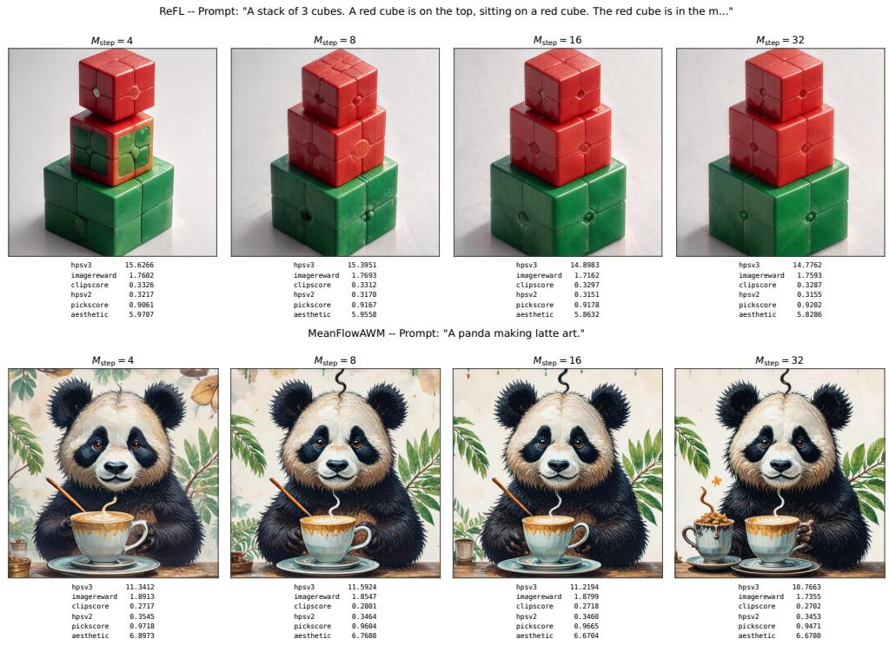  
Figure 8: Two selected mild-degradation cases; each panel shows the six evaluated scores of that image (CLIPScore, HPSv2, PickScore, HPSv3, aesthetic score and ImageReward). Top, ReFL on the three-cube prompt, where HPSv3 gradually falls from 15.63 to 14.78. Bottom, MeanFlowAWM on “A panda making latte art”, where HPSv3 first rises from 11.34 to 11.59 at $M _ { \mathrm { { s t e p } } } = 8$ , then falls to 10.77 at 32 as an extra cup appears.

## 6.6 Practical Guidance

The empirical results, each from a single run, suggest the following guidance:

(i) Where it is afordable, the reward gradient is our recommended approach. Driving the update directly by ∇R was the most efective choice in our mixed-reward image experiments; FewStepOPSD and ReFL achieve the two highest training rewards in the mixed-reward setting and improve all three summands (§6.3). However, the applicability of these methods is restricted in practice. (i) The gradient can become too expensive when the reward model and the decoder are large or the latent token sequence is long, as on video (§6.4). (ii) The reward must be diferentiable with respect to the clean sample, which excludes OCR accuracy and VideoAlign’s MQ and TA (§6.1, Section D.5). Where both conditions hold, ReFL alone is already a strong baseline in our runs.

DMDNFT -- Prompt: "Dininrg tablez."  
FewStepOPSD -- Prompt: "A collection of nail is sitting on a table."  
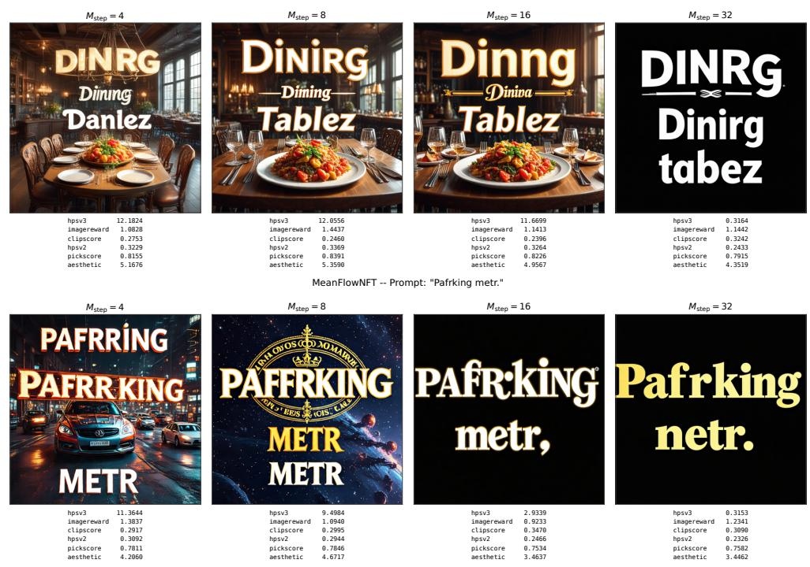

Figure 9: Two selected OCR-sensitive text-dominance cases under test-time scaling: DMDNFT (top) and MeanFlowNFT (bottom). Within each row, the prompt and seed are fixed and only M<sub>step</sub> changes; the values below each image are that image’s rewards. These are selected qualitative failure cases rather than population averages.FewStep-OPSD (  
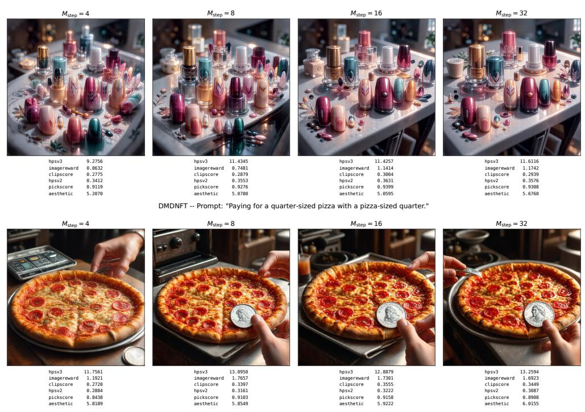  
Figure 10: Selected cases where a modest inference-step increase helps. Top, FewStepOPSD on the nail-products prompt: the 4-step image is cluttered and soft, whereas the 8- and 16-step outputs have clearer objects and a more stable arrangement.

(ii) Otherwise, group-advantage-based methods apply. When the reward gradient is too expensive or unavailable, the reward enters only through the group advantage, and these methods must convert the average velocity into the instantaneous one (§4.3). Among them, the DMD-based methods, which estimate the instantaneous velocity with the auxiliary network $v _ { \phi } .$ have a lower per-iteration cost in the image setting but a higher one on video, depending on the relative cost of the saved forward passes for J and the added forward and backward passes of $v _ { \phi } ~ ( \ S 6 . 3 , \ S 6 . 4 )$ . They need extra optimisation steps and memory for $v _ { \phi }$ , and in some of the reported runs their larger reward gains coincide with larger held-out degradation.

(iii) Among the group-advantage-based methods, the DifusionNFT family reached high reward values in relatively few iterations. The FlowGRPO-style replay of FewStepGRPO optimises slowly and has the weakest observed reward endpoints within the common iteration budget: it barely improves the mixed reward on images and loses the most reward on video. The DifusionNFT family reached high reward values within the common iteration budget in both settings, although the cost per iteration varies; MeanFlowNFT is expensive in the image setting and DMDNFT on video. AWM mostly lies between the two in the reported reward outcomes and uses a PPO-style clip to limit each update.

(iv) Test-time scaling of the fine-tuned few-step models saturates quickly. Aggregate scores show no systematic gain; three of the seven HPSv3 curves peak at the training step count of four and one is tied between four and eight steps (Table S3). By visual inspection, however, many individual samples look cleaner with 2–4 times as many steps before the efect saturates or reverses. Additional steps therefore improve the visual quality of some samples but do not improve aggregate scores monotonically (§6.5), and can degrade sample quality on OCR-sensitive prompts.

## 7 Conclusion

Few-step generators reduce the rollout cost that typically dominates RL post-training of difusion models, but they model an average velocity over an interval, whereas existing RL objectives assume an instantaneous velocity and a many-step sampler. This paper adapts these objectives to few-step models systematically in three phases and compares the resulting methods within one codebase. The transformation to x-space expresses each objective we consider through a common policy prediction. The decomposition writes the gradient of each objective as the sum of a reward-free self-regression and a reward augmentation, so that a method reduces to a choice of three anchors and three weights. The adaptation computes these anchors from a few-step model, at the end of its transport or along its tangent, with the instantaneous velocity recovered from the network itself through the MeanFlow identity (the self-induced velocity) or from an auxiliary network. The seven resulting trainers share one training step and are compared under shared rollout, reward and evaluation code, each in a single run. Where the reward is diferentiable and its gradient afordable, FewStepOPSD and ReFL, which use the reward gradient, were the most efective. Otherwise, the DifusionNFT family reached high rewards in relatively few iterations, and the DMD-based variants were faster per iteration on image but slower on video, depending on the relative cost of forward and backward passes, and in some runs coincided with larger held-out degradation. For the fine-tuned models, additional sampling steps gave no systematic aggregate gain, although many individual samples improve with two to four times as many steps as in training.

Open problems. Several questions remain open.

(i) The DMD-based variants estimate the instantaneous velocity with an auxiliary network, which requires additional forward and backward passes to fit this network and GPU memory to hold it. How to reduce this overhead remains open.

(ii) Reward-gradient-based methods require a reward that is diferentiable with respect to the clean sample and a gradient that fits in memory. On video, the motion-quality and text-alignment terms of VideoAlign provide no gradient, and the per-frame decoding required by GPU memory makes the gradient deviate strongly from that of a joint decode. Cheaper and more faithful reward gradients for long latent sequences are needed.

(iii) With a scalar group advantage in the mixed-reward setting, whether every reward summand takes efect depends on the weighting of the summands, on the rescaling by the global-batch standard deviation in Equation (83), and on the small within-group spread of some summands (Section D.2). A general and more reliable construction of the group advantage remains open.

(iv) In our experiments, a few-step model fine-tuned at one step count does not improve systematically with more steps. Fine-tuning at more step counts may give test-time scaling but makes the rollouts more expensive. Whether it can be introduced cheaply during training, or without training, so that a model fine-tuned at a small step count still improves with more steps at test time, remains open.

## References

Andreas Bergmeister, Stefanie Jegelka, Nikolas Nüsken, Carles Domingo-Enrich, and Jakiw Pidstrigach. Reinforce adjoint matching: Scaling RL post-training of difusion and flow-matching models, 2026. URL https://arxiv.org/abs/2605.10759.

James Betker, Gabriel Goh, Li Jing, Tim Brooks, Jianfeng Wang, Linjie Li, Long Ouyang, Juntang Zhuang, Joyce Lee, Yufei Guo, Wesam Manassra, Prafulla Dhariwal, Casey Chu, Yunxin Jiao, and Aditya Ramesh. Improving image generation with better captions. Technical report, OpenAI, 2023. URL https://cdn.openai.com/papers/dall-e-3.pdf.

Kevin Black, Michael Janner, Yilun Du, Ilya Kostrikov, and Sergey Levine. Training difusion models with reinforcement learning. In B. Kim, Y. Yue, S. Chaudhuri, K. Fragkiadaki, M. Khan, and Y. Sun, editors, International Conference on Learning Representations, volume 2024, pages 4965–4987, 2024. URL https://proceedings.iclr.cc/paper\_files/paper/2024/hash/14f755 13f0f1ca01de1e826b52e6b840-Abstract-Conference.html.

Black Forest Labs. FLUX.1 model family. Software repository, 2024. URL https://github.com/b lack-forest-labs/flux.

Black Forest Labs. FLUX.2: Frontier visual intelligence, 2025. URL https://bfl.ai/blog/flux-2.

Clément Chadebec, Onur Tasar, Eyal Benaroche, and Benjamin Aubin. Flash difusion: Accelerating any conditional difusion model for few steps image generation. Proceedings of the AAAI Conference on Artificial Intelligence, 39(15):15686–15695, 2025. doi: 10.1609/aaai.v39i15.33722. URL https://ojs.aaai.org/index.php/AAAI/article/view/33722.

Guanjie Chen, Shirui Huang, Yifu Sun, Kai Liu, Jianchen Zhu, Xiaoye Qu, Yu Cheng, and Peng Chen. Flash-DMD: Towards high-fidelity few-step image generation with eficient distillation and joint reinforcement learning. In Proceedings of the IEEE/CVF Conference on Computer Vision and Pattern Recognition (CVPR), pages 6010–6020, June 2026a. URL https://openaccess.the cvf.com/content/CVPR2026/html/Chen\_Flash-DMD\_Towards\_High-Fidelity\_Few-Step\_Imag e\_Generation\_with\_Efficient\_Distillation\_and\_CVPR\_2026\_paper.html.

Huayu Chen, Kaiwen Zheng, Qinsheng Zhang, Ganqu Cui, Yin Cui, Haotian Ye, Tsung-Yi Lin, Ming-Yu Liu, Jun Zhu, and Haoxiang Wang. NFT: Bridging supervised learning and reinforcement learning in math reasoning. In C. Vondrick, B. Hariharan, C. Rafel, L. Pinto, D. Yang, and A. Faust, editors, International Conference on Learning Representations, volume 2026, pages 124025–124042, 2026b. URL https://proceedings.iclr.cc/paper\_files/paper/2026/hash/ c9867d5a22653ce98b02595061e40f12-Abstract-Conference.html.

Junying Chen, Zhenyang Cai, Pengcheng Chen, Shunian Chen, Ke Ji, Xidong Wang, Yunjin Yang, and Benyou Wang. ShareGPT-4o-Image: Aligning multimodal models with GPT-4o-level image generation, 2025a. URL https://arxiv.org/abs/2506.18095.

Xiaokang Chen, Zhiyu Wu, Xingchao Liu, Zizheng Pan, Wen Liu, Zhenda Xie, Xingkai Yu, and Chong Ruan. Janus-pro: Unified multimodal understanding and generation with data and model scaling, 2025b. URL https://arxiv.org/abs/2501.17811.

Kevin Clark, Paul Vicol, Kevin Swersky, and David Fleet. Directly fine-tuning difusion models on diferentiable rewards. In B. Kim, Y. Yue, S. Chaudhuri, K. Fragkiadaki, M. Khan, and Y. Sun, editors, International Conference on Learning Representations, volume 2024, pages 4793–4822,

2024. URL https://proceedings.iclr.cc/paper\_files/paper/2024/hash/13e8be77982beb 73d7ed0bbf122f9f3c-Abstract-Conference.html.

Giannis Daras, Yuval Dagan, Alex Dimakis, and Constantinos Daskalakis. Consistent difusion models: Mitigating sampling drift by learning to be consistent. In A. Oh, T. Naumann, A. Globerson, K. Saenko, M. Hardt, and S. Levine, editors, Advances in Neural Information Processing Systems, volume 36, pages 42038–42063. Curran Associates, Inc., 2023. doi: 10.52202/075280-1821. URL https://proceedings.neurips.cc/paper\_files/paper/2023/hash/831406cfe7e4a0aed5ac5 c8a8389d1f5-Abstract-Conference.html.

Giannis Daras, Alex Dimakis, and Constantinos Costis Daskalakis. Consistent difusion meets tweedie: Training exact ambient difusion models with noisy data. In Ruslan Salakhutdinov, Zico Kolter, Katherine Heller, Adrian Weller, Nuria Oliver, Jonathan Scarlett, and Felix Berkenkamp, editors, Proceedings of the 41st International Conference on Machine Learning, volume 235 of Proceedings of Machine Learning Research, pages 10091–10108. PMLR, 21–27 Jul 2024. URL https://proceedings.mlr.press/v235/daras24a.html.

Linwei Dong, Ruoyu Guo, Ge Bai, Zehuan Yuan, Yawei Luo, and Changqing Zou. Guiding distribution matching distillation with gradient-based reinforcement learning, 2026. URL https://arxiv.or g/abs/2604.19009.

Patrick Esser, Sumith Kulal, Andreas Blattmann, Rahim Entezari, Jonas Müller, Harry Saini, Yam Levi, Dominik Lorenz, Axel Sauer, Frederic Boesel, Dustin Podell, Tim Dockhorn, Zion English, Kyle Lacey, Alex Goodwin, Yannik Marek, and Robin Rombach. Scaling rectified flow transformers for high-resolution image synthesis. In Ruslan Salakhutdinov, Zico Kolter, Katherine Heller, Adrian Weller, Nuria Oliver, Jonathan Scarlett, and Felix Berkenkamp, editors, Proceedings of the 41st International Conference on Machine Learning, volume 235 of Proceedings of Machine Learning Research, pages 12606–12633. PMLR, 21–27 Jul 2024. URL https://proceedings.mlr.press/ v235/esser24a.html.

Jiajun Fan, Shuaike Shen, Chaoran Cheng, Yuxin Chen, Chumeng Liang, and Ge Liu. Online reward-weighted fine-tuning of flow matching with wasserstein regularization. In Y. Yue, A. Garg, N. Peng, F. Sha, and R. Yu, editors, International Conference on Learning Representations, volume 2025, pages 60053–60113, 2025. URL https://proceedings.iclr.cc/paper\_files/paper/2025 / /9690 4746230 3 067 69 648 A C .

Linqian Fan, Peiqin Sun, Tiancheng Wen, Shun Lu, and Chengru Song. R<sub>dm</sub>: Re-conceptualizing distribution matching as a reward for difusion distillation, 2026a. URL https://arxiv.org/abs/ 2603.28460.

Xiangyu Fan, Zesong Qiu, Zhuguanyu Wu, Fanzhou Wang, Zhiqian Lin, Tianxiang Ren, Dahua Lin, Ruihao Gong, and Lei Yang. Phased DMD: Few-step distribution matching distillation via score matching within subintervals. In Proceedings of the IEEE/CVF Conference on Computer Vision and Pattern Recognition (CVPR), pages 41667–41676, June 2026b. URL https://openaccess.t hecvf.com/content/CVPR2026/html/Fan\_Phased\_DMD\_Few-step\_Distribution\_Matching\_Di stillation\_via\_Score\_Matching\_within\_CVPR\_2026\_paper.html.

Ying Fan, Olivia Watkins, Yuqing Du, Hao Liu, Moonkyung Ryu, Craig Boutilier, Pieter Abbeel, Mohammad Ghavamzadeh, Kangwook Lee, and Kimin Lee. DPOK: Reinforcement learning for fine-tuning text-to-image difusion models. In A. Oh, T. Naumann, A. Globerson, K. Saenko, M. Hardt, and S. Levine, editors, Advances in Neural Information Processing Systems, volume 36,

pages 79858–79885. Curran Associates, Inc., 2023. doi: 10.52202/075280-3497. URL https: //proceedings.neurips.cc/paper\_files/paper/2023/hash/fc65fab891d83433bd3c8d966ed de311-Abstract-Conference.html.

Kevin Frans, Danijar Hafner, Sergey Levine, and Pieter Abbeel. One step difusion via shortcut models. In Y. Yue, A. Garg, N. Peng, F. Sha, and R. Yu, editors, International Conference on Learning Representations, volume 2025, pages 34668–34684, 2025. URL https://proceedings.ic lr.cc/paper\_files/paper/2025/hash/559a0998fab1d19b80e7e43a5852401c-Abstract-Confe rence.html.

Xingtong Ge, Xin Zhang, Tongda Xu, Yi Zhang, Xinjie Zhang, Yan Wang, and Jun Zhang. SenseFlow: Scaling distribution matching for flow-based text-to-image distillation. In International Conference on Learning Representations, pages 92014–92045, 2026a. URL https://proceedings.iclr.cc/ paper\_files/paper/2026/hash/94a98f4338b6e5fba81344f961bac8e5-Abstract-Conference. html.

Xingtong Ge, Yi Zhang, Yushi Huang, Dailan He, Xiahong Wang, Bingqi Ma, Guanglu Song, Yu Liu, and Jun Zhang. SALT: Self-consistent distribution matching with cache-aware training for few-step video generation. In ECCV 2026, 2026b. URL https://eccv.ecva.net/virtual/2026/poster/ 3473.

Zhengyang Geng, Mingyang Deng, Xingjian Bai, Zico Kolter, and Kaiming He. Mean flows for one-step generative modeling. In Advances in Neural Information Processing Systems, volume 38, pages 75460–75482, 2025. doi: 10.52202/085713-2534. URL https://papers.neurips.cc/paper\_ files/paper/2025/hash/6d13e085b79d454da5910e4ca82a3d9d-Abstract-Conference.html.

Zhengyang Geng, Yiyang Lu, Zongze Wu, Eli Shechtman, J. Zico Kolter, and Kaiming He. Improved mean flows: On the challenges of fastforward generative models. In Proceedings of the IEEE/CVF Conference on Computer Vision and Pattern Recognition, pages 30467–30476, 2026. URL https: //openaccess.thecvf.com/content/CVPR2026/html/Geng\_Improved\_Mean\_Flows\_On\_the\_Ch allenges\_of\_Fastforward\_Generative\_Models\_CVPR\_2026\_paper.html.

Dhruba Ghosh, Hannaneh Hajishirzi, and Ludwig Schmidt. GenEval: An object-focused framework for evaluating text-to-image alignment. In Advances in Neural Information Processing Systems, volume 36, pages 52132–52152, 2023. doi: 10.52202/075280-2270. URL https://papers.neurips .cc/paper\_files/paper/2023/hash/a3bf71c7c63f0c3bcb7ff67c67b1e7b1-Abstract-Dataset s\_and\_Benchmarks.html.

Yuchao Gu, Guian Fang, Yuxin Jiang, Weijia Mao, Song Han, Han Cai, and Mike Zheng Shou. AnyFlow: Any-step video difusion model with on-policy flow map distillation, 2026. URL https://arxiv.org/abs/2605.13724.

Daya Guo, Dejian Yang, Haowei Zhang, Junxiao Song, Peiyi Wang, Qihao Zhu, Runxin Xu, Ruoyu Zhang, Shirong Ma, Xiao Bi, Xiaokang Zhang, Xingkai Yu, Yu Wu, Z. F. Wu, Zhibin Gou, Zhihong Shao, Zhuoshu Li, Ziyi Gao, Aixin Liu, Bing Xue, Bingxuan Wang, Bochao Wu, Bei Feng, Chengda Lu, Chenggang Zhao, Chengqi Deng, Chong Ruan, Damai Dai, Deli Chen, Dongjie Ji, Erhang Li, Fangyun Lin, Fucong Dai, Fuli Luo, Guangbo Hao, Guanting Chen, Guowei Li, H. Zhang, Hanwei Xu, Honghui Ding, Huazuo Gao, Hui Qu, Hui Li, Jianzhong Guo, Jiashi Li, Jingchang Chen, Jingyang Yuan, Jinhao Tu, Junjie Qiu, Junlong Li, J. L. Cai, Jiaqi Ni, Jian Liang, Jin Chen, Kai Dong, Kai Hu, Kaichao You, Kaige Gao, Kang Guan, Kexin Huang, Kuai Yu, Lean Wang, Lecong Zhang, Liang Zhao, Litong Wang, Liyue Zhang, Lei Xu, Leyi Xia, Mingchuan

Zhang, Minghua Zhang, Minghui Tang, Mingxu Zhou, Meng Li, Miaojun Wang, Mingming Li, Ning Tian, Panpan Huang, Peng Zhang, Qiancheng Wang, Qinyu Chen, Qiushi Du, Ruiqi Ge, Ruisong Zhang, Ruizhe Pan, Runji Wang, R. J. Chen, R. L. Jin, Ruyi Chen, Shanghao Lu, Shangyan Zhou, Shanhuang Chen, Shengfeng Ye, Shiyu Wang, Shuiping Yu, Shunfeng Zhou, Shuting Pan, S. S. Li, Shuang Zhou, Shaoqing Wu, Tao Yun, Tian Pei, Tianyu Sun, T. Wang, Wangding Zeng, Wen Liu, Wenfeng Liang, Wenjun Gao, Wenqin Yu, Wentao Zhang, W. L. Xiao, Wei An, Xiaodong Liu, Xiaohan Wang, Xiaokang Chen, Xiaotao Nie, Xin Cheng, Xin Liu, Xin Xie, Xingchao Liu, Xinyu Yang, Xinyuan Li, Xuecheng Su, Xuheng Lin, X. Q. Li, Xiangyue Jin, Xiaojin Shen, Xiaosha Chen, Xiaowen Sun, Xiaoxiang Wang, Xinnan Song, Xinyi Zhou, Xianzu Wang, Xinxia Shan, Y. K. Li, Y. Q. Wang, Y. X. Wei, Yang Zhang, Yanhong Xu, Yao Li, Yao Zhao, Yaofeng Sun, Yaohui Wang, Yi Yu, Yichao Zhang, Yifan Shi, Yiliang Xiong, Ying He, Yishi Piao, Yisong Wang, Yixuan Tan, Yiyang Ma, Yiyuan Liu, Yongqiang Guo, Yuan Ou, Yuduan Wang, Yue Gong, Yuheng Zou, Yujia He, Yunfan Xiong, Yuxiang Luo, Yuxiang You, Yuxuan Liu, Yuyang Zhou, Y. X. Zhu, Yanping Huang, Yaohui Li, Yi Zheng, Yuchen Zhu, Yunxian Ma, Ying Tang, Yukun Zha, Yuting Yan, Z. Z. Ren, Zehui Ren, Zhangli Sha, Zhe Fu, Zhean Xu, Zhenda Xie, Zhengyan Zhang, Zhewen Hao, Zhicheng Ma, Zhigang Yan, Zhiyu Wu, Zihui Gu, Zijia Zhu, Zijun Liu, Zilin Li, Ziwei Xie, Ziyang Song, Zizheng Pan, Zhen Huang, Zhipeng Xu, Zhongyu Zhang, and Zhen Zhang. DeepSeek-R1 incentivizes reasoning in LLMs through reinforcement learning. Nature, 645(8081):633–638, 2025. doi: 10.1038/s41586-025-09422-z. URL https://www.nature.com/articles/s41586-025-09422-z.

Xiaoxuan He, Siming Fu, Yuke Zhao, Wanli Li, Jian Yang, Dacheng Yin, Fengyun Rao, and Bo Zhang. TEMPFLOW-GRPO: WHEN TIMING MATTERS FOR GRPO IN FLOW MODELS. In International Conference on Learning Representations, pages 132869–132895, 2026. URL https://proceedings.iclr.cc/paper\_files/paper/2026/hash/d75f561eaaf2cb754bc8d7e3 6d8af362-Abstract-Conference.html.

Jack Hessel, Ari Holtzman, Maxwell Forbes, Ronan Le Bras, and Yejin Choi. CLIPScore: A referencefree evaluation metric for image captioning. In Proceedings of the 2021 Conference on Empirical Methods in Natural Language Processing, pages 7514–7528, 2021. doi: 10.18653/v1/2021.emnlp-m ain.595. URL https://aclanthology.org/2021.emnlp-main.595/.

Jonathan Ho and Tim Salimans. Classifier-free difusion guidance. In NeurIPS 2021 Workshop on Deep Generative Models and Downstream Applications, 2021. URL https://neurips.cc/virtu al/2021/48591.

Jonathan Ho, Ajay Jain, and Pieter Abbeel. Denoising difusion probabilistic models. Advances in Neural Information Processing Systems, 33:6840–6851, 2020. URL https://proceedings.neurip s.cc/paper/2020/hash/4c5bcfec8584af0d967f1ab10179ca4b-Abstract.html.

Edward J. Hu, Yelong Shen, Phillip Wallis, Zeyuan Allen-Zhu, Yuanzhi Li, Shean Wang, Lu Wang, and Weizhu Chen. LoRA: Low-rank adaptation of large language models. In International Conference on Learning Representations, 2022. URL https://iclr.cc/virtual/2022/poster/6319.

Yushi Huang, Xiangxin Zhou, Ruoyu Wang, Chi Zhang, Jun Zhang, and Tianyu Pang. Reinforcing few-step generators via reward-tilted distribution matching, 2026a. URL https://arxiv.org/ab s/2605.26108.

Yushi Huang, Xiangxin Zhou, Jun Zhang, Liefeng Bo, and Tianyu Pang. MeanFlowNFT: Bringing forward-process RL to average-velocity generators, 2026b. URL https://arxiv.org/abs/2607.1 5273. arXiv:2607.15273v2.

Ziqi Huang, Yinan He, Jiashuo Yu, Fan Zhang, Chenyang Si, Yuming Jiang, Yuanhan Zhang, Tianxing Wu, Qingyang Jin, Nattapol Chanpaisit, Yaohui Wang, Xinyuan Chen, Limin Wang, Dahua Lin, Yu Qiao, and Ziwei Liu. VBench: Comprehensive benchmark suite for video generative models. In Proceedings of the IEEE/CVF Conference on Computer Vision and Pattern Recognition, pages 21807–21818, 2024. URL https://openaccess.thecvf.com/content/CVPR2024/html/Hu ang\_VBench\_Comprehensive\_Benchmark\_Suite\_for\_Video\_Generative\_Models\_CVPR\_2024\_p aper.html.

Dengyang Jiang, Dongyang Liu, Zanyi Wang, Qilong Wu, Liuzhuozheng Li, Hengzhuang Li, Xin Jin, Changsheng Lu, Zhen Li, Mengmeng Wang, Steven Hoi, Peng Gao, and Harry Yang. Distribution matching distillation meets reinforcement learning. In Computer Vision – ECCV 2026, volume 17019 of Lecture Notes in Computer Science, pages 281–299. Springer, Cham, 2026. doi: 10.1007/978-3-0 32-37550-6\_16. URL https://link.springer.com/chapter/10.1007/978-3-032-37550-6\_16.

Amita Kamath, Kai-Wei Chang, Ranjay Krishna, Luke Zettlemoyer, Yushi Hu, and Marjan Ghazvininejad. GenEval 2: Addressing benchmark drift in text-to-image evaluation, 2025. URL https://arxiv.org/abs/2512.16853.

Dongjun Kim, Chieh-Hsin Lai, WeiHsiang Liao, Naoki Murata, Yuhta Takida, Toshimitsu Uesaka, Yutong He, Yuki Mitsufuji, and Stefano Ermon. Consistency trajectory models: Learning probability flow ODE trajectory of difusion. In International Conference on Learning Representations, pages 44493–44525, 2024. URL https://proceedings.iclr.cc/paper\_files/paper/2024/hash/c204 d12afa0175285e5aac65188808b4-Abstract-Conference.html.

Yuval Kirstain, Adam Polyak, Uriel Singer, Shahbuland Matiana, Joe Penna, and Omer Levy. Pick-a-pic: An open dataset of user preferences for text-to-image generation. Advances in Neural Information Processing Systems, 36:36652–36663, 2023. doi: 10.52202/075280-1594. URL https://papers.neurips.cc/paper\_files/paper/2023/hash/73aacd8b3b05b4b503d58310b5 23553c-Abstract-Conference.html.

Kimin Lee, Hao Liu, Moonkyung Ryu, Olivia Watkins, Yuqing Du, Craig Boutilier, Pieter Abbeel, Mohammad Ghavamzadeh, and Shixiang Shane Gu. Aligning text-to-image models using human feedback, 2023. URL https://arxiv.org/abs/2302.12192.

Sergey Levine. Reinforcement learning and control as probabilistic inference: Tutorial and review, 2018. URL https://arxiv.org/abs/1805.00909.

Junzhe Li, Yutao Cui, Tao Huang, Chuxuan Zeng, Weijie Kong, Yinping Ma, Chun Fan, Miles Yang, Zhao Zhong, and Liefeng Bo. MixGRPO: Unlocking flow-based GRPO eficiency with mixed ODE-SDE. In ECCV 2026, 2026a. URL https://eccv.ecva.net/virtual/2026/poster/5603.

Zhiqi Li, Wen Zhang, and Bo Zhu. Flow-map GRPO: Reinforcement learning for few-step flow-map generators via anchored stochastic composition, 2026b. URL https://arxiv.org/abs/2607.005 35.

Haitao Lin, Peiyan Hu, Minsi Ren, Zhifeng Gao, Zhi-Ming Ma, Guolin ke, Tailin Wu, and Stan Z. Li. On the design of one-step difusion via shortcutting flow paths, 2026. URL https://arxiv.org/ abs/2512.11831.

Shanchuan Lin, Anran Wang, and Xiao Yang. SDXL-Lightning: Progressive adversarial difusion distillation, 2024. URL https://arxiv.org/abs/2402.13929.

Yaron Lipman, Ricky T. Q. Chen, Heli Ben-Hamu, Maximilian Nickel, and Matthew Le. Flow matching for generative modeling. In ICLR 2023, 2023. URL https://iclr.cc/virtual/2023/p oster/11309

Dongyang Liu, Peng Gao, David Liu, Ruoyi Du, Zhen Li, Qilong Wu, Xin Jin, Sihan Cao, Shifeng Zhang, Hongsheng Li, and Steven Hoi. Decoupled DMD: CFG augmentation as the spear, distribution matching as the shield. In International Conference on Learning Representations, pages 140643–140666, 2026a. URL https://proceedings.iclr.cc/paper\_files/paper/2026/h ash/e425b75bac5742a008d643826428787c-Abstract-Conference.html.

Jie Liu, Gongye Liu, Jiajun Liang, Yangguang Li, Jiaheng Liu, Xintao Wang, Pengfei Wan, Di Zhang, and Wanli Ouyang. Flow-GRPO: Training flow matching models via online RL. In Advances in Neural Information Processing Systems, volume 38, pages 40783–40818, 2025a. doi: 10.52202/085 713-1362. URL https://papers.neurips.cc/paper\_files/paper/2025/hash/3a10c46572628d 58cb44fb705f25cbbf-Abstract-Conference.html.

Jie Liu, Gongye Liu, Jiajun Liang, Ziyang Yuan, Xiaokun Liu, Mingwu Zheng, Xiele Wu, Qiulin Wang, Menghan Xia, Xintao Wang, Xiaohong Liu, Fei Yang, Pengfei Wan, Di Zhang, Kun Gai, Yujiu Yang, and Wanli Ouyang. Improving video generation with human feedback. In Advances in Neural Information Processing Systems, volume 38, pages 82155–82192, 2025b. doi: 10.52202/085713-2750. URL https://papers.nips.cc/paper\_files/paper/2025/hash/76227feb18ea0ee40bd15cf02 c33e18e-Abstract-Conference.html.

Tao Liu, Hao Yan, Mengting Chen, Taihang Hu, Zhengrong Yue, Zihao Pan, Jinsong Lan, Xiaoyong Zhu, Ming-Ming Cheng, Bo Zheng, and Yaxing Wang. Continuous-time distribution matching for few-step difusion distillation, 2026b. URL https://arxiv.org/abs/2605.06376.

Xingchao Liu, Chengyue Gong, and Qiang Liu. Flow straight and fast: Learning to generate and transfer data with rectified flow. In ICLR 2023, 2023. URL https://iclr.cc/virtual/2023/o ral/12626.

Ilya Loshchilov and Frank Hutter. Decoupled weight decay regularization. In International Conference on Learning Representations, 2019. URL https://iclr.cc/virtual/2019/poster/935.

Cheng Lu and Yang Song. Simplifying, stabilizing and scaling continuous-time consistency models, 2025. URL https://arxiv.org/abs/2410.11081.

Simian Luo, Yiqin Tan, Longbo Huang, Jian Li, and Hang Zhao. Latent consistency models: Synthesizing high-resolution images with few-step inference, 2023a. URL https://arxiv.org/ab s/2310.04378.

Weijian Luo. Dif-instruct++: Training one-step text-to-image generator model to align with human preferences. Transactions on Machine Learning Research, 2025. ISSN 2835-8856. URL https://openreview.net/forum?id=SeGNvJJjbs.

Weijian Luo, Tianyang Hu, Shifeng Zhang, Jiacheng Sun, Zhenguo Li, and Zhihua Zhang. Difinstruct: A universal approach for transferring knowledge from pre-trained difusion models. In Advances in Neural Information Processing Systems, volume 36, pages 76525–76546, 2023b. doi: 10.52202/075280-3344. URL https://papers.neurips.cc/paper\_files/paper/2023/hash/f1 15f619b62833aadc5acb058975b0e6-Abstract-Conference.html.

Yihong Luo, Tianyang Hu, Jiacheng Sun, Yujun Cai, and Jing Tang. Learning few-step difusion models by trajectory distribution matching. In Proceedings of the IEEE/CVF International Conference on Computer Vision, pages 17719–17728, 2025. doi: 10.1109/ICCV51701.2025.01646. URL https://openaccess.thecvf.com/content/ICCV2025/html/Luo\_Learning\_Few-Step\_Di ffusion\_Models\_by\_Trajectory\_Distribution\_Matching\_ICCV\_2025\_paper.html.

Yihong Luo, Tianyang Hu, Weijian Luo, and Jing Tang. TDM-R1: Reinforcing few-step difusion models with non-diferentiable reward. In ICML 2026, 2026. URL https://icml.cc/virtual/20 26/poster/66300.

Nanye Ma, Mark Goldstein, Michael S. Albergo, Nicholas M. Bofi, Eric Vanden-Eijnden, and Saining Xie. SiT: Exploring flow and difusion-based generative models with scalable interpolant transformers. In Computer Vision – ECCV 2024, volume 15135 of Lecture Notes in Computer Science, pages 23–40. Springer, Cham, 2024. doi: 10.1007/978-3-031-72980-5\_2. URL https: //link.springer.com/chapter/10.1007/978-3-031-72980-5\_2.

Yiyang Ma, Xingchao Liu, Xiaokang Chen, Wen Liu, Chengyue Wu, Zhiyu Wu, Zizheng Pan, Zhenda Xie, Haowei Zhang, Xingkai Yu, Liang Zhao, Yisong Wang, Jiaying Liu, and Chong Ruan. Janusflow: Harmonizing autoregression and rectified flow for unified multimodal understanding and generation. In Proceedings of the IEEE/CVF Conference on Computer Vision and Pattern Recognition, pages 7739–7751, 2025a. URL https://openaccess.thecvf.com/content/CVPR20 25/html/Ma\_JanusFlow\_Harmonizing\_Autoregression\_and\_Rectified\_Flow\_for\_Unified\_M ultimodal\_Understanding\_CVPR\_2025\_paper.html.

Yuhang Ma, Xiaoshi Wu, Keqiang Sun, and Hongsheng Li. HPSv3: Towards wide-spectrum human preference score. In Proceedings of the IEEE/CVF International Conference on Computer Vision, pages 15086–15095, 2025b. doi: 10.1109/ICCV51701.2025.01400. URL https://openaccess.the cvf.com/content/ICCV2025/html/Ma\_HPSv3\_Towards\_Wide-Spectrum\_Human\_Preference\_Sco re\_ICCV\_2025\_paper.html.

David McAllister, Songwei Ge, Brent Yi, Chung Min Kim, Ethan Weber, Hongsuk Choi, Haiwen Feng, and Angjoo Kanazawa. Flow matching policy gradients. In International Conference on Learning Representations, pages 36352–36372, 2026. URL https://proceedings.iclr.cc/paper\_ files/paper/2026/hash/3d43cc5692bf68944ee7cd31b97d0c11-Abstract-Conference.html.

Meituan LongCat Team, Xunliang Cai, Qilong Huang, Zhuoliang Kang, Hongyu Li, Shijun Liang, Liya Ma, Siyu Ren, Xiaoming Wei, Rixu Xie, and Tong Zhang. Longcat-video technical report, 2025. URL https://arxiv.org/abs/2510.22200.

Zichen Miao, Zhengyuan Yang, Kevin Lin, Ze Wang, Zicheng Liu, Lijuan Wang, and Qiang Qiu. Tuning timestep-distilled difusion model using pairwise sample optimization. In International Conference on Learning Representations, pages 13809–13830, 2025. URL https://proceedings. iclr.cc/paper\_files/paper/2025/hash/243697ace81f57daef8737ff2c5cffd3-Abstract-Con ference.html.

Weili Nie, Julius Berner, Nanye Ma, Chao Liu, Saining Xie, and Arash Vahdat. Transition matching distillation for fast video generation. In Proceedings of the IEEE/CVF Conference on Computer Vision and Pattern Recognition (CVPR), pages 4645–4655, June 2026. URL https://openaccess .thecvf.com/content/CVPR2026/html/Nie\_Transition\_Matching\_Distillation\_for\_Fast\_ Video\_Generation\_CVPR\_2026\_paper.html.

OpenAI. DALL·E 2, 2022. URL https://openai.com/index/dall-e-2/. Product page.

OpenAI, Aaron Hurst, Adam Lerer, Adam P. Goucher, Adam Perelman, Aditya Ramesh, Aidan Clark, AJ Ostrow, Akila Welihinda, Alan Hayes, Alec Radford, Aleksander Mądry, Alex Baker-Whitcomb, Alex Beutel, Alex Borzunov, Alex Carney, Alex Chow, Alex Kirillov, Alex Nichol, Alex Paino, Alex Renzin, Alex Tachard Passos, Alexander Kirillov, Alexi Christakis, Alexis Conneau, Ali Kamali, Allan Jabri, Allison Moyer, Allison Tam, Amadou Crookes, Amin Tootoochian, Amin Tootoonchian, Ananya Kumar, Andrea Vallone, Andrej Karpathy, Andrew Braunstein, Andrew Cann, Andrew Codispoti, Andrew Galu, Andrew Kondrich, Andrew Tulloch, Andrey Mishchenko, Angela Baek, Angela Jiang, Antoine Pelisse, Antonia Woodford, Anuj Gosalia, Arka Dhar, Ashley Pantuliano, Avi Nayak, Avital Oliver, Barret Zoph, Behrooz Ghorbani, Ben Leimberger, Ben Rossen, Ben Sokolowsky, Ben Wang, Benjamin Zweig, Beth Hoover, Blake Samic, Bob McGrew, Bobby Spero, Bogo Giertler, Bowen Cheng, Brad Lightcap, Brandon Walkin, Brendan Quinn, Brian Guarraci, Brian Hsu, Bright Kellogg, Brydon Eastman, Camillo Lugaresi, Carroll Wainwright, Cary Bassin, Cary Hudson, Casey Chu, Chad Nelson, Chak Li, Chan Jun Shern, Channing Conger, Charlotte Barette, Chelsea Voss, Chen Ding, Cheng Lu, Chong Zhang, Chris Beaumont, Chris Hallacy, Chris Koch, Christian Gibson, Christina Kim, Christine Choi, Christine McLeavey, Christopher Hesse, Claudia Fischer, Clemens Winter, Coley Czarnecki, Colin Jarvis, Colin Wei, Constantin Koumouzelis, Dane Sherburn, Daniel Kappler, Daniel Levin, Daniel Levy, David Carr, David Farhi, David Mely, David Robinson, David Sasaki, Denny Jin, Dev Valladares, Dimitris Tsipras, Doug Li, Duc Phong Nguyen, Duncan Findlay, Edede Oiwoh, Edmund Wong, Ehsan Asdar, Elizabeth Proehl, Elizabeth Yang, Eric Antonow, Eric Kramer, Eric Peterson, Eric Sigler, Eric Wallace, Eugene Brevdo, Evan Mays, Farzad Khorasani, Felipe Petroski Such, Filippo Raso, Francis Zhang, Fred von Lohmann, Freddie Sulit, Gabriel Goh, Gene Oden, Geof Salmon, Giulio Starace, Greg Brockman, Hadi Salman, Haiming Bao, Haitang Hu, Hannah Wong, Haoyu Wang, Heather Schmidt, Heather Whitney, Heewoo Jun, Hendrik Kirchner, Henrique Ponde de Oliveira Pinto, Hongyu Ren, Huiwen Chang, Hyung Won Chung, Ian Kivlichan, Ian O’Connell, Ian O’Connell, Ian Osband, Ian Silber, Ian Sohl, Ibrahim Okuyucu, Ikai Lan, Ilya Kostrikov, Ilya Sutskever, Ingmar Kanitscheider, Ishaan Gulrajani, Jacob Coxon, Jacob Menick, Jakub Pachocki, James Aung, James Betker, James Crooks, James Lennon, Jamie Kiros, Jan Leike, Jane Park, Jason Kwon, Jason Phang, Jason Teplitz, Jason Wei, Jason Wolfe, Jay Chen, Jef Harris, Jenia Varavva, Jessica Gan Lee, Jessica Shieh, Ji Lin, Jiahui Yu, Jiayi Weng, Jie Tang, Jieqi Yu, Joanne Jang, Joaquin Quinonero Candela, Joe Beutler, Joe Landers, Joel Parish, Johannes Heidecke, John Schulman, Jonathan Lachman, Jonathan McKay, Jonathan Uesato, Jonathan Ward, Jong Wook Kim, Joost Huizinga, Jordan Sitkin, Jos Kraaijeveld, Josh Gross, Josh Kaplan, Josh Snyder, Joshua Achiam, Joy Jiao, Joyce Lee, Juntang Zhuang, Justyn Harriman, Kai Fricke, Kai Hayashi, Karan Singhal, Katy Shi, Kavin Karthik, Kayla Wood, Kendra Rimbach, Kenny Hsu, Kenny Nguyen, Keren Gu-Lemberg, Kevin Button, Kevin Liu, Kiel Howe, Krithika Muthukumar, Kyle Luther, Lama Ahmad, Larry Kai, Lauren Itow, Lauren Workman, Leher Pathak, Leo Chen, Li Jing, Lia Guy, Liam Fedus, Liang Zhou, Lien Mamitsuka, Lilian Weng, Lindsay McCallum, Lindsey Held, Long Ouyang, Louis Feuvrier, Lu Zhang, Lukas Kondraciuk, Lukasz Kaiser, Luke Hewitt, Luke Metz, Lyric Doshi, Mada Aflak, Maddie Simens, Madelaine Boyd, Madeleine Thompson, Marat Dukhan, Mark Chen, Mark Gray, Mark Hudnall, Marvin Zhang, Marwan Aljubeh, Mateusz Litwin, Matthew Zeng, Max Johnson, Maya Shetty, Mayank Gupta, Meghan Shah, Mehmet Yatbaz, Meng Jia Yang, Mengchao Zhong, Mia Glaese, Mianna Chen, Michael Janner, Michael Lampe, Michael Petrov, Michael Wu, Michele Wang, Michelle Fradin, Michelle Pokrass, Miguel Castro, Miguel Oom Temudo de Castro, Mikhail Pavlov, Miles Brundage, Miles Wang, Minal Khan, Mira Murati, Mo Bavarian, Molly Lin, Murat Yesildal, Nacho Soto, Natalia Gimelshein, Natalie Cone, Natalie

Staudacher, Natalie Summers, Natan LaFontaine, Neil Chowdhury, Nick Ryder, Nick Stathas, Nick Turley, Nik Tezak, Niko Felix, Nithanth Kudige, Nitish Keskar, Noah Deutsch, Noel Bundick, Nora Puckett, Ofir Nachum, Ola Okelola, Oleg Boiko, Oleg Murk, Oliver Jafe, Olivia Watkins, Olivier Godement, Owen Campbell-Moore, Patrick Chao, Paul McMillan, Pavel Belov, Peng Su, Peter Bak, Peter Bakkum, Peter Deng, Peter Dolan, Peter Hoeschele, Peter Welinder, Phil Tillet, Philip Pronin, Philippe Tillet, Prafulla Dhariwal, Qiming Yuan, Rachel Dias, Rachel Lim, Rahu Arora, Rajan Troll, Randall Lin, Rapha Gontijo Lopes, Raul Puri, Reah Miyara, Reimar Leike, Renaud Gaubert, Reza Zamani, Ricky Wang, Rob Donnelly, Rob Honsby, Rocky Smith, Rohan Sahai, Rohit Ramchandani, Romain Huet, Rory Carmichael, Rowan Zellers, Roy Chen, Ruby Chen, Ruslan Nigmatullin, Ryan Cheu, Saachi Jain, Sam Altman, Sam Schoenholz, Sam Toizer, Samuel Miserendino, Sandhini Agarwal, Sara Culver, Scott Ethersmith, Scott Gray, Sean Grove, Sean Metzger, Shamez Hermani, Shantanu Jain, Shengjia Zhao, Sherwin Wu, Shino Jomoto, Shirong Wu, Shuaiqi, Xia, Sonia Phene, Spencer Papay, Srinivas Narayanan, Steve Cofey, Steve Lee, Stewart Hall, Suchir Balaji, Tal Broda, Tal Stramer, Tao Xu, Tarun Gogineni, Taya Christianson, Ted Sanders, Tejal Patwardhan, Thomas Cunninghman, Thomas Degry, Thomas Dimson, Thomas Raoux, Thomas Shadwell, Tianhao Zheng, Todd Underwood, Todor Markov, Toki Sherbakov, Tom Rubin, Tom Stasi, Tomer Kaftan, Tristan Heywood, Troy Peterson, Tyce Walters, Tyna Eloundou, Valerie Qi, Veit Moeller, Vinnie Monaco, Vishal Kuo, Vlad Fomenko, Wayne Chang, Weiyi Zheng, Wenda Zhou, Wesam Manassra, Will Sheu, Wojciech Zaremba, Yash Patil, Yilei Qian, Yongjik Kim, Youlong Cheng, Yu Zhang, Yuchen He, Yuchen Zhang, Yujia Jin, Yunxing Dai, and Yury Malkov. GPT-4o system card, 2024. URL https://arxiv.org/abs/2410.21276.

William Peebles and Saining Xie. Scalable difusion models with transformers. In Proceedings of the IEEE/CVF International Conference on Computer Vision (ICCV), pages 4195–4205, October 2023. URL https://openaccess.thecvf.com/content/ICCV2023/html/Peebles\_Scalable\_D iffusion\_Models\_with\_Transformers\_ICCV\_2023\_paper.html.

Dustin Podell, Zion English, Kyle Lacey, Andreas Blattmann, Tim Dockhorn, Jonas Müller, Joe Penna, and Robin Rombach. SDXL: Improving latent difusion models for high-resolution image synthesis. In The Twelfth International Conference on Learning Representations, 2024. URL https://openreview.net/forum?id=di52zR8xgf.

Qi Qin, Le Zhuo, Yi Xin, Ruoyi Du, Zhen Li, Bin Fu, Yiting Lu, Xinyue Li, Dongyang Liu, Xiangyang Zhu, Will Beddow, Erwann Millon, Victor Perez, Wenhai Wang, Yu Qiao, Bo Zhang, Xiaohong Liu, Hongsheng Li, Chang Xu, and Peng Gao. Lumina-image 2.0: A unified and eficient image generative framework. In Proceedings of the IEEE/CVF International Conference on Computer Vision (ICCV), pages 20031–20042, October 2025. URL https://openaccess.thecvf.com/cont ent/ICCV2025/html/Qin\_Lumina-Image\_2.0\_A\_Unified\_and\_Efficient\_Image\_Generative\_ Framework\_ICCV\_2025\_paper.html.

Rafael Rafailov, Archit Sharma, Eric Mitchell, Christopher D Manning, Stefano Ermon, and Chelsea Finn. Direct preference optimization: Your language model is secretly a reward model. In Advances in Neural Information Processing Systems, volume 36, pages 53728–53741. Curran Associates, Inc., 2023. doi: 10.52202/075280-2338. URL https://proceedings.neurips.cc/paper\_files/paper /2023/hash/a85b405ed65c6477a4fe8302b5e06ce7-Abstract-Conference.html.

Yuxi Ren, Xin Xia, Yanzuo Lu, Jiacheng Zhang, Jie Wu, Pan Xie, Xing Wang, and Xuefeng Xiao. Hyper-SD: Trajectory segmented consistency model for eficient image synthesis. In Advances in Neural Information Processing Systems, volume 37, pages 117340–117362. Curran Associates, Inc.,

2024. doi: 10.52202/079017-3725. URL https://proceedings.neurips.cc/paper\_files/paper /2024/hash/d4e1c24ac41ff0b82ca1b171731f0b23-Abstract-Conference.html.

Robin Rombach, Andreas Blattmann, Dominik Lorenz, Patrick Esser, and Björn Ommer. Highresolution image synthesis with latent difusion models. In Proceedings of the IEEE/CVF Conference on Computer Vision and Pattern Recognition (CVPR), pages 10684–10695, June 2022. doi: 10.1109/CVPR52688.2022.01042. URL https://openaccess.thecvf.com/content/CVPR2022/h tml/Rombach\_High-Resolution\_Image\_Synthesis\_With\_Latent\_Diffusion\_Models\_CVPR\_20 22\_paper.html.

Chitwan Saharia, William Chan, Saurabh Saxena, Lala Li, Jay Whang, Emily L Denton, Kamyar Ghasemipour, Raphael Gontijo Lopes, Burcu Karagol Ayan, Tim Salimans, Jonathan Ho, David J Fleet, and Mohammad Norouzi. Photorealistic text-to-image difusion models with deep language understanding. In Advances in Neural Information Processing Systems, volume 35, pages 36479– 36494. Curran Associates, Inc., 2022. doi: 10.52202/068431-2643. URL https://proceedings.ne urips.cc/paper\_files/paper/2022/hash/ec795aeadae0b7d230fa35cbaf04c041-Abstract-C onference.html.

Tim Salimans and Jonathan Ho. Progressive distillation for fast sampling of difusion models. In The Tenth International Conference on Learning Representations, 2022. URL https://openrevi ew.net/forum?id=TIdIXIpzhoI.

Axel Sauer, Frederic Boesel, Tim Dockhorn, Andreas Blattmann, Patrick Esser, and Robin Rombach. Fast high-resolution image synthesis with latent adversarial difusion distillation. In SIGGRAPH Asia 2024 Conference Papers, pages 1–11. Association for Computing Machinery, 2024. doi: 10.1145/3680528.3687625. URL https://doi.org/10.1145/3680528.3687625.

Axel Sauer, Dominik Lorenz, Andreas Blattmann, and Robin Rombach. Adversarial difusion distillation. In Computer Vision – ECCV 2024, pages 87–103. Springer Nature Switzerland, 2025. doi: 10.1007/978-3-031-73016-0\_6. URL https://doi.org/10.1007/978-3-031-73016-0\_6.

Christoph Schuhmann. LAION-Aesthetics, 2022. URL https://laion.ai/blog/laion-aesthetic s/.

Christoph Schuhmann, Romain Beaumont, Richard Vencu, Cade Gordon, Ross Wightman, Mehdi Cherti, Theo Coombes, Aarush Katta, Clayton Mullis, Mitchell Wortsman, Patrick Schramowski, Srivatsa Kundurthy, Katherine Crowson, Ludwig Schmidt, Robert Kaczmarczyk, and Jenia Jitsev. LAION-5B: An open large-scale dataset for training next generation image-text models. In Advances in Neural Information Processing Systems, volume 35, pages 25278–25294. Curran Associates, Inc., 2022. doi: 10.52202/068431-1833. URL https://proceedings.neurips.cc/paper\_files/paper /2022/hash/a1859debfb3b59d094f3504d5ebb6c25-Abstract-Datasets\_and\_Benchmarks.htm l.

John Schulman, Filip Wolski, Prafulla Dhariwal, Alec Radford, and Oleg Klimov. Proximal policy optimization algorithms, 2017. URL https://arxiv.org/abs/1707.06347.

Zhihong Shao, Peiyi Wang, Qihao Zhu, Runxin Xu, Junxiao Song, Xiao Bi, Haowei Zhang, Mingchuan Zhang, Y. K. Li, Y. Wu, and Daya Guo. DeepSeekMath: Pushing the limits of mathematical reasoning in open language models, 2024. URL https://arxiv.org/abs/2402.03300.

Jiaming Song, Chenlin Meng, and Stefano Ermon. Denoising difusion implicit models. In International Conference on Learning Representations, 2021a. URL https://openreview.net/forum?id=St1g iarCHLP.

Yang Song, Jascha Sohl-Dickstein, Durk Kingma, Abhishek Kumar, Stefano Ermon, and Ben Poole. Score-based generative modeling through stochastic diferential equations. In International Conference on Learning Representations, 2021b. URL https://openreview.net/forum?id=PxTI G12RRHS.

Yang Song, Prafulla Dhariwal, Mark Chen, and Ilya Sutskever. Consistency models. In Proceedings of the 40th International Conference on Machine Learning, volume 202 of Proceedings of Machine Learning Research, pages 32211–32252. PMLR, 23–29 Jul 2023. URL https://proceedings.mlr. press/v202/song23a.html.

Stability AI. Stable Difusion 3.5, 2024. URL https://github.com/Stability-AI/sd3.5. Model release.

Team Seedream, Yunpeng Chen, Yu Gao, Lixue Gong, Meng Guo, Qiushan Guo, Zhiyao Guo, Xiaoxia Hou, Weilin Huang, Yixuan Huang, Xiaowen Jian, Huafeng Kuang, Zhichao Lai, Fanshi Li, Liang Li, Xiaochen Lian, Chao Liao, Liyang Liu, Wei Liu, Yanzuo Lu, Zhengxiong Luo, Tongtong Ou, Guang Shi, Yichun Shi, Shiqi Sun, Yu Tian, Zhi Tian, Peng Wang, Rui Wang, Xun Wang, Ye Wang, Guofeng Wu, Jie Wu, Wenxu Wu, Yonghui Wu, Xin Xia, Xuefeng Xiao, Shuang Xu, Xin Yan, Ceyuan Yang, Jianchao Yang, Zhonghua Zhai, Chenlin Zhang, Heng Zhang, Qi Zhang, Xinyu Zhang, Yuwei Zhang, Shijia Zhao, Wenliang Zhao, and Wenjia Zhu. Seedream 4.0: Toward next-generation multimodal image generation, 2025. URL https://arxiv.org/abs/2509.20427.

Team Wan, Ang Wang, Baole Ai, Bin Wen, Chaojie Mao, Chen-Wei Xie, Di Chen, Feiwu Yu, Haiming Zhao, Jianxiao Yang, Jianyuan Zeng, Jiayu Wang, Jingfeng Zhang, Jingren Zhou, Jinkai Wang, Jixuan Chen, Kai Zhu, Kang Zhao, Keyu Yan, Lianghua Huang, Mengyang Feng, Ningyi Zhang, Pandeng Li, Pingyu Wu, Ruihang Chu, Ruili Feng, Shiwei Zhang, Siyang Sun, Tao Fang, Tianxing Wang, Tianyi Gui, Tingyu Weng, Tong Shen, Wei Lin, Wei Wang, Wei Wang, Wenmeng Zhou, Wente Wang, Wenting Shen, Wenyuan Yu, Xianzhong Shi, Xiaoming Huang, Xin Xu, Yan Kou, Yangyu Lv, Yifei Li, Yijing Liu, Yiming Wang, Yingya Zhang, Yitong Huang, Yong Li, You Wu, Yu Liu, Yulin Pan, Yun Zheng, Yuntao Hong, Yupeng Shi, Yutong Feng, Zeyinzi Jiang, Zhen Han, Zhi-Fan Wu, and Ziyu Liu. Wan: Open and advanced large-scale video generative models, 2025. URL https://arxiv.org/abs/2503.20314.

Bram Wallace, Meihua Dang, Rafael Rafailov, Linqi Zhou, Aaron Lou, Senthil Purushwalkam, Stefano Ermon, Caiming Xiong, Shafiq Joty, and Nikhil Naik. Difusion model alignment using direct preference optimization. In Proceedings of the IEEE/CVF Conference on Computer Vision and Pattern Recognition (CVPR), pages 8228–8238, June 2024. URL https://openaccess.thecvf. com/content/CVPR2024/html/Wallace\_Diffusion\_Model\_Alignment\_Using\_Direct\_Prefere nce\_Optimization\_CVPR\_2024\_paper.html.

Feng Wang and Zihao Yu. Coeficients-preserving sampling for reinforcement learning with flow matching, 2025. URL https://arxiv.org/abs/2509.05952.

Fu-Yun Wang, Zhaoyang Huang, Alexander William Bergman, Dazhong Shen, Peng Gao, Michael Lingelbach, Keqiang Sun, Weikang Bian, Guanglu Song, Yu Liu, Xiaogang Wang, and Hongsheng Li. Phased consistency models. In A. Globerson, L. Mackey, D. Belgrave, A. Fan, U. Paquet, J. Tomczak, and C. Zhang, editors, Advances in Neural Information Processing Systems, volume 37,

pages 83951–84009. Curran Associates, Inc., 2024a. doi: 10.52202/079017-2668. URL https: //proceedings.neurips.cc/paper\_files/paper/2024/hash/98a29475083c502c34949f9baa1 aa2ef-Abstract-Conference.html.

Ruoyu Wang, Boye Niu, Xiangxin Zhou, Yushi Huang, Tongliang Liu, and Chi Zhang. Exploring the design space of reward backpropagation for flow matching, 2026. URL https://arxiv.org/abs/ 2606.11075.

Xinlong Wang, Xiaosong Zhang, Zhengxiong Luo, Quan Sun, Yufeng Cui, Jinsheng Wang, Fan Zhang, Yueze Wang, Zhen Li, Qiying Yu, Yingli Zhao, Yulong Ao, Xuebin Min, Tao Li, Boya Wu, Bo Zhao, Bowen Zhang, Liangdong Wang, Guang Liu, Zheqi He, Xi Yang, Jingjing Liu, Yonghua Lin, Tiejun Huang, and Zhongyuan Wang. Emu3: Next-token prediction is all you need, 2024b. URL https://arxiv.org/abs/2409.18869.

Zhendong Wang, Huangjie Zheng, Pengcheng He, Weizhu Chen, and Mingyuan Zhou. Difusion-GAN: Training GANs with difusion. In ICLR 2023, 2023a. URL https://openreview.net/forum?id= HZf7UbpWHuA.

Zhengyi Wang, Cheng Lu, Yikai Wang, Fan Bao, Chongxuan Li, Hang Su, and Jun Zhu. Prolificdreamer: High-fidelity and diverse text-to-3d generation with variational score distillation. In A. Oh, T. Naumann, A. Globerson, K. Saenko, M. Hardt, and S. Levine, editors, Advances in Neural Information Processing Systems, volume 36, pages 8406–8441. Curran Associates, Inc., 2023b. doi: 10.52202/075280-0368. URL https://proceedings.neurips.cc/paper\_files/pap er/2023/hash/1a87980b9853e84dfb295855b425c262-Abstract-Conference.html.

Xiaoshi Wu, Yiming Hao, Keqiang Sun, Yixiong Chen, Feng Zhu, Rui Zhao, and Hongsheng Li. Human preference score v2: A solid benchmark for evaluating human preferences of text-to-image synthesis, 2023. URL https://arxiv.org/abs/2306.09341.

Enze Xie, Junsong Chen, Yuyang Zhao, Jincheng Yu, Ligeng Zhu, Yujun Lin, Zhekai Zhang, Muyang Li, Junyu Chen, Han Cai, Bingchen Liu, Daquan Zhou, and Song Han. SANA 1.5: Eficient scaling of training-time and inference-time compute in linear difusion transformer. In Aarti Singh, Maryam Fazel, Daniel Hsu, Simon Lacoste-Julien, Felix Berkenkamp, Tegan Maharaj, Kiri Wagstaf, and Jerry Zhu, editors, Proceedings of the 42nd International Conference on Machine Learning, volume 267 of Proceedings of Machine Learning Research, pages 68578–68598. PMLR, 13–19 Jul 2025a. URL https://proceedings.mlr.press/v267/xie25b.html.

Jinheng Xie, Weijia Mao, Zechen Bai, David Junhao Zhang, Weihao Wang, Kevin Qinghong Lin, Yuchao Gu, Zhijie Chen, Zhenheng Yang, and Mike Zheng Shou. Show-o: One single transformer to unify multimodal understanding and generation. In Y. Yue, A. Garg, N. Peng, F. Sha, and R. Yu, editors, International Conference on Learning Representations, volume 2025, pages 28240–28264, 2025b. URL https://proceedings.iclr.cc/paper\_files/paper/2025/hash/45f0d179ef7e10 eb7366550cd4e574ae-Abstract-Conference.html.

Jiazheng Xu, Xiao Liu, Yuchen Wu, Yuxuan Tong, Qinkai Li, Ming Ding, Jie Tang, and Yuxiao Dong. ImageReward: Learning and evaluating human preferences for text-to-image generation. In A. Oh, T. Naumann, A. Globerson, K. Saenko, M. Hardt, and S. Levine, editors, Advances in Neural Information Processing Systems, volume 36, pages 15903–15935. Curran Associates, Inc., 2023. doi: 10.52202/075280-0700. URL https://proceedings.neurips.cc/paper\_files/paper /2023/hash/33646ef0ed554145eab65f6250fab0c9-Abstract-Conference.html.

Shuchen Xue, Chongjian Ge, Shilong Zhang, Yichen Li, and Zhi-Ming Ma. Advantage weighted matching: Aligning RL with pretraining in difusion models. In ICML 2026, 2026. URL https: //icml.cc/virtual/2026/poster/61737.

Zeyue Xue, Jie Wu, Yu Gao, Fangyuan Kong, Lingting Zhu, Mengzhao Chen, Zhiheng Liu, Wei Liu, Qiushan Guo, Weilin Huang, and Ping Luo. DanceGRPO: Unleashing GRPO on visual generation, 2025. URL https://arxiv.org/abs/2505.07818.

Tianwei Yin, Michaël Gharbi, Taesung Park, Richard Zhang, Eli Shechtman, Frédo Durand, and William T. Freeman. Improved distribution matching distillation for fast image synthesis. In A. Globerson, L. Mackey, D. Belgrave, A. Fan, U. Paquet, J. Tomczak, and C. Zhang, editors, Advances in Neural Information Processing Systems, volume 37, pages 47455–47487. Curran Associates, Inc., 2024a. doi: 10.52202/079017-1505. URL https://proceedings.neurips.cc/p aper\_files/paper/2024/hash/54dcf25318f9de5a7a01f0a4125c541e-Abstract-Conference. html.

Tianwei Yin, Michaël Gharbi, Richard Zhang, Eli Shechtman, Frédo Durand, William T. Freeman, and Taesung Park. One-step difusion with distribution matching distillation. In Proceedings of the IEEE/CVF Conference on Computer Vision and Pattern Recognition (CVPR), pages 6613–6623, June 2024b. URL https://openaccess.thecvf.com/content/CVPR2024/html/Yin\_One-step\_ Diffusion\_with\_Distribution\_Matching\_Distillation\_CVPR\_2024\_paper.html.

Z-Image Team, Huanqia Cai, Sihan Cao, Ruoyi Du, Peng Gao, Aiming Hao, Steven Hoi, Zhaohui Hou, Shijie Huang, Dengyang Jiang, Yuming Jiang, Xin Jin, Liangchen Li, Zhen Li, Zhong-Yu Li, David Liu, Dongyang Liu, Qilong Wu, Feng Yu, Zechao Zhan, Chi Zhang, Shifeng Zhang, Ruikai Zhou, and Shilin Zhou. Z-Image: An eficient image generation foundation model with single-stream difusion transformer, 2025. URL https://arxiv.org/abs/2511.22699.

Kaiwen Zheng, Huayu Chen, Haotian Ye, Haoxiang Wang, Qinsheng Zhang, Kai Jiang, Hang Su, Stefano Ermon, Jun Zhu, and Ming-Yu Liu. DifusionNFT: Online difusion reinforcement with forward process. In C. Vondrick, B. Hariharan, C. Rafel, L. Pinto, D. Yang, and A. Faust, editors, International Conference on Learning Representations, volume 2026, pages 134129–134150, 2026a. URL https://proceedings.iclr.cc/paper\_files/paper/2026/hash/d8e68ddfe22520b45b8f b8d5cbde5a21-Abstract-Conference.html.

Kaiwen Zheng, Yuji Wang, Qianli Ma, Huayu Chen, Jintao Zhang, Yogesh Balaji, Jianfei Chen, Ming-Yu Liu, Jun Zhu, and Qinsheng Zhang. Large scale difusion distillation via score-regularized continuous-time consistency. In C. Vondrick, B. Hariharan, C. Rafel, L. Pinto, D. Yang, and A. Faust, editors, International Conference on Learning Representations, volume 2026, pages 2582–2603, 2026b. URL https://proceedings.iclr.cc/paper\_files/paper/2026/hash/0534 abc9e6db91683d82186ef0d68202-Abstract-Conference.html.

Wei Zhou, Xiongwei Zhu, Lingdong Kong, Bo Chen, Lei Zhang, Yongyuan Liang, Xiaoxia Hou, Ye Tian, Xian Sun, Yingshuo Wang, Linfeng Li, Shengqiong Wu, Leigang Qu, Feng Li, Wei Liu, Julian McAuley, and Tat-Seng Chua. On-policy self-distillation in difusion models, 2026. URL https://arxiv.org/abs/2608.24646.

Kai Zou. text-to-image-2m, 2024. URL https://huggingface.co/datasets/jackyhate/text-t o-image-2M. Dataset.

## Appendix

## Appendix Contents

A Notation 68   
B FewStepGRPO 74   
B.1 Why there is no auxiliary-velocity variant 74   
B.2 The transition kernel . 75   
B.3 The decoupled loss 76   
C FewStepOPSD 77   
C.1 The quantities . 78   
C.2 Cancellation of J 78   
C.3 Remarks . 79   
C.4 Cost, and an empirical check 80   
D Supplementary Experiments 81   
D.1 Shared hyperparameters 81   
D.2 Analysis of no gain in CLIPScore for group-advantage runs 84   
D.3 Why FewStepOPSD resembles ReFL 85   
D.4 The velocity penalty: KL-u against KL-v . 85   
D.5 Partial diferentiability of the video reward . 86

## Appendix A. Notation

This paper connects several families of methods and therefore uses a large number of symbols. We collect them in the following table; each symbol is also defined where it first appears.
<table><tr><td>Symbol</td><td>Meaning</td></tr><tr><td>C</td><td>text prompt (conditioning); omitted from an argument list when it is fixed or irrelevant. A bare c always has this mean- ing; subscripted quantities such as  $c _ { \mathrm { a d v } }$  and  $c _ { \theta }$  are distinct</td></tr><tr><td> $\epsilon , \ \epsilon ^ { \prime }$ </td><td>standard Gaussian noise,  $\epsilon , \epsilon ^ { \prime } \sim \mathcal { N } ( 0 , I )$  ; a prime marks a fresh rollout-time renoise draw</td></tr><tr><td> $t , r$ </td><td>flow-map endpoints,  $0 \leq r \leq t \leq 1$  ; generation runs from noise at  $t = 1$  to data at  $t = 0 .$  The unhatted letter r always names a noise level and never a reward; the hatted î below is the mixing weight. Individual objectives state any stricter query domain required by divisions by t or  $t - r$ </td></tr><tr><td>σ</td><td>a generic level on the same scale,  $\sigma \in [ 0 , 1 ]$  , used as the time of the SDEs of Appendix B</td></tr><tr><td>K</td><td>positive-integer group size: the number of rollouts sharing one prompt,  $K \in \mathbb { N } _ { \geq 1 }$  ; members carry the index (i)</td></tr><tr><td>x</td><td>a clean sample. Without a noise-level subscript, an x-symbol denotes a quantity at  $\sigma = 0 ;$  a subscript t, r or  $t _ { j }$  indi- cates its level, while θ, old, real or a role label indicates its source. Method-specific quantities have the level of the object they represent; in particular, the MeanFlow quanti- ties of Equation (43) and the FewStepGRPO prediction and anchors of Equation (97) are defined at level r</td></tr><tr><td> $x _ { t } , \ x _ { r } , \ x _ { \nu }$ </td><td>a state on a trajectory of either the probability-flow ODE Equation (1) or the sampler, as opposed to the reconstructed state  $\tilde { { x } } _ { t }$  below. Among the reward methods, only those that replay a transition need the states of the sampler, which §3 and Stage 1 write as  $\boldsymbol { \hat { x } } _ { \theta , t _ { j } }$  and  $\hat { x } _ { t _ { j } }$ </td></tr><tr><td> $M _ { \mathrm { s t e p } } , \ t _ { j }$ </td><td>positive-integer number of sampler transitions and their  $M _ { \mathrm { s t e p } } + 1$  grid levels,  $1 = t _ { 0 } > t _ { 1 } > \cdot \cdot \cdot > t _ { M _ { \mathrm { s t e p } } } = 0$ </td></tr><tr><td>l</td><td>step count drawn per update by the stochastic DMD sampler of §3,  $\ell \in \{ 1 , \ldots , M _ { \mathrm { s t e p } } \}$ </td></tr><tr><td>ν S,  $s _ { j }$ </td><td>integration variable along a trajectory in Equation (1) two distinct flow-map query levels:  $s \in [ 0 , t ]$  is redrawn by</td></tr><tr><td></td><td>FewStepGRPO at training time, whereas  $s _ { j }$  is the rollout- time level drawn at step j, with  $s _ { j } \leq t _ { j + 1 }$  (Equation (94))</td></tr><tr><td>Tj</td><td>non-negative renoise scale of the stochastic rollout (Equation (94))</td></tr><tr><td> $u _ { \theta } ( x _ { t } , t , r )$ </td><td>trainable average velocity over  $[ r , t ] ,$  which defines a flow map over  $[ r , t ]$  for few-step generation</td></tr><tr><td> $u _ { \mathrm { o l d } }$ </td><td>frozen old policy, with parameters  $\theta _ { \mathrm { o l d } }$  ; EMA of  $u _ { \theta }$  , refreshed once per outer iteration</td></tr><tr><td rowspan="4"> $v _ { \theta } ( x _ { t } , t )$ </td><td>instantaneous velocity induced by the current policy, i.e., the field whose flow map  $u _ { \theta }$  averages (Equation (1)). As stated in  $\ S 3 ,$  we identify it with the flow-matching marginal velocity under the distribution  $p _ { \theta }$  of the current policy's samples</td></tr><tr><td>instead of the data distribution,  $v _ { \theta } ( x _ { t } , t ) = \mathbb { E } _ { \hat { x } \sim p _ { \theta } , \ \epsilon \sim \mathcal { N } ( 0 , I ) } [ \epsilon - \hat { x } \mid x _ { t } ] ,$ </td></tr><tr><td>the two coinciding when the flow map is exact; it is recov- ered from  $u _ { \theta }$  through the MeanFlow identity, and a network</td></tr><tr><td>that parameterises the instantaneous field (§3.2) outputs it the instantaneous field of the old policy, counterpart of  $u _ { \mathrm { o l d } }$ </td></tr><tr><td> $v _ { \mathrm { o l d } } , ~ p _ { \mathrm { o l d } }$ </td><td>directly</td></tr><tr><td> $v _ { \mathrm { r e a l } } ( x _ { t } , t )$ </td><td>and the distribution of its rollouts</td></tr><tr><td>vcond</td><td>the pretrained teacher field, frozen; the distillation target conditional velocity of a sample:  $v _ { \mathrm { c o n d } } = \epsilon - x$  for a clean  $v _ { \mathrm { c o n d } } ^ { ( i ) } = \epsilon - \hat { x } ^ { ( i ) }$ </td></tr><tr><td> $v _ { \phi } ( x _ { t } , t )$ </td><td>and  $x ,$  for a rollout. It is the velocity of the straight path from the sample to the noise, requires no network evaluation, and is the single-sample regression target of every flow-matching loss in this paper</td></tr><tr><td> $\partial _ { t } \boldsymbol { u }$ </td><td>auxiliary velocity with its own parameters  $\phi ,$  fitted online by flow matching to the student's samples so that it tracks  $p _ { \theta }$  rather than the data distribution  $p _ { \mathrm { d a t a } } ;$  in RL those samples are the old-policy rollouts, so it tracks  $p _ { \mathrm { o l d } }$  (Equation (52)):  $\mathrm { d } u / \mathrm { d } t$ </td></tr><tr><td></td><td>total derivative along the trajectory of the instanta- neous field that u averages (Equation (1)); the implementa- tion estimates it by the directional-difference estimate of  $u _ { \mathrm { o l d } }$  along  $v _ { \mathrm { c o n d } }$  (Equation (87)), except on a replayed GRPO state, where the tangent is  $( x _ { t } - \hat { x } ) / t$  (Equation (109))</td></tr><tr><td> $J [ u , t , r ]$ </td><td>detached Jacobian-vector term  $\left( t - r \right) \mathrm { s g } ( \partial _ { t } u )$  , i.e., the de- tached difference between the instantaneous velocity at t and the average velocity over  $[ r , t ]$  . Apart from the MeanFlow loss Equation (8), it is evaluated on  $u _ { \mathrm { o l d } }$  and shared between the current and old policies; a bare J denotes  $J [ u _ { \mathrm { o l d } } , t , { \boldsymbol { r } } ]$  at the current query</td></tr><tr><td> $v _ { \mathrm { i n d } }$ </td><td>self-induced instantaneous velocity  $v _ { \mathrm { i n d } } = u _ { \mathrm { o l d } } + J \left[ u _ { \mathrm { o l d } } , t , r \right]$  (Equation (37)), computed from the average velocity and its total derivative in t without a second network; detached. It equals the instantaneous velocity of  $u _ { \mathrm { o l d } }$  wherever the flow map is exact</td></tr><tr><td> ${ \hat { x } } _ { \theta }$ </td><td>rollout sample of the current policy,  $\hat { x } _ { \theta } = \mathrm { R o } \mathrm { L L O U T } ( \epsilon , u _ { \theta } , c )$  run on the grid of  $M _ { \mathrm { s t e p } }$  steps (Equation (3)). The subscript θ indicates that  ${ \hat { x } } _ { \theta }$  depends differentiably on θ, which requires</td></tr><tr><td>x</td><td>a differentiable sampler the rollout sample detached,  $\partial { \hat { x } } / \partial \theta = 0 ;$  every reward method uses this detached sample. In RL it is drawn by the old policy,</td></tr><tr><td> $\tilde { x } _ { t }$ </td><td> $\hat { x } = \operatorname { R o L L O U T } ( \epsilon , u _ { \mathrm { o l d } } , c )$  (Stage 1), so its distribution is  $p _ { \mathrm { o l d } }$  renoised state of the rollout sample,  $\tilde { x } _ { t } = \mathrm { A D D N O I S E } ( \hat { x } , t ) =$   $( 1 - t ) \hat { x } + t \epsilon .$  with  $\epsilon { \mathrm { ~ a ~ } }$  fresh draw independent of the rollout's</td></tr><tr><td> $\boldsymbol { \tilde { x } _ { r } } = \boldsymbol { X } \left[ \boldsymbol { \tilde { x } _ { t } } , \boldsymbol { v } , \boldsymbol { r } \right]$ </td><td>own noise transported state, i.e., the state obtained by moving  $\tilde { x } _ { t }$  along a velocity v to level  $r , X \lceil \tilde { x } _ { t } , v , r \rceil = \tilde { x } _ { t } - ( t - r ) v ;$  normalised so that  $X [ \tilde { x } _ { t } , \epsilon - x , 0 ] \stackrel {  } { = } x$ </td></tr><tr><td> $\scriptstyle { \tilde { x } } _ { \theta }$ </td><td>the policy prediction differentiated by the loss, with clean- end default  $\tilde { x } _ { \theta } = X \big [ \tilde { x } _ { t } , v _ { \theta } , 0 \big ]$  (Equation (23)), also called the renoise-and-denoise sample in Figure 2. Its clean-end instances include  $\tilde { x } _ { \theta , \mathrm { u } }$  and  $\tilde { { x } } _ { \theta , \mathrm { v } }$  . For FewStepGRPO, the differentiated prediction is instead the mean  $\mu _ { \theta }$  of the scoring</td></tr><tr><td> $\tilde { x } _ { \theta , r }$ </td><td>kernel at level r (Equation (97)). Every anchor is detached the policy's one-step transport to level  $r , \tilde { x } _ { \theta , r } = X \left[ \tilde { x } _ { t } , u _ { \theta } , r \right]$ </td></tr><tr><td> $\tilde { x } _ { \theta , \mathrm { u } }$   $\tilde { { x } } _ { \theta , \mathrm { v } }$ </td><td>u-prediction,  $\boldsymbol { \tilde { x } } _ { \theta , \mathrm { u } } = \boldsymbol { X } \left[ \tilde { x } _ { t } , u _ { \theta } ( \tilde { x } _ { t } , t , 0 ) , 0 \right]$   $\begin{array} { r c l } { { \tilde { x } _ { \theta , \mathrm { v } } } } & { { = } } & { { X \left[ \tilde { x } _ { t } , u _ { \theta } ( \tilde { x } _ { t } , t , r ) + \ J \big [ u _ { \mathrm { o l d } } , t , r \big ] , 0 \right] } } \end{array}$ </td></tr><tr><td></td><td>v-prediction, (Equation (49)), the current-policy counterpart of  $\tilde { x } _ { \mathrm { i n d } }$  Since J is detached, its Jacobian is that of  $X \left[ \tilde { x } _ { t } , u _ { \theta } ( \tilde { x } _ { t } , t , r ) , 0 \right]$ </td></tr><tr><td> $X \left[ \tilde { x } _ { t } , u _ { \theta } ( \tilde { x } _ { t } , t , r ) , 0 \right]$ </td><td>the J-free (t, r) query,  $\mathrm { i . e . , ~ } \tilde { x } _ { \theta , \mathrm { v } }$  with J dropped; it has the same Jacobian as  $\tilde { { x } } _ { \theta , \mathrm { v } }$  and is the current prediction of DM- DAWM, DMDNFT, FewStepOPSD and ReFL</td></tr><tr><td> $\tilde { x } _ { \mathrm { i n d } } , ~ \tilde { x } _ { \mathrm { a u x } }$ </td><td>the two detached v-form anchors, named after the velocity they use: the self-induced prediction  $\tilde { x } _ { \mathrm { i n d } } = X \left[ \tilde { x } _ { t } , { v } _ { \mathrm { i n d } } , 0 \right]$  (Equation (38)), anchor of the v-ind variants, and the aux- iliary prediction  $\tilde { x } _ { \mathrm { a u x } } = X \left[ \tilde { x } _ { t } , v _ { \phi } , 0 \right]$  , baseline of the v-aux variants (in DMD evaluated at  $\tilde { x } _ { t } ^ { \prime } ,$  Equation (44))</td></tr><tr><td> $\tilde { x } _ { \mathrm { o l d } } , \ \tilde { x } _ { \mathrm { o l d , u } } , \ \tilde { x } _ { \mathrm { i n d } } | _ { J = 0 }$ </td><td>the old policy's other predictions at the same state: for an instantaneous-velocity policy  $\begin{array} { r c l } { \tilde { { x } } _ { \mathrm { o l d } } } & { = } & { X \left[ \tilde { { x } } _ { t } , { { v } _ { \mathrm { o l d } } } , \ 0 \right] } \end{array}$  (Equation (24)); for an average-velocity policy the u- prediction  $\tilde { x } _ { \mathrm { o l d , u } } = X \left[ \tilde { x } _ { t } , \{ x _ { \mathrm { o l d } } ( \tilde { x } _ { t } , t , 0 ) \right.$  , 0] and the J-free  $( t , r )$  query  $\tilde { x } _ { \mathrm { i n d } } | _ { J = 0 } = X \left[ \bar { \tilde { x } } _ { t } , { u } _ { \mathrm { o l d } } ( \tilde { x } _ { t } , t , r ) , 0 \right]$  , which serves as an- chor in DMDAWM, DMDNFT, FewStepOPSD and ReFL</td></tr><tr><td> $\tilde { x } _ { \mathrm { r e a l } }$ </td><td>(Table 2) the teacher's prediction at the same state,  $X [ \tilde { x } _ { t } , v _ { \mathrm { r e a l } } , 0 ]$ </td></tr><tr><td> $\tilde { x } _ { \mathrm { r e a l } , r } , \ \tilde { x } _ { \mathrm { i n d } , r }$ </td><td>teacher and self-induced predictions at level r (Equation (39))</td></tr><tr><td> $v _ { \theta } ^ { \pm } , ~ \tilde { x } _ { \theta } ^ { \pm }$ </td><td>positive and negative implicit-policy branches and their clean predictions (Equation (19), Equation (26))</td></tr><tr><td> $\tilde { x } _ { \mathrm { r e g } }$ </td><td>anchor 1, the regression anchor, constructed for the self-</td></tr><tr><td> $\tilde { x } _ { \mathrm { b a s e } }$ </td><td>regression loss that regularises the tuning of  $u _ { \theta }$  anchor 2, the baseline anchor, from which the reward dis-</td></tr><tr><td> $\tilde { x } _ { \mathrm { r w d } }$ </td><td>placement is measured anchor 3, the rewarded anchor. It is the scored rollout x in FewStepAWM and FewStepNFT, and a teacher prediction, a replayed action or a constructed rewarded point in the</td></tr><tr><td> $R ( \cdot , c ) , ~ { \mathcal { D } }$ </td><td> $\tilde { x } _ { \mathrm { b a s e } }$  augmentation displacement, whose direction is set by the sign of  $\omega$  reward model and decoder;  $R ^ { ( i ) } = R \big ( { \mathcal { D } } ( { \hat { x } } ^ { ( i ) } ) , c \big )$  is the end-</td></tr><tr><td>A</td><td>point reward of member i signed, detached advantage of the endpoint reward. Under Equation (12) it is normalised and zero-mean within the</td></tr><tr><td> $Z _ { c }$ </td><td>prompt group; under the implemented Equation (83) it is centred on the prompt's mean in the current outer iteration and scaled by the current global-batch standard deviation positive normaliser in Equation (18),  $Z _ { c } = \mathrm { s t d } ( \{ R \} ) + \varepsilon _ { \mathrm { s t d } } .$ </td></tr><tr><td> $\hat { r }$ </td><td>so that the bracketed quotient equals the A of Equation (12) bounded mixing weight, or optimality probability, taking</td></tr><tr><td> $\beta$ </td><td>values in [0, 1]; monotone non-decreasing in A and equal to  $\frac { 1 } { 2 }$  when  $A = 0$  . ReFL overrides it with  $\hat { r } \equiv 1$  positive branch coefficient,  $\beta > 0 .$  , that directly scales the implicit-policy branch displacement; the induced policy-space</td></tr><tr><td> $\omega , ~ \omega _ { k }$ </td><td>detached signed reward coefficients (scalars) used in the general loss. Their magnitudes are |ω| and  $\left| \omega _ { k } \right|$  . In Few- StepGRPO and FewStepAWM, a non-zero ω has the sign of  $A ,$  and the clipping gate may set it to zero. FewStepNFT defines  $\omega$  directly, and FewStepOPSD uses a positive ascent</td></tr><tr><td> $W _ { \mathrm { r e g } } , ~ W _ { \mathrm { r w d } }$ </td><td>coefficient  $\omega _ { 1 }$  and a negative descent coefficient  $\omega _ { 2 }$  non-negative, detached per-sample loss weights. A bare W is local shorthand for  $W _ { \mathrm { r w d } }$  when  $W _ { \mathrm { r e g } } = 0$  , or for their common value where they coincide</td></tr><tr><td>g, gk</td><td>detached reward displacement,  $g = \omega ( \tilde { x } _ { \mathrm { r w d } } - \tilde { x } _ { \mathrm { b a s e } } )$  , with the branch-indexed counterpart used by FewStepOPSD</td></tr><tr><td> $\rho _ { \mathrm { t r } }$ </td><td>true transition-density ratio of the background FlowGRPO objective (Equation (13))</td></tr><tr><td>GRPO</td><td>tempered (per-element-averaged) scoring-kernel ratio of Few- StepGRPO, a per-sample scalar equal to the  $1 / N$  power of the corresponding Gaussian density ratio (Equation (96))</td></tr><tr><td>ρAWM</td><td>detached residual-change statistic of FewStepAWM; it is not an importance ratio (Equation (101))</td></tr><tr><td> $\chi ( z , A )$ </td><td>detached unclipped-gradient gate of Equation (14); its method-specific evaluations XGRPo and XAwM are written explicitly in Equation (96) and Equation (101)</td></tr><tr><td> $\mu _ { \boldsymbol { \theta } } , \ \mu _ { \mathrm { o l d } } , \ \sigma _ { \mathrm { k } } , \ \Delta t$ </td><td>means and width of the Gaussian scoring kernel used by Few- StepGRPO over a step of length  $\Delta t = t - r$  (Equation (95)). The width  $\sigma _ { \mathrm { k } }$  is distinct from the level of  $x _ { \nu }$  and the rollout</td></tr><tr><td> $\alpha _ { t } , \ b _ { t }$ </td><td>renoise scale  $\tau _ { j }$  Euler-Maruyama coefficients of the scoring kernel,  $\mu = \alpha _ { t } x _ { t } -$   $b _ { t } v$  (Equation (95)); distinct from the  $\mathrm { N F T }$  branch weights  $a _ { \pm }$ </td></tr><tr><td> $\tau _ { \mathrm { A W M } } , \ \tau _ { \mathrm { m i n } }$ </td><td>implemented FewStepAWM residual scale  $\begin{array} { r l } { \tau _ { \mathrm { A W M } } } & { { } = } \end{array}$  max  $\{ t , \tau _ { \mathrm { m i n } } \}$  with floor  $\tau _ { \operatorname* { m i n } } > 0 ;$  it is not a transition-kernel width</td></tr><tr><td> $\zeta , \ \varsigma _ { t }$ </td><td>base noise scale and per-level noise scale of the scoring kernel of FewStepGRPO, using the definition of Equation (110), which avoids the singularity at the source endpoint  $t _ { 0 } = 1$  by</td></tr><tr><td> $a _ { \pm } , ~ \gamma _ { \pm }$ </td><td>evaluating only the denominator at  $t _ { 1 }$  non-negative branch weights  $a _ { + } = \hat { r } / \gamma _ { + }$  and  $a _ { - } = ( 1 - \hat { r } ) / \gamma _ { - } ,$  and strictly positive adaptive normalisers  $\gamma _ { \pm } \geq \varepsilon _ { \gamma } > 0$  used by FewStepNFT and FewStepOPSD (Equation (105))</td></tr><tr><td> $\tilde { x } _ { \pm } , \ \tilde { x } _ { \pm } ^ { [ m ] } , \ h , \ \eta , \ \kappa , \ M _ { \mathrm { t g t } }$ </td><td>ascent and descent points, their iterates indexed by [m], step size  $h ,$  total step length η in units of the trust radius, relative trust radius κ, and positive-integer number of steps  $M _ { \mathrm { t g t } } \in \mathbb { N } _ { \geq 1 } ; h , \eta , \kappa \geq 0$ </td></tr><tr><td> $\Delta _ { \mathrm { r w d } } \widetilde { x } _ { \pm } , \ \Delta$ </td><td>(Equation (62)) FewStepOPSD branch increments (Equation (63), Equation (67)) and the detached shift  $\Delta = \tilde { x } _ { \mathrm { o l d , u } } - \tilde { x } _ { \mathrm { i n d } }$  that transfers them to the v-form anchor (Equation (70))</td></tr><tr><td>λ ξ, B, B</td><td>loss weight of the ReFL objective (Equation (74)) standard Gaussian increment and forward/backward Brown- ian motions of the SDEs in Section B.2</td></tr><tr><td> $c _ { \theta } , \ c _ { \mathrm { o l d } } , \ c _ { J } , \ c _ { \phi } , \ c _ { \mathrm { r e f } } , \ c _ { \mathrm { e x t r a } } , \ C ,$  Crollout</td><td>per-inner-iteration network-evaluation counters, the extra per-outer-iteration cost, and the total and rollout cost of one</td></tr><tr><td> $c _ { \mathrm { a d v } } , \ n _ { \mathrm { i t } } , \ n _ { \mathrm { t s } } , \ n _ { \mathrm { f m } }$ </td><td>positive clip half-range  $c _ { \mathrm { a d v } } > 0$  in Equation (84), also used as the explicit overall W scale of the implemented NFT, general OPSD and ReFL trainers; inner iterations per outer iteration, training queries per member, and fitting steps of</td></tr><tr><td> $H _ { c } , \ \{ R \} _ { B }$ </td><td> $v _ { \phi }$  per outer iteration rewards of prompt c in the current outer iteration and the current global batch of rewards, the two populations of</td></tr><tr><td> $u _ { \mathrm { r e f } }$ </td><td>Equation (83) initial pre-RL average-velocity policy used as the KL reference and kept fixed throughout training (Equation (92)); distinct</td></tr><tr><td> $\lambda _ { \mathrm { K L } } , \mathcal { L } _ { \mathrm { K L } } ^ { \mathrm { u } } , \mathcal { L } _ { \mathrm { K L } } ^ { \mathrm { v } }$ </td><td>from the per-outer-iteration old policy  $u _ { \mathrm { o l d } }$  weight, endpoint-renoise and replay forms of the average- velocity penalty, and the instantaneous-reference form</td></tr><tr><td>w(t)</td><td>(Equation (92), Equation (93)) AWM's time weight</td></tr><tr><td> $\varepsilon _ { \mathrm { s t d } } , \ \varepsilon _ { \mathrm { c l i p } } , \ \varepsilon _ { \mathrm { c d } } , \ \varepsilon _ { \gamma } , \ \varepsilon _ { g }$ </td><td>advantage standard-deviation floor  $\left( \mathrm { s e t } \quad \mathrm { t o } \quad 1 0 ^ { - 4 } \right.$  in Equation (83)), clipping radius, directional-difference step, adaptive-normaliser floor and reward-gradient-norm floor;</td></tr><tr><td>sg()  $\mathrm { m e a n _ { s p } [ \cdot ] }$ </td><td> $\varepsilon _ { \mathrm { s t d } } , \varepsilon _ { \mathrm { c d } } , \varepsilon _ { \gamma } , \varepsilon _ { g } > 0$  and  $\varepsilon _ { \mathrm { c l i p } } \geq 0$  stop-gradient: identity forward, zero backward per-sample mean: the average over the N elements of  $\begin{array} { r c l } { \mathrm { m e a n } _ { \mathrm { s p } } [ v ] } & { = } & { \frac { 1 } { N } \sum _ { k = 1 } ^ { N } v _ { k } } \end{array}$ </td></tr></table>

## Appendix B. FewStepGRPO

Throughout this appendix, $( x _ { t } , x _ { r } )$ denotes a transition of the stochastic sampler Equation (94) replayed as in $\ S 5 . 3 ,$ where $t > r$ are consecutive levels of the rollout grid, $\Delta t = t - r$ , and $s \in [ 0 , t ]$ is the lower endpoint of the flow map, redrawn at every inner iteration. The same estimate $J = J \big [ u _ { \mathrm { o l d } } , t , s \big ]$ is added to both means of Equation (95),

$$
\mu _ { \theta } = \alpha _ { t } x _ { t } - b _ { t } \big ( u _ { \theta } ( x _ { t } , t , s ) + J \big ) , \qquad \mu _ { \mathrm { o l d } } = \alpha _ { t } x _ { t } - b _ { t } \big ( u _ { \mathrm { o l d } } ( x _ { t } , t , s ) + J \big ) ,\tag{108}
$$

where $J$ is evaluated by Equation (109), with tangent $( x _ { t } - \hat { x } ) / t$ . Squared norms are per-sample means $\mathrm { m e a n _ { s p } [ \cdot ] }$ , as in Stage 4.

## B.1 Why there is no auxiliary-velocity variant

The auxiliary velocity cannot be used for the current prediction, because substituting $v _ { \phi }$ would give $\partial \tilde { x } _ { \theta } / \partial \theta = 0 ~ ( \ S 4 . 3 )$ ; the trainers that use $v _ { \phi }$ therefore use it only for the baseline, $\tilde { x } _ { \mathrm { b a s e } } = \tilde { x } _ { \mathrm { a u x } }$ (Equation (60), Equation (104)). In FewStepGRPO, both anchors that an auxiliary field could replace are already fixed, $\tilde { x } _ { \mathrm { r e g } } = \emptyset$ and $\tilde { x } _ { \mathrm { b a s e } } = \mathrm { s g } ( \tilde { x } _ { \theta } ) = \mathrm { s g } ( \mu _ { \theta } )$ (Equation (97)), and §B.3 shows that this choice reproduces the gradient of the tempered Gaussian log-score of the action. Apart from the detached J shared by both means, the old policy enters through $\mu _ { \mathrm { o l d } }$ in $\bar { \rho } _ { \mathrm { G R P O } }$ . An auxiliary variant would therefore have to place $v _ { \phi }$ inside the scoring kernel.

(a) $v _ { \phi }$ as the old-policy field. If $\mu _ { \mathrm { o l d } }$ were replaced by $\mu _ { \phi } = \alpha _ { t } x _ { t } - b _ { t } v _ { \phi } ( x _ { t } , t )$ , then at $\theta = \theta _ { \mathrm { o l d } }$ the scoring ratio would compare the distances of $\mu _ { \phi }$ and $\mu _ { \mathrm { o l d } }$ to $x _ { r }$ . The ratio would then generally difer from one at zero policy drift, so the PPO clip would respond to the approximation error of $v _ { \phi }$ as well as to the change of the policy.

(b) $v _ { \phi }$ as the source of the shared correction. Replacing J by $v _ { \phi } ( x _ { t } , t ) - u _ { \mathrm { o l d } } ( x _ { t } , t , s )$ in both means of Equation (108) keeps $\mu _ { \theta } - \mu _ { \mathrm { o l d } } = - b _ { t } \left( u _ { \theta } - u _ { \mathrm { o l d } } \right)$ , hence ρ¯<sub>GRPO</sub> = 1 at $\theta = \theta _ { \mathrm { o l d } }$ , but it requires $v _ { \phi }$ at the replayed state $x _ { t }$ . By Equation (88), $v _ { \phi }$ is fitted on re-noised states $\mathrm { A D D N O I S E } ( \hat { x } , t ) = ( 1 - t ) \hat { x } + t \epsilon$ with ϵ independent of xˆ, against the conditional velocity $v _ { \mathrm { c o n d } } = \epsilon - \hat { x }$ . A replayed state is not of this form, because Equation (94) adds fresh noise at every step; hence $x _ { t }$ and the endpoint $\hat { x }$ of the same trajectory are not connected by a straight path with independent noise ϵ, and $v _ { \mathrm { c o n d } }$ is not defined at $x _ { t }$ . Exact transport at every step would be suficient for the two state marginals to agree, but the finite-step map used here is not exact; the replay query can therefore difer from the distribution on which $v _ { \phi }$ is fitted. In an earlier run of construction (b), not among those of $\ S 6 .$ , which queried $v _ { \phi }$ at the replayed states, the evaluated OCR accuracy fell from 0.498 to 0.016 within 40 iterations while the loss Equation (88) decreased from 0.354 to 0.152. This is consistent with $v _ { \phi }$ improving on its training distribution while being evaluated on a diferent one. Querying $v _ { \phi }$ at a re-noised state instead removes the mismatch, but the correction is then evaluated at a state other than the one at which the kernel is centred, and the scored density is no longer that of the transition that was taken.

The trainers of §§5.4–5.5 avoid both problems. Their query state AddNoise $( \hat { x } , t )$ follows the training distribution of $v _ { \phi }$ (Stage $3 ( i ) )$ , and $v _ { \phi }$ enters only through their baseline. FewStepGRPO, whose kernel has to be evaluated at the states the sampler visited, therefore uses only the shared-J construction.

## B.2 The transition kernel

Replay trajectory. A state stored on the replay trajectory is not an endpoint-renoise state AddNoise $( \hat { x } , t )$ , so $v _ { \mathrm { c o n d } }$ is not its tangent. We instead use $( x _ { t } - \hat { x } ) / t$

$$
J \big [ u _ { \mathrm { o l d } } , t , s \big ] = ( t - s ) \frac { u _ { \mathrm { o l d } } \big ( x _ { t } + \varepsilon _ { \mathrm { c d } } \frac { x _ { t } - \hat { x } } { t } , t + \varepsilon _ { \mathrm { c d } } , s \big ) - u _ { \mathrm { o l d } } \big ( x _ { t } - \varepsilon _ { \mathrm { c d } } \frac { x _ { t } - \hat { x } } { t } , t - \varepsilon _ { \mathrm { c d } } , s \big ) } { 2 \varepsilon _ { \mathrm { c d } } } .\tag{109}
$$

The result is detached and shared by both means. It costs two no-grad forwards of $u _ { \mathrm { o l d } }$

Boundary condition. The coeficients of Equation (95) use the following implemented noise scale on the rollout grid:

$$
\varsigma _ { t _ { j } } = \left\{ \begin{array} { l l } { \varsigma \sqrt { \frac { t _ { 0 } } { 1 - t _ { 1 } } } , } & { j = 0 , } \\ { \varsigma \sqrt { \frac { t _ { j } } { 1 - t _ { j } } } , } & { j = 1 , \ldots , M _ { \mathrm { s t e p } } - 1 . } \end{array} \right.\tag{110}
$$

The coeficients $\alpha _ { t }$ and $b _ { t }$ retain the source level $t = t _ { j } { \mathrm { : } }$ only the singular denominator of $\varsigma _ { t _ { 0 } }$ is evaluated at $t _ { 1 }$ .

Derivation of Equation (95). Write σ for the level along the linear path, on which the probabilityflow ODE reads d $\begin{array} { r } { \mathrm { ~  ~ \xi ~ } _ { \sigma } = v ( x _ { \sigma } , \sigma ) } \end{array}$ dσ, with v the marginal velocity, and the score is $\nabla _ { x _ { \sigma } } \log p _ { \sigma } ( x _ { \sigma } ) =$ $- \left( x _ { \sigma } + \left( 1 - \sigma \right) v ( x _ { \sigma } , \sigma ) \right) / \sigma$ (§3, the paragraph on DMD). For any difusion coeficient $\varsigma _ { \sigma } \geq 0$ , the forward-time SDE

$$
\begin{array} { r } { \mathrm { d } x _ { \sigma } = \Big [ v ( x _ { \sigma } , \sigma ) + \frac { 1 } { 2 } \varsigma _ { \sigma } ^ { 2 } \nabla _ { x _ { \sigma } } \log p _ { \sigma } ( x _ { \sigma } ) \Big ] \mathrm { d } \sigma + \varsigma _ { \sigma } \mathrm { d } B } \end{array}\tag{111}
$$

has the same marginals as the probability-flow ODE: in its Fokker–Planck equation, the term $- \textstyle { \frac { 1 } { 2 } } \varsigma _ { \sigma } ^ { 2 } \nabla \cdot ( p _ { \sigma } \nabla \log p _ { \sigma } )$ contributed by the added drift and the difusion term $\scriptstyle { \frac { 1 } { 2 } } \zeta _ { \sigma } ^ { 2 } \nabla ^ { 2 } p _ { \sigma }$ cancel, since $p _ { \sigma } \nabla \log p _ { \sigma } = \nabla p _ { \sigma }$ . The time reversal of Equation (111), run from $\sigma = 1$ to $\sigma = 0$ , is

$$
\begin{array} { r } { \mathrm { d } x _ { \sigma } = \Bigl [ v ( x _ { \sigma } , \sigma ) - \frac { 1 } { 2 } \varsigma _ { \sigma } ^ { 2 } \nabla _ { x _ { \sigma } } \log p _ { \sigma } ( x _ { \sigma } ) \Bigr ] \mathrm { d } \sigma + \varsigma _ { \sigma } \mathrm { d } \bar { B } , \qquad \mathrm { d } \sigma < 0 . } \end{array}\tag{112}
$$

One Euler–Maruyama step from t to $r ,$ i.e. $\mathrm { d } \sigma = - \Delta t ,$ followed by the substitution of the score, gives

$$
\begin{array} { r l r } {  { x _ { r } = x _ { t } - \Delta t v - \frac { \varsigma _ { t } ^ { 2 } \Delta t } { 2 t } \big ( x _ { t } + ( 1 - t ) v \big ) + \varsigma _ { t } \sqrt { \Delta t } \xi } } \\ & { } & { = \Big ( 1 - \frac { \varsigma _ { t } ^ { 2 } \Delta t } { 2 t } \Big ) x _ { t } - \Big ( 1 + \frac { \varsigma _ { t } ^ { 2 } ( 1 - t ) } { 2 t } \Big ) \Delta t v + \underbrace { \varsigma _ { t } \sqrt { \Delta t } } _ { \sigma _ { \mathrm { k } } } \xi , } \end{array}\tag{113}
$$

with $\xi \sim \mathcal { N } ( 0 , I )$ , which is Equation (95). The choice Equation (110) of $\varsigma _ { t }$ , which avoids the singularity at the source endpoint, fixes the coeficients; at $t _ { 0 } = 1$ only the denominator of $\varsigma _ { t _ { 0 } }$ is evaluated at $t _ { 1 }$ while $\alpha _ { t }$ and $b _ { t }$ retain the source level $t _ { 0 }$ . The transition density is $\mathcal { N } ( \alpha _ { t } x _ { t } - b _ { t } v , \ \sigma _ { \mathrm { k } } ^ { 2 } I )$ , whose mean is afine in $v ;$ moreover, $\sigma _ { \mathrm { k } } > 0$ on every transition of the grid.

Equivalence with the kernel of an instantaneous-velocity policy. For an average-velocity policy the MeanFlow identity, Equation (6), gives $u _ { \theta } ( x _ { t } , t , s ) + ( t - s ) \partial _ { t } u _ { \theta } ( x _ { t } , t , s ) = v _ { \theta } ( x _ { t } , t )$ for every $s \in [ 0 , t ]$ . If J were computed from $u _ { \theta }$ , the velocity used in Equation (113) would therefore be the instantaneous velocity of the policy, the same for every $s ,$ and the transition density of FewStepGRPO would be that of FlowGRPO for the policy $v _ { \theta }$ . Computing J from $u _ { \mathrm { o l d } }$ , as every v-form trainer does (Stage $3 ( i i ) )$ , makes this exact at $\theta = \theta _ { \mathrm { o l d } }$ , up to the error of Equation (109); for $\theta \neq \theta _ { \mathrm { o l d } }$ the field is $v _ { \theta } - ( t - s ) \partial _ { t } ( u _ { \theta } - u _ { \mathrm { o l d } } )$ , which depends on s only through a term of the order of the drift of the policy from the old policy. Two consequences follow.

• s enters the gradient through the entry of the flow map that is diferentiated, $\partial \mu _ { \theta } / \partial \theta =$ $- b _ { t } \partial u _ { \theta } ( x _ { t } , t , s ) / \partial \theta$ , and the scored density only through that drift term. Redrawing $s \mid t$ at every inner iteration therefore distributes the gradient of one transition over the entries $u _ { \theta } ( \cdot , t , s ) , s \in [ 0 , t ]$ , as Stage $3 ( i )$ does for the trainers that re-noise, without changing what is scored at $\theta = \theta _ { \mathrm { o l d } }$

• For any objective $\mathcal { L } ( \mu _ { \theta } ) , \nabla _ { \theta } \mathcal { L } = - b _ { t } \left( \partial u _ { \theta } / \partial \theta \right) ^ { \top } \partial \mathcal { L } / \partial \mu _ { \theta }$ , since J is detached (Equation (41)). This equals the FlowGRPO gradient with $\partial v _ { \theta } / \partial \theta$ replaced by $\partial u _ { \theta } ( \cdot , t , s ) / \partial \theta$

The tempered scoring ratio. The ratio Equation (96) is the $1 / N$ power of the Gaussian density ratio, equivalently the ratio at temperature $N \sigma _ { \mathrm { k } } ^ { 2 }$

The tempered ratio at zero drift. Since the same J is added to both means, $\mu _ { \theta } - \mu _ { \mathrm { o l d } } =$ $- b _ { t } ( u _ { \theta } - u _ { \mathrm { o l d } } ) ( x _ { t } , t , s )$ , and expanding the two squares of log ¯ρ<sub>GRPO</sub> in Equation (96) gives

$$
\log \bar { \rho } _ { \mathrm { G R P O } } = - \frac { b _ { t } } { \sigma _ { \mathrm { k } } ^ { 2 } } \operatorname* { m e a n } _ { \mathrm { s p } } [ ( u _ { \theta } - u _ { \mathrm { o l d } } ) \odot ( x _ { r } - \mu _ { \mathrm { o l d } } ) ] - \frac { b _ { t } ^ { 2 } } { 2 \sigma _ { \mathrm { k } } ^ { 2 } } \operatorname* { m e a n } _ { \mathrm { s p } } \left[ ( u _ { \theta } - u _ { \mathrm { o l d } } ) ^ { 2 } \right] .\tag{114}
$$

Hence $\bar { \rho } _ { \mathrm { G R P O } } = 1$ at $\theta = \theta _ { \mathrm { o l d } }$ , regardless of the error of J and of the kernel that generated $x _ { r }$ , because the same $J$ enters both means and the same $x _ { r }$ enters both squares. The ratio difers from one only through $u _ { \theta } - u _ { \mathrm { o l d } }$

Relation to the kernel that produced the action. In the notation of Equation (94), $x _ { t } = \hat { x } _ { t _ { j } }$ and $\boldsymbol { x } _ { r } = \boldsymbol { \hat { x } } _ { t _ { j + 1 } }$ , and the action was drawn by the flow-map step to the level $s _ { j }$ drawn by the sampler, $\hat { x } _ { s _ { j } } = \hat { x } _ { t _ { j } } - \left( t _ { j } - s _ { j } \right) u _ { \mathrm { o l d } } ( \hat { x } _ { t _ { j } } , t _ { j } , s _ { j } )$ , followed by $\begin{array} { r } { \hat { x } _ { t _ { j + 1 } } = \frac { 1 - t _ { j + 1 } } { 1 - s _ { j } } \hat { x } _ { s _ { j } } + \tau _ { j } \epsilon ^ { \prime } } \end{array}$ . Given an exact flow-map jump to $s _ { j }$ , this rollout kernel preserves the linear-path marginal exactly: if $\hat { x } _ { s _ { j } } = ( 1 - s _ { j } ) x + s _ { j } \epsilon$ then $\begin{array} { r } { \hat { x } _ { t _ { j + 1 } } = ( 1 - t _ { j + 1 } ) x + \big ( \frac { 1 - t _ { j + 1 } } { 1 - s _ { j } } s _ { j } \epsilon + \tau _ { j } \epsilon ^ { \prime } \big ) } \end{array}$ , a noise of variance $t _ { j + 1 } ^ { 2 }$ by the definition of $\tau _ { j }$ . This kernel, however, difers from Equation (113). Its mean is $\begin{array} { r } { \frac { 1 - t _ { j + 1 } } { 1 - s _ { i } } \big ( \hat { x } _ { t _ { j } } - ( t _ { j } - s _ { j } ) u _ { \mathrm { o l d } } \big ) } \end{array}$ and its width is $\tau _ { j }$ , with $\tau _ { j } = 0$ whenever $s _ { j } = t _ { j + 1 }$ , in which case the kernel is deterministic and has no likelihood ratio. On the four-step grid, with $s _ { j }$ drawn uniformly from the remaining grid levels, this happens for 52% of the transitions, including every final transition. FewStepGRPO therefore scores the action under Equation (113), for three reasons: $\sigma _ { \mathrm { k } } > 0$ on every transition; the mean is afine in the instantaneous velocity, so that the equivalence above holds; and the tempered ratio is exact at zero drift by Equation (114). The approximation lies in the scored transition. Besides the noise $\tau _ { j } \epsilon ^ { \prime }$ , both $x _ { r } - \mu _ { \mathrm { o l d } }$ in Equation (114) and $x _ { r } - \mu _ { \theta }$ in the gradient of §B.3 contain the deterministic diference between the means of the two kernels. Consequently, ρ¯<sub>GRPO</sub> is a tempered ratio of the surrogate scoring kernels and not an exact importance ratio for the rollout kernel.

## B.3 The decoupled loss

The decoupled loss reproduces the gradient of the tempered clipped surrogate. Per transition, define

$$
\mathcal { L } _ { \mathrm { G R P O } } ^ { \mathrm { t e m p } } : = - \operatorname* { m i n } \{ A \bar { \rho } _ { \mathrm { G R P O } } , \ A \mathrm { c l i p } ( \bar { \rho } _ { \mathrm { G R P O } } , 1 \pm \varepsilon _ { \mathrm { c l i p } } ) \} .
$$

Where the first branch attains the minimum, its gradient is $- A \bar { \rho } _ { \mathrm { G R P O } } \nabla _ { \theta }$ log ¯ρ<sub>GRPO</sub>; where the second does, it is constant in θ and contributes no gradient. With the explicit gate χ<sub>GRPO</sub> of Equation (96) and the per-element Gaussian log-score $s _ { \theta } ^ { \mathrm { G R P O } } : = - \operatorname * { m e a n } _ { \mathrm { s p } } \left[ ( \mu _ { \theta } - x _ { r } ) ^ { 2 } \right] / ( 2 \sigma _ { \mathrm { k } } ^ { 2 } )$ 2

$$
\nabla _ { \theta } \mathcal { L } _ { \mathrm { G R P O } } ^ { \mathrm { t e m p } } = - \frac { \chi _ { \mathrm { G R P O } } A \bar { \rho } _ { \mathrm { G R P O } } } { N \sigma _ { \mathrm { k } } ^ { 2 } } \left( \frac { \partial \mu _ { \theta } } { \partial \theta } \right) ^ { \top } \left( x _ { r } - \mu _ { \theta } \right) .\tag{115}
$$

Substituting Equation (97) into Equation (90) gives $\mathcal { L } _ { \mathrm { r w d } } = W \mathrm { m e a n } _ { \mathrm { s p } } \Big [ \big ( \tilde { x } _ { \theta } - \mathrm { s g } ( \tilde { x } _ { \theta } ) - g \big ) ^ { 2 } \Big ]$ with $\tilde { x } _ { \theta } = \mu _ { \theta }$ and $g = \omega \left( x _ { r } - \mathrm { s g } ( \mu _ { \theta } ) \right)$ ; since $\tilde { x } _ { \theta } - \mathrm { s g } ( \tilde { x } _ { \theta } )$ vanishes in value and has the identity as Jacobian,

$$
\nabla _ { \theta } \mathcal { L } _ { \mathrm { r w d } } = - \frac { 2 W \omega } { N } \left( \frac { \partial \mu _ { \theta } } { \partial \theta } \right) ^ { \top } \left( x _ { r } - \mu _ { \theta } \right) ,
$$

which, with $W = \bar { \rho } _ { \mathrm { G R P O } }$ and $\omega = \chi _ { \mathrm { G R P O } } A / ( 2 \sigma _ { \mathrm { k } } ^ { 2 } )$ , is Equation (115) term by term. The equality holds for gradients; the value of $\mathcal { L } _ { \mathrm { r w d } }$ is $W \mathrm { m e a n } _ { \mathrm { s p } } ^ { \mathrm { - } } [ g ^ { 2 } ]$ , as for every trainer (Stage 4).

## Justification of each factor.

• The per-element mean. A Gaussian log-density is a sum over the N non-batch elements of one latent; taking it as the mean $\mathrm { m e a n _ { s p } [ \cdot ] }$ divides the exponent by N, which is why ρ¯<sub>GRPO</sub> is the $1 / N$ power of the density ratio, or equivalently a score at temperature $N \sigma _ { \mathrm { k } } ^ { 2 } .$ . Here $N = 6 5 { , } 5 3 6$ for the image latent and N = 2,096,640 for the video latent. Using the mean keeps the ratio within floating-point range (with the sum, the exponent can overflow for diferences allowed by the clip), follows FlowGRPO, and is consistent with a clipping radius of order $1 0 ^ { - 3 }$

• The factor $1 / ( 2 \sigma _ { \mathrm { k } } ^ { 2 } )$ in ω. The reward term of Equation (90) contributes $2 W \omega / N$ times the displacement, so ω must contain the factor $1 / ( 2 \sigma _ { \mathrm { k } } ^ { 2 } )$ of the log-score for Equation (115) to hold. Without it, each transition would be weighted by $2 \sigma _ { \mathrm { k } } ^ { 2 }$ , which varies by a factor of 2.7 across the four transitions of the grid; a single learning rate cannot compensate for such a transition-dependent scale.

$\widetilde x _ { \mathrm { b a s e } } = \mathrm { s g } ( \widetilde x _ { \theta } )$ . The score of the Gaussian at the action, $( x _ { r } - \mu _ { \theta } ) / \sigma _ { \mathrm { k } } ^ { 2 }$ , is measured from the current mean, so the origin of the reward direction has to follow the policy. A fixed origin µ<sub>old</sub>, i.e. a translation as in DifusionNFT, coincides with it only at $\theta = \theta _ { \mathrm { o l d } }$

$\tilde { x } _ { \mathrm { r e g } } = \emptyset$ . The self-regression role is played by the ratio and its clip, and by the velocity penalty of Equation (92); a self-regression term would add to Equation (115) a gradient that the policy-gradient estimator does not contain.

• Method-specific $c _ { \mathrm { a d v } }$ scaling. The implemented NFT and general OPSD trainers multiply both loss weights W by $c _ { \mathrm { a d v } }$ to undo the compression of Equation (84); the factor is written explicitly in Equation (106) and Equation (107). ReFL keeps it although it fixes $\hat { r } \equiv 1$ . FewStepGRPO does not use it, since ω already contains the gated signed advantage χ<sub>GRPO</sub>A.

## Appendix C. FewStepOPSD

This appendix proves that, in the v-form of §5.6, the loss and its gradient do not depend on the detached term J. After dropping J, the current prediction and its anchors reduce to the J-free $( t , r )$ query of §4.3, i.e., the average velocity queried at $( t , r )$ and transported to the clean end without correction, while the reward-gradient steps still start from the $r = 0$ prediction. We follow one member and suppress the index (i). Every prediction is evaluated at the query state $\tilde { x } _ { t }$ of level t and at the r drawn during the reward-coupled construction and reused at fitting $( \ S 5 . 6 , \ ( i ) )$ . Four properties of the implementation are used:

(a) the same detached estimate $J = J \big [ u _ { \mathrm { o l d } } , t , r \big ]$ is added to every prediction (Stage $3 ( i i i ) )$ ;

(b) the old policy $u _ { \mathrm { o l d } }$ is the same in the reward-coupled construction and in fitting, being refreshed only after the policy update of the outer iteration (Stage 1);

(c) the points $\tilde { x } _ { \pm }$ are constructed by Equation (70); the gradient steps start from the $r = 0$ prediction, and only the resulting displacement is added to the anchor;

(d) the velocity penalty, where present, is that of Equation (92).

## C.1 The quantities

By Equation (86) and Equation (69), the current prediction and the anchors are

$$
\begin{array} { r } { \tilde { x } _ { \theta } = \tilde { x } _ { t } - t \big ( u _ { \theta } ( \tilde { x } _ { t } , t , r ) + J \big ) , } \\ { \tilde { x } _ { \mathrm { r e g } } = \tilde { x } _ { \mathrm { b a s e } , 1 } = \tilde { x } _ { \mathrm { b a s e } , 2 } = \tilde { x } _ { \mathrm { i n d } } = \tilde { x } _ { t } - t \big ( u _ { \mathrm { o l d } } ( \tilde { x } _ { t } , t , r ) + J \big ) . } \end{array}\tag{116}
$$

By (c), the iteration Equation (62) starts at $\tilde { x } _ { \mathrm { i n d } } + \Delta = \tilde { x } _ { \mathrm { o l d , u } }$ , the $r = 0$ prediction of Equation (48); that is, $\tilde { x } _ { \mathrm { o l d } }$ in Equation (62) is replaced by $\tilde { x } _ { \mathrm { o l d , u } }$ in the starting point $\tilde { x } _ { \pm } ^ { [ 0 ] } = \tilde { x } _ { \mathrm { o l d , u } } ,$ in the step length $h = \eta \kappa \left\| \tilde { x } _ { \mathrm { o l d , u } } \right\| / M _ { \mathrm { t g t } }$ and in the trust region, the ball of radius $\kappa \| \tilde { \boldsymbol x } _ { \mathrm { o l d , u } } \|$ around $\tilde { x } _ { \mathrm { o l d , u } }$ . The resulting points are $\tilde { x } _ { \pm } = \tilde { x } _ { \pm } ^ { [ M _ { \mathrm { t g t } } ] } - \Delta$ , so that their increments over the anchor, in the notation of Equation (63), are

$$
\Delta _ { \mathrm { r w d } } \tilde { x } _ { \pm } : = \tilde { x } _ { \pm } - \tilde { x } _ { \mathrm { i n d } } = \tilde { x } _ { \pm } ^ { [ M _ { \mathrm { t g t } } ] } - \tilde { x } _ { \mathrm { o l d , u } } .\tag{117}
$$

## C.2 Cancellation of J

(1) the increments do not contain J.

Lemma C.1. $\Delta _ { \mathrm { r w d } } \tilde { x } _ { \pm }$ is a function of $\tilde { x } _ { \mathrm { o l d , u } }$ , of the reward $R ( \mathcal { D } ( \cdot ) , c )$ and of the constants $\eta , \kappa , M _ { \mathrm { t g t } } , \varepsilon _ { g }$ alone; in particular it does not depend on J.

Proof $\tilde { x } _ { \mathrm { o l d , u } } = \tilde { x } _ { t } - t u _ { \mathrm { o l d } } ( \tilde { x } _ { t } , t , 0 )$ contains no J. If $\tilde { x } _ { \pm } ^ { [ m ] }$ does not, neither does the reward gradient evaluated at it, nor the step length $h ,$ , nor the centre and radius of the trust region, all of which are evaluated at $\tilde { x } _ { \mathrm { o l d , u } } ;$ hence $\tilde { x } _ { \pm } ^ { [ m + 1 ] }$ does not. By induction $\tilde { x } _ { \pm } ^ { [ M _ { \mathrm { t g t } } ] }$ does not, and neither does Equation (117).

The shift $\Delta = \tilde { x } _ { \mathrm { o l d , u } } - \tilde { x } _ { \mathrm { i n d } } = t \big ( u _ { \mathrm { o l d } } ( \tilde { x } _ { t } , t , r ) + J - u _ { \mathrm { o l d } } ( \tilde { x } _ { t } , t , 0 ) \big )$ does contain $J ;$ it enters $\tilde { x } _ { \pm }$ only as the ofset subtracted from the end point of the iteration, and cancels in Equation (117).

(2) the self-regression residual. By (a) the two copies of J in Equation (116) are one detached vector, and

$$
\tilde { x } _ { \theta } - \tilde { x } _ { \mathrm { r e g } } = - t \big ( u _ { \theta } - u _ { \mathrm { o l d } } \big ) ( \tilde { x } _ { t } , t , r ) ,\tag{118}
$$

which is Equation (71).

(3) the weights. The normalisers of Equation (105), evaluated at $\tilde { x } _ { \pm }$ as in ${ \ S } 5 . 6 ( i v )$ , take the branch residuals

$$
\begin{array} { r } { \widehat { x } _ { \mathrm { b a s e } } \pm \beta \big ( \mathrm { s g } ( \bar { x } _ { \theta } ) - \bar { x } _ { \mathrm { r e g } } \big ) - \widehat { x } _ { \pm } = \pm \beta \big ( \mathrm { s g } ( \bar { x } _ { \theta } ) - \widehat { x } _ { \mathrm { r e g } } \big ) - \Delta _ { \mathrm { r w d } } \widetilde { x } _ { \pm } = \mp \beta t \big ( u _ { \theta } - u _ { \mathrm { o l d } } \big ) - \Delta _ { \mathrm { r w d } } \widetilde { x } _ { \pm } , } \end{array}
$$

by $\tilde { x } _ { \mathrm { b a s e } } = \tilde { x } _ { \mathrm { i n d } }$ , Equation (117) and Equation (118). By Lemma C.1 neither term contains $J ;$ hence neither do $\gamma _ { \pm } , a _ { + } = \hat { r } / \gamma _ { + } , a _ { - } = ( 1 - \hat { r } ) / \gamma _ { - }$ , nor the weights $W , \omega _ { 1 } , \omega _ { 2 }$ of Equation (107). rˆ depends only on the rewards of the rollouts (Stage 2).

(4) the reward displacements. From Equation (67),

$$
\begin{array} { r } { g _ { 1 } = \omega _ { 1 } \big ( \tilde { x } _ { + } - \tilde { x } _ { \mathrm { i n d } } \big ) = \omega _ { 1 } \Delta _ { \mathrm { r w d } } \tilde { x } _ { + } , \qquad g _ { 2 } = \omega _ { 2 } \big ( \tilde { x } _ { - } - \tilde { x } _ { \mathrm { i n d } } \big ) = \omega _ { 2 } \Delta _ { \mathrm { r w d } } \tilde { x } _ { - } , } \end{array}\tag{119}
$$

neither of which contains J.

(5) the Jacobian. J is detached, so by Equation (41) $\partial \tilde { x } _ { \theta } / \partial \theta = - t \partial u _ { \theta } ( \tilde { x } _ { t } , t , r ) / \partial \theta$

(6) the loss and its gradient. Each reward square of Equation (68) equals $W \mathrm { m e a n } _ { \mathrm { s p } } \left[ g _ { k } ^ { 2 } \right]$ in value (Stage 4), so the value of the loss is

$$
\mathcal { L } = W \mathrm { m e a n } _ { \mathrm { s p } } \big [ ( \tilde { x } _ { \theta } - \tilde { x } _ { \mathrm { r e g } } ) ^ { 2 } \big ] + W \mathrm { m e a n } _ { \mathrm { s p } } \big [ g _ { 1 } ^ { 2 } \big ] + W \mathrm { m e a n } _ { \mathrm { s p } } \big [ g _ { 2 } ^ { 2 } \big ] ,\tag{120}
$$

and its gradient, which is Equation (66) written with the per-sample mean, is by Steps 2–5

$$
\nabla _ { \theta } \mathcal { L } = - \frac { 2 t W } { N } \left( \frac { \partial u _ { \theta } ( \tilde { x } _ { t } , t , r ) } { \partial \theta } \right) ^ { \top } \Big [ - t \big ( u _ { \theta } - u _ { \mathrm { o l d } } \big ) - \omega _ { 1 } \Delta _ { \mathrm { r w d } } \tilde { x } _ { + } - \omega _ { 2 } \Delta _ { \mathrm { r w d } } \tilde { x } _ { - } \Big ] .\tag{121}
$$

Proposition C.2. The value and the gradient of the v-form FewStepOPSD loss, Equation (120) and Equation (121), do not depend on J. In particular, they are those obtained with $J = 0$

Proof Every factor of Equation (120) and Equation (121) is one of ${ \tilde { x } } _ { \theta } - { \tilde { x } } _ { \mathrm { r e g } } , g _ { 1 } , g _ { 2 } , W , \omega _ { 1 } , \omega _ { 2 }$ $\Delta _ { \mathrm { r w d } } \tilde { x } _ { \pm }$ and $\partial \tilde { x } _ { \theta } / \partial \theta$ , none of which contains J by Steps 1–5. The penalty of Equation (92) compares $u _ { \theta }$ and $u _ { \mathrm { r e f } }$ at the same $( \tilde { x } _ { t } , t , r )$ and contains no J either.

Corollary C.3. Dropping J in Equation (116) gives

$$
\begin{array} { r l } { \tilde { x } _ { \theta } = X \left[ \tilde { x } _ { t } , u _ { \theta } ( \tilde { x } _ { t } , t , r ) , 0 \right] , \quad } & { \tilde { x } _ { \mathrm { r e g } } = \tilde { x } _ { \mathrm { b a s e } } = \tilde { x } _ { \mathrm { i n d } } | _ { J = 0 } = X \left[ \tilde { x } _ { t } , u _ { \mathrm { o l d } } ( \tilde { x } _ { t } , t , r ) , 0 \right] , } \\ & { \tilde { x } _ { \pm } = \tilde { x } _ { \mathrm { b a s e } } + \Delta _ { \mathrm { r w d } } \tilde { x } _ { \pm } , } \end{array}
$$

with $\Delta _ { \mathrm { r w d } } \tilde { x } _ { \pm }$ computed from $\tilde { x } _ { \mathrm { o l d , u } }$ . These are the J-free $( t , r )$ queries of $\ \mathcal { S } _ { 4 \cdot } \mathcal { S } ;$ they coincide with the u-form quantities of $\ S 5 . 6 ( i i )$ except that the current prediction and its anchors are queried at $( t , r )$ instead $o f \left( t , 0 \right)$ ; the reward displacement is still computed from $\tilde { x } _ { \mathrm { o l d , u } }$ . At $r = 0$ the two constructions coincide, since then $\tilde { x } _ { \mathrm { b a s e } } = \tilde { x } _ { \mathrm { o l d , u } }$ and $\Delta = 0$ . Freeing r therefore trains every $u _ { \theta } ( \cdot , t , r )$ while the decoder and the reward gradient are still evaluated at the clean prediction $\tilde { x } _ { \mathrm { o l d , u } } ,$ the u-form trains only $u _ { \theta } ( \cdot , t , 0 )$

## C.3 Remarks

Remark C.4 (The cancellation as a translation). Steps $1 \mathrm { - } \mathit { 4 }$ state that J shifts the five points $\tilde { x } _ { \theta } , \tilde { x } _ { \mathrm { r e g } } , \tilde { x } _ { \mathrm { b a s e } } , \tilde { x } _ { + } , \tilde { x } .$ by the same detached vector −tJ (with $\tilde { x } _ { \pm }$ shifted through the ofset ∆ of Equation $( 7 0 ) )$ , whereas the loss depends on them only through $\tilde { x } _ { \theta } - \tilde { x } _ { \mathrm { r e g } }$ and $\tilde { x } _ { \pm } - \tilde { x } _ { \mathrm { b a s e } }$ . The two quantities of the construction that depend on an absolute position, the points at which ∇R is evaluated and the radius of the trust region, are evaluated at $\tilde { \boldsymbol { x } } _ { \mathrm { o l d , u } } ,$ which does not depend on J.

Remark C.5 (Where the cancellation fails). (i) If the gradient steps were started at $\tilde { x } _ { \mathrm { i n d } }$ itself instead of at $\tilde { x } _ { \mathrm { o l d , u } }$ as prescribed by Equation (70), ∇R would be evaluated at, and the radius computed from, points displaced by −tJ, and J would remain in $\Delta _ { \mathrm { r w d } } \tilde { x } _ { \pm }$ ; this is why Example 8 (iii) starts the steps at the J-free prediction. (ii) If the constructed points were left at the end point of the iteration, $\tilde { x } _ { \pm } ^ { [ M _ { \mathrm { t g t } } ] }$ , instead of being shifted back by $\Delta ,$ the diferences $\tilde { x } _ { \pm } - \tilde { x } _ { \mathrm { b a s e } }$ would contain $\Delta$ and hence J. (iii) The penalty of Equation (93) contains J in its target. (iv) An old policy refreshed between point construction and fitting would make $\tilde { x } _ { \mathrm { b a s e } }$ at fitting difer from the anchor around which $\tilde { x } _ { \pm }$ were placed, by a term that the cancellation does not remove.

Remark C.6 (Why the argument does not extend to the other trainers). In FewStepNFT, Few-StepAWM and FewStepGRPO the rewarded point is a sample (the rollout sample xˆ or the action $x _ { r } )$ and does not contain J, whereas the baseline does. Dropping J changes the reward displacement of FewStepNFT, $g = \omega ( \hat { x } - \tilde { x } _ { \mathrm { i n d } } )$ , by −ω tJ (Stage 3 (iii)), and the residual $x _ { r } - \mu _ { \theta }$ of FewStepGRPO by $- b _ { t } J$ . This shift can be large; for MeanFlowNFT, the logged mean of |tJ| is 2.7 in the mixed-reward setting and 3.6 in the OCR setting, compared with a root-mean-square entry of the clean latent of 1.06 and 1.46, respectively. In FewStepOPSD, both ends of every reward displacement are constructed from the same anchor, and the gradient steps start from the J-free prediction $\tilde { x } _ { \mathrm { o l d , u } }$ (Equation (70)); together, these two properties give the cancellation. The same holds for ReFL, whose single reward square is the first one of Equation (68).

## C.4 Cost, and an empirical check

J requires one directional-diference estimate Equation (87), i.e. two no-grad forwards of $u _ { \mathrm { o l d } }$ . With J retained, the v-form evaluates it twice per member and outer iteration: in the reward-coupled construction, to form $\tilde { x } _ { \mathrm { i n d } }$ , where the members are processed in micro-batches of six members to bound the memory of the reward backward pass; and in fitting, to form $\scriptstyle { \tilde { x } } _ { \theta }$ and $\tilde { x } _ { \mathrm { r e g } }$ . By Corollary C.3 neither evaluation is needed. Table S1 compares two runs of the v-form that difer only in this respect, and the same pair for ReFL with ∇R of the full reward. The training reward agrees to within 0.002 for the v-form at every evaluated iteration, and to within 0.006 for ReFL at iteration 400, below the 1% (about 0.016) by which two evaluation draws of one checkpoint may difer; held-out OCR accuracy difers more.

<table><tr><td>trainer</td><td>it.</td><td>training reward</td><td>HPSv2</td><td></td><td>PickScore</td><td>CLIPScore</td><td></td><td>aesthetic</td><td>OCR</td></tr><tr><td></td><td>100</td><td>1.5692 1.5704</td><td>0.3520</td><td>0.3515</td><td>0.9205 0.9230</td><td>0.2968</td><td>0.2959</td><td>6.092 6.093</td><td>0.400 0.405</td></tr><tr><td>FewStepOPSD</td><td>200</td><td>1.6052 1.6055</td><td>0.3643</td><td>0.3633</td><td>0.9338 0.9356</td><td>0.3071</td><td>0.3066</td><td>6.068 6.054</td><td>0.433 0.441</td></tr><tr><td></td><td>300</td><td>1.6258 1.6243</td><td>0.3705</td><td>0.3698</td><td>0.9410 0.9416</td><td>0.3144</td><td>0.3129</td><td>5.984 5.983</td><td>0.474 0.486</td></tr><tr><td></td><td>400</td><td>1.6406 1.6409</td><td>0.3733</td><td>0.3734</td><td>0.9464 0.9458</td><td>0.3208</td><td>0.3217</td><td>5.929 5.906</td><td>0.550 0.493</td></tr><tr><td>ReFL</td><td>400</td><td>1.6166 1.6225</td><td>0.3651</td><td>0.3675</td><td>0.9355 0.9378</td><td>0.3160</td><td>0.3172</td><td>5.893 5.891</td><td>0.468 0.546</td></tr><tr><td></td><td></td><td>s/iter</td><td>sampling (s)</td><td></td><td>update (s)</td><td></td><td></td><td></td><td></td></tr><tr><td>FewStepOPSD</td><td></td><td>499 /268</td><td> $4 3 7 . 4 \ / \ 2 2 4 . 7$ </td><td></td><td>58.4 / 43.3</td><td></td><td></td><td></td><td></td></tr><tr><td>ReFL</td><td></td><td>303 / 219</td><td></td><td> $2 4 0 . 0 \ / \ 1 7 4 . 6$ </td><td>60.4 / 44.2</td><td></td><td></td><td></td><td></td></tr></table>

Table S1: Comparison of retaining J and setting J = 0 in FewStepOPSD and in ReFL with ∇R of the full reward. For each trainer, the two runs difer only in whether Equation (87) is evaluated. Each cell reads “J retained $/ \ J = 0 \ ' ;$ ; the runs with $J = 0$ are those of §6.3, and their entries are those of Table 6, Table S4 and Figure 4. Top: the runs with J retained are evaluated ofline (256 images, seed 12345, DrawBench prompts, OCR prompts for OCR accuracy), with the same protocol as the runs with $J = 0$ at iteration 400. Bottom: cost per iteration, medians over the training logs on $8 \mathrm { \ G P U s ; }$ the runs with J retained were not timed on the same machine as those with $J = 0$

## Appendix D. Supplementary Experiments

## D.1 Shared hyperparameters

The following values are shared by every trainer of §6.1 and §6.2 and complement the settings listed there.

Old-policy EMA. The old policy $u _ { \mathrm { o l d } }$ is refreshed once per outer iteration i by $\theta _ { \mathrm { o l d } }  \eta _ { i } \theta _ { \mathrm { o l d } } +$ $( 1 - \eta _ { i } ) \theta$ , with the decay schedule of the oficial DifusionNFT implementation (Zheng et al., 2026a): the decay ratio $\eta _ { i } = \operatorname* { m i n } \{ 1 0 ^ { - 3 } i , 0 . 5 \}$ increases linearly with the outer iteration i to a cap of 0.5. Since $\eta _ { i } > 0$ for $i \geq 1$ , the condition $\theta _ { \mathrm { o l d } } = \theta$ of Example 9 holds only at the first outer iteration.

Floors. The floors are: the residual-scale floor $\tau _ { \mathrm { m i n } } = 1 0 ^ { - 2 }$ of FewStepAWM (Equation (101)), the directional-diference step $\varepsilon _ { \mathrm { c d } } = 5 \times 1 0 ^ { - 3 }$ (Equation (87)), the adaptive-normaliser floor $\varepsilon _ { \gamma } = 1 0 ^ { - 5 }$ (Equation (105)), the reward-gradient-norm floor $\varepsilon _ { g } = 1 0 ^ { - 1 2 }$ (Equation (62)) and the advantage standard-deviation floor $\varepsilon _ { \mathrm { s t d } } = 1 0 ^ { - 4 }$ (Equation (83)).

GenEval2. Following MeanFlowNFT (Huang et al., 2026b), we adopt the oficial GenEval2 evaluation setting (Kamath et al., 2025).

(a) Quality dimensions (Q)
<table><tr><td>method</td><td>DD</td><td>SC*</td><td>MS*</td><td>TF*</td><td>BC*</td><td>AQ</td><td>IQ</td><td>quality</td></tr><tr><td>FewStepGRPO</td><td>59.62</td><td>97.38</td><td>95.85</td><td>96.67</td><td>95.07</td><td>69.97</td><td>69.54</td><td>85.27</td></tr><tr><td>MeanFlowAWM</td><td>58.89</td><td>97.52</td><td>96.04</td><td>96.83</td><td>95.35</td><td>70.02</td><td>69.65</td><td>85.36</td></tr><tr><td>DMDAWM</td><td>58.61</td><td>97.57</td><td>96.24</td><td>96.98</td><td>95.24</td><td>69.99</td><td>69.47</td><td>85.35</td></tr><tr><td>MeanFlowNFT</td><td>58.06</td><td>97.62</td><td>96.35</td><td>97.15</td><td>95.37</td><td>69.99</td><td>69.20</td><td>85.34</td></tr><tr><td>DMDNFT</td><td>53.33</td><td>97.83</td><td>97.21</td><td>97.44</td><td>95.27</td><td>69.77</td><td>68.75</td><td>85.07</td></tr><tr><td>FewStepOPSD</td><td>59.44</td><td>97.57</td><td>96.02</td><td>96.82</td><td>95.68</td><td>70.87</td><td>68.21</td><td>85.37</td></tr><tr><td>ReFL</td><td>59.17</td><td>97.55</td><td>96.02</td><td>96.84</td><td>95.45</td><td>70.36</td><td>69.27</td><td>85.40</td></tr><tr><td>mean</td><td>58.16</td><td>97.58</td><td>96.25</td><td>96.96</td><td>95.35</td><td>70.14</td><td>69.16</td><td>85.31</td></tr><tr><td>spread (max-min)</td><td>6.29</td><td>0.45</td><td>1.36</td><td>0.77</td><td>0.61</td><td>1.10</td><td>1.44</td><td>0.33</td></tr></table>

(b) Semantic dimensions (S)
<table><tr><td>method</td><td>OC</td><td>MO</td><td>HA</td><td>Co</td><td>SR</td><td>Sc*</td><td>AS*</td><td>TS*</td><td>OCs*</td><td>semantic</td></tr><tr><td>FewStepGRPO</td><td>90.33</td><td>82.25</td><td>93.10</td><td>88.23</td><td>81.43</td><td>53.20</td><td>72.81</td><td>62.42</td><td>69.02</td><td>76.98</td></tr><tr><td>MeanFlowAWM</td><td>90.36</td><td>82.04</td><td>93.60</td><td>88.67</td><td>81.24</td><td>52.96</td><td>72.84</td><td>62.52</td><td>69.13</td><td>77.04</td></tr><tr><td>DMDAWM</td><td>89.35</td><td>81.36</td><td>93.00</td><td>88.31</td><td>82.12</td><td>52.61</td><td>72.65</td><td>62.47</td><td>68.97</td><td>76.76</td></tr><tr><td>MeanFlowNFT</td><td>88.91</td><td>81.10</td><td>94.20</td><td>89.25</td><td>80.92</td><td>52.20</td><td>73.00</td><td>62.16</td><td>68.97</td><td>76.75</td></tr><tr><td>DMDNFT</td><td>90.00</td><td>84.02</td><td>93.00</td><td>88.37</td><td>80.38</td><td>50.95</td><td>72.01</td><td>62.15</td><td>68.81</td><td>76.63</td></tr><tr><td>FewStepOPSD</td><td>90.38</td><td>81.07</td><td>92.00</td><td>88.16</td><td>80.11</td><td>52.24</td><td>74.53</td><td>61.58</td><td>68.71</td><td>76.53</td></tr><tr><td>ReFL</td><td>90.57</td><td>81.55</td><td>92.80</td><td>87.79</td><td>81.22</td><td>53.16</td><td>73.32</td><td>62.27</td><td>69.02</td><td>76.85</td></tr><tr><td>mean</td><td>89.99</td><td>81.91</td><td>93.10</td><td>88.40</td><td>81.06</td><td>52.47</td><td>73.02</td><td>62.22</td><td>68.95</td><td>76.79</td></tr><tr><td>spread (max-min)</td><td>1.66</td><td>2.95</td><td>2.20</td><td>1.46</td><td>2.01</td><td>2.25</td><td>2.52</td><td>0.94</td><td>0.42</td><td>0.51</td></tr></table>

(c) Overall
<table><tr><td rowspan="2">method</td><td colspan="2">training reward</td><td colspan="4">VBench</td></tr><tr><td>sum</td><td>rank</td><td>quality</td><td>semantic overall</td><td></td><td>rank</td></tr><tr><td>FewStepGRPO</td><td>15.89</td><td>7</td><td>85.27</td><td>76.98</td><td>83.62</td><td>4</td></tr><tr><td>MeanFlowAWM</td><td>16.66</td><td>4</td><td>85.36</td><td>77.04</td><td>83.70</td><td>1</td></tr><tr><td>DMDAWM</td><td>16.78</td><td>3</td><td>85.35</td><td>76.76</td><td>83.64</td><td>3</td></tr><tr><td>MeanFlowNFT</td><td>16.80</td><td>2</td><td>85.34</td><td>76.75</td><td>83.62</td><td>4</td></tr><tr><td>DMDNFT</td><td>17.93</td><td>1</td><td>85.07</td><td>76.63</td><td>83.38</td><td>7</td></tr><tr><td>FewStepOPSD</td><td>16.26</td><td>6</td><td>85.37</td><td>76.53</td><td>83.60</td><td>6</td></tr><tr><td>ReFL</td><td>16.46</td><td>5</td><td>85.40</td><td>76.85</td><td>83.69</td><td>2</td></tr><tr><td>spread (max-min)</td><td>2.04</td><td></td><td>0.33</td><td>0.51</td><td>0.32</td><td></td></tr></table>

Quality dimensions: DD dynamic degree, SC subject consistency, MS motion smoothness, TF temporal flickering, BC background consistency, AQ aesthetic quality, IQ imaging quality. Semantic dimensions: OC object class, MO multiple objects, HA human action, Co color, SR spatial relationship, Sc scene, AS appearance style, TS temporal style, OCs overall consistency. <sup>∗</sup> marks the eight dimensions rescaled by fixed min–max ranges beforehand; their raw values difer substantially and are not comparable with these. quality: the seven Q dimensions aggregated with DD at weight 0.5 and the other six at weight 1, divided by 6.5 (the VBench convention); semantic: the nine S dimensions; overall = 0.8 quality + 0.2 semantic.

Table S2: All 16 VBench dimensions at iteration 250, normalised (%), i.e. the values entering the aggregates of Table 8. (a) Quality and (b) semantic dimensions, each with its aggregate and, below, the mean and spread over the seven methods. (c) Training reward against the VBench aggregates. Only DD (6.29) and MO (2.95) have a spread above 2.6; the remaining dimension spreads are at most 2.52. In the method rows, bold marks the highest per column; in the spread rows, it marks values above 2.6.

<table><tr><td rowspan="2">trainer</td><td rowspan="2"></td><td colspan="4">HPSv3 at  $M _ { \mathrm { s t e p } }$ </td><td colspan="7">% change at  $M _ { \mathrm { { s t e p } } } = 3 2$  against  $M _ { \mathrm { { s t e p } } } = 4$ </td></tr><tr><td>4</td><td>8</td><td>16</td><td>32</td><td>HPSv3</td><td>ImgRwd</td><td>GenEval2</td><td>Aesth.</td><td>CLIP</td><td>HPSv2</td><td>Pick</td></tr><tr><td>FewStepGRPO</td><td>400</td><td>11.58</td><td>11.15</td><td>10.49</td><td>10.09</td><td>-12.85</td><td>-4.26</td><td>-2.89</td><td>-1.76</td><td>+0.58</td><td>-3.82</td><td>-0.85</td></tr><tr><td>MeanFlowAWM</td><td>100</td><td>12.30</td><td>12.36</td><td>12.17</td><td>11.85</td><td>-3.71</td><td>-0.58</td><td>-6.46</td><td>-2.98</td><td>-0.08</td><td>+0.57</td><td>+0.07</td></tr><tr><td>DMDAWM</td><td>400</td><td>13.10</td><td>13.24</td><td>12.98</td><td>12.77</td><td>-2.53</td><td>+1.50</td><td>+6.02</td><td>-2.87</td><td>-2.47</td><td>+0.20</td><td>+0.19</td></tr><tr><td>MeanFlowNFT</td><td>300</td><td>13.26</td><td>13.18</td><td>12.96</td><td>12.85</td><td>-3.08</td><td>-1.67</td><td>+6.81</td><td>-1.27</td><td>-0.11</td><td>+0.27</td><td>+0.15</td></tr><tr><td>DMDNFT</td><td>400</td><td>13.49</td><td>13.49</td><td>13.34</td><td>13.13</td><td>-2.67</td><td>+0.08</td><td>+5.59</td><td>-2.09</td><td>-0.66</td><td>-0.24</td><td>-0.05</td></tr><tr><td>FewStepOPSD</td><td>400</td><td>13.06</td><td>13.27</td><td>13.29</td><td>13.19</td><td>+0.97</td><td>+0.12</td><td>+1.65</td><td>-0.08</td><td>-0.68</td><td>-0.01</td><td>+0.03</td></tr><tr><td>ReFL</td><td>200</td><td>13.80</td><td>13.50</td><td>13.12</td><td>12.87</td><td>-6.76</td><td>-1.55</td><td>+0.05</td><td>-1.38</td><td>-0.58</td><td>-2.97</td><td>-0.74</td></tr></table>

Table S3: Test-time scaling in the mixed-reward setting. Left: HPSv3, a held-out evaluator with a clear signal, at each step count. Right: the percentage change of every evaluated dimension between $M _ { \mathrm { { s t e p } } } = 4$ and 32. CLIPScore, HPSv2 and PickScore are the three summands of the training reward; HPSv3, ImageReward, GenEval2 and the aesthetic score are held out. The GenEval2 column is reported for completeness only, since its largest change from 4 to 32 steps (0.028) and its largest intermediate change (0.032) are within or at the ∼0.03 resolution stated in §6.1 for 256 images. Trainer labels are as in Table $5 ; { \mathfrak { s } } { \mathfrak { s } } _ { 4 } ; { \mathfrak { s } }$ is the checkpoint used.

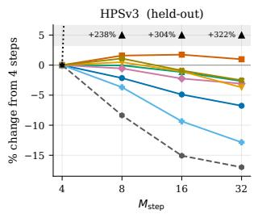

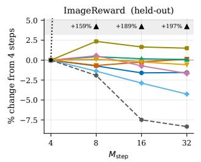

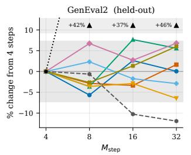

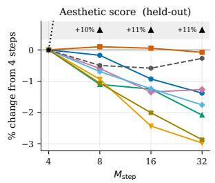

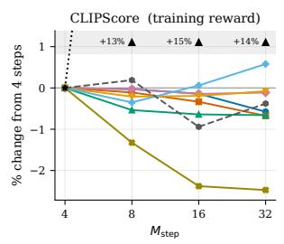

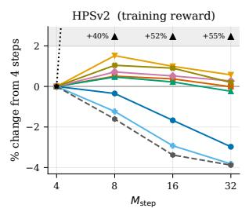

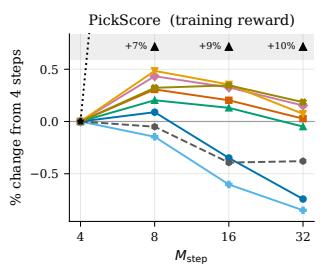  
Figure S1: Percentage change of each evaluated dimension from its four-step value against $M _ { \mathrm { s t e p } } .$ , one panel per evaluator and one line per model, including the AnyFlow initialisation and the pretrained SD3.5-Medium. Values of SD3.5-Medium outside the plotted range are printed at the top of each panel. The shaded band in the GenEval2 panel marks the ∼0.03 resolution of §6.1; the changes of the fine-tuned models stay within or at this resolution, whereas both references move beyond it.

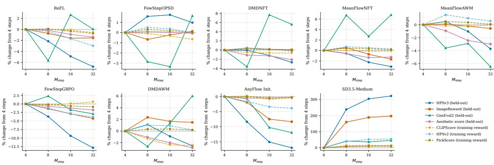  
Figure S2: The percentage changes of Figure S1, one panel per model and one line per evaluator. Solid lines are held-out evaluators, and dashed lines are the summands of the training reward.

## D.2 Analysis of no gain in CLIPScore for group-advantage runs

In the mixed-reward setting, all five default group-advantage runs end below the pre-RL CLIPScore. The two runs with the full reward gradient instead increase CLIPScore at every listed 100-iteration checkpoint, to 0.3217 and 0.3172. In contrast, all three CLIP-focused MeanFlowNFT ablations in the lower block of Table S4 end above the pre-RL value.

The training reward weights its three summands equally, but CLIPScore varies little within a prompt group, where the advantage is computed; at the pre-RL policy, its within-group standard deviation is only about 0.01 (0.010 and 0.014 on the first iteration of the two CLIPScore-only runs below), roughly a quarter of its global-batch standard deviation and 3.5–5% of its value. It accounts for 30.4% of the variance of the three summands, against 53.6% for PickScore and 16.0% for HPSv2, so an equal weight does not give it an equal share of the signal.

We therefore tested three ways of changing that share, the first two on MeanFlowNFT (Table S4, lower block). (i) Raising the weight of CLIPScore: the weights $( w _ { \mathrm { C L I P } } , w _ { \mathrm { H P S } } , w _ { \mathrm { P i c k } } ) = ( 2 . 4 , 0 . 3 , 0 . 3 )$ i.e. 8:1:1, and (3.0, 0, 0), CLIPScore alone, the limit of an unbounded relative weight; both keep K = 24. (ii) Enlarging the group: CLIPScore alone with K = 72 images per prompt instead of 24. (iii) Removing it from the gradient: ReFL diferentiating HPSv2 alone. The first two increase CLIPScore, and the increase grows with its share; by iteration 400, it gains 0.0133 at 8:1:1, 0.0191 with CLIPScore alone, and 0.0363 with K = 72, more than either gradient-based trainer (0.0286–0.0331), although this run draws three times as many images per prompt. In all three runs, however, the other two summands stop improving, and HPSv2 and PickScore oscillate within [0.2473, 0.2974] and [0.8459, 0.8691], the range they occupy at the start of training; under CLIPScore alone the held-out aesthetic score and OCR accuracy also decrease, by 0.64–0.98 and 0.18–0.19. Conversely, ReFL with the gradient of HPSv2 alone leaves CLIPScore near its pre-RL value (0.2844–0.2883 over iterations 100–400) while raising HPSv2 to 0.3946, the highest of any reported variant.

In these ablations, increasing CLIPScore under a scalar advantage coincides with the gains of the other summands weakening or vanishing. The scalar is shared according to the covariance of each summand with the group reward, so reweighting redistributes the observed signal. The reward gradient instead contains a direction from every summand; in the reported FewStepOPSD and ReFL runs, CLIPScore, HPSv2 and PickScore rise together by 0.0286–0.0331, approximately 0.0705–0.0764, and approximately 0.0738–0.0818, respectively. As noted in the main text, this approach requires a reward that is diferentiable with respect to the clean sample.

<table><tr><td></td><td colspan="5">CLIPScore at iteration</td></tr><tr><td>method</td><td>0</td><td>100</td><td>200</td><td>300</td><td>400</td></tr><tr><td>FewStepOPSD, ∇R</td><td>0.2886</td><td>0.2959</td><td>0.3066</td><td>0.3129</td><td>0.3217</td></tr><tr><td>ReFL, ∇ of R</td><td>0.2886</td><td>0.2967</td><td>0.3076</td><td>0.3127</td><td>0.3172</td></tr><tr><td>ReFL, ∇ of HPSv2</td><td>0.2886</td><td>0.2845</td><td>0.2844</td><td>0.2863</td><td>0.2883</td></tr><tr><td colspan="6">MeanFlowNFT, weights wCLIP:WHPs:WPick</td></tr><tr><td>1:1:1 (default), K = 24</td><td>0.2886</td><td>0.2800</td><td>0.2815</td><td>0.2806</td><td>0.2814</td></tr><tr><td> $8 { : } 1 { : } 1 ~ ( 2 . 4 , 0 . 3 , 0 . 3 ) , K = 2 4$ </td><td>0.2886</td><td>0.2914</td><td>0.2963</td><td>0.3010</td><td>0.3019</td></tr><tr><td>CLIPScore only (3.0, 0, 0), K = 24</td><td>0.2886</td><td>0.2948</td><td>0.3029</td><td>0.3049</td><td>0.3077</td></tr><tr><td>CLIPScore only (3.0, 0, 0), K = 72</td><td>0.2886</td><td>0.3031</td><td>0.3094</td><td>0.3182</td><td>0.3249</td></tr></table>

Table S4: CLIPScore against the iteration in the mixed-reward setting, the summand of the training reward on which the two groups of trainers disagree. Upper block: the update direction contains ∇R. Lower block: the reward enters as the scalar A or rˆ. Evaluation protocol as in §6.1; the HPSv2-only ReFL row uses a diferent training reward. Iteration 0 is the shared pre-RL checkpoint, CLIPScore 0.2886.

Conclusion. In the reported group-advantage ablations, raising the share of CLIPScore or enlarging the group raises CLIPScore while the gains of the other summands are reduced or vanish. In these runs, the weighting of the summands therefore afects which rewards improve, not only how fast they improve. Reward-gradient-based methods provide a direction from every summand, and all three summands rise together in the reported runs; however, these methods apply only when the reward is diferentiable with respect to the clean sample, which excludes the OCR setting (§6).

## D.3 Why FewStepOPSD resembles ReFL

In FewStepOPSD, the signed reward coeficients satisfy $| \omega _ { 1 } | + | \omega _ { 2 } | = 1 / \beta ;$ rˆ redistributes this magnitude between the ascent and descent terms and can also change their common weight W (Equation (107)). Both terms move the prediction in the direction of increasing reward, because $g _ { 1 } = \omega _ { 1 } \Delta _ { \mathrm { r w d } } \tilde { x } _ { + }$ and $g _ { 2 } = \omega _ { 2 } \Delta _ { \mathrm { r w d } } \tilde { x } _ { - }$ with $\omega _ { 2 } \leq 0 _ { : }$ , while the two increments follow +∇R and −∇R, respectively. The logged mean magnitudes $| \omega _ { 1 } | = 5 . 1 2$ and $| \omega _ { 2 } | = 4 . 8 8$ difer by 0.24, i.e. 2.4% of their fixed sum $1 / \beta = 1 0 ;$ they do not by themselves determine the imbalance of the two reward-augmentation vectors. FewStepOPSD is therefore close to the ReFL reward augmentation of Example 9, with an added self-regression, a descent term and several gradient steps; this is consistent with the similar curves in Figure 4.

## D.4 The velocity penalty: KL-u against KL-v

The velocity penalty, labelled KL in the run names although it is a squared velocity residual (§5.2), admits two constructions: the fixed initial average-velocity reference of Equation (92), which compares $u _ { \theta }$ and $u _ { \mathrm { r e f } }$ at the same $( \tilde { x } _ { t } , t , r )$ (KL-u), and the frozen instantaneous teacher of Equation (93), converted through $J [ u _ { \mathrm { o l d } } , t , { \boldsymbol { r } } ]$ , which depends on the old policy (KL-v). The variants therefore difer in both reference construction and parameterisation space, and the weight is $1 0 ^ { - 4 }$ in both; the main text reports KL-u under the name MeanFlowNFT.

In the mixed-reward setting, the two variants are close at iteration 400; both reach a training reward of 1.509, and the held-out evaluators difer by about 1–1.5% in either direction (HPSv3 13.23 against 13.36, ImageReward 1.385 against 1.365), with neither variant ahead on both. GenEval2 is 0.407 against 0.400 at iteration 400. Its average over iterations 100–400 is 0.393 against 0.365; the 0.028 gap is near the stated ∼0.03 resolution, so we do not interpret it as a clear diference.

In the OCR setting, KL-u reaches OCR accuracy 0.85 earlier, at iteration 100 instead of 150, with 0.785, 0.850, 0.945 at iterations 50, 100, 150 (the values of Table 6a) against 0.693, 0.834, 0.897. At matched OCR accuracy the diference is mixed; at the first saved checkpoint with OCR accuracy of at least 0.82, HPSv3 is 10.64 against 10.24 and ImageReward 0.887 against 0.896, each variant ahead on one of the two. At this weight, the choice of reference therefore has a limited efect in these runs; it changes the iteration at which the OCR threshold is reached but has no clear efect on the quality at that point, and both variants have nearly the same cost per iteration (435 against 436 s in the mixed-reward setting). The main text therefore reports only KL-u.

## D.5 Partial diferentiability of the video reward

This restriction does not occur in the image setting and afects only FewStepOPSD and ReFL.

Every method is evaluated on the same four-term reward. A method that requires ∇R can only use the diferentiable terms, which on this backbone are HPSv3-general (39% of the sum) and HPSv3- percentile (57%); VideoAlign MQ (6%) and TA (−2%) are not diferentiable. The FewStepOPSD and ReFL runs in Table 8 use the gradients of both HPSv3 reductions, together 96% of the aggregate under the logged normalisation, but no gradient of motion quality or text alignment. On SD3.5, the gradient covers 100% of the training reward, since all three summands are diferentiable image scorers.

This restriction is not visible in the reported scalar rewards, since the reward, the online evaluation and the advantage of FewStepOPSD all use the full four-term scorer (ReFL has no advantage). The restriction afects the direction of the gradient and not necessarily the norm of the update.

The released bfloat16 HPSv3 scorer changes the reward value by only ∼0.003 relative to fp32 but rotates its gradient by 76.2 degrees on average. The runs in Table 8 therefore use fp32 with the sdpa attention backend, so this bf16 error does not afect the reported results. One remaining constraint is that the clip is decoded one latent frame at a time to limit memory; since the VAE is causal, a frame decoded alone is treated as the first frame of a clip. Compared with a joint decode of the same two frames, the gradient deviates by 79.2 degrees, and the gradient of the second frame is nearly orthogonal to the joint-decode reference.

The FewStepOPSD and ReFL rows of Table 8 therefore use the gradient of the two HPSv3 terms with per-frame decoding, and not the gradient of the full reward. Removing the causal-decode constraint requires a joint window of at least two frames, which needs 126.1 GB of GPU memory without activation ofloading on a 144 GB card with 25.6 GB already in use, or 189 s per iteration with ofloading. Across 48 GPUs and 250 iterations this amounts to 26.25 GPU-days (about 0.547 days of wall-clock time if fully parallel). This limitation comes from the memory of a single GPU and not from the method.