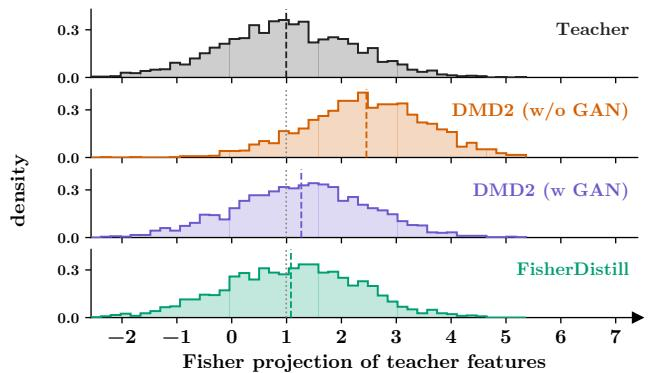
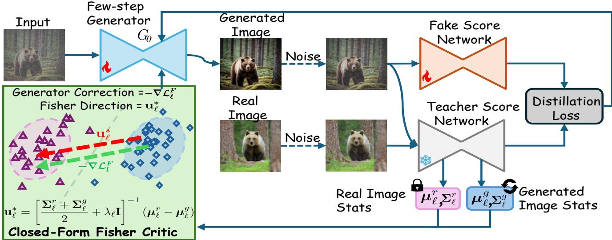
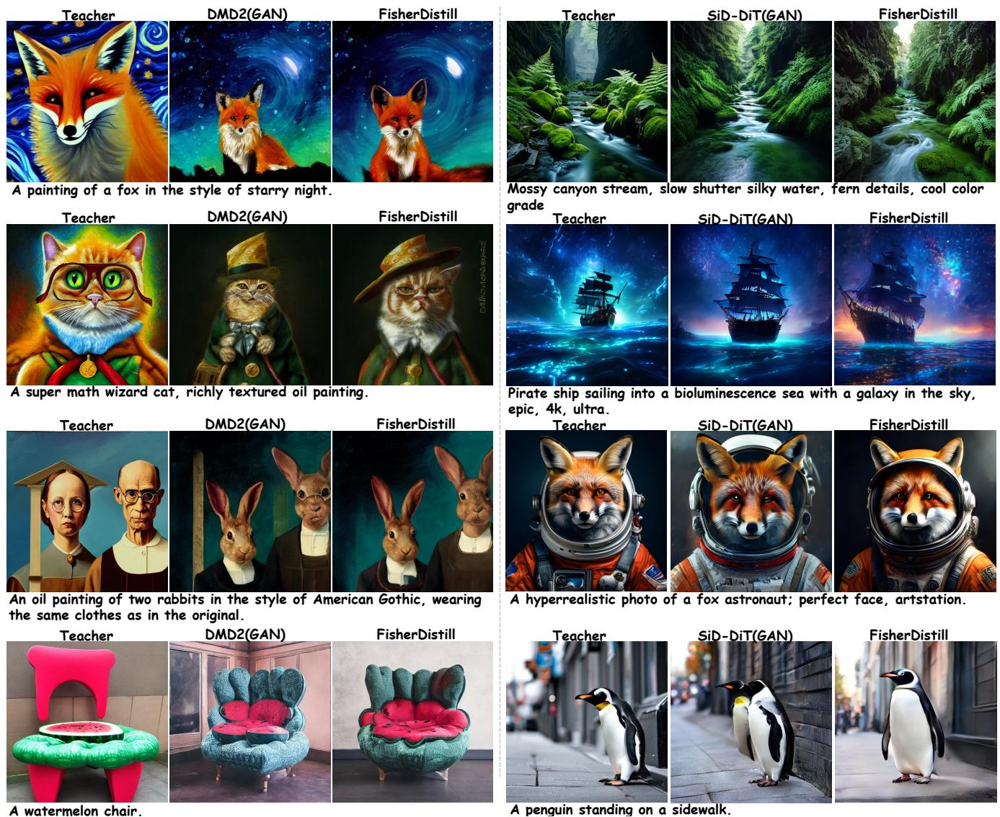
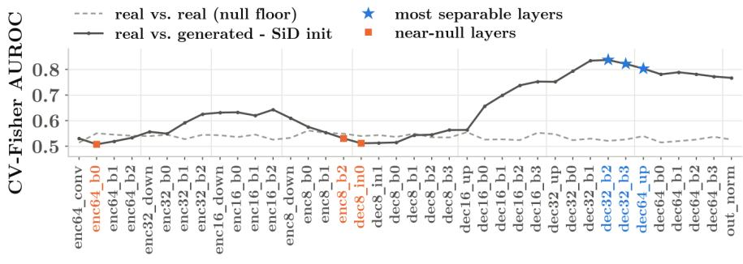
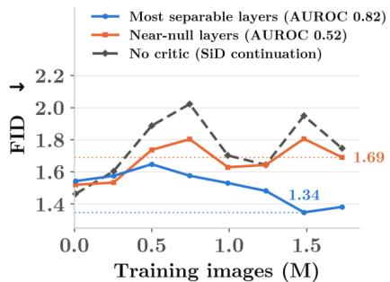
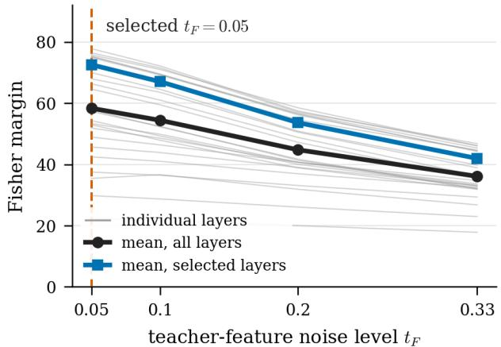
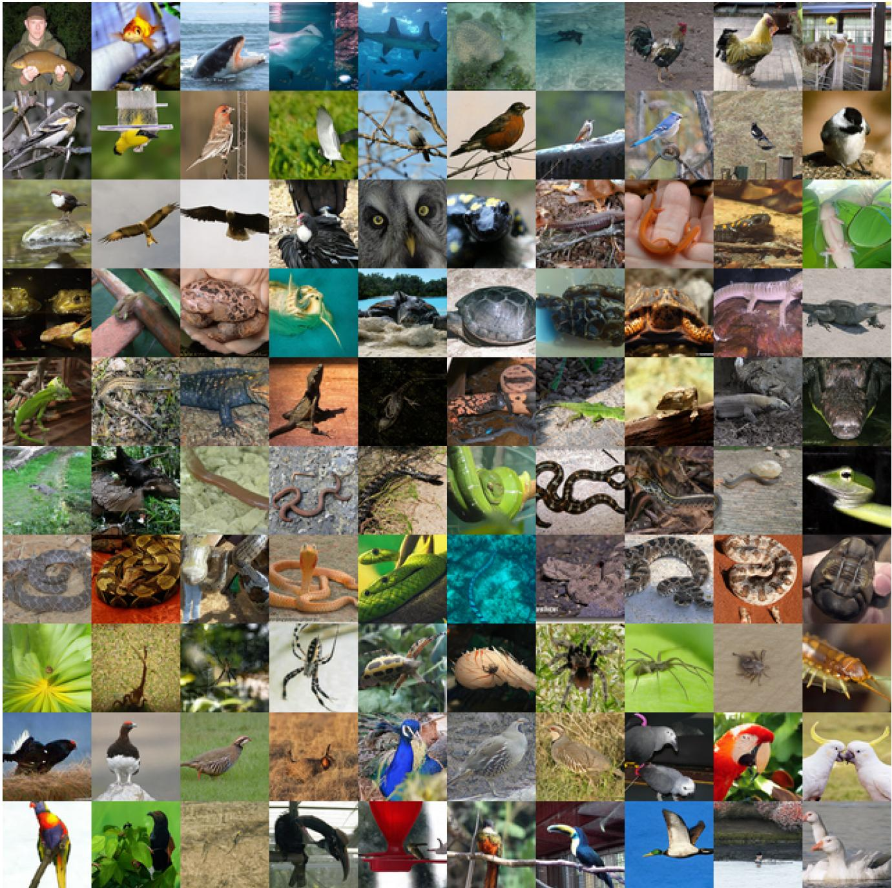
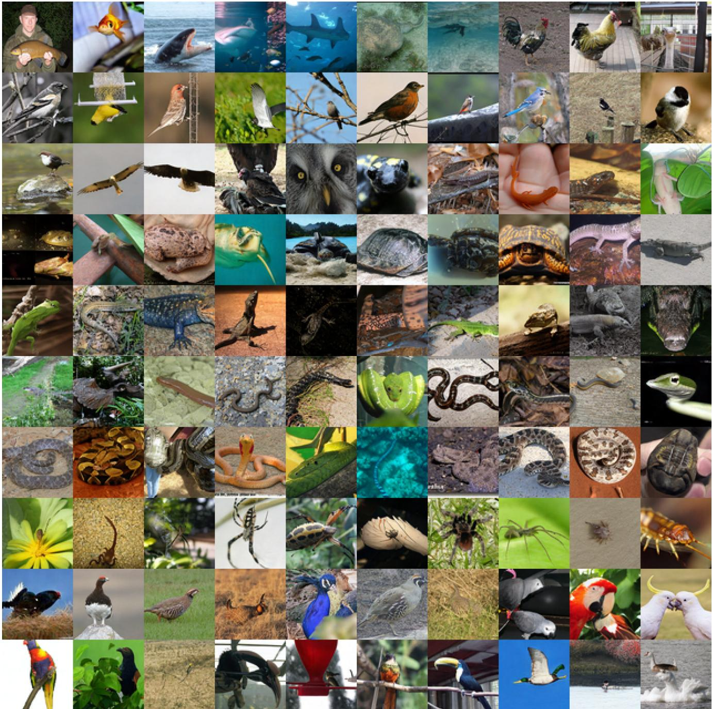

# FisherDistill: Diffusion Distribution Distillation via Closed-Form Fisher Critics

Mahesh Bhosale1 Yuanhao Zhai2∗ Siwei Lyu1 Junsong Yuan1 David Doermann1 Defang Chen3† 1University at Buffalo, SUNY 2Meta 3University of California, Berkeley

## Abstract

Recent advances in diffusion distillation have enabled highquality image generation in only one or afew networkfunction evaluations (NFEs). Despite their efficiency, aggressively distilled generators often retain a residual distribution gap from their multi-step teachers, motivating recent methods to introduce adversarial refinement with a learned discriminator. In this work, we ask whether such refinement necessarily requires a learned adversarial discriminator. We introduce FisherDistill, a simple alternative based on Fisher linear discriminant analysis. Using intermediate representations from the frozen teacher, we estimate the first- and second-order statistics of real and generated samples and derive a closed-form Fisher direction that maximally separates theirfeature distributions relative to within-class variation. This direction provides a lightweight refinement signal that complements the original distillation objective without requiring an additional adversarial discriminator or its optimization loop. Across multiple distillationframeworks, our approach consistently improves generation quality over their respective distilled baselines and substantially closes the gap to adversarially refined counterparts. Code: https: //bhosalems.github.io/FisherDistill/

## 1. Introduction

Diffusion-based generative models [10, 17, 28, 37–39, 48] have emerged as a powerful paradigm for high-fidelity content generation, achieving remarkable performance across images [10, 37, 39], videos [18, 19], audio [29], and scientific domains [2, 52]. Recent architectural, scaling, and formulation advances have further improved sample quality and realism [10, 37]. However, high-quality generation still requires iterative sampling with repeated network evaluations, incurring a high inference cost [17, 48]. Trainingfree methods reduced this cost through shorter deterministic trajectories [5, 30], while consistency models enabled direct few-step generation by learning mappings across the diffusion trajectory [31, 50]. Building on these advances, diffusion distillation compresses the sampling trajectory of a pretrained diffusion model into a one- or few-step generator [25, 60, 61, 65]. In particular, recent distributionmatching [60, 61] and score-identity distillation [65, 67] approaches have demonstrated that such aggressively distilled generators can retain much of the quality and diversity of their multi-step teachers, making few-step generation an increasingly practical alternative to iterative sampling.

  
Figure 1. Distribution gap in frozen teacher features on ImageNet-64. One-step DMD2 w/o GAN drifts away from the multi-step teacher, while our closed-form Fisher refinement brings it back to the teacher. Features are held-out Fisher projections of EDM-teacher. Dashed lines mark means.

Despite this progress, aggressive one- or few-step distillation can leave a residual distribution gap from the multi-step teacher (Fig. 1). Recent work shows that adding adversarial supervision to an already distilled generator improves sample quality [25, 60, 67]. This motivates a coarse-to-fine view of distillation: a base distillation objective first learns most of the teacher distribution, while adversarial supervision refines the remaining discrepancies. When used for such refinement, however, adversarial supervision requires a jointly learned discriminator and an additional min-max objective, inheriting the complexity and limited scalability of adversarial training [6, 53].

  
Figure 2. 1024×1024 samples generated by our 2-step FisherDistill built on 1.x-Distill Stage-I [25] and distilled from SD3-Medium [10].

This limitation raises a natural question of whether closing the residual distribution gap requires a learned adversarial discriminator. We show that it does not (Figs. 1 and 2). Instead, we exploit the frozen teacher’s representation space and estimate the first- and second-order statistics of real and generated features. From these statistics, we derive a closed-form Fisher critic that identifies the direction of maximal separation between the two feature distributions relative to their within-class variation. This direction provides a lightweight refinement signal that complements the original distillation objective, requiring neither a learned discriminator nor adversarial optimization. Our approach thus retains the coarse-to-fine principle while replacing learned adversarial refinement with a closed-form Fisher critic.

Our main contributions are summarized as follows:

1. We introduce FisherDistill, a non-adversarial refinement method that replaces a learned discriminator with a closed-form Fisher critic computed from frozen-teacher feature statistics.

2. Across multiple distillation frameworks [25, 60, 66], FisherDistill consistently improves the distilled generators and outperforms adversarial refinement in most settings, while requiring substantially fewer refinement samples.

## 2. Related Work

Few-step diffusion and flow distillation. Reducing the inference cost of diffusion and flow models has motivated many few-step distillation methods. Consistency-based approaches learn trajectory-consistent mappings [21, 50], while rCM [64] adds distribution-matching regularization to improve fidelity. Distribution-matching methods align the student and target distributions using score-estimated KL objectives [32, 61] or the Fisher divergence [65], or match intermediate trajectory distributions [33]. These ideas also extend to flow-based generators [4, 8, 11, 40, 66]. Despite these advances, aggressive distillation can leave a quality gap relative to multi-step generation [1].

Adversarial refinement. Adversarial objectives further improve few-step generators. ADD [45] combines score distillation with an adversarial objective built on a frozen pretrained feature extractor and trainable discriminator heads, while LADD [44] uses generative features of a pretrained latent diffusion model. SDXL-Lightning [41] combines adversarial training with progressive distillation, and related approaches adversarially train or post-train diffusion models for one-step image [58] and video [26] generation. Such objectives have also been incorporated into distributionmatching [60] and score-identity [67] distillation, while 1.x-Distill [25] follows distribution matching with an adversarial stage. Although effective, these approaches rely on a learned discriminator and min-max optimization, which adds optimization and loss-balancing complexity [6, 11, 25, 60, 67].

Alternatives to adversarial refinement. RealUID [23] incorporates real-data supervision without a GAN discriminator, but retains a learned auxiliary matching function within min-max optimization. TwinFlow [6] avoids an external discriminator by modifying the distillation framework to learn self-adversarial trajectories within a single model. In contrast, FisherDistill is an auxiliary refinement objective that derives its direction in closed form from real and generated statistics of frozen teacher features (Fig. 3).

Feature-space and statistical discrimination. Feature matching [42] trains generators by matching intermediate discriminator features, while Fisher GAN [35] formulates a

Fisher IPM with a second-moment constraint on a learned critic. Projected GAN [43] and Vision-aided GAN [24] train discriminators on fixed pretrained representations. Scalewise Distillation [51] introduces an MMD-based objective on frozen diffusion-model features, which reduces to featuremean matching under a linear kernel. Our Mean variant (Tab. 4) evaluates this mean-difference direction under our logistic loss and performs worse than FisherDistill, which additionally exploits the full within-class covariance. More closely related, Frechet-based objectives [´ 34, 59] match the means and covariances of real and generated features in fixed pretrained representations. In contrast, we reuse intermediate representations of the frozen teacher being distilled and analytically construct a covariance-aware Fisher direction that maximizes real-vs.-generated separation relative to within-class variation, rather than minimizing a symmetric distance between distributions.

## 3. Method

We augment the original distribution-matching distillation objective with a critic constructed from statistics of intermediate representations of the frozen generative teacher (Fig. 3). We first describe the underlying distillation objective in a general form. Let $\mathbf { x } ^ { g } = G _ { \theta } ( \mathbf { z } ) , \mathbf { z } \sim p _ { \mathrm { n o i s e } }$ , denote a sample from the student distribution $p _ { \theta }$ . Rather than directly matching the clean, high-dimensional student and teacher distributions, distribution-matching distillation compares their diffused marginals. We perturb the generated sample at timestep t as

$$
\begin{array} { r } { \mathbf { x } _ { t } ^ { g } = \alpha _ { t } \mathbf { x } ^ { g } + \sigma _ { t } \mathbf { \epsilon } , \qquad t \sim \pi ( t ) , \quad \epsilon \sim \mathcal { N } ( \mathbf { 0 } , \mathbf { I } ) , } \end{array}\tag{1}
$$

and denote the resulting student marginal by $p _ { \theta } ^ { t }$ and the corresponding teacher marginal by $p _ { \mathrm { t e a c h e r } } ^ { t }$ . A broad class of distribution-matching distillation objectives can then be written as

$$
\begin{array} { r } { \mathcal { L } _ { \mathrm { d i s t i l l } } ( \theta ) = \mathbb { E } _ { t } \left[ \mathcal { D } \left( p _ { \theta } ^ { t } \parallel p _ { \mathrm { t e a c h e r } } ^ { t } \right) \right] , } \end{array}\tag{2}
$$

where $\mathcal { D }$ is a divergence between the diffused student and teacher marginals. Different distillation methods correspond to different choices of D. For example, DMD [60, 61] minimizes the reverse KL divergence $\mathbb { E } _ { p _ { \theta } ^ { t } } [ \log ( p _ { \theta } ^ { t } / p _ { \mathrm { t e a c h e r } } ^ { t } ) ]$ whereas SiD [65, 67] minimizes the Fisher divergence $\mathbb { E } _ { p _ { \theta } ^ { t } } \| \nabla \log p _ { \theta } ^ { t } - \nabla \log p _ { \mathrm { t e a c h e r } } ^ { t } \| _ { 2 } ^ { 2 }$ . In practice, these objectives are optimized through method-specific estimators of the teacher and student scores.

## 3.1. Role of Adversarial Refinement

Adversarial refinement supplements the base distributionmatching loss in Eq. (2) with an additional discriminatorderived correction $\mathcal { L } _ { \mathrm { a d v } } ^ { G }$ We first examine this correction before introducing its closed-form Fisher counterpart. Let $h _ { \psi } ( \mathbf { x } _ { t } ^ { g } , t )$ denote the discriminator logit, and let

  
Figure 3. Overview of FisherDistill. We augment an existing distillation framework with Fisher refinement without modifying its base distillation objective. Real-image teacher features are precomputed offline, while generated-image features and their statistics are estimated online. Here, $\mu _ { \ell } ^ { r } , \mu _ { \ell } ^ { g }$ and $\Sigma _ { \ell } ^ { r } , \Sigma _ { \ell } ^ { g }$ denote the means and covariances of the real and generated pooled features, respectively. At each selected layer, the closed-form Fisher direction $\mathbf { u } _ { \ell } ^ { * }$ points from the generated toward the real feature mean, where $\lambda _ { \ell }$ regularizes the covariance for numerical stability. The Fisher loss converts this direction into a corrective signal toward the real distribution, while gradients propagate through the frozen teacher to update only the generator. No learned discriminator or adversarial optimization is required.

$D _ { \psi } ( \mathbf { x } _ { t } ^ { g } , t ) = \sigma ( h _ { \psi } ( \mathbf { x } _ { t } ^ { g } , t ) )$ denote the predicted probability that $\mathbf { x } _ { t } ^ { g }$ is real. The non-saturating adversarial generator loss is

$$
\begin{array} { r } { \mathcal { L } _ { \mathrm { a d v } } ^ { G } = - \mathbb { E } _ { \mathbf { z } , t , \epsilon } \left[ \log D _ { \psi } ( \mathbf { x } _ { t } ^ { g } , t ) \right] . } \end{array}\tag{3}
$$

The adversarially refined generator is then optimized with $\mathcal { L } _ { G } = \mathcal { L } _ { \mathrm { d i s t i l l } } + \lambda _ { \mathrm { a d v } } \mathcal { L } _ { \mathrm { a d v } } ^ { G }$ . To understand the refinement signal contributed by $\mathcal { L } _ { \mathrm { a d v } } ^ { G } ,$ we examine its per-sample imagespace descent direction, which decomposes as

$$
\begin{array} { r l } & { - \nabla _ { \mathbf { x } ^ { g } } \left[ - \log D _ { \psi } ( \mathbf { x } _ { t } ^ { g } , t ) \right] } \\ & { \qquad = \underbrace { ( 1 - D _ { \psi } ( \mathbf { x } _ { t } ^ { g } , t ) ) } _ { 1 } \underbrace { \alpha _ { t } } _ { 2 } \underbrace { \nabla _ { \mathbf { x } _ { t } ^ { g } } h _ { \psi } ( \mathbf { x } _ { t } ^ { g } , t ) } _ { 3 } . } \end{array}\tag{4}
$$

Eq. (4) exposes three components of the adversarial refinement signal (by the chain rule, since $\partial \mathbf { x } _ { t } ^ { g } / \partial \mathbf { x } ^ { g } = \alpha _ { t } \mathbf { I } )$ Term (1) is a sample-dependent weight, assigning larger corrections to samples judged less real. Term (2), αt, is the chain-rule scaling induced by the forward process. Term (3) is the learned discriminative direction that increases the realness logit. Thus, the discriminator determines both the sample-wise magnitude and direction of the refinement, while the forward process contributes the known diffusiondependent scaling. FisherDistill retains term (2) but replaces the learned discriminator-dependent terms (1) and (3) with their closed-form counterparts derived from real and generated statistics in the frozen teacher feature space.

## 3.2. Residual Distribution Gaps in Teacher Features

The decomposition in Eq. (4) shows that the discriminator determines which generated samples require stronger correction and provides the direction of that correction. We ask whether this information is already present in the representations of the frozen teacher.

For the Fisher critic, we evaluate teacher features at a fixed noise level $t _ { F }$ , selected based on real-vs.-generated feature separability (more details on the selection in the supplementary). This noise level is independent of the timestep sampled by the base distillation objective. Given a clean sample x, we construct

$$
{ \bf x } _ { t _ { F } } = \alpha _ { t _ { F } } { \bf x } + \sigma _ { t _ { F } } \epsilon , \qquad \epsilon \sim \mathcal { N } ( { \bf 0 } , { \bf I } ) ,\tag{5}
$$

using a fresh noise draw. For each selected teacher layer ℓ, we denote by $\mathbf { f } _ { \ell } ^ { s }$ the feature vector obtained from the activations of $\mathbf { x } _ { t _ { F } } ^ { s } .$ , where $s \in \{ r , g \}$ denotes real and generated samples, respectively. The feature vector concatenates the spatial mean and standard deviation of each channel for U-Nets, or the corresponding statistics over image tokens for DiTs. The mean captures the average feature response, while the standard deviation preserves spatial variation such as contrast and texture. Each feature is obtained from a separate conditional teacher forward pass using the sample’s own class label or prompt, without classifier-free guidance.

We measure real-vs.-generated separability at each teacher layer using the held-out AUROC of a Fisher critic. As shown in Fig. 5, separability varies substantially across layers, indicating that residual distribution gaps are reflected in the frozen teacher features. We therefore construct the refinement signal directly in this space from the most separable layers and next derive the closed-form Fisher direction.

## 3.3. Binary Closed-Form Fisher Critic

Let $\mu _ { \ell } ^ { r } , \mu _ { \ell } ^ { g }$ be the pooled real and generated feature means across samples at the fixed Fisher noise level $t _ { F }$ , and let $\Delta _ { \ell }$ denote their difference, i.e.,

$$
\pmb { \mu } _ { \ell } ^ { r } = \mathbb { E } [ \mathbf { f } _ { \ell } ^ { r } ] , \qquad \pmb { \mu } _ { \ell } ^ { g } = \mathbb { E } [ \mathbf { f } _ { \ell } ^ { g } ] , \qquad \pmb { \Delta } _ { \ell } = \pmb { \mu } _ { \ell } ^ { r } - \pmb { \mu } _ { \ell } ^ { g } .\tag{6}
$$

For this binary problem, the between-class (real-vs.- generated) scatter is $S _ { \ell } ^ { B } = \pmb { \Delta } _ { \ell } \pmb { \Delta } _ { \ell } ^ { \top }$ . Let $\Sigma _ { \ell } ^ { r }$ and $\Sigma _ { \ell } ^ { g }$ denote the real and generated feature covariances, and define the shared covariance as $\begin{array} { r } { \Sigma _ { \ell } = \frac { 1 } { 2 } \big ( \Sigma _ { \ell } ^ { r } + \Sigma _ { \ell } ^ { g } \big ) } \end{array}$ . Fisher discriminant analysis seeks a direction that maximizes the separation between the projected class means relative to their withinclass variation:

$$
\mathbf { u } _ { \ell } ^ { * } = \arg \operatorname* { m a x } _ { \mathbf { u } } \frac { \mathbf { u } ^ { \top } S _ { \ell } ^ { B } \mathbf { u } } { \mathbf { u } ^ { \top } \Sigma _ { \ell } \mathbf { u } } .\tag{7}
$$

Since $S _ { \ell } ^ { B } = \Delta _ { \ell } \Delta _ { \ell } ^ { \top }$ has rank one, the binary problem has a single non-zero discriminative direction. The solution satisfies the generalized eigenvalue problem $S _ { \ell } ^ { B } \mathbf { u } _ { \ell } = \gamma \Sigma _ { \ell } \mathbf { u } _ { \ell } .$ where $\gamma$ is the generalized eigenvalue; the derivation is provided in the supplementary material. For the binary case, this yields u∗ℓ $\propto \Sigma _ { \ell } ^ { - 1 } \Delta _ { \ell }$ . In practice, we regularize the covariance and use

$$
\mathbf { u } _ { \ell } ^ { * } = \bar { \boldsymbol { \Sigma } } _ { \ell } ^ { - 1 } \boldsymbol { \Delta } _ { \ell } ,\tag{8}
$$

where $\bar { \boldsymbol { \Sigma } } _ { \ell } = \boldsymbol { \Sigma } _ { \ell } + \boldsymbol { \lambda } _ { \ell } \mathbf { I }$ , with $\lambda _ { \ell } > 0$ , is the regularized shared covariance that improves conditioning. Rather than explicitly computing $\bar { \boldsymbol { \Sigma } } _ { \ell } ^ { - 1 }$ , we solve the linear system $\bar { \pmb { \Sigma } } _ { \ell } \mathbf { u } _ { \ell } ^ { * } = \Delta _ { \ell }$ using a Cholesky factorization [13].

The Fisher direction in Eq. (8) provides a onedimensional projection along which the real and generated feature distributions are maximally separated relative to their within-class variation. We define the signed Fisher margin of a feature f relative to the midpoint of the projected class means as

$$
r _ { \ell } ( \mathbf { f } ) = \mathbf { f } ^ { \top } \mathbf { u } _ { \ell } ^ { * } - \frac { 1 } { 2 } \left( \mathbf { u } _ { \ell } ^ { * } { } ^ { \top } \pmb { \mu } _ { \ell } ^ { r } + \mathbf { u } _ { \ell } ^ { * } { } ^ { \top } \pmb { \mu } _ { \ell } ^ { g } \right) .\tag{9}
$$

Positive margins correspond to the real side and negative margins to the generated side.

Under the shared-covariance Gaussian model $p ( \mathbf { f } \mid s ) =$ $\mathcal { N } ( \mathbf { f } ; \mu _ { \ell } ^ { s } , \bar { \Sigma } _ { \ell } ) , s \in \{ r , g \}$ , the real-to-generated log-density ratio is

$$
\begin{array} { l } { { \displaystyle \log \frac { p ( { \bf f } \mid r ) } { p ( { \bf f } \mid g ) } = { \bf f } ^ { \top } \bar { \Sigma } _ { \ell } ^ { - 1 } { \bf \Delta } _ { \ell } - \frac { 1 } { 2 } ( \pmb { \mu } _ { \ell } ^ { r } + \pmb { \mu } _ { \ell } ^ { g } ) ^ { \top } \bar { \Sigma } _ { \ell } ^ { - 1 } { \bf \Delta } _ { \ell } } } \\ { { \displaystyle \quad \quad = r _ { \ell } ( { \bf f } ) . } } \end{array}\tag{10}
$$

Thus, under this model, the Fisher margin is exactly the realto-generated log-density ratio [14]. With equal class priors, the posterior probability that f is real is therefore $D _ { \ell } ^ { F } ( \mathbf { f } ) =$ $\sigma ( r _ { \ell } ( \mathbf { f } ) )$ ), a closed-form counterpart of the discriminator $D _ { \psi }$ in Eq. (3). Our method, however, constructs $r _ { \ell } ( \mathbf { f } )$ directly from the Fisher direction and projected class means, and therefore does not require the teacher feature distributions themselves to be Gaussian.

Treating $D _ { \ell } ^ { F }$ as a closed-form discriminator, we train the generator with the logistic loss, i.e., the non-saturating loss in Eq. (3) with $D _ { \ell } ^ { F }$ in place of $D _ { \psi }$

$$
\mathcal { L } _ { \ell } ^ { F } = - \mathbb { E } \left[ \log D _ { \ell } ^ { F } ( \mathbf { f } _ { \ell } ^ { g } ) \right] .\tag{11}
$$

Minimizing this objective pushes generated features toward the real side of the boundary.

## 3.4. Relation to Adversarial Refinement

The Fisher critic induces a refinement direction with the same structure as the adversarial refinement in Eq. (4). For a generated sample, the per-layer descent direction is

$$
\begin{array} { r l } & { - \nabla _ { { \bf x } ^ { g } } \left[ - \log D _ { \ell } ^ { F } ( { \bf f } _ { \ell } ^ { g } ) \right] } \\ & { \qquad = \underbrace { \left( 1 - D _ { \ell } ^ { F } ( { \bf f } _ { \ell } ^ { g } ) \right) } _ { 1 } \underbrace { \alpha _ { t _ { F } } } _ { 2 } \underbrace { \left( \frac { \partial { \bf f } _ { \ell } ^ { g } } { \partial { \bf x } _ { t _ { F } } ^ { g } } \right) ^ { \top } { \bf u } _ { \ell } ^ { * } } _ { 3 } . } \end{array}\tag{12}
$$

Here, term (1) is the sample-dependent weight of Eq. (4) with the closed-form $D _ { \ell } ^ { F }$ in place of $D _ { \psi }$ , term (2) retains the diffusion scaling at the fixed Fisher noise level, and term (3) provides the corrective direction by propagating the closed-form Fisher direction through the frozen teacher. Thus, FisherDistill replaces the learned discriminator-dependent terms with quantities obtained directly from teacher feature statistics, without adversarial critic optimization. We derive Eq. (12) in the supplementary material.

## 3.5. Online Statistics and Lagged Fisher Updates

The real-data statistics are estimated once using the frozen teacher and remain fixed throughout training. Given real features $\{ \mathbf { f } _ { \ell , i } ^ { r } \} _ { i = 1 } ^ { N _ { r } }$ , we compute

$$
\boldsymbol { \mu } _ { \ell } ^ { r } = \frac { 1 } { N _ { r } } \sum _ { i = 1 } ^ { N _ { r } } \mathbf { f } _ { \ell , i } ^ { r } , \ \boldsymbol { \Sigma } _ { \ell } ^ { r } = \frac { 1 } { N _ { r } } \sum _ { i = 1 } ^ { N _ { r } } \mathbf { f } _ { \ell , i } ^ { r } \mathbf { f } _ { \ell , i } ^ { r \top } - \boldsymbol { \mu } _ { \ell } ^ { r } \boldsymbol { \mu } _ { \ell } ^ { r \top } .\tag{13}
$$

Since the generated distribution evolves with $G _ { \theta } ,$ , its statistics are tracked online. At iteration $k ,$ we compute the batch first and second moments

$$
\hat { \pmb { \mu } } _ { \ell , k } ^ { g } = \frac { 1 } { N _ { k } } \sum _ { i = 1 } ^ { N _ { k } } \mathbf { f } _ { \ell , i } ^ { g } , \quad \hat { \mathbf { M } } _ { \ell , k } ^ { g } = \frac { 1 } { N _ { k } } \sum _ { i = 1 } ^ { N _ { k } } \mathbf { f } _ { \ell , i } ^ { g } \mathbf { f } _ { \ell , i } ^ { g \top } .\tag{14}
$$

We maintain exponential moving averages (EMAs)

$$
\begin{array} { r } { \pmb { \mu } _ { \ell , k } ^ { g } = \rho _ { k } \pmb { \mu } _ { \ell , k - 1 } ^ { g } + ( 1 - \rho _ { k } ) \hat { \pmb { \mu } } _ { \ell , k } ^ { g } , } \end{array}\tag{15}
$$

$$
\mathbf { M } _ { \ell , k } ^ { g } = \rho _ { k } \mathbf { M } _ { \ell , k - 1 } ^ { g } + ( 1 - \rho _ { k } ) \hat { \mathbf { M } } _ { \ell , k } ^ { g } ,\tag{16}
$$

where $\rho _ { k } \in [ 0 , 1 )$ is the EMA decay rate, and recover the generated covariance as

$$
\begin{array} { r } { \boldsymbol { \Sigma _ { \ell , k } ^ { g } } = \mathbf { M } _ { \ell , k } ^ { g } - \pmb { \mu } _ { \ell , k } ^ { g } \pmb { \mu } _ { \ell , k } ^ { g \top } . } \end{array}\tag{17}
$$

We use a one-step-lagged critic: at iteration $k ,$ the Fisher critic is constructed from fixed real statistics and generated statistics accumulated through iteration $k - 1$ , then held fixed while scoring the current batch. The current generated statistics are incorporated into the EMA afterward and used at iteration $k { \pm } 1$ . Statistics and the Fisher solve are treated as stop-gradient quantities, while gradients propagate through the current teacher features to the generator. The EMA and covariance regularization stabilize the solve, while the lag prevents the critic from being estimated from the same features it scores, which improves optimization stability, as shown in Tab. 5.

## 3.6. Final Training Objective

For the selected teacher layers $s ,$ we average the layer-wise Fisher losses:

$$
\mathcal { L } ^ { F } = \frac { 1 } { | S | } \sum _ { \ell \in S } \mathcal { L } _ { \ell } ^ { F } .\tag{18}
$$

The final generator objective augments the original distillation loss with the Fisher refinement term,

$$
\begin{array} { r } { \mathcal { L } _ { G } = \mathcal { L } _ { \mathrm { d i s t i l l } } + \lambda _ { F } ( k ) \mathcal { L } ^ { F } , } \end{array}\tag{19}
$$

where $\lambda _ { F } ( k )$ controls the refinement strength. We initially disable the Fisher loss, allowing the online generated statistics to stabilize, and then activate it at full weight. The generator’s training schedule follows that of the base distillation framework’s adversarial variant: for SiD [65, 67], SiD-DiT [66] and 1.x-Distill [25], the generator is frozen for the first few steps, whereas for DMD2 [60] it is trained from the first step with the Fisher term disabled.

The teacher remains frozen throughout training, and the Fisher critics introduce no learnable parameters or separate optimizer. The generator is therefore optimized jointly by the distillation objective and the closed-form Fisher refinement.

## 4. Experiments

We evaluate whether closed-form Fisher refinement can improve few-step diffusion distillation without a learned discriminator. We apply it to different distillation objectives on class-conditioned and text-to-image generation, and compare against the distilled baselines and their adversarially refined variants.

Evaluation metrics. For class-conditioned generation, we report Frechet Inception Distance (FID) [´ 16] with precision and recall to measure sample fidelity and coverage. For textto-image generation, we use FID for distributional quality, CLIP score [15] for text-image alignment, GenEval [12] for compositional prompt adherence, Aesthetic Score [46] for aesthetic quality, and HPSv2 [54], ImageReward [57], and PickScore [22] for human-preference alignment.

## 4.1. Class-Conditioned Generation

Setup. We evaluate class-conditioned generation on ImageNet 64 × 64 with the pretrained EDM [20] teacher. We study Fisher refinement on two one-step distillation families: distribution matching (DMD [61]) and score-identity distillation (SiD [65]). We compare with their GAN refinements DMD2 [60] and $\mathrm { S i D ^ { 2 } A }$ [67], and with RealUID [23], a GAN-free baseline that brings real data into the fake-score objective. For DMD, we resume from the DMD-only checkpoint (405.5K steps, FID 2.64) and fine-tune for 40K steps. For SiD, we initialize from the released checkpoint (α=1.2, 939K) and follow the SiDA training budget of 2.5M generated images. RealUID uses the same initialization and budget as each Fisher model. Fisher is applied to five teacher layers for DMD2 and three for SiD. In both settings, real feature statistics are computed once from 50K images and kept fixed, while generated statistics are tracked with an EMA decay rate of $\rho _ { k } = 0 . 9 9$

Results. Tab. 1 shows that Fisher refinement consistently improves both distillation objectives. On DMD2, Fisher reduces FID from 1.42 to 1.40 and improves recall from 0.60 to 0.62, while preserving precision at 0.74. It also outperforms RealUID, with substantially lower FID (1.40 vs. 3.07) and higher recall (0.62 vs. 0.58) at the same precision. On SiD, Fisher reduces FID from 1.54 to 1.34 and increases precision from 0.74 to 0.76 without reducing recall. Compared with RealUID, Fisher achieves lower FID and higher precision and recall. Fisher is also competitive with adversarially refined $\mathrm { S i D ^ { 2 } A }$ . Overall, Fisher refinement improves sample fidelity without compromising distributional coverage.

## 4.2. Text-to-Image Generation

Setup. We evaluate Fisher refinement in three text-toimage settings: DMD2 [60] with SD v1.5 [39], 1.x-Distill [25] with SD3-Medium [10], and SiD-DiT [66] with SANA-0.6B and SANA-1.6B [55]. We follow the baseline protocols and compare with the matched GAN refinement and GAN-free RealUID [23], starting from the same stage-1 checkpoints, i.e., models before GAN fine-tuning.

For DMD2, we fine-tune the released DMD-only checkpoint on LAION-Aesthetics prompts [47]. Fisher uses three frozen teacher layers, with real statistics precomputed from 8K random images from DMD2’s GAN training set.

Table 1. Class-conditioned ImageNet 64 × 64 results using a pretrained EDM teacher with diffusion solvers and prior distillation methods. FisherDistill is evaluated on top of DMD2 and SiD, with precision and recall reported where available. Bold: best among the compared methods below the faint rule within each distributionmatching block. Results outside the “Critic Based” family are from [65] or original papers. †: reproduced with the official code under a matched training budget.
<table><tr><td>Family</td><td>Model</td><td>NFE</td><td>FID↓</td><td>Prec. ↑</td><td>Rec. ↑</td></tr><tr><td rowspan="2">Teacher</td><td>VP EDM ODE</td><td>511</td><td>2.32</td><td></td><td></td></tr><tr><td>VP EDM SDE</td><td>511</td><td>1.32</td><td></td><td></td></tr><tr><td rowspan="5">Solver</td><td>DDIM [48]</td><td>8</td><td>22.59</td><td></td><td></td></tr><tr><td>DPM-Solver [30]</td><td>8</td><td>12.42</td><td></td><td></td></tr><tr><td>AMED [68]</td><td>8</td><td>7.01</td><td></td><td></td></tr><tr><td>GITS [5]</td><td>8</td><td>5.64</td><td></td><td></td></tr><tr><td>INDIS [62]</td><td>8</td><td>4.49</td><td></td><td></td></tr><tr><td rowspan="8">Distillation</td><td>PD [41]</td><td>2</td><td>8.95</td><td>0.63</td><td>0.65</td></tr><tr><td>CD-LPIPS [50]</td><td>2</td><td>4.70</td><td>0.69</td><td>0.64</td></tr><tr><td>DFNO [63]</td><td>1</td><td>7.83</td><td></td><td>0.61</td></tr><tr><td>Diff-Instruct [32]</td><td>1</td><td>5.57</td><td></td><td></td></tr><tr><td>iCT [49]</td><td>1</td><td>4.02</td><td>0.70</td><td>0.63</td></tr><tr><td>iCT-deep [49]</td><td>1</td><td>3.25</td><td>0.72</td><td>0.63</td></tr><tr><td>EMD-16 [56]</td><td>1</td><td>2.20</td><td></td><td></td></tr><tr><td>CTM [21]</td><td>1</td><td>1.92</td><td></td><td>0.57</td></tr><tr><td rowspan="8">Critic Based</td><td>DMD [61]</td><td>1</td><td>2.64</td><td>0.76</td><td>0.59</td></tr><tr><td>DMD2† [60]</td><td>1</td><td>1.42</td><td>0.74</td><td>0.60</td></tr><tr><td>RealUID† [23]</td><td>1</td><td>3.07</td><td>0.74</td><td>0.58</td></tr><tr><td>FisherDistill</td><td>1</td><td>1.40</td><td>0.74</td><td>0.62</td></tr><tr><td>SiD [65], α = 1.2</td><td>1</td><td>1.54</td><td>0.74</td><td>0.63</td></tr><tr><td> $\mathrm { S i D ^ { 2 } A ^ { \dagger } \ [ 6 7 ] } , \alpha = 1 . 0$ </td><td>1</td><td>1.31</td><td>0.74</td><td>0.62</td></tr><tr><td>RealUID† [23]</td><td>1</td><td>1.45</td><td>0.74</td><td>0.62</td></tr><tr><td>FisherDistill</td><td>1</td><td>1.34</td><td>0.76</td><td>0.63</td></tr></table>

For 1.x-Distill, whose official weights are unavailable, we reproduce the Stage-I student and 8-step reference model using 20K Midjourney prompts [3], followed by Stage-II refinement for 2K iterations. Fisher uses three frozen teacher blocks, with real statistics precomputed from 10K latents generated by SD3-Medium (28 steps, CFG 7.0). Both the GAN baseline and RealUID use the 8-step reference model as real data. RealUID replaces the Stage-II GAN loss, and all methods use a matched generator-update budget.

For SiD-DiT, we refine the released SANA checkpoints at both scales using LAION-Aesthetics prompts [47]. Fisher uses ten (0.6B) and eight (1.6B) frozen teacher layers, with real statistics precomputed from 10K Midjourney images [3] also used by the SiD2A discriminator and RealUID. All models are evaluated zero-shot on COCO-2014 [27].

Evaluation protocols. Since each baseline has its own protocol, we evaluate every method with the protocol of its base framework and compare only within each group of Tab. 2. Details are in the supplementary material.

Results. As shown in Tab. 2, Fisher consistently improves distributional quality across all settings. On DMD2, FID improves from 8.58 to 8.46, while on 1.x-Distill it improves from 32.35/30.20 for Stages I/II to 29.54, with competitive alignment and preference metrics. The same trend holds for SANA at both scales; for example, on SANA-0.6B Fisher reduces FID from 28.94 to 25.24 and improves most alignment and preference metrics. In contrast, RealUID does not improve the first-stage models on FID and mostly fails to improve the other metrics. Notably, the one-step Fisher models also match or surpass the multi-step SANA teachers in FID at both scales (25.24 vs. 26.38 and 26.73 vs. 26.83).

Fisher also reaches its best performance substantially earlier than GAN refinement. On DMD2, it reaches its best FID after 1.34M samples, compared with 4.93M for the matched GAN arm; a similar trend holds for SiD-DiT (∼1.0M vs. ∼2.0M). We attribute this efficiency to computing the direction directly from frozen teacher statistics rather than learning it through a separately optimized discriminator. Overall, Fisher improves FID across architectures, scales, and distillation objectives while preserving competitive semantic and perceptual quality (Fig. 4).

## 4.3. Ablations

Layer selection for Fisher discriminants. The closedform Fisher critic reads generated samples through a small set of teacher layers, so its usefulness depends on whether those layers can distinguish real from generated features. Figure 5(a) quantifies this: for each of the 38 pooled teacher layers, we fit a Fisher discriminant between real images and samples from the SiD initialization [65] on ImageNet [9] and report its held-out AUROC (5-fold cross-validation). A realvs.-real split of the dataset gives the null floor. Separability varies substantially across layers: mid-resolution decoder blocks reach AUROC 0.80–0.84, while several layers remain close to the floor. We select the three most separable layers (best arm, ⋆) and three near-null layers (null arm, ■, AUROC 0.51–0.53 versus a floor of ≈0.54), and train both under identical settings.

As shown in Fig. 5(b), the separable layers yield a stable improvement to an FID of 1.34, while the near-null layers reach only 1.69 and behave similarly to continuing training without the critic. This result shows that Fisher refinement is effective only when the selected teacher representation contains reliable real-vs.-generated information. The heldout AUROC sweep therefore provides a simple criterion for selecting layers before training.

Effect of Fisher refinement. Since the Fisher critic is introduced while fine-tuning an already distilled generator, improvements could arise simply from additional scoredistillation updates. We therefore compare Fisher against continuing pure SiD from the same initialization under a matched training budget. As shown in Tab. 3, Fisher improves single-step FID on ImageNet-64 from 1.75 to 1.38. On SANA-0.6B [55], FID improves from 28.45 to 27.33, with CLIP unchanged at 0.33. These results indicate that the gains arise from the additional Fisher correction rather than continued score distillation alone.

  
Figure 4. 512×512 samples produced by our 1-step generators distilled from SD v1.5 (left) and SANA-1.6B (right), compared with the teachers and the GAN-refined DMD2 and SiD-DiT.

Effect of the full covariance. Simpler discriminant directions could also pull generated teacher features toward the real ones without modeling the full within-class covariance. We therefore compare the raw mean difference (Mean), perdimension variance normalization (Diag), and the full Fisher direction (Full), while matching their initial gradient magnitudes. As shown in Tab. 4, incorporating the full covariance is important for distributional quality. Full improves FID from 9.28 at initialization to 8.46, whereas Diag reaches 9.18 and Mean degrades FID to 9.85. In contrast, CLIP and preference metrics vary only modestly. These results indicate that modeling cross-feature correlations provides information beyond the mean difference or independent perfeature variances, particularly for FID.

Fisher critic life-cycle. All variants in Tab. 5 start from the same SiD-initialized generator [65] (FID 1.52) and differ only in the critic update life-cycle and the staging of training. In the legacy life-cycle, generated statistics are updated at every gradient-accumulation round. With 64 accumulation rounds per optimizer step, this changes the Fisher critic 64 times per generator update, shortens the effective memory of the statistics EMA to roughly one step $( 0 . 9 9 ^ { 6 4 } \approx 0 . 5 3 )$

Table 2. Text-to-image generation across distillation frameworks and teacher models. We compare Fisher refinement with adversarial refinement and RealUID. Bold and underline denote the best and second-best results, respectively, among the three refinement methods within each setting; ties receive the same formatting. †: trained by us with the official code under a matched training budget. ×2 indicates classifier-free guidance.
<table><tr><td>Model</td><td>NFE</td><td>FID↓</td><td>CLIP↑</td><td>GenEval ↑</td><td>Aesth. ↑</td><td>HPSv2 ↑</td><td>ImgRwd ↑</td><td>PickScore ↑</td></tr><tr><td>SD v1.5 [39]</td><td>50×2</td><td>8.60</td><td>0.310</td><td>0.442</td><td>5.466</td><td>0.267</td><td>0.096</td><td>20.61</td></tr><tr><td>DMD [61]</td><td>1</td><td>9.28</td><td>0.302</td><td>0.347</td><td>5.333</td><td>0.255</td><td>-0.410</td><td>20.01</td></tr><tr><td>DMD2† [60]</td><td>1</td><td>8.58</td><td>0.300</td><td>0.343</td><td>5.414</td><td>0.256</td><td>-0.378</td><td>20.00</td></tr><tr><td>RealUID† [23]</td><td>1</td><td>9.37</td><td>0.303</td><td>0.352</td><td>5.346</td><td>0.256</td><td>-0.332</td><td>20.06</td></tr><tr><td>FisherDistill</td><td>1</td><td>8.46</td><td>0.304</td><td>0.348</td><td>5.393</td><td>0.257</td><td>-0.350</td><td>20.07</td></tr><tr><td>SD3-Medium [10]</td><td>28×2</td><td>23.39</td><td>0.330</td><td>0.708</td><td>5.370</td><td>0.294</td><td>1.027</td><td>22.50</td></tr><tr><td>1.x-Distill Stage I† [25]</td><td>2</td><td>32.35</td><td>0.329</td><td>0.651</td><td>5.283</td><td>0.284</td><td>0.985</td><td>22.15</td></tr><tr><td>1.x-Distill Stage II† [25]</td><td>2</td><td>30.20</td><td>0.330</td><td>0.655</td><td>5.430</td><td>0.288</td><td>0.998</td><td>22.59</td></tr><tr><td>RealUID† [23]</td><td>2</td><td>34.03</td><td>0.326</td><td>0.641</td><td>5.101</td><td>0.279</td><td>0.862</td><td>21.99</td></tr><tr><td>FisherDistill</td><td>2</td><td>29.54</td><td>0.330</td><td>0.682</td><td>5.483</td><td>0.294</td><td>1.059</td><td>22.37</td></tr><tr><td>SANA 0.6B [55]</td><td>20×2</td><td>26.38</td><td>0.338</td><td>0.651</td><td>5.730</td><td>0.311</td><td>0.999</td><td>22.50</td></tr><tr><td>SiD-DiT [66]</td><td>1</td><td>28.94</td><td>0.323</td><td>0.594</td><td>5.751</td><td>0.278</td><td>0.709</td><td>21.51</td></tr><tr><td>SiD2-DiT† [66]</td><td>1</td><td>34.13</td><td>0.298</td><td>0.486</td><td>5.383</td><td>0.244</td><td>0.287</td><td>21.00</td></tr><tr><td>RealUID† [23]</td><td>1</td><td>31.87</td><td>0.320</td><td>0.590</td><td>5.740</td><td>0.274</td><td>0.688</td><td>21.46</td></tr><tr><td>FisherDistill</td><td>1</td><td>25.24</td><td>0.326</td><td>0.597</td><td>5.744</td><td>0.286</td><td>0.820</td><td>21.80</td></tr><tr><td>SANA 1.6B [55]</td><td>20×2</td><td>26.83</td><td>0.334</td><td>0.652</td><td>5.840</td><td>0.312</td><td>1.054</td><td>22.56</td></tr><tr><td>SiD-DiT [66]</td><td>1</td><td>28.86</td><td>0.325</td><td>0.581</td><td>5.881</td><td>0.285</td><td>0.880</td><td>21.71</td></tr><tr><td>SiDg-DiT† [66]</td><td>1</td><td>28.58</td><td>0.323</td><td>0.615</td><td>5.889</td><td>0.289</td><td>0.883</td><td>21.81</td></tr><tr><td>ReaIUID† [23]</td><td>1</td><td>34.28</td><td>0.322</td><td>0.578</td><td>5.916</td><td>0.279</td><td>0.867</td><td>21.60</td></tr><tr><td>FisherDistill</td><td>1</td><td>26.73</td><td>0.326</td><td>0.603</td><td>5.816</td><td>0.289</td><td>0.884</td><td>21.73</td></tr></table>

  
a) Separability of the layers

  
b) Performance Most Separable-vs-Near Null Layers  
Figure 5. Layer-separability ablation on EDM [20]/ImageNet 64 × 64. (a) Held-out Fisher AUROC across frozen teacher layers for real-vs.-generated features, together with a real-vs.-real control that estimates the null floor. Blue stars mark the three most separable layers and orange squares mark three near-null layers. (b) Training with the separable layers yields substantially better FID than near-null layers which closely track the no-critic continuation.

and allows current samples to enter the statistics used to score subsequent samples. This configuration degrades FID to 1.63 and exhibits the strongest precision-recall trade-off in the table: precision increases by 0.031, while recall decreases by 0.036. This trade-off suggests that the unstable critic favors precision at the expense of coverage.

Updating the statistics once per optimizer step and scoring the current batch with the critic from the previous step removes both within-step drift and self-scoring. This lagged life-cycle improves FID to 1.38 and raises recall from 0.594 to 0.614, while retaining high precision, which indicates a more balanced fidelity–coverage trade-off than the legacy scheme. Finally, we follow SiDA’s [67] staged training strategy: the generator is initially held fixed while the Fisher statistics stabilize, and Fisher refinement is activated only afterward. We match SiDA’s loss weighting so that the two settings differ only in the refinement term. This staged activation reduces the early optimization transient and yields our full method with FID 1.34. Together, these results show that per-step lagged updates and delayed Fisher activation are important for stable training under gradient accumulation.

Table 3. Continuation of distillation objective, NFE=1. Starting from the same initialization, we compare continued SiD [65] training with and without the proposed Fisher refinement. Fisher improves FID in both EDM [20]/ImageNet-64 and SANA-0.6B [55]/COCO-10K at a comparable budget (1.7M images).
<table><tr><td rowspan="2">Method</td><td rowspan="2">EDM/ImageNet-64</td><td colspan="2">SANA-0.6B/COCO-30K</td></tr><tr><td>FID↓ FID↓</td><td>CLIP↑</td></tr><tr><td>SiD only</td><td>1.75</td><td>28.45</td><td>0.33</td></tr><tr><td>FisherDistill</td><td>1.38</td><td>27.33</td><td>0.33</td></tr></table>

Table 4. Fisher covariance structure ablation on SD v1.5 [39] DMD2 [60]/LAION setup, NFE=1. Mean uses only the class-mean difference, $\mathbf { u } _ { \ell } = \pmb { \Delta } _ { \ell } ;$ Diag additionally accounts for per-feature variance, uℓ = (diag $\pmb { \Sigma } _ { \ell } + \lambda _ { \ell } \mathbf { I } ) ^ { - 1 } \pmb { \Delta } _ { \ell } ;$ Full uses the complete feature covariance, $\mathbf { u } _ { \ell } = ( \pmb { \Sigma } _ { \ell } + \lambda _ { \ell } \mathbf { I } ) ^ { - 1 } \pmb { \Delta } _ { \ell } ,$ , as in Eq. (8). All arms resume the same released checkpoint (Init.).
<table><tr><td>Direction ue</td><td>FID↓</td><td>CLIP↑</td><td>HPSv2↑</td><td>ImgRwd↑</td><td>PickScr↑</td></tr><tr><td>Init. (no refinement)</td><td>9.28</td><td>0.302</td><td>0.255</td><td>-0.410</td><td>20.01</td></tr><tr><td>Mean</td><td>9.85</td><td>0.305</td><td>0.258</td><td>-0.394</td><td>20.03</td></tr><tr><td>Diag</td><td>9.18</td><td>0.305</td><td>0.258</td><td>-0.358</td><td>20.07</td></tr><tr><td>Full</td><td>8.46</td><td>0.304</td><td>0.257</td><td>–0.350</td><td>20.07</td></tr></table>

Table 5. Fisher critic life-cycle ablation on EDM [20]/ImageNet 64×64, NFE=1. All variants start from the same SiD [65] initialization and use the same Fisher formulation under a matched 2.5M-image budget. Updating the critic once per optimizer step with a one-step lag substantially improves FID, while delayed Fisher activation as in SiDA [67] provides a further gain. Results are mean±std over three evaluation trials.
<table><tr><td>Configuration</td><td>FID↓</td><td>Prec.↑</td><td>Rec.↑</td></tr><tr><td>Init</td><td> $1 . 5 2 \pm 0 . 0 2$ </td><td> $0 . 7 4 0 \pm 0 . 0 0 1$ </td><td> $0 . 6 2 7 \pm 0 . 0 0 1$ </td></tr><tr><td>+ Legacy life-cycle</td><td> $1 . 6 3 \pm 0 . 0 5$ </td><td> $0 . 7 7 1 \pm 0 . 0 0 0$ </td><td> $0 . 5 9 4 \pm 0 . 0 0 1$ </td></tr><tr><td>+ Per-step lagged</td><td> $1 . 3 8 \pm 0 . 0 1$ </td><td> $0 . 7 5 4 \pm 0 . 0 0 2$ </td><td> $0 . 6 1 4 \pm 0 . 0 0 5$ </td></tr><tr><td>+ Delayed activation (Ours)</td><td> ${ \bf 1 . } 3 4 \pm { \bf 0 . 0 2 }$  </td><td> $\mathbf { 0 . 7 5 6 \pm 0 . 0 0 2 }$ </td><td> $\mathbf { 0 . 6 2 6 \pm 0 . 0 0 4 }$ </td></tr></table>

## 5. Conclusion

We introduced FisherDistill, a simple non-adversarial refinement method for few-step generative distillation. Rather than learning an adversarial discriminator, FisherDistill exploits intermediate representations of the frozen generative teacher and derives a closed-form Fisher critic from the firstand second-order statistics of real and generated features. The resulting covariance-aware refinement signal is incorporated alongside the original distillation objective without requiring a learned critic or alternating adversarial optimization. Across multiple distillation frameworks and generation settings, FisherDistill consistently improves the underlying distilled generators and surpasses their adversarially refined counterparts. These results suggest that the residual distribution gap left by aggressive distillation can be effectively corrected using simple statistics already exposed by the frozen teacher, providing a lightweight alternative to learned adversarial refinement.

## References

[1] Lichen Bai, Zikai Zhou, Shitong Shao, Wenliang Zhong, Shuo Yang, Shuo Chen, Bojun Chen, and Zeke Xie. Optimizing few-step generation with adaptive matching distillation. In Proceedings of the 43rd International Conference on Machine Learning, pages 5540–5565, 2026. 3

[2] Mahesh Bhosale, Abdul Wasi, Yuanhao Zhai, Yunjie Tian, Samuel Border, Nan Xi, Pinaki Sarder, Junsong Yuan, David Doermann, and Xuan Gong. Pathdiff: Histopathology image synthesis with unpaired text and mask conditions. In 2025 IEEE/CVF International Conference on Computer Vision (ICCV), pages 22415–22424. IEEE, 2025. 1

[3] brivangl. Midjourney-v6-llava. https://huggingface. co / datasets / brivangl / midjourney - v6 - llava, 2024. 7

[4] Xu Cai, Yang Wu, Qianli Chen, Haoran Wu, Lichuan Xiang, and Hongkai Wen. Shortcutting pre-trained flow matching diffusion models is almost free lunch. Advances in Neural Information Processing Systems, 38:153066–153094, 2025. 3

[5] Defang Chen, Zhenyu Zhou, Can Wang, Chunhua Shen, and Siwei Lyu. On the trajectory regularity of ode-based diffusion sampling. In International Conference on Machine Learning, pages 7905–7934, 2024. 1, 7

[6] Zhenglin Cheng, Peng Sun, Jianguo Li, and Tao Lin. Twinflow: Realizing one-step generation on large models with self-adversarial flows. In International Conference on Learning Representations, pages 151237–151264, 2026. 2, 3

[7] Mehdi Cherti, Romain Beaumont, Ross Wightman, Mitchell Wortsman, Gabriel Ilharco, Cade Gordon, Christoph Schuhmann, Ludwig Schmidt, and Jenia Jitsev. Reproducible scaling laws for contrastive language-image learning. In 2023 IEEE/CVF Conference on Computer Vision and Pattern Recognition (CVPR), pages 2818–2829. IEEE, 2023. 15

[8] Quan Dao, Hao Phung, Trung Tuan Dao, Dimitris N Metaxas, and Anh Tran. Self-corrected flow distillation for consistent one-step and few-step image generation. In Proceedings ofthe

AAAI Conference on Artificial Intelligence, pages 2654–2662, 2025. 3

[9] Jia Deng, Wei Dong, Richard Socher, Li-Jia Li, Kai Li, and Li Fei-Fei. Imagenet: A large-scale hierarchical image database. In 2009 IEEE Conference on Computer Vision and Pattern Recognition, pages 248–255, 2009. 7

[10] Patrick Esser, Sumith Kulal, Andreas Blattmann, Rahim Entezari, Jonas Muller, Harry Saini, Yam Levi, Dominik Lorenz,¨ Axel Sauer, Frederic Boesel, Dustin Podell, Tim Dockhorn, Zion English, and Robin Rombach. Scaling rectified flow transformers for high-resolution image synthesis. In Proceedings of the 41st International Conference on Machine Learning, pages 12606–12633. PMLR, 2024. 1, 2, 6, 9, 15, 16

[11] Xingtong Ge, Xin Zhang, Tongda Xu, Yi Zhang, Xinjie Zhang, Yan Wang, and Jun Zhang. Senseflow: Scaling distribution matching for flow-based text-to-image distillation. arXiv preprint arXiv:2506.00523, 2025. 3

[12] Dhruba Ghosh, Hannaneh Hajishirzi, and Ludwig Schmidt. Geneval: An object-focused framework for evaluating text-toimage alignment. Advances in Neural Information Processing Systems, 36:52132–52152, 2023. 6

[13] Gene H. Golub and Charles F. Van Loan. Matrix Computations - 4th Edition. Johns Hopkins University Press, Philadelphia, PA, 2013. 5

[14] T. Hastie, R. Tibshirani, and J.H. Friedman. The Elements of Statistical Learning: Data Mining, Inference, and Prediction. Springer, 2009. 5

[15] Jack Hessel, Ari Holtzman, Maxwell Forbes, Ronan Le Bras, and Yejin Choi. Clipscore: A reference-free evaluation metric for image captioning. In Proceedings ofthe 2021 conference on empirical methods in natural language processing, pages 7514–7528, 2021. 6, 15

[16] Martin Heusel, Hubert Ramsauer, Thomas Unterthiner, Bernhard Nessler, and Sepp Hochreiter. Gans trained by a two time-scale update rule converge to a local nash equilibrium. Advances in neural information processing systems, 30, 2017. 6, 15

[17] Jonathan Ho, Ajay Jain, and Pieter Abbeel. Denoising diffusion probabilistic models. Advances in neural information processing systems, 33:6840–6851, 2020. 1

[18] Jonathan Ho, William Chan, Chitwan Saharia, Jay Whang, Ruiqi Gao, Alexey Gritsenko, Diederik P Kingma, Ben Poole, Mohammad Norouzi, David J Fleet, et al. Imagen video: High definition video generation with diffusion models. arXiv preprint arXiv:2210.02303, 2022. 1

[19] Jonathan Ho, Tim Salimans, Alexey Gritsenko, William Chan, Mohammad Norouzi, and David J Fleet. Video diffusion models. Advances in neural information processing systems, 35:8633–8646, 2022. 1

[20] Tero Karras, Miika Aittala, Timo Aila, and Samuli Laine. Elucidating the design space of diffusion-based generative models. Advances in neural information processing systems, 35:26565–26577, 2022. 6, 9, 10, 16, 17, 18, 19

[21] Dongjun Kim, Chieh-Hsin Lai, WeiHsiang Liao, Naoki Murata, Yuhta Takida, Toshimitsu Uesaka, Yutong He, Yuki Mitsufuji, and Stefano Ermon. Consistency trajectory models: Learning probability flow ode trajectory of diffusion. In

International Conference on Learning Representations, pages 44493–44525, 2024. 3, 7

[22] Yuval Kirstain, Adam Polyak, Uriel Singer, Shahbuland Matiana, Joe Penna, and Omer Levy. Pick-a-pic: An open dataset of user preferences for text-to-image generation. Advances in neural information processing systems, 36:36652–36663, 2023. 6, 15

[23] Nikita Kornilov, David Li, Tikhon Mavrin, Aleksei Leonov, Nikita Gushchin, Evgeny Burnaev, Iaroslav Koshelev, and Aleksandr Korotin. Universal inverse distillation for matching models with real-data supervision (no gans). In International Conference on Learning Representations, pages 67906– 67948, 2026. 3, 6, 7, 9, 16, 19

[24] Nupur Kumari, Richard Zhang, Eli Shechtman, and Jun-Yan Zhu. Ensembling off-the-shelf models for gan training. In 2022 IEEE/CVF Conference on Computer Vision and Pattern Recognition (CVPR), pages 10641–10652. IEEE, 2022. 3

[25] Haoyu Li, Tingyan Wen, Lin Qi, Zhe Wu, Yihuang Chen, Xing Zhou, Lifei Zhu, Xueqian Wang, and Kai Zhang. 1. x-distill: Breaking the diversity, quality, and efficiency barrier in distribution matching distillation. arXiv preprint arXiv:2604.04018, 2026. 1, 2, 3, 6, 9, 15

[26] Shanchuan Lin, Xin Xia, Yuxi Ren, Ceyuan Yang, Xuefeng Xiao, and Lu Jiang. Diffusion adversarial post-training for one-step video generation. arXiv preprint arXiv:2501.08316, 2025. 3

[27] Tsung-Yi Lin, Michael Maire, Serge Belongie, James Hays, Pietro Perona, Deva Ramanan, Piotr Dollar, and C Lawrence´ Zitnick. Microsoft coco: Common objects in context. In European conference on computer vision, pages 740–755. Springer, 2014. 7, 15

[28] Yaron Lipman, Ricky TQ Chen, Heli Ben-Hamu, Maximilian Nickel, and Matt Le. Flow matching for generative modeling. arXiv preprint arXiv:2210.02747, 2022. 1

[29] Haohe Liu, Zehua Chen, Yi Yuan, Xinhao Mei, Xubo Liu, Danilo Mandic, Wenwu Wang, and Mark D Plumbley. Audioldm: Text-to-audio generation with latent diffusion models. arXiv preprint arXiv:2301.12503, 2023. 1

[30] Cheng Lu, Yuhao Zhou, Fan Bao, Jianfei Chen, Chongxuan Li, and Jun Zhu. Dpm-solver: A fast ode solver for diffusion probabilistic model sampling in around 10 steps. In Advances in Neural Information Processing Systems, pages 5775–5787, 2022. 1, 7

[31] Simian Luo, Yiqin Tan, Longbo Huang, Jian Li, and Hang Zhao. Latent consistency models: Synthesizing highresolution images with few-step inference. arXiv preprint arXiv:2310.04378, 2023. 1

[32] Weijian Luo, Tianyang Hu, Shifeng Zhang, Jiacheng Sun, Zhenguo Li, and Zhihua Zhang. Diff-instruct: A universal approach for transferring knowledge from pre-trained diffusion models. Advances in Neural Information Processing Systems, 36:76525–76546, 2023. 3, 7

[33] Yihong Luo, Tianyang Hu, Jiacheng Sun, Yujun Cai, and Jing Tang. Learning few-step diffusion models by trajectory distribution matching. In 2025 IEEE/CVF International Conference on Computer Vision (ICCV), pages 17719–17728. IEEE, 2025. 3

[34] Alexander Mathiasen and Frederik Hvilshøj. Backpropagating through frechet inception distance. ´ arXiv preprint arXiv:2009.14075, 2020. 3

[35] Youssef Mroueh and Tom Sercu. Fisher gan. Advances in neural information processing systems, 30, 2017. 3

[36] Gaurav Parmar, Richard Zhang, and Jun-Yan Zhu. On aliased resizing and surprising subtleties in gan evaluation. In 2022 IEEE/CVF conference on computer vision and pattern recognition (CVPR), pages 11400–11410. IEEE, 2022. 15

[37] William Peebles and Saining Xie. Scalable diffusion models with transformers. In 2023 IEEE/CVF International Conference on Computer Vision (ICCV), pages 4172–4182. IEEE, 2023. 1

[38] Aditya Ramesh, Prafulla Dhariwal, Alex Nichol, Casey Chu, and Mark Chen. Hierarchical text-conditional image generation with clip latents. arXiv preprint arXiv:2204.06125, 1(2): 3, 2022.

[39] Robin Rombach, Andreas Blattmann, Dominik Lorenz, Patrick Esser, and Bjorn Ommer. High-resolution image syn-¨ thesis with latent diffusion models. In 2022 IEEE/CVF conference on computer vision and pattern recognition (CVPR), pages 10674–10685. ieee, 2022. 1, 6, 9, 10, 15, 16

[40] Amirmojtaba Sabour, Sanja Fidler, and Karsten Kreis. Align your flow: Scaling continuous-time flow map distillation. Advances in Neural Information Processing Systems, 38:146459– 146512, 2025. 3

[41] Tim Salimans and Jonathan Ho. Progressive distillation for fast sampling of diffusion models. arXiv preprint arXiv:2202.00512, 2022. 3, 7

[42] Tim Salimans, Ian Goodfellow, Wojciech Zaremba, Vicki Cheung, Alec Radford, and Xi Chen. Improved techniques for training gans. Advances in neural information processing systems, 29, 2016. 3

[43] Axel Sauer, Kashyap Chitta, Jens Muller, and Andreas Geiger.¨ Projected gans converge faster. Advances in Neural Information Processing Systems, 34:17480–17492, 2021. 3

[44] Axel Sauer, Frederic Boesel, Tim Dockhorn, Andreas Blattmann, Patrick Esser, and Robin Rombach. Fast highresolution image synthesis with latent adversarial diffusion distillation. In SIGGRAPH Asia 2024 Conference Papers, pages 1–11, 2024. 3

[45] Axel Sauer, Dominik Lorenz, Andreas Blattmann, and Robin Rombach. Adversarial diffusion distillation. In European Conference on Computer Vision, pages 87–103. Springer, 2024. 3

[46] Christoph Schuhmann. Clip+mlp aesthetic score predictor. https : / / github . com / christophschuhmann / improved-aesthetic-predictor, 2022. 6, 15

[47] Christoph Schuhmann, Romain Beaumont, Richard Vencu, Cade Gordon, Ross Wightman, Mehdi Cherti, Theo Coombes, Aarush Katta, Clayton Mullis, Mitchell Wortsman, et al. Laion-5b: An open large-scale dataset for training next generation image-text models. Advances in neural information processing systems, 35:25278–25294, 2022. 6, 7

[48] Jiaming Song, Chenlin Meng, and Stefano Ermon. Denoising diffusion implicit models. arXiv preprint arXiv:2010.02502, 2020. 1, 7

[49] Yang Song and Prafulla Dhariwal. Improved techniques for training consistency models. In International Conference on Learning Representations, pages 15078–15097, 2024. 7

[50] Yang Song, Prafulla Dhariwal, Mark Chen, and Ilya Sutskever. Consistency models. arXiv preprint arXiv:2303.01469, 2023. 1, 3, 7

[51] Nikita Starodubcev, Ilya Drobyshevskiy, Denis Kuznedelev, Artem Babenko, and Dmitry Baranchuk. Scale-wise distillation of diffusion models. In International Conference on Learning Representations, pages 146774–146804, 2026. 3

[52] Joseph L. Watson, David Juergens, Nathaniel R. Bennett, Brian L. Trippe, Jason Yim, Helen E. Eisenach, Woody Ahern, Andrew J. Borst, Robert J. Ragotte, Lukas F. Milles, Basile I. M. Wicky, Nikita Hanikel, Samuel J. Pellock, Alexis Courbet, William Sheffler, Jue Wang, Preetham Venkatesh, Isaac Sappington, Susana Vazquez Torres, Anna´ Lauko, Valentin De Bortoli, Emile Mathieu, Sergey Ovchinnikov, Regina Barzilay, Tommi S. Jaakkola, Frank DiMaio, Minkyung Baek, and David Baker. De novo design of protein structure and function with rfdiffusion. Nature, 620: 1089–1100, 2023. 1

[53] Tianhe Wu, Ruibin Li, Lei Zhang, and Kede Ma. Diversitypreserved distribution matching distillation for fast visual synthesis. arXiv preprint arXiv:2602.03139, 2026. 2

[54] Xiaoshi Wu, Yiming Hao, Keqiang Sun, Yixiong Chen, Feng Zhu, Rui Zhao, and Hongsheng Li. Human preference score v2: A solid benchmark for evaluating human preferences of text-to-image synthesis. arXiv preprint arXiv:2306.09341, 2023. 6, 15

[55] Enze Xie, Junsong Chen, Junyu Chen, Han Cai, Haotian Tang, Yujun Lin, Zhekai Zhang, Muyang Li, Ligeng Zhu, Yao Lu, et al. Sana: Efficient high-resolution image synthesis with linear diffusion transformers. arXiv preprint arXiv:2410.10629, 2024. 6, 8, 9, 10, 15, 16

[56] Sirui Xie, Zhisheng Xiao, Diederik P Kingma, Tingbo Hou, Ying N Wu, Kevin Murphy, Tim Salimans, Ben Poole, and Ruiqi Gao. Em distillation for one-step diffusion models. Advances in Neural Information Processing Systems, 37:45073– 45104, 2024. 7

[57] Jiazheng Xu, Xiao Liu, Yuchen Wu, Yuxuan Tong, Qinkai Li, Ming Ding, Jie Tang, and Yuxiao Dong. Imagereward: Learning and evaluating human preferences for text-to-image generation. Advances in Neural Information Processing Systems, 36:15903–15935, 2023. 6, 15

[58] Yanwu Xu, Yang Zhao, Zhisheng Xiao, and Tingbo Hou. Ufogen: You forward once large scale text-to-image generation via diffusion gans. In 2024 IEEE/CVF Conference on Computer Vision and Pattern Recognition (CVPR), pages 8196–8206. IEEE, 2024. 3

[59] Jiawei Yang, Zhengyang Geng, Xuan Ju, Yonglong Tian, and Yue Wang. Representation frechet loss for visual generation.´ arXiv preprint arXiv:2604.28190, 2026. 3

[60] Tianwei Yin, Michael Gharbi, Taesung Park, Richard Zhang,¨ Eli Shechtman, Fredo Durand, and William T Freeman. Improved distribution matching distillation for fast image synthesis. Advances in neural information processing systems, 37:47455–47487, 2024. 1, 3, 6, 7, 9, 10, 15, 16, 17

[61] Tianwei Yin, Michael Gharbi, Richard Zhang, Eli Shecht-¨ man, Fredo Durand, William T Freeman, and Taesung Park. One-step diffusion with distribution matching distillation. In 2024 IEEE/CVF Conference on Computer Vision and Pattern Recognition (CVPR), pages 6613–6623. IEEE, 2024. 1, 3, 6, 7, 9, 15, 17, 18, 19

[62] Liangyu Yuan, Ruoyu Wang, Tong Zhao, Dingwen Fu, Mingkun Lei, Beier Zhu, and Chi Zhang. Few-step diffusion sampling through instance-aware discretizations. In Proceedings ofthe IEEE/CVF Conference on Computer Vision and Pattern Recognition (CVPR), pages 35882–35892, 2026. 7

[63] Hongkai Zheng, Weili Nie, Arash Vahdat, Kamyar Azizzadenesheli, and Anima Anandkumar. Fast sampling of diffusion models via operator learning. In Proceedings of the 40th International Conference on Machine Learning, pages 42390– 42402. PMLR, 2023. 7

[64] Kaiwen Zheng, Yuji Wang, Qianli Ma, Huayu Chen, Jintao Zhang, Yogesh Balaji, Jianfei Chen, Ming-Yu Liu, Jun Zhu, and Qinsheng Zhang. Large scale diffusion distillation via score-regularized continuous-time consistency. In International Conference on Learning Representations, pages 2582–2603, 2026. 3

[65] Mingyuan Zhou, Huangjie Zheng, Zhendong Wang, Mingzhang Yin, and Hai Huang. Score identity distillation: Exponentially fast distillation of pretrained diffusion models for one-step generation. In Proceedings of the 41st International Conference on Machine Learning, pages 62307–62331. PMLR, 2024. 1, 3, 6, 7, 8, 10

[66] Mingyuan Zhou, Yi Gu, Huangjie Zheng, Liangchen Song, Guande He, Yizhe Zhang, Wenze Hu, and Yinfei Yang. Score distillation of flow matching models. arXiv preprint arXiv:2509.25127, 2025. 3, 6, 9, 15

[67] Mingyuan Zhou, Huangjie Zheng, Yi Gu, Zhendong Wang, and Hai Huang. Adversarial score identity distillation: Rapidly surpassing the teacher in one step. In International Conference on Learning Representations, pages 83214– 83247, 2025. 1, 3, 6, 7, 10

[68] Zhenyu Zhou, Defang Chen, Can Wang, and Chun Chen. Fast ode-based sampling for diffusion models in around 5 steps. In Proceedings of the IEEE/CVF Conference on Computer Vision and Pattern Recognition, pages 7777–7786, 2024. 7

# FisherDistill: Diffusion Distribution Distillation via Closed-Form Fisher Critics Supplementary Material

## A. Derivation of the Adversarial Refinement Direction

We derive the per-sample descent direction used in Eq. (4). For a generated sample $\mathbf { x } _ { t } ^ { g }$ , the non-saturating adversarial loss is given by,

$$
\ell _ { \mathrm { a d v } } ^ { G } = - \log D _ { \psi } ( \mathbf { x } _ { t } ^ { g } , t ) ,\tag{20}
$$

where

$$
D _ { \psi } ( \mathbf { x } _ { t } ^ { g } , t ) = \sigma ( h _ { \psi } ( \mathbf { x } _ { t } ^ { g } , t ) ) .\tag{21}
$$

For brevity, let $D _ { \psi } = D _ { \psi } ( \mathbf { x } _ { t } ^ { g } , t )$ and $h _ { \psi } = h _ { \psi } ( \mathbf { x } _ { t } ^ { g } , t )$ . Since

$$
\frac d { d h } \left[ - \log \sigma ( h ) \right] = - \left( 1 - \sigma ( h ) \right) ,\tag{22}
$$

the gradient with respect to the noised generated sample is

$$
\nabla _ { \mathbf x _ { t } ^ { g } } \ell _ { \mathrm { a d v } } ^ { G } = - \left( 1 - D _ { \psi } \right) \nabla _ { \mathbf x _ { t } ^ { g } } h _ { \psi } .\tag{23}
$$

From the forward process, $\mathbf { x } _ { t } ^ { g } = \alpha _ { t } \mathbf { x } ^ { g } + \sigma _ { t } \mathbf { \epsilon }$ , we have,

$$
\frac { \partial \mathbf { x } _ { t } ^ { g } } { \partial \mathbf { x } ^ { g } } = \alpha _ { t } \mathbf { I } .\tag{24}
$$

Applying the chain rule gives,

$$
\nabla _ { \mathbf { x } ^ { g } } \ell _ { \mathrm { a d v } } ^ { G } = \alpha _ { t } \nabla _ { \mathbf { x } _ { t } ^ { g } } \ell _ { \mathrm { a d v } } ^ { G }\tag{25}
$$

$$
\begin{array} { r } { = - \left( 1 - D _ { \psi } \right) \alpha _ { t } \nabla _ { \mathbf x _ { t } ^ { g } } h _ { \psi } . } \end{array}\tag{26}
$$

Therefore, the corresponding descent direction is:

$$
- \nabla _ { \mathbf { x } ^ { g } } \ell _ { \mathrm { a d v } } ^ { G } = \underbrace { \left( 1 - D _ { \psi } ( \mathbf { x } _ { t } ^ { g } , t ) \right) } _ { \mathrm { s a m p l e ~ w e i g h t } } \underbrace { \alpha _ { t } } _ { \mathrm { d i f f u s i o n ~ s c a l i n g } } \underbrace { \nabla _ { \mathbf { x } _ { t } ^ { g } } h _ { \psi } ( \mathbf { x } _ { t } ^ { g } , t ) } _ { \mathrm { d i s c r i m i n a t i v e ~ d i r e c t i o n } }\tag{27}
$$

which gives Eq. (4).

## A.1. Generalized Eigenvalue Derivation for the Binary Fisher Critic

We provide the derivation of the generalized eigenvalue problem used in Sec. 3.3. The goal of Fisher discriminant analysis is to find a projection direction along which the separation between the real and generated feature means is large relative to the variation within the two classes. For a projection direction $\mathbf { u } _ { \ell } .$ , this trade-off is measured by the Fisher criterion

$$
J ( { \bf u } _ { \ell } ) = \frac { { \bf u } _ { \ell } ^ { \top } S _ { \ell } ^ { B } { \bf u } _ { \ell } } { { \bf u } _ { \ell } ^ { \top } { \bf \Sigma } { \bf \Sigma } { \bf u } _ { \ell } } .\tag{28}
$$

The numerator measures the separation between the projected class means, whereas the denominator measures the corresponding within-class variation.

The value of $J ( \mathbf { u } _ { \ell } )$ depends only on the direction of uℓ. Indeed, for any non-zero scalar a,

$$
J ( a \mathbf { u } _ { \ell } ) = \frac { a ^ { 2 } \mathbf { u } _ { \ell } ^ { \top } S _ { \ell } ^ { B } \mathbf { u } _ { \ell } } { a ^ { 2 } \mathbf { u } _ { \ell } ^ { \top } \pmb { \Sigma } _ { \ell } \mathbf { u } _ { \ell } } = J ( \mathbf { u } _ { \ell } ) .\tag{29}
$$

We can therefore fix the scale of uℓ without changing the optimization. Choosing $\mathbf { u } _ { \ell } ^ { \top } \pmb { \Sigma } _ { \ell } \mathbf { u } _ { \ell } = 1$ turns the Fisher criterion into the equivalent constrained problem

$$
\operatorname* { m a x } _ { \mathbf { u } _ { \ell } } \quad \mathbf { u } _ { \ell } ^ { \top } S _ { \ell } ^ { B } \mathbf { u } _ { \ell } \qquad \mathrm { s u b j e c t ~ t o } \qquad \mathbf { u } _ { \ell } ^ { \top } \Sigma _ { \ell } \mathbf { u } _ { \ell } = 1 .\tag{30}
$$

Introducing a Lagrange multiplier $\gamma$ for the constraint gives

$$
\mathcal { I } ( \mathbf { u } _ { \ell } , \gamma ) = \mathbf { u } _ { \ell } ^ { \top } S _ { \ell } ^ { B } \mathbf { u } _ { \ell } - \gamma \left( \mathbf { u } _ { \ell } ^ { \top } \Sigma _ { \ell } \mathbf { u } _ { \ell } - 1 \right) .\tag{31}
$$

At a stationary point, the derivative with respect to $\mathbf { u } _ { \ell }$ must vanish. Since both $S _ { \ell } ^ { B }$ and $\Sigma _ { \ell }$ are symmetric,

$$
\frac { \partial \mathcal { I } } { \partial \mathbf { u } _ { \ell } } = 2 S _ { \ell } ^ { B } \mathbf { u } _ { \ell } - 2 \gamma \Sigma _ { \ell } \mathbf { u } _ { \ell } = 0 .\tag{32}
$$

Rearranging gives

$$
\begin{array} { r } { S _ { \ell } ^ { B } \mathbf { u } _ { \ell } = \gamma \pmb { \Sigma } _ { \ell } \mathbf { u } _ { \ell } , } \end{array}\tag{33}
$$

which is the generalized eigenvalue problem associated with the matrix pair $( S _ { \ell } ^ { B } , \pmb { \Sigma } _ { \ell } )$ . Multiplying both sides by $\mathbf { u } _ { \ell } ^ { \top }$ shows that

$$
\gamma = \frac { \mathbf { u } _ { \ell } ^ { \top } S _ { \ell } ^ { B } \mathbf { u } _ { \ell } } { \mathbf { u } _ { \ell } ^ { \top } \Sigma _ { \ell } \mathbf { u } _ { \ell } } = J ( \mathbf { u } _ { \ell } ) ,\tag{34}
$$

so the generalized eigenvalue is exactly the Fisher criterion attained by that direction. The maximizing solution therefore corresponds to the largest generalized eigenvalue.

For our binary real-vs.-generated problem,

$$
\begin{array} { r } { S _ { \ell } ^ { B } = \Delta _ { \ell } \Delta _ { \ell } ^ { \top } , } \end{array}\tag{35}
$$

which has rank one. Substituting this form into Eq. (33) gives

$$
\begin{array} { r } { \Delta _ { \ell } \left( \Delta _ { \ell } ^ { \top } \mathbf { u } _ { \ell } \right) = \gamma \pmb { \Sigma } _ { \ell } \mathbf { u } _ { \ell } . } \end{array}\tag{36}
$$

The quantity $\Delta _ { \ell } ^ { \top } { \mathbf u } _ { \ell }$ is a scalar, so for the non-zero generalized eigenvalue, $\pmb { \Sigma } _ { \ell } \mathbf { u } _ { \ell }$ must lie in the direction of $\Delta _ { \ell } .$ When $\Sigma _ { \ell }$ is invertible, this gives

$$
\begin{array} { r } { \mathbf { u } _ { \ell } ^ { * } \propto \sum _ { \ell } ^ { - 1 } \Delta _ { \ell } . } \end{array}\tag{37}
$$

Thus, in the binary case, the Fisher criterion yields a single non-zero discriminative direction given by the covarianceadjusted difference between the real and generated feature means.

## A.2. Derivation of the Fisher Refinement Direction

We derive the per-sample refinement direction induced by the Fisher objective and show its correspondence to the adversarial refinement gradient in Eq. (4). During each generator update, the feature statistics used to construct the Fisher critic, including the class means and the Fisher direction $\mathbf { u } _ { \ell } ^ { * }$ are treated as fixed. Thus, gradients propagate through the current generated feature $\mathbf { f } _ { \ell } ^ { g }$ and the frozen teacher network, but not through the statistics defining the critic. For a single generated sample, the Fisher loss at layer ℓ is the logistic loss of the closed-form discriminator $\dot { D _ { \ell } ^ { F } } ( \mathbf { f } ) = \sigma ( r _ { \ell } ( \bar { \mathbf { f } } ) )$ ),

$$
\ell _ { \ell } ^ { F } = - \log D _ { \ell } ^ { F } ( \mathbf { f } _ { \ell } ^ { g } ) = \log \left( 1 + e ^ { - r _ { \ell } ( \mathbf { f } _ { \ell } ^ { g } ) } \right) .\tag{38}
$$

Since

$$
\frac { d } { d r } \log \left( 1 + e ^ { - r } \right) = - \sigma ( - r ) = - \left( 1 - \sigma ( r ) \right) ,\tag{39}
$$

the gradient of the loss with respect to the generated sample is

$$
\nabla _ { \mathbf { x } ^ { g } } \ell _ { \ell } ^ { F } = - \left( 1 - D _ { \ell } ^ { F } ( \mathbf { f } _ { \ell } ^ { g } ) \right) \nabla _ { \mathbf { x } ^ { g } } r _ { \ell } ( \mathbf { f } _ { \ell } ^ { g } ) .\tag{40}
$$

Recall that the Fisher margin is

$$
r _ { \ell } ( \mathbf { f } ) = \mathbf { f } ^ { \top } \mathbf { u } _ { \ell } ^ { * } - \frac { 1 } { 2 } \left( \mathbf { u } _ { \ell } ^ { * } { } ^ { \top } \pmb { \mu } _ { \ell } ^ { r } + \mathbf { u } _ { \ell } ^ { * } { } ^ { \top } \pmb { \mu } _ { \ell } ^ { g } \right) .\tag{41}
$$

Because $\mathbf { u } _ { \ell } ^ { * }$ and the class means are fixed during the current generator update, the margin depends on $\mathbf { x } ^ { g }$ only through $\mathbf { f } _ { \ell } ^ { g }$ Therefore,

$$
\nabla _ { \mathbf { f } _ { \ell } ^ { g } } r _ { \ell } ( \mathbf { f } _ { \ell } ^ { g } ) = \mathbf { u } _ { \ell } ^ { * } .\tag{42}
$$

The generated feature $\mathbf { f } _ { \rho } ^ { g }$ is obtained from the frozen teacher using the noised generated sample

$$
\mathbf { x } _ { t _ { F } } ^ { g } = \alpha _ { t _ { F } } \mathbf { x } ^ { g } + \sigma _ { t _ { F } } \epsilon .\tag{43}
$$

Applying the chain rule through the teacher feature gives

$$
\nabla _ { \mathbf { x } _ { t _ { F } } ^ { g } } r _ { \ell } ( \mathbf { f } _ { \ell } ^ { g } ) = \left( \frac { \partial \mathbf { f } _ { \ell } ^ { g } } { \partial \mathbf { x } _ { t _ { F } } ^ { g } } \right) ^ { \top } \mathbf { u } _ { \ell } ^ { * } .\tag{44}
$$

Since

$$
\frac { \partial \mathbf { x } _ { t _ { F } } ^ { g } } { \partial \mathbf { x } ^ { g } } = \alpha _ { t _ { F } } \mathbf { I } ,\tag{45}
$$

we obtain

$$
\nabla _ { \mathbf { x } ^ { g } } r _ { \ell } ( \mathbf { f } _ { \ell } ^ { g } ) = \alpha _ { t _ { F } } \left( \frac { \partial \mathbf { f } _ { \ell } ^ { g } } { \partial \mathbf { x } _ { t _ { F } } ^ { g } } \right) ^ { \top } \mathbf { u } _ { \ell } ^ { * } .\tag{46}
$$

Substituting the margin gradient into Eq. (40) gives the persample descent direction

$$
- \nabla _ { \mathbf { x } ^ { g } } \ell _ { \ell } ^ { F } = \underbrace { \left( 1 - D _ { \ell } ^ { F } ( \mathbf { f } _ { \ell } ^ { g } ) \right) } _ { \mathrm { s a m p l e - d e p e n d e n t ~ w e i g h t ~ d i f f u s i o n ~ s c a l i n g } } \underbrace { \left( \frac { \partial \mathbf { f } _ { \ell } ^ { g } } { \partial \mathbf { x } _ { t _ { F } } ^ { g } } \right) ^ { \top } \mathbf { u } _ { \ell } ^ { * } } _ { \mathrm { c o r r e c t i v e ~ d i r e c t i o n } } .\tag{47}
$$

  
Figure 6. Teacher Feature Noise Selection $t _ { F }$ on SD3- Medium [10]. Fisher separation margin between real images and Stage-I generations (5K each), computed on frozen SD3 teacher features at four noise levels. Grey: individual teacher layers. Black: mean over all layers. Blue: mean over the layers selected for FisherDistill. Separation decreases monotonically with $t _ { F }$ for nearly all layers; we use $t _ { F } = 0 . 0 5$

This directly mirrors the adversarial refinement direction in $\operatorname { E q . }$ . (4). The factor $1 - D _ { \ell } ^ { F } ( { \bf f } _ { \ell } ^ { g } ) = \sigma ( - r _ { \ell } ( { \bf f } _ { \ell } ^ { g } ) )$ is the closed-form counterpart of the discriminator weight $1 -$ $D _ { \psi }$ . The Fisher direction $\mathbf { u } _ { \ell } ^ { \ast }$ , propagated through the frozen teacher, replaces the learned discriminator gradient, while $\alpha _ { t _ { F } }$ provides the same diffusion scaling evaluated at the fixed Fisher noise level. The gradient of the full Fisher objective is obtained by taking the expectation of these per-sample gradients.

## B. Text-to-Image Evaluation Protocol

For the DMD2 [60] setting, we follow its zero-shot COCO-2014 [27] protocol: 512 × 512 images generated with 30K validation captions, scored with clean-FID [36] against 40,504 validation images, with CLIP score [15] computed using ViT-g-14 [7]. For 1.x-Distill [25], we follow its SD3- Medium [10] protocol: 10K COCO-2014 [27] prompts at 1024 × 1024. 1.x-Distill [25] computes FID [16, 36] against teacher-generated images. In contrast, we compute FID against real images, which provides a direct measure of distributional fidelity to the target data distribution and follows the standard evaluation protocol used in prior generative modeling literature [39, 60, 61]. For CLIP score, we use ViT-B/32 [7]. For SiD-DiT [66], we follow its 10K-COCO [27] protocol at the SANA [55] native resolution. Human-preference metrics (Aesthetics [46], HPSv2 [54], ImageReward [57], PickScore [22]) are computed on 2,048 Pick-a-Pic [22] validation prompts for DMD2 and COCO-10K [27] for the rest.

## C. Additional Ablations

Selecting the teacher-feature noise level. We choose $t _ { F }$ by measuring real-generated separability in frozen teacher features across candidate noise levels and selecting a lownoise regime that preserves strong separation across the layers used by FisherDistill. Shown here for SD3 [10] (Fig. 6), we measure the Fisher separation margin between real images and Stage-I generations using 5K samples per set, $M _ { \ell } ( t _ { F } ) = \left| \mathbf { u } _ { \ell } ^ { * } { } ^ { \top } ( \pmb { \mu } _ { \ell } ^ { g } - \pmb { \mu } _ { \ell } ^ { r } ) \right| / \sqrt { \mathbf { u } _ { \ell } ^ { * } { } ^ { \top } \pmb { \Sigma } _ { \ell } \mathbf { u } _ { \ell } ^ { * } }$ . Gray denotes individual teacher layers, black the mean across all layers, and blue the mean across the layers selected for FisherDistill. Separation decreases with increasing $t _ { F }$ for nearly all layers as noise suppresses residual real-generated differences. We therefore use $t _ { F } = 0 . 0 5$ for SD3 [10]. We similarly decide the noise level of 0.085 for EDM [20], 0.2 for the SANA [55] models and t = 21 for SD1.5 [39].

## D. ImageNet Results

Results on 100 ImageNet classes in their original $6 4 \times 6 4$ dimensions distilled from EDM are in Figs. 7 to 9 for GAN refined [60], FisherDistill refined and RealUID [23] refined generators.

  
Figure 7. Uncurated one-step samples from GAN refined [60] generator on ImageNet 64×64 (FID 1.42) distilled from EDM [20] in DMD [61], one sample per class for classes 0-99.

  
Figure 8. Uncurated one-step samples from FisherDistill generator on ImageNet 64×64 (FID 1.40) distilled from EDM [20] in DMD [61], one sample per class for classes 0-99.

  
Figure 9. Uncurated one-step samples from RealUID [23] generator on ImageNet 64×64 (FID 3.07) distilled from EDM [20] in DMD [61], one sample per class for classes 0-99.