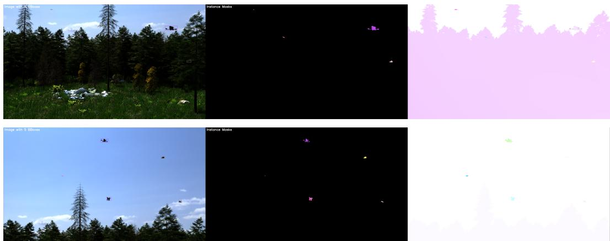

# FlyingDrones: A Dataset and Benchmark for Optical Flow Estimation from UAV motion

Laurenz Ruzicka Digital Safety and Security Data Science and Artificial Intelligence Austrian Institute of Technology Laurenz.Ruzicka@ait.ac.at

Roman Pflugfelder   
Digital Safety and Security   
Data Science and Artificial Intelligence   
Austrian Institute of Technology   
School of Computation, Information and Technology   
Technical University of Munich   
Munich Center for Machine Learning (MCML)   
Roman.Pflugfelder@{ait.ac.at|tum.de}

Daniel Cremers School of Computation, Information and Technology Technical University of Munich Munich Center for Machine Learning (MCML) cremers@tum.de

## Abstract

Optical flow is an important cue for drone analysis in aerial surveillance, airspace monitoring, and long-range target tracking, where motion remains informative when appearance is weak. Estimating the motion of small Unmanned Aerial Vehicles (UAVs), however, is difficult because distant targets occupy few pixels, have low contrast, and move against complex dynamic backgrounds. Standard optical-flow benchmarks emphasize large, object-centric motions and therefore do not characterize distant aerial targets well. We introduce FlyingDrones, a generated benchmark with dense ground-truth optical flow and segmentation masks derived from physically based rendering, and define resolution-normalized metrics (EPE Norm) that normalize flow by image dimensions. We evaluate 16 state-ofthe-art model families (88 public checkpoints) on a motion- and size-stratified subset of 999 flow pairs at three resolutions, with bootstrap confidence intervals and a zero-flow reference. Every family recovers drone motion better than the zero-flow reference, but the gap between families widens with resolution: at 1920 × 1080, global-matching, recurrent, transformer, and short-window temporal models separate clearly from pyramid, classical, self-supervised, lightweight, and diffusion models. Within-family checkpoint spread is comparable to or larger than between-family spread, so the training curriculum is as important as the architecture. Two complementary studies test the benchmark beyond synthetic accuracy: a ground-truth-free motion-alignment evaluation on 21 cameras of real UAV footage shows that the synthetic ranking carries a moderate, significant signal about real-world performance (Spearman ρ = 0.63 over 41 checkpoints) while the exact top ranks differ, and a fine-tuning study shows that 800 FlyingDrones pairs reduce held-out drone-region error by up to 37% and improve drone localization on the real footage for all four architectures tested.

## 1 Introduction

Apparent motion is an important visual cue in drone analysis and aerial surveillance [1, 2]. At long ranges, drones often occupy only a few pixels and lack stable features due to simple appearance textures and complex backgrounds. This means that the relevant signal is weak, localized, and additionally often superimposed by camera-induced background motion, making motion computation challenging.

This work therefore evaluates and compares a broad range of optical flow methods under the tiny motion regime: classical and early deep baselines such as PyFlow [3], FlowNet2 [4], PWC-Net [5], LiteFlowNet3 [6], and VCN [7]; recurrent correlation-based models such as RAFT [8] and SEA-RAFT [9]; lightweight or self-/unsupervised variants such as FastFlowNet [10] and ARFlow [11]; transformer-style correspondence models such as GMFlow [12], UniMatch [13], FlowFormer++ [14], and WAFT [15]; temporally extended models such as VideoFlow [16] and MemFlow [17]; and the generative FlowDiffusion [18, 19].

State of the art (SOTA) datasets and metrics account to the uncertainty in the behavior of optical flow methods with tiny motions: FlyingChairs [20] and FlyingThings3D [21] provide large-scale synthetic supervision, Sintel [22] emphasizes cinematic effects and non-rigid motion, KITTI [23] focuses on outdoor driving scenes, and TartanAir [24] broadens camera trajectories and environments. None of the existing datasets target drones, tiny aerial objects or in general tiny motion regions. Standard measures such as end-point error (EPE), 1px, 3px, 5px, and Fl-all are informative for moderate or large motion regions but become hard to interpret when the target occupies only a few pixels.

To address these issues, we introduce FlyingDrones, a synthetically generated benchmark for optical flow assessment of drone motion, with dense optical-flow and segmentation ground truth across controlled image resolution regimes. The paper also proposes drone-pixel-only metrics and a new resolution-normalized EPE, which makes flow components independent of image width and height, and use them to study SOTA optical flow methods and training curricula independently of image resolution. To the best of our knowledge, this work is the first systematic assessment of optical flow methods applied to tiny motion regions like those created by drones.

To summarize, this papers makes the following contributions:

• We introduce FlyingDrones, a synthetically generated dataset with dense optical-flow and segmentation ground truth for evaluating drone motion across target sizes and image resolutions.

• We define resolution-normalized evaluation measures, especially EPE Norm, to make crossresolution performance more interpretable.

• We compare 16 optical-flow methods (88 public checkpoints) on a motion- and size-stratified subset of the benchmark with confidence intervals and a zero-flow reference, and show that the families separate increasingly with resolution, that within-family checkpoint spread rivals between-family spread, and that Sintel-style fine-tuning increasingly outperforms KITTI-style fine-tuning as resolution grows.

• We validate the benchmark beyond synthetic accuracy: a ground-truth-free motion-alignment study on 21 cameras of real UAV footage [25] measures how far the synthetic ranking transfers to real data, and a fine-tuning study on a held-out FlyingDrones split shows that the dataset improves both held-out synthetic accuracy and real-footage drone localization.

## 2 Related Work

Classical optical flow methods such as Horn–Schunck [26] and Lucas–Kanade [27] formulate motion estimation as a variational problem with brightness-constancy and smoothness assumptions, but struggle with large displacements, strong appearance changes, and complex non-rigid motion. Early deep optical-flow models replaced handcrafted optimization with supervised end-to-end learning. FlowNet and FlowNet2 [20, 4] established the Chairs/Things pre-training pipeline used by many later methods, while coarse-to-fine architectures such as PWC-Net [5], LiteFlowNet/LiteFlowNet3 [28, 6], and FastFlowNet [10] combined feature pyramids, warping, and compact cost volumes for efficient inference. These models perform well on conventional benchmarks, but repeated downsampling can suppress very small motion cues. A related family emphasizes richer matching representations.

VCN [7] uses volumetric correspondence reasoning; RAFT [8] replaces coarse-to-fine refinement with a dense all-pairs correlation volume and iterative updates at fixed feature resolution; SEA-RAFT [9] simplifies RAFT and models uncertainty more explicitly; and WAFT [15] uses warping-based alignment with a transformer-style update module. These methods are especially relevant here because they preserve finer spatial information than traditional pyramid approaches. ARFlow [11] learns optical flow with self-supervised consistency constraints, and PyFlow remains a useful non-deep variational baseline. Such methods are attractive when labels are scarce or speed matters, but often trade accuracy for robustness or efficiency. GMFlow [12], UniMatch [13], and FlowFormer++ [14] model long-range interactions more explicitly than local convolutional pipelines. VideoFlow [16] uses multi-frame inputs, MemFlow [17] adds an explicit memory mechanism, and FlowDiffusion [18, 19] formulates prediction with a diffusion-style process. Across these categories, models differ in supervision, matching representation, temporal context, and computational budget, but most were developed on datasets dominated by moderate or large motions. Our benchmark studies their behavior when the relevant signal is the weak motion of a tiny aerial target.

Small aerial-target analysis is usually framed as object detection. Appearance-based detectors such as YOLO [29] and Faster R-CNN [30] are widely used, but their performance degrades when targets shrink to a few pixels because discriminative features are attenuated or lost during pooling and strided convolutions [31, 32, 33, 34]. Motion estimation can therefore provide complementary information [35, 36]. Early motion-based strategies relied on background subtraction, which assumes a static viewpoint and fails under the ego-motion typical of aerial surveillance. Deep optical flow instead models dense pixel-wise displacements and can separate object motion from camera-induced parallax, but objects occupying only a fraction of a percent of the image generate weak, localized signals that are easily overwhelmed by background flow or smoothed out by spatial regularization and coarse-to-fine downsampling [5]. Despite the importance of optical flow for small-target analysis, empirical validation remains limited by the lack of suitable data.

## 3 Metrics

Let an image pair $\left( I _ { t } , I _ { t + 1 } \right)$ of spatial resolution $W \times H$ be given, where W and H denote the image width and height in pixels. The optical flow field is defined as a dense vector field

$$
\mathbf { F } : \Omega \to \mathbb { R } ^ { 2 } , \quad \Omega = \{ 1 , \dots , W \} \times \{ 1 , \dots , H \} ,\tag{1}
$$

where $\Omega \ = \ \{ 1 , \dots , W \} \times \{ 1 , \dots , H \}$ denotes the discrete image domain and $\begin{array} { r l } { \mathbf { F } ( x , y ) } & { { } = } \end{array}$ $( u ( x , y ) , v ( x , y ) )$ ) represents the horizontal and vertical displacement of pixel $( x , y )$ between frames. Let $\mathbf { F } _ { g t }$ and $\mathbf { F } _ { p r e d }$ denote the ground-truth and predicted flow fields, respectively. All metrics are computed per pixel and then averaged over the evaluation region.

## 3.1 End-Point Error (EPE)

The most commonly used metric in optical flow evaluation is the End-Point Error (EPE), defined at each pixel as the Euclidean distance between predicted and ground-truth flow vectors,

$$
\mathrm { E P E } ( x , y ) = \| \mathbf { F } _ { p r e d } ( x , y ) - \mathbf { F } _ { g t } ( x , y ) \| _ { 2 } ,\tag{2}
$$

where $\| \cdot \| _ { 2 }$ denotes the Euclidean $( \ell _ { 2 } )$ norm in $\mathbb { R } ^ { 2 }$ . The reported EPE is the mean of this quantity over all evaluated pixels.

## 3.2 Pixel Threshold Metrics

To complement EPE, we report pixel-threshold exceedance metrics denoted by $\mathrm { P x } _ { \tau }$ . These metrics compute the percentage of pixels whose endpoint error exceeds a fixed threshold τ ,

$$
\mathrm { P x } _ { \tau } = \frac { 1 } { \vert \Omega \vert } \sum _ { ( x , y ) \in \Omega } \mathbb { I } \left[ \mathrm { E P E } ( x , y ) > \tau \right] ,\tag{3}
$$

with $\tau \in \{ 1 , 3 , 5 \}$ pixels and $\mathbb { I } [ \cdot ]$ the indicator function. $\mathrm { P x } _ { 1 }$ captures how often the error exceeds one pixel, while $\mathrm { P x _ { 3 } }$ and $\mathrm { P x } _ { 5 }$ report progressively coarser failure rates. These thresholds implicitly assume that fixed pixel errors are equally meaningful across resolutions and object sizes, which is not true for tiny drones. This dependence is stronger in our benchmark because the same scene is rendered at different resolutions. At 480×270, a 1px error corresponds to about 0.21% of the image width and 0.37% of the image height; at $1 9 2 0 \times 1 0 8 0$ , it is only about 0.05% and 0.09%.

## 3.3 Flow Outliers (FL)

Flow Outliers (FL) are designed to account for relative motion magnitude by labeling a pixel as an outlier if its error is both absolutely large and large relative to the ground-truth displacement. A pixel is classified as an outlier if

$$
\mathrm { E P E } ( x , y ) > 3 . 0 \quad \mathrm { a n d } \quad \frac { \mathrm { E P E } ( x , y ) } { \left\| \mathbf { F } _ { g t } ( x , y ) \right\| _ { 2 } } > 0 . 0 5 .\tag{4}
$$

The FL score is the percentage of pixels satisfying this condition.

## 3.4 Resolution-Normalized and Drone Region Metrics

To reduce the dependence of flow evaluation on image resolution and object scale, we introduce resolution-normalized variants of the standard metrics. Let $S = ( W , H )$ denote the image dimensions. Normalized flow vectors are obtained by scaling the horizontal and vertical components by the image width and height, respectively, and the normalized endpoint error is then defined from these vectors:

$$
\begin{array} { r l r l } { \tilde { \mathbf { F } } ( x , y ) = \left( \displaystyle \frac { u ( x , y ) } { W } , \frac { v ( x , y ) } { H } \right) , } & { \quad \mathrm { E P E } _ { n o r m } ( x , y ) } & { = 1 0 0 \cdot \Big \| \tilde { \mathbf { F } } _ { p r e d } ( x , y ) - \tilde { \mathbf { F } } _ { g t } ( x , y ) \Big \| _ { 2 } . } \end{array}\tag{5}
$$

$\mathrm { E P E _ { n } }$ is thus expressed in percent of the image size. Note that this metric re-weights horizontal versus vertical errors based on the image axes differences.

In addition to full-frame evaluation, we report drone-region metrics that restrict averaging to the image area occupied by the drone. Let $\bar { \Omega _ { D } } \subseteq \Omega$ denote the set of drone pixels. Then, instead of averaging a per-pixel quantity m(x, y) over Ω, we average only over $\Omega _ { D }$

## 4 The FlyingDrones Dataset

Long-range drone footage has no dense optical-flow ground truth, and none can practically be collected at the scale needed for benchmarking, since annotating per-pixel motion for a target that spans a handful of pixels is not a task humans can do reliably by hand. We therefore built a synthetic dataset1 in which dense flow and segmentation masks come directly from the renderer rather than from annotation (Figure 1). All scenes, assets, and animations were assembled in Blender and rendered with the Cycles engine in a headless pipeline that supports parallel generation on GPU servers. Ground-truth annotations are derived directly from the 3D simulation: each drone model is assigned a unique pass index, the renderer exports multi-layer OpenEXR files containing the RGB image, raw Vector pass, and Object Index pass, and a post-processing routine extracts pixel-wise motion vectors and per-drone instance masks consistent with the rendered geometry and lighting. The flow stored for frame t is backward flow: it maps every pixel of frame t to its position in frame t − 1. All evaluations in this paper therefore use the pair $\left( I _ { t } , I _ { t - 1 } \right)$ with $I _ { t }$ as the reference frame, and temporal models receive the correspondingly time-reversed frame window. Appendix B.7 complements this synthetic evaluation with a real-footage study that establishes which of its findings hold on video from real cameras.

The dataset is released in three resolution variants, all derived from the same native 16:9 render and written as width × height $( \mathrm { W } \times \mathrm { H } )$ : Drones-Large at $1 9 2 0 \times 1 0 8 0$ , the native rendering resolution; Drones-Standard at $9 6 0 \times 4 3 2$ , obtained by resizing Drones-Large directly to $9 6 0 \times 4 3 2$ (a factor of 0.5 horizontally and 0.4 vertically, with the flow components scaled accordingly), which matches the 960 × 432 crop size used as a training and evaluation resolution by several of the benchmarked models (e.g. SEA-RAFT’s TSKH432x960 schedule); and Drones-Small at $4 8 0 \times 2 7 0$ , a four-times downsampled version of Drones-Large. Because all three subsets depict the same scenes, performance differences across evaluation resolutions can be attributed directly to spatial resolution rather than to scene content. Drones-Small in particular emulates the sampling consequence of long-range observation, reducing drone footprint and apparent motion to fewer pixels without changing the scene. It does not reproduce the other physical consequences of distance such as atmospheric attenuation and turbulence, reduced contrast, and lens or sensor effects, and should be read as a controlled scale ablation rather than a complete long-range simulation (see also the Limitations).

  
Figure 1: Example images from the dataset. The left column shows the color images with bounding boxes drawn around the drones, the middle column the segmentation masks of the drones, and the right column a color visualization of the optical flow.

The dataset comprises 9001 frames rendered at the native 1920 × 1080 resolution, yielding 9000 consecutive optical-flow pairs, each indexed by its reference frame I . Aerial targets are visible in 7908 of the 9000 reference frames. The remaining 1092 are drone-free and excluded from droneregion averages. Scenes contain between zero and six simultaneous drones (2127 frames with one drone, 2448 with two, 1457 with three, 1054 with four, 543 with five, 279 with six), so summing drone instances over all reference frames gives 19 999. We use drone instance for one drone visible in one reference frame, and the drone-region mask Ω used by the metrics is the union of all instance masks in a frame. The instances are drawn from six distinct 3-D multirotor assets, re-used across scenes with varying scale, pose, flight path, and lighting, so appearance diversity comes from viewpoint, range, and illumination rather than from a large asset library.

Table 1 summarizes the size and motion distributions at the native 1920 × 1080 resolution (2 073 600 pixels). The median drone area is 155 pixels, or about 0.0075% of the image area; 25% of instances occupy 47 pixels or fewer, the minimum target size is a single pixel, and even the largest target (39 275 pixels) occupies less than 1.9% of the image area. Averaged over the drone pixels of each reference frame that contains drones, the ground-truth flow magnitude has a mean of 8.39 pixels per frame (standard deviation 9.60, median 5.56, maximum 111.4), and individual drone pixels reach 211.2 pixels per frame, so although the targets are spatially small, their motion ranges from sub-pixel shifts to large displacements.

## 5 Results

We evaluate 16 architectures (88 public checkpoints in total) on FlyingDrones at all three resolutions, giving 264 checkpoint × resolution cells, together with a zero-flow reference that predicts 0 everywhere and whose drone-region EPE therefore equals the mean ground-truth drone motion. Table 2 summarizes the best checkpoint of every family; per-resolution leaderboards with confidence intervals are in Tables 6–8 (Appendix B.2), and checkpoint-level results, model-wise commentary, and training schedules are collected in Appendix B.1, Appendix B.5, and Table 5. For reproducibility, Table 4 lists the official source locations and code licenses or public usage terms of the external codebases used in this study.

Evaluating all 88 checkpoints on the full sequence is computationally impractical (several families, notably FlowDiffusion, take 4–18 s per sample), and a contiguous run of frames would over-represent whichever scenes occur first. We instead evaluate on a fixed stratified subset of 1000 reference frames drawn from the 9000, balanced across drone footprint area (five data-driven quintiles) and drone-region flow magnitude $( < 1 , 1 - 3 , 3 - 8 , \ge 8 \mathrm { p x / f r a m e }$ , plus a drone-free stratum), yielding 21 occupied strata filled by proportional-with-floor sampling so that rare regimes are represented alongside the common mid-range. Frame 0 has no predecessor under the backward-flow convention, so 999 pairs are evaluated. Selection is keyed by frame index, so the identical pairs are evaluated at all three resolutions and cross-resolution differences remain attributable to spatial resolution alone; because the smallest drones vanish when the frame is downsampled, drone-region averages cover 885, 896 and 898 pairs at 480 × 270, 960 × 432 and 1920 × 1080. All averages are over pairs; 95% confidence intervals are percentile bootstraps over pairs (10,000 resamples). Appendix B.6 compares this sample with a contiguous window of 500 frames: the window is harder for every family, but the family ranking is largely preserved (Spearman $\rho$ between 0.83 and 0.95).

Table 1: FlyingDrones dataset statistics at $1 9 2 0 \times 1 0 8 0$ . Drone flow magnitude is the mean groundtruth flow magnitude over the drone pixels of each frame that contains drones (7908 frames), except the maximum, which is over individual drone pixels.
<table><tr><td>General property</td><td>Amount</td></tr><tr><td>Total frames</td><td>9001</td></tr><tr><td>Flow pairs Frames with visible drones</td><td>9000 7908</td></tr><tr><td>Drone instances</td><td>19,999</td></tr><tr><td>Drone flow magnitude</td><td>[px/frame]</td></tr><tr><td>Mean (per frame) Median (per frame)</td><td>8.39 5.56</td></tr><tr><td>Std (per frame)</td><td>9.60</td></tr><tr><td>Max (per pixel)</td><td>211.24</td></tr></table>

<table><tr><td>Drone size</td><td>[px]</td><td>[% of image]</td></tr><tr><td>Minimum</td><td>1</td><td> $4 . 8 \times 1 0 ^ { - 5 }$ </td></tr><tr><td>p25</td><td>47</td><td> $2 . 3 \times 1 0 ^ { - 3 }$ </td></tr><tr><td>p50</td><td>155</td><td> $7 . 5 \times 1 0 ^ { - 3 }$ </td></tr><tr><td>Mean</td><td>525</td><td> $2 . 5 \times 1 0 ^ { - 2 }$ </td></tr><tr><td>p75</td><td>549</td><td> $2 . 6 \times 1 0 ^ { - 2 }$ </td></tr><tr><td>p95</td><td>2367</td><td> $1 . 1 \times 1 0 ^ { - 1 }$ </td></tr><tr><td>p99</td><td>5194</td><td> $2 . 5 \times 1 0 ^ { - 1 }$ </td></tr><tr><td>Maximum</td><td>39275</td><td>1.9</td></tr></table>

Inference ran on a heterogeneous GPU cluster. Eight families (FlowFormer++, GMFlow, Lite-FlowNet3, MemFlow, RAFT, UniMatch, VideoFlow, WAFT) were evaluated at 1920 × 1080 with tiled inference (marked ‡): a grid of 960 × 432 tiles (the Drones-Standard crop size) with 20– 40 px minimum overlap, each tile processed by the unmodified upstream model and recomposed by Gaussian-weighted blending (uniform blending for FlowFormer++, GMFlow and UniMatch, whose official evaluators tile natively); FlowFormer++ things\_288960 uses its 960 × 288 training crop as the tile. Tiling is applied identically to all checkpoints of a family, but it is a deviation from whole-frame inference and is flagged in every table. No other modification was made to the public model code; only the metric computation is ours.

## 5.1 Performance Overview

Table 2 reports the best checkpoint of every family at each resolution. Every family beats the zero-flow reference, by 16–50% at 480×270, 33–63% at 960×432 and 32–79% at 1920×1080, and the spread between families grows with resolution: the best-per-family drone-region EPE spans 0.873–1.459 at 480 × 270 (1.7×), 1.293–2.336 at 960 × 432 (1.8×) and 1.557–5.125 at 1920 × 1080 (3.3×). At 1920 × 1080 the families fall into two clear groups: eight global-matching, recurrent, transformer and short-window temporal families stay at or below 2.09 px (UniMatch, VideoFlow, FlowFormer++, SEA-RAFT, MemFlow, GMFlow, RAFT, WAFT), while all pyramid, classical, self-supervised and diffusion models are at 3.1 px or above. The top ranks are statistically resolved at the two lower resolutions (paired bootstrap: ARFlow beats MemFlow at 480 × 270 and UniMatch beats VideoFlow at 960 × 432 in ≥ 99.7% of resamples) but not at 1920 × 1080, where UniMatch and VideoFlow BOF\_sintel are tied (1.557 vs. 1.582, UniMatch ahead in 71% of resamples). Within-family spread is comparable to or larger than this between-family spread: at 960 × 432 the leaderboard spans 1.8×, while VCN spans 2.3×, UniMatch 2.1× and VideoFlow 3.0× across their own checkpoints; at 1920 × 1080 VideoFlow alone spans 13× (1.58 to 20.7, MOF\_kitti collapsing). A family’s position is therefore set jointly by its architecture and by which public checkpoint happens to suit this regime — Appendix B.7 confirms the same effect on real footage.

Table 2: Best drone-region EPE (px) per model family at each resolution on the stratified subset (999 flow pairs; lower is better). The best checkpoint is selected per family and resolution, so it can differ across columns. Families are sorted by their mean rank r¯ over the three resolutions. Cls: C = correlation/iterative, P = classical / pyramid, E = efficient / reduced-supervision, T = transformer / global matching, M = temporal / memory / generative. † more than two input frames; ‡ tiled inference (960 × 432 tiles; 960 × 288 for FlowFormer++ things\_288960). Selected checkpoints, 95% bootstrap confidence intervals and further metrics are in Tables 6–8.
<table><tr><td>Cls</td><td>Family</td><td>480×270</td><td>960×432</td><td>1920×1080</td><td>ī</td></tr><tr><td>T</td><td>UniMatch</td><td>0.952</td><td>1.293</td><td>1.557‡</td><td>1.7</td></tr><tr><td>M</td><td>VideoFlow†</td><td>0.997</td><td>1.425</td><td>1.582</td><td>3.0</td></tr><tr><td>M</td><td>MemFlow†</td><td>0.948</td><td>1.484</td><td>1.965‡</td><td>3.3</td></tr><tr><td>T</td><td>FlowFormer++</td><td>1.108</td><td>1.513</td><td>1.840</td><td>5.3</td></tr><tr><td>E</td><td>ARFlow</td><td>0.873</td><td>1.581</td><td>3.175</td><td>5.7</td></tr><tr><td>C</td><td>SEA-RAFT</td><td>1.117</td><td>1.557</td><td>1.883</td><td>6.3</td></tr><tr><td>C</td><td>WAFT</td><td>1.000</td><td>1.793</td><td>2.086</td><td>7.7</td></tr><tr><td>C</td><td>RAFT</td><td>1.152</td><td>1.713</td><td>2.047</td><td>8.7</td></tr><tr><td>P</td><td>PyFlow (C2F)</td><td>0.977</td><td>1.895</td><td>4.051</td><td>9.0</td></tr><tr><td>T</td><td>GMFlow</td><td>1.282</td><td>1.665</td><td>1.996</td><td>9.3</td></tr><tr><td>P</td><td>VCN</td><td>1.067</td><td>2.048</td><td>3.829</td><td>10.3</td></tr><tr><td>P</td><td>FlowNet2</td><td>1.209</td><td>2.011</td><td>3.136</td><td>11.0</td></tr><tr><td>P</td><td>LiteFlowNet3</td><td>1.192</td><td>2.147</td><td>3.275</td><td>12.3</td></tr><tr><td>M</td><td>FlowDiffusion (DDVM)</td><td>1.099</td><td>2.220</td><td>5.125</td><td>13.0</td></tr><tr><td>P</td><td>PWC-Net</td><td>1.227</td><td>2.125</td><td>4.404</td><td>13.7</td></tr><tr><td>E</td><td>FastFlowNet</td><td>1.459</td><td>2.336</td><td>4.425</td><td>15.7</td></tr><tr><td>一</td><td>Zero flow (reference)</td><td>1.744</td><td>3.498</td><td>7.549</td><td>一</td></tr></table>

Full-frame EPE (Appendix B.3) averages over the whole image and is dominated by background and camera motion, whereas drone-region EPE averages only over ground-truth drone pixels and is the harsher, more relevant score. For UniMatch, which leads at the two higher resolutions, drone-region EPE exceeds full-frame EPE by 3.5× at 480 × 270 (0.952 vs. 0.275), 2.3× at 960 × 432 and 1.3× at 1920 × 1080, so full-frame scores understate target-region difficulty most where the target is smallest. The resolution-normalized metric shows the opposite trend to pixel EPE: the best drone-region EPEn falls from 0.215 at 480 × 270 to 0.175 at 960 × 432 and 0.097 at 1920 × 1080, i.e. the leading models localize the drone’s motion more precisely relative to image size as resolution grows, even though their pixel error rises by 1.8× while the drone’s own displacement (the zero-flow EPE) rises by 4.3×. Pixel-threshold measures make the residual difficulty concrete: the leading models still leave 20–27% of drone pixels above 1 px error at every resolution and 7–12% above 3 px, compared with 47–86% and 16–64% for zero flow.

## 5.2 Correlation and Iterative-Refinement Models

RAFT, SEA-RAFT, and WAFT preserve strong correspondence reasoning without aggressive coarse-to-fine downsampling, but differ in curriculum and matching design: RAFT uses a dense all-pairs correlation volume with recurrent updates over the staged curriculum chairs→things→sintel→kitti; SEA-RAFT simplifies the update and adds uncertainty-aware learning over a longer TartanAir-anchored curriculum; and WAFT uses warping-based alignment with a transformer-style update module and a frozen DepthAnythingV2 encoder [37].

All three families are in the leading cluster at 1920 × 1080 but only mid-field at 480 × 270. SEA-RAFT climbs most with resolution (rank 10, 5 and 4; drone EPE 1.117, 1.557, 1.883 for its Sintel release), consistent with its TartanAir-anchored, 960 × 432-crop curriculum. RAFT ranks 11, 8 and 7 (1.152, 1.713, 2.047); its Sintel checkpoint is best at the two higher resolutions and its spread grows from 1.2× to 1.9×, so the last curriculum stage matters most where displacements are largest. WAFT ranks 6, 9 and 8, with its Spring-540p release best at the two lower resolutions and the tar-c-t base best at 1920 × 1080. The three released SEA-RAFT checkpoints differ by up to 1.6× at 1920 × 1080 (Sintel 1.883, KITTI 2.026, Spring 2.972), reinforcing the checkpoint-dominance observation.

## 5.3 Classical, Pyramid, and Early Deep Baselines

FlowNet2, PWC-Net, LiteFlowNet3, VCN, and PyFlow cover the classical coarse-to-fine and early deep-learning baselines, all relying on hierarchical, coarse-to-fine estimation. This is effective on standard benchmarks but prone to attenuating a target that is only a tiny image structure. PyFlow is a hand-crafted variational method with no learned pre-training; FlowNet2 stacks multiple subnetworks trained in stages; PWC-Net and LiteFlowNet3 are compact pyramid descendants; VCN adds volumetric correspondence reasoning. $\mathrm { A t 4 8 0 \times 2 7 0 }$ , where about half of the drone pixels move by less than one pixel, these models are competitive: PyFlow is fourth overall (0.977) and VCN seventh (1.067). As resolution grows they fall behind, and at $1 9 2 0 \times 1 0 8 0$ all five form the lower group (3.14–4.40, against 1.56–2.09 for the leading cluster), consistent with coarse-to-fine estimation losing the small target once its displacement exceeds the coarse levels’ resolution. VCN, which unlike the tiled LiteFlowNet3 runs on the whole $1 9 2 0 \times 1 0 8 0$ frame, also has the second-largest within-family spread there (8.1×). PyFlow nevertheless remains a strong real-footage baseline (Appendix B.7).

## 5.4 Efficient and Reduced-Supervision Models

ARFlow reduces dependence on dense labels through self-supervised consistency objectives; Fast-FlowNet keeps supervised training but uses a lightweight pyramid architecture for speed. ARFlow’s KITTI12 multi-view checkpoint is the best model overall at $4 8 0 \times 2 7 0 ( 0 . 8 7 3 )$ and also has by far the lowest full-frame EPE there (0.150 against $\geq 0 . 2 3 4$ for every other family). An independent check attributes the full-frame advantage to near-zero output on the static background, which covers about two thirds of the pixels at this resolution, while on moving background it matches RAFT; its photometric self-supervision therefore acts as a low-noise prior rather than as a more accurate motion estimator. ARFlow drops to rank 6 at $9 6 0 \times 4 3 2$ and 10 at $1 9 2 0 \times 1 0 8 0$ , and FastFlowNet is last or second to last at every resolution (1.459, 2.336, 4.425), so lightweight pyramids do not scale to the high-resolution regime.

## 5.5 Transformer and Global-Matching Models

GMFlow, UniMatch, and FlowFormer++ treat optical flow as a dense correspondence problem with broader spatial context, via global attention or transformer-style decoding rather than local cost volumes and recurrent corrections. UniMatch is the best family at $9 6 0 \times 4 3 2$ and $1 9 2 0 \times 1 0 8 0$ (1.293, 1.557) and third at $4 8 0 \times 2 7 0 ( 0 . 9 5 2 )$ , and it also attains the lowest drone-region $\mathrm { E P E _ { n } }$ at the two higher resolutions. FlowFormer++ ranks 9, 4 and 3, and GMFlow 15, 7 and 6. This family is also a clear illustration of curriculum dominance: FlowFormer++ spans 1.8× at $9 6 0 \times 4 3 2$ and 1.9× at $1 9 2 0 \times 1 0 8 0$ across four checkpoints, and GMFlow 2.2× at $1 9 2 0 \times 1 0 8 0$

## 5.6 Temporal, Memory-Based, and Generative Models

VideoFlow uses multi-frame input windows optimized for temporally coherent video flow; MemFlow adds an explicit memory module on top of recurrent flow estimation; FlowDiffusion formulates prediction as a diffusion-style generative process. All temporal models receive genuine neighbouring frames. VideoFlow’s three-frame BOF\_sintel is second at $9 6 0 \times 4 3 2$ and 1920 × 1080 (1.425, 1.582; tied with UniMatch at the latter), but its five-frame MOF variants do not improve on it: BOF beats MOF for 11 of the 12 matched checkpoint × resolution pairs, and MOF\_kitti collapses at 1920 × 1080 (20.7). MemFlow, which carries a memory over a five-frame clip, is second at 480 × 270 (0.948, Spring checkpoint) and stays in the leading cluster at every resolution. FlowDiffusion is mid-field at 480 × 270 (1.099) but falls to the bottom at the two higher resolutions (2.220, 5.125). A short temporal window is therefore competitive, but neither longer windows nor generative refinement add accuracy on synthetic drone motion.

## 6 Discussion

The results support optical flow as a useful cue for detecting small aerial targets: every evaluated family recovers drone motion clearly better than the zero-flow reference, and the leading models keep their drone-region error between roughly 0.9 and 1.6 px while the drone’s own displacement grows fourfold from $4 8 0 \times 2 7 0 t o 1 9 2 0 \times 1 0 8 0$ . The divergence between pixel-based and resolution-normalized metrics, and between full-frame and drone-region scores, shows why scale-aware reporting is necessary.

Table 3: Fine-tuning on 800 FlyingDrones pairs: public initialisation → fine-tuned. Synthetic: drone-region EPE on the 100-pair held-out test split (lower better). Real: motion alignment on 21 real cameras (higher better). Per-arm recipes and full-frame EPE in Tables 14 and 15.
<table><tr><td>Model</td><td>Synth. drone EPE (∆)</td><td> $\mathrm { R e a l N S S } _ { D }$ </td><td>Real Hit@50</td></tr><tr><td>FlowFormer++</td><td> $1 . 6 1 \to 1 . 3 0 ( - 1 9 . 2 \% )$ </td><td> $1 5 . 5  2 2 . 6$ </td><td> $0 . 5 6 \to 0 . 5 8$ </td></tr><tr><td>GMFlow</td><td> $3 . 6 5 \to 2 . 7 2 ( - 2 5 . 4 \% )$ </td><td> $4 . 4  6 . 8$ </td><td> $0 . 2 3  0 . 3 1$ </td></tr><tr><td>RAFT</td><td> $1 . 8 6 \to 1 . 9 3 ( + 4 . 1 \% )$ </td><td> $1 4 . 5  1 6 . 9$ </td><td> $0 . 5 2  0 . 5 3$ </td></tr><tr><td>VideoFlow MOF</td><td> $1 . 7 3 \to 1 . 0 9 ( - 3 6 . 9 \% )$ </td><td> $4 . 9  1 7 . 8$ </td><td> $0 . 1 6  0 . 5 6$ </td></tr></table>

Rankings change with resolution (Table 2): self-supervised (ARFlow), memory-based (MemFlow), global-matching (UniMatch) and even classical (PyFlow) models lead at $4 8 0 \times \dot { 2 } 7 0$ , where about half of the drone pixels move by less than one pixel, whereas global-matching and short-window temporal models (UniMatch, VideoFlow BOF) lead at the two higher resolutions, and pyramid, classical and diffusion models fall clearly behind at $1 9 2 0 \times 1 0 8 0$

Aggregating the appendix tables over the twelve families that release both a KITTI- and a Sintelfine-tuned checkpoint, Sintel fine-tuning is better for 8 of 12 families at $4 8 0 \times 2 7 0$ and 9 of 12 at both higher resolutions, and its median relative advantage grows with resolution $( + 3 . 5 \% , + 2 0 \%$ +22%). The exceptions are ARFlow, FastFlowNet and WAFT, for which the KITTI release is better at every resolution (and VCN at $4 8 0 \times 2 7 0$ , by less than 1%). Displacement range does not explain this pattern (Appendix B.4): the labelled pixels of the KITTI 2015 training set move more than Sintel’s (median 23 vs. 3.9 px), and the drone motion lies between the two (per-frame median 5.56 px at 1920 × 1080, Table 1). The cause remains open; dense synthetic versus sparse LiDAR supervision and scene content are candidate factors. The practical magnitude of this curriculum effect is large: within-family swings between the best and worst public checkpoint reach 2.1–3.0× at 960 × 432 and up to 13× at $1 \bar { 9 2 } 0 \times 1 0 8 0$ , comparable to or larger than the 1.8× and 3.3× spans of the entire best-per-family leaderboard. Curriculum selection, not architecture selection alone, is therefore a dominant lever for drone-region accuracy and Appendix B.7 shows the same effect on real footage.

Two appendix studies connect the synthetic results to real data. On 21 cameras of real UAV footage (Appendix B.7), synthetic drone-region EPE and real drone localization are positively rank-correlated over 41 checkpoints (Spearman $\rho = 0 . 5 4 – 0 . 6 3$ across the three synthetic resolutions, $p < 1 0 ^ { - 3 } )$ although the exact top ranks differ: MemFlow leads on real footage and is in the synthetic top five at every resolution, whereas classical PyFlow is much stronger and VideoFlow’s five-frame variant much weaker on real footage than on synthetic data. Fine-tuning on 800 FlyingDrones pairs (Table 3, Appendix B.9) reduces held-out drone-region EPE by $1 9 \mathrm { - } 3 7 \%$ for three of four architectures and improves real-footage localization for all four, most strongly for VideoFlow MOF, whose public checkpoint transfers worst.

For practical aerial surveillance, the choice of public checkpoint matters as much as the choice of architecture, and the best choice depends on the operating resolution. Future work should prioritize native-resolution aerial training data and evaluate candidate checkpoints at the deployment resolution; both pixel-space and normalized metrics remain necessary, and no current model reaches sub-pixel drone-region EPE at 960 × 432 or 1920 × 1080.

## Limitations

The benchmark itself is synthetic and although the renderer provides dense ground-truth flow at very small target scales, it cannot capture all field effects relevant to long-range aerial sensing, including atmospheric turbulence, sensor noise, compression artifacts, rolling-shutter distortions, and platformspecific optics, and Drones-Small therefore emulates the sampling consequence of range, not its full radiometry. The real-footage study of Appendix B.7 mitigates but does not remove this concern: it uses static-camera sequences with point (not dense) labels, so it measures motion localisation and agreement at the target rather than full-field accuracy, and its absolute numbers are a proxy rather than an EPE; it is evaluated across 41 real-footage checkpoints and 21 cameras, but moving platforms, multiple simultaneous targets, and additional sensors and scenes remain future work. The evaluation resolution ceiling is 1920 × 1080, the native rendering resolution of the current release; because rankings and the best curriculum both shift with resolution, extrapolating this ordering to 2K or 4K sensors is not warranted, and re-rendering the retained scene geometry and flight paths at higher resolution is the natural, if costly, extension.

Because the main study compares publicly available checkpoints with different curricula, the results reflect the joint effect of training domain and architecture rather than a controlled ablation over optimization budget, model size, and compute. We do not resolve this confound, retraining 16 architectures under one curriculum is beyond our compute budget, but we bound it by reporting all 88 public checkpoints so that within-family spread is visible (Appendix B.3), and by the controlled fine-tuning study of Appendix B.9, in which four architectures are trained from a common in-domain split under a matched recipe. That study shows gains on held-out FlyingDrones data and on the static-camera real footage of Appendix B.7, but it covers four architectures and one training budget only.

Finally, the benchmark isolates optical-flow quality from downstream detection and tracking; strong flow estimates for tiny targets may still be insufficient in practice, where false positives, latency, and calibration errors also matter.

## Broader Impact

Improved motion estimation for small aerial targets may support applications such as airspace safety and wildlife-aware collision avoidance. This work contributes a benchmark, not a deployable surveillance or tracking system. Because drone-analysis data can still be used in surveillance settings, we recommend application-specific validation, human oversight, and clearly documented operational limits for downstream deployment.

## 7 Conclusion

We introduce FlyingDrones, a synthetic benchmark for optical flow on drone motion, together with drone-region metrics and resolution-normalized EPE for cross-resolution comparison. Such motion is characterized by very small motion regions, a case in which state-of-the-art methods still leave substantial error. Across 16 optical-flow families and 88 public checkpoints, evaluated on a motionand size-stratified subset of 999 flow pairs, every family recovers drone motion better than a zero-flow reference, and the separation between families grows with resolution: at $1 9 2 0 \times 1 0 8 0$ , UniMatch (1.557 px drone-region EPE) and VideoFlow’s three-frame variant (1.582 px) lead a cluster of global matching, recurrent, transformer and short-window temporal models, while pyramid, classical, self-supervised, lightweight, and diffusion models remain at 3.1 px or above. $\mathrm { A t 4 8 0 \times 2 7 0 }$ , where about half of the drone pixels move by less than one pixel, the self-supervised ARFlow (0.873 px), MemFlow, UniMatch, and even the classical PyFlow lead. Training data and curriculum matter as much as architecture: within-family spread between public checkpoints reaches 2–3× at 960 × 432 and up to 13× at $1 9 2 0 \times 1 0 8 0 .$ , and Sintel-style fine-tuning increasingly outperforms KITTI-style fine-tuning as resolution grows; a five-frame temporal window adds nothing over three frames. Two complementary studies test the benchmark beyond synthetic accuracy. A ground-truth-free motion-alignment evaluation on 21 real UAV cameras confirms the regime-level conclusions, subpixel motion is the binding constraint and drone-region evaluation is necessary, and shows that the synthetic ranking correlates moderately with real-world drone localization (Spearman $\rho = 0 . 6 3 )$ while the exact top ranks differ, so FlyingDrones is best used to shortlist architectures and training domains before in-domain validation. A fine-tuning study on a held-out FlyingDrones split shows that 800 in-domain pairs reduce drone-region error by 19–37% for three of four architectures and improve drone localization on real footage for all four (VideoFlow $\mathrm { N S S } _ { D } 4 . 9  1 7 . 8 )$ . Overall, the benchmark points to three priorities for small-aerial-target flow: scale-aware, drone-region evaluation at the deployment resolution, curriculum selection validated on in-domain footage, and in-domain training data, for which high-resolution aerial data remains the main missing part.

## Acknowledgments and Disclosure of Funding

This article is the result of a collaboration with the partners of the STORE project (https:// edf-store.com), funded by the European Defence Fund (EDF) under grant agreement EDF-2022- 101121405-STORE and supported by the Munich Center for Machine Learning (MCML).

## References

[1] S. Srigrarom and K. Hoe Chew, “Hybrid motion-based object detection for detecting and tracking of small and fast moving drones,” in 2020 International Conference on Unmanned Aircraft Systems (ICUAS), pp. 615–621, ISSN: 2575-7296. [Online]. Available: https://ieeexplore.ieee.org/document/9213912

[2] A. Mahalanobis and A. Tall, “Efficient drone detection using temporal anomalies and small spatio-temporal networks,” vol. 26, no. 1, p. 170. [Online]. Available: https://pmc.ncbi.nlm.nih.gov/articles/PMC12788262/

[3] D. Pathak, R. Girshick, P. Dollár, T. Darrell, and B. Hariharan, “Learning features by watching objects move,” in Computer Vision and Pattern Recognition (CVPR).

[4] E. Ilg, N. Mayer, T. Saikia, M. Keuper, A. Dosovitskiy, and T. Brox, “FlowNet 2.0: Evolution of optical flow estimation with deep networks,” in 2017 IEEE Conference on Computer Vision and Pattern Recognition (CVPR). IEEE, pp. 1647–1655. [Online]. Available: http://ieeexplore.ieee.org/document/8099662/

[5] D. Sun, X. Yang, M.-Y. Liu, and J. Kautz, “PWC-net: CNNs for optical flow using pyramid, warping, and cost volume,” in 2018 IEEE/CVF Conference on Computer Vision and Pattern Recognition. IEEE, pp. 8934–8943. [Online]. Available: https://ieeexplore.ieee.org/document/8579029/

[6] T.-W. Hui and C. C. Loy, “LiteFlowNet3: Resolving correspondence ambiguity for more accurate optical flow estimation,” in Proceedings of the European Conference on Computer Vision (ECCV), pp. 169–184.

[7] G. Yang and D. Ramanan, “Volumetric correspondence networks for optical flow,” in NeurIPS.

[8] Z. Teed and J. Deng, “RAFT: Recurrent all-pairs field transforms for optical flow,” in Computer Vision – ECCV 2020, A. Vedaldi, H. Bischof, T. Brox, and J.-M. Frahm, Eds., vol. 12347. Springer International Publishing, pp. 402–419, series Title: Lecture Notes in Computer Science. [Online]. Available: https://link.springer.com/10.1007/978-3-030-58536-5\_24

[9] Y. Wang, L. Lipson, and J. Deng, “SEA-RAFT: Simple, efficient, accurate RAFT for optical flow,” in Computer Vision – ECCV 2024, A. Leonardis, E. Ricci, S. Roth, O. Russakovsky, T. Sattler, and G. Varol, Eds., vol. 15065. Springer Nature Switzerland, pp. 36–54, series Title: Lecture Notes in Computer Science. [Online]. Available: https://link.springer.com/10.1007/978-3-031-72667-5\_3

[10] L. Kong, C. Shen, and J. Yang, “FastFlowNet: A lightweight network for fast optical flow estimation,” in 2021 IEEE International Conference on Robotics and Automation (ICRA).

[11] L. Liu, J. Zhang, R. He, Y. Liu, Y. Wang, Y. Tai, D. Luo, C. Wang, J. Li, and F. Huang, “Learning by analogy: Reliable supervision from transformations for unsupervised optical flow estimation,” in IEEE Conference on Computer Vision and Pattern Recognition(CVPR).

[12] H. Xu, J. Zhang, J. Cai, H. Rezatofighi, and D. Tao, “GMFlow: Learning optical flow via global matching,” in Proceedings of the IEEE/CVF Conference on Computer Vision and Pattern Recognition, pp. 8121–8130.

[13] H. Xu, J. Zhang, J. Cai, H. Rezatofighi, F. Yu, D. Tao, and A. Geiger, “Unifying flow, stereo and depth estimation.”

[14] X. Shi, Z. Huang, D. Li, M. Zhang, K. C. Cheung, S. See, H. Qin, J. Dai, and H. Li, “Flowformer++: Masked cost volume autoencoding for pretraining optical flow estimation,” in Proceedings of the IEEE/CVF Conference on Computer Vision and Pattern Recognition, pp. 1599–1610.

[15] Y. Wang and J. Deng, “WAFT: Warping-alone field transforms for optical flow.” [Online]. Available: http://arxiv.org/abs/2506.21526

[16] X. Shi, Z. Huang, W. Bian, D. Li, M. Zhang, K. C. Cheung, S. See, H. Qin, J. Dai, and H. Li, “Videoflow: Exploiting temporal cues for multi-frame optical flow estimation.”

[17] Q. Dong and Y. Fu, “MemFlow: Optical flow estimation and prediction with memory,” in Proceedings ofthe IEEE/CVF Conference on Computer Vision and Pattern Recognition.

[18] S. Saxena, C. Herrmann, J. Hur, A. Kar, M. Norouzi, D. Sun, and D. J. Fleet, “The surprising effectiveness of diffusion models for optical flow and monocular depth estimation,” in Thirty-seventh Conference on Neural Information Processing Systems. [Online]. Available: https://openreview.net/forum?id=jDIlzSU8wJ

[19] Q. Dong, B. Zhao, and Y. Fu, “Open-DDVM: A reproduction and extension of diffusion model for optical flow estimation,” publication Title: arXiv preprint arXiv:2312.01746.

[20] A. Dosovitskiy, P. Fischer, E. Ilg, P. Hausser, C. Hazirbas, V. Golkov, P. V. D. Smagt, D. Cremers, and T. Brox, “FlowNet: Learning optical flow with convolutional networks,” in 2015 IEEE International Conference on Computer Vision (ICCV). IEEE, pp. 2758–2766. [Online]. Available: https://ieeexplore.ieee.org/document/7410673/

[21] N. Mayer, E. Ilg, P. Häusser, P. Fischer, D. Cremers, A. Dosovitskiy, and T. Brox, “A large dataset to train convolutional networks for disparity, optical flow, and scene flow estimation,” in IEEE International Conference on Computer Vision and Pattern Recognition (CVPR). [Online]. Available: http://lmb.informatik.uni-freiburg.de/Publications/2016/MIFDB16

[22] D. J. Butler, J. Wulff, G. B. Stanley, and M. J. Black, “A naturalistic open source movie for optical flow evaluation,” in European conf. on computer vision (ECCV), ser. Part IV, LNCS 7577, A. Fitzgibbon et al. (Eds.), Ed. Springer-Verlag, pp. 611–625.

[23] M. Menze and A. Geiger, “Object scene flow for autonomous vehicles,” in Conference on computer vision and pattern recognition (CVPR).

[24] W. Wang, D. Zhu, X. Wang, Y. Hu, Y. Qiu, C. Wang, Y. Hu, A. Kapoor, and S. Scherer, “TartanAir: a dataset to push the limits of visual SLAM.”

[25] J. Li, J. Murray, D. Ismaili, K. Schindler, and C. Albl, “Reconstruction of 3d flight trajectories from ad-hoc camera networks.” [Online]. Available: http://arxiv.org/abs/2003.04784

[26] B. K. P. Horn and B. G. Schunck, “Determining optical flow,” vol. 17, no. 1, pp. 185–203. [Online]. Available: https://www.sciencedirect.com/science/article/pii/0004370281900242

[27] B. Lucas and T. Kanade, “An iterative image registration technique with an application to stereo vision (IJCAI),” vol. 81.

[28] T.-W. Hui, X. Tang, and C. C. Loy, “LiteFlowNet: a lightweight convolutional neural network for optical flow estimation,” in Proceedings of IEEE conference on computer vision and pattern recognition (CVPR), pp. 8981–8989.

[29] J. Redmon, S. Divvala, R. Girshick, and A. Farhadi, “You only look once: Unified, real-time object detection,” in 2016 IEEE Conference on Computer Vision and Pattern Recognition (CVPR). IEEE, pp. 779–788. [Online]. Available: http: //ieeexplore.ieee.org/document/7780460/

[30] S. Ren, K. He, R. Girshick, and J. Sun, “Faster r-CNN: Towards real-time object detection with region proposal networks,” vol. 39, no. 6, pp. 1137–1149. [Online]. Available: https://ieeexplore.ieee.org/document/7485869/

[31] T.-Y. Lin, P. Dollár, R. Girshick, K. He, B. Hariharan, and S. Belongie, “Feature pyramid networks for object detection.” [Online]. Available: http://arxiv.org/abs/1612.03144

[32] K. Tong, Y. Wu, and F. Zhou, “Recent advances in small object detection based on deep learning: A review,” vol. 97, p. 103910. [Online]. Available: https: //www.sciencedirect.com/science/article/pii/S0262885620300421

[33] Y. Liu, P. Sun, N. Wergeles, and Y. Shang, “A survey and performance evaluation of deep learning methods for small object detection,” vol. 172, p. 114602. [Online]. Available: https://www.sciencedirect.com/science/article/pii/S0957417421000439

[34] G. Cheng, X. Yuan, X. Yao, K. Yan, Q. Zeng, X. Xie, and J. Han, “Towards large-scale small object detection: Survey and benchmarks,” vol. 45, no. 11, pp. 13 467–13 488. [Online]. Available: https://ieeexplore.ieee.org/document/10168277/

[35] Y. Sun, X. Zhi, H. Han, S. Jiang, T. Shi, J. Gong, and W. Zhang, “Enhancing UAV detection in surveillance camera videos through spatiotemporal information and optical flow,” vol. 23, no. 13, p. 6037. [Online]. Available: https://www.mdpi.com/1424-8220/23/13/6037

[36] S. Alkentar and A. Assalem, “Utilize dense optical flow for small flying targets detection and tracking,” vol. 98, no. 1, pp. 53–70. [Online]. Available: https: //asrjetsjournal.org/American\_Scientific\_Journal/article/view/10281

[37] L. Yang, B. Kang, Z. Huang, Z. Zhao, X. Xu, J. Feng, and H. Zhao, “Depth anything v2.”

[38] L. Mehl, J. Schmalfuss, A. Jahedi, Y. Nalivayko, and A. Bruhn, “Spring: A high-resolution high-detail dataset and benchmark for scene flow, optical flow and stereo,” in Proc. IEEE/CVF Conference on Computer Vision and Pattern Recognition (CVPR), pp. 4981–4991.

[39] D. Kondermann, R. Nair, K. Honauer, K. Krispin, J. Andrulis, A. Brock, B. Gussefeld, M. Rahimimoghaddam, S. Hofmann, C. Brenner, and others, “The HCI benchmark suite: Stereo and flow ground truth with uncertainties for urban autonomous driving,” in Proceedings of the IEEE Conference on Computer Vision and Pattern Recognition Workshops, pp. 19–28.

[40] M. Cordts, M. Omran, S. Ramos, T. Rehfeld, M. Enzweiler, R. Benenson, U. Franke, S. Roth, and B. Schiele, “The cityscapes dataset for semantic urban scene understanding,” in Proc. of the IEEE Conference on Computer Vision and Pattern Recognition (CVPR).

## A Licenses of External Assets

Table 4 summarizes the licenses or public terms currently associated with the external datasets, benchmark assets, and model repositories referenced in this work. We use these assets only for evaluation and discussion of published checkpoints. We do not redistribute third-party datasets or model weights as part of this submission. Where the public benchmark page does not expose a clear standalone license, we state that explicitly.

Table 4: Licenses of external datasets and model repositories referenced in this work.
<table><tr><td>Asset</td><td>Type</td><td>Official source</td><td>License / terms</td></tr><tr><td>FlyingChairs</td><td>Dataset</td><td>University of Freiburg [20]</td><td>Non-commercial / research use only; no standard open-data license stated.</td></tr><tr><td>FlyingThings3D</td><td>Dataset</td><td>University of Freiburg Scene Flow Datasets [21]</td><td>Non-commercial / research use only; no standard open-data license stated.</td></tr><tr><td>MPI Sintel</td><td>Dataset / source movie assets</td><td>MPI Sintel benchmark; Blender Durian project [22]</td><td>Derived from the open movie Sintel; movie and published project assets are released under CC BY 3.0; dataset published under PS:License 1.0.</td></tr><tr><td>KITTI</td><td>Dataset</td><td>KITTI Vision Benchmark Suite [23]</td><td>CC BY-NC-SA 3.0.</td></tr><tr><td>TartanAir</td><td>Dataset</td><td>TartanAir documentation [24]</td><td>CC BY 4.0 for the dataset; accompanying toolkit under MIT.</td></tr><tr><td>Spring</td><td>Dataset</td><td>Spring benchmark / DaRUS release [38]</td><td>CC BY 4.0.</td></tr><tr><td>HD1K</td><td>Dataset</td><td>HD1K benchmark suite [39]</td><td>No standalone public license found; download distributed through the benchmark site with protected access.</td></tr><tr><td>FlowNet2</td><td>Model code</td><td>https://github.com/ lmb-freiburg/ flownet2</td><td>BSD 2-Clause (Caffe-derived); however, the repository documentation explicitly restricts use to non-commercial research only and requires separate author consent for commercial use.</td></tr></table>

Table 4 continued from previous page.
<table><tr><td>Asset</td><td>Type</td><td>Official source</td><td>License / terms</td></tr><tr><td>PyFlow</td><td>Model code</td><td>https://github.com/ pathak22/pyflow</td><td>MIT (Python wrapper only; Copyright © 2017 Deepak Pathak). The underlying Ce Liu optical flow C++ implementation carries separate terms; consult https://people.csail.mit.edu/celiu/</td></tr><tr><td>PWC-Net</td><td>Model code</td><td>https://github.com/ NVlabs/PWC-Net</td><td>OpticalFlow/ for the base library license. CC BY-NC-SA 4.0 (Copyright © 2018 NVIDIA Corporation); non-commercial use only with share-alike and attribution requirements; commercial</td></tr><tr><td>LiteFlowNet3</td><td>Model code</td><td>https://github.com/ twhui/LiteFlowNet3</td><td>use requires separate permission from NVIDIA. Custom non-commercial license; software and paper assets are provided for non-commercial use only without any warranty; commercial use requires a</td></tr><tr><td>VCN</td><td>Model code</td><td>https://github.com/ gengshan-y/VCN</td><td>prior arrangement with the author (Tak-Wai Hui). MIT.</td></tr><tr><td>ARFlow</td><td>Model code</td><td>https://github.com/ lliuz/ARFlow</td><td>MIT.</td></tr><tr><td>FastFlowNet</td><td>Model code</td><td>https://github.com/ 1tkong218/</td><td>MIT.</td></tr><tr><td>RAFT</td><td>Model code</td><td>FastFlowNet https://github.com/ princeton-vl/RAFT</td><td>BSD 3-Clause.</td></tr><tr><td>GMFlow</td><td>Model code</td><td>https://github.com/ haofeixu/gmflow</td><td>Apache 2.0.</td></tr><tr><td>UniMatch</td><td>Model code</td><td>https://github.com/ autonomousvision/ unimatch</td><td>MIT.</td></tr><tr><td>FlowFormer++</td><td>Model code</td><td>https://github.com/ XiaoyuShi97/ FlowFormerPlusPlus</td><td>Apache 2.0.</td></tr><tr><td>VideoFlow</td><td>Model code</td><td>https://github.com/ XiaoyuShi97/ VideoFlow</td><td>Apache 2.0.</td></tr><tr><td>FlowDiffusion (DDVM)</td><td>Model code</td><td>https://github.com/ google-research/</td><td>Apache 2.0 (monorepo-level license covering all sub-projects including DDVM).</td></tr><tr><td>MemFlow</td><td>Model code</td><td>google-research https://github.com/ DQiaole/MemFlow</td><td>Apache 2.0.</td></tr><tr><td>SEA-RAFT</td><td>Model code</td><td>https://github.com/ princeton-vl/</td><td>BSD 3-Clause.</td></tr><tr><td>WAFT</td><td>Model code</td><td>SEA-RAFT https://github.com/ princeton-vl/WAFT</td><td>BSD 3-Clause.</td></tr><tr><td>DepthAnythingV2 encoder</td><td>Model code / pretrained</td><td>https://github.com/ DepthAnything/</td><td>Code under Apache 2.0; model weights are mixed-license: Small variant under Apache 2.0, Base/Large/Giant variants under CC BY-NC 4.0.</td></tr></table>

Our FlyingDrones dataset is publicly available on Kaggle at https://www.kaggle.com/ datasets/flyingdrones/flyingdrones/data together with documentation and release limitations. The models are run through their official third-party repositories (Table 4). We release the dataset loader, which encodes the backward-flow pairing convention, the implementation of the normalized and drone-specific metrics, the stratified evaluation and fine-tuning splits, and the per-model evaluation wrappers in a public code repository linked from the dataset page.

## B Checkpoint Specific Model Results

## B.1 How to read the checkpoint tables

The appendix reports every checkpoint in two aggregated tables, a full-frame evaluation (Table 9) and a drone-pixel-only evaluation (Table 10), grouped by model family, resolution and checkpoint. For the task studied in this paper the drone-pixel-only table is the decisive one, because distant UAVs occupy only a tiny fraction of the image and their motion can easily be obscured by the much larger background flow generated by camera motion. The checkpoint with the lowest full-frame EPE at every resolution (ARFlow KITTI12/pwclite\_ar\_mv) is first on the drone region only at 480 × 270. Both tables end with the zero-flow reference, whose drone-region EPE equals the mean ground-truth drone motion (1.744, 3.498 and 7.549 px at the three resolutions); a checkpoint at or above this value recovers no usable drone motion. Two checkpoints reach this level at 960 × 432 and eight at

1920 × 1080, all of them outside the leaderboards. Runs marked ‡ used tiled inference at 1920 × 1080 (Section 5); VCN has no tiling option in its evaluator and is run on the full 1920 × 1080 frame.

Two release-level details matter when reading the tables. GMFlow’s gmflow\_things, gmflow\_with\_refine\_things and gmflow\_with\_refine\_sintel are the same released weights as UniMatch’s gmflow-scale1-things, gmflow-scale2-things and gmflow-scale2-sintel, and the paired rows agree up to floating-point noise; we keep both rows so that each family’s table is complete. SEA-RAFT, in contrast, releases three distinct files (Tartan-C-T-TSKH-kitti432x960-M, the Sintel release Tartan-C-T-TSKH432x960-M, and Tartan-C-T-TSKH-spring540x960-M), which score differently. We use the public checkpoint names and release descriptions whenever those schedules are exposed directly in Table 5. If the full optimization history is not visible from the release, we report only the most conservative curriculum that is supported by the published checkpoint naming.

Table 5: Training schedules for the checkpoint families used in the appendix result tables. Arrows indicate the order of datasets used during pre-training and fine-tuning. “Release snapshot” denotes checkpoints whose public names expose optimization stage but not a fully disaggregated dataset-by-dataset curriculum.
<table><tr><td>Family</td><td>Checkpoint(s)</td><td>Dataset order used in training</td></tr><tr><td>FlowNet2</td><td>FlowNet2-C_checkpoint</td><td>FlyingChairs</td></tr><tr><td>FlowNet2</td><td>FlowNet2-CS_checkpoint</td><td>FlyingChairs → FlyingThings3D</td></tr><tr><td>FlowNet2</td><td>FlowNet2-CSS-ft-sd_checkpoint, FlowNet2_checkpoint</td><td>FlyingChairs → FlyingThings3D → ChairsSDHom / small- displacement refinement</td></tr><tr><td>FlowNet2</td><td>FlowNet2-S_checkpoint, FlowNet2-SD_checkpoint</td><td>Published single-stream / small-displacement release checkpoints</td></tr><tr><td>PyFlow</td><td>accurate, default, fast</td><td>No learned schedule; classical coarse-to-fine optimization</td></tr><tr><td>PWC-Net</td><td>pwc_net_chairs,pwc_net</td><td>FlyingChairs → published PWC-Net release refinement</td></tr><tr><td>LiteFlowNet3</td><td>liteflownet3s-sintel,</td><td>Synthetic pre-training → Sintel fine-tuning</td></tr><tr><td>LiteFlowNet3</td><td>liteflownet3-sintel liteflownet3s-kitti,</td><td>Synthetic pre-training → KITTI fine-tuning</td></tr><tr><td>RAFT</td><td>liteflownet3-kitti raft-chairs</td><td>FlyingChairs</td></tr><tr><td>RAFT</td><td>raft-things,raft-small</td><td>FlyingChairs → FlyingThings3D</td></tr><tr><td>RAFT</td><td>raft-sintel</td><td>FlyingChairs → FlyingThings3D → Sintel</td></tr><tr><td>RAFT</td><td>raft-kitti</td><td>FlyingChairs → FlyingThings3D → Sintel → KITTI</td></tr><tr><td>VCN</td><td>.../chairs/..., .../things/...</td><td>FlyingChairs or FlyingThings3D</td></tr><tr><td>VCN</td><td>.../sintel-ft-trainval/...,</td><td>FlyingThings3D → Sintel or KITTI fine-tuning</td></tr><tr><td>ARFlow</td><td>.../kitti-ft-trainval/... CityScapes/..., KITTI12/...,</td><td>Self-supervised training on the named target dataset</td></tr><tr><td>FastFlowNet</td><td>KITTI15/...,Sintel/... fastflownet_chairs, fastflownet_things3d</td><td>FlyingChairs → FlyingThings3D</td></tr><tr><td>FastFlowNet</td><td>fastflownet_ft_sintel, fastflownet_ft_kitti,</td><td>Synthetic pre-training → Sintel, KITTI, or mixed fine-tuning</td></tr><tr><td>GMFlow</td><td>fastflownet_ft_mix ...chairs...,...things...</td><td>FlyingChairs or FlyingThings3D release checkpoints</td></tr><tr><td>GMFlow</td><td>...sintel..., ...kitti...</td><td>Base checkpoint → Sintel or KITTI refinement, optionally with a</td></tr><tr><td>UniMatch</td><td>...with_refine...</td><td>refinement head</td></tr><tr><td>UniMatch</td><td>...things...</td><td>FlyingThings3D</td></tr><tr><td>UniMatch</td><td>...mixdata... ...sintelft...,...kitti15...</td><td>FlyingThings3D → mixed-data training Things / mixdata → Sintel or KITTI fine-tuning</td></tr><tr><td>FlowFormer++</td><td>things, things_288960</td><td>FlyingThings3D</td></tr><tr><td>FlowFormer++</td><td>sintel,kitti</td><td>FlyingThings3D → Sintel or KITTI fine-tuning</td></tr><tr><td>VideoFlow</td><td>BOF_*, MOF_*</td><td>Synthetic video flow pre-training → named fine-tuning set</td></tr><tr><td>FlowDiffusion</td><td>pipeline-305000, pipeline-900000</td><td>Release snapshots from the published diffusion pipeline</td></tr><tr><td>MemFlow</td><td>MemFlowNet_things, MemFlowNet_T_things</td><td>FlyingThings3D</td></tr><tr><td>MemFlow</td><td>MemFlowNet_spring, MemFlowNet_sintel,</td><td>FlyingThings3D → Spring, Sintel, or KITTI fine-tuning</td></tr><tr><td></td><td>MemFlowNet_kitti MemFlowNet_T_* variants</td><td></td></tr><tr><td>MemFlow SEA-RAFT</td><td>MemFlowNet_T_things_kitti Tartan-C-T-TSKH432x960-M (Sintel),</td><td>FlyingThings3D → KITTI TartanAir → FlyingChairs → FlyingThings3D → TSKH mixture</td></tr><tr><td></td><td>Tartan-C-T-TSKH-kitti432x960-M, Tartan-C-T-TSKH-spring540x960-M</td><td>(Things, Sintel, KITTI, HD1K), then the named benchmark fine- tune</td></tr><tr><td>WAFT</td><td>chairs-things (implicit base)</td><td>FlyingChairs → FlyingThings3D, with frozen DepthAnythingV2 encoder</td></tr><tr><td>WAFT</td><td>tar, tar-c, tar-c-t</td><td>chairs-things → TartanAir-style refinement → optional extra cur- riculum stages</td></tr><tr><td>WAFT</td><td>tar-c-t-sintel, tar-c-t-kitti,</td><td>chairs-things → TartanAir-style refinement → Sintel, KITTI, or</td></tr><tr><td></td><td>tar-c-t-spring-540p,</td><td>Spring fine-tuning</td></tr></table>

## B.2 Best-Checkpoint Leaderboards

Tables 6–8 report one row per model family and resolution, selecting the checkpoint with the lowest drone-region EPE, with 95% bootstrap confidence intervals over pairs and the zero-flow reference as the last row. Neighbouring entries often have overlapping intervals; a paired bootstrap over the same frames resolves the first rank at 480 × 270 (ARFlow first in 99% of resamples) and at 960 × 432 (UniMatch, > 99%), but not at $1 9 2 0 \times 1 0 8 0$ , where UniMatch and VideoFlow BOF\_sintel share it (71% and 29%). Re-selecting each family’s best checkpoint inside every resample changes these probabilities by at most one percentage point. Section 5 discusses the patterns visible across the three tables.

Table 6: Best drone-region EPE per model family at 480×270, on the stratified subset (999 flow pairs). One row per family: the checkpoint minimising drone-region EPE.Brackets give the 95% percentile-bootstrap confidence interval of the drone-region EPE (10,000 resamples over pairs). Cls groups families as in Sections 5.2–5.6: C = correlation/iterative, P = classical / pyramid, E = efficient / reduced-supervision, T = transformer / global matching, M = temporal / memory / generative. † marks models consuming more than two input frames. The last row is the zero-flow reference (predicting 0 everywhere).
<table><tr><td>Cls</td><td>Model</td><td>Checkpoint</td><td>EPE [95% CI]</td><td>EPEn</td><td>Px1</td><td>Px3</td><td>Px5</td><td>Fl</td></tr><tr><td>E</td><td>ARFlow</td><td>KITTI12/pwclite_ar_mv</td><td>0.873 [0.77,0.99]</td><td>0.215</td><td>19.95</td><td>6.779</td><td>3.543</td><td>6.779</td></tr><tr><td>M</td><td>MemFlow†</td><td>MemFlowNet_spring</td><td>0.948 [0.85,1.05]</td><td>0.235</td><td>23.05</td><td>7.776</td><td>3.343</td><td>7.776</td></tr><tr><td>T</td><td>UniMatch</td><td>gmflow-scale2-regrefine6-mixdata-train320x576-4e7b215d</td><td>0.952 [0.86,1.05]</td><td>0.237</td><td>24.55</td><td>7.568</td><td>3.310</td><td>7.568</td></tr><tr><td>P</td><td>PyFlow (C2F)</td><td>fast</td><td>0.977 [0.85,1.11]</td><td>0.240</td><td>18.53</td><td>7.751</td><td>4.785</td><td>7.751</td></tr><tr><td>M</td><td>VideoFlow†</td><td>MOF_things_288960noise</td><td>0.997 [0.91,1.09]</td><td>0.251</td><td>26.17</td><td>8.343</td><td>3.065</td><td>8.343</td></tr><tr><td>C</td><td>WAFT</td><td>tar-c-t-spring-540p</td><td>1.000 [0.89,1.11]</td><td>0.245</td><td>24.82</td><td>8.815</td><td>3.802</td><td>8.815</td></tr><tr><td>P</td><td>VCN</td><td>vcn_weights/things/finetune_211999</td><td>1.067 [0.96,1.18]</td><td>0.263</td><td>27.17</td><td>8.788</td><td>4.077</td><td>8.788</td></tr><tr><td>M</td><td>FlowDiffusion (DDVM)</td><td>pipeline-900000</td><td>1.099 [1.00,1.21]</td><td>0.272</td><td>29.51</td><td>9.322</td><td>3.843</td><td>9.322</td></tr><tr><td>T</td><td>FlowFormer++</td><td>things</td><td>1.108 [1.01,1.21]</td><td>0.277</td><td>29.02</td><td>9.245</td><td>3.787</td><td>9.245</td></tr><tr><td>C</td><td>SEA-RAFT</td><td>Tartan-C-T-TSKH432x960-M (sintel)</td><td>1.117 [1.02,1.22]</td><td>0.278</td><td>30.13</td><td>9.349</td><td>3.996</td><td>9.349</td></tr><tr><td>C</td><td>RAFT</td><td>raft-things</td><td>1.152 [1.05,1.26]</td><td>0.288</td><td>31.43</td><td>9.854</td><td>3.854</td><td>9.854</td></tr><tr><td>P</td><td>LiteFlowNet3</td><td>liteflownet3-sintel</td><td>1.192 [1.08,1.31]</td><td>0.297</td><td>30.89</td><td>10.60</td><td>4.448</td><td>10.60</td></tr><tr><td>P</td><td>FlowNet2</td><td>FlowNet2_checkpoint</td><td>1.209 [1.10,1.33]</td><td>0.300</td><td>31.52</td><td>10.30</td><td>4.625</td><td>10.30</td></tr><tr><td>P</td><td>PWC-Net</td><td>pwc_net_chairs</td><td>1.227 [1.11,1.35]</td><td>0.306</td><td>32.60</td><td>10.30</td><td>4.317</td><td>10.30</td></tr><tr><td>T E</td><td>GMFlow</td><td>gmflow_with_refine_things-36579974</td><td>1.282 [1.17,1.39]</td><td>0.313</td><td>32.96</td><td>10.19</td><td>4.194</td><td>10.19</td></tr><tr><td></td><td>FastFlowNet</td><td>fastflownet_ft_kitti</td><td>1.459 [1.32,1.60]</td><td>0.361</td><td>36.35</td><td>13.73</td><td>6.257</td><td>13.73</td></tr><tr><td>一</td><td>Zero flow (reference)</td><td></td><td>1.744 [1.61,1.89]</td><td>0.417</td><td>47.42</td><td>16.08</td><td>7.084</td><td>16.08</td></tr></table>

Table 7: Best drone-region EPE per model family at 960×432, on the stratified subset (999 flow pairs). One row per family: the checkpoint minimising drone-region EPE. Brackets give the 95% percentile-bootstrap confidence interval of the drone-region EPE (10,000 resamples over pairs). Cls groups families as in Sections 5.2–5.6: C = correlation/iterative, P = classical / pyramid, E = efficient / reduced-supervision, T = transformer / global matching, M = temporal / memory / generative. † marks models consuming more than two input frames. The last row is the zero-flow reference (predicting 0 everywhere).
<table><tr><td>Cls</td><td>Model</td><td>Checkpoint</td><td>EPE [95% CI]</td><td>EPEn</td><td>Px1</td><td>Px3</td><td>Px5</td><td>Fl</td></tr><tr><td>T</td><td>UniMatch</td><td>gmflow-scale2-regrefine6-things-776ed612</td><td>1.293 [1.18,1.41]</td><td>0.175</td><td>26.70</td><td>11.60</td><td>5.926</td><td>11.60</td></tr><tr><td>M</td><td>VideoFlow†</td><td>BOF_sintel</td><td>1.425 [1.31,1.55]</td><td>0.192</td><td>30.82</td><td>13.16</td><td>6.967</td><td>13.16</td></tr><tr><td>M</td><td>MemFlow†</td><td>MemFlowNet_spring</td><td>1.484 [1.32,1.66]</td><td>0.192</td><td>27.03</td><td>12.60</td><td>7.300</td><td>12.60</td></tr><tr><td>T</td><td>FlowFormer++</td><td>things_288960</td><td>1.513 [1.37,1.66]</td><td>0.205</td><td>33.06</td><td>13.41</td><td>7.099</td><td>13.41</td></tr><tr><td>C</td><td>SEA-RAFT</td><td>Tartan-C-T-TSKH432x960-M (sintel)</td><td>1.557 [1.40,1.72]</td><td>0.204</td><td>30.26</td><td>14.48</td><td>7.701</td><td>14.48</td></tr><tr><td>E</td><td>ARFlow</td><td>KITTI12/pwclite_ar_mv</td><td>1.581 [1.36,1.82]</td><td>0.199</td><td>24.74</td><td>12.14</td><td>7.919</td><td>12.14</td></tr><tr><td>T</td><td>GMFlow</td><td>gmflow_with_refine_sintel-3ed1cf48</td><td>1.665 [1.52,1.81]</td><td>0.222</td><td>34.63</td><td>15.63</td><td>8.260</td><td>15.63</td></tr><tr><td>C</td><td>RAFT</td><td>raft-sintel</td><td>1.713 [1.55,1.89]</td><td>0.228</td><td>35.03</td><td>15.10</td><td>8.106</td><td>15.10</td></tr><tr><td>C</td><td>WAFT</td><td>tar-c-t-spring-540p</td><td>1.793 [1.58,2.02]</td><td>0.228</td><td>30.85</td><td>15.88</td><td>9.637</td><td>15.88</td></tr><tr><td>P</td><td>PyFlow (C2F)</td><td>fast</td><td>1.895 [1.62,2.20]</td><td>0.243</td><td>23.33</td><td>13.80</td><td>9.455</td><td>13.80</td></tr><tr><td>P</td><td>FlowNet2</td><td>FlowNet2-CS_checkpoint</td><td>2.011 [1.81,2.22]</td><td>0.258</td><td>40.65</td><td>17.62</td><td>10.28</td><td>17.62</td></tr><tr><td>P</td><td>VCN</td><td>vcn_weights/sintel-ft-trainval/finetune_67999</td><td>2.048 [1.84,2.26]</td><td>0.262</td><td>39.78</td><td>18.74</td><td>10.93</td><td>18.74</td></tr><tr><td>P</td><td>PWC-Net</td><td>pwc_net_chairs</td><td>2.125 [1.91,2.35]</td><td>0.278</td><td>44.61</td><td>18.30</td><td>10.40</td><td>18.30</td></tr><tr><td>P</td><td>LiteFlowNet3</td><td>liteflownet3-sintel</td><td>2.147 [1.92,2.39]</td><td>0.276</td><td>37.79</td><td>19.55</td><td>11.60</td><td>19.55</td></tr><tr><td>M E</td><td>FlowDiffusion (DDVM)</td><td>pipeline-305000</td><td>2.220 [2.00,2.45]</td><td>0.284</td><td>41.94</td><td>21.23</td><td>11.96</td><td>21.23</td></tr><tr><td></td><td>FastFlowNet</td><td>fastflownet_things3d</td><td>2.336 [2.08,2.60]</td><td>0.296</td><td>40.44</td><td>21.24</td><td>12.36</td><td>21.24</td></tr><tr><td>一</td><td>Zero flow (reference)</td><td></td><td>3.498 [3.23,3.78]</td><td>0.432</td><td>72.33</td><td>36.55</td><td>21.50</td><td>36.55</td></tr></table>

## B.3 Model Specific Evaluation Results

Table 8: Best drone-region EPE per model family at 1920×1080, on the stratified subset (999 flow pairs). One row per family: the checkpoint minimising drone-region EPE. Brackets give the 95% percentile-bootstrap confidence interval of the drone-region EPE (10,000 resamples over pairs). Cls groups families as in Sections 5.2–5.6: C = correlation/iterative, P = classical / pyramid, E = efficient / reduced-supervision, T = transformer / global matching, M = temporal / memory / generative. † marks models consuming more than two input frames; ‡ marks runs that used tiled inference (960 × 432 tiles; 960 × 288 for FlowFormer++ things\_288960). The last row is the zero-flow reference (predicting 0 everywhere).
<table><tr><td>Cls</td><td>Model</td><td>Checkpoint</td><td>EPE [95% CI]</td><td>EPE</td><td>Px1</td><td>Px3</td><td>Px5</td><td>Fl</td></tr><tr><td>T</td><td>UniMatch‡</td><td>gmflow-scale2-regrefine6-sintelft-6e39e2b9</td><td>1.557 [1.42,1.70]</td><td>0.097</td><td>25.26</td><td>12.12</td><td>7.931</td><td>12.12</td></tr><tr><td>M</td><td>VideoFlow†</td><td>BOF_sintel</td><td>1.582 [1.45,1.72]</td><td>0.099</td><td>26.66</td><td>12.06</td><td>8.111</td><td>12.05</td></tr><tr><td>T</td><td>FlowFormer++</td><td>things_288960</td><td>1.840 [1.67,2.02]</td><td>0.115</td><td>29.26</td><td>13.92</td><td>9.244</td><td>13.92</td></tr><tr><td>C</td><td>SEA-RAFT</td><td>Tartan-C-T-TSKH432x960-M (sintel)</td><td>1.883 [1.70,2.08]</td><td>0.115</td><td>27.80</td><td>14.37</td><td>10.14</td><td>14.37</td></tr><tr><td>M</td><td> $\mathbf { M e m F l o w } ^ { \dagger \ddagger }$ </td><td>MemFlowNet_T_sintel</td><td>1.965 [1.77,2.18]</td><td>0.120</td><td>29.76</td><td>15.17</td><td>10.64</td><td>15.17</td></tr><tr><td>T</td><td>GMFlow‡</td><td>gmflow_with_refine_sintel-3ed1cf48</td><td>1.996 [1.82,2.19]</td><td>0.124</td><td>32.64</td><td>15.65</td><td>9.978</td><td>15.65</td></tr><tr><td>C</td><td>RAFT</td><td>raft-sintel</td><td>2.047 [1.86,2.24]</td><td>0.127</td><td>34.04</td><td>14.97</td><td>9.926</td><td>14.95</td></tr><tr><td>C</td><td>WAFT</td><td>tar-c-t</td><td>2.086 [1.90,2.28]</td><td>0.130</td><td>31.04</td><td>17.72</td><td>12.25</td><td>17.72</td></tr><tr><td>P</td><td>FlowNet2</td><td>FlowNet2_checkpoint</td><td>3.136 [2.81,3.48]</td><td>0.191</td><td>40.67</td><td>23.80</td><td>17.56</td><td>23.79</td></tr><tr><td>E</td><td>ARFlow</td><td>KITTI15/pwclite_ar</td><td>3.175 [2.72,3.67]</td><td>0.195</td><td>32.03</td><td>20.23</td><td>15.28</td><td>20.22</td></tr><tr><td>P</td><td>LiteFlowNet3‡</td><td>liteflownet3-sintel</td><td>3.275 [2.90,3.67]</td><td>0.199</td><td>40.50</td><td>24.33</td><td>17.72</td><td>24.33</td></tr><tr><td>P</td><td>VCN</td><td>vcn_weights/chairs/finetune_141999</td><td>3.829 [3.44,4.24]</td><td>0.235</td><td>52.15</td><td>29.35</td><td>20.76</td><td>29.34</td></tr><tr><td>P</td><td>PyFlow (C2F)</td><td>fast</td><td>4.051 [3.40,4.76]</td><td>0.251</td><td>27.82</td><td>19.96</td><td>16.69</td><td>19.96</td></tr><tr><td>P</td><td>PWC-Net</td><td>pwc_net</td><td>4.404 [3.97,4.86]</td><td>0.268</td><td>53.00</td><td>33.83</td><td>25.53</td><td>33.83</td></tr><tr><td>E</td><td>FastFlowNet</td><td>fastflownet_ft_kitti</td><td>4.425 [3.92,4.97]</td><td>0.269</td><td>47.42</td><td>30.31</td><td>23.65</td><td>30.30</td></tr><tr><td>M</td><td>FlowDiffusion (DDVM)</td><td>pipeline-305000</td><td>5.125 [4.65,5.62]</td><td>0.314</td><td>65.22</td><td>40.55</td><td>29.25</td><td>40.54</td></tr><tr><td></td><td>Zero flow (reference)</td><td></td><td>7.549 [6.98,8.13]</td><td>0.450</td><td>85.60</td><td>64.00</td><td>43.43</td><td>64.00</td></tr></table>

Table 9: Full-frame evaluation results on FlyingDrones, all model families, on the stratified subset (999 flow pairs; each reference frame t is paired with t − 1). Rows grouped by model family, resolution, then checkpoint. Italic: best result within the model family at that resolution (lowest full-frame EPE). EPE is end-point error; EPE is the resolution-normalized EPE; Pxk is the percentage of pixels with error > k; Fl is the outlier rate (within 0.02 percentage points of Px3 here). † marks the two families consuming more than two input frames: VideoFlow (BOF\_\* three frames, MOF\_\* five) and MemFlow (recurrent memory over an extended window). ‡ marks 1920 × 1080 runs that used tiled inference (960 × 432 tiles; 960 × 288 for FlowFormer++ things\_288960). The three SEA-RAFT rows are the separately released kitti, sintel and spring checkpoints. The last block is the zero-flow reference (predicting 0 everywhere).
<table><tr><td>Model</td><td>Checkpoint</td><td>Res.</td><td>EPE</td><td>EPE</td><td>Px1</td><td>Px3</td><td>Px5</td><td>Fl</td></tr><tr><td>ARFlow</td><td>CityScapes/pwclite_ar</td><td>480×270</td><td>0.331</td><td>0.091</td><td>7.451</td><td>0.645</td><td>0.025</td><td>0.645</td></tr><tr><td>ARFlow</td><td>KITTI12/pwclite_ar</td><td>480×270</td><td>0.168</td><td>0.048</td><td>2.342</td><td>0.177</td><td>0.064</td><td>0.177</td></tr><tr><td>ARFlow</td><td>KITTI12/pwclite_ar_mv</td><td>480×270</td><td>0.150</td><td>0.042</td><td>2.371</td><td>0.128</td><td>0.025</td><td>0.128</td></tr><tr><td>ARFlow</td><td>KITTI15/pwclite_ar</td><td>480×270</td><td>0.189</td><td>0.051</td><td>2.962</td><td>0.513</td><td>0.256</td><td>0.513</td></tr><tr><td>ARFlow</td><td>KITTI15/pwclite_ar_mv</td><td>480×270</td><td>0.157</td><td>0.043</td><td>2.373</td><td>0.273</td><td>0.112</td><td>0.273</td></tr><tr><td>ARFlow</td><td>KITTI15/pwclite_raw</td><td>480×270</td><td>0.225</td><td>0.059</td><td>2.524</td><td>0.371</td><td>0.271</td><td>0.371</td></tr><tr><td>ARFlow</td><td>Sintel/pwclite_ar</td><td>480×270</td><td>0.234</td><td>0.063</td><td>5.846</td><td>0.342</td><td>0.017</td><td>0.342</td></tr><tr><td>ARFlow</td><td>Sintel/pwclite_ar_mv</td><td>480×270</td><td>0.218</td><td>0.061</td><td>5.283</td><td>0.567</td><td>0.017</td><td>0.567</td></tr><tr><td>ARFlow</td><td>Sintel/pwclite_raw</td><td>480×270</td><td>0.320</td><td>0.090</td><td>10.15</td><td>0.851</td><td>0.019</td><td>0.851</td></tr><tr><td>ARFlow</td><td>CityScapes/pwclite_ar</td><td>960×432</td><td>0.542</td><td>0.081</td><td>15.31</td><td>3.752</td><td>1.583</td><td>3.752</td></tr><tr><td>ARFlow</td><td>KITTI12/pwclite_ar</td><td>960×432</td><td>0.444</td><td>0.059</td><td>7.042</td><td>2.476</td><td>1.441</td><td>2.476</td></tr><tr><td>ARFlow</td><td>KITTI12/pwclite_ar_mv</td><td>960×432</td><td>0.304</td><td>0.042</td><td>6.519</td><td>2.145</td><td>1.137</td><td>2.145</td></tr><tr><td>ARFlow</td><td>KITTI15/pwclite_ar</td><td>960×432</td><td>0.396</td><td>0.056</td><td>7.842</td><td>2.508</td><td>1.320</td><td>2.508</td></tr><tr><td>ARFlow</td><td>KITTI15/pwclite_ar_mv</td><td>960×432</td><td>0.425</td><td>0.056</td><td>8.023</td><td>3.328</td><td>1.965</td><td>3.328</td></tr><tr><td>ARFlow</td><td>KITTI15/pwclite_raw</td><td>960×432</td><td>0.589</td><td>0.073</td><td>6.413</td><td>2.336</td><td>1.808</td><td>2.336</td></tr><tr><td>ARFlow</td><td>Sintel/pwclite_ar</td><td>960×432</td><td>0.456</td><td>0.066</td><td>13.64</td><td>3.548</td><td>1.391</td><td>3.548</td></tr><tr><td>ARFlow</td><td>Sintel/pwclite_ar_mv</td><td>960×432</td><td>0.457</td><td>0.068</td><td>13.09</td><td>4.109</td><td>1.772</td><td>4.109</td></tr><tr><td>ARFlow</td><td>Sintel/pwclite_raw</td><td>960×432</td><td>0.577</td><td>0.088</td><td>19.31</td><td>4.520</td><td>1.978</td><td>4.520</td></tr><tr><td>ARFlow</td><td>CityScapes/pwclite_ar</td><td>1920×1080</td><td>1.101</td><td>0.076</td><td>24.20</td><td>12.12</td><td>5.343</td><td>12.12</td></tr><tr><td>ARFlow</td><td>KITTI12/pwclite_ar</td><td>1920×1080</td><td>1.021</td><td>0.061</td><td>11.95</td><td>7.665</td><td>4.929</td><td>7.665</td></tr><tr><td>ARFlow</td><td>KITTI12/pwclite_ar_mv</td><td>1920×1080</td><td>0.684</td><td>0.044</td><td>12.40</td><td>6.649</td><td>3.568</td><td>6.648</td></tr><tr><td>ARFlow</td><td>KITTI15/pwclite_ar</td><td>1920×1080</td><td>1.585</td><td>0.097</td><td>19.27</td><td>13.60</td><td>8.527</td><td>13.60</td></tr><tr><td>ARFlow</td><td>KITTI15/pwclite_ar_mv</td><td>1920×1080</td><td>0.955</td><td>0.061</td><td>16.40</td><td>10.12</td><td>5.438</td><td>10.12</td></tr><tr><td>ARFlow</td><td>KITTI15/pwclite_raw</td><td>1920×1080</td><td>1.521</td><td>0.088</td><td>12.72</td><td>8.891</td><td>6.468</td><td>8.891</td></tr><tr><td>ARFlow</td><td>Sintel/pwclite_ar</td><td>1920×1080</td><td>1.111</td><td>0.075</td><td>22.67</td><td>14.09</td><td>6.105</td><td>14.09</td></tr><tr><td>ARFlow</td><td>Sintel/pwclite_ar_mv</td><td>1920×1080</td><td>1.146</td><td>0.079</td><td>22.15</td><td>15.00</td><td>7.225</td><td>15.00</td></tr><tr><td>ARFlow</td><td>Sintel/pwclite_raw</td><td>1920×1080</td><td>1.218</td><td>0.085</td><td>24.45</td><td>15.23</td><td>7.440</td><td>15.23</td></tr><tr><td>FastFlowNet</td><td>fastflownet_chairs</td><td>480×270</td><td>0.540</td><td>0.153</td><td>16.32</td><td>1.233</td><td>0.093</td><td>1.233</td></tr><tr><td>FastFlowNet</td><td>fastflownet_ft_kitti</td><td>480×270</td><td>0.477</td><td>0.135</td><td>14.02</td><td>1.066</td><td>0.072</td><td>1.066</td></tr></table>

Continued on next page.

Table 9 continued from previous page.
<table><tr><td>Model</td><td>Checkpoint</td><td>Res.</td><td>EPE</td><td>EPE</td><td></td><td>Px1</td><td>Px3</td><td>Px5</td></tr><tr><td>FastFlowNet</td><td>fastflownet_ft_mix</td><td>480×270</td><td>0.507</td><td>0.145</td><td>15.38</td><td>1.058</td><td>0.087</td><td>Fl 1.058</td></tr><tr><td>FastFlowNet</td><td>fastflownet_ft_sintel</td><td>480×270</td><td>0.495</td><td>0.140</td><td>14.66</td><td>1.007</td><td>0.076</td><td>1.007</td></tr><tr><td>FastFlowNet</td><td>fastflownet_things3d</td><td>480×270</td><td>0.539</td><td>0.154</td><td>15.66</td><td>1.118</td><td>0.078</td><td>1.118 4.535</td></tr><tr><td>FastFlowNet</td><td>fastflownet_chairs</td><td>960×432</td><td>0.682</td><td>0.107</td><td>20.54</td><td>4.535</td><td>1.969</td><td>4.655 4.490</td></tr><tr><td>FastFlowNet</td><td>fastflownet_ft_kitti</td><td>960×432</td><td>0.655</td><td>0.103</td><td>20.10</td><td>4.655</td><td>1.969</td><td></td></tr><tr><td>FastFlowNet</td><td>fastflownet_ft_mix</td><td>960×432</td><td>0.647</td><td>0.102</td><td></td><td>20.14 4.490</td><td>1.957</td><td></td></tr><tr><td>FastFlowNet</td><td>fastflownet_ft_sintel</td><td>960×432</td><td>0.650</td><td>0.102</td><td>20.14</td><td>4.495</td><td>1.948</td><td>4.495</td></tr><tr><td>FastFlowNet</td><td>fastflownet_things3d</td><td>960×432</td><td>0.680</td><td>0.107</td><td>20.27</td><td>4.473</td><td>2.010</td><td>4.473</td></tr><tr><td>FastFlowNet</td><td>fastflownet_chairs</td><td>1920×1080</td><td>3.792</td><td>0.309</td><td>25.42</td><td>16.14</td><td>7.830</td><td>16.14</td></tr><tr><td>FastFlowNet</td><td>fastflownet_ft_kitti</td><td>1920×1080</td><td>2.491</td><td>0.168</td><td>25.76</td><td>16.14</td><td>8.349</td><td>16.14</td></tr><tr><td>FastFlowNet</td><td>fastflownet_ft_mix</td><td>1920×1080</td><td>1.815</td><td>0.139</td><td>25.15</td><td>15.36</td><td>7.915</td><td>15.36</td></tr><tr><td>FastFlowNet</td><td>fastflownet_ft_sintel</td><td>1920×1080</td><td>2.612</td><td>0.211</td><td>25.26</td><td>15.58</td><td>8.170</td><td>15.58</td></tr><tr><td>FastFlowNet</td><td>fastflownet_things3d</td><td>1920×1080</td><td>2.680 0.324</td><td>0.208 0.090</td><td>26.14</td><td>16.46</td><td>8.672</td><td>16.46 0.898</td></tr><tr><td>FlowDiffusion (DDVM)</td><td>pipeline-305000</td><td>480×270</td><td>0.325</td><td>0.090</td><td>10.33</td><td>0.898 0.935</td><td>0.016</td><td>0.935</td></tr><tr><td>FlowDiffusion (DDVM)</td><td>pipeline-900000</td><td>480×270</td><td></td><td></td><td>10.53</td><td></td><td>0.015</td><td></td></tr><tr><td>FlowDiffusion (DDVM) FlowDiffusion</td><td>pipeline-305000</td><td>960×432</td><td>0.611</td><td>0.091</td><td>19.58</td><td>4.244</td><td>1.811</td><td>4.244</td></tr><tr><td>(DDVM) FlowDiffusion</td><td>pipeline-900000</td><td>960×432</td><td>0.611</td><td>0.092</td><td>19.74</td><td>4.375</td><td>1.814</td><td>4.375</td></tr><tr><td>(DDVM) FlowDiffusion</td><td>pipeline-305000</td><td>1920×1080 1920×1080</td><td>1.418 1.404</td><td>0.098</td><td>29.80</td><td>15.67</td><td>7.026</td><td>15.67</td></tr><tr><td>(DDVM)</td><td>pipeline-900000</td><td></td><td></td><td>0.097</td><td>28.92</td><td>15.83</td><td>7.313</td><td>15.83</td></tr><tr><td>FlowFormer++</td><td>kitti</td><td>480×270</td><td>0.373 0.307</td><td>0.107</td><td>10.80</td><td>0.516</td><td>0.019</td><td>0.516</td></tr><tr><td>FlowFormer++</td><td>sintel</td><td>480×270</td><td></td><td>0.086</td><td>9.753</td><td>0.891</td><td>0.014</td><td>0.891</td></tr><tr><td>FlowFormer++</td><td>things</td><td>480×270</td><td>0.325</td><td>0.090</td><td>10.26</td><td>0.807</td><td>0.012</td><td>0.807</td></tr><tr><td>FlowFormer++</td><td>things_288960</td><td>480×270</td><td>0.331</td><td>0.092</td><td>10.70</td><td>1.018</td><td>0.012</td><td>1.018 5.638</td></tr><tr><td>FlowFormer++</td><td>kitti</td><td>960×432</td><td>1.110</td><td>0.147</td><td>20.37</td><td>5.638 4.381</td><td>3.071 1.910</td><td></td></tr><tr><td>FlowFormer++</td><td>sintel</td><td>960×432</td><td>0.552</td><td>0.084</td><td>19.04</td><td>4.638</td><td>1.841</td><td>4.381 4.638</td></tr><tr><td>FlowFormer++</td><td>things</td><td>960×432</td><td>0.572</td><td>0.086</td><td>19.46</td><td>4.658</td><td>2.040</td><td>4.658</td></tr><tr><td>FlowFormer++</td><td>things_288960</td><td>960×432</td><td>0.588</td><td>0.089</td><td>19.73</td><td></td><td></td><td>16.64</td></tr><tr><td>FlowFormer++</td><td>kitti</td><td>1920×1080</td><td>1.791</td><td>0.118</td><td>25.03</td><td>16.64</td><td>8.130</td><td>15.24</td></tr><tr><td>FlowFormer++</td><td>sintel</td><td>1920×1080$</td><td>1.178</td><td>0.082</td><td>24.29</td><td>15.24 15.66</td><td>7.447 7.386</td><td>15.66 16.08</td></tr><tr><td>FlowFormer++</td><td>things</td><td>1920×1080</td><td>1.199</td><td>0.083</td><td>24.83 25.26</td><td>16.08</td><td>7.453</td><td></td></tr><tr><td>FlowFormer++</td><td>things_288960</td><td>1920×1080</td><td>1.219 0.314</td><td>0.085 0.087</td><td>9.998</td><td>0.800</td><td>0.019</td><td></td></tr><tr><td>FlowNet2</td><td>FlowNet2_checkpoint FlowNet2-C_checkpoint</td><td>480×270 480×270</td><td>0.645</td><td>0.185</td><td>14.80</td><td>1.058</td><td>0.133</td><td>0.800 1.058</td></tr><tr><td>FlowNet2</td><td>FlowNet2-CS_checkpoint</td><td>480×270</td><td>0.445</td><td>0.124</td><td>11.22</td><td>0.877</td><td>0.034</td><td>0.877</td></tr><tr><td>FlowNet2</td><td>FlowNet2-CSS-ft-sd_checkpoint</td><td></td><td>0.341</td><td>0.096</td><td>9.150</td><td>0.709</td><td>0.019</td><td>0.709</td></tr><tr><td>FlowNet2</td><td>FlowNet2-S_checkpoint</td><td>480×270</td><td>0.633</td><td>0.182</td><td>15.72</td><td>1.021</td><td>0.023</td><td>1.021</td></tr><tr><td>FlowNet2</td><td>FlowNet2-SD_checkpoint</td><td>480×270</td><td>0.320</td><td>0.089</td><td>9.820</td><td>0.448</td><td>0.016</td><td>0.448</td></tr><tr><td>FlowNet2</td><td>FlowNet2_checkpoint</td><td>480×270 960×432</td><td>0.551</td><td>0.084</td><td>18.64</td><td>4.324</td><td>1.799</td><td>4.324</td></tr><tr><td>FlowNet2</td><td>FlowNet2-C_checkpoint</td><td>960×432</td><td>0.815</td><td>0.127</td><td>22.06</td><td>4.739</td><td>1.594</td><td>4.739</td></tr><tr><td>FlowNet2</td><td>FlowNet2-CS_checkpoint</td><td>960×432</td><td>0.676</td><td>0.103</td><td>20.08</td><td>4.200</td><td>1.676</td><td>4.200</td></tr><tr><td>FlowNet2</td><td>FlowNet2-CSS-ft-sd_checkpoint</td><td>960×432</td><td>0.581</td><td>0.089</td><td>18.43</td><td>4.303</td><td>1.763</td><td>4.303</td></tr><tr><td>FlowNet2</td><td>FlowNet2-S_checkpoint</td><td>960×432</td><td>0.845</td><td>0.134</td><td>22.51</td><td>4.655</td><td>1.621</td><td>4.655</td></tr><tr><td>FlowNet2</td><td>FlowNet2-SD_checkpoint</td><td>960×432</td><td>0.550</td><td>0.083</td><td>18.67</td><td>4.178</td><td>1.293</td><td>4.178</td></tr><tr><td>FlowNet2 FlowNet2</td><td>FlowNet2_checkpoint</td><td>1920×1080</td><td>1.178</td><td>0.082</td><td>24.20</td><td>15.20 15.96</td><td>7.175 7.853</td><td>15.20 15.96</td></tr><tr><td>FlowNet2</td><td>FlowNet2-C_checkpoint</td><td>1920×1080</td><td>1.618</td><td>0.113 0.092</td><td>28.98 25.63</td><td>15.93</td><td>7.402 15.12 7.146</td><td>15.93 15.12</td></tr><tr><td>FlowNet2 FlowNet2</td><td>FlowNet2-CS_checkpoint FlowNet2-CSS-ft-sd_checkpoint</td><td>1920×1080 1920×1080</td><td>1.330 1.199</td></table>

Continued on next page.

Table 9 continued from previous page.
<table><tr><td>Model GMFlow GMFlow</td><td>Checkpoint gmflow_with_refine_sintel-3ed1cf48 gmflow_with_refine_things-36579974</td><td>Res. 960×432</td><td></td><td>EPE 0.648</td><td>EPE 0.106</td><td></td><td>Px1 15.56</td><td>Px3</td><td>Px5 1.675</td><td>Fl 4.531</td></tr><tr><td>GMFlow GMFlow GMFlow GMFlow GMFlow GMFlow</td><td>gmflow_chairs-1d776046 gmflow_kitti-285701a8</td><td>960×432 1920×1080 1920×1080‡ 1920×1080 1920×1080‡ 1920×1080 1920×1080</td><td></td><td>0.590 1.654 1.391 1.365 1.280 1.391 1.424</td><td>0.094</td><td>0.090 0.108 0.100 0.100 0.089 0.093 0.105</td><td>19.13 44.87 24.11 25.16 25.21 26.58 27.00 23.59</td><td>4.531 4.415 18.16 17.02 17.48 15.88 14.84 16.94</td><td>1.855 7.290 7.247 6.654 7.242 7.405 7.136</td><td>4.415 18.16 17.02 17.48 15.88 14.84 16.94</td></tr><tr><td>GMFlow GMFlow</td><td>gmflow_sintel-0c07dcb3 gmflow_things-e9887eda gmflow_with_refine_chairs-020cc9be gmflow_with_refine_kitti-8d3b9786</td><td></td><td>1920×1080</td><td></td><td></td><td></td><td>24.40 13.70 11.74 13.72</td><td>14.32</td><td>7.384</td><td>14.32</td></tr><tr><td>LiteFlowNet3 LiteFlowNet3 LiteFlowNet3</td><td>gmflow_with_refine_sintel-3ed1cf48 gmflow_with_refine_things-36579974 liteflownet3-kitti liteflownet3-sintel</td><td>480×270 480×270</td><td>1920×1080</td><td>1.305 1.212 0.452 0.368</td><td></td><td>0.084 0.127 0.103 0.123</td><td></td><td>15.07 0.702 0.758 0.880</td><td>7.303 0.020 0.013 0.019</td><td>15.07 0.702 0.758 0.880</td></tr><tr><td>LiteFlowNet3 LiteFlowNet3 LiteFlowNet3 LiteFlowNet3</td><td>liteflownet3s-kitti liteflownet3s-sintel liteflownet3-kitti liteflownet3-sintel</td><td>480×270 480×270 960×432 960×432 960×432</td><td></td><td>0.436 0.355 0.667 0.605 0.657</td><td></td><td>0.099 0.104 0.093 0.102</td><td>11.57 20.54 19.75</td><td>0.794 4.459 4.433 4.459</td><td>0.015 1.992 1.907</td><td>0.794 4.459 4.433</td></tr><tr><td>LiteFlowNet3</td><td>liteflownet3s-kitti liteflownet3s-sintel</td><td>960×432 1920×1080‡</td><td></td><td>0.595 1.277</td><td>0.091 0.089</td><td></td><td>20.64 19.58</td><td>4.391</td><td>2.031 1.926 7.541 7.481 7.535 7.427 0.533 0.012 0.015</td><td>4.459 4.391 14.87 14.94 15.02 15.11 1.454 0.871</td></tr><tr><td>LiteFlowNet3 LiteFlowNet3</td><td>liteflownet3-kitti liteflownet3-sintel</td><td>1920×1080</td><td></td><td>1.219</td><td>0.085</td><td></td><td>25.43 24.97</td><td>14.87 14.94</td><td></td><td></td></tr><tr><td>LiteFlowNet3</td><td>liteflownet3s-kitti</td><td>1920×1080 1920×1080‡</td><td></td><td>1.276</td><td>0.089</td><td></td><td>25.42</td><td>15.02</td><td></td><td></td></tr><tr><td>LiteFlowNet3</td><td>liteflownet3s-sintel</td><td></td><td></td><td>1.217 0.749 0.304</td><td>0.085</td><td></td><td>24.69</td><td>15.11</td><td></td><td>0.810 0.999</td></tr><tr><td>MemFlow†</td><td>MemFlowNet_T_kitti</td><td>480×270 480×270</td><td></td><td>0.313</td><td>0.185 0.085</td><td></td><td>11.56</td><td>1.454</td><td></td><td>0.893 0.760</td></tr><tr><td>MemFlow†</td><td>MemFlowNet_T_sintel</td><td>480×270</td><td></td><td>0.320 0.338</td><td>0.087</td><td></td><td>10.10 10.01</td><td>0.871 0.810</td><td></td><td></td></tr><tr><td>MemFlow†</td><td>MemFlowNet_T_things</td><td>480×270</td><td></td><td>0.301</td><td>0.090</td><td></td><td>9.804</td><td>0.999</td><td>0.014</td><td></td></tr><tr><td>MemFlow†</td><td>MemFlowNet_T_things_kitti MemFlowNet_kitti</td><td>480×270 480×270</td><td></td><td>0.303</td><td>0.096</td><td></td><td>9.153</td><td>0.893</td><td>0.020</td><td></td></tr><tr><td>MemFlow† MemFlow†</td><td>MemFlowNet_sintel</td><td>480×270</td><td></td><td></td><td>0.084 0.084</td><td></td><td>9.972 10.32</td><td>0.760 0.917</td><td>0.011</td><td></td></tr><tr><td>MemFlow†</td><td>MemFlowNet_spring</td><td>480×270</td><td></td><td>0.312</td><td>0.086</td><td></td><td>9.935</td><td>0.760</td><td>0.013 0.014</td><td>0.917</td></tr><tr><td>MemFlow</td><td>MemFlowNet_things</td><td>960×432</td><td></td><td>1.412</td><td>0.182</td><td></td><td>21.89</td><td>5.709</td><td>3.206</td><td>0.760 5.709</td></tr><tr><td>MemFlow†</td><td>MemFlowNet_T_kitti MemFlowNet_T_sintel</td><td>960×432</td><td></td><td>0.551</td><td>0.083</td><td></td><td>19.14 19.41</td><td>4.520 4.590</td><td>1.904 1.816 1.812 1.764</td><td>4.520</td></tr><tr><td>MemFlow†</td><td>MemFlowNet_T_things</td><td>960×432 960×432</td><td></td><td>0.564 0.569</td><td>0.085 0.086 0.092</td><td></td><td>19.55</td><td>4.243 4.341 4.556 4.658</td><td>1.791</td><td>4.590 4.243 4.341 4.556 4.658</td></tr><tr><td>MemFlow†</td><td>MemFlowNet_T_things_kitti</td><td>960×432</td><td></td><td>0.589 0.550 0.554</td><td>0.083</td><td></td><td>18.52 19.18 19.45</td><td>4.544</td><td></td><td>4.544</td></tr><tr><td>MemFlow† MemFlow†</td><td>MemFlowNet_kitti</td><td>960×432</td><td></td><td>0.557</td><td></td><td>0.083 0.084</td><td>19.26</td><td>20.31 15.09</td><td></td><td>20.31</td></tr><tr><td>MemFlow†</td><td>MemFlowNet_sintel</td><td>960×432</td><td></td><td>7.444</td><td></td><td>0.414</td><td>28.02 24.36</td><td>15.57</td><td></td><td>1.803 1.805 15.09</td></tr><tr><td>MemFlow†</td><td>MemFlowNet_spring MemFlowNet_things</td><td>960×432 1920×1080</td><td></td><td>1.168 1.190</td><td></td><td>0.081 0.083</td><td>24.80</td><td>16.23</td><td></td><td>13.04 15.57</td></tr><tr><td>MemFlow† MemFlow†</td><td>MemFlowNet_T_kitti</td><td>1920×1080‡</td><td></td><td>1.404</td><td></td><td>0.100</td><td>26.22</td><td>15.57 15.05</td><td></td><td>7.296 16.23 15.57</td></tr><tr><td>MemFlow</td><td>MemFlowNet_T_sintel</td><td>1920×1080‡</td><td></td><td>1.250 1.165</td><td></td><td>0.088 0.081</td><td>24.56 24.36</td><td>15.20</td><td></td><td>7.360 15.05</td></tr><tr><td>MemFlow†</td><td>MemFlowNet_T_things</td><td>1920×1080‡ 1920×1080‡</td><td></td><td>1.171</td><td></td><td>0.082</td><td>24.55</td><td></td><td></td><td>7.793 7.402 15.20</td></tr><tr><td>MemFlow†</td><td>MemFlowNet_T_things_kitti MemFlowNet_kitti</td><td>1920×1080</td><td></td><td>1.178</td><td></td><td>0.082</td><td>24.44</td><td>0.781 0.680</td><td>15.18</td><td>7.233 7.299 7.352</td></tr><tr><td>MemFlow† MemFlow†</td><td>MemFlowNet_sintel</td><td>1920×1080</td><td></td><td>0.340 0.432</td><td></td><td>0.094 0.123</td><td>10.41 11.09</td><td></td><td></td><td>0.018 0.014</td></tr><tr><td>MemFlow†</td><td>MemFlowNet_spring</td><td>1920×1080 480×270</td><td></td><td>0.589 0.672</td><td></td><td>0.089</td><td>19.58 20.08</td><td></td><td></td><td>15.18 1.878</td></tr><tr><td>MemFlow† PWC-Net</td><td>MemFlowNet_things</td><td>480×270</td><td></td><td>1.215</td><td></td><td>0.105 0.084</td><td>25.09</td><td></td><td></td><td>0.781 1.794</td></tr><tr><td>PWC-Net</td><td>pwc_net pwc_net_chairs</td><td>960×432 960×432</td><td></td><td>3.750 0.347</td><td></td><td>0.293</td><td></td><td>4.437</td><td></td><td>0.680 4.437</td></tr><tr><td>PWC-Net PWC-Net PWC-Net</td><td>pwc_net pwc_net_chairs</td><td>1920×1080 1920×1080</td><td></td><td></td><td></td><td></td><td></td><td>4.358 14.98</td><td>7.563</td><td>4.358 14.98</td></tr><tr><td>PWC-Net</td><td>pwc_net</td><td>480×270</td><td></td><td></td><td></td><td></td><td>26.11</td><td>16.15</td><td>8.195</td><td>16.15</td></tr><tr><td>PyFlow (C2F) PyFlow (C2F)</td><td>pwc_net_chairs accurate</td><td></td><td></td><td></td><td></td><td>0.098</td><td>10.72</td><td>0.865</td><td>0.035</td><td>0.865</td></tr><tr><td></td><td></td><td>480×270</td><td></td><td>0.323</td><td></td><td>0.090</td><td>10.37</td><td>0.830</td><td>0.020</td><td>0.830</td></tr><tr><td></td><td>default</td><td>480×270</td><td></td><td>0.318</td><td></td><td>0.089</td><td>10.60</td><td>0.443</td><td>0.020</td><td>0.443</td></tr><tr><td>PyFlow (C2F)</td><td>fast</td><td>960×432</td><td></td><td>0.596</td><td></td><td>0.092</td><td>19.63</td><td>4.511</td><td>1.853</td><td></td></tr><tr><td>PyFlow (C2F)</td><td>accurate</td><td>960×432</td><td></td><td>0.567</td><td></td><td>0.087</td><td>19.28</td><td>4.342</td><td></td><td>4.511</td></tr><tr><td>PyFlow (C2F)</td><td>default</td><td></td><td></td><td></td><td></td><td>0.087 0.087 0.084 0.083</td><td>19.45 24.55 24.41 24.63</td><td>4.322 15.41 15.33 15.39</td><td>1.891 1.670 7.426 7.331 7.337</td><td>4.342 4.322 15.41 15.33 15.39</td></tr><tr><td>PyFlow (C2F) PyFlow (C2F) PyFlow (C2F)</td><td>fast accurate</td><td>960×432 1920×1080 1920×1080</td><td>1920×1080</td><td>0.566 1.244 1.199 1.196 0.336</td></table>

Continued on next page.

Table 9 continued from previous page.
<table><tr><td>Model</td><td>Checkpoint</td><td>Res.</td><td>EPE</td><td>EPE</td><td>Px1</td><td>Px3</td><td>Px5</td><td>Fl</td></tr><tr><td>RAFT</td><td>raft-chairs</td><td>960×432</td><td>0.591</td><td>0.090</td><td>19.38</td><td>4.202</td><td>1.969</td><td>4.202</td></tr><tr><td>RAFT</td><td>raft-kitti</td><td>960×432</td><td>0.675</td><td>0.111</td><td>19.36</td><td>4.924</td><td>2.477</td><td>4.924</td></tr><tr><td>RAFT</td><td>raft-sintel</td><td>960×432</td><td>0.551</td><td>0.084</td><td>19.00</td><td>4.368</td><td>1.809</td><td>4.368</td></tr><tr><td>RAFT</td><td>raft-small</td><td>960×432</td><td>0.604</td><td>0.093</td><td>19.32</td><td>4.317</td><td>1.881</td><td>4.317</td></tr><tr><td>RAFT</td><td>raft-things</td><td>960×432</td><td>0.582</td><td>0.088</td><td>19.58</td><td>4.675</td><td>1.954</td><td>4.675</td></tr><tr><td>RAFT</td><td>raft-chairs</td><td>1920×1080‡</td><td>1.226</td><td>0.085</td><td>25.43</td><td>15.22</td><td>7.308</td><td>15.22</td></tr><tr><td>RAFT</td><td>raft-kitti</td><td>1920×1080</td><td>1.337</td><td>0.096</td><td>25.28</td><td>17.07</td><td>8.166</td><td>17.07</td></tr><tr><td>RAFT</td><td>raft-sintel</td><td>1920×1080$</td><td>1.176</td><td>0.082</td><td>24.44</td><td>15.16</td><td>7.266</td><td>15.16</td></tr><tr><td>RAFT</td><td>raft-small</td><td>1920×1080‡</td><td>1.228</td><td>0.086</td><td>24.72</td><td>15.37</td><td>7.426</td><td>15.37</td></tr><tr><td>RAFT</td><td>raft-things</td><td>1920×1080</td><td>1.203</td><td>0.084</td><td>24.75</td><td>15.80</td><td>7.400</td><td>15.80</td></tr><tr><td>SEA-RAFT</td><td>Tartan-C-T-TSKH-kitti432x960-M</td><td>480×270</td><td>0.325</td><td>0.093</td><td>10.16</td><td>0.840</td><td>0.016</td><td>0.840</td></tr><tr><td>SEA-RAFT</td><td>Tartan-C-T-TSKH432x960-M (sintel)</td><td>480×270</td><td>0.307</td><td>0.085</td><td>10.25</td><td>0.803</td><td>0.013</td><td>0.803</td></tr><tr><td>SEA-RAFT</td><td>Tartan-C-T-TSKH-spring540x960-M</td><td>480×270</td><td>0.348</td><td>0.099</td><td>10.23</td><td>1.086</td><td>0.016</td><td>1.086</td></tr><tr><td>SEA-RAFT</td><td>Tartan-C-T-TSKH-kitti432x960-M</td><td>960×432</td><td>0.569</td><td>0.088</td><td>19.35</td><td>4.493</td><td>1.810</td><td>4.493</td></tr><tr><td>SEA-RAFT</td><td>Tartan-C-T-TSKH432x960-M (sintel)</td><td>960×432</td><td>0.549</td><td>0.083</td><td>19.31</td><td>4.517</td><td>1.793</td><td>4.517</td></tr><tr><td>SEA-RAFT</td><td>Tartan-C-T-TSKH-spring540x960-M</td><td>960×432</td><td>0.582</td><td>0.092</td><td>19.06</td><td>3.942</td><td>2.161</td><td>3.942</td></tr><tr><td>SEA-RAFT</td><td>Tartan-C-T-TSKH-kitti432x960-M</td><td>1920×1080</td><td>1.204</td><td>0.084</td><td>24.42</td><td>15.20</td><td>7.337</td><td>15.20</td></tr><tr><td>SEA-RAFT</td><td>Tartan-C-T-TSKH432x960-M (sintel)</td><td>1920×1080</td><td>1.171</td><td>0.081 0.085</td><td>24.36</td><td>15.24</td><td>7.384</td><td>15.24</td></tr><tr><td>SEA-RAFT</td><td>Tartan-C-T-TSKH-spring540x960-M</td><td>1920×1080</td><td>1.211</td><td></td><td>25.15</td><td>15.49</td><td>7.401</td><td>15.49</td></tr><tr><td>UniMatch</td><td>gmflow-scale1-mixdata-train320x576- 4c3a6e9a</td><td>480×270</td><td>0.358</td><td>0.099</td><td>6.066</td><td>0.638</td><td>0.013</td><td>0.638</td></tr><tr><td>UniMatch</td><td>gmflow-scale1-things-e9887eda</td><td>480×270</td><td>0.385 0.328</td><td>0.104 0.090</td><td>4.859 6.508</td><td>0.403 0.398</td><td>0.013</td><td>0.403</td></tr><tr><td>UniMatch</td><td>gmflow-scale2-mixdata-train320x576- 9ff1c094</td><td>480×270</td><td></td><td></td><td></td><td></td><td>0.011</td><td>0.398</td></tr><tr><td>UniMatch</td><td>gmflow-scale2-regrefine6-kitti15- 25b554d7</td><td>480×270</td><td>0.325</td><td>0.094</td><td>3.649</td><td>0.279</td><td>0.022</td><td>0.279</td></tr><tr><td>UniMatch</td><td>gmflow-scale2-regrefine6-mixdata- train320x576-4e7b215d</td><td>480×270</td><td>0.275</td><td>0.078</td><td>7.951</td><td>0.627</td><td>0.010</td><td>0.627</td></tr><tr><td>UniMatch</td><td>gmflow-scale2-regrefine6-sintelft 6e39e2b9</td><td>480×270</td><td>0.234</td><td>0.069</td><td>5.301</td><td>0.228</td><td>0.016</td><td>0.228</td></tr><tr><td>UniMatch</td><td>gmflow-scale2-regrefine6-things- 776ed612</td><td>480×270</td><td>0.312</td><td>0.087</td><td>9.486</td><td>0.625</td><td>0.013</td><td>0.625</td></tr><tr><td>UniMatch</td><td>gmflow-scale2-sintel-3ed1cf48</td><td>480×270</td><td>0.438</td><td>0.113</td><td>7.813</td><td>0.207</td><td>0.014</td><td>0.207</td></tr><tr><td>UniMatch UniMatch</td><td>gmflow-scale2-things-36579974 gmflow-scale1-mixdata-train320x576-</td><td>480×270 960×432</td><td>0.401 1.110</td><td>0.108 0.168</td><td>4.929 37.80</td><td>0.108 9.112</td><td>0.013</td><td>0.108</td></tr><tr><td></td><td>4c3a6e9a</td><td></td><td></td><td></td><td></td><td></td><td>1.100</td><td>9.112</td></tr><tr><td>UniMatch</td><td>gmflow-scale1-things-e9887eda</td><td>960×432</td><td>0.679</td><td>0.103</td><td>20.48</td><td>4.657</td><td>1.734</td><td>4.657</td></tr><tr><td>UniMatch</td><td>gmflow-scale2-mixdata-train320x576- 9ff1c094</td><td>960×432</td><td>0.686</td><td>0.102</td><td>17.92</td><td>5.813</td><td>1.576</td><td>5.813</td></tr><tr><td>UniMatch</td><td>gmflow-scale2-regrefine6-kitti15- 25b554d7</td><td>960×432</td><td>0.624</td><td>0.102</td><td>16.82</td><td>4.203</td><td>1.699</td><td>4.203</td></tr><tr><td>UniMatch</td><td>gmflow-scale2-regrefine6-mixdata- train320x576-4e7b215d</td><td>960×432</td><td>0.593</td><td>0.092</td><td>18.82</td><td>4.765</td><td>1.746</td><td>4.765</td></tr><tr><td>UniMatch</td><td>gmflow-scale2-regrefine6-sintelft- 6e39e2b9</td><td>960×432</td><td>0.547</td><td>0.084</td><td>18.77</td><td>4.401</td><td>1.810</td><td>4.401</td></tr><tr><td>UniMatch</td><td>gmflow-scale2-regrefine6-things-</td><td>960×432</td><td>0.571</td><td>0.086</td><td>19.18</td><td>4.520</td><td>1.990</td><td>4.520</td></tr><tr><td>UniMatch</td><td>776ed612 gmflow-scale2-sintel-3ed1cf48</td><td>960×432</td><td>0.648</td><td>0.106</td><td>15.56</td><td>4.531</td><td>1.675</td><td>4.531</td></tr><tr><td>UniMatch</td><td>gmflow-scale2-things-36579974</td><td>960×432</td><td>0.590</td><td>0.090</td><td>19.13</td><td>4.415</td><td>1.855</td><td>4.415</td></tr><tr><td>UniMatch</td><td>gmflow-scale1-mixdata-train320x576- 4c3a6e9a</td><td>1920×1080</td><td>1.589</td><td>0.110</td><td>35.24</td><td>19.25</td><td>6.792</td><td>19.25</td></tr><tr><td>UniMatch</td><td>gmflow-scale1-things-e9887eda</td><td>1920×1080‡</td><td>1.280</td><td>0.089</td><td>25.21</td><td>15.88</td><td>7.242</td><td>15.88</td></tr><tr><td>UniMatch</td><td>gmflow-scale2-mixdata-train320x576- 9ff1c094</td><td>1920×1080‡</td><td>1.293</td><td>0.089</td><td>24.43</td><td>14.79</td><td>7.385</td><td>14.79</td></tr><tr><td>UniMatch</td><td>gmflow-scale2-regrefine6-kitti15- 25b554d7</td><td>1920×1080‡</td><td>1.283</td><td>0.092</td><td>23.49</td><td>16.05</td><td>7.062</td><td>16.05</td></tr><tr><td>UniMatch</td><td>gmflow-scale2-regrefine6-mixdata- train320x576-4e7b215d</td><td>1920×1080‡</td><td>1.215</td><td>0.085</td><td>24.72</td><td>15.31</td><td>7.296</td><td>15.31</td></tr><tr><td>UniMatch</td><td>gmflow-scale2-regrefine6-sintelft- 6e39e2b9</td><td>1920×1080‡</td><td>1.163</td><td>0.081</td><td>23.85</td><td>14.93</td><td>7.327</td><td>14.93</td></tr><tr><td>UniMatch</td><td>gmflow-scale2-regrefine6-things- 776ed612</td><td>1920×1080</td><td>1.207</td><td>0.084</td><td>24.57</td><td>15.13</td><td>7.606</td><td>15.13</td></tr><tr><td>UniMatch UniMatch</td><td>gmflow-scale2-sintel-3ed1cf48 gmflow-scale2-things-36579974</td><td>1920×1080‡ 1920×1080‡</td><td>1.305 0.094 1.212 0.084</td></table>

Table 9 continued from previous page.
<table><tr><td rowspan=1 colspan=10>Model             Checkpoint                        Res.          EPEEPEn Px1 Px3 Px5  Fl</td></tr><tr><td rowspan=1 colspan=3>VCN              vcn_small_weights/things/finetune_183999</td><td rowspan=1 colspan=2>480×270       0.476</td><td rowspan=1 colspan=3>0.13613.741.295</td><td rowspan=1 colspan=1>0.053</td><td rowspan=1 colspan=1>1.295</td></tr><tr><td rowspan=1 colspan=3>VCN              vcn_weights/things/finetune_211999</td><td rowspan=1 colspan=2>480×270      0.405</td><td rowspan=1 colspan=1>0.114</td><td rowspan=1 colspan=1>11.74</td><td rowspan=1 colspan=1>0.803</td><td rowspan=1 colspan=1>0.148</td><td rowspan=1 colspan=1>0.803</td></tr><tr><td rowspan=1 colspan=2>VCN</td><td rowspan=1 colspan=1>vcn_weights/things/finetune_239999</td><td rowspan=1 colspan=2>480×270      0.419</td><td rowspan=1 colspan=1>0.120</td><td rowspan=1 colspan=1>12.13</td><td rowspan=1 colspan=1>1.161</td><td rowspan=1 colspan=1>0.303</td><td rowspan=1 colspan=1>1.161</td></tr><tr><td rowspan=1 colspan=2>VCN</td><td rowspan=1 colspan=1>vcn_weights/chairs/finetune_141999</td><td rowspan=1 colspan=2>960×432      0.594</td><td rowspan=1 colspan=1>0.091</td><td rowspan=1 colspan=1>19.54</td><td rowspan=1 colspan=1>4.172</td><td rowspan=1 colspan=1>1.861</td><td rowspan=1 colspan=1>4.172</td></tr><tr><td rowspan=1 colspan=2>VCN</td><td rowspan=1 colspan=1>vcn_weights/kitti-ft-trainval/finetune_149999</td><td rowspan=1 colspan=2>960×432      5.507</td><td rowspan=1 colspan=1>0.947</td><td rowspan=1 colspan=1>24.75</td><td rowspan=1 colspan=1>12.20</td><td rowspan=1 colspan=1>10.09</td><td rowspan=1 colspan=1>12.20</td></tr><tr><td rowspan=2 colspan=2>VCN</td><td rowspan=2 colspan=1>vcn_weights/sintel-ft-trainval/finetune_67999</td><td></td><td></td><td></td><td></td><td></td><td></td><td></td></tr><tr><td rowspan=1 colspan=2>960×432       0.641</td><td rowspan=1 colspan=1>0.099</td><td rowspan=1 colspan=1>19.60</td><td rowspan=1 colspan=1>4.373</td><td rowspan=1 colspan=1>1.819</td><td rowspan=1 colspan=1>4.373</td></tr><tr><td rowspan=1 colspan=2>VCN</td><td rowspan=1 colspan=1>vcn_small_weights/chairs/finetune_139999</td><td rowspan=1 colspan=2>960×432      0.656</td><td rowspan=1 colspan=1>0.101</td><td rowspan=1 colspan=1>19.95</td><td rowspan=1 colspan=1>4.404</td><td rowspan=1 colspan=1>1.715</td><td rowspan=1 colspan=1>4.404</td></tr><tr><td rowspan=1 colspan=2>VCN</td><td rowspan=1 colspan=1>vcn_small_weights/things/finetune_183999</td><td rowspan=1 colspan=2>960×432      2.760</td><td rowspan=1 colspan=1>0.390</td><td rowspan=1 colspan=1>23.28</td><td rowspan=1 colspan=1>7.400</td><td rowspan=1 colspan=1>3.750</td><td rowspan=1 colspan=1>7.400</td></tr><tr><td rowspan=1 colspan=2>VCN</td><td rowspan=1 colspan=1>vcn_weights/things/finetune_211999</td><td rowspan=1 colspan=2>960×432      1.041</td><td rowspan=1 colspan=1>0.154</td><td rowspan=1 colspan=1>21.11</td><td rowspan=1 colspan=1>5.941</td><td rowspan=1 colspan=1>3.306</td><td rowspan=1 colspan=1>5.941</td></tr><tr><td rowspan=1 colspan=2>VCN</td><td rowspan=1 colspan=1>vcn_weights/things/finetune_239999</td><td rowspan=1 colspan=2>960×432       1.610</td><td rowspan=1 colspan=1>0.298</td><td rowspan=1 colspan=1>21.50</td><td rowspan=1 colspan=1>6.330</td><td rowspan=1 colspan=1>4.048</td><td rowspan=1 colspan=1>6.330</td></tr><tr><td rowspan=1 colspan=2>VCN</td><td rowspan=1 colspan=1>vcn_weights/chairs/finetune_141999</td><td rowspan=1 colspan=2>1920×1080    1.220</td><td rowspan=1 colspan=1>0.085</td><td rowspan=1 colspan=1>25.02</td><td rowspan=1 colspan=1>14.48</td><td rowspan=1 colspan=1>7.469</td><td rowspan=1 colspan=1>14.48</td></tr><tr><td rowspan=1 colspan=2>VCN</td><td rowspan=1 colspan=1>vcn_weights/kitti-ft-</td><td rowspan=1 colspan=2>1920×1080    30.02</td><td rowspan=1 colspan=1>2.032</td><td rowspan=1 colspan=1>32.60</td><td rowspan=1 colspan=1>28.36</td><td rowspan=1 colspan=1>25.07</td><td rowspan=1 colspan=1>28.36</td></tr><tr><td rowspan=1 colspan=2>VCN</td><td rowspan=1 colspan=1>vcn_weights/sintel-ft-</td><td rowspan=1 colspan=2>1920×1080    18.37</td><td rowspan=1 colspan=1>1.367</td><td rowspan=1 colspan=1>27.75</td><td rowspan=1 colspan=1>20.78</td><td rowspan=1 colspan=1>14.71</td><td rowspan=1 colspan=1>20.78</td></tr><tr><td rowspan=2 colspan=1>VCN</td><td></td><td></td><td></td><td></td><td></td><td></td><td></td><td></td><td></td></tr><tr><td rowspan=1 colspan=1></td><td rowspan=1 colspan=1>vcn_small_weights/chairs/finetune_139999</td><td rowspan=1 colspan=2>1920×1080     1.310</td><td rowspan=1 colspan=1>0.092</td><td rowspan=1 colspan=1>25.77</td><td rowspan=1 colspan=1>16.44</td><td rowspan=1 colspan=1>7.376</td><td rowspan=1 colspan=1>16.44</td></tr><tr><td rowspan=1 colspan=1>VCN</td><td rowspan=1 colspan=1></td><td rowspan=1 colspan=1>vcn_small_weights/things/finetune_183999</td><td rowspan=1 colspan=2>1920×1080     30.27</td><td rowspan=1 colspan=1>1.997</td><td rowspan=1 colspan=1>30.08</td><td rowspan=1 colspan=1>23.24</td><td rowspan=1 colspan=1>18.41</td><td rowspan=1 colspan=1>23.24</td></tr><tr><td rowspan=1 colspan=2>VCN</td><td rowspan=1 colspan=1>vcn_weights/things/finetune_211999</td><td rowspan=1 colspan=2>1920×1080    12.39</td><td rowspan=1 colspan=1>0.958</td><td rowspan=1 colspan=1>28.59</td><td rowspan=1 colspan=1>21.38</td><td rowspan=1 colspan=1>16.06</td><td rowspan=1 colspan=1>21.38</td></tr><tr><td rowspan=1 colspan=2>VCN</td><td rowspan=1 colspan=1>vcn_weights/things/finetune_239999</td><td rowspan=1 colspan=2>1920×1080    18.29</td><td rowspan=1 colspan=1>1.298</td><td rowspan=1 colspan=1>28.47</td><td rowspan=1 colspan=1>21.50</td><td rowspan=1 colspan=1>16.49</td><td rowspan=1 colspan=1>21.50</td></tr><tr><td rowspan=1 colspan=1>VideoFlow†</td><td rowspan=1 colspan=1></td><td rowspan=1 colspan=1>BOF_kitti</td><td rowspan=1 colspan=2>480×270      0.402</td><td rowspan=1 colspan=1>0.110</td><td rowspan=1 colspan=1>10.27</td><td rowspan=1 colspan=1>1.144</td><td rowspan=1 colspan=1>0.351</td><td rowspan=1 colspan=1>1.144</td></tr><tr><td rowspan=1 colspan=1>VideoFlow†</td><td rowspan=1 colspan=1></td><td rowspan=1 colspan=1>BOF_sintel</td><td rowspan=1 colspan=2>480×270      0.302</td><td rowspan=1 colspan=1>0.085</td><td rowspan=1 colspan=1>9.657</td><td rowspan=1 colspan=1>0.957</td><td rowspan=1 colspan=1>0.011</td><td rowspan=1 colspan=1>0.957</td></tr><tr><td rowspan=1 colspan=1>VideoFlow†</td><td rowspan=1 colspan=1></td><td rowspan=1 colspan=1>BOF_things</td><td rowspan=1 colspan=2>480×270      0.314</td><td rowspan=1 colspan=1>0.087</td><td rowspan=1 colspan=1>9.679</td><td rowspan=1 colspan=1>0.777</td><td rowspan=1 colspan=1>0.012</td><td rowspan=1 colspan=1>0.777</td></tr><tr><td rowspan=1 colspan=1>VideoFlow†</td><td rowspan=1 colspan=1></td><td rowspan=1 colspan=1>BOF_things_288960noise</td><td rowspan=1 colspan=2>480×270      0.325</td><td rowspan=1 colspan=1>0.091</td><td rowspan=1 colspan=1>10.05</td><td rowspan=1 colspan=1>0.856</td><td rowspan=1 colspan=1>0.012</td><td rowspan=1 colspan=1>0.856</td></tr><tr><td rowspan=1 colspan=1>VideoFlow†</td><td rowspan=1 colspan=1></td><td rowspan=1 colspan=1>MOF_kitti</td><td rowspan=1 colspan=2>480×270       1.977</td><td rowspan=1 colspan=1>0.480</td><td rowspan=1 colspan=1>13.29</td><td rowspan=1 colspan=1>2.987</td><td rowspan=1 colspan=1>2.307</td><td rowspan=1 colspan=1>2.987</td></tr><tr><td rowspan=1 colspan=1>VideoFlow†</td><td rowspan=1 colspan=1></td><td rowspan=1 colspan=1>MOF_sintel</td><td rowspan=1 colspan=2>480×270      0.302</td><td rowspan=1 colspan=1>0.085</td><td rowspan=1 colspan=1>9.639</td><td rowspan=1 colspan=1>0.832</td><td rowspan=1 colspan=1>0.012</td><td rowspan=1 colspan=1>0.832</td></tr><tr><td rowspan=1 colspan=1>VideoFlow</td><td rowspan=1 colspan=1>†</td><td rowspan=1 colspan=1>MOF_things</td><td rowspan=1 colspan=2>480×270      0.313</td><td rowspan=1 colspan=1>0.087</td><td rowspan=1 colspan=1>9.424</td><td rowspan=1 colspan=1>0.744</td><td rowspan=1 colspan=1>0.015</td><td rowspan=1 colspan=1>0.744</td></tr><tr><td rowspan=1 colspan=1>VideoFlow†</td><td rowspan=1 colspan=1></td><td rowspan=1 colspan=1>MOF_things_288960noise</td><td rowspan=1 colspan=2>480×270      0.319</td><td rowspan=1 colspan=1>0.090</td><td rowspan=1 colspan=1>9.750</td><td rowspan=1 colspan=1>0.757</td><td rowspan=1 colspan=1>0.012</td><td rowspan=1 colspan=1>0.757</td></tr><tr><td rowspan=1 colspan=1>VideoFlow†</td><td rowspan=1 colspan=1></td><td rowspan=1 colspan=1>BOF_kitti</td><td rowspan=1 colspan=1>960×432</td><td rowspan=1 colspan=1>1.103</td><td rowspan=1 colspan=1>0.155</td><td rowspan=1 colspan=1>21.75</td><td rowspan=1 colspan=1>5.909</td><td rowspan=1 colspan=1>3.173</td><td rowspan=1 colspan=1>5.909</td></tr><tr><td rowspan=1 colspan=1>VideoFlow†</td><td rowspan=1 colspan=1></td><td rowspan=1 colspan=1>BOF_sintel</td><td rowspan=1 colspan=1>960×432</td><td rowspan=1 colspan=1>0.538</td><td rowspan=1 colspan=1>0.083</td><td rowspan=1 colspan=1>18.98</td><td rowspan=1 colspan=1>4.041</td><td rowspan=1 colspan=1>1.923</td><td rowspan=1 colspan=1>4.041</td></tr><tr><td rowspan=1 colspan=1>VideoFlow†</td><td rowspan=1 colspan=1></td><td rowspan=1 colspan=1>BOF_things</td><td rowspan=1 colspan=1>960×432</td><td rowspan=1 colspan=1>0.558</td><td rowspan=1 colspan=1>0.084</td><td rowspan=1 colspan=1>19.07</td><td rowspan=1 colspan=1>4.530</td><td rowspan=1 colspan=1>1.818</td><td rowspan=1 colspan=1>4.530</td></tr><tr><td rowspan=1 colspan=1>VideoFlow†</td><td rowspan=1 colspan=1></td><td rowspan=1 colspan=1>BOF_things_288960noise</td><td rowspan=1 colspan=1>960×432</td><td rowspan=1 colspan=1>0.579</td><td rowspan=1 colspan=1>0.088</td><td rowspan=1 colspan=1>19.26</td><td rowspan=1 colspan=1>4.550</td><td rowspan=1 colspan=1>1.802</td><td rowspan=1 colspan=1>4.550</td></tr><tr><td rowspan=1 colspan=1>VideoFlow†</td><td rowspan=1 colspan=1></td><td rowspan=1 colspan=1>MOF_kitti</td><td rowspan=1 colspan=1>960×432</td><td rowspan=1 colspan=1>4.326</td><td rowspan=1 colspan=1>0.529</td><td rowspan=1 colspan=1>23.33</td><td rowspan=1 colspan=1>10.12</td><td rowspan=1 colspan=1>7.550</td><td rowspan=1 colspan=1>10.12</td></tr><tr><td rowspan=1 colspan=1>VideoFlow†</td><td rowspan=1 colspan=1></td><td rowspan=1 colspan=1>MOF_sintel</td><td rowspan=1 colspan=1>960×432</td><td rowspan=1 colspan=1>0.541</td><td rowspan=1 colspan=1>0.083</td><td rowspan=1 colspan=1>19.00</td><td rowspan=1 colspan=1>4.197</td><td rowspan=1 colspan=1>1.910</td><td rowspan=1 colspan=1>4.197</td></tr><tr><td rowspan=1 colspan=1>VideoFlow†</td><td rowspan=1 colspan=1></td><td rowspan=1 colspan=1>MOF_things</td><td rowspan=1 colspan=2>960×432       0.559</td><td rowspan=1 colspan=1>0.085</td><td rowspan=1 colspan=1>19.02</td><td rowspan=1 colspan=1>4.524</td><td rowspan=1 colspan=1>1.863</td><td rowspan=1 colspan=1>4.524</td></tr><tr><td rowspan=1 colspan=1>VideoFlow†</td><td rowspan=1 colspan=1></td><td rowspan=1 colspan=1>MOF_things_288960noise</td><td rowspan=1 colspan=2>960×432      0.566</td><td rowspan=1 colspan=1>0.086</td><td rowspan=1 colspan=1>19.24</td><td rowspan=1 colspan=1>4.533</td><td rowspan=1 colspan=1>1.760</td><td rowspan=1 colspan=1>4.533</td></tr><tr><td rowspan=1 colspan=1>VideoFlow†</td><td rowspan=1 colspan=1></td><td rowspan=1 colspan=1>BOF_kitti</td><td rowspan=1 colspan=2>1920×1080‡   3.862</td><td rowspan=1 colspan=1>0.240</td><td rowspan=1 colspan=1>27.91</td><td rowspan=1 colspan=1>19.70</td><td rowspan=1 colspan=1>12.50</td><td rowspan=1 colspan=1>19.70</td></tr><tr><td rowspan=1 colspan=1>VideoFlow†</td><td rowspan=1 colspan=1></td><td rowspan=1 colspan=3>BOF_sintel                         1920×1080‡    1.161</td><td rowspan=1 colspan=1>0.081</td><td rowspan=1 colspan=1>24.37</td><td rowspan=1 colspan=1>15.15</td><td rowspan=1 colspan=1>7.137</td><td rowspan=1 colspan=1>15.15</td></tr><tr><td rowspan=1 colspan=1>VideoFlow†</td><td rowspan=1 colspan=1></td><td rowspan=1 colspan=1>BOF_things</td><td rowspan=1 colspan=2>1920×1080‡   1.184</td><td rowspan=1 colspan=1>0.082</td><td rowspan=1 colspan=1>24.42</td><td rowspan=1 colspan=1>15.22</td><td rowspan=1 colspan=1>7.376</td><td rowspan=1 colspan=1>15.22</td></tr><tr><td rowspan=1 colspan=1>VideoFlow</td><td rowspan=1 colspan=1>†</td><td rowspan=1 colspan=1>BOF_things_288960noise</td><td rowspan=1 colspan=2>1920×1080‡   1.368</td><td rowspan=1 colspan=1>0.099</td><td rowspan=1 colspan=1>24.83</td><td rowspan=1 colspan=1>15.73</td><td rowspan=1 colspan=1>7.431</td><td rowspan=1 colspan=1>15.73</td></tr><tr><td rowspan=1 colspan=1>VideoFlow</td><td rowspan=1 colspan=1>†</td><td rowspan=1 colspan=1>MOF_kitti</td><td rowspan=1 colspan=2>1920×1080‡   20.27</td><td rowspan=1 colspan=1>1.096</td><td rowspan=1 colspan=1>28.29</td><td rowspan=1 colspan=1>22.58</td><td rowspan=1 colspan=1>16.97</td><td rowspan=1 colspan=1>22.58</td></tr><tr><td rowspan=1 colspan=1>VideoFlow†</td><td rowspan=1 colspan=1></td><td rowspan=1 colspan=3>MOF_sintel                        1920×1080‡   1.169</td><td rowspan=1 colspan=1>0.081</td><td rowspan=1 colspan=1>24.43</td><td rowspan=1 colspan=1>15.17</td><td rowspan=1 colspan=1>7.237</td><td rowspan=1 colspan=1>15.17</td></tr><tr><td rowspan=1 colspan=1>VideoFlow†</td><td rowspan=1 colspan=1></td><td rowspan=1 colspan=3>MOF_things                       1920×1080‡   1.187</td><td rowspan=1 colspan=1>0.082</td><td rowspan=1 colspan=1>24.41</td><td rowspan=1 colspan=1>15.19</td><td rowspan=1 colspan=1>7.478</td><td rowspan=1 colspan=1>15.19</td></tr><tr><td rowspan=1 colspan=1>VideoFlow</td><td rowspan=1 colspan=1>†</td><td rowspan=1 colspan=3>MOF_things_288960noise             1920×1080‡   1.190</td><td rowspan=1 colspan=1>0.083</td><td rowspan=1 colspan=1>24.59</td><td rowspan=1 colspan=1>15.32</td><td rowspan=1 colspan=1>7.387</td><td rowspan=1 colspan=1>15.32</td></tr><tr><td rowspan=1 colspan=1>WAFT</td><td rowspan=1 colspan=1></td><td rowspan=1 colspan=3>tar-c-t                            480×270      0.333</td><td rowspan=1 colspan=1>0.093</td><td rowspan=1 colspan=1>10.66</td><td rowspan=1 colspan=1>0.823</td><td rowspan=1 colspan=1>0.014</td><td rowspan=1 colspan=1>0.823</td></tr><tr><td rowspan=1 colspan=1>WAFT</td><td rowspan=1 colspan=1></td><td rowspan=1 colspan=3>tar-c-t-kitti                         480×270      0.386</td><td rowspan=1 colspan=1>0.111</td><td rowspan=1 colspan=1>12.15</td><td rowspan=1 colspan=1>0.886</td><td rowspan=1 colspan=1>0.022</td><td rowspan=1 colspan=1>0.886</td></tr><tr><td rowspan=1 colspan=1>WAFT</td><td rowspan=1 colspan=1></td><td rowspan=1 colspan=3>tar-c-t-sintel                        480×270      0.437</td><td rowspan=1 colspan=1>0.116</td><td rowspan=1 colspan=1>11.73</td><td rowspan=1 colspan=1>0.793</td><td rowspan=1 colspan=1>0.023</td><td rowspan=1 colspan=1>0.793</td></tr><tr><td rowspan=1 colspan=1>WAFT</td><td rowspan=1 colspan=1></td><td rowspan=1 colspan=1>tar-c-t-spring-1080p</td><td rowspan=1 colspan=2>480×270      0.307</td><td rowspan=1 colspan=1>0.086</td><td rowspan=1 colspan=1>10.43</td><td rowspan=1 colspan=1>0.806</td><td rowspan=1 colspan=1>0.015</td><td rowspan=1 colspan=1>0.806</td></tr><tr><td rowspan=1 colspan=1>WAFT</td><td rowspan=1 colspan=1></td><td rowspan=1 colspan=1>tar-c-t-spring-540p</td><td rowspan=1 colspan=2>480×270      0.298</td><td rowspan=1 colspan=1>0.084</td><td rowspan=1 colspan=1>9.876</td><td rowspan=1 colspan=1>0.906</td><td rowspan=1 colspan=1>0.014</td><td rowspan=1 colspan=1>0.906</td></tr><tr><td rowspan=1 colspan=1>WAFT</td><td rowspan=1 colspan=1></td><td rowspan=1 colspan=1>tar-c-t</td><td rowspan=1 colspan=2>960×432      0.569</td><td rowspan=1 colspan=1>0.086</td><td rowspan=1 colspan=1>19.48</td><td rowspan=1 colspan=1>4.656</td><td rowspan=1 colspan=1>1.777</td><td rowspan=1 colspan=1>4.656</td></tr><tr><td rowspan=1 colspan=1>WAFT</td><td rowspan=1 colspan=1></td><td rowspan=1 colspan=1>tar-c-t-kitti</td><td rowspan=1 colspan=2>960×432      0.602</td><td rowspan=1 colspan=1>0.093</td><td rowspan=1 colspan=1>20.01</td><td rowspan=1 colspan=1>4.507</td><td rowspan=1 colspan=1>1.753</td><td rowspan=1 colspan=1>4.507</td></tr><tr><td rowspan=1 colspan=1>WAFT</td><td rowspan=1 colspan=1></td><td rowspan=1 colspan=1>tar-c-t-sintel</td><td rowspan=1 colspan=2>960×432      6.449</td><td rowspan=1 colspan=1>1.139</td><td rowspan=1 colspan=1>16.39</td><td rowspan=1 colspan=1>3.917</td><td rowspan=1 colspan=1>2.514</td><td rowspan=1 colspan=1>3.917</td></tr><tr><td rowspan=1 colspan=1>WAFT</td><td rowspan=1 colspan=1></td><td rowspan=1 colspan=1>tar-c-t-spring-1080p</td><td rowspan=1 colspan=2>960×432      0.535</td><td rowspan=1 colspan=1>0.082</td><td rowspan=1 colspan=1>18.99</td><td rowspan=1 colspan=1>4.109</td><td rowspan=1 colspan=1>1.691</td><td rowspan=1 colspan=1>4.109</td></tr><tr><td rowspan=1 colspan=1>WAFT</td><td rowspan=1 colspan=1></td><td rowspan=1 colspan=1>tar-c-t-spring-540p</td><td rowspan=1 colspan=2>960×432      0.527</td><td rowspan=1 colspan=1>0.082</td><td rowspan=1 colspan=1>19.05</td><td rowspan=1 colspan=1>3.571</td><td rowspan=1 colspan=1>1.810</td><td rowspan=1 colspan=1>3.571</td></tr><tr><td rowspan=1 colspan=1>WAFT</td><td rowspan=1 colspan=1></td><td rowspan=1 colspan=1>tar-c-t</td><td rowspan=1 colspan=2>1920×1080‡   1.195</td><td rowspan=1 colspan=1>0.083</td><td rowspan=1 colspan=1>24.52</td><td rowspan=1 colspan=1>15.40</td><td rowspan=1 colspan=1>7.449</td><td rowspan=1 colspan=1>15.40</td></tr><tr><td rowspan=1 colspan=1>WAFT</td><td rowspan=1 colspan=1></td><td rowspan=1 colspan=1>tar-c-t-kitti</td><td rowspan=1 colspan=2>1920×1080   1.209</td><td rowspan=1 colspan=1>0.085</td><td rowspan=1 colspan=1>24.41</td><td rowspan=1 colspan=1>15.45</td><td rowspan=1 colspan=1>7.121</td><td rowspan=1 colspan=1>15.45</td></tr><tr><td rowspan=1 colspan=2>WAFT</td><td rowspan=1 colspan=1>tar-c-t-sintel</td><td rowspan=1 colspan=2>1920×1080   5.636</td><td rowspan=1 colspan=1>0.414</td><td rowspan=1 colspan=1>22.99</td><td rowspan=1 colspan=1>14.60</td><td rowspan=1 colspan=1>7.545</td><td rowspan=1 colspan=1>14.60</td></tr><tr><td rowspan=1 colspan=2>WAFT</td><td rowspan=1 colspan=1>tar-c-t-spring-1080p</td><td rowspan=1 colspan=2>1920×1080‡   1.150</td><td rowspan=1 colspan=1>0.081</td><td rowspan=1 colspan=1>24.33</td><td rowspan=1 colspan=1>15.19</td><td rowspan=1 colspan=1>7.149</td><td rowspan=1 colspan=1>15.19</td></tr><tr><td rowspan=1 colspan=5>WAFT             tar-c-t-spring-540p                   1920×1080‡    1.144</td><td rowspan=1 colspan=1>0.080</td><td rowspan=1 colspan=1>24.75</td><td rowspan=1 colspan=1>15.04</td><td rowspan=1 colspan=1>6.863</td><td rowspan=1 colspan=1>15.04</td></tr><tr><td rowspan=1 colspan=5>Zero flow (reference)                                     480×270      0.516</td><td rowspan=1 colspan=1>0.134</td><td rowspan=1 colspan=1>16.67</td><td rowspan=1 colspan=1>0.693</td><td rowspan=1 colspan=1>0.027</td><td rowspan=1 colspan=1>0.693</td></tr><tr><td rowspan=1 colspan=5>Zero flow (reference)                                    960×432      0.973</td><td rowspan=1 colspan=1>0.134</td><td rowspan=1 colspan=1>39.60</td><td rowspan=1 colspan=1>5.240</td><td rowspan=1 colspan=1>1.917</td><td rowspan=1 colspan=1>5.240</td></tr><tr><td rowspan=1 colspan=5>Zero flow (reference)                                     1920×1080     2.065</td><td rowspan=1 colspan=1>0.134</td><td rowspan=1 colspan=1>54.34</td><td rowspan=1 colspan=1>29.70</td><td rowspan=1 colspan=1>8.994</td><td rowspan=1 colspan=1>29.70</td></tr></table>

Table 10: Drone-region (drone-pixel-only) evaluation results on FlyingDrones, all model families, on the stratified subset (999 flow pairs; each reference frame t is paired with t − 1). Rows grouped by model family, resolution, then checkpoint. Italic: best result within the model family at that resolution (lowest drone-region EPE). EPE is end-point error; EPE is the resolution-normalized EPE; Pxk is the percentage of pixels with error > k; Fl is the outlier rate (within 0.02 percentage points of Px3 here). † marks the two families consuming more than two input frames: VideoFlow (BOF\_\* three frames, MOF\_\* five) and MemFlow (recurrent memory over an extended window). ‡ marks 1920 × 1080 runs that used tiled inference (960 × 432 tiles; 960 × 288 for FlowFormer++ things\_288960). The three SEA-RAFT rows are the separately released kitti, sintel and spring checkpoints. The last block is the zero-flow reference (predicting 0 everywhere).
<table><tr><td rowspan=1 colspan=11>Model             Checkpoint                        Res.           EPEEPE  Px1 Px3 Px5  Fl</td></tr><tr><td rowspan=1 colspan=7>ARFlow            CityScapes/pwclite_ar                480×270       0.9400.231</td><td rowspan=1 colspan=3>21.287.5383.650</td><td rowspan=1 colspan=1>7.538</td></tr><tr><td rowspan=1 colspan=3>ARFlow</td><td rowspan=1 colspan=3>KITT112/pwclite_ar                  480×270       0.896</td><td rowspan=1 colspan=1>0.222</td><td rowspan=1 colspan=1>20.74</td><td rowspan=1 colspan=1>6.834</td><td rowspan=1 colspan=1>3.433</td><td rowspan=1 colspan=1>6.834</td></tr><tr><td rowspan=1 colspan=3>ARFlow</td><td rowspan=1 colspan=3>KITTI12/pwclite_ar_mv               480×270      0.873</td><td rowspan=1 colspan=1>0.215</td><td rowspan=1 colspan=1>19.95</td><td rowspan=1 colspan=1>6.779</td><td rowspan=1 colspan=1>3.543</td><td rowspan=1 colspan=1>6.779</td></tr><tr><td rowspan=1 colspan=3>ARFlow</td><td rowspan=1 colspan=3>KITTI15/pwclite_ar                  480×270       0.897</td><td rowspan=1 colspan=1>0.222</td><td rowspan=1 colspan=1>20.12</td><td rowspan=1 colspan=1>7.009</td><td rowspan=1 colspan=1>3.501</td><td rowspan=1 colspan=1>7.009</td></tr><tr><td rowspan=1 colspan=3>ARFlow</td><td rowspan=1 colspan=3>KITTI15/pwclite_ar_mv              480×270       0.886</td><td rowspan=1 colspan=1>0.217</td><td rowspan=1 colspan=1>19.92</td><td rowspan=1 colspan=1>7.011</td><td rowspan=1 colspan=1>3.632</td><td rowspan=1 colspan=1>7.011</td></tr><tr><td rowspan=1 colspan=3>ARFlow</td><td rowspan=1 colspan=3>KITTI15/pwclite_raw                 480×270       0.896</td><td rowspan=1 colspan=1>0.222</td><td rowspan=1 colspan=1>20.61</td><td rowspan=1 colspan=1>6.864</td><td rowspan=1 colspan=1>3.448</td><td rowspan=1 colspan=1>6.864</td></tr><tr><td rowspan=1 colspan=3>ARFlow</td><td rowspan=1 colspan=3>Sintel/pwclite_ar                    480×270      1.055</td><td rowspan=1 colspan=1>0.256</td><td rowspan=1 colspan=1>23.49</td><td rowspan=1 colspan=1>9.106</td><td rowspan=1 colspan=1>4.711</td><td rowspan=1 colspan=1>9.106</td></tr><tr><td rowspan=1 colspan=3>ARFlow</td><td rowspan=1 colspan=3>Sintel/pwclite_ar_mv                 480×270       1.001</td><td rowspan=1 colspan=1>0.242</td><td rowspan=1 colspan=1>21.89</td><td rowspan=1 colspan=1>8.636</td><td rowspan=1 colspan=1>4.282</td><td rowspan=1 colspan=1>8.636</td></tr><tr><td rowspan=1 colspan=3>ARFlow</td><td rowspan=1 colspan=3>Sintel/pwclite_raw                   480×270      0.996</td><td rowspan=1 colspan=1>0.243</td><td rowspan=1 colspan=1>21.22</td><td rowspan=1 colspan=1>8.332</td><td rowspan=1 colspan=1>4.360</td><td rowspan=1 colspan=1>8.332</td></tr><tr><td rowspan=1 colspan=3>ARFlow</td><td rowspan=1 colspan=3>CityScapes/pwclite_ar                960×432      1.748</td><td rowspan=1 colspan=1>0.220</td><td rowspan=1 colspan=1>27.49</td><td rowspan=1 colspan=1>13.34</td><td rowspan=1 colspan=1>8.720</td><td rowspan=1 colspan=1>13.34</td></tr><tr><td rowspan=1 colspan=3>ARFlow</td><td rowspan=1 colspan=3>KITTI12/pwclite_ar                  960×432       1.604</td><td rowspan=1 colspan=1>0.205</td><td rowspan=1 colspan=1>26.41</td><td rowspan=1 colspan=1>12.13</td><td rowspan=1 colspan=1>7.720</td><td rowspan=1 colspan=1>12.13</td></tr><tr><td rowspan=1 colspan=3>ARFlow</td><td rowspan=1 colspan=3>KITTI12/pwclite_ar_mv               960×432       1.581</td><td rowspan=1 colspan=1>0.199</td><td rowspan=1 colspan=1>24.74</td><td rowspan=1 colspan=1>12.14</td><td rowspan=1 colspan=1>7.919</td><td rowspan=1 colspan=1>12.14</td></tr><tr><td rowspan=1 colspan=3>ARFlow</td><td rowspan=1 colspan=3>KITTI15/pwclite_ar                  960×432       1.618</td><td rowspan=1 colspan=1>0.207</td><td rowspan=1 colspan=1>25.37</td><td rowspan=1 colspan=1>12.21</td><td rowspan=1 colspan=1>7.738</td><td rowspan=1 colspan=1>12.21</td></tr><tr><td rowspan=1 colspan=3>ARFlow</td><td rowspan=1 colspan=1>KITTI15/pwclite_ar_mv</td><td rowspan=1 colspan=2>960×432       1.710</td><td rowspan=1 colspan=1>0.214</td><td rowspan=1 colspan=1>25.37</td><td rowspan=1 colspan=1>12.64</td><td rowspan=1 colspan=1>8.350</td><td rowspan=1 colspan=1>12.64</td></tr><tr><td rowspan=1 colspan=3>ARFlow</td><td rowspan=1 colspan=1>KITTI15/pwclite_raw</td><td rowspan=1 colspan=2>960×432       1.676</td><td rowspan=1 colspan=1>0.212</td><td rowspan=1 colspan=1>25.98</td><td rowspan=1 colspan=1>12.01</td><td rowspan=1 colspan=1>8.055</td><td rowspan=1 colspan=1>12.01</td></tr><tr><td rowspan=1 colspan=3>ARFlow</td><td rowspan=1 colspan=1>Sintel/pwclite_ar</td><td rowspan=1 colspan=2>960×432      2.034</td><td rowspan=1 colspan=1>0.250</td><td rowspan=1 colspan=1>30.10</td><td rowspan=1 colspan=1>16.97</td><td rowspan=1 colspan=1>11.39</td><td rowspan=1 colspan=1>16.97</td></tr><tr><td rowspan=1 colspan=3>ARFlow</td><td rowspan=1 colspan=1>Sintel/pwclite_ar_mv</td><td rowspan=1 colspan=2>960×432       1.916</td><td rowspan=1 colspan=1>0.233</td><td rowspan=1 colspan=1>27.96</td><td rowspan=1 colspan=1>15.67</td><td rowspan=1 colspan=1>10.56</td><td rowspan=1 colspan=1>15.67</td></tr><tr><td rowspan=1 colspan=3>ARFlow</td><td rowspan=1 colspan=1>Sintel/pwclite_raw</td><td rowspan=1 colspan=2>960×432       1.939</td><td rowspan=1 colspan=1>0.238</td><td rowspan=1 colspan=1>27.35</td><td rowspan=1 colspan=1>15.28</td><td rowspan=1 colspan=1>10.57</td><td rowspan=1 colspan=1>15.28</td></tr><tr><td rowspan=1 colspan=3>ARFlow</td><td rowspan=1 colspan=3>CityScapes/pwclite_ar                1920×1080    3.442</td><td rowspan=1 colspan=1>0.207</td><td rowspan=1 colspan=1>33.12</td><td rowspan=1 colspan=1>21.08</td><td rowspan=1 colspan=1>16.48</td><td rowspan=1 colspan=1>21.08</td></tr><tr><td rowspan=1 colspan=3>ARFlow</td><td rowspan=1 colspan=3>KITTI12/pwclite_ar                  1920×1080    3.273</td><td rowspan=1 colspan=1>0.199</td><td rowspan=1 colspan=1>33.04</td><td rowspan=1 colspan=1>19.96</td><td rowspan=1 colspan=1>15.40</td><td rowspan=1 colspan=1>19.95</td></tr><tr><td rowspan=1 colspan=3>ARFlow</td><td rowspan=1 colspan=3>KITTI12/pwclite_ar_mv               1920×1080     3.204</td><td rowspan=1 colspan=1>0.195</td><td rowspan=1 colspan=1>31.73</td><td rowspan=1 colspan=1>19.62</td><td rowspan=1 colspan=1>15.11</td><td rowspan=1 colspan=1>19.61</td></tr><tr><td rowspan=1 colspan=3>ARFlow</td><td rowspan=1 colspan=3>KITTI15/pwclite_ar                  1920×1080     3.175</td><td rowspan=1 colspan=1>0.195</td><td rowspan=1 colspan=1>32.03</td><td rowspan=1 colspan=1>20.23</td><td rowspan=1 colspan=1>15.28</td><td rowspan=1 colspan=1>20.22</td></tr><tr><td rowspan=1 colspan=3>ARFlow</td><td rowspan=1 colspan=3>KITTI15/pwclite_ar_mv               1920×1080     3.269</td><td rowspan=1 colspan=1>0.198</td><td rowspan=1 colspan=1>30.95</td><td rowspan=1 colspan=1>19.92</td><td rowspan=1 colspan=1>15.52</td><td rowspan=1 colspan=1>19.92</td></tr><tr><td rowspan=1 colspan=3>ARFlow</td><td rowspan=1 colspan=3>KITTI15/pwclite_raw                 1920×1080     3.374</td><td rowspan=1 colspan=1>0.205</td><td rowspan=1 colspan=1>32.65</td><td rowspan=1 colspan=1>19.77</td><td rowspan=1 colspan=1>15.31</td><td rowspan=1 colspan=1>19.77</td></tr><tr><td rowspan=1 colspan=3>ARFlow</td><td rowspan=1 colspan=3>Sintel/pwclite_ar                     1920×1080    3.974</td><td rowspan=1 colspan=1>0.234</td><td rowspan=1 colspan=1>34.47</td><td rowspan=1 colspan=1>23.37</td><td rowspan=1 colspan=1>19.34</td><td rowspan=1 colspan=1>23.37</td></tr><tr><td rowspan=1 colspan=3>ARFlow</td><td rowspan=1 colspan=3>Sintel/pwclite_ar_mv                 1920×1080    3.756</td><td rowspan=1 colspan=1>0.220</td><td rowspan=1 colspan=1>32.06</td><td rowspan=1 colspan=1>21.61</td><td rowspan=1 colspan=1>17.84</td><td rowspan=1 colspan=1>21.61</td></tr><tr><td rowspan=1 colspan=3>ARFlow</td><td rowspan=1 colspan=3>Sintel/pwclite_raw                   1920×1080    3.853</td><td rowspan=1 colspan=1>0.226</td><td rowspan=1 colspan=1>33.32</td><td rowspan=1 colspan=1>21.53</td><td rowspan=1 colspan=1>17.56</td><td rowspan=1 colspan=1>21.53</td></tr><tr><td rowspan=1 colspan=3>FastFlowNet</td><td rowspan=1 colspan=3>fastflownet_chairs                    480×270      1.520</td><td rowspan=1 colspan=1>0.381</td><td rowspan=1 colspan=1>39.58</td><td rowspan=1 colspan=1>14.13</td><td rowspan=1 colspan=1>6.796</td><td rowspan=1 colspan=1>14.13</td></tr><tr><td rowspan=1 colspan=3>FastFlowNet</td><td rowspan=1 colspan=1>fastflownet_ft_kitti</td><td rowspan=1 colspan=2>480×270      1.459</td><td rowspan=1 colspan=1>0.361</td><td rowspan=1 colspan=1>36.35</td><td rowspan=1 colspan=1>13.73</td><td rowspan=1 colspan=1>6.257</td><td rowspan=1 colspan=1>13.73</td></tr><tr><td rowspan=1 colspan=3>FastFlowNet</td><td rowspan=1 colspan=1>fastflownet_ft_mix</td><td rowspan=1 colspan=2>480×270       1.555</td><td rowspan=1 colspan=1>0.389</td><td rowspan=1 colspan=1>39.10</td><td rowspan=1 colspan=1>14.78</td><td rowspan=1 colspan=1>7.370</td><td rowspan=1 colspan=1>14.78</td></tr><tr><td rowspan=1 colspan=3>FastFlowNet</td><td rowspan=1 colspan=1>fastflownet_ft_sintel</td><td rowspan=1 colspan=2>480×270       1.548</td><td rowspan=1 colspan=1>0.387</td><td rowspan=1 colspan=1>38.74</td><td rowspan=1 colspan=1>14.76</td><td rowspan=1 colspan=1>7.439</td><td rowspan=1 colspan=1>14.76</td></tr><tr><td rowspan=1 colspan=3>FastFlowNet</td><td rowspan=1 colspan=1>fastflownet_things3d</td><td rowspan=1 colspan=2>480×270      1.481</td><td rowspan=1 colspan=1>0.368</td><td rowspan=1 colspan=1>36.39</td><td rowspan=1 colspan=1>13.90</td><td rowspan=1 colspan=1>6.631</td><td rowspan=1 colspan=1>13.90</td></tr><tr><td rowspan=1 colspan=3>FastFlowNet</td><td rowspan=1 colspan=1>fastflownet_chairs</td><td rowspan=1 colspan=2>960×432      2.580</td><td rowspan=1 colspan=1>0.331</td><td rowspan=1 colspan=1>45.26</td><td rowspan=1 colspan=1>24.81</td><td rowspan=1 colspan=1>14.06</td><td rowspan=1 colspan=1>24.81</td></tr><tr><td rowspan=1 colspan=3>FastFlowNet</td><td rowspan=1 colspan=1>fastflownet_ft_kitti</td><td rowspan=1 colspan=2>960×432       2.375</td><td rowspan=1 colspan=1>0.307</td><td rowspan=1 colspan=1>41.07</td><td rowspan=1 colspan=1>22.77</td><td rowspan=1 colspan=1>13.76</td><td rowspan=1 colspan=1>22.77</td></tr><tr><td rowspan=1 colspan=3>FastFlowNet</td><td rowspan=1 colspan=1>fastflownet_ft_mix</td><td rowspan=1 colspan=2>960×432      2.567</td><td rowspan=1 colspan=1>0.330</td><td rowspan=1 colspan=1>44.08</td><td rowspan=1 colspan=1>24.26</td><td rowspan=1 colspan=1>14.85</td><td rowspan=1 colspan=1>24.26</td></tr><tr><td rowspan=1 colspan=3>FastFlowNet</td><td rowspan=1 colspan=1>fastflownet_ft_sintel</td><td rowspan=1 colspan=1>960×432</td><td rowspan=1 colspan=1>2.552</td><td rowspan=1 colspan=1>0.327</td><td rowspan=1 colspan=1>43.49</td><td rowspan=1 colspan=1>23.58</td><td rowspan=1 colspan=1>14.58</td><td rowspan=1 colspan=1>23.58</td></tr><tr><td rowspan=1 colspan=3>FastFlowNet</td><td rowspan=1 colspan=1>fastflownet_things3d</td><td rowspan=1 colspan=1>960×432</td><td rowspan=1 colspan=1>2.336</td><td rowspan=1 colspan=1>0.296</td><td rowspan=1 colspan=1>40.44</td><td rowspan=1 colspan=1>21.24</td><td rowspan=1 colspan=1>12.36</td><td rowspan=1 colspan=1>21.24</td></tr><tr><td rowspan=1 colspan=3>FastFlowNet</td><td rowspan=1 colspan=1>fastflownet_chairs</td><td rowspan=1 colspan=1>1920×1080</td><td rowspan=1 colspan=1>7.432</td><td rowspan=1 colspan=1>0.542</td><td rowspan=1 colspan=1>52.38</td><td rowspan=1 colspan=1>34.13</td><td rowspan=1 colspan=1>26.85</td><td rowspan=1 colspan=1>34.12</td></tr><tr><td rowspan=1 colspan=3>FastFlowNet</td><td rowspan=1 colspan=1>fastflownet_ft_kitti</td><td rowspan=1 colspan=2>1920×1080    4.425</td><td rowspan=1 colspan=1>0.269</td><td rowspan=1 colspan=1>47.42</td><td rowspan=1 colspan=1>30.31</td><td rowspan=1 colspan=1>23.65</td><td rowspan=1 colspan=1>30.30</td></tr><tr><td rowspan=1 colspan=3>FastFlowNet</td><td rowspan=1 colspan=1>fastflownet_ft_mix</td><td rowspan=1 colspan=2>1920×1080     4.556</td><td rowspan=1 colspan=1>0.276</td><td rowspan=1 colspan=1>46.85</td><td rowspan=1 colspan=1>31.44</td><td rowspan=1 colspan=1>24.84</td><td rowspan=1 colspan=1>31.43</td></tr><tr><td rowspan=1 colspan=3>FastFlowNet</td><td rowspan=1 colspan=1>fastflownet_ft_sintel</td><td rowspan=1 colspan=2>1920×1080    4.727</td><td rowspan=1 colspan=1>0.286</td><td rowspan=1 colspan=1>47.12</td><td rowspan=1 colspan=1>31.50</td><td rowspan=1 colspan=1>25.05</td><td rowspan=1 colspan=1>31.49</td></tr><tr><td rowspan=1 colspan=6>FastFlowNet        fastflownet_things3d                  1920×1080    8.333</td><td rowspan=1 colspan=1>0.635</td><td rowspan=1 colspan=1>47.33</td><td rowspan=1 colspan=1>30.54</td><td rowspan=1 colspan=1>24.17</td><td rowspan=1 colspan=1>30.53</td></tr><tr><td rowspan=1 colspan=6>FlowDiffusion       pipeline-305000                     480×270      1.108(DDVM)</td><td rowspan=1 colspan=1>0.272</td><td rowspan=1 colspan=1>28.59</td><td rowspan=1 colspan=1>9.855</td><td rowspan=1 colspan=1>4.257</td><td rowspan=1 colspan=1>9.855</td></tr><tr><td rowspan=1 colspan=6>FlowDiffusion       pipeline-900000                     480×270      1.099</td><td rowspan=1 colspan=1>0.272</td><td rowspan=1 colspan=1>29.51</td><td rowspan=1 colspan=1>9.322</td><td rowspan=1 colspan=1>3.843</td><td rowspan=2 colspan=1>9.32221.23</td></tr><tr><td rowspan=1 colspan=6>FlowDiffusion       pipeline-305000                     960×432      2.220(DDVM)</td><td rowspan=1 colspan=1>0.284</td><td rowspan=1 colspan=1>41.94</td><td rowspan=1 colspan=1>21.23</td><td rowspan=1 colspan=1>11.96</td></tr><tr><td rowspan=1 colspan=2>(DDVM)</td><td rowspan=4 colspan=8>FlowDiffusion       pipeline-900000                     960×432      2.228(DDVM)FlowDiffusion       pipeline-305000                     1920×1080    5.125(DDVM)pipeline-900000                     1920×1080     5.1730.320(DDVM)</td><td rowspan=1 colspan=1>0.287</td></tr><tr><td></td><td></td><td rowspan=1 colspan=1>0.314</td><td rowspan=1 colspan=1>65.22</td><td rowspan=1 colspan=1>40.55</td><td rowspan=1 colspan=1>29.25</td><td rowspan=1 colspan=1>40.54</td></tr><tr><td rowspan=1 colspan=1>(DDVM)</td><td></td><td></td></tr><tr><td rowspan=1 colspan=2>FlowDiffusion</td><td rowspan=1 colspan=1>67.06</td><td rowspan=1 colspan=1>42.48</td><td rowspan=1 colspan=1>30.41</td><td rowspan=1 colspan=1>42.47</td></tr><tr><td rowspan=1 colspan=7>FlowFormer++      kitti                              480×270       1.3640.346</td><td rowspan=1 colspan=1>36.60</td><td rowspan=1 colspan=1>12.73</td><td rowspan=1 colspan=1>5.203</td><td rowspan=1 colspan=1>12.73</td></tr><tr><td rowspan=1 colspan=6>FlowFormer++      sintel                             480×270      1.201</td><td rowspan=1 colspan=1>0.299</td><td rowspan=1 colspan=1>31.69</td><td rowspan=1 colspan=1>10.39</td><td rowspan=1 colspan=1>4.562</td><td rowspan=1 colspan=1>10.39</td></tr><tr><td rowspan=1 colspan=6>FlowFormer++      things                             480×270      1.108</td><td rowspan=1 colspan=1>0.277</td><td rowspan=1 colspan=1>29.02</td><td rowspan=1 colspan=1>9.245</td><td rowspan=1 colspan=1>3.787</td><td rowspan=1 colspan=1>9.245</td></tr><tr><td rowspan=1 colspan=6>FlowFormer++      things_288960                      480×270      1.120</td><td rowspan=1 colspan=1>0.282</td><td rowspan=1 colspan=1>30.21</td><td rowspan=1 colspan=1>9.181</td><td rowspan=1 colspan=1>3.848</td><td rowspan=1 colspan=1>9.181</td></tr><tr><td rowspan=1 colspan=6>FlowFormer++      kitti                              960×432       2.782</td><td rowspan=1 colspan=1>0.363</td><td rowspan=1 colspan=1>49.21</td><td rowspan=1 colspan=1>27.16</td><td rowspan=1 colspan=1>15.91</td><td rowspan=1 colspan=1>27.16</td></tr><tr><td rowspan=1 colspan=7>FlowFormer++      sintel                             960×432       1.880 0.247</td><td rowspan=1 colspan=1>37.34</td><td rowspan=1 colspan=1>18.57</td><td rowspan=1 colspan=2>10.3118.57</td></tr></table>

Continued on next page.

Table 10 continued from previous page.
<table><tr><td>Model</td><td>Checkpoint</td><td>Res.</td><td>EPE</td><td>EPE</td><td></td><td>Px1</td><td></td><td>Px3</td><td>Px5</td><td>Fl</td></tr><tr><td>FlowFormer++ FlowFormer++ FlowFormer++</td><td>things things_288960</td><td>960×432 960×432</td><td>1.545 1.513</td><td></td><td>0.209 0.205</td><td>31.95 33.06</td><td></td><td>13.56 13.41 29.87</td><td>7.379 7.099 20.43</td><td>13.56 13.41 29.86</td></tr><tr><td>FlowFormer++ FlowFormer++ FlowFormer++</td><td>kitti sintel things</td><td>1920×1080‡ 1920×1080‡ 1920×1080</td><td>3.487 2.002 1.845</td><td></td><td>0.232 0.124 0.114</td><td>52.35 30.60 28.19</td><td></td><td>15.69 13.97</td><td>10.55 9.450 9.244</td><td></td></tr><tr><td>FlowNet2 FlowNet2 FlowNet2</td><td>things_288960 FlowNet2_checkpoint FlowNet2-C_checkpoint FlowNet2-CS_checkpoint</td><td>1920×1080$ 480×270 480×270</td><td>1.840 1.209 1.493</td><td></td><td>0.115 0.300 0.374</td><td>29.26 31.52 40.00</td><td></td><td>13.92 10.30 12.45</td><td>4.625 5.411</td><td>15.69 13.97 13.92 10.30 12.45 10.00 10.64</td></tr><tr><td></td><td></td><td></td><td></td><td></td><td></td><td></td><td></td><td></td><td></td><td></td></tr><tr><td>FlowNet2</td><td>FlowNet2-CSS-ft-sd_checkpoint</td><td>480×270 480×270</td><td></td><td>1.226 1.225</td><td>0.303 0.302</td><td>30.82 31.66</td><td></td><td>10.00 10.64</td><td>4.471 4.758</td><td>12.96</td></tr><tr><td>FlowNet2</td><td>FlowNet2-S_checkpoint</td><td>480×270</td><td>1.575</td><td></td><td>0.402</td><td>43.82</td><td></td><td>12.96</td><td>5.229</td><td></td></tr><tr><td>FlowNet2</td><td>FlowNet2-SD_checkpoint</td><td>480×270</td><td>1.263</td><td></td><td>0.315</td><td>35.08</td><td></td><td>10.82</td><td>4.710</td><td>10.82</td></tr><tr><td>FlowNet2</td><td>FlowNet2_checkpoint</td><td>960×432</td><td>2.030</td><td></td><td>0.262</td><td>38.12</td><td></td><td>18.47 23.81</td><td>10.75</td><td>18.47</td></tr><tr><td>FlowNet2</td><td>FlowNet2-C_checkpoint</td><td>960×432</td><td>2.430</td><td></td><td>0.317</td><td>50.74 40.65</td><td></td><td>17.62</td><td>12.43 10.28</td><td>23.81 17.62</td></tr><tr><td>FlowNet2</td><td>FlowNet2-CS_checkpoint</td><td>960×432</td><td>2.011</td><td></td><td>0.258</td><td>39.59</td><td></td><td>19.39</td><td>11.24</td><td>19.39</td></tr><tr><td>FlowNet2</td><td>FlowNet2-CSS-ft-sd_checkpoint</td><td>960×432</td><td>2.104</td><td></td><td>0.268</td><td>55.52</td><td></td><td>26.07</td><td>13.40</td><td>26.07 20.83</td></tr><tr><td>FlowNet2</td><td>FlowNet2-S_checkpoint</td><td>960×432</td><td>2.642</td><td></td><td>0.352 0.289</td><td>45.03</td><td></td><td>20.83</td><td>10.93</td><td>23.79</td></tr><tr><td>FlowNet2</td><td>FlowNet2-SD_checkpoint</td><td>960×432</td><td>2.237</td><td></td><td>0.191</td><td>40.67</td><td></td><td>23.80</td><td>17.56</td><td>33.84</td></tr><tr><td>FlowNet2</td><td>FlowNet2_checkpoint</td><td>1920×1080</td><td>3.136</td><td></td><td>0.237</td><td></td><td>62.26</td><td>33.85</td><td>22.50</td><td>25.90 26.61</td></tr><tr><td>FlowNet2</td><td>FlowNet2-C_checkpoint</td><td>1920×1080</td><td>3.841</td><td></td><td>0.197</td><td></td><td>49.64</td><td>25.91 26.62</td><td>17.98 19.25</td><td>37.68</td></tr><tr><td>FlowNet2</td><td>FlowNet2-CS_checkpoint</td><td>1920×1080 1920×1080</td><td>3.217</td><td>3.356</td><td>0.205</td><td></td><td>46.15 64.97</td><td>37.68</td><td>25.72</td><td>20.74 30.00</td></tr><tr><td>FlowNet2</td><td>FlowNet2-CSS-ft-sd_checkpoint</td><td>1920×1080</td><td>4.343</td><td></td><td>0.271</td><td></td><td>51.59</td><td>30.00</td><td></td><td>5.749 5.420</td></tr><tr><td>FlowNet2</td><td>FlowNet2-S_checkpoint FlowNet2-SD_checkpoint</td><td>1920×1080</td><td>4.162</td><td></td><td>0.250</td><td></td><td>36.16 43.35</td><td>13.63 13.56 12.36</td><td></td><td></td></tr><tr><td>FlowNet2 GMFlow</td><td>gmflow_chairs-1d776046</td><td>480×270</td><td>1.420</td><td></td><td>0.349 0.382</td><td></td><td></td><td></td><td></td><td></td></tr><tr><td>GMFlow</td><td>gmflow_kitti-285701a8</td><td>480×270 480×270</td><td>1.578 1.416</td><td></td><td>0.345</td><td>39.54</td><td></td><td></td><td></td><td>13.63 13.56</td></tr><tr><td>GMFlow</td><td>gmflow_sintel-0c07dcb3</td><td>480×270</td><td>1.358</td><td></td><td>0.332</td><td>35.38</td><td></td><td>11.77</td><td>4.734 4.571</td><td>12.36</td></tr><tr><td>GMFlow</td><td>gmflow_things-e9887eda gmflow_with_refine_chairs-020cc9be</td><td>480×270</td><td>1.313</td><td></td><td>0.325 0.383</td><td>34.32</td><td></td><td>11.57</td><td>5.106</td><td>11.77</td></tr><tr><td>GMFlow GMFlow</td><td>gmflow_with_refine_kitti-8d3b9786</td><td>480×270</td><td>1.588</td><td></td><td>0.338</td><td>43.38 40.03</td><td></td><td>13.46 11.61</td><td>5.588</td><td>11.57 13.46</td></tr><tr><td>GMFlow</td><td>gmflow_with_refine_sintel-3ed1cf48</td><td>480×270 480×270</td><td>1.400</td><td></td><td>0.313</td><td>32.96</td><td></td><td>10.19</td><td>4.393 4.194</td><td>11.61</td></tr><tr><td>GMFlow</td><td>gmflow_with_refine_things-36579974</td><td>960×432</td><td>1.282 2.934</td><td></td><td>0.379</td><td>64.57</td><td></td><td>26.57</td><td>15.33</td><td>10.19 26.57</td></tr><tr><td>GMFlow</td><td>gmflow_chairs-1d776046</td><td>960×432</td><td>2.682</td><td></td><td>0.351</td><td>52.80</td><td></td><td>26.46</td><td>14.81</td><td>26.46 24.86 24.41 19.33</td></tr><tr><td>GMFlow</td><td>gmflow_kitti-285701a8 gmflow_sintel-0c07dcb3</td><td>960×432</td><td>2.482</td><td></td><td>0.343</td><td>51.50</td><td></td><td>24.86</td><td>13.79 12.96</td><td></td></tr><tr><td>GMFlow</td><td>gmflow_things-e9887eda</td><td>960×432</td><td>2.437</td><td></td><td>0.321</td><td>48.95 48.54</td><td></td><td>24.41 19.33</td><td>10.81</td><td>26.04</td></tr><tr><td>GMFlow</td><td>gmflow_with_refine_chairs-020cc9be</td><td>960×432</td><td>2.189</td><td></td><td>0.280</td><td>48.59</td><td></td><td>26.04</td><td>15.36</td><td>15.63</td></tr><tr><td>GMFlow</td><td>gmflow_with_refine_kitti-8d3b9786</td><td>960×432</td><td>2.694</td><td></td><td>0.359 0.222</td><td></td><td>34.63</td><td>15.63</td><td>8.260</td><td>15.46 36.08</td></tr><tr><td>GMFlow</td><td>gmflow_with_refine_sintel-3ed1cf48</td><td>960×432</td><td>1.665</td><td></td><td>0.223</td><td></td><td>34.18</td><td>15.46</td><td>8.430</td><td>31.67</td></tr><tr><td>GMFlow</td><td>gmflow_with_refine_things-36579974</td><td>960×432</td><td>1.701</td><td></td><td>0.271</td><td></td><td>67.59</td><td>36.09</td><td>25.10</td><td>27.06</td></tr><tr><td>GMFlow</td><td>gmflow_chairs-1d776046</td><td>1920×1080‡</td><td>4.367</td><td>3.821</td><td>0.245</td><td></td><td>62.41</td><td>31.68</td><td>21.31 18.78</td><td>30.90</td></tr><tr><td>GMFlow GMFlow</td><td>gmflow_kitti-285701a8</td><td>1920×1080 1920×1080‡</td><td></td><td>3.148</td><td>0.201</td><td></td><td>54.26 57.95</td><td>27.08 30.90</td><td></td><td>20.15 17.20</td></tr><tr><td>GMFlow</td><td>gmflow_sintel-0c07dcb3</td><td>1920×1080‡</td><td></td><td>3.545</td><td>0.226</td><td></td><td>49.94</td><td>24.33</td><td></td><td>21.36</td></tr><tr><td>GMFlow</td><td>gmflow_things-e9887eda</td><td>1920×1080‡</td><td>3.265</td><td></td><td>0.198 0.226</td><td></td><td>49.62</td><td>28.10</td><td></td><td>24.33 9.978 11.57</td></tr><tr><td>GMFlow</td><td>gmflow_with_refine_chairs-020cc9be</td><td>1920×1080‡</td><td>3.575</td><td></td><td>0.124 0.136</td><td></td><td>32.64 37.29</td><td>15.65 17.82 11.70</td><td></td><td>28.09 15.65 17.82 5.009 11.70 4.448 10.60</td></tr><tr><td>GMFlow GMFlow</td><td>gmflow_with_refine_kitti-8d3b9786 gmflow_with_refine_sintel-3ed1cf48</td><td>1920×1080‡ 1920×1080‡</td><td>1.996</td><td>2.198 1.271</td></table>

Continued on next page.

Table 10 continuedfrom previous page.
<table><tr><td>Model</td><td>Checkpoint</td><td>Res.</td><td>EPE</td><td>EPE</td><td>Px1</td><td>Px3</td><td></td><td>Px5</td></tr><tr><td></td><td></td><td>480×270</td><td>0.271</td><td></td><td>28.42</td><td></td><td>3.735</td><td>Fl</td></tr><tr><td>MemFlow† MemFlow†</td><td>MemFlowNet_things MemFlowNet_T_kitti</td><td>960×432</td><td>1.082 2.675</td><td>0.357</td><td>46.36</td><td>8.986 23.71</td><td>13.95</td><td>8.986 23.71</td></tr><tr><td>MemFlow†</td><td>MemFlowNet_T_sintel</td><td>960×432</td><td>1.836</td><td>0.243</td><td>36.31</td><td>17.24</td><td>9.436</td><td>17.24</td></tr><tr><td>MemFlow†</td><td>MemFlowNet_T_things</td><td>960×432</td><td>1.771</td><td>0.233</td><td>34.78</td><td>16.53</td><td>9.035</td><td>16.53</td></tr><tr><td></td><td>MemFlowNet_T_things_kitti</td><td>960×432</td><td>1.755</td><td>0.231</td><td>35.75</td><td>16.45</td><td>8.996</td><td>16.45</td></tr><tr><td>MemFlow†</td><td></td><td>960×432</td><td></td><td></td><td></td><td></td><td></td><td>22.33</td></tr><tr><td>MemFlow†</td><td>MemFlowNet_kitti</td><td></td><td>2.352 1.599</td><td>0.315</td><td>44.62 32.98</td><td>22.33</td><td>13.31</td><td>14.60</td></tr><tr><td>MemFlow† MemFlow†</td><td>MemFlowNet_sintel MemFlowNet_spring</td><td>960×432 960×432</td><td>1.484</td><td>0.213 0.192</td><td>27.03</td><td>14.60 12.60</td><td>7.808 7.300</td><td>12.60</td></tr><tr><td>MemFlow†</td><td>MemFlowNet_things</td><td>960×432</td><td>1.763</td><td>0.235</td><td>34.29</td><td>15.57</td><td>8.782</td><td>15.57</td></tr><tr><td>MemFlow†</td><td>MemFlowNet_T_kitti</td><td>1920×1080‡</td><td>6.778</td><td>0.401</td><td>47.17</td><td></td><td></td><td>28.01</td></tr><tr><td>MemFlow†</td><td>MemFlowNet_T_sintel</td><td>1920×1080</td><td>1.965</td><td></td><td>29.76</td><td>28.01 15.17</td><td>19.83</td><td>15.17</td></tr><tr><td>MemFlow†</td><td>MemFlowNet_T_things</td><td>1920×1080‡</td><td>2.110</td><td>0.120</td><td>31.33</td><td></td><td>10.64</td><td></td></tr><tr><td>MemFlow†</td><td></td><td></td><td>2.074</td><td>0.130</td><td></td><td>16.86</td><td>11.89</td><td>16.86</td></tr><tr><td>MemFlow†</td><td>MemFlowNet_T_things_kitti</td><td>1920×1080</td><td></td><td>0.128</td><td>31.59</td><td>17.03</td><td>12.24</td><td>17.02</td></tr><tr><td>MemFlow†</td><td>MemFlowNet_kitti</td><td>1920×1080‡</td><td>3.094</td><td>0.207</td><td>52.09</td><td>26.66</td><td>18.26</td><td>26.65</td></tr><tr><td>MemFlow†</td><td>MemFlowNet_sintel</td><td>1920×1080</td><td>1.974</td><td>0.123</td><td>32.65</td><td>15.48</td><td>10.33</td><td>15.47</td></tr><tr><td>MemFlow†</td><td>MemFlowNet_spring MemFlowNet_things</td><td>1920×1080‡ 1920×1080‡</td><td>2.016 2.414</td><td>0.124 0.150</td><td>29.03 37.06</td><td>15.44 19.29</td><td>10.67 13.68</td><td>15.43 19.29</td></tr><tr><td>PWC-Net</td><td></td><td></td><td></td><td></td><td></td><td></td><td></td><td></td></tr><tr><td>PWC-Net</td><td>pwc_net</td><td>480×270</td><td>1.356 1.227</td><td>0.333 0.306</td><td>35.02 32.60</td><td>12.96 10.30</td><td>5.607</td><td>12.96 10.30</td></tr><tr><td>PWC-Net</td><td>pwc_net_chairs</td><td>480×270 960×432</td><td>2.546</td><td>0.322</td><td>45.17</td><td>24.60</td><td>4.317 14.38</td><td>24.60</td></tr><tr><td>PWC-Net</td><td>pwc_net pwc_net_chairs</td><td>960×432</td><td>2.125</td><td>0.278</td><td>44.61</td><td>18.30</td><td>10.40</td><td>18.30</td></tr><tr><td>PWC-Net</td><td>pwc_net</td><td>1920×1080</td><td>4.404</td><td>0.268</td><td>53.00</td><td>33.83</td><td>25.53</td><td>33.83</td></tr><tr><td>PWC-Net</td><td>pwc_net_chairs</td><td>1920×1080</td><td>9.768</td><td>0.757</td><td>50.70</td><td>28.89</td><td>21.48</td><td>28.89</td></tr><tr><td></td><td></td><td>480×270</td><td>1.175</td><td></td><td></td><td></td><td></td><td></td></tr><tr><td>PyFlow (C2F)</td><td>accurate default</td><td>480×270</td><td>1.000</td><td>0.305</td><td>20.80 18.43</td><td>7.531 7.775</td><td>4.468 4.790</td><td>7.531 7.775</td></tr><tr><td>PyFlow (C2F)</td><td></td><td></td><td></td><td>0.247</td><td></td><td></td><td></td><td>7.751</td></tr><tr><td>PyFlow (C2F)</td><td>fast</td><td>480×270</td><td>0.977</td><td>0.240</td><td>18.53</td><td>7.751</td><td>4.785</td><td></td></tr><tr><td>PyFlow (C2F)</td><td>accurate</td><td>960×432</td><td>2.319</td><td>0.326</td><td>25.27</td><td>13.43</td><td>9.374</td><td>13.43</td></tr><tr><td>PyFlow (C2F)</td><td>default</td><td>960×432</td><td>1.952</td><td>0.255</td><td>23.46</td><td>13.78 13.80</td><td>9.488</td><td>13.78 13.80</td></tr><tr><td>PyFlow (C2F)</td><td>fast</td><td>960×432</td><td>1.895 4.520</td><td>0.243</td><td>23.33 27.89</td><td>18.26</td><td>9.455</td><td>18.26</td></tr><tr><td>PyFlow (C2F) PyFlow (C2F)</td><td>accurate</td><td>1920×1080</td><td>4.184</td><td>0.294</td><td></td><td>19.84</td><td>14.67</td><td>19.84</td></tr><tr><td>PyFlow (C2F)</td><td>default fast</td><td>1920×1080 1920×1080</td><td>4.051</td><td>0.262</td><td>27.76 27.82</td><td>19.96</td><td>16.62 16.69</td><td>19.96</td></tr><tr><td></td><td></td><td></td><td></td><td>0.251</td><td></td><td></td><td></td><td></td></tr><tr><td>RAFT</td><td>raft-chairs</td><td>480×270</td><td>1.347 1.369</td><td>0.336</td><td>37.00</td><td>11.66 12.68</td><td>4.863</td><td>11.66 12.68</td></tr><tr><td>RAFT</td><td>raft-kitti</td><td>480×270</td><td>1.160</td><td>0.350</td><td>37.65</td><td>9.603</td><td>4.966</td><td>9.603</td></tr><tr><td>RAFT</td><td>raft-sintel</td><td>480×270</td><td>1.405</td><td>0.292</td><td>32.13 36.70</td><td>12.60</td><td>3.916</td><td>12.60</td></tr><tr><td>RAFT</td><td>raft-small</td><td>480×270</td><td>1.152</td><td>0.349 0.288</td><td>31.43</td><td>9.854</td><td>5.357 3.854</td><td>9.854</td></tr><tr><td>RAFT</td><td>raft-things raft-chairs</td><td>480×270 960×432</td><td>2.149</td><td>0.286</td><td>44.08</td><td>19.44</td><td>10.52</td><td>19.44</td></tr><tr><td>RAFT RAFT</td><td>raft-kitti</td><td>960×432</td><td>2.352</td><td>0.326</td><td>50.11</td><td>23.10</td><td>13.04</td><td>23.10</td></tr><tr><td>RAFT</td><td>raft-sintel</td><td>960×432</td><td>1.713</td><td>0.228</td><td>35.03</td><td>15.10</td><td>8.106</td><td>15.10</td></tr><tr><td>RAFT</td><td>raft-small</td><td>960×432</td><td>2.389</td><td>0.309</td><td>46.36</td><td>23.23</td><td>12.80</td><td>23.23</td></tr><tr><td>RAFT</td><td>raft-things</td><td>960×432</td><td>1.811</td><td>0.237</td><td>36.35</td><td>15.84</td><td>8.769</td><td>15.84</td></tr><tr><td>RAFT</td><td>raft-chairs</td><td>1920×1080</td><td>3.280</td><td>0.204</td><td>49.83</td><td>23.51</td><td>16.50</td><td>23.50</td></tr><tr><td>RAFT</td><td>raft-kitti</td><td>1920×1080‡</td><td>3.378</td><td>0.222 0.127</td><td>49.70 34.04</td><td>26.73 14.97</td><td>19.07 9.926</td><td>26.72 14.95</td></tr><tr><td>RAFT RAFT</td><td>raft-sintel</td><td>1920×1080‡ 1920×1080</td><td>2.047 3.838 0.237</td></table>

Continued on next page.

Table 10 continuedfrom previous page.
<table><tr><td>Model</td><td>Checkpoint</td><td>Res.</td><td>EPE</td><td>EPE</td><td>Px1</td><td>Px3</td><td>Px5</td><td>Fl</td></tr><tr><td>UniMatch</td><td>gmflow-scale2-regrefine6-things-</td><td>480×270</td><td>0.967</td><td>0.243</td><td>24.94</td><td>7.171</td><td>2.862</td><td>7.171</td></tr><tr><td></td><td>776ed612</td><td></td><td>1.400</td><td>0.338</td><td>40.03</td><td>11.62</td><td>4.393</td><td>11.62</td></tr><tr><td>UniMatch UniMatch</td><td>gmflow-scale2-sintel-3ed1cf48 gmflow-scale2-things-36579974</td><td>480×270 480×270</td><td>1.282</td><td>0.313</td><td>32.96</td><td>10.19</td><td>4.194</td><td>10.19</td></tr><tr><td>UniMatch</td><td>gmflow-scale1-mixdata-train320x576-</td><td>960×432</td><td>2.754</td><td>0.370</td><td>61.10</td><td>25.34</td><td>14.13</td><td>25.34</td></tr><tr><td></td><td>4c3a6e9a</td><td></td><td></td><td></td><td></td><td></td><td></td><td></td></tr><tr><td>UniMatch</td><td>gmflow-scale1-things-e9887eda gmflow-scale2-mixdata-train320x576-</td><td>960×432 960×432</td><td>2.437 1.765</td><td>0.321 0.234</td><td>48.95 37.58</td><td>24.41</td><td>12.96</td><td>24.41 15.42</td></tr><tr><td>UniMatch</td><td>9ff1c094</td><td></td><td></td><td></td><td></td><td>15.42</td><td>8.469</td><td></td></tr><tr><td>UniMatch</td><td>gmflow-scale2-regrefine6-kitti15- 25b554d7</td><td>960×432</td><td>2.210</td><td>0.297</td><td>42.07</td><td>20.85</td><td>12.00</td><td>20.85</td></tr><tr><td>UniMatch</td><td>gmflow-scale2-regrefine6-mixdata- train320x576-4e7b215d</td><td>960×432</td><td>1.413</td><td>0.186</td><td>28.97</td><td>12.93</td><td>7.260</td><td>12.93</td></tr><tr><td>UniMatch</td><td>gmflow-scale2-regrefine6-sintelft- 6e39e2b9</td><td>960×432</td><td>1.342</td><td>0.180</td><td>27.54</td><td>13.12</td><td>6.704</td><td>13.12</td></tr><tr><td>UniMatch</td><td>gmflow-scale2-regrefine6-things- 776ed612</td><td>960×432</td><td>1.293</td><td>0.175</td><td>26.70</td><td>11.60</td><td>5.926</td><td>11.60</td></tr><tr><td>UniMatch</td><td>gmflow-scale2-sintel-3ed1cf48</td><td>960×432</td><td>1.665</td><td>0.222</td><td>34.63</td><td>15.63</td><td>8.260</td><td>15.63</td></tr><tr><td>UniMatch</td><td>gmflow-scale2-things-36579974</td><td>960×432</td><td>1.701</td><td>0.223</td><td>34.19</td><td>15.46</td><td>8.431</td><td>15.46</td></tr><tr><td>UniMatch</td><td>gmflow-scale1-mixdata-train320x576-</td><td>1920×1080</td><td>3.513</td><td>0.222</td><td>59.48</td><td>30.55</td><td>21.18</td><td>30.55</td></tr><tr><td>UniMatch</td><td>4c3a6e9a gmflow-scale1-things-e9887eda</td><td>1920×1080‡</td><td>3.545</td><td></td><td></td><td></td><td></td><td></td></tr><tr><td>UniMatch</td><td>gmflow-scale2-mixdata-train320x576-</td><td>1920×1080</td><td>2.147</td><td>0.226 0.133</td><td>57.95 35.89</td><td>30.90 17.07</td><td>20.15 11.06</td><td>30.90 17.06</td></tr><tr><td>UniMatch</td><td>9ff1c094 gmflow-scale2-regrefine6-kitti15-</td><td>1920×1080$</td><td>3.105</td><td>0.201</td><td>48.33</td><td>25.07</td><td>17.15</td><td>25.07</td></tr><tr><td>UniMatch</td><td>25b554d7 gmflow-scale2-regrefine6-mixdata-</td><td>1920×1080‡</td><td>1.685</td><td>0.105</td><td>25.90</td><td>12.67</td><td>8.439</td><td>12.67</td></tr><tr><td>UniMatch</td><td>train320x576-4e7b215d gmflow-scale2-regrefine6-sintelft-</td><td>1920×1080‡</td><td>1.557</td><td>0.097</td><td>25.26</td><td></td><td></td><td></td></tr><tr><td>UniMatch</td><td>6e39e2b9 gmflow-scale2-regrefine6-things</td><td>1920×1080</td><td>1.658</td><td></td><td></td><td>12.12</td><td>7.931</td><td>12.12</td></tr><tr><td></td><td>776ed612</td><td></td><td></td><td>0.103</td><td>26.21</td><td>12.80</td><td>8.634</td><td>12.80</td></tr><tr><td>UniMatch UniMatch</td><td>gmflow-scale2-sintel-3ed1cf48 gmflow-scale2-things-36579974</td><td>1920×1080 1920×1080‡</td><td>1.996 2.199</td><td>0.124 0.136</td><td>32.64</td><td>15.65</td><td>9.978</td><td>15.65</td></tr><tr><td>VCN</td><td></td><td></td><td></td><td></td><td>37.29</td><td>17.83</td><td>11.57</td><td>17.83</td></tr><tr><td>VCN</td><td>vcn_weights/chairs/finetune_141999 vcn_weights/kitti-ft-</td><td>480×270 480×270</td><td>1.204 1.096</td><td>0.298</td><td>32.12</td><td>10.49</td><td>4.742</td><td>10.49</td></tr><tr><td></td><td>trainval/finetune_149999</td><td></td><td></td><td>0.278</td><td>27.45</td><td>9.203</td><td>3.997</td><td>9.203</td></tr><tr><td>VCN</td><td>vcn_weights/sintel-ft- trainval/finetune_67999</td><td>480×270</td><td>1.104</td><td>0.273</td><td>29.06</td><td>9.785</td><td>4.292</td><td>9.785</td></tr><tr><td>VCN</td><td>vcn_small_weights/chairs/finetune_139999</td><td>480×270</td><td>1.246</td><td></td><td></td><td></td><td></td><td></td></tr><tr><td>VCN</td><td>vcn_small_weights/things/finetune_183999</td><td>480×270</td><td>1.141</td><td>0.312 0.287</td><td>34.82 30.34</td><td>10.86 9.529</td><td>4.567 3.932</td><td>10.86 9.529</td></tr><tr><td>VCN</td><td>vcn_weights/things/finetune_211999</td><td>480×270</td><td>1.067</td><td>0.263</td><td>27.17</td><td>8.788</td><td>4.077</td><td>8.788</td></tr><tr><td>VCN</td><td>vcn_weights/things/finetune_239999</td><td>480×270</td><td>1.088</td><td>0.268</td><td>28.02</td><td>9.139</td><td>4.359</td><td>9.139</td></tr><tr><td>VCN</td><td>vcn_weights/chairs/finetune_141999</td><td>960×432</td><td>2.232</td><td>0.286</td><td>42.98</td><td>20.32</td><td>12.17</td><td>20.32</td></tr><tr><td>VCN</td><td>vcn_weights/kitti-ft-</td><td>960×432</td><td>4.792</td><td>0.768</td><td>42.40</td><td>23.64</td><td>16.76</td><td>23.64</td></tr><tr><td>VCN</td><td>trainval/finetune_149999 vcn_weights/sintel-ft-</td><td></td><td>2.048</td><td></td><td></td><td></td><td></td><td></td></tr><tr><td></td><td>trainval/finetune_67999</td><td>960×432</td><td></td><td>0.262</td><td>39.78</td><td>18.74</td><td>10.93</td><td>18.74</td></tr><tr><td>VCN</td><td>vcn_small_weights/chairs/finetune_139999 vcn_small_weights/things/finetune_183999</td><td>960×432</td><td>2.283</td><td>0.298</td><td>47.25</td><td>22.12</td><td>12.02</td><td>22.12</td></tr><tr><td>VCN VCN</td><td>vcn_weights/things/finetune_211999</td><td>960×432 960×432</td><td>2.830 2.078</td><td>0.356 0.266</td><td>42.77 38.52</td><td>19.50</td><td>11.85 11.18</td><td>19.50 17.25</td></tr><tr><td>VCN</td><td>vcn_weights/things/finetune_239999</td><td>960×432</td><td>2.232</td><td>0.286</td><td>40.41</td><td>17.25 18.67</td><td>11.39</td><td>18.67</td></tr><tr><td>VCN</td><td>vcn_weights/chairs/finetune_141999</td><td>1920×1080</td><td>3.829</td><td>0.235</td><td>52.15</td><td>29.35</td><td>20.76</td><td>29.34</td></tr><tr><td>VCN</td><td>vcn_weights/kitti-ft-</td><td>1920×1080</td><td>29.13</td><td>2.027</td><td>58.81</td><td>45.79</td><td>39.17</td><td>45.78</td></tr><tr><td>VCN</td><td>trainval/finetune_149999 vcn_weights/sintel-ft-</td><td>1920×1080</td><td>20.01</td><td>1.478</td><td></td><td></td><td></td><td>34.45</td></tr><tr><td></td><td>trainval/finetune_67999</td><td></td><td></td><td></td><td>51.29</td><td>34.46</td><td>28.01</td><td></td></tr><tr><td>VCN VCN</td><td>vcn_small_weights/chairs/finetune_139999</td><td>1920×1080</td><td>4.143</td><td>0.256 2.068</td><td>61.81</td><td>33.03</td><td>21.87</td><td>33.02</td></tr><tr><td>VCN</td><td>vcn_small_weights/things/finetune_183999 vcn_weights/things/finetune_211999</td><td>1920×1080 1920×1080</td><td>31.17 13.46</td><td>1.028</td><td>61.98 51.37</td><td>42.97 35.29</td><td>34.73 28.66</td><td>42.96 35.28</td></tr><tr><td>VCN</td><td>vcn_weights/things/finetune_239999</td><td>1920×1080</td><td>21.78</td><td>1.551</td><td>54.36</td><td>37.49</td><td>30.99</td><td>37.48</td></tr><tr><td>VideoFlow†</td><td>BOF_kitti</td><td>480×270</td><td>1.356</td><td>0.341 36.30</td></table>

Continued on next page.

Table 10 continued from previous page.
<table><tr><td>Model</td><td>Checkpoint</td><td>Res.</td><td>EPE</td><td>EPE</td><td>Px1</td><td>Px3</td><td>Px5</td><td>Fl</td></tr><tr><td>VideoFlow†</td><td>BOF_sintel</td><td>960×432</td><td>1.425</td><td>0.192</td><td>30.82</td><td>13.16</td><td>6.967</td><td>13.16</td></tr><tr><td>VideoFlow†</td><td>BOF_things</td><td>960×432</td><td>1.475</td><td>0.197</td><td>32.82</td><td>13.87</td><td>7.060</td><td>13.87</td></tr><tr><td>VideoFlow†</td><td>BOF_things_288960noise</td><td>960×432</td><td>1.456</td><td>0.197</td><td>31.55</td><td>12.77</td><td>6.717</td><td>12.77</td></tr><tr><td>VideoFlow†</td><td>MOF_kitti</td><td>960×432</td><td>4.210</td><td>0.531</td><td>47.79</td><td>27.86</td><td>17.78</td><td>27.86</td></tr><tr><td>VideoFlow†</td><td>MOF_sintel</td><td>960×432</td><td>1.648</td><td>0.219</td><td>35.03</td><td>16.94</td><td>8.786</td><td>16.94</td></tr><tr><td>VideoFlow†</td><td>MOF_things</td><td>960×432</td><td>1.619</td><td>0.217</td><td>35.32</td><td>15.45</td><td>8.201</td><td>15.45</td></tr><tr><td>VideoFlow†</td><td>MOF_things_288960noise</td><td>960×432</td><td>1.481</td><td>0.195</td><td>30.89</td><td>13.72</td><td>7.307</td><td>13.72</td></tr><tr><td>VideoFlow†</td><td>BOF_kitti</td><td>1920×1080‡</td><td>3.556</td><td>0.226</td><td>45.32</td><td>27.67</td><td>20.72</td><td>27.67</td></tr><tr><td>VideoFlow†</td><td>BOF_sintel</td><td>1920×1080‡</td><td>1.582</td><td>0.099</td><td>26.66</td><td>12.06</td><td>8.111</td><td>12.05</td></tr><tr><td>VideoFlow†</td><td>BOF_things</td><td>1920×1080‡</td><td>1.650</td><td>0.102</td><td>28.13</td><td>13.04</td><td>8.528</td><td>13.04</td></tr><tr><td>VideoFlow†</td><td>BOF_things_288960noise</td><td>1920×1080‡</td><td>1.729</td><td>0.108</td><td>29.72</td><td>13.37</td><td>8.850</td><td>13.37</td></tr><tr><td>VideoFlow†</td><td>MOF_kitti</td><td>1920×1080‡</td><td>20.67</td><td>1.146</td><td>50.41</td><td>35.78</td><td>29.83</td><td>35.78</td></tr><tr><td>VideoFlow†</td><td>MOF_sintel</td><td>1920×1080‡</td><td>1.614</td><td>0.100</td><td>26.30</td><td>13.29</td><td>8.646</td><td>13.29</td></tr><tr><td>VideoFlow†</td><td>MOF_things</td><td>1920×1080‡</td><td>1.873</td><td>0.115</td><td>29.20</td><td>15.55</td><td>10.83</td><td>15.54</td></tr><tr><td>VideoFlow†</td><td>MOF_things_288960noise</td><td>1920×1080‡</td><td>1.751</td><td>0.109</td><td>28.06</td><td>14.22</td><td>9.504</td><td>14.21</td></tr><tr><td>WAFT</td><td>tar-c-t</td><td>480×270</td><td>1.220</td><td>0.309</td><td>32.60</td><td>10.74</td><td>4.565</td><td>10.74</td></tr><tr><td>WAFT</td><td>tar-c-t-kitti</td><td>480×270</td><td>1.274</td><td>0.328</td><td>34.38</td><td>11.32</td><td>4.748</td><td>11.32</td></tr><tr><td>WAFT</td><td>tar-c-t-sintel</td><td>480×270</td><td>1.493</td><td>0.366</td><td>38.51</td><td>13.80</td><td>5.962</td><td>13.80</td></tr><tr><td>WAFT</td><td>tar-c-t-spring-1080p</td><td>480×270</td><td>1.099</td><td>0.268</td><td>26.89</td><td>9.858</td><td>4.394</td><td>9.858</td></tr><tr><td>WAFT</td><td>tar-c-t-spring-540p</td><td>480×270</td><td>1.000</td><td>0.245</td><td>24.82</td><td>8.815</td><td>3.802</td><td>8.815</td></tr><tr><td>WAFT</td><td>tar-c-t</td><td>960×432</td><td>1.865</td><td>0.247</td><td>36.18</td><td>17.75</td><td>9.914</td><td>17.75</td></tr><tr><td>WAFT</td><td>tar-c-t-kitti</td><td>960×432</td><td>2.214</td><td>0.301</td><td>43.83</td><td>21.60</td><td>12.25</td><td>21.60</td></tr><tr><td>WAFT</td><td>tar-c-t-sintel</td><td>960×432</td><td>2.383</td><td>0.312</td><td>45.78</td><td>24.10</td><td>13.50</td><td>24.10</td></tr><tr><td>WAFT</td><td>tar-c-t-spring-1080p</td><td>960×432</td><td>1.830</td><td>0.233</td><td>30.67</td><td>15.83</td><td>9.599</td><td>15.83</td></tr><tr><td>WAFT</td><td>tar-c-t-spring-540p</td><td>960×432</td><td>1.793</td><td>0.228</td><td>30.85</td><td>15.88</td><td>9.637</td><td>15.88</td></tr><tr><td>WAFT</td><td>tar-c-t</td><td>1920×1080$</td><td>2.086</td><td>0.130</td><td>31.04</td><td>17.72</td><td>12.25</td><td>17.72</td></tr><tr><td>WAFT</td><td>tar-c-t-kitti</td><td>1920×1080$</td><td>2.647</td><td>0.170</td><td>38.08</td><td>21.98</td><td>15.30</td><td>21.97</td></tr><tr><td>WAFT</td><td>tar-c-t-sintel</td><td>1920×1080‡</td><td>4.657</td><td>0.304</td><td>41.04</td><td>26.25</td><td>19.11</td><td>26.24</td></tr><tr><td>WAFT WAFT</td><td>tar-c-t-spring-1080p</td><td>1920×1080‡</td><td>2.734</td><td>0.165</td><td>31.66</td><td>19.42</td><td>14.85</td><td>19.41</td></tr><tr><td></td><td>tar-c-t-spring-540p</td><td>1920×1080‡</td><td>2.428</td><td>0.146</td><td>31.56</td><td>18.41</td><td>13.38</td><td>18.41</td></tr><tr><td>Zero flow (reference)</td><td></td><td>480×270</td><td>1.744</td><td>0.417</td><td>47.42</td><td>16.08</td><td>7.084</td><td>16.08</td></tr><tr><td>Zero flow (reference)</td><td></td><td>960×432</td><td>3.498</td><td>0.432</td><td>72.33 85.60</td><td>36.55 64.00</td><td>21.50</td><td>36.55</td></tr><tr><td>Zero flow (reference)</td><td></td><td>1920×1080</td><td>7.549</td><td>0.450</td><td></td><td></td><td>43.43</td><td>64.00</td></tr></table>

## B.4 Pre-Training Datasets and Their Motion Distributions

Because the apparent motion of a distant drone is statistically insignificant, often sub-pixel to a few pixels, when compared to much larger ego-motion-induced background flow, the choice of pretraining and fine-tuning datasets shapes results far more than architecture alone. Before discussing the curricula, we summarise the motion statistics and scene types of the datasets that recur in the curricula of all 16 families. The distribution of drone target footprints in our own benchmark (Table 1), median area 155 px (0.0075% of the image) and mean drone flow magnitude 8.39 px/frame (median 5.56) at 1920×1080, is the reference point against which each pre-training dataset should be read.

## B.4.1 FlyingChairs [20]

22,872 image pairs at 512×384 of textured 3D chair models translated and rotated in the image plane over random Flickr backgrounds. Motion is purely planar (2D affine), occlusions are limited, and the displacement distribution is moderate, with a mean magnitude of approximately 11 px. There are no real 3D parallax cues. FlyingChairs is the most widely used initial pre-training stage in the field and appears in essentially every supervised curriculum we evaluate (FlowNet2, PWC-Net, LiteFlowNet3, FastFlowNet, RAFT, VCN, GMFlow, UniMatch, FlowFormer++, MemFlow, VideoFlow, SEA-RAFT, WAFT). Because every modern model has seen Chairs, performance differences in our benchmark cannot be attributed to its absence; rather, Chairs sets a common floor on top of which the later, more discriminating fine-tunes operate. Chairs alone contains no representative aerial ego-motion, no atmospheric effects, and no genuinely small targets at long range, and checkpoints that stop at the Chairs stage are accordingly weak: raft-chairs, FlowNet2-C and gmflow\_chairs trail the family best at every resolution (e.g. 3.280, 3.841 and 4.367 drone EPE at 1920 × 1080, against 2.047, 3.136 and 1.996 for the respective family best). The one Chairs-only family winner, VCN chairs at 1920 × 1080 (3.829), wins only because VCN’s later-stage checkpoints break down on the untiled full frame (Appendix B.5).

## B.4.2 FlyingThings3D [21]

About 22,000 frames at 960×540 of randomly textured 3D objects flying through procedurally generated scenes. Motions are deliberately aggressive, with maximum displacements of several hundred pixels being common, and many pixels see large rotations and out-of-plane translations. This is the canonical heavy-displacement synthetic stage in almost every modern flow curriculum (RAFT, GMFlow, FlowFormer++, MemFlow, VideoFlow, WAFT, FlowNet2, FastFlowNet, VCN). Its very large motions teach robust correlation matching but provide essentially no examples of the sub-pixel residual motion that defines distant drones in our benchmark. Even so, a checkpoint that stops at the Things stage is often competitive: FlowFormer++’s Things releases are the family best at every resolution (third overall at 1920 × 1080, 1.840), UniMatch’s regrefine6-things leads the entire benchmark at 960 × 432 (1.293), and Things checkpoints are the family best for RAFT, VCN, GMFlow and VideoFlow at $4 8 0 \times 2 7 0$

## B.4.3 ChairsSDHom [4]

A small-displacement variant introduced for FlowNet2: chairs are placed over more homogeneous, less-textured backgrounds and translate by very small amounts (sub-pixel to a few pixels). It is the only standard pre-training dataset whose motion distribution directly resembles the regime relevant for distant aerial targets. Within the FlowNet2 release, the CSS-ft-sd, SD, and full FlowNet2 ensemble checkpoints all incorporate ChairsSDHom-style refinement. The stand-alone small-displacement network SD is worse than the Chairs→Things CS checkpoint at every resolution (1.263/2.237/4.162 versus 1.226/2.011/3.217), and the full FlowNet2 ensemble, which fuses the small-displacement branch with the large-displacement stack, improves on CS by at most 0.08 px (it is the family best at 480 × 270 and 1920 × 1080, 1.209 and 3.136, while CS is best at $9 6 0 \times 4 3 2 )$ . Matching displacement statistics alone is therefore insufficient, domain-realistic backgrounds and camera motion also matter.

## B.4.4 MPI Sintel [22]

1,064 frames at 1024×436 from the open-source animated film Sintel, with Clean and Final passes (the latter adds motion blur, atmospheric effects, and defocus). Its per-pixel flow magnitude has a median of 3.9 px and a mean of 13.4 px: 21% of the pixels move by less than 1 px, and the tail extends past 100 px (1.6% of the pixels) due to fast camera motion and non-rigid characters (measured on every fourth training flow field). Sintel is, alongside KITTI, the canonical single-domain fine-tune in the field: it appears as a dedicated fine-tune in RAFT, LiteFlowNet3, FastFlowNet, GMFlow, UniMatch, FlowFormer++, MemFlow, VideoFlow, WAFT, ARFlow, and as part of the SEA-RAFT mixed (TSKH) refinement; VCN exposes sintel-ft-trainval as a corresponding checkpoint. This near-universal coverage makes Sintel the cleanest dataset for cross-architecture comparison. In our benchmark it is also the most reliable final fine-tune: across the 12 families that release both a Sintel and a KITTI checkpoint, the better Sintel checkpoint beats the better KITTI checkpoint in 8, 9 and 9 families at 480 × 270, 960 × 432 and 1920 × 1080, and the median relative reduction in drone-region EPE grows with resolution (3.5%, 20.0%, 22.0%). At 1920 × 1080, six of the eight families in the leading cluster (≤ 2.09 px) reach it with a Sintel-finetuned checkpoint, including the two leaders, UniMatch regrefine6-sintelft (1.557) and VideoFlow BOF\_sintel (1.582). The exceptions are the self-supervised ARFlow, the lightweight FastFlowNet and WAFT, for which KITTI wins at every resolution, and VCN at $4 8 0 \times 2 \bar { 7 } 0$ , where the two differ by less than 1%.

## B.4.5 KITTI 2012/2015 [23]

Real driving scenes captured at 1242×375 in Karlsruhe, with sparse LiDAR-derived ground truth that covers mainly the road, vehicles and nearby structures. Over the labelled pixels of the 200 KITTI 2015 training pairs, displacements are large and mostly horizontal, dominated by forward camera motion: median 23 px (18 px for non-occluded pixels; median horizontal component 19 px), only 9% of the pixels move by less than 1 px, and 9% by more than 100 px. KITTI fine-tuning is, like Sintel, near-universal: dedicated KITTI checkpoints exist for RAFT, LiteFlowNet3, FastFlowNet, GMFlow, UniMatch, FlowFormer++, MemFlow, VideoFlow, WAFT, ARFlow (KITTI12 and KITTI15), and VCN, and KITTI is included in the SEA-RAFT TSKH mixture. KITTI fine-tuning does not help on the drone region for most supervised families, and its disadvantage grows with resolution: at 1920 × 1080 the Sintel checkpoint of RAFT, FlowFormer++, GMFlow, UniMatch and VideoFlow has a 39–56% lower drone-region EPE than the KITTI checkpoint of the same family, and two

KITTI checkpoints (VideoFlow MOF\_kitti, 20.674, and VCN kitti-ft-trainval, 29.127) are worse than zero flow (7.549). KITTI is the better domain in only three families. In ARFlow, whose KITTI checkpoints are self-supervised on raw KITTI video, every KITTI variant beats every Sintel variant at every resolution, and KITTI12/pwclite\_ar\_mv is the best model overall at $4 8 0 \times 2 7 0$ (0.873). In FastFlowNet and WAFT the KITTI fine-tune beats the Sintel one at every resolution; it is FastFlowNet’s best checkpoint at $4 8 0 \times 2 7 0$ and $1 9 2 0 \times 1 0 8 0$ , but never WAFT’s best, where Spring-540p or the tar-c-t base lead. KITTI has essentially no aerial scenes, no atmospheric effects, and a strongly biased camera trajectory, and on this benchmark it does not translate into lower drone-region error for supervised fine-tuning.

## B.4.6 HD1K [39]

1,083 frames at 2560 × 1080 of urban driving with adverse-weather variants. HD1K is a niche pre-training dataset: it never appears as a standalone fine-tune in our benchmark and is used only inside mixed training schedules, such as the H in SEA-RAFT’s TSKH curriculum and as one of the data sources of UniMatch’s mixdata variants. Because no checkpoint isolates HD1K, we cannot directly attribute performance differences to it; its effect can only be inferred jointly with Sintel and KITTI inside those mixes. UniMatch’s regrefine6-mixdata checkpoint is the family best at 480 × 270 (0.952, third overall) and SEA-RAFT’s TSKH releases reach the leading cluster at 1920 × 1080 (1.883, fourth overall), which suggests that adding HD1K’s high-resolution real-world frames does no harm, but the dataset supplies the same automotive bias as KITTI and offers no aerial content.

## B.4.7 TartanAir [24]

A large-scale synthetic dataset (over 1M frames at 640 × 480) rendered in 30 photorealistic Unreal Engine environments along simulated drone trajectories with aggressive 6-DoF motion (roll, yaw, pitch), day/night cycles, weather, and seasonal variation. TartanAir is used by only two of the 16 families we evaluate, it is the defining stage of SEA-RAFT (Tartan-C-T-TSKH) and the central refinement series in WAFT (tar, tar-c, tar-c-t, plus all final WAFT fine-tunes). No other model in the benchmark has been exposed to TartanAir. The two families behave differently with resolution. SEA-RAFT climbs steadily, from tenth at 480 × 270 (1.117) to fifth at 960 × 432 (1.557) and fourth at 1920 × 1080 (1.883), while WAFT is mid-table throughout (sixth, ninth and eighth; 1.000, 1.793, 2.086). Both belong to the leading cluster at 1920 × 1080, but neither leads at any resolution: the first ranks go to ARFlow and UniMatch, which have never seen TartanAir. Aerial pre-training is therefore compatible with strong high-resolution performance but is not what decides the top of the leaderboard.

## B.4.8 Spring [38]

A high-resolution (1920 × 1080) cinematic synthetic dataset rendered in Blender, with stereo + forward/backward optical flow. It complements Sintel with sharper detail and higher-resolution displacements but inherits Sintel’s cinematic, character-animation bias. Spring has very limited adoption in the families we evaluate: only WAFT (tar-c-t-spring-540p, tar-c-t-spring-1080p) and MemFlow (MemFlowNet\_spring) include a Spring fine-tune (SEA-RAFT additionally releases a Spring variant of its TSKH curriculum). In both families the Spring fine-tune is the best checkpoint at the two lower resolutions: WAFT tar-c-t-spring-540p reaches 1.000 and 1.793, and MemFlowNet\_spring reaches 0.948 (second overall at 480 × 270) and 1.484. At 1920 × 1080 the Spring advantage disappears: WAFT’s best checkpoint is the tar-c-t base without a final fine-tune (2.086 versus 2.428 for Spring-540p), and MemFlowNet\_spring (2.016) falls just behind MemFlowNet\_T\_sintel (1.965). Training at Spring’s native resolution does not pay off either: tar-c-t-spring-1080p is worse than tar-c-t-spring-540p at all three resolutions (1.099/1.830/2.734 versus 1.000/1.793/2.428).

## B.4.9 CityScapes [40]

Real driving images at 2048 × 1024 with no dense optical-flow ground truth. CityScapes is used by exactly one family in the benchmark, ARFlow, and only for self-supervised consistency training (CityScapes/pwclite\_ar); no other model in our study has been exposed to it. The training signal therefore reflects driving-scene content similar to KITTI’s. ARFlow’s CityScapes checkpoint sits between its siblings at every resolution: behind every KITTI-trained ARFlow checkpoint and ahead of every Sintel-trained one (0.940, 1.748, 3.442 against 0.873/1.581/3.175 for the best KITTI and 0.996/1.916/3.756 for the best Sintel variant). Within ARFlow’s self-supervised objective, drivingscene data is thus consistently preferable to Sintel, the reverse of the pattern in most supervised families.

## B.4.10 Implications for FlyingDrones

Three observations summarise the schedule effects we observe. First, for supervised fine-tuning, Sintel is the most reliable last stage, and its advantage over KITTI grows with resolution (median 3.5%, 20.0% and 22.0% lower drone-region EPE at the three resolutions). This is not a matter of displacement range: KITTI’s labelled displacements are larger than Sintel’s (median 23 vs. $3 . 9 \mathrm { p x } )$ and than the drone motion in our benchmark, so the Sintel advantage comes from properties other than the range of motion; KITTI is preferable only for the self-supervised ARFlow and for FastFlowNet and WAFT. Second, no public pre-training dataset combines (i) genuine aerial egomotion, (ii) atmospheric effects and natural lighting, and (iii) a small-displacement-dominated tail at high resolution. TartanAir comes closest on (i) but is rendered at 480 px and is not available to most curricula; ChairsSDHom matches (iii) but lacks (i) and (ii); Sintel and Spring match (ii) but not (iii). The $1 9 2 0 \times 1 0 8 0$ regime in our benchmark therefore has no closely matched fine-tuning dataset: the best checkpoint there (UniMatch regrefine6-sintelft) removes 79% of the zero-flow error but still leaves 1.557 px on the drone region, and the families outside the leading cluster leave 3.1 px or more. Appendix B.9 tests directly whether in-domain FlyingDrones fine-tuning closes part of this gap. Third, longer temporal windows do not compensate for the missing domain-matched data: VideoFlow’s five-frame MOF checkpoints improve on their three-frame BOF counterparts in only one of twelve matched comparisons, and at $1 9 \mathrm { { 2 0 } \times 1 0 8 0 }$ the three-frame BOF\_sintel is statistically tied with the two-frame UniMatch regrefine6-sintelft. On this benchmark, the final fine-tuning dataset and the matching architecture matter more than the number of input frames.

## B.5 Training Curricula and Their Effect on Drone-Region Error

The 16 model families in this benchmark span four broad training paradigms: classical pyramid-style supervised flow, recurrent correlation refinement, transformer-style global matching, and temporallyextended or generative formulations. The aggregated full-frame and drone-region tables (Tables 9–10) make clear that, on tiny aerial targets, the choice of checkpoint within a family often matters as much as the architecture. Read jointly with the dataset summary in Appendix B.4, the picture is: for supervised families a Sintel fine-tune is the most reliable last stage and its advantage over KITTI grows with resolution; Things-stage checkpoints remain competitive; TartanAir pre-training is compatible with, but not decisive for, high-resolution performance; and no public dataset matches the $1 9 2 0 \times 1 0 8 0$ aerial regime. In what follows we walk through the families in the same order as the appendix tables, tying each release naming convention to its observed behaviour and to the datasets that drove it.

## B.5.1 Classical and pyramid-style baselines

PyFlow’s accurate, default, and fast entries are runtime presets of the same Ce Liu coarseto-fine variational solver, with no learned weights. They isolate what a smoothness prior alone achieves: at $4 8 0 \times 2 7 0$ , where most drone motion is sub-pixel, fast is fourth overall (0.977), but its confidence interval overlaps those of most of the field (ranks 1–14), and as the drone’s displacement grows the solver falls to tenth at $9 6 0 \times 4 3 2 ( 1 . 8 9 5 )$ and thirteenth at $1 9 2 0 \times 1 0 8 0 ~ ( 4 . 0 5 1 )$ . The faster presets are better on the drone region at every resolution (0.977 for fast versus 1.175 for accurate at $4 8 0 \times 2 7 0 , 4 . 0 5 1$ versus 4.520 at $1 9 2 0 \times 1 0 8 0 )$ . FlowNet2 follows the well-known C → CS → CSS-ft-sd curriculum, with S/SD as released single-stream variants; the single-stream S is the weakest checkpoint at every resolution and the Chairs-only C is among the three weakest, while the full FlowNet2 ensemble (1.209, 3.136) and CS (2.011 at $9 6 0 \times 4 3 2 )$ lead the family. PWC-Net is the shortest curriculum we evaluate, only pwc\_net\_chairs and the published pwc\_net refinement. The Chairs checkpoint is better on the drone region at the two lower resolutions (1.227 vs. 1.356, 2.125 vs. 2.546) but collapses at $1 9 2 0 \times 1 0 8 0 ( 9 . 7 \bar { 6 } 8 .$ , above the zero-flow 7.549), where the refinement brings it back to 4.404 (full frame $3 . 7 5 0  1 . 2 1 5 )$ . LiteFlowNet3 splits its release into a smaller (3s) and a larger (3) network, each with a Sintel and a KITTI fine-tune. The larger Sintel model is the family best at every resolution (1.192, 2.147, 3.275), the Sintel fine-tune beats the KITTI one for both network sizes at every resolution, and the KITTI gap widens with resolution (3.751 for liteflownet3-kitti at $1 9 2 0 \times 1 0 8 0 )$ . Network size changes drone-region EPE by at most $0 . 2 1 \mathrm { p x } .$ , less than the choice of fine-tune. VCN’s release paths separate early chairs and things models from sintel-ft-trainval and kitti-ft-trainval fine-tunes. $\mathrm { A t 4 8 0 \times 2 7 0 }$ all seven checkpoints lie within 1.067–1.246 (things/211999 best, seventh overall), and at $9 6 0 \times 4 3 2$ the Sintel fine-tune is best (2.048) while kitti-ft is already worse than zero flow (4.792 vs. 3.498). At $1 9 2 0 \times 1 0 8 0$ , where VCN runs on the untiled full frame, every Things or fine-tuned checkpoint breaks down (13.459–31.172, all above zero flow) and only the two chairs checkpoints remain usable (3.829 and 4.143), giving the family an 8.1× spread. Across these families, the pyramidal smoothness assumption is competitive while drone motion is sub-pixel but does not scale: at $1 9 2 0 \times 1 0 8 0$ all of them sit at 3.1 px or above, against ≤ 2.09 px for the leading cluster.

## B.5.2 Self-supervised and lightweight variants

ARFlow exposes the training domain directly through its checkpoint names: CityScapes $/ . . . ,$ KITTI12/..., KITTI15/..., and Sintel/..., with pwclite\_raw the raw self-supervised model, pwclite\_ar the analogy-augmented two-frame model, and pwclite\_ar\_mv the three-frame multiview extension. Because the supervision is unsupervised on the named domain, each entry is essentially a head-to-head comparison of target-domain adaptation. Every KITTI checkpoint beats every Sintel checkpoint at every resolution, with CityScapes in between, and the family spread is narrow (1.21–1.29×). KITTI12/pwclite\_ar\_mv is the best model overall at $4 8 0 \times 2 7 0 ( 0 . 8 7 3$ ahead of MemFlow by 0.075 px in every bootstrap resample) and has the lowest full-frame EPE of any checkpoint at all three resolutions (0.150, 0.304, 0.684). Its drone-region rank, however, falls to sixth at 960 × 432 (1.581) and to tenth at $1 9 2 0 \times 1 0 8 0$ (best ARFlow checkpoint KITTI15/pwclite\_ar, 3.175), so the full-frame advantage does not reflect more accurate motion on the target; Section 5.4 attributes it to near-zero output on static background. The multi-view extension changes drone-region EPE by at most 0.22 px and is not uniformly better (it helps for KITTI12 and Sintel, but not for KITTI15 at the two higher resolutions). FastFlowNet uses the conventional chairs → things3d synthetic curriculum and adds three fine-tunes (ft\_sintel, ft\_kitti, ft\_mix). $\mathtt { f t \_ k i t t i }$ is the family best at $4 8 0 \times 2 7 0$ and 1920 × 1080 (1.459, 4.425) and things3d at 960 × 432 (2.336), while things3d and chairs collapse at 1920 × 1080 (8.333 and 7.432, against 7.549 for zero flow). With these best checkpoints FastFlowNet is still last at the two lower resolutions and fifteenth at $1 9 2 0 \times 1 0 8 0$ , so in this regime the lightweight pyramid does cost accuracy.

## B.5.3 Correlation-and-refinement family

RAFT is the cleanest example of a staged curriculum: raft-chairs, raft-things, raft-sintel, raft-kitti expose the entire FlyingChairs → FlyingThings3D → Sintel → KITTI sequence, while raft-small retains the earlier synthetic stages in a reduced-capacity model. At the two higher resolutions drone-region EPE falls monotonically through the curriculum up to Sintel and rises again with the final KITTI stage $( 2 . 1 4 9 ~ \to ~ 1 . 8 1 1 ~ \to ~ \bar { 1 . 7 } 1 3 ~ \to ~ 2 . 3 5 2 ~ \mathrm { a t } ~ 9 \bar { 6 } 0 ~ \times ~ 4 3 2 ; ~ 3 . 2 8 0 ~ \to$ $2 . 4 1 8  2 . 0 4 7  3 . 3 7 8$ at 1920 × 1080); at 480 × 270 raft-things and raft-sintel are tied (1.152, 1.160). The family’s spread grows from 1.2× to 1.9× with resolution, and raft-small is the weakest checkpoint at every resolution, its gap to raft-things widening from 0.25 to 1.42 px. With its best checkpoint RAFT ranks eleventh, eighth and seventh. SEA-RAFT moves the curriculum toward navigation: its releases stack TartanAir, FlyingChairs, FlyingThings3D, and a TSKH (Things+Sintel+KITTI+HD1K) mixed refinement, and are published as three distinct KITTI, Sintel and Spring checkpoints. The Sintel release is the family best at every resolution (1.117, 1.557, 1.883), ahead of the KITTI (1.160, 1.786, 2.026) and Spring (1.189, 2.003, 2.972) releases, and the family climbs steadily with resolution (tenth, fifth, fourth), reaching the leading cluster at 1920 × 1080 without tiled inference. WAFT layers a frozen DepthAnythingV2 [37] encoder on a Chairs+Things base and then progressively refines through tar (TartanAir), tar-c, and tar-c-t, with optional final fine-tunes on Sintel, KITTI, or Spring at 540p or 1080p. The best checkpoint is tar-c-t-spring-540p at the two lower resolutions (1.000, 1.793) and the tar-c-t base at $1 9 2 0 \times 1 0 8 0 ( 2 . 0 8 6 )$ , placing WAFT sixth, ninth and eighth. The Sintel fine-tune is the family’s worst at every resolution (1.493, 2.383, 4.657; a 2.2× spread at $1 9 2 0 \times 1 0 8 0 )$ , and its full-frame EPE at the two higher resolutions (6.449, 5.636) is even worse than zero flow (0.973, 2.065), the clearest case in the benchmark of a harmful Sintel fine-tune.

## B.5.4 Transformer-style and global-matching models

GMFlow’s release set spans both base checkpoints $( \dotsb \texttt { c h a i r s . . , } \texttt { . . . t h i n g s . . . } )$ and benchmark-specialized fine-tunes (...sintel..., ...kitti...), each with and without the with\_refine head, so it is well suited to isolating the effect of the last training stage. For the Chairs, Things and Sintel checkpoints it lowers drone-region EPE at every resolution, by 1.10–1.35 px at 1920 × 1080, whereas for the KITTI checkpoints it makes no consistent difference. The family best is with\_refine\_things at 480 × 270 (1.282, fifteenth overall) and with\_refine\_sintel at the two higher resolutions (1.665, 1.996; seventh and sixth), while the KITTI fine-tunes are the weakest refined checkpoints at the two higher resolutions (2.694, 3.575). Three GMFlow checkpoints, including with\_refine\_things and with\_refine\_sintel, are the same released weights as UniMatch’s gmflow-scale1-things, gmflow-scale2-things and gmflow-scale2-sintel and agree with them up to floating-point noise. UniMatch shares the GMFlow backbone and extends it with a second matching scale, six regression-refinement steps (regrefine6), and mixdata (multi-dataset) checkpoints between the synthetic Things stage and the final sintelft/kitti15 fine-tunes. Each architectural addition lowers drone-region EPE at every resolution for the same training data: on Things, scale1 → scale2 → scale2-regrefine6 goes from 3.545 to 2.199 to 1.658 at $1 9 2 0 \times 1 0 8 0$ . The regrefine6 checkpoints are the family best at every resolution, with the leading training set changing with resolution: mixdata at 480 × 270 (0.952, third overall), Things at 960 × 432 (1.293, first, ahead of VideoFlow in > 99% of resamples), and sintelft at 1920 × 1080 (1.557, first, but tied with VideoFlow BOF\_sintel). The kitti15 fine-tune of the same architecture reaches only 3.105 at $1 9 2 0 \times 1 0 8 0$ , twice the error of sintelft. FlowFormer++ keeps a similar synthetic-then-benchmark schedule, with things and things\_288960 (a Things-stage release at the 288 × 960 KITTI-style crop) preceding the sintel and kitti fine-tunes. The Things releases are the family best at every resolution (1.108, 1.513, 1.840; ninth, fourth and third overall), Sintel follows (1.201, 1.880, 2.002), and KITTI is clearly worst (1.364, 2.782, 3.487), giving a 1.8× and 1.9× within-architecture swing at the two higher resolutions.

## B.5.5 Temporal, memory-based, and generative models

VideoFlow’s checkpoints fall into two families distinguished by temporal window: BOF (three-frame) and MOF (five-frame). Each is released in synthetic Things and in Sintel- and KITTI-finetuned variants. Three findings are robust. First, the longer window does not help: the BOF checkpoint is better than its MOF counterpart in 11 of the 12 matched checkpoint × resolution comparisons, the exception being MOF\_things\_288960noise at 480 × 270 (0.997 vs. 1.056, the family’s leaderboard entry there). Second, BOF\_sintel is the family best at the two higher resolutions (1.425, 1.582; second overall at both, tied with UniMatch at 1920 × 1080), with the Things variants close behind. Third, the KITTI fine-tunes are the weakest, and MOF\_kitti collapses beyond the zero-flow level at $9 6 0 \times 4 3 2$ (4.210) and 1920 × 1080 (20.674), so VideoFlow is simultaneously one of the benchmark’s best families and its most checkpoint-sensitive one (13× spread at $1 9 2 0 \times 1 0 8 0 )$ ). MemFlow shares the Things → {Sintel, KITTI, Spring} curriculum but adds an explicit memory module; its T-prefix variants train the memory across an additional temporal stage. MemFlowNet\_spring is the family best at the two lower resolutions (0.948, second overall; 1.484, third) and MemFlowNet\_T\_sintel at 1920 × 1080 (1.965, fifth). The T-prefix variants are not consistently better than their plain counterparts, and MemFlowNet\_T\_kitti breaks down at 1920 × 1080 (6.778, with a full-frame EPE of 7.444 against 2.065 for zero flow), giving MemFlow a 3.5× spread there. MemFlow thus stays in the leading group at every resolution, but its memory does not lift it above the best twoand three-frame models at the higher resolutions. FlowDiffusion (DDVM) is released only as two pipeline snapshots, pipeline-305000 and pipeline-900000, which differ in optimization steps rather than in named benchmark curricula. Their drone-region EPE values differ by less than 0.05 px at every resolution (1.108/1.099, 2.220/2.228, 5.125/5.173), so additional denoising training yields no drone-region gain; the family is eighth at 480 × 270 but falls to fifteenth and last at the two higher resolutions.

## B.5.6 Summary across curricula

Four patterns emerge across all 16 families. First, the choice of checkpoint within a family moves drone-region error as much as the choice of architecture: at $9 6 0 \times 4 3 2$ the within-family spreads of VideoFlow (3.0×), VCN (2.3×) and UniMatch (2.1×) exceed the 1.8× span of the entire best-perfamily leaderboard, and at 1920×1080 VideoFlow (13×, from MOF\_kitti) and VCN (8.1×, untiled)

far exceed the leaderboard’s 3.3×. Second, for supervised families Sintel is the better of the two near-universal fine-tunes, in 8, 9 and 9 of the 12 families that release both, with a median advantage that grows from 3.5% to 20.0% and 22.0%; KITTI wins consistently only for ARFlow, FastFlowNet and WAFT. Third, neither longer temporal windows nor aerial pre-training decide the top of the leaderboard: VideoFlow MOF does not improve on BOF, the two-frame UniMatch leads at 960 × 432 and shares the lead at $1 9 2 0 \times 1 0 8 0$ , and the TartanAir-trained SEA-RAFT and WAFT reach the leading cluster at 1920×1080 without leading at any resolution. Fourth, optimization-stage snapshots (FlowDiffusion, < 0.05 px), ARFlow’s multi-view extension $( \leq 0 . 2 2 \mathrm { p x } )$ and LiteFlowNet3’s network size (≤ 0.21 px) produce much smaller drone-region differences than the final fine-tuning dataset, whereas architectural refinements within one release (GMFlow’s refinement head, UniMatch’s second scale and regrefine6) and reduced capacity (raft-small) matter more as resolution grows. Appendix B.7 examines how these curriculum effects carry over to real footage.

## B.6 Sensitivity to the Sampling Protocol

Because the stratified subset described in Section 5 is a design choice rather than the only reasonable way to sample the sequence, we check its effect on the reported rankings against the simplest alternative: a contiguous window of the first 500 evaluable reference frames (frames 1–500, each paired with its predecessor). Table 11 compares the two samples on the leaderboard checkpoint of each family, holding the checkpoint fixed so that any difference is attributable to the sampling protocol alone rather than to checkpoint selection. The window is harder for every family at every resolution: drone-region EPE is higher by a median of 0.69, 1.18 and 1.29 px (mean 0.69, 1.15 and 1.64 px) at $4 8 0 \times 2 7 0 , 9 6 0 \times 4 3 2$ and $1 9 2 0 \times 1 0 8 0$ . The zero-flow reference explains the direction of this shift: its drone-region EPE, i.e. the mean ground-truth drone motion, is 25–28% larger on the window (2.229, 4.356, 9.655 px versus 1.744, 3.498, 7.549 px), so the opening frames over-represent large drone displacements relative to the stratified design. At 1920 × 1080 the shift is smallest for the leading families (UniMatch, VideoFlow, MemFlow and GMFlow move by 0.22–0.37 px) and largest for those that already struggle at that resolution (up to 4.06 px for FlowDiffusion).

The family ranking is largely preserved: the Spearman rank correlation between the two samples is 0.83, 0.93 and 0.95 at the three resolutions. At 960 × 432 and 1920 × 1080 the same two families, UniMatch and VideoFlow, lead under both protocols (their order swaps at $9 6 0 \times 4 3 2 )$ $\mathrm { A t 4 8 0 \times 2 7 0 }$ where ranks two to six of the stratified leaderboard lie within about 0.05 px of each other, the order at the top changes (PyFlow, UniMatch and ARFlow lead the window), consistent with the overlapping confidence intervals of the stratified leaderboard. Because the best checkpoint per family can differ between samples, all leaderboard tables select the best checkpoint on the stratified subset used throughout the paper.

## B.7 Real-Footage Ranking Transfer

The benchmark above isolates optical-flow quality from downstream detection and tracking, and, because real drone footage lacks dense ground-truth flow, it does so on synthetic imagery. We complement it with a ground-truth-free study on real UAV footage that tests whether its rankings and findings survive contact with real video.

We use the multi-view drone-tracking dataset of Li et al. [25], in which a hexacopter is filmed by static, tripod-mounted consumer cameras with a manually labelled 2-D image position of the drone centre in every frame. Because the camera is static, the drone is essentially the only moving object, so a faithful flow field must place a localised motion response on it. We evaluate on all 21 labelled cameras of datasets 1–4 (dataset 5 has no 2-D labels), drawing 100 frame pairs per camera stratified by the drone’s image-space displacement ∥d∥ (the label motion, valid as pseudo-ground-truth because the camera is static) into sub-pixel, low, mid, and high bins. Each checkpoint is scored per camera and we report mean ± std across the 21 cameras, so the spread is a genuine scene/viewpoint error bar. Treating the flow-magnitude field as a motion-saliency map and the label as the target, we report NSS (normalized scanpath saliency at the drone, i.e. how many standard deviations the drone region stands out as a motion outlier; the drone-disk variant $\mathrm { N S S } _ { D }$ tolerates label noise), Hit@r (fraction of frames whose smoothed flow-magnitude peak lies within r px of the drone), contrast (mean flow magnitude on the drone versus background), and pt-EPE/pt-cos (endpoint error and cosine similarity between the predicted flow at the drone and the label displacement, an absolute check of motion fidelity). We evaluate 41 published checkpoints spanning all 16 families at $1 2 8 0 \times 7 2 0$ (VideoFlow’s five-frame MOF at 960 × 540 for memory), rescaling every field to native 1920 × 1080; the complete per-checkpoint table is in Appendix B.8 (Table 12).

Table 11: Drone-region EPE for the leaderboard checkpoint of each family, contrasting a contiguous window (reference frames 1–500, each paired with its predecessor) against the stratified subset (999 pairs) used throughout the paper (checkpoint held fixed). Window is the contiguous window; Strat. is the stratified subset. ∆ is Strat. − Window. Median (mean) $\left| \Delta \right| : 0 . 6 9 \left( 0 . 6 9 \right)$ px at 480 × 270, 1.18 (1.15) px at $9 6 0 \times 4 3 2 .$ 1.29 (1.64) px at $1 9 2 0 \times 1 0 8 0$ . The last row of each block is the zero-flow reference.
<table><tr><td rowspan="2">Model</td><td rowspan="2">Ckpt</td><td rowspan="2">Window</td><td rowspan="2">Strat.</td><td rowspan="2">∆</td><td rowspan="2"></td><td rowspan="2"></td><td rowspan="2">Window</td><td rowspan="2">Strat.</td><td rowspan="2">∆</td></tr><tr><td>Model</td></tr><tr><td>PyFlow</td><td>fast</td><td>1.395</td><td>0.977</td><td>-0.42</td><td>VideoFlow</td><td>BOF_sintel</td><td>1.797</td><td>1.425</td><td>-0.37</td></tr><tr><td>UniMatch</td><td>scale2-regrefine6-mixdata-train320x576</td><td>1.472</td><td>0.952</td><td>-0.52</td><td>UniMatch</td><td>scale2-regrefine6-things</td><td>1.954</td><td>1.293</td><td>-0.66</td></tr><tr><td>ARFlow</td><td>KITTI12/pwclite_ar_mv</td><td>1.516</td><td>0.873</td><td>-0.64</td><td>GMFlow</td><td>gmflow_with_refine_sintel</td><td>2.154</td><td>1.665</td><td>-0.49</td></tr><tr><td>MemFlow</td><td>MemFlowNet_spring</td><td>1.634</td><td>0.948</td><td>-0.69</td><td>FlowFormer++</td><td>things_288960</td><td>2.438</td><td>1.513</td><td>-0.93</td></tr><tr><td>VideoFlow</td><td>MOF_things_288960noise</td><td>1.641</td><td>0.997</td><td>-0.64</td><td>SEA-RAFT</td><td>TSKH432x960-M (sintel)</td><td>2.472</td><td>1.557</td><td>-0.92</td></tr><tr><td>SEA-RAFT</td><td>TSKH432x960-M (sintel)</td><td>1.774</td><td>1.117</td><td>-0.66</td><td>MemFlow</td><td>MemFlowNet_spring</td><td>2.538</td><td>1.484</td><td>-1.05</td></tr><tr><td>VCN</td><td>things/211999</td><td>1.793</td><td>1.067</td><td>-0.73</td><td>RAFT</td><td>raft-sintel</td><td>2.740</td><td>1.713</td><td>-1.03</td></tr><tr><td>FlowFormer++</td><td>things</td><td>1.797</td><td>1.108</td><td>-0.69</td><td>PyFlow</td><td>fast</td><td>2.742</td><td>1.895</td><td>-0.85</td></tr><tr><td>GMFlow</td><td>gmflow_with_refine_things</td><td>1.823</td><td>1.282</td><td>-0.54</td><td>ARFlow</td><td>KITTI12/pwclite_ar_mv</td><td>2.882</td><td>1.581</td><td>-1.30</td></tr><tr><td>WAFT</td><td>tar-c-t-spring-540p</td><td>1.832</td><td>1.000</td><td>-0.83</td><td>WAFT</td><td>tar-c-t-spring-540p</td><td>3.332</td><td>1.793</td><td>-1.54</td></tr><tr><td>FlowDiffusion</td><td>pipeline-900000</td><td>1.893</td><td>1.099</td><td>-0.79</td><td>FlowNet2</td><td>FlowNet2-CS</td><td>3.361</td><td>2.011</td><td>-1.35</td></tr><tr><td>FlowNet2</td><td>FlowNet2</td><td>1.895</td><td>1.209</td><td>-0.69</td><td>VCN</td><td>sintel-ft-trainval/67999</td><td>3.420</td><td>2.048</td><td>-1.37</td></tr><tr><td>PWC-Net</td><td>pwc_net_chairs</td><td>1.957</td><td>1.227</td><td>-0.73</td><td>PWC-Net</td><td>pwc_net_chairs</td><td>3.611</td><td>2.125</td><td>-1.49</td></tr><tr><td>RAFT</td><td>raft-things</td><td>2.017</td><td>1.152</td><td>-0.87</td><td>FastFlowNet</td><td>things3d</td><td>3.898</td><td>2.336</td><td>-1.56</td></tr><tr><td>LiteFlowNet3</td><td>liteflownet3-sintel</td><td>2.052</td><td>1.192</td><td>-0.86</td><td>LiteFlowNet3</td><td>liteflownet3-sintel</td><td>3.907</td><td>2.147</td><td>-1.76</td></tr><tr><td>FastFlowNet</td><td>ft_kitti</td><td>2.193</td><td>1.459</td><td>-0.73</td><td>FlowDiffusion</td><td>pipeline-305000</td><td>3.925</td><td>2.220</td><td>-1.70</td></tr><tr><td>Zero flow</td><td></td><td>2.229</td><td>1.744</td><td>-0.48</td><td>Zero flow</td><td></td><td>4.356</td><td>3.498</td><td>-0.86</td></tr></table>

<table><tr><td colspan="5">1920 × 1080</td></tr><tr><td>Model</td><td>Ckpt</td><td>Window</td><td>Strat.</td><td>∆</td></tr><tr><td>UniMatch</td><td>scale2-regrefine6-sintelft</td><td>1.889</td><td>1.557</td><td>-0.33</td></tr><tr><td>VideoFlow</td><td>BOF_sintel</td><td>1.952</td><td>1.582</td><td>-0.37</td></tr><tr><td>MemFlow</td><td>MemFlowNet_T_sintel</td><td>2.206</td><td>1.965</td><td>-0.24</td></tr><tr><td>GMFlow</td><td>gmflow_with_refine_sintel</td><td>2.219</td><td>1.996</td><td>-0.22</td></tr><tr><td>SEA-RAFT</td><td>TSKH432x960-M(sintel)</td><td>2.541</td><td>1.883</td><td>-0.66</td></tr><tr><td>FlowFormer++</td><td>things_288960</td><td>2.621</td><td>1.840</td><td>-0.78</td></tr><tr><td>RAFT</td><td>raft-sintel</td><td>3.056</td><td>2.047</td><td>-1.01</td></tr><tr><td>WAFT</td><td>tar-c-t</td><td>3.274</td><td>2.086</td><td>-1.19</td></tr><tr><td>LiteFlowNet3</td><td>liteflownet3-sintel</td><td>5.286</td><td>3.275</td><td>-2.01</td></tr><tr><td>FlowNet2</td><td>FlowNet2</td><td>5.346</td><td>3.136</td><td>-2.21</td></tr><tr><td>PyFlow</td><td>fast</td><td>5.438</td><td>4.051</td><td>-1.39</td></tr><tr><td>ARFlow</td><td>KITTI15/pwclite_ar</td><td>6.046</td><td>3.175</td><td>-2.87</td></tr><tr><td>VCN</td><td>chairs/141999</td><td>6.329</td><td>3.829</td><td>-2.50</td></tr><tr><td>PWC-Net</td><td>pwc_net</td><td>7.553</td><td>4.404</td><td>-3.15</td></tr><tr><td>FastFlowNet</td><td>ft_kitti</td><td>7.602</td><td>4.425</td><td>-3.18</td></tr><tr><td>FlowDiffusion</td><td>pipeline-305000</td><td>9.181</td><td>5.125</td><td>-4.06</td></tr><tr><td>Zero flow</td><td>一</td><td>9.655</td><td>7.549</td><td>-2.11</td></tr></table>

The synthetic and real orderings agree moderately, and checkpoint choice again matters as much as architecture. Across the 41 checkpoints, real $\mathrm { N S S } _ { D }$ and synthetic drone-region EPE are positively rank-correlated at every synthetic resolution (Spearman $\rho = 0 . 5 4 , 0 . 6 3$ and 0.60 against $4 \mathrm { { 8 0 } \times 2 7 \mathrm { { 0 } } }$ $9 6 0 \times 4 3 2$ and $1 9 2 0 \times { \mathrm { 1 0 8 0 } } ;$ all $p < 1 0 ^ { - 3 } )$ , most strongly at $9 6 0 \times 4 3 2$ , the synthetic resolution closest to the real inference scale. Agreement is weaker at family level $( \rho = 0 . 3 8 – 0 . 5 1$ over the 16 best-per-family entries), partly because several families’ strongest synthetic checkpoints were not part of the real study. MemFlow is the clearest case of agreement: spring is the strongest real system $( \mathrm { N S S } _ { D } = 2 7 . 3 \pm 1 0 . 2 , \mathrm { H i t } @ 5 0 = 0 . 6 2 )$ , all four MemFlow checkpoints are in the real top eight, and MemFlow is in the synthetic top five at every resolution. A classical variational method is nearly as strong on real footage: PyFlow ranks second $( 2 6 . 1 \pm 9 . 9 ) $ and attains the highest Hit@50 (0.71), although it is only mid-field on synthetic data at the two higher resolutions; having no learned prior, it does not hallucinate motion on the low-contrast sky. The largest disagreement is VideoFlow: its only real-evaluated checkpoint, the five-frame MOF\_sintel, is in the lower third $( 4 . 9 \pm 4 . 4 $ Hit@50 $= ~ 0 . 1 6 )$ , whereas the family’s three-frame BOF\_sintel is second on synthetic data at the two higher resolutions; fine-tuning on FlyingDrones lifts the same MOF model to 17.8 (Appendix B.9). Checkpoint choice within one architecture swings real NSSD by up to 2.8× (FlowFormer++, 15.5 for things\_288960 vs. 5.5 for kitti) and by about 2× for GMFlow, UniMatch, LiteFlowNet3, FastFlowNet, MemFlow and RAFT.

RAFT transfers across all four checkpoints $( \mathrm { N S S } _ { D } \in \left[ 8 . 6 , 1 5 . 5 \right]$ , Hit@50 up to 0.52, pt-EPE 1.6– 2.2 px), consistent with its mid-to-upper synthetic standing, and SEA-RAFT is third on real footage (16.5). Sintel-trained checkpoints are not systematically worse on real footage: RAFT sintel, MemFlow sintel and SEA-RAFT are all in the top five, and FlowFormer++ sintel reaches 12.0. The weakest transfer comes from early stacked networks and the diffusion model (FlowNet2-S last at 0.96, FlowNet2-C 1.54, FlowDiffusion 2.93). Localisation is gated by motion magnitude, as the synthetic sub-pixel analysis predicts: for the transferable checkpoints, Hit@50 rises from weak in the sub-pixel regime to near-perfect once the drone moves more than a few pixels (e.g. MemFlow spring $0 . 2 4  0 . 9 0$ , PyFlow $0 . 5 4 \to 0 . 8 8$ , RAFT sintel $0 . 0 8  0 . 8 9 )$ , while VideoFlow MOF\_sintel stays low at every level $( \leq 0 . 3 9 )$ , a qualitatively different failure (full breakdown in Appendix B.8, Table 13).

Separating what transfers from what does not: the regime-level claims hold (sub-pixel motion is the binding constraint, drone-region evaluation is necessary), the synthetic ranking carries a moderate but significant signal about real-world motion localisation, and checkpoint choice remains a first-order factor in both domains. What does not transfer reliably is the exact top of the ranking: classical PyFlow is far stronger on real footage than on synthetic data at the higher resolutions, and the five-frame VideoFlow variant transfers poorly without in-domain training. A synthetic benchmark of this kind is therefore best used to shortlist architectures and curricula, followed by validation on in-domain footage before a checkpoint is deployed; the motion-alignment proxy used here is itself a cheap, label-only tool for that validation. Resolution-matched inference, so that the drone retains supra-pixel motion, and treating the sub-pixel regime as a hard floor where detection must fall back on appearance or temporal accumulation follow from both studies.

## B.8 Real-Footage Motion-Alignment Results

Table 12 reports the motion-alignment metrics described above for every published checkpoint, on 100 displacement-stratified frame pairs per camera from the static-camera real UAV sequences of [25] $( 1 2 8 0 \times 7 2 0$ inference, VideoFlow MOF at $9 6 0 \times 5 4 0$ , all fields rescaled to $1 9 2 0 \times 1 0 8 0 )$ $\mathrm { N S S } _ { D }$ is the drone-disk normalized scanpath saliency (higher is better); Hit@50 is the fraction of frames whose border-masked flow-magnitude peak falls within 50 px of the labelled drone centre; Contr. is the drone/background magnitude ratio; cos and pt-EPE are the direction agreement and endpoint error against the label displacement. Rows are ordered by $\mathrm { N S S } _ { D } ;$ every system is evaluated on all 21 cameras, and every checkpoint is loaded with a check that all network weights match the released file. UniMatch scale1-things and GMFlow things share identical weights and hence identical scores.

Table 13 breaks down localisation by the drone’s image-space displacement stratum for representative checkpoints, referenced above.

## B.9 Fine-Tuning on FlyingDrones

The benchmark so far measures existing checkpoints. As a next step, we fine-tune four representative architectures on a held-out split of FlyingDrones and evaluate them on synthetic data never seen during training and on the real footage of Section B.7. This experiment additionally serves as a controlled comparison with all four models are starting from a public initialisation, see the identical training pairs, and are optimised under the same schedule.

## B.9.1 Setup

We partition the 1000-frame stratified evaluation subset into 800 train / 100 validation / 100 test frames by a second, nested stratification that keeps every stratum represented in all three parts; the split is released with the dataset. Because neighbouring frames of the sequence are nearly identical, frames that lie four or fewer frames apart are first chained into blocks and whole blocks are assigned to one partition, so every test and validation frame is at least five frames away from any training frame and no five-frame window crosses the partition. Each frame t supervises the pair $( I _ { t } , I _ { t - 1 } )$ with its backward ground truth (799 training pairs, as frame 0 has no predecessor); VideoFlow MOF is trained on the genuine time-reversed five-frame window $[ I _ { t + 2 } , \ldots , I _ { t - 2 } ]$ with ground truth on the three forward slots. The models are initialised from FlowFormer++ things\_288960, GMFlow gmflow\_chairs, RAFT raft-things and VideoFlow MOF\_sintel. All four are trained for 1500 AdamW steps with a one-cycle schedule and mixed precision on random crops from frames resized to the evaluation scale; per-arm batch, crop, learning rate and loss weighting are listed in Table 14. Validation runs every 150 steps using the evaluation path (the same code that produces the benchmark tables) and the reported model is the one minimising validation drone-region EPE. Test scores are computed on the 100 held-out pairs with that same canonical evaluator, and the same two checkpoints per arm are evaluated on real footage with the protocol of Section B.7.

Table 12: Real-footage motion-alignment metrics for all 41 published checkpoints, mean ± sample standard deviation (ddof = 1) over all 21 labelled cameras of datasets 1–4 (100 displacement-stratified frame pairs per camera), ordered by drone-disk NSS. Inference at 1280 × 720 (VideoFlow MOF at 960 × 540), every field rescaled to 1920 × 1080. GMFlow, UniMatch and FlowFormer++ exceed their 960 × 432 tile size at this resolution (FlowFormer++ things\_288960: 960 × 288) and are run with overlapping tiles blended with uniform weights; all other models run in a single pass. UniMatch gmflow-scale1-things and GMFlow gmflow\_things share identical weights and hence identical scores. VCN paths are relative to vcn\_weights/ (small/ = vcn\_small\_weights/). Higher is better except pt-EPE.
<table><tr><td>Family</td><td>Checkpoint</td><td>n</td><td>NSSD</td><td>Hit@50</td><td>Contr.</td><td>COS</td><td>pt-EPE</td></tr><tr><td>MemFlow</td><td>MemFlowNet_spring</td><td>21</td><td>27.3±10.2</td><td>0.62</td><td>303.8</td><td>0.60</td><td>1.33</td></tr><tr><td>PyFlow</td><td>fast</td><td>21</td><td>26.1± 9.9</td><td>0.71</td><td>74.6</td><td>0.79</td><td>1.01</td></tr><tr><td>SEA-RAFT</td><td>Tartan-C-T-TSKH432x960-M (sintel)</td><td>21</td><td>16.5± 8.9</td><td>0.45</td><td>35.4</td><td>0.46</td><td>1.52</td></tr><tr><td>MemFlow</td><td>MemFlowNet_sintel</td><td>21</td><td>16.3± 7.7</td><td>0.46</td><td>42.8</td><td>0.34</td><td>1.80</td></tr><tr><td>RAFT</td><td>raft-sintel</td><td>21</td><td>15.5± 8.4</td><td>0.40</td><td>23.7</td><td>0.41</td><td>1.75</td></tr><tr><td>FlowFormer++</td><td>things_288960‡</td><td>21</td><td>15.5± 8.7</td><td>0.56</td><td>12.8</td><td>0.54</td><td>1.58</td></tr><tr><td>MemFlow</td><td>MemFlowNet_things</td><td>21</td><td>15.4± 7.6</td><td>0.49</td><td>18.7</td><td>0.34</td><td>1.74</td></tr><tr><td>MemFlow</td><td>MemFlowNet_kitti</td><td>21</td><td>15.1± 8.4</td><td>0.46</td><td>51.5</td><td>0.31</td><td>1.66</td></tr><tr><td>RAFT</td><td>raft-things</td><td>21</td><td>14.5± 8.7</td><td>0.52</td><td>14.4</td><td>0.48</td><td>1.62</td></tr><tr><td>ARFlow</td><td>Sintel/pwclite_ar</td><td>21</td><td>13.5± 5.9</td><td>0.54</td><td>14.4</td><td>0.80</td><td>1.19</td></tr><tr><td>UniMatch</td><td>gmflow-scale2-regrefine6-kitti15-25b554d7‡</td><td>21</td><td>13.3± 9.0</td><td>0.46</td><td>31.0</td><td>0.47</td><td>2.06</td></tr><tr><td>FlowFormer++</td><td>sintel</td><td>21</td><td>12.0± 6.6</td><td>0.41</td><td>9.9</td><td>0.40</td><td>1.90</td></tr><tr><td>GMFlow</td><td>gmflow_with_refine_kitti-8d3b9786</td><td>21</td><td>8.9± 5.2</td><td>0.34</td><td>33.3</td><td>0.47</td><td>2.05</td></tr><tr><td>RAFT</td><td>raft-chairs</td><td>21</td><td>8.8± 8.1</td><td>0.24</td><td>14.6</td><td>0.22</td><td>2.18</td></tr><tr><td>RAFT</td><td>raft-kitti</td><td>21</td><td>8.6± 7.2</td><td>0.28</td><td>40.5</td><td>0.15</td><td>1.83</td></tr><tr><td>VCN</td><td>sintel-ft-trainval/finetune_67999</td><td>21</td><td>8.5± 5.2</td><td>0.32</td><td>7.7</td><td>0.76</td><td>1.46</td></tr><tr><td>VCN</td><td>chairs/finetune_141999</td><td>21</td><td>8.3± 4.6</td><td>0.37</td><td>6.3</td><td>0.71</td><td>1.78</td></tr><tr><td>VCN</td><td>things/finetune_239999</td><td>21</td><td>7.7± 4.2</td><td>0.39</td><td>5.8</td><td>0.77</td><td>1.41</td></tr><tr><td>LiteFlowNet3</td><td>liteflownet3s-sintel</td><td>21</td><td>7.1± 5.2</td><td>0.30</td><td>6.4</td><td>0.69</td><td>1.69</td></tr><tr><td>GMFlow</td><td>gmflow_kitti-285701a8‡</td><td>21</td><td>6.9± 4.9</td><td>0.30</td><td>27.8</td><td>0.38</td><td>2.15</td></tr><tr><td>UniMatch</td><td>gmflow-scale1-things-e9887eda‡</td><td>21</td><td>6.8± 5.4</td><td>0.31</td><td>7.0</td><td>0.33</td><td>2.23</td></tr><tr><td>GMFlow</td><td>gmflow_things-e9887eda‡</td><td>21</td><td>6.8± 5.4</td><td>0.31</td><td>7.0</td><td>0.33</td><td>2.23</td></tr><tr><td>FastFlowNet</td><td>fastflownet_ft_kitti</td><td>21</td><td>6.6± 3.9</td><td>0.35</td><td>6.7</td><td>0.66</td><td>1.46</td></tr><tr><td>GMFlow</td><td>gmflow_sintel-0c07dcb3‡</td><td>21</td><td>6.6± 5.4</td><td>0.30</td><td>9.1</td><td>0.26</td><td>2.38</td></tr><tr><td>GMFlow</td><td>gmflow_with_refine_chairs-020cc9be‡</td><td>21</td><td>6.2± 4.9</td><td>0.26</td><td>5.3</td><td>0.45</td><td>2.16</td></tr><tr><td>WAFT</td><td>tar-c-t-kitti</td><td>21</td><td>6.0± 4.8</td><td>0.27</td><td>7.2</td><td>0.34</td><td>1.84</td></tr><tr><td>VCN</td><td>kitti-ft-trainval/finetune_149999</td><td>21</td><td>5.8± 3.0</td><td>0.37</td><td>5.0</td><td>0.72</td><td>1.22</td></tr><tr><td>VCN</td><td>small/chairs/finetune_139999</td><td>21</td><td>5.7± 3.7</td><td>0.23</td><td>4.4</td><td>0.62</td><td>1.94</td></tr><tr><td>FlowFormer++</td><td>kitti</td><td>21</td><td>5.5± 4.0</td><td>0.24</td><td>13.1</td><td>0.18</td><td>2.11</td></tr><tr><td>FastFlowNet</td><td>fastflownet_things3d</td><td>21</td><td>5.5± 3.1</td><td>0.34</td><td>4.6</td><td>0.69</td><td>1.47</td></tr><tr><td>VideoFlow</td><td>MOF_sintel (MOF)</td><td>21</td><td>4.9± 4.4</td><td>0.16</td><td>5.1</td><td>0.12</td><td>2.25</td></tr><tr><td>PWC-Net</td><td>pwc_net</td><td>21</td><td>4.9± 4.0</td><td>0.26</td><td>4.5</td><td>0.53</td><td>2.16</td></tr><tr><td>FastFlowNet</td><td>fastflownet_ft_sintel</td><td>21</td><td>4.8± 3.1</td><td>0.26</td><td>4.1</td><td>0.59</td><td>1.72</td></tr><tr><td>PWC-Net</td><td>pwc_net_chairs</td><td>21</td><td>4.6± 2.7</td><td>0.26</td><td>3.9</td><td>0.62</td><td>1.81</td></tr><tr><td>GMFlow</td><td>gmflow_chairs-1d776046‡</td><td>21</td><td>4.4± 4.0</td><td>0.23</td><td>4.3</td><td>0.18</td><td>2.41</td></tr><tr><td>WAFT</td><td>tar-c-t-sintel</td><td>21</td><td>3.9± 4.6</td><td>0.15</td><td>6.8</td><td>0.31</td><td>2.27</td></tr><tr><td>LiteFlowNet3</td><td>liteflownet3s-kitti</td><td>21</td><td>3.9± 3.3</td><td>0.19</td><td>3.8</td><td>0.49</td><td>1.76</td></tr><tr><td>FastFlowNet</td><td>fastflownet_chairs</td><td>21</td><td>3.7± 2.5</td><td>0.25</td><td>3.4</td><td>0.64</td><td>1.74</td></tr><tr><td>FlowDiffusion</td><td>pipeline-305000</td><td>21</td><td>2.9± 2.8</td><td>0.14</td><td>2.5</td><td>0.22</td><td>2.33</td></tr><tr><td>FlowNet2 FlowNet2</td><td>FlowNet2-C_checkpoint FlowNet2-S_checkpoint</td><td>21 21</td><td>1.5± 1.5 1.0± 1.3</td><td>0.12 0.08</td><td>1.8 1.5</td><td>0.37 0.31</td><td>2.17 2.36</td></tr><tr><td></td><td></td><td></td><td></td><td></td><td></td><td></td><td></td></tr></table>

‡ tiled inference (960 × 432 tiles, 960 × 288 for things\_288960).

We select four architectures spanning the design space: FlowFormer++ (transformer decoding), GMFlow (global matching, fine-tuned at 1280 × 720), RAFT (correlation-based recurrent refinement) and VideoFlow MOF (a five-frame temporal model).

Table 13: Localisation (Hit@50) versus drone image-motion stratum for representative checkpoints, mean over the labelled cameras that contain pairs in the stratum (21 cameras for sub-px, low and mid; 18 for high). Localisation rises with motion for the transferable models, including RAFT; the one failing checkpoint shown here (VideoFlow sintel) stays low at every level.
<table><tr><td>Checkpoint</td><td>sub-px (&lt; 1 px)</td><td>low (1-3)</td><td>mid (3–8)</td><td>high (&gt; 8)</td></tr><tr><td>MemFlow / spring</td><td>0.24</td><td>0.63</td><td>0.86</td><td>0.90</td></tr><tr><td>PyFlow / fast</td><td>0.54</td><td>0.74</td><td>0.81</td><td>0.88</td></tr><tr><td>FlowFormer++/things_288960</td><td>0.22</td><td>0.48</td><td>0.84</td><td>0.91</td></tr><tr><td>GMFlow /with_refine_kitti</td><td>0.15</td><td>0.22</td><td>0.47</td><td>0.85</td></tr><tr><td>VideoFlow MOF / sintel</td><td>0.07</td><td>0.11</td><td>0.25</td><td>0.39</td></tr><tr><td>RAFT /sintel</td><td>0.08</td><td>0.25</td><td>0.71</td><td>0.89</td></tr></table>

Table 14: Fine-tuning recipe and optimisation behaviour per arm (800-pair FlyingDrones training split, 1500 AdamW steps, one-cycle schedule, mixed precision; frames resized to the evaluation scale, then randomly cropped). Batch is per-step batch × gradient-accumulation steps; γ is the sequence-loss weight decay. Val drone-EPE is the canonical drone-region EPE on the 100-pair validation split at step 0 (public initialisation), at the selected checkpoint, and at step 1500; validation runs every 150 steps and the checkpoint minimising it (Best: its step) is reported.
<table><tr><td rowspan="2">Model</td><td rowspan="2">Init</td><td rowspan="2">Eval res.</td><td rowspan="2">Crop</td><td rowspan="2">Batch</td><td rowspan="2">LR</td><td rowspan="2">γ</td><td rowspan="2">Best</td><td colspan="3">Val drone-EPE</td></tr><tr><td>step 0</td><td>best</td><td>1500</td></tr><tr><td>FlowFormer++</td><td>things_288960</td><td> $9 6 0 \times 4 3 2$ </td><td>768 × 384</td><td>1 × 6</td><td> $1 . 2 5 \times 1 0 ^ { - 4 }$ </td><td>0.85</td><td>600</td><td>1.042</td><td>0.986</td><td>0.989</td></tr><tr><td>GMFlow</td><td>gmflow_chairs</td><td> $1 2 8 0 \times 7 2 0$ </td><td>896 × 512</td><td>1 × 1</td><td> $5 . 0 \times 1 0 ^ { - 5 }$ </td><td>0.90</td><td>300</td><td>2.239</td><td>1.856</td><td>1.967</td></tr><tr><td>RAFT</td><td>raft-things</td><td> $9 6 0 \times 4 3 2$ </td><td>768× 384</td><td>4 × 1</td><td> $2 . 5 \times 1 0 ^ { - 5 }$ </td><td>0.85</td><td>150</td><td>1.105</td><td>1.107</td><td>1.195</td></tr><tr><td>VideoFlow MOF</td><td>MOF_sintel</td><td> $9 6 0 \times 4 3 2$ </td><td>768 × 384</td><td>1 × 4</td><td> $6 . 2 5 \times 1 0 ^ { - 5 }$ </td><td>0.85</td><td>1500</td><td>1.116</td><td>0.840</td><td>0.840</td></tr></table>

## B.9.2 Results

Table 14 reports the recipe and optimisation behaviour and Table 15 the held-out synthetic and real scores.

Three of the four architectures gain substantially on held-out synthetic data. VideoFlow MOF improves drone-region EPE from 1.727 to 1.089 (−36.9%), GMFlow from 3.649 to 2.723 (−25.4%, at $1 2 8 0 \times 7 2 0 )$ and FlowFormer++ from 1.614 to 1.305 (−19.2%); full-frame EPE falls by 88% for VideoFlow and FlowFormer++ and by 43% for GMFlow. Eight hundred in-domain pairs (less than 9% of the dataset) are therefore sufficient to substantially reduce the drone-region error of a strong public checkpoint, direct evidence that FlyingDrones carries a learnable, task-specific signal rather than merely re-ranking existing models. RAFT is the exception: its validation drone-region EPE never improves on the public raft-things initialisation, the selected checkpoint is the first one (step 150), and the held-out drone-region EPE is marginally worse (1.857 → 1.933, +4.1%) even though its full-frame EPE improves by 16%.

The gains transfer to real footage. All four fine-tuned checkpoints localise the drone better than their initialisation on the 21 real cameras: $\mathrm { N S S } _ { D }$ rises from 4.9 to 17.8 for VideoFlow MOF (Hit@50 $0 . 1 6  0 . 5 6 )$ , from 15.5 to 22.6 for FlowFormer++, from 4.4 to 6.8 for GMFlow and from 14.5 to 16.9 for RAFT. Inserted into the ranking of the 41 public checkpoints, fine-tuned FlowFormer++ and VideoFlow MOF would both rank third. For VideoFlow the improvement is visible in every displacement stratum (Hit@50 0.07 → 0.21 sub-pixel, $0 . 1 1 ~  ~ 0 . 5 8$ low, $0 . 2 5 \ :  \ : 0 . 7 9$ mid, 0.39 → 0.80 high).

Taken together, the study shows that fine-tuning on FlyingDrones improves held-out synthetic accuracy for three of four architectures and real-footage motion localisation for all four, with the largest real gain for the temporal model that transferred worst out of the box. The benefit is not uniform across architectures, mirroring the regime-dependence the benchmark itself exposes, and the real-footage evaluation remains a static-camera proxy (see Limitations).

Table 15: Fine-tuning results, public initialisation (base) → fine-tuned (best validation checkpoint). Synthetic: held-out FlyingDrones test split (100 pairs never seen in training or validation) at the arm’s evaluation resolution, canonical evaluator; drone-region and full-frame EPE. Real: the same two checkpoints on the real-footage motion-alignment protocol of Section B.7 (21 cameras, mean; 1280 × 720, VideoFlow MOF 960 × 540).
<table><tr><td></td><td></td><td colspan="4">Synthetic test (FlyingDrones)</td><td colspan="2">Real footage</td></tr><tr><td>Model</td><td>Res.</td><td>Drone EPE</td><td></td><td>∆</td><td>Full EPE</td><td>NSSD</td><td>Hit@50</td></tr><tr><td>FlowFormer++</td><td>960 × 432</td><td>1.614 → 1.305</td><td>-19.2%</td><td></td><td>0.619 → 0.072</td><td>15.5 → 22.6</td><td>0.56 → 0.58</td></tr><tr><td>GMFlow</td><td>1280 × 720</td><td>3.649 → 2.723</td><td></td><td>-25.4%</td><td>1.394 → 0.794</td><td>4.4 → 6.8</td><td>0.23 → 0.31</td></tr><tr><td>RAFT</td><td>960 × 432</td><td>1.857 → 1.933</td><td></td><td>+4.1%</td><td>0.604 → 0.510</td><td>14.5 → 16.9</td><td>0.52 → 0.53</td></tr><tr><td>VideoFlow MOF</td><td> $9 6 0 \times 4 3 2$ </td><td>1.727 → 1.089</td><td></td><td>-36.9%</td><td>0.573 → 0.069</td><td>4.9 → 17.8</td><td>0.16 → 0.56</td></tr></table>

## NeurIPS Paper Checklist

## 1. Claims

Question: Do the main claims made in the abstract and introduction accurately reflect the paper’s contributions and scope?

Answer: [Yes]

Justification: The abstract and introduction state five concrete claims: (i) the FlyingDrones benchmark with dense flow and segmentation ground truth at three resolutions, (ii) the resolution-normalised EPE metric and drone-region variants, (iii) a comparison of 16 model families, and (iv) findings on resolution-dependent separation of model families, checkpoint and curriculum dominance, and KITTI- vs. Sintel-style fine-tuning, plus (v) real-footage transfer and fine-tuning results, each of which is supported by the corresponding dataset section, metrics section, the result tables (Tables 2, 6–8 and 9–10), and the real-footage and fine-tuning appendices.

Guidelines:

• The answer [N/A] means that the abstract and introduction do not include the claims made in the paper.

• The abstract and/or introduction should clearly state the claims made, including the contributions made in the paper and important assumptions and limitations. A [No] or [N/A] answer to this question will not be perceived well by the reviewers.

• The claims made should match theoretical and experimental results, and reflect how much the results can be expected to generalize to other settings.

• It is fine to include aspirational goals as motivation as long as it is clear that these goals are not attained by the paper.

## 2. Limitations

Question: Does the paper discuss the limitations of the work performed by the authors? Answer: [Yes]

Justification: The paper includes a dedicated Limitations section that discusses (i) the synthetic-only nature of the benchmark and the real-world effects it cannot capture (atmospheric turbulence, sensor noise, compression artefacts, rolling-shutter, platform-specific optics), (ii) the isolation of optical-flow quality from downstream detection or tracking performance, and (iii) the use of publicly available pretrained checkpoints with heterogeneous curricula, which means our comparison reveals the joint effect of training domain and architecture rather than a fully controlled ablation. Additional structural limitations, in particular the absence of a public pre-training dataset that jointly provides aerial ego-motion, atmospheric effects, and a small-displacement tail at 1920 × 1080, are discussed in the Discussion and Appendix B.4.

Guidelines:

• The answer [N/A] means that the paper has no limitation while the answer [No] means that the paper has limitations, but those are not discussed in the paper.

• The authors are encouraged to create a separate “Limitations” section in their paper.

• The paper should point out any strong assumptions and how robust the results are to violations of these assumptions (e.g., independence assumptions, noiseless settings, model well-specification, asymptotic approximations only holding locally). The authors should reflect on how these assumptions might be violated in practice and what the implications would be.

• The authors should reflect on the scope of the claims made, e.g., if the approach was only tested on a few datasets or with a few runs. In general, empirical results often depend on implicit assumptions, which should be articulated.

• The authors should reflect on the factors that influence the performance of the approach. For example, a facial recognition algorithm may perform poorly when image resolution is low or images are taken in low lighting. Or a speech-to-text system might not be used reliably to provide closed captions for online lectures because it fails to handle technical jargon.

• The authors should discuss the computational efficiency of the proposed algorithms and how they scale with dataset size.

• If applicable, the authors should discuss possible limitations of their approach to address problems of privacy and fairness.

• While the authors might fear that complete honesty about limitations might be used by reviewers as grounds for rejection, a worse outcome might be that reviewers discover limitations that aren’t acknowledged in the paper. The authors should use their best judgment and recognize that individual actions in favor of transparency play an important role in developing norms that preserve the integrity of the community. Reviewers will be specifically instructed to not penalize honesty concerning limitations.

## 3. Theory assumptions and proofs

Question: For each theoretical result, does the paper provide the full set of assumptions and a complete (and correct) proof?

Answer: [N/A]

Justification: The paper does not present formal theorems or proofs. The methodological content is the dataset construction (Section 4), the precise definition of the evaluation metrics (Section 3: EPE, Pxτ , Fl, EPEn, and their drone-region variants), and an empirical evaluation on pretrained checkpoints; no result depends on a theoretical claim that would require a proof.

Guidelines:

• The answer [N/A] means that the paper does not include theoretical results.

• All the theorems, formulas, and proofs in the paper should be numbered and crossreferenced.

• All assumptions should be clearly stated or referenced in the statement of any theorems.

• The proofs can either appear in the main paper or the supplemental material, but if they appear in the supplemental material, the authors are encouraged to provide a short proof sketch to provide intuition.

• Inversely, any informal proof provided in the core of the paper should be complemented by formal proofs provided in appendix or supplemental material.

• Theorems and Lemmas that the proof relies upon should be properly referenced.

## 4. Experimental result reproducibility

Question: Does the paper fully disclose all the information needed to reproduce the main experimental results of the paper to the extent that it affects the main claims and/or conclusions of the paper (regardless of whether the code and data are provided or not)?

Answer: [Yes]

Justification: The dataset rendering pipeline (Blender/Cycles, multi-layer OpenEXR with RGB, Vector, and Object-Index passes), the three resolution subsets (480×270, 960×432, 1920×1080) with summary statistics in Table 1, the precise mathematical definition of every metric, and the exact public checkpoint names of all 16 evaluated families (with their training schedules in Table 5 and source-repository URLs in Table 4) are all described in the main paper. Each evaluated checkpoint is identified by name in the appendix tables, so any reader can re-fetch the original release and re-run the deterministic evaluation we report. The rendered FlyingDrones dataset is also published on Kaggle under https://www.kaggle. com/datasets/flyingdrones/flyingdrones/data and the code published on Github under https://github.com/Znerual/flyingdrones.

## Guidelines:

• The answer [N/A] means that the paper does not include experiments.

• If the paper includes experiments, a [No] answer to this question will not be perceived well by the reviewers: Making the paper reproducible is important, regardless of whether the code and data are provided or not.

• If the contribution is a dataset and/or model, the authors should describe the steps taken to make their results reproducible or verifiable.

• Depending on the contribution, reproducibility can be accomplished in various ways. For example, if the contribution is a novel architecture, describing the architecture fully might suffice, or if the contribution is a specific model and empirical evaluation, it may be necessary to either make it possible for others to replicate the model with the same dataset, or provide access to the model. In general. releasing code and data is often one good way to accomplish this, but reproducibility can also be provided via detailed instructions for how to replicate the results, access to a hosted model (e.g., in the case of a large language model), releasing of a model checkpoint, or other means that are appropriate to the research performed.

• While NeurIPS does not require releasing code, the conference does require all submissions to provide some reasonable avenue for reproducibility, which may depend on the nature of the contribution. For example

(a) If the contribution is primarily a new algorithm, the paper should make it clear how to reproduce that algorithm.

(b) If the contribution is primarily a new model architecture, the paper should describe the architecture clearly and fully.

(c) If the contribution is a new model (e.g., a large language model), then there should either be a way to access this model for reproducing the results or a way to reproduce the model (e.g., with an open-source dataset or instructions for how to construct the dataset).

(d) We recognize that reproducibility may be tricky in some cases, in which case authors are welcome to describe the particular way they provide for reproducibility. In the case of closed-source models, it may be that access to the model is limited in some way (e.g., to registered users), but it should be possible for other researchers to have some path to reproducing or verifying the results.

## 5. Open access to data and code

Question: Does the paper provide open access to the data and code, with sufficient instructions to faithfully reproduce the main experimental results, as described in supplemental material?

## Answer: [Yes]

Justification: The FlyingDrones dataset is publicly released on Kaggle at https://www. kaggle.com/datasets/flyingdrones/flyingdrones/data with documentation and stated release limitations. The model code we evaluate is third-party and remains available under the licenses listed in Table 4; we evaluate published checkpoints and do not redistribute third-party weights. We release the dataset loader, metric implementation, evaluation and fine-tuning splits, and per-model evaluation wrappers in a public code repository on Github under https://github.com/Znerual/flyingdrones. Per-checkpoint result tables are reported in Appendix B.3.

## Guidelines:

• The answer [N/A] means that paper does not include experiments requiring code.

• Please see the NeurIPS code and data submission guidelines (https://neurips.cc/ public/guides/CodeSubmissionPolicy) for more details.

• While we encourage the release of code and data, we understand that this might not be possible, so [No] is an acceptable answer. Papers cannot be rejected simply for not

including code, unless this is central to the contribution (e.g., for a new open-source benchmark).

• The instructions should contain the exact command and environment needed to run to reproduce the results. See the NeurIPS code and data submission guidelines (https: //neurips.cc/public/guides/CodeSubmissionPolicy) for more details.

• The authors should provide instructions on data access and preparation, including how to access the raw data, preprocessed data, intermediate data, and generated data, etc.

• The authors should provide scripts to reproduce all experimental results for the new proposed method and baselines. If only a subset of experiments are reproducible, they should state which ones are omitted from the script and why.

• At submission time, to preserve anonymity, the authors should release anonymized versions (if applicable).

• Providing as much information as possible in supplemental material (appended to the paper) is recommended, but including URLs to data and code is permitted.

## 6. Experimental setting/details

Question: Does the paper specify all the training and test details (e.g., data splits, hyperparameters, how they were chosen, type of optimizer) necessary to understand the results?

Answer: [Yes]

Justification: The benchmark evaluates published pretrained checkpoints, so the main “setting” is evaluation rather than training. The paper reports the evaluation subset (999 flow pairs of FlyingDrones stratified by drone size and drone motion, evaluated at each of the three resolutions, Section 5), all metrics in closed form, the exact checkpoint names and training schedules of all 16 model families (Tables 5 and 4), and the inference-time choices that affect numerical results (tiled inference at 1920×1080 for eight families as a fixed per-family policy, marked ‡ in the result tables). No further hyperparameters were tuned on our side: each checkpoint is run at its release default settings. The fine-tuning experiment in the appendix reports its data split, initialisation, optimiser settings, step budget, and model-selection rule.

Guidelines:

• The answer [N/A] means that the paper does not include experiments.

• The experimental setting should be presented in the core of the paper to a level of detail that is necessary to appreciate the results and make sense of them.

• The full details can be provided either with the code, in appendix, or as supplemental material.

## 7. Experiment statistical significance

Question: Does the paper report error bars suitably and correctly defined or other appropriate information about the statistical significance of the experiments?

Answer: [Yes]

Justification: Every checkpoint is evaluated with deterministic inference on a fixed stratified subset of 999 flow pairs at each resolution, and per-pair errors are stored. The leaderboard tables report 95% percentile-bootstrap confidence intervals of the drone-region EPE (10,000 resamples over pairs), and paired-bootstrap probabilities for the first rank are given in the main text and appendix. Sensitivity to the choice of evaluation sample is quantified by comparing the stratified subset with a contiguous 500-frame window. Real-footage results are reported as mean ± sample standard deviation across 21 cameras, and synthetic–real agreement as rank correlations with p-values. Across-checkpoint variation is visible because every checkpoint of every family is reported.

## Guidelines:

• The answer [N/A] means that the paper does not include experiments.

• The authors should answer [Yes] if the results are accompanied by error bars, confidence intervals, or statistical significance tests, at least for the experiments that support the main claims of the paper.

• The factors of variability that the error bars are capturing should be clearly stated (for example, train/test split, initialization, random drawing of some parameter, or overall run with given experimental conditions).

• The method for calculating the error bars should be explained (closed form formula, call to a library function, bootstrap, etc.)

• The assumptions made should be given (e.g., Normally distributed errors).

• It should be clear whether the error bar is the standard deviation or the standard error of the mean.

• It is OK to report 1-sigma error bars, but one should state it. The authors should preferably report a 2-sigma error bar than state that they have a 96% CI, if the hypothesis of Normality of errors is not verified.

• For asymmetric distributions, the authors should be careful not to show in tables or figures symmetric error bars that would yield results that are out of range (e.g., negative error rates).

• If error bars are reported in tables or plots, the authors should explain in the text how they were calculated and reference the corresponding figures or tables in the text.

## 8. Experiments compute resources

Question: For each experiment, does the paper provide sufficient information on the computer resources (type of compute workers, memory, time of execution) needed to reproduce the experiments?

Answer: [Yes]

Justification: Evaluation ran on a heterogeneous GPU cluster (NVIDIA RTX 3090, RTX 4090, RTX 5090 and RTX PRO Blackwell cards) plus a local NVIDIA RTX PRO 2000; the 264 synthetic checkpoint×resolution cells took about 40–50 GPU-hours, the classical PyFlow baseline runs on CPU (several hundred CPU-hours, dominated by its 1920 × 1080 presets), the real-footage study about 10 GPU-hours, and the fine-tuning study about 5 GPU-hours (four arms of 1500 steps on a single 24–32 GB GPU each). Eight model families are evaluated with tiled inference at 1920 × 1080 as a fixed per-family policy described in the Results section (marked ‡ in the tables). Dataset rendering used a separate headless Blender/Cycles pipeline running in parallel on GPU servers.

Guidelines:

• The answer [N/A] means that the paper does not include experiments.

• The paper should indicate the type of compute workers CPU or GPU, internal cluster, or cloud provider, including relevant memory and storage.

• The paper should provide the amount of compute required for each of the individual experimental runs as well as estimate the total compute.

• The paper should disclose whether the full research project required more compute than the experiments reported in the paper (e.g., preliminary or failed experiments that didn’t make it into the paper).

## 9. Code of ethics

Question: Does the research conducted in the paper conform, in every respect, with the NeurIPS Code of Ethics https://neurips.cc/public/EthicsGuidelines?

Answer: [Yes]

Justification: The work is based on synthetic data and benchmark analysis, and the paper explicitly discusses intended use, misuse risk, and deployment cautions in the Broader Impact section.

Guidelines:

• The answer [N/A] means that the authors have not reviewed the NeurIPS Code of Ethics.

• If the authors answer [No], they should explain the special circumstances that require a deviation from the Code of Ethics.

• The authors should make sure to preserve anonymity (e.g., if there is a special consideration due to laws or regulations in their jurisdiction).

## 10. Broader impacts

Question: Does the paper discuss both potential positive societal impacts and negative societal impacts of the work performed?

Answer: [Yes]

Justification: The Broader Impact section discusses positive applications (airspace safety, wildlife-aware collision avoidance) and explicitly acknowledges the dual-use risk that droneanalysis data can be used in surveillance settings. It recommends application-specific validation, human oversight, and clearly documented operational limits in any downstream deployment.

Guidelines:

• The answer [N/A] means that there is no societal impact of the work performed.

• If the authors answer [N/A] or [No], they should explain why their work has no societal impact or why the paper does not address societal impact.

• Examples of negative societal impacts include potential malicious or unintended uses (e.g., disinformation, generating fake profiles, surveillance), fairness considerations (e.g., deployment of technologies that could make decisions that unfairly impact specific groups), privacy considerations, and security considerations.

• The conference expects that many papers will be foundational research and not tied to particular applications, let alone deployments. However, if there is a direct path to any negative applications, the authors should point it out. For example, it is legitimate to point out that an improvement in the quality of generative models could be used to generate Deepfakes for disinformation. On the other hand, it is not needed to point out that a generic algorithm for optimizing neural networks could enable people to train models that generate Deepfakes faster.

• The authors should consider possible harms that could arise when the technology is being used as intended and functioning correctly, harms that could arise when the technology is being used as intended but gives incorrect results, and harms following from (intentional or unintentional) misuse of the technology.

• If there are negative societal impacts, the authors could also discuss possible mitigation strategies (e.g., gated release of models, providing defenses in addition to attacks, mechanisms for monitoring misuse, mechanisms to monitor how a system learns from feedback over time, improving the efficiency and accessibility of ML).

## 11. Safeguards

Question: Does the paper describe safeguards that have been put in place for responsible release of data or models that have a high risk for misuse (e.g., pre-trained language models, image generators, or scraped datasets)?

Answer: [N/A]

Justification: The submission does not release a model. It introduces a synthetic dataset for evaluating optical-flow estimation on small aerial targets; the imagery is fully simulated and contains no personal or sensitive content. We do not consider the resulting misuse risk to be unusually high relative to standard computer-vision benchmark releases, so additional release safeguards are not required beyond the documentation, intended-use guidance, and operational-limit recommendations stated in the Broader Impact section.

Guidelines:

• The answer [N/A] means that the paper poses no such risks.

• Released models that have a high risk for misuse or dual-use should be released with necessary safeguards to allow for controlled use of the model, for example by requiring that users adhere to usage guidelines or restrictions to access the model or implementing safety filters.

• Datasets that have been scraped from the Internet could pose safety risks. The authors should describe how they avoided releasing unsafe images.

• We recognize that providing effective safeguards is challenging, and many papers do not require this, but we encourage authors to take this into account and make a best faith effort.

## 12. Licenses for existing assets

Question: Are the creators or original owners of assets (e.g., code, data, models), used in the paper, properly credited and are the license and terms of use explicitly mentioned and properly respected?

## Answer: [Yes]

Justification: Table 4 (Appendix A) lists the official source URL and the license or public terms for every external asset used in the study: datasets (FlyingChairs, FlyingThings3D, MPI Sintel, KITTI, TartanAir, Spring, HD1K) and model repositories (FlowNet2, PyFlow, PWC-Net, LiteFlowNet3, VCN, ARFlow, FastFlowNet, RAFT, GMFlow, UniMatch, Flow-Former++, VideoFlow, FlowDiffusion/DDVM, MemFlow, SEA-RAFT, WAFT, plus the DepthAnythingV2 encoder used by WAFT). The table explicitly states cases where no standalone public license is exposed (e.g. HD1K) and cases where the code license is more permissive than the dataset terms (e.g. FlyingChairs/FlyingThings3D research-only use). We evaluate published checkpoints and do not redistribute third-party datasets or weights as part of this submission.

Guidelines:

• The answer [N/A] means that the paper does not use existing assets.

• The authors should cite the original paper that produced the code package or dataset.

• The authors should state which version of the asset is used and, if possible, include a URL.

• The name of the license (e.g., CC-BY 4.0) should be included for each asset.

• For scraped data from a particular source (e.g., website), the copyright and terms of service of that source should be provided.

• If assets are released, the license, copyright information, and terms of use in the package should be provided. For popular datasets, paperswithcode.com/datasets has curated licenses for some datasets. Their licensing guide can help determine the license of a dataset.

• For existing datasets that are re-packaged, both the original license and the license of the derived asset (if it has changed) should be provided.

• If this information is not available online, the authors are encouraged to reach out to the asset’s creators.

## 13. New assets

Question: Are new assets introduced in the paper well documented and is the documentation provided alongside the assets?

Answer: [Yes]

Justification: The submission introduces FlyingDrones, a new synthetic optical-flow benchmark, publicly hosted on Kaggle at https://www.kaggle.com/datasets/ flyingdrones/flyingdrones/data. The main paper documents the rendering pipeline (Blender/Cycles, headless GPU rendering, multi-layer OpenEXR export of RGB, raw Vector pass, and Object Index pass), the post-processing that yields per-pixel motion vectors and per-drone instance masks, the three resolution subsets, the dataset summary statistics (Table 1; 9,001 frames, 19,999 drone instances, median target area 155 px), and the metrics defined on top of it. The Kaggle release ships with documentation and release limitations.

Guidelines:

• The answer [N/A] means that the paper does not release new assets.

• Researchers should communicate the details of the dataset/code/model as part of their submissions via structured templates. This includes details about training, license, limitations, etc.

• The paper should discuss whether and how consent was obtained from people whose asset is used.

• At submission time, remember to anonymize your assets (if applicable). You can either create an anonymized URL or include an anonymized zip file.

## 14. Crowdsourcing and research with human subjects

Question: For crowdsourcing experiments and research with human subjects, does the paper include the full text of instructions given to participants and screenshots, if applicable, as well as details about compensation (if any)?

Answer: [N/A]

Justification: The work does not involve crowdsourcing or human subjects.

Guidelines:

• The answer [N/A] means that the paper does not involve crowdsourcing nor research with human subjects.

• Including this information in the supplemental material is fine, but if the main contribution of the paper involves human subjects, then as much detail as possible should be included in the main paper.

• According to the NeurIPS Code of Ethics, workers involved in data collection, curation, or other labor should be paid at least the minimum wage in the country of the data collector.

## 15. Institutional review board (IRB) approvals or equivalent for research with human subjects

Question: Does the paper describe potential risks incurred by study participants, whether such risks were disclosed to the subjects, and whether Institutional Review Board (IRB) approvals (or an equivalent approval/review based on the requirements of your country or institution) were obtained?

Answer: [N/A]

Justification: The work does not involve crowdsourcing or human subjects, so IRB-style review is not applicable.

Guidelines:

• The answer [N/A] means that the paper does not involve crowdsourcing nor research with human subjects.

• Depending on the country in which research is conducted, IRB approval (or equivalent) may be required for any human subjects research. If you obtained IRB approval, you should clearly state this in the paper.

• We recognize that the procedures for this may vary significantly between institutions and locations, and we expect authors to adhere to the NeurIPS Code of Ethics and the guidelines for their institution.

• For initial submissions, do not include any information that would break anonymity (if applicable), such as the institution conducting the review.

## 16. Declaration of LLM usage

Question: Does the paper describe the usage of LLMs if it is an important, original, or non-standard component of the core methods in this research? Note that if the LLM is used only for writing, editing, or formatting purposes and does not impact the core methodology, scientific rigor, or originality of the research, declaration is not required.

Answer: [N/A]

Justification: LLMs are not part of the research methodology. The contributions (dataset construction, metrics, and the benchmark of 16 optical-flow model families) do not use LLMs as a component.

Guidelines:

• The answer [N/A] means that the core method development in this research does not involve LLMs as any important, original, or non-standard components.

• Please refer to our LLM policy in the NeurIPS handbook for what should or should not be described.