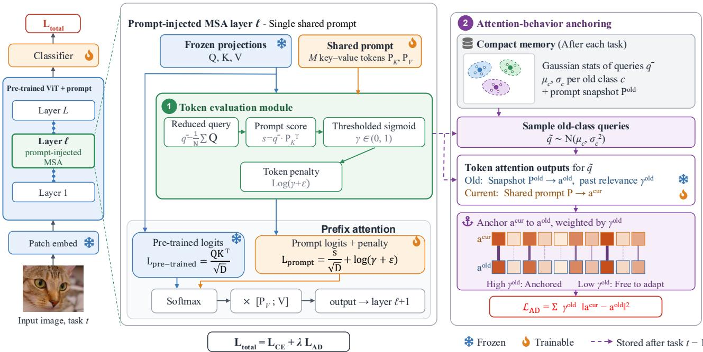
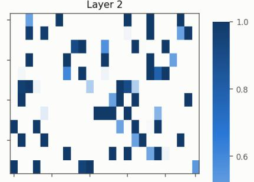
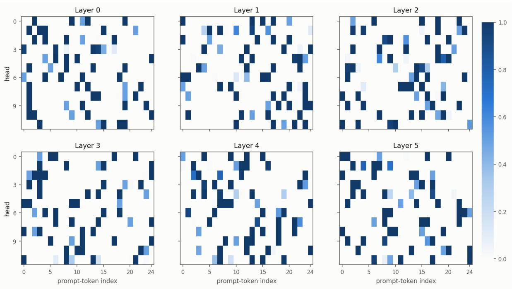
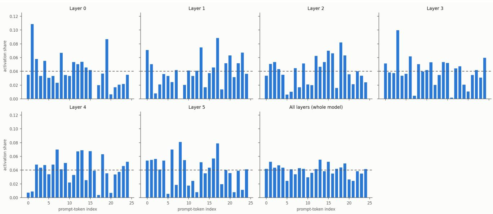

# Anchor Behavior, Not Parameters: Rehearsal-Free Continual Learning with a Single Shared Prompt

Duy-Cuong Bui1 Trung-Anh Dang2 Vincent Nguyen2 Duc V. Le3 Ngoc-Son Vu1,4

1ETIS - CY Cergy Paris Universite, ENSEA, CNRS UMR 8051, France´

4LIST3N - Universite de Technologie de Troyes, France´

duy-cuong.bui@ensea.fr, {trung-anh.dang, vincent.nguyen}@univ-orleans.fr, v.d.le@utwente.nl, son.vu@utt.fr

## Abstract

Prompt-based continual learning adapts a frozen pretrained vision transformer by tuning a small set of prompt tokens. Recently, one-prompt methods which share one single prompt across all tasks make this paradigm maximally parameter efficient. The open question is how a shared prompt can keep the knowledge of old classes while being updated for new ones. Existing methods protect old knowledge in parameter space, where they freeze taskspecific prompts, expand new components, or sparsely gate which tokens receive gradients. However, this method sacrifices plasticity, yet the drift it still permits in shared tokens can corrupt the prompt’s function on past classes. What must be preserved is the prompt’s behavior. We propose TEA-Prompt, which couples (i) a token evaluation module that assigns each prompt token a continuous, inputconditional relevance score injected into the attention logits, softly specializing tokens across tasks without discarding any of them, and (ii) an attention-behavior anchoring loss that constrains each token’s attention output around class-specific query regions using only compact Gaussian query statistics without stored old images, weighted by the token’s past relevance. Anchoring the attention value allows the parameters to continue updating freely, as long as their interaction remains unchanged. TEA-Prompt achieves state-of-the-art accuracy with markedly lowerforgetting on CIFAR-100, ImageNet-R, and CUB-200 with only 0.38M parameters. Code is publicy available at https://github.com/cuonga1cvp/TEA-Prompt.git

## 1. Introduction

Continual learning (CL) requires a model to learn new knowledge from a stream of tasks without catastrophically forgetting [9, 10, 30, 36]. With large pre-trained vision transformers [11], prompt-based CL has become a leading rehearsal-free paradigm where the backbone is frozen to protect its general representations, and the adaptation is limited to a small set of learnable tokens [39, 44, 45].

Within this paradigm, most methods allocate taskspecific prompts or expand prompt components as tasks arrive [16, 20, 39, 41, 44], so prompt memory and selection cost grow linearly with the number of tasks. The opposite design, a single prompt shared across all tasks [19, 23], keeps parameters and compute constant regardless of the task count. It also highlights the main difficulty: When a shared prompt adapts to new tasks, what prevents it from forgetting old knowledge?

Examining existing methods reveals a common pattern: they act in parameter space. (i) Isolation and freezing: taskspecific prompts are frozen once their task ends [41, 42, 44], and expansion-based methods freeze previous components while training new ones [39]. (ii) Selection sparsity: only retrieved prompts are updated in pool-based methods [45], and sparse Top-K gating over a decomposed shared prompt lets only the selected components receive gradients, complemented by a prototype loss on prompt keys [23]. Across these two families, the implicit assumption is the same: old knowledge is safe if and only if old parameters stay (nearly) where they were.

We argue this assumption is flawed on both sides. Firstly, it is too strong: Freezing and expansion tie stability to capacity, and sparse gating leaves unselected tokens idle. All paying in plasticity or parameters. Secondly, it is too weak: What an old class actually needs is that the prompt keeps producing the same attention contribution for its inputs. In classical CL, this is precisely the argument for regularizing in function space rather than weight space [4, 40], and attention-level preservation has proven effective for fully trainable ViTs [32]. Prompt-based CL, however, still lacks a function-space preservation mechanism. Even though, with a frozen backbone, the only source of attention drift is the prompt itself, making its behavior both necessary and sufficient object to protect.

In this paper, we propose TEA-Prompt, which protects the shared prompt’s behavior rather than its parameters, through two coupled components. First, a token evaluation module treats the shared prompt as a set of key-value token pairs and assigns each token a continuous, input-conditional relevance score, computed from the correlation between the input query and the token’s key and passed through a sigmoid-based evaluation function. Injected as a penalty into the attention logits, the score lets relevant tokens dominate adaptation for the current input while attenuating the rest, inducing a soft, task-conditional specialization of tokens. Second, an attention-behavior anchoring loss stores compact class-wise Gaussian statistics of reduced queries. When learning new tasks, it samples queries from these distributions and penalizes deviations of each token’s attention output from its previous behavior. Crucially, the two components are coupled: the deviation of each token is weighted by its past relevance score, so preservation concentrates exactly on the tokens that mattered for old classes, while lowrelevance tokens are free to adapt aggressively.

The main contributions of our work are as follows:

• We recast anti-forgetting in shared-prompt CL as behavior preservation instead of parameter preservation, and instantiate it with a class-conditional, data-free attention anchoring loss using compact Gaussian query statistics and the previous prompt tokens.

• We introduce a token evaluation module that assigns continuous, input-conditional relevance to each prompt token, softly specializing tokens across tasks to reduce cross-task interference; its stored past scores direct the anchoring loss toward the tokens where preservation matters.

• Extensive experiments on CIFAR-100, ImageNet-R, and CUB-200, including self-supervised backbones, show state-of-the-art accuracy and the lowest forgetting among shared-prompt methods at efficient parameter and compute cost.

## 2. Related Work

## 2.1. Continual learning

CL aims to incrementally acquire new knowledge while preserving previously learned information. The primary challenge in CL is catastrophic forgetting, where optimizing for new tasks leads to a severe decline in performance on earlier ones. To address this issue, traditional solutions are categorized into three main approaches: (1) regularization-based methods mitigate forgetting by introducing penalty terms that protect the weights critical to prior tasks [1, 5, 21, 26]; (2) replay-based methods maintain performance by either storing a subset of old data or using generative techniques to reconstruct past information [2, 8, 34]; (3) architecture-based methods dynamically adjust the network structure or isolate specific parameter clusters to accommodate each new task [29, 38]. While these methods have made significant strides, the emergence of pre-trained models [11] trained on massive datasets has triggered a paradigm shift. Recent trends have moved away from resource-intensive retraining toward parameterefficient approaches (e.g., Prompt Tuning [24], LoRA [18]) and replay-free methods [39, 44, 45], harnessing powerful pre-trained generalization capabilities for more efficient learning. These methods also differ in where to preserve: weight-space penalties [21, 47] versus function-space constraints [4, 26, 40]. Our work brings the function-space perspective to prompt-based CL.

## 2.2. Prompt-based continual learning

L2P [45] pioneered prompt-based CL with a shared pool from which task-specific prompts are retrieved by keyquery matching; DualPrompt [44] decomposes prompts into general and task-specific components attached at different layers; CODA-Prompt [39] replaces discrete retrieval with an attention-weighted composition over pertask components, enabling end-to-end optimization; VQ-Prompt [20] quantizes input-conditioned prompts into discrete codes, and further variants refine prompt evolution and consistency [14, 16, 41]. These methods perform strongly, but their prompt parameters and selection cost grow with the number of tasks. A second line keeps a single shared prompt: OVOR [19] pairs it with virtual-outlier regularization of the classifier, while SMoPE [23] views prefix tuning through a mixture-of-experts perspective.

Across both lines, forgetting is combated at the parameter level: task-specific prompts are frozen after their task [41, 42, 44] or previous components are frozen under expansion [39]; or hard selection restricts which tokens receive gradients at all [23, 45]. None of these directly constrains what the prompt does on previously seen classes. On the contrary, our method protects the behavior of token that correlated to the old task and provides a smooth token evaluation to maintain the ability of learning new tasks.

## 2.3. Preserving behavior versus parameters

Function-level preservation has a long history in CL: LwF distills output logits [26], PodNet distills pooled intermediate features [12], and continual distillation has recently been explored in prompt-based CL across teacher-student models [48]. These objectives operate at the task level and require a stored teacher copy evaluated on current-task data. Closer to our target, Pelosin et al. [32] distill pooled presoftmax attention maps between consecutive, fully trainable ViTs for exemplar-free CL, establishing attention as an effective lever against forgetting. Our loss differs in scope and machinery: with a frozen backbone, we anchor only the prompt tokens’ attention outputs by storing class-based Gaussian query statistics, requiring neither old data nor a network copy, with the constraint weighted by each token’s past relevance.

## 3. Methodology

TEA-Prompt adapts a frozen vision transformer with a single prompt shared by all tasks and protects it with two components: a token evaluation module that decides, per instance, how strongly each prompt token participates in attention (Sec. 3.2), and an attention-behavior anchoring loss that preserves what the prompt tokens do for past classes rather than what their parameters are (Sec. 3.3). Section 3.4 assembles the training objective and procedure. Figure 1 gives an overview.

## 3.1. Preliminaries

Continual learning setting. We consider classincremental learning over a sequence of $T$ tasks. Task t arrives with a dataset $\mathcal { D } _ { t } = \{ ( x _ { i } , \stackrel { \cdot } { y _ { i } } ) \} _ { i = 1 } ^ { N _ { t } }$ whose label set $\mathcal { C } _ { t }$ is disjoint from all other tasks; task identity is unknown at inference. Following [44, 45], we adopt the rehearsal-free scenario: no samples from past tasks are stored.

Prefix tuning on a frozen ViT. Let $f _ { \theta }$ be a pre-trained ViT [11] with frozen parameters θ. Each transformer block contains a multi-head self-attention (MSA) layer with H heads; C denotes the embedding dimension and $D = C / H$ the head dimension. Given the token sequence $\mathbf { X } \equiv \mathbf { X } ^ { ( \ell ) } \in$ $\mathbb { R } ^ { N \times C }$ entering block ℓ (N tokens: one class token and N−1 patch tokens), head h computes the frozen projections

$$
\mathbf { Q } = \mathbf { X } \mathbf { W } _ { Q } , \quad \mathbf { K } = \mathbf { X } \mathbf { W } _ { K } , \quad \mathbf { V } = \mathbf { X } \mathbf { W } _ { V } \in \mathbb { R } ^ { N \times D } .\tag{1}
$$

Prompt-based methods adapt $f _ { \theta }$ by prepending learnable prompts to the frozen keys and values (prefix tuning [25]). We use a single prompt shared across all tasks [19, 23]: in each of the first $L _ { p }$ blocks, the prompt consists of M key-value prompt tokens per head, $\{ ( \mathbf { p } _ { K , m } , \mathbf { p } _ { V , m } ) \} _ { m = 1 } ^ { M } .$ stacked as $\mathbf { P } _ { K } , \mathbf { \bar { P } } _ { V } \in \mathbb { R } ^ { \bar { M } \times D }$ . Only the prompt and the classifier are trained. All equations are written per head, per injected layer, and per instance; the superscript (ℓ, h) and the batch axis are omitted when clear from context, parameters are broadcast along the batch axis, and ⊤ denotes the transpose of a two-dimensional matrix.

## 3.2. Token evaluation module

A shared prompt must serve every task. However, not every prompt token is relevant to every input. TEA-Prompt scores each prompt token based on the current instance and

converts the scores into continuous evaluation weights that modulate the token’s impact inside the MSA (Fig. 1, left).

Token scores. Prompt tokens score s are evaluated once per instance and head using the reduced query q¯, which is the average of the token queries:

$$
\bar { \mathbf { q } } = \frac { 1 } { N } \sum _ { i = 1 } ^ { N } \mathbf { Q } _ { i , : } \in \mathbb { R } ^ { D } , \qquad \mathbf { s } = \bar { \mathbf { q } } \mathbf { P } _ { K } ^ { \top } \in \mathbb { R } ^ { M } .\tag{2}
$$

Instance-level evaluation has two advantages over per-token scoring: It produces one consistent set of weights per instance, avoiding the token-level competition that causes information loss in per-token sparse selection schemes [33], and it reduces the scoring cost per head from NM to M inner products.

Evaluation weights. The raw scores are mapped to weights by a temperature-controlled sigmoid $\sigma ( \cdot )$ centred at an instance-adaptive threshold, applied element-wise:

$$
\gamma = \sigma \bigg ( \frac { \mathbf { s } - \boldsymbol { \tau } ( \mathbf { s } ) } { \boldsymbol { \tau } _ { \mathrm { s o f t } } } \bigg ) \in ( 0 , 1 ) ^ { M } ,\tag{3}
$$

where the threshold $\tau ( \mathbf { s } )$ is the K-th largest entry of s and $\tau _ { \mathrm { s o f t } }$ is a temperature. Three properties make Eq. (3) a useful replacement for discrete selection. (i) It is a continuous relaxation of Top-K: as $\tau _ { \mathrm { s o f t } }  0 , \gamma _ { m }  \mathbf { 1 } [ s _ { m } > \tau ]$ and hard Top-K selection is recovered (the boundary token receives weight $\textstyle { \frac { 1 } { 2 } } )$ , while larger $\tau _ { \mathrm { s o f t } }$ interpolates smoothly toward plain dense prefix tuning. (ii) Every prompt token receives gradient: $\partial \gamma _ { m } / \partial s _ { m } = \gamma _ { m } ( 1 - \gamma _ { m } ) / \tau _ { \mathrm { s o f t } } > 0 ,$ bounded by $1 / ( 4 \tau _ { \mathrm { s o f t } } )$ , so tokens scoring just below the threshold are attenuated rather than eliminated and can recover in later tasks. (iii) Weights are independent across tokens: unlike softmax-based weighting, the sigmoid imposes no sum-to-one competition among prompt tokens, a choice that avoids unnecessary competition between components [31], so several prompt tokens can be fully active for the same instance.

Injection into the attention logits. The evaluation weights modulate each prompt token multiplicatively inside the MSA. We form one row of prompt logits per instance and head,

$$
\mathbf { L } _ { \mathrm { p r o m p t } } = \frac { \mathbf { s } } { \sqrt { D } } + \log \left( \gamma + \varepsilon \right) \in \mathbb { R } ^ { 1 \times M } ,\tag{4}
$$

with a small $\varepsilon > 0$ for numerical stability, and concatenate it with the frozen token–token logits before a joint softmax:

$$
\begin{array} { r } { \mathbf { A } = \left[ \mathbf { 1 } _ { N } \mathbf { L } _ { \mathrm { p r o m p t } } | | \mathbf { L } _ { \mathrm { p r e - t r a i n e d } } \right] \in \mathbb { R } ^ { N \times ( M + N ) } , } \\ { \mathbf { O } = \mathrm { s o f t m a x } ( \mathbf { A } ) \left[ \begin{array} { l } { \mathbf { P } _ { V } } \\ { \mathbf { V } } \end{array} \right] \in \mathbb { R } ^ { N \times D } , } \end{array}\tag{5}
$$

  
Figure 1. Overview of TEA-Prompt. Left: Inside each MSA layer of the frozen ViT, prompt tokens $\left( \mathbf { P } _ { K } , \mathbf { P } _ { V } \right)$ are prepended to the frozen keys and values. The reduced query scores every prompt token (Eq. (2)); a thresholded sigmoid turns the scores into evaluation weights (Eq. (3)) whose logarithm shifts the prompt attention logits $L _ { \mathrm { p r o m p t } }$ (Eq. (4)), modulating each token’s attention mass before the joint softmax with the input-token logits $L _ { \mathrm { p r e - t r a i n e d } }$ (Eq. (5)). Right: At the end of task t−1 the prompt is snapshotted and classconditional Gaussian query statistics are stored (Eq. (6)); while learning task t, queries sampled from these statistics (Eq. (7)) probe the prompt attention of the frozen snapshot $( A ^ { ( t - 1 ) } )$ and of the current prompt $( A ^ { ( t ) } )$ , and $\mathcal { L } _ { \mathrm { A D } }$ (Eq. (9)) anchors the current behavior to the old one, weighted by each token’s past relevance.

where $\mathbf { 1 } _ { N } \ \in \ \mathbb { R } ^ { N \times 1 }$ broadcasts the single row of prompt logits to all N queries and ∥ denotes column-wise concatenation. Because the softmax is taken jointly over the $M { + } N$ columns, adding $\log \gamma _ { m }$ multiplies the unnormalized attention mass of prompt token m by $( \gamma _ { m } + \varepsilon )$ . The evaluation weight acts as an input-conditioned prior over prompt tokens: $\gamma _ { m } \to 0$ removes token m from the attention distribution and thereby suppresses its value $\mathbf { p } _ { V , m } ,$ while $\gamma _ { m }  .$ 1 leaves it untouched. Although the prompt logits are shared across the N queries, the post-softmax prompt weights remain query-dependent. The forward pass of Eqs. (2)-(5) is identical during training and inference.

## 3.3. Anchoring prompt behavior

Sequential training drifts the attention behavior of the shared prompt, which is the main cause of forgetting. Prior methods constrain prompt parameters: Weights are regularized toward, or grown alongside, their past values. TEA-Prompt instead anchors prompt behavior: What the prompt tokens contribute to attention when queried from the representation space occupied by past classes (Fig. 1, right). The anchor is rehearsal-free, only stores compact per-class query statistics and one snapshot of the prompt.

Class-conditional query statistics. We model the classconditional distribution of the reduced query with a diagonal Gaussian. After finishing task t, we run one inference pass over $\mathcal { D } _ { t }$ and record, for every injected layer, head, and class $c \in { \mathcal { C } } _ { t } .$

$$
{ \pmb \mu } _ { c } = \frac { 1 } { N _ { c } } \sum _ { n : y _ { n } = c } \bar { \bf q } _ { n } , \qquad { \pmb \sigma } _ { c } ^ { 2 } = \frac { 1 } { N _ { c } } \sum _ { n : y _ { n } = c } \bar { \bf q } _ { n } ^ { 2 } - { \pmb \mu } _ { c } ^ { 2 } ,\tag{6}
$$

where $N _ { c }$ is the number of training samples of class $c ,$ squares are element-wise, and variances are clamped from below for stability. This Gaussian assumption is mild for the reduced query: averaging over N token queries concentrates each class’s query distribution toward a compact, unimodal shape, and per-dimension Gaussian statistics of deep features are an established data-free memory mechanism [41]. We further keep the statistics per class rather than per task: distillation applied at the task level constrains only an aggregate of past behavior and fails to capture the fine-grained, class-specific attention behavior encoded in the prompt tokens, sacrificing discriminative information for previously seen classes [12, 32, 48]. Class-conditional sampling instead probes the prompts’ behavior separately in the query region of every seen class. Since class sets are disjoint, statistics of earlier classes are left unchanged. The prompt is then snapshotted, $\mathbf { P } ^ { \mathrm { o l d } }  \mathbf { P }$

Algorithm 1: Training procedure of TEA-Prompt   
Input: frozen ViT f ; classifier ϕ; prompt   
$\mathbf { P } = \{ \mathbf { P } _ { K } , \mathbf { P } _ { V } \}$ initialized $\mathcal { U } [ 0 , 1 )$ ; tasks   
$\{ \mathcal { D } _ { t } \} _ { t = 1 } ^ { T } ;$ epochs E; anchor weight λ;   
samples r; rank K; temperature $\tau _ { \mathrm { s o f t } } .$ TAP   
epochs $E _ { \mathrm { T A P } }$   
Output: $\mathbf { P } , \phi$   
1 $\mathcal { C } _ { \mathrm { s e e n } }  \emptyset ;$   
2 for $t = 1 , \dots , T$ do   
3 if $t = 1$ then   
4 train P, ϕ on $\mathcal { D } _ { 1 }$ with $\mathcal { L } _ { \mathrm { C E } }$ for $E / 2$ epochs ;   
// stabilization   
5 reset optimizer;   
6 for $e = 1 , \ldots , E$ do   
7 foreach $( x , y ) \in \mathcal { D } _ { t }$ do   
8 forward pass with token evaluation,   
Eqs. (2)–(5); predict $\hat { y } = \phi \bigl ( f _ { \theta } ( x ; { \mathbf { P } } ) \bigr )$   
9 if $t > 1$ then   
10 draw $\{ \tilde { \mathbf { q } } _ { c , j } \}$ for all $c \in { \mathcal { C } } _ { \mathrm { s e e n } } ,$   
Eq. (7); compute $\mathcal { L } _ { \mathrm { A D } }$ , Eq. (9);   
11 else   
12 $\mathcal { L } _ { \mathrm { A D } }  0 ;$   
13 update P, ϕ with $\mathcal { L } _ { \mathrm { C E } } + \lambda \mathcal { L } _ { \mathrm { A D } }$ ;   
// Eq. (10)   
14 estimate $\mu _ { c } , \sigma _ { c } ^ { 2 }$ of q¯ over $\mathcal { D } _ { t }$ for each $c \in { \mathcal { C } } _ { t }$   
Eq. (6) ; // one inference pass   
15 $\mathbf { P } ^ { \mathrm { o l d } }  \mathbf { P } ; \mathcal { C } _ { \mathrm { s e e n } }  \mathcal { C } _ { \mathrm { s e e n } } \cup \mathcal { C } _ { t } ;$   
16 fine-tune ϕ for $E _ { \mathrm { T A P } }$ epochs with TAP   
pseudo-features [41];   
17 return $\mathbf { P } , \phi$

Behavioral anchor. While learning any subsequent task, at every optimization step we draw r fresh queries per seen class from the stored Gaussians,

$$
\tilde { \mathbf { q } } _ { c , j } = \pmb { \mu } _ { c } + \pmb { \sigma } _ { c } \odot \epsilon _ { j } , \qquad \epsilon _ { j } \sim \mathcal { N } ( \mathbf { 0 } , \mathbf { I } ) , \quad j = 1 , \dots , r ,\tag{7}
$$

and compare, token by token, the attention read-out that the old and the current prompt produce for these queries. With scaled scores $\tilde { \bf s } ^ { \mathrm { o l d } ^ { \star } } = \dot { \tilde { \bf q } } ( { \bf \bar { P } } _ { K } ^ { \mathrm { o l d } } ) ^ { \top } / \sqrt { D }$ and $\begin{array} { r l } { \tilde { \mathbf { S } } ^ { \mathrm { c u r } } } & { { } = } \end{array}$ $\widetilde { \mathbf { q } } \mathbf { P } _ { K } ^ { \top } / \sqrt { D }$ (class, sample, layer, and head indices omitted), the read-out of prompt token m is its softmax-weighted value contribution,

$$
\begin{array} { r } { \mathbf { a } ^ { \mathrm { o l d } , ( m ) } = \left[ \mathrm { s o f t m a x } \bigl ( \tilde { \mathbf { s } } ^ { \mathrm { o l d } } \bigr ) \right] _ { m } \mathbf { p } _ { V , m } ^ { \mathrm { o l d } } \in \mathbb { R } ^ { D } , } \end{array}\tag{8}
$$

and analogously $\mathbf { a } ^ { \mathrm { c u r } , ( m ) }$ from $\tilde { \mathbf { s } } ^ { \mathrm { c u r } }$ and $\mathbf { p } _ { V , m }$ of the current prompt. The softmax is restricted to the M prompt tokens:

the anchor targets the prompts’ own attention behavior, not a full model output. Each token’s error is weighted by its past relevance to the sampled query, $\gamma _ { m } ^ { \mathrm { o l d } } ( \tilde { \mathbf { q } } )$ , so that only tokens that mattered for past classes are constrained. The anchoring loss averages the weighted errors and sums over injected layers and heads:

$$
\mathcal { L } _ { \mathrm { A D } } = \frac { 1 } { Z } \sum _ { \ell , h } \sum _ { m , c , j } \gamma _ { m } ^ { \mathrm { o l d } } \left( \tilde { \mathbf { q } } _ { c , j } \right) \left. \mathbf { a } _ { c , j } ^ { \mathrm { c u r } , ( m ) } - \mathbf { a } _ { c , j } ^ { \mathrm { o l d } , ( m ) } \right. _ { 2 } ^ { 2 } ,\tag{9}
$$

with normalizer $Z = M | { \mathcal { C } } _ { \mathrm { s e e n } } | r D$ , where the sums run over injected layers $\ell \leq L _ { p } ,$ heads $h \leq H$ , prompt tokens $m \leq M$ , seen classes $c \in \mathcal { C } _ { \mathrm { s e e n } } ,$ and samples $j \leq r ;$ the dependence of $\tilde { \mathbf { q } } _ { c , j }$ and of the read-outs on $( \ell , h )$ is left implicit. The anchor stores 2 $L _ { p } H \left| \mathcal { C } _ { \mathrm { s e e n } } \right| D$ floating-point values (about 3.7 MB in single precision for $| { \mathcal { C } } _ { \mathrm { s e e n } } | { = } 1 0 0$ with our configuration) plus one prompt snapshot; its computational cost grows linearly with $| { \mathcal { C } } _ { \mathrm { s e e n } } | \cdot$ r and is incurred only during training. Unlike attention-distillation approaches that align full attention maps between a frozen model copy and the current model on current-task images [32], Eq. (9) is class-conditional, data-free, and restricted to the prompt.

## 3.4. Training objective and procedure

Objective. The model is optimized with the classification loss and the behavioral anchor:

$$
\mathcal { L } _ { \mathrm { t o t a l } } = \mathcal { L } _ { \mathrm { C E } } + \lambda \mathcal { L } _ { \mathrm { A D } } ,\tag{10}
$$

where $\mathcal { L } _ { \mathrm { C E } }$ is the cross-entropy over the classes of the current task, logits of previously seen classes are masked while learning task $t ,$ and the classifier is re-balanced afterwards, and $\mathcal { L } _ { \mathrm { A D } } = 0$ for the first task. The frozen backbone receives no gradient; only the prompt $\{ \mathbf { P } _ { K } , \mathbf { P } _ { V } \}$ , initialized i.i.d. uniformly on [0, 1), and the classifier are updated.

Training-only components. Three components are used exclusively during training: (i) the statistics pass of Eq. (6), one additional inference pass over $\mathcal { D } _ { t }$ per task; (ii) the anchoring loss with its per-step sampling, Eqs. $( 7 ) \dash ( 9 ) ;$ ; and (iii) the classifier re-balancing step, and the token evaluation module behaves identically at training and test time.

First-task stabilization. For the first task we prepend a stabilization phase of $E / 2$ epochs followed by an optimizer reset before the main E-epoch schedule; warm-starting the shared prompt in this way reduces early instability of the evaluation weights.

Classifier re-balancing. Class-incremental training biases a shared linear classifier toward recently added classes. After each task we therefore re-balance the classifier with task-adaptive prediction (TAP) [20, 41]: Class-wise Gaussian statistics of the prompted features provide pseudofeatures of all seen classes, on which only the classifier is fine-tuned for $E _ { \mathrm { T A P } }$ epochs. The full procedure is summarized in Algorithm 1.

## 4. Experiments

## 4.1. Datasets and Implementation Details

Datasets. To evaluate TEA-Prompt performance, we perform comprehensive image classification in the classincremental learning settings using three primary benchmarks: CIFAR-100 [22], ImageNet-R [15], and CUB-200 [46]. CIFAR-100 (100 classes) serves as a standard benchmark for prompt-based CL to evaluate generalization. ImageNet-R is selected for its inherent difficulty, containing 200 classes with diverse artistic styles and high intraclass variance. Finally, we utilize the fine-grained CUB-200 dataset of 200 bird species to test the model’s ability to distinguish subtle inter-class differences. Across all experiments, each dataset is partitioned into 10 tasks with disjoint classes: 20 classes/task for ImageNet-R, 10 classes/task for CIFAR-100, and 20 classes/task for CUB-200.

Evaluation metrics. To evaluate performance, we use two standard metrics: Average Accuracy (Avg Acc) and Forgetting [7]. Avg Acc measures the model’s performance across all tasks after completing the training sequence, while Forgetting quantifies the performance drop on previously learned tasks. Let $R _ { t , i }$ denote the accuracy on task i after training on task t. The Avg Acc AT after the final task T is defined as:

$$
\mathcal { A } _ { T } = \frac { 1 } { T } \sum _ { k = 1 } ^ { T } R _ { T , k }\tag{11}
$$

Similarly, the Forgetting metric F is defined as the mean performance drop from each task’s initial accuracy to its final state:

$$
\mathcal { F } = \frac { 1 } { T - 1 } \sum _ { i = 1 } ^ { T - 1 } ( R _ { i , i } - R _ { T , i } )\tag{12}
$$

Compared methods. We evaluate the performance of TEA-Prompt against a comprehensive suite of methods, including non-prompt-based methods such as LAE [13], InfLoRA [27], and EASE [49], as well as established promptbased architectures: L2P [45], DualPrompt [44], CODA-Prompt [39], OVOR-Deep [19], ESN [43], RainbowPrompt [16], CPrompt [14], VQ-Prompt [20], and SMoPE [23]. The results are reproduced based on the original setting in these works.

Implementation details. All experiments are executed on a NVIDIA RTX PRO 6000 Blackwell. Following [16, 45], we primarily use the pre-trained ViT-B/16 on ImageNet-1K [37] and ImageNet-21K [35] as our backbone. TEA-Prompt is optimized using the AdamW optimizer [28] with a cosine learning rate decay schedule to stabilize training. For the training configurations, we employ a batch size of 64 for ImageNet-R, while a larger batch size of 128 is utilized for both CIFAR-100 and CUB-200. Besides, the classifier in CL tends to favor recently added classes, leading to biased predictions [3, 17]. To mitigate this effect, we apply a simple task adaptive prediction (TAP) technique inspired by [20, 41]. The model predictions are adjusted using feature statistics from previously learned classes, which helps rebalance old and new categories and stabilizes prompt learning throughout training.

On CIFAR-100, TEA-Prompt uses M=25 key–value prompt-token pairs per attention head (a shared prompt of length 50), evaluated with rank K=5 and temperature $\tau _ { \mathrm { s o f t } } { = } 0 . 2$ and injected into the first $L _ { p } { = } 6$ transformer blocks; prompt keys and values are initialized i.i.d. uniformly on [0, 1), and $\varepsilon { = } 1 0 ^ { - 6 }$ The anchoring loss uses r=10 sampled queries per seen class with weight λ=60, and the classifier re-balancing step runs for $E _ { \mathrm { T A P } } { = } 5 0$ epochs. The settings for other benchmarks are mentioned in the supplementary material. The complete training procedure is given in Algorithm 1.

## 4.2. Experimental Results

Main results. Results on three benchmarks are summarized in Table 1.

• CIFAR-100: On this standard benchmark, TEA-Prompt achieves notable performance with an average accuracy of 90.59%, which lies a mere 0.79% below the upper bound. When compared with SMoPE, which relies on sparse Top-K selection over a shared prompt structure, TEA-Prompt yields a 1.73% improvement in accuracy while reducing the forgetting rate from 4.57% down to 2.68% with the same number of parameters. This clear margin demonstrates that our continuous token evaluation can address the rigidity of discrete token selection by exploiting complementary information from lowerranked tokens. Furthermore, TEA-Prompt outperforms recent weighted prompt composition methods such as VQ-Prompt (88.73%) and CODA-Prompt (86.92%), suggesting the superior efficacy of our rehearsal-free loss in mitigating forgetting without requiring access to past training samples.

• ImageNet-R: On the challenging ImageNet-R dataset, characterized by severe distribution shifts and high intraclass variance across diverse artistic styles, TEA-Prompt achieves the state-of-the-art (SOTA) performance with an average accuracy (Avg Acc) of 77.40% and a forgetting rate of 4.19%. Furthermore, when compared to OVOR, a method utilizing a shared prompt architecture, our method reduces the forgetting rate by approximately

Table 1. Performance comparison on CIFAR-100, ImageNet-R, and CUB-200 datasets. Params counts the learnable parameters on ImageNet-R with 10 tasks. ( ”-” means Not Available)
<table><tr><td rowspan="2">Method</td><td rowspan="2">Params (M)</td><td colspan="2">CIFAR-100</td><td colspan="2">ImageNet-R</td><td colspan="2">CUB-200</td></tr><tr><td>Avg Acc(↑)</td><td>Forgetting(↓)</td><td>Avg Acc(↑)</td><td>Forgetting(↓)</td><td>Avg Acc(↑)</td><td>Forgetting(↓)</td></tr><tr><td>Joint training</td><td>一</td><td>91.38</td><td>一</td><td>82.06</td><td>一</td><td>88.00</td><td></td></tr><tr><td>LAE [13]</td><td>0.24</td><td> $8 6 . 0 9 \pm 0 . 5 5$ </td><td> $6 . 2 2 \pm 0 . 1 7$ </td><td> $7 3 . 8 8 \pm 0 . 4 3$ </td><td> $5 . 0 8 \pm 0 . 3 3$ </td><td>一</td><td></td></tr><tr><td>InfLoRA [27]</td><td>3.84</td><td> $8 6 . 9 1 \pm 0 . 3 4$ </td><td> $4 . 2 2 \pm 0 . 3 7$ </td><td> $7 6 . 1 3 \pm 0 . 4 4$ </td><td> $5 . 2 2 \pm 0 . 4 8$ </td><td></td><td></td></tr><tr><td>EASE [49]</td><td>11.90</td><td> $8 7 . 2 8 \pm 0 . 7 1$ </td><td> $4 . 8 1 \pm 0 . 4 2$ </td><td> $7 5 . 8 2 \pm 0 . 5 4$ </td><td> $5 . 8 3 \pm 0 . 3 7$ </td><td></td><td></td></tr><tr><td>L2P [45]</td><td>0.24</td><td> $8 3 . 8 6 \pm 0 . 2 8$ </td><td> $7 . 3 5 \pm 0 . 3 8$ </td><td> $6 1 . 5 7 \pm 0 . 6 6$ </td><td> $9 . 7 3 \pm 0 . 4 7$ </td><td> $7 1 . 2 2 \pm 0 . 5 4$ </td><td> $1 0 . 6 8 \pm 0 . 6 1$ </td></tr><tr><td>DualPrompt [44]</td><td>1.10</td><td> $8 6 . 5 1 \pm 0 . 3 3$ </td><td> $5 . 1 6 \pm 0 . 0 9$ </td><td> $6 8 . 1 3 \pm 0 . 4 9$ </td><td> $4 . 6 8 \pm 0 . 2 0$ </td><td> $7 1 . 5 5 \pm 0 . 7 3$ </td><td> $1 0 . 2 1 \pm 0 . 4 3$ </td></tr><tr><td>CODA-Prompt [39]</td><td>3.99</td><td> $8 6 . 9 2 \pm 0 . 7 7$ </td><td> $5 . 1 0 \pm 0 . 4 3$ </td><td> $7 3 . 2 1 \pm 0 . 2 8$ </td><td> $5 . 6 9 \pm 0 . 2 8$ </td><td> $7 3 . 2 5 \pm 0 . 7 1$ </td><td> $1 1 . 0 2 \pm 0 . 8 8$ </td></tr><tr><td>OVOR-Deep [19]</td><td>0.26</td><td> $8 5 . 9 9 \pm 0 . 8 9$ </td><td> $6 . 4 2 \pm 2 . 0 3$ </td><td> $7 6 . 1 1 \pm 0 . 2 1$ </td><td> $7 . 1 6 \pm 0 . 3 4$ </td><td> $7 8 . 1 1 \pm 0 . 4 7$ </td><td> $7 . 9 5 \pm 0 . 7 7$ </td></tr><tr><td>ESN [43]</td><td>0.92</td><td> $8 6 . 4 2 \pm 0 . 8 0$ </td><td> $6 . 0 8 \pm 0 . 4 8$ </td><td> $7 5 . 1 1 \pm 0 . 3 6$ </td><td> $5 . 6 8 \pm 0 . 7 7$ </td><td> $7 1 . 2 0 \pm 0 . 5 4$ </td><td> $9 . 8 2 \pm 0 . 4 3$ </td></tr><tr><td>RainbowPrompt [16]</td><td>6.60</td><td> $8 7 . 2 2 \pm 0 . 5 3$ </td><td> $4 . 8 1 \pm 0 . 4 1$ </td><td> $7 6 . 6 5 \pm 0 . 5 6$ </td><td> $4 . 5 7 \pm 0 . 3 3$ </td><td> $7 0 . 4 3 \pm 1 . 2 3$ </td><td> $1 0 . 5 3 \pm 0 . 9 1$ </td></tr><tr><td>CPrompt [14]</td><td>1.08</td><td> $8 7 . 8 2 \pm 0 . 2 1$ </td><td> $5 . 0 6 \pm 0 . 5 0$ </td><td> $7 7 . 1 4 \pm 0 . 1 1$ </td><td> $5 . 9 7 \pm 0 . 6 8$ </td><td> $7 7 . 0 9 \pm 0 . 6 4$ </td><td> $1 0 . 2 7 \pm 0 . 5 4$ </td></tr><tr><td>VQ-Prompt [20]</td><td>0.50</td><td> $8 8 . 7 3 \pm 0 . 2 7$ </td><td> $4 . 9 7 \pm 0 . 2 4$ </td><td> $7 6 . 9 6 \pm 0 . 2 2$ </td><td> $6 . 0 9 \pm 0 . 5 4$ </td><td> $8 6 . 7 2 \pm 0 . 9 4$ </td><td> $4 . 5 3 \pm 0 . 3 2$ </td></tr><tr><td>SMoPE [23]</td><td>0.38</td><td> $8 8 . 8 6 \pm 0 . 3 9$ </td><td> $4 . 5 7 \pm 0 . 4 5$ </td><td> $7 6 . 7 0 \pm 0 . 6 7$ </td><td> $5 . 7 1 \pm 0 . 7 2$ </td><td> $8 5 . 7 3 \pm 0 . 8 7$ </td><td> $5 . 6 1 \pm 0 . 6 4$ </td></tr><tr><td>TEA-Prompt (Ours)</td><td>0.38</td><td> ${ \bf 9 0 . 5 9 \pm 0 . 3 1 }$ </td><td> ${ \pm . 6 8 \pm 0 . 2 5 }$ </td><td> $7 7 . 4 0 \pm 0 . 4 2$ </td><td> ${ \bf 4 . 1 9 \pm 0 . 3 9 }$ </td><td> ${ \pm 0 . 8 4 \pm 0 . 2 3 }$ </td><td> ${ \bf 3 . 3 0 \pm 0 . 3 5 }$ </td></tr></table>

Table 2. Average accuracy on CIFAR-100 and ImageNet-R with self-supervised pre-trained models iBOT-1K and DINO-1K. Best results are in bold.
<table><tr><td>Pre-trained model</td><td>Method</td><td> $\mathbf { C I F A R - 1 0 0 }$ </td><td>ImageNet-R</td></tr><tr><td rowspan="6">iBOT-1K</td><td>L2P</td><td> $7 5 . 5 7 \pm 0 . 4 1$ </td><td> $6 0 . 9 7 \pm 0 . 2 6$ </td></tr><tr><td>DualPrompt</td><td> $7 6 . 6 3 \pm 0 . 0 5$ </td><td> $6 1 . 5 1 \pm 1 . 0 5$ </td></tr><tr><td>CODA-Prompt</td><td> $7 6 . 4 2 \pm 0 . 4 0$ </td><td> $6 6 . 5 6 \pm 0 . 6 8$ </td></tr><tr><td>RainbowPrompt</td><td> $7 6 . 2 0 \pm 0 . 3 4$ </td><td> $6 5 . 8 2 \pm 0 . 5 2$ </td></tr><tr><td>VQ-Prompt</td><td> $7 5 . 8 0 \pm 0 . 3 4$ </td><td> $7 1 . 6 8 \pm 0 . 7 2$ </td></tr><tr><td>SMoPE</td><td> $7 6 . 1 0 \pm 0 . 3 4$ </td><td> $7 2 . 1 7 \pm 0 . 5 2$ </td></tr><tr><td rowspan="6"></td><td>TEA-Prompt (Ours)</td><td> ${ \bf 7 6 . 7 3 \pm 0 . 5 7 }$ </td><td> ${ \bf 7 2 . 6 1 \pm 0 . 3 2 }$ </td></tr><tr><td>L2P</td><td> $7 0 . 6 5 \pm 0 . 5 7$ </td><td> $5 7 . 4 0 \pm 0 . 2 3$ </td></tr><tr><td>DualPrompt</td><td> $7 4 . 9 0 \pm 0 . 2 1$ </td><td> $5 8 . 5 7 \pm 0 . 4 5$ </td></tr><tr><td>CODA-Prompt</td><td> $7 7 . 5 0 \pm 0 . 6 4$ </td><td> $6 3 . 1 5 \pm 0 . 3 9$ </td></tr><tr><td>RainbowPrompt</td><td> $7 4 . 7 7 \pm 0 . 5 4$ </td><td> $6 2 . 0 4 \pm 0 . 4 3$ </td></tr><tr><td>VQ-Prompt</td><td> $7 8 . 3 2 \pm 0 . 3 1$ </td><td> $6 8 . 4 2 \pm 0 . 2 8$ </td></tr><tr><td rowspan="2"></td><td>SMoPE</td><td> $7 8 . 6 4 \pm 0 . 4 4$ </td><td> $6 8 . 6 1 \pm 0 . 5 2$ </td></tr><tr><td>TEA-Prompt (Ours)</td><td> ${ \bf 7 9 . 1 0 \pm 0 . 3 8 }$ </td><td> ${ \bf 6 8 . 9 4 \pm 0 . 3 3 }$ </td></tr></table>

3% but remains a small number of trainable parameters. This further underscores the effectiveness of TEA-Prompt in mitigating forgetting within challenging scenarios.

• CUB-200: On the CUB-200 fine-grained classification dataset, while OVOR struggled with classification, achieving an accuracy of only 78.11%, TEA-Prompt boosted accuracy to 86.84%, despite sharing the same shared-prompt architecture. Meanwhile, although SMoPE achieved good accuracy, it exhibited a relatively high forgetting rate of 5.61%. We attribute this to the fact that while their anti-forgetting mechanism employs a prototype loss function to preserve old prefix keys, the prefix values remain susceptible to drift, resulting in an incomplete distillation process. In contrast, by preserving prior knowledge through the anchoring of attention behaviors for old tokens, TEA-Prompt achieved better resistance to forgetting, with a rate of only 3.30%. This result suggests that our method can handle forgetting under different circumstances, from standard benchmark such as CIFAR-100 to fine-grained dataset such as CUB-200.

Results on different self-supervised pre-trained models. As shown in Table 2, our proposed TEA-Prompt consistently outperforms existing prompt-based continual learning methods across different self-supervised pre-trained models [6, 50] and benchmark datasets. This demonstrates that TEA-Prompt can effectively leverage self-supervised representations while improving the stability and generalization ability of prompt learning.

Table 3. Ablating different components of our method on CIFAR-100.
<table><tr><td>Training Strategy</td><td>Avg Acc (↑) 1</td><td>Forgetting (↓)</td></tr><tr><td>Baseline</td><td> $8 3 . 4 4 \pm 0 . 1 9$ </td><td> $6 . 4 8 \pm 0 . 4 2$ </td></tr><tr><td>+ Token Evaluation</td><td> $8 6 . 7 3 \pm 0 . 4 5$ </td><td> $5 . 3 2 \pm 0 . 3 6$ </td></tr><tr><td>+ Task-Adaptive Prediction</td><td> $8 8 . 7 3 \pm 0 . 2 9$ </td><td> $3 . 7 4 \pm 0 . 4 3$ </td></tr><tr><td>+ First-Task Stabilization</td><td> $8 9 . 2 5 \pm 0 . 2 1$ </td><td> $3 . 6 8 \pm 0 . 3 8$ </td></tr><tr><td>+ Anchoring Loss  $\mathcal { L } _ { \mathrm { A D } }$ </td><td> $9 0 . 5 9 \pm 0 . 3 1$ </td><td> $2 . 6 8 \pm 0 . 2 5$ </td></tr></table>

Table 4. Estimated anchor overhead (FP32, ViT-B/16, $L _ { p } { = } 6 ,$ $H { = } 1 2 , D { = } 6 4 , M { = } 2 5 , r { = } 1 0 )$ . Per-step cost is for learning the final task, probing the $| \mathcal { C } _ { \mathrm { s e e n } } |$ previously seen classes; memory is the complete anchor state after training (statistics of all classes plus the snapshot $\mathbf { P } ^ { \mathrm { o l d } } )$ ).
<table><tr><td>Dataset</td><td> $| \mathcal { C } _ { \mathrm { s e e n } } |$ </td><td> ${ \mathcal { L } } _ { \mathrm { A D } } / { \mathrm { s t e p } }$ </td><td>Memory</td></tr><tr><td>CIFAR-100</td><td>90</td><td>0.94 GFLOPs</td><td>4.61 MB</td></tr><tr><td>ImageNet-R / CUB-200</td><td>180</td><td>1.88 GFLOPs</td><td>8.29 MB</td></tr></table>

Table 5. Ablation study for the interaction between the token evaluation module and anchoring loss on CIFAR-100, 10 tasks.
<table><tr><td>Anchor weighting</td><td></td><td>Avg Acc (↑) Forgetting (↓)</td></tr><tr><td>Inverse relevance  $( 1 - \gamma ^ { \mathrm { o l d } } )$ </td><td> $8 9 . 0 5 \pm 0 . 2 0 $ </td><td> $4 . 5 5 \pm 0 . 3 5$ </td></tr><tr><td>Uniform  $( \gamma ^ { \mathrm { o l d } } \equiv 1 )$ </td><td> $9 0 . 1 0 \pm 0 . 3 5$ </td><td> $3 . 2 2 \pm 0 . 2 7$ </td></tr><tr><td>Past relevance (ours)</td><td> $9 0 . 5 9 \pm 0 . 3 1$ </td><td> $2 . 6 8 \pm 0 . 2 5$ </td></tr></table>

## 4.3. Ablation study

To evaluate the individual contribution of each component within our proposed framework, we conduct a comprehensive ablation study by incrementally integrating them into the training pipeline. As summarized in Table 3, we analyze the impact of each module on both Avg Acc and Forgetting metrics.

The baseline configuration utilizes a single shared prompt across all tasks without any token weighting or preservation constraints, yielding an Avg Acc of 83.44% and a Forgetting rate of 6.48%. This result highlights the vulnerability of static shared parameters to catastrophic forgetting when adapted sequentially.

• Token evaluation: Introducing the token evaluation module decomposes the shared prompt into continuous weighted prompt tokens. This module significantly boosts the performance, pushing the Avg Acc to 86.73% while reducing Forgetting to 5.32%. This improvement validates the benefit of our continuous token-evaluation module over rigid parameter constraints.

• Anchoring loss: Finally, integrating the complete framework with the proposed anchoring loss $( \mathcal { L } _ { \mathrm { A D } } )$ achieves the highest Avg Acc of 90.59% and lower the Forgetting rate from 3.68% to 2.68%. This final improvement shows that our rehearsal-free preservation objective is effective. It preserves the attention distributions of old classes without using any historical raw data. The per-step Monte-Carlo sampling behind this gain is cheap: drawing r=10 queries per seen class and evaluating Eqs. (7)–(9) over all injected layers and heads costs ≈ 0.94 GFLOPs, 4.61MB (for CIFAR-100 dataset) and ≈ 1.88 GFLOPs, 8.29MB (for ImageNet-R/CUB-200 datasets). As the loss is training-only, inference cost is unchanged.

• Interaction between the token evaluation module and anchoring loss: Table 5 illustrates the interaction between the two components by varying weights based on historical relevance $( \gamma ^ { \mathrm { o l d } } )$ in Equation (9). Removing the importance weights from the anchor (uniform scheme, $\gamma ^ { \mathrm { o i d } } \equiv 1 )$ degrades performance across both metrics (90.10 vs. 90.59 in Average Accuracy; 3.22 vs. 2.68 in Forgetting). In this case, the anchor retains tokens that offer no related information about old classes, thereby prevents the updating of those tokens for new tasks. Consequently, applying weights based on historical relevance is not only a performance optimization for mitigating forgetting but also facilitates learning of new tasks. Furthermore, reversing the weighting scheme $( 1 - \gamma ^ { \mathrm { o l d } } )$ yields the poorest results (89.05 / 4.55). This is a consequence of tokens associated with the old task being allowed to drift, while unrelated tokens remain anchored. In conclusion, these results reaffirm that the token importance module and the anchoring loss function are tightly integrated components rather than independent add-ons.

## 5. Conclusion

In this paper, we recast anti-forgetting for shared-prompt continual learning as a problem of preserving the prompt’s behavior rather than its parameters. TEA-Prompt couples a token evaluation module, assigning a continuous, inputconditional relevance score to every prompt token, with an attention-behavior anchoring loss that constrains token attention outputs around class-specific Gaussian query statistics, weighted by past relevance so that preservation concentrates where it mattered. Extensive experiments on standard class-incremental benchmarks show that TEA-Prompt consistently outperforms strong prompt-based baselines across datasets and pre-trained backbones while keeping parameters and compute independent of the task count. These results validate relevance-guided behavior anchoring as a scalable, rehearsal-free route to continual learning with pretrained models.

## 6. Acknowledgement

This work was supported by the France Excellence scholarship from the French Ministry for Europe and Foreign Affairs.

## References

[1] Rahaf Aljundi, Francesca Babiloni, Mohamed Elhoseiny, Marcus Rohrbach, and Tinne Tuytelaars. Memory aware synapses: Learning what (not) to forget. In Proceedings of the European conference on computer vision (ECCV), pages 139–154, 2018. 2

[2] Rahaf Aljundi, Min Lin, Baptiste Goujaud, and Yoshua Bengio. Gradient based sample selection for online continual learning. In Advances in Neural Information Processing Systems (NeurIPS), pages 11816–11825, 2019. 2

[3] Eden Belouadah and Adrian Popescu. Il2m: Class incremental learning with dual memory. In Proceedings of the IEEE/CVF International Conference on Computer Vision (ICCV), pages 583–592, 2019. 6

[4] Ari Benjamin, David Rolnick, and Konrad Kording. Measuring and regularizing networks in function space. In International Conference on Learning Representations, 2019. 1, 2

[5] Frederik Benzing. Unifying importance based regularisation methods for continual learning. In International Conference on Artificial Intelligence and Statistics, pages 2372–2396. PMLR, 2022. 2

[6] Mathilde Caron, Hugo Touvron, Ishan Misra, Herve J ´ egou,´ Julien Mairal, Piotr Bojanowski, and Armand Joulin. Emerging properties in self-supervised vision transformers. In Proceedings of the IEEE/CVF International Conference on Computer Vision (ICCV), pages 9650–9660, 2021. 8

[7] Arslan Chaudhry, Puneet K. Dokania, Thalaiyasingam Ajanthan, and Philip H. S. Torr. Riemannian walk for incremental learning: Understanding forgetting and intransigence. In Proceedings of the European Conference on Computer Vision (ECCV), pages 532–547, 2018. 6

[8] Arslan Chaudhry, Albert Gordo, Puneet Dokania, Philip Torr, and David Lopez-Paz. Using hindsight to anchor past knowledge in continual learning. In Proceedings of the AAAI conference on artificial intelligence, pages 6993–7001, 2021. 2

[9] Trung-Anh Dang, Vincent Nguyen, Ngoc-Son Vu, and Christel Vrain. Memory-efficient continual learning with neural collapse contrastive. In IEEE/CVF Winter Conference on Applications ofComputer Vision, pages 7950–7959, 2025. 1

[10] Trung-Anh Dang, Vincent Nguyen, Ngoc-Son Vu, and Christel Vrain. SAMix: Calibrated and Accurate Continual Learning via Sphere-Adaptive Mixup and Neural Collapse. Machine Learning, 115(7):168, 2026. 1

[11] Alexey Dosovitskiy, Lucas Beyer, Alexander Kolesnikov, Dirk Weissenborn, Xiaohua Zhai, Thomas Unterthiner, Mostafa Dehghani, Matthias Minderer, Georg Heigold, Sylvain Gelly, Jakob Uszkoreit, and Neil Houlsby. An image is worth 16x16 words: Transformers for image recognition at

scale. In International Conference on Learning Representations, 2021. 1, 2, 3

[12] Arthur Douillard, Matthieu Cord, Charles Ollion, Thomas Robert, and Eduardo Valle. Podnet: Pooled outputs distillation for small-tasks incremental learning. In European conference on computer vision, pages 86–102. Springer, 2020. 2, 4

[13] Qiankun Gao, Chen Zhao, Yifan Sun, Teng Xi, Gang Zhang, Bernard Ghanem, and Jian Zhang. A unified continual learn ing framework with general parameter-efficient tuning. In Proceedings of the IEEE/CVF International Conference on Computer Vision (ICCV), pages 11483–11493, 2023. 6, 7

[14] Zhanxin Gao, Jun Cen, and Xiaobin Chang. Consistent prompting for rehearsal-free continual learning. In Proceedings of the IEEE/CVF Conference on Computer Vision and Pattern Recognition (CVPR), pages 28463–28473, 2024. 2, 6, 7

[15] Dan Hendrycks, Steven Basart, Norman Mu, Saurav Kadavath, Frank Wang, Evan Dorundo, Rahul Desai, Tyler Zhu, Samyak Parajuli, Mike Guo, et al. The many faces of robustness: A critical analysis of out-of-distribution generalization. In Proceedings ofthe IEEE/CVF international conference on computer vision, pages 8340–8349, 2021. 6

[16] Kiseong Hong, Gyeong-hyeon Kim, and Eunwoo Kim. Rainbowprompt: Diversity-enhanced prompt-evolving for continual learning. In Proceedings of the IEEE/CVF Inter national Conference on Computer Vision, pages 1130–1140, 2025. 1, 2, 6, 7

[17] Saihui Hou, Xinyu Pan, Chen Change Loy, Zilei Wang, and Dahua Lin. Learning a unified classifier incrementally via rebalancing. In The IEEE Conference on Computer Vision and Pattern Recognition (CVPR), pages 831–839, 2019. 6

[18] Edward J Hu, yelong shen, Phillip Wallis, Zeyuan Allen-Zhu, Yuanzhi Li, Shean Wang, Lu Wang, and Weizhu Chen. LoRA: Low-rank adaptation of large language models. In In ternational Conference on Learning Representations, 2022. 2

[19] Wei-Cheng Huang, Chun-Fu Chen, and Hsiang Hsu. Ovor: Oneprompt with virtual outlier regularization for rehearsalfree class-incremental learning. In International Conference on Learning Representations, pages 30644–30663, 2024. 1, 2, 3, 6, 7

[20] Li Jiao, Qiuxia Lai, Yu Li, and Qiang Xu. Vector quantization prompting for continual learning. Advances in Neural Information Processing Systems, 37:34056–34076, 2024. 1, 2, 6, 7

[21] James Kirkpatrick, Razvan Pascanu, Neil Rabinowitz, Joel Veness, Guillaume Desjardins, Andrei A Rusu, Kieran Milan, John Quan, Tiago Ramalho, Agnieszka Grabska Barwinska, et al. Overcoming catastrophic forgetting in neural networks. Proceedings of the national academy of sci ences, 114(13):3521–3526, 2017. 2

[22] Alex Krizhevsky and Geoffrey Hinton. Learning multiple layers of features from tiny images. Technical report, University of Toronto, Toronto, 2009. 6

[23] Minh Le, Bao-Ngoc Dao, Huy Nguyen, Quyen Tran, Anh Nguyen, and Nhat Ho. One-prompt strikes back: Sparse

mixture of experts for prompt-based continual learning. In International Conference on Learning Representations (ICLR), 2026. 1, 2, 3, 6, 7, 12, 13

[24] Brian Lester, Rami Al-Rfou, and Noah Constant. The power of scale for parameter-efficient prompt tuning. In Proceedings ofthe 2021 conference on empirical methods in natural language processing, pages 3045–3059, 2021. 2

[25] Xiang Lisa Li and Percy Liang. Prefix-tuning: Optimizing continuous prompts for generation. Proceedings of the 59th Annual Meeting of the Association for Computational Linguistics and the 11th International Joint Conference on Natural Language Processing (Volume 1: Long Papers), pages 4582–4597, 2021. 3

[26] Zhizhong Li and Derek Hoiem. Learning without forgetting. IEEE transactions on pattern analysis and machine intelligence, 40(12):2935–2947, 2017. 2

[27] Yan-Shuo Liang and Wu-Jun Li. Inflora: Interferencefree low-rank adaptation for continual learning. In 2024 IEEE/CVF Conference on Computer Vision and Pattern Recognition (CVPR), pages 23638–23647, 2024. 6, 7

[28] Ilya Loshchilov and Frank Hutter. Decoupled weight decay regularization. In International Conference on Learning Representations, 2019. 6

[29] Arun Mallya, Dillon Davis, and Svetlana Lazebnik. Piggyback: Adapting a single network to multiple tasks by learning to mask weights. In Proceedings of the European conference on computer vision (ECCV), pages 67–82, 2018. 2

[30] Michael McCloskey and Neal J Cohen. Catastrophic interference in connectionist networks: The sequential learning problem. In Psychology of learning and motivation, pages 109–165. Elsevier, 1989. 1

[31] Huy Nguyen, Nhat Ho, and Alessandro Rinaldo. Sigmoid gating is more sample efficient than softmax gating in mixture of experts. Advances in Neural Information Processing Systems, 37:118357–118388, 2024. 3, 12

[32] Francesco Pelosin, Saurav Jha, Andrea Torsello, Bogdan Raducanu, and Joost van de Weijer. Towards exemplar-free continual learning in vision transformers: an account of attention, functional and weight regularization. In Proceedings of the IEEE/CVF Conference on Computer Vision and Pattern Recognition Workshops (CVPRW), 2022. 1, 2, 4, 5

[33] Joan Puigcerver, Carlos Riquelme Ruiz, Basil Mustafa, and Neil Houlsby. From sparse to soft mixtures of experts. In International Conference on Learning Representations, pages 28435–28445, 2024. 3

[34] Sylvestre-Alvise Rebuffi, Alexander Kolesnikov, Georg Sperl, and Christoph H. Lampert. icarl: Incremental classifier and representation learning. In Proceedings of the IEEE Conference on Computer Vision and Pattern Recognition (CVPR), pages 5533–5542, 2017. 2

[35] Tal Ridnik, Emanuel Ben-Baruch, Asaf Noy, and Lihi Zelnik-Manor. Imagenet-21k pretraining for the masses. Advances in Neural Information Processing Systems (NeurIPS), 34:2535–2549, 2021. 6

[36] Anthony V. Robins. Catastrophic forgetting, rehearsal and pseudorehearsal. Connect. Sci., pages 123–146, 1995. 1

[37] Olga Russakovsky, Jia Deng, Hao Su, Jonathan Krause, Sanjeev Satheesh, Sean Ma, Zhiheng Huang, Andrej Karpathy,

Aditya Khosla, Michael Bernstein, et al. Imagenet large scale visual recognition challenge. International journal of computer vision, 115(3):211–252, 2015. 6

[38] Joan Serra, Didac Suris, Marius Miron, and Alexandros Karatzoglou. Overcoming catastrophic forgetting with hard attention to the task. In International conference on machine learning, pages 4548–4557. PMLR, 2018. 2

[39] James Seale Smith, Leonid Karlinsky, Vyshnavi Gutta, Paola Cascante-Bonilla, Donghyun Kim, Assaf Arbelle, Rameswar Panda, Rogerio Feris, and Zsolt Kira. Coda-prompt: Continual decomposed attention-based prompting for rehearsal-free continual learning. In Proceedings of the IEEE/CVF conference on computer vision and pattern recognition, pages 11909–11919, 2023. 1, 2, 6, 7

[40] Michalis K. Titsias, Jonathan Schwarz, Alexander G. de G. Matthews, Razvan Pascanu, and Yee Whye Teh. Functional regularisation for continual learning with gaussian processes. In International Conference on Learning Representations (ICLR), 2020. 1, 2

[41] Liyuan Wang, Jingyi Xie, Xingxing Zhang, Mingyi Huang, Hang Su, and Jun Zhu. Hierarchical decomposition of prompt-based continual learning: Rethinking obscured suboptimality. Advances in Neural Information Processing Systems, 36:69054–69076, 2023. 1, 2, 4, 5, 6

[42] Yabin Wang, Zhiwu Huang, and Xiaopeng Hong. S-prompts learning with pre-trained transformers: An occam’s razor for domain incremental learning. Advances in Neural Informa tion Processing Systems, 35:5682–5695, 2022. 1, 2

[43] Yabin Wang, Zhiheng Ma, Zhiwu Huang, Yaowei Wang, Zhou Su, and Xiaopeng Hong. Isolation and impartial aggregation: A paradigm of incremental learning without interference. In Proceedings of the AAAI Conference on Artificial Intelligence, pages 10209–10217, 2023. 6, 7

[44] Zifeng Wang, Zizhao Zhang, Sayna Ebrahimi, Ruoxi Sun, Han Zhang, Chen-Yu Lee, Xiaoqi Ren, Guolong Su, Vincent Perot, Jennifer Dy, et al. Dualprompt: Complementary prompting for rehearsal-free continual learning. In European conference on computer vision, pages 631–648. Springer, 2022. 1, 2, 3, 6, 7

[45] Zifeng Wang, Zizhao Zhang, Chen-Yu Lee, Han Zhang, Ruoxi Sun, Xiaoqi Ren, Guolong Su, Vincent Perot, Jen nifer Dy, and Tomas Pfister. Learning to prompt for con tinual learning. In Proceedings ofthe IEEE/CVF conference on computer vision and pattern recognition, pages 139–149, 2022. 1, 2, 3, 6, 7

[46] Peter Welinder, Steve Branson, Takeshi Mita, Catherine Wah, Florian Schroff, Serge Belongie, and Pietro Perona. Caltech-ucsd birds 200. Technical Report CNS-TR-2010- 001, California Institute of Technology, 2010. 6

[47] Friedemann Zenke, Ben Poole, and Surya Ganguli. Continual learning through synaptic intelligence. In Proceedings of the 34th International Conference on Machine Learning (ICML), pages 3987–3995. PMLR, 2017. 2

[48] Qifan Zhang, Yunhui Guo, and Yu Xiang. Continual distillation learning: Knowledge distillation in prompt-based continual learning. arXiv preprint arXiv:2407.13911, 2024. 2, 4

[49] Da-Wei Zhou, Hai-Long Sun, Han-Jia Ye, and De-Chuan Zhan. Expandable subspace ensemble for pre-trained modelbased class-incremental learning. In 2024 IEEE/CVF Conference on Computer Vision and Pattern Recognition (CVPR), pages 23554–23564. IEEE, 2024. 6, 7

[50] Jinghao Zhou, Chen Wei, Huiyu Wang, Wei Shen, Cihang Xie, Alan Yuille, and Tao Kong. Image BERT pre-training with online tokenizer. In International Conference on Learning Representations, 2022. 8

# Supplementary Material

## A. Additional training details

Table 6 lists all hyperparameters, split into two groups. The first group is not searched: The backbone, prompt length $n { = } 5 0 .$ , injection into the first six MSA blocks, learning rate, batch size, number of epochs, and the classifier re-balancing schedule $( E _ { \mathrm { T A P } } { = } 5 0 )$ are inherited from the shared-prompt setting of SMoPE [23] and kept identical to the baselines reproduced under the same backbone. The second group is searched per dataset: the temperature $\tau _ { \mathrm { s o f t } }$ , the evaluation rank K defining the threshold $\tau ( \mathbf { s } )$ , the anchor weight λ, and the number of sampled queries r. Because the four values interact only weakly, we use a coordinate-wise search rather than a full grid: Starting from $( \tau _ { \mathrm { s o f t } } { = } 0 . 2 , ~ K { = } 5 ,$ $r { = } 1 0 , \lambda { = } 6 0 )$ , obtained from a coarse preliminary sweep on CIFAR-100, we vary one hyperparameter at a time over $\begin{array} { l l l } { \tau _ { \mathrm { s o f t } } } & { \in } & { \left\{ 0 . 0 1 , 0 . 0 5 , 0 . 1 , 0 . 2 , 0 . 4 , 0 . 8 , 1 . 6 , 3 . 2 , 6 . 4 \right\} } \end{array}$ $K ~ \in ~ \{ 1 , 2 , 3 , 5 , 1 0 , 2 5 \} , ~ r ~ \in ~ \{ 1 , 2 , 4 , \ldots , 2 0 \}$ , and $\lambda \in \{ 0 . 1 , 1 , 5 , 1 0 , 5 0 , 6 0 , 7 0 , 8 0 , 1 0 0 , 1 5 0 , 2 0 0 \}$ (34 distinct single-seed runs, Table 7), and retain the value maximizing final average accuracy. Starting from the CIFAR-100 optimum, we therefore transfer λ to the other benchmarks by keeping the effective ratio λ $\mathcal { L } _ { \mathrm { A D } } / \mathcal { L } _ { \mathrm { C E } }$ approximately constant.

The anchor weight varies widely across datasets (λ=60, 0.01, and 100 on CIFAR-100, ImageNet-R, and CUB-200) because λ multiplies a quantity whose scale is datasetdependent: $\mathcal { L } _ { \mathrm { A D } }$ is the mean squared deviation of the prompt attention outputs at sampled queries, so the wider the class-conditional query distributions, the farther the samples fall from the class centroids, the larger the raw loss, and the smaller the λ that yields the same effective anchor strength. ImageNet-R, whose 200 classes each span paintings, cartoons, and sketches, has the largest per-class spread and hence the smallest λ, whereas the fine-grained CUB-200 has the tightest distributions so it gets the largest λ.

## B. Additional analysis

## B.1. Analysis of the token evaluation module

Sparse selection versus continuous weighting. Table 8 compares token weighting mechanisms across the three benchmarks, isolating the weighting scheme on top of the shared-prompt baseline.

• Continuous weighting (Softmax or Sigmoid) consistently enhances accuracy across all datasets when compared to sparse selection, while maintaining effective control over forgetting. This improvement arises from the ability of soft weighting to manage token selection more precisely.

• When comparing Sigmoid and Softmax weighting, Sigmoid consistently performs better on both accuracy and forgetting across all benchmarks. This aligns with the observation that softmax gating can cause “unnecessary competition among experts” and lead to representation collapse [31]. Therefore, sigmoid gating prevents this drawback and enables more effective collaboration between tokens.

Utilization and specialization of the prompt tokens. There are two natural concerns regarding the continuous weighting mechanism: either it causes a small number of tokens to dominate (leading to collapse), or it maintains partial activation for all tokens across all inputs, resulting in cross-task interference. Figures 2 and 3 demonstrate that TEA-Prompt avoids these two issues. When aggregating results across all tasks and attention heads, every prompt token receives an above-threshold activation rate that is remarkably uniform (Figure 2), without suffering from loadbalancing issues. However, within the scope of a specific task, the evaluation weights concentrate attention on a select few tokens while reducing attention on the others (Figure 3). Thus, we can conclude that there is stability in token activation alongside specialization as tokens adapt to specific inputs, thereby mitigating cross-task interference.

Are low-weight tokens informative? Table 10 quantifies the near-binary behavior of Fig. 3: 70.3% of all evaluation weights lie below 0.1 and 20% above 0.5, leaving only ${ \sim } 1 0 \%$ in the transition band [0.1, 0.5). Whether this retained low-weight matters is tested in Table 11, which discards all prompt tokens whose weight falls below an increasing threshold. Removing the 70% of tokens with $\gamma ~ < ~ 0 . 1$ already costs 0.6 points of accuracy and 0.2 of forgetting; removing everything below 0.5 costs 1.5 points of accuracy and 0.6 of forgetting, consistent with the gap between sparse selection and sigmoid weighting in Table 8. Thus, while low-weight tokens contribute little individually, they carry useful information in the aggregate due to their sheer volume. When multiplied by the squared difference in attention values between the current and previous tasks, they can significantly influence the distillation loss ${ \mathcal { L } } _ { \mathrm { A D } } .$ Consequently, retaining this ”long tail” enhances the plasticity of TEA-Prompt while maintaining its effectiveness in mitigating forgetting.

## B.2. Analysis of the anchoring loss

Why an instance-level query? The reduced query q¯ plays a dual role in TEA-Prompt: it is the input of the token evaluation module, and it is the variable whose classconditional Gaussian statistics drive the anchoring loss . For the first role, instance-level evaluation is equivalent to the prompt-attention score aggregation of SMoPE [23], which provably preserves the sample complexity of prompt estimation and empirically matches the convergence of standard prefix tuning. We therefore do not re-evaluate that design choice and focus on the impact of it on our anchoring loss $\mathcal { L } _ { \mathrm { A D } }$ . Table 9 compares the variations observed when using the reduced query q¯ versus the raw query Q. Due to linearity, both variants share the same class cluster centers; they differ only in terms of dispersion, even memory is the same. This ”dilution” reduces stability, thereby impairing memorization capability. Thus, q¯ enhances the statistical quality of the data ”anchor,” rather than merely offering convenience during the collection process.

Table 6. Hyperparameters used in TEA-Prompt.
<table><tr><td>Hyperparameter</td><td>Description</td><td>CIFAR-100</td><td>ImageNet-R</td><td>CUB-200</td></tr><tr><td> $E$ </td><td>Number of training epochs</td><td>50</td><td>50</td><td>50</td></tr><tr><td> $\tilde { \eta }$ </td><td>Learning rate</td><td>0.005</td><td>0.0025</td><td>0.0025</td></tr><tr><td> $b s z$ </td><td>Batch size</td><td>128</td><td>64</td><td>128</td></tr><tr><td> $n$ </td><td>Token prompt length</td><td>50</td><td>50</td><td>50</td></tr><tr><td> $\tau ( \mathbf { s } )$ </td><td>Threshold for the soft weighting function</td><td>5-th highest score</td><td>5-th highest score</td><td>5-th highest score</td></tr><tr><td> $\tau _ { \mathrm { s o f t } }$ </td><td>Temperature for the soft weighting function</td><td>0.2</td><td>0.5</td><td>0.2</td></tr><tr><td> $\varepsilon$ </td><td>Small constant for numerical stability</td><td>1e-6</td><td>1e-6</td><td>1e-6</td></tr><tr><td> $\lambda$ </td><td>Coefficient of  $\mathcal { L } _ { \mathrm { A D } }$ </td><td>60</td><td>1e-2</td><td>100</td></tr><tr><td> $r$ </td><td>Number of sampled queries per class in  $\mathcal { L } _ { \mathrm { A D } }$ </td><td>10</td><td>10</td><td>20</td></tr><tr><td>Prompt position</td><td>Positions in MSA layer to inject prompt</td><td>[0,1,2, 3,4,5]</td><td>[0, 1,2, 3, 4,5]</td><td>[0,1,2, 3, 4,5]</td></tr></table>

Table 7. Sensitivity of TEA-Prompt to $\tau _ { \mathrm { s o f t } }$ , K in $\tau ( \mathbf { s } )$ , r, and λ on CIFAR-100 (10 tasks, single seed). Each sweep varies one hyperparameter with the other three fixed at the shared optimum $( \tau _ { \mathrm { s o f t } } = 0 . 2 , K = 5 , r = 1 0 , \lambda { = } 6 0 , \mathrm { m a r k e d } ^ { \dag } )$ , which corresponds to the main-paper configuration.
<table><tr><td colspan="2"> $\tau _ { \mathrm { s o f t } }$ </td><td>0.01</td><td>0.05</td><td>0.1</td><td colspan="2">0.2† 0.4</td><td>0.8</td><td colspan="2">1.6</td><td>6.4</td><td></td></tr><tr><td colspan="2">Avg Acc (↑) Forgetting (↓)</td><td>89.78 3.25</td><td>90.02 3.00</td><td>90.36 2.90</td><td>90.59 2.68</td><td>90.04 3.16</td><td>89.36 3.23</td><td>89.20 3.22</td><td>90.23 2.83</td><td>89.53 3.09</td><td></td></tr><tr><td rowspan="3"></td><td colspan="2"> $K$ </td><td>1</td><td>2</td><td>3</td><td> $5 ^ { \dagger }$ </td><td></td><td>10</td><td>25</td><td></td><td></td></tr><tr><td colspan="2">Avg Acc (↑)</td><td>89.99</td><td>89.19</td><td>89.70</td><td>90.59</td><td>89.04</td><td></td><td>89.60</td><td></td><td></td></tr><tr><td colspan="2">Forgetting (↓) 3.17</td><td colspan="2"></td><td colspan="2">3.77 3.21</td><td colspan="2">2.68 4.99</td><td colspan="2">3.49</td><td></td></tr><tr><td colspan="2">r</td><td>1 2</td><td>4</td><td>6</td><td>8</td><td> $1 0 ^ { \dagger }$ </td><td>12</td><td>14</td><td>16</td><td>18</td><td>20</td></tr><tr><td colspan="2">Avg Acc (↑)</td><td>90.42 90.39</td><td>90.25</td><td>90.30</td><td>90.40</td><td>90.59</td><td>90.29</td><td>90.25</td><td></td><td>90.20 90.10</td><td>90.08</td></tr><tr><td colspan="2">Forgetting (↓)</td><td>2.78 2.84</td><td>3.05</td><td>3.00</td><td>2.96</td><td>2.68</td><td>3.00</td><td>3.02</td><td>3.11</td><td>3.09</td><td>3.07</td></tr><tr><td colspan="2">λ</td><td>0.1 1</td><td>5</td><td>10</td><td>50</td><td> $6 0 ^ { \dagger }$ </td><td>70</td><td>80</td><td>100</td><td>150</td><td>200</td></tr><tr><td colspan="2">Avg Acc (↑)</td><td></td><td></td><td></td><td></td><td>90.59</td><td></td><td></td><td></td><td></td><td></td></tr><tr><td colspan="2"></td><td>89.65 90.30</td><td>90.22</td><td>90.25</td><td>90.45</td><td></td><td>90.13</td><td>90.14</td><td>90.31</td><td>90.35</td><td>90.25</td></tr><tr><td colspan="2">Forgetting (↓)</td><td>3.22 2.96</td><td>3.03</td><td>3.39</td><td>2.85</td><td>2.68</td><td>3.13</td><td>3.09</td><td>2.69</td><td>2.86</td><td>2.81</td></tr></table>

Table 8. Performance comparison between soft token weighting and sparse selection. TAP is turned off during this experiment.
<table><tr><td></td><td colspan="2">CIFAR-100</td><td colspan="2">ImageNet-R</td><td colspan="2">CUB-200</td></tr><tr><td>Token weighting strategy Avg Acc (↑) Forgetting (↓) Avg Acc (↑) Forgetting (↓) Avg Acc (↑) Forgetting (↓)</td><td></td><td></td><td></td><td></td><td></td><td></td></tr><tr><td>Sparse selection (Top-K)</td><td> $8 4 . 5 3 \pm 0 . 2 7$ </td><td> $5 . 5 8 \pm 0 . 3 3$ </td><td> $7 5 . 0 1 \pm 0 . 3 0$ </td><td> $6 . 3 9 \pm 0 . 2 1$ </td><td> $6 8 . 8 7 \pm 0 . 4 2$ </td><td> $1 1 . 6 2 \pm 0 . 6 1$ </td></tr><tr><td>Softmax weighting</td><td> $8 5 . 1 6 \pm 0 . 4 2$ </td><td> $5 . 9 1 \pm 0 . 3 5$ </td><td> $7 5 . 2 4 \pm 0 . 3 3$ </td><td> $5 . 3 6 \pm 0 . 2 7$ </td><td> $6 9 . 4 3 \pm 0 . 4 3$ </td><td> $1 1 . 7 5 \pm 0 . 3 4$ </td></tr><tr><td>Sigmoid weighting</td><td> ${ \bf 8 6 . 7 3 \pm 0 . 4 5 }$ </td><td> ${ \bf 5 . 3 2 \pm 0 . 3 6 }$ </td><td> ${ \bf 7 5 . 4 6 \pm 0 . 3 2 }$ </td><td> ${ \bf 5 . 2 1 \pm 0 . 3 5 }$ </td><td> ${ \bf 6 9 . 5 9 \pm 0 . 5 4 }$ </td><td> ${ \bf 1 1 . 5 2 \pm 0 . 4 2 }$ </td></tr></table>

  
Figure 2. Prompt-token utilization pooled over all 10 tasks and all 12 heads of each injected layer (last panel: all layers), the dashed line marks the uniform level 1/25.  
Figure 3. Mean evaluation weight γ on Task 2, per head at each of the six injected layers; each cell averages the weight over all Task-2 training images.

Class-specific versus task-specific queries. A further comparison between task-specific and class-specific queries for $\mathcal { L } _ { \mathrm { A D } }$ is reported in Table 12, verifying the formulation of the proposed anchoring loss. As shown in the table, there is a clear gap between the two: task-specific queries provide only coarse-grained, aggregated guidance across the diverse sub-distributions within a single task, whereas class-specific queries enforce more fine-grained attention behavior, enabling the tokens to precisely preserve class-level representations. These observations validate that the anchoring loss with class-specific queries acts as a robust regularizer, effectively minimizing inter-class representation overlap and boosting the model’s resistance to catastrophic forgetting.

Table 9. Variable on which the anchor statistics are computed (CIFAR-100, 10 tasks, single seed).
<table><tr><td>Anchor statistics over</td><td>ā</td><td>Q</td></tr><tr><td>Avg Acc (↑)</td><td>90.59</td><td>90.02</td></tr><tr><td>Forgetting (↓)</td><td>2.68</td><td>3.01</td></tr><tr><td>Statistics memory (MB)</td><td>3.7</td><td>3.7</td></tr></table>

Table 10. Distribution of the evaluation weights γ over all (input, head, token) activations on CIFAR-100. The 20% mass above 0.5 equals K/M by construction of the threshold.
<table><tr><td>γ interval</td><td>Share (%)</td><td>Cumulative (%)</td></tr><tr><td>[0, 0.1)</td><td>70.28</td><td>70.28</td></tr><tr><td>[0.1, 0.2)</td><td>6.60</td><td>76.88</td></tr><tr><td>[0.2, 0.3)</td><td>1.81</td><td>78.69</td></tr><tr><td>[0.3, 0.4)</td><td>0.79</td><td>79.48</td></tr><tr><td>[0.4, 0.5)</td><td>0.52</td><td>80.00</td></tr><tr><td>[0.5, 1]</td><td>20.00</td><td>100.00</td></tr></table>

Table 11. Removing low-weight prompt tokens on CIFAR-100 (10 tasks). Tokens whose evaluation weight falls below thr are discarded (weight set to zero) throughout training and inference; thr=0 is the unmodified model. The second row gives the fraction of activations removed (from Table 10).
<table><tr><td>thr</td><td>0 (none)</td><td>0.1</td><td>0.2</td><td>0.3</td><td>0.4</td><td>0.5</td></tr><tr><td>Removed (%)</td><td>0</td><td>70.28</td><td>76.88</td><td>78.69</td><td>79.48</td><td>80.00</td></tr><tr><td>Avg Acc (↑)</td><td>90.59</td><td>89.95</td><td>89.75</td><td>90.25</td><td>89.52</td><td>89.10</td></tr><tr><td>Forgetting (↓)</td><td>2.68</td><td>2.87</td><td>3.14</td><td>2.96</td><td>3.20</td><td>3.24</td></tr></table>

Table 12. Comparison of task-specific query and class-specific query for $\mathcal { L } _ { \mathrm { A D } }$ on CIFAR-100.
<table><tr><td>TEA-Prompt</td><td></td><td>Avg Acc (↑) Forgetting (↓)</td></tr><tr><td>without  $\mathcal { L } _ { \mathrm { A D } }$ </td><td> $8 9 . 2 5 \pm 0 . 2 1$ </td><td> $3 . 6 8 \pm 0 . 3 8$ </td></tr><tr><td>with  $\mathcal { L } _ { \mathrm { A D } }$  (task-specific query)</td><td> $8 9 . 7 4 \pm 0 . 2 5$ </td><td> $3 . 5 7 \pm 0 . 2 9$ </td></tr><tr><td>with  $\mathcal { L } _ { \mathrm { A D } }$  (class-specific query)</td><td> ${ \bf 9 0 . 5 9 \pm 0 . 3 1 }$ </td><td> ${ \pm . 6 8 \pm 0 . 2 5 }$ </td></tr></table>

Choice of the sampling density. The anchoring loss is a Monte-Carlo objective over queries sampled from the stored class statistics; Table 13 ablates the density model used for this sampling.

More complex density models offer no benefit: a Gaussian distribution with a full covariance matrix and a twocomponent diagonal Gaussian Mixture Model (GMM-2) yield accuracy comparable to a diagonal Gaussian without improving resistance to forgetting, while incurring up to 24% higher computational costs per step (2.72 GFLOPS vs 2.19 GFLOPS). Completely removing the variance component (retaining only the mean) is the least expensive option but compromises accuracy. Using a single fixed probe per class fails to cover the entire query region that needs to be preserved. This confirms that the distribution of samples holds the signal for anchoring information rather than just the class center. Consequently, the diagonal Gaussian achieves an optimal balance between accuracy and cost. Nevertheless, this total cost remains a small fraction of the forward pass for a single image, enabling TEA-Prompt to achieve strong performance in the single shared prompt scenario.

Table 13. Density model used to sample anchor queries $\tilde { \mathbf { q } }$ in $\mathcal { L } _ { \mathrm { A D } }$ (CIFAR-100, 10 tasks, single seed). GFLOPs measure one anchor evaluation per training step at the final task. †: diagonal Gaussian (ours); Mean only $= \sigma { = } 0 ;$ Full covariance Gaussian; GMM-2 with 2 diagonal Gaussian components. TAP is turn-off during this experiment.
<table><tr><td>Sampling model</td><td>Diag.†</td><td>Mean only</td><td>Full-cov.</td><td>GMM-2</td></tr><tr><td>Avg Acc (↑)</td><td>87.37</td><td>87.02</td><td>87.25</td><td>86.15</td></tr><tr><td>Forgetting (↓)</td><td>3.96</td><td>4.09</td><td>4.08</td><td>3.98</td></tr><tr><td>GFLOPs/step</td><td>2.19</td><td>0.22</td><td>2.72</td><td>2.20</td></tr></table>