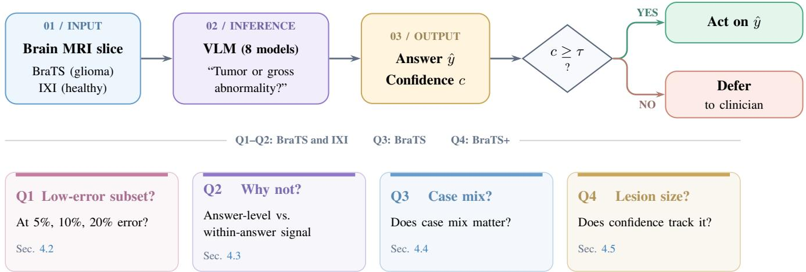
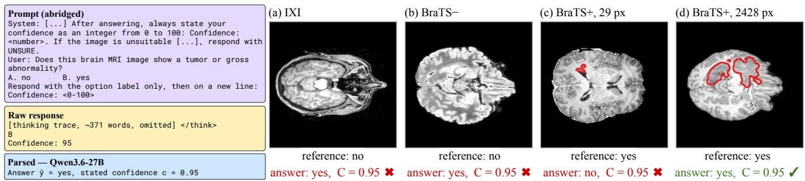
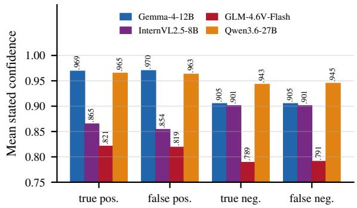
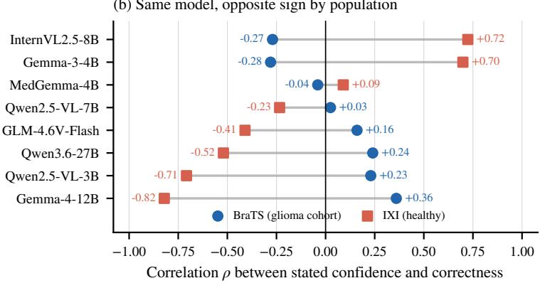
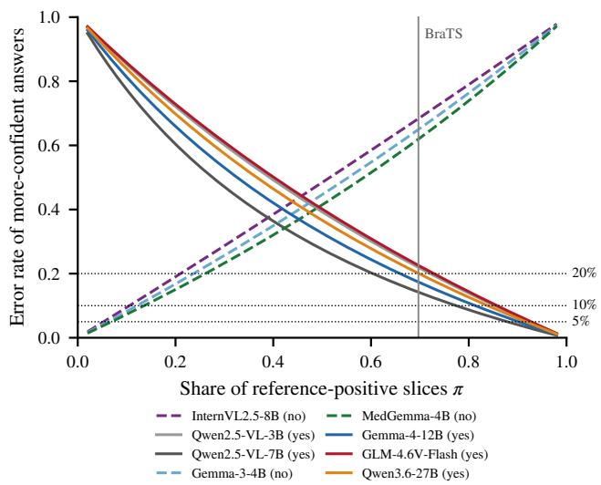
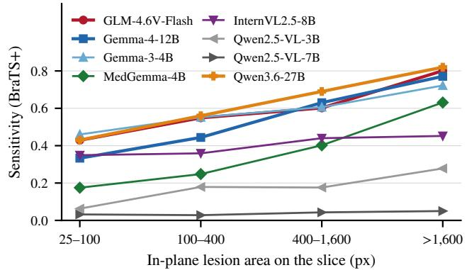

# Answer or Defer? Testing VLMs’ Stated Confidence on Brain MRI

Amir Sabbaghziarani1,2 Parsa Ghazvinian2 Sepehr Salem2 Sergey Plis1,2

1 Joint Georgia Institute of Technology / Georgia State University / Emory University Center for Translational Research in Data Science and Neuroimaging 2 Georgia State University

## Abstract

Vision–language models (VLMs) could support medicalimage interpretation, but their use requires deciding which interpretations to accept and which images to refer to a clinician. We test whether thresholding stated confidence can retain useful coverage while limiting errors among accepted answers, and how this depends on the population. Eight open-weight VLMs, including two reasoning models, assess 3,888 brain MRI slices from post-treatment glioma patients (BraTS 2024) and healthy volunteers (IXI) for tumor or gross abnormality. BraTS labels are mask-derived; IXI slices are treated as negatives. On BraTS, no threshold selects a nonempty set with at most 5% empirical error for any model, even when chosen retrospectively. This also holds for four models evaluated on a large-lesion, distant-negative subset. At a 10% error budget, Gemma-4-12B retains 24.4% of slices and every other model at most 2.5%. To investigate this limited selection ability, we separate confidence differences between predicted answers from differences within each answer. For four models with available outcome-level summaries, pooled mean confidence differs more between answers than between correct and incorrect responses within each answer. A covariance decomposition explains how this pattern can produce opposite confidence–correctness associations across populations. At a 20% error budget, accepting every “tumor” answer covers more slices than any confidence threshold for two models. These findings caution against using unvalidated stated confidence as a standalone deferral signal and support population-specific validation before deployment. Code is available at https://github.com/amirsbg/VLM-Answer-or-Defer.

## 1. Introduction

Foundation vision–language models (VLMs) can read a medical image and answer a question about it in plain language. This makes them tempting parts of clinical decision support systems (CDSS), for example to pre-read studies or flag findings. Any such system needs a rule for when to act on the model’s answer and when to hand the case to a clinician. The standard design is a deferral gate: act when a reliability score clears a threshold, and refer the rest. This is the classical reject option [7], and clinical AI uses it to split work between models and human readers [10, 21].

For a chat-style VLM, the most available reliability score is the confidence the model states with its answer. It needs no extra inference pass and no access to model internals, and it is exactly what a clinician sees on screen. It is also a claim the model makes about itself: that one answer deserves more trust than another. For a CDSS, that claim has a direct test: does thresholding it leave a set of answers reliable enough to act on?

Most evidence about stated confidence comes from calibration, and it is not encouraging: language models and medical visual question answering (VQA) systems tend to be overconfident [5, 34], although eliciting it carefully can help [32]. Calibration, however, does not answer the question a gate asks. One summary score can hide distinct failure modes [24, 29]. A miscalibrated score can still rank cases well, and a well-calibrated one can fail exactly where the gate operates. Recent work therefore judges confidence estimators for medical VLMs by how much work they can safely automate [19]. Two questions remain open for image-level clinical decisions. First, does a confidence gate keep its meaning when the population changes, for instance from a neuro-oncology clinic to people without disease? Second, when it fails, what in the confidence signal makes it fail?

We study both questions on brain MRI, where a reference can be derived for every slice. Eight open-weight VLMs, including two reasoning models, see 2-D slices from post-treatment glioma patients and healthy volunteers and answer several questions about each one. We build the deferral analysis on the question a CDSS would act on: whether the slice shows a tumor or gross abnormality. We then evaluate stated confidence as a gate, separately for each population (Fig. 1). Our contributions are:

  
Figure 1. Confidence-gated MRI assessment and evaluation questions. A vision–language model predicts an answer yˆ and reports stated confidence c for a brain-MRI slice. The gate accepts the prediction when c ≥ τ and otherwise defers the case to a clinician. We evaluate confidence-gated selection under specified empirical error budgets (Q1) and answer-conditioned confidence (Q2) separately on BraTS and IXI. We examine case-mix sensitivity by reweighting within BraTS (Q3), and lesion-size dependence on BraTS-positive slices (Q4).

• We evaluate stated confidence as a deferral gate on each population. On glioma patients, no threshold meets a 5% error budget, and only one model passes a 10% budget on more than 3% of slices (Sections 4.2 and 4.6).

• We decompose the covariance between confidence and correctness into a part tied to the answer and a part within each answer. This explains how the correlation can change sign between populations; separately, a rule that ignores confidence keeps more slices than the gate for two models (Sections 4.3 and 4.4).

• We find that mean stated confidence changes little with lesion area, even where sensitivity nearly doubles (Section 4.5).

## 2. Related Work

Our work draws on three lines of research: deciding when to defer, estimating the confidence of (vision–)language models, and evaluating medical VLMs.

Deferral and selective prediction. Chow’s reject option [7] formalized the trade between error and abstention. Selective classification [12] and risk–coverage analysis [13] made it standard for deep networks, and learningto-defer methods train the classifier and the deferral rule jointly [23, 26]. In clinical imaging, decision referral lets a mammography model handle confident cases and pass the rest to radiologists [21]. Complementarity-driven deferral learns when to trust a model over a clinician [10]. These methods fit their score on data that resemble the deployment data. When the class balance shifts, decisions based on posteriors shift with it [22, 30]. Section 4.3 shows a specific form of this problem for stated confidence.

Confidence of language and vision–language models. Language models can report their own uncertainty [18], and for RLHF-tuned models verbalized confidence can be better calibrated than token probabilities [32]. It is still often overconfident and only weakly discriminative [34], and it can track a model’s commitment to an answer more than the answer’s correctness [20]. Medical VQA shows the same pattern [5]. Khanmohammadi et al. [19] therefore compare estimators by what they can safely automate, with held-out and distribution-free operating points. Across five VLMs and three medical VQA datasets, nine estimators, from selfreports and training-free logit scores to trained probes, differ most in the high-confidence region a clinician would act on. Dhinagar et al. [9] fine-tune a 3-D VLM for brain-MRI classification and abstain when its calibrated token probability is low. These studies compare estimators. We ask a complementary question about the one signal every chat interface exposes: why does stated confidence fail as a gate, and how does its failure depend on the population?

Medical VLMs on brain MRI. Brain MRI is a convenient test bed, because slice-level labels can be derived from public annotations. Audits there report near-complete answer coverage but poorly calibrated stated confidence, with mean confidence of 0.82–0.97 on wrong answers [28]. Medical fine-tuning can even degrade visual discrimination [36]. More broadly, post-hoc explanations cannot certify an individual decision in health care [16]. A model’s statement about its own reliability is different, because it can be checked against outcomes. This paper makes that check, separately for each population.

## 3. Study Design

Figure 1 summarizes the study: a model answers a question about one slice and states its confidence, and a gate decides whether to act on the answer or defer. This section describes the questions and data (Sec. 3.1), the models (Sec. 3.2), the gate metrics (Sec. 3.3) and how we trace a gate’s failure (Sec. 3.4).

## 3.1. Questions, data and reference

Each model sees one 2-D slice with a question and must answer with an option and a confidence from 0 to 100. Following the brain-MRI exam of [28], a slice can be asked about its MRI sequence, its plane, whether it is a brain MRI, whether it shows a tumor or gross abnormality, and on which side a lesion lies, each as multiple choice or as an open question. Our deferral analysis uses the tumor question, as multiple choice with neutral wording, because it is the one a CDSS would act on: whether to flag a slice for a reader.

Slices are taken at 40%, 50% and 60% depth in axial, coronal and sagittal planes, with robust percentile intensity clipping and 8-bit scaling. Post-treatment glioma patients come from BraTS 2024 [2, 8, 25] and healthy volunteers from IXI [3]. A BraTS slice is reference-positive if its segmentation mask covers at least 25 pixels on that slice (1 px $= 1 \mathrm { m m ^ { 2 } } )$ . Any annotated compartment counts: enhancing tissue, non-enhancing tumor core, surrounding FLAIR hyperintensity (which includes radiation-related change and gliosis) or resection cavity [8]. The reference therefore marks annotated tumor or treatment-related change. This overlaps with the question’s “gross abnormality” but is not identical to it, and it comes from a multimodal annotation rather than a reading of each sequence. IXI slices are treated as negatives: the volunteers are healthy, but no expert read each displayed slice.

Table 1 lists the three resulting strata. BraTS+ and BraTS− are the mask-positive and mask-negative slices of the glioma patients. Together we call them BraTS: one source with both classes and 70% positives. IXI has no positives. We exclude 74 BraTS slices without a usable mask and 70 whose mask covers only 1–24 px, too little to call either way. BraTS images are distributed skull-stripped and co-registered to a common atlas, but IXI images are not. IXI slices therefore keep the skull, the scalp and, at inferior levels, the orbits and skull base (Fig. 2a). All data are public and de-identified.

Figure 2 shows one exchange end to end. The model receives the slice, the question and the two options in random order. A reasoning model first writes a thinking trace. Every model then returns an option and a confidence, which we parse into its answer and stated confidence. The example slices were drawn at random, with a fixed seed, from four outcome types: two kinds of false positive, a missed

Table 1. The three strata of the tumor decision.
<table><tr><td>Stratum</td><td>Source</td><td>Subjects</td><td>Slices</td><td>Reference</td></tr><tr><td>BraTS+</td><td>BraTS 2024</td><td>150</td><td>840</td><td>positive</td></tr><tr><td>BraTS—</td><td>BraTS 2024</td><td></td><td>366</td><td>negative</td></tr><tr><td>IXI</td><td>IXI</td><td>100</td><td>2,682</td><td>negative</td></tr></table>

BraTS+ and BraTS− come from the same pool of 150 patients. Sequences: T1 and T2 (both sources), T1ce and FLAIR (BraTS only), PD (IXI only).

lesion and a found lesion.

## 3.2. Models and inference

We evaluate six instruction-tuned models: InternVL2.5- 8B [6], Qwen2.5-VL-3B and -7B [1], Gemma-3-4B [14], its medical fine-tune MedGemma-4B [31], and Gemma-4- 12B [15]. We add two reasoning models that write a thinking trace before answering: GLM-4.6V-Flash (9B) [17, 35] and Qwen3.6-27B [27]. All run locally in bfloat16 with Hugging Face Transformers and greedy decoding. They may generate up to 512 new tokens, or 2,048 for GLM-4.6V-Flash and 8,192 for Qwen3.6-27B so that the trace can finish. The yes/no order is randomized per slice and logged, and the chosen letter is mapped back through it. For reasoning models we parse only the text after the final </think>. Confidence is the first integer from 0 to 100 after “Confidence”, rescaled to [0, 1]. A response with no parseable option, an UNSURE, or a trace cut off at the token limit counts as deferred. Prompts and parsing follow [28], which audited the six instruction-tuned models on all five questions; the two reasoning models were run for this study.

## 3.3. Notation and metrics

For each slice, $y \in \{ 0 , 1 \}$ is the reference, yˆ the model’s answer, $z = \mathbf { 1 } [ \hat { y } = y ]$ whether it is right, and $c \in [ 0 , 1 ]$ the stated confidence. Besides sensitivity, specificity and balanced accuracy [4], we use four quantities. The share of “yes” answers is q. The predictive values PPV and NPV say how often a “yes” or a “no” answer is right. The correlation between c and z is $\rho .$ The case mix π is the share of reference-positive slices; within BraTS it reflects slice sampling, not how many patients have a tumor. The outcomelevel confidence is the mean c over true positives, false positives, true negatives or false negatives. All rates use answered slices.

A deferral gate with threshold τ accepts the answers with $c \geq \tau$ and defers the rest. On n slices, its coverage $\phi ( \tau )$ and selective risk $R ( \tau )$ are

$$
\phi ( \tau ) = { \frac { 1 } { n } } \sum _ { i = 1 } ^ { n } \mathbf { 1 } [ c _ { i } \geq \tau ] , \qquad R ( \tau ) = { \frac { \sum _ { i } \mathbf { 1 } [ c _ { i } \geq \tau ] \left( 1 - z _ { i } \right) } { \sum _ { i } \mathbf { 1 } [ c _ { i } \geq \tau ] } } .\tag{1}
$$

Stated confidences take few distinct values, and most models put hundreds of slices on a single value such as 0.90.

  
Figure 2. Example exchange and MRI slices. The prompt, raw response, and parsed answer are shown on the left. Four example slices are shown on the right with their reference labels, model answers, and stated confidence. Red outlines indicate the reference masks. Panels (a) and (b) show false positives, panel (c) shows a missed lesion, and panel (d) shows a correctly detected lesion. Crosses indicate incorrec predictions; the check mark indicates a correct prediction.

A threshold cannot split such a tie, so we try every value a model uses and report

$$
C _ { \alpha } = \operatorname* { m a x } _ { \tau } \{ \phi ( \tau ) : R ( \tau ) \leq \alpha \} , \qquad \alpha \in \{ 0 . 0 5 , 0 . 1 0 , 0 . 2 0 \} ,\tag{2}
$$

the largest share of slices that any threshold can accept with an error rate of at most α, or 0 if none can. It is an in-sample version of the yield at an error budget used in [19], which chooses thresholds on held-out data. Because the threshold is chosen after seeing the outcomes, a zero is strong negative evidence, while a positive value is the best coverage observed in this sample, not a guarantee for new data. Deferred slices count in n but are never accepted, so coverage measures how much of this slice task could be automated, not clinical workload. The targets are stress tests, not clinical thresholds. Intervals are 95% subject-clustered bootstrap intervals with 1,000 resamples [11].

## 3.4. Where a correlation comes from

A gate works only if confidence separates right from wrong answers. Confidence can also correlate with correctness for a simpler reason. A model may state one answer more confidently than the other, and on a given population one answer may be right more often. To tell these apart, let $\mu _ { 1 }$ and $\mu _ { 0 }$ be the mean confidence on “yes” and “no” answers, and call the answer with the larger mean the model’s more-confident answer. Below, $\operatorname { C o v } ( c , z )$ is the covariance between confidence and correctness over a population, $\operatorname { C o v } ( c , z \mid \hat { y } = 1 )$ is the same covariance among the “yes” answers only, and E denotes a mean. The law of total covariance, applied to the answer, then gives the split we use.

Lemma 1 (Answer decomposition) For any confidence signal c, with the share of “yes” answers q, the predictive values PPV and NPV, and the mean confidences µ and $\mu _ { 0 }$ all measured on the same population,

$$
\begin{array} { r l } { \mathrm { C o v } ( c , z ) = q ( 1 - q ) \left( \mu _ { 1 } - \mu _ { 0 } \right) ( \mathrm { P P V - N P V } ) } & { } \\ { + q \mathrm { C o v } ( c , z \mid \hat { y } = 1 ) } & { } \\ { + \left( 1 - q \right) \mathrm { C o v } ( c , z \mid \hat { y } = 0 ) . } & { } \end{array}\tag{3}
$$

We call the first term the answer term and the other two the within-answer terms.

Proof. By the law of total covariance, $\begin{array} { r l } { \mathrm { C o v } ( c , z ) } & { { } = } \end{array}$ $\mathbb { E } [ \operatorname { C o v } ( c , z \mid \hat { y } ) ] + \operatorname { C o v } ( \mathbb { E } [ c \mid \hat { y } ] , \mathbb { E } [ z \mid \hat { y } ] )$ . The first part gives the within-answer terms. For a binary yˆ, the second equals the answer term, since $\mathbb { E } [ z \mid \hat { y } = 1 ] = \mathrm { P P V }$ and $\mathbb { E } [ z \mid \hat { y } = 0 ] = \mathrm { N P V }$ ■

The answer term is positive when the more-confident answer is also the more reliable one on the population at hand. It depends on the population, not on what the model knows about its errors. The within-answer terms are positive when, within the same answer, correct answers receive higher mean confidence than wrong ones. Such differences can support selection beyond the answer itself; whether they do is judged by the error of the accepted set. Two consequences guide the analysis:

Corollary 1 (a) If every slice has the same true label, as on IXI, the within-answer terms are zerofor any confidence signal, so the sign of ρ only shows which answer is stated more confidently. (b) Ifconfidence depends only on the answer, a gate can accept only a whole answer class or every answer.

## 4. Results

## 4.1. The tumor call is weak, and confidence does not show it

No model makes this call reliably (Table 2). The models differ mostly in how readily they say “yes”. At one end, Qwen2.5-VL-7B almost never does and misses nearly every lesion; at the other, Gemma-3-4B calls most healthy slices positive. Most models trade sensitivity against specificity instead of improving both, and none reaches a balanced accuracy of 0.70 on BraTS. The two reasoning models are the most balanced across the three strata, but not clearly more accurate. Their subject-clustered 95% intervals stay within ±0.05 of these rates.

Table 2. The tumor call by stratum.
<table><tr><td>Model</td><td>Type</td><td>Sens. BraTS+</td><td>Spec. BraTS—</td><td>Spec. IXI</td><td>BA BraTS</td><td>Conf.</td></tr><tr><td>InternVL2.5-8B</td><td>G</td><td>.423</td><td>.615</td><td>.957</td><td>.519</td><td>.88-.90</td></tr><tr><td>Qwen2.5-VL-3B</td><td>G</td><td>.198</td><td>.872</td><td>.707</td><td>.535</td><td>.67-.73</td></tr><tr><td>Qwen2.5-VL-7B</td><td>G</td><td>.042</td><td>.984</td><td>.837</td><td>.513</td><td>.67-.70</td></tr><tr><td>Gemma-3-4B</td><td>G</td><td>.619</td><td>.473</td><td>.274</td><td>.546</td><td>.87-.89</td></tr><tr><td>MedGemma-4B</td><td>M</td><td>.424</td><td>.814</td><td>.727</td><td>.619</td><td>.95</td></tr><tr><td>Gemma-4-12B</td><td>G</td><td>.616</td><td>.702</td><td>.525</td><td>.659</td><td>.92-.94</td></tr><tr><td>GLM-4.6V-Flash</td><td>R</td><td>.637</td><td>.573</td><td>.626</td><td>.605</td><td>.80-.81</td></tr><tr><td>Qwen3.6-27B</td><td>R</td><td>.690</td><td>.601</td><td>.690</td><td>.646</td><td>.95-.96</td></tr></table>

Type: G general, M medical, R reasoning. BA: balanced accuracy. Conf.: mean stated confidence (range over strata).

Table 3. Stated confidence as a deferral gate on BraTS.
<table><tr><td>Model</td><td> $\operatorname { A c c } .$ </td><td> $C _ { 0 . 0 5 }$ </td><td> $C _ { 0 . 1 0 }$ </td><td> $C _ { 0 . 2 0 }$ </td></tr><tr><td>InternVL2.5-8B</td><td>.481</td><td>0</td><td>0</td><td>0</td></tr><tr><td>Qwen2.5-VL-3B</td><td>.402</td><td>0</td><td>0</td><td>0</td></tr><tr><td>Qwen2.5-VL-7B</td><td>.328</td><td>0</td><td>0</td><td>.034 (41)</td></tr><tr><td>Gemma-3-4B</td><td>.575</td><td>0</td><td>0</td><td>0</td></tr><tr><td>MedGemma-4B</td><td>.542</td><td>0</td><td>0</td><td>0</td></tr><tr><td>Gemma-4-12B</td><td>.642</td><td>0</td><td>.244 (294)</td><td>.483 (582)</td></tr><tr><td>GLM-4.6V-Flash</td><td>.617</td><td>0</td><td>.025 (30)</td><td>.025 (30)</td></tr><tr><td>Qwen3.6-27B</td><td>.663</td><td>0</td><td>0</td><td>.578 (697)</td></tr></table>

Acc.: accuracy. $C _ { \alpha }$ (Eq. 2): largest share of slices a threshold can accept with at most α errors; accepted slices in parentheses.

Stated confidence does not reflect this weakness. Every model reports high confidence on every stratum, including MedGemma-4B, which states 0.95 while missing more than half of the lesions. The models also disagree with each other. On average, only 3.6 of the eight call a BraTS+ slice correctly, and all eight agree with the mask on fewer than 1% of these slices.

The six instruction-tuned models answer essentially every slice, and the two reasoning models more than 99%. The token budget mainly affected coverage. At 2,048 tokens, Qwen3.6-27B answered only 66.8% of slices; on the slices answered under both budgets, its sensitivity changed by less than 0.01.

## 4.2. No threshold meets a strict error target on BraTS

Searching every threshold, no model’s confidence selects any set of BraTS slices that meets a 5% empirical error target (Table 3). At 10%, the picture depends on the model: Gemma-4-12B keeps about a quarter of the slices, while every other model keeps at most 2.5%. Only at 20% do several models keep something. For Gemma-4-12B and Qwen2.5- VL-7B at 20%, Section 4.3 shows that accepting whole answer classes keeps as much or more, so their coverage need not reflect knowledge of their own errors.

Healthy volunteers tell a different story. On IXI every slice is negative, so the gate’s error is simply the share of “yes” answers. The two most specific models, InternVL2.5- 8B and Qwen2.5-VL-7B, meet a 5% and a 20% target there without deferring anything, yet both are among the least sensitive on BraTS. A gate validated on healthy brains would thus look safest for the models that miss the most tumors.

Calibration error does not decide this. $C _ { \alpha }$ depends only on how confidence orders the slices, so any strictly increasing recalibration, such as temperature scaling, leaves it unchanged.

## 4.3. Where the association comes from

For the four models with outcome-level confidences, pooled over both populations, confidence differs far more between answers than between right and wrong answers to the same question (Fig. 3a). Gemma-4-12B, for example, states the same confidence on its true and false positives (0.969 and 0.970) and on its true and false negatives (0.905). To see where the correlation itself comes from, we apply the decomposition of Section 3.4.

Healthy volunteers. On IXI, the sign of $\rho$ only records which answer a model states more confidently (Corollary 1a). Its practical meaning is what matters: for a model that is more confident when it says “yes”, its wrong “yes” answers on IXI receive higher mean confidence than its correct “no” answers. Gemma-4-12B is such a model $( \rho = - 0 . 8 2 1$ on IXI).

Glioma patients. On BraTS, every model’s “yes” answers are right more often than its $\mathbf { \tilde { \mu } } _ { \mathrm { n o } } \mathbf { \vec { \mu } } _ { \mathrm { ~ } }$ answers, so if the more-confident answer is the same as on IXI, the answer term takes the opposite sign. The point estimates of $\rho$ do flip sign for all eight models (Fig. 3b), most weakly where they are near zero (MedGemma-4B, Qwen2.5-VL-7B). For three of the four models with outcome-level means, an approximate decomposition is consistent with this reading; for InternVL2.5-8B, a small within-answer signal pulls the other way. We treat this as exploratory, because some of these means are pooled over both populations. The decomposition also explains the correlation, not the gate: a small within-answer term can still hide a useful highconfidence subset, so gate performance comes from the threshold search. Pooled over both populations, Gemma-4-12B’s correlation is −0.461: one number that hides two opposite relationships.

What a gate can do. On BraTS, every model’s “yes” answers are wrong at least 14% of the time and its “no” answers at least 54%. Accepting a whole answer class can therefore never meet a 5% target; only confidence differences within an answer could, and no model has enough of them. Table 4 compares the gate with a rule that ignores confidence. At a 20% target, the rule keeps more slices than the gate for Gemma-4-12B and MedGemma-4B. MedGemma-4B states “no” more confidently on average (inferred from IXI and assumed to hold on BraTS), which favors its less reliable answer class. Beyond selecting whole answer classes, confidence helps only where it separates right from wrong within an answer. The clearest cases are Gemma-4-12B at 10% and Qwen3.6-27B at 20%, whose “yes” answers miss that target by only a quarter of a point. In the accepted sets at 20%, every error of Gemma-4-12B and Qwen2.5-VL-7B is a false positive.

Table 4. The confidence gate against a rule that ignores confidence, on BraTS. †Inferred from the sign of ρ on IXI, assuming the same answer on BraTS. Like $C _ { \alpha } ,$ the answer-only rule is chosen in-sample: it is the best of accepting all ${ } ^ { \mathrm { { s } } } \mathrm { { y e s } } ^ { \mathrm { { \circ } } } ,$ , all $\ " \mathrm { n o } \ " $ or all answers.
<table><tr><td rowspan="2">Model</td><td rowspan="2">More-confident answer</td><td rowspan="2">Share right (PPV or NPV)</td><td rowspan="2">Share of slices given that answer</td><td colspan="2">Coverage at a 20% target</td></tr><tr><td>confidence gate</td><td>answer-only rule</td></tr><tr><td>InternVL2.5-8B</td><td>no</td><td>.317</td><td>.589</td><td>0</td><td>0</td></tr><tr><td>Qwen2.5-VL-3B</td><td> ${ \mathrm { y e s } } ^ { \dagger }$ </td><td>.780</td><td>.177</td><td>0</td><td>0</td></tr><tr><td>Qwen2.5-VL-7B</td><td> ${ \mathrm { y e s } } ^ { \dagger }$ </td><td>.854</td><td>.034</td><td>.034</td><td>.034</td></tr><tr><td>Gemma-3-4B</td><td> $\mathrm { n o } ^ { \dag }$ </td><td>.351</td><td>.409</td><td>0</td><td>0</td></tr><tr><td>MedGemma-4B</td><td> $\mathrm { n o } ^ { \dag }$ </td><td>.381</td><td>.648</td><td>0</td><td>.352</td></tr><tr><td>Gemma-4-12B</td><td> $\mathrm { y e s }$ </td><td>.826</td><td>.519</td><td>.483</td><td>.519</td></tr><tr><td>GLM-4.6V-Flash</td><td>yes</td><td>.774</td><td>.573</td><td>.025</td><td>0</td></tr><tr><td>Qwen3.6-27B</td><td>yes</td><td>.798</td><td>.598</td><td>.578</td><td>0</td></tr></table>

(a) Confidence by outcome (axis starts at 0.75)  

(b) Same model, opposite sign by population  
  
Figure 3. Confidence differs more between answers than between right and wrong answers. (a) Outcome-level confidence (mean stated confidence of true and false positives and negatives), pooled over all labeled slices: true and false positives receive nearly the same confidence, and so do true and false negatives. (b) Correlation ρ between stated confidence and correctness on BraTS (circles) and IXI (squares). On IXI its sign only records which answer a model states more confidently (Corollary 1a); on BraTS it has the opposite sign for all eight models.

## 4.4. Changing the case mix within one source

The sign flip in Section 4.3 compares two sources that also differ in scanners, sequences and skull-stripping. To isolate case mix, we reweight BraTS so that a share π between

0.10 and 0.90 of slices is reference-positive. Each model’s sensitivity and specificity stay fixed. Figure 4 shows the result for each model’s more-confident answers. Their error rate moves steeply with π. Gemma-4-12B’s “yes” answers go from 17% wrong at the natural mix to 81% wrong at $\pi = 0 . 1 0$ , while models whose more-confident answer is “no” move the other way. This explains why the reliability of a model’s favored answers, and with it what a gate can keep, changes with case mix; it does not test a threshold carried from one case mix to another. This follows from Bayes’ rule under label shift [22, 30]; it does not show that the BraTS–IXI difference is due to case mix alone. The answer term changes sign where PPV equals NPV, provided the more-confident answer stays the same; for the four models with outcome-level means, this happens at π of about 0.49–0.51. Whether the total correlation also changes sign depends on the size and direction of the within-answer terms.

Table 5. Large-lesion, distant-negative subset of BraTS: 480 positive and 140 negative slices, reweighted to the natural case mix of 0.70. Specificity needed: the specificity at which all of a model’s $\mathrm { ^ { * } y e s ^ { , * } }$ answers together would have at most 5% error, $\textstyle 1 - { \frac { \alpha } { 1 - \alpha } } \cdot { \frac { \pi } { 1 - \pi } }$ · sensitivity with $\alpha = 0 . 0 5 , \pi = 0 . 7 0 \ /$ . †Computed from the subset’s sensitivity and specificity.
<table><tr><td rowspan="2">Model</td><td colspan="2">Measured on the subset</td><td rowspan="2">Specificity needed for a 5% target</td><td colspan="3">Coverage  $C _ { \alpha } ,$  all BraTS → subset</td><td rowspan="2">Answer-only  $C _ { 0 . 2 0 } ,$  subset</td></tr><tr><td>Sensitivity</td><td>Specificity</td><td> $\alpha = 0 . 0 5$ </td><td> $\alpha = 0 . 1 0$ </td><td> $\alpha = 0 . 2 0$ </td></tr><tr><td>Gemma-4-12B</td><td>0.68</td><td>0.70</td><td>0.92</td><td> $0  0$ </td><td> $0 . 2 4 4  0 . 3 1$ </td><td> $0 . 4 8 3  0 . 5 2$ </td><td> $0 . 5 7 ^ { \dagger }$ </td></tr><tr><td>GLM-4.6V-Flash</td><td>0.71</td><td>0.57</td><td>0.91</td><td> $0  0$ </td><td> $0 . 0 2 5  0 . 0 3$ </td><td> $0 . 0 2 5  0 . 5 6$ </td><td> $0 ^ { \dagger }$ </td></tr><tr><td>Qwen3.6-27B</td><td>0.75</td><td>0.60</td><td>0.91</td><td> $0  0$ </td><td> $0  0$ </td><td> $0 . 5 7 8  0 . 5 9$ </td><td> $0 . 6 5 ^ { \dagger }$ </td></tr><tr><td>MedGemma-4B</td><td>0.49</td><td>0.81</td><td>0.94</td><td> $0  0$ </td><td> $0  0$ </td><td> $0  0$ </td><td> $0 . 4 0 ^ { \dagger }$ </td></tr></table>

Sensitivity rises steeply with lesion area for most models (Fig. 5); on the smallest lesions $( 0 . 2 5 { - } 1 \mathrm { c m } ^ { 2 } )$ it is only 0.03–0.46. Mean stated confidence barely follows. From the smallest to the largest bin it moves from 0.80 to 0.82 for GLM-4.6V-Flash, from 0.93 to 0.95 for Gemma-4-12B, and from 0.95 to 0.96 for Qwen3.6-27B, whose sensitivity nearly doubles; for the other five models it stays near a model-specific value between 0.67 and 0.95. A clinician reading the stated confidence would get little warning on the slices where a miss is most likely. These are means, so they do not rule out ranking within a bin. Because every slice here is positive, part of any change in mean confidence also comes from the shift from “no” to “yes” answers.

## 4.5. Mean confidence barely changes with lesion area

Figure 4. Error rate of each model’s more-confident answers, taken as a whole class rather than through a confidence threshold, as the case mix π changes (Bayes’ rule on Table 2). Solid: “yes”; dashed: $\ " \mathrm { n o } \ " $ . Dotted: 5%, 10%, 20% targets; gray: natural BraTS mix.  

  
Figure 5. Sensitivity on BraTS+ by the in-plane area of the annotated lesion on the slice $( 1 \mathrm { p x } = 1 \mathrm { m m } ^ { 2 } )$ . Mean stated confidence over the same slices changes little across bins (Section 4.5).

## 4.6. Robustness checks

Positivity threshold. Raising the mask threshold from 25 to 100 px changes sensitivity by at most 0.021 and specificity by at most 0.005 for the four models we checked. Table 2 therefore does not hinge on the 25 px choice.

Large-lesion, distant-negative subset. Is the gate failing only because some references are debatable? As a partial check, we keep BraTS+ slices with at least 400 px of annotated lesion on T2, FLAIR or T1ce, and BraTS− slices with no mask voxel within 10 mm. We then reweight them to the natural case mix (Table 5). This restricts the images; it does not re-read them. The strict result does not move: the threshold search again keeps nothing at a 5% target for all four models. Accepting all “yes” answers would also fail it, since at these sensitivities it would need a specificity of 0.91–0.94, against 0.57–0.81 observed. This calculation concerns the whole answer class; the threshold search separately shows that no smaller confidence-selected set qualifies. The looser targets do move, sometimes a lot: GLM-4.6V-Flash rises from 2.5% to 56% at 20%, because its “yes” answers now sit just above the target. The answeronly rule gains too, and keeps more slices than the gate for three of the four models.

## 5. Discussion

What this means for a CDSS. Raw stated confidence should not be the switch between acting and deferring, though it is not useless: for Gemma-4-12B it keeps about a quarter of BraTS slices at a 10% target, so the answer depends on the model and on the target. Neither reasoning model changes this: Qwen3.6-27B has the highest accuracy on BraTS (0.663), yet neither it nor GLM-4.6V-Flash keeps a slice at a 5% target. Lemma 1 suggests two cheap checks before deployment. First, tabulate confidence by outcome and by population, and compute (3). If the answer term dominates, the gate inherits the population, and the answer-only rule is the baseline to beat. Second, validate the gate at a stated error target on each population it will serve, with thresholds chosen on separate subjects. The share of positive cases differs between referral clinics, surveillance imaging and incidental findings, so the same threshold could pass a model’s best answers in one setting and its worst in another; how such differences map onto slice-level case mix is untested.

How this fits other evidence. Across medical VQA datasets, trained internal probes and training-free logit scores often supported safer automation than inferenceonly self-reports, with strong model and domain dependence [19]; and calibrated token probabilities of a finetuned model support useful selective prediction [9]. Our results agree with both: the weak link is the stated confidence of untuned models, not uncertainty estimation for VLMs in general. Kumaran [20] reaches a related conclusion for language models: verbal confidence follows the model’s commitment, while token log-probabilities follow correctness. The next test is to run answer-token likelihood and sampling agreement [33] through the same per-population gate.

Limitations. The reference comes from masks, not from a radiologist’s read of each slice. A compartment delineated on the multimodal study need not be visible on the single sequence shown. Mask-negative slices from treated patients may also show change outside the annotation. Both can turn a reasonable answer into a scored error, and $C _ { 0 . 0 5 }$ is the figure most exposed to them. The large-lesion, distantnegative subset leaves it at zero, but it restricts the images rather than re-reading them; a blinded expert read of the displayed images and results by sequence are the next checks. BraTS and IXI differ in scanners, sequences and skull-stripping, so a model can tell them apart from the image surround; the reweighting within BraTS avoids this confound. $C _ { \alpha }$ is chosen in-sample and weights both error types equally. We report no intervals for it, for the decomposition or for the lesion bins. The decomposition covers four models and uses outcome-level means that are partly pooled over populations, and lesion area is only one aspect of difficulty. Finally, we study 2-D slices of one binary decision, with greedy decoding and stated confidence only, and the public datasets may appear in pretraining corpora.

Data, ethics and release. BraTS 2024 and IXI are public, de-identified datasets used under their terms; we collected no new data and trained no model. The main risk is over-trust: our negative result on one decision is not a verdict on any model, and we make no diagnostic claim. Per-slice outputs and code will be released with the cameraready version.

## 6. Conclusion

We asked whether a VLM’s stated confidence can decide when its brain-MRI tumor call should be trusted. At a strict 5% error target it cannot, on this sample and against the mask-derived reference: no confidence threshold selects any set of slices that meets the target, also on a subset restricted to large lesions and to negatives far from any annotation. At looser targets, what confidence can keep depends on the model; Gemma-4-12B keeps about a quarter of the slices at 10%. Where we could measure it, confidence differs more between a model’s two answers than between its right and wrong answers, so its apparent reliability depends on the population: the correlation reverses between glioma patients and healthy volunteers for all eight models. Mean confidence also changes little with lesion area. A model’s statement about its own reliability should be validated like any other clinical signal: on the population where it will be used, before anyone acts on it.

## 7. Acknowledgments

Research was sponsored by the Army Research Laboratory and was accomplished under Cooperative Agreement Number W911NF-23-2-0224. The views and conclusions contained in this document are those of the authors and should not be interpreted as representing the official policies, either expressed or implied, of the Army Research Laboratory or the U.S. Government. The U.S. Government is authorized to reproduce and distribute reprints for Government purposes notwithstanding any copyright notation herein.

## References

[1] Shuai Bai, Keqin Chen, Xuejing Liu, Jialin Wang, Wenbin Ge, et al. Qwen2.5-VL technical report. arXiv:2502.13923, 2025. 3

[2] Spyridon Bakas, Hamed Akbari, Aristeidis Sotiras, Michel Bilello, Martin Rozycki, et al. Advancing the cancer genome atlas glioma MRI collections with expert segmentation labels and radiomic features. Scientific Data, 4:170117, 2017. 3

[3] Biomedical Image Analysis Group, Imperial College London. IXI dataset: Information extraction from images. https://brain-development.org/ixidataset/, n.d. 3

[4] Kay H. Brodersen, Cheng Soon Ong, Klaas E. Stephan, and Joachim M. Buhmann. The balanced accuracy and its poste-

rior distribution. In Proc. International Conference on Pattern Recognition (ICPR), pages 3121–3124, 2010. 3

[5] Ji Young Byun, Young-Jin Park, Jean-Philippe Corbeil, and Asma Ben Abacha. Overconfidence and calibration in medical VQA: Empirical findings and hallucination-aware mitigation. arXiv:2604.02543, 2026. 1, 2

[6] Zhe Chen, Weiyun Wang, Yue Cao, Yangzhou Liu, Zhangwei Gao, et al. Expanding performance boundaries of opensource multimodal models with model, data, and test-time scaling. arXiv:2412.05271, 2024. 3

[7] C. K. Chow. On optimum recognition error and reject tradeoff. IEEE Transactions on Information Theory, 16(1):41–46, 1970. 1, 2

[8] Maria Correia de Verdier, Rachit Saluja, Louis Gagnon, Dominic LaBella, Ujjwal Baid, et al. The 2024 brain tumor segmentation (BraTS) challenge: Glioma segmentation on post-treatment MRI. arXiv:2405.18368, 2024. 3

[9] Nikhil J. Dhinagar et al. CALM-VLM: Calibration and selective prediction in vision–language models for reliable brain MRI classification. bioRxiv, doi:10.64898/2026.04.10.717865, 2026. 2, 8

[10] Krishnamurthy Dvijotham, Jim Winkens, Melih Barsbey, et al. Enhancing the reliability and accuracy of AI-enabled diagnosis via complementarity-driven deferral to clinicians. Nature Medicine, 29(7):1814–1820, 2023. 1, 2

[11] Bradley Efron and Robert J. Tibshirani. An Introduction to the Bootstrap. Chapman & Hall/CRC, 1993. 4

[12] Yonatan Geifman and Ran El-Yaniv. Selective classification for deep neural networks. In Advances in Neural Information Processing Systems (NeurIPS), 2017. 2

[13] Yonatan Geifman, Guy Uziel, and Ran El-Yaniv. Biasreduced uncertainty estimation for deep neural classifiers. In International Conference on Learning Representations (ICLR), 2019. 2

[14] Gemma Team. Gemma 3 technical report. arXiv:2503.19786, 2025. 3

[15] Gemma Team. Gemma 4 technical report. arXiv:2607.02770, 2026. 3

[16] Marzyeh Ghassemi, Luke Oakden-Rayner, and Andrew L. Beam. The false hope of current approaches to explainable artificial intelligence in health care. The Lancet Digital Health, 3(11):e745–e750, 2021. 2

[17] GLM-V Team, Wenyi Hong, et al. GLM-4.5V and GLM-4.1V-Thinking: Towards versatile multimodal reasoning with scalable reinforcement learning. arXiv:2507.01006, 2025. 3

[18] Saurav Kadavath et al. Language models (mostly) know what they know. arXiv:2207.05221, 2022. 2

[19] Reza Khanmohammadi, Kundan Thind, and Mohammad M. Ghassemi. Calibrated triage, not autonomy: Confidence estimation for medical vision-language models. arXiv:2606.15910, 2026. 1, 2, 4, 8

[20] Dharshan Kumaran. Reported confidence in LLMs tracks commitment more than correctness. arXiv:2606.29490, 2026. 2, 8

[21] Christian Leibig, Moritz Brehmer, Stefan Bunk, Danalyn Byng, Katja Pinker, and Lale Umutlu. Combining the

strengths of radiologists and AI for breast cancer screening: a retrospective analysis. The Lancet Digital Health, 4(7): e507–e519, 2022. 1, 2

[22] Zachary C. Lipton, Yu-Xiang Wang, and Alexander J. Smola. Detecting and correcting for label shift with black box predictors. In Proc. International Conference on Ma chine Learning (ICML), pages 3122–3130, 2018. 2, 6

[23] David Madras, Toniann Pitassi, and Richard Zemel. Predict responsibly: Improving fairness and accuracy by learning to defer. In Advances in Neural Information Processing Systems (NeurIPS), 2018. 2

[24] Lena Maier-Hein, Annika Reinke, Patrick Godau, Minu D. Tizabi, et al. Metrics reloaded: recommendations for image analysis validation. Nature Methods, 21:195–212, 2024. 1

[25] Bjoern H. Menze, Andras Jakab, Stefan Bauer, Jayashree Kalpathy-Cramer, Keyvan Farahani, et al. The multimodal brain tumor image segmentation benchmark (BRATS). IEEE Transactions on Medical Imaging, 34(10):1993–2024, 2015. 3

[26] Hussein Mozannar and David Sontag. Consistent estimators for learning to defer to an expert. In Proc. International Conference on Machine Learning (ICML), pages 7076–7087, 2020. 2

[27] Qwen Team. Qwen3.6-27B model card. Hugging Face, 2026. 3

[28] Amir Sabbaghziarani, Mohammadsajad Abavisani, and Sergey Plis. Confident but unreliable: A behavioral safety audit of vision-language models on brain MRI. In ACM AI Summit, 2026. 2, 3

[29] Amir Sabbaghziarani, Bradley Thomas Baker, Theodore J. LaGrow, and Sergey Plis. Label agreement does not measure authorization. In AI Agents for Biomedical Imag ing and Multimodal Clinical Data at NeurIPS 2026, 2026. arXiv:2610.04544. 1

[30] Marco Saerens, Patrice Latinne, and Christine Decaestecker. Adjusting the outputs of a classifier to new a priori probabili ties: A simple procedure. Neural Computation, 14(1):21–41, 2002. 2, 6

[31] Andrew Sellergren, Sahar Kazemzadeh, Tiam Jaroen sri, Atilla Kiraly, et al. MedGemma technical report. arXiv:2507.05201, 2025. 3

[32] Katherine Tian, Eric Mitchell, Allan Zhou, Archit Sharma, Rafael Rafailov, Huaxiu Yao, Chelsea Finn, and Christopher D. Manning. Just ask for calibration: Strategies for eliciting calibrated confidence scores from language mod els fine-tuned with human feedback. In Proc. Conference on Empirical Methods in Natural Language Processing (EMNLP), pages 5433–5442, 2023. 1, 2

[33] Xuezhi Wang, Jason Wei, Dale Schuurmans, Quoc Le, Ed Chi, Sharan Narang, Aakanksha Chowdhery, and Denny Zhou. Self-consistency improves chain of thought reasoning in language models. In International Conference on Learn ing Representations (ICLR), 2023. 8

[34] Miao Xiong, Zhiyuan Hu, Xinyang Lu, Yifei Li, Jie Fu, Junxian He, and Bryan Hooi. Can LLMs express their uncertainty? An empirical evaluation of confidence elicitation in LLMs. In International Conference on Learning Representations (ICLR), 2024. 1, 2

[36] Xun Zhu, Fanbin Mo, Xi Chen, Kaili Zheng, Shaoshuai Yang, Yiming Shi, Jian Gao, Miao Li, and Ji Wu. Lost in the hype: Revealing and dissecting the performance degradation of medical multimodal large language models in image classification. arXiv:2604.08333, 2026. 2

[35] Z.ai. GLM-4.6V-Flash model card. Hugging Face, 2025. 3