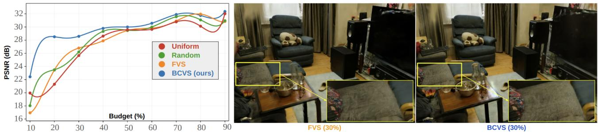
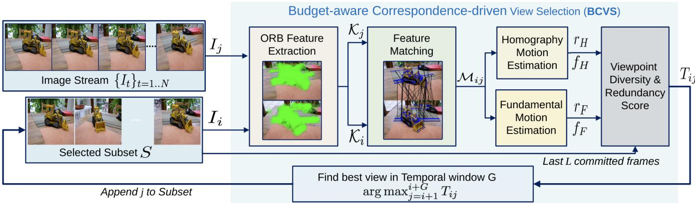
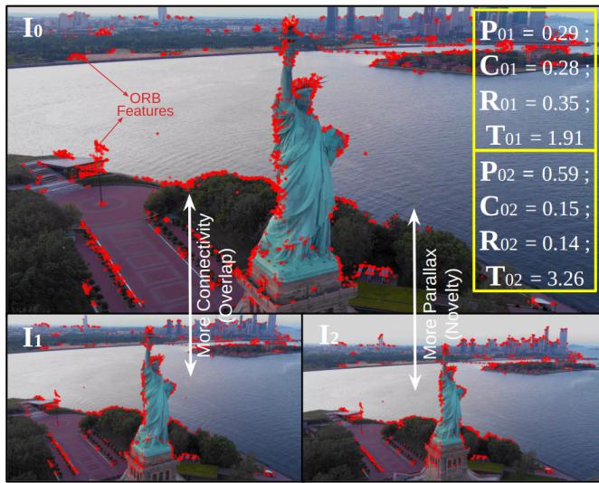
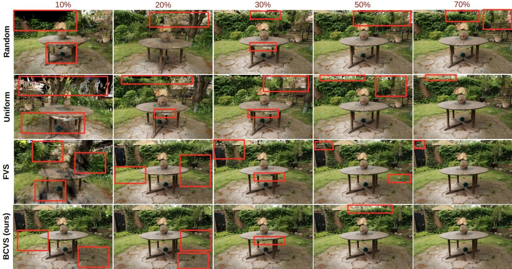
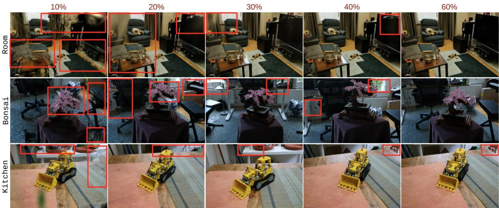
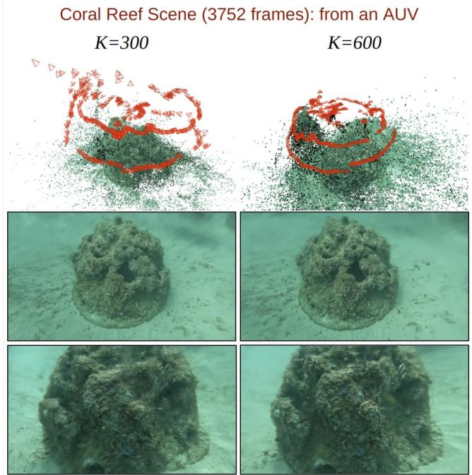
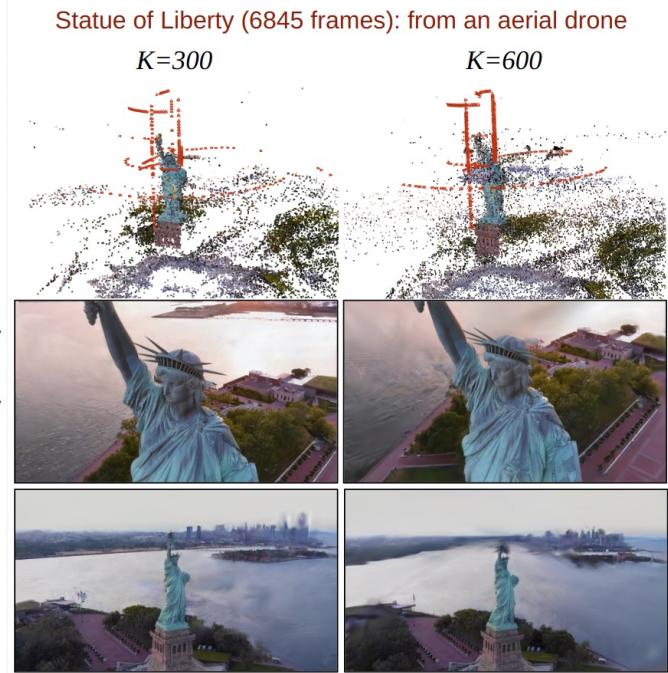

# Budget-aware Correspondence-driven View Selection for Real-time 3D Perception of Mobile Robots

Vaishnav Ramesh<sup>1</sup>, Jacob Carter<sup>2</sup>, Shivali J. Patel<sup>1</sup>, Sanjeev J. Koppal<sup>2</sup>, and Md Jahidul Islam<sup>1</sup>

<sup>1</sup>RoboPI Laboratory, ECE Department, University of Florida <sup>2</sup>FOCUS Laboratory, ECE Department, University of Florida

## Abstract

3D visual perception and scene reconstruction are critical for autonomous robots and intelligent transportation, yet real-world deployments often generate long, redundant image sequences that hinder downstream processing. This report investigates BCVS (budget-aware correspondence-driven view sampling), a pose-free view selection algorithm that ofers 22+ FPS on a CPU, enabling online filtering for eficient 3D perception by mobile robots. Unlike existing approaches that rely on full structurefrom-motion (SfM) pipelines or camera pose estimation, BCVS employs a purely correspondence-based scoring strategy that prioritizes view novelty while maintaining suficient overlap for geometric stability. Given a user-specified budget, BCVS iteratively selects the most distinct frames and suppresses near-duplicates, producing compact subsets that preserve connectivity and minimize reconstruction loss. Extensive experiments on benchmark show that BCVS outperforms CPU-friendly baselines at tight budgets and remains competitive as budgets scale. Field trials with large aerial and marine robotics data further validate its practicality and scalability: BCVS reduces redundancy up to 16% while sustaining robust SfM registration and high-quality 3D reconstructions.

Keywords: 3D reconstruction; view selection; image correspondence; real-time vision.

## 1 Introduction

Fast and accurate 3D reconstruction is critical for mobile robots operating in ground, aerial, and marine domains, supporting tasks such as dense mapping, long-horizon navigation, mission planning, and downstream scene understanding, including infrastructure inspection, asset monitoring, and structural assessment [3, 4]. Contemporary visual pipelines range from geometric approaches such as Structure from Motion (SfM) and SLAM [5] to learned neural scene representations [6,7], which transform onboard multi-view imagery into metrically consistent 3D structure and radiance fields, ofering rich geometric and appearance cues for perception systems. In practice, however, mobile robots often depend on SLAM for real-time autonomy [8] while relegating high-fidelity reconstruction to post-processing due to constraints in power, memory, and latency.

Real-world deployments often generate long, redundant mission data that substantially increases the computational cost of image matching, bundle adjustment (BA), and downstream training. In SfM pipelines, computation scales with the number of input views: retrieval methods are used to prune the quadratic complexity of pairwise matching, while BA repeatedly solves large-scale optimization problems. As a result, the sheer data volume becomes a primary bottleneck [9, 10]. Similarly, neural 3D reconstruction methods scale with the number of images and sampled rays, such that retaining fewer but more informative views can both accelerate training and improve numerical conditioning [6,7]. These challenges motivate budget-aware view selection strategies that compress missions by preserving only distinctive yet geometrically informative frames.

Existing approaches to view selection generally fall into two categories: next-best-view (NBV) planning and ofline subset selection. NBV planners actively guide data acquisition by selecting the next camera pose according to predicted information gain or uncertainty [2, 11, 12]. While these methods can achieve high-fidelity reconstructions, they require expensive model-in-the-loop updates at each step, which limits scalability. In contrast, ofline subsetselection methods only operate post-mission, i.e., after full data collection. Redundancy-aware strategies [13] leverage images with pre-estimated camera poses, whereas coverage-based approaches, such as NeRF Director [2], rely on coarse SfM outputs to enforce spatially uniform sampling. Although efective at reducing redundancy, these ofline methods remain dependent on SfM-derived geometry or camera pose information, constraining their applicability in settings where such priors are unavailable or computationally infeasible.

In this report, we present Budget-aware Correspondence-driven View Sampling (BCVS) – a fast, camera pose–free algorithm that selects views by regularizing novelty (information variance) in views from keypoint correspondences alone. Using only images as input, BCVS uses a lightweight feature matching step to estimate interframe motion and select diverse viewpoints, without relying on external poses or point clouds. Given a computational budget as prior, the view candidates are favored when they add new visual information while retaining enough overlap to remain connected. Operating in a short temporal neighborhood, BCVS incrementally prefers informative change, suppresses redundancy, and then lightly adjusts the set to meet a target budget (in maximum number of views). This budget-aware process produces a compact, viewpoint-diverse subset that can be utilized for fast 3D reconstruction with minimal loss.

Notably, our focus is on real-time view selection for 3D robot perception with onboard CPU processing constraints. A fast view selection operation is crucial to keep pace with the camera stream, while the bulk of the processing power is typically dedicated to perception and control systems [14]. However, most existing approaches are mainly ofline, requiring a trained model, large embedding encoders, and/or a full SfM pipeline with accurate camera poses – which incur latency and memory overhead [15, 16]. To close this gap, we adopt a pose-free and CPUonly design that relies on lightweight keypoint correspondences to admit distinct views while preserving overlap for stable reconstruction. In practice, our system processes frames at 22.3 FPS on CPU, enabling online filtering close to the camera rate (30 FPS). A fast budget-adjustment pass then consolidates the stream into a compact subset for downstream 3D reconstruction. This hybrid workflow delivers the benefits of an eficient, on-board selection without requiring deep visual inference or

  
Figure 1. Performance margins for view selection strategies are shown with budget vs. reconstruction quality scores on MipsNerf-360 benchmark [1]. Top: PSNR as a function of view budget for four selectors – Uniform, Random, FVS, and the proposed BCVS algorithm. BCVS achieves higher PSNR across most budgets compared to the current state-of-the-art FVS [2], with the largest gains at low budgets, where view choice is particularly critical. Bottom: A sample rendering comparison at 30% budget with insets highlighting texture on the sofa and table region; as seen, FVS exhibits blur and residual artifacts, whereas BCVS preserves sharper detail and cleaner boundaries.

## precomputed camera poses as prior.

We evaluate BCVS on the MipNeRF-360 benchmark [1], and further assess it on marine and aerial robotics trial data where slow platform motion yields long stretches of redundant frames. For fairness and to match our deployment constraints, we compare against real-time CPU-based approaches available in the literature: Random, Uniform, and pose-based Farthest View Sampling (FVS) [2]; as Fig 1 demonstrates, BCVS achieves the best performance under tight computational budgets. We also demonstrate its real-time utility for CPU-based online filtering of large (long) missions, without which, 3D reconstruction onboard mobile robots is computationally infeasible.

## This report makes the following contributions:

1. We introduce BCVS, which selects views by regularizing novelty with correspondence overlap using lightweight image features alone, without requiring a full-scale SfM pipeline or camera poses as prior. BCVS employs a budget-aware selection procedure to generate compact subsets that preserve coverage and geometric consistency, yielding minimal reconstruction loss downstream.

2. BCVS is computationally eficient, ofering 22+ FPS on CPU and includes a fast budgetadjustment pass that consolidates the stream into a compact subset, enabling timely online filtering onboard mobile robots without requiring pretrained embeddings or pose estimation.

3. Comprehensive evaluations on MipNeRF-360 and field experimental data confirm the efectiveness of BCVS. It consistently matches or surpasses pose-based selection methods and clearly outperforms all baselines at low budgets, while remaining competitive as budgets increase.

## 2 Background & Related Work

Modern reconstruction pipelines encompass a range of methods, including geometric, hybrid, and neural approaches. SfM and SLAM pipelines recover camera trajectories and sparse 3D structure from multiview imagery [10, 17–19]. These systems combine robust feature matching, incremental mapping, and bundle adjustment for metrically consistent models suitable in downstream planning and localization. Neural scene representations [6] learn a continuous radiance field that renders high-fidelity novel views, trading heavy training for photorealism and smoothness. In particular, 3D Gaussian Splatting [7] ofers a fast, explicit alternative: it optimizes a set of anisotropic Gaussians with per-primitive appearance, enabling real-time rendering while preserving rich geometry/appearance cues.

Moreover, active NBV (next-best-view) planners choose the next camera view by maximizing expected information gain or uncertainty reduction under a continually updated scene model. ActiveNeRF [12] estimates per-ray uncertainty to greedily reduce it. For instance, FisherRF [20] models the Fisher information of NeRF parameters and selects viewpoints by maximizing the expected information gain, whereas BavsNeRF methods [21] select batches of complementary views from a partially trained field. On the other hand, IOVS4NeRF models [22] target large-scale settings with uncertainty-guided incremental selection.

  
Figure 2. An overview of the proposed BCVS filtering pipeline for view selection is illustrated. First, ORB features are extracted and matched between frames $I _ { i }$ and $I _ { j } ;$ from these matches, we estimate a homography $H _ { i j }$ and a fundamental matrix $F _ { i j }$ to obtain inlier ratios and normalized flows $\left( r _ { H } , f _ { H } \right) , \left( r _ { F } , f _ { F } \right)$ . These statistics drive the viewpoint diversity and redundancy terms that compose the pairwise scoring function $T _ { i j }$ . Over a short commit window G, we select the top-scoring candidate $i . e .$ , the most informative, distinct viewpoint with suficient overlap and append it to the subset S.

## 3 Methodology

Ofline methods operate after the full trajectory has been collected to prune near-duplicates while preserving geometric/scene coverage. NeRF Director [2] evaluates training view selection for neural volume rendering and shows which frames materially impact the quality and convergence of the reconstruction. It introduces Farthest View Sampling (FVS) and Information-Gain Sampling (IGS) to enforce uniform, diverse coverage without retraining. Besides, redundancy-aware camera selection [13] works on images with pre-estimated camera poses, scoring candidates by overlap or diversity to retain a compact subset that maintains coverage while minimizing viewpoint redundancy. Lastly, ConMax3D [23] selects frames without requiring camera poses; it maximizes the concept or semantic diversity for filtering views based on image embeddings.

Despite considerable progress in recent years, several view-selection methods still rely on SfM outputs or pre-computed camera poses, which are not always available in real-time robotics applications. Besides, NBV approaches require a model-in-the-loop or highdimensional image embeddings. We address these limitations with a purely feature-matching-based method that eliminates the need for camera poses, enabling real-time use by mobile robots.

## 3.1 Overall Computational Pipeline

We introduce BCVS, a fast view-selection algorithm that produces a compact, viewpoint-diverse subset S from an image stream $\lbrace I _ { t } \rbrace _ { t = 1 \ldots N }$ under a target budget K for downstream 3D reconstruction. We construct the subset S in a single pass: for each incoming frame $I _ { j } .$ , we compare it to the last committed view and to what is already represented in S, to compute a score $T _ { i j }$ that rewards informative viewpoint change while penalizing near-duplicates, visually static, or redundant views. Using a short temporal window G, we retain a candidate with the highest score and commit it when the window closes; S thus grows by repeatedly adding the next most informative, least redundant frame. Fig. 2 depicts the selection pipeline in detail.

After one pass of processing, we further adjust the view selection if the budget is under-utilized or overshot. $\operatorname { I f } | S | < K$ , we densify by inserting frames into the largest temporal gaps in S to improve coverage and connectivity between neighbors. On the other hand, if $| S | > K$ , we prune by removing frames with the smallest marginal contribution to viewpoint diversity relative to their neighbors. The resulting subset $S \ ( | S | \approx K )$ preserves geometric diversity and connectivity, enabling scene reconstruction with minimal degradation compared to using all frames.

## 3.2 Feature Matching and Scoring

Unlike prior methods [2, 13] that rely on camera poses, we estimate viewpoint redundancy and diversity using only images via feature matching. For each pair $( i , j )$ in S, we detect ORB [24] keypoints and binary descriptors; ORB ofers repeatability under moderate viewpoint/illumination change and enables fast matching with a small memory footprint. We form putative correspondences using a BF–Hamming matcher and retain good matches via Lowe’s ratio test [25]. Let $\mathcal { M } _ { i j }$ be the resulting set of good correspondences between $I _ { i }$ and $I _ { j }$ , and let $\kappa _ { i } , \kappa _ { j }$ be their detected keypoint sets. We define the match reliability ratio as:

$$
m r _ { i j } \ = \ | { \mathcal M } _ { i j } | : \operatorname* { m i n } ( | { \mathcal K } _ { i } | , | { \mathcal K } _ { j } | ) .\tag{1}
$$

This pose-free correspondence layer supplies reliable point pairs at low cost, enabling a fast selection pipeline.

For pair $( i , j )$ , whether $I _ { j }$ contributes a new viewpoint – is assessed with a per-pair score $T _ { i j } ;$ it is composed of three terms: (i) a viewpoint diversity score $D _ { i j }$ that measures how much the camera viewpoint has changed, using geometry-consistent motion between the images; (ii) a redundancy penalty $R _ { i j }$ that captures how visually similar and motion-wise static the pair is; and (iii) a global redundancy $R _ { i j } ^ { G }$ that penalizes frames that are similar to selected views from S.

Given $\mathcal { M } _ { i j }$ , a homography $H _ { i j }$ and a fundamental matrix $F _ { i j }$ are estimated; $H _ { i j }$ captures planar and pure rotational motion, while $F _ { i j }$ encodes the epipolar geometry, capturing translation-induced parallax. In our estimation, each fit returns an inlier mask, $\mathcal { T } _ { H } \subset \mathcal { M } _ { i j }$ and $\mathcal { T } _ { F } \subset \mathcal { M } _ { i j }$ , consisting of matches within respective models under a reprojection threshold. The corresponding inlier ratios r<sub>H</sub> and r<sub>F</sub> are $r _ { H } = \vert \mathcal { I } _ { H } \vert : \vert \mathcal { M } _ { i j } \vert$ and $r _ { F } = \vert \mathcal { I } _ { F } \vert : \vert \mathcal { M } _ { i j } \vert$ 2 respectively.

With this, we define the inlier flow parameters $( f _ { H } , f _ { F } )$ to quantify the motion under each geometry. It is computed by mapping the median 2D displacement of the inlier correspondences to [0, 1]. Let <sup>¯</sup>d denote the image diagonal, and $\lambda > 0$ a flow-scale

constant. then,

$$
\begin{array} { l } { f _ { H } = \operatorname { t a n h } \left( \frac { \operatorname { m e d i a n } _ { ( x , x ^ { \prime } ) \in \mathbb { Z } _ { H } } \| x ^ { \prime } - x \| _ { 2 } } { \lambda \bar { d } } \right) , } \\ { f _ { F } = \operatorname { t a n h } \left( \frac { \operatorname { m e d i a n } _ { ( x , x ^ { \prime } ) \in \mathbb { Z } _ { F } } \| x ^ { \prime } - x \| _ { 2 } } { \lambda \bar { d } } \right) . } \end{array}
$$

Efectively, the pairs $( r _ { H } , f _ { H } )$ and $( r _ { F } , f _ { F } )$ summarize, respectively, the rotation/planar motion and translation constrained by epipolar geometry.

Viewpoint Diversity Score:We factor diversity into two complementary terms: a connectivity term $C _ { i j }$ that measures reliable overlap between the images, and a parallax term $P _ { i j }$ that rewards translation-induced parallax.

$$
\begin{array} { r l } & { C _ { i j } = \operatorname* { m r } _ { i j } r _ { F } } \\ & { P _ { i j } = ( r _ { F } f _ { F } ) ^ { q } , \quad q \in ( 0 , 1 ] , } \\ & { D _ { i j } = w _ { \mathrm { c o n n } } C _ { i j } + w _ { \mathrm { p a r } } P _ { i j } . } \end{array}\tag{2}
$$

This design embodies novelty regularized by overlap: the connectivity term ensures that new views are supported by suficient, geometry-consistent correspondences (overlap), while the parallax term promotes genuine baseline change (novelty). Thus, choosing frames with high $D _ { i j }$ prioritizes candidates that expand scene coverage over frames that repeat already observed content.

Viewpoint Redundancy Penalty: $R _ { i j }$ is measured using the structural similarity index (SSIM) [26], combined with geometry cues to reflect limited motion, and is denoted as

$$
R _ { i j } = s _ { i j } \left[ r _ { H } ( 1 - f _ { H } ) \right] ^ { r }\tag{3}
$$

where $r \in [ 0 , 1 ]$ and $s _ { i j }$ is the SSIM between the downsampled versions of $I _ { i }$ and $I _ { j }$ . The penalty increases when the pair is geometry-consistent (large $r _ { H } )$ yet shows limited motion (small $f _ { H } )$ , and the images are highly similar.

Global Redundancy Penalty: $R _ { j } ^ { \mathrm { G } }$ suppresses selections that are redundant with those already in $S ;$ that is, the current candidate $I _ { j }$ is compared against the last $L$ committed frames in S. Let $S _ { L } \subseteq S$ denote the indices of the most recent L selections. This penalty applies a hinge loss as:

$$
R _ { j } ^ { \mathrm { G } } = \operatorname* { m a x } \Big ( 0 , ~ ( \operatorname* { m a x } _ { s \in S _ { L } } c _ { j s } - \tau ) \Big ) , \tau \in ( 0 , 1 ) .\tag{4}
$$

  
Figure 3. Overview of our scoring function $T _ { i j } \mathbf { \hat { \theta } }$ : given an anchor frame $I _ { 0 } ,$ , we compare candidates $I _ { 1 }$ and $I _ { 2 } ;$ $I _ { 1 }$ ofers higher overlap/connectivi ${ \mathrm { , y , } }$ while $I _ { 2 }$ provides greater parallax/novelty. BCVS balances parallax and overlap to keep views informative yet connected; in this example, the stronger parallax of $I _ { 2 } ,$ outweighs the extra overlap of $I _ { 1 }$ , thus $I _ { 2 }$ is preferred for selection.

Total Score: $T _ { i j }$ , the total pair-to-pair score is then given by

$$
T _ { i j } = w _ { \mathrm { d i v } } D _ { i j } - w _ { \mathrm { r e d } } R _ { i j } - w _ { \mathrm { g l b } } R _ { j } ^ { G }\tag{5}
$$

where $w _ { \odot } \mathrm { s }$ are hyperparameters weighting the viewpoint diversity, redundancy penalty, and global redundancy scores. Fig 3 illustrates how we select images using $T _ { i j }$ , balancing novelty against overlap to choose distinct views.

## 3.3 Algorithm and Implementation Details

The proposed budget-aware correspondence-driven view sampling (BCVS) pipeline is summarized in Algorithm 1. It performs fast view selection with a fixed temporal window of size G to maintain temporal consistency. First, it initializes the selected set S with the first frame; then, for each window of candidates that follows, it evaluates the per-pair score $T _ { i j }$ based on Eq. 5. The frame with the highest score is added to S as the next view, the window advances from this new anchor, and the process iterates. Using a bounded temporal neighborhood discourages abrupt jumps, preserves continuity in motion and content, and steadily accumulates diverse viewpoints until the entire stream is processed.

After all frames are processed, the selected subset

```tcl
Algorithm 1: Budget-aware correspondence
driven view sampling (BCVS).
Input: Stream $\{ I _ { t } \} _ { t = 1 } ^ { N }$ , budget $K ,$ , window G
Output: Selected subset S
1 $S \gets \{ 1 \} ; i \gets 1 ; b \gets \emptyset ; v \gets - \infty ;$
2 for $j  2$ to N do
3 Compute ORB correspondence $\mathcal { M } _ { i j } ;$
4 Compute match ratio mr<sub>ij</sub> ;
5 if $| { \mathcal { M } } _ { i j } | \geq n _ { \operatorname* { m i n } }$ then
6 Estimate $H _ { i j } , F _ { i j } ;$ Compute inlier
ratios $r _ { H } , r _ { F }$ , and flow parameters
$f _ { H } , f _ { F } ;$
7 else
8 $r _ { H } , r _ { F } , f _ { H } , f _ { F } \gets 0 ;$
9 Compute downsampled SSIM $s _ { i j } ;$
10 Compute diversity score $D _ { i j } { \mathrm { : } }$
11 Compute redundancy penalties $R _ { i j } , R _ { i j } ^ { G } { : }$
12 Compute total score $T _ { i j } ;$
13 Update best index and score $( b , v )$
14 if $j - i \geq G$ then
15 Commit b to $S ; i  b ;$
$( b , v )  ( \emptyset , - \infty ) ;$
16 while $| S | < K$ do
17 Find longest gap $( L , R )$ in $S ;$
18 Insert index $j ^ { \star }$ maximizing ${ J } _ { L , j , R } ;$
19 while $| S | > K$ do
20 Remove index t with the least $\Gamma _ { t } ;$
21 return $S ;$
```

S may not satisfy the target budget K. When $| S | <$ $K$ , temporal gaps between consecutive selections are examined, and each candidate inside a gap is evaluated with respect to both neighbors to ensure it connects well on both sides. For a gap $( L , R )$ with $L , R \in S$ and any $j \in ( L , R )$ , the joint edge score is the minimum of the boundary scores

$$
J _ { L , j , R } = \operatorname* { m i n } \Big ( T _ { L , j } \cdot T _ { j , R } \Big ) .\tag{6}
$$

Subsequently, another sweep through the gaps is done, prioritizing larger temporal gaps, to select

$$
j ^ { \star } = \arg \operatorname* { m a x } _ { L < j < R } J _ { L , j , R }\tag{7}
$$

into S. Using the minimum filters out candidates that are weak to either neighbor, so each insertion bridges the gap with a frame that is simultaneously compatible with $L$ and $R ,$ improving coverage and local temporal consistency.

Table 1. Quantitative results for reconstruction quality given a selection budget on MipNeRF-360 dataset [1]. Each cell reports PSNR/SSIM scores across scenes on the held-out split, using the same 3DGS training protocol for all methods; only the selected training views difer. Budgets indicate the % of views retained; scores are shown as mean ± standard deviation; best scores are in bold.
<table><tr><td rowspan="2">Sampler (↓)</td><td colspan="8">Percentage of Views Selected</td></tr><tr><td>100</td><td>90</td><td>70</td><td>50</td><td> $( \% )$  40</td><td>30</td><td>20</td><td>10</td></tr><tr><td colspan="9">PSNR</td></tr><tr><td>Random</td><td rowspan="4"> ${ \bf 2 9 . 4 0 \pm 2 . 5 7 }$ </td><td> $\overline { { 2 8 . 1 1 \pm 4 . 5 2 } }$ </td><td> $\overline { { 2 7 . 6 6 \pm 4 . 7 6 } }$ </td><td> $\overline { { 2 4 . 6 9 \pm 4 . 8 9 } }$ </td><td> $\overline { { 2 5 . 4 1 \pm 4 . 7 2 } }$ </td><td> $\overline { { 2 3 . 5 8 \pm 4 . 1 1 } }$ </td><td> $\overline { { 2 1 . 7 8 \pm 2 . 8 2 } }$ </td><td> $\overline { { 1 8 . 4 6 \pm 3 . 1 7 } }$ </td></tr><tr><td>Uniform</td><td> $2 8 . 1 1 \pm 4 . 6 0$ </td><td> $2 7 . 4 6 \pm 4 . 9 5$ </td><td> ${ \bf 2 6 . 1 2 \pm 4 . 0 6 }$ </td><td> $2 5 . 3 7 \pm 4 . 0 9$ </td><td> $2 2 . 0 9 \pm 3 . 3 9$ </td><td> $2 0 . 7 9 \pm 3 . 5 9$ </td><td> $1 7 . 6 5 \pm 2 . 2 9$ </td></tr><tr><td>FVS [2]</td><td> $2 8 . 2 4 \pm 2 . 4 5$ </td><td> ${ \bf 2 8 . 0 3 \pm 3 . 1 8 }$ </td><td> $2 6 . 0 6 \pm 3 . 7 7$ </td><td> $2 5 . 4 9 \pm 3 . 8 9$ </td><td> $2 3 . 6 2 \pm 3 . 6 6$ </td><td> $2 2 . 3 7 \pm 0 . 7 8$ </td><td> $1 6 . 7 9 \pm 1 . 2 9$ </td></tr><tr><td>BCVS (Ours)</td><td> ${ \bf 2 8 . 4 3 \pm 3 . 9 3 }$ </td><td> $2 7 . 8 7 \pm 4 . 3 6$ </td><td> $2 6 . 1 0 \pm 4 . 9 4$ </td><td> ${ \bf 2 6 . 0 8 \pm 4 . 1 1 }$ </td><td> $\mathbf { 2 4 . 4 4 \pm 3 . 4 9 }$ </td><td> ${ \bf 2 4 . 8 5 \pm 2 . 9 2 }$ </td><td> ${ \bf 2 0 . 6 0 \pm 1 . 3 3 }$ </td></tr><tr><td colspan="8"></td></tr><tr><td>Random</td><td rowspan="4"> $\mathbf { 0 . 8 8 5 \pm 0 . 0 6 }$ </td><td> $\overline { { 0 . 8 5 2 \pm 0 . 1 2 2 } }$ </td><td> $0 . 8 2 8 \pm 0 . 1 5 8$ </td><td>SSIM  $0 . 7 4 3 \pm 0 . 1 9 6$ </td><td> $0 . 7 7 8 \pm 0 . 2 0 3$ </td><td> $0 . 7 2 2 \pm 0 . 1 6 8$ </td><td> $0 . 7 3 0 \pm 0 . 0 8 5$ </td><td> $0 . 6 9 2 \pm 0 . 1 0 5$ </td></tr><tr><td>Uniform</td><td> $0 . 8 4 3 \pm 0 . 1 4 1$ </td><td> $0 . 8 2 5 \pm 0 . 1 7 1$ </td><td> $\mathbf { 0 . 8 1 9 \pm 0 . 1 3 3 }$ </td><td> $0 . 7 7 1 \pm 0 . 1 9 3$ </td><td> $0 . 6 7 3 \pm 0 . 2 0 5$ </td><td> $0 . 6 8 7 \pm 0 . 1 5 3$ </td><td> $0 . 5 7 3 \pm 0 . 1 3 3$ </td></tr><tr><td>FVS [2]</td><td> $0 . 8 5 8 \pm 0 . 1 0 5$ </td><td> $\mathbf { 0 . 8 5 1 \pm 0 . 1 1 7 }$ </td><td> $0 . 8 0 6 \pm 0 . 1 5 2$ </td><td> $\mathbf { 0 . 8 0 8 \pm 0 . 1 5 5 }$ </td><td> $0 . 7 1 3 \pm 0 . 2 2 2$ </td><td> $0 . 7 7 6 \pm 0 . 0 4 8$ </td><td> $0 . 5 2 8 \pm 0 . 0 8 3$ </td></tr><tr><td>BCVS (Ours)</td><td> $\mathbf { 0 . 8 6 1 \pm 0 . 1 0 7 }$ </td><td> $0 . 8 4 6 \pm 0 . 1 2 6$ </td><td> $0 . 8 0 3 \pm 0 . 1 7 2$ </td><td> $0 . 7 9 3 \pm 0 . 1 6 7$ </td><td> $\mathbf { 0 . 7 5 6 \pm 0 . 1 7 1 }$ </td><td> $\mathbf { 0 . 8 1 2 \pm 0 . 0 7 2 }$ </td><td> $\mathbf { 0 . 6 7 5 \pm 0 . 1 0 2 }$ </td></tr></table>

Conversely, when $| S | > K$ , frames that add the least local value are removed using a neighbor-aware score. For each non-end index $t \in S$ with neighbors L and R, we define

$$
\Gamma _ { t } ~ = ~ ( T _ { L , t } ~ + ~ T _ { t , R } ) ~ - ~ T _ { L , R }\tag{8}
$$

A small $\Gamma _ { t }$ indicates that the direct connection $L  R$ already carries strong utility while the two edges that rely on index t are weak, making it a good candidate for removal. Finally, pruning proceeds by iteratively deleting $t ^ { \star } = \arg \operatorname* { m i n } _ { t } \Gamma _ { t }$ until $| S | = K$ This criterion preserves well-supported transitions, eliminates frames that do not improve local connectivity or viewpoint diversity, and yields a compact subset that maintains geometric coherence.

Implementation details. We implement BCVS using the basic Python-OpenCV library alone for fast CPU-only processing. Each image is resized (aspect preserved) to a maximum side of 960 pixels for feature extraction, and downsampled to 128 pixels for fast SSIM computation. ORB extracts up to 3000 keypoints per frame; matches are computed with a BF–Hamming k-NN matcher and filtered by Lowe’s ratio test $( \tau _ { \mathrm { r a t i o } } = 0 . 7 5 )$ . The median inlier flow is normalized with a scale $\lambda = 0 . 1 5$ . Online selection uses a short temporal window $G = 5$ and computes the global redundancy penalty $R _ { j } ^ { G }$ over the last $L = 2 0$ committed frames using an SSIM threshold $\tau = 0 . 8 0$

## 4 Benchmark Evaluation

## 4.1 Experimental Setup

We assess the efectiveness of the proposed BCVS algorithm by training a 3D Gaussian Splatting (3DGS) model [7] on subsets of training views and measuring reconstruction quality on a held-out test set. To isolate the efect of view selection, all methods use the same 3DGS pipeline and identical hyperparameters. We sweep budgets of 10-90% with 10% intervals of the full data and report the qualitative and quantitative results.

Dataset and Metrics. We use the MipNeRF-360 [1] benchmark dataset, which provides forwardfacing and $3 6 0 ^ { \circ }$ trajectories with high-resolution images. According to standard practices, for each scene we construct a test set by assigning every 8th frame; all remaining frames form the training set. We train 3DGS for 30k iterations per scene/budget using the default hyperparameters. Reconstruction quality is reported on the test split using PSNR and SSIM, averaged over test views and then across scenes. To ensure fairness, all runs share identical pre-processing, training resolution, and random seeds; only the training-view indices difer. In our evaluation, we use 7 scenes: {bonsai, garden, kitchen, room, stump, bicycle, counter}; the per-scene image counts vary from 125 to 311 frames.

Performance Baselines. We evaluate three baselines under the same protocol and budget K. The Random Sampler picks K training views randomly without replacement; we report mean and standard deviations over three seeds. The Uniform Sampler takes one frame every m frames along the capture order, where $m = \lfloor N / K \rfloor$ and N is the number of frames; if we reach the end before selecting K views, we continue from the beginning until we have exactly K, then keep them in chronological order. The Farthest-View Sampling (FVS) [2] greedily adds the view farthest from the current set in pose space, using the dataset’s camera intrinsics and extrinsics together with the sparse SfM point cloud to compute a photogrammetric distance, following the original NeRF Director formulation. Note that we consider view selection approaches that ofer online CPU implementations for enabling deployments on resource-constrained mobile robots. Ofline methods with GPU dependencies and prior pose estimation constraints are infeasible for real-time use.

  
Figure 4. Qualitative comparison of reconstructed views across sampling budgets (10-70%) for garden scene. The red boxes mark major errors and inconsistencies such as missing geometry, distortions, and blurring. Random and Uniform leave large viewpoint gaps, while FVS spreads poses broadly but often with poor overlap, leading to ghosting and unstable rendering. BCVS balances both novelty and overlap, producing sharper textures and more complete geometry, and generalizes better to unseen views.

## 4.2 Qualitative and Quantitative Analyses

Table 1 presents the quantitative results for reconstruction quality across sampling budgets (10-90%). To ensure fairness at low budgets, we exclude the bicycle and stump scenes from the 10-20% evaluations, as their limited number of images led to frequent COLMAP registration failures for most baselines. The comparative quantitative scores highlight three key insights. First, under tight budgets (10-20%), BCVS provides the largest improvements, outperforming pose-based FVS by 11.1-22.7% (4.6- 27.8%) on PSNR (SSIM). Although Random and Uniform samplers surpass FVS in this regime, they remain unstable across the scenes. This confirms that correspondence-guided novelty produces more informative and less redundant subsets when every frame matters. Second, in the mid-range of budget (30-70%), all methods naturally improve as more views are available. Random and Uniform still vary across the scenes, while FVS typically averages higher than both; nevertheless, BCVS remains competitive to FVS without requiring poses. Finally, at high budgets (80-90%), performance converges as expected, yet BCVS continues to match or surpass FVS. An additional practical advantage is runtime: BCVS operates entirely on CPU at 22.3

  
Figure 5. Additional qualitative evaluations of BCVS across sampling budgets (10–60%) on MipNeRF-360 [1] data: across room, kitchen, and bonsai scenes. Similar to Fig. 4, the red boxes highlight major reconstruction errors and inconsistencies.

FPS, enabling real-time processing without the poseestimation overhead of FVS.

Fig. 4 illustrates qualitative results across sampling strategies evaluated on the garden scenes. Since each baseline yields a diferent subset, the per-subset test split produces diferent rendered images across methods. This fairly evaluates each baseline on viewpoints that are unseen relative to its own selection and reflects the coverage patterns induced by that baseline. Within the illustrations, red boxes highlight common reconstruction failures, including missing geometry, blurred textures, and ghosting artifacts [27].

Fig. 5 further presents additional results for BCVS on room, kitchen, and bonsai scenes at 10-60% budgets. We find that at low budgets (10-20%), Random and Uniform samplers frequently leave wide gaps along the trajectory, producing tearing, holes, and incomplete structures. FVS distributes poses more broadly, sometimes improving sharpness but often yielding insuficient overlap between viewpoints, which leads to ghosting and localized distortions [27]. In contrast, BCVS consistently produces sharper boundaries, cleaner textures, and more complete geometry, even with less data. At mid to higher budgets (30–70%), all methods improve, although Random and Uniform continue to exhibit residual inconsistencies, while FVS remains more reliable yet still prone to missing fine details when overlap is weak. Collectively, BCVS is the most robust, producing stable reconstructions with fewer artifacts. These qualitative observations align with the quantitative gains in Table 1, reinforcing that correspondencebased novelty regularized by overlap delivers both higher accuracy and robustness.

## 5 Field Experimental Evaluation

## 5.1 Field Trials Data: Aerial and Marine Robots

We further evaluate BCVS on two long, noisy, realworld mission data collected by 6-DOF robots to test scalability and practical eficiency: (i) A drone orbit of the Statue of Liberty with 6, 845 frames; and (ii) An autonomous underwater vehicles (AUV) survey of a coral reef at the Atlantic, with 3, 752 frames. Both sequences contain long stretches of redundant images due to the slow motion and near-stationary viewpoints. To investigate the quality and eficiency trade-of, we run multiple budgets per mission, retaining 4.4-8.8% of the drone frames and 8-16% of the AUV frames, respectively. For these long streams of redundant data, we use a larger window gap (G = 20), so that BCVS searches for the next distinct view over a wider temporal neighborhood, improving stability while keeping selection fast. We



  
Figure 6. BCVS on long, noisy, real-world field trial data: a coral–reef survey data from an AUV on the left (3752 frames); and aerial views of the Statue of Liberty orbited by a drone on the right (6845 frames). We show sample results for two budgets (K = 300 and K = 600) for each scene. Top rows: COLMAP sparse reconstructions with selected camera poses (in red). Bottom rows: example rendered views from the trained 3DGS model. In the coral reef scene, we find that increasing the budget densifies coverage and reduces holes. On the other hand, in the aerial scene, increasing K introduces many near-duplicate views with limited parallax, yielding noisier registration and blurrier renderings, demonstrating that adding frames without an added baseline can degrade reconstruction.

then train a standard 3DGS model on each selected subset, allowing us to examine how aggressively we can compress long missions for reconstruction, and how reconstruction quality and runtime evolve as K increases.

Fig. 6 compares visual results for two budgets on both mission data, as well as shows the COLMAP SfM outputs (camera frusta in red) and rendered viewpoints from 3DGS. On the coral reef sequence, increasing the budget from 300 to 600 raises viewpoint density along the ring trajectory, fills coverage gaps, and sharpens fine coral structure. Moreover, the reconstructed 3D point cloud is noticeably denser with fewer voids, an expected gain when added views contribute well-overlapped parallax.

In contrast, on the aerial footage sequence, BCVS performs worse with K = 600 than K = 300 despite keeping more frames. We observed that many of the extra selections were near-duplicates along an almost circular, slow-motion path – thus adding no new baselines while injecting repetitive correspondences. This eventually diluted the efective overlap and shortened the track lengths. Thus, the reconstructed point cloud was noisier with blurrier renderings.

## 5.2 Discussion: Strengths and Weaknesses

BCVS is a pose-free and CPU-only algorithm, ideal for resource-constrained single-board devices. By regularizing novelty with overlap, it preferentially keeps parallax-rich, well-connected views and suppresses near-duplicates; as observed in our field data, the resulting subsets register robustly in COLMAP (most selected frames are incorporated), whereas naive FPS-based uniform sampling yields large baseline jumps or runs of similar frames that fail to register. However, BCVS is sensitive to the balance between connectivity and parallax: over-weighting connectivity risks keeping rotation-only redundancy, while prioritizing parallax can fragment overlap. Moreover, the feature matching quality can degrade in low-texture, dynamic, or heavily blurred scenes, which in turn weakens the selection signals.

## 6 Conclusion

This report investigated a budget-aware view selection algorithm for eficient 3D reconstruction. We introduced BCVS, a real-time, pose-free view-selection pipeline that leverages keypoint correspondences to promote informative views and suppress redundancy. BCVS yields compact subsets that preserve geometric support with minimal reconstruction loss, running at over 22 FPS on CPU without pose estimation or deep encoders. Experiments on benchmark datasets as well as real-world aerial and marine robotics missions show that BCVS selects as little as 4–16% of frames while sustaining clean registration and high-quality reconstructions. It outperforms CPU-friendly baselines at tight budgets by significant margins and remains competitive at higher budgets. Field experimental analyses further reveal that excessive near-duplicate views can degrade reconstructions, while budget-aware selection stabilizes geometry. These results demonstrate that simple correspondence cues are suficient to achieve scalable, eficient, and accurate view selection – ideal for use by mobile robots.

## Acknowledgment

The authors acknowledge support from the Amazon Robotics grant AGR DTD 10-06-2025 and the National Science Foundation (NSF) award 2330416.

## References

[1] J. T. Barron, B. Mildenhall, D. Verbin, P. P. Srinivasan, and P. Hedman, “Mip-NeRF 360: Unbounded Anti-Aliased Neural Radiance Fields,” in Proceedings of the IEEE/CVF Conference on Computer Vision and Pattern Recognition, 2022, pp. 5470–5479.

[2] W. Xiao, R. S. Cruz, D. Ahmedt-Aristizabal, O. Salvado, C. Fookes, and L. Lebrat, “Nerf Director: Revisiting View Selection in Neural Volume Rendering,” in Proceedings of the IEEE/CVF Conference on Computer Vision and Pattern Recognition, 2024, pp. 20 742– 20 751.

[3] D. Selvaratnam and D. Bazazian, “3D Reconstruction in Robotics: A Comprehensive Review,” Computers & Graphics, p. 104256, 2025.

[4] T. Shan, B. Englot, D. Meyers, W. Wang, C. Ratti, and D. Rus, “LIO-SAM: Tightly-Coupled Lidar Inertial Odometry via Smoothing and Mapping,” in 2020 IEEE/RSJ International Conference on Intelligent Robots and Systems (IROS). IEEE, 2020, pp. 5135–5142.

[5] S. Ullman, “The Interpretation of Structure from Motion,” Proceedings of the Royal Society of London. Series B. Biological Sciences, vol. 203, no. 1153, pp. 405–426, 1979.

[6] B. Mildenhall, P. P. Srinivasan, M. Tancik, J. T. Barron, R. Ramamoorthi, and R. Ng, “NeRF: Representing Scenes as Neural Radiance Fields for View Synthesis,” Communications of the ACM, vol. 65, no. 1, pp. 99–106, 2021.

[7] B. Kerbl, G. Kopanas, T. Leimkühler, and G. Drettakis, “3D Gaussian Splatting for Realtime Radiance Field Rendering.” ACM Transactions Graph., vol. 42, no. 4, pp. 139–1, 2023.

[8] S. Rahman, A. Q. Li, and I. Rekleitis, “SVIn2: An Underwater Slam System using Sonar, Visual, Inertial, and Depth Sensor,” in 2019 IEEE/RSJ International Conference on Intelligent Robots and Systems (IROS). IEEE, 2019, pp. 1861–1868.

[9] D. Nister and H. Stewenius, “Scalable Recognition with a Vocabulary Tree,” in 2006 IEEE Computer Society Conference on Computer Vision and Pattern Recognition (CVPR’06), vol. 2, 2006, pp. 2161–2168.

[10] J. L. Schönberger and J.-M. Frahm, “Structurefrom-Motion Revisited,” in Conference on Computer Vision and Pattern Recognition (CVPR), 2016.

[11] L. Jin, X. Chen, J. Rückin, and M. Popović, “NeU-NBV: Next Best View Planning using Uncertainty Estimation in Image-based Neural Rendering,” in 2023 IEEE/RSJ International Conference on Intelligent Robots and Systems (IROS). IEEE, 2023, pp. 11 305–11 312.

[12] X. Pan, Z. Lai, S. Song, and G. Huang, “ActiveNeRF: Learning Where to See with Uncer-

tainty Estimation,” in European Conference on Computer Vision. Springer, 2022, pp. 230–246.

[13] Z. Wang, H. Zhou, M. B. Blaschko, T. Tuytelaars, and M. Wu, “Diversity-Driven View Subset Selection for Indoor Novel View Synthesis,” Transactions on Machine Learning Research, 2025.

[14] K. A. Skinner and M. Johnson-Roberson, “Towards Real-time Underwater 3D Reconstruction with Plenoptic Cameras,” in 2016 IEEE/RSJ International Conference on Intelligent Robots and Systems (IROS), 2016, pp. 2014–2021.

[15] Y. Sun, Q. Huang, D.-Y. Hsiao, L. Guan, and G. Hua, “Learning view selection for 3d scenes,” in Proceedings of the IEEE/CVF Conference on Computer Vision and Pattern Recognition, 2021, pp. 14 464–14 473.

[16] V. Kaushal, R. Iyer, S. Kothawade, R. Mahadev, K. Doctor, and G. Ramakrishnan, “Learning from Less Data: A Unified Data Subset Selection and Active Learning Framework for Computer Vision,” in 2019 IEEE Winter Conference on Applications of Computer Vision (WACV). IEEE, 2019, pp. 1289–1299.

[17] J.-M. Frahm, P. Fite-Georgel, D. Gallup, T. Johnson, R. Raguram, C. Wu, Y.-H. Jen, E. Dunn, B. Clipp, S. Lazebnik et al., “Building Rome on a Cloudless Day,” in European conference on computer vision (ECCV). Springer, 2010, pp. 368–381.

[18] R. Mur-Artal, J. M. M. Montiel, and J. D. Tardos, “ORB-SLAM: A Versatile and Accurate Monocular SLAM System,” IEEE Transactions on Robotics, vol. 31, no. 5, pp. 1147–1163, 2015.

[19] J. A. Placed, J. Strader, H. Carrillo, N. Atanasov, V. Indelman, L. Carlone, and J. A. Castellanos, “A Survey on Active Simultaneous Localization and Mapping: State of the art and new frontiers,” IEEE Transactions on Robotics, vol. 39, no. 3, pp. 1686–1705, 2023.

[20] W. Jiang, B. Lei, and K. Daniilidis, “Fisherrf: Active View Selection and Mapping with Radiance Fields using Fisher Information,” in Euro-

pean conference on computer vision. Springer, 2024, pp. 422–440.

[21] Y. Li, R. Li, S. Tang, and Y. Gu, “BavsNeRF: Batch Active View Selection for Neural Radiance Field Using Scene Uncertainty,” in The First Workshop on Populating Empty Cities – Virtual Humans for Robotics and Autonomous Driving at CVPR 2024, 2024.

[22] J. Xie, S. Tan, Y. Wang, T. Du, Y. Xue, and Y. Lao, “IOVS4NeRF: Incremental Optimal View Selection for Large-Scale NeRFs,” in ICASSP 2025-2025 IEEE International Conference on Acoustics, Speech and Signal Processing (ICASSP). IEEE, 2025, pp. 1–5.

[23] A. Malhotra, N. B. Seghouani, G. Badaro, and C. Blaya, “ConMax3D: Frame Selection for 3D Reconstruction Through Concept Maximization,” in VISIGRAPP : VISAPP, 2025.

[24] E. Rublee, V. Rabaud, K. Konolige, and G. Bradski, “ORB: An Eficient Alternative to SIFT or SURF,” in 2011 International Conference on Computer Vision, 2011, pp. 2564–2571.

[25] D. G. Lowe, “Distinctive Image Features from Scale-Invariant Keypoints,” International Journal of Computer Vision, vol. 60, no. 2, pp. 91– 110, 2004.

[26] Z. Wang, A. C. Bovik, H. R. Sheikh, and E. P. Simoncelli, “Image Quality Assessment: from Error Visibility to Structural Similarity,” IEEE Transactions on Image Processing, vol. 13, no. 4, pp. 600–612, 2004.

[27] F. Warburg, E. Weber, M. Tancik, A. Holynski, and A. Kanazawa, “Nerfbusters: Removing Ghostly Artifacts from Casually Captured NeRFs,” in Proceedings of the IEEE/CVF International Conference on Computer Vision, 2023, pp. 18 120–18 130.