# CADMA: Capacity-Aware Coverage Decomposition for Generative Model Assessment

Debin Meng1∗ Zheng Gao1 Ziquan Liu1 Yanran Li2 Ioannis Patras1 Georgios Tzimiropoulos1

1Queen Mary University of London 2University of Bedfordshire

## Abstract

Evaluating generative models requires measuring not only sample fidelity but also how well a generated set covers the real data distribution. Recent work has therefore introduced recall-oriented metrics for distribution-level evaluation. However, existing recall metrics often reduce distributional coverage to geometrybased coverage. This simplifying assumption weakens their diagnostic value and interpretability in two ways: these metrics provide only a single aggregate score that cannot distinguish essential diversity failures such as mode dropping and mode collapse, and geometry-based coverage can provide unreliable estimates by assigning high scores to poorly covered generative distributions. We therefore introduce CADMA, a capacity-aware framework for recall-oriented evaluation and diagnosis. CADMA evaluates distributional coverage through local capacity matching between real and generated samples, separating geometry-based coverage from effective coverage. This yields multi-dimensional coverage diagnostics that quantify mode dropping and mode collapse while reducing the overly optimistic estimates produced by geometry-based metrics. Through extensive experiments on toy data, real-world datasets, and generative models, we show that CADMA provides more reliable coverage estimates and more fine-grained, interpretable diagnostic signals of diversity failures than existing metrics. Our code is available at https://github.com/Open-Debin/CADMA\_NeurIPS2026.

## 1 Introduction

Generative models have improved rapidly in recent years, with modern VAE-based models Kingma and Welling (2013); van den Oord et al. (2017), GANs Goodfellow et al. (2014); Karras et al. (2019), and diffusion models Rombach et al. (2021); Ho et al. (2020); Song et al. (2020) producing increasingly realistic outputs. As these models become stronger, reliable evaluation becomes more important. Unlike discriminative models, which are typically evaluated against labelled test sets with clear ground truth, generative models cannot be evaluated against the true data distribution directly. They are therefore assessed by comparing finite sets of real and generated samples drawn from complex high-dimensional distributions, which makes evaluation inherently difficult.

Diversity is a fundamental aspect of generative model evaluation, measuring how well generated samples cover the support and variation of the real data Sajjadi et al. (2018); Kynkäänniemi et al. (2019). It affects both creative variation and the practical utility of generated samples in downstream applications, and has attracted increasing attention recently Astolfi et al. (2024); Sadat et al. (2024); Meng et al. (2026); Trang et al. (2025). Diversity is often assessed indirectly through FID Heusel et al. (2017), one of the most widely used evaluation metrics for image generation, as well as other set-based metrics such as IS Salimans et al. (2016), KID Binkowski et al. (2018), and the more recent´ CMMD Jayasumana et al. (2024). However, these metrics collapse fidelity and diversity into a single number Naeem et al. (2020); Kynkäänniemi et al. (2019). As a result, they do not indicate whether a score difference is caused by fidelity, diversity, or both. This limitation motivated precision–recall style evaluation Kynkäänniemi et al. (2019); Naeem et al. (2020), where precision or density assesses sample quality, while recall or coverage assesses how well generated samples cover the real data distribution.

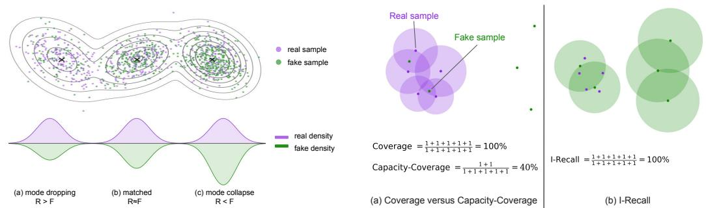  
Figure 1: Illustration of local density imbalance. Rows show sample-level imbalance and the corresponding distribution-level view.  
Figure 2: Overview of metrics. An example illustrating the advantage of Capacity-Coverage over Coverage and I-Recall.

Recall is inherently a set-level property: its value depends not only on individual sample quality, but also on how generated samples are allocated across the real distribution. In our analysis, recall failures can arise from different allocation imbalances, especially mode dropping and mode collapse 2, as illustrated in Fig. 2. For this reason, a useful recall metric should not only provide an overall score, but also report diagnostic scores that explain which coverage failure is present.

Although recall is intended to measure distributional coverage, most existing recall-style metrics simplify this problem into geometry-based coverage. In practice, they estimate local support through kNN-based neighbourhoods and then reduce recall to a single aggregate score Kynkäänniemi et al. (2019); Naeem et al. (2020); Park and Kim (2023); Kim et al. (2023). This simplifying assumption weakens their diagnostic value and interpretability in two ways. First, a single recall score lacks information about which coverage failure types are present or how severe they are. For example, two generators may have similar recall scores while exhibiting different diversity failures, such as mode dropping and mode collapse. Second, geometry-based coverage can systematically overestimate recall. A small number of generated samples may cover many real samples in local neighbourhoods, even when the synthetic set is too sparse to provide balanced coverage Naeem et al. (2020); Park and Kim (2023); Salvy et al. (2026); Khayatkhoei and AbdAlmageed (2023). As a result, these metrics provide limited feedback for diagnosing coverage behaviour and improving generative models.

Based on this observation, we propose CADMA, a Capacity-Aware coverage Decomposition framework for generative Model Assessment. CADMA evaluates distributional coverage through local capacity matching between real and generated samples, with matches restricted to neighbourhoods centred on real samples. This separates geometry-based coverage from capacity-supported coverage, allowing the evaluation to account for whether generated samples are allocated in accordance with the real-data distribution. CADMA then defines a capacity-aware coverage score together with diagnostic scores for mode dropping and mode collapse, providing both a more reliable coverage estimate and a more detailed diagnosis of diversity failure modes.

Our contributions are three-fold.

• We identify a core limitation of existing recall-style metrics: they reduce distributional coverage to geometry-based coverage. This simplification weakens diagnostic interpretability by reporting only a single recall score and can assign high recall to poorly covered generative distributions.

• We introduce CADMA, a capacity-aware coverage evaluation framework based on local capacity matching between real and generated samples. This moves beyond geometrybased coverage by defining a capacity-aware coverage score and diagnostic scores for mode dropping and mode collapse.

• We validate CADMA on both toy and real-data benchmarks, showing that it provides more reliable distributional coverage estimates and finer-grained, interpretable diagnostics of diversity failures than standard recall-oriented metrics. Despite its additional diagnostic ability, CADMA adds only about 1% computational overhead.

## 2 Preliminaries

## 2.1 Problem Setting

Let $\mathcal { R } _ { 0 } = \{ x _ { i } \} _ { i = 1 } ^ { N }$ and $\mathcal { F } _ { 0 } = \{ y _ { j } \} _ { j = 1 } ^ { M }$ denote the real and generated (fake) sample sets. Direct statistical comparison in the raw input space is generally difficult for high-dimensional data such as images. Following standard practice in generative model evaluation Heusel et al. (2017); Salimans et al. (2016); Kynkäänniemi et al. (2019); Naeem et al. (2020); Park and Kim (2023), we map both sets into a feature space using a pretrained feature extractor $\phi : \mathcal { X }  \mathbb { R } ^ { d }$

$$
\begin{array} { r } { \mathcal { R } = \{ r _ { i } \} _ { i = 1 } ^ { N } : = \{ \phi ( x _ { i } ) \} _ { i = 1 } ^ { N } , \qquad \mathcal { F } = \{ f _ { j } \} _ { j = 1 } ^ { M } : = \{ \phi ( y _ { j } ) \} _ { j = 1 } ^ { M } . } \end{array}
$$

In the rest of the paper, all distances and neighbourhoods are computed in this feature space.

## 2.2 Geometry-Based Coverage in k-NN-Based Recall

To avoid ambiguity, we use I-Recall and Coverage to denote the specific metrics. Both are recall-style metrics that estimate how well generated samples cover the real distribution. We use lowercase recall and coverage for the general evaluation concepts, treating them as interchangeable in this context because both refer to the coverage of the real distribution by generated samples.

At the distribution level, recall measures the probability that a real sample lies in the support of the generated distribution Park and Kim (2023); Salvy et al. (2026):

$$
{ \mathrm { R e c a l l } } ( P , Q ) : = \mathbb { E } _ { X \sim P } \left[ { \bf 1 } \{ X \in \mathrm { s u p p } ( Q ) \} \right] ,\tag{1}
$$

where $P$ and Q denote the real and generated distributions, respectively, supp(·) denotes distributional support, and 1[·] denotes the indicator function, which equals one when its argument is true and zero otherwise. Since the underlying distributions are unknown, Eq. (1) cannot be evaluated directly. In practice, these distributions are represented empirically by the finite real and generated feature sets R and F, respectively.

In practice, I-Recall Kynkäänniemi et al. (2019) approximates the generated support by the union of hyperspheres $\textstyle \bigcup _ { j = 1 } ^ { M } B ( f _ { j } , \eta _ { j } )$ in $\mathbb { R } ^ { d }$ centered at generated features $f _ { j }$ , where the radius $\eta _ { j } : =$ $\mathrm { N N D } _ { k } ( f _ { j } )$ is the distance from $f _ { j }$ to its k-th nearest neighbour in $\mathcal { F } \backslash \{ f _ { j } \}$

$$
{ \mathrm { I - R e c a l l } } : = { \frac { 1 } { N } } \sum _ { i = 1 } ^ { N } \mathbf { 1 } \left[ r _ { i } \in \bigcup _ { j = 1 } ^ { M } B ( f _ { j } , \eta _ { j } ) \right] .\tag{2}
$$

This formulation measures whether each real feature $r _ { i }$ lies inside at least one generated neighbourhood.

Symmetrically, the Coverage metric Naeem et al. (2020) uses hyperspheres centered at real features $r _ { i }$ and measures the fraction of such hyperspheres that contain at least one generated feature:

$$
\mathrm { C o v e r a g e } : = \frac { 1 } { N } \sum _ { i = 1 } ^ { N } \mathbf { 1 } \biggl [ \exists j \mathrm { s . t . } f _ { j } \in B ( r _ { i } , \rho _ { i } ) \biggr ] ,\tag{3}
$$

where $\rho _ { i } : = \mathrm { N N D } _ { k } ( r _ { i } )$ is the corresponding real-side radius.

Advantage of real-induced geometry. The advantage of the Coverage metric over I-Recall is that it defines support hyperspheres on real data rather than generated samples. This real-induced geometry is more robust, because the support construction is not distorted by abnormal or out-of-distribution generated samples, and more efficient, because the reference hyperspheres only need to be built once and can be reused across generative models Naeem et al. (2020). In contrast, I-Recall constructs hyperspheres from generated samples, so its estimated support must be recomputed for each model and can be sensitive to generated outliers Naeem et al. (2020); Park and Kim (2023); Kim et al. (2023); Alaa et al. (2022); Cheema and Urner (2023).

Limitation of geometry-based coverage. Nevertheless, this real-induced construction still inherits a broader limitation of recall-style metrics: both I-Recall and the Coverage metric reduce distributional coverage to geometry-based coverage. As a result, they report a single summary score with limited diagnostic interpretability and cannot reveal the degree of different coverage failures, such as mode collapse and mode dropping. In addition, geometry-based coverage only checks whether each hypersphere contains at least one sample. Therefore, a small number of generated samples may make many real regions appear covered, leading to overly optimistic coverage estimates Park and Kim (2023).

Subsequent works have proposed many alternatives and refinements to recall-style evaluation, with most relying on kNN-based neighbourhood constructions Park and Kim (2023); Kim et al. (2023); Alaa et al. (2022); Cheema and Urner (2023); Khayatkhoei and AbdAlmageed (2023); Salvy et al. (2026). However, these methods still largely inherit a common geometry-based view of coverage. Recent sanity-check benchmarks further show that existing recall-style metrics exhibit important failure cases and unreliable estimates Räisä et al. (2025).

CADMA follows the real-induced construction of the Coverage metric and inherits its robustness and efficiency, while addressing the limitations of geometry-based coverage through capacity-aware real–fake matching. This matching provides a more fine-grained and interpretable diagnosis of coverage failures, including mode collapse and mode dropping, while reducing overly optimistic coverage estimates.

## 3 Method

Motivated by the limitations above, we propose CADMA, a recall-style metric that reports the degrees of mode dropping and mode collapse while reducing overly optimistic coverage estimates. Overly optimistic estimates can arise when a small number of generated samples make a large portion of the real distribution appear covered. CADMA addresses this issue through local capacity matching, which prevents the same generated sample from being repeatedly used to support many real samples. We first define this capacity-aware coverage score, and then show how the same matching structure induces diagnostic scores for mode dropping and mode collapse.

## 3.1 Local Capacity Matching

We first define the local coverage relation using the same real-induced neighbourhoods as the Coverage metric Naeem et al. (2020). Let $\rho _ { i } = \mathrm { N N D } _ { k } ( r _ { i } )$ (Eq. 3) denote the distance from real feature $r _ { i }$ to its k-th nearest neighbour in $\mathcal { R } \backslash \left\{ r _ { i } \right\}$ . We define a binary matrix A by

$$
A _ { i j } = \mathbf { 1 } [ \| r _ { i } - f _ { j } \| _ { 2 } \leq \rho _ { i } ] , \qquad A \in \{ 0 , 1 \} ^ { N \times M } .\tag{4}
$$

Here, $A _ { i j } = 1$ means that generated feature $f _ { j }$ falls inside the real-induced hypersphere of real feature $r _ { i }$ . The matrix $A$ records all local real–generated relations: one real hypersphere may contain multiple generated features, and one generated feature may fall inside multiple real hyperspheres. Equivalently, some rows may satisfy $\textstyle \sum _ { j = 1 } ^ { M } A _ { i j } > 1$ , and some columns may satisfy $\textstyle \sum _ { i = 1 } ^ { N } A _ { i j } > 1$

CADMA therefore introduces local capacity matching, which extracts a matching matrix $Z$ from the admissible relations in $A$ . It is local because matching can only use real-induced neighbourhood relations, and capacity-constrained because each real or generated feature can be matched at most once:

$$
Z _ { i j } \le A _ { i j } , \quad \forall i , j , \qquad \sum _ { j = 1 } ^ { M } Z _ { i j } \le 1 , \quad \forall i , \qquad \sum _ { i = 1 } ^ { N } Z _ { i j } \le 1 , \quad \forall j .\tag{5}
$$

The matrix A defines an unweighted bipartite graph, with real and generated features forming its two vertex sets and $A _ { i j } = 1$ defining an edge between r and $f _ { j }$ . Multiple matching matrices $Z$ may satisfy Eq. (5). Among these feasible matchings, CADMA selects one with maximum cardinality:

$$
Z ^ { \star } \in \arg \operatorname* { m a x } _ { Z \in \{ 0 , 1 \} ^ { N \times M } } \sum _ { i = 1 } ^ { N } \sum _ { j = 1 } ^ { M } Z _ { i j } \quad \mathrm { s . t . ~ E q . } ( 5 ) .\tag{6}
$$

We use the resulting matching size $\begin{array} { r } { N ^ { \mathrm { m a t } } = \sum _ { i = 1 } ^ { N } \sum _ { j = 1 } ^ { M } Z _ { i j } ^ { \star } } \end{array}$ . We compute a maximum matching using the Hopcroft–Karp algorithm Hopcroft and Karp (1973), a standard exact solver for this problem. Any exact maximum-matching solver yields the same value of $N ^ { \mathrm { m a t } }$

## 3.2 Capacity-Aware Coverage and Diagnostic Scores

Local capacity matching yields a capacity-aware coverage score and two diagnostic scores for mode dropping and mode collapse. Following common practice in set-based generative evaluation, we use equally sized real and generated sample sets $( N \bar { = } M )$ , so real-side and generated-side excesses are comparable.

The Coverage metric in Eq. (3) counts real samples whose neighbourhood contains at least one generated sample. In our notation, let

$$
u _ { i } = \mathbf { 1 } \left[ \sum _ { j = 1 } ^ { M } A _ { i j } \geq 1 \right] , \qquad N ^ { \mathrm { c o v } } = \sum _ { i = 1 } ^ { N } u _ { i } .
$$

Since $A$ is defined using the same real-side radius $\rho _ { i }$ as in Eq. (3), the Coverage metric can be written as

$$
\mathrm { C o v e r a g e } = { \frac { N ^ { \mathrm { c o v } } } { N } } .
$$

CADMA instead defines capacity-aware coverage from the maximum matching size under local capacity matching:

$$
\mathcal { C } _ { \mathrm { c a p } } : = \frac { N ^ { \mathrm { m a t } } } { N } .\tag{7}
$$

Mode dropping is reflected in local regions where real samples outnumber the available generated samples. In geometry-based coverage, such regions may still be counted as covered as long as each real neighbourhood contains at least one generated sample. After local capacity matching, however, only $N ^ { \mathrm { m a t } }$ of the $N ^ { \mathrm { c o v } }$ covered real samples can be paired with generated samples. Thus, $N ^ { \mathrm { c o v } } - \mathrm { \ ' { N } ^ { \mathrm { m a } \mathrm { t } } }$ counts geometrically covered real samples that remain unmatched due to a lack of distinct generated counterparts. Normalizing this quantity by the total number of real samples gives the mode dropping score:

$$
\mathcal { D } _ { \mathrm { d r o p } } : = \mathrm { C o v e r a g e } - \mathcal { C } _ { \mathrm { c a p } } = \frac { N ^ { \mathrm { c o v } } - N ^ { \mathrm { m a t } } } { N } .\tag{8}
$$

Equivalently, the Coverage metric decomposes as $\mathrm { C o v e r a g e } = \mathcal { C } _ { \mathrm { c a p } } + \mathcal { D } _ { \mathrm { d r o p } }$ . This decomposition explains why geometry-based coverage can be overly optimistic: it combines effective coverage $\mathcal { C } _ { \mathrm { c a p } }$ with a mode-dropping component $\bar { \mathcal { D } _ { \mathrm { d r o p } } } .$ . By separating this mode-dropping component, $\mathrm { { C A D M \bar { A } } }$ obtains a more reliable capacity-aware coverage estimate.

Symmetrically, mode collapse appears as local regions where generated samples outnumber the available real samples. We define the generated-side covered count as

$$
v _ { j } = { \bf 1 } \left[ \sum _ { i = 1 } ^ { N } A _ { i j } \geq 1 \right] , \qquad M ^ { \mathrm { c o v } } = \sum _ { j = 1 } ^ { M } v _ { j } .
$$

Here, $M ^ { \mathrm { c o v } }$ counts generated samples that are locally covered by the real-induced neighbourhoods. Under local capacity matching, only $N ^ { \mathrm { m a t } }$ of these $M ^ { \mathrm { c o v } }$ generated samples can be paired with distinct real samples. The remaining $\mathbf { \bar { \boldsymbol { M } } } ^ { \mathrm { c o v } } - \boldsymbol { N } ^ { \mathrm { m a t } }$ therefore measures the excess covered generated

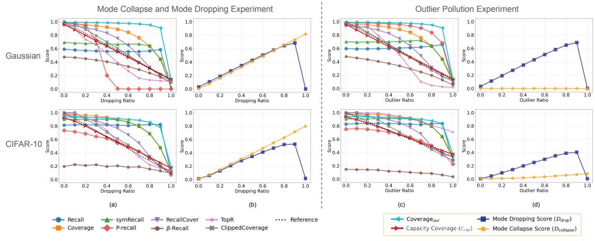  
Figure 3: Main experiments on Gaussian and CIFAR-10 mode dropping, mode collapse, and outlier pollution. We compare the proposed capacity-aware coverage with existing baselines and report CADMA diagnostic scores for mode dropping and mode collapse.

samples that lack real counterparts. Normalizing this quantity by the total number of real samples gives the mode-collapse score:

$$
\mathcal { D } _ { \mathrm { c o l l a p s e } } : = \frac { M ^ { \mathrm { c o v } } - N ^ { \mathrm { m a t } } } { N } .\tag{9}
$$

## 3.3 Radius Regularization

Under the raw radius choice $\varepsilon _ { i } = \rho _ { i } .$ , the geometry-based score reduces to the Coverage metric. However, raw kNN radii can become excessively large in sparse regions or around outliers, making the induced support overly permissive Naeem et al. (2020); Park and Kim (2023); Khayatkhoei and AbdAlmageed (2023). To stabilize the neighbourhood geometry, we cap each local radius by the global mean real-side radius, $\begin{array} { r } { \bar { \rho } = \frac { 1 } { N } \sum _ { i = 1 } ^ { N } \rho _ { i } } \end{array}$ , and define

$$
\varepsilon _ { i } = \operatorname* { m i n } ( \rho _ { i } , \bar { \rho } ) .\tag{10}
$$

This regularization is designed to reduce the influence of outlier-induced large neighbourhoods while preserving local radii in dense regions. We empirically verify its effect in the outlier ablation in Fig. 5.

## 4 Experiments

Experimental Setup We evaluate CADMA against a broad collection of existing recall-style metrics, including β-Recall, TopR Kim et al. (2023), I-Recall Kynkäänniemi et al. (2019), Coverage Naeem et al. (2020), symRecall Khayatkhoei and AbdAlmageed (2023), P-recall Park and Kim (2023), Recall Cover Cheema and Urner (2023), and ClippedCoverage Salvy et al. (2026). For method-specific hyperparameters, we follow the original recommendations. In particular, we set k′ = 3 and C = 3 for Precision Recall Cover, k = 3 for I-Recall, and k = 4 for P-recall. For CADMA, we use k = 70 unless otherwise stated. An ablation of this choice is given in Sec. 4.4. All experiments are run on a single NVIDIA H100 GPU with 80GB memory unless otherwise stated. For image-based evaluations, we extract features using DINOv2-Large (ViT-L/14) Oquab et al. (2023), following recent practice Salvy et al. (2026); Fox et al. (2025) and prior evidence that this representation space is more semantically meaningful and better aligned with human perception for generative image evaluation Stein et al. (2023).

Evaluating generative model metrics is inherently difficult because ground-truth metric values are typically unavailable. Following prior work, we assess CADMA through controlled sanity checks on toy and real-world data where the expected metric behaviour can be clearly specified. Additional evaluations of existing generators on ImageNet-256, FFHQ, and LSUN Bedroom are provided in Appendix B. Theoretical complexity analysis and runtime and memory measurements are presented in Appendix C.

Table 1: Mean absolute error. Best and second-best results are bolded and underlined.
<table><tr><td rowspan="2">Method</td><td colspan="2">Gaussian</td><td colspan="2">CIFAR-10</td><td rowspan="2">Avg.</td></tr><tr><td>Mode Collapse (↓)</td><td>Outlier Pollution (↓)</td><td>Mode Collapse (↓)</td><td>Outlier Pollution (↓)</td></tr><tr><td>Recall Kynkäänniemi et al. (2019)</td><td>0.206</td><td>0.214</td><td>0.252</td><td>0.179</td><td>0.213</td></tr><tr><td>Coverage Naeem et al. (2020)</td><td>0.204</td><td>0.203</td><td>0.239</td><td>0.189</td><td>0.209</td></tr><tr><td>symRecall Khayatkhoei and AbdAlmageed (2023)</td><td>0.180</td><td>0.183</td><td>0.227</td><td>0.175</td><td>0.191</td></tr><tr><td>P-recall Park and Kim (2023)</td><td>0.255</td><td>0.283</td><td>0.080</td><td>0.079</td><td>0.174</td></tr><tr><td>RecallCover Cheema and Urner (2023)</td><td>0.088</td><td>0.085</td><td>0.108</td><td>0.090</td><td>0.093</td></tr><tr><td>β-Recall Alaa et al. (2022)</td><td>0.230</td><td>0.260</td><td>0.368</td><td>0.560</td><td>0.355</td></tr><tr><td>TopR Kim et al. (2023)</td><td>0.119</td><td>0.127</td><td>0.054</td><td>0.240</td><td>0.135</td></tr><tr><td>ClippedCoverage Salvy et al. (2026)</td><td>0.025</td><td>0.020</td><td>0.051</td><td>0.045</td><td>0.035</td></tr><tr><td> $\overline { { \mathbf { C A D M A } ( \mathcal { C } _ { \mathrm { c a p } } ) } }$ </td><td>0.019</td><td>0.023</td><td>0.039</td><td>0.025</td><td>0.027</td></tr></table>

## 4.1 Mode Dropping and Mode Collapse

We evaluate whether CADMA can diagnose mode dropping and mode collapse. Following prior mode-dropping settings Salvy et al. (2026); Naeem et al. (2020); Kim et al. (2023), we manually remove samples from selected modes. In the density-shift setting, removed samples are reassigned to remaining modes, producing both mode dropping and mode collapse. In the outlier-pollution setting, removed samples are replaced by outliers, testing whether CADMA separates missing coverage from generated samples outside the real support.

## 4.1.1 Density Shift in Gaussian Mixtures

We first evaluate controlled density shift on a seven-mode Gaussian mixture. Generated samples are progressively moved from six modes into the remaining mode. Consequently, the reference coverage decreases linearly from 1 to $1 / 7$ . Samples are removed from all six modes simultaneously, rather than eliminating entire modes sequentially (see Fig. 8). Thus, the affected modes remain present at intermediate stages but become progressively under-represented, creating local imbalance between the real and generated distributions.

As shown in Fig. 3(a), $\mathcal { C } _ { \mathrm { c a p } }$ closely follows this reference trend, while most baselines deviate substantially. Several baselines still assign high recall scores at large dropping ratios, indicating optimistic estimates under severe density shift. We also report $\mathrm { C o v e r a g e } _ { \mathrm { o u r } }$ as a geometry-based reference, computed using the same neighbourhoods as $\mathcal { C } _ { \mathrm { c a p } }$ but without capacity matching.

ClippedCoverage is the closest baseline to the reference trend, but it remains a single-score metric. CADMA additionally reports mode-dropping and mode-collapse diagnostics in Fig. 3(b). As the dropping ratio increases, $\mathcal { D } _ { \mathrm { c o l l a p s e } }$ rises because generated samples concentrate in the remaining mode, while $\mathcal { D } _ { \mathrm { d r o p } }$ initially rises because affected modes receive insufficient generated support. At the final stage, $\mathcal { D } _ { \mathrm { d r o p } }$ drops because these regions become fully uncovered rather than locally under-supported, which is consistent with its definition.

## 4.1.2 Density Shift in CIFAR-10

We further evaluate the same density-shift protocol in the CIFAR-10 feature space, following the realdata setting in ClippedCoverage Salvy et al. (2026). We form two equal-sized sets from CIFAR-10 real data, treating one as the real set and the other as the generated set, using all 10 classes with 2500 samples per class in each set. We then simultaneously drop samples from nine classes and reassign them to the remaining class, creating mode dropping together with mode collapse. The reference recall trend decreases linearly from 1 to 1/10 as the dropping ratio increases from 0% to 90%.

As shown in Fig. 3(a), the Gaussian conclusions carry over to real image features: $\mathcal { C } _ { \mathrm { c a p } }$ tracks the reference trend more faithfully than most baselines, while several existing metrics remain overly high under severe dropping. Fig. 3(b) further shows that CADMA provides diagnostic information beyond the recall score. As the dropping ratio increases, $\mathcal { D } _ { \mathrm { c o l l a p s e } }$ reflects the increasing concentration of generated samples in the remaining class, while $\mathcal { D } _ { \mathrm { d r o p } }$ captures the loss of effective generated support in affected classes.

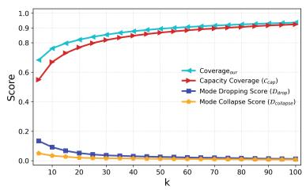  
(a)

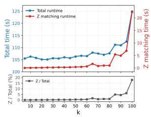  
(b)

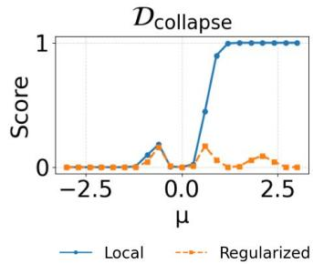  
Figure 4: Ablation on the hyperparameter $k ,$ showing the trade- Figure 5: Ablation on the radius off between CADMA scores in (a) and runtime in (b). regularization strategy.

## 4.2 Robustness under Outlier Pollution

Asymmetric Gaussian translation with outliers. Following prior work on outlier robustness and asymmetric evaluation Naeem et al. (2020); Park and Kim (2023); Khayatkhoei and AbdAlmageed (2023); Kynkäänniemi et al. (2019), we compare $X \sim \mathcal { N } ( 0 , I )$ and $\dot { Y } \sim \mathcal { N } ( \mu , I )$ for $\mu \in [ - 3 , 3 ]$ with one real outlier from $\mathcal { N } ( 2 , I )$ and one generated outlier from $\mathcal { N } ( - 2 , I )$ . Since the translation is symmetric around $\mu = 0$ , a metric robust to outlier pollution should retain approximate symmetry.

As shown in Fig. 6, I-Recall becomes strongly asymmetric under outlier pollution, reflecting sensitivity to generated-sample-induced neighbourhood inflation. CADMA remains more symmetric in both the capacity-aware coverage comparison in Fig. 6(a) and the diagnostic scores in Fig. 6(b). Although the mode-collapse score is not perfectly symmetric, radius regularization makes it less sensitive to outlier-induced fluctuations, as shown in Fig. 5.

CIFAR-10 outlier pollution. To test robustness, sensitivity, and interpretability under outlier pollution, we use six CIFAR-10 categories as in-distribution support and treat the remaining four as outliers. We progressively replace generated samples from the in-distribution categories with outlier-category samples, as shown in Fig. $^ { 3 ( \mathrm { c } , \mathrm { d } ) }$ . Since the proportion of valid generated samples decreases, an ideal recall-oriented metric should decrease linearly. At the final stage, only two in-distribution categories remain covered, so the ideal recall decreases from 1 to $2 / 6 \approx 0 . 3 3$

Among the coverage metrics, only $\mathcal { C } _ { \mathrm { c a p } }$ and ClippedCoverage exhibit this desired linear degradation. CADMA further provides diagnostic information beyond this recall trend. As valid generated samples are replaced, $\mathcal { D } _ { \mathrm { d r o p } }$ initially increases because real samples lose effective generated support. In contrast, $\mathcal { D } _ { \mathrm { c o l l a p s e } }$ remains low because the injected outliers do not belong to the real distribution and therefore should not be interpreted as mode collapse. This differs from the density-shift setting in Fig. 3(a,b), where generated samples concentrate on the remaining modes. The observed pattern in Fig. 3(d), with initially increasing $\mathcal { D } _ { \mathrm { d r o p } }$ and nearly unchanged $\mathcal { D } _ { \mathrm { c o l l a p s e } } .$ supports the interpretability of CADMA’s diagnostic scores.

## 4.3 Quantitative results

MAE Error to the Reference Trend We also report the mean absolute error to the reference trend on Gaussian and CIFAR-10 experiments in Table 1. The reference trends are labelled “Reference” in Fig. 3. CADMA’s capacity-aware coverage $\mathcal { C } _ { \mathrm { c a p } }$ achieves the lowest average error across all settings, with ClippedCoverage as the closest baseline.

This comparison is particularly strong because linear score degradation is a central design goal of ClippedCoverage: its main contribution is to calibrate coverage scores so that they follow an interpretable linear trend under controlled degradation. Nevertheless, CADMA achieves a lower average error than ClippedCoverage, showing that capacity-constrained matching provides a more faithful estimate of the effective recall trend even on the criterion where ClippedCoverage is explicitly designed to perform well.

Runtime of Matching Fig. 4(b) shows that the matching step is lightweight. Both the total runtime and the runtime for solving $Z ^ { \star }$ increase only mildly as k grows. For $k \leq 8 0$ , the matching step accounts for about 1% of the total runtime. Further theoretical complexity analysis and runtime and memory measurements across sample sizes are provided in Appendix C.

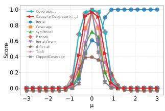  
(a)

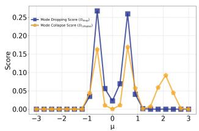  
(b)

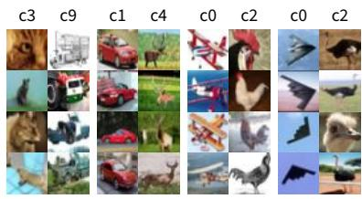  
(a) outlier  
(b) collapse  
(c) uncover  
Figure 6: Translation and outlier experiments on Gaussian data. CADMA remains stable and exhibits symmetric behaviour under distribution shifts.  
(d) dropping  
Figure 7: CIFAR-10 diagnostic visualization by CADMA. The labels c0– c9 indicate CIFAR-10 categories.

## 4.4 Ablation Studies

Effect of radius regularization. Fig. 5 compares raw and regularized radii in the Gaussian translation setting with outliers. Raw radii lead to a noticeably asymmetric curve, indicating sensitivity to outlier-induced neighbourhood inflation. Radius regularization produces a more symmetric trend, consistent with the underlying translation, so we use it throughout CADMA.

Effect of neighbourhood size k. Fig. 4 evaluates the effect of k on CIFAR-10 feature sets with matched class proportions. Since the real and generated sets are distributionally aligned, the ideal recall should be close to 1. Small values of k define overly restrictive neighbourhoods, making local balance difficult to estimate and lowering ${ \mathcal { C } } _ { \mathrm { c a p } } .$ As k increases, more admissible matches become available, but the matching graph also becomes denser and runtime increases. Importantly, both performance and runtime remain stable over a broad range, especially for $4 0 \leq k \leq 8 0$ . This suggests that CADMA is not sensitive to precise tuning of k, reducing the burden of hyperparameter selection. We use k = 70 unless otherwise stated.

Visualization diagnosis and practical value. For this visualization, we evaluate CADMA using 25,000 images generated by the publicly released StyleGAN-XL model Sauer et al. (2022) across all 10 CIFAR-10 classes. Fig. 7 visualizes representative CIFAR-10 samples from four CADMA regions: mode dropping, mode collapse, uncovered real samples, and generated outliers. These regions provide sample-level diagnostic information about model behaviour. For example, the mode-collapse region shows that the generator tends to over-produce certain patterns, such as red cars. The uncovered region reveals visual concepts that the model fails to generate, such as old-style aircraft and roosters. In contrast, the mode-dropping region contains concepts that the model can generate but only weakly represents, such as bat-like aircraft and ostrich-like birds.

## 5 Related Work

Single-score generative evaluation. Classical distribution-level metrics include Inception Score (IS) Barratt and Sharma (2018); Salimans et al. (2016), Kernel Inception Distance (KID) Binkowski´ et al. (2018); Xu et al. (2018), Fréchet Inception Distance (FID) Heusel et al. (2017), and more recently CMMD Jayasumana et al. (2024). Recent text-to-image evaluation has also introduced sample-level alignment and preference metrics such as CLIPScore Hessel et al. (2021), PickScore Kirstain et al. (2023), ImageReward Xu et al. (2023), TIFA Hu et al. (2023), GenEval Ghosh et al. (2023), and VQAScore Lin et al. (2024). In this work, we focus on distribution-level evaluation. Samplelevel metrics mainly assess the quality or alignment of individual images, but they do not directly evaluate how well a generated set matches the real data distribution as a whole. They are therefore complementary to the distribution-level recall evaluation considered here.

Among distribution-level metrics, FID has become the dominant benchmark in image generation Sali mans et al. (2016); Heusel et al. (2017); Binkowski et al. (2018); Rombach et al. (2021). More recent´ distances such as CMMD further improve this line by relaxing the Gaussian feature assumption through an MMD-based formulation. However, both FID and CMMD summarise the comparison between two distributions into a single number, failing to separate two important aspects of generative model quality: fidelity and diversity Sajjadi et al. (2018). As a result, when one model achieves a better FID- or CMMD-style score than another, it is unclear whether the difference is driven by fidelity, diversity, or both.

Fidelity–diversity decomposition. Motivated by the observation that scalar metrics such as FID cannot distinguish fidelity from diversity, Sajjadi et al. (2018) introduced the original precision– recall framework for generative models. In this line of work, precision is associated with fidelity and measures the fraction of generated samples that are realistic, whereas recall is associated with diversity and measures how well generated samples cover the variation of the real data Salvy et al. (2026); Naeem et al. (2020); Kynkäänniemi et al. (2019). Kynkäänniemi et al. (2019) later proposed Improved Precision and Recall, replacing clustering-based support estimation with a kNN-based construction. This made the framework easier to compute, but also introduced sensitivity to outliers in the construction of local neighbourhoods. Naeem et al. (2020) proposed Density and Coverage, and Park and Kim (2023) introduced a probabilistic formulation of precision and recall to improve the robustness of the kNN-based construction to outliers. Khayatkhoei and AbdAlmageed (2023) further addressed asymmetry issues through symPrecision and symRecall, while Precision Recall Cover introduced support-thresholded variants of precision and recall Cheema and Urner (2023). Other alternatives include α-Precision and β-Recall Alaa et al. (2022) and TopP&R Kim et al. (2023), which further depart from the standard kNN construction. More recently, Clipped Density and Clipped Coverage were introduced as variants of Density and Coverage to improve interpretability by calibrating each sample’s contribution Salvy et al. (2026), while information-theoretic work has provided an entropy-based view of precision and recall, including additional quantities for evaluating mode collapse Fox et al. (2025).

## 6 Discussion and Limitations

CADMA is evaluated primarily in image generation settings, where feature-space neighbourhoods are well established and widely used for generative model assessment. Although the framework is modality-agnostic at the level of finite sample sets, its behaviour in other domains such as text, graphs, or audio remains unexplored. Future work should investigate whether capacity-constrained matching remains informative under non-visual representations and domain-specific notions of similarity.

CADMA also relies on local neighbourhood construction in a pretrained feature space. Its diagnostic scores therefore depend on the quality of the feature extractor, the neighbourhood parameter k, and the balanced evaluation protocol used to compare real and generated samples. These choices are common in set-based generative evaluation, but they may affect the interpretation of mode dropping and mode collapse in practice.

From a broader-impact perspective, CADMA can improve transparency in generative model evaluation by revealing whether recall failures are driven by mode dropping or mode collapse. At the same time, it should not be treated as a complete replacement for human inspection or task-specific evaluation, since over-reliance on any single metric can still lead to misleading conclusions about model quality.

## 7 Conclusion

We studied recall-oriented evaluation for generative models and identified two limitations of existing geometry-based recall metrics: they can overestimate coverage under permissive neighbourhood relations, and they provide limited diagnostic information about coverage failures. To address these issues, we introduced CADMA, a capacity-aware framework based on local capacity matching. CADMA defines a capacity-aware coverage score $\mathcal { C } _ { \mathrm { c a p } }$ and two diagnostic scores, $\mathcal { D } _ { \mathrm { d r o p } }$ and $\mathcal { D } _ { \mathrm { c o l l a p s e } } ,$ , to quantify mode dropping and mode collapse. Across controlled Gaussian and CIFAR-10 experiments, CADMA follows the expected recall trends while providing diagnostic information that single-score metrics cannot reveal. The results suggest that capacity-constrained matching offers a useful way to move beyond permissive geometric coverage and toward more interpretable recall-style evaluation of generative models.

## 8 Acknowledgements

DM’s and GT’s work was funded by UK Research and Innovation (UKRI) under the UK government’s Horizon Europe funding guarantee (grant No. 10099264) and by the European Union (under EC Horizon Europe grant agreement No. 101135800 (RAIDO)). Yanran’s work was supported in part by the European Union under the Horizon Europe HORIZON-MSCA-2021-SE-01-01 project, Emerging Nanoscopy for Single Entity Characterisation (ENSIGN), Project No. 101086226. This research utilised Queen Mary’s Apocrita HPC facility, supported by QMUL Research-IT and ITS Research. For the purpose of open access, the author has applied a Creative Commons Attribution (CC BY) license to any Author Accepted Manuscript version arising.

## References

Ahmed Alaa, Boris Van Breugel, Evgeny S Saveliev, and Mihaela Van Der Schaar. How faithful is your synthetic data? sample-level metrics for evaluating and auditing generative models. In International conference on machine learning, pages 290–306. PMLR, 2022.

Pietro Astolfi, Marlene Careil, Melissa Hall, Oscar Mañas, Matthew Muckley, Jakob Verbeek, Adriana Romero Soriano, and Michal Drozdzal. Consistency-diversity-realism pareto fronts of conditional image generative models. arXiv preprint arXiv:2406.10429, 2024.

Shane Barratt and Rishi Sharma. A note on the inception score. arXiv preprint arXiv:1801.01973, 2018.

Mikołaj Binkowski, Danica J Sutherland, Michael Arbel, and Arthur Gretton. Demystifying mmd gans.´ arXiv preprint arXiv:1801.01401, 2018.

Fasil Cheema and Ruth Urner. Precision recall cover: A method for assessing generative models. In International Conference on Artificial Intelligence and Statistics, pages 6571–6594. PMLR, 2023.

Alexis Fox, Samarth Swarup, and Abhijin Adiga. A unifying information-theoretic perspective on evaluating generative models. In Proceedings ofthe AAAI Conference on Artificial Intelligence, pages 16630–16638, 2025.

Dhruba Ghosh, Hannaneh Hajishirzi, and Ludwig Schmidt. Geneval: An object-focused framework for evaluating text-to-image alignment. Advances in Neural Information Processing Systems, 36:52132–52152, 2023.

Ian J Goodfellow, Jean Pouget-Abadie, Mehdi Mirza, Bing Xu, David Warde-Farley, Sherjil Ozair, Aaron Courville, and Yoshua Bengio. Generative adversarial nets. Advances in neural information processing systems, 27, 2014.

Jack Hessel, Ari Holtzman, Maxwell Forbes, Ronan Le Bras, and Yejin Choi. Clipscore: A reference-free evaluation metric for image captioning. In Proceedings of the 2021 conference on empirical methods in natural language processing, pages 7514–7528, 2021.

Martin Heusel, Hubert Ramsauer, Thomas Unterthiner, Bernhard Nessler, and Sepp Hochreiter. Gans trained by a two time-scale update rule converge to a local nash equilibrium. Advances in neural information processing systems, 30, 2017.

Jonathan Ho, Ajay Jain, and Pieter Abbeel. Denoising diffusion probabilistic models. Advances in neural information processing systems, 33:6840–6851, 2020.

John E Hopcroft and Richard M Karp. An nˆ5/2 algorithm for maximum matchings in bipartite graphs. SIAM Journal on computing, 2(4):225–231, 1973.

Yushi Hu, Benlin Liu, Jungo Kasai, Yizhong Wang, Mari Ostendorf, Ranjay Krishna, and Noah A Smith. Tifa: Accurate and interpretable text-to-image faithfulness evaluation with question answering. In Proceedings of the IEEE/CVF International Conference on Computer Vision, pages 20406–20417, 2023.

Sadeep Jayasumana, Srikumar Ramalingam, Andreas Veit, Daniel Glasner, Ayan Chakrabarti, and Sanjiv Kumar. Rethinking fid: Towards a better evaluation metric for image generation. In 2024 IEEE/CVF Conference on Computer Vision and Pattern Recognition (CVPR), pages 9307–9315. IEEE, 2024.

Tero Karras, Samuli Laine, and Timo Aila. A style-based generator architecture for generative adversarial networks. In 2019 IEEE/CVF conference on computer vision and pattern recognition (CVPR), pages 4396– 4405. IEEE, 2019.

Mahyar Khayatkhoei and Wael AbdAlmageed. Emergent asymmetry of precision and recall for measuring fidelity and diversity of generative models in high dimensions. In International Conference on Machine Learning, pages 16326–16343. PMLR, 2023.

Pum Jun Kim, Yoojin Jang, Jisu Kim, and Jaejun Yoo. Topp&r: Robust support estimation approach for evaluating fidelity and diversity in generative models. Advances in Neural Information Processing Systems, 36:7831–7866, 2023.

Diederik P Kingma and Max Welling. Auto-encoding variational bayes. arXiv preprint arXiv:1312.6114, 2013.

Yuval Kirstain, Adam Polyak, Uriel Singer, Shahbuland Matiana, Joe Penna, and Omer Levy. Pick-a-pic: An open dataset of user preferences for text-to-image generation. Advances in neural information processing systems, 36:36652–36663, 2023.

Tuomas Kynkäänniemi, Tero Karras, Samuli Laine, Jaakko Lehtinen, and Timo Aila. Improved precision and recall metric for assessing generative models. Advances in neural information processing systems, 32, 2019.

Zhiqiu Lin, Deepak Pathak, Baiqi Li, Jiayao Li, Xide Xia, Graham Neubig, Pengchuan Zhang, and Deva Ramanan. Evaluating text-to-visual generation with image-to-text generation. In European Conference on Computer Vision, pages 366–384. Springer, 2024.

Ting Liu, Andrew Moore, Ke Yang, and Alexander Gray. An investigation of practical approximate nearest neighbor algorithms. Advances in neural information processing systems, 17, 2004.

Debin Meng, Chen Jin, Zheng Gao, Yanran Li, Ioannis Patras, and Georgios Tzimiropoulos. Tpso: Trainingfree diverse image generation via semantic prompt embedding optimization. In 2026 International Joint Conference on Neural Networks (IJCNN), pages 1–6. IEEE, 2026.

Muhammad Ferjad Naeem, Seong Joon Oh, Youngjung Uh, Yunjey Choi, and Jaejun Yoo. Reliable fidelity and diversity metrics for generative models. In International conference on machine learning, pages 7176–7185. PMLR, 2020.

Maxime Oquab, Timothée Darcet, Théo Moutakanni, Huy Vo, Marc Szafraniec, Vasil Khalidov, Pierre Fernandez, Daniel Haziza, Francisco Massa, Alaaeldin El-Nouby, et al. Dinov2: Learning robust visual features without supervision. arXiv preprint arXiv:2304.07193, 2023.

Dogyun Park and Suhyun Kim. Probabilistic precision and recall towards reliable evaluation of generative models. In 2023 IEEE/CVF International Conference on Computer Vision (ICCV), pages 20042–20052. IEEE, 2023.

Ossi Räisä, Boris Van Breugel, and Mihaela Van Der Schaar. Position: all current generative fidelity and diversity metrics are flawed. arXiv preprint arXiv:2505.22450, 2025.

Robin Rombach, A. Blattmann, Dominik Lorenz, Patrick Esser, and Björn Ommer. High-resolution image synthesis with latent diffusion models. 2022 IEEE/CVF Conference on Computer Vision and Pattern Recognition (CVPR), pages 10674–10685, 2021.

Seyedmorteza Sadat, Jakob Buhmann, Derek Bradley, Otmar Hilliges, and Romann Weber. Cads: Unleashing the diversity of diffusion models through condition-annealed sampling. In International Conference on Learning Representations, pages 23723–23755, 2024.

Mehdi SM Sajjadi, Olivier Bachem, Mario Lucic, Olivier Bousquet, and Sylvain Gelly. Assessing generative models via precision and recall. Advances in neural information processing systems, 31, 2018.

Tim Salimans, Ian Goodfellow, Wojciech Zaremba, Vicki Cheung, Alec Radford, and Xi Chen. Improved techniques for training gans. Advances in neural information processing systems, 29, 2016.

Nicolas Salvy, Hugues Talbot, and Bertrand Thirion. Enhanced generative model evaluation with clipped density and coverage. In The Fourteenth International Conference on Learning Representations, 2026.

Axel Sauer, Katja Schwarz, and Andreas Geiger. Stylegan-xl: Scaling stylegan to large diverse datasets. In ACM SIGGRAPH 2022 conference proceedings, pages 1–10, 2022.

Jiaming Song, Chenlin Meng, and Stefano Ermon. Denoising diffusion implicit models. arXiv preprint arXiv:2010.02502, 2020.

George Stein, Jesse Cresswell, Rasa Hosseinzadeh, Yi Sui, Brendan Ross, Valentin Villecroze, Zhaoyan Liu, Anthony L Caterini, Eric Taylor, and Gabriel Loaiza-Ganem. Exposing flaws of generative model evaluation metrics and their unfair treatment of diffusion models. Advances in Neural Information Processing Systems, 36:3732–3784, 2023.

Keyu Tian, Yi Jiang, Zehuan Yuan, Bingyue Peng, and Liwei Wang. Visual autoregressive modeling: Scalable image generation via next-scale prediction. In Advances in Neural Information Processing Systems, pages 84839–84865. Curran Associates, Inc., 2024.

Bailey Trang, Parham Saremi, Alan Q Wang, Fangrui Huang, Zahra TehraniNasab, Amar Kumar, Tal Arbel, Li Fei-Fei, and Ehsan Adeli. Discovering latent graphs with gflownets for diverse conditional image generation. Advances in neural information processing systems, 38:104553, 2025.

Aäron van den Oord, Oriol Vinyals, and Koray Kavukcuoglu. Neural discrete representation learning. In Neural Information Processing Systems, 2017.

Jiazheng Xu, Xiao Liu, Yuchen Wu, Yuxuan Tong, Qinkai Li, Ming Ding, Jie Tang, and Yuxiao Dong. Imagereward: Learning and evaluating human preferences for text-to-image generation. Advances in Neural Information Processing Systems, 36:15903–15935, 2023.

Qiantong Xu, Gao Huang, Yang Yuan, Chuan Guo, Yu Sun, Felix Wu, and Kilian Weinberger. An empirical study on evaluation metrics of generative adversarial networks. arXiv preprint arXiv:1806.07755, 2018.

## Supplementary Material

Additional evaluations on ImageNet-256, FFHQ, LSUN Bedroom, and VAR are presented in Appendix B. Appendix C provides theoretical time-complexity analysis and empirical runtime and memory measurements.

## Contents

A Additional Method and Reproducibility Details 15   
A.1 Algorithmic Summary 15   
A.2 Reproducibility Details 15   
A.3 Baseline Implementations 15   
A.4 Notes on Balanced Evaluation 16   
B Additional Evaluation on Existing Generative Models 16   
B.1 Real-World Evaluation Setup 16   
B.2 ImageNet-256 Evaluation 16   
B.3 FFHQ Evaluation 17   
B.4 LSUN Bedroom Evaluation . 17   
B.5 VAR Evaluation and Sampling Strategies 17   
B.6 Cross-Model Observations 18   
C Computational Cost and Scalability 19   
C.1 Theoretical Time Complexity . 19   
C.2 Wall-Clock Runtime 19   
C.3 Memory Usage 20

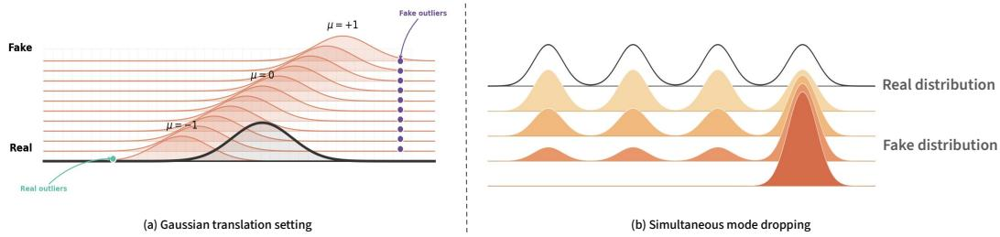

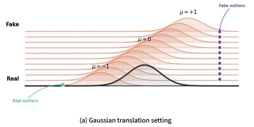

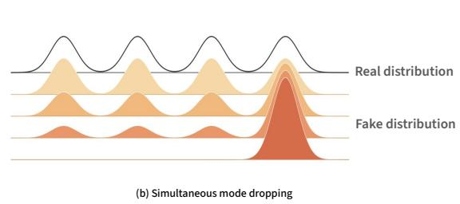  
Figure 8: Supplementary illustration of the controlled experimental settings. Panel (a) shows the Gaussian translation setting with real and generated outliers, and panel (b) shows simultaneous mode dropping where generated mass is reassigned to the remaining mode.

## A Additional Method and Reproducibility Details

## A.1 Algorithmic Summary

This appendix summarizes the computation of CADMA. Given real features $\mathcal { R } = \{ r _ { i } \} _ { i = 1 } ^ { N }$ and generated features $\mathcal { F } = \{ f _ { j } \} _ { j = 1 } ^ { M }$ , CADMA proceeds as follows:

1. Compute the real-side kNN radius $\rho _ { i }$ for each real feature $r _ { i }$

2. Apply radius regularization by setting $\varepsilon _ { i } = \operatorname* { m i n } ( \rho _ { i } , \bar { \rho } )$ , where $\bar { \rho } = N ^ { - 1 } \sum _ { i } \rho _ { i }$

3. Construct the binary admissibility matrix A, where $A _ { i j } = 1$ if generated feature $f _ { j }$ lies inside the regularized neighbourhood of real feature $r _ { i }$

4. Solve the maximum-cardinality bipartite matching on A to obtain $Z ^ { \star }$ and the matching size $N ^ { \mathrm { m a t } }$

5. Report the capacity-aware coverage $\mathcal { C } _ { \mathrm { c a p } } = { N ^ { \mathrm { m a t } } } / { N }$ and the diagnostic scores $\mathcal { D } _ { \mathrm { d r o p } }$ and $\mathcal { D } _ { \mathrm { c o l l a p s e } }$ defined in Sec. 3.2.

The matching step is exact in our implementation. Different exact maximum-matching solvers may return different matching matrices when multiple optima exist, but they return the same matching size $N ^ { \mathrm { m a t } }$ . Consequently, for a fixed admissibility matrix $A , \mathcal { C } _ { \mathrm { c a p } } , \mathcal { D } _ { \mathrm { d r o p } } ,$ , and $\mathcal { D } _ { \mathrm { c o l l a p s e } }$ are well-defined and invariant to the choice of maximum matching.

## A.2 Reproducibility Details

All reported image-based experiments use DINOv2-Large features, as described in Sec. 4. For baseline metrics, we use the hyperparameters recommended by the corresponding papers whenever applicable. CADMA uses $k = 7 0$ unless otherwise stated. The Gaussian experiments are generated synthetically from the distributions described in Sec. 4, while the CIFAR-10 experiments use public CIFAR-10 images with controlled class-level redistribution or outlier replacement.

The code release includes scripts for computing CADMA scores and reproducing the Gaussian experiments, together with the required dependencies and usage instructions.

## A.3 Baseline Implementations

We compare CADMA with a broad set of recall-style metrics. For implementation, we follow the original papers and public reference implementations whenever available:

• Precision, Recall, Density, and Coverage Naeem et al. (2020): https://github.com/ clovaai/generative-evaluation-prdc.

• symPrecision and symRecall Khayatkhoei and AbdAlmageed (2023): https://github. com/mahyarkoy/emergent\_asymmetry\_pr.

• P-precision and P-recall Park and Kim (2023): https://github.com/kdst-team/ Probablistic\_precision\_recall.

• TopP&R Kim et al. (2023): https://github.com/LAIT-CVLab/TopPR.

Table 2: Evaluation of 11 generators on ImageNet-256. Each model uses 25,000 real and 25,000 generated samples.
<table><tr><td>#</td><td>Family</td><td>Model (Year)</td><td>I-Precision ↑</td><td> $\mathcal { C } _ { \mathrm { c a p } } \ 1$  1</td><td> $D _ { \mathrm { d r o p } } \downarrow$ </td><td> $D _ { \mathrm { c o l l a p s e } } \downarrow$ </td></tr><tr><td>1</td><td>Diffusion</td><td>ADM (2021)</td><td>0.512</td><td>0.492</td><td>0.308</td><td>0.027</td></tr><tr><td>2</td><td>Diffusion</td><td>ADM-CFG (2021)</td><td>0.589</td><td>0.674</td><td>0.164</td><td>0.034</td></tr><tr><td>3</td><td>Diffusion</td><td>ADM-CFG-ADMU (2021)</td><td>0.619</td><td>0.710</td><td>0.146</td><td>0.039</td></tr><tr><td>4</td><td>Diffusion</td><td>LDM (2022)</td><td>0.690</td><td>0.757</td><td>0.093</td><td>0.049</td></tr><tr><td>5</td><td>Diffusion</td><td>DiT-XL-2 (2023)</td><td>0.731</td><td>0.786</td><td>0.087</td><td>0.042</td></tr><tr><td>6</td><td>Diffusion</td><td>DiT-XL-2-CFG (2023)</td><td>0.926</td><td>0.826</td><td>0.035</td><td>0.145</td></tr><tr><td>7</td><td>Discrete-token</td><td>MaskGIT (2022)</td><td>0.553</td><td>0.619</td><td>0.208</td><td>0.051</td></tr><tr><td>8</td><td>Discrete-token</td><td>RQ-Transformer (2022)</td><td>0.453</td><td>0.410</td><td>0.323</td><td>0.032</td></tr><tr><td>9</td><td>GAN</td><td>BigGAN (2019)</td><td>0.531</td><td>0.461</td><td>0.180</td><td>0.113</td></tr><tr><td>10</td><td>GAN</td><td>StyleGAN-XL (2022)</td><td>0.504</td><td>0.571</td><td>0.220</td><td>0.057</td></tr><tr><td>11</td><td>GAN</td><td>GigaGAN (2023)</td><td>0.525</td><td>0.549</td><td>0.244</td><td>0.044</td></tr></table>

• Clipped Density and Clipped Coverage Salvy et al. (2026): https://github.com/ nicolassalvy/ClippedDensityCoverage.

For Precision Recall Cover Cheema and Urner (2023), we follow the algorithmic description and recommended hyperparameters from the original paper. When a metric has method-specific hyperparameters, we use the recommended settings described in Sec. 4.

## A.4 Notes on Balanced Evaluation

The diagnostic scores are reported under balanced evaluation with N = M, following common practice in set-based generative evaluation. Using equally sized real and generated sets ensures that differences in sample counts do not distort the diagnostic scores. It is also natural for generative models, since one can usually sample the same number of generated examples as the real evaluation set. When the available sets have different sizes, a practical option is to evaluate CADMA over multiple balanced subsamples and average the resulting scores. This preserves the interpretation of $\mathcal { D } _ { \mathrm { d r o p } }$ and $\mathcal { D } _ { \mathrm { c o l l a p s e } }$ as local imbalance diagnostics while avoiding direct comparison of unequal sample counts.

## B Additional Evaluation on Existing Generative Models

## B.1 Real-World Evaluation Setup

We evaluate existing generative models on ImageNet-256, FFHQ, and LSUN Bedroom using publicly released generated samples from Stein et al. (2023). These samples are also used in the evaluation of ClippedCoverage Salvy et al. (2026) and are available through the source paper’s official code repository. For each model, we use the corresponding dataset-specific samples, with evaluation sizes fixed within each dataset: 25,000 for ImageNet-256, 50,000 for LSUN Bedroom, and 70,000 for FFHQ. For the large-scale generator evaluations on ImageNet-256, FFHQ, and LSUN Bedroom, we use k = 20 for CADMA. For VAR Tian et al. (2024), we instead generate samples using its official implementation, as detailed in Appendix B.5.

## B.2 ImageNet-256 Evaluation

To assess CADMA’s diagnostic value on realistic large-scale data, we evaluate 11 generators from diffusion, discrete-token, and GAN families on class-conditional ImageNet-256. Each model is evaluated using 25,000 real and 25,000 generated samples, with 25 samples from each of the 1,000 categories in each set.

We make four observations. First, within the evaluated diffusion and GAN families, newer models generally achieve higher effective coverage. Specifically: $\mathcal { C } _ { \mathrm { c a p } }$ generally increases from earlier to newer diffusion models, and a similar improvement is observed from BigGAN to the more recent StyleGAN-XL and GigaGAN. GigaGAN is slightly below StyleGAN-XL, indicating that the trend is not strictly monotonic.

Table 3: Evaluation of nine generators on FFHQ. Best and second-best results are bolded and underlined, respectively.
<table><tr><td>#</td><td>Family</td><td>Model (Year)</td><td>I-Precision ↑</td><td> $\mathcal { C } _ { \mathrm { c a p } } \uparrow$ </td><td> $D _ { \mathrm { d r o p } } \downarrow$ </td><td> $D _ { \mathrm { c o l l a p s e } } \downarrow$ </td></tr><tr><td>1</td><td>VAE</td><td>Efficient-VDVAE (2022)</td><td>0.448</td><td>0.417</td><td>0.154</td><td>0.223</td></tr><tr><td>2</td><td>Diffusion</td><td>LDM (2022)</td><td>0.430</td><td>0.606</td><td>0.143</td><td>0.067</td></tr><tr><td>3</td><td>Discrete-token</td><td>Unleashing Transformers (2022)</td><td>0.285</td><td>0.395</td><td>0.209</td><td>0.102</td></tr><tr><td>4</td><td>GAN</td><td>StyleGAN2-ADA (2020)</td><td>0.159</td><td>0.283</td><td>0.190</td><td>0.129</td></tr><tr><td>5</td><td>GAN</td><td>InsGen (2021)</td><td>0.203</td><td>0.355</td><td>0.218</td><td>0.101</td></tr><tr><td>6</td><td>GAN</td><td>Projected-GAN (2021)</td><td>0.109</td><td>0.191</td><td>0.170</td><td>0.107</td></tr><tr><td>7</td><td>GAN</td><td>StyleGAN-XL (2022)</td><td>0.328</td><td>0.481</td><td>0.204</td><td>0.068</td></tr><tr><td>8</td><td>Transformer-GAN</td><td>StyleSwin (2022)</td><td>0.328</td><td>0.486</td><td>0.202</td><td>0.085</td></tr><tr><td>9</td><td>Transformer-GAN</td><td>StyleNAT (2022)</td><td>0.389</td><td>0.561</td><td>0.185</td><td>0.054</td></tr></table>

Second, among the evaluated models, diffusion models achieve the highest average $\mathcal { C } _ { \mathrm { c a p } } \left( 0 . 7 0 8 \right)$ compared with discrete-token generative models (0.515) and GANs (0.527). This result is consistent with the current dominance and strong empirical performance of diffusion-based approaches in image generation.

Third, GANs are widely known to be more susceptible to mode collapse, whereas diffusion models generally provide broader distribution coverage. Our results follow this expected pattern: the median $D _ { \mathrm { c o l l a p s e } }$ is 0.057 for GANs and 0.041 for diffusion models across all evaluated models. This agreement with the established behavior of GAN and diffusion models provides further evidence that $D _ { \mathrm { c o l l a p s e } }$ meaningfully captures mode concentration.

Finally, classifier-free guidance (CFG) is known to improve image fidelity and conditional alignment, but it can also concentrate generated samples around high-probability conditional modes. The improved image quality is first reflected in higher I-Precision. As more generated samples fall within the real-data domain, they increase the likelihood of covering additional valid regions of the real distribution and provide more candidates for matching. This can increase $\mathcal { C } _ { \mathrm { c a p } }$ and reduce $D _ { \mathrm { d r o p } }$ . Rows 5–6 show exactly this behavior: I-Precision increases from 0.731 to 0.926, $\mathcal { C } _ { \mathrm { c a p } }$ increases from 0.786 to 0.826, and $D _ { \mathrm { d r o p } }$ decreases from 0.087 to 0.035. Meanwhile, the amplified conditioning signal concentrates more samples around conditional modes, increasing local density and redundancy; CADMA captures this effect through the increase of $D _ { \mathrm { c o l l a p s e } }$ from 0.042 to 0.145. Thus, the CADMA decomposition is consistent with both the expected improvement in fidelity and the expected increase in mode concentration caused by applying CFG.

## B.3 FFHQ Evaluation

On FFHQ, LDM achieves the best overall balance, with the highest $\mathcal { C } _ { \mathrm { c a p } }$ and lowest $D _ { \mathrm { d r o p } }$ . Efficient-VDVAE obtains the highest I-Precision but also the highest $D _ { \mathrm { c o l l a p s e } } .$ , indicating high fidelity but strong sample concentration. Conventional GANs generally exhibit higher mode collapse. Among them, StyleGAN-XL, which was designed to scale StyleGAN to diverse datasets, achieves the highest $\mathcal { C } _ { \mathrm { c a p } }$ and lowest $D _ { \mathrm { c o l l a p s e } }$ . Transformer-based GANs perform better overall than conventional GAN baselines, with StyleNAT obtaining the second-highest $\mathcal { C } _ { \mathrm { c a p } }$ and the lowest $D _ { \mathrm { c o l l a p s e } }$

## B.4 LSUN Bedroom Evaluation

On LSUN Bedroom, diffusion models again achieve the strongest results. ADMNet-dropout ranks first on all four metrics, while iDDPM obtains the second-highest $\mathcal { C } _ { \mathrm { c a p } }$ and second-lowest $\mathrm { \bar { \it D } _ { \mathrm { c o l l a p s e } } }$ . The Consistency Model achieves competitive I-Precision but substantially worse distributional coverage, with high $\dot { D } _ { \mathrm { d r o p } }$ and $D _ { \mathrm { c o l l a p s e } } .$ . Since consistency models target fast few-step generation, this result suggests that sampling efficiency may come with reduced coverage and stronger sample concentration in this setting. GAN-based and diffusion–GAN models also generally exhibit substantially higher $D _ { \mathrm { c o l l a p s e } }$ than standard diffusion models.

## B.5 VAR Evaluation and Sampling Strategies

We evaluate VAR at four different depths—d16, d20, d24, and d30—using 25,000 class-balanced ImageNet-256 samples, with 25 samples per category. We additionally compare VAR with DiT-XL-2 using the standard CFG scale of 1.5 from the original DiT paper. For clarity, the DiT-XL-2-CFG model reported in our previous ImageNet experiment is a high-CFG variant using scale 4.0, rather than the standard CFG setting used here.

Table 4: Evaluation of eight generators on LSUN Bedroom. Best and second-best results are bolded and underlined, respectively.
<table><tr><td>#</td><td>Family</td><td>Model (Year)</td><td>I-Precision ↑</td><td> $\mathcal { C } _ { \mathrm { c a p } } \cdot$  ←</td><td> $D _ { \mathrm { d r o p } } \downarrow$ </td><td> $D _ { \mathrm { c o l l a p s e } } \downarrow$ </td></tr><tr><td>1</td><td>Diffusion</td><td>DDPM (2020)</td><td>0.306</td><td>0.439</td><td>0.260</td><td>0.031</td></tr><tr><td>2</td><td>Diffusion</td><td>iDDPM (2021)</td><td>0.383</td><td>0.530</td><td>0.201</td><td>0.028</td></tr><tr><td>3</td><td>Diffusion</td><td>ADMNet-dropout (2021)</td><td>0.521</td><td>0.687</td><td>0.085</td><td>0.015</td></tr><tr><td>4</td><td>Consistency</td><td>Consistency (2023)</td><td>0.377</td><td>0.288</td><td>0.282</td><td>0.268</td></tr><tr><td>5</td><td>Discrete-token</td><td>Unleashing Transformers (2022)</td><td>0.209</td><td>0.234</td><td>0.305</td><td>0.108</td></tr><tr><td>6</td><td>GAN</td><td>StyleGAN (2019)</td><td>0.418</td><td>0.465</td><td>0.217</td><td>0.111</td></tr><tr><td>7</td><td>GAN</td><td>Projected-GAN (2021)</td><td>0.222</td><td>0.109</td><td>0.179</td><td>0.240</td></tr><tr><td>8</td><td>Diffusion-GAN hybrid</td><td>Diffusion-Projected-GAN</td><td>0.224</td><td>0.148</td><td>0.215</td><td>0.215</td></tr></table>

Table 5: VAR evaluation on ImageNet-256 under original and smooth sampling, with DiT-XL-2 at CFG scale 1.5 as a reference. Bold values indicate the better result between the two sampling strategies at each VAR depth.
<table><tr><td>Model (Year)</td><td>Sampling</td><td>I-Precision ↑</td><td> $\mathcal { C } _ { \mathrm { c a p } } \uparrow$ </td><td> $D _ { \mathrm { d r o p } } \downarrow$ </td><td> $D _ { \mathrm { c o l l a p s e } } \downarrow$ </td></tr><tr><td>VAR-d16 (2024)</td><td>Original</td><td>0.636</td><td>0.703</td><td>0.139</td><td>0.039</td></tr><tr><td>VAR-d16 (2024)</td><td>Smooth</td><td>0.758</td><td>0.798</td><td>0.059</td><td>0.069</td></tr><tr><td>VAR-d20 (2024)</td><td>Original</td><td>0.694</td><td>0.769</td><td>0.103</td><td>0.040</td></tr><tr><td>VAR-d20 (2024)</td><td>Smooth</td><td>0.819</td><td>0.832</td><td>0.043</td><td>0.067</td></tr><tr><td>VAR-d24 (2024)</td><td>Original</td><td>0.735</td><td>0.800</td><td>0.085</td><td>0.036</td></tr><tr><td>VAR-d24 (2024)</td><td>Smooth</td><td>0.844</td><td>0.849</td><td>0.038</td><td>0.068</td></tr><tr><td>VAR-d30 (2024)</td><td>Original</td><td>0.726</td><td>0.795</td><td>0.095</td><td>0.034</td></tr><tr><td>VAR-d30 (2024)</td><td>Smooth</td><td>0.824</td><td>0.846</td><td>0.048</td><td>0.058</td></tr><tr><td>DiT-XL-2 (2023)</td><td>CFG=1.5</td><td>0.731</td><td>0.786</td><td>0.087</td><td>0.042</td></tr></table>

Under original sampling, increasing VAR depth from d16 to d24 consistently improves I-Precision and $\mathcal { C } _ { \mathrm { c a p } }$ and reduces $\mathcal { D } _ { \mathrm { d r o p } } .$ . This improvement does not continue from d24 to d30: $\mathcal { C } _ { \mathrm { c a p } }$ slightly decreases from 0.800 to 0.795 and $\mathcal { D } _ { \mathrm { d r o p } }$ increases from 0.085 to 0.095, although $\mathcal { D } _ { \mathrm { c o l l a p s e } }$ decreases. Compared with DiT-XL-2, VAR-d24 provides only a marginal improvement in I-Precision (0.735 vs. 0.731), while its advantage is more evident in the diversity-related diagnostics: $\mathcal { C } _ { \mathrm { c a p } }$ increases from 0.786 to 0.800, and $\mathcal { D } _ { \mathrm { c o l l a p s e } }$ decreases from 0.042 to 0.036. Thus, CADMA shows that VAR’s improvement over DiT lies more in effective coverage and mode balance than in sample fidelity. We additionally evaluate VAR’s smooth sampling option. It consistently improves I-Precision and $\mathcal { C } _ { \mathrm { c a p } }$ and reduces $\mathcal { D } _ { \mathrm { d r o p } } .$ , showing that more generated samples fall within the real-data domain and contribute to valid matching. However, it also increases $\mathcal { D } _ { \mathrm { c o l l a p s e } } ,$ revealing stronger local sample concentration.

## B.6 Cross-Model Observations

These results support three observations. First, diffusion models generally dominate the evaluated methods and provide strong effective coverage: LDM achieves the highest $\mathcal { C } _ { \mathrm { c a p } }$ on FFHQ, while ADMNet-dropout and iDDPM lead on LSUN Bedroom. Second, high fidelity allows more generated samples to fall within the real-data domain, but these samples may concentrate around a limited number of modes rather than provide balanced coverage. Efficient-VDVAE achieves the highest FFHQ I-Precision but has substantially lower $\mathcal { C } _ { \mathrm { c a p } }$ and higher $D _ { \mathrm { c o l l a p s e } }$ than LDM. Third, some efficiency-oriented generators appear to sacrifice diversity: Consistency exhibits high $D _ { \mathrm { c o l l a p s e } } ,$ while Unleashing Transformers exhibits high $D _ { \mathrm { d r o p } }$

Table 6: Wall-clock runtime of CADMA and baseline metrics, measured in seconds using precomputed features. N denotes the number of samples in each of the real and generated sets.
<table><tr><td>N</td><td>CADMA (s)</td><td> $T _ { \mathrm { n e i g h } } \left( \mathrm { s } \right)$ </td><td> $T _ { \mathrm { a d d } }$  (s)</td><td> $T _ { \mathrm { a d d } } / T _ { \mathrm { C A D M A } }$ </td><td>ClippedCoverage (s)</td><td>Coverage (s)</td></tr><tr><td>1K</td><td>0.225</td><td>0.223427</td><td>0.001189</td><td>0.529%</td><td>0.205</td><td>0.158</td></tr><tr><td>2.5K</td><td>0.662</td><td>0.658441</td><td>0.003792</td><td>0.572%</td><td>0.795</td><td>0.625</td></tr><tr><td>5K</td><td>2.166</td><td>2.157869</td><td>0.007753</td><td>0.358%</td><td>2.641</td><td>2.094</td></tr><tr><td>7.5K</td><td>4.792</td><td>4.779245</td><td>0.012223</td><td>0.255%</td><td>5.674</td><td>4.466</td></tr><tr><td>10K</td><td>8.266</td><td>8.230676</td><td>0.034747</td><td>0.420%</td><td>10.252</td><td>7.947</td></tr><tr><td>20K</td><td>31.757</td><td>31.645776</td><td>0.110717</td><td>0.349%</td><td>39.798</td><td>30.817</td></tr><tr><td>30K</td><td>68.509</td><td>68.328158</td><td>0.179587</td><td>0.262%</td><td>84.795</td><td>69.686</td></tr><tr><td>40K</td><td>123.505</td><td>122.035564</td><td>1.468471</td><td>1.189%</td><td>165.461</td><td>116.686</td></tr><tr><td>50K</td><td>193.375</td><td>191.806797</td><td>1.566866</td><td>0.810%</td><td>238.140</td><td>179.521</td></tr></table>

## C Computational Cost and Scalability

## C.1 Theoretical Time Complexity

Let both real and generated sets contain n samples with d-dimensional features. Under a brute-force exact-distance implementation, exact neighborhood construction in the high-dimensional setting considered here requires $T _ { \mathrm { C o v e r a g e } } = O ( d \bar { n ^ { 2 } } )$ time Liu et al. (2004). CADMA additionally constructs a sparse bipartite graph with E admissible edges in $O ( n { + } E )$ time and computes maximum-cardinality matching in $O ( E { \sqrt { n } } )$ time using the classical Hopcroft–Karp bound Hopcroft and Karp (1973). Computing $D _ { \mathrm { d r o p } }$ and $D _ { \mathrm { c o l l a p s e } }$ requires only $O ( n + E )$ additional time. Hence,

$$
T _ { \mathrm { C A D M A } } = O ( d n ^ { 2 } + n + E + E { \sqrt { n } } ) = O ( d n ^ { 2 } + E { \sqrt { n } } ) .
$$

In our experiments, the admissibility graphs A induced by local k-NN neighborhoods remain sparse, with $k = 7 0 \ll n$ for $1 , 0 0 0 \leq n \leq 5 0 , 0 0 0$ . Under the sparse-graph assumption $E = O ( k n )$ , the time complexity reduces to

$$
T _ { \mathrm { C A D M A } } = O ( d n ^ { 2 } + k n ^ { 3 / 2 } ) .
$$

In this situation, the time cost is dominated by neighborhood construction, $O ( d n ^ { 2 } )$ , similarly to $T _ { \mathrm { C o v e r a g e } } .$

As the number of samples increases, the relative additional time cost $\rho _ { \mathrm { H K } } ^ { \mathrm { t i m e } }$ is

$$
\rho _ { \mathrm { H K } } ^ { \mathrm { t i m e } } = \frac { T _ { \mathrm { m a t c h i n g } } } { T _ { \mathrm { n e i g h b o r h o o d } } } = O ( \frac { k n ^ { 3 / 2 } } { d n ^ { 2 } } ) = O ( \frac { k } { d \sqrt { n } } ) .
$$

For fixed k and d, this ratio approaches zero as n grows under the sparse-graph assumption $E =$ $O ( k n )$ . Therefore, the additional matching cost is asymptotically negligible relative to neighborhood construction, consistent with the matching-runtime analysis in the main paper, which reports that Hopcroft–Karp matching accounts for only approximately 1% of the total runtime.

## C.2 Wall-Clock Runtime

Feature-space neighborhood construction is involved not only in CADMA but also in most neighborhood-based recall-style metrics. The CADMA column reports the complete runtime, $T _ { \mathrm { n e i g h } }$ reports feature-neighborhood construction time, and $T _ { \mathrm { a d d } }$ includes Hopcroft–Karp matching and score decomposition. Across 10K–50K samples, the operations included in $T _ { \mathrm { a d d } }$ account for only 0.262%–1.189% of the total runtime. Over the same 10K–50K range, CADMA requires $7 4 . 6 \text{‰}$ 81.2% of the runtime of ClippedCoverage and 98.3%–107.7% of that of classical Coverage. Thus, CADMA is faster than ClippedCoverage and comparable to Coverage, despite using $k = 7 0$ rather than k = 5 for Coverage.

The runtimes were measured on a node with two 24-core Intel Xeon Platinum 8268 CPUs (2.90 GHz) and an NVIDIA A100 PCIe 40 GB GPU, using one CPU thread and precomputed features.

Table 7: Memory usage in MB. Percentages in parentheses are relative to the Feature Memory column.
<table><tr><td>N</td><td>Feature Memory</td><td>CADMA</td><td>ClippedCoverage</td><td>Coverage</td></tr><tr><td>1K</td><td>167.3</td><td>8.3 (5.0%)</td><td>3.5 (2.1%)</td><td>5.2 (3.1%)</td></tr><tr><td>2.5K</td><td>191.6</td><td>11.1 (5.8%)</td><td>3.7 (1.9%)</td><td>9.9 (5.2%)</td></tr><tr><td>5K</td><td>234.0</td><td>16.8 (7.3%)</td><td>6.1 (2.6%)</td><td>16.3 (6.9%)</td></tr><tr><td>7.5K</td><td>274.7</td><td>24.4 (8.9%)</td><td>4.1 (1.5%)</td><td>17.0 (6.2%)</td></tr><tr><td>10K</td><td>314.3</td><td>28.5 (9.1%)</td><td>3.9 (1.3%)</td><td>15.7 (5.0%)</td></tr><tr><td>20K</td><td>478.7</td><td>39.5 (8.3%)</td><td>10.2 (2.1%)</td><td>24.2 (5.1%)</td></tr><tr><td>30K</td><td>640.6</td><td>50.0 (7.8%)</td><td>12.9 (2.0%)</td><td>32.5 (5.1%)</td></tr><tr><td>40K</td><td>806.0</td><td>52.8 (6.6%)</td><td>19.2 (2.4%)</td><td>40.4 (5.0%)</td></tr><tr><td>50K</td><td>970.1</td><td>65.8 (6.8%)</td><td>21.2 (2.2%)</td><td>53.0 (5.4%)</td></tr></table>

## C.3 Memory Usage

As shown below, feature storage is the dominant memory cost, requiring 970.1 MB for 50K samples, whereas CADMA increases peak memory by only 6.8%, making the additional memory overhead practically minor compared with feature storage.

Here, Feature Memory denotes the memory used after loading the features but before metric computation. The remaining columns report the additional peak memory introduced by each metric, with percentages relative to Feature Memory. All memory values are reported in MB.

## NeurIPS Paper Checklist

## 1. Claims

Question: Do the main claims made in the abstract and introduction accurately reflect the paper’s contributions and scope?

Answer: [Yes]

Justification: The main claims are stated in the abstract and introduction and are supported by the method in Sec. 3 and experiments in Sec. 4. We scope the claims to recall-oriented evaluation and diagnosis for generative models.

Guidelines:

• The answer [N/A] means that the abstract and introduction do not include the claims made in the paper.

• The abstract and/or introduction should clearly state the claims made, including the contributions made in the paper and important assumptions and limitations. A [No] or [N/A] answer to this question will not be perceived well by the reviewers.

• The claims made should match theoretical and experimental results, and reflect how much the results can be expected to generalize to other settings.

• It is fine to include aspirational goals as motivation as long as it is clear that these goals are not attained by the paper.

## 2. Limitations

Question: Does the paper discuss the limitations of the work performed by the authors? Answer: [Yes]

Answer: [Yes]

Justification: The paper discusses limitations in Sec. 6, including feature-space dependence, and evaluation beyond image generation.

Guidelines:

• The answer [N/A] means that the paper has no limitation while the answer [No] means that the paper has limitations, but those are not discussed in the paper.

• The authors are encouraged to create a separate “Limitations” section in their paper.

• The paper should point out any strong assumptions and how robust the results are to violations of these assumptions (e.g., independence assumptions, noiseless settings, model well-specification, asymptotic approximations only holding locally). The authors should reflect on how these assumptions might be violated in practice and what the implications would be.

• The authors should reflect on the scope of the claims made, e.g., if the approach was only tested on a few datasets or with a few runs. In general, empirical results often depend on implicit assumptions, which should be articulated.

• The authors should reflect on the factors that influence the performance of the approach. For example, a facial recognition algorithm may perform poorly when image resolution is low or images are taken in low lighting. Or a speech-to-text system might not be used reliably to provide closed captions for online lectures because it fails to handle technical jargon.

• The authors should discuss the computational efficiency of the proposed algorithms and how they scale with dataset size.

• If applicable, the authors should discuss possible limitations of their approach to address problems of privacy and fairness.

• While the authors might fear that complete honesty about limitations might be used by reviewers as grounds for rejection, a worse outcome might be that reviewers discover limitations that aren’t acknowledged in the paper. The authors should use their best judgment and recognize that individual actions in favor of transparency play an important role in developing norms that preserve the integrity of the community. Reviewers will be specifically instructed to not penalize honesty concerning limitations.

## 3. Theory assumptions and proofs

Question: For each theoretical result, does the paper provide the full set of assumptions and a complete (and correct) proof?

## Answer: [N/A]

Justification: The paper does not present formal theoretical results requiring proofs. CADMA is defined algorithmically in Sec. 3.

## Guidelines:

• The answer [N/A] means that the paper does not include theoretical results.

• All the theorems, formulas, and proofs in the paper should be numbered and crossreferenced.

• All assumptions should be clearly stated or referenced in the statement of any theorems.

• The proofs can either appear in the main paper or the supplemental material, but if they appear in the supplemental material, the authors are encouraged to provide a short proof sketch to provide intuition.

• Inversely, any informal proof provided in the core of the paper should be complemented by formal proofs provided in appendix or supplemental material.

• Theorems and Lemmas that the proof relies upon should be properly referenced.

## 4. Experimental result reproducibility

Question: Does the paper fully disclose all the information needed to reproduce the main experimental results of the paper to the extent that it affects the main claims and/or conclusions of the paper (regardless of whether the code and data are provided or not)?

Answer: [Yes]

Justification: The method, baselines, datasets, feature representations, and evaluation protocols are described in Secs. 3 and 4. Additional implementation details are provided in the code.

## Guidelines:

• The answer [N/A] means that the paper does not include experiments.

• If the paper includes experiments, a [No] answer to this question will not be perceived well by the reviewers: Making the paper reproducible is important, regardless of whether the code and data are provided or not.

• If the contribution is a dataset and/or model, the authors should describe the steps taken to make their results reproducible or verifiable.

• Depending on the contribution, reproducibility can be accomplished in various ways. For example, if the contribution is a novel architecture, describing the architecture fully might suffice, or if the contribution is a specific model and empirical evaluation, it may be necessary to either make it possible for others to replicate the model with the same dataset, or provide access to the model. In general. releasing code and data is often one good way to accomplish this, but reproducibility can also be provided via detailed instructions for how to replicate the results, access to a hosted model (e.g., in the case of a large language model), releasing of a model checkpoint, or other means that are appropriate to the research performed.

• While NeurIPS does not require releasing code, the conference does require all submissions to provide some reasonable avenue for reproducibility, which may depend on the nature of the contribution. For example

(a) If the contribution is primarily a new algorithm, the paper should make it clear how to reproduce that algorithm.

(b) If the contribution is primarily a new model architecture, the paper should describe the architecture clearly and fully.

(c) If the contribution is a new model (e.g., a large language model), then there should either be a way to access this model for reproducing the results or a way to reproduce the model (e.g., with an open-source dataset or instructions for how to construct the dataset).

(d) We recognize that reproducibility may be tricky in some cases, in which case authors are welcome to describe the particular way they provide for reproducibility. In the case of closed-source models, it may be that access to the model is limited in some way (e.g., to registered users), but it should be possible for other researchers to have some path to reproducing or verifying the results.

## 5. Open access to data and code

Question: Does the paper provide open access to the data and code, with sufficient instructions to faithfully reproduce the main experimental results, as described in supplemental material?

Answer: [Yes]

Justification: We provide code with documentation, dependencies, and scripts for computing CADMA and reproducing experiments.

## Guidelines:

• The answer [N/A] means that paper does not include experiments requiring code.

• Please see the NeurIPS code and data submission guidelines (https://neurips.cc/ public/guides/CodeSubmissionPolicy) for more details.

• While we encourage the release of code and data, we understand that this might not be possible, so [No] is an acceptable answer. Papers cannot be rejected simply for not including code, unless this is central to the contribution (e.g., for a new open-source benchmark).

• The instructions should contain the exact command and environment needed to run to reproduce the results. See the NeurIPS code and data submission guidelines (https: //neurips.cc/public/guides/CodeSubmissionPolicy) for more details.

• The authors should provide instructions on data access and preparation, including how to access the raw data, preprocessed data, intermediate data, and generated data, etc.

• The authors should provide scripts to reproduce all experimental results for the new proposed method and baselines. If only a subset of experiments are reproducible, they should state which ones are omitted from the script and why.

• At submission time, to preserve anonymity, the authors should release anonymized versions (if applicable).

• Providing as much information as possible in supplemental material (appended to the paper) is recommended, but including URLs to data and code is permitted.

## 6. Experimental setting/details

Question: Does the paper specify all the training and test details (e.g., data splits, hyperparameters, how they were chosen, type of optimizer) necessary to understand the results?

Answer: [Yes]

Justification: We specify the datasets, generated sample sets, feature extractor, baselines, and CADMA hyperparameters in Sec. 4.

Guidelines:

• The answer [N/A] means that the paper does not include experiments.

• The experimental setting should be presented in the core of the paper to a level of detail that is necessary to appreciate the results and make sense of them.

• The full details can be provided either with the code, in appendix, or as supplemental material.

## 7. Experiment statistical significance

Question: Does the paper report error bars suitably and correctly defined or other appropriate information about the statistical significance of the experiments?

Answer: [No]

Justification: We do not report error bars for all experiments. Instead, we use controlled comparisons and multiple settings to support the main claims.

Guidelines:

• The answer [N/A] means that the paper does not include experiments.

• The authors should answer [Yes] if the results are accompanied by error bars, confidence intervals, or statistical significance tests, at least for the experiments that support the main claims of the paper.

• The factors of variability that the error bars are capturing should be clearly stated (for example, train/test split, initialization, random drawing of some parameter, or overall run with given experimental conditions).

• The method for calculating the error bars should be explained (closed form formula, call to a library function, bootstrap, etc.)

• The assumptions made should be given (e.g., Normally distributed errors).

• It should be clear whether the error bar is the standard deviation or the standard error of the mean.

• It is OK to report 1-sigma error bars, but one should state it. The authors should preferably report a 2-sigma error bar than state that they have a 96% CI, if the hypothesis of Normality of errors is not verified.

• For asymmetric distributions, the authors should be careful not to show in tables or figures symmetric error bars that would yield results that are out of range (e.g., negative error rates).

• If error bars are reported in tables or plots, the authors should explain in the text how they were calculated and reference the corresponding figures or tables in the text.

## 8. Experiments compute resources

Question: For each experiment, does the paper provide sufficient information on the computer resources (type of compute workers, memory, time of execution) needed to reproduce the experiments?

Answer: [Yes]

Justification: The main text reports the hardware used for the experiments and includes runtime analysis for CADMA matching in Sec. 4.

Guidelines:

• The answer [N/A] means that the paper does not include experiments.

• The paper should indicate the type of compute workers CPU or GPU, internal cluster, or cloud provider, including relevant memory and storage.

• The paper should provide the amount of compute required for each of the individual experimental runs as well as estimate the total compute.

• The paper should disclose whether the full research project required more compute than the experiments reported in the paper (e.g., preliminary or failed experiments that didn’t make it into the paper).

## 9. Code of ethics

Question: Does the research conducted in the paper conform, in every respect, with the NeurIPS Code of Ethics https://neurips.cc/public/EthicsGuidelines?

Answer: [Yes]

Justification: The authors have reviewed the NeurIPS Code of Ethics, and the work uses public datasets and generated samples without human-subject experiments or private data.

Guidelines:

• The answer [N/A] means that the authors have not reviewed the NeurIPS Code of Ethics.

• If the authors answer [No], they should explain the special circumstances that require a deviation from the Code of Ethics.

• The authors should make sure to preserve anonymity (e.g., if there is a special consideration due to laws or regulations in their jurisdiction).

## 10. Broader impacts

Question: Does the paper discuss both potential positive societal impacts and negative societal impacts of the work performed?

Answer: [Yes]

Justification: We discuss potential positive and negative impacts in Sec. 6, including improved transparency in generative model evaluation and the risk of over-reliance on any single metric.

Guidelines:

• The answer [N/A] means that there is no societal impact of the work performed.

• If the authors answer [N/A] or [No], they should explain why their work has no societal impact or why the paper does not address societal impact.

• Examples of negative societal impacts include potential malicious or unintended uses (e.g., disinformation, generating fake profiles, surveillance), fairness considerations (e.g., deployment of technologies that could make decisions that unfairly impact specific groups), privacy considerations, and security considerations.

• The conference expects that many papers will be foundational research and not tied to particular applications, let alone deployments. However, if there is a direct path to any negative applications, the authors should point it out. For example, it is legitimate to point out that an improvement in the quality of generative models could be used to generate Deepfakes for disinformation. On the other hand, it is not needed to point out that a generic algorithm for optimizing neural networks could enable people to train models that generate Deepfakes faster.

• The authors should consider possible harms that could arise when the technology is being used as intended and functioning correctly, harms that could arise when the technology is being used as intended but gives incorrect results, and harms following from (intentional or unintentional) misuse of the technology.

• If there are negative societal impacts, the authors could also discuss possible mitigation strategies (e.g., gated release of models, providing defenses in addition to attacks, mechanisms for monitoring misuse, mechanisms to monitor how a system learns from feedback over time, improving the efficiency and accessibility of ML).

## 11. Safeguards

Question: Does the paper describe safeguards that have been put in place for responsible release of data or models that have a high risk for misuse (e.g., pre-trained language models, image generators, or scraped datasets)?

Answer: [N/A]

Justification: The paper does not release high-risk datasets or generative models. CADMA is an evaluation method and does not itself generate content.

Guidelines:

• The answer [N/A] means that the paper poses no such risks.

• Released models that have a high risk for misuse or dual-use should be released with necessary safeguards to allow for controlled use of the model, for example by requiring that users adhere to usage guidelines or restrictions to access the model or implementing safety filters.

• Datasets that have been scraped from the Internet could pose safety risks. The authors should describe how they avoided releasing unsafe images.

• We recognize that providing effective safeguards is challenging, and many papers do not require this, but we encourage authors to take this into account and make a best faith effort.

## 12. Licenses for existing assets

Question: Are the creators or original owners of assets (e.g., code, data, models), used in the paper, properly credited and are the license and terms of use explicitly mentioned and properly respected?

Answer: [Yes]

Justification: We cite the datasets, generated sample sources, pretrained feature extractors, and baseline methods used in the experiments, and follow their stated licenses and terms of use.

Guidelines:

• The answer [N/A] means that the paper does not use existing assets.

• The authors should cite the original paper that produced the code package or dataset.

• The authors should state which version of the asset is used and, if possible, include a URL.

• The name of the license (e.g., CC-BY 4.0) should be included for each asset.

• For scraped data from a particular source (e.g., website), the copyright and terms of service of that source should be provided.

• If assets are released, the license, copyright information, and terms of use in the package should be provided. For popular datasets, paperswithcode.com/datasets has curated licenses for some datasets. Their licensing guide can help determine the license of a dataset.

• For existing datasets that are re-packaged, both the original license and the license of the derived asset (if it has changed) should be provided.

• If this information is not available online, the authors are encouraged to reach out to the asset’s creators.

## 13. New assets

Question: Are new assets introduced in the paper well documented and is the documentation provided alongside the assets?

Answer: [Yes]

Justification: We release CADMA code as a new asset with documentation, dependencies, usage instructions, and licensing information.

Guidelines:

• The answer [N/A] means that the paper does not release new assets.

• Researchers should communicate the details of the dataset/code/model as part of their submissions via structured templates. This includes details about training, license, limitations, etc.

• The paper should discuss whether and how consent was obtained from people whose asset is used.

• At submission time, remember to anonymize your assets (if applicable). You can either create an anonymized URL or include an anonymized zip file.

## 14. Crowdsourcing and research with human subjects

Question: For crowdsourcing experiments and research with human subjects, does the paper include the full text of instructions given to participants and screenshots, if applicable, as well as details about compensation (if any)?

Answer: [N/A]

Justification: The paper does not involve crowdsourcing experiments or research with human subjects.

Guidelines:

• The answer [N/A] means that the paper does not involve crowdsourcing nor research with human subjects.

• Including this information in the supplemental material is fine, but if the main contribution of the paper involves human subjects, then as much detail as possible should be included in the main paper.

• According to the NeurIPS Code of Ethics, workers involved in data collection, curation, or other labor should be paid at least the minimum wage in the country of the data collector.

## 15. Institutional review board (IRB) approvals or equivalent for research with human subjects

Question: Does the paper describe potential risks incurred by study participants, whether such risks were disclosed to the subjects, and whether Institutional Review Board (IRB) approvals (or an equivalent approval/review based on the requirements of your country or institution) were obtained?

Answer: [N/A]

Justification: The paper does not involve crowdsourcing experiments or research with human subjects, so IRB approval or equivalent review is not applicable.

Guidelines:

• The answer [N/A] means that the paper does not involve crowdsourcing nor research with human subjects.

• Depending on the country in which research is conducted, IRB approval (or equivalent) may be required for any human subjects research. If you obtained IRB approval, you should clearly state this in the paper.

• We recognize that the procedures for this may vary significantly between institutions and locations, and we expect authors to adhere to the NeurIPS Code of Ethics and the guidelines for their institution.

• For initial submissions, do not include any information that would break anonymity (if applicable), such as the institution conducting the review.

## 16. Declaration of LLM usage

Question: Does the paper describe the usage of LLMs if it is an important, original, or non-standard component of the core methods in this research? Note that if the LLM is used only for writing, editing, or formatting purposes and does not impact the core methodology, scientific rigor, or originality of the research, declaration is not required.

Answer: [N/A]

Justification: The core method development and experiments do not involve LLMs as important, original, or non-standard components.

Guidelines:

• The answer [N/A] means that the core method development in this research does not involve LLMs as any important, original, or non-standard components.

• Please refer to our LLM policy in the NeurIPS handbook for what should or should not be described.