# Compass 1: Towards Open-World and Persistent Embodied Navigation from Monocular RGB Videos

Hai Zhang1,∗, Siqi Liang1,∗, Yanjun Guo1, Shoufeng Zhang1 Yunhao Wang1,   
Hangyu Du1, Haoguang Mai1, Hongchen Li2, Jiazhi Yang3, Jialong Zeng3 Yu Hu4, Chen Chen5, Gangcheng Jiang3, Zishun Zhuo1, Lirui Zhao3 Zhigang Li5, Yu Qiao2, Zhenjie Yang1,3,†, Fu Zhang1,4,†, Hongyang Li3

1The University of Hong Kong, 2Shanghai Innovation Institute, 3Archon Robotics, 4Spatial Robotics, 5Huawei Inc.

⋆Equal contribution, †Equal advising

## Abstract

Embodied navigation requires agents to achieve persistent spatial awareness and long-horizon execution stability in open-world environments. However, existing navigation architectures struggle to sustain both capabilities, remaining efective only over a handful of recent frames. We present Compass 1, the first embodied navigation foundation model to unify language understanding and video generation while enabling memory backtracking through nearly two minutes of visual history. Without altering the underlying architecture, we introduce History Representation, which integrates sparse visual keyframes with an explicit History Representation Map to preserve long-term spatiotemporal context. To efectively leverage this history, we further introduce History Utilization, a structured VQA supervision protocol comprising three categories: task-stage grounding, exploration consistency, and spatiotemporal target retrieval, enabling map-grounded reasoning and stable persistent long-horizon navigation. To fuel this system, we establish a complete annotation pipeline for monocular RGB videos and open-source a massive dataset featuring over 500 hours of high-quality real-world interactions and over 2,000 hours of annotated web videos. Trained mainly on the distribution of 1.0 meter (1m) height camera, Compass 1 generalizes seamlessly across diverse embodiments and scenarios, ranging from indoor environments to pedestrian-dense streets, spanning wheeled robot at 0.35m, quadruped dog at 0.5m, humanoid at 0.85m, and aerial drone at 1.5m. Compass 1 achieves a dominant overall success rate of 79.4% across open-world evaluations, compared to 17.8% for the strongest baseline. It demonstrates exceptional zero-shot execution exceeding 90% on foundational tasks, a 250% boost in exploration, and an unparalleled leap from 0% to 58% in challenging persistent history backtracking.

Correspondence: Zhenjie Yang at yangzj@hku.hk, Fu Zhang at fuzhang@hku.hk Project Page: https://www.archon.tech/research/compass1

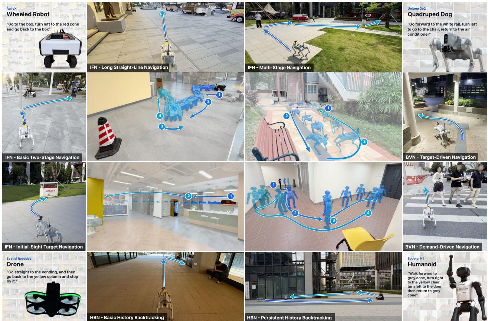  
Figure 1 Compass 1 Open-world and persistent embodied navigation. We systematically design open-world evaluation settings tailored to core navigation tasks, comprising instruction-following navigation (IFN), beyond-the-view navigation (BVN), and history backtracking navigation (HBN). The outer panels illustrate reference navigation paths prescribed by task specifications. The inner panels depict sequential trajectory and pose overlays of zero-shot real-world executions achieved by Compass 1 across diverse robotic embodiments, including wheeled robot, quadruped dog, humanoid, and drone with camera heights of 0.35 m, 0.5 m, 0.85 m, and 1.5 m, respectively.

## 1 Introduction

Embodied navigation in unstructured, open-world environments requires physical agents to dynamically perceive visual signals, reason over high-level task instructions, and generate precise motor controls. Historically, the field has been dominated by the traditional training-free paradigm [5, 22, 41]. These systems rely heavily on specialized hardware, such as LiDAR sensors [26, 44] for dense point-cloud acquisition and depth cameras [10, 42] for spatial geometry, to reconstruct explicit topological maps onto which of-the-shelf Vision-Language Models (VLMs) are plugged in for decision-making. Despite their modularity, these systems sufer from severe error accumulation and spatial degradation when confronting complex dynamic scenes, exposing a fragile generalization ceiling. More recently, emerging agentic navigation paradigms have attempted to execute decision-making via harness [48] or pre-defined skill primitives [49]. Yet, their practical deployment remains significantly bottlenecked by high inference latency, leaving them at a preliminary stage for physical deployment. In stark contrast, large-scale training-based navigation paradigm [45, 47] ofers a far more efective alternative – by unifying perception, reasoning, and execution within a monolithic and streamlined learning formulation.

Notwithstanding the impressive metrics achieved by recent large-scale training-based navigation approaches [11, 14, 34, 51] on simulated benchmarks [17], a pronounced disconnect emerges in physical deployment: prior arts overfit to simulation excessively and fail to generalize to real-world environments. For instruction-following navigation tasks (IFN) [17], these methods frequently exhibit erratic behaviors, such as premature stopping, reversed turning, drifting of the intended direction specified by language instructions, and failing to stop accurately even when the target is directly in sight. For beyond-the-view navigation tasks (BVN) [45], these models are prone to left-right turning deadlocks driven by intention inconsistency between consecutive inference steps. Worse still, existing long-horizon formulations typically either naively feed the entire uncompressed visual history into the backbone [14] or apply heuristic, non-uniform compression [34]. We observe that both strategies yield merely spurious context usage, failing to preserve granular spatiotemporal topology and rendering true history backtracking navigation (HBN) completely unachievable. These pervasive failure modes underscore the fundamental challenges in building a truly persistent, robust embodied navigation system in the real-world.

To resolve these deficiencies, we introduce Compass 1, a navigation foundation model that addresses openworld and persistent embodied navigation without architectural modifications. For long-horizon history representation, we replace full visual streams with sparsely sampled visual keyframes as input and render their associated actions into a History Representation Map (HRM), which is processed natively by the backbone as an image input. We further design three visual-question-answering (VQA) categories encompassing taskstage grounding, exploration consistency, and spatiotemporal target retrieval, thereby fully unleashing the history utilization capabilities. To better incorporate spatial information and alleviate the short-horizon supervision problem inherent to language backbones [45], we naturally house these mechanisms within a unified understanding and generation backbone.

Beyond algorithmic innovations, a primary bottleneck to achieving robust open-world navigation stems from the scarcity of high-quality training data. While scaling monocular RGB videos ofers a promising avenue to bridge this gap [45], raw video clips inherently lack metric action trajectories, language instructions, and the specialized VQA annotations, making the whole labeling process prohibitively expensive. To overcome this bottleneck, we establish a semi-automated annotation pipeline designed for minimal human overhead. Human annotators are tasked solely with verifying language accuracy at stage boundaries and inspecting visualized action trajectories to filter out severe noise, significantly reducing human labor and annotation cost. Leveraging this pipeline, we curate a massive navigation corpus comprising over 500 hours of high-quality real-world data and 2,000 hours of annotated web-scale video data, providing an unprecedented multi-modal foundation to fuel open-world embodied navigation.

We structure our real-world evaluation benchmark around essential navigation capabilities across highly diverse physical scenarios. Across these evaluations, Compass 1 achieves exceptional zero-shot execution exceeding 90% on foundational tasks, including initial-sight target navigation, basic two-stage navigation, and basic history backtracking. In exploration tasks covering target-driven navigation and demand-driven navigation, Compass 1 achieves an average success rate of 84%, delivering a 250% performance improvement over the strongest baseline. Most notably, across challenging long straight-line navigation, multi-stage navigation, and persistent history backtracking, Compass 1 demonstrates an unparalleled performance leap, boosting the average success rate from 5% to 60%. Crucially, despite being trained primarily on a single camera height distribution at 1.0 meter (1m), Compass 1 exhibits exceptional zero-shot transferability across varied embodiments, smoothly adapting to distinct camera heights, ranging from wheeled robots at 0.35m and quadrupeds at 0.5m to humanoids at 0.85m and aerial drones at 1.5m.

## 1.1 Research Questions

The pivotal gist in this work boils down to – How could a model excel at executing open-world and persistent navigation while generalizing across diverse scenarios and embodiments?

This breaks into three concrete questions:

• How can we eficiently represent navigation history such that the policy can pinpoint previously observed targets, track current task stages, and discern how to navigate back over long horizons?

• How can we utilize this history representation to support diverse navigation tasks and learn a generalizable policy from limited high-quality data?

• How can we establish an efective annotation pipeline for raw video corpora to significantly reduce human labor and resource overhead?

## 1.2 Contributions

The main contributions are:

• Keyframe-Level Unified Backbone & History Representation Map: To our knowledge, we present the first keyframe-level foundation model built on a unified backbone for embodied navigation. By condensing keyframes and actions into a compact HRM, our method grants the agent persistent spatiotemporal reasoning and nearly two-minute memory backtracking capabilities with zero architectural modification.

• Structured VQA Supervision Protocol: We design three structured VQA categories to fully utilize the history reasoning capability and efectively resolve physical execution failure modes including premature stopping, reversed turning, direction drifting, left-right turning deadlocks, and spurious history utilization.

• Cost-Effective Data Annotation Pipeline: We establish a semi-automated annotation pipeline requiring human oversight solely at stage boundaries and trajectory noise filtering, enabling the release of a massive navigation corpus featuring over 500 hours of real-world interactions and over 2,000 hours of annotated web videos.

• Thorough Physical Evaluation & Zero-Shot Cross-Embodiment Generalization: Extensive real-world experiments demonstrate that Compass 1 drastically outperforms strong baselines across all physical navigation tasks. Remarkably, despite being trained mainly on a fixed camera height distribution, it generalizes zero-shot across diverse embodiments, and substantial camera height variations.

## 2 Methodology

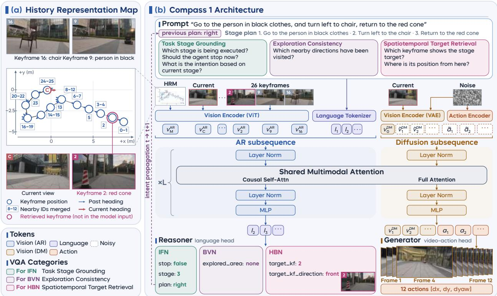  
Figure 2 Overview of the history representation map and the architecture of Compass 1. (a) The history representation map (HRM) projects past keyframes and history trajectories onto a 2D visual image with dynamically aggregated indices and heading arrows to encode dense spatial topology. (b) The architecture of Compass 1 leverages a unified multimodal understanding and generation backbone to process prompt instructions, the HRM, and keyframe sequences. Structured VQA supervision categories enforce history-aware reasoning while a difusion-based video-action head continuously generates low-latency action trajectories.

The design of Compass 1 is guided by two fundamental pillars: history representation and history utilization (Sections 2.1 and 2.2), alongside the synergistic orchestration of multimodal understanding and generation (Section 2.3).

The whole architecture and HRM are shown in Figure 2.

## 2.1 History Representation

Given the intrinsic scarcity of high-quality, real-world navigation data, a primary design philosophy of Compass 1 is to preserve the pre-trained foundation backbone without introducing any architectural modifications. To achieve this, our history representation is built upon two core aspects: keyframe-level sparsification and history representation map construction.

Keyframe-Level Sparsification: Existing methods face inherent trade-ofs in long-horizon history modeling. Naively appending all visual inputs severely degrades attention quality with heavy computational overhead [46]. Uniformly sampling visual frames at a fixed frequency to fit a limited context window leads to severe information loss [6], whereas employing specialized pooling mechanisms inevitably introduces extra network modules [34, 47]. To circumvent these limitations, we summarize visual context through action-guided keyframe selection. This strategy efectively isolates critical spatial observations without adding structural overhead. Details of keyframe selection are deferred to Section 3.3.

Crucially, deploying a policy trained on keyframe sequences proves essential during inference for mitigating the impact of control uncertainty across diverse embodiments. Particularly for embodiment like humanoids, micro-actions often fail to overcome physical execution limits to produce actual physical movement, rendering continuous visual inputs non-uniform and inducing severe out-of-distribution (OOD) shifts relative to contin uous training video frames, which inevitably degrades policy performance. We find that simply triggering keyframe selection at inference time based on fixed distance and angle thresholds efectively addresses this issue and yields impressive navigation performance.

History Representation Map Construction: For tasks requiring true history utilization, such as HBN, the policy must not only pinpoint previously observed targets but also discern how to physically navigate back to them. Over such extended horizons, language-based summaries fail to adequately capture subtle scene information and historical action trajectories [31]. Inspired by explicit map construction in training-free paradigms [22, 41 and trajectory visualization during data annotation, we format past action trajectories into a 2D visual canvas, termed the History Representation Map (HRM). Specifically, keyframes are projected onto the HRM canvas and labeled with their corresponding frame indices. To resolve spatial clutter in densely visited regions, spatially proximal keyframe indices are dynamically aggregated (e.g., denoted as “2–5” to indicate multiple keyframes within the localized neighborhood). Furthermore, since video streams possess an intrinsic temporal directionality, directional arrows are rendered along the trajectory to encode past headings. The current step is explicitly highlighted with a red letter C accompanied by a red arrow specifying its heading. By directly feeding the generated HRM alongside keyframes into the backbone as native image inputs, Compass 1 achieves long-horizon spatiotemporal reasoning with zero architectural modification. Under this design, while the visual sequence fed into the backbone remains compact and keyframe-sparse, the HRM provides dense, explicit topological grounding over the entire navigation trajectory.

## 2.2 History Utilization

To maximize the eficacy of historical contexts without architectural modifications, the optimal strategy is to intrinsically embed spatiotemporal reasoning capabilities into the foundation backbone. We achieve this by formulating a structured VQA supervision protocol. Empirically, we observe that naively taking the HRM as an input causes the backbone to ignore this guidance. Thus, our VQA protocol serves as an essential map activation mechanism. To resolve pervasive execution failures across Instruction-Following Navigation (IFN), Beyond-the-View Navigation (BVN), and History Backtracking Navigation (HBN), we design three specialized categories of VQA objectives:

Task-Stage Grounding (for IFN): Standard IFN policies frequently sufer from execution flaws, including premature stopping, direction mismatch, and failing to stop accurately even when the target is directly in sight [14, 51]. To rectify these issues, we first employ Qwen-3.8-27B [25] to parse raw language instructions into structured task stages. The backbone is then queried to identify the current stage from the overall instruction breakdown, predict the immediate next-step high-level intention aligned with the current stage, and determine whether a termination criterion is met. Notably, to accelerate inference latency and allow suficient execution bufer, our termination supervision is constructed anticipatorily 4 steps prior to actual stopping (see Section 2.3).

Exploration Consistency (for BVN): In open-world BVN, exploration trajectories inherently exhibit multimodal distributions where turning left, right, or moving straight are all plausible when the target is absent [14, 45]. As conventional approaches lack visibility into prior intentions, step-by-step inference becomes decoupled, leading to left-right turning deadlocks [14]. We mitigate this by querying the backbone on whether the left or right spatial regions have been previously visited, anchored on the HRM. Furthermore, we establish an intention propagation mechanism, passing the predicted high-level intention from the previous inference step into the successive prompt text, enforcing execution consistency throughout exploration.

Spatiotemporal Target Retrieval (for HBN): For long-horizon HBN, policies typically fail to extract actionable context from visual history. Combining the parsed task stage with the HRM, we design a joint spatiotemporal retrieval question. Given a target query, the backbone simultaneously identifies the historical keyframe index capturing the target and predicts the relative direction required to navigate toward that keyframe from the current position. This general formulation not only resolves complex history backtracking but also naturally enhances target-recovery maneuvers when a previously observed target is inadvertently bypassed during ongoing navigation.

## 2.3 System Design

To seamlessly unify VQA reasoning with fine-grained spatiotemporal prediction, Compass 1 adopts Cosmos3- Edge-4B [1] as its foundation backbone. To our knowledge, Compass 1 is the first framework in embodied navigation to leverage a unified multimodal understanding-and-generation architecture as its core backbone. Formally, the system takes the current keyframe-level observation stream, the HRM, and prompt instructions as native inputs, operating through two synergistic decoding heads: an autoregressive language head that handles structured VQA reasoning, alongside a difusion-based action-video head that jointly generates the future and predicts action trajectories.

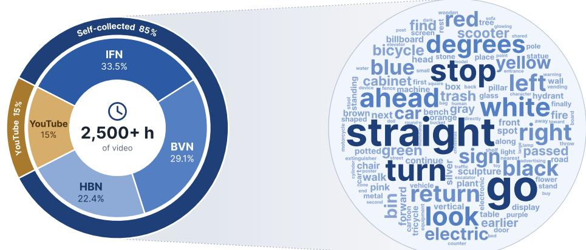

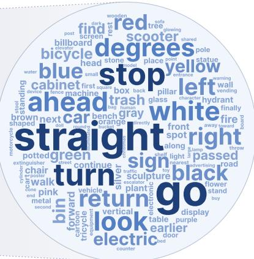  
Figure 3 Training data recipe of Compass 1. The training corpus comprises over 2,500 hours of video, integrating over 500 hours self-collected real-world trajectories across IFN (33.5%), BVN (29.1%), and HBN (22.4%), alongside over 2,000 hours annotated web-scale YouTube videos. During training, we sample the self-collected data and YouTube data at a ratio of 85% and 15%, respectively. The right panel depicts the word cloud visualization of synthesized navigation instructions, highlighting rich motion primitives and landmark semantics.

As joint training enforces strong VQA reasoning within the backbone, action generation at inference time can operate independently of the language head. Exploiting this architecturally decoupled nature, we adopt an asynchronous deployment strategy on a single GPU. Upon generating low-latency action trajectories, the system immediately streams them to the physical platform while asynchronously completing the language reasoning forward pass to extract intentions and the stopping signal. Once a stopping signal is triggered, an asynchronous interrupt flag is transmitted to the onboard controller to immediately execute termination. We further incorporate KV-cache for keyframe sequences and cuda graph compilation for difusion denoising to accelerate model inference.

## 2.4 Training Recipe

As illustrated in Figure 3, we co-train Compass 1 using a diverse dataset comprising over 500 hours of high-quality self-collected real-world data and 2,000 hours of annotated YouTube videos. To ensure that the model develops balanced and robust accuracy across diverse VQA queries without overfitting to specific prompts, we implement a selective query sampling strategy during training, where termination is queried continuously, while other queries are sampled with a 50% probability per training sample. The entire model is optimized end-to-end on a cluster of 32 NVIDIA H200 GPUs for a total of 60000 steps, using a global batch size of 256. To balance multimodal reasoning, video generation, and action prediction, we apply diferentiated learning rate schedules across network heads: the visual head and language head maintain a constant learning rate of $1 \times 1 0 ^ { - 5 }$ , whereas the action head is initialized with a learning rate of $1 \times 1 0 ^ { - 4 }$ , warmed up over the first 1% of total training steps, and subsequently decayed to $1 \times 1 0 ^ { - 5 }$ via a cosine annealing schedule. The overall optimization objective is a joint loss weighted across task dimensions, with a loss ratio of 3 : 1 : 1 for the VQA loss, video generation loss, and action prediction loss, respectively.

## 3 Dataset Curation

Owing to the notorious physical domain gaps and severe visual artifacts present in existing simulators [27], relying on simulator-generated navigation data frequently degrades zero-shot real-world deployment. To circumvent data contamination from synthetic trajectories, Compass 1 adopts a real-world data collection philosophy inspired by Zhang et al. [45], scaling up physical navigation trajectories while aggregating web-scale video data from YouTube.

Specifically, we collect high-fidelity egocentric video streams using DJI Action 4 cameras with hardware stabilization enabled. Operators adhere to strict protocol guidelines to systematically record trajectories across three core navigation tasks: IFN, BVN, and HBN. BVN is subdivided into target-driven exploration and demand-driven exploration.

Both self-collected real-world trajectories and YouTube videos are processed through our semi-automated annotation pipeline to extract action labels, language instructions, keyframes, and VQA supervisions, as illustrated in Figure 4. Given the significantly larger volume of YouTube data, human verification is exclusively applied to our self-collected trajectories.

## 3.1 Action Labeling from Monocular RGB Videos

Following the paradigm of NavDreamer [13], we extract metric continuous action trajectories from monocular RGB videos by combining $\pi ^ { 3 }$ [37] and MoGe-2 [33], as shown in Figure 4(a). However, trajectory visualizations reveal that raw extracted actions frequently contain outliers induced by monocular ambiguity and visual noise. These anomalies manifest in three primary forms:

• Abnormal action scales, where predicted action scale far exceed the nominal per-step physical movement during real-world collection.

• Excessive roll and pitch variations, which typically signify camera stabilization failures or severe jitter from human operators.

• Erratic multi-axis spikes, characterized by simultaneous large variations in dyaw, dx, and dy during tight-radius cornering maneuvers near obstacles.

To ensure the integrity of our imitation learning corpus, trajectories exhibiting any of these failure modes are filtered out from the training dataset.

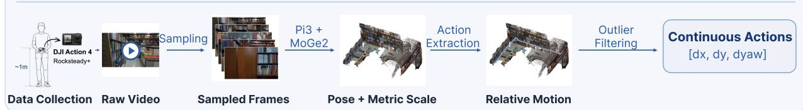

## (b) Action-Conditioned Language Annotation

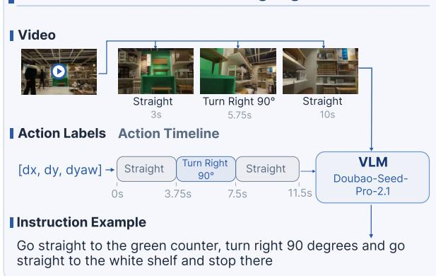

## (c) Action-Guided Keyframe Selection

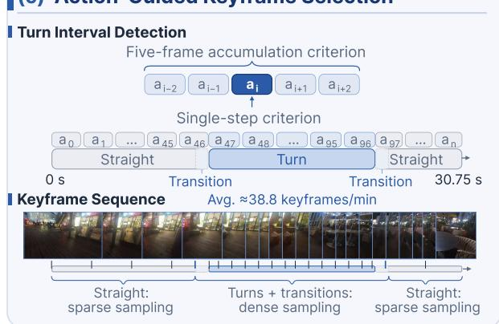

## (d) Keyframe-Guided Stage Annotation

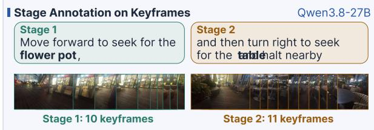

## (e) Human Verification

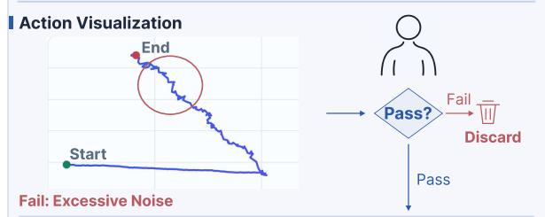

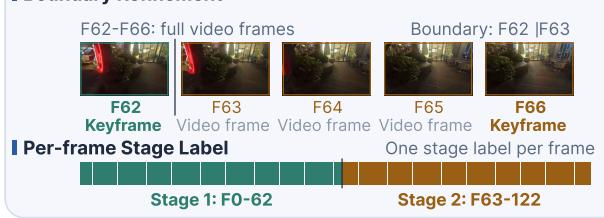

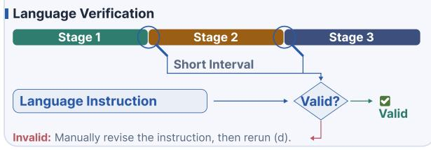

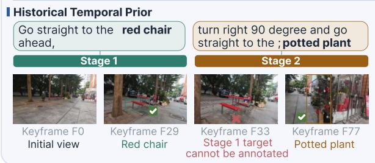

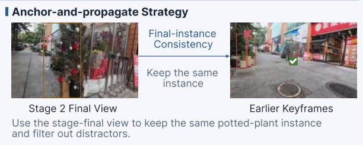  
Figure 4 Semi-automated dataset curation pipeline. The pipeline processes raw egocentric videos through six core stages. (a) Action labeling extracts metric continuous trajectories while filtering out noisy outliers. (b) Actionconditioned language annotation leverages action primitives as spatiotemporal priors to guide VLM in synthesizing structured instructions. (c) Action-guided keyframe selection adaptively downsamples video streams through turning interval detection and non-uniform sampling. (d) Keyframe-guided stage annotation decomposes tasks into targetoriented stages and refines temporal boundaries. (e) Human verification streamlines quality control by inspecting trajectory action visualizations and short boundary intervals. (f) Target grounding utilizes historical temporal priors and an anchor-and-propagate strategy to ensure consistent bounding box annotations across keyframe sequences.

## 3.2 Action-Conditioned Language Annotation

Directly prompting VLM with raw video streams to synthesize navigation instructions frequently sufers from hallucinated temporal boundaries, direction misidentification, and stage omission. To mitigate these limitations, we introduce an action-conditioned language annotation protocol that leverages the extracted metric trajectories as explicit spatiotemporal priors.

Continuous action sequences are first aggregated along the temporal timeline to partition the whole video into discrete, semantically meaningful action primitives, including moving straight, turning left, turning right, and searching. In the pipeline detailed in Figure 4(b), this structured action timeline, alongside the raw video stream, is fed into Doubao-Seed-Pro-2.1 [28]. Guided by these deterministic motion primitives, the VLM reliably grounds visual landmarks (e.g., trash can or billboard) to their corresponding trajectory segments, ultimately synthesizing fine-grained, stage-aligned instructions with guaranteed structural consistency.

These synthesized instructions serve as the foundational annotations, customized to align with specified task categories. IFN and target-driven BVN directly deploy the raw generated instructions. For demand-driven BVN, the target description in the searching stage is reformulated into high-level user demands. For HBN, which mandates a backtracking at the last stage during data collection, only the final clause is replaced to direct the agent back to its target.

## 3.3 Action-Guided Keyframe Selection

Processing dense video frames indiscriminately introduces redundant spatial contexts and excessive computational overhead. To address this, we propose an action-guided keyframe selection strategy that adaptively downsamples video streams using trajectories as spatio-temporal priors.

As illustrated in Figure 4(c), candidate turning intervals are first identified by detecting localized heading variations along the trajectory. Turning evidence is captured through a dual-condition criterion based on step-wise yaw changes, which evaluates both an instantaneous single-step threshold and a five-frame yaw accumulation window anchored at a central frame. This formulation efectively filters out minor heading noise and oscillatory motion. Nearby turning steps are subsequently merged into contiguous motion segments with bidirectional temporal bufers to preserve critical pre- and post-turn visual transitions.

Based on these extracted motion semantics, keyframes are sampled under a non-uniform priority scheme where the initial frame is strictly retained as the first keyframe. Dense sampling is applied across turning and transition regions whenever the yaw accumulation exceeds 30◦ to prevent missing target objects during rapid rotation, whereas straight segments are sampled sparsely at 3s intervals to eliminate background redundancy. Through this dynamic downsampling strategy, a dense one-minute video stream (240 frames at 4 FPS) is eficiently compressed to an average of only 40 keyframes, significantly reducing computational overhead while retaining essential navigation semantics.

## 3.4 Keyframe-Guided Stage Annotation

Directly feeding dense video streams into VLM is computationally prohibitive and prone to temporal misalignment. To overcome this limitation, stage annotation operates on the pre-extracted sparse keyframes rather than raw video frames. As illustrated in Figure 4(d), the complete navigation instruction and keyframe sequence are jointly fed into Qwen-3.8-27B [25] to decompose the task into target-oriented stages and assign the stage to each keyframe.

Since the initial keyframe mapping inevitably yields coarse temporal boundaries, a fine-grained refinement step is executed across boundary intervals. We then use Qwen-3.8-27B to inspect the interval containing raw video frames between the boundary keyframes and their immediate successors, precisely pinpointing the exact frame where the subgoal is fulfilled. Building upon these refined temporal boundaries, per-frame stage labels are eficiently propagated across the entire continuous video stream.

## 3.5 Human Verification

To ensure high dataset quality while retaining scalability, we incorporate a lightweight human-in-the-loop verification protocol. Unlike conventional annotation pipelines that require annotators to watch full video streams, manually craft navigation instructions, and label frame-level targets [45], we streamline human intervention into two highly eficient inspection tasks.

As illustrated in Figure 4(e), annotators directly inspect the action visualization to identify anomalous artifacts within metric trajectories. Trajectories exhibiting excessive motion noise are directly discarded to guarantee training stability. Subsequently, language alignment is verified using only short video intervals surrounding stage boundaries rather than full-length sequences. Annotators directly verify whether the target objects and physical movements within these boundary intervals remain consistent with the language instruction. If an inconsistency is identified, the instruction is manually corrected, after which the trajectory re-enters the stage annotation pipeline described in Section 3.4 to update temporal stage assignments.

## 3.6 Target Grounding

To establish fine-grained spatiotemporal alignment, we further utilize Qwen-3.8-27B [25] to ground semantic targets by annotating bounding boxes across all extracted keyframe sequences guided by the language instruction. Directly detecting targets frame-by-frame often introduces redundant candidates and temporal inconsistencies. To guarantee high-quality grounding, we apply two trajectory-level structural constraints during annotation.

As depicted in Figure 4(f), we enforce a historical temporal prior where target annotations exist exclusively within their corresponding stage and all preceding stages. If a target object from an earlier stage reappears in subsequent stages, its bounding box annotations in the later stages are explicitly removed to prevent semantic ambiguity. Furthermore, to eliminate candidate redundancy caused by multiple visual instances, we adopt an anchor-and-propagate strategy. The canonical target bounding box is uniquely identified at the final keyframe of each stage and subsequently propagated backward through all preceding keyframes. This backward propagation strategy filters out noisy candidates and ensures robust visual grounding across the entire navigation trajectory.

## 4 Experiments

To thoroughly evaluate Compass 1, we conduct extensive experiments focusing on open-world embodied navigation capabilities. Section 4.1 outlines the evaluation protocol for zero-shot real-world deployment across diverse scenarios and embodiments. Sections 4.2.1 to 4.2.3 demonstrate the cross-scenario and cross-embodiment capability of Compass 1. Detailed ablation studies (Section 4.3) and inference eficiency analysis (Section 4.4) then validate the rationality of our model design and its internal mechanisms. Finally, comprehensive simulation evaluation results comparing various SOTA baselines are reported on established benchmarks (Section 4.5).

## 4.1 Evaluation Protocol

To rigorously demonstrate the edge of Compass 1, we select four representative SOTA baselines spanning distinct architectural paradigms for comparative analysis.

## VLM-Based Paradigm:

• NaVIDA [51] augments policy learning with action-grounded visual dynamics driven by inverse dynamics supervision.

• AwareVLN [11] equips special tokens to dynamically alternate between reasoning and action modes.

• LightNav-0 [34] utilizes points as latent chain-of-thought representations.

## Video-Generation-Based Paradigm:

• WNM-3D [14] employs a mixture-of-transformer architecture to co-optimize video and action generation.

To ensure strict fairness across evaluations, all four baselines are fine-tuned on our dataset. We defer detailed implementations to Section A.1. To reflect the peak performance of each baseline, we report the higher success rate between its original open-sourced weight and its fine-tuned counterpart in our evaluation results.

We conduct zero-shot real-world evaluations across four representative indoor and outdoor scenarios, including Indoors (Ofice) and Outdoors (Terrace, Complex, and Street). These environments range from structured ofice rooms to highly dynamic street environments with moving pedestrians and vehicles, where the street scenario specifically evaluates the robustness against dynamic disturbances.

To systematically assess diverse navigation skills, we construct a comprehensive evaluation suite comprising eight distinct tasks organized across three navigation categories. To guarantee statistical rigor, each method undergoes 10 independent trials for every task across all four scenarios, accumulating 320 total evaluations per approach. We report the Success Rate averaged by 10 trials for each task as the evaluation metric. Detailed task setting is shown in Section B.

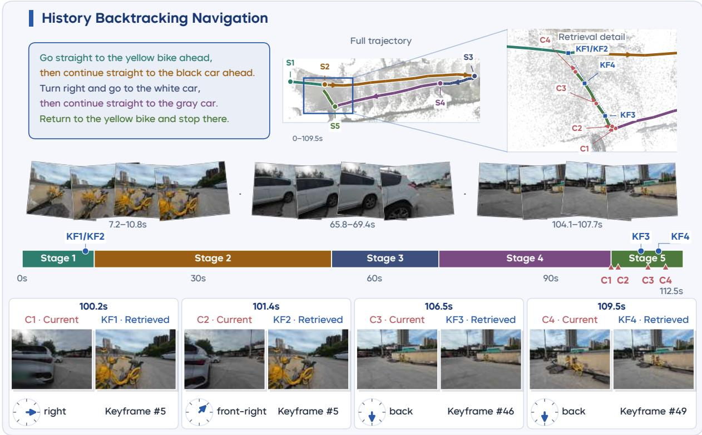  
Figure 5 Open-loop evaluation results on HBN. Over a nearly two-minute trajectory, Compass 1 successfully identifies the keyframe index at approximately 8s and the direction corresponding to that keyframe at 100s, and continuously updates these estimates upon re-observing the target after 106s. Color coding across task stages (S1 to S5) connects the language instruction, temporal timeline, and estimated robot trajectory. The zoomed-in retrieval details and bottom image pairs show the current observations (C) alongside retrieved keyframes (KF), specifying the estimated target directions and keyframe indices.

## Instruction-Following Navigation Capabilities:

• Initial-Sight Target Navigation: The target object is initially visible within the field of view but not directly aligned with the heading direction. This task tests whether the agent can dynamically adjust its heading toward the target and stop accurately.

• Basic Two-Stage Navigation: The agent must navigate to an intermediate target before executing a turn, which may exceed 90◦, to reach the final goal. This evaluates whether the policy can resume incomplete turns across multiple inference steps without making premature stops or directional errors.

Stage current stage Plan intended motion Stop stop now Exp. directions already checked KF retrieved keyframe index · keyframe's position relative to current position

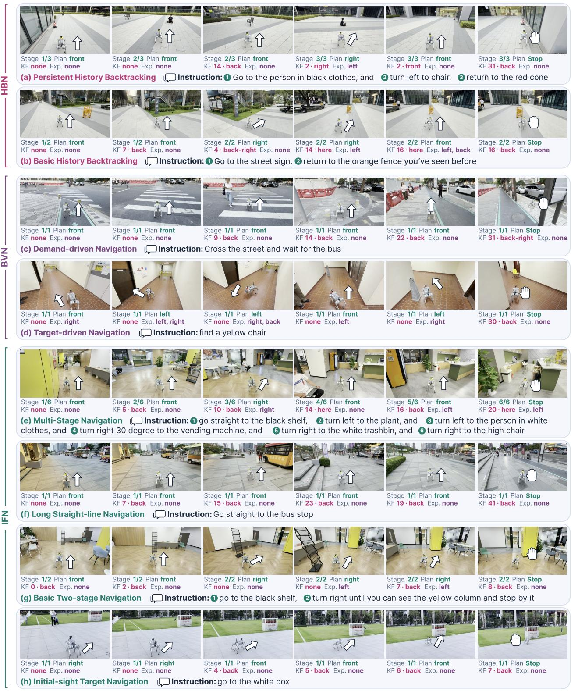  
Figure 6 Qualitative zero-shot results of Compass 1 in open-world environments across HBN, BVN, and IFN.

• Long Straight-Line Navigation: The agent is required to maintain a consistent heading along a straight trajectory exceeding 30m, even when the target remains invisible for an extended period.

• Multi-Stage Navigation: The trajectory consists of at least four sequential stages. This task evaluates whether the agent can track multiple stages without confusing the turn order or stopping prematurely.

## Beyond-the-View Navigation Capabilities:

• Target-Driven Navigation: The agent navigates (semi-)enclosed areas, such as dead ends, to evaluate whether it avoids left-right turning deadlocks and successfully escapes from such restricted areas.

• Demand-Driven Navigation: The agent is required to combine target-driven navigation with semantic demand reasoning to determine appropriate stopping locations in (semi-)enclosed areas.

## History Backtracking Navigation Capabilities:

• Basic History Backtracking: The revisited target is located adjacent to the target of the preceding stage, becoming visible either immediately upon turning around or after a 180◦ turn followed by a short straight distance along a near-linear trajectory. Given that typical baselines strongly rely on immediate history frames, this tests whether they efectively exploit these recent spatiotemporal cues to re-localize the target.

• Persistent History Backtracking: The revisited target is entirely occluded from the target of the preceding stage. This tests the capability for long-horizon spatiotemporal reasoning and historical trajectory backtracking.

Physical validation primarily leverages the Unitree Go2 Quadruped Dog shown in Figure 1. The physical deployment of all evaluated methods relies on odometry to execute closed-loop velocity control. We utilize a DJI Action4 camera mounted to the quadruped head via adhesive bonding at roughly 0.5m above ground to capture the egocentric video stream. The dynamic locomotion of the robot introduces continuous body jitter that induces pitch angle variations during deployment. Combined with the 0.5m mounting height that significantly deviates from the training distribution, this hardware configuration naturally establishes a challenging real-world testbed for generalization. Cloud-side processing powered by NVIDIA RTX PRO 6000 GPU handles remote inference for both our method and the baselines.

We further assess cross-embodiment scalability of Compass 1 by extending real-world testing to three additional embodiments spanning diferent camera heights. These comprise an AgileX Wheeled Robot at 0.35m, a Booster K1 Humanoid at 0.85m, and a Spatial Robotics Drone at 1.5m. All ground platforms adopt the DJI Action4 camera, whereas the Drone operates with its native industrial camera.

## 4.2 Main Results

## 4.2.1 Qualitative Evaluation in Open-World Environments

History Backtracking Navigation. To evaluate the persistent history backtracking capability of Compass 1, we conduct both open-loop and closed-loop experiments.

For open-loop evaluation, we utilize nearly two-minute trajectories from the HBN evaluation dataset. As illustrated in Figure 5, Compass 1 accurately and consistently identifies the keyframe index and the direction corresponding to that keyframe near the trajectory origin during the backtracking stage. As progresses, these estimates are dynamically updated upon target re-observation, ensuring precise and stable navigation. To the best of our knowledge, this is the first embodied navigation foundation model capable of memory backtracking over nearly two minutes of visual history.

For closed-loop real-world execution shown in Figures 6(a) and (b), Compass 1 successfully executes a 180◦ turn to backtrack toward adjacent targets. Crucially, even when turning around leaves the target completely out of the current field-of-view, Compass 1 still achieves successful backtracking by leveraging its long-horizon spatiotemporal reasoning over historical memory.

Beyond-the-View Navigation. Figures 6(c) and (d) demonstrate the target-driven and demand-driven exploration capabilities of Compass 1 in real-world environments. In target-driven tasks, even when navigating into a dead end, Compass 1 executes a 180◦ turnaround to exit the confined space and successfully locate the target, efectively avoiding left-right turning deadlocks. In demand-driven tasks, Compass 1 accurately interprets abstract user demands and grounds them to the corresponding target.

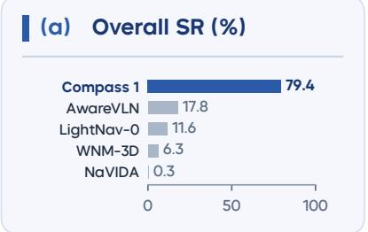

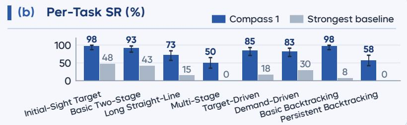  
(c) SR by task categories (%)  
(d) SR by scenarios (%)

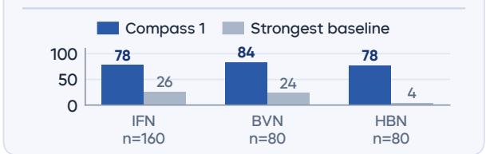

(e) SR by task & baseline (%)
<table><tr><td rowspan=1 colspan=6>Compass 1AwareVLN LightNav-0WNM-3D  NaVIDA</td></tr><tr><td rowspan=1 colspan=1>Initial-Sight Target</td><td rowspan=1 colspan=1>98</td><td rowspan=1 colspan=1>33</td><td rowspan=1 colspan=1>48</td><td rowspan=1 colspan=1>30</td><td rowspan=1 colspan=1>3</td></tr><tr><td rowspan=1 colspan=1>Basic Two-Stage</td><td rowspan=1 colspan=1>93</td><td rowspan=1 colspan=1>43</td><td rowspan=1 colspan=1>10</td><td rowspan=1 colspan=1>10</td><td rowspan=1 colspan=1>0</td></tr><tr><td rowspan=1 colspan=1>Long Straight-Line</td><td rowspan=1 colspan=1>73</td><td rowspan=1 colspan=1>15</td><td rowspan=1 colspan=1>0</td><td rowspan=1 colspan=1>0</td><td rowspan=1 colspan=1>0</td></tr><tr><td rowspan=1 colspan=1>Multi-Stage</td><td rowspan=1 colspan=1>50</td><td rowspan=1 colspan=1>0</td><td rowspan=1 colspan=1>0</td><td rowspan=1 colspan=1>0</td><td rowspan=1 colspan=1>0</td></tr><tr><td rowspan=1 colspan=1>Target-Driven</td><td rowspan=1 colspan=1>85</td><td rowspan=1 colspan=1>15</td><td rowspan=1 colspan=1>18</td><td rowspan=1 colspan=1>5</td><td rowspan=1 colspan=1>0</td></tr><tr><td rowspan=1 colspan=1>Demand-Driven</td><td rowspan=1 colspan=1>83</td><td rowspan=1 colspan=1>30</td><td rowspan=1 colspan=1>18</td><td rowspan=1 colspan=1>5</td><td rowspan=1 colspan=1>0</td></tr><tr><td rowspan=1 colspan=1>Basic Backtracking</td><td rowspan=1 colspan=1>98</td><td rowspan=1 colspan=1>8</td><td rowspan=1 colspan=1>0</td><td rowspan=1 colspan=1>0</td><td rowspan=1 colspan=1>0</td></tr><tr><td rowspan=1 colspan=2>Persistent Backtracking</td><td rowspan=1 colspan=1>58</td><td rowspan=1 colspan=1>0</td><td rowspan=1 colspan=1>0</td><td rowspan=1 colspan=1>0</td></tr></table>

(f) Embodiment transfer

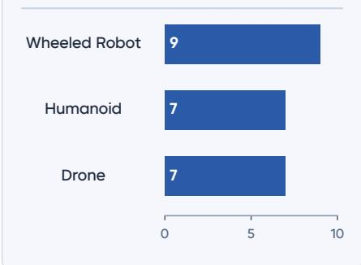

(g) Ablation SR by task category  
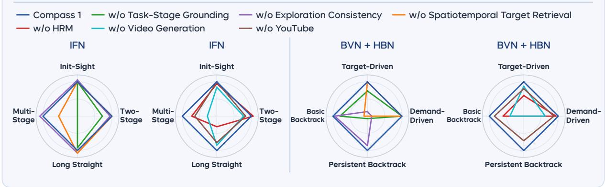  
Figure 7 Quantitative zero-shot results of Compass 1 against baselines and different variants in open-world environments across HBN, BVN, and IFN. (a) Overall success rate across all open-world tasks. (b) Per-task success rate comparing Compass 1 with the strongest baseline. (c) Success rate breakdown by task categories including IFN, BVN, and HBN. (d) Success rate across diverse deployment scenarios. (e) Granular success rate comparison across all tasks and baselines. (f) Cross-embodiment transfer performance evaluated on platforms including wheeled robot, humanoid, and drone. (g) Ablation results illustrating the impact of key component removals across task categories.

Instruction-Following Navigation. Figures 6(e) to (h) illustrate the instruction following capabilities of Compass 1 across multi-stage navigation, long straight-line navigation, basic two-stage navigation, and initial-sight target navigation. In multi-stage navigation, Compass 1 accurately grounds the current task stage and unambiguously aligns the turning intention with the language instruction, eliminating directional confusion. Upon reaching the final target, Compass 1 actively makes the decision to stop without relying on heuristic norm-threshold stopping rules, which often trigger premature stopping near obstacles due to reduced action magnitudes. In long straight-line navigation, Compass 1 follows forward instructions even when targets remain invisible over extended intervals, facilitated by the history guidance embedded in HRM (see Section 4.3). For basic two-stage navigation requiring turns exceeding 90◦, even if the target remains out-of-view due to an incomplete initial turn, Compass 1 refrains from random wandering and instead continues the turn under instruction guidance until the large-angle maneuver is fully accomplished. Finally, in initial-sight target navigation, where the target is unaligned with the initial heading, Compass 1 continuously adjusts its direction through continuous action sequences and stops precisely in front of the target.

Moreover, Compass 1 generalizes in a zero-shot manner to both indoor and outdoor scenarios. It reliably withstands severe visual distractors, including dynamic human flows crossing the visual field and moving background vehicles, ensuring robust navigation execution.

## 4.2.2 Quantitative Comparison with Baselines

Figure 7(a) presents the comprehensive quantitative comparisons between Compass 1 and existing SOTA baselines. Averaged over four distinct scenarios and eight task configurations, Compass 1 achieves a dominant overall success rate of 79.4%, whereas the second-best baseline AwareVLN attains only 17.8%. Other prominent SOTA methods designed for VLN-CE yield drastically lower performance, registering 11.6%, 6.3%, and 0.3%. These results strongly indicate that existing SOTA approaches trained purely in simulation sufer from severe overfitting. More significantly, fine-tuning these baselines with our dataset fails to yield performance gains comparable to Compass 1, demonstrating that high benchmark scores on traditional VLN-CE do not translate to robust open-world deployment capabilities.

Performance across Task Categories. Figure 7(b) and (c) break down the success rates by individual tasks and categories. For highly challenging HBN, the strongest baseline achieves a mere 8% success rate restricted to basic backtracking, while dropping to 0% on persistent backtracking. This reveals that existing SOTA approaches remain fundamentally insensitive to history input even when trained on our dataset, validating that conventional history integration mechanisms are largely inefective. In contrast, Compass 1 leverages efective history representation and utilization to achieve a 98% success rate on basic backtracking and an unparalleled overall leap from 4% to 78% on HBN.

In BVN, the strongest baseline exhibits comparable performance between target-driven and demand-driven tasks, suggesting that existing SOTA approaches inherently possess a basic capability to align natural language demands with object categories, albeit constrained by a low performance ceiling. Compass 1 attains an aggregate success rate of 84% in this category, representing a 250% improvement over the strongest baseline.

For IFN, the strongest baseline achieves approximately 50% success in initial-sight target and basic twostage navigation. However, their performance drops sharply when facing challenging long straight-line and multi-stage tasks, plummeting to 0% in multi-stage navigation. Conversely, Compass 1 achieves over 90% in initial-sight target and basic two-stage navigation, 73% in long straight-line navigation, and 50% in multi-stage navigation, yielding an overall IFN success rate of 78% which is 3.0× that of the strongest baseline.

Performance across Real-World Scenarios. Figure 7(d) illustrates the aggregated success rates across diferent deployment scenarios. Both the strongest baseline and our method maintain relatively stable performance in indoor scenarios and outdoor scenarios with minimal dynamic disturbances. However, in densely populated street environments characterized by heavy dynamic disturbances, the performance of the strongest baseline drops by nearly 65%. Meanwhile, Compass 1 maintains superior anti-interference capabilities, exhibiting only a minor performance drop.

Failure Case Analysis per Task and Baseline. Figure 7(e) provides a granular breakdown of success rates across all task types and baseline models, allowing for an in-depth analysis of failure modes:

• Initial-Sight Target and Basic Two-Stage Navigation: Approaches with discrete action outputs, such as AwareVLN and NaVIDA, tend to output straight actions over prolonged distances before executing sharp turns toward targets. While AwareVLN demonstrates superior turning capabilities compared to NaVIDA, this strategy often causes the robot to get blocked by walls after turning in indoor environments, resulting in target occlusion and navigation failure. Although LightNav-0 also utilizes discrete actions, it approximates continuous control for smoother turns. However, control-induced drift during locomotion frequently causes it to deviate and lose the target, such as when traversing stairs. WNM-3D struggles to stop when the target is out of the center of the current field-of-view, highlighting the limited semantic understanding of current world-model-based approaches. Additionally, these three baselines are heavily impacted by dense dynamic disturbances and struggle to execute further turning adjustments when an initial turn is insuficient to align with the target. In contrast, Compass 1 maintains stable performance, with remaining failures primarily stemming from target occlusion caused by dynamic obstructions or excessive rotation that leads to selected keyframes missing the target.

• Long Straight-Line Navigation: Approaches with discrete action outputs, such as AwareVLN and NaVIDA, persistently output forward actions during initial stages, which ultimately lead to navigation failure either through uneven terrain and accumulated control errors that cause severe trajectory drift, or via premature stopping in the middle of paths. LightNav-0 frequently exhibits premature turning behaviors that lead to task failure. Although WNM-3D outputs continuous actions and adjusts its heading dynamically via predicted dy, it still fails to maintain a consistent heading direction. While Compass 1 occasionally exhibits unintended turns during long straight-line navigation, the frequency is significantly lower than that of LightNav-0.

• Multi-Stage Navigation: Baseline models consistently sufer from various forms of premature stopping and target loss induced by turning inaccuracies. Compass 1 experiences occasional navigation failures similarly stemming from accumulated turning inaccuracies that cause target loss, particularly in scenarios where targets blend into complex backgrounds due to glass reflections or extreme lighting variations.

• Beyond-the-View Navigation: LightNav-0 exhibits a high probability for premature turning behaviors, struggling to follow instructions along exploratory paths (e.g., go along the way to find the target), and can directly collide with obstacles in dead ends. AwareVLN and WNM-3D are prone to aggressive exploratory turns that frequently trigger collisions or lead to left-right turning deadlocks. Although AwareVLN generates reasoning text and passes it to the next inference step, its reasoning primarily emphasizes global scene understanding while lacking awareness of previously explored directions. NaVIDA exhibits virtually no active exploration capability. In contrast, Compass 1 may occasionally drift from the target direction or experience collisions during exploration, though its collision rate remains significantly lower than all comparative baselines. Additionally, it may exhibit transient left-right oscillation behaviors, but typically manages to escape from such loops and resume navigation.

• History Backtracking Navigation: Among all baselines, only AwareVLN exhibits a slight tendency to turn back, yet it fails to achieve a full 180◦ turn, succeeding only by coincidence when objects happen to be visible with a 120◦ turn. All baseline models completely fail at persistent backtracking. The sole failure mode observed for Compass 1 on basic tracking involves minor collisions with intermediate targets during U-turn execution. Persistent backtracking remains challenging, where occlusions by obstacles during the return path can cause the robot to lose its return heading despite knowing the approximate target location.

## 4.2.3 Quantitative Evaluation on Cross-Embodiment Transfer

Figure 1 and Figure 7(f) illustrate the qualitative and quantitative evaluation of Compass 1 across four distinct embodiments under varying camera heights on HBN tasks. Compass 1 achieves robust navigation performance across all evaluated embodiments and camera configurations. Due to the inherent motion stability of wheeled robot at the control level, the success rate on this platform is relatively higher. Conversely, the unstable pose variations induced by humanoid locomotion and the aerodynamic turbulence during drone flight introduce significant dynamic jitter into captured images, presenting severe OOD visual challenges that slightly degrad performance on these two embodiments.

## 4.3 Ablation Studies

(a) Inference Acceleration via KV-Cache and CUDA Graph Compilation

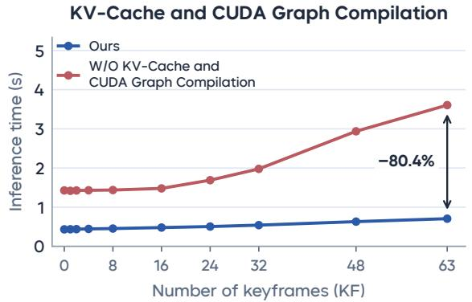  
(b) Inference Acceleration via Asynchronous Execution

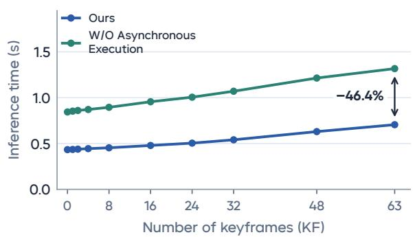  
Figure 8 Inference efficiency analysis on NVIDIA PRO 6000. (a) Latency reduction of KV-cache and CUDA graph compilation achieving an 80.4% decrease in execution time at 63 keyframes. (b) Latency reduction of asynchronous single-GPU execution yielding a 46.4% eficiency gain over synchronous execution across keyframe sequences.

To analyze the internal mechanisms and validate the design choices of Compass 1, we conduct comprehensive ablation studies across six variants as illustrated in Figure 7(g).

• w/o Task-Stage Grounding: This variant removes task-stage grounding VQA and passively determines episode termination based on the norm of action outputs. To preserve intention propagation under this setup, continuous action predictions are discretized and passed in natural language format. This removal causes noticeable performance degradation in basic two-stage navigation due to premature stopping, while dropping performance to zero on multi-stage navigation. This confirms that task-stage grounding VQA provides a critical capability for multi-stage instruction-following. Furthermore, lacking this capability negatively afects other tasks reliant on multi-stage execution, (e.g., persistent backtracking navigation) though its overall impact on exploration and basic backtracking capabilities remains minimal.

• w/o Exploration Consistency: This variant removes the exploration consistency VQA and intention propagation. Performance evaluations indicate that this removal primarily impairs target-driven navigation and demand-driven navigation tasks, whereas performance across remaining evaluations stays largely unchanged.

• w/o Spatiotemporal Target Retrieval: This variant removes the spatiotemporal target retrieval VQA. Removing this mechanism severely degrades history reasoning capabilities, rendering input HRM completely inefective without this explicit reasoning trigger. Crucially, this QA mechanism benefits not only history-dependent backtracking navigation, but also mitigates error accumulation in multi-stage navigation. When the model inadvertently miss targets during execution, this spatiotemporal reasoning enables target relocation, thereby increasing overall navigation success rates.

• w/o HRM: This variant removes HRM as an extra visual input while retaining all structured VQA tasks. Without HRM, the model preserves partial reasoning capacities, achieving strong performance on basic two-stage navigation alongside reasonable success on multi-stage and basic backtracking navigation. However, when deployed on highly challenging scenarios such as long straight-line and persistent backtracking navigation, relying solely on VQA proves insuficient to satisfy the memory demands.

• w/o Video Generation: This variant removes the inverse dynamics model auxiliary objective and directly attaches a difusion action head for trajectory generation. Results demonstrate that predictive video generation can improve action generation, proving particularly beneficial for challenging exploration, multi-stage, and history-backtracking navigation.

• w/o YouTube Data: This variant restricts model training exclusively to our collected real-world dataset.

Co-training with YouTube web-scale video data provides general performance improvements across tasks, though the magnitude of these gains remains constrained by the inherent limited quality of web data.

Among the three proposed structured VQA categories, task-stage grounding serves as the foundational bedrock, exploration consistency provides auxiliary guidance, and spatiotemporal target retrieval catalyzes transformational performance gains. Together, these three capabilities form a flexible plug-and-play modular paradigm for visual language navigation.

Comparing HRM against VQA reveals that structured VQA provides the essential foundation for leveraging memory, while HRM provide complementary enhancements for expanding the performance boundary.

Table 1 Comparison on the R2R Val-Unseen split in continuous environments. S.RGB, Pano., Depth, and Odom. indicate single-view RGB, panoramic or multi-camera RGB, depth, and odometry inputs, respectively. \* denotes methods using a waypoint predictor. In monocular setting, bold denotes the best performance.
<table><tr><td rowspan="2">Method</td><td colspan="4">Observation</td><td colspan="4">R2R Val-Unseen</td></tr><tr><td>S.RGB</td><td>Pano.</td><td>Depth</td><td>Odom.</td><td>NE↓</td><td>OS↑</td><td>SR↑</td><td>SPL ↑</td></tr><tr><td>Multi-view methods</td><td></td><td></td><td></td><td></td><td></td><td></td><td></td><td></td></tr><tr><td>CMA* [16]</td><td></td><td>√</td><td>V</td><td>√</td><td>6.20</td><td>52.0</td><td>41.0</td><td>36.0</td></tr><tr><td>HPN+DN* [18]</td><td></td><td>V</td><td>V</td><td>√</td><td>6.31</td><td>40.0</td><td>36.0</td><td>34.0</td></tr><tr><td>Sim2Sim* [15]</td><td></td><td>V</td><td>V</td><td>V</td><td>6.07</td><td>52.0</td><td>43.0</td><td>36.0</td></tr><tr><td>DreamWalker* [32]</td><td></td><td>√</td><td>√</td><td>√</td><td>5.53</td><td>59.0</td><td>49.0</td><td>44.0</td></tr><tr><td>HNR* [38]</td><td></td><td>√</td><td>V</td><td>V</td><td>4.42</td><td>67.0</td><td>61.0</td><td>51.0</td></tr><tr><td>InstructNav [22]</td><td></td><td>V</td><td>V</td><td></td><td>6.89</td><td></td><td>31.0</td><td>24.0</td></tr><tr><td>ABot-N0 [7]</td><td></td><td>√</td><td></td><td></td><td>3.80</td><td>70.8</td><td>66.4</td><td>63.9</td></tr><tr><td>Qwen-RobotNav-4B [48]</td><td></td><td>V</td><td></td><td></td><td>3.80</td><td>77.2</td><td>69.5</td><td>63.6</td></tr><tr><td>Qwen-RobotNav-8B [48]</td><td></td><td>√</td><td></td><td></td><td>3.53</td><td>78.5</td><td>72.1</td><td>66.6</td></tr><tr><td>ABot-N1 [9]</td><td></td><td>√</td><td></td><td></td><td>3.91</td><td>71.7</td><td>68.3</td><td>66.6</td></tr><tr><td colspan="2">Monocular methods</td><td></td><td></td><td></td><td></td><td></td><td></td><td></td></tr><tr><td>NaVid [46]</td><td>V</td><td></td><td></td><td></td><td>5.47</td><td>49.0</td><td>37.0</td><td>35.0</td></tr><tr><td>Uni-NaVid [47]</td><td>√</td><td></td><td></td><td></td><td>5.58</td><td>53.5</td><td>47.0</td><td>42.7</td></tr><tr><td>NaVILA [6]</td><td>V</td><td></td><td></td><td></td><td>5.22</td><td>62.5</td><td>54.0</td><td>49.0</td></tr><tr><td>SparseVideoNav [45]</td><td>√</td><td></td><td></td><td></td><td>4.17</td><td>56.1</td><td>48.6</td><td>47.4</td></tr><tr><td>NaVIDA [51]</td><td>√</td><td></td><td></td><td></td><td>4.32</td><td>69.5</td><td>61.4</td><td>54.7</td></tr><tr><td>AwareVLN [11]</td><td>√</td><td></td><td></td><td></td><td>4.02</td><td>73.5</td><td>65.4</td><td>55.1</td></tr><tr><td>WNM-3D [14]</td><td>V</td><td></td><td></td><td></td><td>4.35</td><td>66.7</td><td>63.1</td><td>57.9</td></tr><tr><td>LightNav-0 [34]</td><td></td><td></td><td></td><td></td><td>3.91</td><td>73.7</td><td>68.5</td><td>62.8</td></tr><tr><td>Compass 1</td><td></td><td></td><td></td><td></td><td>3.88</td><td>74.9</td><td>70.1</td><td>63.2</td></tr></table>

## 4.4 Inference Efficiency Analysis

We evaluate the inference eficiency of Compass 1 across varying keyframe lengths as quantitative metrics presented in Figure 8. Compared to the version without KV-cache and CUDA graph compilation, our optimization pipeline achieves an 80.4% reduction in inference latency at 63 keyframes. Furthermore, as the keyframe count increases, our latency exhibits a remarkably slow growth trend, demonstrating robust context scaling capabilities. Simultaneously, introducing the asynchronous single-GPU execution strategy yields a speedup of nearly 50% over synchronous execution. These optimizations boost the deployment responsiveness, enabling our policy to compute 12 continuous actions in 0.43s at the beginning, which corresponds to an efective control frequency of approximately 28Hz, and maintain 0.71s latency at 63 keyframes, representing approximately 17Hz.

Table 2 Performance on open-vocabulary object navigation. Comparison on the HM3D-OVON benchmark [43] under seen-category, synonyms, and unseen-category settings. In monocular setting, bold denotes the best performance.
<table><tr><td rowspan="2">Method</td><td colspan="4">Observation</td><td colspan="2">Seen</td><td colspan="2">Synonyms</td><td colspan="2">Unseen</td></tr><tr><td>S.RGB</td><td>Pano.</td><td>Depth</td><td>Odom.</td><td>SR↑</td><td>SPL↑</td><td>SR↑</td><td>SPL↑</td><td>SR↑</td><td>SPL↑</td></tr><tr><td>Multi-view methods</td><td></td><td></td><td></td><td></td><td></td><td></td><td></td><td></td><td></td><td></td></tr><tr><td>Qwen-RobotNav-4B [48]</td><td></td><td>√</td><td></td><td></td><td>57.7</td><td>24.4</td><td>60.1</td><td>25.1</td><td>53.1</td><td>20.9</td></tr><tr><td>Qwen-RobotNav-8B [48]</td><td></td><td>V</td><td></td><td></td><td>56.1</td><td>28.5</td><td>57.8</td><td>28.8</td><td>51.2</td><td>24.0</td></tr><tr><td>ABot-N0 [7]</td><td></td><td>√</td><td></td><td></td><td>55.3</td><td>32.1</td><td>55.4</td><td>33.2</td><td>54.0</td><td>30.5</td></tr><tr><td>Monocular methods</td><td></td><td></td><td></td><td></td><td></td><td></td><td></td><td></td><td></td><td></td></tr><tr><td>VLFM [42]</td><td>V</td><td></td><td>√</td><td>V</td><td>35.2</td><td>18.6</td><td>32.4</td><td>17.3</td><td>35.2</td><td>19.6</td></tr><tr><td>DAgRL+OD [43]</td><td>√</td><td></td><td>√</td><td>√</td><td>38.5</td><td>21.1</td><td>39.0</td><td>21.4</td><td>37.1</td><td>19.8</td></tr><tr><td>MTU3D [52]</td><td>√</td><td></td><td>√</td><td>√</td><td>55.0</td><td>23.6</td><td>45.0</td><td>14.7</td><td>40.8</td><td>12.1</td></tr><tr><td>Uni-NaVid [47]</td><td>√</td><td></td><td></td><td></td><td>41.3</td><td>21.1</td><td>43.9</td><td>21.8</td><td>39.5</td><td>19.8</td></tr><tr><td>LightNav-0 [34]</td><td>√</td><td></td><td></td><td></td><td>55.3</td><td>31.2</td><td>54.6</td><td>29.6</td><td>47.0</td><td>24.2</td></tr><tr><td>Compass 1</td><td></td><td></td><td></td><td></td><td>57.4</td><td>31.3</td><td>59.7</td><td>31.5</td><td>52.2</td><td>26.9</td></tr></table>

Table 3 Comparison results on IntentionNav. Bold denotes the best performance and underline denotes the second best performance.
<table><tr><td>Model</td><td>NE↓</td><td>OS↑</td><td>SR↑</td><td>SPL↑</td></tr><tr><td>NaVIDA [51]</td><td>2.53</td><td>42.5</td><td>33.5</td><td>33.3</td></tr><tr><td>WNM-3D [14]</td><td>2.99</td><td>43.0</td><td>30.0</td><td>29.9</td></tr><tr><td>AwareVLN [11]</td><td>3.15</td><td>60.0</td><td>33.5</td><td>29.8</td></tr><tr><td>LightNav-0 [34]</td><td>2.28</td><td>38.5</td><td>35.5</td><td>35.1</td></tr><tr><td>Compass 1</td><td>2.35</td><td>50.5</td><td>42.5</td><td>42.1</td></tr></table>

Table 4 Comparison results on IndoorUAV-VLN [21] test unseen split. Compass 1 and all baselines are fine-tuned on the dataset. Bold denotes the best performance and underline denotes the second best performance. ∗ denotes the checkpoint open-sourced by IndoorUAV.
<table><tr><td rowspan="2">IndoorUAV-VLN</td><td colspan="3">TEST UNSEEN</td></tr><tr><td>NE↓</td><td>OS ↑ SR ↑</td><td>nDTW ↑</td></tr><tr><td>LLaMA-UAV [36]</td><td>8.49</td><td>4.26</td><td>3.19 4.70</td></tr><tr><td>OpenFly [8]</td><td>7.06</td><td>10.64 4.26</td><td>11.88</td></tr><tr><td>π0 [4]</td><td>10.53</td><td>43.62 9.57</td><td>5.85</td></tr><tr><td>Compass 1</td><td>5.94</td><td>37.23 18.09</td><td>12.14</td></tr></table>

## 4.5 Simulation Evaluation Results

We further evaluate the performance of Compass 1 using established benchmarks. Note that HBN currently lacks a simulation benchmark for comprehensive evaluation. We report navigation error (NE), oracle success rate (OS), success rate (SR), and success weighted by path length (SPL) as evaluation metrics.

• R2R-CE [2] (for IFN): We train Compass 1 from scratch using R2R with DAgger augmentation. As shown in Table 1, Compass 1 achieves SOTA performance among existing monocular navigation algorithms.

• OVON [43] (for target-driven navigation of BVN): We train Compass 1 from scratch using HM3D-OVON data and augment the training with DAgger. As shown in Table 2, Compass 1 achieves SOTA performance among existing monocular navigation algorithms.

• IntentionNav [24] (for demand-driven navigation of BVN): IntentionNav serves as a demand-driven navigation benchmark designed to evaluate whether the policy can locate the target based on user demands. Since the data source in IntentionNav is entirely unseen by all evaluated methods, we partition its 500 trajectory samples into a training set of 300 trajectories and a testing set of 200 trajectories. These 300 training trajectories are utilized to fine-tune Compass 1 and all baselines without DAgger augmentation. Detailed records of trajectory split and baseline implementations are documented in Section A.2. As shown in Table 3, Compass 1 achieves SOTA performance on IntentionNav.

• IndoorUAV [21] (for IFN): IndoorUAV is a multi-stage benchmark that closely aligns with indoor drone flight altitudes. We remove all trajectories with up and down actions from both training and evaluation set, and then feed the training trajectories into Compass 1 and baselines for fine-tuning, followed by evaluation on the evaluation set. Since IndoorUAV does not provide ground-truth shortest trajectories, we report Normalized Dynamic Time Warping (nDTW) instead of SPL. Table 4 shows that Compass 1 achieves SOTA performance on the more challenging multi-stage IFN task.

## 5 Related Work

History Representation in Embodied Navigation Foundation Models. Existing end-to-end foundation models predominantly process visual history through three paradigms: feeding dense uncompressed streams or sliding windows into the backbone [14, 46], applying heuristic token merging and multi-scale memory pooling [31, 34, 47], or uniformly subsampling frames into a fixed context window [6, 11]. However, these strategies either flood attention with redundant tokens or drop critical spatial information [45], rendering HBN unachievable. Although recent frameworks like MemoryVLN [40] and MapNav [50] have introduced explicit memory banks and semantic maps as additional inputs, the policy tends to largely ignore them due to the lack of explicit supervision, making them still insuficient for HBN.

VQA Supervision in Embodied Navigation. To bridge high-level semantic reasoning and low-level motion control, recent methods increasingly incorporate VQA and CoT supervision during training. Within embodied navigation, Lin et al. [19] and Liu et al. [20] supervise policies with step-by-step navigational CoT traces, while Wang et al. [35] and Guo et al. [11] dynamically trigger interleaved reasoning tokens to switch between the reasoning of scene and action generation. Similarly, Wang et al. [34] and Zhu et al. [51] augment policy training with latent point reasoning and action-grounded visual dynamics. However, these auxiliary formulations predominantly target general scene understanding, future prediction, or coarse subgoal identification [5, 48, 49], leaving history reasoning largely underexplored and lacking the mechanism to analyze and resolve closed-loop physical execution failures [14, 45].

Learning from Real-World Navigation Videos and Datasets. Large-scale learning-based navigation policies have historically relied on synthetic trajectories scaled within photorealistic simulators such as Habitat [17, 27, 39]. Despite claims of zero-shot sim-to-real transfer [6, 14, 47], simulator-trained policies sufer from visual artifacts and physical domain gaps that degrade real deployment. While real-world robot datasets such as ViNT [29] and NoMaD [30] aggregate multi-embodiment physical trajectories, they focus on point-goal or image-goal navigation and lack fine-grained language annotations. To harvest open-world visual priors with minima collection overhead, Hirose et al. [12] and Mei et al. [23] annotate in-the-wild YouTube videos, while Huang et al. [13] extract metric pseudo-trajectories via 3D vision foundation models [33, 37]. However, these pipelines yield only single-object labels or unverified motion primitives without the stage-aligned instructions needed for embodied navigation. Recently, Zhang et al. [45] demonstrated strong physical deployment via real-world data collection, yet their framework relies on labor-intensive labeling and lacks VQA supervision. Consequently, it is crucial to develop a lightweight data labeling pipeline that minimizes manual efort.

## 6 Conclusion

In this work, we present Compass 1, an embodied navigation foundation model designed to pursue open-world and persistent navigation capabilities with nearly two minutes of history backtracking. By integrating keyframelevel sparsification with an explicit HRM, our method efectively preserves long-horizon spatiotemporal context without introducing architectural modifications. Complementing this, the proposed structured VQA supervision protocol serves as an essential map activation mechanism, successfully mitigating pervasive real-world execution failures and enforcing history-aware reasoning across instruction-following, beyondthe-view, and history backtracking navigation tasks. Furthermore, our semi-automated dataset curation pipeline significantly reduces human overhead and enables the scalable acquisition of diverse multi-modal interaction data. Extensive real-world and simulation evaluations demonstrate that Compass 1 achieves superior performance and robust zero-shot generalization across diverse physical scenarios and robotic embodiments. Coupled with detailed failure case analyses, our work provides comprehensive insights into closed-loop execution and lays a solid foundation for the future development of navigation embodied systems.

## References

[1] Niket Agarwal, Arslan Ali, Jon Allen, Martin Antolini, Adeline Aubame, Alisson Azzolini, Junjie Bai, Maciej Bala, Yogesh Balaji, Josh Bapst, et al. Cosmos 3: Omnimodal World Models for Physical AI. arXiv preprint arXiv:2606.02800, 2026.

[2] Peter Anderson, Qi Wu, Damien Teney, Jake Bruce, Mark Johnson, Niko Sünderhauf, Ian Reid, Stephen Gould, and Anton Van Den Hengel. Vision-and-Language Navigation: Interpreting Visually-Grounded Navigation Instructions in Real Environments. In CVPR, 2018.

[3] Shuai Bai, Yuxuan Cai, Ruizhe Chen, Keqin Chen, Xionghui Chen, Zesen Cheng, Lianghao Deng, Wei Ding, Chang Gao, Chunjiang Ge, et al. Qwen3-VL Technical Report. arXiv preprint arXiv:2511.21631, 2025.

[4] Kevin Black, Noah Brown, Danny Driess, Adnan Esmail, Michael Equi, and et al. π : A Vision-Language-Action Flow Model for General Robot Control. In RSS, 2025.

[5] An-Chieh Cheng, Hongxu Yin, Yang Fu, Qiushan Guo, Ruihan Yang, Jan Kautz, Xiaolong Wang, and Sifei Liu. SpatialRGPT: Grounded Spatial Reasoning in Vision-Language Models. In NeurIPS, 2024.

[6] An-Chieh Cheng, Yandong Ji, Zhaojing Yang, Zaitian Gongye, Xueyan Zou, Jan Kautz, Erdem Biyik, Hongxu Yin, Sifei Liu, and Xiaolong Wang. NaVILA: Legged Robot Vision-Language-Action Model for Navigation. In RSS, 2025.

[7] Zedong Chu, Shichao Xie, Xiaolong Wu, Yanfen Shen, Minghua Luo, Zhengbo Wang, Fei Liu, Xiaoxu Leng, Junjun Hu, Mingyang Yin, et al. Abot-N0: Technical Report on the VLA Foundation Model for Versatile Embodied Navigation. arXiv preprint arXiv:2602.11598, 2026.

[8] Yunpeng Gao, Chenhui Li, Zhongrui You, Junli Liu, Li Zhen, Pengan Chen, Qizhi Chen, Zhonghan Tang, Liansheng Wang, Yiwen Tang, et al. OpenFly: A Comprehensive Platform for Aerial Vision-Language Navigation. In ICLR, 2026.

[9] Ruiyan Gong, Yingnan Guo, Junjun Hu, Jintao Kong, Xiaoxu Leng, Tianlun Li, Weize Li, Fei Liu, Zhicheng Liu, Jia Lu, et al. Abot-N1: Toward a General Visual Language Navigation Foundation Model. arXiv preprint arXiv:2607.10383, 2026.

[10] Qiao Gu, Ali Kuwajerwala, Sacha Morin, Krishna Murthy Jatavallabhula, Bipasha Sen, Aditya Agarwal, Corban Rivera, William Paul, Kirsty Ellis, Rama Chellappa, et al. ConceptGraphs: Open-vocabulary 3D Scene Graphs for Perception and Planning. In ICRA, 2024.

[11] Wenxuan Guo, Xiuwei Xu, Yichen Liu, Xiangyu Li, Hang Yin, Huangxing Chen, Wenzhao Zheng, Jianjiang Feng, Jie Zhou, and Jiwen Lu. AwareVLN: Reasoning with Self-awareness for Vision-Language Navigation. In CVPR, 2026.

[12] Noriaki Hirose, Catherine Glossop, Ajay Sridhar, Oier Mees, and Sergey Levine. LeLaN: Learning A Language-Conditioned Navigation Policy from In-the-Wild Video. In CoRL, 2024.

[13] Xijie Huang, Weiqi Gai, Tianyue Wu, Congyu Wang, Qiaoyu Zheng, Zhiyang Liu, Xin Zhou, Yuze Wu, and Fei Gao. NavDreamer: Video Models as Zero-Shot 3D Navigators. In RAL, 2026.

[14] Yuehao Huang, Yunzi Wu, Xiaotao Zhang, Xinhai Li, Jiankun Dong, Jiajun Lv, Chi Zhang, Chenjia Bai, Yong Liu, and Xuelong Li. WNM-3D: A World Navigation Model with 3D Scene Conditioning for Closed-loop VLN. arXiv preprint arXiv:2608.07267, 2026.

[15] Jacob Krantz and Stefan Lee. Sim-2-Sim Transfer for Vision-and-Language Navigation in Continuous Environments. In ECCV, 2022.

[16] Jacob Krantz, Erik Wijmans, Arjun Majumdar, Dhruv Batra, and Stefan Lee. Beyond the Nav-Graph: Visionand-Language Navigation in Continuous Environments. In ECCV, 2020.

[17] Jacob Krantz, Erik Wijmans, Arjun Majumdar, Dhruv Batra, and Stefan Lee. Beyond the Nav-Graph: Visionand-Language Navigation in Continuous Environments. In ECCV, 2020.

[18] Jacob Krantz, Aaron Gokaslan, Dhruv Batra, Stefan Lee, and Oleksandr Maksymets. Waypoint Models for Instruction-Guided Navigation in Continuous Environments. In ICCV, 2021.

[19] Bingqian Lin, Yunshuang Nie, Ziming Wei, Jiaqi Chen, Shikui Ma, Jianhua Han, Hang Xu, Xiaojun Chang, and Xiaodan Liang. NavCoT: Boosting LLM-Based Vision-and-Language Navigation via Learning Disentangled Reasoning. In TPAMI, 2025.

[20] Qingxiang Liu, Ting Huang, Zeyu Zhang, and Hao Tang. Nav-R1: Reasoning and Navigation in Embodied Scenes. arXiv preprint arXiv:2509.10884, 2025.

[21] Xu Liu, Yu Liu, Hanshuo Qiu, Yang Qirong, and Zhouhui Lian. Indooruav: Benchmarking Vision-Language UAV Navigation in Continuous Indoor Environments. In AAAI, 2026.

[22] Yuxing Long, Wenzhe Cai, Hongcheng Wang, Guanqi Zhan, and Hao Dong. InstructNav: Zero-shot System for Generic Instruction Navigation in Unexplored Environment. In CoRL, 2025.

[23] Yanghong Mei, Yirong Yang, Longteng Guo, Qunbo Wang, Ming-Ming Yu, Xingjian He, Wenjun Wu, and Jing Liu. UrbanNav: Learning Language-Guided Urban Navigation from Web-Scale Human Trajectories. In AAAI, 2026.

[24] Lin Qian, Shijie Li, Sihao Lin, Xuan Zhang, Bangya Liu, Yanran Li, and Hujun Yin. IntentionNav: A Benchmark for Intent-Driven Object Navigation from Implicit Human Instruction. arXiv preprint arXiv:2605.23187, 2026.

[25] Qwen Team. Qwen3.8-Max: A New Bar for Coding and Cowork, 2026. URL https://qwen.ai/blog?id=qwen3.8.

[26] Krishan Rana, Jesse Haviland, Sourav Garg, Jad Abou-Chakra, Ian Reid, and Niko Suenderhauf. SayPlan: Grounding Large Language Models using 3D Scene Graphs for Scalable Robot Task Planning. In CoRL, 2023.

[27] Manolis Savva, Abhishek Kadian, Oleksandr Maksymets, Yili Zhao, Erik Wijmans, Bhavana Jain, Julian Straub, Jia Liu, Vladlen Koltun, Jitendra Malik, Devi Parikh, and Dhruv Batra. Habitat: A Platform for Embodied AI Research. In ICCV, 2019.

[28] ByteDance Seed. Seed2.1 oficially released: Advancing ai productivity, 2026. URL https://seed.bytedance. com/en/blog/seed2-1-officially-released-advancing-ai-productivity.

[29] Dhruv Shah, Ajay Sridhar, Nitish Dashora, Kyle Stachowicz, Kevin Black, Noriaki Hirose, and Sergey Levine. ViNT: A Foundation Model for Visual Navigation. In CoRL, 2023.

[30] Ajay Sridhar, Dhruv Shah, Catherine Glossop, and Sergey Levine. NoMaD: Goal Masked Difusion Policies for Navigation and Exploration. In ICRA, 2024.

[31] Marcel Torne, Karl Pertsch, Homer Walke, Kyle Vedder, Suraj Nair, Brian Ichter, Allen Z. Ren, Haohuan Wang, Jiaming Tang, Kyle Stachowicz, Karan Dhabalia, Michael Equi, Quan Vuong, Jost Tobias Springenberg, Sergey Levine, Chelsea Finn, and Danny Driess. MEM: Multi-Scale Embodied Memory for Vision Language Action Models. In CoRL, 2026.

[32] Hanqing Wang, Wei Liang, Luc Van Gool, and Wenguan Wang. Dreamwalker: Mental Planning for Continuous Vision-Language Navigation. In ICCV, 2023.

[33] Ruicheng Wang, Sicheng Xu, Yue Dong, Yu Deng, Jianfeng Xiang, Zelong Lv, Guangzhong Sun, Xin Tong, and Jiaolong Yang. MoGe-2: Accurate Monocular Geometry with Metric Scale and Sharp Details. In NeurIPS, 2025.

[34] Shaoan Wang, Aocheng Luo, Fei Huang, Jingyi Xu, Xiaoyang Wang, Yueyu Wang, Qianli Ma, Fan Yang, Ran Mei, Jia Wei, et al. Lightnav-0: Eliciting VLM Spatial Intelligence for Generalist Embodied Navigation. arXiv preprint arXiv:2608.30935, 2026.

[35] Shaoan Wang, Yuanfei Luo, Xingyu Chen, Aocheng Luo, Dongyue Li, Chang Liu, Sheng Chen, Yangang Zhang, and Junzhi Yu. VLingNav: Embodied Navigation with Adaptive Reasoning and Visual-Assisted Linguistic Memory. In TRO, 2026.

[36] Xiangyu Wang, Donglin Yang, Ziqin Wang, Hohin Kwan, Jinyu Chen, Hongsheng Li, Yue Liao, Si Liu, et al. Towards Realistic UAV Vision-Language Navigation: Platform, Benchmark, and Methodology. In ICLR, 2025.

[37] Yifan Wang, Jianjun Zhou, Haoyi Zhu, Wenzheng Chang, Yang Zhou, Zizun Li, Junyi Chen, Jiangmiao Pang, Chunhua Shen, and Tong He. π3: Permutation-Equivariant Visual Geometry Learning. In ICLR, 2026.

[38] Zihan Wang, Xiangyang Li, Jiahao Yang, Yeqi Liu, Junjie Hu, Ming Jiang, and Shuqiang Jiang. Lookahead Exploration with Neural Radiance Representation for Continuous Vision-Language Navigation. In CVPR, 2024.

[39] Zun Wang, Jialu Li, Yicong Hong, Yi Wang, Qi Wu, Mohit Bansal, Stephen Gould, Hao Tan, and Yu Qiao. Scaling Data Generation in Vision-and-Language Navigation. In ICCV, 2023.

[40] Xueyao Wei, Yifei Wang, Delun Li, Shaoan Wang, Junzhi Yu, Wenjie Song, and Xingyu Chen. MemoryVLN: From Ego-Aware Memory Representation to Cross-Context Memory Reuse in Vision-Language Navigation. In TMLR, 2026.

[41] Pengying Wu, Yao Mu, Bingxian Wu, Yi Hou, Ji Ma, Shanghang Zhang, and Chang Liu. VoroNav: Voronoi-based Zero-shot Object Navigation with Large Language Model. In ICML, 2024.

[42] Naoki Yokoyama, Sehoon Ha, Dhruv Batra, Jiuguang Wang, and Bernadette Bucher. VLFM: Vision-Language Frontier Maps for Zero-Shot Semantic Navigation. In ICRA, 2024.

[43] Naoki Yokoyama, Ram Ramrakhya, Abhishek Das, Dhruv Batra, and Sehoon Ha. HM3D-OVON: A Dataset and Benchmark for Open-Vocabulary Object Goal Navigation. In IROS, 2024.

[44] Bangguo Yu, Hamidreza Kasaei, and Ming Cao. L3MVN: Leveraging Large Language Models for Visual Target Navigation. In IROS, 2023.

[45] Hai Zhang, Siqi Liang, Li Chen, Yuxian Li, Yukuan Xu, Yichao Zhong, Fu Zhang, and Hongyang Li. Sparse Video Generation Propels Real-world Beyond-the-view Vision-language Navigation. In NeurIPS, 2026.

[46] Jiazhao Zhang, Kunyu Wang, Rongtao Xu, Gengze Zhou, Yicong Hong, Xiaomeng Fang, Qi Wu, Zhizheng Zhang, and He Wang. NaVid: Video-based VLM Plans the Next Step for Vision-and-Language Navigation. In RSS, 2024.

[47] Jiazhao Zhang, Kunyu Wang, Shaoan Wang, Minghan Li, Haoran Liu, Songlin Wei, Zhongyuan Wang, Zhizheng Zhang, and He Wang. Uni-NaVid: A Video-based Vision-language-action Model for Unifying Embodied Navigation Tasks. In RSS, 2025.

[48] Jiazhao Zhang, Gengze Zhou, Hale Yin, Yiyang Huang, Zixing Lei, Qihang Peng, Haoqi Yuan, Jie Zhang, Xudong Guo, Xiaoyue Chen, et al. Qwen-robotnav Technical Report: A Scalable Navigation Model Designed for an Agentic Navigation System. arXiv preprint arXiv:2606.18112, 2026.

[49] Jinkai Zhang, Jingyi Xu, Yuanhong Yu, Jiarui Guo, Ruizhen Hu, Hujun Bao, Xiaowei Zhou, and Sida Peng. SuperNav: An Agentic Navigation System for Any Task in Any Scene. arXiv preprint arXiv:2610.12126, 2026.

[50] Lingfeng Zhang, Xiaoshuai Hao, Qinwen Xu, Qiang Zhang, Xinyao Zhang, Pengwei Wang, Jing Zhang, Zhongyuan Wang, Shanghang Zhang, and Renjing Xu. MapNav: A Novel Memory Representation via Annotated Semantic Maps for VLM-based Vision-and-Language Navigation. In ACL, 2025.

[51] Weiye Zhu, Zekai Zhang, Xiangchen Wang, Hewei Pan, Teng Wang, Tiantian Geng, Rongtao Xu, and Feng Zheng. NaVIDA: Vision-Language Navigation with Inverse Dynamics Augmentation. arXiv preprint arXiv:2601.18188, 2026.

[52] Ziyu Zhu, Xilin Wang, Yixuan Li, Zhuofan Zhang, Xiaojian Ma, Yixin Chen, Baoxiong Jia, Wei Liang, Qian Yu, Zhidong Deng, et al. Move to Understand a 3D Scene: Bridging Visual Grounding and Exploration for Eficient and Versatile Embodied Navigation. In ICCV, 2025.

## Appendix

## A Implementation and Reproducibility Details for Baselines

We here present the implementation details for fine-tuning baseline models on real-world data during open-world evaluations (Section A.1), as well as the training and testing data split of IntentionNav (Section A.2).

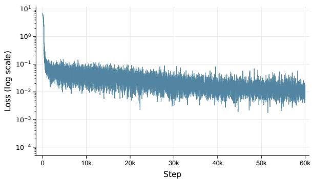  
(a) AwareVLN

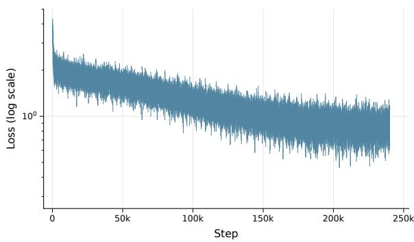  
(b) LightNav-0

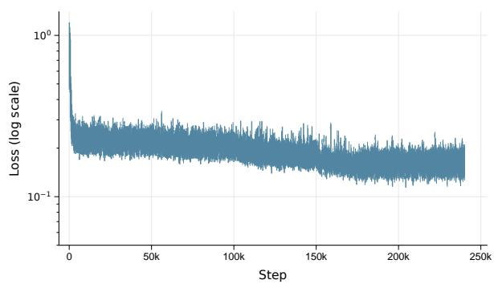  
(c) NaVIDA

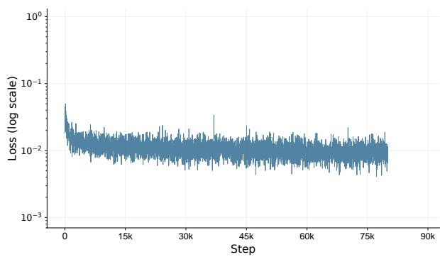  
(d) WNM-3D  
Figure 9 Training loss curves for baseline fine-tuning on real-world data. NaVIDA, AwareVLN, and LightNav-0 report autoregressive cross-entropy loss, while WNM-3D reports action flow-matching loss.

## A.1 Implementation and Reproducibility Details for Baselines in Real-World

We initialize all four baselines from their oficially released checkpoints and adapt them to our real-world data following their original training frameworks. To reflect the peak performance of each baseline, we report the higher success rate between its original open-sourced weight and its fine-tuned counterpart in our evaluation results. We detail the baseline implementations as following:

AwareVLN [11]. Based on normalized forward displacement and rotation magnitude, we map continuous real-world motions to four action categories: moving forward by 25 cm, turning left by $1 5 ^ { \circ }$ , turning right by 15◦, and stopping. The model takes historical and current RGB observations together with the task instruction as input. Since reasoning outputs require additional text annotations, we apply cross-entropy loss only to the action output, without additional reasoning supervision. We reduce the global batch size from 768 in the original configuration to 256 and empirically adjust the learning rate from $2 \times 1 0 ^ { - 5 }$ to $1 \times 1 0 ^ { - 5 }$ and find it yields better performance. To ensure a fair comparison, we employ the same number of training samples as in the training setup of Compass 1. As shown in Figure 9(a), the training of AwareVLN approaches near-convergence around 60,000 steps. We find that despite the absence of direct supervision on reasoning outputs during fine-tuning, AwareVLN successfully preserves its pre-existing reasoning abilities.

LightNav-0 [34]. Since depth information is unavailable in real-world videos, we approximate the afordance point by using camera parameters to project the action position at the 4th future step onto the image plane. As for the goal point, it can be directly obtained by taking the midpoint of the target’s grounding bounding box. We retain the original autoregressive cross-entropy objective and jointly supervise the pointing-of-afordance token, pointing-of-goal-object token, three RVQ action tokens, and end-of-sequence token. We reduce the global batch size from 320 to 64 and empirically find that setting the learning rate to $1 \times 1 0 ^ { - 5 }$ yields better performance. To maintain the same number of training samples of Compass 1, we train $\mathrm { L i g h t N a v { – } 0 }$ for 240,000 steps. As shown in Figure 9(b), the training curve exhibits a clear convergence trend.

NaVIDA [51]. We discretize continuous actions following the identical mapping protocol of AwareVLN. We then use HPAC to process the discrete action sequences, merging adjacent actions of the same class with a probability of 0.7, which strictly follows the oficial open-source configuration. Under this setup, we further aggregate the continuous action in the same type to make sure each action block contains at most three action segments (e.g., turn left, turn right, forward). Fine-tuning is conducted using the original global batch size of 64 and the default learning rate for 240k steps to match the total training samples of Compass 1. As shown in Figure 9(c), the training curve exhibits a clear convergence trend.

WNM-3D [14]. To ensure a fair comparison, we maintain a global batch size of 192 and the original learning rate, training for 80,000 steps to match the training setup of Compass 1. Since the model natively supports continuous actions, we directly align three-dimensional actions with RGB videos without discretization. As shown in Figure 9(d), the training curve exhibits a clear convergence trend.

## A.2 Training and Testing Data Split of IntentionNav

Due to the limited scale of IntentionNav data, we leverage Qwen3-VL [3] to generate reasoning data for all IntentionNav scenes to fine-tune AwareVLN on this benchmark. Meanwhile, for LightNav-0, since depth maps are available in the simulator, Qwen3-VL is utilized to generate 2D candidate points based on multi-view RGB and instructions. Then, depth and camera poses are retrieved to verify the geometric consistency of these candidate points for subsequent projection onto the 2D image plane.

The oficial IntentionNav [24] contains 500 intention-driven trajectories. We use the same split across all four baselines, randomly sampling 300 training trajectories and 200 testing trajectories within each scene such that every environment contains both training and test tasks. The complete list of the 200 evaluation trajectory indices are provided in Table 5.

Table 5 Complete testing trajectory indices of IntentionNav. Note that the trajectory indices are non-consecutive.
<table><tr><td>003</td><td>004</td><td>005</td><td>008</td><td>009</td><td>017</td><td>018</td><td>020</td><td>021</td><td>023</td><td>025</td><td>029</td><td>035</td><td>037</td><td>039</td></tr><tr><td>044</td><td>045</td><td>047</td><td>048</td><td>051</td><td>060</td><td>061</td><td>065</td><td>069</td><td>071</td><td>072</td><td>074</td><td>075</td><td>076</td><td>079</td></tr><tr><td>083</td><td>086</td><td>089</td><td>091</td><td>092</td><td>093</td><td>094</td><td>095</td><td>097</td><td>098</td><td>099</td><td>100</td><td>101</td><td>102</td><td>104</td></tr><tr><td>107</td><td>109</td><td>112</td><td>113</td><td>117</td><td>118</td><td>120</td><td>121</td><td>123</td><td>134</td><td>137</td><td>140</td><td>144</td><td>146</td><td>147</td></tr><tr><td>150</td><td>151</td><td>153</td><td>155</td><td>157</td><td>163</td><td>174</td><td>176</td><td>179</td><td>180</td><td>186</td><td>187</td><td>194</td><td>196</td><td>198</td></tr><tr><td>199</td><td>209</td><td>210</td><td>212</td><td>213</td><td>214</td><td>215</td><td>218</td><td>219</td><td>225</td><td>230</td><td>233</td><td>235</td><td>237</td><td>241</td></tr><tr><td>243</td><td>249</td><td>252</td><td>257</td><td>258</td><td>259</td><td>260</td><td>261</td><td>262</td><td>265</td><td>266</td><td>267</td><td>270</td><td>274</td><td>277</td></tr><tr><td>278</td><td>279</td><td>281</td><td>282</td><td>283</td><td>285</td><td>293</td><td>295</td><td>296</td><td>300</td><td>304</td><td>306</td><td>310</td><td>316</td><td>318</td></tr><tr><td>319</td><td>320</td><td>321</td><td>324</td><td>326</td><td>328</td><td>334</td><td>335</td><td>336</td><td>338</td><td>341</td><td>344</td><td>345</td><td>352</td><td>358</td></tr><tr><td>360</td><td>362</td><td>364</td><td>367</td><td>372</td><td>373</td><td>374</td><td>378</td><td>379</td><td>380</td><td>384</td><td>385</td><td>388</td><td>390</td><td>392</td></tr><tr><td>393</td><td>396</td><td>398</td><td>403</td><td>404</td><td>405</td><td>407</td><td>410</td><td>412</td><td>415</td><td>417</td><td>422</td><td>423</td><td>424</td><td>425</td></tr><tr><td>426</td><td>427</td><td>431</td><td>446</td><td>448</td><td>449</td><td>451</td><td>453</td><td>454</td><td>455</td><td>459</td><td>460</td><td>461</td><td>464</td><td>467</td></tr><tr><td>468</td><td>475</td><td>477</td><td>479</td><td>481</td><td>487</td><td>494</td><td>495</td><td>503</td><td>506</td><td>509</td><td>510</td><td>511</td><td>512</td><td>513</td></tr><tr><td>516</td><td>518</td><td>519</td><td>521</td><td>524</td><td></td><td></td><td></td><td></td><td></td><td></td><td></td><td></td><td></td><td></td></tr></table>

## B Open-World Benchmark Configuration

We here present the comprehensive suite of open-world evaluation task specifications across four representative deployment environments. In total, 32 distinct navigation tasks are defined, encompassing instruction-following navigation (IFN), Beyond-the-View Navigation (BVN), and History-Backtracking Navigation (HBN).

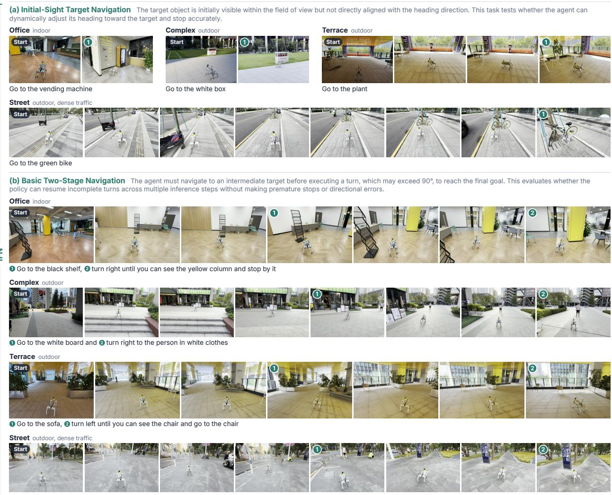  
1 Go straight to the column and then 2 turn right to the boar

Figure 10 Task specifications for Initial-Sight Target Navigation and Basic Two-Stage Navigation of IFN across ofice, complex, terrace, and street environments.

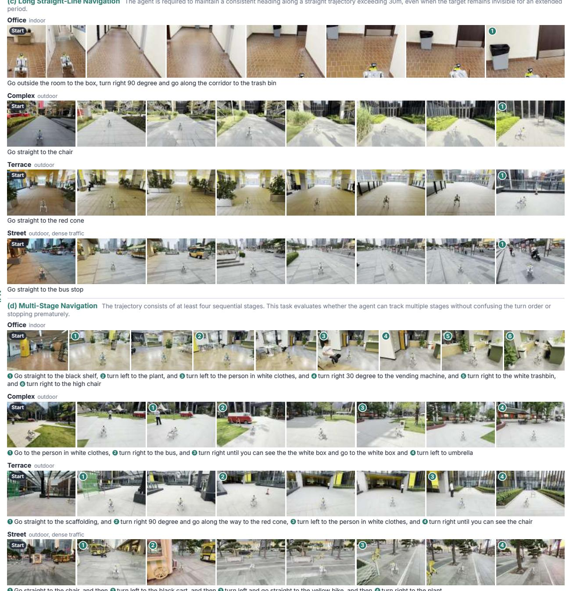  
1 Go straight to the chair, and then 2 turn left to the black cart, and then 3 turn left and go straight to the yellow bike, and then 4 turn right to the plant

Figure 11 Task specifications for Long Straight-Line Navigation and Multi-Stage Navigation of IFN across ofice, complex, terrace, and street environments.

(e) Target-Driven Navigation The agent navigates (semi-)enclosed areas, such as dead ends, to evaluate whether it avoids left-right turning deadlocks and successfully escapes from such restricted areas.

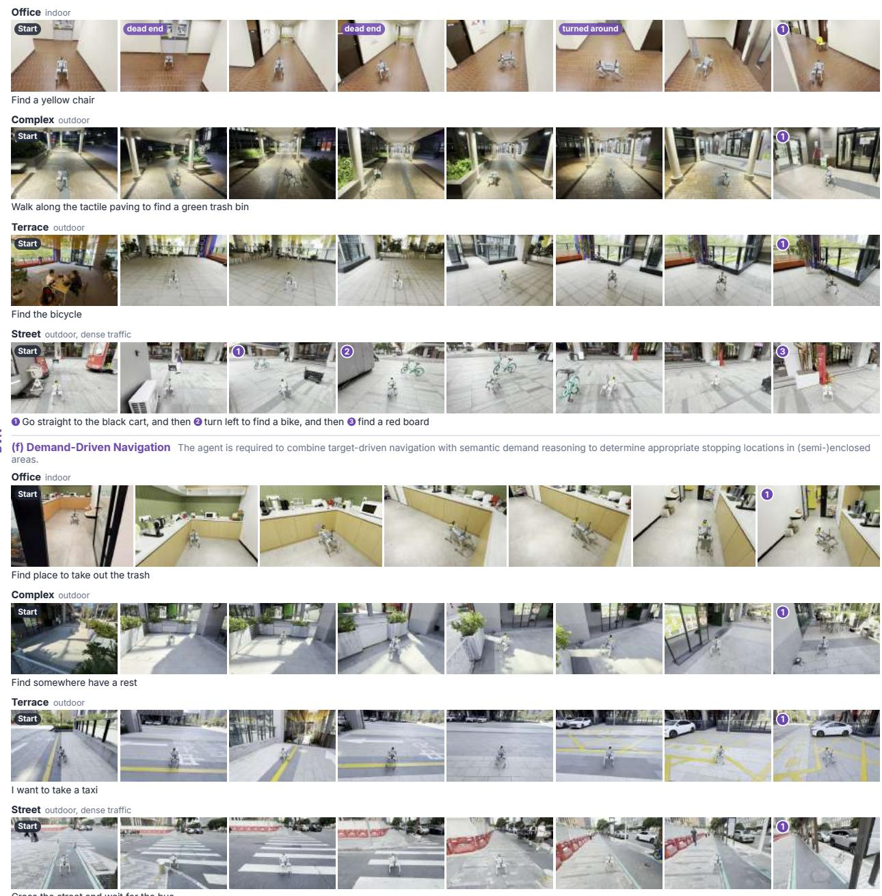  
Cross the street and wait for the bu

Figure 12 Task specifications for Target-Driven Navigation and Demand-Driven Navigation of BVN across ofice, complex, terrace, and street environments.

(g) Basic History Backtracking The revisited target is located adjacent to the target of the preceding stage, becoming visible either immediately upon turning around or after a 180° turn followed by a short straight distance along a near-linear trajectory. Given that typical baselines strongly rely on immediate history frames, this tests whether they effectively exploit these recent spatiotemporal cues to re-localize the target.

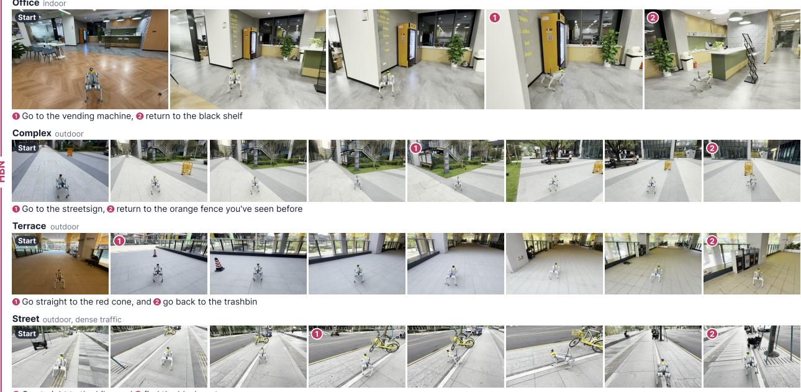  
1 Go straight to the bike, and 2 find the black cart

Figure 13 Task specifications for Basic History Backtracking of HBN across ofice, complex, terrace, and street environments.  
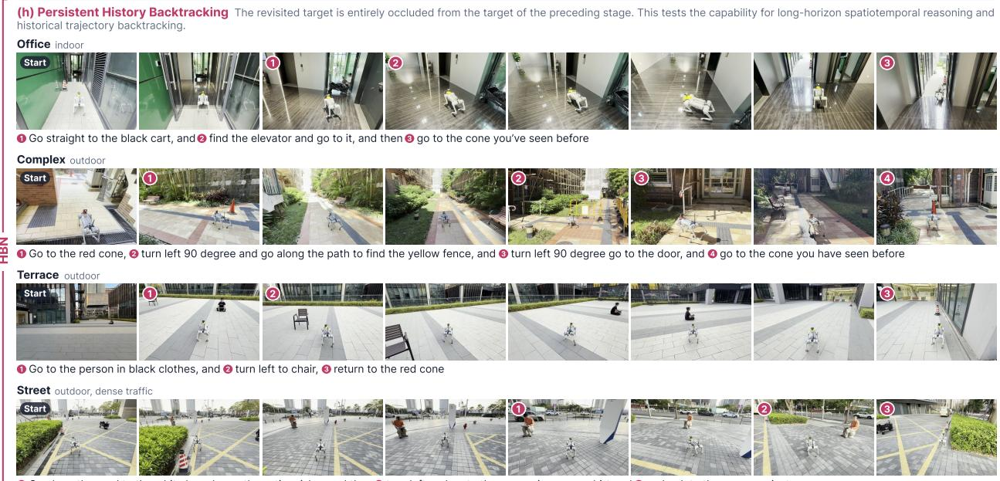  
1 Go along the road to the white board near the extinguisher and then 2 turn left and go to the person in orange shirt and 3 go back to the cone you just saw

Figure 14 Task specifications for Persistent History Backtracking of HBN across ofice, complex, terrace, and street environments.