# Complementarity-Driven Dual-Teacher Hierarchical Alignment for Zero-Shot EEG-to-Image Retrieval

Lukun Wu, Jie Li, Ziqi Ren, Ruiyang Xia, Yan Gao, and Xinbo Gao, Fellow, IEEE,

Abstract—Decoding visual information from EEG is central to brain–computer interfaces and brain-inspired intelligence, and contrastive alignment with pretrained vision foundation models (VFMs) has become the dominant paradigm. However, existing methods align EEG solely with CLIP-family VFMs, leaving hierarchical visual information in neural responses under-exploited. To address this gap, we formulate a mechanism–paradigm correspondence view that links hierarchical visual processing (from appearance to semantics) to the complementary biases of cross-paradigm VFMs, with image-only models (e.g., DINO) and image–text models (e.g., CLIP) capturing distinct facets of this hierarchy. Guided by this view, we propose the Dual-Teacher Hierarchical Alignment (DTHA) framework. Concretely, a shared EEG encoder is supervised by frozen multi-blur CLIP and shallow DINOv2 teachers via dual-branch contrastive alignment, so that each teacher branch can fully supervise the visual cues it emphasizes. A fused-retrieval objective learns adaptive weights to combine their complementary visual representations for zeroshot EEG-to-image retrieval. For the shared EEG encoder, we introduce the Attentive Modulated Scalp-Pattern Bank Encoder (AMSPBE), which combines temporo-spatial attention with a learnable scalp-pattern bank for accurate, interpretable visual feature extraction, while further modeling regional temporal dynamics and filter-bank topographies. On THINGS-EEG zeroshot retrieval, DTHA achieves 92.4% Top-1 accuracy, exceeding prior state of the art by 12.4 percentage points. Spatial, spectral, and representational-similarity analyses, together with THINGS-MEG evaluation, collectively validate DTHA’s effectiveness, biological plausibility, and cross-modality generalization. This complementarity-driven perspective shows that supervision from cross-paradigm VFMs enables more complete extraction of hierarchical visual information from brain activity. It further highlights cross-paradigm brain–image alignment as a promising direction for future work.

Index Terms—Brain-computer interfaces (BCI), contrastive learning, electroencephalography (EEG), magnetoencephalography (MEG), vision foundation models, zero-shot image retrieval

## I. INTRODUCTION

tion from brain activity, serving as a bridge between human cognition and artificial intelligence while deepening our understanding of the human visual mechanism and advancing brain-inspired intelligence. Among non-invasive neuroimaging modalities, electroencephalography (EEG) offers high temporal resolution and portability, and has drawn increasing attention for brain–computer interface (BCI) applications [1], [2]. However, the complexity of human visual processing and the relatively low signal-to-noise ratio of scalp EEG pose significant challenges for EEG-based visual decoding. Recent large-scale and diverse datasets acquired under rapid serial visual presentation (RSVP) paradigms have provided a strong empirical foundation for this research line [2], [3]. On these benchmarks, zero-shot EEG-to-image retrieval has become a standard evaluation task for visual decoding, with retrieval accuracy reflecting decoding performance from scalp EEG.

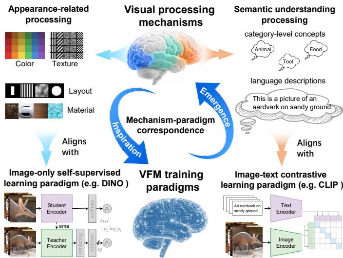  
Fig. 1. Mechanism–paradigm correspondence between hierarchical visual processing (appearance-related structure to semantic understanding) and emergent VFM representations from distinct training paradigms (image-only selfsupervised vs. image–text contrastive learning), motivating complementaritydriven dual-teacher EEG alignment beyond CLIP-family VFMs alone.

The prevailing paradigm for EEG-based visual decoding is contrastive learning, which aligns EEG with pretrained vision foundation models (VFMs) in a shared embedding space to extract visual information from EEG [4]–[7]. This paradigm has driven rapid progress, yet most methods under it align EEG only with CLIP-family VFMs. CLIP supervision recovers category-level semantics effectively, but under-extracts appearance-related structure that is also encoded in EEG.

Decades of neuroscience research have established that human vision is organized hierarchically rather than as a single representational stage [8], [9]. As illustrated in Fig. 1 (top), this hierarchy extends from appearance-related structure toward semantic understanding of visual content [10]. In computer vision, modern VFMs are trained under distinct paradigms (Fig. 1, bottom). Image-only self-supervised learning (e.g., DINO) learns structure from visual data without language supervision [11], [12], whereas image–text contrastive learning (e.g., CLIP) aligns visual embeddings with natural-language descriptions [13]. Driven by scale in data and model capacity, modern VFMs exhibit an emergence of paradigmdifferentiated visual capabilities that parallel human vision: for example, DINO develops dense patch-level descriptors that preserve appearance-related structure, whereas CLIP learns transferable image–text representations that support semantic categorization. Recent brain–model studies of DINOv3 further suggest that its representations can functionally relate to the human visual mechanism [14]. Integrating these observations, we formulate a mechanism–paradigm correspondence view that links hierarchical visual processing to VFMs trained under distinct paradigms for brain–image alignment.

Guided by this view, we propose DTHA (Dual-Teacher Hierarchical Alignment), a complementarity-driven dual-teacher alignment framework. Concretely, a shared encoder learns an EEG embedding that is contrastively aligned to frozen multiblur CLIP and shallow DINOv2 teachers through dual-branch supervision, so that each teacher can fully supervise the visual cues it emphasizes. Complementing these branch objectives, a fused-retrieval objective learns adaptive fusion weights during training to merge branch-wise brain–image similarities into a joint ranking score, so that semantic and appearancerelated cues jointly drive zero-shot EEG-to-image retrieval. We further introduce AMSPBE (Attentive Modulated Scalp-Pattern Bank Encoder), which applies temporo-spatial attention modulation and a learnable scalp-pattern bank for more accurate and interpretable EEG feature extraction, including regional temporal dynamics and filter-bank topographies. We also conduct spatial, spectral, and representational similarity analysis (RSA) to assess the biological plausibility of our dualteacher framework.

Our main contributions are summarized as follows:

1) To our knowledge, we are the first to formulate a mechanism–paradigm correspondence view between hierarchical human visual processing and cross-paradigm VFMs, and to apply it toward more complete extraction of visual information from EEG.

2) We propose DTHA (Dual-Teacher Hierarchical Alignment), a complementarity-driven dual-teacher framework that enables full exploitation of each teacher branch and effective fusion of their complementary visual cues. We further propose AMSPBE (Attentive Modulated Scalp-Pattern Bank Encoder) for accurate and interpretable extraction of visual features from EEG.

3) Through extensive experiments and analyses, we validate the rationale, effectiveness, and cross-modality generalization of our approach, achieving state-of-theart zero-shot retrieval on standard EEG and MEG benchmarks. Spatial, spectral, and representational analyses further support the biological plausibility of complementarity-driven dual-teacher alignment and provide new insights into visual neural decoding.

## II. RELATED WORK

## A. EEG Visual Decoding

Visual neural decoding aims to interpret brain activity to retrieve, recognize, or reconstruct visual stimuli. While early efforts often relied on fMRI for its high spatial resolution [15]– [19], electroencephalography (EEG) has gained increasing attention for its high temporal resolution, non-invasive acquisition, and portability in brain–computer interface (BCI) applications. Following early deep-learning evidence that objectevoked EEG can support visual classification [1], large-scale RSVP benchmarks such as THINGS-EEG [2] and frameworks like BraVL [20] and NICE [4] established zero-shot EEG to-image retrieval as a central research setting. Contrastive alignment with frozen CLIP-family VFMs is now the dominant paradigm on these benchmarks.

Recent methods improve decoding along several directions, yet most still assemble supervision from CLIP-family or generative-visual teachers. Student-side encoding improves EEG representation learning, e.g., subject-aggregation and group-aware variants of NICE (NICE-SA/GA) [4] and ATM with a patch-based spatiotemporal-convolution encoder [5]. Alignment constraint reinforcement strengthens brain– image alignment with dedicated objectives, including VE-SDN [6] and MB2C [7]. Information enhancement incorporates auxiliary modalities, such as language-guided contrastive learning in NICE++ [21] and depth-aware supervision in CogCap [22] and CogCapPro [23]; in each case, language descriptions or depth maps are still CLIP-family encoded for alignment. Teacher-side adaptation modifies how frozen CLIP features are presented to the brain branch, e.g., uncertainty-aware blur priors in UBP [24], multi-blur CLIP fusion in LVBP [25], visual prompt tuning in NeuroCLIP [26], cognitive-prior augmentation in NeuroBridge [27], multiencoder fusion of CLIP and VAE features in HVF [28], and adaptive CLIP feature shrinking in ATS (our prior work) [29]. Although these advances have substantially improved retrieval performance, the underlying teacher-side supervision still favors category-level semantics and only limited appearancerelated cues—whether from multi-blur CLIP inputs or VAE latents—and rarely employs cross-paradigm teacher pairing, leaving richer fine-grained structure in EEG under-exploited. This gap motivates our mechanism–paradigm correspondence view and complementarity-driven cross-paradigm dual-teacher alignment (DTHA).

## B. Vision Foundation Models

Visual foundation models (VFMs) are large-scale encoders pretrained on broad visual or multimodal data and reused across downstream vision tasks. Although modern VFMs increasingly share transformer backbones trained on web-scale data, their behavior differs less by architectural family alone than by training paradigm.

We adopt a coarse two-way categorization of VFMs: image-only supervision and image–text alignment. Within the image-only line, multi-view self-distillation (DINO, DI-NOv2, DINOv3 [30]) learns invariances across augmented views and yields dense patch-level descriptors that emphasize appearance-related structure. The image–text line aligns visual embeddings with language supervision (CLIP, PE-Core [31]), favoring transferable semantic categorization. As comparative analyses confirm [32], distinct training paradigms systematically shape attention patterns, feature geometry, and downstream representational biases. Aligning EEG to frozen MoCo-, MAE-, or SAM-pretrained VFMs remains promising but is outside the scope of this work.

Train: Complementarity-Driven Dual-Teacher Hierarchical Alignment  
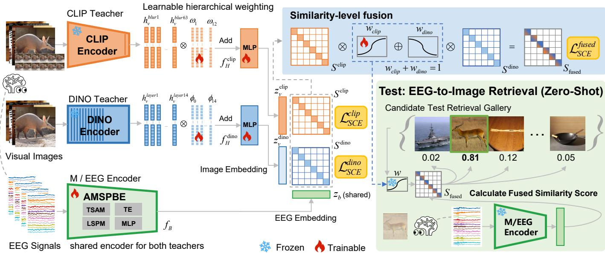  
Fig. 2. Overview of complementarity-driven dual-teacher hierarchical alignment (DTHA) for zero-shot EEG-to-image retrieval. Train: frozen multi-blur CLIP RN50 and shallow DINOv2 ViT-L/14 teachers supply $\boldsymbol { z } _ { \boldsymbol { v } } ^ { \mathrm { c l i p } }$ and $z _ { v } ^ { \mathrm { d i n o } }$ through learnable hierarchical weighting modules $f _ { H } ^ { \mathrm { c l i p } }$ and $f _ { H } ^ { \mathrm { d i n o . } }$ ; shared AMSPBE $( f _ { B } )$ maps RSVP-evoked EEG to brain embedding $z _ { b } ,$ which is aligned to both teachers via branch-wise SCE losses $\mathcal { L } _ { \mathrm { S C E } } ^ { \mathrm { c l i p } }$ and $\mathcal { L } _ { \mathrm { S C E } } ^ { \mathrm { d i n o } }$ . Fusion weights $w _ { \mathrm { c l i p } }$ and $w _ { \mathrm { d i n o } }$ combine similarity matrices $S ^ { \mathrm { c l i p } }$ and $S ^ { \mathrm { d i n o } }$ into $S _ { \mathrm { f u s e d } }$ for fused-retrieval learning $\mathcal { L } _ { \mathrm { S C E } } ^ { \mathrm { f u s e d } }$ (similarity-level fusion, not feature concatenation) Test: frozen $f _ { B } , f _ { H } ^ { \mathrm { c l i p } }$ , and $f _ { H } ^ { \mathrm { d i n o } }$ encode query EEG and gallery images; learned $w _ { \mathrm { c l i p } }$ and $w _ { \mathrm { d i n o } }$ fuse $S ^ { \mathrm { c l i p } }$ and $S ^ { \mathrm { d i n o } }$ for gallery ranking.

## C. Brain–Model Comparison Studies

Brain–model comparison studies, using encoding models and RSA among other methods, analyze the brain–model mapping between human visual responses and deep network representations [33]–[36]. More recently, Raugel et al. [14] analyze DINOv3 in depth, examining how model scale, training duration, and data type shape alignment with human fMRI/MEG. These studies are highly inspiring, yet they primarily analyze brain–model relationships rather than apply such insights to visual decoding, and the recent DINOv3 analysis remains within a single self-supervised paradigm. In contrast, we formulate a mechanism–paradigm correspondence view that exploits complementary cross-paradigm VFMs for improved EEG visual decoding.

## III. METHODOLOGY

## A. Problem Formulation

We study zero-shot EEG-to-image retrieval on RSVPevoked recordings following the standard NICE setup [4]. Given training data $D _ { \mathrm { t r a i n } } ~ = ~ \{ ( x _ { v } , x _ { b } , y ) \}$ , where $x _ { v }$ is an image, xb the paired brain signal, and $y ~ \in ~ Y _ { \mathrm { s e e n } }$ is the class label, the model is trained only on seen classes. As illustrated in Fig. 2, at test time the model is evaluated on ${ \cal D } _ { \mathrm { t e s t } } ~ = ~ \{ ( x _ { v } ^ { u } , x _ { b } ^ { u } , y ^ { u } ) \}$ , where $y ^ { u } \in Y _ { \mathrm { u n s e e n } }$ and $Y _ { \mathrm { s e e n } } \cap Y _ { \mathrm { u n s e e n } } = \emptyset$ . For a query brain signal $x _ { b } ^ { u }$ , the goal is to retrieve its corresponding image $x _ { v } ^ { u }$ from gallery $X _ { v } ^ { u }$ (all images from $Y _ { \mathrm { u n s e e n } } )$ by ranking candidates according to brain–image similarity in the learned latent space.

## B. DTHA: Dual-Teacher Hierarchical Alignment

Fig. 2 illustrates DTHA, a complementarity-driven dualteacher framework. During training, frozen pretrained CLIP-RN50 extracts final-layer features from M=12 blur-scaled inputs, and frozen pretrained DINOv2 ViT-L/14 extracts shallow-layer CLS features at blocks 0–14; $f _ { H } ^ { \mathrm { c l i p } }$ and $f _ { H } ^ { \mathrm { d i n o } }$ (Sec. III-C) weight and project these features to teacher embeddings $\boldsymbol { z } _ { v } ^ { \mathrm { c l i p } }$ and $z _ { v } ^ { \mathrm { { d i n o } } }$ . A shared AMSPBE encoder $f _ { B }$ maps EEG to $\bar { z } _ { b } \in \mathbb { R } ^ { 1 0 2 \bar { 4 } }$ , which is contrastively aligned with $\boldsymbol { z } _ { v } ^ { \mathrm { c l i p } }$ and $z _ { v } ^ { \mathrm { { d i n o } } }$ in the CLIP and DINO branches, respectively; $f _ { H } ^ { \mathrm { c l i p } } , f _ { H } ^ { \mathrm { d i n o } } , f _ { B }$ , and the fusion logits are trainable.

The alignment between each teacher embedding and the student is optimized with a symmetric contrastive objective. Within a mini-batch of size N, each paired image–brain sample is a positive pair and all other cross-pairings are negatives. Let $z _ { b , i }$ and $z _ { v , i }$ denote the brain and teacher embeddings of the i-th sample. We adopt the Symmetric Cross-Entropy (SCE) loss, an objective derived from InfoNCE [13], [37]:

$$
\begin{array} { r l r } {  { \mathcal L _ { \mathrm { S C E } } = - \frac { 1 } { 2 N } \sum _ { i = 1 } ^ { N } [ \log \frac { \exp ( z _ { b , i } ^ { \top } z _ { v , i } / \tau ) } { \sum _ { k = 1 } ^ { N } \exp ( z _ { b , i } ^ { \top } z _ { v , k } / \tau ) }  } } \\ & { } & {  + \log \frac { \exp ( z _ { v , i } ^ { \top } z _ { b , i } / \tau ) } { \sum _ { k = 1 } ^ { N } \exp ( z _ { v , i } ^ { \top } z _ { b , k } / \tau ) } ] , } \end{array}\tag{1}
$$

where $( \cdot ) ^ { \top } ( \cdot )$ denotes the inner product and $\tau { = } 1$ is fixed in all reported experiments. Substituting $z _ { v , i } ^ { \mathrm { c l i p } }$ for $z _ { v , i }$ in Eq. (1) yields $\mathcal { L } _ { \mathrm { S C E } } ^ { \mathrm { c l i p } } \colon$ ; substituting $z _ { v , i } ^ { \mathrm { d i n o } }$ likewise yields $\mathcal { L } _ { \mathrm { S C E } } ^ { \mathrm { d i n o } }$

$$
\begin{array} { r l } & { \mathcal { L } _ { \mathrm { S C E } } ^ { \mathrm { c l i p } } \triangleq \mathcal { L } _ { \mathrm { S C E } } \mathrm { ~ w i t h ~ } z _ { v , i }  z _ { v , i } ^ { \mathrm { c l i p } } , } \\ & { \mathcal { L } _ { \mathrm { S C E } } ^ { \mathrm { d i n o } } \triangleq \mathcal { L } _ { \mathrm { S C E } } \mathrm { ~ w i t h ~ } z _ { v , i }  z _ { v , i } ^ { \mathrm { d i n o } } . } \end{array}\tag{2}
$$

Under $\mathcal { L } _ { \mathrm { S C E } } ^ { \mathrm { c l i p } }$ and $\mathcal { L } _ { \mathrm { S C E } } ^ { \mathrm { d i n o } } , ~ \mathcal { z } _ { b }$ is encouraged to capture the semantic and appearance-related cues emphasized by each teacher, respectively. We further introduce a fused-retrieval objective that learns similarity-level fusion weights to combine branch similarities during training and applies the same fusion rule at inference (Fig. 2). Stacking mini-batch embeddings as $Z _ { b } = [ z _ { b , 1 } , \ldots , z _ { b , N } ] ^ { \intercal }$ and $Z _ { v } ^ { \mathrm { c l i p } } = [ z _ { v , 1 } ^ { \mathrm { c l i p } } , \dots , z _ { v , N } ^ { \mathrm { c l i p } } ] ^ { \top }$ (likewise $Z _ { v } ^ { \mathrm { d i n o } } )$ , we form branch similarity matrices

$$
\begin{array} { r } { S ^ { \mathrm { c l i p } } = Z _ { b } ( \bar { Z } _ { v } ^ { \mathrm { c l i p } } ) ^ { \top } , } \\ { S ^ { \mathrm { d i n o } } = Z _ { b } ( \bar { Z } _ { v } ^ { \mathrm { d i n o } } ) ^ { \top } , } \end{array}\tag{3}
$$

where $\bar { Z } _ { v }$ denotes the row-wise $\ell _ { 2 }$ -normalized teacher embeddings in the mini-batch. To learn how much each branch should contribute to fused retrieval, trainable fusion logits $\eta _ { \mathrm { c l i p } }$ and $\eta _ { \mathrm { d i n o } }$ define fusion weights

$$
\left[ w _ { \mathrm { c l i p } } , w _ { \mathrm { d i n o } } \right] ^ { \top } = \mathrm { s o f t m a x } \big ( \left[ \eta _ { \mathrm { c l i p } } , \eta _ { \mathrm { d i n o } } \right] \big ) ,\tag{4}
$$

and the fused similarity matrix is

$$
S _ { \mathrm { f u s e d } } = w _ { \mathrm { c l i p } } S ^ { \mathrm { c l i p } } + w _ { \mathrm { d i n o } } S ^ { \mathrm { d i n o } } .\tag{5}
$$

Minimizing $\mathcal { L } _ { \mathrm { S C E } } ^ { \mathrm { f u s e d } }$ on $S _ { \mathrm { f u s e d } }$ drives $w _ { \mathrm { c l i p } }$ and $w _ { \mathrm { d i n o } }$ toward a branch combination that improves fused ranking accuracy. The fused-retrieval objective applies the same SCE form to $S _ { \mathrm { f u s e d } } { \mathrm { : } }$

$$
\begin{array} { r l } {  { \mathcal { L } _ { \mathrm { S C E } } ^ { \mathrm { f u s e d } } = - \frac { 1 } { 2 N } \sum _ { i = 1 } ^ { N } \Biggl [ \log \frac { \exp ( S _ { \mathrm { f u s e d } , i i } ) } { \sum _ { k = 1 } ^ { N } \exp ( S _ { \mathrm { f u s e d } , i k } ) } } \quad } & { } \\ & { \qquad + \log \frac { \exp ( S _ { \mathrm { f u s e d } , i i } ) } { \sum _ { k = 1 } ^ { N } \exp ( S _ { \mathrm { f u s e d } , k i } ) } \Biggr ] . } \end{array}\tag{6}
$$

The overall training objective is

$$
\mathcal { L } = \alpha \mathcal { L } _ { \mathrm { S C E } } ^ { \mathrm { c l i p } } + \beta \mathcal { L } _ { \mathrm { S C E } } ^ { \mathrm { d i n o } } + \gamma \mathcal { L } _ { \mathrm { S C E } } ^ { \mathrm { f u s e d } } ,\tag{7}
$$

with loss weights $( \alpha , \beta , \gamma ) { = } ( 1 , 1 , 0 . 2 5 )$ by default. At test time, each gallery image and query EEG are encoded by the frozen $\bar { f } _ { H } ^ { \mathrm { c l i p } } , \ : \ : f _ { H } ^ { \mathrm { d i n o } }$ , and $f _ { B }$ to form branch similarity matrices $S ^ { \mathrm { c l i p } }$ and $S ^ { \mathrm { { d i n o } } }$ (Eq. (3)); gallery images are ranked by $S _ { \mathrm { f u s e d } }$ using the fusion weights $w _ { \mathrm { c l i p } }$ and $w _ { \mathrm { d i n o } }$ learned during training (Eq. (5)). Algorithm 1 summarizes the training and inference procedure.

## C. Learnable Hierarchical Weighting on the Image Side

Because different blur scales and network depths carry distinct visual cues, fixed pooling over CLIP blurs or DINO layers is suboptimal for brain–image alignment; we therefore learn softmax-normalized weights over these frozen hierarchical features when forming $\boldsymbol { z } _ { v } ^ { \mathrm { c l i p } }$ and $z _ { v } ^ { \mathrm { { d i n o } } }$ (representational motivation in Sec. IV-C).

Algorithm 1 Dual-Teacher Hierarchical Alignment (DTHA)   
Require: Multimodal training dataset $D _ { \mathrm { t r a i n } } ;$ frozen   
CLIP/DINO backbones   
Ensure: Trained $f _ { H } ^ { \mathrm { c l i p } } , \quad f _ { H } ^ { \mathrm { d i n o } } , \quad f _ { B } ,$ and fusion logits   
$\{ \eta _ { \mathrm { c l i p } } , \eta _ { \mathrm { d i n o } } \}$   
1: Initialize $\stackrel { \mathrm { \tiny ~ \sim ~ } } { f _ { H } ^ { \mathrm { c l i p } } } ( \theta ^ { \mathrm { c l i p } } ) , f _ { H } ^ { \mathrm { d i n o } } ( \theta ^ { \mathrm { d i n o } } ) ,$ , brain encoder $f _ { B }$   
$( \mathrm { A M S P B E } , \ \bar { \phi } ) ,$ and $\{ \eta _ { \mathrm { c l i p } } , \eta _ { \mathrm { d i n o } } \}$   
2: for each iteration do   
3: Sample a mini-batch $\{ ( x _ { v } , x _ { b } ) \}$ from $D _ { \mathrm { t r a i n } }$   
4: Build teacher embeddings $\boldsymbol { z } _ { v } ^ { \mathrm { c l i p } }$ and $z _ { v } ^ { \mathrm { { d i n o } } }$ (Sec. III-C);   
compute $z _ { b } \gets f _ { B } ( x _ { b } )$   
5: Compute $\it C _ { \mathrm { S C E } } ^ { \mathrm { c l i p } } , \it C _ { \mathrm { S C E } } ^ { \mathrm { d i n o } } ,$ and $\mathcal { L } _ { \mathrm { S C E } } ^ { \mathrm { f u s e d } }$ (Eqs. (1)–(6))   
6: $\mathcal { L } \gets \alpha \mathcal { L } _ { \mathrm { S C E } } ^ { \mathrm { c l i p } } + \beta \mathcal { L } _ { \mathrm { S C E } } ^ { \mathrm { d i n o } } + \gamma \mathcal { L } _ { \mathrm { S C E } } ^ { \mathrm { f u s e d } } .$ ; update $\theta ^ { \mathrm { c l i p } } , \theta ^ { \mathrm { d i n o } } .$   
$\phi ,$ and fusion logits by gradient descent   
7: end for   
8: Inference: encode query $x _ { b }$ and each gallery image $x _ { v }$   
with frozen $f _ { B } , f _ { H } ^ { \mathrm { c l i p } }$ , and $f _ { H } ^ { \mathrm { d i } }$ no   
9: Form $S ^ { \mathrm { c l i p } }$ and $S ^ { \mathrm { \hat { d i n o } } }$ , combine them into $S _ { \mathrm { f u s e d } }$ with the   
learned $w _ { \mathrm { c l i p } }$ and $w _ { \mathrm { d i n o } }$ (Eqs. (3)–(5)), and rank gallery   
images

a) Frozen hierarchical features.: For CLIP, let $B _ { m } ( \cdot )$ denote Gaussian blur with scale $\sigma _ { m }$ . We extract M=12 CLIP image embeddings

$$
\begin{array} { r } { \boldsymbol { h } _ { \boldsymbol { v } } ^ { ( m ) } = f _ { \mathrm { C L I P } } ( \mathcal { B } _ { m } ( \boldsymbol { x } _ { \boldsymbol { v } } ) ) , \quad m = 1 , \ldots , M , } \end{array}\tag{8}
$$

with $\sigma ~ \in ~ \{ 1 , 3 , 9 , \ldots , 6 3 \}$ , as in LVBP [25]. Blurred images weaken semantics while strengthening lower-level cues, thereby supplementing CLIP. For DINOv2, $\begin{array} { r } { { \bf \tilde { \Sigma } } _ { h _ { v } ^ { ( \ell ) } } = f _ { \mathrm { D I N O } } ^ { ( \ell ) } ( x _ { v } ) } \end{array}$ denotes the ℓ2-normalized CLS token after block ℓ; we use shallow layers $\ell \in \{ 0 , \ldots , 1 4 \}$ because they better preserve appearance-related structure (Sec. IV-C).

b) Learnable hierarchical weighting.: We use learnable hierarchical weighting modules $f _ { H } ^ { \mathrm { c l i p } }$ and $f _ { H } ^ { \mathrm { d i n o } }$ to map extracted hierarchical features to teacher embeddings via soft hierarchical weights followed by a lightweight MLP. Given $H _ { \mathrm { c l i p } } = [ h _ { v } ^ { ( 1 ) } , \hdots , h _ { v } ^ { ( M ) } ] \in \mathbb { R } ^ { M \times d _ { 0 } }$ , hierarchical weights $\omega _ { m }$ combine blur scales:

$$
\tilde { h } _ { v } ^ { \mathrm { c l i p } } = \sum _ { m = 1 } ^ { M } \omega _ { m } \odot h _ { v } ^ { ( m ) } , \qquad \omega _ { m } = \mathrm { s o f t m a x } ( \eta _ { m } ) ,\tag{9}
$$

where $\eta _ { m } \in \mathbb { R } ^ { d _ { 0 } }$ are hierarchical logits, ⊙ denotes elementwise multiplication with broadcasting, and softmax is taken over blur index m for each feature dimension. For DINO, let $H _ { \mathrm { d i n o } } = [ h _ { v } ^ { ( 0 ) } , \dots , h _ { v } ^ { ( L ) } ]$ ; the same strategy is applied to layers $\ell = 0 , \ldots , L \colon$

$$
\tilde { h } _ { v } ^ { \mathrm { d i n o } } = \sum _ { \ell = 0 } ^ { L } \phi _ { \ell } \odot h _ { v } ^ { ( \ell ) } , \qquad \phi _ { \ell } = \mathrm { s o f t m a x } ( \xi _ { \ell } ) ,\tag{10}
$$

with $L { = } 1 4 .$ , where $\xi _ { \ell } \in \mathbb { R } ^ { d _ { 0 } }$ are hierarchical logits. A lightweight MLP then maps the weighted features to teacher embeddings:

$$
\begin{array} { r l } & { z _ { v } ^ { \mathrm { c l i p } } = f _ { H } ^ { \mathrm { c l i p } } ( H _ { \mathrm { c l i p } } ) = \mathrm { M L P } ^ { \mathrm { c l i p } } \left( \tilde { h } _ { v } ^ { \mathrm { c l i p } } \right) , } \\ & { z _ { v } ^ { \mathrm { d i n o } } = f _ { H } ^ { \mathrm { d i n o } } ( H _ { \mathrm { d i n o } } ) = \mathrm { M L P } ^ { \mathrm { d i n o } } \left( \tilde { h } _ { v } ^ { \mathrm { d i n o } } \right) . } \end{array}\tag{11}
$$

## D. Brain Encoder (AMSPBE)

As shown in Fig. 3, AMSPBE (Attentive Modulated Scalp-Pattern Bank Encoder) is the brain encoder $f _ { B } ,$ , mapping RSVP-evoked EEG to a 1024-D brain embedding $z _ { b }$ for alignment with the dual-teacher framework.

Under rapid serial visual presentation (RSVP), stimulus images are serially presented to subjects at a rapid rate, so temporally adjacent trials induce temporal aliasing [2], leading to significant cross-stimulus interference that degrades singletrial EEG. Furthermore, brain responses to visual stimuli reflect hierarchical visual processing across scalp regions, and different regions and time points contribute unequally to visual decoding. Accordingly, we introduce temporo-spatial attention modulation (TSAM) through a coarse tri-region split of the electrode montage into posterior, central, and frontal channel sets: each region shares one learnable temporal attention curve, complemented by per-channel attention (Fig. 3). All attention weights are initialized to one and learned end-to-end to upweight decoding-relevant channels and time points while suppressing aliasing-induced noise.

After attention modulation and lightweight temporal encoding, visual decoding may rely on different collaborative channel combinations across the electrode montage rather than on any single electrode. Following [25], we adopt a learnable scalp-pattern filter bank (K=16) with positivityconstrained spatial convolutions, which learns multiple distinct combination patterns over the electrode layout, as illustrated by several representative scalp-pattern topographies in Fig. 3. These two components—temporo-spatial attention modulation with temporal encoding, and the scalp-pattern filter bank— jointly constitute AMSPBE. Learned attention curves and filter-bank topographies are analyzed in Sec. IV-F.

## IV. EXPERIMENTS AND ANALYSIS

## A. Experimental Setup

1) Datasets and Preprocessing: We conduct experiments on THINGS-EEG [2] and THINGS-MEG [3]; dataset scales and acquisition parameters are summarized in Table I. THINGS-EEG provides the primary benchmark for all main results and analyses, while THINGS-MEG is used for crossmodality validation.

The EEG recordings come from ten participants who viewed images under a time-efficient RSVP paradigm. The training split comprises 1654 concepts × 10 images × 4 repetitions, and the test split comprises 200 concepts × 1 image × 80 repetitions. The stimulus onset asynchrony (SOA) is 200 ms, consisting of a 100 ms image presentation followed by a 100 ms blank interval. For preprocessing, we epoch trials from 0 to 1000 ms after stimulus onset, downsample to 250 Hz (T=250), apply baseline correction, and average repetitions within each image to improve the signal-to-noise ratio (SNR). Following standard THINGS-EEG practice, multivariate noise normalization (MVNN) is applied at the subject level.

The MEG benchmark includes four participants and 271 channels, with a longer stimulus duration (500 ms) and SOA of 1500±200 ms. MEG trials are epoched over the same post-stimulus window, band-pass filtered, downsampled to

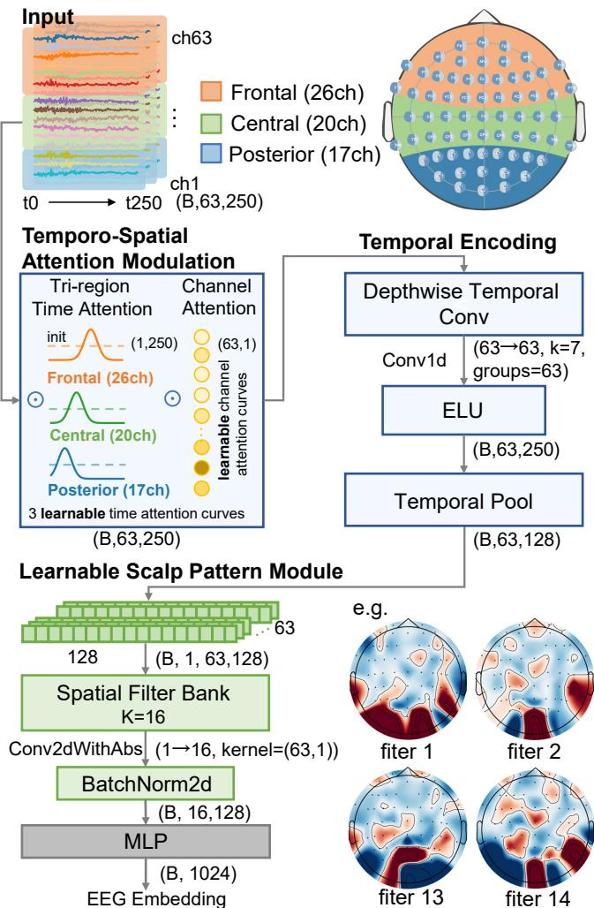  
Fig. 3. Architecture of AMSPBE (f ). EEG undergoes temporo-spatial attention modulation (TSAM; tri-region temporal attention and per-channel attention), temporal encoding (k=7, $t _ { \mathrm { p o o l } } { = } \mathrm { 1 2 8 } )$ , and a K=16 positivityconstrained scalp-pattern filter bank with an MLP projection, yielding brain embedding z . Right: representative learned scalp-pattern topographies.

200 Hz (T=201), and MVNN-normalized; configuration and preprocessing follow a similar protocol [21], [24]. On MEG, the same fB applies; tri-region channel indices are defined on the CTF-275 electrode montage.

TABLE I  
CONFIGURATION DETAILS OF THE THINGS-EEG AND THINGS-MEG DATASETS (SUB: SUBJECTS, CHAN: CHANNELS).
<table><tr><td>Type</td><td>Sub</td><td>Chan</td><td>Train*</td><td></td><td></td><td>Test*</td><td>SOA(ms)</td></tr><tr><td>EEG</td><td>10</td><td>63</td><td>1654</td><td>10</td><td>200 4</td><td>1</td><td>80</td><td>200 (100)</td></tr><tr><td>MEG</td><td>4</td><td>271</td><td>1854</td><td>12</td><td></td><td>1 200</td><td>1 12</td><td>1500±200 (500)</td></tr></table>

∗ concepts (classes) | conditions (images) | repetitions (times).

2) Vision Teachers: Default teachers follow Sec. III-B: frozen CLIP RN50 multi-blur and DINOv2 ViT-L/14 (L0– L14). Sec. IV-D further compares PE-Core and sharp-only CLIP in the image–text paradigm, and DINOv2/v3 teachers across architectures (ViT vs. ConvNeXt), scales, and layer spans in the image-only paradigm.

TABLE II  
TOP-1 AND TOP-5 ACCURACY (%) FOR 200-WAY ZERO-SHOT RETRIEVAL ON THINGS-EEG (10-SUBJECT MEAN; THREE-SEED AVERAGE).
<table><tr><td rowspan="2">Method</td><td colspan="2">Subject 1</td><td colspan="2">Subject 2</td><td colspan="2">Subject 3</td><td colspan="2">Subject 4</td><td colspan="2">Subject 5</td><td colspan="2">Subject 6 Subject 7</td><td colspan="2">Subject 8</td><td colspan="2">Subject 9</td><td colspan="2">Subject 10</td><td colspan="2">Avg</td></tr><tr><td>top-1 top-5</td><td>top-1 top-5</td><td></td><td></td><td>top-1</td><td>top-5 top-1</td><td>top-5</td><td>top-1 top-5</td><td></td><td>top-1 top-5</td><td>top-1</td><td>top-5</td><td>top-1</td><td>top-5</td><td>top-1</td><td>top-5</td><td>top-1</td><td>top-5</td><td>top-1 top-5</td><td></td></tr><tr><td colspan="17">Intra-subject: train and test on one subject</td></tr><tr><td>BraVL [20] TPAMI&#x27;23</td><td>6.1</td><td>17.9</td><td>4.9 14.9</td><td>5.6</td><td>17.4</td><td>5.0</td><td>15.1</td><td>4.0</td><td>13.4 6.0</td><td>18.2</td><td>6.5</td><td>20.4</td><td>8.8</td><td>23.7</td><td>4.3</td><td>14.0</td><td>7.0</td><td>19.7</td><td></td><td>17.5</td></tr><tr><td>NICE [4] ÍCLR&#x27;24</td><td>13.2</td><td>39.5</td><td>13.5</td><td>40.3</td><td>14.5 42.7</td><td>20.6</td><td>52.7</td><td>10.1</td><td>31.5</td><td>16.5 44.0</td><td>17.0</td><td>42.1</td><td>22.9</td><td>56.1</td><td>15.4</td><td>41.6</td><td>17.4</td><td>45.8</td><td>5.8 16.1</td><td>43.6</td></tr><tr><td>MB2C [7] ACM MM&#x27;24</td><td>23.6</td><td>56.3</td><td>22.6</td><td>50.5</td><td>26.3 60.1</td><td>34.8</td><td>67.0</td><td>21.3</td><td>53.0</td><td>31.0 62.3</td><td>25.0</td><td>54.8</td><td>39.0</td><td>69.3</td><td>27.5</td><td>59.3</td><td>33.1</td><td>70.8</td><td>28.4</td><td>60.3</td></tr><tr><td>ATM-S [5] NeurIPS&#x27;24</td><td>25.6</td><td>60.4</td><td>22.0</td><td>54.5 24.0</td><td>62.4</td><td>31.4</td><td>60.9</td><td>12.9</td><td>43.0</td><td>21.4 51.1</td><td>30.5</td><td>61.5</td><td>38.8</td><td>72.0</td><td>34.4</td><td>51.5</td><td>29.1</td><td>63.5</td><td>28.5</td><td>60.4</td></tr><tr><td>CogCap [22] AAAI&#x27;25</td><td>31.4</td><td>79.6</td><td>31.4 77.8</td><td>38.1</td><td>85.6</td><td>40.3</td><td>85.8</td><td>24.4</td><td>66.3</td><td>34.8 78.7</td><td>34.6</td><td>80.9</td><td>48.1</td><td>88.6</td><td>37.4</td><td>79.3</td><td>35.5</td><td>79.2</td><td>35.6</td><td>80.2</td></tr><tr><td>UBP [24] CVPR&#x27;25</td><td>41.2</td><td>70.5</td><td>51.2 80.9</td><td>51.2</td><td>82.0</td><td>51.1</td><td>76.9</td><td>42.2</td><td>72.8</td><td>57.5 83.5</td><td>49.0</td><td>79.9</td><td>58.6</td><td>85.8</td><td>45.1</td><td>76.2</td><td>61.5</td><td>88.2</td><td>50.9</td><td>79.7</td></tr><tr><td>ATS [29] AAAI&#x27;26</td><td>53.0</td><td>79.0</td><td>62.0 87.5</td><td>61.5</td><td>89.0</td><td>57.0</td><td>86.5</td><td>55.0</td><td>84.0</td><td>68.0 90.5</td><td>53.0</td><td>84.0</td><td>66.5</td><td>91.0</td><td>58.5</td><td>86.0</td><td>67.5</td><td>89.0</td><td>60.2</td><td>86.7</td></tr><tr><td>NeuroCLIP [26] arXiv&#x27;26</td><td>60.3</td><td>84.2</td><td>64.5 94.1</td><td>63.7</td><td>93.2</td><td>62.8</td><td>91.3</td><td>55.0</td><td>83.7 68.6</td><td>93.6</td><td>70.6</td><td>93.3</td><td>69.6</td><td>90.3</td><td>48.2</td><td>86.5</td><td>69.1</td><td>92.1</td><td>63.2</td><td>90.3</td></tr><tr><td>HVF [28] ICLR&#x27;26</td><td>64.3</td><td>88.8</td><td>76.3 95.3</td><td>74.0</td><td>95.0</td><td>67.0</td><td>91.8</td><td>68.0</td><td>91.5 81.5</td><td>96.3</td><td>76.8</td><td>96.8</td><td>84.8</td><td>98.5</td><td>76.8</td><td>95.8</td><td>87.3</td><td>99.3</td><td>75.7</td><td>94.6</td></tr><tr><td>LVBP [25] AAAI&#x27;26</td><td>81.9</td><td>96.8</td><td>81.7</td><td>96.8 78.3</td><td>96.0</td><td>76.9</td><td>97.2</td><td>71.4</td><td>93.7 84.3</td><td>98.7</td><td>78.2</td><td>96.7</td><td>84.5</td><td>98.1</td><td>78.7</td><td>96.8</td><td>84.1</td><td>98.1</td><td>80.0</td><td>96.9</td></tr><tr><td>DTHA (ours)</td><td>94.7</td><td>99.0 90.7</td><td>99.8</td><td>91.3</td><td>100.0</td><td>90.3</td><td>99.7</td><td>87.8</td><td>99.0</td><td>94.8</td><td>99.5 91.5</td><td>98.7</td><td>93.2</td><td>99.5</td><td>94.2</td><td>99.5</td><td>95.2</td><td>100.0</td><td>92.4</td><td>99.5</td></tr><tr><td colspan="15">Inter-subject: leave one subject out for test</td></tr><tr><td>BraVL [20] TPAMI&#x27;23</td><td>2.3 8.0</td><td>1.5</td><td>6.3</td><td>1.4</td><td>5.9</td><td>1.7</td><td>6.7 1.5</td><td>5.6</td><td>1.8</td><td>7.2</td><td>2.1</td><td>8.1</td><td>2.2</td><td></td><td></td><td></td><td>2.3</td><td>8.5</td><td>1.8</td><td>7.0</td></tr><tr><td>NICE [4] ÍCLR’24</td><td>7.6</td><td>22.8</td><td>5.9 20.5</td><td>6.0</td><td>22.3</td><td>6.3</td><td>20.7</td><td>4.4</td><td>18.3 5.6</td><td>22.2</td><td>5.6</td><td>19.7</td><td>6.3</td><td>7.6 22.0</td><td>1.6 5.7</td><td>6.4 17.6</td><td>8.4</td><td>28.3</td><td>6.2</td><td>21.4</td></tr><tr><td>ATM-S [5] NeurIPS’24</td><td>10.5</td><td>26.8</td><td>7.1 24.8</td><td>11.9</td><td>33.8</td><td>14.7</td><td>39.4</td><td>7.0</td><td>23.9 11.1</td><td>35.8</td><td>16.1</td><td>43.5</td><td>15.0</td><td>40.3</td><td>4.9</td><td>22.7</td><td>20.5</td><td>46.5</td><td>11.8</td><td>33.7</td></tr><tr><td>UBP [24] CVPR&#x27;25</td><td>11.5</td><td>29.7</td><td>15.5 40.0</td><td>9.8</td><td>27.0</td><td>13.0</td><td>32.3</td><td>8.8</td><td>33.8 11.7</td><td>31.0</td><td>10.2</td><td>23.8</td><td>12.2</td><td>32.2</td><td>15.5</td><td>40.5</td><td>16.0</td><td>43.5</td><td>12.4</td><td>33.4</td></tr><tr><td>ATS [29] AAAI&#x27;26</td><td>17.0</td><td>37.5</td><td>21.5 49.5</td><td>7.5</td><td>20.0</td><td>13.5</td><td>41.5</td><td>7.0</td><td>27.0 14.5</td><td>37.0</td><td>10.0</td><td>33.5</td><td>13.0</td><td>30.5</td><td>9.5</td><td>28.5</td><td>26.0</td><td>52.5</td><td>14.0</td><td>35.8</td></tr><tr><td>NeuroCLIP [26] arXiv&#x27;26 LVBP [25] AAAI&#x27;26</td><td>17.2</td><td>47.3 31.8</td><td>60.2 63.0</td><td>10.9 11.1</td><td>24.3 34.5</td><td>19.1</td><td>48.2</td><td>14.3</td><td>32.6 11.2</td><td>32.1 43.2</td><td>15.8 16.0</td><td>41.3</td><td>10.2</td><td>29.2</td><td>9.9</td><td>27.4</td><td>29.8</td><td>60.0</td><td>17.0</td><td>40.3</td></tr><tr><td></td><td>27.3</td><td>54.9</td><td>32.0 39.0</td><td>69.5 14.3</td><td>38.7</td><td>18.6 23.0</td><td>46.0 55.3</td><td>16.9 21.2</td><td>40.7 42.7</td><td>16.1 23.8</td><td>57.8 25.8</td><td>45.4 54.7</td><td>18.3 20.8</td><td>49.0</td><td>13.6</td><td>41.2</td><td>30.1</td><td>62.1 73.2</td><td>20.0</td><td>48.0</td></tr><tr><td>DTHA (ours)</td><td>31.3</td><td>65.3</td></table>

3) Brain Encoders: The default brain encoder is AM-SPBE (Sec. III-D; Fig. 3). To validate the effectiveness of AMSPBE, we additionally replace it with TSConv [4], SpatialConv [25], EEGNet [38], ShallowNet/DeepConvNet [39], EEGProject [24], and STAE [29] under the same dual-teacher training recipe (Sec. IV-F).

4) Baselines: We compare DTHA against recent EEG/MEG visual retrieval methods, including BraVL [20], NICE [4], MB2C [7], ATM-S [5], CognitionCapturer [22], UBP [24], ATS [29], NeuroCLIP [26], HVF [28], and LVBP [25]. Their positioning is discussed in Sec. II-A.

5) Implementation Details: Models are trained for 250 epochs with batch size 1024 on 8 NVIDIA RTX 3090 GPUs using AdamW $( \mathrm { l r } { = } 1 0 ^ { - 3 }$ , weight decay $1 0 ^ { - 4 } )$ and a 10-epoch warmup cosine schedule. Loss weights, temperature, and normalization follow Sec. III-B. Following standard THINGS-EEG practice [4], [25], the official 200-concept test split is reserved for final evaluation only; for model selection and encoder hyperparameter tuning, we randomly hold out 5% of each subject’s training set as a validation split, as in LVBP [25]. Main results in Tables II and III are averaged over seeds {2025, 42, 1234}; ablations use seed 2025 unless noted otherwise.

## B. Main Retrieval Results

Table II reports intra- and inter-subject 200-way retrieval on THINGS-EEG. DTHA achieves 92.4% Top-1 and 99.5% Top-5 accuracy, surpassing the previous state of the art by 12.4 and 2.6 percentage points, respectively. Across subjects, Top-1 is $9 2 . 4 \% \pm 2 . 4 \%$ with a bootstrap 95% CI of [90.9%, 93.8%] $( n { = } 1 0 )$ . A paired Wilcoxon signed-rank test on per-subject Top-1 scores confirms that DTHA significantly outperforms LVBP $( p < 0 . 0 0 1 )$ , with a large paired effect size (Cohen’s $d _ { z } = 3 . 7 6 )$ . Table III reports intra- and inter-subject 200-way retrieval on THINGS-MEG. DTHA achieves 64.4% Top-1 and 86.8% Top-5 accuracy, improving over LVBP by 17.6 and 10.4 percentage points (mean Top-1: $6 4 . 4 \% \pm 2 2 . 5 \%$ ; 95% CI: [46.2%, 82.6%]; n=4 subjects; $d _ { z } = 1 . 7 3 )$

TABLE III  
TOP-1 AND TOP-5 ACCURACY (%) FOR 200-WAY ZERO-SHOT RETRIEVAL ON THINGS-MEG (FOUR-SUBJECT MEAN; THREE-SEED AVERAGE).
<table><tr><td>Subject 1 Subject 2 Subject 3 Subject 4 Avg Method top-1 top-5 top-1 top-5 top-1 top-5 top-1 top-5 top-1 top-5</td></tr><tr><td>Intra-subject: train and test on one subject</td></tr><tr><td>NICE 9.6 27.8 18.5 47.8 14.2 41.6 9.0 26.6 12.8 36.0 UBP 15.0 38.0 46.0 80.5 27.3 59.0 18.5 43.5 26.7 55.2</td></tr><tr><td>ATS 18.0 43.0 56.0 89.0 36.0 67.0 19.5 50.0 32.4 62.3 HVF 14.0 31.8 63.8 91.8 41.0 78.3 17.0 41.0 33.9 60.7</td></tr><tr><td>LVBP 27.0 59.8 75.7 96.2 50.3 82.8 34.0 66.7 46.8 76.4</td></tr><tr><td>DTHA 39.8 69.7 90.2 99.7 75.0 96.0 52.5 82.0 64.4 86.8 Inter-subject: 1 : leave e one subject out for test</td></tr><tr><td>UBP 2.0 5.7 1.5 17.2 2.7 10.5 2.5 8.0 2.2 10.4 ATS 2.0 6.0 6.0 14.0 4.5 15.0 1.0 9.5 3.4 11.2</td></tr><tr><td></td></tr><tr><td>LVBP 1.0 6.5 6.5 19.5 7.3 20.8 3.3 13.7 4.5 15.1 DTHA 1.5 9.3 8.3 25.2 8.8 27.7 3.8 13.7 5.6 19.0</td></tr></table>

Substantial improvements on both benchmarks support DTHA’s effectiveness and generalization across modalities. The following analyses examine the motivation and design rationale behind complementarity-driven dual-teacher alignment.

## C. Cross-Paradigm Teacher Representational Analysis

To assess our mechanism–paradigm correspondence view, we first examine whether cross-paradigm CLIP and DINO teachers provide differentiated supervision for EEG-based visual decoding, and how each should be configured to emphasize the visual cues its training paradigm best supports.

1) Semantic vs. Appearance-Related Structure: We define six top-down categories by aggregating THINGS manual metadata (food, animal, container, clothing, tool, and vehicle) and perform coarse-category representational similarity analysis (RSA) [33] on THINGS-EEG training images (494 concepts, one image per concept; Fig. 4(A)). CLIP-RN50 exhibits a clear block-diagonal pattern aligned with these categories, indicating that its representation space is organized by category-level concepts. DINOv2 ViT-L/14, by contrast, shows much weaker category clustering and no comparable within-category structure. This contrast supports differentiated cross-paradigm supervision roles—CLIP as a semantic teacher and DINO as an appearance-related teacher—rather than two redundant encoders with overlapping representational biases.

2) Multi-Blur CLIP Supervision: Following LVBP [25], we adopt its multi-level blur on image inputs but interpret its role differently. Fig. 4(B) shows that block-diagonal categorysemantic clustering weakens progressively as $\sigma$ increases. Fig. 4(C) tracks this shift numerically by asking, at each blur level, whether CLIP groups images more by category semantics or by color similarity. For each $\sigma ,$ we summarize pairwise image dissimilarities as representational dissimilarity matrices (RDMs; pairwise stimulus dissimilarities) in CLIP space and in two reference spaces—category-semantic proxies and Labchroma—and compute Spearman rank correlation $\rho$ between them over all image pairs; $\rho$ measures rank-order consistency between the CLIP and reference distance structures—higher $\rho$ means pairs that are more dissimilar under the reference also tend to be more dissimilar in CLIP space. Fig. 4(C) shows that stronger blur weakens category-semantic consistency while strengthening chroma consistency, yet categorysemantic $\rho$ remains substantially higher. Accordingly, multiblur CLIP supplements this semantic branch with blur-induced appearance-related information.

3) Shallow DINO Supervision: Because multi-blur CLIP supplies only partial appearance-related cues on the semantic branch, we turn to DINO for richer structure-related supervision and examine which depth range best preserves appearance-related structure. On THINGS-EEG test images (n=200 concepts), Fig. 5 compares Spearman $\rho$ with chroma and category-semantic proxies across CLIP, PE-Core, and multiple DINO variants by depth. Chroma consistency peaks in shallow layers and weakens with depth, whereas categorysemantic consistency grows in deeper layers; on most ViT teachers the semantic and chroma $\rho$ curves cross (gold dashed lines). Fig. 6 adds six low-level visual proxies (chroma, luminance, edge density, and spectral statistics) to corroborate this depth trend: all show generally higher $\rho$ in shallow layers and weaken with depth, with layer 14 near the crossover. Accordingly, we adopt shallow DINOv2 layers (L0–L14) as the appearance-related teacher.

## D. Vision Teacher Selection

From representational analyses in Sec. IV-C, we specify multi-blur CLIP as the semantic teacher and shallow DINO layers as the appearance-related teacher; we next validate each teacher through single-teacher retrieval sweeps. With AMSPBE and all other training settings held constant, each sweep uses only the CLIP or DINO branch SCE loss (Eq. (2)), without the fused-retrieval objective (Fig. 7).

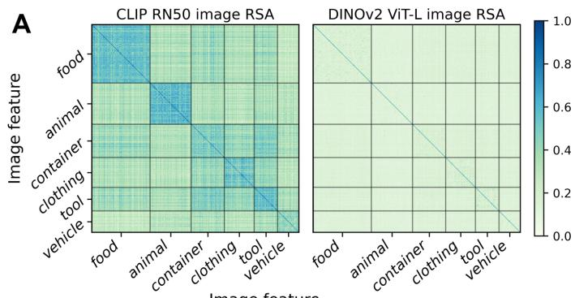

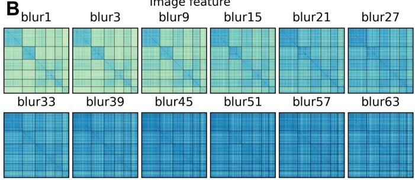

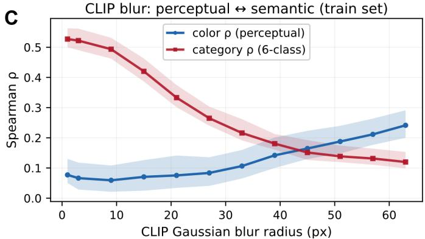  
Fig. 4. CLIP vs. DINO representational differences on THINGS-EEG training images. (A) Category-semantic RSA for CLIP-RN50 and DINOv2 ViT-L/14: CLIP shows block-diagonal clustering; DINO does not. (B) CLIP category-semantic RSA at each blur level (σ=1–63): block-diagonal clustering weakens as σ increases. (C) Spearman ρ of CLIP RDMs with categorysemantic and chroma reference RDMs across blur levels.

1) CLIP Teachers and Multi-Blur: As the top of Fig. 7 shows, CLIP-style teachers consistently outperform PE-Core on the semantic branch. Multi-blur supervision exceeds sharponly inputs (σ=1) for both, consistent with Sec. IV-C: blur supplements appearance-related cues beyond sharp image– text features alone; RN50 multi-blur reaches the strongest branch Top-1 (79.7%). We do not sweep CLIP architectures extensively; our prior ATS work [29] shows that overly strong vision teachers widen the brain–vision asymmetry, and RN50 offers the best trade-off among the teachers tested.

2) DINO Teachers and Depth Span: On the appearancerelated branch, we compare DINOv2 and DINOv3 across architectures, scales, and layer spans. DINOv2 ViT-L/14 yields the strongest single-teacher retrieval. Although DINOv3 generally leads on vision benchmarks, matched-scale DINOv3 teachers underperform DINOv2 on EEG retrieval in this sweep. DINOv3’s Gram anchoring [30] stabilizes dense patch features for geometric vision tasks, but the resulting patchlevel features carry finer local visual structure than noisy scalp EEG can reliably encode; consistent with the brain– vision asymmetry in our prior ATS work [29], this mismatch widens the modality gap and hurts retrieval. For layer-span comparisons in Fig. 7, we adopt a uniform mid-depth split (first vs. second half of blocks; solid vs. hatched bars); shallow spans generally outperform deep spans, corroborating Sec. IV-C. Motivated by the crossover near layer 14 in Fig. 6, we further test DINOv2 ViT-L/14 with L0–L14: it exceeds the half-depth shallow span (L0–L11), deep layers L15–L23, and full-depth fusion (L0–L23), while the final-layer CLS reaches only 20.4% (Fig. 7). This contrast further underscores why the layer-wise DINO analysis in Sec. IV-C is essential for EEGbased visual decoding, rather than conventionally adopting the final-layer CLS. These sweeps establish our default pairing: CLIP RN50 multi-blur + DINOv2 ViT-L/14 (L0–L14).

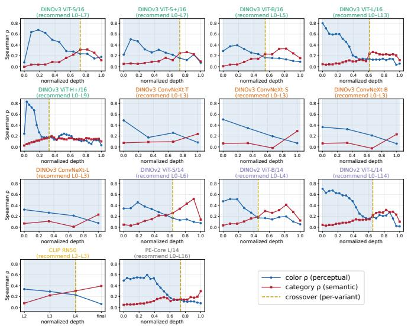  
Fig. 5. Layer-wise Spearman ρ of teacher RDMs with category-semantic and chroma reference RDMs (CLIP, PE-Core, DINO; THINGS-EEG test, n=200). Gold dashed lines mark semantic–chroma ρ crossovers.

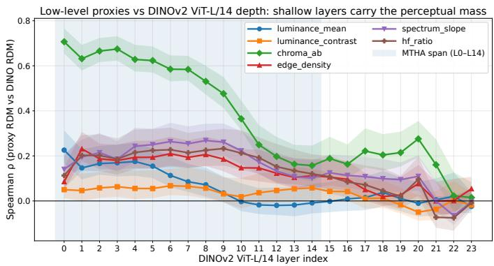  
Fig. 6. Layer-wise Spearman ρ of DINOv2 ViT-L/14 RDMs with six low-level reference RDMs—chroma, luminance, edge density, and spectral statistics— (THINGS-EEG test, n=200). Shallow layers show generally higher ρ.

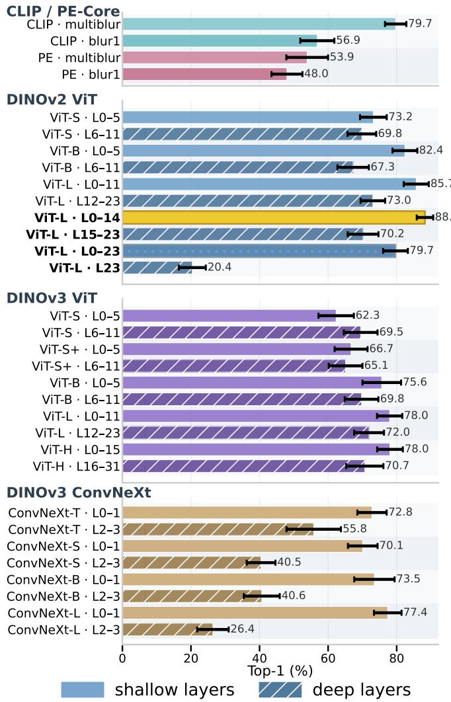  
Fig. 7. Single-teacher retrieval sweep (branch Top-1, %; 10-subject mean, seed 2025). Each condition uses branch SCE only (Eq. (2)), without fusedretrieval. Top: CLIP/PE-Core blur sweeps; bottom: DINOv2/v3 layer spans on ViT and ConvNeXt. Solid/hatched bars mark shallow/deep mid-depth splits.

## E. Dual-Teacher Fusion Retrieval

Secs. IV-C and IV-D establish our default cross-paradigm teachers; we next evaluate full DTHA training (branch SCE plus fused-retrieval). We ask whether fused retrieval exceeds either teacher alone, which teacher pairings yield fusion gain for EEG-based visual decoding, and how the training objective and fusion architecture should be configured. Tables V–VI report the results for these three aspects, respectively.

1) Dual-Teacher vs. Single-Teacher Retrieval: Table V compares DTHA fused retrieval with matched single-teacher CLIP and DINO baselines on THINGS-EEG and THINGS-MEG under the default teachers (Sec. IV-D). In Part I, fused Top-1 reaches 92.4% (EEG) and 64.4% (MEG), surpassing CLIP-only by 11.8/12.3 pp and DINO-only by 3.7/7.7 pp. In Part II, branch retrieval with Sclip or Sdino alone under joint DTHA training already beats the matching Part I singleteacher run (EEG: +0.6/+0.3 pp; MEG: +1.8/+1.1 pp), reflecting co-training synergy under complementary supervision. The Part I fused score further exceeds both Part II branch retrievals on EEG and MEG, confirming fusion gain beyond

TABLE IV  
REPRESENTATIVE DUAL-TEACHER PAIRINGS ON THINGS-EEG (10-SUBJECT TOP-1, %; SEED 2025). SINGLE /SINGLE /DUA $. _ { A } / \mathrm { D } \mathfrak { r }$ UAL : TOP-1UNDER SINGLE-TEACHER VS FULL DTHA T $\mathtt { R A I N I N G \ , } \ \Delta _ { A } = \mathrm { D u a l } _ { A } - \mathrm { S i n g l e } _ { A } , \ \Delta _ { B } = \mathrm { D u a l } _ { B } - \mathrm { S i n g l e } _ { B } , \ \Delta _ { \mathrm { c o } } = \Delta _ { A } + \Delta _ { B } , \ \Delta _ { \mathrm { b r } } = | \mathrm { D u a l } _ { B } - \mathrm { D u a l } _ { A } |$ $\Delta _ { \mathrm { g a i n } } \mathrm { : }$ : FUSED MINUS max(SINGLE , SINGLE , DUAL , DUAL ); Effective: ✓ (> +0.5 PP), ✗ (< −0.5 PP), ELSE ∼.
<table><tr><td>Type</td><td></td><td></td><td></td><td colspan="2">Single-teacher</td><td colspan="3">Dual-trained</td><td colspan="3">Synergy</td><td colspan="3">Fusion</td></tr><tr><td>#</td><td></td><td>Branch A</td><td>Branch B</td><td>Single A</td><td>SingleB</td><td>DualA</td><td>DualB</td><td> $\Delta _ { \mathrm { b r } }$ </td><td>∆A</td><td>∆B</td><td> $\Delta _ { \mathbf { c o } }$ </td><td>Fused</td><td> $\Delta _ { \mathrm { g a i n } }$ </td><td>Effective</td></tr><tr><td>1</td><td>Cross-modal (main)</td><td>CLIP RN50 multi-blur</td><td>DINOv2 L0-14</td><td>79.7</td><td>88.2</td><td>81.2</td><td>89.0</td><td>7.8</td><td>+1.5</td><td>+0.8</td><td>+2.3</td><td>92.6</td><td>+3.5</td><td>√</td></tr><tr><td>2</td><td>Cross-modal</td><td>CLIP RN50 multi-blur</td><td>DINOv3 L0-11</td><td>79.7</td><td>78.0</td><td>80.9</td><td>78.7</td><td>2.2</td><td>+1.2</td><td>+0.7</td><td>+1.9</td><td>89.0</td><td>+8.0</td><td>√</td></tr><tr><td>3</td><td>Weak branch</td><td>CLIP RN50 multi-blur</td><td>PE-Core L/14 multi-blur</td><td>79.7</td><td>53.9</td><td>79.0</td><td>56.0</td><td>23.0</td><td>-0.7</td><td>+2.1</td><td>+1.4</td><td>77.4</td><td>-2.3</td><td>x</td></tr><tr><td>4</td><td>Weak branch</td><td>PE-Core L/14 multi-blur</td><td>DINOv2 L0-14</td><td>53.9</td><td>88.2</td><td>56.5</td><td>86.0</td><td>29.5</td><td>+2.6</td><td>-2.2</td><td>+0.4</td><td>83.5</td><td>-4.8</td><td>x</td></tr><tr><td>5</td><td>Weak branch</td><td>PE-Core L/14 multi-blur</td><td>DINOv3 L0-14</td><td>53.9</td><td>78.0</td><td>56.2</td><td>78.8</td><td>22.5</td><td>+2.3</td><td>+0.8</td><td>+3.1</td><td>79.2</td><td>+0.4</td><td>~</td></tr><tr><td>6</td><td>Redundant</td><td>DINOv3 L0-14</td><td>DINOv2 L0-14</td><td>78.0</td><td>88.2</td><td>79.0</td><td>89.0</td><td>10.0</td><td>+1.0</td><td>+0.8</td><td>+1.8</td><td>88.0</td><td>-1.0</td><td>x</td></tr><tr><td>7</td><td>Redundant</td><td>DINOv3 L12-23</td><td>DINOv2 L12-23</td><td>72.0</td><td>73.0</td><td>71.3</td><td>72.2</td><td>0.9</td><td>-0.7</td><td>-0.8</td><td>-1.5</td><td>79.6</td><td>+6.5</td><td>√</td></tr><tr><td>8</td><td>Deep ablation</td><td>CLIP RN50 multi-blur</td><td>DINOv2 L15-23</td><td>79.7</td><td>70.2</td><td>81.2</td><td>70.5</td><td>10.6</td><td>+1.5</td><td>+0.3</td><td>+1.8</td><td>83.0</td><td>+1.8</td><td>√</td></tr><tr><td>9</td><td>Deep ablation</td><td>CLIP RN50 multi-blur</td><td>DINOv3 L12-23</td><td>79.7</td><td>72.0</td><td>80.0</td><td>72.3</td><td>7.6</td><td>+0.3</td><td>+0.3</td><td>+0.6</td><td>83.8</td><td>+3.8</td><td>√</td></tr><tr><td>10</td><td>Shallow + deep</td><td>DINOv2 L0-11</td><td>DINOv2 L12-23</td><td>85.7</td><td>73.0</td><td>85.5</td><td>72.3</td><td>13.2</td><td>-0.2</td><td>-0.7</td><td>-0.9</td><td>85.8</td><td>+0.1</td><td>~</td></tr></table>

## TABLE V

OVERALL DUAL-TEACHER COMPARISON ON THINGS-EEG (10-SUBJECT MEAN) AND THINGS-MEG (4-SUBJECT MEAN); THREE-SEED AVERAGES. PART I: FUSED $S _ { \mathrm { f u s e d } }$ VS. SINGLE-TEACHER CLIP/DINO (BRANCH SCE ONLY); PART II: Sclip/Sdino BRANCH RETRIEVAL UNDER FULL DTHA. $\Delta _ { \mathrm { f u s e d } } { : }$ ROW TOP-1 − DTHA FUSED; $\Delta _ { \mathrm { s i n g l e } } \mathrm { . }$ : PART II − MATCHING PART I SINGLE-TEACHER ROW.
<table><tr><td colspan="5">I. Single-teacher training vs. DTHA fused retrieval</td></tr><tr><td rowspan="2">Setting</td><td rowspan="2">THINGS-EEG</td><td rowspan="2"></td><td colspan="3">THINGS-MEG</td></tr><tr><td>Top-1</td><td>Top-5</td><td> $\Delta _ { \mathrm { f u s e d } }$ </td></tr><tr><td>CLIP (single-teacher)</td><td>80.6</td><td>96.9 -11.8</td><td>52.1</td><td>81.3</td><td>-12.3</td></tr><tr><td>DINO (single-teacher)</td><td>88.7</td><td>99.2 -3.7</td><td>56.7</td><td>84.0</td><td>-7.7</td></tr><tr><td>DTHA fused (default)</td><td>92.4</td><td>99.5</td><td>64.4</td><td>86.8</td><td></td></tr><tr><td>II. Per-branch retrieval: DTHA joint training vs. single-teacher training</td><td></td><td></td><td></td><td></td><td></td></tr><tr><td rowspan="2">Setting</td><td colspan="2">THINGS-EEG</td><td colspan="2"></td><td>THINGS-MEG</td></tr><tr><td>Top-1</td><td>Top-5</td><td> $\Delta _ { \mathrm { s i n g l e } }$  Top-1</td><td>Top-5</td><td> $\Delta _ { \mathrm { s i n g l e } }$ </td></tr><tr><td>CLIP branch retrieval</td><td>81.2</td><td>97.2</td><td>+0.6</td><td>81.4</td><td>+1.8</td></tr><tr><td>DINO branch retrieval</td><td>89.0</td><td>99.1</td><td></td><td>53.9 57.8</td><td>83.9</td></tr><tr><td></td><td></td><td></td><td>+0.3</td><td></td><td>+1.1</td></tr></table>

either the semantic or appearance-related branch alone and indicating that learned similarity-level fusion complementarily combines both supervision axes.

2) Cross-Paradigm Teacher Pairings: Table IV compares representative teacher pairings under full DTHA on THINGS-EEG. Cross-paradigm CLIP+DINO rows (1–2) yield positive $\Delta _ { \mathrm { g a i n } }$ throughout; row 2 is notable—with weak DINOv3 L0– 11 (78.0% single-teacher Top-1), fused retrieval still reaches 89.0% $( \Delta _ { \mathrm { g a i n } } { = } + 8 . 0$ pp), validating complementary fusion even when one branch is individually weak. Rows 3–5 show poor fusion performance when PE-Core underperforms on the semantic branch $( \Delta _ { \mathrm { g a i n } }$ from −4.8 to +0.4 pp; $\Delta _ { \mathrm { b r } }$ up to 29.5), as a collapsed image–text teacher cannot sustain reliable cross-paradigm supervision. Same-paradigm stacking also underperforms: row 6 (DINOv3+DINOv2 shallow) yields $\Delta _ { \mathrm { g a i n } } mathrm { = } - 1 . 0$ pp, and row 10 (DINOv2 L0–11 plus L12– 23) reaches only +0.1 pp without sufficient complementarity. Rows 7–9 yield positive $\Delta _ { \mathrm { g a i n } }$ yet reach only 79.6– 83.8% fused Top-1 (vs. 92.6% in row 1), because deep DINO layers—whether paired with CLIP (rows 8–9) or with each other (row 7)—encode appearance-related structure less aligned with decodable scalp EEG than shallow spans (Sec. IV-C). Together, these ablations indicate that effective fusion depends on cross-paradigm semantic and appearancerelated supervision—multi-blur CLIP with shallow DINO— that better captures the hierarchical visual information embedded in EEG signals, rather than redundant or misaligned multi-teacher stacking.

3) Fusion and Training Ablations: Table VI ablates DTHA training objectives and fusion architectures under the default CLIP+DINOv2 recipe on THINGS-EEG. Table VI(a)i ablates branch and fused-retrieval losses. Disabling either branch SCE loss lowers Top-1 by 2.5 pp or 1.1 pp, indicating that semantic and appearance-related supervision must both remain active. Fused-retrieval-only training (0:0:1) performs substantially worse (88.8%, −3.8 pp): learning both teachers jointly through $S _ { \mathrm { f u s e d } }$ alone deprives each branch of sufficient paradigm-specific supervision. With all three losses enabled (default 1:1:0.25), branch SCE separately supervises paradigm-specific visual cues through $S ^ { \mathrm { c l i p } }$ and $\dot { S } ^ { \mathrm { d i n } \mathrm { { \bar { o } } } }$ , while the fused-retrieval term learns similarity-level fusion weights that combine them complementarily. We omit $\gamma { = } 0$ because fusion weights are not learned, inconsistent with our test-time protocol. Table VI(a)ii shows that the fused-retrieval weight γ must remain balanced: $\gamma { = } 0 . 1$ under-supervises fusion-weight learning (−0.4 pp), whereas $\gamma { = } 1 . 0$ over-emphasizes the fusedretrieval loss relative to branch SCE, trending toward fusedretrieval-only optimization (−0.4 pp); default $\gamma { = } 0 . 2 5$ is most stable. Table VI(b) ablates the EEG–image fusion architecture. A shared encoder with similarity-level fusion is critical: dual EEG encoders incur a modest 0.6 pp drop, possibly from weakened co-training synergy on one shared EEG embedding, while dual projection heads (−14.8 pp) and feature-level fusion (∼15% Top-1) substantially impair or collapse retrieval.

## F. Brain Encoder (AMSPBE) Analysis

We validate the effectiveness of AMSPBE by comparing it with established EEG encoders, ablating its core components, and analyzing the learned tri-region temporal attention curves and scalp-pattern topographies.

1) Encoder Comparison: As shown in Table VII, our proposed encoder consistently outperforms both classic and recent methods on THINGS-EEG and THINGS-MEG. On THINGS-EEG, paired one-sided Wilcoxon signed-rank tests on persubject Top-1 (n=10), with Holm correction, confirm that AMSPBE significantly outperforms every alternative $( ^ { * } p { < } 0 . 0 5$ for SpatialConv; $^ { * * } p { < } 0 . 0 1$ for all others).

TABLE VI  
FUSION AND TRAINING ABLATIONS ON THINGS-EEG (CLIP + DINOV2, 10-SUBJECT MEAN; SEED 2025). ∆: TOP-1 GAP VS. DEFAULT DTHA.
<table><tr><td>(a) Training objective Top-1 Top-5</td></tr><tr><td>Branch losses  $( \alpha , \beta )$  and fused term γ</td></tr><tr><td>Default (1:1:0.25) 92.6 99.5</td></tr><tr><td>CLIP branch only (1:0:0.25) 90.1 99.2 -2.5</td></tr><tr><td>DINO branch only (0:1:0.25) 91.5 99.2 -1.1</td></tr><tr><td>Fused-retrieval only(0:0:1) 88.8 98.9 -3.8</td></tr><tr><td>Loss weightγ  $\scriptstyle ( \alpha = \beta = 1 )$  Top-1 Top-5 ∆</td></tr><tr><td>γ=0.1 92.2 99.5 -0.4</td></tr><tr><td>Default  $\gamma { = } 0 . 2 5$  92.6 99.5 一</td></tr><tr><td> $\gamma { = } 0 . 5$  92.5 99.5 -0.1</td></tr><tr><td> $\gamma { = } 1 . 0$  92.2 99.6 -0.4</td></tr><tr><td>(b) EEG-image fusion architecture</td></tr><tr><td>Variant Top-1 Top-5 ∆</td></tr><tr><td>Shared encoder + dual similarity fusion (default) 92.6 99.5 1</td></tr><tr><td>Dual EEG encoders (separate zCLIP, zDINO) 92.0 99.4 -0.6</td></tr><tr><td>Dual projection heads (shared encoder) 77.8 96.4 -14.8</td></tr><tr><td>Feature-level fusion, scalar w 15.2 43.4 -77.4</td></tr><tr><td>Feature-level fusion, per-dim. w 14.4 42.6 -78.1</td></tr></table>

TABLE VII

BRAIN-ENCODER COMPARISON UNDER A FIXED DTHA RECIPE (SEED 2025). EEG TOP-1 STARS: ONE-SIDED PAIRED WILCOXON VS. AMSPBE.
<table><tr><td rowspan="2">Brain encoder</td><td colspan="2">THINGS-EEG</td><td colspan="2">THINGS-MEG</td></tr><tr><td>Top-1</td><td>Top-5</td><td>Top-1</td><td>Top-5</td></tr><tr><td>AMSPBE (proposed)</td><td>92.6</td><td>99.5</td><td>64.6</td><td>87.6</td></tr><tr><td>SpatialConv [25] LVBP</td><td>91.5*</td><td>99.5</td><td>63.0</td><td>86.5</td></tr><tr><td>EEGNet [38] JNE&#x27;18</td><td> $7 2 . 1 ^ { * * }$ </td><td>94.0</td><td>36.2</td><td>64.1</td></tr><tr><td>TSConv [4] NICE</td><td> $6 6 . 4 ^ { * * }$ </td><td>91.0</td><td>29.5</td><td>60.2</td></tr><tr><td>STAE [29] ATS</td><td> $6 2 . 2 ^ { * * }$ </td><td>90.0</td><td>43.3</td><td>72.9</td></tr><tr><td>ShallowNet [39] HBM&#x27;17</td><td> $5 9 . 5 ^ { * * }$ </td><td>87.8</td><td>24.4</td><td>48.8</td></tr><tr><td>DeepConvNet [39]  $H B M ^ { \prime } I 7$ </td><td> $5 4 . 5 ^ { * * }$ </td><td>85.2</td><td>27.4</td><td>55.2</td></tr><tr><td>EEGProject [24] UBP</td><td> $4 8 . 9 ^ { * * }$ </td><td>81.2</td><td>29.0</td><td>55.6</td></tr></table>

2) Component Ablation: Table VIII ablates AMSPBE components. Ablating either main component still leaves a functional encoder with substantial retrieval performance—70.8% Top-1 without the K=16 scalp-pattern filter bank, and 92.1% without TSAM and depthwise temporal convolution—while the full model reaches 92.6%, showing that both components contribute and work best together. Under the default DINOv2 recipe, TSAM and depthwise temporal convolution yield only modest Top-1 gains (+0.6/+0.7 pp), yet their main role is physiologically interpretable tri-region temporal dynamics (Fig. 8(A–B)). Filter-bank size K and depthwise-convolution settings $( k , \ t _ { \mathrm { p o o l } } )$ were selected by grid search under the default DTHA recipe (Fig. 3).

3) Learned Temporal Attention and Scalp Patterns: Given the interpretability role of TSAM discussed above, we visualize the learned tri-region temporal attention curves and scalp-pattern topographies in Fig. 8(A–D). The visualization reveals that AMSPBE automatically assigns higher weights to physiologically meaningful time points rather than arbitrary samples along the RSVP window. On THINGS-EEG (Fig. 8(A), 10-subject mean), the posterior partition shows the strongest peaks (e.g., ∼76 ms), with earliest emphasis near ${ \sim } 5 0$ ms after onset—consistent with the latency of the initial feedforward sweep to primary visual cortex [40]. Across partitions, a clear posterior-to-anterior lag matches hierarchical propagation along the occipito-frontal pathway [8], [41]: occipital responses rise first, followed by central and frontal contributions. On THINGS-MEG (Fig. 8(B), 4-subject mean), the posterior partition often exhibits a pronounced double peak, including a late component around ∼605 ms; the clearer early–late separation plausibly reflects MEG’s longer stimulus duration (500 ms) and SOA (1500±200 ms), which attenuate RSVP-style temporal aliasing relative to THINGS-EEG (100 ms on, 100 ms off). Fig. 8(C) displays the sixteen learned scalp-pattern topographies of the $K { = } 1 6$ filter bank for a representative subject (Sub01), each corresponding to a distinct spatial filtering pattern over the electrode montage. Fig. 8(D) averages these topographies across ten subjects: occipital channels dominate, and beyond the occipito-parietal cluster (O/PO/P), a secondary hotspot over right prefrontal and frontopolar sites (Fp2, AF4/AF8, F4/F6, FC2/FC4) indicates that several patterns jointly leverage frontal and posterior visual channels.

TABLE VIII  
AMSPBE COMPONENT ABLATION UNDER THE FIXED DTHA DUAL-TEACHER RECIPE (FUSED TOP-1/TOP-5, %; SEED 2025). EEG: THINGS-EEG $( n { = } 1 0 ) ;$ ; MEG: THINGS-MEG (n=4). TSAM ABBREVIATION IS DEFINED IN FIG. 3.
<table><tr><td rowspan="2">Variant</td><td colspan="2">THINGS-EEG</td><td colspan="2">THINGS-MEG</td></tr><tr><td>Top-1</td><td>Top-5</td><td>Top-1</td><td>Top-5</td></tr><tr><td>Full AMSPBE (default)</td><td>92.6</td><td>99.5</td><td>64.6</td><td>87.6</td></tr><tr><td colspan="5">Main component ablations</td></tr><tr><td>w/o spatial filter bank  $\left( K { = } 1 6 \right)$ </td><td>70.8</td><td>94.5</td><td>39.9</td><td>67.6</td></tr><tr><td>w/o TSAM &amp; depthwise temporal conv</td><td>92.1</td><td>99.4</td><td>63.4</td><td>88.0</td></tr><tr><td colspan="5">TSAM and depthwise temporal conv ablations</td></tr><tr><td>w/o TSAM</td><td>91.9</td><td>99.4</td><td>64.0</td><td>85.6</td></tr><tr><td>w/o depthwise temporal conv</td><td>92.0</td><td>99.2</td><td>61.5</td><td>86.9</td></tr></table>

Together, these qualitative results demonstrate the neuroscientific plausibility of AMSPBE through consistency with established visual processing findings; the salient channels and time points identified here may inform visual BCI montage design by indicating which channels and RSVP latencies carry the most decodable content.

## G. Regional and Spectral Decoding Analysis

Sec. IV-F characterized AMSPBE with full-montage temporal attention and scalp-pattern analyses; we next examine how decodable visual content is distributed across scalp regions and frequency bands (Fig. 8(E–F)).

1) Spatial and Spectral Decoding: We first ask which scalp partitions carry decodable visual content. Fig. 8(E) reports fused Top-1 when training and testing on each of five standard partitions—frontal (F), central (C), parietal (P), temporal (T), and occipital (O)—following [21], versus the full montage (All); unselected channels are zero-masked while preserving layout. On THINGS-EEG, occipital channels alone reach ∼88% and dominate single-partition performance; parietal contributes moderately (∼50%), and frontal, central, and temporal subsets remain comparatively low; the full montage reaches 92.6%. THINGS-MEG shows the same posterior emphasis (occipital ∼50%; full sensors ∼65%), supporting cross-modality consistency.

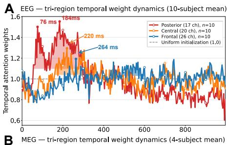

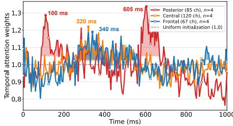

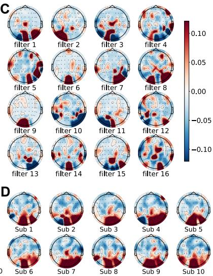

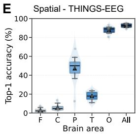

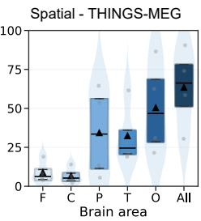

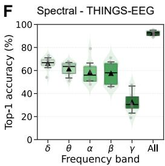

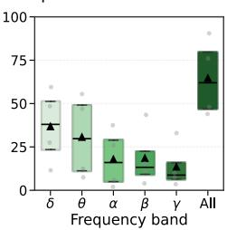  
Fig. 8. Spatio-spectral interpretability on THINGS-EEG and THINGS-MEG (10-subject / 4-subject mean; seed 2025). (A–D) Learned tri-region temporal attention and scalp-pattern topographies. (E) Fused Top-1 under five scalp partitions (F/C/P/T/O) vs. full montage (All); unselected channels zero-masked. (F) Fused Top-1 under δ (0.5–4), θ (4–8), α (8–13), β (13–30), γ (30–100; MEG clipped to Nyquist−1) vs. broadband (All); zero-phase 4th-order Butterworth.

We then examine frequency content. Fig. 8(F) reports fused Top-1 under $\delta , \theta , \alpha , \beta , \mathrm { o r } \gamma$ band-pass filtering versus broadband inputs (All). On EEG, $\delta \mathrm { - } \beta$ retain substantial decoding (∼58–68%), whereas γ-only inputs drop sharply (∼32%); broadband (All) reaches 92.6%. MEG shows the same downward trend with frequency $( \gamma$ lowest, ∼12%), indicating that decodable RSVP-evoked content is concentrated in lowerfrequency components.

2) Partition-Wise DTHA Decoding: Under regional partitioning, Table IX further evaluates two additional groupings— posterior V17 (17 P/PO/O channels) vs. non-posterior NV46— beyond the five standard partitions in Fig. 8(E), reporting per-branch and fused DTHA retrieval. Decoding is highest in posterior regions (occipital and V17), where the DINO branch clearly outperforms CLIP (e.g., V17: 87.1% vs. 78.4%; fused 90.9%), consistent with appearance-related dominance in these channels. On the full montage, fused retrieval reaches 92.6% and the DINO branch leads CLIP by 7.8 pp (89.0% vs. 81.3%), in line with this posterior emphasis. Outside occipital/V17, performance falls sharply, yet NV46 still retains 31.8% fused Top-1—far above the 200-way chance level—indicating complementary non-posterior contributions. Learned fusion weights mirror this trend $( w _ { \mathrm { d i n o } } { \approx } 0 . 5 $ in occipital/V17 vs. ≈0.32 elsewhere), with a relative shift toward the semantic CLIP branch outside these regions—consistent with our mechanism–paradigm correspondence view.

TABLE IX

PARTITION-WISE DTHA RETRIEVAL UNDER REGIONAL PARTITIONING (THINGS-EEG, 10-SUBJECT MEAN; SEED 2025). TRAIN/TEST ON   
MASKED CHANNELS ONLY; UNSELECTED CHANNELS ARE ZERO-MASKED. CLIP AND DINO: BRANCH TOP-1 (%); FUSED: FUSED TOP-1 (%);   
DINO−CLIP: BRANCH GAP (PP). $w _ { \mathrm { d i n o } } .$ : SUBJECT-AVERAGED LEARNED FUSION WEIGHT ON THE DINO BRANCH $( w _ { \mathrm { c l i p } } + w _ { \mathrm { d i n o } } { = } 1 )$ .

<table><tr><td>Region (channels)</td><td>CLIP</td><td>DINO</td><td>Fused</td><td>DINO-CLIP</td><td> $w _ { \mathrm { d i n o } }$ </td></tr><tr><td>Occipital (8)</td><td>73.5</td><td>85.3</td><td>87.9</td><td>+11.8</td><td>0.502</td></tr><tr><td>Parietal (16)</td><td>40.6</td><td>40.2</td><td>47.3</td><td>-0.4</td><td>0.366</td></tr><tr><td>Temporal (10)</td><td>16.3</td><td>13.0</td><td>18.0</td><td>-3.4</td><td>0.323</td></tr><tr><td>Central (14)</td><td>5.9</td><td>4.4</td><td>6.0</td><td>-1.6</td><td>0.308</td></tr><tr><td>Frontal (15)</td><td>2.9</td><td>1.7</td><td>3.0</td><td>-1.2</td><td>0.326</td></tr><tr><td>Posterior V17 (17)</td><td>78.4</td><td>87.1</td><td>90.9</td><td>+8.7</td><td>0.492</td></tr><tr><td>Non-posterior NV46 (46)</td><td>28.3</td><td>24.6</td><td>31.8</td><td>-3.7</td><td>0.324</td></tr><tr><td>Full montage (63)</td><td>81.3</td><td>89.0</td><td>92.6</td><td>+7.8</td><td>0.489</td></tr></table>

## H. Qualitative Analysis

Having established DTHA’s effectiveness through the quantitative results above, we further dissect the mechanisms underlying complementarity-driven DTHA through qualitative analysis on THINGS-EEG. Following [4], the 200 test concepts are grouped into five superordinate categories (animal, food, vehicle, tool, and others). On this grouping, we perform category-structured cross-modal RSA on the test set, followed by retrieval case analysis on representative test queries.

1) Cross-Modal Representational Similarity: Fig. 10 shows cross-modal representational similarity matrices (RSMs) on the THINGS-EEG test set (10-subject mean) under CLIP and DINO single-teacher alignment, alongside DTHA fused retrieval. CLIP single-teacher alignment exhibits strong intracategory aggregation (bright diagonal blocks; $\scriptstyle \Delta = 0 . 0 8 4 )$ ), confirming category-level semantic structure, together with nuanced off-diagonal inter-class similarity as expected under multi-blur supervision. DINO single-teacher alignment shows a weaker category diagonal (∆=0.065) but notable offdiagonal inter-class similarity, indicating appearance-related structure beyond superordinate category labels. DTHA fused retrieval yields a softer category diagonal $\scriptstyle \left( \Delta = 0 . 0 6 1 \right)$ yet the strongest Top-1 accuracy (Table II), indicating that retrieval accuracy is not explained by sharper within-category similarity alone, but by a hybrid of category-level semantics and appearance-related visual cues.

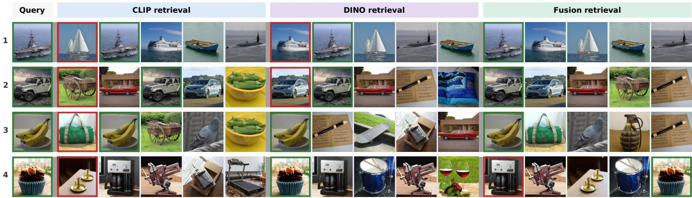  
Fig. 9. CLIP-branch, DINO-branch, and fused Top-1 retrieval on four representative THINGS-EEG test queries. Green/red borders mark correct/incorrect Top-1 hits. Rows 1–2 (aircraft carrier, SUV): fusion-gain cases—both branches miss and fusion succeeds; row 3 (banana): CLIP fails but DINO succeeds and fusion follows; row 4 (cupcake): DINO succeeds but fusion fails—an occasional conflict case under similarity-level fusion.

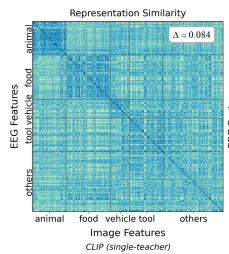

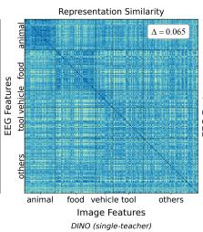

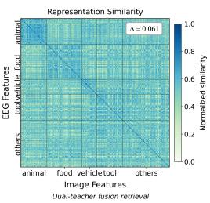  
Fig. 10. Cross-modal EEG–image similarity on THINGS-EEG. $\bar { s } _ { \mathrm { i n t r a } }$ and s¯ denote mean normalized similarities within and across superordinate blocks; $\Delta = \bar { s } _ { \mathrm { { i n t r a } } }$ $\bar { s } _ { \mathrm { i n t e r } }$ (larger ∆ = stronger intra-category aggregation).

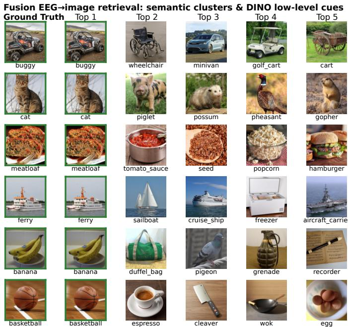  
Fig. 11. Representative fused Top-5 EEG-to-image retrieval on THINGS-EEG test queries. Each row shows the query and top-5 gallery hits ranked by $S _ { \mathrm { f u s e d } }$ (green border: query and correct Top-1 hit). All shown queries recover the correct target at Top-1; ranks 2–5 illustrate how semantic and appearance-related cues combine in the ranked gallery. Buggy, cat, and meatloaf: remaining hits are largely superordinate-consistent neighbors; banana and basketball: remaining hits are largely appearance-related matches across labels; for ferry, remaining hits mix ship-consistent matches (e.g., sailboat, cruise ship) with the appearance-driven hit freezer.

2) Retrieval Case Analysis: To provide an intuitive illustration of fused retrieval, we analyze representative retrieval cases on test queries. As shown in Fig. 11, fused retrieval recovers the correct target at Top-1, while the remaining Top-5 slots mix superordinate-consistent and appearance-related neighbors. Together, these results indicate that retrieval engages both semantic and appearance-related cues. Fig. 9 contrasts CLIP-branch, DINO-branch, and fused Top-1 retrieval on four representative queries. Rows 1–2 (aircraft carrier, SUV): both branches miss the target while fusion recovers the correct image—clear fusion-gain cases when neither teacher alone succeeds. Row 3 (banana): the CLIP branch fails but the DINO branch retrieves correctly; fusion follows the successful branch and also hits the target. Row 4 (cupcake): the DINO branch succeeds yet fusion fails when branch rankings conflict—the fused score favors a CLIP-branch semantic distractor over the DINO-correct target, illustrating an occasional conflict case under similarity-level fusion despite overall complementary gains (Table II). Collectively, cross-paradigm dual-teacher supervision provides complementary visual cues, supporting more complete extraction of hierarchical visual information from EEG and thereby improving retrieval accuracy.

## V. DISCUSSION AND CONCLUSION

Motivated by a mechanism–paradigm correspondence between hierarchical visual processing and VFMs trained under distinct paradigms, we proposed DTHA, a crossparadigm complementarity-driven dual-teacher framework that aligns EEG to complementary semantic (multi-blur CLIP) and appearance-related (shallow DINOv2) teachers through dualbranch supervision and similarity-level fused retrieval. We further introduced AMSPBE, which pairs strong decoding with interpretable tri-region temporal dynamics and scalppattern topographies.

On THINGS-EEG zero-shot EEG-to-image retrieval, DTHA achieves 92.4% Top-1 accuracy, surpassing the previous stateof-the-art by 12.4 percentage points. Teacher-representation analyses, pairing ablations, and fusion-training studies showed that fusion gain arises from cross-paradigm complementarity rather than arbitrary multi-teacher stacking, while qualitative cases indicated hybrid decoding that jointly reflects semantic and appearance-related cues. Spatial, spectral, and partitionwise analyses, together with THINGS-MEG evaluation, further supported biological plausibility and cross-modality generalization.

One limitation of this work is that inter-subject retrieval remains far below intra-subject performance. Most existing EEG visual decoding methods have not specifically targeted the cross-subject generalization challenge, which remains an important direction for our future work.

In summary, this work shows that complementary supervision from cross-paradigm VFMs enables more complete extraction of hierarchical visual information from brain activity, improving both zero-shot retrieval accuracy and interpretability of EEG visual decoding.

## REFERENCES

[1] C. Spampinato, S. Palazzo, I. Kavasidis, D. Giordano, N. Souly, and M. Shah, “Deep learning human mind for automated visual classification,” in Proc. IEEE Conf. Comput. Vis. Pattern Recognit., 2017, pp. 6809–6817.

[2] A. T. Gifford, K. Dwivedi, G. Roig, and R. M. Cichy, “A large and rich EEG dataset for modeling human visual object recognition,” Neuroimage, vol. 264, p. 119754, Dec. 2022.

[3] M. N. Hebart et al., “THINGS-data, a multimodal collection of largescale datasets for investigating object representations in human brain and behavior,” eLife, vol. 12, p. e82580, Feb. 2023.

[4] Y. Song, B. Liu, X. Li, N. Shi, Y. Wang, and X. Gao, “Decoding natural images from EEG for object recognition,” in Int. Conf. Learn. Represent., 2024.

[5] D. Li, C. Wei, S. Li, J. Zou, and Q. Liu, “Visual decoding and reconstruction via EEG embeddings with guided diffusion,” in Adv. Neural Inf. Process. Syst., vol. 37. Curran Associates, Inc., 2024, pp. 102 822–102 864.

[6] H. Chen, L. He, Y. Liu, and L. Yang, “Visual neural decoding via improved visual-EEG semantic consistency,” 2024.

[7] Y. Wei, L. Cao, H. Li, and Y. Dong, “MB2C: Multimodal bidirectional cycle consistency for learning robust visual neural representations,” in Proc. 32nd ACM Int. Conf. Multimedia, 2024, pp. 8992–9000.

[8] J. J. DiCarlo, D. Zoccolan, and N. C. Rust, “How does the brain solve visual object recognition?” Neuron, vol. 73, no. 3, pp. 415–434, Feb. 2012.

[9] D. J. Kravitz, K. S. Saleem, C. I. Baker, L. G. Ungerleider, and M. Mishkin, “The ventral visual pathway: An expanded neural framework for the processing of object quality,” Trends Cogn. Sci., vol. 17, no. 1, pp. 26–49, Jan. 2013.

[10] K. Patterson, P. J. Nestor, and T. T. Rogers, “Where do you know what you know? the representation of semantic knowledge in the human brain,” Nat. Rev. Neurosci., vol. 8, no. 12, pp. 976–987, Dec. 2007.

[11] M. Caron et al., “Emerging properties in self-supervised vision transformers,” in Proc. IEEE/CVF Int. Conf. Comput. Vis., 2021, pp. 9650– 9660.

[12] M. Oquab et al., “DINOv2: Learning robust visual features without supervision,” 2024.

[13] A. Radford et al., “Learning transferable visual models from natural language supervision,” in Int. Conf. Mach. Learn. PMLR, 2021, pp. 8748–8763.

[14] J. Raugel et al., “Disentangling the factors of convergence between brains and DINOv3,” in Int. Conf. Learn. Represent., 2026. [Online]. Available: https://openreview.net/forum?id=i99ccgfad8

[15] Z. Ren et al., “Reconstructing seen image from brain activity by visuallyguided cognitive representation and adversarial learning,” Neuroimage, vol. 228, p. 117602, Mar. 2021.

[16] Y. Takagi and S. Nishimoto, “High-resolution image reconstruction with latent diffusion models from human brain activity,” in Proc. IEEE/CVF Conf. Comput. Vis. Pattern Recognit., 2023, pp. 14 453–14 463.

[17] P. Scotti et al., “Reconstructing the mind’s eye: fMRI-to-image with contrastive learning and diffusion priors,” Adv. Neural Inf. Process. Syst., vol. 36, 2024.

[18] H. Li, H. Wu, and B. Chen, “NeuralDiffuser: Neuroscience-inspired diffusion guidance for fMRI visual reconstruction,” IEEE Trans. Image Process., vol. 34, pp. 552–565, Jan. 2025.

[19] J. Chen, Y. Qi, Y. Wang, and G. Pan, “MindGPT: Interpreting what you see with non-invasive brain recordings,” IEEE Trans. Image Process., vol. 34, pp. 3281–3293, 2025.

[20] C. Du, K. Fu, J. Li, and H. He, “Decoding visual neural representations by multimodal learning of brain-visual-linguistic features,” IEEE Trans. Pattern Anal. Mach. Intell., 2023.

[21] Y. Song, Y. Wang, H. He, and X. Gao, “Recognizing natural images from EEG with language-guided contrastive learning,” IEEE Trans. Neural Netw. Learn. Syst., 2025.

[22] K. Zhang, L. He, X. Jiang, W. Lu, D. Wang, and X. Gao, “Cognitioncapturer: Decoding visual stimuli from human EEG signal with multimodal information,” in Proc. AAAI Conf. Artif. Intell., 2025, pp. 14 486–14 493.

[23] K. Zhang et al., “CognitionCapturerPro: Towards high-fidelity visual decoding from EEG/MEG via multi-modal information and asymmetric alignment,” 2026.

[24] H. Wu, Q. Li, C. Zhang, Z. He, and X. Ying, “Bridging the vision-brain gap with an uncertainty-aware blur prior,” in Proc. Comput. Vis. Pattern Recognit. Conf., 2025, pp. 2246–2257.

[25] W. Liu, H. Li, Z. Xu, L. Ma, and H. Li, “Leveraging visual blur perception characteristics for EEG decoding,” in Proc. AAAI Conf. Artif. Intell., vol. 40, no. 21, 2026, pp. 17 580–17 588.

[26] J. Wang et al., “NeuroCLIP: Brain-inspired prompt tuning for EEG-toimage multimodal contrastive learning,” 2025.

[27] W. Zhang, S. Wang, Y. Su, X. Li, C. Zhang, and S. Zhong, “Neuro-Bridge: Bio-inspired self-supervised EEG-to-image decoding via cognitive priors and bidirectional semantic alignment,” in Proc. AAAI Conf. Artif. Intell., vol. 40, no. 21, 2026, pp. 18 028–18 036.

[28] J. Zheng et al., “Learning brain representation with hierarchical visual embeddings,” 2026.

[29] L. Wu, J. Li, Z. Ren, K. Zhang, and X. Gao, “Shrinking the teacher: An adaptive teaching paradigm for asymmetric EEG-vision alignment,” in Proc. AAAI Conf. Artif. Intell., 2026, pp. 17 859–17 867.

[30] O. Simeoni ´ et al., “DINOv3,” 2025. [Online]. Available: https: //arxiv.org/abs/2508.10104

[31] D. Bolya et al., “Perception encoder: The best visual embeddings are not at the output of the network,” Adv. Neural Inf. Process. Syst., vol. 38, pp. 60 884–60 937, 2026.

[32] M. Walmer, S. Suri, K. Gupta, and A. Shrivastava, “Teaching matters: Investigating the role of supervision in vision transformers,” in Proc. IEEE/CVF Conf. Comput. Vis. Pattern Recognit., 2023, pp. 7486–7496.

[33] N. Kriegeskorte, M. Mur, and P. A. Bandettini, “Representational similarity analysis - connecting the branches of systems neuroscience,” Front. Syst. Neurosci., vol. 2, p. 4, Nov. 2008.

[34] D. L. K. Yamins, H. Hong, C. F. Cadieu, E. A. Solomon, D. Seibert, and J. J. DiCarlo, “Performance-optimized hierarchical models predict neural responses in higher visual cortex,” Proc. Natl. Acad. Sci. USA, vol. 111, no. 23, pp. 8619–8624, Jun. 2014.

[35] U. Guc¸l ¨ u and M. A. J. Van Gerven, “Deep neural networks reveal a¨ gradient in the complexity of neural representations across the ventral stream,” J. Neurosci., vol. 35, no. 27, pp. 10 005–10 014, 2015.

[36] C. Conwell, J. S. Prince, K. N. Kay, G. A. Alvarez, and T. Konkle, “A large-scale examination of inductive biases shaping high-level visual representation in brains and machines,” Nat. Commun., vol. 15, no. 1, p. 9383, Oct. 2024.

[37] A. van den Oord, Y. Li, and O. Vinyals, “Representation learning with contrastive predictive coding,” 2019.

[38] V. J. Lawhern, A. J. Solon, N. R. Waytowich, S. M. Gordon, C. P. Hung, and B. J. Lance, “EEGNet: A compact convolutional neural network for EEG-based brain–computer interfaces,” J. Neural Eng., vol. 15, no. 5, p. 056013, Oct. 2018.

[39] R. T. Schirrmeister et al., “Deep learning with convolutional neural networks for EEG decoding and visualization,” Hum. Brain Mapp., vol. 38, no. 11, pp. 5391–5420, Nov. 2017.

[40] S. Thorpe, D. Fize, and C. Marlot, “Speed of processing in the human visual system,” Nature, vol. 381, no. 6582, pp. 520–522, Jun. 1996.

[41] R. M. Cichy, D. Pantazis, and A. Oliva, “Resolving human object recognition in space and time,” Nat. Neurosci., vol. 17, no. 3, pp. 455– 462, Mar. 2014.