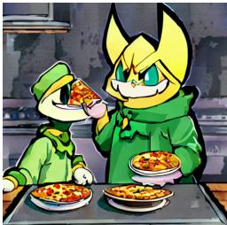
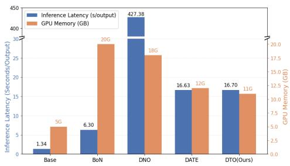
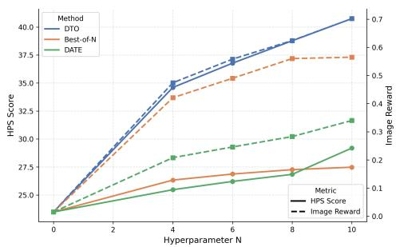
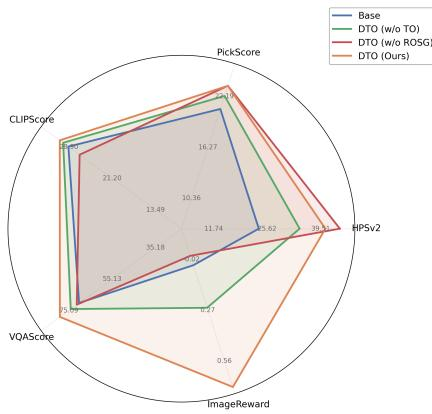
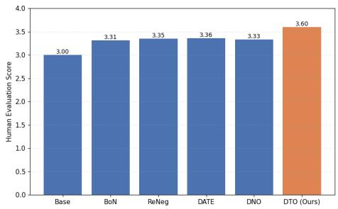
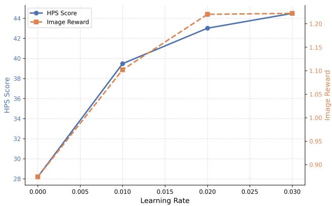
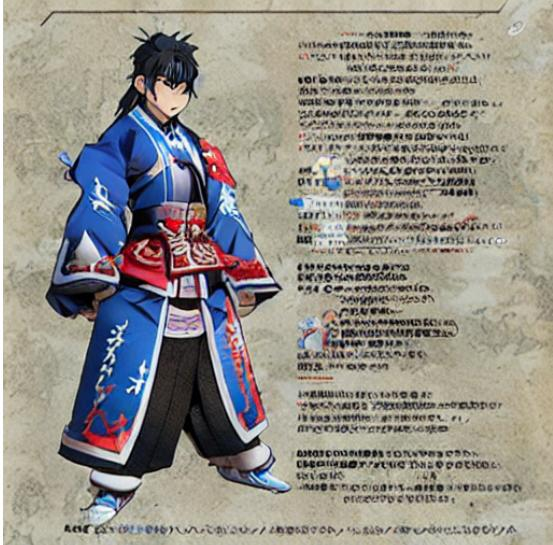

# DIRECT TRAJECTORY OPTIMIZATION FOR INFERENCE-TIME ALIGNMENT OF TEXT-TO-IMAGE DIFFUSION MODELS

Huixuan Zhang & Xiaojun Wan

Wangxuan Institute of Computer Technology, Peking University

zhanghuixuan@stu.pku.edu.cn, wanxiaojun@pku.edu.cn

## ABSTRACT

Alignment of text-to-image diffusion models with reward functions is a key challenge in controllable generation. Existing approaches typically rely on optimizing model inputs or fine-tuning denoising networks, which requires computationally expensive backpropagation through large denoising models. In this work, we propose Direct Trajectory Optimization (DTO), a training-free framework that performs alignment by directly optimizing the sampling trajectory of diffusion models. Specifically, DTO treats intermediate denoising scores and sampled noise as the optimization variables, eliminating the need for gradients through the denoising network. To mitigate the out-of-distribution problem, we introduce Reward-Optimized Score Guidance, which interpolates between the optimized scores and the pretrained model predictions to stabilize sampling, while providing a provable theoretical guarantee of reward improvement under constrained distributions. Empirically, DTO improves alignment performance across three diffusion models on two benchmarks, outperforming existing inference-time alignment methods while maintaining high efficiency. These results suggest that trajectory-level optimization is a promising direction for efficient and effective diffusion model alignment.

## 1 INTRODUCTION

Text-to-image diffusion models have achieved remarkable success in generating high-quality images aligned well with textual prompts (Esser et al., 2024; Wu et al., 2025; Seedream et al., 2025). However, despite their strong generative capabilities, these models often struggle to fully satisfy fine-grained user preferences or task-specific objectives, such as improved overall image quality or stronger alignment with textual prompts. This motivates the problem of alignment: steering a pretrained diffusion model toward generating samples that maximize a given reward function.

A common approach to this problem is to fine-tune the denoising network using reinforcement learning or preference optimization techniques (Gu et al., 2024; Black et al., 2024; Wallace et al., 2023). While effective in improving alignment, these methods typically require substantial computational resources and retraining for different reward functions, which limits their flexibility in practical scenarios. To avoid retraining, recent training-free approaches perform optimization at inference time by modifying model inputs such as noise, latent variables, or textual embeddings (Tang et al., 2024; Na et al., 2025). Although these methods eliminate parameter updates, they still rely on backpropagation through the denoising network, which introduces considerable computational overhead and can complicate the optimization process.

To reduce computational cost and improve alignment performance, we propose Direct Trajectory Optimization (DTO). DTO directly optimizes the sampling trajectory (including the sampled noise and denoising scores at each step), eliminating the need for gradients through the denoising model. This perspective decouples alignment optimization from the gradients of internal parameters of the denoising network, enabling efficient and effective reward-driven refinement at inference time.

However, directly optimizing the trajectory introduces the out-of-distribution problem, as unconstrained updates may disrupt the pretrained diffusion distribution and lead to degraded quality. To address this, we design Reward-Optimized Score Guidance (ROSG) in DTO, which interpolates between the optimized scores and the pretrained model’s score predictions. We further theoretically show that the trajectory obtained via ROSG preserves reward improvement under constrained distributions, achieving a balance between distribution maintenance and reward optimization.

  
(a) SD1.5+ReNeg (Li et al., 2025)

  
(b) SD1.5+DATE (Na et al., 2025)

  
(c) SD1.5+DNO (Tang et al., 2024)

  
(d) SD1.5+DTO(Ours)  
Figure 1: Generation results of different alignment methods. The prompt is “Ralsei and Asriel from Deltarune eating pizza.”

Experimental results demonstrate that DTO improves alignment performance across three diffusion models on two benchmarks, outperforming existing inference-time alignment methods while maintaining high computational efficiency. We further show that DTO achieves a better time-performance trade-off compared with other inference-time methods. Ablation studies demonstrate that both trajectory optimization and Reward-Optimized Score Guidance improve performance, confirming the effectiveness of each component. Human evaluation further suggests that DTO outperforms other methods. A qualitative case comparison is provided in Figure 1.

## Our contributions are summarized as follows:

1. We propose Direct Trajectory Optimization (DTO), a novel framework that directly optimizes the diffusion sampling trajectory, including sampled noise and denoising score, without back-propagation through the denoising network.

2. We introduce Reward-Optimized Score Guidance to mitigate the out-of-distribution problem, and provide theoretical analysis showing reward improvement under constrained distribution.

3. Experiments demonstrate that DTO achieves a better trade-off between optimization performance and computational efficiency than existing methods across diverse settings, achieving 10× higher speed than previous SoTA alignment method DNO while still providing better alignment performance.

## 2 RELATED WORKS

## 2.1 TEXT-TO-IMAGE DIFFUSION MODELS

DDPM was first introduced in Ho et al. (2020), serving as the foundation for subsequent diffusion models. For incorporating textual condition into diffusion models, there are two most commonly used guidance strategy: classifier guidance (Dhariwal & Nichol, 2021) and classifier-free guidance (Ho & Salimans, 2022), while the latter one is more widely used nowadays. Denoising in latent space was proposed by Rombach et al. (2022), proven highly successful. Different noise scheduling has been introduced in diffusion models (Nichol & Dhariwal, 2021; Song et al., 2021a;b; Karras et al., 2022; Kingma & Gao, 2024; Lu et al., 2022a;b; Albergo & Vanden-Eijnden, 2022; Liu et al., 2022; Lipman et al., 2022; Esser et al., 2024).

Based on these studies, many practical text-to-image diffusion models have been introduced, including (Rombach et al., 2022; Podell et al., 2023; Esser et al., 2024; Wu et al., 2025; Chen et al., 2024; Labs, 2024). There are also powerful closed-source text-to-image models, including (Seedream et al., 2025; Gao et al., 2025). However, since inference details of these models are not publicly available, we focus on open-source diffusion models for fair comparison.

## 2.2 ALIGNMENT PROBLEM OF TEXT-TO-IMAGE DIFFUSION MODELS

Applying a reward model for aligning and improving diffusion models is a popular topic. One approach is training-based methods, including DDPO (Black et al., 2024), which is inspired by RLHF (Christiano et al., 2017; Ouyang et al., 2022), and Diffusion-DPO (Wallace et al., 2023), following direct preference optimization (DPO) (Rafailov et al., 2023). Regarding differentiable reward models, directly finetuning diffusion models is also a promising approach as introduced by ReFL (Xu et al., 2023). However, these methods all require tuning model parameters, resulting in high computational cost and low flexibility.

There are also training-free alignment strategies, including direct noise optimization (DNO) (Tang et al., 2024), diffusion adaptive text embedding (DATE) (Na et al., 2025), and ReNeg (Li et al., 2025). Despite their different design choices, their key insight all lies in using a differentiable reward model for optimizing part of the input during inference. Though eliminating the need for tuning model parameters, these methods still require back-propagation through the denoising model, leading to difficulty in optimization and still potentially high cost.

Regarding reward models, classical reward models include ImageReward (Xu et al., 2023), HPS (Wu et al., 2023), and PickScore (Kirstain et al., 2023). Recent reward models are built on large MLLMs, including UnifiedReward (Wang et al., 2025b;a; 2026), and Minos (Zhang et al., 2025).

## 3 PRELIMINARIES: DIFFUSION MODELS

Starting from an initial noise $x _ { T } ,$ diffusion model iteratively refines the sample towards a clean output $x _ { 0 }$ . During inference, at each timestep t, a denoising network $\epsilon _ { \theta } ( x _ { t } , t )$ predicts a score used to guide the generation. For conditional generation with a given condition c, classifier-free guidance (CFG) (Ho & Salimans, 2022) combines conditional and unconditional predictions, and following common practice in negative prompt guidance, CFG can be naturally extended to incorporate negative conditions n :

$$
\tilde { \epsilon } _ { \theta } ( x _ { t } , t , c , n ) = \epsilon _ { \theta } ( x _ { t } , t , n ) + w \left[ \epsilon _ { \theta } ( x _ { t } , t , c ) - \epsilon _ { \theta } ( x _ { t } , t , n ) \right]\tag{1}
$$

Noise scheduling is formulated following SDE or ODE (Karras et al., 2022). For an ODE-based noise scheduler $F _ { \mathrm { { ; } } }$ where $F$ denotes a single-step numerical solver, let $\epsilon _ { t } = \tilde { \epsilon } _ { \theta } ( x _ { t } , t , c , n )$ , the update follows:

$$
x _ { t - 1 } = F \left( x _ { t } , \epsilon _ { t } , t \right)\tag{2}
$$

An SDE-based noise scheduler additionally involve sampling a random noise $z _ { t }$ at each timestep $\displaystyle ( x _ { t - 1 } ~ = ~ F \left( x _ { t } , \epsilon _ { t } , t , z _ { t } \right) )$ . By iteratively applying Equation $^ { 2 , }$ the denoised result $x _ { 0 }$ could be achieved. For latent diffusion models, a decoder $D$ decodes this $x _ { 0 }$ to real images $D ( x _ { 0 } )$ 1 We denote the entire framework (the noise scheduler $F _ { ; }$ , the denoising network $\epsilon _ { \theta } .$ , and the decoder D) as the overall diffusion model M. M takes the initial noise sampled xT, a positive condition $c ,$ a (possible) negative condition n, and a set of sampled noise $\{ z _ { t } \} _ { t = 1 } ^ { T }$ (for SDE-based noise schedulers) as input, and produces a generated image as an output.

## 4 DIRECT TRAJECTORY OPTIMIZATION

## 4.1 PROBLEM DEFINITION AND MOTIVATION

Table 1: Comparison of optimization formulations of existing methods.
<table><tr><td>Method</td><td>Optimization Formulation</td></tr><tr><td>DNO (Tang et al., 2024)</td><td> $\begin{array} { r } { \operatorname* { m a x } _ { x _ { T } , \{ z _ { t } \} } R ( M ( x _ { T } , c , n , \{ z _ { t } \} ) , c ) } \end{array}$ </td></tr><tr><td>DATE (Na et al., 2025)</td><td>maxč  $\hat { R ( } M ( x _ { T } , \tilde { c } , n , \{ z _ { t } \} ) , c )$ </td></tr><tr><td>ReNeg (Li et al., 2025)</td><td>maxn  $R ( M ( x _ { T } , c , n , \{ z _ { t } \} ) , c )$ </td></tr></table>

Given a pretrained diffusion model M and a reward function R, test-time alignment aims to steer the generation process toward samples that maximize the reward under a given text condition c:

$$
\operatorname* { m a x } R \left( M ( x _ { T } , c , n , \{ z _ { t } \} _ { t = 1 } ^ { T } ) , c \right) .\tag{3}
$$

Existing methods mainly differ in the choice of optimization variables within the diffusion pipeline, as summarized in Table 1. Despite these differences, a common characteristic of these methods is that they rely on gradients propagated through the denoising network. Let u denote a generic set of optimized variables; most approaches can be expressed in the form of gradient-ascent updates:

$$
u ^ { \prime } = u + \eta \frac { \partial R ( M ( x _ { T } , \tilde { c } , n , \{ z _ { t } \} ) , c ) } { \partial u } .\tag{4}
$$

However, such requirement introduces two key challenges. First, this may restrict the effective optimization space and complicate the optimization process. Second, it leads to considerable computational overhead, especially for large-scale diffusion models. A detailed discussion of the gradient flow of previous methods can be found in Appendix A.1.

These limitations motivate a natural question: Can we perform test-time alignment without back-propagating through the denoising network?

## 4.2 OPTIMIZING TRAJECTORY

In the following discussion, we focus on ODE-based noise schedulers to present our method, as they are widely used in modern diffusion systems (Esser et al., 2024; Wu et al., 2025). Our formulation naturally extends to SDE-based samplers, which are discussed in Appendix A.2 and B.6.

As shown in Equation 2, given a noise scheduler $F ,$ the diffusion generation process is fully determined by the initial noise $x _ { T }$ and the sequence of intermediate predicted scores $\{ \epsilon _ { t } \} _ { t = 1 } ^ { T }$ . Existing methods implicitly influence these variables by optimizing inputs to the denoising network $\epsilon _ { \theta } ,$ , thereby indirectly shaping the induced trajectory of the sampling process.

Algorithm 1 Direct Trajectory Optimization (DTO)   
Require: Denoising model $\epsilon _ { \theta } .$ , Noise Scheduler $F$ (corresponding to $f ) ,$ , total denoising steps $T ,$   
Reward model ${ \check { R } } ,$ learning rate $\eta ,$ optimization steps $S ,$ weight $w _ { t } .$ , text condition c.   
1: Sample an initial noise $x _ { T }$ and the initialize the trajectory $\tau = ( x _ { T } , \epsilon _ { T } , . . . , \epsilon _ { 1 } )$ using $\epsilon _ { \theta } , F , x _ { T } , c$   
2: Calculate the current reward $r = R ( f ( \tau ) )$ , cache best trajectory $\tau ^ { * }  \tau .$   
3: for $s t e p = 1$ to S do   
4: $\tau  \tau + \eta \nabla _ { \tau } R ( f ( \tau ) )$ ▷ Gradient ascent.   
▷ Reward-Optimized Score Guidance.   
5: for $t = T$ to 1 do   
6: $\epsilon _ { t } ^ { \prime } = \tilde { \epsilon } _ { \theta . } ( x _ { t } , t , c , n )$   
7: $\hat { \epsilon } _ { t }  \epsilon _ { t } ^ { \prime } + w _ { t } ( \epsilon _ { t } - \epsilon _ { t } ^ { \prime } )$   
8: $x _ { t - 1 } = F ( x _ { t } , \hat { \epsilon } _ { t } , t )$   
9: end for   
10: $\tau \gets ( x _ { T } , \hat { \epsilon } _ { T } , . . . , \hat { \epsilon } _ { 1 } )$   
▷ Select the best trajectory.   
11: Calculate current reward $r _ { c } = R ( f ( \tau ) )$   
12: if $r _ { c } > r$ then   
13: $r  r _ { c } , \tau ^ { * }  \tau$   
14: end if   
15: end for   
16: return Optimized sample $x _ { 0 } ^ { * } = f ( \tau ^ { * } )$

In contrast, we take a different perspective: instead of treating $\left\{ \epsilon _ { t } \right\}$ as outputs of a fixed network, we view them as explicit variables that define the diffusion trajectory. We actually relax the functional dependency induced by the pretrained denoising network and treat these intermediate scores as free variables able to be optimized, whose gradients flow only through the noise scheduler. From this viewpoint, the denoising network $\epsilon _ { \theta }$ can be interpreted as a mechanism that provides an initialization of these variables, rather than a constraint on their optimization. This motivates our proposed method, Direct Trajectory Optimization (DTO), whose overview is provided in Algorithm 1.

Formally, we define a diffusion trajectory as:

$$
\tau = ( x _ { T } , \epsilon _ { T } , \dots , \epsilon _ { 1 } ) ,\tag{5}
$$

where $x _ { T }$ and $\{ \epsilon _ { t } \} _ { t = 1 } ^ { T }$ parameterize the entire sampling process induced by a fixed noise scheduler. Given a fixed noise scheduler $F .$ , the final output can be expressed as a deterministic function f (by unrolling the iteration of Equation 2) of the trajectory:

$$
x _ { 0 } = f ( \tau ) ,\tag{6}
$$

Based on this formulation, for simplicity let $R ( f ( \tau ) ) = R ( f ( \tau ) , c ) = R ( f ( x _ { T } , \epsilon _ { T } , . . . , \epsilon _ { 1 } ) , c )$ , the optimization target can be written as:

$$
\operatorname* { m a x } _ { \tau } { R ( f ( \tau ) ) }\tag{7}
$$

Since $f$ is differentiable with respect to its inputs, gradients can be propagated through the noise scheduler:

$$
\partial R _ { \mathrm { ~ - ~ } } \partial R \partial F ( x _ { t } , \epsilon _ { t } , t )
$$

$$
\partial \epsilon _ { t } \ : \ : ^ { - } \ : \partial x _ { t - 1 } \partial \epsilon _ { t }\tag{8}
$$

$$
\frac { \partial R } { \partial x _ { t } } = \frac { \partial R } { \partial x _ { t - 1 } } \frac { \partial F ( x _ { t } , \epsilon _ { t } , t ) } { \partial x _ { t } } ,\tag{9}
$$

$$
\nabla _ { \tau } R ( f ( \tau ) ) = \left( { \frac { \partial R } { \partial x _ { T } } } , { \frac { \partial R } { \partial \epsilon _ { T } } } , \ldots , { \frac { \partial R } { \partial \epsilon _ { 1 } } } \right) .\tag{10}
$$

Given this gradient, standard gradient ascent (Equation 4) can be naturally applied as the optimization strategy. Since this optimization can be conducted multiple steps, we can select the trajectory $\tau ^ { * }$ that achieves the highest reward during the process.

From this perspective, the trajectory τ can actually be initialized arbitrarily. However, a poorly initialized trajectory is difficult to optimize and may lead to poor convergence. Therefore, in practice, we initialize τ using the standard diffusion process described in Section 3, which provides a trajectory that is consistent with the pretrained model distribution and serves as a strong starting point for optimization. Starting from this initialization, we perform direct optimization over the trajectory variables, freeing the scores $\epsilon _ { t }$ from the constraints of the denoising network. This formulation removes the dependence on gradients through the denoising network, $\frac { \partial \tilde { \epsilon } _ { \theta } } { \partial x _ { t } }$ , and instead operates entirely through the noise scheduler dynamics. This significantly reduces the computational overhead of backpropagation through large neural networks. We provide a detailed discussion of gradient flow in Appendix A.1.

## 4.3 OUT-OF-DISTRIBUTION (OOD) PROBLEM

While naive direct trajectory optimization in Equation 7 improves efficiency and flexibility, it introduces a critical challenge: the out-of-distribution (OOD) problem, a common issue in inferencetime optimization methods (Tang et al., 2024). Since the optimized trajectory is no longer fully constrained by the pretrained diffusion model, it may drift away from the pretrained distribution, leading to reward hacking and degraded generation quality.

Motivated by CFG (Ho & Salimans, 2022) and adaptive guidance (Zhang & Wan, 2025b), we mitigate this issue by pulling the optimized score $\epsilon _ { t }$ back toward the pretrained model distribution after each optimization step, which serves as a form of guidance. We refer to this strategy as Reward-Optimized Score Guidance (ROSG). Formally, for each timestep t, we compute:

$$
\epsilon _ { t } ^ { \prime } = \tilde { \epsilon } _ { \theta } ( x _ { t } , t , c , n ) ,\tag{11}
$$

$$
\hat { \epsilon } _ { t } = \epsilon _ { t } ^ { \prime } + w _ { t } ( \epsilon _ { t } - \epsilon _ { t } ^ { \prime } ) ,\tag{12}
$$

$$
\boldsymbol { x } _ { t - 1 } = \boldsymbol { F } ( \boldsymbol { x } _ { t } , \hat { \epsilon } _ { t } , t ) .\tag{13}
$$

This formulation can be interpreted as a convex interpolation between the pretrained model prediction and the optimized score, thereby balancing reward maximization and distribution preservation. Following a similar motivation to that in (Zhang & Wan, 2025b), we define $w _ { t }$ as

$$
w _ { t } = \left\{ { \begin{array} { l l } { 1 , } & { t < { \frac { 1 } { 2 } } T } \\ { 1 - { \frac { t } { T } } , } & { t \geq { \frac { 1 } { 2 } } T . } \end{array} } \right.\tag{14}
$$

Comparisons with alternative $w _ { t }$ schedules are given in Appendix B.8.

Theoretical Guarantee We further provide a theoretical justification that such ROSG does not significantly hinder optimization. Specifically, we have:

Theorem 1. Let τˆ denote the trajectory achieved using gradient ascent and Reward-Optimized Score Guidance, τ denote trajectory before ROSG and optimization. Assume the rewardfunction $R ( f ( \tau ) ) ,$ ) is L-Lipschitz continuous. Then:

$$
R ( f ( \hat { \tau } ) ) \geq R ( f ( \tau ) ) + \eta | | \nabla _ { \tau } R ( f ( \tau ) ) | | ^ { 2 } - L \sum _ { t = 1 } ^ { T } ( 1 - w _ { t } ) | | \epsilon _ { t } ^ { \prime } - \epsilon _ { t } | | + O ( \eta ^ { 2 } ) .\tag{15}
$$

Theorem 1 implies that when the optimized score $\epsilon _ { t }$ remains sufficiently close to the pretrained prediction $\epsilon _ { t } ^ { \prime } ,$ , and the reward gradient magnitude is large, the trajectory achieved using ROSG τˆ still yields an increase in reward. Conversely, when the gradient norm is small, the optimization signal is weak, indicating limited potential for further improvement. Meanwhile, when the deviation between $\epsilon _ { t }$ and $\boldsymbol { \epsilon } _ { t } ^ { \prime }$ becomes large, the trajectory is likely to suffer from severe OOD issues, in which case aggressive optimization may become counterproductive. The proof together with a more detailed discussion is given in Appendix A.3. Score-drift and FID measurements that probe this regime are reported in Appendix B.8, and a corresponding qualitative failure without ROSG is shown in Appendix B.10.

## 5 EXPERIMENTS AND ANALYSIS

## 5.1 EXPERIMENT SETUP

Datasets We evaluate our method on two widely-used public benchmarks: the HPD-v2 test set (400 prompts) (Wu et al., 2023) and GenAIBench (1,600 prompts) (Li et al., 2024).

Baseline Methods We evaluate our method on three open-source diffusion models, including Stable-Diffusion-1.5 (SD1.5) (Rombach et al., 2022), Stable-Diffusion-XL (SDXL) (Podell et al., 2023), and Stable-Diffusion-3 (SD3) (Esser et al., 2024). Results on Stable-Diffusion-3.5-Large-Turbo and FLUX.1-dev are reported in Appendices B.5 and B.7. We compare against several representative test-time alignment methods, including DNO (Tang et al., 2024), ReNeg (Li et al., 2025), and DATE (Na et al., 2025). Among them, ReNeg and DATE are implemented on SD1.5 only, while DNO is implemented on both SD1.5 and SDXL, following their official implementations. In addition, we include Best-of-N sampling (BoN) as a strong baseline.

Implementation Details Following prior works (Tang et al., 2024; Li et al., 2025), we adopt HPSv2 (Wu et al., 2023) as the reward model since it is a general reward model. For hyperparameters, we set the learning rate $\eta$ to 0.01, 0.02, and 0.06 for SD1.5, SDXL, and SD3 respectively, accounting for differences in model scale. The weighting schedule $w _ { t }$ is computed according to Equation 14. We fix the total number of optimization steps to $S = 1 0 ,$ , and set $\dot { N } = 1 0$ for BoN to ensure a fair comparison. Additional implementation details are provided in Appendix B.1. We further analyze the trade-off between performance and computational cost in Section 5.3.

Metrics Following prior work (Tang et al., 2024; Na et al., 2025), we primarily use HPSv2 (Wu et al., 2023) as the main metric for evaluating alignment quality. To provide a more comprehensive evaluation, we further report results using additional widely-adopted metrics, including PickScore (Kirstain et al., 2023), CLIPScore (Hessel et al., 2021), VQAScore (Lin et al., 2024), and ImageReward (Xu et al., 2023).

## 5.2 MAIN RESULTS

Table 2: Results on HPDv2 test set. HPSv2 is used as reward model.
<table><tr><td>Base Model</td><td>Method</td><td>HPSv2</td><td>PickScore</td><td>CLIPScore</td><td>VQAScore</td><td>ImageReward</td></tr><tr><td rowspan="3">SD3</td><td>Base</td><td>29.71</td><td>22.33</td><td>29.46</td><td>83.94</td><td>1.105</td></tr><tr><td>BoN</td><td>32.07</td><td>22.75</td><td>29.72</td><td>84.96</td><td>1.269</td></tr><tr><td>DTO(Ours)</td><td>43.78</td><td>24.50</td><td>30.14</td><td>85.36</td><td>1.289</td></tr><tr><td rowspan="4">SDXL</td><td>Base</td><td>28.19</td><td>22.58</td><td>30.78</td><td>82.60</td><td>0.874</td></tr><tr><td>BoN</td><td>30.90</td><td>23.10</td><td>31.06</td><td>84.33</td><td>1.155</td></tr><tr><td>DNO</td><td>38.23</td><td>24.02</td><td>31.09</td><td>83.77</td><td>1.145</td></tr><tr><td>DTO(Ours)</td><td>43.01</td><td>24.87</td><td>31.04</td><td>84.63</td><td>1.220</td></tr><tr><td rowspan="6">SD1.5</td><td>Base</td><td>23.48</td><td>20.72</td><td>28.98</td><td>70.36</td><td>0.015</td></tr><tr><td>BoN</td><td>27.48</td><td>21.35</td><td>30.21</td><td>76.92</td><td>0.565</td></tr><tr><td>DNO</td><td>33.70</td><td>22.29</td><td>30.21</td><td>76.66</td><td>0.591</td></tr><tr><td>ReNeg</td><td>29.07</td><td>21.11</td><td>26.64</td><td>66.68</td><td>0.173</td></tr><tr><td>DATE</td><td>29.19</td><td>21.38</td><td>28.47</td><td>72.54</td><td>0.339</td></tr><tr><td>DTO(Ours)</td><td>40.75</td><td>23.41</td><td>30.51</td><td>79.20</td><td>0.702</td></tr></table>

Table 3: Results on GenAIBench. HPSv2 is used as reward model.
<table><tr><td>Base Model</td><td>Method</td><td>HPSv2</td><td>PickScore</td><td>CLIPScore</td><td>VQAScore</td><td>ImageReward</td></tr><tr><td rowspan="3">SD3</td><td>Base</td><td>29.12</td><td>22.50</td><td>28.96</td><td>75.61</td><td>1.065</td></tr><tr><td>BoN</td><td>31.19</td><td>22.89</td><td>29.19</td><td>77.03</td><td>1.260</td></tr><tr><td>DTO(Ours)</td><td>41.95</td><td>24.58</td><td>29.46</td><td>76.69</td><td>1.267</td></tr><tr><td rowspan="4">SDXL</td><td>Base</td><td>27.54</td><td>22.44</td><td>28.79</td><td>71.60</td><td>0.730</td></tr><tr><td>BoN</td><td>30.24</td><td>22.99</td><td>29.31</td><td>73.98</td><td>1.066</td></tr><tr><td>DNO</td><td>32.91</td><td>23.28</td><td>29.17</td><td>72.52</td><td>0.942</td></tr><tr><td>DTO(Ours)</td><td>40.57</td><td>24.58</td><td>29.26</td><td>73.64</td><td>1.071</td></tr><tr><td rowspan="6">SD1.5</td><td>Base</td><td>24.74</td><td>21.21</td><td>27.67</td><td>61.01</td><td>0.047</td></tr><tr><td>BoN</td><td>28.17</td><td>21.82</td><td>28.53</td><td>66.85</td><td>0.610</td></tr><tr><td>DNO</td><td>30.20</td><td>22.16</td><td>28.25</td><td>62.55</td><td>0.414</td></tr><tr><td>ReNeg</td><td>28.09</td><td>21.44</td><td>26.38</td><td>56.55</td><td>0.112</td></tr><tr><td>DATE</td><td>27.50</td><td>21.65</td><td>27.77</td><td>61.06</td><td>0.221</td></tr><tr><td>DTO(Ours)</td><td>39.20</td><td>23.49</td><td>28.95</td><td>67.61</td><td>0.617</td></tr></table>

We present the main results on two benchmarks in Tables 2 and 3. Overall, our method DTO outperforms all baselines across three backbone models on both benchmarks and most improvements are statistically significant, with details in Appendix B.2.

Alignment Performance We first analyze alignment performance in terms of the primary metric HPSv2. As shown in both tables, DTO achieves substantial improvements over all compared methods across SD1.5, SDXL, and SD3, demonstrating its effectiveness for inference-time alignment of text-to-image diffusion models. In contrast, some existing methods, such as ReNeg and DATE, exhibit limited gains over the base model, indicating suboptimal performance under test-time settings.

Robustness Analysis Importantly, the improvements in HPSv2 do not come at the cost of overfitting to the reward model. Across auxiliary evaluation metrics, DTO maintains improvements or competitive performance. In particular, ReNeg even leads to notable degradation compared to the base model on CLIPScore and VQAScore, suggesting potential reward over-optimization or instability.

In contrast, DTO improves or matches strong baselines across most metrics, including PickScore, CLIPScore, VQAScore, and ImageReward. This indicates that our method not only optimizes for the reward model effectively, but also preserves general visual quality and semantic alignment, alleviating concerns of reward hacking and providing genuine improvement. Results that instead use CLIPScore or PickScore as the optimization reward are reported in Appendices B.3 and B.4.

  
(a) Computation cost comparison of different methods.The computation cost of BoN is calculated using batchified inference (N candidates are generated simultanously), resulting in less inference time yet higher GPU memory cost. SD1.5 is used as the base model.

  
(b) Comparison of scaling behaviour of DTO, BoN and DATE. N = 0 refers to the base model.  
Figure 2: Analysis on efficiency and scaling beahviour of DTO.

## 5.3 TRADE-OFF BETWEEN PERFORMANCE AND COST

We first report the computational cost on an Nvidia H100 GPU in Figure 2a, with detailed numbers and a wall-clock-matched comparison against BoN $( N = 2 0 )$ provided in Appendix B.7. DTO achieves a substantially better efficiency–performance trade-off compared to prior methods. In particular, compared with the strongest optimization-based baseline DNO, DTO achieves approximately a 10× reduction in inference latency while maintaining higher alignment performance. Compared with more efficient methods such as DATE, DTO exhibits comparable runtime while requiring lower GPU memory, and simultaneously delivers substantially stronger alignment quality. These results demonstrate that DTO provides a more favourable efficiency-effectiveness tradeoff among all inference-time alignment methods.

Scalability analysis We further investigate the scaling behavior of DTO. Specifically, we vary the number of optimization steps S for DTO and DATE 2, and the number of candidate samples N for BoN (both represented on the x-axis in Figure 2b), and report the corresponding HPSv2 and ImageReward trends. As illustrated in the figure, DTO consistently outperforms both BoN and DATE across different hyperparameter settings. Notably, both BoN and DATE exhibit quick saturation in performance, suggesting that their improvement capacity is limited by their respective optimization paradigms. In contrast, DTO demonstrates a more favorable scaling trend: performance continues to improve steadily as the number of optimization steps S increases. This indicates that DTO scales more effectively with additional optimization budgets, highlighting its superior scalability compared to prior approaches.

## 5.4 ABLATION STUDY

First, to evaluate the necessity of trajectory-level optimization, we consider an alternative formulation that directly optimizes the final generated image $x _ { 0 }$ via $\operatorname* { m a x } _ { x _ { 0 } } R ( x _ { 0 } )$ . We denote this variant as DTO (w/o TO). Next, to study the effect of Reward-Optimized Score Guidance, we set $w _ { t } = 1$ for all timesteps. This variant is referred to as DTO (w/o ROSG). Other detailed experiments validating the effectiveness of DTO are shown in Appendix B.8, including robustness to the learning rate, the score-drift and FID comparison for ROSG, and which trajectory variables are optimized.

The results are reported in Figure 3a, with detailed numerical results provided in Appendix B.8. Due to the restricted optimization space, directly optimizing $x _ { 0 }$ yields suboptimal HPSv2 scores. Removing ROSG, on the other hand, leads to higher reward values but degrades performance on other evaluation metrics, indicating a potential OOD problem. These observations confirm that both full trajectory optimization and Reward-Optimized Score Guidance are essential components of DTO.

(c) SDXL+DNO (Tang et al., 2024)  
  
(a) Ablation study.

  
(b) Human evaluation results.  
Figure 3: Ablation study and human evaluation results.

  
(a) SDXL

  
(b) SDXL+BoN

  
(d) SDXL+DTO(Ours)  
Figure 4: Generation results of different alignment methods using SDXL. The prompt is “Inside the camp, a fire crackles, casting shadows on the tent walls, with backpacks and maps spread out.”

## 5.5 HUMAN EVALUATION AND CASE STUDY

We conduct a human evaluation on the HPDv2 test set using SD1.5 as the base model. For each method, 50 samples generated from the same set of prompts are evaluated. Two annotators are asked to rate each generated image on a 1–5 Likert scale, considering both visual quality and prompt alignment. The results are summarized in Figure 3b, with numerical scores, annotation criteria, and an additional SD3 evaluation provided in Appendix B.9. The results show that DTO achieves the highest overall preference among all compared methods, which is consistent with the automatic metric results, further validating the effectiveness of DTO.

We further present qualitative comparisons in Figure 4. As shown in the example, BoN and DNO, though visually plausible, confuse the relation specified by the prompt (“inside the camp”). The base model even fails to generate a noticeable campfire. In contrast, DTO generates an image that is both more coherent with the text and visually plausible, with richer textures and finer details, demonstrating clear qualitative improvements. Further cases, including how the sample evolves during optimization and a failure case, are provided in Appendix B.10.

## 6 CONCLUSION

We propose Direct Trajectory Optimization (DTO), a simple yet effective framework for inferencetime alignment of text-to-image diffusion models. DTO directly optimizes the diffusion sampling trajectory and incorporates Reward-Optimized Score Guidance to mitigate OOD problem, enabling both efficient optimization and improved alignment performance. Extensive experiments across three models and two benchmarks show that DTO outperforms existing methods. In future work, we aim to further improve optimization efficiency and extend DTO to non-differentiable reward settings.

## REFERENCES

Michael S Albergo and Eric Vanden-Eijnden. Building normalizing flows with stochastic interpolants. arXiv preprint arXiv:2209.15571, 2022.

Kevin Black, Michael Janner, Yilun Du, Ilya Kostrikov, and Sergey Levine. Training diffusion models with reinforcement learning, 2024. URL https://arxiv.org/abs/2305.13301.

Junsong Chen, Chongjian Ge, Enze Xie, Yue Wu, Lewei Yao, Xiaozhe Ren, Zhongdao Wang, Ping Luo, Huchuan Lu, and Zhenguo Li. Pixart-σ: Weak-to-strong training of diffusion transformer for 4k text-to-image generation. arXiv, 2024.

Paul F Christiano, Jan Leike, Tom Brown, Miljan Martic, Shane Legg, and Dario Amodei. Deep reinforcement learning from human preferences. Advances in neural information processing systems, 30, 2017.

Prafulla Dhariwal and Alexander Nichol. Diffusion models beat gans on image synthesis. Advances in neural information processing systems, 34:8780–8794, 2021.

Patrick Esser, Sumith Kulal, Andreas Blattmann, Rahim Entezari, Jonas Muller, Harry Saini, Yam¨ Levi, Dominik Lorenz, Axel Sauer, Frederic Boesel, et al. Scaling rectified flow transformers for high-resolution image synthesis. In Forty-first International Conference on Machine Learning, 2024.

Yu Gao, Lixue Gong, Qiushan Guo, Xiaoxia Hou, Zhichao Lai, Fanshi Li, Liang Li, Xiaochen Lian, Chao Liao, Liyang Liu, et al. Seedream 3.0 technical report. arXiv preprint arXiv:2504.11346, 2025.

Yi Gu, Zhendong Wang, Yueqin Yin, Yujia Xie, and Mingyuan Zhou. Diffusion-rpo: Aligning diffusion models through relative preference optimization, 2024. URL https://arxiv.org/ abs/2406.06382.

Jack Hessel, Ari Holtzman, Maxwell Forbes, Ronan Le Bras, and Yejin Choi. Clipscore: A referencefree evaluation metric for image captioning. In Proceedings of the 2021 Conference on Empirical Methods in Natural Language Processing, pp. 7514–7528, 2021.

Jonathan Ho and Tim Salimans. Classifier-free diffusion guidance. arXiv preprint arXiv:2207.12598, 2022.

Jonathan Ho, Ajay Jain, and Pieter Abbeel. Denoising diffusion probabilistic models. In H. Larochelle, M. Ranzato, R. Hadsell, M.F. Balcan, and H. Lin (eds.), Advances in Neural Information Processing Systems, volume 33, pp. 6840–6851. Curran Associates, Inc., 2020. URL https://proceedings.neurips.cc/paper\_files/paper/2020/ file/4c5bcfec8584af0d967f1ab10179ca4b-Paper.pdf.

Tero Karras, Miika Aittala, Timo Aila, and Samuli Laine. Elucidating the design space of diffusionbased generative models. Advances in neural information processing systems, 35:26565–26577, 2022.

Diederik Kingma and Ruiqi Gao. Understanding diffusion objectives as the elbo with simple data augmentation. Advances in Neural Information Processing Systems, 36, 2024.

Yuval Kirstain, Adam Polyak, Uriel Singer, Shahbuland Matiana, Joe Penna, and Omer Levy. Picka-pic: An open dataset of user preferences for text-to-image generation, 2023. URL https: //arxiv.org/abs/2305.01569.

Klaus Krippendorff. Computing krippendorff’s alpha-reliability, 2011.

Black Forest Labs. Flux. https://github.com/black-forest-labs/flux, 2024.

Baiqi Li, Zhiqiu Lin, Deepak Pathak, Jiayao Li, Yixin Fei, Kewen Wu, Xide Xia, Pengchuan Zhang, Graham Neubig, and Deva Ramanan. Evaluating and improving compositional text-tovisual generation. In Proceedings of the IEEE/CVF Conference on Computer Vision and Pattern Recognition, pp. 5290–5301, 2024.

Xiaomin Li, Yixuan Liu, Takashi Isobe, Xu Jia, Qinpeng Cui, Dong Zhou, Dong Li, You He, Huchuan Lu, Zhongdao Wang, et al. Reneg: Learning negative embedding with reward guidance. In Proceedings ofthe Computer Vision and Pattern Recognition Conference, pp. 23636–23645, 2025.

Zhiqiu Lin, Deepak Pathak, Baiqi Li, Jiayao Li, Xide Xia, Graham Neubig, Pengchuan Zhang, and Deva Ramanan. Evaluating text-to-visual generation with image-to-text generation. arXiv preprint arXiv:2404.01291, 2024.

Yaron Lipman, Ricky TQ Chen, Heli Ben-Hamu, Maximilian Nickel, and Matt Le. Flow matching for generative modeling. arXiv preprint arXiv:2210.02747, 2022.

Xingchao Liu, Chengyue Gong, and Qiang Liu. Flow straight and fast: Learning to generate and transfer data with rectified flow. arXiv preprint arXiv:2209.03003, 2022.

Cheng Lu, Yuhao Zhou, Fan Bao, Jianfei Chen, Chongxuan Li, and Jun Zhu. Dpm-solver: A fast ode solver for diffusion probabilistic model sampling in around 10 steps. Advances in Neural Information Processing Systems, 35:5775–5787, 2022a.

Cheng Lu, Yuhao Zhou, Fan Bao, Jianfei Chen, Chongxuan Li, and Jun Zhu. Dpm-solver++: Fast solver for guided sampling of diffusion probabilistic models. arXiv preprint arXiv:2211.01095, 2022b.

Byeonghu Na, Minsang Park, Gyuwon Sim, Donghyeok Shin, HeeSun Bae, Mina Kang, Se Jung Kwon, Wanmo Kang, and Il-Chul Moon. Diffusion adaptive text embedding for text-to-image diffusion models. arXiv preprint arXiv:2510.23974, 2025.

Alexander Quinn Nichol and Prafulla Dhariwal. Improved denoising diffusion probabilistic models. In International conference on machine learning, pp. 8162–8171. PMLR, 2021.

Long Ouyang, Jeffrey Wu, Xu Jiang, Diogo Almeida, Carroll Wainwright, Pamela Mishkin, Chong Zhang, Sandhini Agarwal, Katarina Slama, Alex Ray, et al. Training language models to follow instructions with human feedback. Advances in neural information processing systems, 35:27730– 27744, 2022.

Dustin Podell, Zion English, Kyle Lacey, Andreas Blattmann, Tim Dockhorn, Jonas Muller, Joe¨ Penna, and Robin Rombach. Sdxl: Improving latent diffusion models for high-resolution image synthesis. arXiv preprint arXiv:2307.01952, 2023.

Rafael Rafailov, Archit Sharma, Eric Mitchell, Christopher D Manning, Stefano Ermon, and Chelsea Finn. Direct preference optimization: Your language model is secretly a reward model. Advances in neural information processing systems, 36:53728–53741, 2023.

Robin Rombach, Andreas Blattmann, Dominik Lorenz, Patrick Esser, and Bjorn Ommer. High-¨ resolution image synthesis with latent diffusion models. In Proceedings of the IEEE/CVF Conference on Computer Vision and Pattern Recognition (CVPR), pp. 10684–10695, June 2022.

Team Seedream, :, Yunpeng Chen, Yu Gao, Lixue Gong, Meng Guo, Qiushan Guo, Zhiyao Guo, Xiaoxia Hou, Weilin Huang, Yixuan Huang, Xiaowen Jian, Huafeng Kuang, Zhichao Lai, Fanshi Li, Liang Li, Xiaochen Lian, Chao Liao, Liyang Liu, Wei Liu, Yanzuo Lu, Zhengxiong Luo, Tongtong Ou, Guang Shi, Yichun Shi, Shiqi Sun, Yu Tian, Zhi Tian, Peng Wang, Rui Wang, Xun Wang, Ye Wang, Guofeng Wu, Jie Wu, Wenxu Wu, Yonghui Wu, Xin Xia, Xuefeng Xiao, Shuang Xu, Xin Yan, Ceyuan Yang, Jianchao Yang, Zhonghua Zhai, Chenlin Zhang, Heng Zhang, Qi Zhang, Xinyu Zhang, Yuwei Zhang, Shijia Zhao, Wenliang Zhao, and Wenjia Zhu. Seedream 4.0: Toward next-generation multimodal image generation, 2025. URL https://arxiv.org/ abs/2509.20427.

Jiaming Song, Chenlin Meng, and Stefano Ermon. Denoising diffusion implicit models. In International Conference on Learning Representations, 2021a. URL https://openreview.net/ forum?id=St1giarCHLP.

Yang Song, Jascha Sohl-Dickstein, Diederik P Kingma, Abhishek Kumar, Stefano Ermon, and Ben Poole. Score-based generative modeling through stochastic differential equations. In International Conference on Learning Representations, 2021b. URL https://openreview.net/forum? id=PxTIG12RRHS.

Zhiwei Tang, Jiangweizhi Peng, Jiasheng Tang, Mingyi Hong, Fan Wang, and Tsung-Hui Chang. Inference-time alignment of diffusion models with direct noise optimization. arXiv preprint arXiv:2405.18881, 2024.

Bram Wallace, Meihua Dang, Rafael Rafailov, Linqi Zhou, Aaron Lou, Senthil Purushwalkam, Stefano Ermon, Caiming Xiong, Shafiq Joty, and Nikhil Naik. Diffusion model alignment using direct preference optimization, 2023. URL https://arxiv.org/abs/2311.12908.

Yibin Wang, Zhimin Li, Yuhang Zang, Chunyu Wang, Qinglin Lu, Cheng Jin, and Jiaqi Wang. Unified multimodal chain-of-thought reward model through reinforcement fine-tuning. arXiv preprint arXiv:2505.03318, 2025a.

Yibin Wang, Yuhang Zang, Hao Li, Cheng Jin, and Jiaqi Wang. Unified reward model for multimodal understanding and generation. arXiv preprint arXiv:2503.05236, 2025b.

Yibin Wang, Yuhang Zang, Feng Han, Jiazi Bu, Yujie Zhou, Cheng Jin, and Jiaqi Wang. Unified personalized reward model for vision generation. arXiv preprint arXiv:2602.02380, 2026.

Chenfei Wu, Jiahao Li, Jingren Zhou, Junyang Lin, Kaiyuan Gao, Kun Yan, Sheng ming Yin, Shuai Bai, Xiao Xu, Yilei Chen, Yuxiang Chen, Zecheng Tang, Zekai Zhang, Zhengyi Wang, An Yang, Bowen Yu, Chen Cheng, Dayiheng Liu, Deqing Li, Hang Zhang, Hao Meng, Hu Wei, Jingyuan Ni, Kai Chen, Kuan Cao, Liang Peng, Lin Qu, Minggang Wu, Peng Wang, Shuting Yu, Tingkun Wen, Wensen Feng, Xiaoxiao Xu, Yi Wang, Yichang Zhang, Yongqiang Zhu, Yujia Wu, Yuxuan Cai, and Zenan Liu. Qwen-image technical report, 2025. URL https://arxiv.org/abs/2508. 02324.

Xiaoshi Wu, Yiming Hao, Keqiang Sun, Yixiong Chen, Feng Zhu, Rui Zhao, and Hongsheng Li. Human preference score v2: A solid benchmark for evaluating human preferences of text-to-image synthesis. arXiv preprint arXiv:2306.09341, 2023.

Jiazheng Xu, Xiao Liu, Yuchen Wu, Yuxuan Tong, Qinkai Li, Ming Ding, Jie Tang, and Yuxiao Dong. Imagereward: learning and evaluating human preferences for text-to-image generation. In Proceedings of the 37th International Conference on Neural Information Processing Systems, pp. 15903–15935, 2023.

Huixuan Zhang and Xiaojun Wan. R-bind: Unified enhancement of attribute and relation binding in text-to-image diffusion models. In Christos Christodoulopoulos, Tanmoy Chakraborty, Carolyn Rose, and Violet Peng (eds.), Proceedings of the 2025 Conference on Empirical Methods in Natural Language Processing, pp. 6856–6870, Suzhou, China, November 2025a. Association for Computational Linguistics. ISBN 979-8-89176-332-6. doi: 10.18653/v1/2025.emnlp-main.349. URL https://aclanthology.org/2025.emnlp-main.349/.

Huixuan Zhang and Xiaojun Wan. How much to guide: Revisiting adaptive guidance in classifier-free guidance text-to-vision diffusion models. In Proceedings ofthe 7th ACM International Conference on Multimedia in Asia, pp. 1–8, 2025b.

Huixuan Zhang and Xiaojun Wan. Re-thinking the automatic evaluation of image-text alignment in text-to-image models, 2025c. URL https://arxiv.org/abs/2506.08480.

Junzhe Zhang, Huixuan Zhang, Xinyu Hu, Li Lin, Mingqi Gao, Shi Qiu, and Xiaojun Wan. Minos: A multimodal evaluation model for bidirectional generation between image and text, 2025. URL https://arxiv.org/abs/2506.02494.

## A THEORETICAL DETAILS

## A.1 DETAILS OF GRADIENT FLOW

Gradient Flow of DTO We present details of the gradient $\frac { \partial R } { \partial \tau }$ as follows:

Firstly, since R is differentiable, we can calculate $\frac { \partial R ( x _ { 0 } , c ) } { \partial x _ { 0 } }$ as the initial gradient. Then, since we have $x _ { t - 1 } = F ( x _ { t } , \epsilon _ { t } , t )$ , we can iteratively calculate:

$$
\frac { \partial R } { \partial \epsilon _ { t } } = \frac { \partial R } { \partial x _ { t - 1 } } \frac { \partial x _ { t - 1 } } { \partial \epsilon _ { t } } = \frac { \partial R } { \partial x _ { t - 1 } } \frac { \partial F ( x _ { t } , \epsilon _ { t } , t ) } { \partial \epsilon _ { t } }\tag{16}
$$

$$
\partial R _ { \mathrm { ~ \scriptsize ~ - ~ } } \partial R \partial x _ { t - 1 } \ _ { - } \partial R \partial F ( x _ { t } , \epsilon _ { t } , t )\tag{17}
$$

$$
{ \overline { { \partial x _ { t } } } } - { \overline { { \partial x _ { t - 1 } } } } { \overline { { \partial x _ { t } } } } - { \overline { { \partial x _ { t - 1 } } } } - { \overline { { \partial x _ { t } } } }
$$

Therefore, the gradient $\frac { \partial R } { \partial \tau }$ is:

$$
{ \frac { \partial R } { \partial \tau } } = \left( { \frac { \partial R } { \partial x _ { T } } } , { \frac { \partial R } { \partial \epsilon _ { T } } } , . . . , { \frac { \partial R } { \partial \epsilon _ { 1 } } } \right)\tag{18}
$$

As an example, suppose the noise scheduler follows such a formulation:

$$
x _ { t - 1 } = \alpha _ { t } x _ { t } + \beta _ { t } \epsilon _ { t }\tag{19}
$$

which is often the case, then we have:

$$
x _ { 0 } = f ( x _ { T } , \epsilon _ { T } , . . . , \epsilon _ { 1 } ) = ( \prod _ { t = 1 } ^ { T } \alpha _ { t } ) x _ { T } + \sum _ { i = 1 } ^ { T } ( \prod _ { j = 1 } ^ { i - 1 } \alpha _ { j } ) \beta _ { i } \epsilon _ { i }\tag{20}
$$

Thus we have:

$$
\frac { \partial R } { \partial \epsilon _ { t } } = \frac { \partial R } { \partial x _ { 0 } } \frac { \partial x _ { 0 } } { \partial \epsilon _ { t } } = \frac { \partial R } { \partial x _ { 0 } } ( \prod _ { j = 1 } ^ { t - 1 } \alpha _ { j } ) \beta _ { t }\tag{21}
$$

and

$$
\frac { \partial R } { \partial x _ { T } } = \frac { \partial R } { \partial x _ { 0 } } \frac { \partial x _ { 0 } } { \partial x _ { T } } = \frac { \partial R } { \partial x _ { 0 } } ( \prod _ { j = 1 } ^ { T } \alpha _ { j } )\tag{22}
$$

Comparing Gradient Flow with Other Methods In contrast, previous methods all rely on model parameter θ, resulting in a gradient flow similar to follows:

$$
\frac { \partial R } { \partial x _ { t } } = \frac { \partial R } { \partial x _ { t - 1 } } \frac { \partial x _ { t - 1 } } { \partial x _ { t } } = \frac { \partial R } { \partial x _ { t - 1 } } \left( \frac { \partial F ( x _ { t } , \epsilon _ { t } , t ) } { \partial x _ { t } } + \frac { \partial F ( x _ { t } , \epsilon _ { t } , t ) } { \partial \epsilon _ { t } } \frac { \partial \tilde { \epsilon } _ { \theta } ( x _ { t } , t , c , n ) } { \partial x _ { t } } \right)\tag{23}
$$

Comparing Equation 17 and 23, a major difference is 23 requires calculating $\frac { \partial \tilde { \epsilon } _ { \theta } ( x _ { t } , t , c , n ) } { \partial x _ { t } }$ , which is a back-propagation through the whole denoising network, inducing high inference cost and potential difficulties in optimization.

For DNO (Tang et al., 2024), this back-propagation is conducted through the whole denoising process, introducing a repeated calculation of $\frac { \overline { { \partial \tilde { \epsilon } _ { \theta } } } ( x _ { t } , t , c , n ) } { \partial x _ { t } }$ , resulting in extremely high computation

cost. DATE (Na et al., 2025) and ReNeg (Li et al., 2025) relax this cost by applying a one-step approximation at a certain timestep t:

$$
x _ { 0 } = M ( x _ { T } , c , n , \left\{ z _ { t } \right\} ) \approx \tilde { x } _ { 0 } = g ( x _ { t } , \epsilon _ { t } , t )\tag{24}
$$

where $g$ is an approximation function determined by noise scheduler $F ,$ , and the gradient is only computed on the last denoising step, such as calculating the gradient on n:

$$
\frac { \partial R ( x _ { 0 } , c ) } { \partial n } \approx \frac { \partial R ( \tilde { x } _ { 0 } , c ) } { \partial n } = \frac { \partial R ( \tilde { x _ { 0 } } , c ) } { \partial \tilde { x } _ { 0 } } \frac { \partial g ( x _ { t } , \epsilon _ { t } , t ) } { \partial n } = \frac { \partial R ( \tilde { x _ { 0 } } , c ) } { \partial \tilde { x } _ { 0 } } \frac { \partial g ( x _ { t } , \epsilon _ { t } , t ) } { \partial \epsilon _ { t } } \frac { \partial \tilde { \epsilon } _ { \theta } ( x _ { t } , t , c , n ) } { \partial n }\tag{25}
$$

Though this strategy relaxes the requirement to back-propagate through the whole denoising process, it still requires a one-step back-propagation through the denoising network. Also, this approximation is often flawed, leading to more difficulties in optimization and a higher requirement for hyperparameter selection (as the appropriate timestep t to perform such approximation is non-trivial to select (Li et al., 2025)).

Exactness of the Trajectory Gradient The gradient used by DTO is the exact gradient of the trajectory-level objective $R ( f ( \tau ) )$ , rather than a stop-gradient surrogate of the denoiser-constrained objective used by prior methods. Under Equations 7–10, the intermediate scores $\epsilon _ { t }$ are free trajectory variables, and $\partial R / \partial \epsilon _ { t }$ is obtained by differentiating through the noise scheduler only. The denoiser is used to initialize τ and, after each ascent step, to provide the pretrained prediction $\boldsymbol { \epsilon } _ { t } ^ { \prime }$ for ROSG; it is not treated as a hard constraint during the trajectory update. This gradient therefore differs from the full analytical gradient through $\tilde { \epsilon } _ { \theta }$ by design: DTO solves trajectory-level optimization rather than approximating the denoiser-constrained problem. Unconstrained updates of $\epsilon _ { t }$ can still drift out of distribution; ROSG interpolates the optimized scores with pretrained predictions after each step and keeps the trajectory in a more stable regime, as quantified in Section B.8.

## A.2 SDE-BASED DTO

For SDE-based noise schedulers, the denoising iteration follows:

$$
x _ { t - 1 } = F ( x _ { t } , \epsilon _ { t } , t , z _ { t } )\tag{26}
$$

We can similarly define a trajectory as:

$$
\tau = \left( x _ { T } , \epsilon _ { T } , z _ { T } , . . . , \epsilon _ { 1 } , z _ { 1 } \right)\tag{27}
$$

where $x _ { T } , \{ \epsilon _ { t } \} _ { t = 1 } ^ { T } , \{ z _ { t } \} _ { t = } ^ { T }$ are also conceptually independent. The optimization target can be given as:

$$
\operatorname* { m a x } _ { \substack { x _ { T } , \epsilon _ { T } , z _ { T } , \dots , \epsilon _ { 1 } , z _ { 1 } } } R = R ( f ( \tau ) ) = R ( f ( x _ { T } , \epsilon _ { T } , z _ { T } , . . . , \epsilon _ { 1 } , z _ { 1 } ) , c )\tag{28}
$$

The gradient of $z _ { t }$ can be computed similarly to Equation 10, following:

$$
\frac { \partial R } { \partial z _ { t } } = \frac { \partial R } { \partial x _ { t - 1 } } \frac { \partial F ( x _ { t } , \epsilon _ { t } , t , z _ { t } ) } { \partial z _ { t } }\tag{29}
$$

Formally, we note:

$$
\nabla _ { \tau } R ( f ( \tau ) ) = \frac { \partial R } { \partial \tau } = \left( \frac { \partial R } { \partial x _ { T } } , \frac { \partial R } { \partial \epsilon _ { T } } , \frac { \partial R } { \partial z _ { T } } , . . . , \frac { \partial R } { \partial \epsilon _ { 1 } } , \frac { \partial R } { \partial z _ { 1 } } \right)\tag{30}
$$

Other design actually remain the same as ODE-based DTO detailed in the main content.

## A.3 PROOF OF THEOREM 1

Let $\tau ^ { ' } = \tau + \eta \nabla _ { \tau } R ( f ( \tau ) )$ , applying a one-order Taylor expansion, we have:

$$
R ( f ( \tau ^ { \prime } ) ) = R ( f ( \tau ) ) + \nabla _ { \tau } R ( f ( \tau ) ) ( \tau ^ { \prime } - \tau ) + O ( | | \tau ^ { \prime } - \tau | | ^ { 2 } )
$$

note that $\tau ^ { \prime } - \tau = \eta \nabla _ { \tau } R ( f ( \tau ) )$ , which indicates:

$$
R ( f ( \tau ^ { \prime } ) ) = R ( f ( \tau ) ) + \eta | | \nabla _ { \tau } R ( f ( \tau ) ) | | ^ { 2 } + O ( \eta ^ { 2 } )
$$

Directly applying the definition of Lipschitz Continuity and the absolute inequality, we have:

$$
R ( f ( \hat { \tau } ) ) \geq R ( f ( \tau ^ { \prime } ) ) - L \vert \vert \hat { \tau } - \tau ^ { \prime } \vert \vert
$$

given the definition of L-Lipschitz Continuity that $| R ( f ( \tau _ { 1 } ) ) - R ( f ( \tau _ { 2 } ) ) | \leq L | | \tau _ { 1 } - \tau _ { 2 } | | .$

Following this, we also have:

$$
| | \hat { \tau } - \tau ^ { \prime } | | \leq \sum _ { t = 1 } ^ { T } | | \hat { \epsilon } _ { t } - \epsilon _ { t } | | = \sum _ { t = 1 } ^ { T } | | w _ { t } \epsilon _ { t } + ( 1 - w _ { t } ) \epsilon _ { t } ^ { \prime } - \epsilon _ { t } | | = \sum _ { t = 1 } ^ { T } | | ( 1 - w _ { t } ) \epsilon _ { t } ^ { \prime } - ( 1 - w _ { t } ) \epsilon _ { t } | |
$$

Combining these, we have:

$$
\begin{array} { l } { \displaystyle R ( f ( \hat { \tau } ) ) \geq R ( f ( \tau ^ { \prime } ) ) - L \sum _ { t = 1 } ^ { T } ( 1 - w _ { t } ) | | \epsilon _ { t } ^ { \prime } - \epsilon _ { t } | | } \\ { \displaystyle \qquad = R ( f ( \tau ) ) + \eta | | \nabla _ { \tau } R ( f ( \tau ) ) | | ^ { 2 } - L \sum _ { t = 1 } ^ { T } ( 1 - w _ { t } ) | | \epsilon _ { t } ^ { \prime } - \epsilon _ { t } | | + O ( \eta ^ { 2 } ) } \end{array}
$$

Scope of the Bound Theorem 1 assumes that the composed reward $R ( f ( \tau ) )$ is L-Lipschitz in the trajectory variables. Under a first-order expansion of a gradient-ascent step, it lower-bounds the reward after ROSG by a positive term proportional to $\Vert \nabla _ { \tau } \mathbf { \check { R } } \Vert ^ { 2 }$ and a negative penalty proportional to $\textstyle \sum _ { t } ( 1 - w _ { t } ) \lVert \epsilon _ { t } ^ { \prime } - \epsilon _ { t } \rVert$ . Just like we have mentioned earlier, the guarantee of reward improvement is meaningful only when this deviation term does not dominate the gradient term, up to higher-order terms in the step size η.

The bound becomes vacuous in two cases. If the optimized scores drift far from the pretrained predic tions, the negative term can outweigh $\eta \Vert \nabla _ { \tau } R \Vert ^ { 2 }$ , and the theorem no longer ensures improvement. Likewise, when the reward gradient is already small, the first-order gain is weak and further updates bring limited benefit. Both cases match the discussion following Theorem 1: large deviations indicate an out-of-distribution regime where unconstrained optimization can be counterproductive, which is the failure mode ROSG is designed to mitigate. In practice, ROSG and a moderate step size keep updates within a locally well-behaved region.

We would like to note that the theorem does not claim that a small $\| \epsilon _ { t } - \epsilon _ { t } ^ { \prime } \|$ implies the trajectory is fully in-distribution, nor does it by itself prove that ROSG eliminates OOD. It characterizes the operating regime in which reward improvement remains reliable, while preventing severe OOD is left to the design of ROSG and is validated empirically in Section B.8.

## B EXPERIMENT DETAILS

## B.1 DETAILS OF EXPERIMENT SETUP

We largely follow the default configurations of prior methods for a fair comparison. For ReNeg (Li et al., 2025), there are two versions of implementations in the original paper: a pretrained one and an inference-time alignment one. We adopt pretrained negative embeddings since the official implementation of inference-time optimization is not publicly available. As a result, we do not report its computational cost due to the lack of a fair and consistent comparison setting.

For DATE (Na et al., 2025), we perform optimization every 5 denoising steps and set the total number of optimization steps to 10. This configuration is chosen because the default setup in the original work yields limited improvement under our evaluation protocol.

For other inference hyperparameters, the classifier-free guidance (CFG) scales are set to $w = 5 , 5 , 7 ,$ and the number of denoising steps are T = 50, 50, 28 for Stable-Diffusion-1.5, Stable-Diffusion-XL, and Stable-Diffusion-3, respectively, following commonly adopted settings. The random seed is fixed to 42. For each prompt, we generate a single image, and ensure that all methods using the same base model share the identical initial noise sample, enabling a fair and controlled comparison. Precision is fixed as bfloat16 for all experiments.

## B.2 SIGNIFICANCE VERIFICATION

We discuss the significance of the results. We conduct a paired t-test on the HPDv2 evaluation results to verify whether the observed metric improvement of DTO is significant following (Zhang & Wan, 2025c). We present p-values in Table 4.

Table 4: p-value on HPDv2 test set evaluating whether DTO is significantly better regarding the given metric. A value less than 0.05 is labeled in bold to indicate significance (DTO is statistically better). HPSv2 is used as reward model.
<table><tr><td>Base Model</td><td>Method</td><td>HPSv2</td><td>PickScore</td><td>CLIPScore</td><td>VQAScore</td><td>ImageReward</td></tr><tr><td rowspan="2">SD3</td><td>Base</td><td>0.000</td><td>0.000</td><td>0.000</td><td>0.000</td><td>0.000</td></tr><tr><td>BoN</td><td>0.000</td><td>0.000</td><td>0.001</td><td>0.191</td><td>0.174</td></tr><tr><td rowspan="3">SDXL</td><td>Base</td><td>0.000</td><td>0.000</td><td>0.000</td><td>0.000</td><td>0.000</td></tr><tr><td>BoN</td><td>0.000</td><td>0.000</td><td>0.572</td><td>0.298</td><td>0.006</td></tr><tr><td>DNO</td><td>0.000</td><td>0.000</td><td>0.672</td><td>0.108</td><td>0.008</td></tr><tr><td rowspan="5">SD1.5</td><td>Base</td><td>0.000</td><td>0.000</td><td>0.000</td><td>0.000</td><td>0.000</td></tr><tr><td>BoN</td><td>0.000</td><td>0.000</td><td>0.033</td><td>0.005</td><td>0.000</td></tr><tr><td>DNO</td><td>0.000</td><td>0.000</td><td>0.033</td><td>0.005</td><td>0.006</td></tr><tr><td>ReNeg</td><td>0.000</td><td>0.000</td><td>0.000</td><td>0.000</td><td>0.000</td></tr><tr><td>DATE</td><td>0.000</td><td>0.000</td><td>0.000</td><td>0.000</td><td>0.000</td></tr></table>

As can be seen, most results show statistical significance, indicating that the observed improvement does not come from random rare cases. For the rest few non-significant cases, DTO still maintains competitive performance with a p-value less than 0.7, highlighting DTO bears stable performance.

## B.3 ADDITIONAL RESULTS USING CLIPSCORE AS REWARD MODEL

## We present results using CLIPScore as reward model in Table 5.

CLIPScore is a specialized metric that primarily measures image–text alignment; therefore, optimizing with this reward places greater emphasis on improving semantic consistency between generated images and prompts. As shown in the results, DTO also achieves the highest VQAScore across all three base models, further demonstrating its strong capability in capturing image–text alignment. Moreover, DTO remains competitive on other evaluation metrics, indicating that this improvement is not a reward hacking as it maintains reasonable overall quality.

## B.4 ADDITIONAL RESULTS USING PICKSCORE AS REWARD MODEL

To further test sensitivity to the choice of reward model, we replace the optimization objective with PickScore on SD3, keeping the remaining settings the same as in Section 5.2 (including BoN with N = 10). Results on the HPDv2 test set are reported in Table 6.

Table 5: Results on HPDv2 test set. CLIPScore is used as reward model.
<table><tr><td>Base Model</td><td>Method</td><td>HPSv2</td><td>PickScore</td><td>CLIPScore</td><td>VQAScore</td><td>ImageReward</td></tr><tr><td rowspan="3">SD3</td><td>Base</td><td>29.71</td><td>22.33</td><td>29.46</td><td>83.94</td><td>1.105</td></tr><tr><td>BoN</td><td>30.05</td><td>22.49</td><td>32.04</td><td>87.35</td><td>1.216</td></tr><tr><td>DTO(Ours)</td><td>29.66</td><td>22.32</td><td>45.62</td><td>88.60</td><td>1.128</td></tr><tr><td rowspan="3">SDXL</td><td>Base</td><td>28.19</td><td>22.58</td><td>30.78</td><td>82.60</td><td>0.874</td></tr><tr><td>BoN DNO</td><td>28.31</td><td>22.66</td><td>33.29</td><td>85.40</td><td>0.944</td></tr><tr><td>DTO(Ours)</td><td>28.68 28.40</td><td>22.62 22.54</td><td>32.66 44.46</td><td>83.90</td><td>0.945</td></tr><tr><td rowspan="5">SD1.5</td><td>Base</td><td>23.48</td><td></td><td></td><td>87.33</td><td>0.945</td></tr><tr><td>BoN</td><td>24.67</td><td>20.72 21.04</td><td>28.98 32.71</td><td>70.36</td><td>0.015</td></tr><tr><td>DNO</td><td>24.20</td><td>20.89</td><td></td><td>79.47</td><td>0.351</td></tr><tr><td>DATE</td><td>23.96</td><td>20.82</td><td>31.91</td><td>75.45</td><td>0.159</td></tr><tr><td>DTO(Ours)</td><td>24.89</td><td>20.82</td><td>31.28 44.56</td><td>74.52 83.14</td><td>0.069 0.241</td></tr></table>

Table 6: Results on HPDv2 test set. PickScore is used as the reward model. SD3 is used as the base model.
<table><tr><td>Method</td><td>HPSv2</td><td>PickScore</td><td>CLIPScore</td><td>VQAScore</td><td>ImageReward</td></tr><tr><td>Base</td><td>29.71</td><td>22.33</td><td>29.46</td><td>83.94</td><td>1.105</td></tr><tr><td>BoN</td><td>31.10</td><td>22.99</td><td>29.96</td><td>85.30</td><td>1.257</td></tr><tr><td>DTO(Ours)</td><td>35.29</td><td>28.53</td><td>30.43</td><td>85.58</td><td>1.223</td></tr></table>

DTO substantially improves the optimized PickScore over both the base model and BoN, and also improves the held-out metrics HPSv2, CLIPScore, and VQAScore. ImageReward remains competitive with BoN. These results suggest that DTO remains effective when the reward model is changed.

## B.5 ADDITIONAL RESULTS ON MORE BACKBONES

We further evaluate DTO on a few-step distilled sampler and a larger DiT-based backbone. Unless otherwise stated, the evaluation protocol follows Section 5.2, and HPSv2 is used as the reward model.

Distilled Sampler We evaluate DTO on Stable-Diffusion-3.5-Large-Turbo (Esser et al., 2024) with 4-step sampling, keeping the remaining setup the same as SD3 in the main experiments. Results are reported in Table 7.

Table 7: Results on HPDv2 test set using Stable-Diffusion-3.5-Large-Turbo with 4-step sampling. HPSv2 is used as the reward model.
<table><tr><td>Method</td><td>HPSv2</td><td>PickScore</td><td>CLIPScore</td><td>VQAScore</td><td>ImageReward</td></tr><tr><td>Base</td><td>30.22</td><td>22.87</td><td>29.33</td><td>83.09</td><td>1.097</td></tr><tr><td>BoN</td><td>32.34</td><td>23.25</td><td>29.73</td><td>84.31</td><td>1.293</td></tr><tr><td>DTO(Ours)</td><td>45.86</td><td>25.31</td><td>30.06</td><td>84.74</td><td>1.372</td></tr></table>

Even with only a few denoising steps, DTO still brings gains over both the base model and BoN across all reported metrics. This suggests that DTO remains effective when the sampling trajectory is short. As expected for inference-time optimization, DTO increases latency. When the base model becomes faster, DTO also becomes correspondingly faster, because each optimization iteration still relies on the underlying sampler and ROSG. In regimes where minimal latency is the primary goal, standard or distilled sampling alone is more appropriate. DTO is intended for settings where alignment quality is prioritized over inference efficiency.

FLUX.1-dev To examine whether DTO scales to a larger modern backbone, we evaluate it on FLUX.1-dev. All hyperparameters remain the same as in the SD3 experiments. Results are reported in Table 8.

Table 8: Results on HPDv2 test set using FLUX.1-dev. HPSv2 is used as the reward model.
<table><tr><td>Method</td><td>HPSv2</td><td>PickScore</td><td>CLIPScore</td><td>VQAScore</td><td>ImageReward</td></tr><tr><td>Base</td><td>30.98</td><td>22.73</td><td>28.39</td><td>80.03</td><td>1.145</td></tr><tr><td>BoN</td><td>32.75</td><td>23.06</td><td>28.86</td><td>81.77</td><td>1.252</td></tr><tr><td>DTO(Ours)</td><td>41.02</td><td>24.16</td><td>28.99</td><td>83.09</td><td>1.279</td></tr></table>

DTO outperforms both the base model and BoN across all reported metrics, indicating that trajectory optimization remains effective on a current large-scale text-to-image model.

## B.6 ADDITIONAL RESULTS FOR SDE-BASED METHOD

We implement SDE-based DTO on Stable-Diffusion-XL. The results are presented in Table 9.

Table 9: Results on HPDv2 test set. HPSv2 is used as reward model.
<table><tr><td>Method</td><td>HPSv2</td><td>PickScore</td><td>CLIPScore</td><td>VQAScore</td><td>ImageReward</td></tr><tr><td>Base</td><td>28.19</td><td>22.58</td><td>30.78</td><td>82.60</td><td>0.874</td></tr><tr><td>DTO(ODE)</td><td>43.01</td><td>24.87</td><td>31.04</td><td>84.63</td><td>1.220</td></tr><tr><td>DTO(SDE)</td><td>43.03</td><td>24.89</td><td>31.09</td><td>84.84</td><td>1.204</td></tr></table>

As shown in the results, SDE-based DTO achieves comparable and occasionally superior performance compared to its ODE-based counterpart, demonstrating the flexibility and robustness of the proposed method.

## B.7 DETAILS OF COMPUTATIONAL COST

We present the numerical results corresponding to Figure 2a in Table 10.

Table 10: Computation cost comparison of different methods. \* denotes that the computation cost of BoN is calculated using batchified inference(N candidates are generated simultanously), resulting in less inference time yet higher GPU memory cost. SD1.5 is used as the base model.

<table><tr><td>Method</td><td>Inference Latency (↓) (Seconds/Output)</td><td>GPU Memory (↓)</td></tr><tr><td>Base</td><td>1.34</td><td>5G</td></tr><tr><td>BoN</td><td>6.30*</td><td>20G*</td></tr><tr><td>DNO</td><td>427.38</td><td>18G</td></tr><tr><td>DATE</td><td>16.63</td><td>12G</td></tr><tr><td>DTO(Ours)</td><td>16.70</td><td>11G</td></tr></table>

The main comparison matches the number of reward evaluations, which is fixed to 10 for BoN, DATE, and DTO. Under this protocol, batched BoN is faster in wall-clock time, while DTO achieves stronger alignment with lower GPU memory. Matching wall-clock time with DNO is not practical: DNO is about 10× slower than DTO, so equalizing runtime would reduce DNO below its intended optimization budget.

To compare DTO with BoN under a similar wall-clock budget, we increase BoN to N = 20 on SD1.5. The runtime is then approximately the same as DTO and DATE. Results on the HPDv2 test set are reported in Table 11. Even with this increased budget, BoN remains below DTO on all reported metrics, which is consistent with the limited scaling capability of BoN in Figure 2b.

  
Figure 5: Criteria of human annotation.

Table 11: Wall-clock-matched comparison of BoN and DTO on the HPDv2 test set. HPSv2 is used as the reward model. SD1.5 is used as the base model. N = 20 brings the runtime of BoN close to DTO.
<table><tr><td>Method</td><td>HPSv2</td><td>PickScore</td><td>CLIPScore</td><td>VQAScore</td><td>ImageReward</td></tr><tr><td>BoN (N = 10)</td><td>27.48</td><td>21.35</td><td>30.21</td><td>76.92</td><td>0.565</td></tr><tr><td>BoN (N = 20)</td><td>28.14</td><td>21.45</td><td>30.23</td><td>78.01</td><td>0.643</td></tr><tr><td>DTO(Ours)</td><td>40.75</td><td>23.41</td><td>30.51</td><td>79.20</td><td>0.702</td></tr></table>

  
Figure 6: DTO performance under different learning rate selection.

## B.8 DETAILS OF ABLATION STUDY

The numeric results corresponding to Figure 3a is presented in Table 12.

Table 12: Ablation results on HPDv2 test set. HPSv2 is used as reward model.
<table><tr><td>Method</td><td>HPSv2</td><td>PickScore</td><td>CLIPScore</td><td>VQAScore</td><td>ImageReward</td></tr><tr><td>Base</td><td>23.48</td><td>20.72</td><td>28.98</td><td>70.36</td><td>0.015</td></tr><tr><td>DTO(w/o TO)</td><td>34.06</td><td>22.24</td><td>29.91</td><td>74.20</td><td>0.255</td></tr><tr><td>DTO(w/o ROSG)</td><td>44.49</td><td>23.42</td><td>26.98</td><td>71.42</td><td>-0.038</td></tr><tr><td>DTO(Ours)</td><td>40.75</td><td>23.41</td><td>30.51</td><td>79.20</td><td>0.702</td></tr></table>

We further evaluate the impact of the learning rate. Experiments are conducted on SDXL, while keeping all other settings consistent with Section 5.2. The results are shown in Figure 6. As observed, setting $\eta = 0 . 0 1 , 0 . 0 2 , 0 . 0 3$ leads to comparable performance, indicating that DTO is not overly sensitive to the choice of learning rate within a reasonable range. Appropriate tuning of η can further improve performance (e.g. setting $\eta = 0 . 0 3$ appears better than our default selection $\eta = 0 . 0 2 )$ , which is an expected behaviour. Overall, these results demonstrate that DTO maintains stable performance as long as the learning rate is chosen within a reasonable range.

Distributional Drift of ROSG Rigorously certifying that ROSG stays on the pretrained distribution is difficult, because reward optimization intentionally allows some deviation from the pretrained sampler. We therefore evaluate whether the final generations remain realistic. FID is computed against MSCOCO-2014 training images, together with the relative score deviation $\frac { \| \epsilon _ { t } - \epsilon _ { t } ^ { \prime } \| } { \| \epsilon _ { t } ^ { \prime } \| }$ (mean and max over t). Results on SD1.5 are reported in Table 13.

Table 13: Score drift and FID on SD1.5. Drift is $\frac { \| \epsilon _ { t } - \epsilon _ { t } ^ { \prime } \| } { \| \epsilon _ { t } ^ { \prime } \| }$ , summarized by the mean and maximum over timesteps. FID is computed against MSCOCO-2014 training images. HPSv2 is used as the reward model.
<table><tr><td>Method</td><td>Mean drift</td><td>Max drift</td><td>FID</td></tr><tr><td>Base</td><td></td><td></td><td>135.43</td></tr><tr><td>DTO (w/o ROSG)</td><td>0.43</td><td>1.30</td><td>235.56</td></tr><tr><td>DTO (Full, ours)</td><td>0.12</td><td>0.36</td><td>130.87</td></tr></table>

Without ROSG, FID increases substantially relative to the base model, and the generated image becomes noticeably noisier (Figure 7). This corresponds to the large-deviation regime in which the bound of Theorem 1 is no longer useful. With ROSG, the score deviation is reduced and FID returns to a level comparable to the base model, so optimization stays in the regime where the bound is more meaningful. If $x _ { t }$ has already drifted far, the pretrained prediction $\epsilon _ { t } ^ { \prime }$ may itself be imperfect; ROSG is therefore best viewed as a practical stabilizer. The ablation and FID comparison still show that this stabilizer substantially improves final-sample quality.

Schedule of $w _ { t }$ The transition of $w _ { t }$ around $t = T / 2$ follows the same high-level design as adaptive guidance (Zhang & Wan, 2025b). To validate this choice, we compare alternative schedules on SD1.5 under the same setting. Full Inter uses $\begin{array} { r } { w _ { t } = 1 - \frac { t } { T } } \end{array}$ for all timesteps, and Const uses a constant $w _ { t } = 0 . 5 .$ . Results are reported in Table 14. The proposed schedule in Equation 14 performs best across all reported metrics.

Table 14: Ablation of the ROSG weight schedule on the HPDv2 test set. HPSv2 is used as the reward model. SD1.5 is used as the base model.
<table><tr><td>Method</td><td>HPSv2</td><td>PickScore</td><td>CLIPScore</td><td>VQAScore</td><td>ImageReward</td></tr><tr><td>DTO (Full Inter)</td><td>34.10</td><td>22.34</td><td>30.22</td><td>75.57</td><td>0.454</td></tr><tr><td>DTO (Const  $w = 0 . 5 )$ </td><td>31.43</td><td>21.94</td><td>29.94</td><td>74.35</td><td>0.336</td></tr><tr><td>DTO (Ours)</td><td>40.75</td><td>23.41</td><td>30.51</td><td>79.20</td><td>0.702</td></tr></table>

We also test a deviation-adaptive schedule. Let $\begin{array} { r } { \gamma _ { t } = \frac { | \epsilon _ { t } - \epsilon _ { t } ^ { \prime } | } { | \epsilon _ { t } ^ { \prime } | } } \end{array}$ . We set $w _ { t } = 1 \mathrm { i f } \gamma _ { t } < \gamma$ and $\begin{array} { r } { w _ { t } = 1 - \frac { t } { T } } \end{array}$ if $\gamma _ { t } \geq \gamma ,$ with $\gamma = 0 . 1$ on SD1.5. Results are reported in Table 15. The threshold-based strategy is reasonable but lower than the original schedule. Selecting an optimal $\gamma$ is non-trivial (Zhang & Wan, 2025b), so a similarity-threshold schedule can reduce practicality. The fixed step-based schedule is not necessarily optimal, but it transfers across different $T$ (SD1.5 with $T = \mathrm { 5 0 } \mathrm { , } \mathrm { S D } 3$ with $T = 2 8$ and Stable-Diffusion-3.5-Large-Turbo with $T = 4 )$ without per-model retuning.

Table 15: Comparison of a score-deviation threshold schedule and the default $w _ { t }$ on the HPDv2 test set. HPSv2 is used as the reward model. SD1.5 is used as the base model.
<table><tr><td>Method</td><td>HPSv2</td><td>PickScore</td><td>CLIPScore</td><td>VQAScore</td><td>ImageReward</td></tr><tr><td>DTO  $( \gamma _ { t }$  schedule)</td><td>37.59</td><td>22.88</td><td>30.38</td><td>76.76</td><td>0.529</td></tr><tr><td>DTO (Ours)</td><td>40.75</td><td>23.41</td><td>30.51</td><td>79.20</td><td>0.702</td></tr></table>

Which Part of the Trajectory to Optimize To isolate the benefit of full-trajectory optimization, we compare variants within the same DTO framework. ROSG is always applied, and all variants use the same number of reward evaluations. Results on SD1.5 are reported in Table 16.

Table 16: Ablation of the optimized trajectory variables on the HPDv2 test set. HPSv2 is used as the reward model. SD1.5 is used as the base model. ROSG is applied in every variant.
<table><tr><td>Method</td><td>HPSv2</td><td>PickScore</td><td>CLIPScore</td><td>VQAScore</td><td>ImageReward</td></tr><tr><td>DTO  $( x _ { T }$  only)</td><td>37.49</td><td>22.82</td><td>30.33</td><td>76.90</td><td>0.508</td></tr><tr><td>DTO (First Half)</td><td>36.65</td><td>22.68</td><td>30.26</td><td>76.72</td><td>0.473</td></tr><tr><td>DTO (Second Half)</td><td>24.25</td><td>20.81</td><td>29.35</td><td>71.74</td><td>0.077</td></tr><tr><td>DTO (Full, Ours)</td><td>40.75</td><td>23.41</td><td>30.51</td><td>79.20</td><td>0.702</td></tr></table>

Full-trajectory DTO achieves the best overall performance. Optimizing $x _ { T }$ alone or only the first half already yields gains, whereas optimizing only the second half performs poorly. Early denoising steps are therefore more important than late steps, which is consistent with the proposed $w _ { t }$ schedule. Inference time stays similar across these variants. The main bottleneck is ROSG, which requires sequential computation over timesteps, so restricting the optimized variables to $x _ { T }$ , the first half, or the second half does not substantially reduce latency. A more practical way to reduce inference time is to reduce the number of reward evaluations, which still yields strong results as shown in Figure 2b.

  
(a) Base

  
(b) DTO (2 steps)

  
(c) DTO (4 steps)

  
(d) DTO (6 steps)

  
(e) DTO (8 steps)

  
(f) DTO (10 steps)

  
(g) DTO (w/o ROSG)  
Figure 7: Generation results of DTO under different setups based on SD1.5. The prompt is “A spoon dressed up with eyes and a smile.”

## B.9 DETAILS OF HUMAN EVALUATION

We recruit two well-educated annotators to evaluate 50 randomly selected samples from the generation results on the HPDv2 test set. The annotators are informed of how their annotations will be used, participate on a voluntary basis, and are fairly compensated. Inter-annotator agreement is measured using Krippendorff’s alpha (Krippendorff, 2011), yielding a score of 0.768, which indicates substantial agreement. Numerical results corresponding to Figure 3b is provided in Table 17. The detailed annotation guidelines are provided in Figure 5.

Table 17: Results of human evaluation.
<table><tr><td>Base</td><td>BoN</td><td>ReNeg</td><td>DATE</td><td>DNO</td><td>DTO(Ours)</td></tr><tr><td>3.00</td><td>3.31</td><td>3.35</td><td>3.36</td><td>3.33</td><td>3.60</td></tr></table>

We additionally conduct a blind human evaluation on another 50 samples generated with SD3, following the same protocol. Only the base model, BoN, and DTO are compared, matching the methods evaluated on SD3 in the main experiments. Results are reported in Table 18. DTO remains preferred over the base model and BoN.

Table 18: Human evaluation on 50 SD3 samples from the HPDv2 test set, using the same protocol as Table 17.
<table><tr><td>Base</td><td>BoN</td><td>DTO(Ours)</td></tr><tr><td>4.04</td><td>4.14</td><td>4.26</td></tr></table>

## B.10 MORE CASE STUDIES

We present more case studies in this part. Firstly, we show how the generation result evolves as DTO progresses in Figure 7. As can be seen, as the number of optimization steps increases, there are two major changes. Firstly, the texture of the background wooden surface is better rendered. Secondly, the lower-left of the eye in the image is becoming a clearer smiling mouth, better aligning with the textual prompt. Both changes suggest the effectiveness of DTO. We also present the DTO without ROSG in the last image, and as can be seen, the generated result is noisy, indicating an OOD problem, further suggesting the importance of introducing ROSG.

Failure Case Analysis We additionally present a failure case where DTO fail to improve the overall generation quality in Figure 8. As can be seen from the image, the character in the image has nothing to do with Keqing from Genshin Impact. We attribute this failure to the poor initialization of the trajectory to optimize. Since the pretrained diffusion model has little knowledge about this character, the trajectory initialized using the pretrained diffusion model is still hard to optimize, resulting in an unsatisfactory generation result. This is also a common failure in most inference-time optimization methods (Zhang & Wan, 2025a).

  
Figure 8: A failure case generated by DTO using SD1.5 as the base model. The prompt is “Keqing from Genshin Impact.”