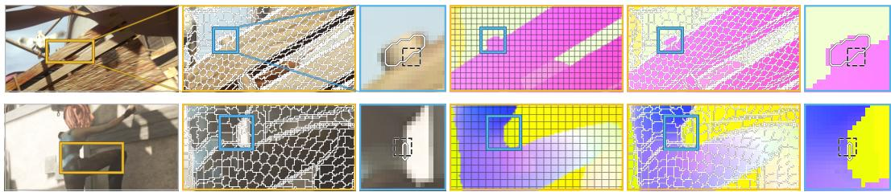
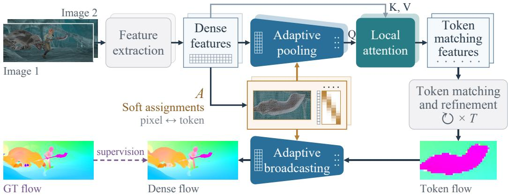
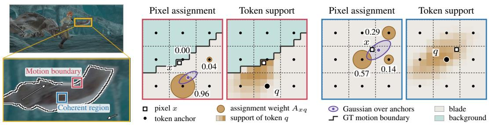
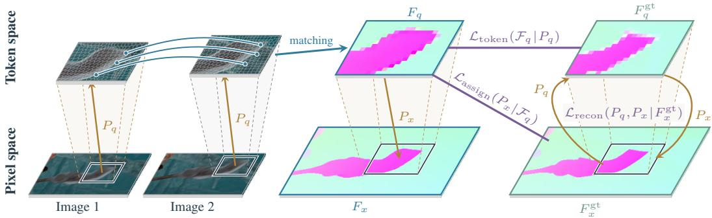
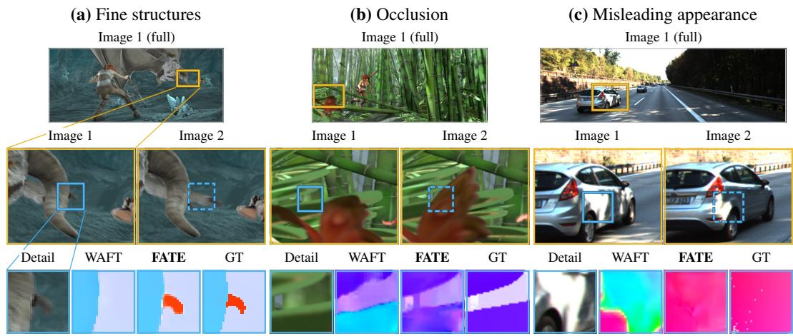
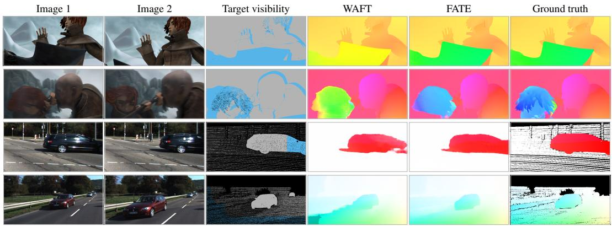

# Dense Flow from Adaptive Correspondence

Cheng-Lin Hsieh Stella X. Yu University of Michigan {clhsieh,stellayu}@umich.edu

## Abstract

Optical flow requires reliable matching from sufficient visual context and precise motion at every pixel. Existing methods such as WAFT match and estimate flow on the same coarse grids, then recover dense flow through learned upsampling, without explicitly linking visual support for matching to dense flow reconstruction. Our key insight is that dense pixel-levelflow does not require equally dense matching. We decouple correspondence scale from flow resolution by adapting the size and shape of spatial supports to image structure for reliable matching, while reusing these supportsfor precise dense flow reconstruction. We realize this in Flow from Adaptive Token Estimation (FATE), whose token supports expand within coherent regions and contract near motion boundaries. Shared pixel-to-token associations pool features for matching and reconstruct pixel flow from token motions. Flow supervision jointly trains pixel grouping, token matching, and flow estimation without grouping labels, allowing FATE to anticipate which pixels are likely to move together from appearance alone. Trained on FlyingChairs/FlyingThings3D, FATE achieves the highest zero-shot accuracy on Sintel Final and KITTI, a critical setting given scarce real-world flow labels. For visible pixels, FATE improves accuracy within coherent regions, and more near motion boundaries. Its largest gains occur where direct matches are unavailable: Occluded or out-of-frame pixels account for roughly 10% of valid pixels but 50% of WAFT’s total error. Experiments show that adaptive correspondence through pixel-to-token grouping enables reliable matching and precise pixel-level flow, improving generalization to unseen real scenes.

## 1 Introduction

Visual correspondence asks which elements in two images refer to the same scene content; finding these correspondences is called matching. We study two-image optical flow, which represents image motion as displacement from each pixel in the first image to its corresponding location in the second, even if it is occluded or outside the image [1, 2]. This close relationship between matching and flow estimation has led to a common design where both operate on the same spatial grid.

Yet matching and flow estimation have different demands: Reliable matching needs sufficient visual context, while flow must be estimated precisely at every pixel. A distinctive corner is easy to match across images, making its displacement easy to estimate. A pixel on a white wall, however, could match many white pixels in the second image, making its displacement hard to pinpoint. Yet the wall itself may be easier to identify. Similarly, when part of an object is occluded or leaves the image, its motion may be inferred from the visible parts. In both cases, matching coarser structures can help estimate precise pixel flow where direct matches are unreliable or unavailable. The challenge is that broader spatial support can resolve ambiguous matches but risks mixing pixels with distinct motions, while precise flow must distinguish pixels on opposite sides of motion boundaries [3, 4].

Modern flow methods address these demands in two stages. They aggregate information from larger regions for reliable matching, but matching and flow estimation remain tied to the same fixed grid, often at reduced resolution for efficiency [5–8]. Learned upsampling then recovers precise dense flow from coarse estimates using pixel-specific weights [5, 8]. Ideally, the pixels contributing to a match should receive flow estimates from that match. Yet despite end-to-end training, these methods do not explicitly link these pixels to the weights used for dense flow reconstruction. This raises the question of whether their implicit relationship generalizes from synthetic training data to unseen real scenes.

Our key insight is that dense pixel-levelflow does not require equally dense matching. We decouple correspondence scalefromflow resolution by adapting the size and shape ofspatial supports to image structurefor reliable matching, while reusing these supportsfor precise denseflow reconstruction. 1) Correspondence should adapt to image structure, matching distinctive visual entities through spatial supports that make them reliably identifiable. These matches provide flow estimates for dense reconstruction. 2) The same grouping should govern which pixels contribute to each match and how each match contributes to their flow estimates. This links matching and reconstruction without requiring pixels in a group to move identically. 3) Grouping should anticipate common fate from visual appearance. The Gestalt principle of commonfate holds that elements moving together tend to group together [9, 10]. Yet matching requires deciding what belongs together before knowing how it moves. Prior work has used motion to learn appearance-based object segmentation [11, 12]. We instead use flow supervision to learn appearance-based groupingfor correspondence, allowing the model to predict groups in unseen images for more reliable and precise flow estimation.

We realize these ideas in FATE, short for Flow from Adaptive Token Estimation. 1) Adaptive correspondence tokens enable coarse-scale matching while retaining pixel-level flow prediction. Each token is anchored to a coarse grid, but its spatial support adapts in size and shape to image structure. As Fig. 1 shows, token supports expand within coherent regions and contract near motion boundaries, following regions of common motion rather than fixed grid cells. Local attention further enriches token descriptors with broader context, while iterative matching refines token flow [8]. 2) Pixel-to-token grouping connects matching and dense flow reconstruction through a shared differentiable association matrix: Normalized over pixels, it pools features into token descriptors; normalized over tokens, it combines token flows to reconstruct precise pixel flow. Each token predicts one motion vector, but each pixel combines motions from multiple tokens, allowing distinct pixel flow estimates within the same token’s spatial support. 3) Flow supervision teaches appearance-based grouping. Pixel-to-token associations, token matching, and dense flow estimation are learned jointly, without grouping labels. At test time, the model predicts these associations from appearance alone, enabling more reliable and precise flow estimation in unseen images.

Image 1  
Learned groups  
Token (RGB)  
GT flow + grid  
GT flow + groups  
  
Token (flow)  
Figure 1: FATE learns correspondence tokens whose spatial support adapts to image structure and motion boundaries. Token supports spread within coherent regions and sharpen at motion boundaries, following common motion rather than fixed grid cells. Learned groups trace slat edges and a bent body outline, while fixed cells can straddle distinct motions. The same soft pixel-to-token associations pool features for matching and combine token motions into dense flow. White contours show dominant assignments and selected token supports; dashed squares mark nominal grid cells. Selected supports appear against RGB images and ground-truth (GT) flow in the token panels. Gold and blue boxes mark successive enlargements, with matching RGB and GT flow crops.

These ideas deliver stronger zero-shot generalization, a critical need in optical flow estimation. Dense flow labels are difficult to obtain in real scenes, so supervised models are often trained on synthetic images and must transfer to unseen domains without fine-tuning. While visual appearance may vary across domains, cues to which pixels are likely to move together may still transfer. Trained on FlyingChairs and FlyingThings3D [13, 14], FATE achieves endpoint errors of 2.10 on Sintel Final and 3.11 on KITTI, the lowest among published methods in our zero-shot comparison [15, 16]. Its largest gains occur where direct matches are unavailable: Occluded or out-of-frame pixels account for only 6.4–13.9% of valid pixels, yet contribute 41.9–52.7% of the total endpoint error of WAFT[8].

At equal token counts, FATE outperforms fixed-grid alternatives, benefits more from local attention, and better preserves pixel motion through pooling and reconstruction of ground-truth flow. With four refinement steps, it also outperforms five-step WAFT at lower computational cost.

In summary, we make three contributions. 1) Adaptive correspondence tokens improve flow accuracy with fewer matching locations through learned spatial supports. 2) Shared pixel-to-token associations provide consistent visual grounding for matching and dense flow reconstruction. 3) Strong zero-shot generalization is demonstrated across benchmarks and supported by controlled analyses. These advances simultaneously enable reliable matching and precise pixel-level motion estimation, while generalizing effectively to unseen real-world scenes. Project website: FATE.

## 2 Related work

Spatial grouping in classical optical flow. Classical optical flow uses spatial support to infer motion from ambiguous local measurements. Lucas–Kanade [2] pools motion constraints within neighborhoods, while Horn–Schunck [1] couples neighboring estimates through smoothness. Robust estimation [3] accommodates competing motions. Ren [4] uses contour-based soft affinities and figure-ground organization to define spatially adaptive support for local affine motion estimation near boundaries. FATE learns spatial support jointly with matching features from flow supervision, using the resulting groups for correspondence and dense flow estimation.

Common fate and motion-guided grouping. The Gestalt principle of common fate holds that elements moving together are perceived as a group [9, 10]. AMD [11] jointly learns appearance-based segmentation and segment motion through video reconstruction, pooling motion features to predict segment flow. RCF [12] relaxes common fate by fitting flow with segment motion and within-segment residuals, then refines grouping from appearance. These methods learn object segmentation from motion, whereas FATE learns grouping for correspondence and dense flow. Its soft associations need not follow object boundaries or impose uniform flow within a token.

Correspondence in deep flow networks. Modern two-frame networks largely match features on regular grids. Learned pyramids and cost volumes [5, 17], global matching and cost-memory encoding [6, 7], and pretrained representations [18, 19] strengthen features for matching. Recurrent estimation and learned motion priors [20, 21] improve flow estimation. Source-image affinities aggregate motion features [22], while feature similarity guides flow propagation [6]. Multiscale processing and learned upsampling recover spatial detail [5, 8, 23, 24]. In these methods, pixel support for matching and the weights that distribute motion to pixels are linked only implicitly. Building on iterative matching [8], FATE learns adaptive correspondence tokens whose shared pixel-to-token associations pool features for matching and combine token motions into dense flow.

Superpixels and differentiable grouping. Superpixel methods partition images into compact regions following appearance boundaries [25, 26]. Learned variants make grouping differentiable and adaptable to downstream tasks [27, 28]. Unlike image segmentation, grouping in FATE serves correspondence and dense motion estimation. Flow supervision jointly learns the associations and matching features, without requiring pixel-group labels.

## 3 FATE: Flow from Adaptive Token Estimation

Overview. Given two images, FATE estimates dense optical flow by matching adaptive correspondence tokens at a coarser resolution, then combining their motions into pixel-level flow (Fig. 2). The model has three components. 1) Adaptive correspondence tokens are anchored to points on a coarse grid, but their spatial supports are learned from image features. 2) Shared pixel-to-token associations pool each image’s dense features into token descriptors, enriched by local attention for broader matching context. Iterative matching estimates token motion, which the same associations combine into pixel flow in the first image. Since each pixel combines motions from several tokens, pixels within a token’s support need not share identical flow. 3) Flow-supervised grouping jointly learns associations, matching, and flow estimation from ground-truth pixel flow, without pixel grouping labels. At test time, the model anticipates which pixels are likely to move together from appearance alone, enabling reliable matching and precise pixel flow in unseen scenes.

  
Figure 2: Shared pixel-to-token associations connect token matching and dense flow estimation. Learned associations A pool dense image features into adaptive correspondence tokens (center), enriched with nearby context through local attention before iterative matching across images (right). The same associations combine estimated token motions into dense pixel flow (bottom), allowing each pixel to draw on multiple tokens. Image 2 (lighter branch) has its own associations but shares network weights with Image 1. Dashed arrows indicate ground-truth flow supervision (Fig. 4).

  
Figure 3: Learned pixel-to-token associations adapt token support to motion structure. Left: the original image and an enlarged view of the moving blade, with two marked regions: a motion boundary and a coherent region . Arrows indicate ground-truth motion. Center and right: Each region is shown from two perspectives. Pixel assignment shows how pixel x associates with nearby tokens (a row of A); token support shows the spatial support of token q (a column of A). Dashed grid lines mark the coarse token lattice, black dots mark token anchors, and squares mark pixels. Brown disks represent individual assignment weights $A _ { x q } ,$ with size indicating weight; purple ellipses show predicted Gaussians, and brown shading shows token support. At the motion boundary, x favors a blade token across grid-cell borders, allowing its support to align with the boundary. Within the coherent region, x distributes its associations across several nearby tokens.

Adaptive correspondence tokens. For an image with N pixels indexed by x and M tokens indexed by q, we learn a pixel-to-token association matrix $A \in \mathbb { R } ^ { \dot { N } \times M }$ of soft assignments, where $A _ { x q } \geq 0$ measures how strongly pixel x is associated with token q. Each row describes a pixel’s associations with tokens, while each column describes a token’s spatial support.

Predicting associations from appearance. Each pixel associates with the $3 \times 3$ token anchors around its grid cell. Rather than predicting nine independent scores, a compact head predicts a two-dimensional Gaussian over these anchors from dense image features. Its center determines which nearby tokens the pixel favors, while its shape controls how widely the associations spread. Evaluating the Gaussian at the candidate anchors and normalizing over them gives the corresponding entries of A (Appendix F). As Fig. 3 illustrates, the resulting token supports can follow motion boundaries rather than fixed cell borders, while spreading more broadly within coherent regions.

Shared pixel-to-token associations. The same learned associations govern how pixels support their token matching and how token motions are combined into dense pixel flow (Fig. 4).

1) Pooling and broadcasting. The association matrix A connects pixel and token spaces in two ways: Normalized over pixels (columns of A), it pools features into token descriptors; normalized over tokens (rows of A), it combines token motions into pixel flow. Let $D ( B ) \bar { = } \mathrm { d i a g } ( B { \bf 1 } )$ denote the diagonal degree matrix of row sums. Omitting the dependence on A, we have two operators:

$$
{ \mathrm { p i x e l - t o - t o k e n ~ f e a t u r e ~ p o o l i n g : } } \quad P _ { q } = D ( A ^ { \top } ) ^ { - 1 } A ^ { \top } ,\tag{1}
$$

$$
\mathrm { t o k e n - t o - p i x e l ~ f l o w ~ b r o a d c a s t i n g } ; \quad P _ { x } = D ( A ) ^ { - 1 } A .\tag{2}
$$

The shared associations provide consistent visual grounding for matching and pixel flow.

2) Tokenfeatures with local attention. Reliable matching requires both features pooled from each token’s support and broader context to resolve ambiguity. Local attention contextualizes each token’s pooled features with surrounding dense features, sharing network weights for both images.

3) Iterativeflow refinement and broadcasting. Let $F _ { q }$ and $F _ { x }$ denote token and pixel flow from the first image to the second. Following the iterative matching framework of WAFT [8], each refinement step samples the second image’s token features at current match locations and updates the token flow. Both images’ associations are computed once and reused throughout refinement. At step t, the first image’s broadcasting operator produces dense pixel flow:

$$
F _ { x } ^ { ( t ) } = P _ { x } F _ { q } ^ { ( t ) } .\tag{3}
$$

Each token predicts one motion vector, but each pixel combines motions from multiple tokens, allowing distinct pixel flow estimates within the same token’s spatial support.

Flow-supervised grouping. We jointly learn pixel-to-token associations and token-flow prediction from ground-truth pixel flow, since no annotation specifies which pixels should be grouped for correspondence (Fig. 4). Three complementary losses supervise token matching, pixel-to-token associations, and preservation of ground-truth pixel motion through pooling and reconstruction. Each has the form $\mathcal { L } ( \dot { X } \mid Y )$ , training X with Y given.

  
Figure 4: Matching in token space estimates flow in pixel space through shared associations and flow supervision. Matching operates in coarse token space (top), while dense flow is formed in pixel space (bottom), across both the image features (left) and flow predictions (right). Features from Image 1 and Image 2 are pooled into adaptive tokens and matched across images (blue links). On the right, predicted token flow $F _ { q }$ is combined into pixel flow $F _ { x } ,$ , while ground-truth pixel flow $F _ { x } ^ { \mathrm { g t } }$ is pooled into pseudo-ground-truth token flow $F _ { q } ^ { \mathrm { g t } }$ . The probabilistic predictions $\mathcal { \dot { F } } _ { q }$ include token flow $F _ { q }$ and its uncertainty. We learn token matching and pixel-to-token associations using only ground-truth pixel flow, through three complementary losses: $\mathbf { \dot { \mathcal { L } } } _ { \mathrm { t o k e n } } ( \mathcal { F } _ { q } \mid P _ { q } )$ trains token-flow prediction against pooled ground truth, holding $P _ { q }$ fixed in constructing the pseudo-ground truth; $\mathbf { \dot { \mathcal { L } } } _ { \mathrm { a s s i g n } } ( P _ { x } \mid \mathbf { \bar { \mathcal { F } } } _ { q } )$ trains associations to favor tokens that confidently explain pixel motion, holding token-flow predictions fixed; and $\mathcal { L } _ { \mathrm { r e c o n } } ( P _ { q } , P _ { x } \mid F _ { x } ^ { \mathrm { g t } } )$ trains flow-preserving grouping by pooling and reconstructing fixed ground-truth flow, independently of matching. Upper views enlarge the boxed regions, token colors show pooled RGB, and flow maps share one color scale.

1) Token-flow prediction. Since matching operates at the coarse token level, we construct pseudoground-truth token flow by pooling ground-truth pixel flow, provisionally assuming the current associations are correct. Following SEA-RAFT [20], the network predicts token flow $F _ { q }$ and its uncertainty.

We denote these probabilistic predictions by $\mathcal { F } _ { q }$ and define $\begin{array} { r } { \mathrm { N L L } ( \mathcal { P } ; Y ) = - \sum _ { i } \log p _ { \mathcal { P } _ { i } } ( Y _ { i } ) } \end{array}$ as the negative log-likelihood of targets Y under predicted distributions P:

$$
F _ { q } ^ { \mathrm { g t } } = P _ { q } F _ { x } ^ { \mathrm { g t } } ,\tag{4}
$$

$$
\mathcal { L } _ { \mathrm { t o k e n } } ( \mathcal { F } _ { q } \mid P _ { q } ) = \mathrm { N L L } ( \mathcal { F } _ { q } ; F _ { q } ^ { \mathrm { g t } } ) .\tag{5}
$$

This loss primarily trains token matching, updating token features, local attention, iterative flow refinement, and uncertainty prediction. It also trains pixel-to-token associations through gradients from feature pooling. However, gradients are stopped when constructing pseudo-ground-truth token flow, preventing the associations from shifting this supervision to reduce the loss.

2) Pixel-to-token associations. Near motion boundaries, neighboring tokens may predict different flows. Averaging them with spread-out weights in Eq. (3) can produce a spurious intermediate flow. To preserve distinct motions, we learn pixel-to-token associations based on how well each token’s predicted flow explains the pixel’s ground truth, accounting for prediction uncertainty. Provisionally holding token-flow predictions and uncertainties fixed, we evaluate the likelihood of each pixel’s ground-truth flow under each neighboring token’s predicted distribution. The association weights $P _ { x }$ combine these likelihoods into a mixture, denoted by $\operatorname { M i x } _ { P _ { x } } [ \mathcal { F } _ { q } ]$ . We minimize

$$
{ \mathcal { L } } _ { \mathrm { a s s i g n } } ( P _ { x } \mid { \mathcal { F } } _ { q } ) = { \mathrm { N L L } } \left( { \mathrm { M i x } } _ { P _ { x } } [ { \mathcal { F } } _ { q } ] ; F _ { x } ^ { \mathrm { g t } } \right) .\tag{6}
$$

Unlike averaging token flows, this mixture retains distinct predictions and uncertainties, encouraging pixels to associate with tokens that confidently explain their motion. With token predictions fixed, this loss updates the assignment head and its input features, not token matching or refinement.

3) Flow-preserving reconstruction. Ground-truth pixel flow should also be preserved when pooled into coarse token flow and reconstructed back at pixel resolution. We therefore minimize the reconstruction error, with an aggregated robust flow penalty D:

$$
\begin{array} { r } { { \mathcal { L } } _ { \mathrm { r e c o n } } ( P _ { q } , P _ { x } \mid F _ { x } ^ { \mathrm { g t } } ) = { \mathcal { D } } \big ( P _ { x } P _ { q } F _ { x } ^ { \mathrm { g t } } , F _ { x } ^ { \mathrm { g t } } \big ) . } \end{array}\tag{7}
$$

As in superpixel learning [27], this loss updates the associations through both $P _ { q }$ and $P _ { x }$ , encouraging the shared pixel-to-token associations to preserve distinct pixel motions. Since matching is bypassed, the loss trains grouping independently of token-flow prediction.

4) Joint training. We optimize all three losses jointly, applying token-flow and association losses at each refinement step and reconstruction loss once (Appendix F). Together, they learn token flow and pixel-to-token associations to achieve both reliable matching and precise pixel-level flow.

## 4 Experiments

Our experiments test whether consistent visual grounding improves dense flow estimation and its transfer to unseen domains. We first compare zero-shot accuracy with published methods. We then examine where errors arise and where FATE reduces them, focusing on two regions: occluded or out-of-frame pixels, which lack a direct match and depend on shared evidence, and pixels near motion boundaries, where distinct motions must be preserved. A comparison with a fixed-grid model at the same token count isolates the role of adaptive grouping. Ablations test design choices, and computation profiles show what fewer tokens make affordable.

Experimental setup. All compared methods are trained on FlyingChairs [13] followed by FlyingThings3D (Things) [14] and evaluated on two frames.

1) Models and training. We build FATE on WAFT’s iterative matching and refinement framework [8] with a DINOv3 ViT-S backbone [29]. For an $H \times W$ image, both extract dense features on an $( H / 2 ) \times ( W / 2 )$ grid, abbreviated $H / 2$ . Released WAFT estimates flow on this grid, whereas FATE estimates it for adaptive tokens anchored on an $H / 4$ lattice, with a quarter as many tokens. FATE and WAFT use five refinement steps in training and inference unless stated otherwise (Appendix D).

2) Evaluation protocol. Things test results are in distribution, while results on the Sintel [15] and KITTI 2015 [16] training splits are zero-shot, without target-domain flow training, as in real scenes where dense flow labels are difficult to acquire. Things and Sintel each have Clean and Final versions.

3) Metrics. We report endpoint error (EPE), the Euclidean flow error in pixels averaged per image and then over images, and KITTI Fl, the percentage of valid pixels whose error exceeds both 3 pixels and 5% of the ground-truth motion. Regional analyses pool endpoint errors over pixels (Appendix B). Computation is given in GMACs, billions of multiply–accumulates, per 540 × 960 image pair.

Table 1: FATE achieves the lowest zero-shot Sintel Final and KITTI EPE among the compared methods. All methods train on FlyingChairs and FlyingThings3D. Errors are EPE except KITTI Fl. Bold: lowest error in each accuracy column; –: not reported.
<table><tr><td>Method</td><td>Sintel Clean</td><td>Sintel Final</td><td>KITTI EPE</td><td>KITTI Fl (%)</td><td>GMACs</td></tr><tr><td>FlowNet2 [31]</td><td>2.02</td><td>3.14</td><td>10.10</td><td>30.4</td><td>230</td></tr><tr><td>PWC-Net [17]</td><td>2.55</td><td>3.93</td><td>10.40</td><td>33.7</td><td>101</td></tr><tr><td>RAFT [5]</td><td>1.43</td><td>2.71</td><td>5.04</td><td>17.4</td><td>938</td></tr><tr><td>GMA [22]</td><td>1.30</td><td>2.74</td><td>4.69</td><td>17.1</td><td>1352</td></tr><tr><td>SKFlow [32]</td><td>1.22</td><td>2.46</td><td>4.27</td><td>15.5</td><td>751</td></tr><tr><td>DIP [33]</td><td>1.30</td><td>2.82</td><td>4.29</td><td>13.7</td><td>3068</td></tr><tr><td>CRAFT [34]</td><td>1.27</td><td>2.79</td><td>4.88</td><td>17.5</td><td>2274</td></tr><tr><td>GMFlowNet [35]</td><td>1.14</td><td>2.71</td><td>4.24</td><td>15.4</td><td>1094</td></tr><tr><td>FlowFormer [7]</td><td>1.01</td><td>2.40</td><td>4.09</td><td>14.7</td><td>1715</td></tr><tr><td>EMD-L [36]</td><td>0.88</td><td>2.55</td><td>4.12</td><td>13.5</td><td>1755</td></tr><tr><td>FlowFormer++ [37]</td><td>0.90</td><td>2.30</td><td>3.93</td><td>14.1</td><td>1713</td></tr><tr><td>MatchFlow(G) [18]</td><td>1.03</td><td>2.45</td><td>4.08</td><td>15.6</td><td>1669</td></tr><tr><td>AnyFlow [24]</td><td>1.10</td><td>2.52</td><td>3.76</td><td>12.4</td><td></td></tr><tr><td>RPKNet [38]</td><td>1.12</td><td>2.45</td><td>1</td><td>13.0</td><td>137</td></tr><tr><td>CCMR+ [39]</td><td>0.98</td><td>2.36</td><td>一</td><td>12.9</td><td>12653</td></tr><tr><td>SEA-RAFT(L) [20]</td><td>1.19</td><td>4.11</td><td>3.62</td><td>12.9</td><td>655</td></tr><tr><td>SAMFlow [19]</td><td>0.87</td><td>2.11</td><td>3.44</td><td>12.3</td><td>9717</td></tr><tr><td>FlowDiffuser [21]</td><td>0.86</td><td>2.19</td><td>3.61</td><td>11.8</td><td>2466</td></tr><tr><td>DPFlow [23]</td><td>1.02</td><td>2.26</td><td>3.37</td><td>11.1</td><td>414</td></tr><tr><td>WAFT [8]</td><td>1.28</td><td>2.56</td><td>3.49</td><td>12.9</td><td>732</td></tr><tr><td>FATE</td><td>1.03</td><td>2.10</td><td>3.11</td><td>11.9</td><td>796</td></tr></table>

Table 2: FATE’s gain over WAFT is larger at occluded or out-of-frame pixels and near motion boundaries than at coherent pixels. The categories partition valid pixels, with visible pixels split by their distance to ground-truth motion boundaries (Appendix B). Pixel and Error give percentages of the pixels and of WAFT’s summed endpoint error; WAFT and FATE give pooled EPE, and Gain is WAFT minus FATE. Bold marks the lower EPE in each pair.
<table><tr><td></td><td colspan="5">Coherent</td><td colspan="5">Near boundary</td><td colspan="5">Occluded/out-of-frame</td></tr><tr><td>Dataset</td><td></td><td>Pixel Error</td><td>WAFT FATE</td><td></td><td>Gain</td><td></td><td></td><td>Pixel Error WAFT FATE</td><td></td><td>Gain</td><td>Pixel Error</td><td></td><td>WAFT FATE</td><td></td><td>Gain</td></tr><tr><td>Sintel Clean</td><td>87.9</td><td>36.4</td><td>0.52</td><td>0.38</td><td>0.14</td><td>3.6</td><td>10.8</td><td>3.79</td><td>3.24</td><td>0.54</td><td>8.4</td><td>52.7</td><td>7.96</td><td>6.78</td><td>1.18</td></tr><tr><td>Sintel Final</td><td>87.9</td><td>46.7</td><td>1.35</td><td>1.05</td><td>0.29</td><td>3.6</td><td>10.7</td><td>7.51</td><td>6.63</td><td>0.87</td><td>8.4</td><td>42.5</td><td>12.88</td><td>10.93</td><td>1.95</td></tr><tr><td>KITTI</td><td>77.8</td><td>36.8</td><td>1.72</td><td>1.76</td><td>-0.04</td><td>8.1</td><td>10.8</td><td>4.83</td><td>4.81</td><td>0.01</td><td>13.9</td><td>52.3</td><td>13.63</td><td>11.05</td><td>2.57</td></tr><tr><td>Things Clean</td><td>84.8</td><td>35.4</td><td>1.45</td><td>0.92</td><td>0.53</td><td>8.7</td><td>22.0</td><td>8.82</td><td>5.76</td><td>3.06</td><td>6.4</td><td>42.5</td><td>23.04</td><td>16.56</td><td>6.47</td></tr><tr><td>Things Final</td><td>84.8</td><td>35.1</td><td>1.39</td><td>0.93</td><td>0.46</td><td>8.7</td><td>22.9</td><td>8.87</td><td>6.03</td><td>2.83</td><td>6.4</td><td>41.9</td><td>21.9615.88</td><td></td><td>6.07</td></tr></table>

Zero-shot transfer and regional accuracy. We compare overall accuracy with published results for prior methods and regional accuracy with the released WAFT checkpoint.

1) FATE achieves the lowest zero-shot EPE on Sintel Final and KITTI. In Table 1, FATE has lower Sintel Final and KITTI EPE than every compared method and improves on WAFT in every accuracy column. With a Depth Anything V2 backbone [30] instead of DINOv3, FATE again has lower EPE than WAFT on both Sintel and KITTI (Appendix A).

2) Pixels without direct matches or near motion boundaries carry most ofWAFT’s error. In Table 2, occluded or out-of-frame pixels make up only 6.4–13.9% of the pixels yet account for 41.9–52.7% of WAFT’s summed endpoint error. Near-boundary pixels likewise account for 10.7–22.9% of the error from 3.6–8.7% of the pixels. Coherent pixels, the remaining 77.8–87.9%, account for only 35.1–46.7% of the error, so overall EPE reveals little about accuracy in the other two regions. Fig. 5 illustrates three cases that make flow hard: a thin structure near motion boundaries, an occluded background and misleading lighting. Fig. 6 shows more such cases over wider views.

3) FATE’s largest gains occur where direct matches are missing. Coherent pixels gain at most 0.53 pixels, versus 1.18–2.57 pixels for occluded or out-of-frame pixels on Sintel and KITTI and over 6 on Things, the largest gain in each row of Table 2. Without direct matches, these pixels’ motion must be inferred from shared evidence, such as visible parts of the same moving region. In Fig. 5(b), FATE recovers the motion of leaves hidden in Image 2, unlike WAFT; Fig. 6 shows similar cases in rows 1 and 3. Each token pools evidence over its learned support, draws on local context, and contributes its motion estimate to associated pixels; Table 3(b) tests the benefit of context at equal token counts. Since these pixels are few, overall EPE dilutes their gain to 0.38 pixels on KITTI (Table 1), suggesting greater benefit where missing matches are more common.

  
Figure 5: FATE better handles fine structures, occlusion and misleading appearance. (a) A thin protrusion moves unlike the surfaces on both sides; per-pixel assignments keep its motion distinct. (b) Leaves hidden by a wing in Image 2 have no match; their tokens infer motion from surrounding context. (c) Sunlight and shadows on a car change between frames; WAFT’s flow follows them, while FATE’s tokens keep the whole surface’s motion coherent. Gold and blue boxes locate context and detail crops; dashed boxes repeat Image 1 coordinates in Image 2. All predictions are zero-shot; colors share a scale per example, and gray marks unlabeled GT.

  
Figure 6: FATE recovers motion where matches are missing or ambiguous and preserves motion boundaries. Matches are missing for an occluded cape (row 1) and a car leaving the frame (row 3), and ambiguous for blurred hair (row 2); an approaching car’s motion must stay separate from the road’s (row 4). Target visibility marks occluded or out-of-frame pixels in blue, other valid pixels in gray, and excluded pixels in black. All predictions are zero-shot on Sintel (rows 1–2) and KITTI (rows 3–4); each row shares a crop and color scale, and sparse KITTI labels are enlarged for display.

4) FATE is more precise near motion boundaries with a quarter ofWAFT’s tokens. Mixing motions from different surfaces can give boundary pixels incorrect flow, a risk finer tokens should reduce. Yet FATE’s near-boundary EPE is 0.54–3.06 pixels lower than WAFT’s on Sintel and Things, three to six times its coherent gain, and matches WAFT on KITTI. In Fig. 5(a), WAFT assigns a thin protrusion the background’s motion, whereas FATE keeps it distinct. Including occluded or out-of-frame pixels, FATE lowers boundary EPE on every dataset at all three thresholds (Appendix B.2; Fig. 6, row 4). As Figs. 1 and 3 show, learned support follows moving surfaces across grid-cell borders, separating pixels on opposite sides of motion boundaries.

Table 3: At the same token count, adaptive tokens improve accuracy, gain more from local context and preserve more pixel motion. All systems estimate flow for H/4 tokens. (a) Overall accuracy. (b) Occluded/out-of-frame EPE; attention gain is EPE without minus with local attention. (c) EPE of ground-truth flow pooled into tokens and returned to pixels with each model’s imagepredicted weights, without retraining. Bold marks the best in (a) and (c) and the larger gain in (b).
<table><tr><td colspan="2">(a) Overall accuracy</td><td colspan="2">Things</td><td colspan="2">Sintel</td><td colspan="2">KITTI</td></tr><tr><td>System</td><td>Attn.</td><td>Clean</td><td>Final</td><td>Clean</td><td>Final EPE</td><td>F1 (%)</td></tr><tr><td>WAFT-H/4</td><td>一</td><td>2.93</td><td>2.72</td><td>1.08</td><td>2.49 3.96</td><td>13.3</td></tr><tr><td>WAFT-H/4</td><td>√</td><td>2.73</td><td>2.62</td><td>1.07</td><td>2.57 3.75</td><td>12.6</td></tr><tr><td>FATE</td><td>一</td><td>2.56</td><td>2.48</td><td>1.12</td><td>2.143.54</td><td>13.0</td></tr><tr><td>FATE</td><td>√</td><td>2.39</td><td>2.38</td><td>1.03</td><td>2.10 3.11</td><td>11.9</td></tr><tr><td>(c) Supplied-motion reconstruction</td><td></td><td></td><td></td><td>EPE</td><td></td><td></td></tr><tr><td>WAFT-H/4</td><td>V</td><td>0.50</td><td>0.53</td><td>0.21</td><td>0.391.52</td><td>一</td></tr><tr><td>FATE</td><td>√</td><td>0.19</td><td>0.21</td><td>0.09</td><td>0.19 0.39</td><td>一</td></tr></table>

<table><tr><td colspan="5">(b) Occluded/out-of-frame EPE Things Sintel</td></tr><tr><td colspan="5"></td></tr><tr><td>System</td><td>Attn.</td><td>Clean Final</td><td>Clean Final</td><td>EPE</td></tr><tr><td>WAFT-H/4</td><td></td><td>19.65 17.79</td><td>7.15 12.91</td><td>14.87</td></tr><tr><td>WAFT-H/4</td><td>√</td><td>18.98 17.64</td><td>7.19 12.90</td><td>14.09</td></tr><tr><td>Attention gain</td><td></td><td>0.67 0.15</td><td>-0.03 0.01</td><td>0.78</td></tr><tr><td>FATE</td><td></td><td>17.49 16.55</td><td>6.89 11.40</td><td>12.96</td></tr><tr><td>FATE</td><td>√</td><td>16.5615.88</td><td>6.78 10.93</td><td>11.05</td></tr><tr><td>Attention gain</td><td></td><td>0.93 0.66</td><td>0.11 0.46</td><td>1.90</td></tr></table>

Adaptive versus fixed-grid correspondence. FATE differs from released WAFT in the number of tokens and how they are formed. To remove the first difference, we train WAFT-H/4, a fixed-grid baseline that estimates flow on an H/4 grid with WAFT’s code and loss. It matches FATE’s token count, backbone, dense-feature resolution, iterative framework, refinement steps and training recipe, but its tokens are fixed grid cells. We train both with and without local attention and compare accuracy, the use of context for pixels without direct matches and the preservation of pixel motion.

1) Adaptive tokens improve every reported accuracy result. In Table 3(a), FATE outperforms both WAFT-H/4 variants on every reported accuracy result. With attention in both systems, it lowers Sintel Final EPE from 2.57 to 2.10 and KITTI EPE from 3.75 to 3.11. Without attention in either, FATE still improves every result except Sintel Clean EPE. FATE’s advantage over WAFT therefore does not come from using coarser tokens or from local attention alone.

2) Adaptive tokens benefit morefrom local context. In Table 3(b), FATE has lower occluded/out-offrame EPE than WAFT-H/4 even without local attention, and adding attention widens this gap on every dataset. Attention lowers FATE’s EPE by 1.90 pixels on KITTI versus 0.78 for WAFT-H/4, and changes WAFT-H/4’s EPE on Sintel by less than 0.05 pixels. This supports our account of the gains in Table 2: learned support defines which pixels share an estimate, so a token can draw on broader context while its estimate remains tied to the pixels it represents.

3) Learned support preserves more pixel motion. Grouping pixels to share evidence should not erase the motion differences among them. To measure how much pixel motion survives grouping, independent of matching accuracy, we replace predicted token flow with pooled ground truth and return it to pixels with each model’s image-predicted weights (Appendix C). In Table 3(c), FATE has lower reconstruction EPE than WAFT-H/4 on every dataset: 0.19 versus 0.39 on Sintel Final and 0.39 versus 1.52 on KITTI. At the same token count, learned support thus preserves motion that fixed cells average away. Consistent with this, FATE also has lower EPE than WAFT-H/4 near motion boundaries on every dataset at all three tested thresholds (Appendix B.2).

Learning effective correspondence tokens. Table 4 tests how supervision, local context and the assignment parameterization help tokens learn, changing one choice at a time and training each with the same recipe. Each design choice improves at least five of the six reported results.

1) Training the grouping to preserve motion improves every result. Compared with training without it, the reconstruction loss (Eq. (7)) improves every result, most on Things, where Clean EPE falls from 2.68 to 2.39. Unlike the token and assignment losses, which act through predicted token flow, it trains pooling and broadcasting directly on ground-truth flow, so the grouping learns which motion differences to preserve independently of matching accuracy.

2) Local attention improves every result. Compared with a learned projection of pooled features, local attention improves every result, most on KITTI, where EPE falls from 3.54 to 3.11. It lets each token draw on nearby dense features, while the assignments still decide which pixels receive its flow.

Table 4: Each design choice improves at least five of the six results. Each variant changes one choice of FATE and is trained with the same recipe. No reconstruction loss trains without Eq. (7). No local attention forms token features by a learned projection of pooled features. End-to-end assignment supervision lets the assignment loss (Eq. (6)) also update token flow and uncertainty; pseudo-ground-truth token flow stays fixed. With independent assignment scores, the assignment head predicts the nine candidate scores directly instead of through a Gaussian. Errors are EPE except KITTI Fl. Bold marks the lowest error in each column.
<table><tr><td>Variant</td><td>Things Clean</td><td>Things Final</td><td>Sintel Clean</td><td>Sintel Final</td><td>KITTI EPE</td><td>KITTI Fl (%)</td></tr><tr><td>FATE</td><td>2.39</td><td>2.38</td><td>1.03</td><td>2.10</td><td>3.11</td><td>11.9</td></tr><tr><td>No reconstruction loss</td><td>2.68</td><td>2.61</td><td>1.05</td><td>2.17</td><td>3.14</td><td>12.4</td></tr><tr><td>No local attention</td><td>2.56</td><td>2.48</td><td>1.12</td><td>2.14</td><td>3.54</td><td>13.0</td></tr><tr><td>End-to-end assignment supervision</td><td>2.49</td><td>2.46</td><td>1.00</td><td>2.18</td><td>3.64</td><td>12.3</td></tr><tr><td>Independent assignment scores</td><td>2.58</td><td>2.55</td><td>1.02</td><td>2.24</td><td>3.16</td><td>12.1</td></tr></table>

3) Supervising assignments directly, rather than end to end, improves accuracy. FATE supervises each module for its role (Fig. 4). The token loss trains matching to produce each token’s correspondence, and the assignment loss trains the assignments to decide which token should carry each pixel, given the current probabilistic token-flow predictions. Applied end to end, the assignment loss also updates these predictions, so it can be lowered by shifting a token’s flow or widening its uncertainty toward a disagreeing pixel instead of reassigning that pixel. Direct assignment supervision improves every result except Sintel Clean EPE, most on KITTI, where EPE falls from 3.64 to 3.11. Features, token predictions and assignments are still learned jointly.

4) Gaussian assignment scores outperform independently predicted scores. Compared with predicting the nine candidate scores independently from the same head, Gaussian scores improve every result except Sintel Clean EPE, including Sintel Final EPE, which falls from 2.24 to 2.10. The Gaussian couples each pixel’s candidate scores through the anchors’ relative positions (Appendix F), yet a token’s support can still take an irregular shape (Fig. 3).

Accuracy and computation. FATE predicts assignments at image resolution but matches and refines fewer tokens. Appendix D profiles how this allocation affects accuracy and cost.

1) Fewer tokens make wider refinement and local attention affordable. In Table 7, with a quarter as many tokens, FATE refines with twice WAFT’s recurrent-state and refinement width at similar refinement cost, 453.9 versus 425.8 GMACs, whereas widening WAFT the same way would more than double its refinement cost. Local attention of the same width likewise costs 20.6 GMACs over FATE’s H/4 tokens versus 57.0 GMACs over WAFT’s H/2 grid.

2) Withfour refinement steps, FATE outperforms five-step WAFT at lower cost. In Table 8, four-step FATE has lower error than five-step WAFT on every reported result while using 706.1 versus 732.4 GMACs. Our five-step default costs more than WAFT, 796.8 GMACs, and further lowers error on five of the six reported results. A narrower FATE with WAFT’s width costs 636.3 GMACs and has lower error than WAFT on every reported result except KITTI EPE.

## 5 Conclusion

Optical flow requires reliable matching from sufficient visual context and precise motion at every pixel. FATE reconciles these demands by decoupling correspondence scale from flow resolution while maintaining consistent visual grounding. Learned pixel-to-token associations adapt the size and shape of correspondence support to image structure, pooling features for matching and combining token motions into dense pixel flow. Flow supervision learns these associations without grouping labels, allowing the model to predict them from appearance alone.

FATE achieves the lowest zero-shot Sintel Final and KITTI EPE among compared published methods. Its largest gains occur at occluded or out-of-frame pixels, with further gains near motion boundaries. At equal token counts, adaptive grouping outperforms fixed-grid alternatives, benefits more from local attention, and better preserves pixel motion. With four refinement steps, FATE also outperforms five-step WAFT at lower cost. These results show that adaptive correspondence support enables reliable matching and precise pixel-level flow, with strong generalization to unseen real scenes.

## Acknowledgements

This project was supported in part by NSF grant 2313151, with additional computing resources provided through NAIRR Pilot CIS240421 and CIS240431.

## References

[1] Berthold K. P. Horn and Brian G. Schunck. Determining optical flow. Artificial Intelligence, 17 (1):185–203, August 1981. ISSN 0004-3702. doi: 10.1016/0004-3702(81)90024-2.

[2] Bruce D Lucas and Takeo Kanade. An Iterative Image Registration Technique with an Application to Stereo Vision. In IJCAI’81: 7th International Joint Conference on Artificial Intelligence, volume 2, pages 674–679, Vancouver, Canada, August 1981.

[3] Michael J. Black and P. Anandan. The robust estimation of multiple motions: Parametric and piecewise-smooth flow fields. Computer Vision and Image Understanding, 63(1):75–104, 1996. URL https://www.csd.uoc.gr/\~hy576/bibliography/RobustMotion.pdf.

[4] Xiaofeng Ren. Local grouping for optical flow. In IEEE Conference on Computer Vision and Pattern Recognition, pages 1–8, 2008. URL https://iacl.ece.jhu.edu/proceedings/ cvpr2008/papers/196.pdf.

[5] Zachary Teed and Jia Deng. RAFT: Recurrent All-Pairs Field Transforms for Optical Flow. In Andrea Vedaldi, Horst Bischof, Thomas Brox, and Jan-Michael Frahm, editors, Computer Vision – ECCV 2020, pages 402–419, Cham, 2020. Springer International Publishing. ISBN 978-3-030-58536-5. doi: 10.1007/978-3-030-58536-5\_24.

[6] Haofei Xu, Jing Zhang, Jianfei Cai, Hamid Rezatofighi, and Dacheng Tao. GMFlow: Learning Optical Flow via Global Matching. In Proceedings of the IEEE/CVF Conference on Computer Vision and Pattern Recognition, pages 8121–8130, 2022.

[7] Zhaoyang Huang, Xiaoyu Shi, Chao Zhang, Qiang Wang, Ka Chun Cheung, Hongwei Qin, Jifeng Dai, and Hongsheng Li. FlowFormer: A Transformer Architecture for Optical Flow. In Shai Avidan, Gabriel Brostow, Moustapha Cissé, Giovanni Maria Farinella, and Tal Hassner, editors, Computer Vision – ECCV 2022, pages 668–685, Cham, 2022. Springer Nature Switzerland. ISBN 978-3-031-19790-1. doi: 10.1007/978-3-031-19790-1\_40.

[8] Yihan Wang and Jia Deng. WAFT: Warping-Alone Field Transforms for Optical Flow, October 2025.

[9] Max Wertheimer. Laws of organization in perceptual forms. In A Source Book of Gestalt Psychology, pages 71–88. Kegan Paul, Trench, Trubner & Company, London, England, 1938. doi: 10.1037/11496-005.

[10] Alan L. Yuille and Norberto M. Grzywacz. A computational theory for the perception of coherent visual motion. Nature, 333(6168):71–74, May 1988. ISSN 1476-4687. doi: 10.1038/333071a0.

[11] Runtao Liu, Zhirong Wu, Stella X. Yu, and Stephen Lin. The emergence of objectness: Learning zero-shot segmentation from videos. In Advances in Neural Information Processing Systems, volume 34, 2021. URL https://papers.neurips.cc/paper/2021/hash/ 6d9cb7de5e8ac30bd5e8734bc96a35c1-Abstract.html.

[12] Long Lian, Zhirong Wu, and Stella X. Yu. Bootstrapping objectness from videos by relaxed common fate and visual grouping. In Proceedings of the IEEE/CVF Conference on Computer Vision and Pattern Recognition (CVPR), pages 14582–14591, 2023. doi: 10.1109/CVPR52729.2023.01401. URL https://openaccess.thecvf.com/content/ CVPR2023/html/Lian\_Bootstrapping\_Objectness\_From\_Videos\_by\_Relaxed\_ Common\_Fate\_and\_Visual\_CVPR\_2023\_paper.html.

[13] Alexey Dosovitskiy, Philipp Fischer, Eddy Ilg, Philip Hausser, Caner Hazirbas, Vladimir Golkov, Patrick van der Smagt, Daniel Cremers, and Thomas Brox. FlowNet: Learning Optical Flow With Convolutional Networks. In Proceedings of the IEEE International Conference on Computer Vision, pages 2758–2766, 2015.

[14] Nikolaus Mayer, Eddy Ilg, Philip Hausser, Philipp Fischer, Daniel Cremers, Alexey Dosovitskiy, and Thomas Brox. A Large Dataset to Train Convolutional Networks for Disparity, Optical Flow, and Scene Flow Estimation. In Proceedings ofthe IEEE Conference on Computer Vision and Pattern Recognition, pages 4040–4048, 2016.

[15] Daniel J. Butler, Jonas Wulff, Garrett B. Stanley, and Michael J. Black. A Naturalistic Open Source Movie for Optical Flow Evaluation. In Andrew Fitzgibbon, Svetlana Lazebnik, Pietro Perona, Yoichi Sato, and Cordelia Schmid, editors, Computer Vision – ECCV 2012, pages 611–625, Berlin, Heidelberg, 2012. Springer. ISBN 978-3-642-33783-3. doi: 10.1007/978-3-642-33783-3\_44.

[16] Moritz Menze and Andreas Geiger. Object Scene Flow for Autonomous Vehicles. In Proceedings of the IEEE Conference on Computer Vision and Pattern Recognition, pages 3061–3070, 2015.

[17] Deqing Sun, Xiaodong Yang, Ming-Yu Liu, and Jan Kautz. PWC-Net: CNNs for Optical Flow Using Pyramid, Warping, and Cost Volume. In Proceedings ofthe IEEE Conference on Computer Vision and Pattern Recognition, pages 8934–8943, 2018.

[18] Qiaole Dong, Chenjie Cao, and Yanwei Fu. Rethinking Optical Flow from Geometric Matching Consistent Perspective. In 2023 IEEE/CVF Conference on Computer Vision and Pattern Recognition (CVPR), pages 1337–1347, Vancouver, BC, Canada, June 2023. IEEE. ISBN 979-8-3503-0129-8. doi: 10.1109/CVPR52729.2023.00135.

[19] Shili Zhou, Ruian He, Weimin Tan, and Bo Yan. SAMFlow: Eliminating Any Fragmentation in Optical Flow with Segment Anything Model. Proceedings ofthe AAAI Conference on Artificial Intelligence, 38(7):7695–7703, March 2024. ISSN 2374-3468. doi: 10.1609/aaai.v38i7.28603.

[20] Yihan Wang, Lahav Lipson, and Jia Deng. SEA-RAFT: Simple, Efficient, Accurate RAFT for Optical Flow. In Aleš Leonardis, Elisa Ricci, Stefan Roth, Olga Russakovsky, Torsten Sattler, and Gül Varol, editors, Computer Vision – ECCV 2024, pages 36–54, Cham, 2025. Springer Nature Switzerland. ISBN 978-3-031-72667-5. doi: 10.1007/978-3-031-72667-5\_3.

[21] Ao Luo, Xin Li, Fan Yang, Jiangyu Liu, Haoqiang Fan, and Shuaicheng Liu. FlowDiffuser: Advancing Optical Flow Estimation with Diffusion Models. In Proceedings of the IEEE/CVF Conference on Computer Vision and Pattern Recognition, pages 19167–19176, 2024.

[22] Shihao Jiang, Dylan Campbell, Yao Lu, Hongdong Li, and Richard Hartley. Learning To Estimate Hidden Motions With Global Motion Aggregation. In Proceedings of the IEEE/CVF International Conference on Computer Vision, pages 9772–9781, 2021.

[23] Henrique Morimitsu, Xiaobin Zhu, Roberto M. Cesar, Xiangyang Ji, and Xu-Cheng Yin. DPFlow: Adaptive Optical Flow Estimation with a Dual-Pyramid Framework. In Proceedings of the IEEE/CVF Conference on Computer Vision and Pattern Recognition, pages 17810–17820, 2025.

[24] Hyunyoung Jung, Zhuo Hui, Lei Luo, Haitao Yang, Feng Liu, Sungjoo Yoo, Rakesh Ranjan, and Denis Demandolx. AnyFlow: Arbitrary Scale Optical Flow With Implicit Neural Representation. In Proceedings of the IEEE/CVF Conference on Computer Vision and Pattern Recognition, pages 5455–5465, 2023.

[25] Radhakrishna Achanta, Appu Shaji, Kevin Smith, Aurelien Lucchi, Pascal Fua, and Sabine Süsstrunk. SLIC Superpixels Compared to State-of-the-Art Superpixel Methods. IEEE Transactions on Pattern Analysis and Machine Intelligence, 34(11):2274–2282, November 2012. ISSN 1939-3539. doi: 10.1109/TPAMI.2012.120.

[26] Michael Van den Bergh, Xavier Boix, Gemma Roig, Benjamin de Capitani, and Luc Van Gool. SEEDS: Superpixels Extracted via Energy-Driven Sampling. In Andrew Fitzgibbon, Svetlana Lazebnik, Pietro Perona, Yoichi Sato, and Cordelia Schmid, editors, Computer Vision – ECCV 2012, pages 13–26, Berlin, Heidelberg, 2012. Springer. ISBN 978-3-642-33786-4. doi: 10.1007/978-3-642-33786-4\_2.

[27] Varun Jampani, Deqing Sun, Ming-Yu Liu, Ming-Hsuan Yang, and Jan Kautz. Superpixel Sampling Networks, July 2018.

[28] Fengting Yang, Qian Sun, Hailin Jin, and Zihan Zhou. Superpixel Segmentation With Fully Convolutional Networks. In Proceedings of the IEEE/CVF Conference on Computer Vision and Pattern Recognition, pages 13964–13973, 2020.

[29] Oriane Siméoni, Huy V. Vo, Maximilian Seitzer, Federico Baldassarre, Maxime Oquab, Cijo Jose, Vasil Khalidov, Marc Szafraniec, Seungeun Yi, Michaël Ramamonjisoa, Francisco Massa, Daniel Haziza, Luca Wehrstedt, Jianyuan Wang, Timothée Darcet, Théo Moutakanni, Leonel Sentana, Claire Roberts, Andrea Vedaldi, Jamie Tolan, John Brandt, Camille Couprie, Julien Mairal, Hervé Jégou, Patrick Labatut, and Piotr Bojanowski. DINOv3, August 2025.

[30] Lihe Yang, Bingyi Kang, Zilong Huang, Zhen Zhao, Xiaogang Xu, Jiashi Feng, and Hengshuang Zhao. Depth Anything V2. Advances in Neural Information Processing Systems, 37:21875– 21911, December 2024. doi: 10.52202/079017-0688.

[31] Eddy Ilg, Nikolaus Mayer, Tonmoy Saikia, Margret Keuper, Alexey Dosovitskiy, and Thomas Brox. FlowNet 2.0: Evolution of Optical Flow Estimation With Deep Networks. In Proceedings ofthe IEEE Conference on Computer Vision and Pattern Recognition, pages 2462–2470, 2017.

[32] Shangkun Sun, Yuanqi Chen, Yu Zhu, Guodong Guo, and Ge Li. SKFlow: Learning Optical Flow with Super Kernels. In Advances in Neural Information Processing Systems, 2022.

[33] Zihua Zheng, Ni Nie, Zhi Ling, Pengfei Xiong, Jiangyu Liu, Hao Wang, and Jiankun Li. DIP: Deep Inverse Patchmatch for High-Resolution Optical Flow. In Proceedings ofthe IEEE/CVF Conference on Computer Vision and Pattern Recognition, pages 8925–8934, 2022.

[34] Xiuchao Sui, Shaohua Li, Xue Geng, Yan Wu, Xinxing Xu, Yong Liu, Rick Goh, and Hongyuan Zhu. CRAFT: Cross-Attentional Flow Transformer for Robust Optical Flow. In Proceedings of the IEEE/CVF Conference on Computer Vision and Pattern Recognition, pages 17602–17611, 2022.

[35] Shiyu Zhao, Long Zhao, Zhixing Zhang, Enyu Zhou, and Dimitris Metaxas. Global Matching with Overlapping Attention for Optical Flow Estimation. In 2022 IEEE/CVF Conference on Computer Vision and Pattern Recognition (CVPR), pages 17571–17580, New Orleans, LA, USA, June 2022. IEEE. ISBN 978-1-6654-6946-3. doi: 10.1109/CVPR52688.2022.01707.

[36] Changxing Deng, Ao Luo, Haibin Huang, Shaodan Ma, Jiangyu Liu, and Shuaicheng Liu. Explicit Motion Disentangling for Efficient Optical Flow Estimation. In 2023 IEEE/CVF International Conference on Computer Vision (ICCV), pages 9487–9496, Paris, France, October 2023. IEEE. ISBN 979-8-3503-0718-4. doi: 10.1109/ICCV51070.2023.00873.

[37] Xiaoyu Shi, Zhaoyang Huang, Dasong Li, Manyuan Zhang, Ka Chun Cheung, Simon See, Hongwei Qin, Jifeng Dai, and Hongsheng Li. FlowFormer++: Masked Cost Volume Autoencoding for Pretraining Optical Flow Estimation. In 2023 IEEE/CVF Conference on Computer Vision and Pattern Recognition (CVPR), pages 1599–1610, Vancouver, BC, Canada, June 2023. IEEE. ISBN 979-8-3503-0129-8. doi: 10.1109/CVPR52729.2023.00160.

[38] Henrique Morimitsu, Xiaobin Zhu, Xiangyang Ji, and Xu-Cheng Yin. Recurrent Partial Kernel Network for Efficient Optical Flow Estimation. Proceedings of the AAAI Conference on Artificial Intelligence, 38(5):4278–4286, March 2024. ISSN 2374-3468. doi: 10.1609/aaai.v38i5.28224.

[39] Azin Jahedi, Maximilian Luz, Marc Rivinius, and Andrés Bruhn. CCMR: High Resolution Optical Flow Estimation via Coarse-To-Fine Context-Guided Motion Reasoning. In Proceedings ofthe IEEE/CVF Winter Conference on Applications ofComputer Vision, pages 6899–6908, 2024.

## Appendix Outline

The appendix is organized as follows.

• Appendix A: Zero-shot transfer across backbones.

• Appendix B: Regional evaluation.

• Appendix C: Supplied-motion reconstruction protocol.

• Appendix D: Accuracy and computation.

• Appendix E: Target-specific fine-tuning.

• Appendix F: Assignment parameterization and training objectives.

Common setting. Unless stated otherwise, we evaluate the DINOv3 systems from Section 4: FATE, released WAFT, and the fixed-grid WAFT-H/4 baseline with local attention, all trained on FlyingChairs and FlyingThings3D. The fine-tuned results in Appendix E are the exception.

## A Zero-shot transfer across backbones

In Table 5, FATE lowers zero-shot EPE on Sintel and KITTI with both DINOv3 and Depth Anything V2 (DAv2) [30], compared with WAFT’s published results [8]. KITTI Fl also improves with DINOv3, and with DAv2 the two models tie at the reported precision.

Table 5: FATE lowers EPE with both backbones. Zero-shot results on the Sintel and KITTI training splits. Bold: lowest error within each backbone, including ties at the reported precision.
<table><tr><td colspan="2"></td><td colspan="2">Sintel</td><td colspan="2">KITTI</td></tr><tr><td>Backbone</td><td>Method</td><td>Clean</td><td>Final</td><td>EPE</td><td>Fl (%)</td></tr><tr><td rowspan="2">DINOv3</td><td>WAFT [8]</td><td>1.28</td><td>2.56</td><td>3.49</td><td>12.9</td></tr><tr><td>FATE</td><td>1.03</td><td>2.10</td><td>3.11</td><td>11.9</td></tr><tr><td rowspan="2">DAv2</td><td>WAFT [8]</td><td>1.01</td><td>2.49</td><td>3.28</td><td>10.9</td></tr><tr><td>FATE</td><td>0.97</td><td>2.30</td><td>2.93</td><td>10.9</td></tr></table>

## B Regional evaluation

The regional analyses test accuracy where direct matches are unavailable, at occluded or out-of-frame pixels, and where neighboring motions differ, near motion boundaries.

## B.1 Occluded and out-of-frame pixels

Pixel sets. A pixel is out of frame if its ground-truth endpoint $x + F _ { x } ^ { \mathrm { g t } } ( x )$ falls outside Image 2. On Sintel and KITTI, we combine these pixels with those whose targets are marked occluded by the dataset annotations. On Things, we use endpoint bounds only, so in-frame occlusions are not identified and visible means in frame. All sets are restricted to the valid pixels used for standard EPE.

Sintel’s official invalid mask further excludes pixels from visibility analysis, even when they remain valid for standard EPE. Table 2 partitions the remaining population: visible-boundary pixels lie in the boundary neighborhoods defined below, visible-coherent pixels are their complement among visible pixels (coherent does not imply constant flow), and the third group is non-visible.

Regional EPE and error share. Let V be the pixels eligible for visibility analysis, pooled over all evaluated image pairs, $R \subseteq V$ one of the three categories, and $e ( x ) = \| F _ { x } ( x ) - \mathcal { \bar { F } } _ { x } ^ { \mathrm { g t } } ( x ) \| _ { 2 }$ the endpoint error at pixel x. Table 2 reports the regional EPE and, as a percentage, WAFT’s error share

$$
\mathrm { E P E } _ { R } = \frac { 1 } { | R | } \sum _ { x \in R } e ( x ) , \qquad S _ { R } = \frac { \sum _ { x \in R } e ( x ) } { \sum _ { x \in V } e ( x ) } .\tag{8}
$$

Unlike standard EPE, which averages within each image first, both weight every pixel equally. The pixel and error shares of the three categories therefore each sum to 100% before truncation.

## B.2 Accuracy near motion boundaries

Defining the evaluation region. To test accuracy where neighboring motions differ, we measure EPE over a region we define around ground-truth motion boundaries. We identify these boundaries from local changes in ground-truth flow $F _ { x } ^ { \mathrm { g t } }$ , with strength

$$
s ( x ) = \| \Delta _ { 1 } F _ { x } ^ { \mathrm { g t } } ( x ) \| _ { 2 } + \| \Delta _ { 2 } F _ { x } ^ { \mathrm { g t } } ( x ) \| _ { 2 } ,\tag{9}
$$

where each $\Delta$ takes the difference to the next pixel along one image axis. A difference contributes only when both pixels have valid labels. For threshold $\tau ,$ pixels with $s ( x ) > \tau$ seed the boundary region, which contains valid pixels in a $5 \times 5$ window around any seed. We pool endpoint errors over this region. We evaluate $\tau = 2 , 3 ,$ 4 pixels; Table 2 uses $\tau = 2$ intersected with the visible set on Sintel and KITTI, or the in-frame set on Things. The threshold study in Table 6 includes both visible and non-visible pixels. $\mathbf { A } \mathbf { t } \tau = 2$ , this full boundary region covers 9.3% of valid pixels on Things, 6.2% on Sintel and 13.6% on KITTI.

Boundary precision improves across the tested thresholds. In Table 6, FATE has lower EPE in this region than both fixed-grid models on every dataset at all three thresholds.

Table 6: FATE has lower EPE near motion boundaries at all tested thresholds. EPE is pooled over the boundary region, including non-visible pixels; the threshold sets how large a local flow change must be to count as a boundary. WAFT estimates motion for four times as many tokens as FATE, and WAFT-H/4 with attention for the same number.
<table><tr><td rowspan="2">System</td><td colspan="2">Things</td><td colspan="2">Sintel</td><td rowspan="2">KITTI EPE</td></tr><tr><td>Clean</td><td>Final</td><td>Clean</td><td>Final</td></tr><tr><td colspan="7">(a) Boundary threshold: 2 pixels</td></tr><tr><td>WAFT</td><td>13.40</td><td>13.14</td><td>7.30</td><td>11.92</td><td>9.97</td></tr><tr><td>WAFT-H/4 + attention</td><td>10.77</td><td>10.65</td><td>6.97</td><td>11.40</td><td>11.75</td></tr><tr><td>FATE</td><td>9.24</td><td>9.48</td><td>6.63</td><td>10.45</td><td>8.51</td></tr><tr><td colspan="7">(b) Boundary threshold: 3 pixels</td></tr><tr><td>WAFT</td><td>12.50</td><td>12.37</td><td>7.38</td><td>12.52</td><td>12.84</td></tr><tr><td>WAFT-H/4 + attention</td><td>10.08</td><td>10.07</td><td>7.02</td><td>11.90</td><td>15.30</td></tr><tr><td>FATE</td><td>8.56</td><td>8.77</td><td>6.64</td><td>11.03</td><td>10.65</td></tr><tr><td colspan="6">(c) Boundary threshold: 4 pixels</td></tr><tr><td>WAFT</td><td>12.29</td><td>12.26</td><td>7.75</td><td>13.38</td><td>15.75</td></tr><tr><td>WAFT-H/4 + attention</td><td>10.02</td><td>9.99</td><td>7.34</td><td>12.73</td><td>18.87</td></tr><tr><td>FATE</td><td>8.40</td><td>8.63</td><td>6.85</td><td>11.78</td><td>12.76</td></tr></table>

## C Supplied-motion reconstruction protocol

This diagnostic measures how much pixel motion each model preserves when flow is pooled into tokens and returned to pixels, independent of its token-flow accuracy. Table 3(c) reports the results.

Substituting pooled ground-truth flow. We first predict each model’s weights from the input images and keep them fixed; neither model is retrained. For FATE, $P _ { q }$ pools ground-truth flow into tokens and $P _ { x }$ broadcasts it back through the same assignments $A .$ This is the ground-truth round trip used by reconstruction supervision (Eq. (7)) and illustrated in Fig. 4. For WAFT-H/4 with local attention, we average ground-truth flow within each fixed cell and upsample it with the predicted convex weights. Pooling and evaluation use valid ground-truth pixels. We report reconstruction EPE, averaged within each image and then over images, rather than the robust training penalty D in Eq. (7).

What the reconstruction measures. Lower reconstruction EPE means that less pixel motion is lost in the round trip. The comparison evaluates pooling and the return to pixels together; it does not isolate their effects or decompose the end-to-end prediction error.

## D Accuracy and computation

Computation is measured per 540 × 960 image pair with model-specific padding. Counts include feature extraction, token matching features, all refinement steps and the final per-pixel flow output.

Fewer tokens make wider refinement and local attention affordable. In Table 7, suffixes give recurrent-state and refinement widths: WAFT-64 is released WAFT, and FATE-128 is our main model. At WAFT’s width, refinement over FATE’s tokens costs 293.8 versus 425.8 GMACs. Widening WAFT to FATE-128’s width, profiled without training, raises its refinement cost to 943.9 GMACs.

Table 7: Fewer tokens make wider refinement and local attention affordable. Resolution denotes the token lattice; suffixes give recurrent-state and refinement widths; Steps counts refinement steps. Costs are GMACs per 540 × 960 image pair; errors are EPE except KITTI Fl. Bold marks the lowest refinement cost, total cost and error in each column. †: profiled only, not trained.
<table><tr><td></td><td></td><td></td><td colspan="3">Cost (GMACs)</td><td colspan="2">Things</td><td colspan="2">Sintel</td><td colspan="2">KITTI</td></tr><tr><td>System</td><td>Resolution</td><td>Steps</td><td>Attention</td><td>Refinement</td><td>Total</td><td>Clean</td><td>Final</td><td>Clean</td><td>Final</td><td>EPE</td><td>Fl (%)</td></tr><tr><td>WAFT-64 [8]</td><td>H/2</td><td>5</td><td>一</td><td>425.8</td><td>732.4</td><td>3.54</td><td>3.44</td><td>1.28</td><td>2.56</td><td>3.49</td><td>12.9</td></tr><tr><td>WAFT-128 + attn.†</td><td>H/2</td><td>5</td><td>57.0</td><td>943.9</td><td>1313.2</td><td></td><td></td><td></td><td></td><td></td><td></td></tr><tr><td>FATE-64</td><td>H/4</td><td>5</td><td>20.6</td><td>293.8</td><td>636.3</td><td>2.55</td><td>2.48</td><td>1.03</td><td>2.24</td><td>3.52</td><td>12.5</td></tr><tr><td>FATE-128</td><td>H/4</td><td>4</td><td>20.6</td><td>363.1</td><td>706.1</td><td>2.44</td><td>2.43</td><td>1.03</td><td>2.15</td><td>3.18</td><td>12.2</td></tr><tr><td>FATE-128 (main)</td><td>H/4</td><td>5</td><td>20.6</td><td>453.9</td><td>796.8</td><td>2.39</td><td>2.38</td><td>1.03</td><td>2.10</td><td>3.11</td><td>11.9</td></tr></table>

Fewer refinement steps retain a favorable accuracy–computation trade-off. Table 8 evaluates FATE and WAFT, both trained with five refinement steps, with one to five steps at inference and no retraining. At the same number of steps, FATE has lower error than WAFT on every reported result but uses more computation. Three-step FATE improves on five-step WAFT on every reported result except KITTI Fl, at 16% lower computation (615.3 versus 732.4 GMACs).

Table 8: FATE has lower error than WAFT at every number of refinement steps. Both are trained with five steps and evaluated with one to five without retraining. FATE-64 is separately trained with 64-dimensional recurrent-state and refinement features. Errors are EPE except KITTI Fl.
<table><tr><td colspan="2"></td><td colspan="2">Things</td><td colspan="2">Sintel</td><td colspan="2">KITTI</td><td rowspan="2">GMACs</td></tr><tr><td>System</td><td>Steps</td><td>Clean</td><td>Final</td><td>Clean</td><td>Final</td><td>EPE</td><td>Fl (%)</td></tr><tr><td>WAFT</td><td>1</td><td>6.70</td><td>6.44</td><td>2.20</td><td>3.50</td><td>8.47</td><td>37.1</td><td>391.8</td></tr><tr><td>FATE</td><td>1</td><td>5.01</td><td>4.84</td><td>1.54</td><td>2.67</td><td>8.30</td><td>36.9</td><td>433.8</td></tr><tr><td>WAFT</td><td>2</td><td>4.27</td><td>4.15</td><td>1.49</td><td>2.88</td><td>4.67</td><td>18.5</td><td>477.0</td></tr><tr><td>FATE</td><td>2</td><td>2.91</td><td>2.84</td><td>1.10</td><td>2.29</td><td>4.09</td><td>17.1</td><td>524.5</td></tr><tr><td>WAFT</td><td>3</td><td>3.78</td><td>3.66</td><td>1.34</td><td>2.70</td><td>3.81</td><td>14.0</td><td>562.1</td></tr><tr><td>FATE</td><td>3</td><td>2.55</td><td>2.49</td><td>1.06</td><td>2.22</td><td>3.38</td><td>13.2</td><td>615.3</td></tr><tr><td>WAFT</td><td>4</td><td>3.61</td><td>3.51</td><td>1.29</td><td>2.56</td><td>3.56</td><td>13.1</td><td>647.3</td></tr><tr><td>FATE</td><td>4</td><td>2.44</td><td>2.43</td><td>1.03</td><td>2.15</td><td>3.18</td><td>12.2</td><td>706.1</td></tr><tr><td>WAFT</td><td>5</td><td>3.54</td><td>3.44</td><td>1.28</td><td>2.56</td><td>3.49</td><td>12.9</td><td>732.4</td></tr><tr><td>FATE</td><td>5</td><td>2.39</td><td>2.38</td><td>1.03</td><td>2.10</td><td>3.11</td><td>11.9</td><td>796.8</td></tr><tr><td>FATE-64</td><td>5</td><td>2.55</td><td>2.48</td><td>1.03</td><td>2.24</td><td>3.52</td><td>12.5</td><td>636.3</td></tr></table>

## E Target-specific fine-tuning

The zero-shot advantage does not carry over to the current fine-tuned models. Table 9 compares FATE, fine-tuned with WAFT’s recipe and submitted to the benchmark servers, with WAFT’s published DINOv3 results [8] on the hidden test sets of Sintel, KITTI 2015, and Spring. FATE matches WAFT’s reported Sintel Final EPE and trails it on Sintel Clean, both KITTI Fl variants, and all four Spring metrics. Extending the transfer gains to target-specific fine-tuning remains open.

Benchmark metrics. Sintel reports EPE. KITTI reports Fl over all labeled pixels (Fl-all) and non-occluded pixels (Fl-noc). Spring provides four ground-truth values per image pixel and measures error against the closest one. Its 1px metric is the percentage of pixels with endpoint error above one pixel, and WAUC summarizes accuracy across error thresholds.

Table 9: After fine-tuning, FATE matches WAFT on Sintel Final but trails it elsewhere. Benchmark test results for FATE and DINOv3 WAFT. Lower is better except WAUC (↑).
<table><tr><td rowspan="2">System</td><td colspan="2">Sintel</td><td colspan="2">KITTI 2015</td><td colspan="3">Spring</td></tr><tr><td>Clean</td><td>Final</td><td>Fl-all (%)</td><td>Fl-noc (%)</td><td>1px (%)</td><td>EPE Fl (%)</td><td>WAUC ↑</td></tr><tr><td>WAFT</td><td>0.94</td><td>2.02</td><td>3.56</td><td>2.13</td><td>3.18 0.33</td><td>1.25</td><td>95.05</td></tr><tr><td>FATE</td><td>1.06</td><td>2.02</td><td>3.67</td><td>2.35</td><td>3.43 0.35</td><td>1.30</td><td>94.86</td></tr></table>

## F Assignment parameterization and training objectives

We specify the assignment scores and training objectives summarized in Section 3. The operators and flow fields retain the same pixel/token subscripts. Matrix entries select an individual pixel or token and flow component; for example, $[ F _ { q } ] _ { q , c }$ is component c of token $q \mathrm { ' s }$ flow. Both transformations in the loss signatures are determined by the shared assignments A.

Gaussian assignment scores. For pixel x, the anchor of its lattice cell defines the local origin. Its candidate anchors $q \in \mathcal { N } ( x )$ have offsets $\delta _ { x q } \in \{ - 1 , 0 , 1 \} ^ { 2 }$ . The five predicted parameters are a mean offset $\mu _ { x } \in \mathbb { R } ^ { 2 }$ and three entries of a lower-triangular factor $L _ { x }$ with positive diagonal, which defines the inverse covariance $G _ { x } = L _ { x } L _ { x } ^ { \top }$ . The scores and normalized assignments are

$$
a _ { x q } = - \frac { 1 } { 2 } ( \delta _ { x q } - \mu _ { x } ) ^ { \top } G _ { x } ( \delta _ { x q } - \mu _ { x } ) , \qquad A _ { x q } = \frac { \exp { a _ { x q } } } { \sum _ { r \in \mathcal { N } ( x ) } \exp { a _ { x r } } } .\tag{10}
$$

Entries outside $\mathcal { N } ( x )$ are zero. Since $a _ { x q }$ is the log-density of a Gaussian with mean $\mu _ { x }$ and covariance $G _ { x } ^ { - 1 }$ up to a constant that cancels in the softmax, $A _ { x q }$ is that density at $\delta _ { x q } .$ normalized over ${ \mathcal { N } } ( x )$ . The parameterization couples each pixel’s candidate scores through their relative spatial positions; it does not constrain a token’s collected support to a Gaussian shape.

Probabilistic token-flow predictions. The probabilistic flow field $\mathcal { F } _ { q } ^ { ( t ) }$ comprises a distribution for each flow component of each token. We write its density as $p _ { q , c } ^ { ( t ) } ( f )$ . Following SEA-RAFT [20], it is a two-component Laplace mixture centered on the corresponding flow estimate:

$$
p _ { q , c } ^ { ( t ) } ( f ) = \sum _ { k = 1 } ^ { 2 } \pi _ { q , k } ^ { ( t ) } \frac { 1 } { 2 b _ { q , k } ^ { ( t ) } } \exp \left( - \frac { | f - [ F _ { q } ^ { ( t ) } ] _ { q , c } | } { b _ { q , k } ^ { ( t ) } } \right) .\tag{11}
$$

Here $c \in \{ 1 , 2 \}$ indexes the flow components, and $\pi _ { q , k } ^ { ( t ) }$ are softmax-normalized mixture weights. Both mixture components share the flow center. The implementation bounds the first log-scale to [0, 10] and fixes the second to zero; scales and mixture weights are shared across the two flow components. These mixture weights are distinct from pixel-to-token assignments. Image inputs and model parameters are suppressed in the notation.

Valid labels and pseudo-ground truth. Let V denote the valid training pixels. Write $P _ { q } ^ { V } ( A )$ for weighted pooling restricted to valid labels. The pseudo-ground-truth token flow is $F _ { q } ^ { \mathrm { g t } } = P _ { q } ^ { \bar { V } } ( A ) F _ { x } ^ { \mathrm { g t } }$ and the validity weight $w _ { q } = [ P _ { q } ( A ) \mathbf { 1 } _ { V } ] _ { q }$ is the fraction of a token’s support with valid labels. The pseudo-ground truth and validity weights are recomputed from the current assignments and held fixed for token supervision. Feature pooling and matching remain differentiable through the assignments.

Mixtures of neighboring flow predictions. The pixelwise mixture $\operatorname { M i x } _ { P _ { x } } [ \mathcal { F } _ { q } ^ { ( t ) } ]$ in Eq. (6) has component density $p _ { x , c } ^ { ( t ) }$ . Since $[ P _ { x } ] _ { x q } = A _ { x q } ,$ , its weights come from the pixel assignments. For the assignment objective, let $s ( x )$ denote the candidate tokens included in the training mixture. Their assignment weights are renormalized within this set:

$$
p _ { x , c } ^ { ( t ) } ( f ) = \sum _ { q \in S ( x ) } { \frac { A _ { x q } } { \sum _ { r \in S ( x ) } A _ { x r } } } p _ { q , c } ^ { ( t ) } ( f ) .\tag{12}
$$

Token-flow and uncertainty predictions are held fixed for this objective; the assignments and their shared features learn through the mixture weights. The end-to-end assignment supervision variant in Table 4 removes this restriction while keeping the pseudo-ground-truth token flow fixed. Mixing is performed separately for the two flow components, rather than forming a likelihood around an averaged flow vector. Dense inference still uses all nine assignment weights in $F _ { x } = P _ { x } F _ { q }$

Loss reductions and joint training. The NLL operator in Eqs. (5) and (6) takes a predicted distribution first and a target second. It averages over flow components and aggregates over tokens or valid pixels. With pseudo-ground truth and validity weights fixed for token supervision, and token predictions fixed for assignment supervision, the two objectives are

$$
\mathcal { L } _ { \mathrm { t o k e n } } ^ { ( t ) } = - \frac { 1 } { 2 \sum _ { q } w _ { q } } \sum _ { q } w _ { q } \sum _ { c = 1 } ^ { 2 } \log p _ { q , c } ^ { ( t ) } \big ( [ F _ { q } ^ { \mathrm { g t } } ] _ { q , c } \big ) ,\tag{13}
$$

$$
\mathcal { L } _ { \mathrm { a s s i g n } } ^ { ( t ) } = - \frac { 1 } { 2 | V | } \sum _ { x \in V } \sum _ { c = 1 } ^ { 2 } \log p _ { x , c } ^ { ( t ) } \big ( [ F _ { x } ^ { \mathrm { g t } } ] _ { x , c } \big ) .\tag{14}
$$

For motion preservation, we recompute $\widetilde { F } _ { x } ^ { \mathrm { g t } } = P _ { x } ( A ) P _ { q } ^ { V } ( A ) F _ { x } ^ { \mathrm { g t } }$ with both transformations differentiable. With $\rho ( z ) = \sqrt { \| z \| _ { 2 } ^ { 2 } + 1 0 ^ { - 6 } } - 1 0 ^ { - 3 }$ , the reconstruction objective, specifying D in Eq. (7), is

$$
\mathcal { L } _ { \mathrm { r e c o n } } = \frac { 1 } { | V | } \sum _ { x \in V } \rho \Bigl ( [ \widetilde { F } _ { x } ^ { \mathrm { g t } } ] _ { x , : } - [ F _ { x } ^ { \mathrm { g t } } ] _ { x , : } \Bigr ) .\tag{15}
$$

This branch does not reuse the fixed pseudo-ground-truth token flow. Training numerators and denominators pool entries across the minibatch; these training reductions are distinct from benchmark evaluation conventions.

The first two objectives supervise every refinement step, while reconstruction is added once:

$$
\mathcal { L } = \sum _ { t = 1 } ^ { T } \gamma ^ { T - t } \left( \mathcal { L } _ { \mathrm { t o k e n } } ^ { ( t ) } + \mathcal { L } _ { \mathrm { a s s i g n } } ^ { ( t ) } \right) + \lambda _ { \mathrm { r e c o n } } \mathcal { L } _ { \mathrm { r e c o n } } .\tag{16}
$$

We use $T = 5 , \gamma = 0 . 8 5$ , and $\lambda _ { \mathrm { r e c o n } } = 1$ . All objectives are optimized jointly. Holding the stated predictions fixed within one objective separates its direct gradient paths; it does not freeze the shared features or introduce alternating optimization.