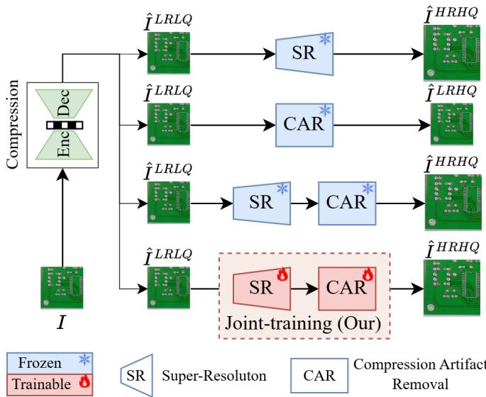
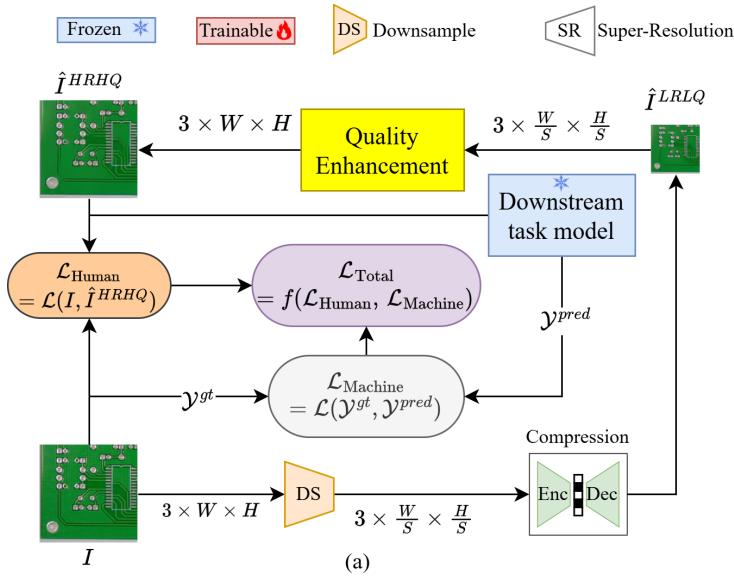
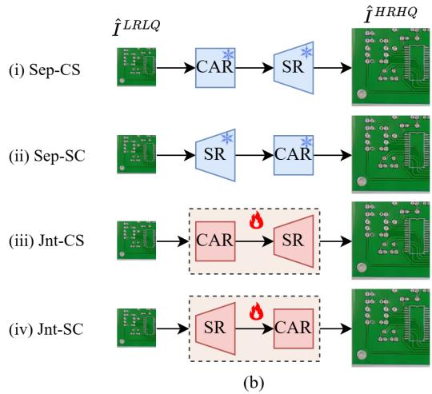
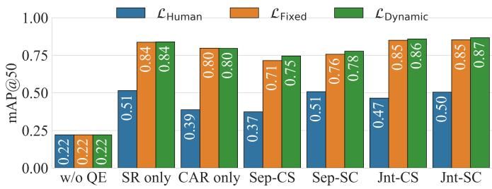
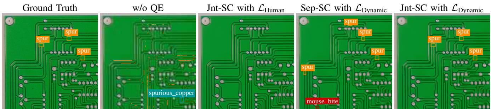
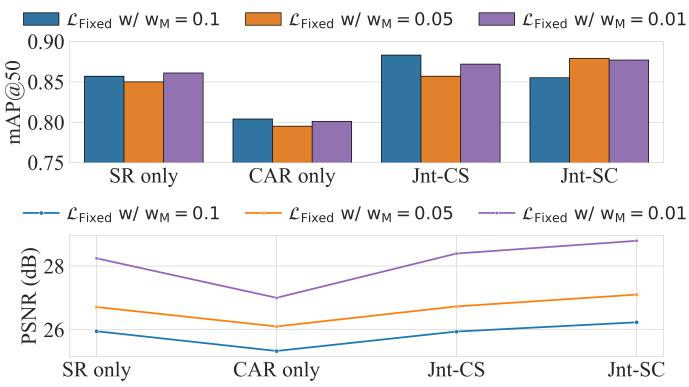

# End-to-End Joint Training of Super-Resolution and Compression Artifact Removal for Industrial Machine Vision

Dang BuiDinh1, Sang NguyenQuang2, Anh NguyenPhuong1, Wen-Hsiao Peng2, and Xiem HoangVan1\*

1Faculty of Electronics and Telecommunications, VNU University of Engineering and Technology, Hanoi, Vietnam

2Department of Computer Science, National Yang Ming Chiao Tung University, Hsinchu, Taiwan

水 Corresponding author: xiemhoang@vnu.edu.vn

Abstract—In industrial machine vision, images captured by edge devices are often downsampled and compressed to reduce bandwidth, introducing resolution loss and compression artifacts that severely degrade the performance of downstream tasks, such as defect detection. Existing quality enhancement methods typically apply super-resolution (SR) or compression artifact removal (CAR) independently or in a sequential manner and are largely optimized for human visual fidelity rather than machine perception. This paper proposes an end-to-end quality enhancement framework that integrates SR and CAR with a unified training strategy that optimizes both human-perception and machine-perception objectives. We investigate fixed-weight and uncertainty-based dynamic-weight loss functions to balance reconstruction quality and machine vision task performance. Extensive experiments on PCB Defect, DeepPCB, and NEU-DET datasets show that the proposed jointly trained model generally outperforms standalone and separately trained SR–CAR pipelines. In particular, under severe JPEG compression, our method improves defect detection performance from 0.461 to 0.887 mAP@50 on PCB Defect over sequential SR–CAR baselines, with only a slight reduction in PSNR. These results demonstrate that joint optimization is critical for compressionaware industrial machine vision systems.

Index Terms—Compression, Super-Resolution, Compression Artifact Removal, Defect Detection

## I. INTRODUCTION

Machine vision is essential in industrial applications such as automated inspection and defect detection. Despite recent advances in deep learning, deploying complex models on edge devices remains challenging due to resource constraints. Although model inference can be offloaded to server-side systems, transmitting raw high-resolution images requires substantial bandwidth, which is often impractical for real-time applications.

To reduce transmission bandwidth, captured images are typically downsampled and compressed using lossy compression schemes [1], [2] before transmission. While effective for data reduction, this process inevitably causes resolution loss and compression artifacts, resulting in severe image degradation. Such degradation substantially affects the performance of downstream machine vision tasks, especially in fine-grained defect detection.

Several recent learning-based studies [3]–[14] have investigated the use of super-resolution (SR) and compression artifact removal (CAR) to mitigate compression-induced degradation.

  
Fig. 1. Comparison between our proposed joint-training method and separate training approaches for SR and CAR.

However, these approaches still exhibit notable limitations. First, most existing methods apply SR or CAR independently [3], [5], [7], or combine both components while training them separately. Second, most existing methods mainly focus on optimizing human visual perception by minimizing pixel-level reconstruction errors [6], [15]. While effective for visual quality, such objectives are not necessarily optimal for machine perception, which is more sensitive to feature-level distortions.

Motivated by these limitations, we propose a novel quality enhancement (QE) framework designed to mitigate compression degradation for machine vision tasks. Our approach introduces an end-to-end joint model that integrates SR and CAR with multiple architectural variants, as illustrated in Fig. 1. Furthermore, we develop a unified training pipeline with integrated loss functions that simultaneously optimize both human and machine-perception objectives.

In summary, our main contributions are as follows:

• We propose an end-to-end QE framework that jointly integrates SR and CAR in two processing orders.

• We introduce a joint optimization strategy that combines

human-perception and machine-perception losses.

• Extensive experiments on defect detection tasks under various compression settings validate the effectiveness and robustness of the proposed framework.

## II. RELATED WORK

Super-Resolution: Super-resolution (SR) aims to reconstruct high-resolution images from low-resolution inputs. Early interpolation methods, such as bilinear interpolation, often produced overly smooth results lacking fine details. Deep learning has significantly advanced the field, beginning with SRCNN [8], which demonstrated the effectiveness of convolutional neural networks (CNNs). Deeper models, including EDSR [9] and ESRPCB [3], further improved reconstruction quality. GAN-based methods [16] improve perceptual realism, whereas transformer-based models [10] effectively capture long-range dependencies. However, these approaches often incur higher computational costs, which may limit their deployment on resource-constrained devices.

Compression Artifact Removal: Early restoration methods relied on handcrafted priors, such as sparse coding [17], but often struggled with complex textures. AR-CNN [7] subsequently introduced deep learning for compression artifact reduction. Encoder–decoder architectures, particularly U-Netlike architecture [5], [10], [18], later became prominent due to their efficient hierarchical multi-scale processing. By capturing both local details and global structures, they are widely used in CNN-based and transformer-based CAR models.

## III. PROPOSED METHOD

## A. Preliminary

We consider an industrial image quality enhancement framework, as illustrated in Fig. 1. To transmit or store a captured image I, encoders typically downsample and compress it (e.g., JPEG [1] and VVC [2]). Because of downsampling and lossy compression, the decoded image has reduced spatial resolution and noticeable compression artifacts. To mitigate these degradations and facilitate downstream machine vision tasks (e.g., defect detection), we employ QE techniques such as SR and CAR. We evaluate the impact of QE methods under five configurations: (1) directly using the low-quality reconstructed image $I ^ { L R L Q } ;$ (2) applying SR only; (3) applying CAR only; (4) sequentially applying CAR followed by SR; and (5) applying SR followed by CAR. Experiments are conducted on the PCB Defect dataset [19]. For the QE modules, we use ESRPCB [3] for SR and a transformer-based UNet backbone [18] for CAR, training each module separately using a pixel-wise reconstruction loss

Table I reports the defect detection performance in terms of mean Average Precision at an Intersection over Union threshold of 0.5 (mAP@50). While SR or CAR (i.e., Settings (2) and (3)) alone improves detection performance, directly cascading them (i.e., Settings (4) and (5)) provides no further gain and may even degrade performance.

Based on these findings, we propose an end-to-end QE framework that jointly integrates SR and CAR and optimizes both human- and machine-perception objectives. To the best of our knowledge, this is the first unified training strategy for a combined SR–CAR framework. Table II highlights its key differences from related methods, and implementation details are provided in Section III-C.

TABLE I  
DEFECT DETECTION PERFORMANCE OF DIFFERENT QE STRATEGIES ON THE PCB DEFECT DATASET.
<table><tr><td>Setting</td><td>QE Strategy</td><td>QF20</td><td>QF40</td><td>QF60</td><td>QF80</td><td>Average</td></tr><tr><td>(1)</td><td>w/o QE</td><td>0.052</td><td>0.151</td><td>0.250</td><td>0.436</td><td>0.222</td></tr><tr><td>(2)</td><td>SR only</td><td>0.214</td><td>0.476</td><td>0.618</td><td>0.751</td><td>0.515</td></tr><tr><td>(3)</td><td> $\mathbf { C A R \ o n l y }$ </td><td>0.155</td><td>0.330</td><td>0.452</td><td>0.612</td><td>0.387</td></tr><tr><td>(4)</td><td> $\mathrm { C A R } + \mathrm { S \dot { R } }$ </td><td>0.124</td><td>0.318</td><td>0.435</td><td>0.615</td><td>0.373</td></tr><tr><td>(5)</td><td> $\mathrm { S R } + \mathrm { C A R }$ </td><td>0.204</td><td>0.461</td><td>0.606</td><td>0.760</td><td>0.508</td></tr></table>

CAR + SR: CAR is performed before SR; SR + CAR: SR is performed before CAR.

TABLE II  
COMPARISON OF THE PROPOSED FRAMEWORK WITH REPRESENTATIVE RELATED METHODS.
<table><tr><td>Method</td><td>[3]</td><td>[15]</td><td>[5]</td><td>[6]</td><td>[20]</td><td>Our</td></tr><tr><td>Joint combination training</td><td></td><td>√</td><td>√</td><td>√</td><td></td><td>√</td></tr><tr><td>Human perception loss</td><td>√</td><td>√</td><td>V</td><td>√</td><td></td><td>√</td></tr><tr><td>Machine perception loss</td><td></td><td></td><td></td><td></td><td>√</td><td>√</td></tr><tr><td>Downstream vision task</td><td>√</td><td></td><td></td><td></td><td>√</td><td>√</td></tr></table>

## B. System Overview

Fig. 2(a) illustrates the proposed framework with a novel training strategy. The captured image $\textbf { \textit { I } } \in \mathbb { R } ^ { 3 \times W \times H }$ is high-resolution and free of compression artifacts, while its corresponding ground-truth label $\mathcal { \mathrm { y } } ^ { g t }$ is manually annotated. To reduce transmission bandwidth and storage, the raw image I is downsampled by a scale factor of S and compressed using a lossy codec (e.g., JPEG). At the decoder, it is reconstructed as a low-resolution, degraded-quality image $\hat { I } ^ { L R L Q } \in \mathbb { R } ^ { 3 \times \frac { W } { S } \times \frac { H } { S } }$ . The QE model, shown in Fig. 2(b) and detailed in Section III-C, produces $\hat { I } ^ { H R H Q } \in \mathbb { R } ^ { 3 \times W \times H }$ with restored resolution and reduced artifacts. The enhanced image is then used for downstream tasks (e.g., defect detection and classification), yielding $\mathcal { V } ^ { p r e d }$

In optimizing QE models, Mean Squared Error (MSE) or Charbonnier Loss [21] is typically employed to maximize the fidelity of reconstructed images. However, this creates a fundamental trade-off: models trained with a human-oriented loss $( \mathcal { L } _ { \mathrm { H u m a n } } )$ frequently underperform on downstream machine vision tasks. Conversely, utilizing a machine-oriented loss $( \mathcal { L } _ { \mathrm { M a c h i n e } } )$ improves automated analysis but generates unnatural artifacts that severely degrade perceptual quality.

In this paper, our QE models are trained with a novel training strategy that jointly optimizes reconstruction quality and machine task performance through a combined objective function ${ \mathcal { L } } _ { \mathrm { J o i n t } }$ , defined as:

$$
\mathcal { L } _ { \mathrm { J o i n t } } = f ( \mathcal { L } _ { \mathrm { H u m a n } } , \mathcal { L } _ { \mathrm { M a c h i n e } } ) ,\tag{1}
$$

where $f ( \cdot )$ denotes a generic loss aggregation function for the human-perception and machine-perception losses.

  
Fig. 2. Overall architecture of the proposed QE framework. (a) End-to-end joint training pipeline, where the QE module is optimized under both humanperception and machine-perception losses. (b) Different QE configurations, including separately trained models (Sep-CS and Sep-SC) and jointly trained models (Jnt-CS and Jnt-SC).

## C. Implementation Details

To optimize visual quality, we define ${ \mathcal { L } } _ { \mathrm { H u m a n } }$ using the Charbonnier loss [21] between the reconstructed image $\tilde { I } ^ { H R H Q }$ and the original image I:

$$
\mathcal { L } _ { \mathrm { H u m a n } } = \frac { 1 } { N } \sum _ { i = 1 } ^ { N } \sqrt { \left( I _ { i } - \hat { I } _ { i } ^ { H R H Q } \right) ^ { 2 } + \epsilon ^ { 2 } } ,\tag{2}
$$

where N is the number of image elements, and ϵ is a small constant, typically set to $1 0 ^ { - 8 }$ , ensuring numerical stability near zero.

On the other hand, to maximize machine perception performance, the model is trained with a machine-oriented objective function, denoted as $\mathcal { L } _ { \mathrm { M a c h i n e } }$ . In our design, with the defect detection task, $\mathcal { L } _ { \mathrm { M a c h i n e } }$ is a summation of three components: localization loss ${ \mathcal { L } } _ { \mathrm { b o x } }$ , classification loss $\mathcal { L } _ { \mathrm { c l s } }$ , and distribution focal loss ${ \mathcal { L } } _ { \mathrm { d f l } }$ , which can be expressed as:

$$
\mathcal { L } _ { \mathrm { M a c h i n e } } = \mathcal { L } _ { \mathrm { c l s } } + \mathcal { L } _ { \mathrm { b o x } } + \mathcal { L } _ { \mathrm { d f l } } .\tag{3}
$$

During joint training, the pretrained YOLOv8 detector is frozen, and only the QE model is updated through $\mathcal { L } _ { \mathrm { M a c h i n e } } .$

As discussed in Section III-A, simply combining SR and CAR without task-oriented training may degrade both performance and efficiency. To address this, we propose an endto-end joint training strategy with two objectives: (1) Fixed-Weight Loss Function and (2) Dynamic-Weight Loss Function, both balancing human visual quality and machine-perception performance.

1) Fixed-Weight Loss Function: We design the loss function for our joint training strategy as a linear combination of ${ \mathcal { L } } _ { \mathrm { H u m a n } }$ and $\mathcal { L } _ { \mathrm { M a c h i n e } }$ with fixed weights. Specifically, the loss function is formulated as:

$$
\mathcal { L } _ { \mathrm { J o i n t } } = \mathcal { L } _ { \mathrm { F i x e d } } = \mathcal { L } _ { \mathrm { H u m a n } } \times w _ { H } + \mathcal { L } _ { \mathrm { M a c h i n e } } \times w _ { M } ,\tag{4}
$$

TABLE III  
QE MODEL CONFIGURATIONS AND TRAINING STRATEGIES.
<table><tr><td>Model</td><td>Description</td><td>Training</td></tr><tr><td>SR only CAR only</td><td>Only perform SR Only perform CAR</td><td>Separate Separate</td></tr><tr><td>Sep-CS</td><td>Perform CAR first, followed by SR</td><td>Separate</td></tr><tr><td>Sep-SC</td><td>Perform SR first, followed by CAR</td><td>Separate</td></tr><tr><td>Jnt-CS</td><td></td><td></td></tr><tr><td></td><td>Perform CAR first, followed by SR</td><td>Joint</td></tr><tr><td>Jnt-SC</td><td>Perform SR first, followed by CAR</td><td>Joint</td></tr></table>

where $w _ { H }$ and $w _ { M }$ denote the weighting coefficients for the human-perception loss $( \mathcal { L } _ { \mathrm { H u m a n } } )$ and the machine-perception loss $( \mathcal { L } _ { \mathrm { M a c h i n e } } )$ , respectively, controlling their relative contributions during optimization. During training, we observe that the magnitude of $\mathcal { L } _ { \mathrm { M a c h i n e } }$ is often more than 100 times larger than that of ${ \mathcal { L } } _ { \mathrm { H u m a n } } .$ . To mitigate this imbalance, we empirically set the loss weights $w _ { H } = 1$ and $w _ { M } = 0 . 0 1$ , thereby effectively balancing the contribution of ${ \mathcal { L } } _ { \mathrm { H u m a n } }$ while still preserving task-driven optimization.

2) Dynamic-Weight Loss Function: Although fixed weighting provides a simple way to balance human- and machineperception objectives, manually chosen weights may not generalize across datasets or training stages. We therefore adopt task-uncertainty-based Uncertainty Weighting (UW) [20], which automatically adjusts the contribution of each loss term during training. The dynamic loss is formulated as:

$$
\begin{array} { r l r } {  { \mathcal { L } _ { \mathrm { J o i n t } } = \mathcal { L } _ { \mathrm { D y n a m i c } } } } \\ & { } & { = \frac { 1 } { 2 \sigma _ { H } ^ { 2 } } \mathcal { L } _ { \mathrm { H u m a n } } + \frac { 1 } { 2 \sigma _ { M } ^ { 2 } } \mathcal { L } _ { \mathrm { M a c h i n e } } + \log ( \sigma _ { H } \sigma _ { M } ) , } \end{array}\tag{5}
$$

where $\sigma _ { H }$ and $\sigma _ { M }$ are trainable uncertainty parameters jointly optimized with the network to adaptively balance human- and machine-perception objectives.

TABLE IV  
DEFECT DETECTION PERFORMANCE ACROSS DATASETS, JPEG QUALITY FACTORS, QE CONFIGURATIONS, AND LOSS SETTINGS. RESULTS ARE REPORTED AS MAP@50/F1 SCORE.
<table><tr><td>Dataset</td><td>QF</td><td>Loss Type</td><td>w/o QE</td><td>SR only</td><td>CAR only</td><td>Sep-CS</td><td>Sep-SC</td><td>Jnt-CS</td><td>Jnt-SC</td></tr><tr><td rowspan="10">PCB Defect [19]</td><td rowspan="2">20</td><td> ${ \underset { \ r { \infty } } { \mathcal { L } } } _ { \mathrm { H u m a n } }$ </td><td rowspan="2">0.052 / 0.081</td><td>0.214 / 0.266 0.611 / 0.635</td><td>0.155 / 0.191 0.579 / 0.195</td><td>0.124 / 0.158 0.475 / 0.418</td><td>0.204 / 0.259 0.471  /  0.344</td><td>0.169 / 0.214 0.640 / 0.663</td><td>0.225 / 0.275 0.634 /  0.644</td></tr><tr><td> $\mathcal { L } _ { \mathrm { F i x e d } }$ </td><td>0.608 / 0.617</td><td>0.573 / 0.611</td><td>0.512 / 0.473</td><td>0.446 / 0.373</td><td>0.661 / 0.696</td><td>0.669 / 0.667</td></tr><tr><td rowspan="2"></td><td> $\mathcal { L } _ { \mathrm { D y n a m i c } }$ </td><td rowspan="2"></td><td></td><td></td><td></td><td></td><td></td><td></td></tr><tr><td> ${ \underset { c } { \mathscr { L } } } _ { \mathrm { H u m a n } }$ </td><td>0.476 / 0.529</td><td>0.330 / 0.375</td><td>0.318 / 0.369</td><td>0.461  / 0.513</td><td>0.395  /  0.457</td><td>0.440 / 0.501</td></tr><tr><td rowspan="2">40</td><td>LFixed</td><td rowspan="2">0.151 / 0.192</td><td>0.861 / 0.856</td><td>0.801 / 0.813</td><td>0.710 / 0.610</td><td>0.764 / 0.637</td><td>0.872 / 0.870</td><td>0.877 / 0.880</td></tr><tr><td> $\mathcal { L } _ { \mathrm { D y n a m i c } }$ </td><td>0.866 / 0.863</td><td>0.804 / 0.808</td><td>0.741  / 0.662</td><td>0.814 / 0.718</td><td>0.876 / 0.876</td><td>0.887 / 0.878</td></tr><tr><td rowspan="2">60</td><td> ${ \mathcal { L } } _ { \mathrm { H u m a n } }$ </td><td rowspan="2">0.250 / 0.287</td><td>0.618 / 0.663</td><td>0.452 / 0.497</td><td>0.435 / 0.497</td><td>0.606 / 0.653</td><td>0.544 / 0.601</td><td>0.591  / 0.646</td></tr><tr><td> $\mathcal { L } _ { \mathrm { F i x e d } }$ </td><td>0.915 / 0.910</td><td>0.880 / 0.888</td><td>0.800 / 0.714</td><td>0.850 / 0.763</td><td>0.927 / 0.928</td><td>0.933 / 0.928</td></tr><tr><td rowspan="2"></td><td> $\mathcal { L } _ { \mathrm { D y n a m i c } }$ </td><td rowspan="2"></td><td>0.924 / 0.916</td><td>0.879 / 0.888</td><td>0.830 / 0.720</td><td>0.905 / 0.838</td><td>0.938 / 0.934</td><td>0.943 / 0.939</td></tr><tr><td> ${ \underset {  } { C } } _ { \mathrm { H u m a n } }$ </td><td>0.751 / 0.771</td><td>0.612 / 0.647</td><td>0.615 / 0.659</td><td>0.760 / 0.779</td><td>0.752 / 0.777</td><td>0.760 / 0.791</td></tr><tr><td rowspan="2"></td><td>80</td><td rowspan="2">0.436 /  0.479</td><td>0.959 / 0.961</td><td>0.928 / 0.939</td><td>0.872 / 0.788</td><td>0.940 / 0.880</td><td>0.959 / 0.961</td><td></td><td>0.965 / 0.970</td></tr><tr><td> $\mathcal { L } _ { \mathrm { F i x e d } }$   $\mathcal { L } _ { \mathrm { D y n a m i c } }$ </td><td>0.957 / 0.963</td><td>0.924 / 0.937</td><td>0.898 / 0.835</td><td>0.941  / 0.913</td><td>0.959 / 0.963</td><td>0.965 0.970</td></tr><tr><td rowspan="6">DeepPCB [22]</td><td rowspan="3">20</td><td></td><td></td><td>0.857  / 0.897</td><td>0.555 / 0.650</td><td>0.483 / 0.603</td><td>0.818 / 0.866</td><td>0.870 / 0.910</td><td>0.845  / 0.887</td></tr><tr><td> ${ \mathcal { L } } _ { \mathrm { H u m a n } }$ </td><td>0.363 / 0.448</td><td></td><td></td><td></td><td>0.918 / 0.920</td><td>0.935 / 0.942</td><td>0.943 / 0.946</td></tr><tr><td> $\mathcal { L } _ { \mathrm { F i x e d } }$ </td><td></td><td>0.931  / 0.937 0.946 / 0.953</td><td>0.892 / 0.905 0.913 / 0.922</td><td>0.884 / 0.906 0.581 / 0.634</td><td>0.910 / 0.926</td><td>0.940 / 0.941</td><td>0.948 / 0.948</td></tr><tr><td rowspan="2"></td><td> $\mathcal { L } _ { \mathrm { D y n a m i c } }$ </td><td rowspan="2"></td><td>0.891  / 0.913</td><td>0.602 / 0.677</td><td>0.455 / 0.593</td><td>0.887  / 0.919</td><td>0.892 / 0.915</td><td></td></tr><tr><td> ${ \underset {  } { C } } _ { \mathrm { H u m a n } }$ </td><td>0.953 / 0.955</td><td>0.905 / 0.918</td><td>0.916 / 0.924</td><td>0.915 / 0.917</td><td>0.947  / 0.952</td><td>0.889 / 0.915 0.956 / 0.953</td></tr><tr><td rowspan="2"></td><td>40  $\mathcal { L } _ { \mathrm { F i x e d } }$ </td><td rowspan="2">0.477 / 0.565</td><td>0.958 / 0.962</td><td>0.934 / 0.936</td><td>0.396 / 0.472</td><td>0.935 / 0.947</td><td>0.948 /  0.952</td><td>0.958 / 0.959</td></tr><tr><td> $\mathcal { L } _ { \mathrm { D y n a m i c } }$ </td><td></td><td></td><td></td><td></td><td></td><td></td></tr><tr><td rowspan="6">NEU-DET [23]</td><td rowspan="2">20</td><td> ${ \underset { \ r { \infty } } { \mathcal { L } } } _ { \mathrm { H u m a n } }$ </td><td rowspan="2">0.212 / 0.283</td><td>0.377  / 0.447 0.379 / 0.480</td><td>0.365 / 0.438 0.386 / 0.496</td><td>0.332 / 0.401 0.331 / 0.418</td><td>0.345 /  0.409 0.311 / 0.400</td><td>0.387  /  0.458 0.331  / 0.418</td><td>0.411 / 0.489 0.420 / 0.527</td></tr><tr><td> $\mathcal { L } _ { \mathrm { F i x e d } }$ </td><td>0.387  / 0.490</td><td>0.378 / 0.490</td><td>0.349 / 0.468</td><td>0.297  / 0.392</td><td>0.366 / 0.480</td><td>0.429 / 0.535</td></tr><tr><td rowspan="2"></td><td> $\mathcal { L } _ { \mathrm { D y n a m i c } }$ </td><td rowspan="2"></td><td></td><td></td><td></td><td></td><td></td><td></td></tr><tr><td></td><td>0.434 / 0.511</td><td>0.401  / 0.480</td><td>0.419 / 0.501</td><td>0.402 / 0.473</td><td>0.451 / 0.519</td><td>0.463 / 0.530</td></tr><tr><td>40</td><td> $\begin{array} { l } { \mathcal { L } _ { \mathrm { H u m a n } } } \\ { \mathcal { L } _ { \mathrm { F i x e d } } } \end{array}$ </td><td>0.303 / 0.366</td><td>0.468 / 0.554</td><td>0.467 / 0.562</td><td>0.441 / 0.521</td><td>0.446 / 0.529</td><td>0.477 / 0.568</td><td>0.519 / 0.595</td></tr><tr><td></td><td> $\mathcal { L } _ { \mathrm { D y n a m i c } }$ </td><td></td><td>0.460 / 0.549</td><td>0.449 / 0.560</td><td>0.427 / 0.540</td><td>0.405 / 0.492</td><td>0.482 / 0.565</td><td>0.491 / 0.593</td></tr></table>

  
Fig. 3. Average mAP@50 of different QE configurations on the PCB Defect dataset across all evaluated QFs.

## IV. EXPERIMENTS

## A. Experimental Settings

Following Fig. 2 (a), each input image is downsampled by a factor of S = 4 and compressed using JPEG [1]. Four quality factors (QFs) (i.e., 20, 40, 60, and 80) are used to produce different degradation levels. Table III summarizes the six evaluated QE configurations:

• Single QE model: Applies either SR or CAR independently. The SR only configuration yields a high-resolution output, while CAR only retains the original resolution but reduces artifacts.

• Combined QE model with separate training: Combines SR and CAR models, which are two independently trained models. We assess two orders: SR followed by CAR (Sep-SC) and CAR followed by SR (Sep-CS).

• Combined QE model with joint training: Employs our proposed joint training strategy for the combined model. We also evaluate both Jnt-SC and Jnt-CS.

The training and validation processes are performed on PCB Defect [19], DeepPCB [22] and NEU-DET [23] datasets. To fully evaluate how training strategies affect the performance of QE model designs, we train all model configurations in Table III with three loss settings: LHuman, $\mathcal { L } _ { \mathrm { F i x e d : } }$ , and $\mathcal { L } _ { \mathrm { D y n a m i c } } . \mathrm { W e }$ use Adam [24] with a batch size of 2 and a cosine annealing learning rate from $1 \times 1 0 ^ { - 4 }$ to $1 \times 1 0 ^ { - 7 }$ , restarting every $\mathrm { 5 \times 1 0 ^ { \bar { 4 } } }$ iterations, for a total of $3 \times 1 0 ^ { 5 }$ iterations. The QE output images are evaluated using an object detection model YOLOv8 [25], with mAP@50 and F1-score as the evaluation metrics for machine vision performance. We additionally report the number of parameters, Floating-Point-Operations (FLOPs), and inference time to analyze the computational overhead of each QE configuration. Additionally, in all tables, the best and second-best results are highlighted in red and blue, respectively.

## B. Experimental Results

Effect of Joint Training Strategy on Machine Vision Performance: Table IV reports mAP@50 and F1-scores of the downstream machine vision task (i.e., defect detection) on PCB Defect [19], DeepPCB [22], and NEU-DET [23] datasets across different QFs and QE configurations, while Fig. 3 shows the corresponding average mAP@50 results over all QFs on the PCB Defect dataset. It can be seen that the combined QE models with our joint training loss (i.e., Jnt-CS and Jnt-SC) generally achieve superior performance across datasets and quality factors. Notably, the performance gains become more significant as the compression level increases (i.e., lower QF values), indicating that the proposed joint optimization is particularly effective under severe compression degradation. In contrast, the separately combined models (i.e., Sep-CS and

  
Fig. 4. Qualitative comparison of detection results of different QE pipelines on the PCB Defect dataset with $\mathrm { Q F } = 4 0 .$

TABLE V  
PSNR COMPARISON ON THE PCB DEFECT DATASET ACROSS DIFFERENT QE CONFIGURATIONS.
<table><tr><td>QF</td><td>Loss Type</td><td>SR only</td><td>CAR only</td><td>Sep-CS</td><td>Sep-SC</td><td>Jnt-CS</td><td>Jnt-SC</td></tr><tr><td></td><td> ${ \underset {  } { \ell _ { \mathrm { H u m a n } } } }$ </td><td>29.15</td><td>26.76</td><td>26.99</td><td>26.84</td><td>32.24</td><td>32.31</td></tr><tr><td>20</td><td> $\mathcal { L } _ { \mathrm { F i x e d } }$ </td><td>26.36</td><td>25.93</td><td>25.77</td><td>25.37</td><td>26.63</td><td>26.78</td></tr><tr><td></td><td> $\mathcal { L } _ { \mathrm { D y n a m i c } }$ </td><td>27.18</td><td>26.24</td><td>26.27</td><td>25.96</td><td>27.77</td><td>27.93</td></tr><tr><td></td><td>LHuman</td><td>31.21</td><td>27.43</td><td>27.99</td><td>28.33</td><td>32.30</td><td>32.54</td></tr><tr><td>40</td><td> $\mathcal { L } _ { \mathrm { F i x e d } }$ </td><td>28.24</td><td>27.00</td><td>27.15</td><td>27.19</td><td>28.39</td><td>28.79</td></tr><tr><td></td><td> $\mathcal { L } _ { \mathrm { D y n a m i c } }$ </td><td>28.91</td><td>27.15</td><td>27.36</td><td>27.75</td><td>29.23</td><td>29.61</td></tr><tr><td></td><td> ${ \underset {  } { C } } _ { \mathrm { H u m a n } }$ </td><td>31.88</td><td>27.91</td><td>28.24</td><td>28.90</td><td>32.36</td><td>33.72</td></tr><tr><td>60</td><td> $\mathcal { L } _ { \mathrm { F i x e d } }$ </td><td>29.16</td><td>27.47</td><td>27.76</td><td>28.14</td><td>29.24</td><td>29.62</td></tr><tr><td></td><td> $\mathcal { L } _ { \mathrm { D y n a m i c } }$ </td><td>29.78</td><td>27.56</td><td>27.90</td><td>28.58</td><td>30.04</td><td>30.57</td></tr><tr><td>80</td><td> ${ \mathcal { L } } _ { \mathrm { H u m a n } }$ </td><td>32.13</td><td>28.20</td><td>28.28</td><td>29.75</td><td>33.83</td><td>34.11</td></tr><tr><td></td><td> $\mathcal { L } _ { \mathrm { F i x e d } }$ </td><td>30.28</td><td>27.96</td><td>28.24</td><td>29.32</td><td>30.18</td><td>30.68</td></tr><tr><td></td><td>LDynamic</td><td>30.84</td><td>27.99</td><td>28.16</td><td>29.52</td><td>31.13</td><td>31.54</td></tr></table>

  
Fig. 5. Effect of the fixed machine-perception weight $w _ { M }$ on mAP@50 and PSNR at $\mathrm { Q F } = 4 0 .$  
TABLE VI

Sep-SC) exhibit limited or even degraded performance compared with the end-to-end joint models across all experimental settings.

Effect of Joint Training Strategy on Human Perception: Table V compares PSNR across model configurations and loss settings on the PCB Defect dataset [19]. Models trained only with ${ \mathcal { L } } _ { \mathrm { H u m a n } }$ achieve the highest PSNR because this objective directly minimizes pixel-wise reconstruction error. In contrast, $\mathcal { L } _ { \mathrm { F i x e d } }$ and $\mathcal { L } _ { \mathrm { D y n a m i c } }$ balance reconstruction quality with downstream performance, resulting in lower PSNR. Among them, $\mathcal { L } _ { \mathrm { D y n a m i c } }$ consistently achieves a better balance. Fig. 4 further compares detection results at $\mathrm { Q F } = 4 0 $ . Although Jnt-SC trained with ${ \mathcal { L } } _ { \mathrm { H u m a n } }$ produces higher PSNR, it misses defects. Conversely, $\mathcal { L } _ { \mathrm { D y n a m i c } }$ detects all defects despite lower PSNR, confirming the importance of machine-perception supervision for industrial inspection. Beyond perceptual and detection performance, Table VI shows that the additional QE overhead yields substantial accuracy gains, increasing mAP@50 from 0.436 without QE to 0.965 with Jnt-SC at $\mathrm { Q F } = 8 0 $ . Nevertheless, reducing this overhead while preserving detection performance remains an important direction for future work.

COMPUTATIONAL COMPLEXITY OF THE EVALUATED QE CONFIGURATIONS AND YOLOV8 DETECTOR.
<table><tr><td></td><td>CAR Architecture</td><td>Model Type</td><td>Parameters (M)</td><td>FLOPs (G)</td><td>Time (s)</td></tr><tr><td rowspan="5">Edd dels</td><td>N/a</td><td>SR only</td><td>1.60</td><td>48.0</td><td>0.0153</td></tr><tr><td>CNN-based [5]</td><td>CAR only</td><td>1.26</td><td>0.6</td><td>0.0188</td></tr><tr><td rowspan="2"></td><td>Jnt-CS Jnt-SC</td><td>2.87 2.87</td><td>48.6 56.0</td><td>0.0227 0.0237</td></tr><tr><td></td><td></td><td></td><td></td></tr><tr><td rowspan="2">Transformer-based [18]</td><td>CAR only Jnt-CS</td><td>1.61 3.21</td><td>4.7 52.7</td><td>0.0213 0.0258</td></tr><tr><td>Jnt-SC</td><td>3.21</td><td>123.6</td><td>0.0905</td></tr><tr><td colspan="2">Downstream task model</td><td>YOLOv8</td><td>3.16</td><td>4.0</td><td>0.0205</td></tr></table>

The QE and downstream task model use input sizes of 152 × 152 and 608 × 608, respectively. Inference time is averaged on an NVIDIA Tesla V100-SXM2-32GB GPU.

TABLE VII  
EFFECT OF MACHINE-PERCEPTION LOSS COMPONENTS ON MAP@50 AT QF = 40.
<table><tr><td>Loss Type</td><td> $\begin{array} { r } { \operatorname { L o s s } \operatorname { E l e m e n t } _ { \mathcal { L } _ { \mathrm { c l s } } } } \\ { \mathcal { L } _ { \mathrm { b o x } } + \mathcal { L } _ { \mathrm { d f f } } \quad \mathcal { L } _ { \mathrm { c l s } } } \end{array}$ </td><td></td><td>SR only</td><td>CAR only</td><td>Sep-CS</td><td>Sep-SC</td><td>Jnt-CS</td><td>Jnt-SC</td></tr><tr><td>LHuman</td><td></td><td></td><td>0.476</td><td>0.330</td><td>0.318</td><td>0.461</td><td>0.395</td><td>0.440</td></tr><tr><td rowspan="3"> $\mathcal { L } _ { \mathrm { F i x e d } }$ </td><td>√</td><td></td><td>0.763</td><td>0.665</td><td>0.617</td><td>0.704</td><td>0.772</td><td>0.804</td></tr><tr><td></td><td>√</td><td>0.852</td><td>0.780</td><td>0.721</td><td>0.787</td><td>0.862</td><td>0.876</td></tr><tr><td>√</td><td>√</td><td>0.861</td><td>0.801</td><td>0.710</td><td>0.764</td><td>0.872</td><td>0.877</td></tr><tr><td rowspan="3"> $\mathcal { L } _ { \mathrm { D y n a m i c } }$ </td><td>√</td><td></td><td>0.765</td><td>0.676</td><td>0.624</td><td>0.706</td><td>0.767</td><td>0.795</td></tr><tr><td></td><td>√</td><td>0.848</td><td>0.774</td><td>0.677</td><td>0.777</td><td>0.866</td><td>0.866</td></tr><tr><td>√</td><td>√</td><td>0.866</td><td>0.804</td><td>0.741</td><td>0.814</td><td>0.876</td><td>0.887</td></tr></table>

## C. Ablation Studies

Fixed-Weight Loss Function with Varying Weight Values: Fig. 5 evaluates machine-perception weights $w _ { M }$ of 0.1, 0.05, and 0.01 on the PCB Defect dataset at $\mathrm { Q F } = 4 0 $ . Although $w _ { M } = 0 . 0 1$ slightly reduces mAP@50 in some configurations, the gap is small, while lower $w _ { M }$ consistently improves PSNR, indicating a detection–fidelity trade-off. Since $w _ { M } = 0 . 0 1$ provides clear PSNR gains with minor mAP@50 loss, we adopt this setting in all experiments involving $\mathcal { L } _ { \mathrm { F i x e d } }$

Analysis of Machine Perception Loss Components: The machine-perception loss $\mathcal { L } _ { \mathrm { M a c h i n e } }$ combines classification loss ${ \mathcal L } _ { \mathrm { c l s } }$ and localization losses ${ \mathcal { L } } _ { \mathrm { b o x } }$ and ${ \mathcal { L } } _ { \mathrm { d f l } }$ , with ${ \mathcal { L } } _ { \mathrm { d f l } }$ modeling bounding-box localization as a discrete distribution. Table VII shows that jointly optimizing all components performs best.

TABLE VIII  
MAP@50 COMPARISON OF DIFFERENT CAR ARCHITECTURES USING $\mathcal { L } _ { \mathrm { D Y N A M I C } }$ AT $\mathrm { Q F } = 4 0 $
<table><tr><td>CAR Architecture</td><td>SR only</td><td>CAR only</td><td>Sep-CS</td><td>Sep-SC</td><td>Jnt-CS</td><td>Jnt-SC</td></tr><tr><td>CNN-based [5]</td><td>0.866</td><td>0.668</td><td>0.699</td><td>0.811</td><td>0.877</td><td>0.871</td></tr><tr><td>Transformer-based [18]</td><td></td><td>0.804</td><td>0.741</td><td>0.814</td><td>0.876</td><td>0.887</td></tr></table>

TABLE IX

DETECTION PERFORMANCE WITH VARIOUS TYPES OF DETECTION MODELS AT $\mathrm { Q F } = 4 0 $ ON THE PCB DEFECT DATASET.
<table><tr><td></td><td>YOLOv8 (Ours)</td><td>YOLOv11</td><td>Faster R-CNN</td></tr><tr><td>Jnt-SC w/o UW</td><td>0.440</td><td>0.457</td><td>0.310</td></tr><tr><td>Jnt-SC w/ UW</td><td>0.887</td><td>0.871</td><td>0.693</td></tr></table>

Although $\mathcal { L } _ { \mathrm { c l s } }$ alone outperforms the localization-only objective, it remains inferior to the full objective, confirming the necessity of both classification and localization supervision.

Ablation with Different CAR Models: Table VIII compares the performance of QE frameworks trained with $\mathcal { L } _ { \mathrm { D y n a m i c } }$ across different CAR architectures. As shown, applying our joint training strategy consistently achieves the best mAP@50 performance for both CNN-based and transformer-based CAR models, outperforming separate and standalone configurations. These results demonstrate that the proposed joint training strategy generalizes effective across both evaluated architectures

Ablation with Different Detection Models: Table IX reports Jnt-SC performance at QF = 40 on the PCB Defect dataset. Jnt-SC is trained with UW using machine loss from YOLOv8, while YOLOv11 and Faster R-CNN are used only for evaluation. Nevertheless, it improves detection across all detectors, showing that task-oriented optimization enhances features that transfer across different detector architectures. Therefore, changing the detector may not require retraining the restoration network.

## V. CONCLUSIONS

In this paper, we propose a novel quality enhancement framework that aims to reconstruct high-resolution images with minimal compression artifacts from compressed lowresolution inputs, specifically for downstream machine vision tasks. Our approach introduces an end-to-end joint model that integrates SR and CAR through multiple architectural variants. Moreover, we design a unified training strategy with an integrated loss function that jointly optimizes humanperception and machine-perception objectives. Our extensive experiments illustrate the effectiveness and efficiency of our method across various datasets and configurations.

## ACKNOWLEDGEMENT

This research is funded by Vietnam National Foundation for Science and Technology Development (NAFOSTED) under grant number NCUD.02-2024.09.

## REFERENCES

[1] G. K. Wallace, “The jpeg still picture compression standard,” IEEE Transactions on Consumer Electronics, vol. 38, no. 1, pp. xviii–xxxiv, 1992.

[2] B. Bross, Y.-K. Wang, Y. Ye, S. Liu, J. Chen, G. J. Sullivan, and J.- R. Ohm, “Overview of the versatile video coding (vvc) standard and its applications,” IEEE Transactions on Circuits and Systems for Video Technology, vol. 31, no. 10, pp. 3736–3764, 2021.

[3] X. HoangVan, D. B. Dinh, T. N. Canh, and V.-T. Nguyen, “Esrpcb: An edge guided super-resolution model and ensemble learning for tiny printed circuit board defect detection,” Engineering Applications of Artificial Intelligence, vol. 159, p. 111547, 2025.

[4] X. HoangVan, L. L. Hai, and T. N. Canh, “E2dsr: Edge-enhanced representation for deep super-resolution in machine vision applications,” REV Journal on Electronics and Communications, vol. 15, no. 4, 2026.

[5] L. Chen, X. Chu, X. Zhang, and J. Sun, “Simple baselines for image restoration,” arXiv preprint arXiv:2204.04676, 2022.

[6] X. Xiang et al., “Boosting high-level vision with joint compression artifacts reduction and super-resolution,” in 2020 International Conference on Pattern Recognition (ICPR). IEEE, 2021, pp. 2390–2397.

[7] C. Dong, Y. Deng, C. C. Loy, and X. Tang, “Compression artifacts reduction by a deep convolutional network,” in Proceedings of the IEEE international conference on computer vision, 2015, pp. 576–584.

[8] C. Dong, C. C. Loy, K. He, and X. Tang, “Image super-resolution using deep convolutional networks,” IEEE Transactions on Pattern Analysis and Machine Intelligence, vol. 38, no. 2, pp. 295–307, 2016.

[9] B. Lim and et.al, “Enhanced deep residual networks for single image super-resolution,” in 2017 IEEE Conference on Computer Vision and Pattern Recognition Workshops (CVPRW), 2017, pp. 1132–1140.

[10] M. V. Conde and et.al, “Swin2sr: Swinv2 transformer for compressed image super-resolution and restoration,” in European Conference on Computer Vision. Springer, 2022, pp. 669–687.

[11] X. HoangVan and H.-H. Nguyen, “Enhancing quality for vvc compressed videos with multi-frame quality enhancement model,” in Proc. Int. Conf. Adv. Technol. Commun. (ATC), 2020, pp. 172–176.

[12] X. HoangVan, H. B. Minh, S. NguyenQuang, and W.-H. Peng, “Enhancing quality for vvc compressed videos with omniscient quality enhancement model,” in Proc. Int. Conf. Adv. Technol. Commun. (ATC). IEEE, 2024, pp. 544–549.

[13] X. HoangVan, D. BuiDinh, S. NguyenQuang, and W.-H. Peng, “Compressed video quality enhancement: Classifying and benchmarking over standards,” in Proc. Int. Conf. Adv. Technol. Commun. (ATC), 2025, pp. 1–6.

[14] S. NguyenQuang, H. B. Minh, D. BuiDinh, and X. HoangVan, “MDFI: A multi-domain features integration for compressed video quality enhancement,” IEEE Transactions on Consumer Electronics, pp. 1–1, 2026.

[15] G. Ohtani et al., “Reca: A pipeline for refinement of compressed artifacts in image super-resolution training,” IEEE Access, 2025.

[16] X. Wang, L. Xie, C. Dong, and Y. Shan, “Real-esrgan: Training real-world blind super-resolution with pure synthetic data,” in 2021 IEEE/CVF International Conference on Computer Vision Workshops (ICCVW), 2021, pp. 1905–1914.

[17] W. Dong et al., “Sparsity-based image denoising via dictionary learning and structural clustering,” in CVPR 2011. IEEE, 2011, pp. 457–464.

[18] Y. Cai, H. Bian, J. Lin, H. Wang, R. Timofte, and Y. Zhang, “Retinexformer: One-stage retinex-based transformer for low-light image enhancement,” in Proceedings of the IEEE/CVF international conference on computer vision, 2023, pp. 12 504–12 513.

[19] W. Huang and P. Wei, “A pcb dataset for defects detection and classification,” arXiv preprint arXiv:1901.08204, 2019.

[20] A. Kendall, Y. Gal, and R. Cipolla, “Multi-task learning using uncertainty to weigh losses for scene geometry and semantics,” in Proc. IEEE Conf. Comput. Vis. Pattern Recognit. (CVPR), 2018, pp. 7482–7491.

[21] P. Charbonnier, L. Blanc-Feraud, G. Aubert, and M. Barlaud, “Two deterministic half-quadratic regularization algorithms for computed imaging,” in Proceedings of 1st International Conference on Image Processing, vol. 2, 1994, pp. 168–172.

[22] S. Tang, F. He, X. Huang, and J. Yang, “Online pcb defect detector on a new pcb defect dataset,” arXiv preprint arXiv:1902.06197, 2019.

[23] N. University, “NEU-DET: Northeastern university steel surface defect detection dataset,” Public dataset, 2024, accessed: 2025-12-26.

[24] D. P. Kingma, “Adam: A method for stochastic optimization,” arXiv preprint arXiv:1412.6980, 2014.

[25] G. Jocher, A. Chaurasia, and J. Qiu, “Ultralytics yolov8,” 2023. [Online]. Available: https://github.com/ultralytics/ultralytics