# Guiding Data Allocation for Robust Subpopulation Generalization

Zhaoying Pan, Yipei Wang, Shenyu Lu, Xiaoqian Wang<sup>†</sup> Elmore Family School of Electrical and Computer Engineering, Purdue University {pan433, wang4865, lu876, joywang}@purdue.edu

## Abstract

Machine learning models often achieve high average accuracy in the training data while performing poorly on test data due to subpopulation shift. A common datacentric solution is to enforce balanced subgroup proportions, but full balance can be costly, infeasible, and not always necessary. In this work, we study whether balanced training data is the unique optimal configuration for robust subpopulation generalization. We extend a Gaussian feature-model framework to theoretically characterize the performance landscape across general training subgroup distributions. We show that multiple configurations, including substantially imbalanced ones, can perform comparably to the balanced one. We further derive gradientbased directions for adjusting subgroup proportions to improve adjusted accuracy and worst-group accuracy more efficiently. These findings suggest that strategically allocating data offers a more flexible and principled path to robust performance than simple balancing. The code is available at https://github.com/zhaoyingpan/subpopdata-allocation.

## 1 Introduction

Machine learning models trained on data with imbalanced subgroup distributions often achieve high overall test performance but suffer from performance disparities in subgroups [11, 21, 38] or favor the majority groups [13, 18, 50]. This challenge has been widely studied under topics such as spurious correlation [2, 41, 11], fairness [12, 19, 31], and class imbalance [23, 27, 6] in machine learning, where the goal is to ensure robust generalization across subgroups or to improve the performance on the worst-performing group. One common framework to encompass the above studies is the subpopulation shift [21, 47], which refers to discrepancies between the subgroup proportions in the training and test data. In many cases, the evaluation focuses on the worst-group performance [40] or the overall performance on balanced test data [47], where models trained and evaluated on data with subpopulation shifts are likely to fail [21].

A widely acknowledged strategy to ensure generalization against subpopulation shifts is to use fully balanced data to allow the models to be trained sufficiently on each subgroup to avoid potential bias towards specific groups [40, 16, 7]. However, collecting fully balanced data is often prohibitively expensive or infeasible in real-world settings [21]. Many real-world datasets are inherently imbalanced [21]. The Waterbirds dataset [40], designed to classify bird species, exhibits a strong correlation between the bird species and backgrounds (e.g. waterbirds appear more often in water backgrounds rather than land). Or in skin cancer diagnosis, benign cases greatly predominate over the malignant ones among all data [5, 46]. Therefore, attempting to balance the datasets might require significant efforts and costs.

Motivated by the challenges of balancing subgroups, we ask a fundamental question (Optimality): Is fully balanced data the only optimal configuration of training data for robust generalization under

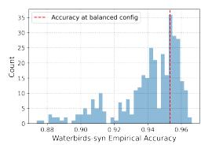

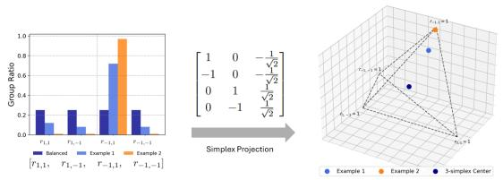

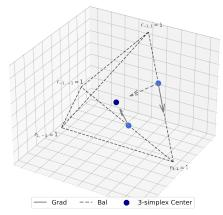  
(a) Optimal Accuracy. (b) Projection of Group Sizes to Coordinates in 3-simplex. (c) Estimated Directions.

Figure 1: (a) Test accuracy varies over diverse training data configurations and many match or exceed the performance of the balanced configuration. (b) Data configurations visualized by projecting group sizes onto a 3-simplex, including the configurations for the balanced (center), the highly skewed (vertex), and a random configuration (unique coordinate). (c) Visualization of directions estimated according to the gradients (Grad) and balancing (Bal) towards the center.

subpopulation shifts? We show the accuracy obtained from diverse configurations with variants of Waterbirds in Figure 1 (a), where we find that many configurations for the training subgroup distribution can achieve test accuracy comparable to or even exceeding that of perfectly balanced training data. Building on this fact, we ask whether it is always most efficient to improve the data towards full balance, or whether there exists a shortcut that does not necessarily lead to balance, as the question of Divergence. Prior work [44] contributed theoretical solutions to the test accuracy when models are trained on data with spurious correlation. Following the framework proposed by [44], we examine the test accuracy and use the derivative of the theoretical test accuracy, which characterizes the direction that yields the greatest performance improvement. Considering the direction towards balanced subgroups as an oracle direction, we compare their similarity and find that many training configurations yield a different derived direction. This observation reveals that the derived directions might offer new paths other than balancing direction towards robust performance and suggests the potential of strategically adjusting the data distribution for better robustness (Efficiency). In practice, this can guide data collection with principled allocation strategies to ensure the robustness of downstream model training.

To validate our findings, we conducted a series of controlled experiments on synthetic and standard datasets, covering images and text. We varied the training data configurations systematically to compare the directions by measuring performance gains obtained along different directions, which shows the advantage of the derived directions on specific configurations and validates the Divergence question. Secondly, for those training configurations where directions differ, we conducted experiments that allocate data gradually along various directions, to demonstrate the potential application to dataset collection, which corresponds to the answer to Efficiency. Lastly, we confirm the Optimality by showing the existence of multiple configurations that achieve comparable optimal performance across datasets. Collectively, our empirical analysis demonstrates that our theoretical insights consistently apply to practical settings. Moreover, we demonstrate the potential applications of our method by integrating the allocation with resampling and last-layer retraining methods. Our contributions can be summarized as follows:

1. We characterize the performance landscape by extending a prior Gaussian modeling framework and identify imbalanced configurations that perform comparably to balance.

2. We derive principled directions for adjusting subgroup configurations to improve robustness more efficiently than enforcing full balance.

3. We empirically validate our theoretical insights and show the potential in data allocation with extensive experiments.

## 2 Related Work

Subpopulation Shifts Subpopulation shift refers to changes in subgroup proportions between training and test distributions. The WILDS benchmark [21] introduced real-world datasets for evaluating robustness under distribution shifts, categorizing them into domain shift and subpopulation shift. Yang et al. [47] further formalized this setting by unifying related benchmarks and methods under a common framework. A large body of work in subpopulation shifts has sought to improve robustness through model-side interventions, including group-robust training [40, 10], feature regularization [49, 44, 30, 45], etc. These methods primarily address subpopulation shift by modifying the learning algorithm or training objective. In contrast, our work focuses on the data side of subpopulation robustness: we study how the subgroup proportions in the training data affect downstream performance and utilize it to improve the robustness.

Subgroup Allocation. Closer to our work, prior studies have examined subgroup allocation itself and shown that balancing is not universally optimal. [39] studies subgroup allocation through empirical scaling laws to show that the allocation optimizing a given objective does not need to be balanced and proposes that subgroup composition is a key determinant of performance. [42] provides an analysis of causal conditions on when balancing succeeds or fails as a fairness intervention. [1] examines when subgroup balance matters in subgroup allocation, and proposes a sensitivity explanation based on latent separation. [4] argues that the effect of subgroup allocation depends on subgroup separation in pretrained latent representations, offering a representation-level explanation for balancing failure. Our work is most closely related to [39, 1] in the setup of analyzing performance for data allocation. Unlike the pilot-training sweeps of [39], which rely on extensive empirical exploration, our approach determines the allocation direction analytically from estimated feature separability at negligible cost.

Gaussian Data Modeling Recent studies [34, 32] have employed Gaussian data modeling or linear approximations for theoretical derivations to understand phenomena such as benign overfitting and double descent. Although Gaussian data modeling is idealized, these works showed that the derived key insights generalize beyond Gaussian assumptions. Similar Gaussian modeling has also been utilized in the analysis of distribution shifts, such as spurious correlation [35, 44], class imbalance [28], or out-of-distribution detection [33, 48]. Our analysis builds directly on [44], whose symmetric spurious-correlation setting is a special case of the more general subgroup configuration. We extend this framework to characterize the allocation landscape and analyze how performance changes as subgroup proportions vary independently.

Balance-based Robustness Methods. Subgroup balance is commonly used in robustness methods such as resampling and last-layer retraining. Resampling methods over-sample minority groups or under-sample majority groups to construct a balanced training distribution, providing a simple and effective baseline for group robustness [16]. Last-layer retraining methods instead fit or reweight a classifier on a held-out subset, which is often balanced or constructed using limited group annotations [20, 17, 24, 37]. Group-robust sample reweighting further learns per-example weights with influence functions and observes that exact group balance can be suboptimal [36]. Our allocation guidance complements both families, that Grad replaces balance as the target subgroup distribution for resampling or stage-two retraining.

## 3 Subpopulation Robustness across Configurations

## 3.1 Data Modeling

Following prior theoretical studies of spurious correlation and subpopulation shifts [41, 48, 16, 33, 28, 44], we consider binary classification over a dataset $\mathcal { D } = \mathcal { X } \overset { \vartriangle } { \times } \bar { \mathcal { Y } }$ , where X is the input space and $\mathcal { V } = \{ - 1 , 1 \}$ is the label space. Each example $\mathbf { \boldsymbol { x } } \in \mathcal { X }$ has a label $y \in \{ - 1 , 1 \}$ and is associated with N binary attributes $\pmb { a } = ( \dot { a } _ { 1 } , \dots , a _ { N } ) \in \dot { \mathcal { A } } = \{ \pm 1 \} ^ { N }$ . Without loss of generality, we let $a _ { 1 }$ be the invariant attribute, which is always aligned with the label, i.e., $a _ { 1 } \equiv y$ . The remaining attributes $a _ { 2 } , \dots , a _ { N }$ may be correlated with the label. Our Gaussian feature model and subsequent Bayesian performance analysis build on [44]. Although the notation of an invariant attribute is motivated by spurious correlation [44], we extend this scope to model different forms of subpopulation shift through the training subgroup configuration. We provide a detailed comparison with related work in Appendix E.

Feature Modeling. We represent each input x by a feature vector $z = ( z _ { 1 } , \dots , z _ { N } ) \in \mathcal { Z }$ , where each component $z _ { n }$ corresponds to attribute $a _ { n }$ . Similar to [44], we model each feature component as a Gaussian variable whose mean is determined by the corresponding attribute:

$$
z _ { n } \mid a _ { n } \sim { \mathcal { N } } ( a _ { n } \mu _ { n } , \Sigma _ { n } ) .
$$

Equivalently, since $a _ { n } \in \{ \pm 1 \}$ , the feature $z _ { n }$ is centered at $\pmb { \mu } _ { n }$ when $a _ { n } = 1$ and at $- { \pmb \mu } _ { n }$ when $a _ { n } = - 1$ . Here, $\pmb { \mu } _ { n }$ and $\Sigma _ { n }$ denote the mean direction and covariance matrix of the $n { \mathrm { - } } { \mathrm { } } { \mathrm { t h } }$ feature component.

For a subgroup specified by attributes $^ { a , }$ the full feature vector follows a Gaussian distribution with mean and block-diagonal covariance

$$
\mu _ { a } = [ a _ { 1 } \pmb { \mu } _ { 1 } ^ { \top } , \allowbreak \tau . . . , a _ { N } \pmb { \mu } _ { N } ^ { \top } ] ^ { \top } \in \mathbb { R } ^ { d } , \quad \Sigma = \mathrm { d i a g } ( \Sigma _ { 1 } , \allowbreak . . . , \Sigma _ { N } ) \in \mathbb { H } _ { + } ^ { d \times d } ,
$$

where $\begin{array} { r } { d = \sum _ { n = 1 } ^ { N } d _ { n } } \end{array}$ and $d _ { n }$ is the dimension of $z _ { n } .$ . Thus, each subgroup corresponds to one component in a Gaussian mixture over the feature space. We measure the separability of the n-th attribute by the Mahalanobis distance $\begin{array} { r } { m _ { n } = \pmb { \mu } _ { n } ^ { \top } \Sigma _ { n } ^ { - 1 } \dot { \pmb { \mu } _ { n } } . } \end{array}$ A larger $m _ { n }$ indicates that the corresponding attribute is easier to classify from the feature representation.

Subpopulation modeling. Subpopulation shift is modeled through changes in the subgroup proportions between training and test data. The N binary attributes define $2 ^ { N }$ subgroups. We denote the training proportion of subgroup a by $r _ { a }$ , with $r _ { a } \ge 0$ and $\textstyle \sum _ { { \pmb { a } } \in { \mathcal { A } } } r _ { \pmb { a } } = 1$ . For simplicity, we study models trained under arbitrary subgroup configurations $\{ r _ { a } \} _ { a \in \mathcal { A } }$ and evaluate them on balanced test data throughout the analysis. For theoretical derivation, it is useful to reparameterize the subgroup proportions $r _ { a }$ using independent variables. Let

$$
\beta = \mathbb { P } ( Y = 1 ) , \quad \alpha _ { \mathrm { s i g n } ( y ) } ^ { ( n ) } = \mathbb { P } ( a _ { n } = y \mid Y = y )
$$

denote the positive-label proportion and the probability that attribute $a _ { n }$ is aligned with the label within examples of label $y .$ α further denotes all the attribute-label alignment probabilities. Since $a _ { 1 }$ is the invariant attribute, we have $\alpha _ { + } ^ { ( 1 ) } = \alpha _ { - } ^ { ( 1 ) } = 1$ . This parameterization represents the $2 ^ { N }$ subgroup proportions using $2 N - 1$ free variables, which allows a tractable subsequent theoretical analysis.

## 3.2 Analysis

Given a linear classifier $\hat { y } = \mathrm { s i g n } ( \pmb { w } ^ { \top } \pmb { z } + b )$ , we first characterize its accuracy on each subgroup. The training distribution is specified by the feature parameters $( \mu , \Sigma )$ and the subgroup-configuration parameters $( \alpha , \beta )$ . These parameters determine the Bayesian optimal linear classifier, which we then evaluate on balanced test data. The following lemma extends the symmetric group-accuracy expression of [44] to arbitrary subgroup configurations.

Lemma 1. (Bayesian Group Accuracy) For a subgroup specified by attributes $\pm \infty \in \{ \pm 1 \} ^ { N }$ , the group accuracy of a linear classifier $( { \pmb w } , b )$ is

$$
A c c _ { a } ( { \pmb w } , b ) = \frac { 1 } { 2 } \left( 1 + \mathrm { e r f } \left( \frac { \pmb { \mu } _ { a } ^ { \top } { \pmb w } + a _ { 1 } b } { \sqrt { 2 { \pmb w } ^ { \top } \Sigma { \pmb w } } } \right) \right)\tag{1}
$$

where $\pmb { \mu _ { a } } = [ a _ { 1 } \pmb { \mu } _ { 1 } ^ { \top } , \dots , a _ { N } \pmb { \mu } _ { N } ^ { \top } ] ^ { \top }$ is the subgroup mean.

Following [44], we obtain the Bayesian optimal linear classifier by maximizing the overall accuracy on the training distribution. Under the Gaussian feature model, the optimal classifier is aligned with the feature directions: $\pmb { w } _ { n } ^ { * } = \eta _ { n } \Sigma _ { n } ^ { - 1 } \pmb { \mu } _ { n }$ , where each $\eta _ { n } \in \mathbb { R }$ is a scalar coefficient for the n-th feature component. The coefficients $\eta _ { 1 } , \dots , \eta _ { N }$ and the bias b are determined by the training statistics $( \mu , \Sigma , \alpha , \beta )$ through the optimality conditions of the training accuracy. We provide the full derivation and the resulting equation system in the appendix. Once $( w ^ { * } , b ^ { * } )$ is solved, Lemma 1 gives the theoretical test accuracy of the classifier on each subgroup.

The key implication is that the test performance can be solved and expressed as a function of the training subgroup configuration. However, as the number of classifier parameters and subgroupconfiguration variables grows with the number of attributes, we focus the main analysis on the two-attribute setting for clarity. We also provide a demonstration of three attributes in Appendix I.8. Since $a _ { 1 } \equiv y _ { : }$ , its alignment parameters are fixed as $\alpha _ { + } ^ { ( 1 ) } = \alpha _ { - } ^ { ( 1 ) } = 1$ and can be omitted. Thus, the training configuration is fully described by $( \alpha _ { + } , \alpha _ { - } , \beta ) : = ( \alpha _ { + } ^ { ( 2 ) } , \alpha _ { - } ^ { ( 2 ) } , \beta )$ . The same procedure extends to more attributes, but with additional intermediate variables.

Finally, we define the performance metric used in our theoretical analysis. Following prior work on subpopulation shifts [47], two common metrics are worst-group accuracy, $\mathrm { W G A } = \operatorname* { m i n } _ { a \in \mathcal { A } } A c c _ { a }$ and adjusted accuracy, $\mathrm { A A } = { \textstyle { \frac { 1 } { 2 ^ { N } } } } \sum _ { { \bf a } \in { \cal A } } A c c _ { { \bf a } }$ , which equals the overall accuracy on a balanced test distribution. Although WGA is commonly used, its minimum operator is non-smooth and makes gradient-based analysis less direct. We therefore use adjusted accuracy for the theoretical derivation, since it is a smooth average of subgroup accuracies and enables the subsequent analysis. We empirically report both adjusted accuracy and WGA to verify that the theoretical conclusions also hold under worst-group robustness.

The same group-wise derivatives also provide a local WGA direction. While WGA $\nabla _ { p } \mathrm { W G A } =$ $\nabla _ { p } A c c _ { a ^ { * } }$ employs the minimum operator, it is non-smooth and becomes non-differentiable when the worst-performing group shifts, making a global gradient-based analysis inapplicable. In our experiments, AA- and WGA-derived directions yield similar allocation behavior, with details provided in Appendix I.2. We retain AA as the main objective and verify its empirical effect on WGA.

Optimality: Configurations that achieve robust performance. We first ask whether the fully balanced configuration is the only training configuration that achieves optimal robust performance. To study this question, we specialize to the two-attribute case $( N = 2 )$ , where the Bayesian optimal classifier can be parameterized more simply. Let $\tau = \eta _ { 2 } / \eta _ { 1 }$ , where $\eta _ { 1 }$ and $\eta _ { 2 }$ are the coefficients of the two feature components in the Bayesian optimal classifier. Then the classifier is fully determined by the two scalars $( \tau , b )$ , and the group accuracy for subgroup $\pmb { a } = ( a _ { 1 } , a _ { 2 } )$ thus becomes

$$
A c c _ { a } = \frac { 1 } { 2 } \left( 1 + \mathrm { e r f } \left( \frac { a _ { 1 } m _ { 1 } + \tau a _ { 2 } m _ { 2 } + a _ { 1 } b } { \sqrt { 2 ( m _ { 1 } + \tau ^ { 2 } m _ { 2 } ) } } \right) \right)\tag{2}
$$

where $m _ { 1 } , m _ { 2 }$ represent the separability for the two attributes. Equation 2 shows that group accuracy is a continuous function of the training configuration through $( \tau , b )$ . As a result, adjusted accuracy and worst-group accuracy are also continuous in the configuration. This suggests that the balanced configuration is not an isolated optimum: configurations near a high-performing point may also achieve comparably strong performance. To examine this possibility systematically, we study the performance landscape over a wide range of training configurations.

Visualization notation. In the two-attribute setting, there are four subgroups. A training configuration is therefore specified by four subgroup proportions $\{ r _ { a } \} _ { a \in \{ \pm 1 \} ^ { 2 } }$ , which sum to one. To visualize all possible configurations, we map these four proportions to a 3-simplex, as shown in Figure 1(b). Each point in the simplex represents one training configuration. The center corresponds to the balanced configuration, where each subgroup has proportion 25%. Each vertex corresponds to an extreme configuration, where all data belong to a single subgroup. Points closer to a vertex assign more data to that subgroup.

Figure 1(b) illustrates this mapping with three examples: the balanced configuration at the center, an extreme configuration with $r _ { - 1 , 1 } = 1$ at one vertex, and an intermediate configuration where $r _ { - 1 , 1 }$ is the largest subgroup. This 3-simplex visualization provides a direct and complete view: each point inside the simplex represents one valid set of subgroup proportions, and every possible configuration maps to a unique point within the simplex.

To study the performance landscape, we uniformly sample the configuration parameters $\alpha _ { + } , \alpha _ { - } , \beta _ { }$ Using n equally spaced values for each parameter gives $n ^ { 3 }$ training configurations. For example, with $n = 4 9$ , we obtain $4 9 ^ { 3 }$ configurations. For each configuration, we compute the theoretical adjusted accuracy using $m _ { 1 } = m _ { 2 } = 2$ , which represents a moderate level of feature separability.

Figure 2 visualizes the configurations whose adjusted accuracy lies above the 90th percentile. For both $n = 4 9$ and $n = 7$ , the balanced configuration achieves adjusted accuracy 0.921, while the 90th percentile threshold is 0.918. Thus, many configurations attain performance very close to the balanced one, indicating the existence of alternative high-performing, near-optimal configurations. Using a larger n produces a denser sampling of the simplex and therefore a smoother visualization of this high-performance region.

Efficiency: Efficient routes toward robust performance. The optimality analysis shows that high-performing configurations are not limited to the fully balanced configuration. We next ask how to move from a given training configuration toward better robust performance as efficiently as possible. Let $\begin{array} { r } { A ( \alpha _ { + } , \alpha _ { - } , \beta ) = \frac { \mathcal { \mathrm { T } } } { 4 } \sum _ { { \bf a } \in \mathcal { A } } } \end{array}$ Acc<sub>a</sub> denote the adjusted accuracy in the two-attribute setting. Since A is a differentiable function of the training-configuration parameters $( \alpha _ { + } , \alpha _ { - } , \beta )$ its gradient indicates the local direction in which the configuration should be changed to increase adjusted accuracy most rapidly.

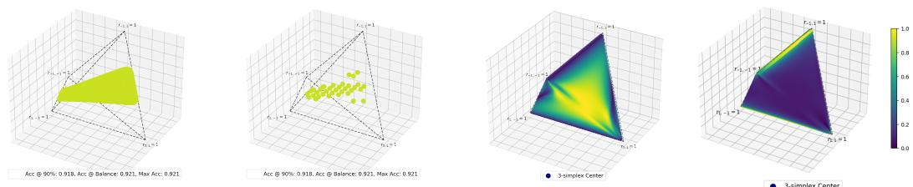  
Figure 2: Visualization of group configurations achieving 90th-percentile accuracy, shown on a densely sampled (left, $n = 4 9 )$ and a sparsely sampled (right, $n = 7 )$ theoretical 3-simplex.  
Figure 3: Visualization of the Grad and Bal direction comparison. Darker regions in theoretical cosine similarity (left) and lighter regions in accuracy gap (right) indicate greater disparity.

Proposition 1 (Gradient of Adjusted Accuracy). Consider the two-attribute setting with configuration parameters $\pmb { p } = ( \alpha _ { + } , \alpha _ { - } , \beta )$ . For each subgroup $\pmb { a } = ( a _ { 1 } , a _ { 2 } ) \in \{ \pm 1 \} ^ { 2 }$ , define

$$
f _ { a } ( \tau , b ) = \frac { a _ { 1 } m _ { 1 } + \tau a _ { 2 } m _ { 2 } + a _ { 1 } b } { \sqrt { 2 { \cal D } } } , \qquad { \cal D } = m _ { 1 } + \tau ^ { 2 } m _ { 2 } ,
$$

where τ and b are determined by the Bayesian optimality equations and therefore depend on p. Then, for any $p \in \{ \alpha _ { + } , \alpha _ { - } , \beta \}$ , the derivative ofadjusted accuracy is

$$
\frac { \partial A } { \partial p } = \frac { 1 } { 4 } \sum _ { a \in \mathcal { A } } \frac { \partial A c c _ { a } } { \partial p } = \frac { 1 } { 4 } \sum _ { a \in \mathcal { A } } \frac { 1 } { \sqrt { \pi } } e ^ { - f _ { a } ^ { 2 } } \left( \frac { m _ { 2 } \left( a _ { 2 } m _ { 1 } - \tau a _ { 1 } ( m _ { 1 } + b ) \right) } { D \sqrt { 2 D } } \frac { \partial \tau } { \partial p } + \frac { a _ { 1 } } { \sqrt { 2 D } } \frac { \partial b } { \partial p } \right) .\tag{3}
$$

The quantities $\partial \tau / \partial p$ and $\partial b / \partial p$ are obtained by differentiating the Bayesian optimality equations that define τ and b.

The full derivation is provided in Appendix C. The takeaway is that a principled direction is solvable for changing the training subgroup configuration. Specifically, we define the gradient direction as

$$
d _ { \mathrm { G r a d } } = { \frac { \nabla _ { p } A } { \| \nabla _ { p } A \| _ { 2 } } } , \quad \nabla _ { p } A = \left( { \frac { \partial A } { \partial \alpha _ { + } } } , { \frac { \partial A } { \partial \alpha _ { - } } } , { \frac { \partial A } { \partial \beta } } \right)
$$

Starting from an initial configuration $ { \mathbf { \mathit { p } } } ^ { ( 0 ) }$ , we update the configuration by $\pmb { p } ^ { ( t + 1 ) } = \pmb { p } ^ { ( t ) } + \delta d _ { \mathrm { G r a d } } ^ { ( t ) } ,$ where $\delta > 0$ is the step size. This update performs gradient ascent on the theoretically estimated adjusted accuracy.

Baseline and robust directions. We compare with two additional directions. The first is the balancing direction (Bal), which serves as an oracle baseline and always updates the data from the current configuration toward the fully balanced configuration. The second is the sign-gradient direction (Sign). Grad depends on the feature separability values $m _ { n }$ , which are known in the Gaussian model but must be estimated for real data. Since such estimates can be noisy or inaccurate, we introduce Sign, which uses only the signs of the gradient entries. This provides a more robust alternative when the separability estimates are imprecise. We include more details of implementing these directions in Appendix G.

Divergence between Grad and Bal. We next ask when Grad and Bal point in different directions. For each training configuration, we compute the cosine similarity between the two directions and visualize it in Figure 3 (left), where low similarity means that balancing may not be the most efficient update. We observe that while many configurations have reasonably aligned directions, some edge regions of the simplex show strong disagreement between Grad and Bal.

To quantify whether this directional disagreement leads to different performance gains, we also compare the accuracy after updating the configuration along each direction. Starting from the same configuration $^ { p , }$ we run 10 update steps along Grad and Bal, obtaining $p _ { \mathrm { G r a d } }$ and ${ \pmb p } _ { \mathrm { B a l } }$ . We then measure $A ( \pmb { p } _ { \mathrm { G r a d } } ) - A ( \pmb { p } _ { \mathrm { B a l } } )$ . Figure 3 (right) shows that regions with low cosine similarity also tend to have larger positive accuracy gaps, indicating that Grad can provide a more efficient route to robust performance than moving directly toward balance.

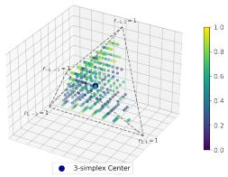  
(a) Waterbirds-syn

  
(b) UrbanCars-syn

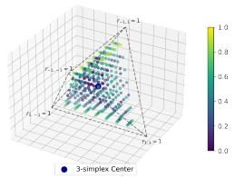  
(c) CelebA-subset

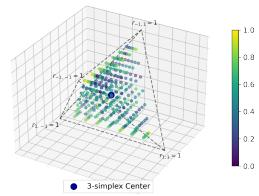  
(d) CivilComments-subset  
Figure 4: Existence of divergent directions across datasets. Empirical comparison of Grad/Bal directions with accuracy gaps obtained from $7 ^ { 3 } = 3 4 3$ configurations of training data. Lighter colors are observed near edges connecting $r _ { - 1 , - 1 } \mathrm { t o } r _ { - 1 , 1 } .$ , and $r _ { 1 , - 1 } \mathrm { t o } r _ { 1 , 1 }$ , indicating a greater disparity between Grad/Bal directions and aligning with the theoretical accuracy gap trends in Figure 3.

## 4 Experiments

## 4.1 Experimental Setup

Goals. Although our theory uses Gaussian feature modeling, the resulting directions only require empirically accessible quantities, such as configurations and estimated feature separability, rather than Gaussian means or covariances. We therefore evaluate whether the theoretical insights transfer to realistic non-Gaussian features learned by deep models. Our experiments address three questions: (1) Divergence: when do Grad and Bal point in different directions? (2) Efficiency: when they diverge, does Grad provide more efficient guidance for data allocation? and (3) Optimality: can non-balanced configurations achieve performance comparable to balanced configurations?

Datasets. Following prior work on subpopulation shifts [47], we evaluate on three image datasets, Waterbirds [40], UrbanCars [26], and CelebA [29], and one text dataset, CivilComments [3]. Although some of the datasets are primarily used for spurious correlation studies, we systematically vary subgroup configurations to validate our insights under a broader scope of subpopulation shifts. We construct subsets to create CelebA-subset and CivilComments-subset, and generate flexible synthetic variants of Waterbirds and UrbanCars, denoted as Waterbirds-syn and UrbanCars-syn, using their foreground-background construction schemes [43, 22, 52]. Dataset details are provided in Appendix D.

Models. Due to a wide range of configurations to validate our insights, we use one standard pretrained encoder per modality: ResNet50 [14] for image datasets and BERT [8] for the text dataset. For each dataset, we attach a one-layer classification head and fine-tune the full model. These choices follow common setups in subpopulation-shift studies [47, 25, 51]. Additional training details are provided in Appendix F.

Since our conclusions rely on relative gains between directions rather than absolute performance, they are less tied to a specific encoder. Moreover, as the feature separability is estimated from one set of empirical results, it implicitly reflects the model’s capacity to distinguish attributes, thus supporting the model-agnostic nature of our method. We verify the model-agnostic characteristics with additional encoders in Appendix I.9.

Metrics and directions. We report adjusted accuracy (AA), the average accuracy across groups, and worst-group accuracy (WGA), the minimum group accuracy [47]. All directions denoted Grad in the main experiments are derived from AA, and we report WGA separately to test whether this guidance also benefits the weakest group in Appendix I.1.

We compare four update directions for changing subgroup configurations: Grad, our derived gradient direction; Bal, an oracle baseline that points toward full balance; Sign, which uses only the signs of the gradient entries and is more robust to separability-estimation error; and Random, a random unit direction used as a neutral control.

## 4.2 Existence of Direction Divergence

We first test whether Grad and Bal can lead to different empirical outcomes across training configurations. We sample a coarse grid of $7 ^ { 3 } = 3 4 3$ configurations by varying $( \alpha _ { + } , \alpha _ { - } , \beta )$ from 0.125 to 0.875 with stride 0.125 for each dataset. For each configuration, we construct the corresponding training subset, update the configuration for 10 steps along either Grad or Bal, and evaluate the resulting empirical adjusted accuracy. For each initial configuration $\pmb { p } = ( \alpha _ { + } , \alpha _ { - } , \beta )$ , we measure the empirical accuracy gap of Grad over Bal as $A ( \pmb { p } _ { \mathrm { G r a d } } ) - \overset { \cdot } { A } ( \pmb { p } _ { \mathrm { B a l } } )$ , where $p _ { \mathrm { G r a d } }$ and $\pmb { p } _ { \mathrm { B a l } }$ denote the configurations obtained after 10 update steps along Grad and Bal, respectively. We visualize this gap in the 3-simplex in Figure $^ { 4 , }$ with lighter colors indicating larger gains from Grad.

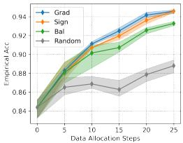

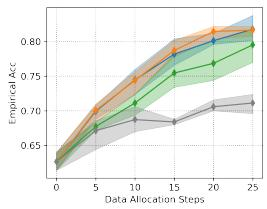

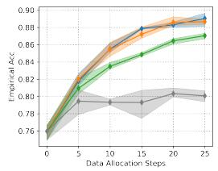

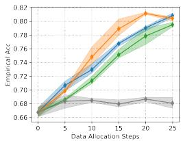

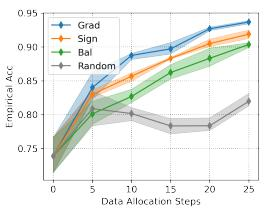

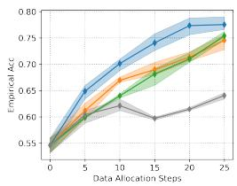

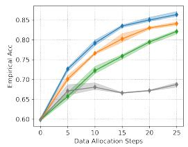

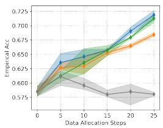

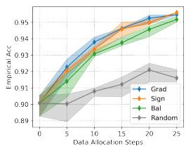  
(a) Waterbirds-syn

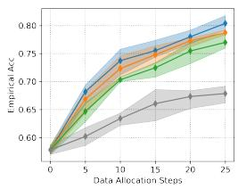  
(b) UrbanCars-syn

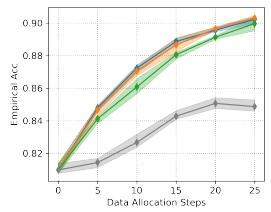  
(c) CelebA-subset

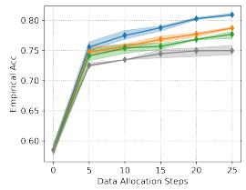  
(d) CivilComments-subset

Figure 5: Efficiency of data allocation along directions across datasets and initial configurations. The efficiency of directions is validated by the comparison of the performance change as the data is allocated according to various directions. Each row corresponds to one allocation experiment with an initial configuration, and each column corresponds to a dataset. The legends are shared across plots.  
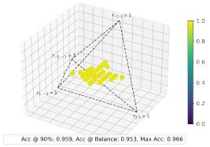  
(a) Waterbirds-syn

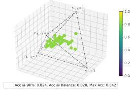  
(b) UrbanCars-syn

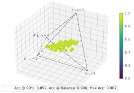  
(c) CelebA-subset

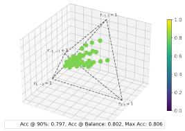  
(d) CivilComments-subset  
Figure 6: Optimality of test performance across multiple configurations. Among $7 ^ { 3 } = 3 4 3$ training data configurations, those achieving test performance above the 90th percentile are visualized within the 3-simplex. The results confirm that multiple configurations can achieve test performance comparable to or exceeding that of the balanced configuration, consistent with Figure 2.

The empirical patterns are consistent with the theoretical prediction in Figure 3: regions near the edges connecting $r _ { - 1 , - 1 } \mathrm { t o } r _ { - 1 , 1 }$ and $r _ { 1 , - 1 } \mathrm { t o } r _ { 1 , 1 }$ show larger Grad–Bal gaps. This confirms that there are many configurations where moving directly toward balance is not the most effective update, and where Grad provides a more efficient direction for improving robustness.

## 4.3 Efficiency When Directions Diverge

We next evaluate whether the divergence between Grad and Bal translates into more efficient data allocation. We select three examples from the theoretical simplex where Grad and Bal have both low directional similarity and a substantial predicted performance gap, which excludes cases where the directions align or perform similarly. Their initial configurations and direction comparisons are provided in Appendix H. Starting from each initial configuration, we update the subgroup proportions along different directions for 5 to 25 steps. Each updated configuration defines a new target training distribution. To simulate data allocation under a fixed budget, we add or remove the same total number of samples according to the target subgroup proportions, train on the resulting dataset, and evaluate test performance. Thus, the change in accuracy, as the number of update steps increases, measures how efficiently each direction uses the data allocation budget. Figure 5 reports adjusted accuracy across allocation steps. Each experiment is repeated with three random seeds, and we show the mean with min–max error bars. Across datasets and initial configurations, Grad yields the fastest performance improvement, demonstrating that the derived direction can guide data collection more efficiently than moving directly toward balance. We provide the statistical tests in Appendix I.5.

## 4.4 Optimality in Multiple Configurations

Finally, we test whether strong performance is limited to the balanced configuration. Using the same $\mathsf { 7 ^ { 3 } = 3 4 3 }$ training configurations, we train and evaluate models for each configuration and visualize those whose adjusted accuracy is above the 90th percentile in Figure 6. For each dataset, we also mark the 90th-percentile accuracy, the balanced-configuration accuracy, and the maximum accuracy. The high-performing configurations are not concentrated only at the balanced center. Instead, many non-balanced configurations achieve accuracy comparable to, and sometimes higher than, the balanced configuration. This empirical pattern is consistent with the theoretical visualization in Figure 2, and supports our optimality claim: robust performance can be achieved by multiple subgroup configurations, not only by full balance. Additional visualizations with higher percentile thresholds are provided in the Appendix H.3 to further support the claim.

## 4.5 Application to Grad-Guided Resampling

Our main application is data allocation under a fixed annotation budget, where Grad indicates how to adjust the subgroups for more effective improvement in subpopulation robustness. We further show that it can be integrated with standard resampling methods. In vanilla oversampling or under-sampling, the target distribution is typically the fully balanced configuration. In contrast, Grad-guided resampling targets one of the identified optimal configurations obtained by moving along the derived Grad direction.

Table 1: Grad-guided resampling on Example 2 of Waterbirds-syn. Vanilla over-/under-sampling targets the balanced configuration, while Gradguided resampling targets the alternative optimal configurations.
<table><tr><td>Method</td><td>Adjusted Acc.</td><td>WGA</td></tr><tr><td>Original</td><td>0.766</td><td>0.376</td></tr><tr><td>Over-sampling</td><td>0.768</td><td>0.366</td></tr><tr><td>Over-sampling + Grad</td><td>0.821</td><td>0.541</td></tr><tr><td>Under-sampling</td><td>0.777</td><td>0.837</td></tr><tr><td>Under-sampling + Grad</td><td>0.901</td><td>0.848</td></tr></table>

We evaluate this application on the Example 2 configuration of Waterbirds-syn in Figure 5. We set the total training size to 9,000 so that each

subgroup has enough samples for resampling, and compare vanilla resampling with Grad-guided resampling. As shown in Table 1, replacing the balanced target with the Grad-induced target improves both adjusted accuracy and worst-group accuracy, especially for over-sampling. We further provide the subgroup statistics in Appendix I.4 to show that the Grad-guided over/under-sampling tends to utilize more original data and maintain better performance across multiple metrics. This suggests that Grad can serve as a drop-in guide for existing data rebalancing techniques.

## 4.6 Application to Last-layer Retraining Methods

Last-layer retraining methods provide a complementary application as their second stage often uses a balanced held-out subset [20, 24]. We replace only this stage-two subgroup composition with the Grad-derived allocation, keep its total size fixed, and leave the remaining components of each method unchanged. Table 2 reports results for DFR [20], SELF [24], GSR [36], and AFR [37]. Across Waterbirds and CelebA, the imbalanced Grad allocation retains the WGA of DFR and SELF and improves or retains GSR and AFR. The purpose is not to replace these algorithms, but to show that exact balance can be relaxed when minority examples are costly while preserving their robustness benefits.

Table 2: Comparison of worst-group and adjusted accuracy (%) under different stage-two data allocation strategies. Results are reported for last-layer retraining using the original stage-two allocation and the Grad allocation.
<table><tr><td rowspan="2">Method Metric</td><td colspan="2">Waterbirds</td><td colspan="2">CelebA</td></tr><tr><td>Original</td><td>Grad</td><td>Original</td><td>Grad</td></tr><tr><td rowspan="2">DFR</td><td>WGA</td><td>89.30±0.55</td><td>89.10±0.75</td><td>87.49±1.27 87.36±0.13</td></tr><tr><td>AA</td><td>91.37±0.45 91.60±0.19</td><td>90.87±0.82</td><td>90.39±0.33</td></tr><tr><td rowspan="2">SELF</td><td>WGA</td><td>88.28±1.37</td><td>88.53±0.76</td><td>82.59±2.31 82.18±3.81</td></tr><tr><td>AA</td><td>91.50±0.26</td><td>91.74±0.26 90.52±0.57</td><td>90.74±0.72</td></tr><tr><td rowspan="2">GSR</td><td>WGA</td><td>91.90±1.42</td><td>91.96±0.95</td><td>85.74±2.57 86.67±0.96</td></tr><tr><td>AA</td><td>94.00±0.39</td><td>93.79±0.37 89.86±0.25</td><td>90.23±0.31</td></tr><tr><td rowspan="2">AFR</td><td>WGA</td><td>86.90±3.47</td><td>88.27±0.24</td><td>80.74±2.10 83.84±0.22</td></tr><tr><td>AA</td><td>91.95±1.17</td><td>92.50±0.76</td><td>89.05±0.75 89.89±0.26</td></tr></table>

## 5 Discussion

This work revisits whether fully balanced subgroup proportions are necessary for subpopulation robustness. Our analysis shows that robust performance can be achieved by a broader set of training configurations, even including imbalanced ones. We further derive gradient-based directions for adjusting subgroup proportions, and show that these directions can diverge from the path toward full balance. Experiments on vision and language benchmarks confirm that Grad-guided data allocation can improve performance more efficiently than directly enforcing balance. Overall, our work provides a principled method to strategically shape subgroup distributions for robust generalization.

Broad Impacts. This work presents a data-centric perspective on achieving robust generalization, and our analysis guides the construction of datasets for better subpopulation robustness in downstream model training and deployment, particularly helpful in high-stakes domains where balance is infeasi ble to achieve. Although we focus on data-side effects without direct comparison with model-based methods to keep the theoretical insights clear, integrating our data-optimization principles with existing model-side approaches is a promising direction for real-world deployment. In Appendix I.6, we provide an example showing that integrating our data allocation with Group DRO [40] and Regularization [44] can further improve performance.

Limitations and Future Work. One limitation lies in the feature separability estimation. Although the estimation generalizes well across four datasets, it can be inaccurate in practice, especially in noisy data or unstable optimization. We partially address this limitation by introducing the Sign direction, which is more robust to separability-estimation error. We included an empirical study on the robustness to estimation error in Appendix I.7. Another limitation is scalability: while the theoretical framework covers multiple attributes, the complexity of calculating intermediate derivatives increases quickly as the number of subgroups grows. Furthermore, current multi-attribute benchmarks are limited in scope. We thus focus our analysis on binary attribute settings in the main paper, provide a demonstration of 3-attribute in Appendix I.8, and leave further analysis to future work. Finally, our global analysis optimizes AA rather than WGA. The experiments show that the resulting direction improves WGA in the studied settings, and a local WGA direction can be estimated. However, a general theoretical connection between the two objectives remains open.

Acknowledgment. This work was partially supported by NSF IIS #2146091, IIS #2345235, and USDA #2023-67021-41368.

## References

[1] Anissa Alloula, Charles Jones, Zuzanna Wakefield-Skorniewska, Francesco Quinzan, and Bartłomiej Papiez. Representation invariance and allocation: When subgroup balance matters.˙ arXiv preprint arXiv:2512.09496, 2025.

[2] Martin Arjovsky, Léon Bottou, Ishaan Gulrajani, and David Lopez-Paz. Invariant risk minimization. arXiv preprint arXiv:1907.02893, 2019.

[3] Daniel Borkan, Lucas Dixon, Jeffrey Sorensen, Nithum Thain, and Lucy Vasserman. Nuanced metrics for measuring unintended bias with real data for text classification. In Companion proceedings ofthe 2019 world wide web conference, pages 491–500, 2019.

[4] Estanislao Claucich, Sara Hooker, Diego H Milone, Enzo Ferrante, and Rodrigo Echeveste. Fairness of deep ensembles: On the interplay between per-group task difficulty and under-representation. In Proceedings of the 2025 ACM Conference on Fairness, Accountability, and Transparency, pages 3138–3147, 2025.

[5] Noel Codella, Veronica Rotemberg, Philipp Tschandl, M Emre Celebi, Stephen Dusza, David Gutman, Brian Helba, Aadi Kalloo, Konstantinos Liopyris, Michael Marchetti, et al. Skin lesion analysis toward melanoma detection 2018: A challenge hosted by the international skin imaging collaboration (isic). arXiv preprint arXiv:1902.03368, 2019.

[6] Yin Cui, Menglin Jia, Tsung-Yi Lin, Yang Song, and Serge Belongie. Class-balanced loss based on effective number of samples. In Proceedings of the IEEE/CVF conference on computer vision and pattern recognition, pages 9268–9277, 2019.

[7] Yihe Deng, Yu Yang, Baharan Mirzasoleiman, and Quanquan Gu. Robust learning with progressive data expansion against spurious correlation. Advances in neural information processing systems, 36:1390–1402, 2023.

[8] Jacob Devlin, Ming-Wei Chang, Kenton Lee, and Kristina Toutanova. Bert: Pre-training of deep bidirectional transformers for language understanding. In Proceedings of the 2019 conference of the North American chapter of the association for computational linguistics: human language technologies, volume 1 (long and short papers), pages 4171–4186, 2019.

[9] Alexey Dosovitskiy, Lucas Beyer, Alexander Kolesnikov, Dirk Weissenborn, Xiaohua Zhai, Thomas Unterthiner, Mostafa Dehghani, Matthias Minderer, Georg Heigold, Sylvain Gelly, et al. An image is worth 16x16 words: Transformers for image recognition at scale. In International Conference on Learning Representations, 2021.

[10] John C Duchi and Hongseok Namkoong. Learning models with uniform performance via distributionally robust optimization. The Annals ofStatistics, 49(3):1378–1406, 2021.

[11] Robert Geirhos, Jörn-Henrik Jacobsen, Claudio Michaelis, Richard Zemel, Wieland Brendel, Matthias Bethge, and Felix A Wichmann. Shortcut learning in deep neural networks. Nature Machine Intelligence, 2(11):665–673, 2020.

[12] Moritz Hardt, Eric Price, and Nati Srebro. Equality of opportunity in supervised learning. Advances in neural information processing systems, 29, 2016.

[13] Haibo He and Edwardo A Garcia. Learning from imbalanced data. IEEE Transactions on knowledge and data engineering, 21(9):1263–1284, 2009.

[14] Kaiming He, Xiangyu Zhang, Shaoqing Ren, and Jian Sun. Deep residual learning for image recognition. In Proceedings ofthe IEEE conference on computer vision and pattern recognition, pages 770–778, 2016.

[15] Pengcheng He, Xiaodong Liu, Jianfeng Gao, and Weizhu Chen. Deberta: Decoding-enhanced bert with disentangled attention. arXiv preprint arXiv:2006.03654, 2020.

[16] Badr Youbi Idrissi, Martin Arjovsky, Mohammad Pezeshki, and David Lopez-Paz. Simple data balancing achieves competitive worst-group-accuracy. In Conference on Causal Learning and Reasoning, pages 336–351. PMLR, 2022.

[17] Pavel Izmailov, Polina Kirichenko, Nate Gruver, and Andrew G Wilson. On feature learning in the presence of spurious correlations. Advances in Neural Information Processing Systems, 35:38516–38532, 2022.

[18] Justin M Johnson and Taghi M Khoshgoftaar. Survey on deep learning with class imbalance. Journal of big data, 6(1):1–54, 2019.

[19] Michael Kearns, Seth Neel, Aaron Roth, and Zhiwei Steven Wu. Preventing fairness gerrymandering: Auditing and learning for subgroup fairness. In International conference on machine learning, pages 2564–2572. PMLR, 2018.

[20] Polina Kirichenko, Pavel Izmailov, and Andrew Gordon Wilson. Last layer re-training is sufficient for robustness to spurious correlations. In The Eleventh International Conference on Learning Representations, 2023.

[21] Pang Wei Koh, Shiori Sagawa, Henrik Marklund, Sang Michael Xie, Marvin Zhang, Akshay Balsubramani, Weihua Hu, Michihiro Yasunaga, Richard Lanas Phillips, Irena Gao, et al. Wilds: A benchmark of in-the-wild distribution shifts. In International conference on machine learning, pages 5637–5664. PMLR, 2021.

[22] Jonathan Krause, Michael Stark, Jia Deng, and Li Fei-Fei. 3d object representations for fine-grained categorization. In Proceedings of the IEEE international conference on computer vision workshops, pages 554–561, 2013.

[23] Bartosz Krawczyk. Learning from imbalanced data: open challenges and future directions. Progress in artificial intelligence, 5(4):221–232, 2016.

[24] Tyler LaBonte, Vidya Muthukumar, and Abhishek Kumar. Towards last-layer retraining for group robustness with fewer annotations. Advances in Neural Information Processing Systems, 36:11552–11579, 2023.

[25] Weiwei Li, Junzhuo Liu, Yuanyuan Ren, Yuchen Zheng, Yahao Liu, and Wen Li. Let samples speak: Mitigating spurious correlation by exploiting the clusterness of samples. In Proceedings ofthe IEEE/CVF Conference on Computer Vision and Pattern Recognition, pages 15486–15496, 2025.

[26] Zhiheng Li, Ivan Evtimov, Albert Gordo, Caner Hazirbas, Tal Hassner, Cristian Canton Ferrer, Chenliang Xu, and Mark Ibrahim. A whac-a-mole dilemma: Shortcuts come in multiples where mitigating one amplifies others. In Proceedings of the IEEE/CVF Conference on Computer Vision and Pattern Recognition, pages 20071–20082, 2023.

[27] Tsung-Yi Lin, Priya Goyal, Ross Girshick, Kaiming He, and Piotr Dollár. Focal loss for dense object detection. In Proceedings of the IEEE international conference on computer vision, pages 2980–2988, 2017.

[28] Hong Liu, Jeff Z HaoChen, Adrien Gaidon, and Tengyu Ma. Self-supervised learning is more robust to dataset imbalance. In International Conference on Learning Representations, 2022.

[29] Ziwei Liu, Ping Luo, Xiaogang Wang, and Xiaoou Tang. Deep learning face attributes in the wild. In Proceedings ofthe IEEE international conference on computer vision, pages 3730–3738, 2015.

[30] Shenyu Lu, Junyi Chai, and Xiaoqian Wang. Neural collapse inspired debiased representation learning for min-max fairness. In Proceedings ofthe 30th ACM SIGKDD Conference on Knowledge Discovery and Data Mining, pages 2048–2059, 2024.

[31] Ninareh Mehrabi, Fred Morstatter, Nripsuta Saxena, Kristina Lerman, and Aram Galstyan. A survey on bias and fairness in machine learning. ACM computing surveys (CSUR), 54(6):1–35, 2021.

[32] Song Mei and Andrea Montanari. The generalization error of random features regression: Precise asymptotics and the double descent curve. Communications on Pure and Applied Mathematics, 2021.

[33] Yifei Ming, Hang Yin, and Yixuan Li. On the impact of spurious correlation for out-of-distribution detection. In Proceedings ofthe AAAI Conference on Artificial Intelligence, volume 36, pages 10051–10059, 2022.

[34] Andrea Montanari, Feng Ruan, Youngtak Sohn, and Jun Yan. The generalization error of max-margin linear classifiers: Benign overfitting and high dimensional asymptotics in the overparametrized regime. arXiv preprint arXiv:1911.01544, 2019.

[35] Vaishnavh Nagarajan, Anders Andreassen, and Behnam Neyshabur. Understanding the failure modes of out-of-distribution generalization. In International Conference on Learning Representations, 2021.

[36] Rui Qiao, Zhaoxuan Wu, Jingtan Wang, Pang Wei Koh, and Bryan Kian Hsiang Low. Group-robust sample reweighting for subpopulation shifts via influence functions. In International Conference on Learning Representations, volume 2025, pages 36959–36980, 2025.

[37] Shikai Qiu, Andres Potapczynski, Pavel Izmailov, and Andrew Gordon Wilson. Simple and fast group robustness by automatic feature reweighting. In International Conference on Machine Learning, pages 28448–28467. PMLR, 2023.

[38] Joaquin Quiñonero-Candela, Masashi Sugiyama, Anton Schwaighofer, and Neil D Lawrence. Dataset shift in machine learning. Mit Press, 2022.

[39] Esther Rolf, Theodora T Worledge, Benjamin Recht, and Michael Jordan. Representation matters: Assessing the importance of subgroup allocations in training data. In International conference on machine learning, pages 9040–9051. PMLR, 2021.

[40] Shiori Sagawa, Pang Wei Koh, Tatsunori B Hashimoto, and Percy Liang. Distributionally robust neural networks for group shifts: On the importance of regularization for worst-case generalization. In International Conference on Learning Representations, 2020.

[41] Shiori Sagawa, Aditi Raghunathan, Pang Wei Koh, and Percy Liang. An investigation of why overparameterization exacerbates spurious correlations. In International Conference on Machine Learning, pages 8346–8356. PMLR, 2020.

[42] Jessica Schrouff, Alexis Bellot, Amal Rannen-Triki, Alan Malek, Isabela Albuquerque, Arthur Gretton, Alexander D’Amour, and Silvia Chiappa. Mind the graph when balancing data for fairness or robustness. Advances in Neural Information Processing Systems, 37:29913–29947, 2024.

[43] Catherine Wah, Steve Branson, Peter Welinder, Pietro Perona, and Serge Belongie. The caltech-ucsd birds-200-2011 dataset. 2011.

[44] Yipei Wang and Xiaoqian Wang. On the effect of key factors in spurious correlation: A theoretical perspective. In International Conference on Artificial Intelligence and Statistics, pages 3745–3753. PMLR, 2024.

[45] Tao Wen, Zihan Wang, Quan Zhang, and Qi Lei. Elastic representation: Mitigating spurious correlations for group robustness. arXiv preprint arXiv:2502.09850, 2025.

[46] Shirley Wu, Mert Yuksekgonul, Linjun Zhang, and James Zou. Discover and cure: Concept-aware mitigation of spurious correlation. In International Conference on Machine Learning, pages 37765–37786. PMLR, 2023.

[47] Yuzhe Yang, Haoran Zhang, Dina Katabi, and Marzyeh Ghassemi. Change is hard: A closer look at subpopulation shift. In International Conference on Machine Learning, pages 39584–39622. PMLR, 2023.

[48] Huaxiu Yao, Yu Wang, Sai Li, Linjun Zhang, Weixin Liang, James Zou, and Chelsea Finn. Improving outof-distribution robustness via selective augmentation. In International Conference on Machine Learning, pages 25407–25437. PMLR, 2022.

[49] Michael Zhang, Nimit S Sohoni, Hongyang R Zhang, Chelsea Finn, and Christopher Re. Correct-n-contrast: a contrastive approach for improving robustness to spurious correlations. In International Conference on Machine Learning, pages 26484–26516. PMLR, 2022.

[50] Yifan Zhang, Bingyi Kang, Bryan Hooi, Shuicheng Yan, and Jiashi Feng. Deep long-tailed learning: A survey. IEEE Transactions on Pattern Analysis and Machine Intelligence, 45(9):10795–10816, 2023.

[51] Guangtao Zheng, Wenqian Ye, and Aidong Zhang. Neurontune: Towards self-guided spurious bias mitigation. In International Conference on Machine Learning, pages 78454–78477. PMLR, 2025.

[52] Bolei Zhou, Agata Lapedriza, Aditya Khosla, Aude Oliva, and Antonio Torralba. Places: A 10 million image database for scene recognition. IEEE transactions on pattern analysis and machine intelligence, 40(6):1452–1464, 2017.

## A Proof of Lemma 1

Lemma 1. (Bayesian Group Accuracy) For a subgroup specified by attributes $\pm \in \{ \pm 1 \} ^ { N }$ , the group accuracy of a linear classifier $( { \pmb w } , b )$ is

$$
A c c _ { a } ( { \pmb w } , b ) = \frac { 1 } { 2 } \Big ( 1 + \mathrm { e r f } \big ( \big ( \frac { { \pmb \mu } _ { a } ^ { T } { \pmb w } + a _ { 1 } b } { \sqrt { 2 { \pmb w } ^ { T } \Sigma { \pmb w } } } \big ) \Big )\tag{4}
$$

where w, b is the Bayesian optimal classifier solved based on training data statistics $( \mu , \Sigma , \alpha , \beta ) , a _ { n }$ denotes the value of n-th attribute for this subgroup, and $m _ { n }$ is the feature separability of the n-th feature.

Proof. As we have $N$ attributes $a _ { 1 } , \cdots , a _ { N }$ , there are totally $2 ^ { N }$ groups, denoted as the binary attributes of each group a. Let $r _ { a }$ denote the proportion of this subgroup, $\pmb { \mu _ { a } } = [ a _ { 1 } \pmb { \mu _ { 1 } } , \cdot \cdot \cdot , a _ { N } \pmb { \mu _ { N } } ]$ is the corresponding conditional mean of the features for the training data. The joint distribution of the data conditioned on y can be written as

$$
\begin{array} { r l } & { \quad p ( z \mid y = 1 ) = \displaystyle \prod _ { n = 1 } ^ { N } p \left( z _ { n } \mid y = 1 \right) } \\ & { = \frac { 1 } { \sqrt { ( 2 \pi ) ^ { d } | \boldsymbol { \Sigma } | } } \displaystyle \sum _ { a \in \{ - 1 , 1 \} ^ { N } } \left\{ r _ { a } \exp \left( - \frac { 1 } { 2 } \left( z - \mu _ { a } \right) ^ { T } \boldsymbol { \Sigma } ^ { - 1 } \left( z - \mu _ { a } \right) ^ { T } \right) \right\} } \\ & { \quad p ( z \mid y = - 1 ) = \displaystyle \prod _ { n = 1 } ^ { N } p \left( z _ { n } \mid y = - 1 \right) } \\ & { = \frac { 1 } { \sqrt { ( 2 \pi ) ^ { d } | \boldsymbol { \Sigma } | } } \displaystyle \sum _ { a \in \{ - 1 , 1 \} ^ { N } } \left\{ r _ { a } \exp \left( - \frac { 1 } { 2 } \left( z + \mu _ { a } \right) ^ { T } \boldsymbol { \Sigma } ^ { - 1 } \left( z + \mu _ { a } \right) ^ { T } \right) \right\} } \end{array}\tag{5}
$$

Similar to [44], the accuracy can be decomposed as the sum of true positive and true negative rates. Let $\Omega ( z ) = \{ w \mid w ^ { T } z + \bar { b } > 0 \}$ be the half-space of the positive prediction and the true positive rate is

$$
\begin{array} { r l } & { \quad \displaystyle \int _ { \Omega ( \mathbf { z } ) } \frac { 1 } { \sqrt { ( 2 \pi ) ^ { d } | \Sigma | } } \displaystyle \sum _ { \alpha \in \{ - 1 , 1 \} ^ { N } } \{ r _ { \alpha } \exp ( - \frac { 1 } { 2 } ( \boldsymbol { z } - \boldsymbol { \mu } _ { \alpha } ) ^ { T } \Sigma ^ { - 1 } ( \boldsymbol { z } - \boldsymbol { \mu } _ { \alpha } ) ^ { T } ) \} \mathrm { d } \boldsymbol { z } } \\ & { = \frac { 1 } { \sqrt { ( 2 \pi ) ^ { d } | \Sigma | } } \displaystyle \sum _ { \alpha \in \{ - 1 , 1 \} ^ { N } } \{ r _ { \alpha } \int _ { \{ \mathbf { z } | w ^ { T } \subset + b > 0 \} } \exp ( - \frac { 1 } { 2 } ( \boldsymbol { z } - \boldsymbol { \mu } _ { \alpha } ) ^ { T } \Sigma ^ { - 1 } ( \boldsymbol { z } - \boldsymbol { \mu } _ { \alpha } ) ) \} \mathrm { d } \boldsymbol { z } } \\ & { = \frac { 1 } { \sqrt { ( 2 \pi ) ^ { d } | \Sigma | } } \displaystyle \sum _ { \alpha \in \{ - 1 , 1 \} ^ { N } } \{ r _ { \alpha } \sqrt { | \Sigma | } \sqrt { ( 2 \pi ) ^ { d - 1 } } \sqrt { \frac { \pi } { 2 } } ( 1 - \mathrm { e r f } ( - \frac { \boldsymbol { \mu } _ { \alpha } ^ { T } w + b } { \sqrt { 2 w ^ { T } \Sigma w } } ) )  } \\ & {   = \frac { 1 } { 2 } \Big ( 1 + \displaystyle \sum _ { \alpha \in \{ - 1 , 1 \} ^ { N } } [ r _ { \alpha } \mathrm { e r f } ( \frac { \mu _ { \alpha } ^ { T } w + b } { \sqrt { 2 w ^ { T } \Sigma w } } ) ] \Big )  } \end{array}\tag{6}
$$

Similarly, the true negative rate can be written as

$$
\begin{array} { l } { \displaystyle \int _ { \mathbb R ^ { d } \setminus \Omega ( z ) } \frac { 1 } { \sqrt { ( 2 \pi ) ^ { d } | \Sigma | } } \displaystyle \sum _ { a \in \{ - 1 , 1 \} ^ { N } } \left\{ r _ { a } \exp \left( - \frac 1 2 ( z + \mu _ { a } ) ^ { T } \Sigma ^ { - 1 } \left( z + \mu _ { a } \right) ^ { T } \right) \right\} \mathrm { d } z } \\ { \displaystyle = 1 - \int _ { \Omega ( z ) } \frac { 1 } { \sqrt { ( 2 \pi ) ^ { d } | \Sigma | } } \displaystyle \sum _ { a \in \{ - 1 , 1 \} ^ { N } } \left\{ r _ { a } \exp \left( - \frac 1 2 ( z + \mu _ { a } ) ^ { T } \Sigma ^ { - 1 } \left( z + \mu _ { a } \right) ^ { T } \right) \right\} \mathrm { d } z } \\ { \displaystyle = \frac 1 2 \Big ( 1 - \displaystyle \sum _ { a \in \{ - 1 , 1 \} ^ { N } } \Big [ r _ { a } \mathrm { e r f } \left( \frac { - \mu _ { a } ^ { T } w + b } { \sqrt { 2 w ^ { T } \Sigma w } } \right) \Big ] \Big ) } \\ { \displaystyle = \frac 1 2 \Big ( 1 + \displaystyle \sum _ { a \in \{ - 1 , 1 \} ^ { N } } \Big [ r _ { a } \mathrm { e r f } \left( \frac { \mu _ { a } ^ { T } w - b } { \sqrt { 2 w ^ { T } \Sigma w } } \right) \Big ] \Big ) } \end{array}\tag{7}
$$

Putting them together, we have the accuracy as

$$
\begin{array} { l } { \displaystyle { A c c ( \pmb { w } , b ) = \frac { 1 } { 2 } \left( \int _ { \Omega ( \pmb { w } ) } p ( z \mid \boldsymbol { y } = 1 ) \mathrm { d } z + \int _ { \mathbb { R } ^ { d } \setminus \Omega ( \pmb { w } ) } p ( z \mid \boldsymbol { y } = - 1 ) \mathrm { d } z \right) } } \\ { \displaystyle { \ = \frac { 1 } { 2 } \Big ( 1 + \sum _ { \substack { a \in \{ \pm \pm 1 \} ^ { N } } } \Big [ r _ { a } \mathrm { e r f } \big ( \frac { \mu _ { a } ^ { T } \pmb { w } + a _ { 1 } b } { \sqrt { 2 \pmb { w } ^ { T } \Sigma w } } \big ) \Big ] \Big ) } } \end{array}\tag{8}
$$

with $a _ { 1 } \equiv y . \operatorname { A s } r _ { a }$ is the group proportion, the group accuracy thus is

$$
A c c _ { a } ( \pmb { w } , b ) = \frac { 1 } { 2 } \bigg ( 1 + \mathrm { e r f } \big ( \big ( \frac { { \pmb { \mu } } _ { a } ^ { T } { \pmb { w } } + a _ { 1 } b } { \sqrt { 2 { \pmb { w } } ^ { T } \Sigma { \pmb { w } } } } \big ) \bigg )\tag{9}
$$

## B Solution to Bayesian Optimal Classifier

The Bayesian optimal classifier has $\begin{array} { r } { \frac { \partial A c c } { \partial w } = 0 } \end{array}$ and $\begin{array} { r } { \frac { \partial A c c } { \partial b } = 0 } \end{array}$ on the training data, therefore, we have

$$
\frac { \partial a c c } { \partial w } = ( \Sigma w w ^ { T } - w ^ { T } \Sigma w I ) \bigg \{ \sum _ { a \in \{ \pm 1 \} ^ { 2 } } \bigg [ r _ { a } \exp \big ( - \frac { ( \mu _ { a } ^ { T } w + a _ { 1 } b ) ^ { 2 } } { 2 w ^ { T } \Sigma w } \big ) \bigg ] \mu _ { a } \bigg \} = 0\tag{10}
$$

(11)

We also have

$$
( \Sigma \pmb { w } \pmb { w } ^ { T } ) ( \Sigma \pmb { w } ) = ( \Sigma \pmb { w } ) ( \pmb { w } ^ { T } \Sigma \pmb { w } ) = ( \pmb { w } ^ { T } \Sigma \pmb { w } ) \Sigma \pmb { w }\tag{12}
$$

therefore, $\exists \eta \in \mathbb { R } \ : s .$ t.

$$
\Sigma w = \eta \Bigg \{ \sum _ { a \in \{ \pm 1 \} ^ { 2 } } \bigg [ r _ { a } \exp \big ( - \frac { ( \mu _ { a } ^ { T } w + b ) ^ { 2 } } { 2 w ^ { T } \Sigma w } \big ) \bigg ] \mu _ { a } \Bigg \}\tag{13}
$$

(14)

which indicates that the weights $w _ { i }$ are collinear with $\Sigma _ { i } ^ { - 1 } \mu _ { i }$

Thus we can denote the weights of the Bayesian optimal classifier with ${ \pmb w } _ { n } = \eta _ { n } \Sigma _ { n } ^ { - 1 } { \pmb \mu } _ { n }$ . Focusing on $N = 2 .$ , we can further denote the coefficients as

$$
\tau = \eta _ { 2 } / \eta _ { 1 }\tag{15}
$$

and the following equation by substituting the $\eta _ { 1 } , \eta _ { 2 }$ with terms from the Bayesian optimal classifier:

$$
\eta _ { 1 } = \alpha _ { + } \beta \exp \big ( - \frac { ( \mu _ { a } ^ { T } w + b ) ^ { 2 } } { 2 w ^ { T } \Sigma w } \big ) + ( 1 - \alpha _ { + } ) \beta \exp \big ( - \frac { ( \mu _ { a } ^ { T } w + b ) ^ { 2 } } { 2 w ^ { T } \Sigma w } \big )\tag{16}
$$

$$
+ \left( 1 - \alpha _ { - } \right) \left( 1 - \beta \right) \exp \big ( - \frac { ( \mu _ { a } ^ { T } w - b ) ^ { 2 } } { 2 w ^ { T } \Sigma w } \big ) + \alpha _ { - } ( 1 - \beta ) \exp \big ( - \frac { ( \mu _ { a } ^ { T } w - b ) ^ { 2 } } { 2 w ^ { T } \Sigma w } \big )\tag{17}
$$

$$
\eta _ { 2 } = \alpha _ { + } \beta \exp \big ( - \frac { ( \mu _ { a } ^ { T } w + b ) ^ { 2 } } { 2 w ^ { T } \Sigma w } \big ) - ( 1 - \alpha _ { + } ) \beta \exp \big ( - \frac { ( \mu _ { a } ^ { T } w + b ) ^ { 2 } } { 2 w ^ { T } \Sigma w } \big )\tag{18}
$$

$$
- \left( 1 - \alpha _ { - } \right) \left( 1 - \beta \right) \exp \big ( - \frac { ( \mu _ { a } ^ { T } w - b ) ^ { 2 } } { 2 w ^ { T } \Sigma w } \big ) + \alpha _ { - } ( 1 - \beta ) \exp \big ( - \frac { ( \mu _ { a } ^ { T } w - b ) ^ { 2 } } { 2 w ^ { T } \Sigma w } \big )\tag{19}
$$

In addition, we have another equation

$$
\frac { \partial A c c } { \partial b } = \frac { 1 } { 2 } \sum _ { a \in \{ \pm 1 \} ^ { 2 } } \Big [ r _ { a } \exp \big ( - \frac { ( \pmb { \mu } _ { a } ^ { T } \pmb { w } + a _ { 1 } b ) ^ { 2 } } { 2 \pmb { w } ^ { T } \Sigma \pmb { w } } \big ) \Big ]\tag{20}
$$

$$
= \alpha _ { + } \beta \exp \big ( - \frac { ( \pmb { \mu } _ { a } ^ { T } \pmb { w } + b ) ^ { 2 } } { 2 \pmb { w } ^ { T } \Sigma \pmb { w } } \big ) + ( 1 - \alpha _ { + } ) \beta \exp \big ( - \frac { ( \pmb { \mu } _ { a } ^ { T } \pmb { w } + b ) ^ { 2 } } { 2 \pmb { w } ^ { T } \Sigma \pmb { w } } \big )\tag{21}
$$

$$
- \left( 1 - \alpha _ { - } \right) \left( 1 - \beta \right) \exp \big ( - \frac { ( \mu _ { a } ^ { T } w - b ) ^ { 2 } } { 2 w ^ { T } \Sigma w } \big ) - \alpha _ { - } ( 1 - \beta ) \exp \big ( - \frac { ( \mu _ { a } ^ { T } w - b ) ^ { 2 } } { 2 w ^ { T } \Sigma w } \big ) = 0\tag{22}
$$

Taking Eq. 15 and 22 as an equation system, we are able to solve for the numerical solution to $\tau , b$ With the solved classifier as $[ \Sigma _ { 1 } ^ { - 1 } \mu _ { 1 } , \tau \Sigma _ { 2 } ^ { - 1 } \mu _ { 2 } ]$ , b, we have the group accuracy simplified as

$$
A c c _ { a } ( { \pmb w } , b ) = \frac { 1 } { 2 } \bigg ( 1 + \mathrm { e r f } \big ( \big ( \frac { { \pmb \mu } _ { a } ^ { T } { \pmb w } + a _ { 1 } b } { \sqrt { 2 { \pmb w } ^ { T } \Sigma { \pmb w } } } \big ) \bigg )\tag{23}
$$

$$
= \frac { 1 } { 2 } \Big ( 1 + \mathrm { e r f } ( \frac { a _ { 1 } m _ { 1 } + \tau a _ { 2 } m _ { 2 } + a _ { 1 } b } { \sqrt { 2 ( m _ { 1 } + \tau ^ { 2 } m _ { 2 } ) } } ) \Big )\tag{24}
$$

With the above notation for group accuracy, combining Eq. 15 and Eq. 22, the equation system to solve $\tau , b$ can be simplified as:

$$
\left\{ { \begin{array} { l } { { \boldsymbol { \tau } } = { \frac { \gamma _ { 1 } + \gamma _ { 4 } - \gamma _ { 2 } - \gamma _ { 3 } } { \gamma _ { 1 } + \gamma _ { 4 } + \gamma _ { 2 } + \gamma _ { 3 } } } } \\ { \gamma _ { 1 } + \gamma _ { 2 } - ( \gamma _ { 3 } + \gamma _ { 4 } ) = 0 } \end{array} } \right.\tag{25}
$$

where $\gamma \mathbf { s }$ are a series of functions of data parameters $m _ { 1 } , m _ { 2 } , \pmb { \alpha } , \beta ;$

$$
\left\{ \begin{array} { l l } { \gamma _ { 1 } = \alpha _ { + } \beta \exp ( - \displaystyle \frac { ( m _ { 1 } + \tau m _ { 2 } + b ) ^ { 2 } } { 2 ( m _ { 1 } + \tau ^ { 2 } m _ { 2 } ) } ) } \\ { \gamma _ { 2 } = ( 1 - \alpha _ { + } ) \beta \exp ( - \displaystyle \frac { ( m _ { 1 } - \tau m _ { 2 } + b ) ^ { 2 } } { 2 ( m _ { 1 } + \tau ^ { 2 } m _ { 2 } ) } ) } \\ { \gamma _ { 3 } = ( 1 - \alpha _ { - } ) ( 1 - \beta ) \exp ( - \displaystyle \frac { \left( - m _ { 1 } + \tau m _ { 2 } + b \right) ^ { 2 } } { 2 ( m _ { 1 } + \tau ^ { 2 } m _ { 2 } ) } ) = ( 1 - \alpha _ { - } ) ( 1 - \beta ) \exp ( - \displaystyle \frac { ( m _ { 1 } - \tau m _ { 2 } - b ) ^ { 2 } } { 2 ( m _ { 1 } + \tau ^ { 2 } m _ { 2 } ) } ) } \\ { \gamma _ { 4 } = \alpha _ { - } ( 1 - \beta ) \exp ( - \displaystyle \frac { ( - m _ { 1 } - \tau m _ { 2 } + b ) ^ { 2 } } { 2 ( m _ { 1 } + \tau ^ { 2 } m _ { 2 } ) } ) = \alpha _ { - } ( 1 - \beta ) \exp ( - \displaystyle \frac { ( m _ { 1 } + \tau m _ { 2 } - b ) ^ { 2 } } { 2 ( m _ { 1 } + \tau ^ { 2 } m _ { 2 } ) } ) } \end{array} \right.\tag{26}
$$

With the solved $\tau , b ,$ , we can substitute them into Eq. 24 to compute the group accuracy and further compute the adjusted accuracy for the test data as $\textstyle { \frac { 1 } { 4 } } \sum _ { { \pmb { a } } \in \{ - 1 , 1 \} ^ { 2 } } A c c _ { { \pmb { a } } }$

## C Derivative of Adjusted Accuracy

With the adjusted accuracy $\begin{array} { r } { A = \frac { 1 } { 4 } \sum _ { { \pmb { a } } \in \{ \pm 1 \} ^ { 2 } } A c c _ { \pmb { a } } } \end{array}$ , we want to compute $\partial A / \partial p$ , with $p \in$ $\{ \alpha _ { + } , \alpha _ { - } , \beta \}$ . We denote the following notations to simplify the equations of $\gamma _ { i } \colon$

$$
\left\{ \begin{array} { l l } { D = D ( \tau ) = m _ { 1 } + \tau ^ { 2 } m _ { 2 } } \\ { N _ { 1 } = N _ { 1 } ( \tau , b ) = m _ { 1 } + \tau m _ { 2 } + b } \\ { N _ { 2 } = N _ { 2 } ( \tau , b ) = m _ { 1 } - \tau m _ { 2 } + b } \\ { N _ { 3 } = N _ { 3 } ( \tau , b ) = m _ { 1 } - \tau m _ { 2 } - b } \\ { N _ { 4 } = N _ { 4 } ( \tau , b ) = m _ { 1 } + \tau m _ { 2 } - b } \end{array} \right.\tag{27}
$$

Therefore, γs can be written as:

$$
\left\{ \begin{array} { l l } { \gamma _ { 1 } = \alpha _ { + } \beta \exp ( - \displaystyle \frac { N _ { 1 } ^ { 2 } } { 2 D } ) } \\ { \gamma _ { 2 } = ( 1 - \alpha _ { + } ) \beta \exp ( - \displaystyle \frac { N _ { 2 } ^ { 2 } } { 2 D } ) } \\ { \gamma _ { 3 } = ( 1 - \alpha _ { - } ) ( 1 - \beta ) \exp ( - \displaystyle \frac { N _ { 3 } ^ { 2 } } { 2 D } ) } \\ { \gamma _ { 4 } = \alpha _ { - } ( 1 - \beta ) \exp ( - \displaystyle \frac { N _ { 4 } ^ { 2 } } { 2 D } ) } \end{array} \right.\tag{28}
$$

Computing the partial derivative of the adjusted accuracy with respect to $p \in \{ \alpha _ { + } , \alpha _ { - } , \beta \}$

$$
\begin{array} { l } { \displaystyle \frac { \partial A } { \partial p } = \frac { 1 } { 4 } \sum _ { a \in \mathcal { A } } \frac { \partial A _ { a } } { \partial p } } \\ { \displaystyle \quad = \frac { 1 } { 4 } \sum _ { a \in A } \frac { d A _ { a } } { d f } ( \frac { \partial f } { \partial \tau } \frac { \partial \tau } { \partial p } + \frac { \partial f } { \partial b } \frac { \partial b } { \partial p } ) } \\ { \displaystyle \quad = \frac { 1 } { 4 } \sum _ { a \in A } \frac { 1 } { \sqrt { \pi } } \exp ( - f ^ { 2 } ) ( \frac { \partial f } { \partial \tau } \frac { \partial \tau } { \partial p } + \frac { \partial f } { \partial b } \frac { \partial b } { \partial p } ) } \\ { \displaystyle \qquad = \frac { 1 } { 4 } \sum _ { a \in A } \frac { 1 } { \sqrt { \pi } } \exp ( - f ^ { 2 } ) ( \frac { m _ { 2 } ( a _ { 2 } m _ { 1 } - \tau a _ { 1 } ( m _ { 1 } + b ) ) } { D \sqrt { 2 D } } \frac { \partial \tau } { \partial p } + \frac { a _ { 1 } } { \sqrt { 2 D } } \frac { \partial b } { \partial p } ) } \end{array}\tag{29}
$$

where we have

$$
\begin{array} { r } { f ( \tau , b ) = \frac { a _ { 1 } m _ { 1 } + \tau a _ { 2 } m _ { 2 } + a _ { 1 } b } { \sqrt { 2 ( m _ { 1 } + \tau ^ { 2 } m _ { 2 } ) } } } \\ { = \frac { a _ { 1 } m _ { 1 } + \tau a _ { 2 } m _ { 2 } + a _ { 1 } b } { \sqrt { 2 D } } } \end{array}\tag{30}
$$

In Eq. 29, given data parameters $m _ { 1 } , m _ { 2 } , \mu , \Sigma$ , we are able to solve the numerical solution for $\tau , b$ with Eq. 25, and the unknown variables are only $\frac { \partial \tau } { \partial p }$ and $\frac { \partial b } { \partial p }$

Considering the equation system that solves $\tau ,$ b as

$$
\left\{ \begin{array} { l } { F _ { 1 } ( \tau , b ; \alpha _ { + } , \alpha _ { - } , \beta ) = \tau ( \gamma _ { 1 } + \gamma _ { 4 } + \gamma _ { 2 } + \gamma _ { 3 } ) - ( \gamma _ { 1 } + \gamma _ { 4 } - \gamma _ { 2 } - \gamma _ { 3 } ) = 0 } \\ { \qquad = ( \tau - 1 ) ( \gamma _ { 1 } + \gamma _ { 4 } ) + ( \tau + 1 ) ( \gamma _ { 2 } + \gamma _ { 3 } ) = 0 } \\ { F _ { 2 } ( \tau , b ; \alpha _ { + } , \alpha _ { - } , \beta ) = \gamma _ { 1 } + \gamma _ { 2 } - \gamma _ { 4 } - \gamma _ { 3 } = 0 } \end{array} \right.\tag{31}
$$

We compute the derivatives for the equation system and use the equation system of the derivatives to solve $\begin{array} { r } { \frac { \partial \dot { \tau } } { \partial p } } \end{array}$ and $\frac { \partial b } { \partial p }$ :

$$
\left\{ \begin{array} { l l } { \displaystyle { \frac { \partial F _ { 1 } } { \partial \tau } \frac { \partial \tau } { \partial p } + \frac { \partial F _ { 1 } } { \partial b } \frac { \partial b } { \partial p } + \frac { \partial F _ { 1 } } { \partial p } = 0 } } \\ { \displaystyle { \frac { \partial F _ { 2 } } { \partial \tau } \frac { \partial \tau } { \partial p } + \frac { \partial F _ { 2 } } { \partial b } \frac { \partial b } { \partial p } + \frac { \partial F _ { 2 } } { \partial p } = 0 } } \end{array} \right.\tag{32}
$$

Except for $\frac { \partial \tau } { \partial p }$ and $\frac { \partial b } { \partial p }$ , we have the following needed derivatives:

$$
\begin{array} { r l } { \sum _ { j = 1 } ^ { n } \sum _ { j = 1 } ^ { n } \frac { \partial } { \partial x _ { j } } = - \gamma _ { j } ^ { k } \sum _ { j = 1 } ^ { n } \gamma _ { j } ^ { k } \sum _ { j = 1 } ^ { n } \gamma _ { j } ^ { k } \sum _ { j = 1 } ^ { n } \gamma _ { j } ^ { k } } & { = \gamma _ { j } ^ { k } \sum _ { j = 1 } ^ { n } \gamma _ { j } ^ { k } } \\ { \sum _ { j = 1 } ^ { n } \gamma _ { j } ^ { k } \sum _ { j = 1 } ^ { n } \gamma _ { j } ^ { k } \sum _ { j = 1 } ^ { n } \gamma _ { j } ^ { k } \sum _ { j = 1 } ^ { n } \gamma _ { j } ^ { k } \sum _ { j = 1 } ^ { n } \gamma _ { j } ^ { k } \sum _ { j = 1 } ^ { n } \gamma _ { j } ^ { k } \sum _ { j = 1 } ^ { n } \gamma _ { j } ^ { k } \sum _ { j = 1 } ^ { n } \gamma _ { j } ^ { k } \sum _ { j = 1 } ^ { n } \gamma _ { j } ^ { k } } & { = \gamma _ { j } ^ { k } \sum _ { j = 1 } ^ { n } \gamma _ { j } ^ { k } } \\  \sum _ { j = 1 } ^ { n } \gamma _ { j } ^ { k } \sum _ { j = 1 } ^ { n } \gamma _ { j } ^ { k } \sum _ { j = 1 } ^ { n } \gamma _ { j } ^ { k } \sum _ { j = 1 } ^ { n } \gamma _ { j } ^ { k } \sum _ { j = 1 } ^ { n } \gamma _ { j } ^ { k } \sum _ { j = 1 } ^ { n } \gamma _ { j } ^ { k } \sum _ { j = 1 } ^ { n } \gamma _ { j } ^ { k } \sum _ { j = 1 } ^ { n } \gamma _ { j } ^ { k } \sum _ { j = 1 } ^ { n } \gamma _ { j } ^ { k } \sum _ { j = 1 } ^ { n } \gamma _ { j } ^ { k } \sum _ { j = 1 } ^ { n } \gamma _ { j } ^ { k } \sum _ { j = 1 } ^ { n } \gamma _ { j } ^ { k } \end{array}\tag{33}
$$

## D Dataset Information

Following the previous work [47], we evaluate our theoretical insights on three image datasets and one text dataset, whose group configurations exhibit mixed subpopulation shifts. The image datasets include Waterbirds [40], UrbanCars [26] and CelebA [29]; and the text dataset is CivilComments [3]. To enable an empirical analysis of comprehensive training configurations, we construct subsets for CelebA and CivilComments, denoted as CelebA-subset and CivilComments-subset. CivilComments has 7 values for the spurious attribute, and following [47], we use the coarse labeling that considers the spurious attributes as binary: with or without identities. We sampled 2000 and 10000 data for the CelebA-subset and CivilComments-subset, respectively. For the experiments of data allocation in Section 4.3, we add 1000/5000 data for every 5 allocation steps, resulting in 7000 and 35000 after a total of 25 allocation steps. The data allocation starts with a fixed initial subset, and adds/removes samples to make the resulting new subset align with the new number of samples and the new configurations updated by different directions.

As Waterbirds and UrbanCars are synthesized from images of foregrounds and backgrounds, we adopt a similar scheme to generate variants that allow flexibility in group configurations. We refer to them as Waterbirds-syn and UrbanCars-syn. For Waterbirds, we generate the variant using segmented birds as foregrounds from the Caltech-UCSD Birds-200-2011 (CUB) dataset [43] and backgrounds from the Places dataset [52]. Similarly, for UrbanCars, we use foregrounds from Stanford Cars [22] and backgrounds from Places [52]. For experiments in Sections 4.2 and 4.4, we create the variants according to the configurations sampled from the 3-simplex coordinates. Regarding the setup in Section 4.3, we fix the initial configuration by fixing the sampled foregrounds and backgrounds, and add/remove a corresponding number of samples to create new variants for data allocation. We add 500 samples for every 5 allocation steps, which results in 3500 in total at the last step for UrbanCars-syn. The Waterbirds-syn has a total of 9000 data to vary the configurations due to its challenging nature.

For these datasets, we train an ERM on the standard datasets to obtain the group accuracy on test data and estimate the feature separability that is used for direction estimation. With the training configuration $( \alpha _ { + } , \alpha _ { - } , \beta )$ and four empirical group accuracy, we solve the numerical solution of m<sub>1</sub>, m<sub>2</sub>, τ, b from an equation system of four group-accuracy equations. The estimated separability is provided in the following table:

Table 3: Estimated Separability for Datasets
<table><tr><td>Waterbirds-syn UrbanCars-syn</td><td></td><td></td><td></td><td>CelebA-subset CivilComments-subset</td></tr><tr><td>m1</td><td>2.142</td><td>0.567</td><td>1.903</td><td>0.977</td></tr><tr><td>m2</td><td>8.0</td><td>0.789</td><td>2.0</td><td>2.0</td></tr></table>

## E Comparison to [44]

While our work uses the analytical framework from [44], our question, scope, and contributions are substantially different from it. In the context of spurious correlation, [44] analyzes feature separability as a key factor affecting performance and proposes a mitigation method. In contrast, we study a broader, data-centric question under subpopulation shifts: how to optimize subgroup configurations for robust performance.

This shift in focus leads to three contributions beyond [44]. First, we identify a counterintuitive phenomenon of multiple optimal configurations, including skewed ones far from balance. Though [44] studies performance, it does not explicitly examine the role of data configuration, and its results in the spurious-correlation setting instead suggest that more balanced data is generally preferable. Second, we derive a principled allocation direction towards the most effective robust performance. Our analysis further shows that it can diverge from the balancing direction. This addresses an important question that is beyond the scope of [44]: Under its pure spurious-correlation setting, the resulting direction is degenerate, thus does not yield more effective guidance. Lastly, we translate our theoretically derived directions into a practical data-allocation method that can outperform simply moving toward balance across multiple datasets.

## F Training and Test Details

Regarding the model structure, for image-based datasets, we chose the pretrained ResNet50 [14] with a linear layer to map representation vectors to probabilities for two classes. For ResNet50, we use the SGD optimizer with a learning rate of 1e-3, a weight decay of 1e-4, and a momentum of 0.9. The batch size is set as 256, and the number of training steps for the basic setup is 401, 501, and 201 for Waterbirds-syn, UrbanCars-syn, and CelebA-subset, respectively. Regarding the CivilComments-subset, we used BERT [8], applying AdamW optimizer with differential weight decay, a standard choice for fine-tuning BERT. The learning rate is set as 3e-5, and the weight decay is 0.01. A linear scheduler is applied without warmup. The batch size is 64 and the number of training steps is 251 for the basic subset. For the data allocation experiments, the number of training steps increases proportionally with the number of samples. The cross-entropy loss was applied for these experiments. The validation test data are adopted from the original datasets and we evaluate the adjusted accuracy or worst-group accuracy on them. The experiments are conducted on a single GPU, NVIDIA RTX A5000 (25GB memory) or NVIDIA GeForce RTX 3090 (25GB). The experiments on the same dataset are conducted on the same GPU.

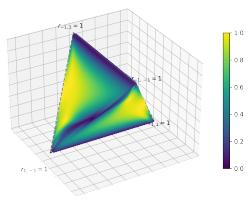

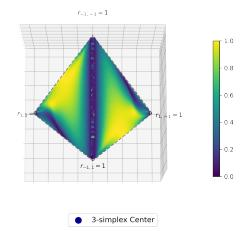  
Figure 7: Different Views of the Cosine Similarity 3-simplex.

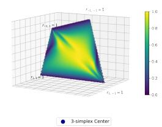

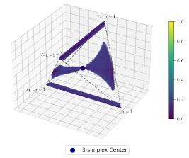  
Figure 8: Areas of Low Grad-Bal Similarity.

## G Implementation Details and Code Availability

The corresponding mapping between the group proportions $r _ { a }$ and training configuration $( \alpha _ { + } , \alpha _ { - } , \beta )$ is described as

$$
\begin{array} { l } { \displaystyle \alpha _ { + } = \frac { r _ { 1 , 1 } } { r _ { 1 , 1 } + r _ { 1 , - 1 } } } \\ { \displaystyle \alpha _ { - } = \frac { r _ { - 1 , - 1 } } { r _ { - 1 , - 1 } + r _ { - 1 , 1 } } } \\ { \displaystyle \beta = r _ { 1 , 1 } + r _ { 1 , - 1 } } \end{array}\tag{34}
$$

For the directions of the gradient (Grad) or the gradient sign (Sign), we first estimate the parameters $\tau ,$ b for the Bayesian optimal classifier using Eq.25 and compute the known derivatives in the equation system 32 with the estimated values for $\tau , b$ . Further, we solve the key derivatives $\frac { \partial \tau } { \partial p }$ and $\frac { \dot { \partial } b } { \partial p }$ and substitute them into $\operatorname { E q } . 2 9$ to compute the gradients for each parameter. The direction for the Sign is then obtained via the signs of the gradients. Regarding the direction of balancing, we compute the Jacobian matrix J, the derivative of the group sizes $r _ { a } \in \mathbb { R } ^ { 4 }$ with respect to each parameter as,

$$
\begin{array} { r } { J = \left( \begin{array} { l l l } { \frac { \partial r _ { 1 , 1 } } { \partial \alpha _ { + } } } & { \frac { \partial r _ { 1 , 1 } } { \partial \alpha _ { - } } } & { \frac { \partial r _ { 1 , 1 } } { \partial \beta } } \\ { \frac { \partial r _ { 1 , - 1 } } { \partial \alpha _ { + } } } & { \frac { \partial r _ { 1 , - 1 } } { \partial \alpha _ { - } } } & { \frac { \partial r _ { 1 , - 1 } } { \partial \beta } } \\ { \frac { \partial r _ { - 1 , + } } { \partial \alpha _ { + } } } & { \frac { \partial r _ { - 1 , - } } { \partial \alpha _ { - } } } & { \frac { \partial r _ { 0 , 1 } } { \partial \beta } } \\ { \frac { \partial r _ { - 1 , - 1 } } { \partial \alpha _ { + } } } & { \frac { \partial r _ { - 1 , - 1 } } { \partial \alpha _ { - } } } & { \frac { \partial r _ { - 1 , - 1 } } { \partial \beta } } \end{array} \right) } \\ { = \left( \begin{array} { l l l } { \beta } & { 0 } & { 1 } \\ { - \beta } & { 0 } & { 1 - \alpha _ { + } } \\ { 0 } & { - ( 1 - \beta ) } & { - ( 1 - \alpha _ { - } ) } \\ { 0 } & { 1 - \beta } & { - \alpha _ { - } } \end{array} \right) } \end{array}\tag{35}
$$

And we map the direction towards the balance from the original group sizes to the direction represented by $\alpha , \beta$ using J:

$$
J ^ { T } ( [ 0 . 2 5 , 0 . 2 5 , 0 . 2 5 , 0 . 2 5 ] ^ { T } - r _ { a } )\tag{36}
$$

Such an implementation aims to normalize the vectors of these directions in the parameter space to ensure a comparable scale in parameter updating. Algorithm 1 summarizes how these directions are computed and used to update the training configuration. We have included the details for theoretical and empirical implementation in our main paper and appendix.

## H 3-simplex Visualization

## H.1 Cosine Similarity between Directions

We showed visualizations in Figure 3 that depict the similarity between directions estimated via Gradients (Grad) and Balancing (Bal). These are provided from two viewpoints to better capture the structure. We further present the same 3-simplex from various angles to highlight its symmetrical architecture in Figure 7. For example, symmetric edges such as $r _ { 1 , - 1 } = 1 , r _ { 1 , 1 } = 1$ and $r _ { - 1 , - 1 } , r _ { - 1 , 1 }$ are visible in Fig. 3, corresponding to cases where all data points share the same ground-truth label (1 or -1). The visualizations in Figure 7 primarily focus on views along these key edges.

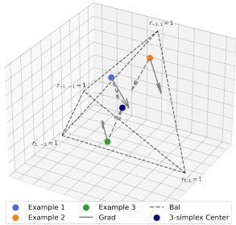  
Figure 9: Comparison of the Grad and Bal directions for initial configurations in the 3-simplex.

For the purpose of better visualization, we filter the similarity that is smaller than a threshold (0.2) to show the area where the two directions differ significantly in Figure 8. We observe that the configurations with low similarity between Grad and Bal are located near the two edges for severe class imbalance (the edge between $r _ { - 1 , - 1 } = 1$ and $r _ { - 1 , 1 } = 1$ , and the edge between $r _ { 1 , - 1 } = 1$ and $r _ { 1 , 1 } = 1 )$ , and two symmetric sectors where spurious correlation exhibits.

## H.2 Initial Configurations for Data Allocation

We use three initial configurations for the experiments on data allocation. The detailed configurations are listed in the following table, and we visualize the directions of Grad and Bal along with the configurations in the 3-simplex in Figure 9.

Table 4: Initial Configurations for Data Allocation Experiments in Section 4.3
<table><tr><td>α+</td><td>α_</td><td>β</td></tr><tr><td>Example 1 0.848</td><td>0.695</td><td>0.059</td></tr><tr><td>Example 2 0.976</td><td>0.1840.128</td><td></td></tr><tr><td>Example 3 0.397 0.883 0.862</td><td></td><td></td></tr></table>

## H.3 Optimality in Multiple Configurations

We display the results of visualizing configurations achieving 90th percentile or higher test accuracy in Section 4.4 to show the approximate region of those optimal configurations. This subsection includes the results of the 95th percentile and 99th percentile, for both theoretical results in Figure 10 and empirical results in Figures 11 and 12, to further show the existence of optimal configurations.

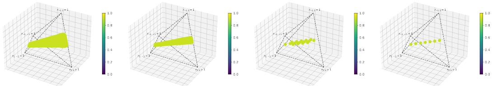  
(a) $n = 5 0 .$ , 95th percentile (b) $n = 5 0 ,$ , 99th percentile (c) n = 7, 95th percentile (d) n = 7, 99th percentile Figure 10: Optimality of theoretical test performance.

## I Additional Results

## I.1 Results with Worst-group Accuracy (WGA)

In this work, subpopulation robustness refers to generalization under subpopulation shift from the training distribution to a different test distribution. For simplicity, we vary only the training distribution and evaluate performance on a balanced test distribution, making adjusted accuracy a natural robustness metric. We use adjusted accuracy in our theoretical analysis because it is positively correlated with WGA under subpopulation shifts [47] and, as a smooth average of group accuracies, enables the gradient-based analysis in Proposition 1. To address the potential tradeoff with WGA and the accuracy gap between best and worst groups, we additionally report WGA obtained from the experiments.

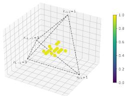  
(a) Waterbirds-syn

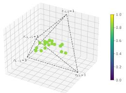  
(b) UrbanCars-syn

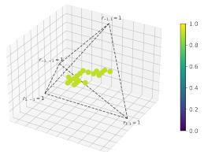  
(c) CelebA-subset

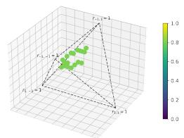  
(d) CivilComments-subset

Figure 11: Optimality of test performance (95th percentile) across multiple configurations.  
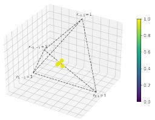  
(a) Waterbirds-syn

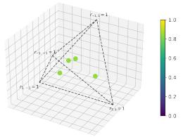  
(b) UrbanCars-syn

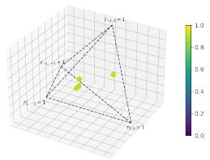  
(c) CelebA-subset

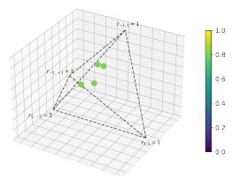  
(d) CivilComments-subset  
Figure 12: Optimality of test performance (99th percentile) across multiple configurations.

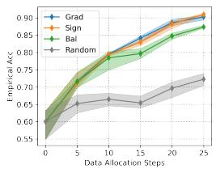

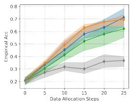

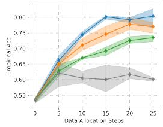

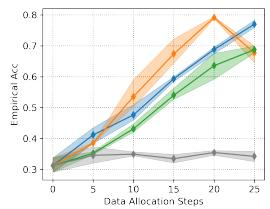

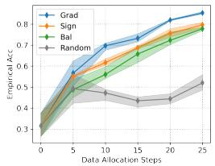

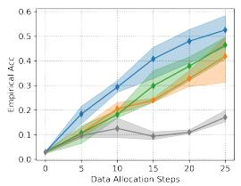

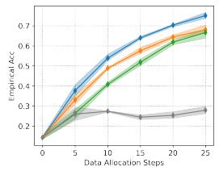

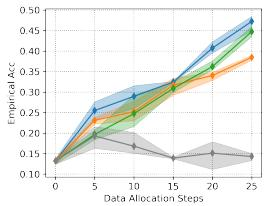

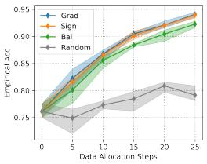  
(a) Waterbirds-syn

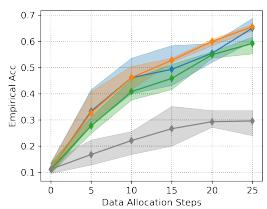  
(b) UrbanCars-syn

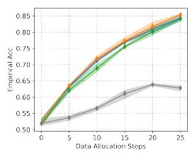  
(c) CelebA-subset

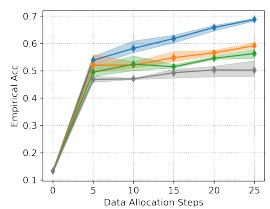  
(d) CivilComments-subset  
Figure 13: Efficiency of WGA of data allocation along directions across datasets and initial configurations.

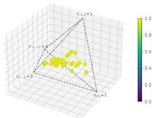  
(a) Waterbirds-syn

  
(b) UrbanCars-syn

  
(c) CelebA-subset

  
(d) CivilComments-subset

Figure 14: Optimality of test WGA across multiple configurations.  
Table 5: WGA (%) after 15 allocation steps. Each cell reports Grad / Bal (mean over three seeds).
<table><tr><td></td><td>Waterbirds-syn</td><td>UrbanCars-syn</td><td>CelebA-subset</td><td>CivilComments-subset</td></tr><tr><td>Example 1</td><td>84.15 / 79.68</td><td>57.87 / 50.93</td><td>80.19 / 69.26</td><td>59.70 / 54.46</td></tr><tr><td>Example 2</td><td>73.24 / 65.79</td><td>40.80 / 29.87</td><td>63.98 / 51.79</td><td>32.30 / 30.12</td></tr><tr><td>Example 3</td><td>90.47 / 88.41</td><td>49.33 / 45.87</td><td>76.94 / 75.54</td><td>61.61 / 51.42</td></tr></table>

  
(a) Adjusted Accuracy vs. WGA

  
(b) Adjusted Accuracy vs. Accuracy Gap  
Figure 15: Relationship between Adjusted Accuracy, WGA, and Accuracy Gap.

Empirically, the directions derived from adjusted accuracy also improve WGA. Table 5 gives the step-15 comparison underlying this conclusion: Grad exceeds Bal in every evaluated dataset–configuration pair. Table 6 shows that the corresponding WGA-AUC comparison has the same ordering in all 12 pairs.

We further show the scatter between the adjusted accuracy and WGA or accuracy gap in Figure 15, which shows a positive/negative correlation between adjusted accuracy and WGA or accuracy gap, respectively. This shows that maximizing adjusted accuracy can improve WGA or reduce the accuracy gap without an explicit tradeoff.

## I.2 Worst-group Accuracy Direction

Because Proposition 1 derives the accuracy gradient for each subgroup, the same framework can estimate a direction that directly improves WGA. Let

$$
\mathrm { W G A } ( p ) = \operatorname* { m i n } _ { a \in \mathcal { A } } A c c _ { a } ( p ) , \qquad \mathbb { Z } ( p ) = \arg \operatorname* { m i n } _ { a \in \mathcal { A } } A c c _ { a } ( p )\tag{37}
$$

denote WGA and the set of currently worst-performing groups. If the worst group is unique, ${ \mathcal { T } } ( p ) = \{ a ^ { * } \}$ , and remains unchanged in a neighborhood of p, then WGA is locally smooth and

$$
\frac { \partial \mathrm { W G A } } { \partial p } = \frac { \partial A c c _ { a ^ { * } } } { \partial p } , \qquad p \in \{ \alpha _ { + } , \alpha _ { - } , \beta \} .\tag{38}
$$

Substituting the group-wise derivative from Proposition 1 gives $\nabla _ { p } \mathrm { W G A }$ , and the normalized local update is

$$
d _ { \mathrm { W G A } } = \frac { \nabla _ { p } \mathrm { W G A } } { \Vert \nabla _ { p } \mathrm { W G A } \Vert _ { 2 } } .\tag{39}
$$

While WGA employs the minimum operator, it is non-smooth and becomes non-differentiable when the worst-performing group shifts, making a global gradient-based analysis inapplicable.

Table 7 compares the two objectives on Waterbirds-syn Example 1 where the local smoothness is ensured. The WGA-derived direction gives a small increase in WGA at step 15, whereas their WGA-AUC and AA results are similar. Thus the AA-derived direction provides comparable allocation behavior while retaining a smooth objective.

Table 6: WGA-AUC over the allocation trajectory. Each cell reports Grad / Bal (mean over three seeds).
<table><tr><td></td><td>Waterbirds-syn</td><td> $\mathrm { U r b a n C a r s – s y n }$ </td><td></td><td>CelebA-subset CivilComments-subset</td></tr><tr><td>Example 1</td><td> $1 9 . 9 5 / 1 9 . 4 1$ </td><td> $1 2 . 3 0 / 1 0 . 9 5$ </td><td> $1 8 . 3 5 / 1 6 . 7 6$ </td><td>13.63 / 12.32</td></tr><tr><td>Example 2</td><td> $1 7 . 0 0 / 1 4 . 8 8 $ </td><td> $8 . 2 1 / 6 . 0 6$ </td><td> $1 3 . 5 3 / 1 1 . 0 7$ </td><td>7.82 / 6.95</td></tr><tr><td>Example 3</td><td> $2 1 . 8 4 / 2 1 . 4 4$ </td><td> $1 1 . 1 2 / 1 0 . 2 1$ </td><td> $1 8 . 0 2 / 1 7 . 7 4$ </td><td> $1 4 . 8 6 / 1 2 . 9 6$ </td></tr></table>

Table 7: AA-derived versus WGA-derived allocation on Waterbirds-syn Example 1. Results are reported as mean ± standard deviation over three seeds.
<table><tr><td>Direction</td><td>AA@15</td><td>WGA@15</td><td>AA-AUC</td><td>WGA-AUC</td></tr><tr><td>AA-derived</td><td> $9 2 . 4 5 { \pm } 0 . 2 9$ </td><td> $8 3 . 9 3 { \pm } 1 . 0 3 $ </td><td> $2 2 . 8 1 { \pm } 0 . 0 9$ </td><td> $2 0 . 0 5 { \pm } 0 . 2 4$ </td></tr><tr><td>WGA-derived</td><td> $9 2 . 3 7 { \pm } 0 . 6 0$ </td><td> $8 4 . 2 9 { \pm } 1 . 5 5 $ </td><td> $2 2 . 7 7 { \scriptstyle \pm 0 . 1 2 }$ </td><td> $1 9 . 9 9 { \pm } 0 . 3 6 $ </td></tr></table>

## I.3 Comparison with a Data-allocation Baseline

We compare Grad with the scaling-law allocation method of [39], adapted to our local-update setting. At each direction estimate, the adapted method adds 10% of the current data to each subgroup in turn, trains the resulting models, and uses the measured performance changes to estimate a normalized update direction. We re-estimate this direction only at evaluation checkpoints because it requires one vanilla and four additional training runs, whereas Grad is updated analytically at negligible cost.

Table 8 reports results on Waterbirds-syn. Grad outperforms the adapted baseline in AA and WGA at step 15 as well as in both trajectory-level AUC metrics, while requiring no additional model fits to estimate each direction.

## I.4 Group Sizes in Grad-guided Resampling.

Table 9 reports the subgroup sizes used in the resampling experiment in Table 1. Vanilla oversampling and under-sampling target the fully balanced configuration by matching all groups to the largest or smallest original group size, respectively. In contrast, Grad-guided resampling targets the configuration induced by the derived Grad direction, which does not necessarily move all groups toward equal size. The values in parentheses show the change relative to the original data, highlighting that Grad-guided resampling can allocate samples unevenly across groups while targeting a configuration predicted to improve robust performance.

## I.5 Statistical Significance Test

Table 10 reports two-sided tests for the AA comparisons in Figure 5. Toward the end, several configurations can converge to similar performance levels, causing the curves for different directions to overlap. Therefore, we report the p-values for the Grad/Bal results after 15 update steps. This choice represents a moderate update magnitude while avoiding the effects of convergence. The results indicate that most configurations achieve statistically significant improvements, with $p < 0 . 0 5$ Moreover, we compare Grad and Bal using the area under the performance curve (AUC) with adjusted accuracy. Unlike performance at a single update step, AUC summarizes the entire allocation trajectory, capturing the efficiency of data allocations. The AUC analysis provides more consistent evidence of Grad’s advantage across datasets and experimental settings.

## I.6 Integrating Mitigation Methods

As noted in the main paper, prior work mainly focuses on model-side mitigation, whereas our work studies the data side: how subgroup configurations affect downstream robustness and how to optimize them. Therefore, a direct comparison with these mitigation methods confounds model and data effects and obscures the contribution of our analysis.

In the meantime, these methods can be integrated into our method: One can first improve the data distribution along the Grad direction and then apply mitigation methods on top to further boost the performance. We added Group DRO and regularization results on Waterbirds-syn using the setup of Figure 5a, shown in Figure 16, and these methods with allocation yield further gains over ERM and the same methods without additional allocation.

Table 8: Comparison with the adapted scaling-law data-allocation baseline [39] on Waterbirds-syn. AA and WGA are measured after 15 allocation steps.
<table><tr><td>Method</td><td>AA</td><td>WGA</td><td>AA-AUC</td><td>WGA-AUC</td></tr><tr><td>Scaling-law allocation</td><td>91.78</td><td>79.38</td><td>22.69</td><td>19.40</td></tr><tr><td>Grad (ours)</td><td>92.50</td><td>84.15</td><td>22.78</td><td>19.95</td></tr></table>

Table 9: Group sizes for the Waterbirds-syn data variants used in the resampling experiment. Values in parentheses indicate the change relative to the original group size.
<table><tr><td>Method</td><td>Group 1</td><td>Group 2</td><td>Group 3</td><td>Group 4</td></tr><tr><td>Original</td><td>1124</td><td>28</td><td>6404</td><td>1444</td></tr><tr><td>Over-sampling</td><td>6404 (+5280)</td><td>6404 (+6376)</td><td>6404 (+0)</td><td>6404 (+4960)</td></tr><tr><td>Over-sampling (Grad)</td><td>5799 (+4675)</td><td>857 (+829)</td><td>6404 (+0)</td><td>811 (-633)</td></tr><tr><td>Under-sampling</td><td>28 (-1096)</td><td>28 (+0)</td><td>28 (-6376)</td><td>28 (-1416)</td></tr><tr><td>Under-sampling (Grad)</td><td>190 (-934)</td><td>28 (+0)</td><td>209 (-6195)</td><td>27 (-1417)</td></tr></table>


  
Figure 16: Integration of Group DRO and Regularization with Our Method of Allocating Data.

## I.7 Robustness to Separability Estimation Errors

As we claimed in the paper, the Sign direction is more robust to the errors in separability estimation. We demonstrated this by showing the data allocation for Waterbirds-syn Example 2, where we perturb the estimated separability by multiplying each of them by 0.9 or 1.1, which produces 9 combinations. The results show that the Grad direction shows a certain randomness across different separability combinations, but overall still outperforms the results obtained from Bal. In contrast, Sign yields the same results across the different separability combinations, validating its robustness to separability estimation errors.

## I.8 Three-attribute Setup Demonstration

We show the flexibility of our framework by demonstrating its effectiveness in a three-attribute setup. Our main text focuses on a two-attribute setup, which is commonly used in the study of subpopulation shifts and spurious correlation. For the three-attribute setting, we extend UrbanCars-syn by incorporating both background and co-occurring objects as spurious attributes in addition to the object label, resulting in $2 ^ { 3 } = 8$ subgroups. The training configuration is parameterized by $\alpha _ { + } ^ { ( 2 ) } , \alpha _ { - } ^ { ( 2 ) } , \alpha _ { + } ^ { ( 3 ) } , \alpha _ { - } ^ { ( 3 ) } , \beta ,$ where $\alpha _ { \pm } ^ { ( 2 ) }$ controls the alignment between the object label and background, $\alpha _ { \pm } ^ { ( 3 ) }$ controls the alignment between the object label and co-occurring object, and $\beta$ controls the class prior. We first estimate the feature separabilities from empirical group accuracies obtained under a moderately imbalanced calibration configuration $( \alpha _ { + } ^ { ( 2 ) } , \stackrel {  } { \alpha } _ { - } ^ { ( 2 ) } , \alpha _ { + } ^ { ( \overline { { { 3 } } } ) } , \alpha _ { - } ^ { ( \overline { { { 3 } } } ) } , \beta ) = ( 0 . 8 5 , 0 . 8 5 , 0 . 8 5 , 0 . 8 5 , 0 . 5 )$ . With the estimated separabilities fixed as 0.739, 0.274, 0.098, we then evaluate data-allocation trajectories by updating the initial configuration parameters of (0.976, 0.184, 0.976, 0.184, 0.128) along the derived gradient direction and comparing against other directions. The results are shown in Figure 19, where the estimated Grad and Sign also outperform the allocation along other directions.

Table 10: p-values for Grad versus Bal in AA at step 15 / AA-AUC over the allocation trajectory (three seeds).
<table><tr><td></td><td>Waterbirds-syn</td><td>UrbanCars-syn</td><td>CelebA-subset</td><td>CivilComments-subset</td></tr><tr><td>Example 1</td><td>.055 / .062</td><td>.066 / .028</td><td>.003 / .003</td><td>.056 / .060</td></tr><tr><td>Example 2</td><td>.012 / .0001</td><td>.012 / .005</td><td>.001 / .002</td><td>.246 / .010</td></tr><tr><td>Example 3</td><td>.037 / .017</td><td>.081 / .024</td><td>.007 / .030</td><td>.002 / .011</td></tr></table>

  
Figure 17: Grad Robustness to Separability Estimation Error (Overall).

## I.9 Additional Pretrained Encoders and Random Seeds

In addition to our primary encoders (ResNet50 and BERT) in our main results, we additionally conducted experiments with Vision Transformer (ViT) [9] and DeBERTa [15]. Instead of evaluating all $7 ^ { 3 } = 3 4 { \dot { 3 } }$ configurations for optimality experiments, we tested the top 10% configurations identified under ResNet50 (Figure 6a) on Waterbirds-syn with ViT and found multiple configurations comparable or better than the Balanced setup in Table 11.

We also provide the efficiency experiments with ViT/DeBERTa, whose trends are similar to those of ResNet50/BERT, in Figures 20, 21 and 22.

As Figure 6 evaluates 343 configurations to exhaustively evaluate the optimality, it only uses one random seed to present the results. We report standard deviations over 3 random seeds for the configurations highlighted for near-optimal performance, showing that the visualized multi-optima is not an artifact of seed randomness.

## J Broader Impacts

This work presents a data-centric perspective on achieving robust generalization, and our analysis guides the construction of datasets for better subpopulation robustness of downstream model training and deployment, particularly helpful in high-stakes domains where balance is infeasible to achieve. Although we focus on data-side effects without direct comparison with model-based methods to keep the theoretical insights clear, integrating our data-optimization principles with existing model-side approaches is a promising direction for real-world deployment. In Appendix I.6, we provide an example showing that integrating our data allocation with Group DRO [40] and Regularization [44] can further improve performance. However, it could be misused to justify neglecting minority or vulnerable subgroups, so the method should be applied with caution and additional auditing.

  
(a) $m _ { 1 } , m _ { 2 }$

  
(b) $m _ { 1 } , 0 . 9 \cdot m _ { 2 }$

  
(c) $m _ { 1 } , 1 . 1 \cdot m _ { 2 }$

  
(d) 0.9 · m<sub>1</sub>, m<sub>2</sub>


  
(g) 1.1 · m<sub>1</sub>, m<sub>2</sub>

(f) 0.9 · m<sub>1</sub>, 1.1 · m<sub>2</sub>  
(e) 0.9 · m<sub>1</sub>, 0.9 · m<sub>2</sub>  
  
(h) 1.1 · m<sub>1</sub>, 0.9 · m<sub>2</sub>

  
(i) 1.1 · m<sub>1</sub>, 1.1 · m<sub>2</sub>  
Figure 18: Grad Robustness to Separability Estimation Error. We vary the estimated separability by 0.9, 1, and 1.1 to synthesize the estimation error

Table 11: Optimality experiments on Waterbirds-syn with top 10% configurations on ResNet50.
<table><tr><td></td><td></td><td>Accuracy Range Accuracy at Balanced Setup</td></tr><tr><td>ResNet50</td><td>0.959 - 0.966</td><td>0.953</td></tr><tr><td>ViT</td><td>0.958 - 0.973</td><td>0.961</td></tr></table>

  
(a) Adjusted Accuracy

  
(b) WGA  
Figure 19: Data Allocation on UrbanCars-syn with Three Attributes.


  
Figure 20: Efficiency of data allocation along directions across initial configurations on Waterbirdssyn with ViT


  
Figure 21: Efficiency of data allocation along directions across initial configurations on CelebAsubset with ViT


  
Figure 22: Efficiency of data allocation along directions across initial configurations on CivilComments-subset with DeBERTa

Table 12: Optimality experiments with 3 random seeds on configurations with top performance.
<table><tr><td>Dataset</td><td>Accuracy Range</td></tr><tr><td>Waterbirds-syn</td><td>0.954± 0.003 – 0.965± 0.002</td></tr><tr><td>Urbancars-syn</td><td>0.826± 0.007 − 0.844± 0.007</td></tr><tr><td>CelebA-subset</td><td> $0 . 8 9 3 \pm 0 . 0 0 3 - 0 . 9 0 2 \pm 0 . 0 0 2$ </td></tr><tr><td>CivilComments-subset</td><td> $0 . 7 9 6 \pm 0 . 0 0 3 - 0 . 8 0 7 \pm 0 . 0 0 3$ </td></tr></table>

## Algorithm 1 Direction estimation and configuration updating.

```julia
# Parameters:
# m1, m2: Feature separability parameters
# num_steps: Number of optimization iterations
# delta: Step size for configuration updates
# Inputs:
# alpha1, alpha0, beta: Initial training data configuration
# Initialize estimator with separability parameters
est = Estimator(m1, m2)
for step in range(num_steps):
# 1. Estimate classifier parameters for the current
configuration
tau, b = est.estimate_classifier(alpha1, alpha0, beta)
# 2. Estimate partial derivatives of accuracy
# w.r.t. (alpha1, alpha0, beta)
d_alpha1, d_alpha0, d_beta = est.estimate_partials(
alpha1, alpha0, beta, tau, b
)
# 3. Construct Update Directions
# 3.1 Grad: Standard gradient ascent for smoothest path
grad = normalize([d_alpha1, d_alpha0, d_beta])
# 3.2 Sign: Robust update using only derivative signs
sign = normalize([d_alpha1.sign(), d_alpha0.sign(), d_beta.
sign()])
# 3.3 Balancing: Heuristic direction toward the balanced
configuration
ratios = param2ratio([alpha1, alpha0, beta])
bal_r = ratios - [0.25, 0.25, 0.25, 0.25]
bal = normalize(transform(bal_r))
# 4. Update step (example using Grad)
[alpha1, alpha0, beta] += delta * grad
# Output the optimized configuration
return alpha1, alpha0, beta
```

## NeurIPS Paper Checklist

## 1. Claims

Question: Do the main claims made in the abstract and introduction accurately reflect the paper’s contributions and scope?

Answer: [Yes]

Justification: The abstract and introduction state the main claims: balanced subgroup data is not uniquely optimal, and the paper derives gradient-based directions for adjusting subgroup proportions, and the claims are validated with controlled image/text experiments.

Guidelines:

• The answer [N/A] means that the abstract and introduction do not include the claims made in the paper.

• The abstract and/or introduction should clearly state the claims made, including the contributions made in the paper and important assumptions and limitations. A [No] or [N/A] answer to this question will not be perceived well by the reviewers.

• The claims made should match theoretical and experimental results, and reflect how much the results can be expected to generalize to other settings.

• It is fine to include aspirational goals as motivation as long as it is clear that these goals are not attained by the paper.

## 2. Limitations

Question: Does the paper discuss the limitations of the work performed by the authors?

Answer: [Yes]

Justification: The paper includes a discussion on the limitations in the end of the main paper: the broader evaluation with more attributes and the separability estimation error. The appendix also presents some results addressing the limitation.

Guidelines:

• The answer [N/A] means that the paper has no limitation while the answer [No] means that the paper has limitations, but those are not discussed in the paper.

• The authors are encouraged to create a separate “Limitations” section in their paper.

• The paper should point out any strong assumptions and how robust the results are to violations of these assumptions (e.g., independence assumptions, noiseless settings, model well-specification, asymptotic approximations only holding locally). The authors should reflect on how these assumptions might be violated in practice and what the implications would be.

• The authors should reflect on the scope of the claims made, e.g., if the approach was only tested on a few datasets or with a few runs. In general, empirical results often depend on implicit assumptions, which should be articulated.

• The authors should reflect on the factors that influence the performance of the approach. For example, a facial recognition algorithm may perform poorly when image resolution is low or images are taken in low lighting. Or a speech-to-text system might not be used reliably to provide closed captions for online lectures because it fails to handle technical jargon.

• The authors should discuss the computational efficiency of the proposed algorithms and how they scale with dataset size.

• If applicable, the authors should discuss possible limitations of their approach to address problems of privacy and fairness.

• While the authors might fear that complete honesty about limitations might be used by reviewers as grounds for rejection, a worse outcome might be that reviewers discover limitations that aren’t acknowledged in the paper. The authors should use their best judgment and recognize that individual actions in favor of transparency play an important role in developing norms that preserve the integrity of the community. Reviewers will be specifically instructed to not penalize honesty concerning limitations.

## 3. Theory assumptions and proofs

Question: For each theoretical result, does the paper provide the full set of assumptions and a complete (and correct) proof?

Answer: [Yes]

Justification: The paper uses the Gaussian feature-modeling assumptions and Bayesian classifier setup; proofs and derivative details are provided in the appendix.

Guidelines:

• The answer [N/A] means that the paper does not include theoretical results.

• All the theorems, formulas, and proofs in the paper should be numbered and crossreferenced.

• All assumptions should be clearly stated or referenced in the statement of any theorems.

• The proofs can either appear in the main paper or the supplemental material, but if they appear in the supplemental material, the authors are encouraged to provide a short proof sketch to provide intuition.

• Inversely, any informal proof provided in the core of the paper should be complemented by formal proofs provided in appendix or supplemental material.

• Theorems and Lemmas that the proof relies upon should be properly referenced.

## 4. Experimental result reproducibility

Question: Does the paper fully disclose all the information needed to reproduce the main experimental results of the paper to the extent that it affects the main claims and/or conclusions of the paper (regardless of whether the code and data are provided or not)?

Answer: [Yes]

Justification: The paper describes the datasets, constructed subsets/synthetic variants, evaluation metrics, model backbones, direction baselines, and allocation protocol in sufficient detail to reproduce the main experiments.

Guidelines:

• The answer [N/A] means that the paper does not include experiments.

• If the paper includes experiments, a [No] answer to this question will not be perceived well by the reviewers: Making the paper reproducible is important, regardless of whether the code and data are provided or not.

• If the contribution is a dataset and/or model, the authors should describe the steps taken to make their results reproducible or verifiable.

• Depending on the contribution, reproducibility can be accomplished in various ways. For example, if the contribution is a novel architecture, describing the architecture fully might suffice, or if the contribution is a specific model and empirical evaluation, it may be necessary to either make it possible for others to replicate the model with the same dataset, or provide access to the model. In general. releasing code and data is often one good way to accomplish this, but reproducibility can also be provided via detailed instructions for how to replicate the results, access to a hosted model (e.g., in the case of a large language model), releasing of a model checkpoint, or other means that are appropriate to the research performed.

• While NeurIPS does not require releasing code, the conference does require all submissions to provide some reasonable avenue for reproducibility, which may depend on the nature of the contribution. For example

(a) If the contribution is primarily a new algorithm, the paper should make it clear how to reproduce that algorithm.

(b) If the contribution is primarily a new model architecture, the paper should describe the architecture clearly and fully.

(c) If the contribution is a new model (e.g., a large language model), then there should either be a way to access this model for reproducing the results or a way to reproduce the model (e.g., with an open-source dataset or instructions for how to construct the dataset).

(d) We recognize that reproducibility may be tricky in some cases, in which case authors are welcome to describe the particular way they provide for reproducibility. In the case of closed-source models, it may be that access to the model is limited in some way (e.g., to registered users), but it should be possible for other researchers to have some path to reproducing or verifying the results.

## 5. Open access to data and code

Question: Does the paper provide open access to the data and code, with sufficient instructions to faithfully reproduce the main experimental results, as described in supplemental material?

## Answer: [Yes]

Justification: The paper uses existing public datasets and provides implementation details in the appendix. We release the code for the theoretical estimation and empirical validation on GitHub.

Guidelines:

• The answer [N/A] means that paper does not include experiments requiring code.

• Please see the NeurIPS code and data submission guidelines (https://neurips.cc/ public/guides/CodeSubmissionPolicy) for more details.

• While we encourage the release of code and data, we understand that this might not be possible, so [No] is an acceptable answer. Papers cannot be rejected simply for not including code, unless this is central to the contribution (e.g., for a new open-source benchmark).

• The instructions should contain the exact command and environment needed to run to reproduce the results. See the NeurIPS code and data submission guidelines (https: //neurips.cc/public/guides/CodeSubmissionPolicy) for more details.

• The authors should provide instructions on data access and preparation, including how to access the raw data, preprocessed data, intermediate data, and generated data, etc.

• The authors should provide scripts to reproduce all experimental results for the new proposed method and baselines. If only a subset of experiments are reproducible, they should state which ones are omitted from the script and why.

• At submission time, to preserve anonymity, the authors should release anonymized versions (if applicable).

• Providing as much information as possible in supplemental material (appended to the paper) is recommended, but including URLs to data and code is permitted.

## 6. Experimental setting/details

Question: Does the paper specify all the training and test details (e.g., data splits, hyperparameters, how they were chosen, type of optimizer) necessary to understand the results?

Answer: [Yes]

Justification: The appendix specifies model architectures/backbones, optimizers, learning rates, weight decay, momentum, batch sizes, training steps, and evaluation metrics.

Guidelines:

• The answer [N/A] means that the paper does not include experiments.

• The experimental setting should be presented in the core of the paper to a level of detail that is necessary to appreciate the results and make sense of them.

• The full details can be provided either with the code, in appendix, or as supplemental material.

## 7. Experiment statistical significance

Question: Does the paper report error bars suitably and correctly defined or other appropriate information about the statistical significance of the experiments?

## Answer: [Yes]

Justification: The data-allocation experiments in Section 4.3 are repeated over three random seeds, with mean performance and min–max error bars reported. Statistical significance tests and trajectory-level AUC comparisons are provided in Appendix I.5. Due to computational cost, the large-scale configuration sweeps in Sections 4.2 and 4.4 use a single random seed, with additional multi-seed experiments provided in Appendix I.9 to assess the stability of the near-optimal configurations.

## Guidelines:

• The answer [N/A] means that the paper does not include experiments.

• The authors should answer [Yes] if the results are accompanied by error bars, confidence intervals, or statistical significance tests, at least for the experiments that support the main claims of the paper.

• The factors of variability that the error bars are capturing should be clearly stated (for example, train/test split, initialization, random drawing of some parameter, or overall run with given experimental conditions).

• The method for calculating the error bars should be explained (closed form formula, call to a library function, bootstrap, etc.)

• The assumptions made should be given (e.g., Normally distributed errors).

• It should be clear whether the error bar is the standard deviation or the standard error of the mean.

• It is OK to report 1-sigma error bars, but one should state it. The authors should preferably report a 2-sigma error bar than state that they have a 96% CI, if the hypothesis of Normality of errors is not verified.

• For asymmetric distributions, the authors should be careful not to show in tables or figures symmetric error bars that would yield results that are out of range (e.g., negative error rates).

• If error bars are reported in tables or plots, the authors should explain in the text how they were calculated and reference the corresponding figures or tables in the text.

## 8. Experiments compute resources

Question: For each experiment, does the paper provide sufficient information on the computer resources (type of compute workers, memory, time of execution) needed to reproduce the experiments?

Answer: [Yes]

Justification: The paper provides the GPU type and the memory for the experiments.

Guidelines:

• The answer [N/A] means that the paper does not include experiments.

• The paper should indicate the type of compute workers CPU or GPU, internal cluster, or cloud provider, including relevant memory and storage.

• The paper should provide the amount of compute required for each of the individual experimental runs as well as estimate the total compute.

• The paper should disclose whether the full research project required more compute than the experiments reported in the paper (e.g., preliminary or failed experiments that didn’t make it into the paper).

## 9. Code of ethics

Question: Does the research conducted in the paper conform, in every respect, with the NeurIPS Code of Ethics https://neurips.cc/public/EthicsGuidelines?

Answer: [Yes]

Justification: The authors have reviewed the NeurIPS Code of Ethics, and the research conforms to the NeurIPS Code of Ethics.

Guidelines:

• The answer [N/A] means that the authors have not reviewed the NeurIPS Code of Ethics.

• If the authors answer [No], they should explain the special circumstances that require a deviation from the Code of Ethics.

• The authors should make sure to preserve anonymity (e.g., if there is a special consideration due to laws or regulations in their jurisdiction).

## 10. Broader impacts

Question: Does the paper discuss both potential positive societal impacts and negative societal impacts of the work performed?

## Answer: [Yes]

Justification: This work included a discussion on the broader impacts in the main paper and the appendix.

## Guidelines:

• The answer [N/A] means that there is no societal impact of the work performed.

• If the authors answer [N/A] or [No], they should explain why their work has no societal impact or why the paper does not address societal impact.

• Examples of negative societal impacts include potential malicious or unintended uses (e.g., disinformation, generating fake profiles, surveillance), fairness considerations (e.g., deployment of technologies that could make decisions that unfairly impact specific groups), privacy considerations, and security considerations.

• The conference expects that many papers will be foundational research and not tied to particular applications, let alone deployments. However, if there is a direct path to any negative applications, the authors should point it out. For example, it is legitimate to point out that an improvement in the quality of generative models could be used to generate Deepfakes for disinformation. On the other hand, it is not needed to point out that a generic algorithm for optimizing neural networks could enable people to train models that generate Deepfakes faster.

• The authors should consider possible harms that could arise when the technology is being used as intended and functioning correctly, harms that could arise when the technology is being used as intended but gives incorrect results, and harms following from (intentional or unintentional) misuse of the technology.

• If there are negative societal impacts, the authors could also discuss possible mitigation strategies (e.g., gated release of models, providing defenses in addition to attacks, mechanisms for monitoring misuse, mechanisms to monitor how a system learns from feedback over time, improving the efficiency and accessibility of ML).

## 11. Safeguards

Question: Does the paper describe safeguards that have been put in place for responsible release of data or models that have a high risk for misuse (e.g., pre-trained language models, image generators, or scraped datasets)?

Answer: [N/A]

Justification: This paper evaluates methods using existing datasets and standard pretrained encoders without releasing high-risk data or models.

Guidelines:

• The answer [N/A] means that the paper poses no such risks.

• Released models that have a high risk for misuse or dual-use should be released with necessary safeguards to allow for controlled use of the model, for example by requiring that users adhere to usage guidelines or restrictions to access the model or implementing safety filters.

• Datasets that have been scraped from the Internet could pose safety risks. The authors should describe how they avoided releasing unsafe images.

• We recognize that providing effective safeguards is challenging, and many papers do not require this, but we encourage authors to take this into account and make a best faith effort.

## 12. Licenses for existing assets

Question: Are the creators or original owners of assets (e.g., code, data, models), used in the paper, properly credited and are the license and terms of use explicitly mentioned and properly respected?

Answer: [Yes]

Justification: The paper properly cites the existing datasets and pretrained models and follows the terms of using them.

Guidelines:

• The answer [N/A] means that the paper does not use existing assets.

• The authors should cite the original paper that produced the code package or dataset.

• The authors should state which version of the asset is used and, if possible, include a URL.

• The name of the license (e.g., CC-BY 4.0) should be included for each asset.

• For scraped data from a particular source (e.g., website), the copyright and terms of service of that source should be provided.

• If assets are released, the license, copyright information, and terms of use in the package should be provided. For popular datasets, paperswithcode.com/datasets has curated licenses for some datasets. Their licensing guide can help determine the license of a dataset.

• For existing datasets that are re-packaged, both the original license and the license of the derived asset (if it has changed) should be provided.

• If this information is not available online, the authors are encouraged to reach out to the asset’s creators.

## 13. New assets

Question: Are new assets introduced in the paper well documented and is the documentation provided alongside the assets?

Answer: [Yes]

Justification: The paper constructs experimental subsets and synthetic variants from existing datasets, but it does not introduce or release a new standalone dataset as a contribution. The code used in this paper is released and well-documented on GitHub.

Guidelines:

• The answer [N/A] means that the paper does not release new assets.

• Researchers should communicate the details of the dataset/code/model as part of their submissions via structured templates. This includes details about training, license, limitations, etc.

• The paper should discuss whether and how consent was obtained from people whose asset is used.

• At submission time, remember to anonymize your assets (if applicable). You can either create an anonymized URL or include an anonymized zip file.

## 14. Crowdsourcing and research with human subjects

Question: For crowdsourcing experiments and research with human subjects, does the paper include the full text of instructions given to participants and screenshots, if applicable, as well as details about compensation (if any)?

Answer: [N/A]

Justification: The paper does not report any new crowdsourcing experiments or new humansubjects studies.

Guidelines:

• The answer [N/A] means that the paper does not involve crowdsourcing nor research with human subjects.

• Including this information in the supplemental material is fine, but if the main contribution of the paper involves human subjects, then as much detail as possible should be included in the main paper.

• According to the NeurIPS Code of Ethics, workers involved in data collection, curation, or other labor should be paid at least the minimum wage in the country of the data collector.

## 15. Institutional review board (IRB) approvals or equivalent for research with human subjects

Question: Does the paper describe potential risks incurred by study participants, whether such risks were disclosed to the subjects, and whether Institutional Review Board (IRB) approvals (or an equivalent approval/review based on the requirements of your country or institution) were obtained?

## Answer: [N/A]

Justification: The work does not involve new crowdsourcing or new human-subjects research. Guidelines:

• The answer [N/A] means that the paper does not involve crowdsourcing nor research with human subjects.

• Depending on the country in which research is conducted, IRB approval (or equivalent) may be required for any human subjects research. If you obtained IRB approval, you should clearly state this in the paper.

• We recognize that the procedures for this may vary significantly between institutions and locations, and we expect authors to adhere to the NeurIPS Code of Ethics and the guidelines for their institution.

• For initial submissions, do not include any information that would break anonymity (if applicable), such as the institution conducting the review.

## 16. Declaration of LLM usage

Question: Does the paper describe the usage of LLMs if it is an important, original, or non-standard component of the core methods in this research? Note that if the LLM is used only for writing, editing, or formatting purposes and does not impact the core methodology, scientific rigor, or originality of the research, declaration is not required.

Answer: [N/A]

Justification: The core method does not involve LLMs as an important, original, or nonstandard component; BERT is used only as a standard pretrained encoder for the CivilComments text experiment.

## Guidelines:

• The answer [N/A] means that the core method development in this research does not involve LLMs as any important, original, or non-standard components.

• Please refer to our LLM policy in the NeurIPS handbook for what should or should not be described.