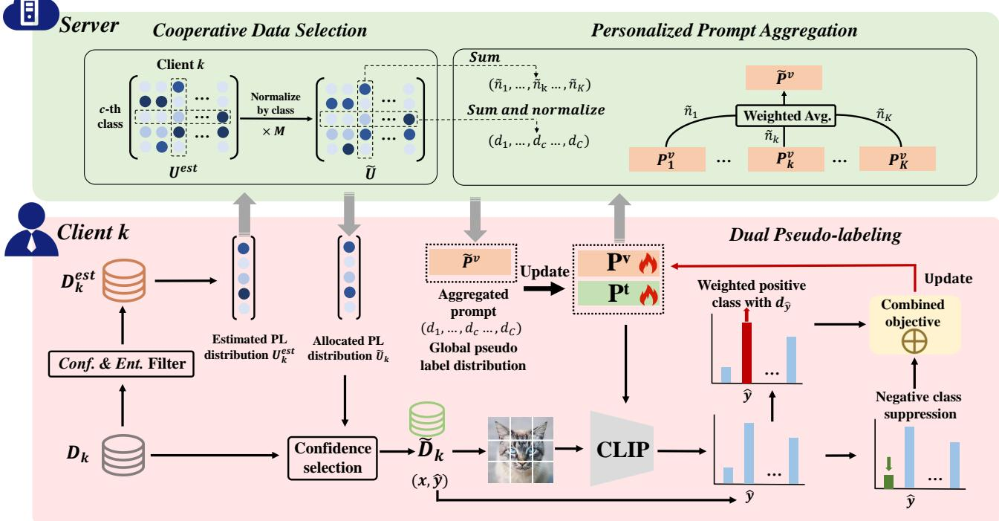
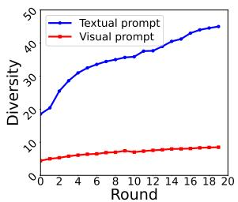
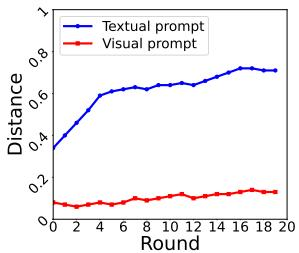
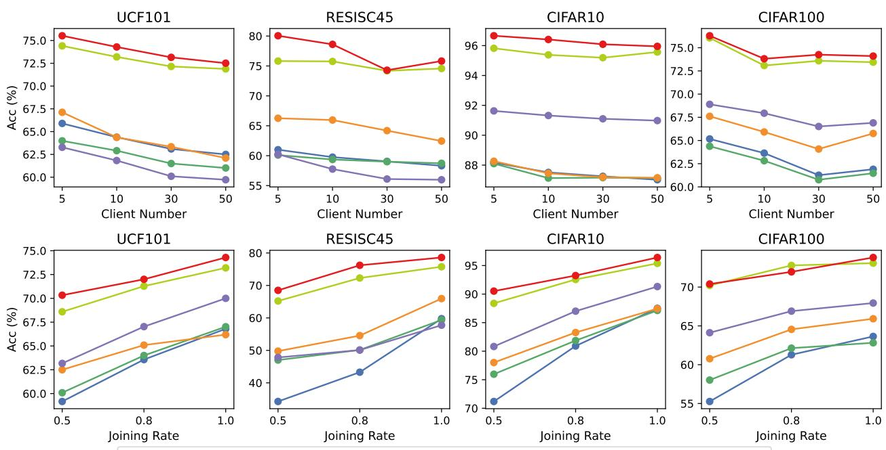

# Harnessing Vision-Language Models for Federated Unsupervised Visual Recognition

Jian Liang 1,2 · Kuangpu Guo 3 · Ran He 1,2 · Tieniu Tan 1,2,4

Received: August 16, 2026

Abstract Federated learning (FL) is a promising research paradigm that enables collaborative model training across distributed clients without data sharing. To handle unlabeled data in local clients, existing unsupervised FL research has primarily focused on tasks like clustering and self-supervised representation learning, leaving the critical problem of unsupervised visual recognition largely unexplored. To bridge this gap, we introduce FedUR, the first framework designed for[ unsupervised recognition by leveraging the zero-shot capabilities of pre-trained vision-language models like CLIP. Specifically, FedUR addresses data heterogeneity through a pseudo-labeling mechanism with a classaware data selection strategy. This strategy first estimates a global pseudo-label distribution, then allocates pseudo-labeled data to clients accordingly. To handle the uncertainty of conventional positive pseudolabels, FedUR further incorporates class weights and a negative pseudo-labeling strategy. Furthermore, FedUR proposes a personalized prompt aggregation protocol where general visual prompts are aggregated on the server, and personalized text prompts encoding local knowledge are retained on clients. Extensive experiments demonstrate that FedUR consistently outperforms baseline methods under both label-level and feature-level distribution shifts. We believe this work paves the way for further advances in federated unsupervised recognition. Code will be available at github.com/tim-learn/FedUR/.

Keywords federated unsupervised learning; visionlanguage models; personalized prompt aggregation; pseudo-labeling; data heterogeneity

## 1 Introduction

Federated learning (FL) [1, 2] has emerged as a pivotal paradigm for decentralized machine learning since its introduction by Google in 2016 [3]. By enabling collaborative model training without the need to share raw local data, FL ofers a compelling privacy-preserving solution that has garnered substantial research interest [4, 5, 6, 7]. To date, the vast majority of FL research has concentrated on supervised and semi-supervised settings, achieving notable success in tasks such as visual classification [8, 9, 10, 11], semantic segmentation [12, 13, 14], and object detection [15, 16]. In contrast, considerably less attention has been paid to the challenging scenario of federated unsupervised learning (FedUSL) [17, 18, 19, 20], where clients possess only unlabeled data. Existing FedUSL approaches [21, 22, 23] predominantly focus on self-supervised representation learning for downstream tasks or clustering for data grouping. However, these methods cannot address zeroshot classification, as they are fundamentally constrained by the absence of labeled supervisory signals.

Vision-language models (VLMs) [24, 25, 26], and particularly contrastive language-image pre-training (CLIP) [27], have demonstrated remarkable representation and zero-shot generalization capabilities [28, 29, 30, 31, 32]. By learning a shared embedding space from large-scale image-text pairs, CLIP enables powerful zero-shot classification and alleviates the dependency on labeled data, paving the way for unsupervised learning methods [33, 34, 35, 36, 37]. This capability presents a compelling opportunity to address classification tasks within the FedUSL framework, an avenue that remains largely unexplored.

In this paper, we pioneer the extension of FedUSL to classification by leveraging CLIP, with each client initialized with the same pre-trained CLIP model and holding only unlabeled local data. Following standard FL protocols [38, 39], clients periodically upload non-data knowledge, such as statistical information or model parameters, to a central server for aggregation and receive updated global knowledge in return. A natural approach within this framework is to use CLIP’s zero-shot predictions as pseudo-labels to supervise local training. However, the inherent bias of CLIP and the unknown, potentially non-IID label distribution across clients [33, 40, 9] can lead to globally imbalanced training across categories. This label skew causes model updates to diverge among clients, rendering conventional aggregation methods inefective.

To address these challenges, we propose FedUR, a novel method with three core components: cooperative data selection, dual pseudo-labeling, and personalized prompt aggregation. The cooperative data selection mechanism selects samples with a balanced pseudolabel distribution across all classes, mitigating the bias inherent in CLIP and the unknown client data distribution. Specifically, each client first applies confidenceand entropy-based filtering to estimate its local pseudolabel distribution, which is then transmitted to the server. The server subsequently rebalances each client’s distribution by allocating per-class pseudo-label counts according to global category-wise proportions. This rebalancing corrects for label skew across clients; however, class bias may persist locally. To address this residual bias, we employ a class-weighted cross-entropy loss that penalizes overrepresented classes during local training. Moreover, we introduce negative pseudolabels [41] on selected samples to suppress the probability mass assigned to the most unlikely categories, further strengthening the quality of the pseudo-labels.

Beyond pseudo-labeling, we introduce a personalized prompt aggregation strategy in FedUR to balance global collaboration and local personalization. For communication and computational eficiency, we optimize only the visual and textual prompts while freezing the backbone. Prior work [42] has shown that visual prompts capture general feature representations, whereas textual prompts focus on category-specific information. Aggregating prompts from both modalities may introduce parameter conflicts, particularly under label skew. We therefore transmit only visual prompts to the server for aggregation, while retaining textual prompts locally. This design fosters global collaboration through shared visual prompts and supports personalization through client-specific textual prompts that better reflect each client’s label distribution. Extensive experiments on standard federated benchmarks under Dirichlet-based, quantity-based, and feature skews validate FedUR’s efectiveness against baseline methods. Our main contributions are summarized as follows:

– We pioneer the extension of federated unsupervised learning to classification tasks by leveraging CLIP, an underexplored direction in prior work.

We propose FedUR to mitigate CLIP’s inherent bias through a cooperative pseudo-labeling strategy that constructs balanced pseudo-labels, complemented by a class-weighted cross-entropy loss and negative pseudo-labeling for refined local training.

We introduce a personalized prompt aggregation protocol in FedUR that enables efective global collaboration while preserving local personalization.

– Extensive experiments on standard datasets under both label and feature skews demonstrate the efectiveness of FedUR against baseline methods.

This paper extends our prior conference work [43] in four major respects: (1) we identify residual class bias during local training and design a class-weighted objective to mitigate it; (2) we introduce negative pseudolabels to suppress probabilities on unlikely classes, further refining pseudo-label quality; (3) we broaden the experimental evaluation with two additional datasets (DomainNet and Ofice-Home) and more non-IID settings beyond label skew; and (4) we conduct a thorough analysis of the proposed framework, focusing on the newly incorporated components.

## 2 Related Work

## 2.1 Federated Learning for VLMs

Vision-language model fine-tuning has recently been incorporated into the federated framework to mitigate computational costs while addressing data scarcity and heterogeneity [44, 45, 46, 47]. Early eforts, notably PromptFL [48] and FedCLIP [49], directly apply standard CLIP fine-tuning to the federated setting and achieve competitive performance. Both adopt parameter-eficient approaches but difer in implementation: PromptFL fine-tunes continuous prompts, while FedCLIP employs an attention-based adapter for the image encoder. To better model heterogeneity across clients, subsequent work has introduced various personalization strategies. pFedPrompt [50] develops a nonparametric approach that equips each client with a personalized attention module. pFedPG [51] generates personalized prompts based on client visual prompts to better align with local data distributions. FedOTP [52] leverages optimal transport to balance global consensus and local personalization through a strategic combination of global and local prompts. pFedMoAP [53] personalizes prompt learning via a mixture of experts, allowing each client to adaptively combine multiple downloaded prompts for local alignment. PromptFolio [54] theoretically analyzes prompt-based FL through feature learning, revealing that an optimally mixed globallocal prompt portfolio balances generalization and personalization. Despite these advances, prior work has predominantly focused on supervised federated learning with VLMs. In this paper, we instead explore leveraging VLMs for federated unsupervised classification, capitalizing on their zero-shot capabilities.

## 2.2 Unsupervised Learning for VLMs

Despite advances in fine-tuning VLMs, high annotation costs remain a major bottleneck for supervised learning in real-world visual applications, motivating the use of unlabeled data for downstream tasks [32]. Recent years have witnessed considerable eforts in this direction, particularly through pseudo-labeling strategies [33, 40, 34, 55, 56]. UPL [33] and FPL [40] enforce balanced pseudo-label selection across categories, while CPL [55] generates multiple candidate labels per instance to improve accuracy. In contrast, GDA-U [37] models data with a Gaussian mixture and employs the EM algorithm for closed-form classification, whereas UEO [36] adopts a confidence-aware entropy minimization strategy. In parallel, test-time prompt tuning has emerged as a popular paradigm for unsupervised VLM adaptation [57, 32], especially for a single unlabeled image. TPT [58] and its extensions [59, 60] minimize marginal entropy to update text prompts for individual test samples, while training-free counterparts [61, 62, 63] are developed to avoid backpropagation. Moreover, TDA [64] further tackles adaptation under a stream of unlabeled test samples. Despite their efectiveness, these strategies face substantial challenges when directly applied to decentralized federated unsupervised settings, particularly under data heterogeneity. To address this, we propose a cooperative pseudolabeling strategy that mitigates the inherent biases of pre-trained VLMs and substantially improves pseudolabel quality.

## 2.3 Federated Unsupervised Learning

Federated unsupervised learning (FedUSL) aims to collaboratively train a global model across distributed clients with unlabeled data without raw data sharing. Existing FedUSL methods can be broadly categorized into two main lines of work: self-supervised representation learning [65, 66, 21, 23, 67] and federated clustering [68, 69, 70]. For representation learning, FedCA [21] employs contrastive aggregation with a shared dictionary, while FedU [71] uploads only client encoders to the server. FedEMA [72] addresses non-IID data via adaptive EMA updates of the global model, while FedX [19] refines local training through two-sided knowledge distillation. Recent work [23, 73] emphasizes alignment regularization to ensure representation consistency across clients. For clustering, k-FED [69] proposes a one-shot federated k-means scheme based on Lloyd’s method. FKM [74] relaxes the assumption of equal local cluster counts and handles a variable number of local clusters. Subsequent studies [75, 76] consider federated multi-view clustering, enabling multiple clients to build a global model with distributed multiview data. Beyond these two setups, FedGaLA [22] performs client-level gradient alignment to encourage domain-invariant feature learning for unsupervised domain generalization. The most closely related work to ours is FedUL [77], which studies an unsupervised scenario where class priors for each client dataset are assumed to be available. Its core idea is to transform unlabeled client data and modify the client model to construct a surrogate supervised task. In contrast, our approach leverages CLIP’s zero-shot capability to generate pseudo-labels without requiring such label priors or additional assumptions on the unlabeled data.

## 3 Methodology

In this section, we formulate the problem setup for federated unsupervised recognition and present our proposed method, as shown in Fig. 1. Sec. 3.1 reviews a representative VLM, CLIP [27], along with prompt tuning [78], a popular parameter-eficient fine-tuning technique. Sec. 3.2 then outlines the federated unsupervised recognition framework with VLMs and discusses its associated challenges. Finally, we introduce FedUR, which builds upon three key strategies: server-side cooperative data selection (Sec. 3.3), client-side local self-training (Sec. 3.4), and server-side personalized prompt aggregation (Sec. 3.5). The detailed pseudocode of FedUR is presented in Algorithm 1.

  
Fig. 1 Overview of the proposed FedUR framework. The framework begins by filtering unlabeled samples to estimate local label distributions, which are then uploaded to the server. The server globally allocates M pseudo-labels per category based on these estimates. Clients subsequently perform local training with a dual pseudo-labeling strategy to fully leverage CLIP’s predictions. To handle data heterogeneity, only visual prompts are aggregated on the server, while textual prompts are retained locally, as they exhibit larger cross-client divergence and better support personalization.

## 3.1 Preliminary

Visual recognition studies with VLMs have progressed significantly since the development of CLIP [27, 31]; we thus adopt CLIP as the default VLM for unsupervised visual recognition. CLIP employs a dual-branch architecture comprising an image encoder $f ^ { v } ( \cdot )$ and a text encoder $f ^ { t } ( \cdot )$ , each processing data from its respective modality. For zero-shot classification, CLIP uses a hand-crafted prompt template $( e . g . , \sqrt [ 6 ] { 2 }$ photo of a $[ \mathrm { C L A S S } ] ^ { \mathfrak { N } } )$ for each class. Consider a C-way classification task; the text encoder generates class-specific embeddings $\{ f _ { c } ^ { t } \} _ { c = 1 } ^ { C }$ , while the image encoder produces a visual embedding $f ^ { v } ( x )$ for a test image x. The probability $( p _ { c } ( x ) = p ( y = c | x ) )$ that x belongs to class c is computed via softmax over cosine similarities:

$$
p ( y = c | x ) = \frac { \exp ( \cos ( f ^ { v } ( x ) , f _ { c } ^ { t } ) ) / \tau ) } { \sum _ { j = 1 } ^ { C } \exp ( \cos ( f ^ { v } ( x ) , f _ { j } ^ { t } ) ) / \tau ) } ,\tag{1}
$$

where cos(·, ·) denotes cosine similarity and $\tau$ is a fixed temperature parameter $( e . g . , \tau = 0 . 0 1 )$

Inspired by prompt learning [79] in natural language processing, numerous prompt learning methods have been proposed to adapt VLMs to downstream tasks without full fine-tuning. These approaches generally follow three paradigms [31]: text prompt tuning, visual prompt tuning, and multi-modal prompt tuning. For example, CoOp [80] expands a class token [CLASS] into a learnable sentence $\mathbf { \Phi } ^ { \mathrm { ( 4 ) } } [ \mathsf { V } ] _ { 1 } , [ \mathsf { V } ] _ { 2 } , \ldots , [ \mathsf { V } ] _ { m } , [ \mathsf { C L A S S } ] ^ { \boldsymbol { \mathsf { \prime } } \boldsymbol { \mathsf { \prime } } }$ and optimizes the text prompts [V] via classification loss. VPT [81] introduces continuous visual prompts as learnable embeddings in the Transformer’s input space. MaPLe [82] conducts multi-modal prompt tuning by aligning visual prompts with textual prompts, enabling mutual enhancement between modalities. For simplicity, we denote the learnable textual and visual prompts as $P ^ { t }$ and $P ^ { v }$ , respectively, which are inserted into their corresponding encoders.

## 3.2 Problem Formulation

The powerful zero-shot classification capability of CLIP reduces reliance on labeled data, enabling classification tasks in FedUSL that were previously intractable. In this paper, we extend the FedUSL paradigm to classification by leveraging VLMs, particularly CLIP [27]. Each client is initialized with the same pre-trained CLIP model and possesses an unlabeled local dataset $\mathcal { D } _ { k }$ of size $n _ { k }$ . Clients are also provided with the full set of class names for the task. Following standard FL protocols [2, 5], clients periodically upload non-data knowledge $( e . g .$ , statistical information, model parameters) to the server for aggregation and download updated global information. Besides, we focus on FedUSL under data heterogeneity, a common characteristic of real-world datasets, where data distributions in diferent clients are usually not independently and identically distributed (non-IID).

The primary challenge of federated unsupervised recognition stems from two factors: the inherent bias of CLIP and data heterogeneity. On one hand, the pseudo-labels generated by CLIP can be noisy due to its intrinsic bias, which undermines the reliability of unsupervised learning. On the other hand, data heterogeneity [6], manifesting as label skew and feature skew across clients, further complicates the training process. Label skew refers to the variation of label marginal distributions $p _ { i } ( y )$ across clients, while $p _ { i } ( x | y ) = p _ { j } ( x | y )$ for all clients i and j. For instance, although the union of all client datasets $\textstyle \bigcup _ { k \in K } { \mathcal { D } } _ { k }$ covers all categories, each local dataset $\mathcal { D } _ { k }$ may contain only a subset of classes. Feature skew refers to the variation of input feature marginal distributions $p _ { i } ( x )$ across clients, while $p _ { i } ( y | x ) = p _ { j } ( y | x )$ for all clients i and j. For example, client data may originate from diferent domains with distinct visual styles. These heterogeneity-induced issues, together with the noisy pseudo-labels from CLIP, lead to imbalanced training across both categories and clients, causing model updates to diverge and ultimately hindering efective collaboration.

## 3.3 Cooperative Data Selection

Given CLIP’s inherent bias and the label skew across clients, directly applying conventional pseudo-labeling methods leads to unbalanced and poorly representative pseudo-labels. Specifically, these methods tend to favor categories preferred by CLIP, even when the resulting predictions are incorrect [40, 55]. To address this, we propose a cooperative data selection strategy that promotes a more representative and balanced data distribution across all classes.

Specifically, for each client k, we filter samples from the unlabeled dataset $\mathcal { D } _ { k }$ based on prediction confidence and entropy [33, 58] to construct the estimated set $\mathcal { D } _ { k } ^ { \mathrm { e s t } }$ in the following:

$$
\mathcal { D } _ { k } ^ { \mathrm { e s t } } = \{ ( x , \hat { y } ) \ | \ \operatorname* { m a x } _ { c } p _ { c } ( x ) > \tau _ { 1 } , \ \mathrm { E n t } ( p ( x ) ) < \tau _ { 2 } \} ,\tag{2}
$$

where $\hat { y } = \arg \operatorname* { m a x } _ { c } p _ { c } ( x )$ is the predicted pseudo-label and $\mathtt { E n t } ( \cdot )$ denotes Shannon entropy. The thresholds $\tau _ { 1 }$ and $\tau _ { 2 }$ are set to the medians of prediction confidences and entropies over the training set, respectively. Adopting these dataset-level medians eliminates the need for per-dataset hyperparameter tuning, making our filtering process highly adaptive. However, due to CLIP’s inherent bias, $\mathcal { D } _ { k } ^ { \mathrm { e s t } }$ tends to be dominated by samples from CLIP-preferred categories, even when predictions are incorrect [40, 55]. For instance, if the true label distribution of $\mathcal { D } _ { k }$ is [0.1, 0.1, 0.8], the estimated distribution may instead be [0.6, 0.05, 0.35], yielding low accuracy and failing to reflect the ground-truth distribution. To address this, we propose a cooperative data selection strategy that redistributes adjusted pseudo-label distributions to clients in proportion to their locally estimated distributions.

To obtain representative pseudo-label distributions, each client computes category-wise statistics on its filtered pseudo-labels, yielding an estimated distribution $U _ { k } ^ { \mathrm { e s t } } \in \mathbb { R } ^ { C }$ , where the c-th element $\begin{array} { r } { u _ { k , c } = \sum _ { i } \mathbb { 1 } \left( \hat { y } _ { i } = c \right) } \end{array}$ counts the number of samples assigned to class c in client $k .$ Clients then upload $U _ { k } ^ { \mathrm { e s t } }$ to the server for collaborative allocation. Following prior works [83, 55], we assume a uniform joint label distribution across all clients. To ensure balanced training across all categories, the server globally selects M pseudo-labels per class and allocates them to clients based on their estimated distributions:

$$
\widetilde { U } _ { k } = ( \widetilde { u } _ { k , 1 } , \dots , \widetilde { u } _ { k , C } ) ,\tag{3}
$$

$$
\widetilde { u } _ { k , c } = \left\lceil \frac { u _ { k , c } } { \sum _ { i = 1 } ^ { K } u _ { i , c } } \cdot M \right\rceil ,\tag{4}
$$

where $\begin{array} { r } { M = \frac { 1 } { C } \sum _ { k = 1 } ^ { K } \sum _ { c = 1 } ^ { C } u _ { k , c } } \end{array}$ is the number of pseudolabels allocated to each class globally, and $\widetilde { u } _ { k , c }$ denotes the number of pseudo-labels of class c assigned to client k. Each client then constructs its training set $\widetilde { D } _ { k }$ based on the allocated counts $\widetilde { U } _ { k }$

Specifically, for each class $c ,$ the $\widetilde { u } _ { k , c }$ samples with the highest prediction probabilities are selected from $\mathcal { D } _ { k }$ and added to $ { \widetilde { \mathcal { D } } } _ { k }$ . As shown in Eq. (4), the total budget M is allocated proportionally based on each client’s estimated distribution per category, rather than its absolute values. This strategy ensures that even when the estimated distributions are noisy or fail to fully reflect the client’s true label distribution, the selected pseudolabels remain representative and accurate, preserving the essential characteristics of the client’s data and supporting robust collaborative learning.

As federated training progresses, we periodically repeat the complete cycle of pseudo-label generation, distribution estimation, global allocation, and local data selection. As shown in Fig. 1, this iterative process keeps $\ddot { \mathcal { D } } _ { k }$ regularly updated, ensuring that the pseudo-labeled dataset remains globally balanced and of high quality.

## 3.4 Dual Pseudo-labeling

Having obtained reliable samples through cooperative data selection, we now address the problem of finetuning the model with these selected data on each client. A natural strategy is to generate pseudo-labels for the sampled instances and optimize the prompts using a cross-entropy objective. However, the allocated pseudo-labels may still exhibit class imbalance. To address this, we first compute the global frequency of class $c \in [ 1 , \ldots , C ]$ at the server as follows:

$$
d _ { c } = \frac { \sum _ { k = 1 } ^ { K } \widetilde { u } _ { k , c } } { \sum _ { k = 1 } ^ { K } \sum _ { i = 1 } ^ { C } \widetilde { u } _ { k , i } } .\tag{5}
$$

We then define inverse-frequency weights to upweight rare classes, while clipping extreme values to prevent gradient explosion:

$$
w _ { c } = \operatorname* { m i n } \left( \frac { 1 } { d _ { c } \cdot C } , w _ { \mathrm { m a x } } \right) ,\tag{6}
$$

with $w _ { \mathrm { m a x } } = 3 . 0$ by default. The final weighted pseudolabeling loss is formulated as:

$$
\mathcal { L } _ { \mathtt { p o s } } = \mathbb { E } _ { ( x , \hat { y } ) \in \widetilde { \mathcal { D } } _ { k } } \left[ \ell _ { c e } ( x , \hat { y } ) \cdot w _ { \hat { y } } \right] ,\tag{7}
$$

where $w _ { \hat { y } }$ denotes the weight associated with the pseudo-label class ˆy.

To maximize the utility of model predictions, we draw on prior works [41, 85, 86] that constrain the probabilities of less likely classes for unlabeled data. These low-probability predictions are known as negative pseudo-labels, in contrast to the high-confidence positive pseudo-labels. Motivated by this line of research, we incorporate a negative pseudo-labeling loss into our framework. Specifically, for each sample x, we define $\mathcal { \mathrm { { y } } } _ { n e g } ( x )$ as the set of the B least probable classes:

$$
\mathcal { V } _ { \mathrm { n e g } } ( x ) = \arg \operatorname* { m i n } _ { | \mathcal { N } | = B } \sum _ { c \in \mathcal { N } } p _ { c } ( x )\tag{8}
$$

where $B = \lceil C \times \tau _ { \mathrm { n e g } } \rceil$ and $\tau _ { \mathrm { n e g } } \in ( 0 , 1 )$ controls the proportion of classes selected as negative. The negative loss for client k is then defined as:

$$
\mathcal { L } _ { \mathrm { n e g } } = - \mathbb { E } _ { x \in \widetilde { \mathcal { D } } _ { k } } \sum _ { y \in \mathcal { Y } _ { \mathrm { n e g } } ( x ) } \log \left( 1 - p _ { y } ( x ) \right) .\tag{9}
$$

This loss encourages the model to push down probabilities on unlikely classes, thereby improving the clarity and discriminability of the predictions.

Finally, we formulate the dual pseudo-labeling loss for local training at each client as the combination of the positive and negative pseudo-labeling losses:

$$
\mathcal { L } _ { \mathrm { t o t a l } } = \mathcal { L } _ { \mathrm { p o s } } + \mathcal { L } _ { \mathrm { n e g } } .\tag{10}
$$

  
(a) Drift Diversity

  
(b) Cosine Distance  
Fig. 2 Drift diversity and cosine distance of prompts among clients during training on CIFAR-10 [87]. The observed differences in textual prompts are notably greater than those in visual prompts.

## 3.5 Personalized Prompt Aggregation

For each client, we optimize both the textual prompt $P _ { k } ^ { t }$ and the visual prompt $P _ { k } ^ { v }$ using the local training set $\widetilde { \mathcal { D } } _ { k }$ . Since all clients share the same task, aggregating their learned prompts ofers a natural avenue for performance improvement. A simple averaging operation across clients appears to be a straightforward solution. However, due to data heterogeneity, especially label skew across clients, this may lead to suboptimal or even detrimental performance.

In CLIP, updates to the visual branch primarily enhance image representations, while the textual branch focuses on determining classification boundaries using category information [42]. Under heterogeneous data distributions across clients, visual prompts $\{ P _ { k } ^ { v } \} _ { k = 1 } ^ { K }$ are more likely to be similar, whereas textual prompts $\{ P _ { k } ^ { t } \} _ { k = 1 } ^ { K }$ exhibit greater variability. To validate this conjecture, we measure the diferences for each prompt across all clients using drift diversity [88] and cosine distance, which capture the magnitude and direction of prompt updates, respectively. As shown in Fig. 2, textual prompts exhibit significantly greater divergence than visual prompts, confirming our hypothesis.

To avoid conflicts in aggregating widely divergent textual prompts while promoting collaboration, we propose a personalized prompt aggregation protocol. In this protocol, all clients upload their visual prompts $\{ P _ { k } ^ { v } \} _ { k = 1 } ^ { K }$ to the server for aggregation, while retaining their textual prompts $\{ P _ { k } ^ { t } \} _ { k = 1 } ^ { K }$ locally for personalization. On the server side, we aggregate the visual prompts using a weighted average following [3]:

$$
P ^ { v } = \sum _ { k = 1 } ^ { K } \frac { \widetilde { n } _ { k } } { \sum _ { i = 1 } ^ { K } \widetilde { n } _ { i } } \cdot P _ { k } ^ { v } ,\tag{11}
$$

where $\begin{array} { r } { \widetilde { n } _ { k } ~ = ~ \sum _ { c } \widetilde { u } _ { k , c } } \end{array}$ denotes the total number of pseudo-labeled samples assigned to client k. The aggregated visual prompts $P ^ { v }$ are then distributed back to all clients to initialize their local models for the next training round, as shown in Fig. 1.

Remark. FedUR preserves client privacy by ensuring that the uploaded estimated distributions are derived solely from $\mathrm { C L I P } \mathrm { s }$ predictions, making it infeasible to inversely infer exact label distributions. This highlights the enhanced privacy-preserving nature of our method, particularly compared to existing approaches [89, 90] that require transmitting exact category distributions and thus risk exposing sensitive client information. Moreover, unlike methods that aggregate prompts from both modalities, our approach reduces communication overhead by uploading only visual prompts, making it more practical for bandwidthconstrained environments.

## 4 Experiments

## 4.1 Setups

Datasets. We evaluate our method on eight public datasets spanning three types of data heterogeneity: label skew, feature skew, and their combination. For label skew, we follow prior works [52, 43] and employ four visual classification datasets—DTD [91], RESISC45 [92], UCF101 [93], and CUB [94], along with CIFAR10 and CIFAR100 [87] as standard federated benchmarks. Two label skew scenarios are simulated: Dirichlet-based and quantity-based. In Dirichlet-based skew, each client’s class samples are drawn from a Dirichlet distribution parameterized by $\beta ,$ where smaller $\beta$ indicates more severe skew. In quantity-based skew, training data are grouped by label and partitioned into shards with imbalanced sizes, with each client receiving a portion and each shard covering 20% of categories by default. For feature skew, we use DomainNet [95] (6 domains: Clipart (C), Infograph (I), Painting (P), Quickdraw (Q), Real (R), and Sketch (S)) and OficeHome [96] (4 domains: Art (A), Clipart (C), Product (P), and Real World (R)), assigning data from each domain to a distinct client. To evaluate combined label and feature skew, we distribute samples of each domain across 3 and 5 clients using Dirichlet distributions with $\beta \in$ {0.1, 0.05}.

Baseline methods. We compare our method (FedUR) against a comprehensive set of baselines, including FedCoPL [43] and the methods reported therein. For pseudo-label selection strategies, FPL [40] selects the most reliable samples per class based on prediction confidence, while CPL [55] assigns multiple candidate pseudo-labels via joint sample- and category-level selection. For supervised federated learning, PromptFL [48] learns shared prompts via FedAvg [3]; PromptProx [48], adapted from FedProx [2], incorporates a proximal regularization term; pFedPrompt [50] augments a unified textual prompt with personalized attention modules; and FedOPT [52] performs conditional optimal transport between global and local prompts. FedCoPL [43] is included as a strong unsupervised federated baseline. We denote the cooperative data selection strategy, combined with dual pseudo-labeling, as CoDPL in our experiments. As a reference, we also report zero-shot CLIP performance, where a pre-trained CLIP model with a hand-crafted prompt template (e.g., “a photo of a [CLASS]”) is directly applied at test time.

Algorithm 1 FedUR   
Input: number of communication rounds ${ \overline { { T } } } ,$ number of   
clients $K ,$ , unlabeled dataset $\{ \mathcal { D } _ { k } \} _ { k = 1 } ^ { K }$ , client partic  
ipating rate $R ,$ number of local epochs $E ,$ , batch size   
$B ,$ learning rate η, pseudo labels update interval $Q .$   
Output: global visual prompt $P ^ { v }$ and personalized   
textual prompts $\{ P _ { k } ^ { t } \} _ { k = 1 } ^ { K }$   
1: initialize $P ^ { v , 0 } , \{ \bar { P } _ { k } ^ { t , \tilde { 0 } } \} _ { k = 1 } ^ { K }$   
2: $m \gets \operatorname* { m a x } ( \lfloor R \cdot K \rfloor , 1 )$   
3: for communication round $r = 1 , 2 , \cdots , T$ do   
4: if $\mathrm { ~ r ~ } \% \mathrm { ~ Q ~ } = 0$ then   
5: $\{ \{ \widetilde { \mathcal { D } } _ { k } \} , d \} \gets$ data selection $( \{ \mathcal { D } _ { k } \} _ { k = 1 } ^ { K } )$   
6: end if   
7: $M _ { r } \gets$ randomly select $m$ clients   
8: for each client $k \in M _ { r }$ do   
9: $P _ { k } ^ { v , r } = P ^ { v , r }$   
10: $P _ { k } ^ { v , r + 1 } , P _ { k } ^ { t , r + 1 }$ ← dual label $( P _ { k } ^ { v , r } , P _ { k } ^ { t , r } , d )$   
11: end for   
12: $\begin{array} { r } { \begin{array} { r } { P ^ { v , r + 1 } = P ^ { v , r } + \sum _ { k \in M _ { r } } \frac { | \widetilde { D } _ { k } | } { | \widetilde { D } | } ( P _ { k } ^ { v , r + 1 } - P _ { k } ^ { v , r } ) } \end{array} } \end{array}$   
13: end for   
14: data selection $( \{ \mathcal { D } _ { k } \} _ { k = 1 } ^ { K } ) \colon$   
15: # cooperative data selection in Sec. 3.3   
16: for $k = 1 , . . . , K$ do   
17: $\mathcal { D } _ { k } ^ { e s t } \ = \ \{ ( x , \hat { y } ) | \operatorname* { m a x } _ { c } p _ { c } ( x ) \ > \ \tau _ { 1 } , \mathtt { E n t } ( p _ { c } ( x ) ) \ <$   
τ2},   
18: $\begin{array} { r } { \widetilde { U } _ { k } = \{ \widetilde { u } _ { k , 1 } , \widetilde { u } _ { k , 2 } , . . . , \widetilde { u } _ { k , C } \} , \widetilde { u } _ { k , c } = \frac { u _ { k , c } } { \sum _ { \iota = - 1 } ^ { K } u _ { k , c } } \times M , } \end{array}$   
$u _ { k , c }$ is the number of data for class c in $\mathcal { D } _ { k } ^ { e s t } ,$   
19: $\widetilde { \mathcal { D } } _ { k }$ is selected by the most confident samples   
according to the capacity $\widetilde { U } _ { k }$   
20: $d = \{ d _ { 1 } , d _ { 2 } , . . . , d _ { C } \}$ is the global pseudo label   
distribution, where $\begin{array} { r } { d _ { c } = \frac { \sum _ { k = 1 } ^ { K } \widetilde { u } _ { k , c } } { \sum _ { k = 1 } ^ { K } \sum _ { i = 1 } ^ { C } \widetilde { u } _ { k , i } } } \end{array}$   
21: end for   
22: return $\{ \{ \widetilde { \mathcal { D } } _ { k } \} _ { k = 1 } ^ { K } , d \}$   
23: dual label $( P _ { k } ^ { v , r } , P _ { k } ^ { t , r } , d ) \colon$   
24: # dual pseudo-labeling in Sec. 3.4   
25: $\begin{array} { r } { w _ { c } = \operatorname* { m i n } \left( \frac { 1 } { { d _ { c } } \cdot { C } } , w _ { \operatorname* { m a x } } \right) } \end{array}$   
26: for epoch ${ \dot { e } } = 1 , 2 , \cdots { \ ' } , E$ do   
27: for each batch $\boldsymbol { B _ { i } } = \{ x , \boldsymbol { \hat { y } } \} \in \widetilde { \mathcal { D } } _ { i }$ do   
28: $\mathcal { L } _ { \mathrm { p o s } } = \mathbb { E } _ { ( x , \hat { y } ) \in \widetilde { \mathcal { D } } _ { k } } \left[ \ell _ { c e } ( x , \hat { y } ) \cdot w _ { \hat { y } } \right] ,$   
29: $\begin{array} { r } { \mathcal { V } _ { \mathtt { n e g } } ( x ) = \mathrm { a r g } \operatorname* { m i n } _ { | \mathcal { N } | = B } \sum _ { c \in \mathcal { N } } p _ { c } ( x ) , } \end{array}$   
30: $\begin{array} { r } { \mathcal { L } _ { \mathrm { n e g } } = - \mathbb { E } _ { x \in \widetilde { \mathcal { D } } _ { k } } \sum _ { y \in \mathcal { V } _ { \mathrm { n e g } } ( x ) } \log \left( 1 - p _ { y } ( x ) \right) } \end{array}$   
31: $\mathcal { L } _ { \mathrm { t o t a l } } = \mathcal { L } _ { \mathrm { p o s } } + \mathcal { L } _ { \mathrm { n e g } } .$   
32: $P _ { k } ^ { v , r } = P _ { k } ^ { v , r } - \eta \nabla \mathcal { L } _ { \mathrm { t o t a l } }$   
33: $P _ { k } ^ { \bar { t } , r } = P _ { k } ^ { \bar { t } , r } - \eta \nabla \mathcal { L } _ { \mathrm { t o t a l } }$   
34: end for   
35: end for   
36: return $P _ { k } ^ { v , r } , P _ { k } ^ { t , r }$

Table 1 Performance (%) under Dirichlet-based label skews with ViT/B-32 as the backbone. FPL [40], CPL [55], and CoPL [43] are adopted as pseudo-labeling (PL) methods. Bold and underline represent the best and second-best results.
<table><tr><td rowspan="2">Method</td><td rowspan="2">PL</td><td colspan="2">DTD</td><td colspan="2">RESISC45</td><td colspan="2">CUB</td><td colspan="2">UCF101</td><td colspan="2">CIFAR10</td><td colspan="2">CIFAR100</td><td colspan="2">Average</td></tr><tr><td>β = 0.1 β = 0.05 β = 0.1 β = 0.05 β = 0.1 β = 0.05 β = 0.1 β = 0.05 β = 0.1 β = 0.05 β = 0.1 β = 0.05 β = 0.1 β = 0.05</td><td></td><td></td><td></td><td></td><td></td><td></td><td></td><td></td><td></td><td></td><td></td><td></td><td></td></tr><tr><td>CLIP</td><td></td><td>43.24</td><td>43.24</td><td>54.51</td><td>54.51</td><td>51.28</td><td>51.28</td><td>61.00</td><td>61.00</td><td>86.93</td><td>86.93</td><td>64.17</td><td>64.17</td><td>60.19</td><td>60.19</td></tr><tr><td>PromptFL [48]</td><td>FPL</td><td>45.79</td><td>44.62</td><td>59.76</td><td>58.05</td><td>47.29</td><td>46.16</td><td>64.39</td><td>62.96</td><td>87.51</td><td>85.02</td><td>63.26</td><td>62.56</td><td>61.33</td><td>59.90</td></tr><tr><td>PromptFL [48]</td><td>CPL</td><td>44.84</td><td>46.32</td><td>62.52</td><td>60.99</td><td>48.72</td><td>48.86</td><td>63.86</td><td>64.97</td><td>88.90</td><td>89.14</td><td>66.04</td><td>65.14</td><td>62.48</td><td>62.57</td></tr><tr><td>Promptprox [2]</td><td>FPL</td><td>45.15</td><td>43.88</td><td>59.36</td><td>58.59</td><td>47.04</td><td>47.01</td><td>62.91</td><td>61.27</td><td>87.13</td><td>85.62</td><td>62.77</td><td>64.12</td><td>60.73</td><td>60.08</td></tr><tr><td>Promptprox [2]</td><td>CPL</td><td>43.51</td><td>45.85</td><td>59.99</td><td>62.35</td><td>49.25</td><td>48.65</td><td>64.55</td><td>63.94</td><td>90.44</td><td>90.07</td><td>65.86</td><td>66.15</td><td>62.27</td><td>62.84</td></tr><tr><td>pFedPrompt [50]</td><td>FPL</td><td>44.56</td><td>46.19</td><td>65.95</td><td>60.52</td><td>48.48</td><td>44.42</td><td>64.37</td><td>64.18</td><td>87.45</td><td>90.72</td><td>65.08</td><td>65.83</td><td>62.65</td><td>61.98</td></tr><tr><td>pFedPrompt [50]</td><td>CPL</td><td>44.22</td><td>47.59</td><td>61.76</td><td>66.79</td><td>47.23</td><td>50.97</td><td>65.59</td><td>65.44</td><td>90.26</td><td>89.10</td><td>65.63</td><td>67.86</td><td>62.45</td><td>64.63</td></tr><tr><td>FedOPT [52]</td><td>FPL</td><td>51.97</td><td>48.71</td><td>57.76</td><td>55.62</td><td>47.99</td><td>47.05</td><td>61.83</td><td>64.56</td><td>91.32</td><td>90.73</td><td>67.51</td><td>66.50</td><td>63.06</td><td>62.20</td></tr><tr><td>FedOPT [52]</td><td>CPL</td><td>37.43</td><td>39.33</td><td>51.10</td><td>48.47</td><td>46.61</td><td>45.07</td><td>58.93</td><td>57.12</td><td>91.08</td><td>91.36</td><td>57.87</td><td>59.81</td><td>57.17</td><td>56.86</td></tr><tr><td>FedCoPL [43]</td><td>CoPL</td><td>60.89</td><td>66.37</td><td>75.76</td><td>80.26</td><td>56.09</td><td>54.80</td><td>73.20</td><td>74.97</td><td>95.38</td><td>95.11</td><td>73.59</td><td>72.84</td><td>72.49</td><td>74.06</td></tr><tr><td>FedUR</td><td>CoDPL 62.75</td><td></td><td>69.30</td><td>78.61</td><td>82.01</td><td>57.63</td><td>55.09</td><td>74.29</td><td>76.75</td><td>96.41</td><td>96.06</td><td>73.81</td><td>73.54</td><td>73.92</td><td>75.46</td></tr></table>

Table 2 Performance (%) under quantity-based label skews with ViT/B-32 as the backbone.
<table><tr><td>Method</td><td>PL</td><td>DTD</td><td>RESISC45</td><td>CUB</td><td>UCF101</td><td>CIFAR10</td><td>CIFAR100</td><td>Average</td></tr><tr><td>CLIP</td><td>-</td><td>43.24</td><td>54.51</td><td>51.28</td><td>61.00</td><td>86.93</td><td>64.17</td><td>60.19</td></tr><tr><td>PromptFL [48]</td><td>FPL</td><td>43.53</td><td>57.53</td><td>46.66</td><td>62.35</td><td>88.29</td><td>63.94</td><td>60.38</td></tr><tr><td>PromptFL [48]</td><td>CPL</td><td>43.82</td><td>61.11</td><td>47.31</td><td>64.23</td><td>88.70</td><td>67.23</td><td>62.07</td></tr><tr><td>Promptprox [2]</td><td>FPL</td><td>44.89</td><td>56.71</td><td>48.74</td><td>61.80</td><td>85.69</td><td>64.01</td><td>60.31</td></tr><tr><td>Promptprox [2]</td><td>CPL</td><td>45.53</td><td>60.77</td><td>47.61</td><td>63.86</td><td>89.21</td><td>66.49</td><td>62.25</td></tr><tr><td>pFedPrompt [50]</td><td>FPL</td><td>45.09</td><td>60.46</td><td>47.71</td><td>65.39</td><td>87.54</td><td>62.82</td><td>61.50</td></tr><tr><td>pFedPrompt [50]</td><td>CPL</td><td>45.14</td><td>66.68</td><td>50.45</td><td>65.57</td><td>87.98</td><td>65.45</td><td>63.55</td></tr><tr><td>FedOPT [52]</td><td>FPL</td><td>47.65</td><td>56.04</td><td>46.61</td><td>62.95</td><td>90.74</td><td>66.76</td><td>61.79</td></tr><tr><td>FedOPT [52]</td><td>CPL</td><td>40.24</td><td>47.09</td><td>44.00</td><td>57.24</td><td>89.21</td><td>57.98</td><td>55.96</td></tr><tr><td>FedCoPL [43]</td><td>CoPL</td><td>56.18</td><td>81.06</td><td>56.31</td><td>72.03</td><td>94.86</td><td>73.39</td><td>72.31</td></tr><tr><td>FedUR</td><td>CoDPL</td><td>58.60</td><td>82.56</td><td>57.66</td><td>72.56</td><td>95.03</td><td>73.60</td><td>73.34</td></tr></table>

Implementation details. All experiments are conducted with a frozen CLIP model. We set the number of clients K to 5 for CUB [94] and UCF101 [93], and to 10 for all other datasets, with full client participation by default. For DomainNet and OficeHome, we distribute samples from each domain across 1, 3, and 5 clients. We perform 20 communication rounds, with pseudo-labels updated every 5 rounds using the latest local model. Within each round, clients train locally for 10 epochs using mini-batch stochastic gradient descent (SGD) with a learning rate of 0.1, momentum of 0.9, and cosine annealing decay. We report mean accuracy averaged over three independent trials. Unless otherwise specified, ViT-B/32 is adopted as the backbone, with $\tau _ { n e g } = 0 . 2$ by default. All experiments are implemented in PyTorch [97] on NVIDIA 3090 GPUs.

## 4.2 Experimental Results

Results under label skews. Table 1 and Table 2 present the performance of all methods under Dirichletbased and quantity-based label skews, respectively. For Dirichlet-based skew $( \beta \in \{ 0 . 1 , 0 . 0 5 \} )$ , FedUR consistently outperforms all baselines across every dataset, demonstrating strong robustness to probabilistic label imbalance. Among the baselines, FedCoPL achieves substantially better performance than other methods through its cooperative pseudo-labeling and partial prompt aggregation, confirming its efectiveness in mitigating heterogeneity. FedUR further improves upon FedCoPL across all datasets and skew levels, indicating that the incorporation of negative pseudo-labels and refined pseudo-label distribution yields additional benefits. For quantity-based skew (shard size $s = C \times 0 . 2 .$ where C is the number of classes), each client only contains samples from a limited subset of classes, posing greater challenges for pseudo-label generation and optimization. Under this more severe setting, several baselines fail to outperform zero-shot CLIP, highlighting their sensitivity to class sparsity. FedCoPL remains a strong unsupervised baseline, while FedUR consistently achieves the best performance across all datasets. These results validate that our approach is robust to both probabilistic and extreme label skews, confirming its efectiveness and general applicability in heterogeneous federated learning.

Table 3 Performance (%) under feature skew with ViT/B-32 as the backbone on DomainNet and OficeHome datasets.
<table><tr><td rowspan="2">Method</td><td rowspan="2">PL</td><td colspan="7">DomainNet</td><td colspan="5">OfficeHome</td></tr><tr><td>C</td><td></td><td>P</td><td>Q</td><td>R</td><td>S</td><td>Average</td><td>A</td><td>C</td><td>P</td><td>R</td><td>Average</td></tr><tr><td>CLIP</td><td></td><td>97.72</td><td>69.56</td><td>96.28</td><td>66.00</td><td>96.63</td><td>95.31</td><td>86.92</td><td>77.32</td><td>64.84</td><td>88.41</td><td>90.03</td><td>80.15</td></tr><tr><td>PromptFL [48]</td><td>FPL</td><td>97.34</td><td>73.06</td><td>93.86</td><td>67.00</td><td>96.63</td><td>95.85</td><td>87.29</td><td>79.03</td><td>69.75</td><td>88.70</td><td>90.72</td><td>82.05</td></tr><tr><td>PromptFL [48]</td><td>CPL</td><td>96.96</td><td>72.91</td><td>95.64</td><td>73.50</td><td>97.12</td><td>94.58</td><td>88.45</td><td>78.91</td><td>69.52</td><td>89.15</td><td>90.84</td><td>82.11</td></tr><tr><td>Promptprox [2]</td><td>FPL</td><td>97.91</td><td>74.89</td><td>96.45</td><td>67.00</td><td>96.96</td><td>95.31</td><td>88.09</td><td>78.38</td><td>69.23</td><td>89.21</td><td>90.61</td><td>81.86</td></tr><tr><td>Promptprox [2]</td><td>CPL</td><td>97.15</td><td>73.97</td><td>94.67</td><td>71.10</td><td>96.71</td><td>94.95</td><td>88.09</td><td>77.32</td><td>66.44</td><td>88.08</td><td>87.97</td><td>79.95</td></tr><tr><td>pFedPrompt [50]</td><td>FPL</td><td>89.92</td><td>66.06</td><td>88.53</td><td>63.50</td><td>93.02</td><td>88.27</td><td>81.55</td><td>79.62</td><td>69.98</td><td>88.43</td><td>90.07</td><td>82.03</td></tr><tr><td>pFedPrompt [50]</td><td>CPL</td><td>96.58</td><td>72.30</td><td>95.96</td><td>67.10</td><td>96.38</td><td>93.68</td><td>87.00</td><td>78.11</td><td>70.09</td><td>89.43</td><td>90.38</td><td>82.00</td></tr><tr><td>FedOPT [52]</td><td>FPL</td><td>97.34</td><td>74.73</td><td>96.12</td><td>63.70</td><td>96.80</td><td>96.03</td><td>87.45</td><td>78.38</td><td>69.66</td><td>89.21</td><td>90.84</td><td>82.02</td></tr><tr><td>FedOPT [52]</td><td>CPL</td><td>97.15</td><td>70.62</td><td>94.51</td><td>71.40</td><td>96.63</td><td>94.22</td><td>87.42</td><td>78.59</td><td>69.29</td><td>88.54</td><td>90.85</td><td>81.82</td></tr><tr><td>FedCoPL [43]</td><td>CoPL</td><td>97.15</td><td>72.60</td><td>95.64</td><td>70.60</td><td>96.38</td><td>94.58</td><td>87.83</td><td>80.03</td><td>69.55</td><td>89.31</td><td>89.92</td><td>82.20</td></tr><tr><td>FedUR</td><td>CoDPL</td><td>97.84</td><td>73.06</td><td>96.28</td><td>72.10</td><td>96.47</td><td>95.77</td><td>88.59</td><td>79.18</td><td>69.41</td><td>89.88</td><td>90.86</td><td>82.33</td></tr></table>

Table 4 Performance (%) under domain and label skews with ViT/B-32 as the backbone on DomainNet dataset. For each domain, the dataset is split into three clients according to a Dirichlet distribution (β = 0.05 or 0.1).
<table><tr><td rowspan="2">Method</td><td rowspan="2">PL</td><td colspan="2">C</td><td colspan="2">I</td><td colspan="2">P</td><td colspan="2">Q</td><td colspan="2">R</td><td colspan="2">S</td><td colspan="2">Average</td></tr><tr><td>β = 0.1 β = 0.05 β = 0.1 β = 0.05 β = 0.1 β = 0.05 β = 0.1 β = 0.05 β = 0.1 β = 0.05 β = 0.1 β = 0.05 β = 0.1 β = 0.05</td><td></td><td></td><td></td><td></td><td></td><td></td><td></td><td></td><td></td><td></td><td></td><td></td><td></td></tr><tr><td>CLIP</td><td></td><td>97.72</td><td>97.72</td><td>69.56</td><td>69.56</td><td>96.28</td><td>96.28</td><td>66.00</td><td>66.00</td><td>96.63</td><td>96.63</td><td>95.31</td><td>95.31</td><td>86.92</td><td>86.92</td></tr><tr><td>PromptFL [48]</td><td>FPL</td><td>96.72</td><td>72.10</td><td>73.21</td><td>54.92</td><td>97.08</td><td>72.08</td><td>60.91</td><td>52.49</td><td>96.83</td><td>78.85</td><td>93.46</td><td>67.42</td><td>86.37</td><td>66.31</td></tr><tr><td>PromptFL [48]</td><td>CPL</td><td>95.09</td><td>94.43</td><td>69.68</td><td>66.49</td><td>92.91</td><td>90.77</td><td>69.06</td><td>67.95</td><td>95.55</td><td>93.34</td><td>91.50</td><td>90.60</td><td>85.63</td><td>83.93</td></tr><tr><td>Promptprox [2]</td><td>FPL</td><td>84.55</td><td>68.99</td><td>74.29</td><td>53.25</td><td>86.12</td><td>73.98</td><td>53.78</td><td>46.79</td><td>84.86</td><td>78.12</td><td>85.90</td><td>67.72</td><td>78.25</td><td>64.81</td></tr><tr><td>Promptprox [2]</td><td>CPL</td><td>90.69</td><td>93.55</td><td>64.41</td><td>66.83</td><td>91.56</td><td>92.54</td><td>59.55</td><td>60.22</td><td>94.98</td><td>93.90</td><td>90.45</td><td>91.94</td><td>81.94</td><td>83.16</td></tr><tr><td>pFedPrompt [50]</td><td>FPL</td><td>98.73</td><td>98.71</td><td>73.38</td><td>76.75</td><td>96.13</td><td>96.99</td><td>66.19</td><td>66.12</td><td>96.90</td><td>97.15</td><td>96.80</td><td>96.44</td><td>88.02</td><td>88.69</td></tr><tr><td>pFedPrompt [50]</td><td>CPL</td><td>87.03</td><td>81.93</td><td>48.20</td><td>64.44</td><td>81.36</td><td>86.56</td><td>53.72</td><td>56.54</td><td>90.79</td><td>87.08</td><td>79.97</td><td>80.36</td><td>73.51</td><td>76.15</td></tr><tr><td>FedOPT [52]</td><td>FPL</td><td>98.48</td><td>95.95</td><td>74.30</td><td>69.89</td><td>97.07</td><td>95.36</td><td>69.09</td><td>49.12</td><td>97.30</td><td>95.39</td><td>97.22</td><td>94.11</td><td>88.91</td><td>83.30</td></tr><tr><td>FedOPT [52]</td><td>CPL</td><td>80.31</td><td>76.82</td><td>52.70</td><td>50.74</td><td>75.23</td><td>71.75</td><td>45.45</td><td>44.96</td><td>75.69</td><td>77.48</td><td>73.22</td><td>67.46</td><td>67.10</td><td>64.87</td></tr><tr><td>FedCoPL [43]</td><td>CoPL</td><td>97.64</td><td>97.79</td><td>72.22</td><td>73.34</td><td>95.56</td><td>95.59</td><td>72.52</td><td>72.41</td><td>97.54</td><td>97.47</td><td>96.92</td><td>96.02</td><td>88.73</td><td>88.77</td></tr><tr><td>FedUR</td><td></td><td>CoDPL 97.80</td><td>98.31</td><td>72.82</td><td>73.63</td><td>95.87</td><td>95.55</td><td>71.43</td><td>72.47</td><td>97.32</td><td>97.96</td><td>97.22</td><td>96.61</td><td>88.75</td><td>89.09</td></tr></table>

Results under feature skew. Table 3 reports the performance of all methods under feature skew on the DomainNet and Ofice-Home datasets, respectively, using ViT-B/32 as the backbone. Feature skew introduces significant distribution discrepancies across clients, posing substantial challenges for federated learning with frozen image encoders. Under this setting, several baseline methods perform comparably to or worse than zero-shot CLIP, which can be attributed to their inability to efectively bridge the gap between heterogeneous visual features and textual prompts. Among the baselines, FedCoPL achieves competitive performance through cooperative pseudo-labeling, demonstrating its efectiveness in alleviating heterogeneity to some extent. Our method, FedUR, consistently achieves the best performance across both datasets, outperforming all competing approaches by a clear margin. Notably, the gains are consistent across multiple domains in DomainNet and all domains in Ofice-Home, highlighting the robustness of FedUR to severe feature skew. These results confirm the efectiveness and general applicability of FedUR for handling feature-skew scenarios.

Results under label and feature skews. Table 4 and Table 5 present the performance of all methods under simultaneous label and feature skews on Domain-Net and Ofice-Home, respectively. In this setting, data within each domain are further partitioned into 3 clients using a Dirichlet distribution $( \beta \in \{ 0 . 1 , 0 . 0 5 \} ,$ ), introducing both domain-level feature shift and inter-client label imbalance. Such compounded heterogeneity significantly complicates reliable pseudo-labeling and federated optimization. Most baselines experience noticeable performance degradation and, in some cases, fail to consistently outperform zero-shot CLIP, reflecting their limited capacity to jointly address semantic and distributional discrepancies. FedCoPL remains competitive through cooperative pseudo-labeling, yet its performance remains constrained under severe combined skews. In contrast, our method, FedUR, consistently achieves the best or near-best performance across all domains on both datasets, attaining the highest average accuracy. These results demonstrate that FedUR is more resilient to complex real-world federated scenarios involving both domain and label heterogeneity, highlighting its efectiveness and practical applicability.

Table 5 Performance (%) under domain and label skews with ViT/B-32 as the backbone on DomainNet dataset. For each domain, the dataset is split into three clients according to a Dirichlet distribution (β = 0.05 or 0.1).
<table><tr><td rowspan="2">Method</td><td rowspan="2">PL</td><td colspan="2">A</td><td colspan="2">C</td><td colspan="2">P</td><td colspan="2">R</td><td colspan="2">Average</td></tr><tr><td>β = 0.1</td><td>β = 0.05</td><td>β= 0.1</td><td>β = 0.05</td><td>β = 0.1</td><td>β = 0.05</td><td>β = 0.1</td><td>β = 0.05</td><td>β = 0.1</td><td>β = 0.05</td></tr><tr><td>CLIP</td><td></td><td>77.32</td><td>77.32</td><td>64.84</td><td>64.84</td><td>88.41</td><td>88.41</td><td>90.03</td><td>90.03</td><td>80.15</td><td>80.15</td></tr><tr><td>PromptFL [48]</td><td>FPL</td><td>77.73</td><td>77.76</td><td>69.13</td><td>70.08</td><td>88.86</td><td>89.35</td><td>90.04</td><td>90.38</td><td>81.44</td><td>81.89</td></tr><tr><td>PromptFL [48]</td><td>CPL</td><td>78.78</td><td>78.61</td><td>68.50</td><td>70.18</td><td>89.31</td><td>88.67</td><td>90.96</td><td>90.02</td><td>81.88</td><td>81.87</td></tr><tr><td>Promptprox [2]</td><td>FPL</td><td>78.00</td><td>78.00</td><td>68.25</td><td>70.32</td><td>89.21</td><td>88.73</td><td>90.61</td><td>90.72</td><td>81.52</td><td>81.94</td></tr><tr><td>Promptprox [2]</td><td>CPL</td><td>78.39</td><td>75.28</td><td>68.57</td><td>60.22</td><td>89.23</td><td>86.42</td><td>90.23</td><td>87.84</td><td>81.61</td><td>77.44</td></tr><tr><td>pFedPrompt [50]</td><td>FPL</td><td>80.44</td><td>79.07</td><td>69.95</td><td>69.46</td><td>89.44</td><td>90.59</td><td>91.44</td><td>92.23</td><td>82.82</td><td>82.84</td></tr><tr><td>pFedPrompt [50]</td><td>CPL</td><td>78.78</td><td>77.34</td><td>70.64</td><td>70.42</td><td>88.64</td><td>89.77</td><td>90.07</td><td>91.07</td><td>82.03</td><td>82.15</td></tr><tr><td>FedOPT [52]</td><td>FPL</td><td>73.47</td><td>73.16</td><td>58.68</td><td>63.06</td><td>76.69</td><td>83.42</td><td>80.35</td><td>82.30</td><td>72.30</td><td>75.49</td></tr><tr><td>FedOPT [52]</td><td>CPL</td><td>77.46</td><td>76.74</td><td>66.20</td><td>67.33</td><td>89.88</td><td>89.51</td><td>90.98</td><td>92.21</td><td>81.13</td><td>81.45</td></tr><tr><td>FedCoPL [43]</td><td>CoPL</td><td>81.21</td><td>81.66</td><td>68.89</td><td>68.76</td><td>88.42</td><td>87.65</td><td>91.99</td><td>91.88</td><td>82.62</td><td>82.49</td></tr><tr><td>FedUR</td><td>CoDPL</td><td>81.01</td><td>80.65</td><td>72.12</td><td>71.58</td><td>89.65</td><td>87.91</td><td>91.08</td><td>92.55</td><td>83.47</td><td>83.17</td></tr></table>

Table 6 Ablation study. Accuracies (%) under Dirichlet-based label skews for four datasets. Conference and Entropy denote confidence-based and entropy-based filters, respectively.
<table><tr><td>Data section</td><td>Conference</td><td>Entropy</td><td>Weighted</td><td>Negative</td><td>DTD</td><td>RESISC45</td><td>CUB</td><td>UCF101</td></tr><tr><td></td><td></td><td></td><td>√</td><td>√</td><td>40.30</td><td>52.91</td><td>44.94</td><td>51.35</td></tr><tr><td>√</td><td></td><td></td><td>√</td><td>√</td><td>49.20</td><td>65.32</td><td>54.73</td><td>68.73</td></tr><tr><td>√</td><td></td><td>√</td><td>√</td><td>√</td><td>60.02</td><td>74.92</td><td>54.80</td><td>71.51</td></tr><tr><td>√</td><td>√</td><td>一</td><td>√</td><td>√</td><td>57.25</td><td>77.16</td><td>51.61</td><td>72.52</td></tr><tr><td>√</td><td>√</td><td>√</td><td>一</td><td>一</td><td>60.89</td><td>75.76</td><td>56.09</td><td>73.20</td></tr><tr><td>√</td><td>√</td><td>√</td><td>一</td><td>√</td><td>62.00</td><td>78.42</td><td>56.73</td><td>73.41</td></tr><tr><td>√</td><td>√</td><td>√</td><td>√</td><td>1</td><td>62.04</td><td>78.20</td><td>57.23</td><td>74.09</td></tr><tr><td>√</td><td>√</td><td>√</td><td>√</td><td>√</td><td>62.75</td><td>78.61</td><td>57.63</td><td>74.29</td></tr></table>

## 4.3 Ablation Study

Table 6 presents an ablation study evaluating the contribution of each component in our method under Dirichlet-based label skew across four datasets. We analyze the impact of four key designs: cooperative sample selection, sample filtering with two diferent scores, distribution-aware class-wise weighting, and negative regularization. Starting from a baseline without filtering or global allocation, performance is relatively limited across all datasets.

Introducing cooperative data selection yields a noticeable improvement, confirming its efectiveness in addressing inter-client label imbalance. Adding confidence-based or entropy-based filtering further enhances pseudo-label reliability, with entropy-based filtering providing larger gains due to its stronger ability to discard ambiguous samples. The weighted component reweights the training loss according to the pseudo-label distribution, enabling better class balancing during optimization. The negative component introduces negative supervision by selecting the lowestconfidence classes per sample and minimizing their outputs, which sharpens discriminability and reduces ambiguity. When all components are jointly enabled, the model achieves the best performance across all benchmarks. This demonstrates that cooperative data selection, reliable sample selection, distribution-aware classwise weighting, and negative regularization are complementary, forming a cohesive and efective design for robust unsupervised federated learning.

## 4.4 Analysis

Comparison of diferent pseudo-labeling methods. We evaluate our enhanced pseudo-labeling strategy against widely adopted baselines, including FPL [40] and CPL [55]. As shown in Tables 1 and 2, the performance of FPL and CPL varies across datasets: CPL generally outperforms on fine-grained datasets such as DTD and CUB, while FPL is more competitive on CIFAR. This variability suggests that existing pseudo-labeling strategies are highly sensitive to both data characteristics and label skew across clients.

Table 7 Performance (%) of combining our method with baseline methods under Dirichlet-based label skews (β = 0.1).
<table><tr><td>Method</td><td>PL</td><td>DTD</td><td>RESISC45</td><td>CUB</td><td>UCF101</td><td>CIFAR10</td></tr><tr><td>PromptFL [48]</td><td>CPL</td><td>44.84</td><td>62.52</td><td>48.72</td><td>63.86</td><td>88.90</td></tr><tr><td>PromptFL [48]</td><td>CoDPL</td><td>48.77 (+3.93)</td><td>64.35 (+1.83)</td><td>49.15 (+0.43)</td><td>65.71 (+1.85)</td><td>91.82 (+2.92)</td></tr><tr><td>Promptprox [2]</td><td>CPL</td><td>43.51</td><td>59.99</td><td>49.25</td><td>64.55</td><td>90.44</td></tr><tr><td>Promptprox [2]</td><td>CoDPL</td><td>48.09 (+4.58)</td><td>62.73 (+2.74)</td><td>49.80 (+0.55)</td><td>66.14 (+1.59)</td><td>91.91 (+1.47)</td></tr><tr><td>pFedPrompt [50]</td><td>FPL</td><td>44.56</td><td>65.95</td><td>48.48</td><td>64.37</td><td>87.45</td></tr><tr><td>pFedPrompt [50]</td><td>CoDPL</td><td>49.67 (+5.11)</td><td>68.56 (+2.61)</td><td>52.92 (+4.44)</td><td>68.23 (+3.86)</td><td>91.97 (+4.52)</td></tr><tr><td>FedOPT [52]</td><td>FPL</td><td>51.97</td><td>57.76</td><td>47.99</td><td>61.83</td><td>91.32</td></tr><tr><td>FedOPT [52]</td><td>CoDPL</td><td>60.07 (+8.10)</td><td>78.03 (+20.27)</td><td>56.49 (+8.50)</td><td>70.07 (+8.24)</td><td>94.75 (+3.43)</td></tr></table>

  
PromptFL PromptProx pFedPrompt FedOPT FedCoPL FedUR  
Fig. 3 Results with various client numbers and diferent client joining rates under Dirichlet-based label skews (β = 0.1).

Building upon cooperative data selection, we introduce two complementary enhancements to local training: (1) a weighted classification loss that adjusts class weights according to the pseudo-label distribution to mitigate imbalance, and (2) a negative regularization term that imposes explicit negative supervision by suppressing predictions on low-confidence classes. We integrate this enhanced pseudo-labeling pipeline into several state-of-the-art supervised FL frameworks by directly replacing their original pseudo-labeling components. As reported in Table 7, our approach consistently improves performance across all baselines and datasets, yielding substantial gains of up to 20.27% on RESISC45. These results demonstrate that the combination of cooperative pseudo-labeling, distributionaware weighting, and negative regularization provides a robust and efective solution for federated unsupervised recognition.

Results under diferent client numbers. We evaluate the scalability of our method by varying the number of clients on UCF101, RESISC45, CIFAR10, and CIFAR100 under Dirichlet-based label skew (β = 0.1), with results shown in the top row of Fig. 3. As the number of clients increases, all baseline methods experience a noticeable performance decline, which is a consequence of heightened data heterogeneity and the increasing dificulty of reliable pseudo-labeling across more distributed clients. Our method, however, consistently achieves the highest accuracy across all client configurations and datasets, exhibiting significantly slower degradation. These results demonstrate that our approach is more resilient to federation scale, maintaining efective learning even as the number of participating clients grows substantially.

Impact of client joining rates. We further investigate the sensitivity of our method to varying client joining rates, with results shown in the bottom row of Fig. 3. As expected, reducing the participation rate leads to noticeable performance degradation across all methods, since fewer participating clients limit information aggregation and increase the variance of global updates. This efect is more pronounced for baseline methods, which rely heavily on suficient client participation to stabilize pseudo-label quality and federated optimization. On challenging datasets such as UCF101 and RESISC45, baselines experience substantial accuracy drops under lower joining rates, reflecting their limited robustness to partial participation.

Table 8 Experimental results (%) using CLIP ViT-B/16 as backbone under Dirichlet-based label skew (β = 0.1).
<table><tr><td>Method</td><td>PL</td><td>DTD</td><td>RESISC45</td><td>CUB</td><td>UCF101</td></tr><tr><td>Zero-shot CLIP</td><td>=</td><td>42.87</td><td>56.61</td><td>55.16</td><td>65.13</td></tr><tr><td>PromptFL [48]</td><td>FPL</td><td>44.36</td><td>61.36</td><td>51.95</td><td>64.60</td></tr><tr><td>PromptProx [2]</td><td>FPL</td><td>47.12</td><td>61.01</td><td>49.44</td><td>65.31</td></tr><tr><td>pFedPrompt [50]</td><td>FPL</td><td>47.65</td><td>63.18</td><td>50.19</td><td>65.19</td></tr><tr><td>FedOPT [52]</td><td>FPL</td><td>46.52</td><td>58.94</td><td>49.67</td><td>65.68</td></tr><tr><td>FedCoPL</td><td>CoPL</td><td>56.83</td><td>77.50</td><td>59.78</td><td>78.29</td></tr><tr><td>FedUR</td><td>CoDPL</td><td>59.69</td><td>81.06</td><td>59.94</td><td>78.61</td></tr></table>

In contrast, our method consistently achieves the best performance across all joining rates and datasets. Moreover, the performance gap between our method and the baselines becomes larger at lower participation levels, demonstrating that our approach can efectively mitigate the adverse efects of sparse and fluctuating client availability. These results confirm that our method, FedUR, is well-suited for realistic federated learning scenarios, where client participation is often intermittent and cannot be guaranteed in every communication round.

Results under diferent image encoder backbones. We further evaluate the robustness of our method across diferent CLIP image encoder architectures. Table 8 reports the performance of all methods using ViT-B/16 under Dirichlet-based label skew (β = 0.1). While ViT-B/16 typically delivers stronger zero-shot performance than ViT-B/32, its adaptation within federated settings with noisy pseudo-labels is more challenging, as it exhibits increased sensitivity to label noise and data heterogeneity. Nevertheless, our method consistently outperforms zero-shot CLIP and all baselines across every dataset. In contrast, several baseline methods sufer more pronounced performance degradation with ViT-B/16, revealing their limited capacity to efectively utilize stronger visual representations under federated constraints. These results confirm that the efectiveness of our approach is not dependent on a specific backbone architecture, underscoring its robustness and practical suitability for real-world federated unsupervised learning deployments.

## 5 Conclusion

In this paper, we extend federated unsupervised learning to classification tasks using CLIP for the first time. In this setting, clients with pre-trained CLIP models and unlabeled data collaborate in training to enhance performance without data sharing. To address the challenges of CLIP’s inherent bias and potential label skew among clients, we propose FedUR, which includes a cooperative data selection strategy, a dual pseudolabeling mechanism, and a personalized prompt aggregation protocol. Specifically, each client estimates and uploads its pseudo-label distribution, and the server adjusts and redistributes them to mitigate global imbalance across categories. Moreover, the aggregation protocol aggregates only visual prompts on the server to improve global performance, while textual prompts are kept locally for better personalization by each client. Extensive experimental results demonstrate that FedUR consistently outperforms baseline methods across various degrees of label skew, feature skew, and their combination. In future work, we will conduct a theoretical analysis of FedUR, including convergence, privacy, fairness, and other pertinent considerations.

## Data Availability

All datasets used in this study are open-access and have been cited in the paper. The code of this work will be available in the GitHub repository, https://github. com/tim-learn/FedUR/.

## References

1. Micah J Sheller, Brandon Edwards, G Anthony Reina, Jason Martin, Sarthak Pati, Aikaterini Kotrotsou, Mikhail Milchenko, Weilin Xu, Daniel Marcus, Rivka R Colen, et al. Federated learning in medicine: facilitating multi-institutional collaborations without sharing patient data. Scientific Reports, 10(1):12598, 2020.

2. Tian Li, Anit Kumar Sahu, Ameet Talwalkar, and Virginia Smith. Federated learning: Challenges, methods, and future directions. IEEE Signal Processing Magazine, 37(3):50–60, 2020.

3. Brendan McMahan, Eider Moore, Daniel Ramage, Seth Hampson, and Blaise Aguera y Arcas. Communication-eficient learning of deep networks from decentralized data. In Proc. AISTATS, pages 1273–1282, 2017.

4. Qiang Yang, Yang Liu, Tianjian Chen, and Yongxin Tong. Federated machine learning: Concept and

applications. ACM Transactions on Intelligent Systems and Technology, 10(2):1–19, 2019.

5. Peter Kairouz and H Brendan McMahan. Advances and open problems in federated learning. Foundations and Trends in Machine Learning, 14(1-2):1– 210, 2021.

6. Qinbin Li, Yiqun Diao, Quan Chen, and Bingsheng He. Federated learning on non-iid data silos: An experimental study. In Proc. ICDE, pages 965–978, 2022.

7. Yujun Shi, Jian Liang, Wenqing Zhang, Chuhui Xue, Vincent YF Tan, and Song Bai. Understanding and mitigating dimensional collapse in federated learning. IEEE Transactions on Pattern Analysis and Machine Intelligence, 46(5):2936–2949, 2023.

8. Tzu-Ming Harry Hsu, Hang Qi, and Matthew Brown. Federated visual classification with realworld data distribution. In Proc. ECCV, pages 76– 92, 2020.

9. Mi Luo, Fei Chen, Dapeng Hu, Yifan Zhang, Jian Liang, and Jiashi Feng. No fear of heterogeneity: Classifier calibration for federated learning with non-iid data. In Proc. NeurIPS, pages 5972–5984, 2021.

10. Jaehoon Oh, SangMook Kim, and Se-Young Yun. Fedbabu: Toward enhanced representation for federated image classification. In Proc. ICLR, 2022.

11. Kuangpu Guo, Yuhe Ding, Jian Liang, Zilei Wang, Ran He, and Tieniu Tan. Exploring vacant classes in label-skewed federated learning. In Proc. AAAI, pages 16960–16968, 2025.

12. Jiaxu Miao, Zongxin Yang, Leilei Fan, and Yi Yang. Fedseg: Class-heterogeneous federated learning for semantic segmentation. In Proc. CVPR, pages 8042–8052, 2023.

13. Jiahua Dong, Duzhen Zhang, Yang Cong, Wei Cong, Henghui Ding, and Dengxin Dai. Federated incremental semantic segmentation. In Proc. CVPR, pages 3934–3943, 2023.

14. Jay Paranjape, Shameema Sikder, S Vedula, and Vishal Patel. Federated black-box adaptation for semantic segmentation. In Proc. NeurIPS, pages 112814–112835, 2024.

15. Taehyeon Kim, Eric Lin, Junu Lee, Christian Lau, and Vaikkunth Mugunthan. Navigating data heterogeneity in federated learning: a semi-supervised federated object detection. In Proc. NeurIPS, pages 2074–2096, 2023.

16. Ruofan Jia, Weiying Xie, Jie Lei, and Yunsong Li. Adaptive hierarchical aggregation for federated object detection. In Proc. ACM MM, pages 3732– 3740, 2024.

17. Ye Tian, Haolei Weng, and Yang Feng. Towards the theory of unsupervised federated learning: Nonasymptotic analysis of federated em algorithms. In Proc. ICML, pages 48226–48279, 2024.

18. Hansol Kim, Youngjun Kwak, Minyoung Jung, Jinho Shin, Youngsung Kim, and Changick Kim. Protofl: Unsupervised federated learning via prototypical distillation. In Proc. ICCV, pages 6470– 6479, 2023.

19. Sungwon Han, Sungwon Park, Fangzhao Wu, Sundong Kim, Chuhan Wu, Xing Xie, and Meeyoung Cha. Fedx: Unsupervised federated learning with cross knowledge distillation. In Proc. ECCV, pages 691–707, 2022.

20. Hao Yan and Yuhong Guo. Lightweight unsupervised federated learning with pretrained vision language model. In International Workshop on Trustworthy Federated Learning, pages 148–163, 2024.

21. Fengda Zhang, Kun Kuang, Long Chen, Zhaoyang You, Tao Shen, Jun Xiao, Yin Zhang, Chao Wu, Fei Wu, Yueting Zhuang, et al. Federated unsupervised representation learning. Frontiers of Information Technology & Electronic Engineering, 24(8):1181– 1193, 2023.

22. Farhad Pourpanah, Mahdiyar Molahasani, Milad Soltany, Michael Greenspan, and Ali Etemad. Federated unsupervised domain generalization using global and local alignment of gradients. In Proc. AAAI, pages 19948–19958, 2025.

23. Xinting Liao, Weiming Liu, Chaochao Chen, Pengyang Zhou, Fengyuan Yu, Huabin Zhu, Binhui Yao, Tao Wang, Xiaolin Zheng, and Yanchao Tan. Rethinking the representation in federated unsupervised learning with non-iid data. In Proc. CVPR, pages 22841–22850, 2024.

24. Liunian Harold Li, Mark Yatskar, Da Yin, Cho-Jui Hsieh, and Kai-Wei Chang. Visualbert: A simple and performant baseline for vision and language. arXiv preprint arXiv:1908.03557, 2019.

25. Jean-Baptiste Alayrac, Jef Donahue, Pauline Luc, Antoine Miech, Iain Barr, Yana Hasson, Karel Lenc, Arthur Mensch, Katherine Millican, Malcolm Reynolds, et al. Flamingo: a visual language model for few-shot learning. In Proc. NeurIPS, pages 23716–23736, 2022.

26. Xiaohua Zhai, Basil Mustafa, Alexander Kolesnikov, and Lucas Beyer. Sigmoid loss for language image pre-training. In Proc. ICCV, pages 11941–11952, 2023.

27. Alec Radford, Jong Wook Kim, Chris Hallacy, Aditya Ramesh, Gabriel Goh, Sandhini Agarwal, Girish Sastry, Amanda Askell, Pamela Mishkin, Jack Clark, et al. Learning transferable visual mod-

els from natural language supervision. In Proc. ICML, pages 8748–8763, 2021.

28. Jing Yu Koh, Daniel Fried, and Russ R Salakhutdinov. Generating images with multimodal language models. In Proc. NeurIPS, pages 21487–21506, 2023.

29. Manuel Faysse, Hugues Sibille, Tony Wu, Bilel Omrani, Gautier Viaud, C´eline Hudelot, and Pierre Colombo. Colpali: Eficient document retrieval with vision language models. In Proc. ICLR, 2025.

30. Ana-Maria Marcu, Long Chen, Jan H¨unermann, Alice Karnsund, Benoit Hanotte, Prajwal Chidananda, Saurabh Nair, Vijay Badrinarayanan, Alex Kendall, Jamie Shotton, et al. Lingoqa: Visual question answering for autonomous driving. In Proc. ECCV, pages 252–269, 2024.

31. Jingyi Zhang, Jiaxing Huang, Sheng Jin, and Shijian Lu. Vision-language models for vision tasks: A survey. IEEE Transactions on Pattern Analysis and Machine Intelligence, 46(8):5625–5644, 2024.

32. Hao Dong, Lijun Sheng, Jian Liang, Ran He, Eleni Chatzi, and Olga Fink. Adapting vision-language models without labels: A comprehensive survey. International Journal of Computer Vision, 134(8), 2026.

33. Tony Huang, Jack Chu, and Fangyun Wei. Unsupervised prompt learning for vision-language models. arXiv preprint arXiv:2204.03649, 2022.

34. Korawat Tanwisuth, Shujian Zhang, Huangjie Zheng, Pengcheng He, and Mingyuan Zhou. Pouf: Prompt-oriented unsupervised fine-tuning for large pre-trained models. In Proc. ICML, pages 33816– 33832, 2023.

35. Rabab Abdelfattah, Qing Guo, Xiaoguang Li, Xiaofeng Wang, and Song Wang. Cdul: Clip-driven unsupervised learning for multi-label image classification. In Proc. ICCV, pages 1348–1357, 2023.

36. Jian Liang, Lijun Sheng, Zhengbo Wang, Ran He, and Tieniu Tan. Realistic unsupervised clip finetuning with universal entropy optimization. In Proc. ICML, pages 29667–29681, 2024.

37. Zhengbo Wang, Jian Liang, Lijun Sheng, Ran He, Zilei Wang, and Tieniu Tan. A hard-to-beat baseline for training-free clip-based adaptation. In Proc. ICLR, pages 28841–28859, 2024.

38. Chulin Xie, De-An Huang, Wenda Chu, Daguang Xu, Chaowei Xiao, Bo Li, and Anima Anandkumar. Perada: Parameter-eficient federated learning personalization with generalization guarantees. In Proc. CVPR, pages 23838–23848, 2024.

39. Xiyuan Yang, Wenke Huang, and Mang Ye. Fedas: Bridging inconsistency in personalized federated learning. In Proc. CVPR, pages 11986–11995, 2024.

40. Cristina Menghini, Andrew Delworth, and Stephen Bach. Enhancing clip with clip: Exploring pseudolabeling for limited-label prompt tuning. In Proc. NeurIPS, pages 60984–61007, 2023.

41. Mamshad Nayeem Rizve, Kevin Duarte, Yogesh S Rawat, and Mubarak Shah. In defense of pseudolabeling: An uncertainty-aware pseudo-label selection framework for semi-supervised learning. In Proc. ICLR, pages 7533–7552, 2021.

42. Yinghui Xing, Qirui Wu, De Cheng, Shizhou Zhang, Guoqiang Liang, Peng Wang, and Yanning Zhang. Dual modality prompt tuning for visionlanguage pre-trained model. IEEE Transactions on Multimedia, 26:2056–2068, 2023.

43. Kuangpu Guo, Lijun Sheng, Yongcan Yu, Jian Liang, Zilei Wang, and Ran He. Cooperative pseudo labeling for unsupervised federated classification. In Proc. ICCV, pages 3326–3336, 2025.

44. Chen Qiu, Xingyu Li, Chaithanya Kumar Mummadi, Madan Ravi Ganesh, Zhenzhen Li, Lu Peng, and Wan-Yi Lin. Text-driven prompt generation for vision-language models in federated learning. arXiv preprint arXiv:2310.06123, 2023.

45. Xi Li and Jiaqi Wang. Position paper: Assessing robustness, privacy, and fairness in federated learning integrated with foundation models. arXiv preprint arXiv:2402.01857, 2024.

46. Shaunak Halbe, James Seale Smith, Junjiao Tian, and Zsolt Kira. Hepco: Data-free heterogeneous prompt consolidation for continual federated learning. arXiv preprint arXiv:2306.09970, 2023.

47. Shangchao Su, Mingzhao Yang, Bin Li, and Xiangyang Xue. Federated adaptive prompt tuning for multi-domain collaborative learning. In Proc. AAAI, pages 15117–15125, 2024.

48. Tao Guo, Song Guo, Junxiao Wang, Xueyang Tang, and Wenchao Xu. Promptfl: Let federated participants cooperatively learn prompts instead of models–federated learning in age of foundation model. IEEE Transactions on Mobile Computing, 23(5):5179–5194, 2023.

49. Wang Lu, Xixu Hu, Jindong Wang, and Xing Xie. Fedclip: Fast generalization and personalization for clip in federated learning. In Proc. ICLR Workshops, 2023.

50. Tao Guo, Song Guo, and Junxiao Wang. Pfedprompt: Learning personalized prompt for visionlanguage models in federated learning. In Proc. WWW, pages 1364–1374, 2023.

51. Fu-En Yang, Chien-Yi Wang, and Yu-Chiang Frank Wang. Eficient model personalization in federated learning via client-specific prompt generation. In Proc. ICCV, pages 19159–19168, 2023.

52. Hongxia Li, Wei Huang, Jingya Wang, and Ye Shi. Global and local prompts cooperation via optimal transport for federated learning. In Proc. CVPR, pages 12151–12161, 2024.

53. Jun Luo, Chen Chen, and Shandong Wu. Mixture of experts made personalized: Federated prompt learning for vision-language models. In Proc. ICLR, pages 95458–95477, 2025.

54. Bikang Pan, Wei Huang, and Ye Shi. Federated learning from vision-language foundation models: Theoretical analysis and method. pages 30590– 30623, 2024.

55. Jiahan Zhang, Qi Wei, Feng Liu, and Lei Feng. Candidate pseudolabel learning: Enhancing visionlanguage models by prompt tuning with unlabeled data. In Proc. ICML, pages 60004–60020, 2024.

56. Yunpeng Jia, Xiufen Ye, Xinkui Mei, Yusong Liu, and Shuxiang Guo. Mltu: mixup long-tail unsupervised zero-shot image classification on visionlanguage models. Multimedia Systems, 30(3):169, 2024.

57. Lijun Sheng, Jian Liang, Ran He, Zilei Wang, and Tieniu Tan. The illusion of progress? a critical look at test-time adaptation for vision-language models. In Proc. NeurIPS, 2025.

58. Manli Shu, Weili Nie, De-An Huang, Zhiding Yu, Tom Goldstein, Anima Anandkumar, and Chaowei Xiao. Test-time prompt tuning for zero-shot generalization in vision-language models. In Proc. NeurIPS, pages 14274–14289, 2022.

59. Hee Suk Yoon, Eunseop Yoon, Joshua Tian Jin Tee, Mark Hasegawa-Johnson, Yingzhen Li, and Chang Yoo. C-tpt: Calibrated test-time prompt tuning for vision-language models via text feature dispersion. In Proc. ICLR, pages 8636–8660, 2024.

60. Lijun Sheng, Jian Liang, Zilei Wang, and Ran He. R-tpt: Improving adversarial robustness of visionlanguage models through test-time prompt tuning. In Proc. CVPR, pages 29958–29967, 2025.

61. Maxime Zanella and Ismail Ben Ayed. On the testtime zero-shot generalization of vision-language models: Do we really need prompt learning? In Proc. CVPR, pages 23783–23793, 2024.

62. Matteo Farina, Gianni Franchi, Giovanni Iacca, Massimiliano Mancini, and Elisa Ricci. Frustratingly easy test-time adaptation of vision-language models. pages 129062–129093, 2024.

63. Siru Jiang, Jian Liang, Ran He, and Tieniu Tan. Use: A unified self-ensembling framework for testtime prompt tuning. In Proc. ICML, 2026.

64. Adilbek Karmanov, Dayan Guan, Shijian Lu, Abdulmotaleb El Saddik, and Eric Xing. Eficient testtime adaptation of vision-language models. In Proc.

CVPR, pages 14162–14171, 2024.

65. Bram Van Berlo, Aaqib Saeed, and Tanir Ozcelebi. Towards federated unsupervised representation learning. In Proc. EdgeSys, pages 31–36, 2020.

66. Ekdeep Lubana, Chi Ian Tang, Fahim Kawsar, Robert Dick, and Akhil Mathur. Orchestra: Unsupervised federated learning via globally consistent clustering. In Proc. ICML, pages 14461–14484, 2022.

67. Yasar Abbas Ur Rehman, Yan Gao, Pedro Porto Buarque De Gusm˜ao, Mina Alibeigi, Jiajun Shen, and Nicholas D Lane. L-dawa: Layer-wise divergence aware weight aggregation in federated self-supervised visual representation learning. In Proc. ICCV, pages 16464–16473, 2023.

68. Morris Stallmann and Anna Wilbik. Towards federated clustering: A federated fuzzy c-means algorithm (fcm). In Proc. AAAI Workshops, 2022.

69. Don Kurian Dennis, Tian Li, and Virginia Smith. Heterogeneity for the win: One-shot federated clustering. In Proc. ICML, pages 2611–2620, 2021.

70. Shifei Ding, Chao Li, Lili Guo, and Qiang Yang. Federated clustering: An overview of algorithm evolution and research prospects. IEEE Transactions on Pattern Analysis and Machine Intelligence, 2026.

71. Weiming Zhuang, Xin Gan, Yonggang Wen, Shuai Zhang, and Shuai Yi. Collaborative unsupervised visual representation learning from decentralized data. In Proc. ICCV, pages 4912–4921, 2021.

72. Weiming Zhuang, Yonggang Wen, and Shuai Zhang. Divergence-aware federated self-supervised learning. In Proc. ICLR, 2022.

73. Xuanyu Chen, Nan Yang, Shuai Wang, and Dong Yuan. Understanding the robustness of distributed self-supervised learning frameworks against non-iid data. In Proc. ICLR, 2026.

74. Swier Garst and Marcel Reinders. Federated kmeans clustering. In Proc. ICPR, pages 107–122, 2024.

75. Wei Feng, Zhenwei Wu, Qianqian Wang, Bo Dong, Zhiqiang Tao, and Quanxue Gao. Federated multiview clustering via tensor factorization. In Proc. IJCAI, pages 3962–3970, 2024.

76. Jiyuan Liu, Xinwang Liu, Siqi Wang, Xinhang Wan, Dongsheng Li, Kai Lu, and Kunlun He. Communication-eficient federated multi-view clustering. IEEE Transactions on Pattern Analysis and Machine Intelligence, 48(1):17–32, 2026.

77. Nan Lu, Zhao Wang, Xiaoxiao Li, Gang Niu, Qi Dou, and Masashi Sugiyama. Federated learning from only unlabeled data with class-conditionalsharing clients. In Proc. ICLR, pages 11656–11677,

2022.

78. Brian Lester, Rami Al-Rfou, and Noah Constant. The power of scale for parameter-eficient prompt tuning. pages 3045–3059, 2021.

79. Pengfei Liu, Weizhe Yuan, Jinlan Fu, Zhengbao Jiang, Hiroaki Hayashi, and Graham Neubig. Pretrain, prompt, and predict: A systematic survey of prompting methods in natural language processing. ACM Computing Surveys, 55(9):1–35, 2023.

80. Kaiyang Zhou, Jingkang Yang, Chen Change Loy, and Ziwei Liu. Learning to prompt for visionlanguage models. International Journal of Computer Vision, 130(9):2337–2348, 2022.

81. Menglin Jia, Luming Tang, Bor-Chun Chen, Claire Cardie, Serge Belongie, Bharath Hariharan, and Ser-Nam Lim. Visual prompt tuning. In Proc. ECCV, pages 709–727, 2022.

82. Muhammad Uzair Khattak, Hanoona Rasheed, Muhammad Maaz, Salman Khan, and Fahad Shahbaz Khan. Maple: Multi-modal prompt learning. In Proc. CVPR, pages 19113–19122, 2023.

83. Rui Ye, Mingkai Xu, Jianyu Wang, Chenxin Xu, Siheng Chen, and Yanfeng Wang. Feddisco: Federated learning with discrepancy-aware collaboration. In Proc. ICML, pages 39879–39902, 2023.

84. Aijing Yu, Kuangpu Guo, Jian Liang, and Xiao-Yu Zhang. Fedbst: Bilateral self-training for unsupervised federated classification. In Proc. ICME, 2026.

85. Yuchao Wang, Haochen Wang, Yujun Shen, Jingjing Fei, Wei Li, Guoqiang Jin, Liwei Wu, Rui Zhao, and Xinyi Le. Semi-supervised semantic segmentation using unreliable pseudo-labels. In Proc. CVPR, pages 4238–4247, 2022.

86. Yuxi Wang, Jian Liang, and Zhaoxiang Zhang. A curriculum-style self-training approach for sourcefree semantic segmentation. IEEE Transactions on Pattern Analysis and Machine Intelligence, 46(12):9890–9907, 2024.

87. Alex Krizhevsky and Geofrey Hinton. Learning multiple layers of features from tiny images. 2009.

88. Bo Li, Mikkel N Schmidt, Tommy S Alstrøm, and Sebastian U Stich. On the efectiveness of partial

variance reduction in federated learning with heterogeneous data. In Proc. CVPR, pages 3964–3973, 2023.

89. Lin Zhang, Li Shen, Liang Ding, Dacheng Tao, and Ling-Yu Duan. Fine-tuning global model via data-free knowledge distillation for non-iid federated learning. In Proc. CVPR, pages 10174–10183, 2022.

90. Woojung Kim, Keondo Park, Kihyuk Sohn, Raphael Shu, and Hyung-Sin Kim. Federated semisupervised learning with prototypical networks. arXiv preprint arXiv:2205.13921, 2022.

91. Mircea Cimpoi, Subhransu Maji, Iasonas Kokkinos, Sammy Mohamed, and Andrea Vedaldi. Describing textures in the wild. In Proc. CVPR, pages 3606– 3613, 2014.

92. Gong Cheng, Junwei Han, and Xiaoqiang Lu. Remote sensing image scene classification: Benchmark and state of the art. Proceedings of the IEEE, 105(10):1865–1883, 2017.

93. Khurram Soomro, Amir Roshan Zamir, and Mubarak Shah. Ucf101: A dataset of 101 human actions classes from videos in the wild. arXiv preprint arXiv:1212.0402, 2012.

94. Catherine Wah, Steve Branson, Peter Welinder, Pietro Perona, and Serge Belongie. The caltechucsd birds-200-2011 dataset. 2011.

95. Xingchao Peng, Qinxun Bai, Xide Xia, Zijun Huang, Kate Saenko, and Bo Wang. Moment matching for multi-source domain adaptation. In Proc. ICCV, pages 1406–1415, 2019.

96. Hemanth Venkateswara, Jose Eusebio, Shayok Chakraborty, and Sethuraman Panchanathan. Deep hashing network for unsupervised domain adaptation. In Proc. CVPR, pages 5385–5394, 2017.

97. Adam Paszke, Sam Gross, Francisco Massa, Adam Lerer, James Bradbury, Gregory Chanan, Trevor Killeen, Zeming Lin, Natalia Gimelshein, Luca Antiga, et al. Pytorch: An imperative style, high-performance deep learning library. In Proc. NeurIPS, pages 8026–8037, 2019.