# LHNav: Long-Horizon Humanoid Navigation via Multirate Coordination and Physics-Grounded Action Data

Xueyang Wang1,2, Zehong Shen2,∗, Dingkun Wei1,2, Huaijin Pi2,3, Changpeng Wang1,2, Xing Zhu2, Hujun Bao1, Yujun Shen2,†, Xiaowei Zhou1,†

∗Project Lead †Corresponding Authors

1Zhejiang University 2Robbyant 3The University of Hong Kong

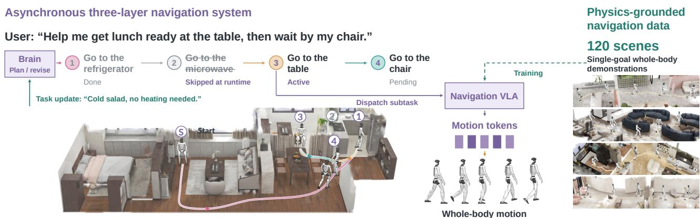  
Fig. 1. LHNAV combines an asynchronous three-layer navigation system with physics-grounded navigation data. The Brain maintains and revises a navigation plan during execution, dispatching single-goal instructions to a VLA that predicts whole-body motion tokens. The scene shows the initial navigation sequence, while the task row illustrates removing an unnecessary pending visit after a task update. The data engine covers 120 scenes, with 100 for training and 20 for held-out testing. Single-goal training demonstrations pair visual observations with motion tokens.

Abstract— We study humanoid navigation across multiple destinations under long-horizon language instructions. This task is challenging because robots must maintain progress across successive goals while continuously producing natural, stable whole-body motion through confined spaces. However, task decomposition in existing methods does not by itself ensure progress throughout execution, while waypoint-based navigation does not guarantee natural, route-faithful wholebody motion. Our key idea is to organize navigation into three complementary roles operating at different time scales: a Brain for task reasoning, a Cerebellum for local motion generation, and a Brainstem for whole-body execution. We realize this idea in LHNAV, an asynchronous system that uses progress and arrival feedback to coordinate navigation goals, VLA motion-token prediction, and whole-body control. To train the Cerebellum for natural, route-faithful motion, we develop a physics-grounded data engine that improves physical tracking of motion references along collision-aware routes and pairs the resulting demonstrations with rendered visual observations. Together, these designs allow task planning to proceed alongside continuous movement and extend singlegoal navigation to successive destinations with natural, routefaithful whole-body motion. In simulation, our navigation VLA outperforms OmniNav and DualVLN in single-goal success and motion smoothness, with fewer collisions and falls. Using a VLA trained only on single-goal demonstrations, LHNAV

achieves a 75.56% success rate on long-horizon navigation tasks. Deployment on the Unitree G1 further demonstrates single-goal navigation and zero-shot long-horizon task execution in realworld environments, including layouts with repositioned objects. Project website: https://robbyant-research.github.io/LHNav/.

## I. INTRODUCTION

Humanoid robots assisting people in everyday environments need to follow long-horizon language instructions that involve multiple destinations and task dependencies [1], [2]. For example, preparing a meal may require visiting the refrigerator, chopping board, stove, and dining table in an appropriate order. In this work, we focus on the navigation required by such instructions, where a humanoid must infer navigation goals and maintain progress across destinations without step-by-step guidance. This setting requires both task-level coordination across successive goals and natural, stable whole-body motion along long routes through confined spaces.

Long-horizon humanoid navigation is challenging because task progress must remain consistent with continuous execution across multiple destinations. Existing methods couple navigation decisions to reasoning [3]–[5], while asynchronous and hierarchical approaches allow task planning and action to proceed at different time scales [2], [6]–[8]. However, separating these processes does not itself ensure coherent task progression: goal transitions must reflect actual execution progress while navigation continues. A second challenge is reconciling route constraints with natural, stable whole-body motion, particularly in confined spaces. Waypoints, trajectories, and velocity commands describe intended movement but leave its whole-body realization to downstream controllers [2], [7], [9], so a collision-free route does not directly guarantee collision-free physical execution. Recent methods introduce richer body-level actions and multi-stage behaviors [10]–[13], yet maintaining natural motion while limiting position and heading errors over long, confined routes remains challenging.

We present LHNAV, combining asynchronous navigation with a physics-grounded data engine for long-horizon humanoid navigation. Inspired by the human brain, it comprises three layers: a Brain that maintains task context and dispatches goals, a Cerebellum that predicts motion tokens with auxiliary waypoint-based geometric supervision, and a Brainstem that executes whole-body motion through a frozen SONIC decoder [14]. Progress and arrival feedback coordinate successive goals, allowing a single-goal policy to execute navigation while task planning proceeds asynchronously. Our data engine uses ARDY [15] to generate natural motion references along collision-aware routes and trains the SONIC encoder with additional reference-root and velocity information for accurate tracking through the frozen decoder. Rendering closedloop rollouts in reconfigurable Gaussian–mesh scenes [16] pairs visual observations with synchronized motion-token targets for VLA training. Together, asynchronous coordination and physically executed supervision support natural, routefaithful whole-body navigation across multiple goals. Joint training on these simulated navigation demonstrations and real teleoperated manipulation data further enables navigation followed by tabletop pushing on Unitree G1.

Our contributions are threefold:

1) An asynchronous multirate system integrating task reasoning, motion-token prediction, and whole-body execution, using progress-aware transitions that extend a single-goal policy to long-horizon humanoid navigation.

2) A scalable, physics-grounded data engine that improves global motion-reference tracking through a privileged encoder and frozen SONIC decoder, generating execution-aligned navigation demonstrations in Gaussian–mesh scenes.

3) Experimental validation demonstrating higher navigation success in unseen simulation scenes, smoother motion, fewer collisions, and faster long-horizon completion, alongside real-world single-goal navigation and zero-shot long-horizon navigation.

## II. RELATED WORK

From navigation commands to whole-body motion. Navigation policies typically output motion primitives [17], metric commands [18], [19], or local waypoints and trajectories [9], [20], [21]. While natural for wheeled robots, these interfaces rely on downstream controllers for actuation and, on humanoids, whole-body coordination. Richer interfaces expose body targets: LEGS combines wrist poses with base commands [13], FetchMan uses base height and upper-body joint targets [12], and VLK predicts root-and-joint trajectories with contacts [11]. Others encode motion as pose tokens [10], learned latents [22], or FSQ tokens [14]. SONIC decodes such tokens with proprioceptive feedback and supports direct VLA prediction. We adopt this interface for navigation, motivating supervision aligned with executed humanoid motion.

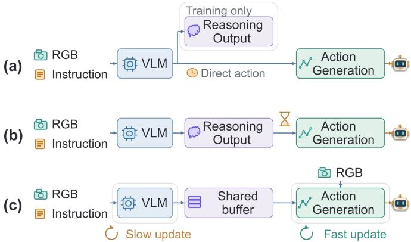  
Fig. 2. Representative reasoning–action coupling patterns: (a) reasoning supervision; (b) think then act; (c) asynchronous reasoning and control.

Physics-grounded navigation supervision. Navigation data draw on instruction–route datasets [23], simulators [24], Gaussian scene representations [16], [25], and geometric experts that synthesize routes [21], [26]. These provide visual context and geometric routes, but humanoid supervision must also specify how the body executes them. VLK synthesizes whole-body kinematics in reconstructed scenes [11], while LEGS and FetchMan collect control commands from physical rollouts [12], [13]. Tracking reveals failures and route deviations missed by kinematic references; LEGS therefore retains only successful episodes [13]. Our data engine targets global route fidelity and pairs rendered executed states with the post-FSQ tokens consumed during rollout, matching the deployment action interface.

Reasoning and execution for long-horizon tasks. Longhorizon navigation couples semantic planning with local execution. Fig. 2 summarizes representative strategies. FantasyVLN uses reasoning supervision only during training [5], whereas NavGPT and CL-CoTNav reason online before acting [3], [27]. OctoNav and AwareVLN reduce overhead by adapting reasoning frequency or switching between reasoning and action modes [4], [28]. OmniNav connects planning and execution through subgoals [29], while DualVLN enables asynchronous action prediction from cached goals and current observations [6]; TIC-VLA further models latency and egomotion [7]. Task coordination also requires execution feedback: SAGE-Nav updates semantic waypoints upon completion or deadlock [8], while Uni-LaViRA, Being-0, and HoloAgent-0 organize multistage execution through subgoal or skill interfaces [2], [30], [31]. We use asynchronous execution, with short instructions and target images linking task planning to single-goal navigation. Arrival verification and progress feedback guide advancement and recovery; motion tokens drive high-rate proprioceptive whole-body control.

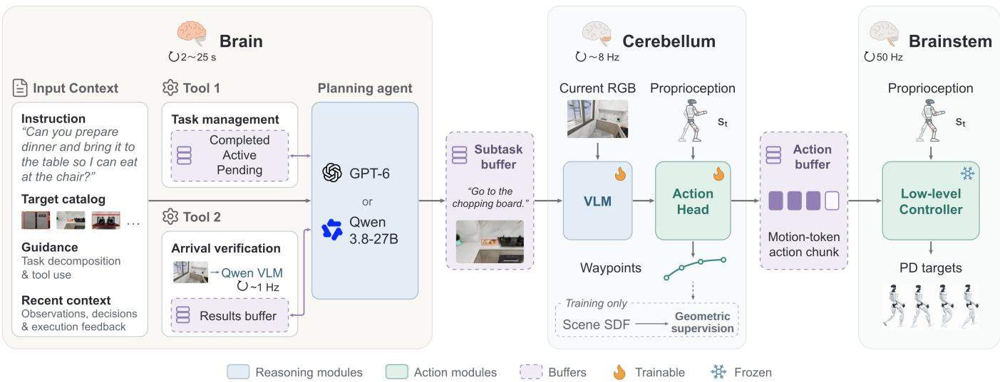  
Fig. 3. Our asynchronous three-layer navigation system. The Brain uses task management (Tool 1) to maintain an explicit plan and revise pending goals during execution, with goal-completion feedback from arrival verification (Tool 2). A subtask buffer supplies an instruction and target image to the Cerebellum, which uses current RGB and proprioceptive state st to jointly predict motion-token chunks and auxiliary waypoints at approximately 8 Hz. An action buffer supplies the latest motion-token chunk to the Brainstem’s frozen SONIC controller, which combines it with proprioception to produce joint targets at 50 Hz for PD control. The independent arrival-verification VLM updates the results buffer at up to 1 Hz. Geometric supervision encourages waypoint traversability during training.

## III. METHOD

We consider a G1 humanoid robot operating in a scene with a catalog of reference images depicting candidate destinations. Given a long-horizon language instruction, LHNAV selects the required destinations from this catalog and navigates the robot to them in sequence. As shown in Fig. 3, the Brain decomposes the instruction into navigation subtasks (Section III-A), the Cerebellum predicts local motion tokens, and the Brainstem decodes them into whole-body actions (Section III-B). All three layers execute asynchronously.

## A. Brain: Agent with Tools

The Brain coordinates long-horizon navigation through a planning agent with task-management and arrival-verification tools, tracking progress, revising the remaining plan, and deciding when to advance.

The planning agent receives the full instruction and target catalog, together with task-decomposition and tool-use guidance and recent observations, decisions, and execution feedback. It can be implemented with GPT-6 or Qwen3.8- 27B. The task management tool (Tool 1 in Fig. 3) maintains an explicit plan of completed, active, and pending navigation subtasks. The agent uses this tool to create the plan and revise pending subtasks during execution using new observations, task updates, and execution feedback. Revisions can remove goals that are no longer needed, while preserving completed visits and the active goal. The arrival verification tool provides goal-completion feedback through an independent Qwen VLM, which checks arrival at up to 1 Hz using the active subtask, target reference image, and temporal observations. Diagnostic analyses and subtask-specific arrival judgments are written to a shared buffer for the planning agent to access. At a navigation stop, the runtime harness blocks new VLA requests and discards outstanding predictions. It records completion after verified arrival, motion-plan exhaustion, and odometryconfirmed root stability, then dispatches the next subtask from the updated plan following the external stage-completion event. At each stage, the Brain supplies the Cerebellum VLA with a simple textual instruction specifying the active navigation goal, such as “go to the table.”

## B. Cerebellum and Brainstem: Humanoid VLN with Geometric Supervision

Given a navigation subtask from the Brain, the Cerebellum uses a humanoid VLA to predict whole-body motion tokens from visual observations and proprioception. The Brainstem decodes these tokens into joint targets for execution.

Joint action and waypoint prediction. We build on the fine-tuning framework for GR00T N1.7 and SONIC [32], retaining its vision–language backbone and flow-matching action model. Inspired by successful VLN methods that use waypoint-based action representations [6], [9], [29], we introduce geometric supervision into motion-token learning by jointly predicting motion tokens and auxiliary waypoints with a shared DiT. Given a subtask instruction $\ell _ { t } .$ , target image $I _ { g } ,$ current RGB observation $I _ { t } ,$ and proprioceptive state $s _ { t } ,$ the policy predicts

$$
\begin{array} { r } { ( \widehat { Z } _ { t } , \widehat { W } _ { t } ) = \pi _ { \theta } ( \ell _ { t } , I _ { g } , I _ { t } , s _ { t } ) , } \end{array}\tag{1}
$$

where $\widehat { Z } _ { t } \in \mathbb { R } ^ { H \times 6 4 }$ contains motion tokens and $\widehat { W } _ { t } \in \mathbb { R } ^ { H \times 5 }$ contains waypoints, with $H = 4 0$ . Each waypoint encodes a planar position in the observation-time robot frame, heading through its sine and cosine, and an arrival indicator. Motion tokens and waypoints are indexed by time and path distance, respectively, and are not aligned frame by frame.

Geometric supervision. To improve waypoint traversability, we introduce SDF-based geometric supervision. For simplicity, we restrict the signed distance field $d _ { \mathrm { s d f } }$ to the xy plane and precompute it from the background traversable mesh (BgMesh) and the current configuration of foreground movable obstacle meshes (FgMesh). The field is positive within the resulting traversable region and negative outside. We apply this supervision to waypoint predictions obtained after the full denoising process. Their planar positions are transformed into scene coordinates for bilinear SDF queries. The minimum signed clearance over valid waypoints determines the penalty:

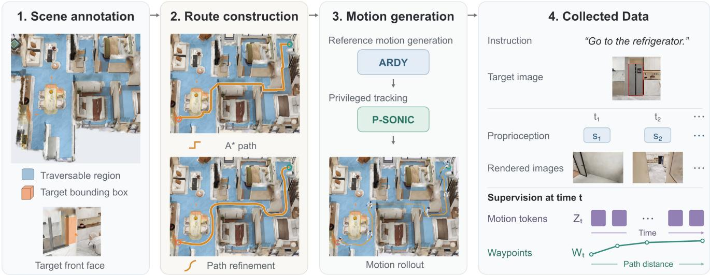  
Fig. 4. Example of navigation data generation for “Go to the refrigerator.”

$$
\begin{array} { r l } & { c _ { \operatorname* { m i n } } = \displaystyle \operatorname* { m i n } _ { i \in \mathcal { V } } d _ { \mathrm { s d f } } \left( T _ { t } \widehat { w } _ { i } ^ { x y } \right) , } \\ & { \mathcal { L } _ { \mathrm { s d f } } = \eta \log ( 1 + \exp ( - c _ { \operatorname* { m i n } } / \eta ) ) , } \end{array}\tag{2}
$$

where $T _ { t }$ maps local positions to scene coordinates, V indexes valid waypoints, and η controls the transition scale. We use minimum clearance to prevent localized boundary violations from being diluted by averaging over safe waypoints. Softplus smoothly approximates this violation penalty.

Training and deployment. The training objective combines joint flow matching with geometric supervision:

$$
\mathcal { L } = \mathcal { L } _ { \mathrm { j o i n t - f l o w } } ( Z , W ) + \lambda _ { \mathrm { s d f } } \mathcal { L } _ { \mathrm { s d f } } .\tag{3}
$$

The Cerebellum updates motion-token chunks at approximately 8 Hz using 4 denoising steps, while the frozen SONIC decoder [14] executes the current chunk at 50 Hz. Returned chunks skip the prefix corresponding to steps executed during inference and replace the unexecuted tail without blending.

## IV. HUMANOID NAVIGATION DATA ENGINE

We design a physics-grounded data engine for training and evaluating humanoid navigation policies. As shown in Fig. 4, it converts target-conditioned routes into physically executed demonstrations that provide visual observations, motion tokens, and waypoint labels.

## A. Scene and Route Construction

Generating visual navigation demonstrations requires environments that support realistic rendering. For training, we use 100 photorealistic scenes from InteriorGS [25] as the scene backgrounds. To plan routes within these environments, we manually annotate a background mesh (BgMesh) that identifies where the robot can move. To vary target and obstacle layouts, we augment the Gaussian backgrounds with movable foreground meshes (FgMesh), forming GS+Mesh scenes. Route planning then uses the traversable region determined by BgMesh and the current foreground configuration.

Target-conditioned navigation also requires specifying where the robot should stop and how it should face the target. We annotate target bounding boxes and facing directions, then select an accessible approach pose outside each target’s bounding box, prioritizing its front side and orienting the robot toward it. To generate routes from different initial conditions, we randomly sample a start position and heading in the same connected traversable region and connect the start to the approach pose using 2D A\*. To maintain obstacle clearance and avoid abrupt changes in direction, we refine each route for clearance, smoothness, and length. This produces a targetconditioned navigation path connecting the sampled start position to the approach position, together with the initial and terminal headings.

## B. Route-Conditioned Motion Generation and Tracking

Given a route, we use the ARDY motion generator [15] to synthesize a whole-body reference motion at 50 Hz. Throughout generation, the prompt is “A person is walking.” Soft path and heading constraints and target standing poses at both endpoints guide route following and motion transitions.

Physical tracking errors can cause executed demonstrations to deviate from their planned routes. We therefore improve global reference tracking to obtain route-faithful demonstrations for navigation-policy training. SONIC [14] encodes future reference motion into quantized motion latents and decodes them with robot proprioception into joint actions. As shown in Fig. 5, the original SONIC can accumulate global drift during execution, causing the executed trajectory to deviate from the ARDY reference and leaving a visible position offset at the endpoint. Our privileged SONIC (P-SONIC) augments the encoder with future reference pelvis position differences and recent body-frame linear velocities:

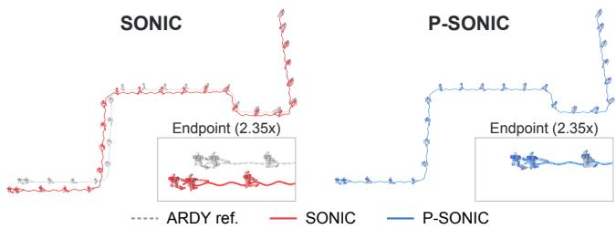  
Fig. 5. Reference tracking on the route in Fig. 4. Motion runs from upper right to lower left; insets enlarge the endpoints.

$$
p _ { t } = \mathrm { c o n c a t } \Big ( \{ R _ { t } ^ { \top } ( x _ { t + \tau _ { j } } ^ { \mathrm { r e f } } - x _ { t } ) \} _ { j = 1 } ^ { 1 0 } , \{ v _ { t - j } ^ { \mathrm { b o d y } } \} _ { j = 9 } ^ { 0 } \Big ) .\tag{4}
$$

Here, $x _ { t }$ and $R _ { t }$ are the current robot root position and rotation, $x ^ { \mathrm { r e f } }$ is the reference pelvis position, $\tau _ { j }$ specifies a future sampling offset, and $v ^ { \mathrm { b o d y } }$ is the actual body-frame linear velocity. We fine-tune the encoder with PPO in IsaacLab for 40K training iterations across 262K parallel environments, using global tracking and relative body-pose objectives while freezing the FSQ quantizer and decoder.

For offline data generation, P-SONIC tracks the references in MuJoCo. We retain rollouts whose root tilt-angle error remains below $2 5 ^ { \circ }$ as the no-fall criterion, recording executed robot states and the post-quantization motion tokens supplied to the decoder. Keeping the decoder frozen preserves the decoding interface at deployment. The VLA learns to predict the motion latents labeled by P-SONIC, and its predictions are executed by the same decoder without privileged inputs.

Across 184,990 shared routes in 100 scenes, our pipeline reduces the proportion of executed path length outside the traversable region from 3.318% to 1.841% and joint-position jerk by 44.7%, compared with guiding SONIC along the same routes using velocity commands toward a look-ahead point. This yields smoother navigation demonstrations with fewer traversable-region violations.

## C. Execution-Aligned Rendering and Supervision

We replay recorded robot states to render first-person observations using the robot-mounted camera configuration. For GS+Mesh scenes, the Gaussian background and FgMesh are rendered from the same camera and composited using depth. Each episode shares an instruction and target image across its observation and proprioception sequences. At each observation, supervision includes a temporal motion-token chunk and waypoints sampled by path distance from the executed trajectory, expressed in the current robot frame.

## V. EXPERIMENTS

We evaluate the Navigation Cerebellum on single-goal navigation and the complete system on long-horizon tasks in simulation, followed by real-robot tests in household and reconfigured environments and a qualitative navigation– interaction example. Ablations examine privileged motion tracking, action representations, geometric supervision, and VLA update frequency.

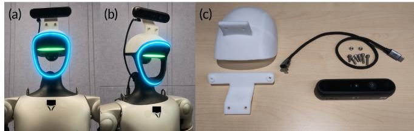  
Fig. 6. Real-robot platform and camera mounting. (a,b) Front and oblique views of Unitree G1 with a forward-facing Orbbec Gemini335L camera mounted above the head for egocentric RGB observations. (c) Camera assembly components, including the custom 3D-printed mount, fastening hardware, and connection cable.

## A. Experimental Setup

a) Datasets: We select 100 training scenes and 20 held out test scenes from InteriorGS [25]. Our data engine produces 185,401 single-goal training demonstrations, and we evaluate all methods on 522 episodes with identical starts and goals in the held-out scenes. For long-horizon experiments, we use 20 scenes from the training split, with 14,410 single-goal demonstrations for policy training and 45 evaluation tasks requiring at least three ordered goal visits.

b) Training Settings: For single-goal evaluation, we finetune OmniNav [29] and DualVLN [6] from their released checkpoints, and our Navigation Cerebellum from pretrained GR00T N1.7 weights [32], on the same 100-scene dataset. For long-horizon evaluation, we train a separate Cerebellum from the same initialization using single-goal demonstrations from the 20-scene subset. Zero-shot denotes execution of longhorizon instructions unseen during navigation-policy training on single-goal demonstrations. All navigation policies are trained for 100K steps with a global batch size of 64 on eight NVIDIA H20 GPUs.

c) Evaluation Settings: All methods use SONIC [14] for whole-body control. Motion-token execution does not require odometry-based trajectory tracking. Under the same execution setting, waypoint-based policies issue velocity com mands along the initial direction of each predicted trajectory, refreshed with every new prediction. The commanded speed is 0.6 m/s, matching the walking speed used by ARDY during data collection.

d) Hardware Setup: We deploy on a Unitree G1 with a forward-facing Orbbec Gemini335L camera secured to the head using a custom 3D-printed mount (Fig. 6). The camera provides egocentric RGB observations for task reasoning, arrival verification, and local navigation.

e) Metrics: $\mathrm { S R _ { 0 . 5 } / S R _ { 1 . 5 } }$ measures success below 0.5/1.5 m final goal distance without falls. Falls counts noncollision tracking falls. NE measures final planar distance to the goal point (last target box for long-horizon tasks). CR averages the root-path fraction outside traversable space. Joint-position jerk $( J _ { p } )$ averages unfiltered third-order finite differences of 29 world-frame joint positions sampled at 50 Hz over joints, time, and episodes. Long-horizon Task $\mathrm { S R } _ { 1 . 5 }$ requires matching the prescribed target sequence, with every recorded completion position within 1.5 m horizontally of its corresponding target box. Progress is the fraction completed before the first error; OSR counts ordered entry into all target regions regardless of stopping. Time averages successful-task duration, including planning, navigation, handoffs, and dwell.

## B. Single-Goal Navigation in Simulation

Under these execution settings, our pipeline achieves higher success, lower CR and joint-position jerk, and fewer falls than adapted waypoint baselines in unseen scenes (Table I), supporting accurate navigation with smooth, stable motion. Figure 7 shows two example rollouts.

<table><tr><td>Method</td><td> $\mathrm { S R } _ { 0 . 5 }$  ↑ (%)</td><td> $\mathrm { S R } _ { 1 . 5 }$  (%)</td><td>↑NE↓ CR↓ (m)</td><td>(%)</td><td> $J _ { p } \ \underline { { \downarrow } }$   $\mathrm { ( m \dot { } s ^ { 3 } ) }$ </td><td>Falls ↓ (count)</td></tr><tr><td>OmniNav [29]</td><td>36.0</td><td>69.0</td><td>1.8</td><td>19.5</td><td>109.1</td><td>7</td></tr><tr><td>DualVLN [6]</td><td>18.6</td><td>48.7</td><td>2.9</td><td>25.8</td><td>128.3</td><td>91</td></tr><tr><td>LHNAV</td><td>52.3</td><td>75.7</td><td>1.7</td><td>8.6</td><td>75.6</td><td>0</td></tr></table>

TABLE I: Comparison of single-goal humanoid navigation on 522 episodes across 20 held-out scenes.

## C. Long-Horizon Navigation in Simulation

All variants share the single-goal VLA and SONIC decoder, with Qwen3.8-27B for VLM-based variants and GPT-6- Astra (low reasoning effort) for Codex. The full system achieves 75.56% Task $\mathrm { S R } _ { 1 . 5 }$ (Table II; example in Fig. 8). Removing task management, including the plan, completedvisit history, and textual and visual execution memory, reduces success to 0%; removing arrival verification and its retry and turning recovery reduces it to 55.6%. Codex success improves from 55.6% to 64.4% with Qwen’s taskdecomposition guidance through the harness, and to 71.1% with both tools. Asynchronous planning and verification overlap navigation rather than run between attempts, achieving comparable success to the synchronous variant with lower mean completion time over each variant’s successful tasks.

<table><tr><td>Variant</td><td>Task  $\mathrm { S R } _ { 1 . 5 }$  (%) ↑</td><td>Progress Time (%) ↑</td><td>(s) ↓</td><td>NE (m) ↓</td><td>OSR (%) ↑</td></tr><tr><td>VLM-based system</td><td></td><td></td><td></td><td></td><td></td></tr><tr><td>Synchronous</td><td>73.3</td><td>82.5</td><td>97.8</td><td>1.2</td><td>88.9</td></tr><tr><td>w/o Task management</td><td>0.0</td><td>28.0</td><td></td><td>4.6</td><td>15.6</td></tr><tr><td>w/o Arrival verification</td><td>55.6</td><td>68.9</td><td>80.4</td><td>2.0</td><td>77.8</td></tr><tr><td>Full system</td><td>75.6</td><td>82.2</td><td>82.1</td><td>1.7</td><td>91.1</td></tr><tr><td>Codex-based system</td><td></td><td></td><td></td><td></td><td></td></tr><tr><td>Native</td><td>55.6</td><td>76.0</td><td>154.5</td><td>1.2</td><td>82.2</td></tr><tr><td>+ Harness</td><td>64.4</td><td>73.3</td><td>141.8</td><td>1.9</td><td>82.2</td></tr><tr><td>+ Harness + tools</td><td>71.1</td><td>78.5</td><td>97.9</td><td>1.1</td><td>91.1</td></tr></table>

TABLE II: Comparison of long-horizon humanoid navigation on 45 tasks.

## D. Real-Robot Navigation

After scene-specific single-goal training with our data engine, we test Unitree G1 from random starts (Table III). Tests cover five household destinations, three targets in three layouts differing from training, and one zero-shot long-horizon instruction: “I left my reading notes on the teatable. Please bring them to the double bed so I can read before sleep, and once I am done, leave them on the desk for tomorrow morning.” Five trials per condition yield 100% household single-goal success and 93.3–100% across reconfigured targets; the three-destination readingnotes task succeeds in four of five trials. These results demonstrate sim-to-real navigation under varied starts and object layouts, and multi-goal execution from single-goal training. Figures 9 and 10 show representative rollouts. Realrobot demonstrations are provided in the accompanying supplementary video.

<table><tr><td>Target or task</td><td>Layouts</td><td>Trials</td><td>Successes</td><td>Success (%)</td></tr><tr><td colspan="5">Household single-goal</td></tr><tr><td>Desk</td><td>1</td><td>5</td><td>5</td><td>100.0</td></tr><tr><td>Double bed</td><td>1</td><td>5</td><td>5</td><td>100.0</td></tr><tr><td>Coffee table</td><td>1</td><td>5</td><td>5</td><td>100.0</td></tr><tr><td>Toilet</td><td>1</td><td>5</td><td>5</td><td>100.0</td></tr><tr><td>Bunk bed</td><td>1</td><td>5</td><td>5</td><td>100.0</td></tr><tr><td colspan="5">Household long-horizon</td></tr><tr><td>Reading-notes task</td><td>1</td><td>5</td><td>4</td><td>80.0</td></tr><tr><td colspan="5">Reconfigured single-goal</td></tr><tr><td>Floor-standing fan</td><td>3</td><td>15</td><td>14</td><td>93.3</td></tr><tr><td>Small fan</td><td>3</td><td>15</td><td>14</td><td>93.3</td></tr><tr><td>Toy dog</td><td>3</td><td>15</td><td>15</td><td>100.0</td></tr></table>

TABLE III: Real-robot navigation with Unitree G1 in household and reconfigured environments.

Joint training on our simulated navigation data and realrobot manipulation data collected through SONIC teleoperation also enables navigation to a table followed by pushing a toy dog (Fig. 11), demonstrating compatibility between the two data sources.

## E. Ablation Studies

1) Privileged Motion Tracking: We evaluate SONIC and P-SONIC on 100 procedurally randomized 10 m routes: 25 each with gentle curves, left turns, right turns, and S-curves. Error measures final-frame horizontal distance to the ARDY reference. P-SONIC reduces mean error by 96.4% (Table IV).

<table><tr><td>Tracker</td><td>Mean↓ (cm)</td><td>Median↓ (cm)</td><td>P95↓ (cm)</td><td>Max. ↓ (cm)</td></tr><tr><td>SONIC</td><td>48.65</td><td>47.59</td><td>73.66</td><td>94.02</td></tr><tr><td>P-SONIC</td><td>1.76</td><td>1.39</td><td>4.80</td><td>7.06</td></tr></table>

TABLE IV: Final-frame horizontal position error.

2) Navigation Action Representations: We compare waypoint-only, motion-token-only, and joint prediction on 522 episodes (Table V). Under the evaluated interfaces, the motion-token variant achieves higher success, lower jointposition jerk, and fewer falls than the waypoint variant. Joint prediction adds waypoints for geometric supervision, raising $\mathrm { S R } _ { \mathrm { 0 . 5 } }$ by 4.41 percentage points and lowering CR relative to motion-token-only prediction, with no falls. These results support combining motion-token execution with auxiliary geometric prediction for accurate, stable navigation.

3) Geometric Supervision: We isolate geometric supervision by training the same joint-prediction model with and without this term, keeping initialization, data, and training budget fixed (Table VI). Applying geometric supervision to auxiliary waypoints raises $\mathrm { S R } _ { \mathrm { 0 . 5 } }$ by 4.98 percentage points and lowers CR, with similar $\mathrm { S R } _ { \mathrm { 1 . 5 } }$ and joint-position jerk.

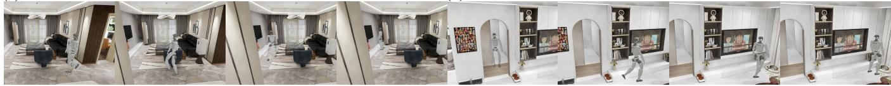  
Fig. 7. Single-goal navigation to a television and a pet nest. Each half shows four chronological frames from a selected successful rollout, including intermediate walking and final goal positioning.

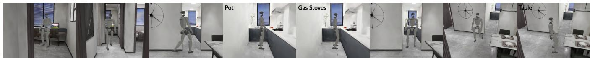  
Fig. 8. Sequential goal reaching in a simulated long-horizon task. Instruction: “I’m craving something hot for dinner. Please cook a simple meal in the pot on the gas stoves and serve it on the table.” Frames run chronologically from left to right, retaining intermediate walking and labeling the three goal locations. The rollout executes navigation and arrival holds, not cooking or serving.

(a) Long-Horizon Navigation  
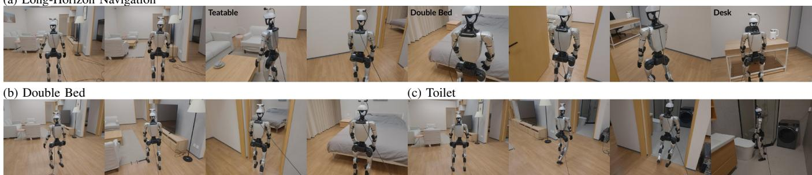  
Fig. 9. Household navigation on Unitree G1. (a) A long-horizon run visits the teatable, double bed, and desk. (b,c) Single-goal runs to the double bed and toilet. Selected frames retain intermediate walking, with goal locations labeled in keyframes.

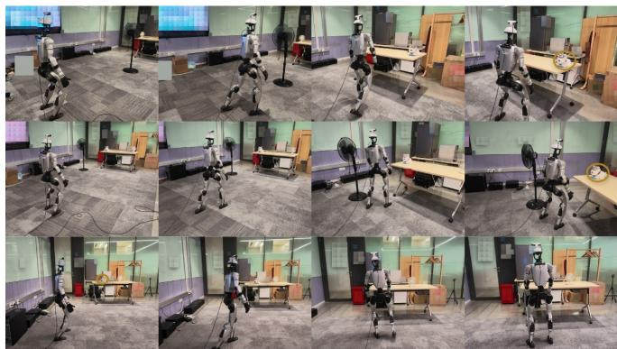

Fig. 10. Toy-dog navigation across three reconfigured layouts. Each row shows the robot approaching the toy dog in one layout. Circles identify the target where visible; background text is masked.
<table><tr><td>Prediction</td><td> $\mathrm { S R } _ { 0 . 5 }$  ↑ (%)</td><td> $\mathrm { S R } _ { 1 . 5 }$  (%)</td><td>↑NE↓CR↓ (m)</td><td>(%)</td><td> $J _ { p } \downarrow$   $\mathrm { ( m / s ^ { 3 } ) }$ </td><td>Falls↓ (count)</td></tr><tr><td>Waypoints</td><td>26.4</td><td>64.9</td><td>2.0</td><td>12.6</td><td>187.7</td><td>86</td></tr><tr><td>Motion tokens</td><td>47.9</td><td>73.9</td><td>1.9</td><td>12.3</td><td>80.9</td><td>0</td></tr><tr><td>Joint prediction</td><td>52.3</td><td>75.7</td><td>1.7</td><td>8.6</td><td>75.6</td><td>0</td></tr></table>

TABLE V: Navigation action representations on 522 episodes. Both waypoint-only and joint prediction use geometric supervision.

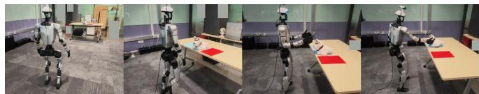  
Fig. 11. Navigation followed by tabletop interaction. Instruction: “Push the toy dog from the middle region to the blue region.” The robot approaches the table, positions itself, and initiates a push.

<table><tr><td>Geometric supervision</td><td> $\mathrm { S R } _ { 0 . 5 }$  ↑ (%)</td><td> $\mathrm { S R } _ { 1 . 5 }$  (%)</td><td>↑NE↓CR↓ (m)</td><td>(%)</td><td> $J _ { p } \downarrow$  Falls ↓ (m/s3) (count)</td></tr><tr><td>Without</td><td>47.3</td><td>75.5</td><td>1.6</td><td>14.4 75.3 75.6</td><td>3</td></tr><tr><td>With</td><td>52.3</td><td>75.7</td><td>1.7</td><td>8.6</td><td>0</td></tr></table>

TABLE VI: Ablation of geometric supervision on 522 singlegoal episodes.

These results show that constraining the predicted geometry improves precise goal reaching and adherence to traversable space during motion-token execution, without compromising motion smoothness.

4) VLA Update Frequency: We evaluate Cerebellum update rates of approximately 2, 5, and 8 Hz over 522 episodes, with the SONIC Brainstem fixed at 50 Hz (Table VII). Success rates remain similar; slower updates reduce joint-position jerk, while approximately 8 Hz yields the lowest CR and no falls. These results support low-rate visual action prediction coupled with high-rate whole-body execution, with a trade-off between motion smoothness and route adherence.

<table><tr><td>Nominal rate  $\mathrm { S R } _ { 0 . 5 }$  (%)</td><td>↑  $\mathrm { S R } _ { 1 . 5 }$  (%)</td><td>↑NE↓CR↓ (m)</td><td>(%)</td><td> $J _ { p } \ \downarrow _ { \mathnormal { } }$ </td><td>Falls↓ (m/s3) (count)</td></tr><tr><td>~2 Hz</td><td>51.7</td><td>75.3</td><td>1.7 9.2</td><td>53.0</td><td>1</td></tr><tr><td>~5 Hz</td><td>51.9</td><td>73.4</td><td>1.8</td><td>10.1 61.3</td><td>1</td></tr><tr><td>~8 Hz</td><td>52.3</td><td>75.7</td><td>1.7</td><td>8.6 75.6</td><td>0</td></tr></table>

TABLE VII: VLA update-rate ablation on 522 episodes.

## VI. CONCLUSION

We presented LHNAV, an asynchronous framework for long-horizon humanoid navigation. Task-progress management and arrival verification coordinate successive goals, while a motion-token VLA and a frozen whole-body decoder support whole-body navigation. A physics-grounded data engine supplies route-conditioned demonstrations with aligned visual observations and humanoid action supervision. Simulation experiments show improved goal reaching, smoother motion, and fewer collisions and falls, while asynchronous coordination extends policies trained on single-goal demonstrations to long-horizon tasks. Deployment on Unitree G1 further demonstrates household single-goal navigation, zeroshot long-horizon navigation, and single-goal navigation under object-layout changes.

## REFERENCES

[1] M. Ahn, A. Brohan, N. Brown, Y. Chebotar, O. Cortes, B. David, C. Finn, C. Fu, K. Gopalakrishnan, K. Hausman, A. Herzog, D. Ho, J. Hsu, J. Ibarz, B. Ichter, A. Irpan, E. Jang, R. J. Ruano, K. Jeffrey, S. Jesmonth, N. J. Joshi, R. Julian, D. Kalashnikov, Y. Kuang, K.-H. Lee, S. Levine, Y. Lu, L. Luu, C. Parada, P. Pastor, J. Quiambao, K. Rao, J. Rettinghouse, D. Reyes, P. Sermanet, N. Sievers, C. Tan, A. Toshev, V. Vanhoucke, F. Xia, T. Xiao, P. Xu, S. Xu, M. Yan, and A. Zeng, “Do as I can, not as I say: Grounding language in robotic affordances,” arXiv preprint arXiv:2204.01691, 2022.

[2] X. Zhou, L. Liu, T. Xiao, W. Feng, F. Fu, X. Meng, X. Wang, J. Han, B. Yu, Y. Du, W. Sui, and Z. Su, “HoloAgent-0: A unified embodied agent framework with 3D spatial memory,” arXiv preprint arXiv:2606.23565, 2026.

[3] Y. Cai, X. He, M. Wang, H. Guo, W.-Y. Yau, and C. Lv, “CL-CoTNav: Closed-loop hierarchical chain-of-thought for zero-shot object-goal navigation with vision-language models,” arXiv preprint arXiv:2504.09000, 2025.

[4] C. Gao, L. Jin, X. Peng, J. Zhang, Y. Deng, A. Li, H. Wang, and S. Liu, “OctoNav: Towards generalist embodied navigation,” arXiv preprint arXiv:2506.09839, 2025.

[5] J. Zuo, L. Mu, F. Jiang, C. Ma, M. Xu, and Y. Qi, “FantasyVLN: Unified multimodal chain-of-thought reasoning for Vision-Language Navigation,” arXiv preprint arXiv:2601.13976, 2026.

[6] M. Wei, C. Wan, J. Peng, X. Yu, Y. Yang, D. Feng, W. Cai, C. Zhu, T. Wang, J. Pang, and X. Liu, “Ground slow, move fast: A dual-system foundation model for generalizable Vision-and-Language navigation,” arXiv preprint arXiv:2512.08186, 2025.

[7] Z. Huang, Y. Zhang, J. Liu, R. Song, C. Tang, and J. Ma, “TIC-VLA: A think-in-control Vision-Language-Action model for robot navigation in dynamic environments,” arXiv preprint arXiv:2602.02459, 2026.

[8] H. Su, Y. Huang, Y. Ma, Y. Liu, and J. Lv, “SAGE-Nav: Leveraging LLM planning and alignment fusion for hierarchical scene graph-guided navigation,” arXiv preprint arXiv:2606.25497, 2026.

[9] J. Krantz, A. Gokaslan, D. Batra, S. Lee, and O. Maksymets, “Waypoint models for instruction-guided navigation in continuous environments,” in Proceedings ofthe IEEE/CVF International Conference on Computer Vision (ICCV), 2021, pp. 15 162–15 171.

[10] P. Ding, J. Ma, X. Tong, B. Zou, X. Luo, Y. Fan, T. Wang, H. Lu, P. Mo, J. Liu, Y. Wang, H. Zhou, W. Feng, J. Liu, S. Huang, and D. Wang, “Humanoid-VLA: Towards universal humanoid control with visual integration,” arXiv preprint arXiv:2502.14795, 2025.

[11] Y.-J. Wang, J. Li, S. Chen, T. E. Truong, P. Xu, P. Abbeel, R. Duan, K. Sreenath, A. Kanazawa, C. Sferrazza, G. Shi, and K. Liu, “VLK: Learning humanoid loco-manipulation from synthetic interactions in reconstructed scenes,” arXiv preprint arXiv:2606.30645, 2026.

[12] O. Rayyan, Z. Li, M. Argus, Y. Jiang, C. Yu, C. Jiang, and Y. Cui, “FetchMan: Learning visual humanoid loco-manipulation policies from simulated experiences,” arXiv preprint arXiv:2608.17027, 2026.

[13] H. Kim, T. Chen, J. Sun, L. W. Osterberg, Q. Chen, K. Wang, and M. Schwager, “LEGS: Fine-tuning teleop-free VLAs for humanoid loco-manipulation in an embodied gaussian splatting world,” arXiv preprint arXiv:2606.01458, 2026.

[14] Z. Luo, Y. Yuan, T. Wang, C. Li, F. Castaneda, S. Chen, Z.-A. Cao, J. Li,˜ D. Minor, Q. Ben, J. Park, D. Sami, Z. Wang, X. Da, R. Ding, C. Hogg, L. Song, E. Lim, E. Jeong, T. He, H. Xue, W. Xiao, S. Yuen, J. Kautz, Y. Chang, U. Iqbal, L. J. Fan, and Y. Zhu, “SONIC: Supersizing motion tracking for natural humanoid whole-body control,” arXiv preprint arXiv:2511.07820, 2025.

[15] K. Zhao, M. Petrovich, H. Zhang, T. Wang, S. Tang, and D. Rempe, “ARDY: Autoregressive diffusion with hybrid representation for interactive human motion generation,” ACM Transactions on Graphics, vol. 45, no. 4, 2026.

[16] B. Kerbl, G. Kopanas, T. Leimkuhler, and G. Drettakis, “3D Gaussian¨ Splatting for real-time radiance field rendering,” ACM Transactions on Graphics, vol. 42, no. 4, pp. 1–14, Jul. 2023.

[17] J. Krantz, E. Wijmans, A. Majumdar, D. Batra, and S. Lee, “Beyond the nav-graph: Vision-and-language navigation in continuous environments,” arXiv preprint arXiv:2004.02857, 2020.

[18] J. Zhang, K. Wang, R. Xu, G. Zhou, Y. Hong, X. Fang, Q. Wu, Z. Zhang, and H. Wang, “NaVid: Video-based VLM plans the next step for Vision-and-Language Navigation,” in Robotics: Science and Systems (RSS), 2024.

[19] A.-C. Cheng, Y. Ji, Z. Yang, Z. Gongye, X. Zou, J. Kautz, E. Bıyık, H. Yin, S. Liu, and X. Wang, “NaVILA: Legged robot Vision-Language-Action model for navigation,” arXiv preprint arXiv:2412.04453, 2024.

[20] A. Sridhar, D. Shah, C. Glossop, and S. Levine, “NoMaD: Goal masked diffusion policies for navigation and exploration,” arXiv preprint arXiv:2310.07896, 2023.

[21] W. Cai, J. Peng, Y. Yang, Y. Zhang, M. Wei, H. Wang, Y. Chen, T. Wang, and J. Pang, “NavDP: Learning sim-to-real navigation diffusion policy with privileged information guidance,” arXiv preprint arXiv:2505.08712, 2025.

[22] H. Xue, X. Huang, D. Niu, Q. Liao, T. Kragerud, J. T. Gravdahl, X. B. Peng, G. Shi, T. Darrell, K. Sreenath, and S. Sastry, “LeVERB: Humanoid whole-body control with latent vision-language instruction,” arXiv preprint arXiv:2506.13751, 2025.

[23] P. Anderson, Q. Wu, D. Teney, J. Bruce, M. Johnson, N. Sunderhauf,¨ I. Reid, S. Gould, and A. van den Hengel, “Vision-and-Language Navigation: Interpreting visually-grounded navigation instructions in real environments,” in Proceedings of the IEEE Conference on Computer Vision and Pattern Recognition (CVPR). IEEE, Jun. 2018, pp. 3674–3683.

[24] M. Savva, A. Kadian, O. Maksymets, Y. Zhao, E. Wijmans, B. Jain, J. Straub, J. Liu, V. Koltun, J. Malik, D. Parikh, and D. Batra, “Habitat: A platform for Embodied AI research,” in Proceedings ofthe IEEE/CVF International Conference on Computer Vision (ICCV), 2019, pp. 9339– 9347.

[25] SpatialVerse Research Team, Manycore Tech Inc., “InteriorGS: A 3D Gaussian Splatting dataset of semantically labeled indoor scenes,” https://github.com/manycore-research/InteriorGS, 2025.

[26] Z. Chu, S. Xie, X. Wu, Y. Shen, M. Luo, Z. Wang, F. Liu, X. Leng, J. Hu, M. Yin, J. Lu, Y. Guo, K. Yang, J. Han, X. Chen, Y. Zhu, Y. Zhao, X. Liu, Y. Yang, Y. He, J. Wang, Y. Cai, T. Zhang, L. Gao, L. Liu, M. Sun, F. Jiang, C. Wang, Z. Liu, H. Pan, H. Han, Z. Gu, K. Yang, J. Zhang, D. Jing, Z. Guan, W. Guo, G. Liu, D. Yang, X. Yang, M. Yang, H. Xing, W. Li, and M. Xu, “ABot-N0: Technical report on the VLA foundation model for versatile embodied navigation,” arXiv preprint arXiv:2602.11598, 2026.

[27] G. Zhou, Y. Hong, and Q. Wu, “NavGPT: Explicit reasoning in visionand-language navigation with large language models,” arXiv preprint arXiv:2305.16986, 2023.

[28] W. Guo, X. Xu, Y. Liu, X. Li, H. Yin, H. Chen, W. Zheng, J. Feng, J. Zhou, and J. Lu, “AwareVLN: Reasoning with self-awareness for vision-language navigation,” arXiv preprint arXiv:2605.22816, 2026.

[29] X. Xue, J. Hu, M. Luo, S. Xie, J. Chen, Z. Xie, K. Quan, W. Guo, M. Xu, and Z. Chu, “OmniNav: A unified framework for

prospective exploration and visual-language navigation,” arXiv preprint arXiv:2509.25687, 2025.

[30] H. Ding, S. Zhang, Z. Xu, J. Guo, H. Liu, X. Cheng, Z. Chen, H. Qi, D. Wang, H. Xu, J. Shi, Y. Zhang, J. Huo, J. Cheng, Y. Gao, and J. Luo, “Uni-LaViRA: Language-vision-robot actions translation for unified embodied navigation,” arXiv preprint arXiv:2605.27582, 2026.

[31] H. Yuan, Y. Bai, Y. Fu, B. Zhou, Y. Feng, X. Xu, Y. Zhan, B. F. Karlsson, and Z. Lu, “Being-0: A humanoid robotic agent with visionlanguage models and modular skills,” arXiv preprint arXiv:2503.12533, 2025.

[32] NVIDIA GEAR Team, “VLA workflow: Collect, fine-tune, deploy,” https://nvlabs.github.io/GR00T-WholeBodyControl/tutorials/vla workflow.html, 2026, GR00T-WholeBodyControl documentation, accessed September 6, 2026.