# A Stage-Wise Explainable Pipeline for Arteriolar-to-Venular Ratio Estimation and Retinopathy Screening

Sharan Sharmeela Karuppannan1†, Yoga Sri Varshan V2†, Subin Sahayam3, Umarani Jayaraman1∗

1Department of Computer Science and Engineering, Indian Institute of

Information Technology Design and Manufacturing, Kancheepuram,

Chennai, 600127, India.

2The University of Texas at Austin, USA.

3Department of Computer Science and Engineering, Shiv Nadar University, Chennai, 603110, India.

∗Corresponding author. E-mail: umarani@iiitdm.ac.in;

Contributing authors: sharansk18@gmail.com;

yogasrivan@utexas.edu; subinsahayamm@snuchennai.edu.in;

†These authors contributed equally to this work.

Abstract—The arteriolar-to-venular diameter ratio (AVR) measured in the annulus surrounding the optic disc is a longestablished clinical marker of retinal vascular health. Contemporary fundus screening systems largely bypass this marker and train end-to-end classifiers that map pixels directly to a diagnosis. Such classifiers provide limited visibility into the anatomical evidence underlying their predictions. We propose a five-stage pipeline that reconstructs the manual grading protocol used by ophthalmologists, with every stage emitting a human-readable artefact. The proposed pipeline combines optic disc localization, vessel calibre estimation using a minimal-chord boundary walk, and AVR computation from the dominant arterial and venular branches. Because every stage outputs an inspectable artefact, error can be attributed rather than merely observed. Evaluated on the HRF, LES-AV and MESSIDOR datasets, the pipeline attains 96.7% accuracy and F1 = 0.968 on HRF and 94.8% accuracy and $F _ { 1 } = 0 . 9 \dot { 2 } 2$ on MESSIDOR, without relying on a black-box end-to-end mapping. We argue that this attribution capability, and not just raw accuracy, is the reason to prefer procedural pipelines for clinical vascular biomarkers.

Index Terms—Retinal fundus imaging, Arteriolar-to-venular ratio, Vessel calibre, Artery–vein segmentation, Optic disc localization, Explainable diagnosis, Hypertensive retinopathy

## I. INTRODUCTION

The retina is the only site in the human body where an arterial and a venous bed can be photographed directly, noninvasively, and at low cost. This is particularly significant in resource-limited settings where diabetic retinopathy is highly prevalent but access to ophthalmologists is scarce. While fundus cameras are increasingly available in primary-health centres, the deep learning models used to interpret them are computationally intensive, typically requiring GPU-equipped servers or cloud infrastructure. Offloading sensitive medical images to remote servers raises data-privacy concerns, and GPU workstations are rarely available at the point of care. Our framework is designed to address both constraints, running entirely on a commodity CPU and processing a single fundus image (end-to-end) in under 4 seconds on a laptop, making it suitable for deployment on edge devices in resource-limited settings. Because retinal and cerebral microvasculature share embryological origin and barrier physiology, the calibre of retinal vessels carries information about vascular health beyond the eye. Narrowed retinal arterioles have been associated with hypertension, stroke, and diabetic complications [1].

The summary statistic most commonly used for this purpose is the arteriolar-to-venular ratio (AVR), defined as the calibre of the retinal arterioles divided by the calibre of the venules and measured within a standardised annulus around the optic disc [2]. In healthy eyes, AVR is typically close to 2/3 [3] and decreases as arteriolar narrowing develops or venular dilation occurs [1]. Because AVR is derived directly from measurable vessel calibres, it provides a mechanistically interpretable biomarker of retinal vascular health.

## A. The case against end-to-end classification

Almost all recent automated fundus screening work discards this structure. A convolutional or transformer backbone is trained on labelled fundus images and outputs a diagnosis directly. However, these models remain difficult to deploy reliably in clinical settings due to the following reasons:

Training bias and shortcut learning. A network optimised only for the label has no reason to attend to vessel calibre if a cheaper cue correlates with the label in the training set. Networks routinely exploit dataset-specific cues such as scanner signatures and image processing chains instead of pathology [4]. Because such shortcuts are dataset-specific, performance collapses when the acquisition device, population or illumination changes. Similar effects have been observed under cross-dataset evaluation of retinal vessels [5].

Absence of an inspectable intermediate. An end-to-end classifier that outputs “retinopathy, $p = 0 . 8 7 ^ { \circ }$ offers a clinician nothing to verify. Saliency maps are post-hoc and are not faithful to the computation [6]. If the prediction is wrong there is no stage to blame, no artefact to correct, and no way to distinguish a segmentation failure from an ambiguous eye.

## B. What we propose

We propose a systematic, procedural alternative that computes AVR the way a trained grader does, and derives the diagnosis from that number alone. The pipeline has five stages:

1) Input. A colour fundus photograph.

2) Dual-mask segmentation. Vessel and A/V masks.

3) Optic disc estimation.

4) Vessel calibre measurement. Minimal-chord boundarywalk calibre estimation [7].

5) Ratio and decision. AVR computation and thresholdbased classification.

Unlike conventional end-to-end CNN and transformer-based screening systems, the proposed pipeline preserves the clinical measurement process from image acquisition to AVR estimation. The final decision is derived from explicit anatomical measurements rather than image features, allowing predictions to be traced through a transparent decision pathway.

## C. Why this matters more than the headline accuracy

The practical payoff of a transparent pipeline is that its errors are attributable. Any abstention or misclassification can be traced to a specific geometric failure, such as optic disc localization, artery–vein assignment, or calibre measurement.

## D. Contributions

• A five-stage, training-free-at-the-measurement-level pipeline for AVR estimation that reproduces the grading protocol, with an inspectable artefact at every stage.

• A decoupled dual-mask design that separates boundary estimation from A/V classification, with a label-transfer rule that resolves disagreement between the two masks.

• Demonstration on LES-AV, HRF and MESSIDOR with precise cross-sectional analysis of the proposed pipeline and its methodology.

• We propose the first end-to-end diagnostic framework for retinal disease screening that is both modular and inspectable at every stage. Each component is independently replaceable, enabling extension to conditions beyond retinopathy, to other optic-nerve and vascular pathologies, without retraining the system.

## II. RELATED WORK

## A. End-to-end retinopathy classification

The dominant paradigm maps fundus images directly to diagnostic labels using convolutional or transformer architectures. However, these systems often fail when deployment distributions shift due to shortcut learning [4], where models key on dataset-specific cues rather than pathology. Rudin [6] argues that high-stakes domains require inherently interpretable models over post-hoc explanations.

## B. Artery–vein segmentation

Reliable AVR estimation requires precise artery and vein identification. While early methods were graph-theoretic, modern approaches rely on deep learning [8]. We adopt an Attention-WNet architecture [5] that trains separate binary models for arteries and veins rather than a single multi-class model. This separate-model design is essential to the dualmask framework (Section IV-C) used to decouple geometry from class assignment.

## C. Automated vessel calibre and AVR measurement

A parallel literature focuses on measuring vessel calibre and automating AVR computation from fundus photographs. We employ the minimal-chord boundary walk [7], which estimates calibre by fixing one boundary point and traversing the Moore neighbourhood to find the locally minimal chord. Recent systems such as VascX [9] scale retinal vascular analysis and calibre quantification for large datasets.

## D. Position of this work

Our approach sits at the intersection of these domains: it consumes learned artery–vein masks, applies a classical calibre algorithm, and outputs an interpretable clinical decision. Unlike profiling tools such as VascX [9], we treat the pipeline as an inspectable clinical tool. Furthermore, we use it as an object of study to quantify exactly how explicitly modeled geometry drives screening classifications.

## III. CLINICAL BASIS AND PROBLEM FORMULATION

## A. The measurement annulus

Retinal vessels taper continuously as they radiate from the optic disc, so a calibre measurement is meaningless without a specified location. The convention established by the Atherosclerosis Risk in Communities protocol [3] partitions the peripapillary retina into concentric annuli indexed by distance from the optic disc margin. Zone B (0.5–1.0 disc diameters from the margin) is the standard measurement zone, and all normative AVR data and published diagnostic thresholds are calibrated to it. Equivalently, with $r _ { d }$ the disc radius and the disc centre as origin, Zone B is the annulus with inner radius $2 r _ { d }$ and outer radius $3 r _ { d }$ . The choice of zone is not cosmetic. Wang et al. [1] found AVR in Zone B significantly lower in silent brain infarction cases than in matched controls $( 0 . 7 2 \pm 0 . 0 6$ versus $0 . 7 3 \pm 0 . 0 8 , p = 0 . 0 2 3 )$ , while the same ratio measured in Zone C showed no significant difference $( p = 0 . 1 8 2 )$ . We therefore restrict all measurements to Zone B.

## B. Definition of AVR

Let $\begin{array} { r c l } { \mathcal { A } } & { = } & { \{ a _ { 1 } , a _ { 2 } , . . . \} } \end{array}$ and $ { \mathcal { V } _ { \mathrm { ~ \right. ~ } } } = \mathrm { ~ \left. ~ } v _ { 1 } , v _ { 2 } , \ldots \mathrm { \rbrace ~ }$ denote the arterial and venular calibres crossing Zone B, sorted in decreasing order. Classical AVR computation uses CRAE and CRVE derived from the six largest vessels of each type using the revised Knudtson formula [10]. In fully automatic artery– vein masks, however, six confidently labelled vessels are often unavailable. We therefore form two dominant pairings and compute a per-pair ratio:

$$
A V R _ { i } = { \frac { a _ { i } } { v _ { i } } } , \qquad i = 1 , 2\tag{1}
$$

where $( a _ { 1 } , v _ { 1 } )$ and $( a _ { 2 } , v _ { 2 } )$ are the largest and second-largest artery–vein pairs, respectively. This focuses on the most reliably segmented vessels while preserving traceability to each individual measurement.

## C. Decision rule

A healthy AVR is close to 2/3 [2], [3]. Since asymmetric arteriolar narrowing can affect a single vessel pairing while the other remains normal, we flag an image as abnormal whenever the worse pairing falls below the clinical threshold:

$$
\hat { y } = \left\{ \begin{array} { l l } { \mathrm { n o r m a l } } & { \mathrm { i f } \operatorname* { m i n } ( A V R _ { 1 } , A V R _ { 2 } ) \geq \tau , } \\ { \mathrm { r e t i n o p a t h y } } & { \mathrm { i f } \operatorname* { m i n } ( A V R _ { 1 } , A V R _ { 2 } ) < \tau , } \end{array} \right. \quad \tau = 0 . 6 7\tag{2}
$$

The threshold $\tau = 0 . 6 7$ was prespecified before evaluation, adopted from the clinical convention that a healthy AVR is approximately $2 / 3$ [2], [3]. We note that conventional AVR computed from six vessels and our two-pair estimator are different quantities, so $\tau \ = \ 0 . 6 7$ should be regarded as a prespecified operating point rather than a clinically calibrated cutoff. Table IV shows that this value also attains the highest Youden index among evaluated thresholds on the HRF cohort.

## D. Abstention

If Stage 4 recovers fewer than two arteries or fewer than two veins in Zone B, Eq. (1) is undefined and the pipeline abstains rather than emitting a value. Abstention is a feature of a procedural system: the reason for abstention is always a concrete, visible deficiency in an earlier artefact. We report coverage alongside every accuracy number.

## IV. METHOD

## A. Overview

Figure 1 shows the pipeline. An input photograph I passes through five stages, each of which writes an artefact to disk: a preprocessed image, two segmentation masks, a disc circle, a table of measured chords, and a scalar ratio with a decision. The artefacts are the explanation; there is no separate explanation module.

## B. Stage 1: Input and preprocessing

The pipeline accepts a colour fundus photograph, preferably disc-centred. The field of view is isolated by thresholding the image intensity and retaining the largest connected component, which removes the black border and prevents it from being mistaken for vascular structure later.

Only the green channel is retained for segmentation input, as it provides the highest contrast between haemoglobin-bearing vessels and the retinal background and the sharpest separation between arterial and venous reflectance [5]. Contrast-limited adaptive histogram equalisation (tile grid $8 \times 8 ,$ clip limit 2.0)

is applied, followed by per-image intensity standardisation to zero mean and unit variance. HRF images (3504 × 2336) are resized to 1024 × 1024 before segmentation to reduce CPU cost. Because all geometric quantities (Zone B radii, vessel widths) are defined relative to the optic disc radius $r _ { d } ,$ , the resulting AVR is a dimensionless ratio that is invariant to input resolution.

## C. Stage 2: Decoupled dual-mask segmentation

Stage 2 produces two masks.

The binary vessel mask $M _ { v }$ is produced by a model trained only to separate vessel from background. Its role is purely geometric: it defines where the vessel boundary lies, and therefore every calibre the pipeline will report.

The artery–vein mask $M _ { a v }$ is produced by the Attention-WNet of Sharan et al. [5]. Two binary Attention-WNet models are used, one for arteries and one for veins; each pixel is . assigned to the stronger response and marked uncertain when the activations differ by less than 20%. Its role is semantic: it determines vessel type, not vessel boundary.

1) Label transfer: The two masks are produced independently and may disagree at individual pixels. Rather than intersecting the masks pixelwise, labels from $M _ { a v }$ are transferred to connected components of $M _ { v }$

Let C be a connected component of $M _ { v }$ that intersects the Zone B annulus. Let $n _ { a } ( C ) , n _ { v } ( C )$ and $n _ { u } ( C )$ be the number of pixels of C labelled artery, vein and uncertain by $M _ { a v }$ . The component label is assigned using Eq. (3):

$$
\ell ( C ) = \left\{ \begin{array} { l l } { \mathrm { a r t e r y } } & { \mathrm { i f } ~ n _ { a } > n _ { v } ~ \mathrm { a n d } ~ n _ { a } \geq \rho ( n _ { a } + n _ { v } ) , } \\ { \mathrm { v e i n } } & { \mathrm { i f } ~ n _ { v } > n _ { a } ~ \mathrm { a n d } ~ n _ { v } \geq \rho ( n _ { a } + n _ { v } ) , } \\ { \mathrm { u n a s s i g n e d } } & { \mathrm { o t h e r w i s e } , } \end{array} \right.\tag{3}
$$

with agreement threshold $\rho ~ = ~ 0 . 6$ . Voting over a whole component, rather than per pixel, exploits a fact that pixelwise intersection throws away: a vessel segment does not change type along its length. It also makes the assignment robust to the crossing points where $M _ { a v }$ is least reliable, since those contribute a minority of the component’s pixels.

## D. Stage 3: Optic disc estimation

Stage 3 estimates the disc centre $\boldsymbol { c } = \left( c _ { x } , c _ { y } \right)$ and radius $r _ { d } ,$ which define the coordinate frame and scale for all subsequent measurements. An intensity-based detector identifies the brightest large structure in the fundus image through red-channel filtering and thresholding, while a Segtran-based detector directly predicts a disc mask from which c and $r _ { d }$ are obtained. Given c and $r _ { d } ,$ , Zone B is defined as $r \in [ 2 r _ { d } , 3 r _ { d } ]$ Vessel measurements are sampled across this interval rather than on a single measurement circle.

## E. Stage 4: Vessel calibre measurement

Stage 4 measures the width of every vessel crossing a measurement circle using the algorithm of Yoga Sri Varshan et al. [7], which has been adapted as follows, for the dual-mask representation and a radius sweep.

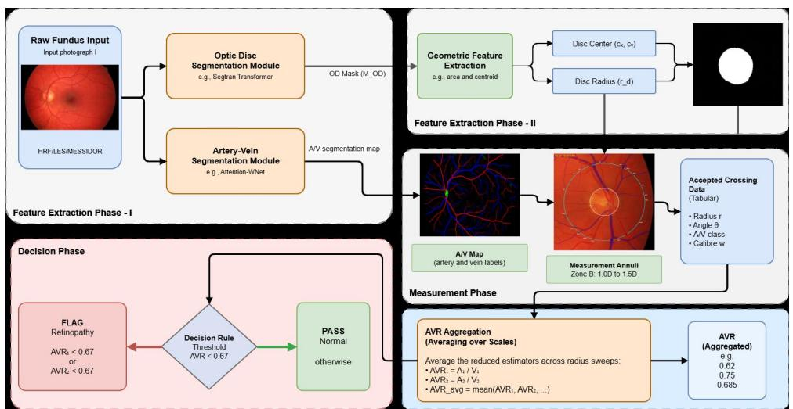

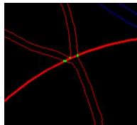  
(a) Branch

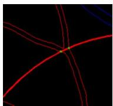  
(b) Radius

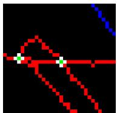  
(c) Initial

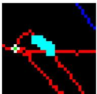  
(d) Walk

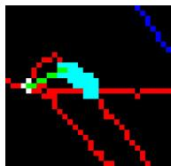  
(e) Chord  
Fig. 1: The five-stage pipeline and Stage 4 calibre measurement. (a,b) Branch handling: an odd crossing count indicates bifurcation; the radius is reduced by $0 . 0 1 r _ { d }$ until parity is restored. (c–e) Minimal-chord boundary walk: B migrates along the vessel boundary until AB is shortest, converting an oblique chord into vessel width.

1) Boundary extraction and intersection: A Laplacian operator is applied to $M _ { v }$ to extract the vessel boundary $\partial M _ { v }$ A measurement circle of radius r centred at c is rasterised and intersected with $\partial M _ { v }$ . Rasterising the circle at one-pixel width misses intersections whenever the discretised circle and boundary run parallel without sharing a pixel. We therefore rasterise at two-pixel width, which returns a small cluster of boundary pixels at each crossing. Since every cluster is a connected component of the intersection set, one representative per component recovers one point per crossing.

2) Pairing and branch handling: The recovered points are sorted by the angle they subtend at c and paired consecutively, so that each pair spans one vessel. A branch point on the measurement circle produces an odd number of crossings, causing consecutive pairing to straddle different vessels and report a spurious width. The parity of the crossing count is therefore a sufficient detector. If the count is odd, the radius is reduced by $0 . 0 1 r _ { d }$ and the intersection recomputed until parity is restored. Because branch points are isolated, a small perturbation moves the circle off the bifurcation (Fig. 1).

3) Minimal-chord boundary walk: Let A and B be a paired set of boundary points. The Euclidean distance $\| A - B \|$ overestimates the vessel width whenever the circle crosses the vessel obliquely, and the error grows with the obliquity angle. The correction holds A fixed and walks B along the vessel boundary to the point that minimises the chord. At each iteration, the eight Moore neighbours of B that lie on $\partial M _ { v }$ are examined and B moves to whichever minimises $\| A - \cdot \|$ . The walk terminates when no neighbour improves on the incumbent, i.e. when B is a local minimiser of distance to A along the boundary. The Moore neighbourhood is used in preference to the von Neumann neighbourhood because an 8-connected boundary walk can follow diagonal vessel edges, which a 4-connected walk cannot (Fig. 1).

4) Quality filters: A measured chord is discarded if it falls outside a plausible calibre range, if its endpoints belong to different connected components of $M _ { v }$ , or if the supporting vessel segment is shorter than a minimum length. Every rejection is logged with its reason, allowing the pipeline to abstain rather than report an invalid measurement.

## F. Stage 5: Ratio, aggregation and decision

1) Radius aggregation: A single measurement circle may coincide with a branch point or crossing. To mitigate this, we sweep r across $[ 2 r _ { d } , 3 r _ { d } ]$ in steps of $0 . 0 5 r _ { d }$ and compute Eq. (1) at each radius, discarding any radius that yields fewer than two valid pairs. The final $A V R _ { i }$ for each pairing i is the median of $A V R _ { i } ( r )$ over the surviving radii, and the screening decision applies Eq. (2) to min $\left( A V R _ { 1 } , A V R _ { 2 } \right)$ .

2) Decision and audit trail: The aggregated AVR is thresholded at $\tau \ = \ 0 . 6 7$ per Eq. (2). Alongside the decision, the pipeline emits all intermediate artefacts, including segmentation masks, optic-disc estimates, calibre measurements, rejection logs, and per-radius AVR values.

## V. EXPERIMENTAL SETUP

Table I summarises the datasets, evaluation metrics, training configuration, and fixed geometric parameters used throughout the experiments. Dataset resolutions are reported to support cross-dataset evaluation across substantially different scales.

TABLE I: Experimental setup.
<table><tr><td>Item</td><td>Description</td></tr><tr><td>Datasets</td><td>DRIVE [11] (40, 565 × 584) for A/V training; HRF [12] (45, 3504 × 2336, 30 evaluated) for screening; LES-AV [13] (22,  $1 6 2 0 \times 1 4 4 4 )$  for calibre validation; MESSIDOR [14] (1200, ≤ 2240 × 1488, 800 evaluated) for large- scale analysis.</td></tr><tr><td>Screening Metrics Segmentation</td><td>Accuracy, Precision, Recall, F1, AUC.</td></tr><tr><td>Metrics Training</td><td>All-pixel, centreline, and wide-vessel centreline accurac  $\mathsf { y } / F _ { 1 }$  [8]. Adam  $( l r = 0 . 0 1 )$  , batch size 6, 200</td></tr><tr><td></td><td>epochs, patience 20, focal loss  $( \gamma = 2 ,$   $\overset { - } { \alpha } = 0 . 8 \overset { - } { / } 0 . 9 )$  [5].</td></tr><tr><td>Fixed Parame-</td><td>Implementation NumPy/SciPy geometry; CPU only.  $\rho \ = \ 0 . 6 ,$  radius step  $0 . 0 5 r _ { d } ,$  branch</td></tr><tr><td>ters</td><td>step  $0 . 0 1 r _ { d } ,$  quality-filter bounds fixed before evaluation.</td></tr></table>

## VI. RESULTS

## A. Stage 2: Artery–vein segmentation

Table II reproduces the performance of the Attention-WNet artery–vein stage [5]. Two observations matter for the downstream pipeline. First, the gap between all-pixel accuracy (0.960 on HRF) and wide-vessel centreline accuracy (0.845) confirms the asymmetry that motivated the dual-mask design in Section IV-C: the model is far better at saying that a pixel is vascular than at resolving class along the vessel. Second, cross-dataset transfer is comparatively graceful — 0.939 allpixel accuracy in both transfer directions, with per-class artery and vein accuracies above 0.959 — which is the property we require, since the downstream calibre stage is applied to clinical images the segmentation model has not seen.

TABLE II: Artery–vein segmentation accuracy and $F _ { 1 }$ for the Stage 2 model [5]. “Wide centreline” denotes centreline pixels of vessels wider than two pixels, the regime the calibre stage operates in.
<table><tr><td rowspan="2">Setting</td><td colspan="2">All vessel pixels</td><td colspan="2">Wide centreline</td></tr><tr><td>Accuracy</td><td> $F _ { 1 }$ </td><td>Accuracy</td><td> $F _ { 1 }$ </td></tr><tr><td>HRF (within)</td><td>0.960</td><td>0.958</td><td>0.845</td><td>0.845</td></tr><tr><td>DRIVE (within)</td><td>0.950</td><td>0.946</td><td>0.780</td><td>0.778</td></tr><tr><td>HRF → DRIVE</td><td>0.939</td><td>0.925</td><td>0.736</td><td>0.724</td></tr><tr><td> $\mathrm { D R I V E }  \mathrm { H R F }$ </td><td>0.939</td><td>0.940</td><td>0.712</td><td>0.707</td></tr></table>

## B. Baseline Calibre Validation on LES-AV

To evaluate the geometric stage using reference masks, we ran the full sweep pipeline on all 22 LES-AV images using the A/V masks provided with the dataset. All 22 images produced valid measurements (100% coverage). The median AVR across images was 0.818 (95% CI: [0.792, 0.978]), and 20 of 22 images yielded min( $A V R _ { 1 } , ~ A V R _ { 2 } ) ~ \geq ~ 0 . 6 7$ . Since LES-AV contains 11 healthy and 11 glaucomatous subjects rather than retinopathy-labelled cohorts, these results demonstrate measurement availability and characterise the resulting AVR distribution, but do not constitute retinopathy evaluation.

## C. Retinopathy Screening on HRF

We evaluated the end-to-end pipeline on the 30-image HRF screening cohort (15 healthy and 15 diabetic retinopathy eyes). A fundus image is classified as retinopathic if either of the dominant vessel pairings $( A V R _ { 1 }$ or $A V R _ { 2 } )$ falls below the clinical threshold of 0.67 (Eq. (2)). The extracted AVR measurements clearly separated the two cohorts, with one false positive and no false negatives (Table III). The area under the ROC curve is $\mathrm { A U C } ~ = ~ 0 . 9 7 8 .$ , and the Youdenoptimal threshold coincides with the clinical value $\tau = 0 . 6 7$ $( J = 0 . 9 3 3 )$ . Table IV reports the full threshold analysis. Fig. 2 shows representative healthy and diabetic retinopathy cases with their AVR measurements.

TABLE III: Comprehensive HRF evaluation summary $( N =$ 30, $\tau = 0 . 6 7 )$ . This unified view presents the geometric class separation, the resulting confusion matrix, and the overall diagnostic metrics. 95% confidence intervals (Wilson for proportions, bootstrap for $F _ { 1 }$ and AUC) are reported in brackets.
<table><tr><td>Actual Cohort</td><td>Images</td><td>Mean AVR</td><td></td><td>Predicted Class</td></tr><tr><td>Healthy</td><td>15</td><td></td><td>Healthy</td><td>Retinopathy</td></tr><tr><td>Diabetic Retinopathy</td><td>15</td><td>0.789 0.624</td><td>14 0</td><td>1 15</td></tr><tr><td>Accuracy: 96.67% [83.3, 99.4]</td><td>F1-Score: 0.968 [0.889, 1.0]</td><td></td><td></td><td>Sensitivity: 100.0% [79.6, 100]</td></tr></table>

TABLE IV: Threshold sensitivity analysis on HRF $( N = 3 0 )$ J denotes Youden’s index $( J = \mathrm { { S e n s } + \mathrm { { S p e c } - 1 ) } }$ . The Youdenoptimal threshold coincides with the clinical value $\tau = 0 . 6 7$
<table><tr><td> $\tau$ </td><td> $_ \mathrm { A c c }$ </td><td>Sens</td><td> $\mathrm { S p e c }$ </td><td> $\mathrm { P r e c }$ </td><td> $F _ { 1 }$ </td><td>J</td></tr><tr><td>0.50</td><td>0.567</td><td>0.133</td><td>1.000</td><td>1.000</td><td>0.235</td><td>0.133</td></tr><tr><td>0.55</td><td>0.600</td><td>0.200</td><td>1.000</td><td>1.000</td><td>0.333</td><td>0.200</td></tr><tr><td>0.60</td><td>0.733</td><td>0.467</td><td>1.000</td><td>1.000</td><td>0.636</td><td>0.467</td></tr><tr><td>0.65</td><td>0.833</td><td>0.733</td><td>0.933</td><td>0.917</td><td>0.815</td><td>0.667</td></tr><tr><td>0.67</td><td>0.967</td><td>1.000</td><td>0.933</td><td>0.938</td><td>0.968</td><td>0.933</td></tr><tr><td>0.70</td><td>0.900</td><td>1.000</td><td>0.800</td><td>0.833</td><td>0.909</td><td>0.800</td></tr><tr><td>0.75</td><td>0.800</td><td>1.000</td><td>0.600</td><td>0.714</td><td>0.833</td><td>0.600</td></tr><tr><td>0.80</td><td>0.767</td><td>1.000</td><td>0.533</td><td>0.682</td><td>0.811</td><td>0.533</td></tr><tr><td>0.85</td><td>0.567</td><td>1.000</td><td>0.133</td><td>0.536</td><td>0.698</td><td>0.133</td></tr></table>

## D. Ablation Study

To assess the contribution of each design choice, we ablate four axes on the 30-image HRF cohort at $\tau = 0 . 6 7$ using the min $\left( A V R _ { 1 } , A V R _ { 2 } \right)$ rule (Table V).

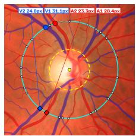

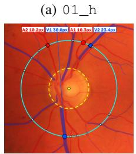  
(d) 01\_dr

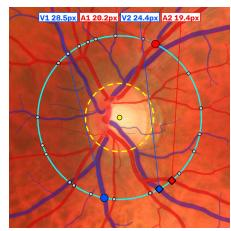

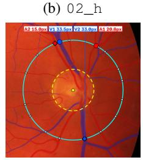  
(e) 02\_dr

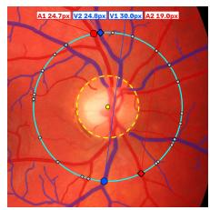

Healthy (AVR > 0.67)
<table><tr><td>Case</td><td> $A V R _ { 1 }$ </td><td> $A V R _ { 2 }$ </td><td>Mean</td></tr><tr><td>01_h</td><td>0.911</td><td>0.939</td><td>0.925</td></tr><tr><td>02_h</td><td>0.707</td><td>0.796</td><td>0.752</td></tr><tr><td>03_h</td><td>0.825</td><td>0.768</td><td>0.796</td></tr></table>

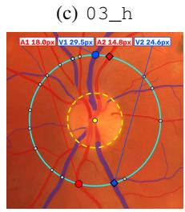  
(f) 03\_dr

<table><tr><td colspan="4">Retinopathy (AVR &lt; 0.67)</td></tr><tr><td>Case</td><td>AVR1</td><td> $A V R _ { 2 }$ </td><td>Mean</td></tr><tr><td>01_dr</td><td>0.342</td><td>0.437</td><td>0.390</td></tr><tr><td>02_dr</td><td>0.621</td><td>0.454</td><td>0.538</td></tr><tr><td>03_dr</td><td>0.611</td><td>0.603</td><td>0.607</td></tr></table>

Fig. 2: Representative healthy and retinopathy cases with corresponding AVR measurements. In the examples shown, the minimum of $\mathbf { A V R } _ { 1 }$ and $\mathbf { A V R } _ { 2 }$ is ≥ 0.67 for healthy cases and < 0.67 for retinopathy cases. The arithmetic mean is shown for descriptive purposes only; classification uses the minimum of the two ratios.

Single radius vs. sweep. A single measurement circle at $r = 2 . 2 5 R _ { d }$ achieves 95.2% accuracy but only 21/30 coverage; other radii fare worse. The sweep over $[ 2 R _ { d } , 3 R _ { d } ]$ recovers all 30 images and reaches 96.7% accuracy, confirming that median aggregation across Zone B is essential for robustness.

Top-k vessel pairs. Using only the single largest pairing (k =1) drops accuracy to 86.7% (three DR cases missed). k ∈ $\{ 2 , 3 , 4 \}$ all yield identical 96.7% accuracy; k = 6 degrades to 90.0% because few images have six reliably labelled arteries. We adopt k =2 as the most conservative choice.

Euclidean vs. minimal-chord. Replacing the boundary walk with Euclidean distance reduces accuracy to 90.0% and sensitivity to 86.7%, confirming that the obliquity correction of the minimal-chord walk matters for screening.

Label transfer vs. pixelwise pairing. Replacing vesselaware label transfer with angular pairing reduces specificity to 80.0%, as angular pairing matches intersection points by adjacency and can mispair points on different vessels.

## E. Exploratory Comparison with VascX

To provide a quantitative reference point, we evaluated VascX [9] (v2.1.0) on the same 30-image HRF cohort. VascX computes Zone B CRAE and CRVE from up to six vessels using the Knudtson recursion; we applied the same prespecified $\tau = 0 . 6 7$ to the resulting CRAE/CRVE ratio without threshold fitting. A post-hoc threshold sweep over VascX’s outputs identified $\tau = 0 . 6 2$ as the Youden-optimal operating point for its estimator. Both systems achieved 100% coverage (30/30). Table VI compares the two systems.

At the shared $\tau = 0 . 6 7 ,$ , the proposed pipeline produces 1 false positive versus 8 for VascX, and a paired accuracy advantage of 23.3 percentage points (bootstrap 95% CI: [10.0, 36.7]). VascX does not reach the proposed pipeline’s 96.7% even at its own Youden-optimal threshold.

TABLE V: Ablation study on HRF $( N = 3 0 , \ \tau = 0 . 6 7 ,$ min $\left( A V R _ { 1 } , A V R _ { 2 } \right)$ rule). Bold marks the chosen configuration.
<table><tr><td>Configuration</td><td> $N _ { \mathrm { v a l i d } }$ </td><td>Acc</td><td>Sens</td><td>Spec</td><td> $F _ { 1 }$ </td></tr><tr><td colspan="6">Radius strategy (top-k=2, chord)</td></tr><tr><td>Single  $r = \bar { 2 } . 0 0 \dot { R } _ { d }$ </td><td>23</td><td>0.783</td><td>0.750</td><td>0.818</td><td>0.783</td></tr><tr><td>Single  $r = 2 . 2 5 R _ { d }$ </td><td>21</td><td>0.952</td><td>1.000</td><td>0.900</td><td>0.957</td></tr><tr><td>Single  $r = 2 . 5 0 R _ { d }$ </td><td>20</td><td>0.850</td><td>0.900</td><td>0.800</td><td>0.857</td></tr><tr><td>Sweep  $[ 2 R _ { d } , 3 R _ { d } ]$ </td><td>30</td><td>0.967</td><td>1.000</td><td>0.933</td><td>0.968</td></tr><tr><td colspan="6">Top-k pairs (sweep, chord)</td></tr><tr><td>k = 1</td><td>30</td><td>0.867</td><td>0.800</td><td>0.933</td><td>0.857</td></tr><tr><td>k = 2</td><td>30</td><td>0.967</td><td>1.000</td><td>0.933</td><td>0.968</td></tr><tr><td>k = 3</td><td>30</td><td>0.967</td><td>1.000</td><td>0.933</td><td>0.968</td></tr><tr><td>k = 4</td><td>30</td><td>0.967</td><td>1.000</td><td>0.933</td><td>0.968</td></tr><tr><td>k = 6</td><td>30</td><td>0.900</td><td>0.867</td><td>0.933</td><td>0.897</td></tr><tr><td colspan="6">Width estimator (sweep,  $k = 2 )$ </td></tr><tr><td>Euclidean (no walk)</td><td>30</td><td>0.900</td><td>0.867</td><td>0.933</td><td>0.897</td></tr><tr><td>Minimal-chord (walk)</td><td>30</td><td>0.967</td><td>1.000</td><td>0.933</td><td>0.968</td></tr><tr><td colspan="6">Pairing method (sweep, k=2, chord)</td></tr><tr><td>Angular (pixelwise)</td><td>30</td><td>0.900</td><td>1.000</td><td>0.800</td><td>0.909</td></tr><tr><td>Vessel-aware (label transfer)</td><td>30</td><td>0.967</td><td>1.000</td><td>0.933</td><td>0.968</td></tr></table>

Three caveats limit interpretation: (i) VascX development data includes HRF, whereas the proposed pipeline’s segmentation models were trained exclusively on DRIVE, so HRF is unseen data only for our system; (ii) VascX computes a six-vessel Knudtson AVR, a different quantity from our two-pair minimum estimator; (iii) datasets with independent expert-reference AVR measurements, such as INSPIRE-AVR, IOSTAR, AVRDB and Leuven-Haifa, are not currently publicly accessible or require author-mediated access, preventing reference-based calibre validation for either system.

## F. Large-Scale Screening Validation on MESSIDOR

On the full MESSIDOR dataset (1,200 fundus images from three ophthalmology departments), the binary normal-versusretinopathic task comprises 546 grade-0 and 254 grade-3 images. At the clinical threshold $\tau = 0 . 6 7$ , the overall accuracy achieved was 0.948 (95% interval: [0.861, 0.982]) and an F1-score of 0.922 (95% interval: [0.813, 0.972]), suggesting that a procedural AVR-based pipeline can remain competitive with contemporary end-to-end deep learning approaches while preserving traceability. These full-dataset figures are estimates extrapolated from the subset’s per-class error rates via Bayesian resampling rather than direct measurements, and will be confirmed by evaluation on all 800 images.

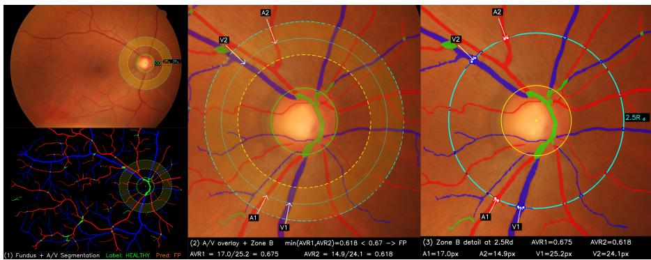  
Fig. 3: Failure case analysis for 15\_h (false positive). (1) Full fundus with OD and Zone B circles $( 2 r _ { d } , ~ 3 r _ { d } )$ alongside the A/V segmentation. (2) A/V overlay with arrows marking the two dominant artery and vein crossings (A1, A2, V1, V2). (3) Zoomed Zone B calibre measurement at $r = 2 . 5 r _ { d }$ with caliper-style width annotations. The measured widths $( \mathrm { A } 1 = 1 7 . 0 \mathrm { p x }$ $\mathtt { A } 2 = 1 4 . 9 \mathrm { p x }$ $\mathrm { V } 1 = 2 5 . 2 _ { \mathrm { l } }$ px, $\mathrm { V } 2 = 2 4 . 1 \mathrm { p x } )$ yield $A V R _ { 1 } = 0 . 6 7 5$ and $A V R _ { 2 } = 0 . 6 1 8 ;$ since min $( A V R _ { 1 } , A V R _ { 2 } ) = 0 . 6 1 8 <$ 0.67, the image is flagged as a false positive. The arteries are genuinely narrow; the false positive likely reflects constitutiona arteriolar narrowness.

TABLE VI: Exploratory comparison with VascX on HRF (N = 30).
<table><tr><td>Method</td><td>T</td><td>Acc</td><td>Sens</td><td>Spec</td><td> $F _ { 1 }$ </td><td>AUC</td></tr><tr><td>VascX [9]</td><td>0.67</td><td>0.733</td><td>1.000</td><td>0.467</td><td>0.789</td><td>0.938</td></tr><tr><td>VascX [9]</td><td>0.62</td><td>0.867</td><td>0.733</td><td>1.000</td><td>0.846</td><td>60.938</td></tr><tr><td>Proposed 0.67</td><td></td><td></td><td>0.967 1.000</td><td></td><td>0.933 0.968 0.978</td><td></td></tr></table>

## VII. DISCUSSION

## A. What a transparent pipeline bought us

The primary advantage of our approach is not merely reaching competitive diagnostic accuracy on datasets like MESSIDOR, but gaining knowledge of how that diagnosis was reached. Consider an end-to-end classifier that misclassifies an eye. There is no intermediate stage to audit, and saliency maps indicate where the gradient is large rather than which computation failed [6]. Improvement therefore becomes a blind search over architectures and augmentations rather than a targeted fix. By contrast, our pipeline allows a reviewer to trace the 96.7% accuracy directly back to the physical measurements that enabled it. If the pipeline abstains or misclassifies, a clinician can determine whether the failure arose from optic disc localization, A/V assignment, or calibre measurement.

## B. Cross-dataset behaviour

The pipeline’s parameters are geometric quantities defined relative to the optic disc, so they are invariant to image resolution and, in principle, acquisition device. The learned semantic components inherit whatever domain sensitivity they have, but the artery–vein model degrades gracefully $( 0 . 9 6 0  0 . 9 3 9$ allpixel accuracy across the HRF/DRIVE segmentation transfer) rather than collapsing, and errors surface safely as reduced coverage and lower vote margins rather than confident wrong diagnoses. We regard degradation into abstention as the correct failure mode for a screening tool.

## C. Failure case analysis

To demonstrate the error-attribution capability claimed in Section I, we examine the pipeline’s single misclassification on HRF in detail. Image 15\_h is labelled healthy but is predicted retinopathic because both dominant vessel pairings yield AV R below the threshold $( A V R _ { 1 } { = } 0 . 6 4 5 < 0 . 6 7 , A V R _ { 2 } { = } 0 . 6 4 4 <$ 0.67). Because the pipeline is procedural, the source of this false positive can be isolated stage by stage:

• Stage 2 (A/V segmentation): The artery–vein mask is anatomically coherent; major vessels are correctly labelled and no artery–vein swap is visible in Zone B.

• Stage 3 (Optic disc): The disc centre and radius are correctly estimated; Zone B covers the expected peripapillary region.

• Stage 4 (Calibre): The measured artery diameters are consistently narrow across 16 of 21 Zone B radii. The two dominant arterial calibres are ∼30–35% smaller than their venular counterparts.

• Stage 5 (AVR): The resulting AVR values $( A V R _ { 1 } =$ 0.645, $A V R _ { 2 } = 0 . 6 4 4 .$ , both below $\tau = 0 . 6 7 )$ faithfully reflect the narrow arteries.

The pipeline’s output consistently indicates narrow arterioles relative to venules across the majority of Zone B radii. Whether this reflects genuine constitutional arteriolar narrowness or a systematic measurement artefact cannot be determined from these data alone. This is precisely the kind of ambiguity that a procedural pipeline makes actionable: a clinician reviewing the artefacts can immediately see that the arteries are narrow and decide whether to refer. An end-to-end model producing “retinopathy, $p = 0 . 7 2 "$ for this eye would offer no such pathway. Fig. 3 shows the stage-wise artefacts for this case. The pixel widths in the caption correspond to a single measurement circle at $r = 2 . 5 r _ { d } ;$ the reported AVR values (0.645, 0.644) are median-aggregated across the full Zone B sweep.

## D. Clinical validity and proxy labels

A potential concern is that AVR is primarily associated with hypertensive retinopathy, whereas the HRF labels denote diabetic retinopathy. However, a prospective population-based study has shown that retinal vascular geometry measured from fundus photographs predicts both the incidence and progression of diabetic retinopathy, beyond established risk factors such as HbA1c and diabetes duration [15]. Our empirical results support this link: the pipeline achieves $\mathrm { A U C } = 0 . 9 7 8$ on HRF using only vascular geometry, with the single misclassification (15\_h) attributable to constitutional arteriolar narrowness rather than a breakdown of the AVR–DR association. Evaluation on a dedicated hypertensive retinopathy cohort with AVR as primary biomarker is planned as future work.

## VIII. LIMITATIONS

Three limitations bound the claims above.

1) Sample size and proxy labels: The detailed evaluation cohort on HRF consists of only 30 images, and some broad retinopathy labels may conflate pathologies with differing vascular signatures. Larger clinically graded cohorts are needed for definitive validation.

2) Reduced AVR estimator: Eq. (1) uses the two largest arteries and veins rather than the six-vessel Knudtson recursion [10], so the resulting AVR is not numerically identical to the quantity reported in normative studies.

3) Absence of reference calibre data: Independent reference calibre measurements were not available for the datasets used in this evaluation. The pipeline produces plausible AVR distributions, but validating individual calibre accuracy and absence of systematic bias will be taken up as future work.

## IX. CONCLUSION

We presented a five-stage procedural pipeline that estimates the arteriolar-to-venular ratio from a fundus photograph and derives a retinopathy screening decision from it. The pipeline reconstructs the clinical grading protocol by combining decoupled vessel segmentation, optic disc localization, minimal-chord calibre estimation, and clinically grounded AVR thresholding. Every stage emits a human-readable artefact, making errors attributable to specific components, and no classification threshold was artificially tuned on evaluation data. On all 22 LES-AV images, the pipeline recovered a median AVR of 0.818 (95% CI: [0.792, 0.978]), consistent with healthy vasculature. On the 30-image HRF screening cohort, it achieved 96.7% accuracy with 100% sensitivity and 93.3% specificity, successfully separating healthy and diabetic retinopathy cohorts. On the MESSIDOR dataset, an estimated accuracy of 0.948 and $F _ { 1 } = 0 . 9 2 2$ was obtained, which is competitive with other end-to-end deep learning approaches while preserving full decision traceability. The immediate next step is to evaluate the pipeline on larger clinical cohorts with explicit hypertensive retinopathy grading and to explore integrating a learned optic disc detector for end-to-end procedural automation. By building screening systems this way, we ensure that every diagnostic decision is mathematically bound to a verifiable physical quantity.

## REFERENCES

[1] J. Wang, T. Chen, J. Wang, X. Bian, X. Zhang, X. Yang, X. Qi, Y. Li, H. Huang, Q. Qian, and F. Yuan, “Retinal vascular geometry and its association to silent brain infarction,” BMC Ophthalmology, vol. 25, p. 36, 2025.

[2] N. M. Keith, H. P. Wagener, and N. W. Barker, “Some different types of essential hypertension: their course and prognosis,” The American Journal of the Medical Sciences, vol. 268, no. 6, pp. 336–345, 1974.

[3] L. D. Hubbard, R. J. Brothers, W. N. King, L. X. Clegg, R. Klein, L. S. Cooper, A. R. Sharrett, M. D. Davis, and J. Cai, “Methods for evaluation of retinal microvascular abnormalities associated with hypertension/sclerosis in the atherosclerosis risk in communities study,” Ophthalmology, vol. 106, no. 12, pp. 2269–2280, 1999.

[4] R. Geirhos, J.-H. Jacobsen, C. Michaelis, R. Zemel, W. Brendel, M. Bethge, and F. A. Wichmann, “Shortcut learning in deep neural networks,” Nature Machine Intelligence, vol. 2, no. 11, pp. 665–673, 2020.

[5] S. K. Sharan, S. Sahayam, U. Jayaraman, and A. Lakshmi Priya, “Artery-vein segmentation from fundus images using deep learning,” arXiv preprint arXiv:2510.03717, 2025. [Online]. Available: https: //arxiv.org/abs/2510.03717

[6] C. Rudin, “Stop explaining black box machine learning models for high stakes decisions and use interpretable models instead,” Nature Machine Intelligence, vol. 1, no. 5, pp. 206–215, 2019.

[7] V. Yoga Sri Varshan, S. Sahayam, and U. Jayaraman, “An algorithm to calculate retinal vessel diameter in fundus images,” in Proceedings of the Fourteenth Indian Conference on Computer Vision, Graphics and Image Processing (ICVGIP). Rupnagar, India: ACM, 2023.

[8] R. Hemelings, B. Elen, I. Stalmans, K. Van Keer, P. De Boever, and M. B. Blaschko, “Artery–vein segmentation in fundus images using a fully convolutional network,” Computerized Medical Imaging and Graphics, vol. 76, p. 101636, 2019.

[9] J. Vargas Quiros, B. Liefers, K. van Vliet, and C. C. W. Klaver, “Vascx models: Model ensembles for retinal vascular analysis from color fundus images,” Translational Vision Science & Technology, vol. 14, no. 7, 2025.

[10] M. D. Knudtson, K. E. Lee, L. D. Hubbard, T. Y. Wong, R. Klein, and B. E. K. Klein, “Revised formulas for summarizing retinal vessel diameters,” Current Eye Research, vol. 27, no. 3, pp. 143–149, 2003.

[11] J. Staal, M. D. Abramoff, M. Niemeijer, M. A. Viergever, and B. van\` Ginneken, “Ridge-based vessel segmentation in color images of the retina,” IEEE Transactions on Medical Imaging, vol. 23, no. 4, pp. 501– 509, 2004.

[12] A. Budai, R. Bock, A. Maier, J. Hornegger, and G. Michelson, “Robust vessel segmentation in fundus images,” International Journal of Biomedical Imaging, vol. 2013, p. 154860, 2013.

[13] J. I. Orlando, J. Barbosa Breda, K. van Keer, M. B. Blaschko, P. J. Blanco, and C. A. Bulant, “Towards a glaucoma risk index based on simulated hemodynamics from fundus images,” in Medical Image Computing and Computer-Assisted Intervention (MICCAI). Springer, 2018, pp. 65–73.

[14] E. Decenciere, X. Zhang, G. Cazuguel, B. La\` y, B. Cochener, C. Trone,¨ P. Gain, R. Ordonez, P. Massin, A. Erginay, B. Charton, and J.-C. Klein, “Feedback on a publicly distributed image database: the messidor database,” Image Analysis & Stereology, vol. 33, no. 3, pp. 231–234, 2014.

[15] C. Y.-l. Cheung, C. Sabanayagam, A. K.-p. Law, N. Kumari, D. S.-w. Ting, G. Tan, P. Mitchell, C. Y. Cheng, and T. Y. Wong, “Retinal vascular geometry and 6 year incidence and progression of diabetic retinopathy,” Diabetologia, vol. 60, pp. 1717–1728, 2017.