# AGENTICCONFLICTLENS: FROM LONG TRAFFIC VIDEOS TO VERIFIABLE CONFLICT EVIDENCE

## A PREPRINT

Boshra Khalili   
Department of Civil Engineering   
and Engineering Mechanics   
Columbia University   
New York, NY 10027, USA   
bk2898@columbia.edu   
Sonia Moshfeghi   
College of Engineering   
and Computer Science   
Florida Atlantic University   
Boca Raton, 33431, FL, USA   
smoshfeghi2021@fau.edu   
Andrew Smyth   
Department of Civil Engineering   
and Engineering Mechanics   
Columbia University   
New York, NY 10027, USA   
aws16@columbia.edu   
Jinwoo Jang   
College of Engineering   
and Computer Science   
Florida Atlantic University   
Boca Raton, 33431, FL, USA   
jangj@fau.edu

November 11, 2026

## ABSTRACT

Traffic cameras continuously record urban road-user behavior, serving as an important urban sensing resource and providing proactive safety evidence beyond crash reports. However, safety-critical events—conflicts, near misses, unsafe turns, sudden braking, and crosswalk interactions—are brief, rare, and hidden within hours of ordinary traffic, making large-scale video review costly for transportation agencies. Existing urban traffic-video analysis pipelines provide detections, tracks, trajectories, and surrogate-risk scores, but process videos uniformly and do not adapt to the specific conflict an analyst seeks. Recent vision-language and long-video reasoning methods improve semantic scene understanding, but often produce descriptions or answers without traffic-specific verification for localizing participant-level conflicts and justifying them with motion evidence. We propose AgenticConflictLens, an agentic, query-conditioned framework for efficient and auditable conflict extraction from long fixed-camera urban traffic videos. Given a natural-language safety query, the system uses a Traffic-Aware Controller, structured traffic memory, and specialized conflict-analysis tools to decide where to search, which road users to inspect, what evidence to verify, and which candidates to reject. A coarse-to-fine process retrieves candidate intervals and applies detailed verification only where traffic evidence warrants it. The output is a set of verified conflict records grounded in refined intervals, participant pairs, semantic traffic regions, trajectories, motion evidence, uncertainty, rejection reasons, and supporting clips. Evaluated on 96 annotated hours from Bellevue and NYC DOT, AgenticConflictLens achieves the highest conflict-existence F1 and temporal IoU on both datasets: 0.84 F1 and 0.77 tIoU on Bellevue, and 0.80 F1 and 0.73 tIoU on NYC DOT, while inspecting only 8.7% and 11.9% of the video, respectively, supporting scalable, evidence-grounded urban traffic-safety analysis.

## 1 Introduction

Traffic cameras provide continuous visual records of road-user behavior at urban intersections, capturing vehicles, pedestrians, cyclists, buses, trucks, turning movements, lane changes, occlusions, lighting variation, and weather effects Bose et al. [2026]. As an important source of urban sensing data, these cameras offer rich information about traffic interactions and mobility patterns. Because they observe everyday traffic continuously, these videos provide proactive safety evidence: they reveal road-user interactions, conflicts, and near-miss events that may never appear in crash records alone Saunier and Sayed [2007], St-Aubin et al. [2015], Sayed and Zein [1999]. However, the safety-critical moments are rare and short. A vehicle–pedestrian conflict, cyclist–vehicle near miss, sudden braking event, unsafe turn, risky lane change, or crosswalk-related interaction may occupy only a few seconds within hours of ordinary traffic Arun et al. [2021a,b], Khalili et al. [2026], Quispe et al. [2022], Shi et al. [2025]. The central challenge is therefore not simply road-user detection, but conflict extraction: identifying when the event occurs, where in the urban scene it happens, which road users are involved, and what trajectory and motion evidence supports the conflict interpretation Singh and Dass [2025], Arun et al. [2022].

This challenge is important for urban sensing and intelligent transportation because long traffic-camera videos are valuable but difficult to use at scale. Transportation agencies and researchers often need to review many hours of footage to understand where conflicts occur, which road users are involved, and which locations may require safety intervention St-Aubin et al. [2015], Saunier and Sayed [2007], Wang et al. [2026]. Yet conflict annotations are expensive, require expert review, and cannot cover every camera view, intersection layout, traffic condition, or safety question Arun et al. [2021b], Quispe et al. [2022], Das et al. [2023]. A practical urban video-analysis system must therefore support targeted safety investigation: it should search through mostly ordinary traffic, surface the few intervals that may contain meaningful conflict evidence, verify whether those intervals truly support a participant-level conflict, reject weak candidates with explicit reasons, and produce auditable records that analysts can inspect, compare across sites, and use for downstream urban traffic-safety planning Kuznietsov et al. [2024], Wang et al. [2026].

Conventional traffic-video analytics usually rely on fixed pipelines: detect road users, track them, extract trajectories, define conflict zones, and compute surrogate-risk measures such as Time-to-Collision (TTC), Post-Encroachment Time (PET), speed, acceleration, headway, and minimum distance Arun et al. [2021a], Liu et al. [2026]. Modern trackers such as ByteTrack Zhang et al. [2022] and trajectory-focused datasets Quispe et al. [2022], Bock et al. [2020] make this evidence useful for urban traffic interaction analysis. However, these pipelines typically process predefined regions and intervals uniformly. They do not adapt to the analyst’s conflict query, use intermediate verification outcomes to redirect the search, or decide which participant pairs and intervals warrant detailed inspection Razi et al. [2023]. As a result, they are poorly suited to long recordings where only a few seconds may contain the conflict evidence of interest Ye et al. [2025]. This limits their ability to transform large-scale urban video observations into targeted, interpretable evidence for traffic-safety analysis.

Recent vision-language models and long-video reasoning methods offer more flexible semantic scene understanding. Traffic-oriented vision-language datasets and systems support behavior description, video question answering, spatiotemporal grounding, and accident understanding in traffic scenes Kong et al. [2024], Zhou et al. [2025], Zhang et al. [2025], Khalili and Smyth [2025], Picek et al. [2026], Marcu et al. [2024]. Query-adaptive long-video methods further reduce exhaustive observation through hierarchical search, agentic keyframe selection, temporal grounding, memory, and tool-guided reasoning Wang et al. [2025], Fan et al. [2025], Liu et al. [2025], Yin et al. [2026], Lin et al. [2026], Yang et al. [2025], Fan et al. [2024]. However, these methods are usually designed for description, grounding, or general VideoQA rather than verified traffic conflict extraction. They can search selectively, but they do not provide the traffic-specific verification needed to distinguish a true road-user conflict from ordinary co-presence, non-closing motion, ambiguous spatial support, or tracking noise Li et al. [2025a], Huang et al. [2024], Jung et al. [2025]. This gap motivates a traffic-aware control mechanism that combines query-conditioned long-video search with specialized conflict verification, integrating visual observations, scene context, and trajectory evidence for interpretable urban traffic analysis.

We propose AGENTICCONFLICTLENS, an agentic, query-conditioned framework for extracting interpretable participantlevel conflicts from long fixed-camera urban traffic videos. The framework is organized around three connected components: a Traffic-Aware Controller, structured traffic memory, and specialized conflict-analysis tools. Given a natural-language query, the controller converts the request into a structured task specifying the relevant road users, scene regions, interaction type, and evidence requirements. Scene-prior memory stores reusable fixed-camera urban context, such as crosswalks, lanes, turning areas, sidewalks, bike lanes, and candidate conflict regions; evidence and result memory store candidate intervals, trajectory cues, rejected hypotheses, and verified records. Together, these components organize visual, spatial, and motion evidence into a structured, scene-aware representation of candidate traffic interactions. This organization allows the system to make state-dependent search and verification decisions instead of running the same fixed analysis over every interval.

The controller coordinates a coarse-to-fine conflict search. A coarse scanner first retrieves candidate intervals from long videos by looking for agreement among traffic-relevant cues, including participant co-presence, semantic-zone support, proximity, relative motion, path overlap, and track reliability. These intervals are treated as hypotheses, not final detections. A fine conflict specialist then verifies each candidate using trajectory quality, traffic context, visible road-user response, and uncertainty evidence. Confirmed events become structured conflict records, while rejected candidates retain explicit rejection reasons. The workspace is updated after each inspection, so rejections redirect the search and confirmations become auditable evidence for the final output.

The final output is a set of verified participant-level conflict records rather than a generic video summary, a single accident label, or an unstructured answer. Each record is grounded in a refined interval, participant pairs, semantic traffic region, trajectories, motion evidence, uncertainty, and a supporting clip. By combining traffic-domain structure, queryconditioned long-video search, and memory-guided agentic control, AGENTICCONFLICTLENS addresses a practical but under-served problem: extracting few-second conflicts from hours of urban traffic-camera footage efficiently, accurately, and interpretably. The resulting structured evidence supports scalable urban sensing and provides actionable information for traffic-safety assessment and mobility analysis.

The main contributions of this work are as follows:

1. Query-conditioned urban traffic conflict extraction. We formulate long traffic-camera conflict extraction as an urban sensing and safety-review task that recovers rare participant-level conflicts from hours of video, grounded in time, scene region, participant pair, and motion evidence.

2. Traffic-aware agentic framework. We propose AGENTICCONFLICTLENS, which combines a Traffic-Aware Controller, structured memory, reusable urban scene priors, and specialized tools to decide where to search, what to verify, and when to stop.

3. Efficient and auditable real-world evaluation. We develop a coarse-to-fine verification process that inspects only promising intervals, rejects unsupported candidates with explicit reasons, and produces auditable conflict records for urban traffic-safety analysis. Because public long-video conflict benchmarks are limited, we construct annotations and queries for 96 real-world hours from Bellevue and NYC.

## 2 Related Work

Traffic-video conflict analysis is commonly built on fixed perception pipelines: detecting and tracking road users, extracting trajectories, defining conflict zones, and computing surrogate-risk measures such as Time-to-Collision (TTC), Post-Encroachment Time (PET), speed, acceleration, headway, and minimum distance Arun et al. [2021a]. Trackers such as ByteTrack Zhang et al. [2022] provide persistent identities, and datasets such as I See You Quispe et al. [2022] support trajectory-based interaction analysis. These methods provide interpretable motion evidence, but they usually process predefined regions and intervals uniformly Zhao et al. [2021]. They do not adapt to a specific conflict query, use verification outcomes to revise the search, or decide which participant pair, scene region, interval, or metric deserves detailed inspection.

Traffic vision-language models extend traffic analysis toward semantic understanding. WTS Kong et al. [2024] supports traffic-behavior description, TUMTraf VideoQA Zhou et al. [2025] studies traffic-oriented question answering and grounding, and accident-focused methods such as SeeUnsafe Zhang et al. [2025] and ACCIDENT Picek et al. [2026] address accident classification and localization. These works improve traffic-scene interpretation, but they are generally organized around predefined clips, events, or task taxonomies Ma et al. [2024]. They do not directly address queryspecified conflict extraction from hours of untrimmed traffic video, where the output must be grounded in participant identities, precise intervals, semantic road regions, trajectories, motion evidence, and uncertainty Li et al. [2025b].

Long-video reasoning methods reduce exhaustive observation through selective search, memory, and tool-guided reasoning. VideoTree Wang et al. [2025] expands query-relevant temporal branches, AKeyS Fan et al. [2025] performs agent-guided keyframe search, VideoMind Liu et al. [2025] uses planner–grounder–verifier roles, and VideoARM Yin et al. [2026] and VideoSeek Lin et al. [2026] apply adaptive coarse-to-fine observation. However, these methods mainly target general VideoQA or temporal grounding, where evidence is represented as frames, captions, tokens, or broad segments Tan et al. [2024]. Traffic conflict extraction requires a more structured decision process that can distinguish true conflicts from ordinary co-presence, non-closing motion, ambiguous spatial support, and tracking noise Zou et al. [2026].

AGENTICCONFLICTLENS bridges these directions by combining query-adaptive long-video search with traffic-specific conflict verification. It converts a natural-language conflict query into an executable analysis route, reuses fixedcamera scene context, retrieves candidate intervals through coarse traffic evidence scanning, and verifies or rejects each candidate with a fine conflict specialist. The output is an auditable participant-level conflict record—including participants, refined interval, semantic region, conflict type, road-user responses, trajectory evidence, uncertainty, and supporting clip—rather than a generic video summary or accident label.

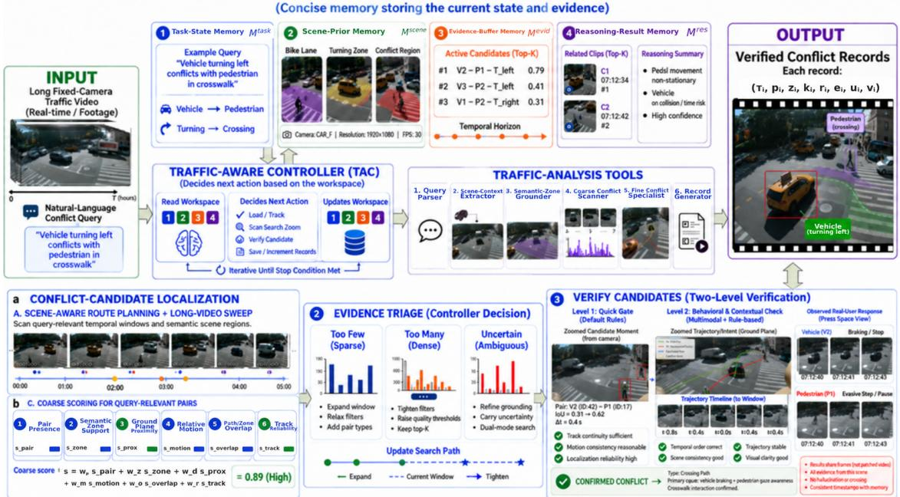  
Figure 1: Agentic traffic-conflict analysis pipeline. The Traffic-Aware Controller uses structured memory and specialized tools to convert a natural-language safety query into a selective coarse-to-fine search, verify candidate conflicts, and generate auditable participant-level records.

## 3 Method

## 3.1 Overview

Given a long fixed-camera traffic video $V = \{ I _ { t } \} _ { t = 1 } ^ { T }$ and a natural-language conflict query $q ,$ AGENTICCONFLICTLENS extracts query-relevant participant-level road-user conflicts. The output is a set of verified conflict records

$$
\mathcal { C } = \{ ( \tau _ { i } , p _ { i } , z _ { i } , k _ { i } , r _ { i } , e _ { i } , u _ { i } , v _ { i } ) \} _ { i = 1 } ^ { N } ,\tag{1}
$$

where $\tau _ { i } = [ t _ { i } ^ { s } , t _ { i } ^ { e } ]$ is the refined conflict interval, $p _ { i }$ is the involved participant pair, $z _ { i }$ is the semantic scene region, $k _ { i }$ is the conflict type, r records the observable road-user responses, $e _ { i }$ stores trajectory and motion evidence, $u _ { i }$ summarizes uncertainty, and vi is an annotated supporting clip. Examples of response signatures include braking, stopping, yielding, acceleration, and directional adjustment. A coarse flagged interval is not treated as a final conflict; it is a candidate hypothesis that must be verified or rejected before record generation.

The framework is organized as a memory-guided traffic-analysis loop rather than a fixed full-video pipeline. At iteration $\ell ,$ the Traffic-Aware Controller reads the current traffic workspace $\mathcal { M } _ { \ell }$ and selects the next action

$$
a _ { \ell } = \pi _ { \mathrm { T A C } } ( q , \mathcal { M } _ { \ell } ) ,\tag{2}
$$

where $a \ell$ may invoke a traffic-analysis tool, revise the current search route, verify a candidate, or stop and generate final records. Each action writes structured evidence back to memory, producing $\mathcal { M } _ { \ell + 1 }$ . Thus, the executed analysis path depends on the query, scene priors, candidate quality, verification outcomes, rejected hypotheses, and remaining uncertainty.

## 3.2 Online Traffic Workspace

The Traffic-Aware Controller operates over an online traffic workspace:

$$
\mathcal { M } = \{ \mathcal { M } ^ { t a s k } , \mathcal { M } ^ { s c e n e } , \mathcal { M } ^ { e v i d } , \mathcal { M } ^ { r e s } \} .\tag{3}
$$

This workspace stores the evolving state of the query-conditioned search, including query intent, fixed-camera context, inspected intervals, participant pairs, active candidates, verified conflicts, and rejected hypotheses.

• Task-state memory. $\mathcal { M } ^ { t a s k }$ stores the parsed query: temporal and spatial scope, participant classes, interaction type, evidence requirements, query confidence, and pending action. It determines whether the controller follows a focused search route or a broader long-video search.

• Scene-prior memory. $\mathcal { M } ^ { s c e n e }$ stores reusable fixed-camera context, such as crosswalks, vehicle lanes, sidewalks, bike lanes, curb areas, turning regions, and candidate conflict regions. These priors are extracted once per camera view and reused to ground trajectory evidence in traffic context.

• Evidence-buffer memory. $\mathcal { M } ^ { e v i d }$ stores query-specific evidence, including selected windows, spatial filters, candidate participant pairs, coarse scores, sampled visual evidence, trajectory cues, track-quality indicators, and flagged intervals. It supports decisions to verify, expand, tighten, or mark candidates as uncertain.

• Reasoning-result memory. $\mathcal { M } ^ { r e s }$ stores verified conflicts, rejected candidates, refined boundaries, semantic regions, conflict types, road-user responses, uncertainty, rejection reasons, and annotated clips. Retaining rejections helps the controller avoid repeated weak hypotheses and refine uncertain ones.

## 3.3 Traffic-Analysis Tools

The Traffic-Aware Controller invokes specialized tools that read the current workspace, perform one traffic-specific operation, and write structured evidence back to memory.

• Query parser. The query parser converts the natural-language query into a structured task state, including temporal scope, spatial scope, participant classes, interaction type, and evidence requirements. It also determines whether the query is interval-focused or requires open-ended long-video search. The prompt interface is provided in Appendix 1.2.1.

• Scene-context extractor. The scene-context extractor builds reusable fixed-camera priors from representative frames and camera geometry, including crosswalks, vehicle lanes, sidewalks, bike lanes, curb areas, turning regions, and candidate conflict regions. It also estimates a fixed-view homography so trajectories can be projected to an approximate ground plane for metric distance, speed, and TTC estimation. These priors are computed once per camera view and reused across queries.

• Semantic-zone grounder. The semantic-zone grounder maps query regions, such as “near the crosswalk” or “in the turning lane,” to scene-prior memory and writes grounded zone constraints and spatial uncertainty back to the workspace.

• Coarse conflict scanner. The coarse conflict scanner performs first-pass localization over the planned windows, semantic regions, and participant-pair types selected by the controller. It returns ranked flagged intervals with coarse motion, trajectory, zone, and track-quality evidence.

• Fine conflict specialist. The fine conflict specialist verifies selected flagged intervals by combining track quality, context-adaptive ground-plane proximity, closing or converging motion, semantic-zone consistency, trajectory evidence, TTC evidence when available, and visible road-user response.

• Record generator. The record generator reads verified and rejected outcomes from $\mathcal { M } ^ { r e s }$ and produces the final auditable output: verified conflict records, annotated clips, uncertainty notes, and rejection summaries. The prompt interface is provided in Appendix 1.2.5.

## 3.4 Traffic-Aware Controller-Driven Pipeline

AGENTICCONFLICTLENS follows a traffic-specific control loop: sense, scene-aware route planning, conflict-candidate localization, evidence triage, verify, and record and memory update. The stages define the typical workflow, but the Traffic-Aware Controller can skip, repeat, expand, tighten, or stop them based on the current workspace.

• Sense. The controller parses the query and writes the task state to $\mathcal { M } ^ { t a s k }$ . It then checks whether scene priors exist for the camera view; if not, it invokes the scene-context extractor. If the query mentions or implies a traffic region, such as a crosswalk, bike lane, curb, vehicle lane, or turning area, the controller invokes the semantic-zone grounder. This initializes the workspace with query intent, relevant scene regions, participant constraints, and evidence requirements.

• Scene-aware route planning. Using task-state and scene-prior memory, the controller builds an analysis route specifying which temporal windows, semantic regions, road-user classes, participant-pair types, and evidence requirements should guide the search. Focused queries create narrow routes over specified times or regions, while open-ended queries create broader routes over larger candidate sets. The route is written to $\mathcal { M } ^ { e v i d }$ and used for candidate localization. The route-planning prompt is provided in Appendix 1.2.2.

• Conflict-candidate localization. The controller invokes the coarse conflict scanner over the planned route. This stage reduces long video to a compact set of candidate intervals for fine verification. The scanner uses reusable detections, tracks, sampled frames, semantic-zone priors, participant constraints, trajectories, and query-derived filters, and evaluates only query-relevant participant pairs rather than all road users at all times. For each temporal bin b and candidate pair $( a _ { m } , a _ { n } )$ , the scanner computes

$$
\begin{array} { r } { s ( b , a _ { m } , a _ { n } ) = w _ { p } s _ { \mathrm { p a i r } } + w _ { z } s _ { \mathrm { z o n e } } + w _ { d } s _ { \mathrm { p r o x } } \qquad } \\ { + w _ { m } s _ { \mathrm { m o t i o n } } + w _ { o } s _ { \mathrm { o v e r l a p } } + w _ { r } s _ { \mathrm { t r a c k } } . } \end{array}\tag{4}
$$

The terms measure pair presence, semantic-zone support, ground-plane proximity, relative or closing motion, path or zone overlap, and track reliability. This score ranks candidate evidence only; it does not assign final conflict labels. High-scoring bins are merged into flagged intervals and stored with participant pair, semantic region support, visual evidence, trajectory cues, coarse score, and track-quality information. Score-term details are provided in Appendix 1.1.

• Evidence triage. Before verification, the controller reviews $\mathcal { M } ^ { e v i d }$ because coarse search can miss conflicts when filters are too strict, or return many weak co-presence candidates in dense traffic. If candidates are too sparse, it expands nearby windows, revisits scene grounding, or adds query-compatible participant pairs. If candidates are too broad, it prioritizes intervals with strong query match, reliable tracks, clear semantic-zone support, and closing-motion evidence. Ambiguous candidates are refined or carried forward with uncertainty. Additional route-revision details are provided in Appendices 1.1.2 and 1.2.3.

• Verify. For each selected flagged interval, the controller invokes the fine conflict specialist to decide whether the candidate is a true participant-level conflict or only ordinary co-presence, weak interaction, spatial ambiguity, or tracking noise. The specialist reads the candidate pair, grounded semantic region, tracks, trajectory cues, sampled visual evidence, coarse score, and scene priors from memory. Unlike the coarse scanner, which ranks plausibility, the fine specialist makes the final conflict decision.

The specialist first rejects candidates with severe identity switches, implausible jumps, insufficient common observation, or unreliable localization. Surviving candidates are verified using minimum ground-plane separation, context-adaptive proximity, closing or converging motion, semantic-zone consistency, trajectory overlap, TTC evidence when available, and visible road-user response. TTC is used only as corroborating evidence for closing pairs. A candidate is confirmed only when distance, motion, scene-region, trajectory, and response evidence jointly support a conflict.

Confirmed candidates are assigned a kinematic conflict type, such as yielding, turning-path, crossing-path, merging–following, or close-proximity. The specialist also extracts response signatures, refines the interval to the approach–response–separation span, and records uncertainty from separation margin, TTC agreement, track reliability, semantic-zone confidence, and visual support. Rejected candidates are retained with explicit reasons, such as ordinary co-presence, non-closing motion, excessive separation, insufficient track quality, ambiguous spatial support, or lack of visible response. Additional localization equations, typology rules, response signatures, adaptive-threshold checks, and hotspot-zone profiles are provided in Appendices 1.1 and 2.6.2.

• Record and memory update. After verification, the controller updates $\mathcal { M } ^ { r e s }$ with confirmed records, rejected candidates, refined intervals, uncertainty, and rejection reasons. If the query is satisfied, it invokes the record generator; otherwise, it revises the search with updated windows, filters, or participant-pair hypotheses. If revisions return only rejected or low-confidence candidates, the controller reports a negative or uncertain result with searched windows, candidate counts, rejection reasons, and remaining uncertainty. The memory-update prompt and stopping rules are provided in Appendices 1.2.4 and 1.1.5.

## 3.5 Final Records

The record generator produces auditable participant-level outputs linking each verified conflict to its refined interval, participant pair, semantic region, conflict type, responses, trajectory evidence, uncertainty, and annotated clip. Rejected flags are retained with reasons, showing which plausible events were inspected and dismissed.

## 4 Experiments

We evaluate AGENTICCONFLICTLENS on 96 annotated hours of real-world fixed-camera traffic video from Bellevue and NYC DOT. The experiments test query-driven conflict localization, participant-pair identification, traffic-specific verification, and search efficiency. We compare against adapted long-video reasoning and traffic-safety baselines, and ablate the controller, memory, and tools. Full dataset, protocol, metric, ablation, and spatial-risk analysis details are provided in Appendix 2.

## 4.1 Datasets

Public long-video traffic benchmarks with participant-level conflict annotations, natural-language queries, temporal boundaries, semantic regions, and observable response labels remain limited. We therefore construct a query-conditioned conflict-extraction evaluation from real-world fixed-camera videos in two cities.

We evaluate AGENTICCONFLICTLENS on 96 annotated hours of real-world fixed-camera traffic video: 60 hours from five public Bellevue intersections City of Bellevue and 36 hours from three NYC DOT intersections. Each site contributes twelve one-hour recordings. For each video, we construct participant-level conflict annotations and natural-language evaluation queries with temporal boundaries, participant pairs, semantic scene regions, conflict types, and observable road-user responses.

The two datasets provide complementary evaluation settings. Bellevue contains sparse conflicts separated by long periods of ordinary traffic, testing whether the system can reduce hours of video to short candidate intervals without missing rare events. NYC DOT contains denser traffic and more frequent plausible interactions, testing whether the system can select the requested conflict from many coarse candidates and reject ordinary co-presence. Together, the videos cover diverse viewpoints, intersection layouts, road-user mixes, traffic densities, lighting conditions, occlusions, and small road users.

The Bellevue traffic videos are publicly available through the City of Bellevue Traffic Video Dataset City of Bellevue, while the NYC DOT videos are restricted operational recordings.

Annotations and queries. We create annotations and queries to evaluate the full output of AGENTICCONFLICTLENS, not just clip-level classification. A conflict is a temporally localized encounter where road users show converging, competing, or mutually dependent movement with a visible response, such as yielding, braking, stopping, directional adjustment, gap acceptance, or evasive motion. Proximity alone is not sufficient. Each conflict is annotated with the method’s output schema: refined interval, participant pair, semantic scene region, conflict type, primary response, and evidence statement.

The real-world evaluation contains 1,127 annotated conflicts and 4,582 queries across 96 hours: 119 conflicts and 457 queries from Bellevue, and 1,008 conflicts and 4,125 queries from NYC DOT. Queries are generated from verified conflict records and manually checked for answerability, temporal scope, participant constraints, and consistency with the reference annotation. They cover focused retrieval, open-ended long-video search, participant-pair search, temporal localization, interaction reasoning, and response reasoning. All main evaluation queries correspond to annotated conflict events. Additional details are provided in Appendix 2.1.

## 4.2 Evaluation Protocol and Implementation

• Protocol. To the best of our knowledge, existing long-video reasoning and traffic-safety methods do not directly produce query-conditioned participant-level conflict records from long traffic-camera videos. We therefore evaluate the closest related methods under a shared conflict-localization interface. Each baseline keeps its core search idea while using the same conflict query and returning candidate intervals and participant pairs. This enables fair comparison on shared outputs, while full structured-record evaluation is reported for AGENTICCONFLICTLENS and its ablations.

• Baselines. We evaluate five adapted baselines. VideoTree-inspired retrieval Wang et al. [2025] tests hierarchical coarse-to-fine search and returns top retrieved conflict clips. SeeUnsafe-inspired search Zhang et al. [2025] tests direct accident-aware VLM judgment and returns clips judged unsafe or conflict-relevant by the VLM. VideoARM-inspired retrieval Yin et al. [2026] tests long-video memory and returns memory-selected conflict clips. VideoSeek-inspired search Lin et al. [2026] tests tool-guided seeking and returns tool-selected conflict clips. SSAM-inspired search Pu and Joshi [2008] tests trajectory-based surrogate-safety analysis and returns high-risk trajectory intervals. In contrast, AGENTICCONFLICTLENS returns verified refined conflict intervals and writes them as structured participant-level conflict records. All VLM-based methods use the same frozen Qwen2.5-VL-7B-Instruct backbone without fine-tuning. Full baseline implementation details are provided in Appendix 2.2.

• Metrics. All methods are compared using the metrics reported in Table 1: conflict-existence F1, mean temporal IoU, participant-pair accuracy, inspection percentage, and runtime. Exist. F1 measures event-level conflict retrieval. Mean tIoU measures temporal localization quality for matched predictions. Pair Acc. measures whether the matched prediction identifies the correct participant pair. Inspect % is the percentage of the query video examined by the method, and runtime is reported in minutes per query. Structured-record accuracy is reported only for AGENTICCONFLICTLENS and its ablations, where the full record schema is available. Detailed metric definitions and post-processing rules are provided in Appendix 2.2.

Table 1: Main query-driven participant-level conflict-localization results on Bellevue (60 annotated hours) and NYC DOT (36 annotated hours). Each query is evaluated over a 30-minute video. Avg. Runtime reports the average minutes required to answer one query over that 30-minute video. Inspect % is the percentage of video searched or sent for inspection. Arrows indicate the preferred direction.
<table><tr><td rowspan="2">Method</td><td colspan="5">Bellevue</td><td colspan="5">NYC DOT</td></tr><tr><td>Exist. F1 ↑</td><td>tIoU ↑</td><td>Pair Acc. ↑</td><td>Inspect % ↓</td><td>Avg. Runtime ↓</td><td>Exist. F1 ↑</td><td>tIoU ↑</td><td>Pair Acc. ↑</td><td>Inspect % ↓</td><td>Avg. Runtime ↓</td></tr><tr><td>High-risk trajectory intervals Pu and Joshi [2008]</td><td>0.74</td><td>0.66</td><td>0.86</td><td>100.0</td><td>9.8</td><td>0.71</td><td>0.64</td><td>0.80</td><td>100.0</td><td>10.5</td></tr><tr><td>Uniform sampled clip conflict search Zhang et al. [2025]</td><td>0.59</td><td>0.45</td><td>0.60</td><td>62.2</td><td>6.7</td><td>0.60</td><td>0.44</td><td>0.61</td><td>59.7</td><td>7.9</td></tr><tr><td>Top retrieved conflict clips Wang et al. [2025]</td><td>0.62</td><td>0.57</td><td>0.64</td><td>23.5</td><td>3.8</td><td>0.57</td><td>0.59</td><td>0.69</td><td>29.4</td><td>4.6</td></tr><tr><td>Memory-selected conflict clips Yin et al. [2026]</td><td>0.76</td><td>0.63</td><td>0.63</td><td>23.0</td><td>3.5</td><td>0.70</td><td>0.61</td><td>0.62</td><td>25.9</td><td>4.2</td></tr><tr><td>Tool-selected conflict clips Lin et al. [2026]</td><td>0.73</td><td>0.71</td><td>0.75</td><td>19.1</td><td>3.1</td><td>0.74</td><td>0.63</td><td>0.72</td><td>22.7</td><td>3.8</td></tr><tr><td>AGENTICCONFLICTLENS</td><td>0.84</td><td>0.77</td><td>0.85</td><td>8.7</td><td>1.6</td><td>0.80</td><td>0.73</td><td>0.81</td><td>11.9</td><td>2.1</td></tr></table>

Table 2: Ablation on traffic-analysis tools for Bellevue and NYC DOT. QZ: query parsing and zone grounding; SC: scene context; CS: traffic-aware coarse scanner; FS: fine conflict specialist. Record Acc. evaluates the full structured conflict record. Arrows indicate the preferred direction.
<table><tr><td colspan="4">Traffic-Analysis Tools</td><td colspan="4">Metrics</td></tr><tr><td>QZ</td><td>SC</td><td>CS</td><td>FS</td><td>Exist. F1 ↑</td><td>tIoU ↑</td><td>Pair Acc. ↑</td><td>Record Acc. ↑</td></tr><tr><td colspan="8">Bellevue</td></tr><tr><td></td><td>√</td><td>√</td><td>√</td><td>0.72</td><td>0.64</td><td>0.72</td><td>0.64</td></tr><tr><td>√</td><td></td><td>√</td><td>√</td><td>0.79</td><td>0.73</td><td>0.79</td><td>0.7</td></tr><tr><td>√</td><td>√</td><td></td><td>√</td><td>0.67</td><td>0.60</td><td>0.77</td><td>0.61</td></tr><tr><td>√</td><td>√</td><td>√</td><td></td><td>0.73</td><td>0.62</td><td>0.82</td><td>0.59</td></tr><tr><td>√</td><td>√</td><td>√</td><td>√</td><td>0.84</td><td>0.77</td><td>0.85</td><td>0.78</td></tr><tr><td colspan="8">NYC DOT</td></tr><tr><td></td><td>√</td><td>√</td><td>√</td><td>0.67</td><td>0.61</td><td>0.69</td><td>0.58</td></tr><tr><td>√</td><td></td><td>√</td><td>√</td><td>0.75</td><td>0.67</td><td>0.74</td><td>0.62</td></tr><tr><td>√</td><td>√</td><td></td><td>√</td><td>0.62</td><td>0.59</td><td>0.72</td><td>0.56</td></tr><tr><td>√</td><td>V</td><td>√</td><td></td><td>0.68</td><td>0.59</td><td>0.79</td><td>0.56</td></tr><tr><td>√</td><td>√</td><td>√</td><td>√</td><td>0.80</td><td>0.73</td><td>0.81</td><td>0.73</td></tr></table>

## 4.3 Main Results

Table 1 reports query-driven conflict-localization results on Bellevue and NYC DOT. AGENTICCONFLICTLENS achieves the best overall trade-off between accuracy and efficiency: it obtains the highest Exist. F1 and tIoU on both datasets while inspecting the smallest fraction of video. SSAM-style trajectory scoring has strong pair accuracy because it uses dense motion evidence, but it requires full-video inspection and higher runtime. Uniform clip search also inspects much of the video, while selective long-video baselines reduce cost but remain less accurate than AGENTICCONFLICTLENS. Qualitative results, including a successful case and a failure trace, are provided in Appendix 2.3.

## 4.4 Ablation Study

We ablate the main components of AGENTICCONFLICTLENS: traffic-analysis tools, structured traffic memory, and the Traffic-Aware Controller. All variants use the same videos, queries, backbone, output schema, prompts, and inference budget unless the ablated component changes the budget. Unlike the adapted baselines in Sec. 4.2, all ablations remain variants of AGENTICCONFLICTLENS and produce structured participant-level conflict records. We report shared localization metrics and Record Acc., which measures whether the final record has the correct interval, participant pair, semantic region, conflict type, and primary response. Additional details are provided in Appendix 2.6.

## 4.4.1 Traffic-Analysis Tools

Table 2 reports the tool ablation results. Each row removes one tool while keeping the rest of the system unchanged.

The largest drop in Exist. F1 occurs when the coarse scanner is removed, showing that candidate localization is the main driver of conflict retrieval. Removing the fine specialist produces the lowest Record Acc., indicating that coarse flags alone are not sufficient for reliable final records. The full configuration performs best across both datasets, confirming that search, scene grounding, query grounding, and verification are complementary.

## 4.4.2 Structured Traffic Memory

Table 3 evaluates how structured memory affects long-video conflict search. The context-only variant removes explicit memory and relies on ordinary in-context reasoning.

Table 3: Ablation on structured traffic memory for Bellevue and NYC DOT. TS: task-state memory; SP: scene-prior memory; EB: evidence-buffer memory; RR: reasoning-result memory.
<table><tr><td colspan="5">Memory Configuration</td><td colspan="4">Metrics</td></tr><tr><td>TS</td><td>SP</td><td>EB</td><td>RR</td><td>Context Only</td><td>Exist. F1</td><td>tIoU</td><td>Pair Acc.</td><td>Record Acc.</td></tr><tr><td colspan="9">Bellevue</td></tr><tr><td></td><td>√</td><td>√</td><td>√</td><td></td><td>0.76</td><td>0.68</td><td>0.78</td><td>0.67</td></tr><tr><td>√</td><td></td><td>√</td><td>√</td><td></td><td>0.77</td><td>0.67</td><td>0.80</td><td>0.66</td></tr><tr><td>√</td><td>√</td><td></td><td>√</td><td></td><td>0.70</td><td>0.64</td><td>0.76</td><td>0.62</td></tr><tr><td>√</td><td>√</td><td>√</td><td></td><td></td><td>0.82</td><td>0.73</td><td>0.83</td><td>0.73</td></tr><tr><td></td><td></td><td></td><td></td><td>√</td><td>0.69</td><td>0.60</td><td>0.71</td><td>0.56</td></tr><tr><td>√</td><td>√</td><td>√</td><td>√</td><td></td><td>0.84</td><td>0.77</td><td>0.85</td><td>0.78</td></tr><tr><td colspan="9">NYC DOT</td></tr><tr><td></td><td>√</td><td>√</td><td>√</td><td></td><td>0.71</td><td>0.63</td><td>0.73</td><td>0.61</td></tr><tr><td>√</td><td></td><td>√</td><td>√</td><td></td><td>0.72</td><td>0.62</td><td>0.75</td><td>0.60</td></tr><tr><td>√</td><td>√</td><td></td><td>√</td><td></td><td>0.66</td><td>0.58</td><td>0.70</td><td>0.56</td></tr><tr><td>√</td><td>√</td><td>√</td><td></td><td></td><td>0.77</td><td>0.66</td><td>0.76</td><td>0.67</td></tr><tr><td></td><td></td><td></td><td></td><td>√</td><td>0.63</td><td>0.54</td><td>0.66</td><td>0.51</td></tr><tr><td>5</td><td>√</td><td>√</td><td>√</td><td></td><td>0.80</td><td>0.73</td><td>0.81</td><td>0.73</td></tr></table>

Table 4: Ablation on Traffic-Aware Controller policies for Bellevue and NYC DOT. RP: scene-aware route planning; C2F: adaptive coarse-to-fine candidate promotion; FB/S: verification feedback and adaptive stopping.
<table><tr><td colspan="3">Controller Configuration</td><td colspan="5">Metrics</td></tr><tr><td>RP</td><td>C2F</td><td>FB/S</td><td>Exist. F1 ↑</td><td>tIoU ↑</td><td>Record Acc. ↑</td><td>Reject %</td><td>Inspect %↓</td></tr><tr><td colspan="3">Bellevue</td><td></td><td></td><td></td><td></td><td></td></tr><tr><td></td><td>√</td><td>√</td><td>0.73</td><td>0.65</td><td>0.64</td><td>73.2</td><td>19.6</td></tr><tr><td>V</td><td></td><td>√</td><td>0.76</td><td>0.66</td><td>0.66</td><td>64.4</td><td>13.9</td></tr><tr><td>√</td><td>√</td><td></td><td>0.81</td><td>0.72</td><td>0.73</td><td>68.1</td><td>12.5</td></tr><tr><td>V</td><td>V</td><td>V</td><td>0.84</td><td>0.77</td><td>0.78</td><td>61.7</td><td>8.7</td></tr><tr><td colspan="3">NYC DOT</td><td></td><td></td><td></td><td></td><td></td></tr><tr><td></td><td>√</td><td>V</td><td>0.70</td><td>0.61</td><td>0.57</td><td>77.3</td><td>25.2</td></tr><tr><td>V</td><td></td><td>√</td><td>0.72</td><td>0.62</td><td>0.61</td><td>66.8</td><td>18.7</td></tr><tr><td>√</td><td>V</td><td></td><td>0.75</td><td>0.65</td><td>0.66</td><td>71.2</td><td>15.1</td></tr><tr><td>√</td><td>V</td><td>V</td><td>0.80</td><td>0.73</td><td>0.73</td><td>63.5</td><td>11.9</td></tr></table>

The results show that explicit memory is important on both datasets. The context-only variant performs worst, indicating that long-video conflict search requires persistent search state and evidence history. Removing evidence-buffer memory causes the largest drop, showing that carrying candidate intervals, tracks, and intermediate evidence from coarse search to fine verification is critical. Task-state and scene-prior memory support query consistency and localization, while reasoning-result memory helps preserve verified and rejected hypotheses. The full memory configuration achieves the best overall performance.

## 4.4.3 Traffic-Aware Controller

Table 4 evaluates whether the controller improves conflict extraction beyond simply making the tools and memory available. All variants keep the same inputs, tools, memory modules, prompts, backbone, and output schema, and only remove one controller policy.

The strongest effect comes from route planning: without it, the system inspects substantially more video and loses accuracy, showing that the controller must search in the right scene regions and time windows. Removing adaptive coarse-to-fine promotion also reduces performance, indicating that fixed candidate selection is less effective than evidence-aware triage. Removing feedback and stopping has a smaller effect on retrieval but lowers record accuracy

and increases inspection, showing that verification outcomes help refine the search and avoid unnecessary processing.   
The full controller gives the best accuracy-efficiency trade-off on both datasets.

## 5 Limitations

AGENTICCONFLICTLENS is designed for fixed-camera traffic videos and depends on reliable scene priors, detections, tracks, and trajectory evidence. Its controller can store uncertainty, retain rejection reasons, and redirect the search, but it cannot recover conflicts that are not visually observable or are lost because of severe occlusion, missed detections, identity switches, poor lighting, or ambiguous scene geometry.

## 6 Conclusion

We presented AgenticConflictLens, a query-conditioned framework for extracting rare participant-level conflicts from long fixed-camera traffic videos. The method uses a Traffic-Aware Controller, structured traffic memory, and specialized tools to perform selective coarse-to-fine verification rather than uniform full-video processing. It produces auditable conflict records grounded in refined intervals, participant pairs, semantic regions, motion evidence, uncertainty, rejection reasons, and supporting clips.

On 96 annotated hours from Bellevue and NYC DOT, AgenticConflictLens achieves the highest conflict-existence F1 and temporal IoU on both datasets: 0.84 F1 and 0.77 tIoU on Bellevue, and 0.80 F1 and 0.73 tIoU on NYC DOT, while inspecting only 8.7% and 11.9% of the video, respectively.

## 7 Acknowledgments

This work was supported by the Center for Smart Streetscapes, a National Science Foundation (NSF) Engineering Research Center, under Grant No. EEC-2133516. The author also gratefully acknowledges support from the NYMTC/CAIT September 11th Memorial Program for Regional Transportation Planning Fellowship, as well as the fellowship program and New York City Department of Transportation (NYC DOT) teams for their valuable support and collaboration.

## References

Samprit Bose, Maheshkumar H. Kolekar, and Saurabh Arora. Traffic video data enhancement for ITS in smart cities. In Dilip Kumar Sharma and Rohit Sharma, editors, New Trends and Applications in Internet ofThings (IoT) and Big Data Analytics, Volume 2, volume 284 of Intelligent Systems Reference Library, pages 267–290. Springer Nature Switzerland, Cham, 2026. doi:10.1007/978-3-032-21753-0\_16.

Nicolas Saunier and Tarek Sayed. Automated analysis of road safety with video data. Transportation Research Record, 2019(1):57–64, 2007. doi:10.3141/2019-08.

Paul St-Aubin, Nicolas Saunier, and Luis F. Miranda-Moreno. Large-scale automated proactive road safety analysis using video data. Transportation Research Part C: Emerging Technologies, 58:363–379, 2015. doi:10.1016/j.trc.2015.04.007.

Tarek Sayed and Sany Zein. Traffic conflict standards for intersections. Transportation Planning and Technology, 22 (4):309–323, 1999. doi:10.1080/03081069908717634.

Ashutosh Arun, Md. Mazharul Haque, Ashish Bhaskar, Simon Washington, and Tarek Sayed. A systematic mapping review of surrogate safety assessment using traffic conflict techniques. Accident Analysis & Prevention, 153:106016, 2021a. doi:10.1016/j.aap.2021.106016.

Ashutosh Arun, Md. Mazharul Haque, Simon Washington, Tarek Sayed, and Fred Mannering. A systematic review of traffic conflict-based safety measures with a focus on application context. Analytic Methods in Accident Research, 32:100185, 2021b. doi:10.1016/j.amar.2021.100185.

Boshra Khalili, Alec Bardey, and Andrew W. Smyth. STREAM-OOD: Regime-aware sequential monitoring for streaming out-of-distribution detection. In Proceedings of the IEEE/CVF Conference on Computer Vision and Pattern Recognition Workshops, pages 7732–7741, 2026.

Hanan Quispe, Jorshinno Sumire, Patricia Condori, Edwin Alvarez, and Harley Vera. I see you: A vehicle-pedestrian interaction dataset from traffic surveillance cameras. In LatinX in AI at Neural Information Processing Systems Conference, 2022. doi:10.52591/lxai2022112811.

Liang Shi, Boyu Jiang, Tong Zeng, and Feng Guo. ScVLM: Enhancing vision-language model for safety-critical event understanding. In 2025 IEEE/CVF Winter Conference on Applications ofComputer Vision Workshops (WACVW), pages 971–981. IEEE, February 2025. doi:10.1109/WACVW65960.2025.00119.

Avantika Singh and Sachin Dass. Spatial-temporal video analysis for advanced traffic conflict detection and risk assessment using YOLOv8 and attention-enhanced safety metrics. International Journal ofIntelligent Transportation Systems Research, 23(3):2252–2272, 2025. doi:10.1007/s13177-025-00572-y.

Ashutosh Arun, Md. Mazharul Haque, Simon Washington, Tarek Sayed, and Fred Mannering. How many are enough? investigating the effectiveness of multiple conflict indicators for crash frequency-by-severity estimation by automated traffic conflict analysis. Transportation Research Part C: Emerging Technologies, 138:103653, 2022. doi:10.1016/j.trc.2022.103653.

Chenzhu Wang, Mohamed Abdel-Aty, Said M. Easa, and Shaoyan Zhai. Vision-language and generative models in traffic video safety analysis: A computational framework and research agenda. Accident Analysis & Prevention, 236: 108673, 2026. doi:10.1016/j.aap.2026.108673.

Anurag Das, Yongqin Xian, Yang He, Zeynep Akata, and Bernt Schiele. Urban scene semantic segmentation with low-cost coarse annotation. In 2023 IEEE/CVF Winter Conference on Applications ofComputer Vision (WACV), pages 5967–5976. IEEE, January 2023. doi:10.1109/WACV56688.2023.00592.

Anton Kuznietsov, Balint Gyevnar, Cheng Wang, Steven Peters, and Stefano V. Albrecht. Explainable AI for safe and trustworthy autonomous driving: A systematic review. IEEE Transactions on Intelligent Transportation Systems, 25 (12):19342–19364, 2024. doi:10.1109/TITS.2024.3474469.

Qingwu Liu, Nicolas Saunier, and Guillaume-Alexandre Bilodeau. Video analysis for surrogate measures of safety: Is deep learning good enough? Transportation Research Part C: Emerging Technologies, 186:105596, 2026. doi:10.1016/j.trc.2026.105596.

Yifu Zhang, Peize Sun, Yi Jiang, Dongdong Yu, Fucheng Weng, Zehuan Yuan, Ping Luo, Wenyu Liu, and Xinggang Wang. ByteTrack: Multi-object tracking by associating every detection box. In Computer Vision – ECCV 2022, pages 1–21. Springer, 2022. doi:10.1007/978-3-031-20047-2\_1.

Julian Bock, Robert Krajewski, Tobias Moers, Steffen Runde, Lennart Vater, and Lutz Eckstein. The inD dataset: A drone dataset of naturalistic road user trajectories at german intersections. In 2020 IEEE Intelligent Vehicles Symposium (IV), pages 1929–1934. IEEE, 2020. doi:10.1109/IV47402.2020.9304839.

Abolfazl Razi, Xiwen Chen, Huayu Li, Hao Wang, Brendan Russo, Yan Chen, and Hongbin Yu. Deep learning serves traffic safety analysis: A forward-looking review. IET Intelligent Transport Systems, 17(1):22–71, 2023. doi:10.1049/itr2.12257.

Jinhui Ye, Zihan Wang, Haosen Sun, Keshigeyan Chandrasegaran, Zane Durante, Cristobal Eyzaguirre, Yonatan Bisk, Juan Carlos Niebles, Ehsan Adeli, Li Fei-Fei, Jiajun Wu, and Manling Li. Re-thinking temporal search for long-form video understanding. In Proceedings ofthe IEEE/CVF Conference on Computer Vision and Pattern Recognition (CVPR), pages 8579–8591, June 2025.

Quan Kong, Yuki Kawana, Rajat Saini, Ashutosh Kumar, Jingjing Pan, Ta Gu, Yohei Ozao, Balazs Opra, Yoichi Sato, and Norimasa Kobori. WTS: A pedestrian-centric traffic video dataset for fine-grained spatial-temporal understanding. In Computer Vision – ECCV 2024, pages 1–18. Springer, 2024. doi:10.1007/978-3-031-73116-7\_1.

Xingcheng Zhou, Konstantinos Larintzakis, Hao Guo, Walter Zimmer, Mingyu Liu, Hu Cao, Jiajie Zhang, Venkatnarayanan Lakshminarasimhan, Leah Strand, and Alois Knoll. TUMTraf VideoQA: Dataset and benchmark for unified spatio-temporal video understanding in traffic scenes. In Proceedings ofthe 42nd International Conference on Machine Learning, volume 267 of Proceedings ofMachine Learning Research, pages 78786–78811. PMLR, 2025.

Ruixuan Zhang, Beichen Wang, Juexiao Zhang, Zilin Bian, Chen Feng, and Kaan Ozbay. When language and vision meet road safety: Leveraging multimodal large language models for video-based traffic accident analysis. Accident Analysis & Prevention, 219:108077, 2025. doi:10.1016/j.aap.2025.108077.

Boshra Khalili and Andrew W. Smyth. AutoDrive-QA: A multiple-choice benchmark for vision-language evaluation in urban autonomous driving. In NeurIPS 2025 Workshop on UrbanAI: Harnessing Artificial Intelligencefor Smart Cities, 2025. URL https://openreview.net/forum?id=AlSZwZ0qms.

Lukas Picek, Michal Cermák, Marek Hanzl, and Vojtˇ echˇ Cermák. ACCIDENT: A benchmark dataset for vehicleˇ accident detection from traffic surveillance videos. In Proceedings of the IEEE/CVF Conference on Computer Vision and Pattern Recognition Workshops, pages 685–694, 2026.

Ana-Maria Marcu, Long Chen, Jan Hünermann, Alice Karnsund, Benoit Hanotte, Prajwal Chidananda, Saurabh Nair, Vijay Badrinarayanan, Alex Kendall, Jamie Shotton, Elahe Arani, and Oleg Sinavski. LingoQA: Visual question answering for autonomous driving. In Computer Vision – ECCV 2024, pages 252–269, Cham, 2024. Springer Nature Switzerland. doi:10.1007/978-3-031-72980-5\_16.

Ziyang Wang, Shoubin Yu, Elias Stengel-Eskin, Jaehong Yoon, Feng Cheng, Gedas Bertasius, and Mohit Bansal. VideoTree: Adaptive tree-based video representation for llm reasoning on long videos. In Proceedings of the IEEE/CVF Conference on Computer Vision and Pattern Recognition, pages 3272–3283, 2025.

Sunqi Fan, Meng-Hao Guo, and Shuojin Yang. Agentic keyframe search for video question answering, 2025.

Ye Liu, Kevin Qinghong Lin, Chang Wen Chen, and Mike Zheng Shou. VideoMind: A chain-of-lora agent for long video reasoning, 2025.

Yufei Yin, Qianke Meng, Minghao Chen, Jiajun Ding, Zhenwei Shao, and Zhou Yu. VideoARM: Agentic reasoning over hierarchical memory for long-form video understanding. In Proceedings of the IEEE/CVF Conference on Computer Vision and Pattern Recognition, pages 24042–24051, 2026.

Jingyang Lin, Jialian Wu, Jiang Liu, Ximeng Sun, Ze Wang, Xiaodong Yu, Jiebo Luo, Zicheng Liu, and Emad Barsoum. VideoSeek: Long-horizon video agent with tool-guided seeking. In Proceedings of the IEEE/CVF Conference on Computer Vision and Pattern Recognition, pages 5465–5475, 2026.

Zeyuan Yang, Delin Chen, Xueyang Yu, Maohao Shen, and Chuang Gan. VCA: Video curious agent for long video understanding. In Proceedings of the IEEE/CVF International Conference on Computer Vision (ICCV), pages 20168–20179, October 2025.

Yue Fan, Xiaojian Ma, Rujie Wu, Yuntao Du, Jiaqi Li, Zhi Gao, and Qing Li. VideoAgent: A memory-augmented multimodal agent for video understanding. In Computer Vision – ECCV 2024, pages 75–92, Cham, 2024. Springer Nature Switzerland. doi:10.1007/978-3-031-72670-5\_5.

Chaoyu Li, Eun Woo Im, and Pooyan Fazli. VidHalluc: Evaluating temporal hallucinations in multimodal large language models for video understanding. In Proceedings ofthe IEEE/CVF Conference on Computer Vision and Pattern Recognition (CVPR), pages 13723–13733. IEEE, June 2025a.

Cheng Huang, Shoudong Han, Mengyu He, Wenbo Zheng, and Yuhao Wei. DeconfuseTrack: Dealing with confusion for multi-object tracking. In Proceedings ofthe IEEE/CVF Conference on Computer Vision and Pattern Recognition (CVPR), pages 19290–19299. IEEE, June 2024. doi:10.1109/CVPR52733.2024.01825.

Minjoon Jung, Junbin Xiao, Byoung-Tak Zhang, and Angela Yao. On the consistency of video large language models in temporal comprehension. In Proceedings ofthe IEEE/CVF Conference on Computer Vision and Pattern Recognition (CVPR), pages 13713–13722. IEEE, June 2025. doi:10.1109/CVPR52734.2025.01280.

Yuxiang Zhao, Wenhao Wu, Yue He, Yingying Li, Xiao Tan, and Shifeng Chen. Good practices and a strong baseline for traffic anomaly detection. In Proceedings ofthe IEEE/CVF Conference on Computer Vision and Pattern Recognition Workshops (CVPRW), pages 3993–4001, June 2021.

Yingzi Ma, Yulong Cao, Jiachen Sun, Marco Pavone, and Chaowei Xiao. Dolphins: Multimodal language model for driving. In Computer Vision – ECCV 2024, pages 403–420, Cham, 2024. Springer Nature Switzerland. doi:10.1007/978- 3-031-72995-9\_23.

Yue Li, Meng Tian, Zhenyu Lin, Jiangtong Zhu, Dechang Zhu, Haiqiang Liu, Yueyi Zhang, Zhiwei Xiong, and Xinhai Zhao. Fine-grained evaluation of large vision-language models in autonomous driving. In Proceedings of the IEEE/CVF International Conference on Computer Vision (ICCV), pages 9431–9442, October 2025b.

Reuben Tan, Ximeng Sun, Ping Hu, Jui-hsien Wang, Hanieh Deilamsalehy, Bryan A. Plummer, Bryan Russell, and Kate Saenko. Koala: Key frame-conditioned long video-LLM. In Proceedings of the IEEE/CVF Conference on Computer Vision and Pattern Recognition (CVPR), pages 13581–13591, June 2024.

Yiyang Zou, Tianhao Zhao, Peilun Xiao, Hongyu Jin, Longyu Qi, Yuxuan Li, Liyin Liang, Yifeng Qian, Chunbo Lai, Yutian Lin, Zhihui Li, and Yu Wu. RiskProp: Collision-anchored self-supervised risk propagation for early accident anticipation. In Proceedings of the IEEE/CVF Conference on Computer Vision and Pattern Recognition (CVPR), pages 2768–2777, June 2026.

City of Bellevue. Bellevue Traffic Video Dataset. https://github.com/City-of-Bellevue/ TrafficVideoDataset. Public traffic-camera video dataset, accessed October 16, 2026.

Lili Pu and Rahul Joshi. Surrogate safety assessment model (SSAM): Software user manual. Technical Report FHWA-HRT-08-050, Federal Highway Administration, McLean, VA, 2008.

Finn Harald Amundsen, editor. Proceedings from the First Workshop on Traffic Conflicts, Oslo, September 1977, Lund, Sweden; Oslo, Norway, 1977. Tekniska Högskolan i Lund; TØI. ISBN 9788271331955.

Christer Hydén. The Development ofa Methodfor Traffic Safety Evaluation: The Swedish Traffic Conflicts Technique. PhD thesis, Lund University, Lund Institute of Technology, Department of Traffic Planning and Engineering, Lund, Sweden, 1987. Bulletin 70.

Brian L. Allen, B. Tom Shin, and Peter J. Cooper. Analysis of traffic conflicts and collisions. Transportation Research Record, (667):67–74, 1978.

Douglas Gettman and Larry Head. Surrogate safety measures from traffic simulation models: Final report. Technical Report FHWA-RD-03-050, Federal Highway Administration, McLean, VA, 2003.

Douglas Gettman, Lili Pu, Tarek Sayed, and Steve Shelby. Surrogate safety assessment model and validation: Final report. Technical Report FHWA-HRT-08-051, Federal Highway Administration, McLean, VA, 2008.

John C. Hayward. Near-miss determination through use of a scale of danger. Highway Research Record, (384):24–34, 1972.

Jr. Parker, Martin R. and Charles V. Zegeer. Traffic conflict techniques for safety and operations: Observer’s manual. Technical Report FHWA-IP-88-027, Federal Highway Administration, McLean, VA, 1989.

## Appendix

## 1 Additional Method Details

This appendix provides implementation details that support Section 3. Rather than repeating the full Traffic-Aware Controller pipeline, we specify the evidence used by the coarse conflict scanner, the route-revision rules used during evidence triage, and the trajectory-level verification performed by the fine conflict specialist. We also describe the automatic conflict typology, kinematic response signatures, adaptive stopping behavior, and prompt interfaces used by the controller.

All geometric evidence is computed from smoothed trajectories projected to an approximate ground plane. For each fixed camera view, we estimate a homography from scene reference points and known road-width cues, mapping imageplane tracks to ground-plane trajectories. This enables distance, speed, TTC, response signature, and surrogate-risk estimates within each fixed view. Final conflict decisions are not made from geometry alone; they require agreement among trajectory, motion, scene-region, visual-response, and uncertainty evidence. The language-dependent prompt interfaces used by the controller are provided in Appendix 1.2.

## 1.1 Conflict-Candidate Localization and Verification Details

This section provides additional implementation details for the coarse conflict-candidate localization stage, evidence triage, fine verification, conflict typing, response signatures, and adaptive stopping. The coarse stage is used only to retrieve promising intervals. Final conflict decisions are made by the fine conflict specialist using trajectory, motion, scene-region, response, and uncertainty evidence.

## 1.1.1 Conflict-Candidate Localization Score Terms

The conflict-candidate localization stage implements the coarse retrieval step of Section 3.4. For each temporal bin b and candidate participant pair $( a _ { m } , a _ { n } )$ selected by the Traffic-Aware Controller, the coarse scanner computes the score in Eq 4 in main text. The score ranks candidate evidence within query-selected temporal windows, semantic regions, and participant-pair types. It is used only for retrieval; final conflict decisions are made later by the fine conflict specialist.

Pair presence. $s _ { \mathrm { p a i r } }$ measures whether the query-relevant participant classes co-occur in the temporal bin with sufficient temporal overlap. For example, a vehicle–pedestrian query suppresses vehicle–vehicle and pedestrian– pedestrian pairs unless the query requests general conflict search.

Semantic-zone support. $s _ { \mathrm { z o n e } }$ measures whether the candidate pair appears in or near query-relevant traffic regions, such as crosswalks, vehicle lanes, bike lanes, turning areas, curb areas, or candidate conflict zones. If the query region is ambiguous, the spatial uncertainty is stored in memory and passed to verification.

Ground-plane proximity. $s _ { \mathrm { p r o x } }$ measures whether the pair becomes close in the smoothed ground-plane trajectory representation. Proximity is interpreted relative to the participant classes and local traffic context. This term supports candidate retrieval, but proximity alone does not establish a conflict.

Relative motion. $s _ { \mathrm { m o t i o n } }$ measures whether the pair shows closing, converging, crossing, or merging motion in trajectory space. Stationary co-presence, parallel movement, or non-closing motion receives lower support.

Path or zone overlap. $\scriptstyle s _ { \mathrm { o v e r l a p } }$ measures whether the participants’ trajectories, extrapolated paths, or semantic zones overlap in a way that could create an interaction.

Track reliability. $s _ { \mathrm { t r a c k } }$ measures track continuity, common observation length, and absence of severe identity switches or implausible jumps. Low reliability reduces the candidate rank and is retained as uncertainty if the candidate is later verified.

Together, these terms provide a traffic-specific retrieval signal. They are intentionally permissive: a high coarse score means that an interval deserves inspection, not that a conflict has been confirmed.

## 1.1.2 Evidence Triage and Route Revision

After candidate localization, the Traffic-Aware Controller inspects the evidence buffer $\mathcal { M } ^ { e v i d }$ and decides whether to verify, expand, tighten, or stop. This step makes the analysis adaptive: the route is revised based on what the system has already found, rather than applying the same processing to every interval. The corresponding evidence-triage prompt is provided in Appendix 1.2.3.

Sparse evidence. If no plausible candidates are found, the controller may expand the temporal window, relax an uncertain spatial filter, include additional participant-pair types, or lower the coarse retrieval threshold within the query budget.

Excessive candidates. If too many candidates are found, the controller may tighten the spatial route, increase track-quality requirements, or retain only the strongest evidence peaks for verification.

Unreliable tracks. If candidates are dominated by identity switches, short tracks, or implausible jumps, the controller may deprioritize those intervals or carry track uncertainty into verification.

Ambiguous spatial grounding. If the query region is uncertain, the controller may preserve both a grounded-zone route and a full-scene route. Spatial uncertainty is stored and reported in the final uncertainty field.

Incomplete verification. If verification confirms only part of the requested evidence, the controller may return to conflict-candidate localization with expanded windows, revised filters, or additional participant-pair hypotheses.

## 1.1.3 Fine Conflict Verification

The fine conflict specialist is invoked only for candidate intervals selected by the Traffic-Aware Controller. It reads the candidate participant pair, grounded semantic region, tracks, trajectory cues, sampled visual evidence, coarse score, and scene priors from memory. Whereas the coarse scanner ranks plausibility, the specialist makes the final conflict decision.

Road users are detected and tracked in each frame. Tracks are cleaned and smoothed, and each analysis window is represented by discrete ground-plane trajectories. For road user i, the trajectory is $\mathbf { p } _ { t } ^ { i } \in \mathbb { R } ^ { 2 }$ with class label $c _ { i }$ and finite-difference velocity $\mathbf { v } _ { t } ^ { i }$ . All spatial quantities are measured on the approximate ground plane.

Pair enumeration and minimum separation. For each unordered pair $( i , j )$ with sufficient common observation, we compute the ground-plane separation series, minimum separation, and closest-approach time:

$$
\begin{array} { r l r } { d _ { i j } ( t ) = \big \| \mathbf { p } _ { t } ^ { i } - \mathbf { p } _ { t } ^ { j } \big \| , } & { } & \\ { d _ { i j } ^ { \operatorname* { m i n } } = \operatorname* { m i n } _ { t } d _ { i j } ( t ) , \qquad } & { t ^ { \ast } = \arg \operatorname* { m i n } _ { t } d _ { i j } ( t ) . } \end{array}\tag{5}
$$

Here $d _ { i j } ^ { \operatorname* { m i n } }$ is the minimum separation between the two participants over their common observation interval, measured on the approximate ground plane. Pedestrian–pedestrian pairs are excluded because the target task is road-user conflict analysis rather than crowd interaction analysis.

Closing-motion corroboration. TTC is evaluated at $t ^ { * }$ under a constant-velocity assumption. With relative position $\mathbf { r } = \mathbf { p } _ { t ^ { * } } ^ { j } - \mathbf { p } _ { t ^ { * } } ^ { i }$ ∗ and relative velocity $\mathbf { v } = \mathbf { v } _ { t ^ { * } } ^ { j } - \mathbf { v } _ { t ^ { * } } ^ { i }$

$$
\mathrm { T T C } _ { i j } = \left\{ \begin{array} { l l } { \displaystyle \frac { - { \bf r } ^ { \top } { \bf v } } { \| { \bf v } \| ^ { 2 } } , } & { \displaystyle { \bf r } ^ { \top } { \bf v } < 0 \quad ( \mathrm { c l o s i n g } ) , } \\ { \mathrm { u n d e f i n e d } , } & { \mathrm { o t h e r w i s e } . } \end{array} \right.\tag{6}
$$

TTC is computed only for genuinely closing pairs and is used as corroborating evidence, not as a stand-alone conflict decision. An event is marked TTC-critical when $\mathrm { T T C } _ { i j } < \tau ^ { \mathrm { T T C } } = 1 . 5 \ : \mathrm { s }$ .

Context-adaptive proximity threshold. A fixed proximity threshold is insufficient because the same ground-plane separation can have different safety meaning depending on road-user class, closing speed, approach geometry, local crowding, and visibility. We therefore use a context-adaptive minimum-separation threshold:

$$
\begin{array} { r } { \tau _ { i j } ^ { d } = \tau _ { 0 } ^ { d } ( c _ { i } , c _ { j } ) \cdot \underbrace { f _ { \mathrm { s p e e d } } ( v _ { \mathrm { r e l } } ) } _ { \mathrm { c l o s i n g ~ s p e e d } } \cdot \underbrace { f _ { \mathrm { g e o m } } ( \theta ) } _ { \mathrm { a p p r o a c h ~ g e o m e t r y } } \cdot \underbrace { f _ { \mathrm { d e n s } } ( \rho ) } _ { \mathrm { l o c a l ~ d e n s i t y } } \cdot \underbrace { \phi _ { \mathrm { v i s } } } _ { \mathrm { v i s i b i l i t y } } . } \end{array}\tag{7}
$$

Here $\tau _ { 0 } ^ { d } ( c _ { i } , c _ { j } )$ is a base minimum-separation threshold for the participant classes. The relative closing speed is

$$
v _ { \mathrm { r e l } } = \mathrm { m a x } \left( 0 , - { \frac { \mathbf { r } ^ { \top } \mathbf { v } } { \| \mathbf { r } \| } } \right) ,\tag{8}
$$

the approach angle is

$$
\theta = \operatorname { a r c c o s } \left( { \frac { \mathbf { v } ^ { i \top } \mathbf { v } ^ { j } } { \left\| \mathbf { v } ^ { i } \right\| \left\| \mathbf { v } ^ { j } \right\| } } \right) ,\tag{9}
$$

and $\rho$ is the number of nearby agents around the pair midpoint at $t ^ { * }$ . Each factor is bounded and monotone. The threshold widens for faster closing interactions, adapts to approach geometry, accounts for crowded local traffic, and can be adjusted under reduced visibility. Each factor can be disabled for fixed-versus-adaptive comparisons and ablation studies.

Decision and severity. A candidate pair is confirmed only when the trajectory, motion, scene-region, and response evidence jointly support a participant-level conflict. The primary geometric condition compares the minimum groundplane separation against the context-adaptive threshold. Severity is graded by the fraction of the threshold attained:

$$
\begin{array} { r } { \mathrm { s e v } _ { i j } = \left\{ \begin{array} { l l } { \mathrm { c r i t i c a l } , } & { d _ { i j } ^ { \mathrm { m i n } } < \gamma _ { \mathrm { c } } \tau _ { i j } ^ { d } , } \\ { \mathrm { h i g h } , } & { \gamma _ { \mathrm { c } } \tau _ { i j } ^ { d } \leq d _ { i j } ^ { \mathrm { m i n } } < \gamma _ { \mathrm { h } } \tau _ { i j } ^ { d } , } \\ { \mathrm { m e d i u m } , } & { \gamma _ { \mathrm { h } } \tau _ { i j } ^ { d } \leq d _ { i j } ^ { \mathrm { m i n } } < \tau _ { i j } ^ { d } . } \end{array} \right. } \end{array}\tag{10}
$$

where $\gamma _ { \mathrm { c } } < \gamma _ { \mathrm { h } } < 1$ . Confirmed events are written with participant identities, event time $t ^ { * }$ , refined interval, TTC flag, severity, response signatures, and conflict type. Rejected pairs are not emitted as conflicts but remain countable through the audit trail.

Specialist decision record. The specialist first assembles the candidate pair’s trajectories over the flagged interval and applies track-quality gates. Candidates are rejected when the supporting tracks contain severe identity switches, implausible jumps, insufficient common observation, or unreliable localization. Surviving candidates are evaluated using minimum ground-plane separation, the context-adaptive threshold of Eq. (7), closing or converging motion, semantic-zone consistency, trajectory overlap, TTC evidence when available, and visible road-user response.

Each decision includes an uncertainty assessment stored as $u _ { i }$ . This uncertainty summarizes the separation margin relative to the contextual threshold, agreement between proximity and TTC evidence, track reliability, semantic-zone confidence, and visual support. Confirmed candidates are written to reasoning-result memory with their refined interval, participant identities, semantic region, conflict type, primary responses, trajectory and motion evidence, uncertainty, and clip information. Rejected candidates are written with explicit rejection reasons, such as ordinary co-presence, non-closing motion, insufficient track quality, separation above the contextual threshold, ambiguous spatial support, or lack of visible response.

Severity-weighted risk field. Each confirmed event contributes a severity-weighted point $\left( \mathbf { x } _ { e } , s _ { e } \right)$ , where $\mathbf { x } _ { e } =$ $\frac { 1 } { 2 } ( \mathbf { p } _ { t ^ { * } } ^ { i } + \mathbf { p } _ { t ^ { * } } ^ { j } )$ is the event location and $s _ { e }$ is the severity weight. The event set is accumulated on a regular grid and smoothed with an isotropic Gaussian kernel:

$$
\begin{array} { l } { { \displaystyle { \cal D } ( { \bf x } ) = \left( G _ { \sigma } * \sum _ { e } s _ { e } \delta _ { { \bf x } _ { e } } \right) ( { \bf x } ) } , } \\ { { \displaystyle \tilde { \cal D } ( { \bf x } ) = \frac { { \cal D } ( { \bf x } ) } { \operatorname* { m a x } _ { \bf x } { \cal D } ( { \bf x } ) } . } } \end{array}\tag{11}
$$

This field converts sparse verified events into interpretable hotspot zones while weighting severe interactions more strongly than frequent weak ones.

## 1.1.4 Conflict Typology and Kinematic Response Signatures

The fine conflict specialist assigns each verified event an automatic conflict type and per-participant response signatures. The automatic vocabulary follows the same broad conflict categories used by the human annotation protocol, while the labels here are computed from trajectory and response evidence and should therefore be interpreted as automatic kinematic classifications.

Table 5: Per-participant response signatures and decision rules.
<table><tr><td>Signature</td><td>Rule</td><td>Threshold</td></tr><tr><td>braking</td><td>speed drop approaching closest approach</td><td>&gt; 30%</td></tr><tr><td>stopping / stopped</td><td>speed below floor, either now or already</td><td>Ustop</td></tr><tr><td>accelerating</td><td>speed rise approaching closest approach</td><td> $> 4 0 \%$ </td></tr><tr><td>directional adjustment</td><td>heading change around the encounter</td><td>&gt; 20°</td></tr><tr><td>evasive motion</td><td>either participant adjusts direction</td><td></td></tr><tr><td>yielding</td><td>one participant slows while the other maintains motion</td><td></td></tr></table>

Conflict detection criterion. Following the traffic-conflict tradition, we treat a conflict as an observable interaction in which two road users approach each other in space and time such that a collision could occur if their movements remained unchanged Amundsen [1977], Hydén [1987]. Conventional surrogate-safety analysis includes temporal measures such as Post-Encroachment Time (PET) and Time-to-Collision (TTC) Allen et al. [1978], Gettman and Head [2003], Gettman et al. [2008]. In our implementation, the primary geometric quantity is the minimum ground-plane separation $d _ { i j } ^ { \operatorname* { m i n } }$ in Eq. (5), evaluated against the context-adaptive proximity threshold in Eq. (7). TTC is used as a corroborating temporal measure and is computed using Eq. (6), following Hayward’s time-to-collision formulation Hayward [1972]. TTC is reported only when the pair is closing, and an event is marked TTC-critical when TTC < 1.5 s, consistent with commonly used urban surrogate-safety thresholds Gettman and Head [2003], Gettman et al. [2008]. TTC alone does not confirm a conflict; it must agree with trajectory, semantic-region, and road-user response evidence.

Pedestrian–pedestrian pairs are excluded because the focus is on road-user conflicts rather than crowd interactions. Motorcycles are excluded when they are not covered by the upstream detector class set. All distances, speeds, and response signatures used by the specialist are computed from projected ground-plane trajectories, supporting metric comparison within each fixed camera view.

Type assignment. Each verified event receives one automatic label from the conflict ontology. Rules are applied in priority order; the first matching rule determines the reported conflict type.

1. Yielding. At least one participant exhibits a slowing response approaching closest approach, including braking, stopping, or already stopped. Braking is defined as a speed drop exceeding 30%. The record retains which participant yielded. Behavioral response takes precedence over geometry, consistent with conflict-observation methods that emphasize evasive or corrective road-user actions Hydén [1987], Parker and Zegeer [1989].

2. Turning-path. At least one participant executes a turn, defined as total heading change across the interaction window exceeding ±25◦.

3. Crossing-path. A cross-type pair, such as vehicle–pedestrian, vehicle–bicycle, or bicycle–pedestrian, proceeds through intersecting or competing paths. This follows the intuition of angle-based surrogate-safety typologies, where conflicts are distinguished by the relative geometry of the interacting paths Gettman and Head [2003], Gettman et al. [2008], Pu and Joshi [2008].

4. Merging–following. A same-type pair proceeds through a shared, converging, or following path. This covers interactions analogous to rear-end, following, merging, and lane-change conflicts.

5. Close-proximity. The pair satisfies the adaptive proximity condition, but the available trajectory and response evidence does not support a more specific kinematic mechanism. This includes stationary or partially observed participants.

Our maneuver rules use each participant’s own heading change and response signature, whereas SSAM-style typologies often classify conflicts using the angle between interacting paths or vehicles Gettman et al. [2008], Pu and Joshi [2008]. The two conventions agree on prototypical cases but are not identical. Gap acceptance is not emitted by the automatic classifier because it is not reliably inferable from the available sampled trajectories.

Response signatures. For each participant, we record the kinematic counterpart of the observable response field. Signatures are computed from the trajectory in a short window around closest approach

Parameter choices and validation status. All numerical parameters above are defaults chosen by inspection, sanitychecked against trajectory-level reconstructions of the recordings, and applied uniformly across all sites and datasets. They were not tuned against ground truth. The human-annotated conflict records use the corresponding conflict and response vocabulary, enabling direct field-by-field agreement measurement between automatic outputs and human annotations.

## 1.1.5 Adaptive Stopping and Audit Trail

The Traffic-Aware Controller stops when the workspace indicates that the query has been answered or that further search is unlikely to change the result. Stopping can occur when verified records satisfy the query requirements with acceptable uncertainty, when all plausible candidates have been verified or rejected, when additional route revisions produce no new high-quality evidence, or when the query-specific budget is exhausted. The memory-update prompt used to decide whether to stop or continue is provided in Appendix 1.2.4.

For the conflict queries used in the main evaluation, the system outputs verified participant-level conflict records. If the system cannot verify a query-matching conflict within the allotted budget, it reports the searched windows, relevant regions, candidate counts, rejection reasons, and remaining uncertainty. In all cases, the output preserves an audit trail from the original query to the selected route, flagged intervals, verification decisions, and final records.

## 1.2 Prompt Details

Prompted reasoning in AGENTICCONFLICTLENS is used only for language-dependent and controller-level decisions. It is not used to compute geometric conflict evidence. Proximity, relative motion, path overlap, TTC, track-quality checks, response signatures, and uncertainty quantities are computed directly from detections, tracks, smoothed ground-plane trajectories, and scene-prior memory. Prompts are used for query parsing, scene-aware route planning, evidence triage, record and memory update, and final record generation.

## 1.2.1 Query Parser Prompt

## Query Parser Prompt

Given a natural-language traffic-conflict query, extract the structured task state.   
Identify the temporal scope, spatial scope, road-user classes, participant-pair types, interaction type, and evidence requirements. If a field is not specified, mark it as unspecified rather than guessing.   
Return the time range, scene region, participant classes, candidate pair types, conflict type, required evidence, query confidence, and unresolved ambiguities.

## 1.2.2 Scene-Aware Route-Planning Prompt

## Scene-Aware Route-Planning Prompt

Given the parsed task-state memory and scene-prior memory, choose an analysis route for the query. Select the temporal windows, semantic traffic regions, road-user classes, participant-pair types, and evidence requirements that should be used by conflict-candidate localization. If the query is focused, create a narrow route over the specified time or region. If the query is open-ended, create a broader route using relevant scene priors and participant-pair hypotheses. Return the selected route, the reason for the route, and the evidence-buffer fields that should be updated.

## 1.2.3 Evidence-Triage Prompt

## Evidence-Triage Prompt

Given the candidate intervals, coarse scores, semantic-zone support, participant-pair evidence, track-quality indicators, trajectory cues, and uncertainty flags, choose the next controller action. Select one action: verify candidates, expand the temporal window, relax an uncertain spatial filter, include additional participant-pair types, tighten the spatial route, increase track-quality requirements, keep only the strongest evidence peaks, or stop with a negative or uncertain result. Return the chosen action, the reason, and the memory fields that should be updated.

## 1.2.4 Record and Memory-Update Prompt

## Record and Memory-Update Prompt

Given the verification result for each flagged interval, update the reasoning-result memory.   
For confirmed candidates, store the refined interval, participant pair, semantic region, conflict type, road-user responses, trajectory evidence, uncertainty, and supporting clip identifier.   
For rejected candidates, store the rejection reason and any uncertainty that affected the decision.   
Decide whether the query has been answered or whether the controller should return to scene-aware route planning or conflict-candidate localization.   
Return the updated memory fields and the next controller decision.

## 1.2.5 Record-Generator Prompt

## Record-Generator Prompt

Generate final conflict records from the verified results stored in memory.   
For each verified event, report the refined time interval, participant pair, semantic traffic region, conflict type, observable road-user responses, trajectory evidence, uncertainty, and supporting clip identifier.   
Also summarize rejected candidate intervals with their rejection reasons.   
Do not invent events, responses, conflict types, uncertainty values, or clip identifiers that are not stored in memory.

## 2 Extended Experimental Details

This appendix provides the extended experimental protocol and additional results for AGENTICCONFLICTLENS. The organization mirrors Sec. 4: datasets, evaluation protocol and implementation, main query-driven results, ablation studies, and additional spatial-risk analyses on the real-world traffic recordings. The protocol is designed to evaluate the full workflow defined in Sec.3: the Traffic-Aware Controller, structured traffic memory, reusable fixed-camera scene priors, homography-projected trajectories, specialized traffic-analysis tools, coarse conflict scanning, fine conflict verification, and auditable participant-level record generation.

## 2.1 Conflict Annotations and Query Construction

## 2.1.1 Conflict Record Definition

A road-user conflict is a temporally localized encounter in which two or more road users exhibit converging, competing, or mutually dependent movement, with visible evidence such as yielding, braking, stopping, directional adjustment, gap acceptance, or evasive motion. The annotation is based only on observable motion and response. Proximity alone is not sufficient: a valid conflict must include trajectory, motion, scene-region, and response evidence consistent with the verification criteria used by the fine conflict specialist.

Temporal boundaries. The start boundary is the earliest time at which conflict-related movement or response becomes visible. Depending on the case, this can correspond to the beginning of path convergence, visible deceleration or stopping, directional adjustment, entry into another participant’s projected path, initiation of a turning or merging response, or another observable motion change associated with the conflict. The end boundary is the time at which the participants’ paths separate, the visible response is completed, or the conflict-related movement is no longer observable. A continuous encounter involving the same participants is annotated once, even when it spans several automatically proposed candidate windows.

Conflict record fields. Each verified conflict record contains the video identifier, conflict identifier, start and end timestamps, participant pair, conflict type, primary observable response, secondary observable response when present, relevant scene region, and a concise evidence statement. A representative record is shown below.

Table 6: Conflict and query statistics for the 96-hour real-world evaluation, comprising the Bellevue and NYC DOT datasets.
<table><tr><td>Evaluation source</td><td>Hours</td><td>Conflicts</td><td>Queries</td></tr><tr><td>Bellevue public evaluation</td><td>60</td><td>119</td><td>457</td></tr><tr><td>NYC DOT annotated evaluation</td><td>36</td><td>1008</td><td>4125</td></tr><tr><td>Total annotated evaluation</td><td>96</td><td>1127</td><td>4582</td></tr></table>

"start\_time\_sec": 763.0,   
"end\_time\_sec": 772.0,   
"participant\_pair": ["auto", "ped"],   
"conflict\_type": "turning\_path",   
"response": "auto\_slows",   
"scene\_region": "crosswalk",   
"evidence":   
"The turning auto slows after the ped   
enters its projected path."   
}

Participant families. We group participant pairs into four broad families: auto–pedestrian, auto–cyclist, auto–auto, and conflicts involving a bus or truck.

Conflict ontology. We use a compact ontology based on visually observable motion and response:

1. Yielding conflict: one participant visibly slows or stops in response to another participant’s movement or projected path;

2. Turning-path conflict: a turning participant intersects, approaches, or responds to another participant’s path;

3. Crossing-path conflict: participants approach or move through intersecting trajectories and at least one exhibits a visible response or path adjustment;

4. Merging/following conflict: a lane-entry, following, gap-acceptance, or related longitudinal encounter produces visible movement dependence between participants; and

5. Close-proximity/evasive conflict: a participant exhibits braking, swerving, stopping, or another visible evasive response during a close or converging encounter.

These categories describe visually observable conflict patterns only and do not assign fault, intent, or right-of-way.

## 2.1.2 Annotation Construction and Quality Control

Human annotators review the traffic recordings and identify road-user conflicts according to the operational definition and conflict ontology. Detector and tracker outputs may be used as visual aids for locating road users and reviewing temporal context, but they do not determine whether a conflict is present and are not used as ground-truth labels.

For each verified conflict, annotators record the start and end timestamps, participant pair, conflict type, visible response, relevant scene region, and a concise evidence statement. Temporal boundaries span from the earliest observable conflict related behavior to the point where the participants’ paths separate or the visible response is completed. Continuous conflicts involving the same participants are annotated once, and duplicate records are removed.

A second annotator independently verifies the Bellevue and annotated NYC DOT conflict annotations using the same guidelines. Verification covers conflict validity, participant pair, conflict type, temporal boundaries, visible response, and interval completeness. Disagreements are resolved by a third reviewer, and the adjudicated annotation is used as the final reference. We measure pre-adjudication consistency using participant-pair agreement, conflict-type agreement, Cohen’s κ for conflict-type labels, temporal IoU, and absolute start- and end-boundary differences.

Queries are also manually reviewed for answerability, temporal scope, participant constraints, consistency with the reference conflict, and ambiguity. Accepted queries are used directly, corrected queries are revised before use, and ambiguous queries are removed from the evaluation.

Table 7: Annotation and query quality-control results. Agreement and temporal boundary measures are computed before adjudication; query results summarize the manual query-review process.
<table><tr><td>Measure</td><td>Result</td></tr><tr><td>Participant-pair agreement</td><td>93.4%</td></tr><tr><td>Conflict-type agreement</td><td>88.7%</td></tr><tr><td>Conflict-type Cohen&#x27;s κ</td><td>0.84</td></tr><tr><td>Mean temporal IoU</td><td>0.79</td></tr><tr><td>Median start-boundary difference</td><td>1.3 s</td></tr><tr><td>Median end-boundary difference</td><td>1.6 s</td></tr><tr><td>Query acceptance without revision</td><td>83.6%</td></tr><tr><td>Queries corrected during review</td><td>13.1%</td></tr><tr><td>Queries rejected as ambiguous</td><td>3.3%</td></tr></table>

## 2.1.3 Query Construction

Queries are constructed only after the corresponding conflict annotations have been verified. Each verified conflict is first represented as a canonical structured record compatible with the method output: refined interval, participant pair, semantic scene region, conflict type, observable response, trajectory evidence, uncertainty note when relevant, and supporting evidence statement. Controlled templates are then used to generate candidate natural-language queries and reference answers, followed by manual review.

The query-generation stage does not modify the underlying conflict annotation. Reference timestamps, participant labels, conflict types, scene regions, and visible responses are taken directly from the verified annotation rather than inferred from system predictions.

Each query specification stores the video identifier, natural-language query, temporal search scope, participant constraints, optional scene-region constraint, optional maneuver or conflict constraint, aggregation requirement such as first, count, or all, expected answer format, and associated conflict identifiers.

Query families. We organize the 4,582 real-world evaluation queries into five families that test different aspects of query-conditioned long-video conflict search.

Temporally scoped retrieval. These queries provide a temporal range together with participant or spatial constraint and require retrieval of the matching conflict within that interval.

Between 10:00 and 18:20, identify the auto–pedestrian conflict near the crosswalk.

Full-video actor-conditioned search. These queries specify participant categories but do not reveal the target conflict time, requiring search over the complete video.

Identify the auto–cyclist conflict in the complete video.

Conflict confirmation. These queries ask whether a specified conflict pattern occurs in the video or within a temporal scope. Each reference answer is tied to at least one verified conflict record.

Does a bus–cyclist conflict occur in the video?

Localization and reasoning. These queries require either temporal grounding of a conflict or interpretation of directly observable behavior within a localized conflict.

When does the first conflict between a turning auto and a pedestrian occur?

How does the auto respond after the pedestrian enters its path?

Open-ended search. These queries omit both the conflict time and participant pair, requiring broad video search before local conflict interpretation.

Identify the first road-user conflict in the video and report its timestamp, participants, conflict type, and visible response.

Table 8: Query-family composition for the 4,582 real-world evaluation queries.
<table><tr><td>Family</td><td>Number</td><td>Share</td></tr><tr><td>Temporally scoped retrieval</td><td>1040</td><td>22.7%</td></tr><tr><td>Full-video actor-conditioned search</td><td>1251</td><td>27.3%</td></tr><tr><td>Conflict confirmation</td><td>898</td><td>19.6%</td></tr><tr><td>Localization and reasoning</td><td>935</td><td>20.4%</td></tr><tr><td>Open-ended search</td><td>458</td><td>10.0%</td></tr></table>

Table 9: Adapted baselines for long-video conflict localization. Each method is evaluated through the same practical interface: returning candidate conflict intervals and participant pairs for comparison with annotated conflict records.
<table><tr><td>Method</td><td>Returned output for comparison</td><td>How it is compared</td></tr><tr><td>Top retrieved conflict clips Wang et al. [2025]</td><td>Top retrieved conflict clips from hierarchical coarse-to-fine search</td><td>tIoU, pair accuracy, efficiency</td></tr><tr><td>Uniform clip-level conflict search Zhang et al. [2025]</td><td>Clips uniformly searched and judged un- safe/conflict by VLM</td><td>tIoU, pair accuracy, efficiency</td></tr><tr><td>Memory-selected conflict clips Yin et al. [2026]</td><td>Conflict clips selected from long-video memory entries</td><td>tIoU, pair accuracy, efficiency</td></tr><tr><td>Tool-selected conflict clips Lin et al. [2026]</td><td>Conflict clips selected through tool-guided tem- poral seeking</td><td>tIoU, pair accuracy, efficiency</td></tr><tr><td>High-risk trajectory intervals Pu and Joshi [2008]</td><td>Trajectory intervals ranked by surrogate-risk ev- tIoU, pair accuracy, efficiency idence</td><td></td></tr><tr><td>AGENTICCONFLICTLENS</td><td>Verified refined conflict intervals and participant-level records</td><td>tIoU, pair accuracy, efficiency</td></tr></table>

Query distribution. Table 8 reports the query-family composition. The counts sum to 4,582 real-world evaluation queries. Queries in the full-video actor-conditioned and open-ended families do not reveal the target timestamp; additional confirmation and localization/reasoning queries also omit the timestamp, so at least 50% of the evaluation queries require long-video search rather than only local clip interpretation.

Query difficulty. For analysis, we group queries into three levels according to how much localization information is provided:

• Scoped: the query provides both a temporal range and participant constraints;

• Actor-conditioned: the query provides participant constraints but does not reveal the conflict time; and

• Open-ended: the query provides neither the conflict time nor the participant pair.

These difficulty groups are used only for evaluation and do not change the inference procedure, prompts, thresholds, controller budget, or stopping criteria.

Query verification. Each evaluation query is manually reviewed for grammatical clarity, consistency with the source annotation, correctness of its temporal scope, answerability from visible evidence, and agreement between the requested constraints and reference answer. Queries requiring unsupported judgments about intent, fault, causality, or right-of-way are revised or excluded.

## 2.2 Detailed Baseline Implementation and Metrics

This appendix provides the detailed baseline implementations, shared post-processing rules, and metric definitions used in Sec.4.2. Each adapted baseline is evaluated under the same conflict-localization interface: given a long traffic-camera video and a natural-language query, the method returns candidate conflict intervals and participant pairs.

## 2.2.1 Shared Evaluation Interface

All methods receive the same video, natural-language conflict query, timestamp convention, participant vocabulary, candidate-output format, and query-time budget when applicable. Each method returns a ranked list of predicted temporal intervals and participant pairs.

Unless otherwise stated, videos are decoded at 4 fps for analysis. For trajectory-based components, road users are detected with YOLOv8x (imgsz=1536, confidence threshold 0.20) and tracked with ByteTrack. Tracks are smoothed and, when camera calibration is available, projected to an approximate ground plane using a fixed-view homography. All thresholds and hyperparameters are fixed before evaluation and applied unchanged across Bellevue and NYC DOT.

All VLM-based baselines use the same frozen multimodal backbone as AGENTICCONFLICTLENS, Qwen2.5-VL-7B-Instruct. The model is not fine-tuned. We use fixed prompts for clip relevance, unsafe-interaction judgment, temporal evidence selection, and participant-pair extraction. The same prompts are used for Bellevue and NYC DOT and are not tuned on evaluation annotations. Each VLM call returns a structured JSON object containing a binary decision, a confidence score in [0, 1], the predicted participant pair, a short evidence statement, and the clip timestamp. Clips with confidence below 0.5 are rejected unless they are used only for ranking inside a hierarchical search baseline.

## 2.2.2 Baseline Implementations

VideoTree-inspired hierarchical retrieval. This baseline evaluates whether a generic hierarchical long-video retrieval strategy can find the conflict interval. Each video is first divided into coarse 150-second chunks. For each chunk, we uniformly sample frames and ask the VLM to score whether the chunk may contain evidence relevant to the query. The top-ranked coarse chunks are then expanded into 45-second candidate windows with 30-second stride. Each candidate window is rescored by the VLM using the same conflict-relevance prompt. The highest-scoring fine windows are returned as top retrieved conflict clips. Participant pairs are extracted from the selected clips using the shared participant-pair extraction prompt. This baseline uses hierarchical temporal expansion only; it does not use traffic-scene memory, trajectory-risk features, or fine conflict verification.

SeeUnsafe-inspired accident-aware VLM search. This baseline evaluates whether direct VLM-based unsafe-event recognition can localize the requested conflict. Each video is divided into fixed 10-second clips. For each clip, the frozen VLM receives the clip and query and is asked whether the clip contains the requested unsafe interaction, near miss, yielding, braking, evasive motion, or close conflict, rather than ordinary co-presence. Clips judged positive with confidence at least 0.5 are returned as clips judged unsafe/conflict by VLM. The participant pair is extracted from each positive clip using the shared extraction prompt. This baseline does not perform hierarchical search, memory construction, trajectory verification, or route revision; it is a direct clip-level safety-VLM baseline.

VideoARM-inspired hierarchical-memory retrieval. This baseline evaluates whether long-video memory can support conflict search. Each video is divided into 45-second memory segments with 30-second stride. For each segment, the VLM generates a short memory entry describing visible road users, scene regions, maneuvers, and possible interaction cues. Given the query, the agent ranks the memory entries by relevance and visually inspects the top-ranked entries. The inspected segments are rescored by the VLM for conflict evidence, and the selected segments are returned as memory-selected conflict clips. Participant pairs are extracted from the selected clips using the shared extraction prompt. This baseline uses temporal memory and VLM relevance scoring, but it does not use the structured traffic memory, trajectory-risk gates, or fine conflict specialist used by AGENTICCONFLICTLENS.

VideoSeek-inspired tool-guided seeking. This baseline evaluates whether a tool-guided seeking process can efficiently jump to the relevant conflict interval. The agent is given three generic actions: overview, skim, and focus. overview scores 150-second coarse chunks; skim inspects 45-second windows inside promising chunks; and focus selects final 10-second clips around the strongest evidence. At each step, the VLM decides whether to skip, inspect, revisit, or zoom into a temporal region based only on the query and visual evidence. The final focused clips are returned as tool-selected conflict clips, and participant pairs are extracted with the shared extraction prompt.

SSAM-inspired surrogate-risk search. This baseline evaluates how far a trajectory-only surrogate-safety method can go under the same query-conditioned setting. We use the same detections, ByteTrack tracks, and homography-projected trajectories as AGENTICCONFLICTLENS. The query is converted into filters over participant class, temporal range, and scene region when specified. For each candidate participant pair, the baseline computes proximity, path overlap, closing motion, TTC/PET-style cues, and track reliability over 1-second bins. Candidate intervals are scored as

$$
\begin{array} { r l } & { s _ { \mathrm { S S A M } } = 0 . 3 0 s _ { \mathrm { p r o x } } + 0 . 2 5 s _ { \mathrm { t t c / p e t } } + 0 . 2 0 s _ { \mathrm { o v e r l a p } } } \\ & { ~ + 0 . 1 5 s _ { \mathrm { m o t i o n } } + 0 . 1 0 s _ { \mathrm { t r a c k } } . } \end{array}\tag{12}
$$

Bins with $s _ { \mathrm { S S A M } } ~ \geq ~ 0 . 5$ are retained, adjacent positive bins separated by less than 2 seconds are merged, and the resulting intervals are returned as high-risk trajectory intervals. The participant pair is obtained directly from the corresponding tracks. This baseline does not use VLM visual reasoning for the final risk score.

AGENTICCONFLICTLENS. Our method uses the same shared detections, tracks, VLM backbone, and query budget, but differs in how evidence is selected and verified. The Traffic-Aware Controller parses the query, uses fixed-camera scene context and structured traffic memory, retrieves candidate intervals with the traffic-aware coarse scanner, and sends only selected intervals to the fine conflict specialist. The fine specialist verifies each candidate using trajectory, motion, semantic-region, visual-response, track-quality, and uncertainty evidence. Only verified candidates are emitted as verified refined conflict intervals and written as participant-level conflict records.

Shared post-processing. For every method, predicted intervals are clipped to the query temporal scope, overlapping intervals are merged, and intervals shorter than 1 second are expanded to 1 second around their center for scoring. If a method returns multiple intervals for the same physical event, only the highest-overlap match is counted as a true positive; remaining intervals are counted as false positives. Runtime, decoded frames, VLM calls, visual tokens, and inspection percentage are logged for every query.

Computing environment. All experiments were conducted on Linux using three NVIDIA RTX A6000 GPUs with 48 GB of memory each, PyTorch 2.2.1, and CUDA 12.1.

## 2.2.3 Metric Definitions

All methods are evaluated on the shared output used in Table 1: predicted conflict intervals and participant pairs. Let the reference set for query q be $\mathcal { G } _ { q } = \{ ( I _ { j } , p _ { j } ) \} _ { j = 1 } ^ { N _ { q } }$ , where $I _ { j } = [ t _ { j } ^ { s } , t _ { j } ^ { e } ]$ is the annotated conflict interval and $p _ { j }$ is the annotated participant pair. Let the method predictions be $\hat { \mathcal { G } } _ { q } = \{ ( \hat { I } _ { k } , \hat { p } _ { k } ) \} _ { k = 1 } ^ { M _ { q } }$

Temporal localization. Temporal overlap between a predicted interval $\hat { I } _ { k } = [ \hat { t } _ { k } ^ { s } , \hat { t } _ { k } ^ { e } ]$ and a reference interval $I _ { j } = $ $[ t _ { j } ^ { s } , t _ { j } ^ { \bar { e } } ]$ is measured by temporal intersection-over-union:

$$
\mathrm { t I o U } ( \hat { I } _ { k } , I _ { j } ) = \frac { \operatorname* { m a x } \bigl ( 0 , \operatorname* { m i n } ( \hat { t } _ { k } ^ { e } , t _ { j } ^ { e } ) - \operatorname* { m a x } ( \hat { t } _ { k } ^ { s } , t _ { j } ^ { s } ) \bigr ) } { \operatorname* { m a x } ( \hat { t } _ { k } ^ { e } , t _ { j } ^ { e } ) - \operatorname* { m i n } ( \hat { t } _ { k } ^ { s } , t _ { j } ^ { s } ) } .\tag{13}
$$

Predicted and reference intervals are matched one-to-one using maximum-overlap bipartite matching. A reference conflict is considered retrieved when it is matched by a prediction with $\mathrm { t I o U } \geq 0 . 5$

Conflict-existence F1. Exist. F1 measures event-level conflict retrieval. After one-to-one matching, true positives are temporally matched predictions, false positives are unmatched predictions, and false negatives are unmatched reference conflicts:

$$
{ \begin{array} { r l } { P = { \cfrac { T P } { T P + F P } } , \quad } & { R = { \cfrac { T P } { T P + F N } } , } \\ { { \mathrm { E x i s t . ~ F 1 } } = { \cfrac { 2 P R } { P + R } } . } \end{array} }\tag{14}
$$

Mean tIoU is computed over the matched true-positive predictions:

$$
\overline { { \mathrm { t I o U } } } = \frac { 1 } { T P } \sum _ { ( \hat { I } _ { k } , I _ { j } ) \in \mathcal { M } } \mathrm { t I o U } ( \hat { I } _ { k } , I _ { j } ) ,\tag{15}
$$

where M is the set of matched true-positive interval pairs.

Participant-pair accuracy. Pair accuracy evaluates whether the method identifies the correct road-user pair after localizing the conflict interval. It is computed over matched true-positive intervals:

$$
\mathrm { P a i r A c c } = \frac { 1 } { | \mathcal { M } | } \sum _ { ( \hat { I } _ { k } , I _ { j } ) \in \mathcal { M } } \mathbf { 1 } [ \hat { p } _ { k } = p _ { j } ] .\tag{16}
$$

This separates temporal retrieval from participant-level correctness: a method may retrieve the right time window while still identifying the wrong interacting road users.

Structured-record accuracy. For AGENTICCONFLICTLENS and its ablated variants, we additionally evaluate the complete participant-level conflict record. A verified record is counted as correct only when it matches the required fields for the query: interval, participant pair, semantic scene region, conflict type, and primary road-user response. Complete structured-record accuracy is defined as

$$
c _ { q } ^ { \mathrm { r e c o r d } } = c _ { q } ^ { \mathrm { t i m e } } c _ { q } ^ { \mathrm { p a i r } } c _ { q } ^ { \mathrm { r e g i o n } } c _ { q } ^ { \mathrm { t y p e } } c _ { q } ^ { \mathrm { r e s p o n s e } } ,\tag{17}
$$

where each term is binary and is omitted only when the query does not require that field. This metric is used for AGENTICCONFLICTLENS and ablations, not for ranking adapted baselines that do not natively emit the full record schema.

Efficiency. Efficiency measures how much video and multimodal computation each method uses to answer a query. The inspection percentage is

$$
\mathrm { I n s p e c t } \% _ { q } = 1 0 0 \times \frac { \left| \bigcup _ { \hat { I } _ { k } \in \hat { \mathcal { F } } _ { q } } \hat { I } _ { k } \right| } { t _ { \mathrm { e n d } } ^ { q } - t _ { \mathrm { s t a r t } } ^ { q } } ,\tag{18}
$$

where $\hat { \mathcal { F } } _ { q }$ is the set of intervals inspected by the final candidate-selection or verification stage. For AGENTIC-CONFLICTLENS, these are the intervals sent to the fine conflict specialist. For retrieval baselines, these are the clips returned or inspected as selected candidate evidence.

We also report decoded frames, multimodal calls, visual tokens, and runtime. Frames count the number of decoded video frames used during query processing. Calls count VLM invocations. Tokens count visual tokens consumed by VLM-based methods. Runtime measures query-time inference cost under the same hardware and budget setting. All metrics are averaged over evaluation queries and reported separately for Bellevue and NYC DOT.

Coarse-to-fine verification. To evaluate the traffic-aware coarse scanner and fine specialist separately, we report the number of coarse flagged intervals, the number verified as true conflicts, and the rejection rate:

$$
\mathrm { R e j e c t R a t e } = 1 0 0 \times { \frac { N _ { \mathrm { f l a g g e d } } - N _ { \mathrm { v e r i f i e d } } } { N _ { \mathrm { f l a g g e d } } } } .\tag{19}
$$

A high rejection rate is expected when the scanner favors recall; it is useful when true conflicts are retained while ordinary co-presence, weak interactions, ambiguous spatial support, and noisy tracks are filtered before final record generation.

## 2.3 Qualitative Case Studies and Failure Analysis

To complement the aggregate results, we show two end-to-end traces illustrating a successful retrieval and a representative failure mode of AGENTICCONFLICTLENS.

Success case. Figure 2 shows a truck–cyclist query for which coarse retrieval selects the 150–180 s candidate from the 300-s video. Fine verification then localizes the interaction to approximately 158–168 s near the bike lane and confirms the conflict. The verified interval and supporting evidence are stored in memory, and the returned answer closely matches the reference.

Failure case. Figure 3 shows a turning auto–cyclist conflict at approximately 168–173 s that is missed because its cyclist evidence is weak during coarse retrieval. A higher-ranked 128–132 s candidate is inspected and correctly rejected as ordinary co-presence, but the true interval remains below the promotion threshold and is never sent to fine verification. This illustrates a coarse-localization recall failure rather than a verification error.

## 2.4 Main Results

Table 10 shows that AGENTICCONFLICTLENS achieves the best accuracy–efficiency trade-off on both datasets. It obtains the highest Exist. F1 and tIoU while inspecting the smallest portion of each 30-minute query video. On Bellevue, AGENTICCONFLICTLENS improves Exist. F1 to 0.84 and tIoU to 0.77 while inspecting only 8.7% of the video. On NYC DOT, it reaches 0.80 Exist. F1 and 0.73 tIoU while inspecting 11.9% of the video. SSAM-style trajectory scoring achieves strong pair accuracy but requires full-video inspection. The long-video baselines reduce inspection cost, but remain less accurate and require more frames, calls, and runtime than AGENTICCONFLICTLENS.

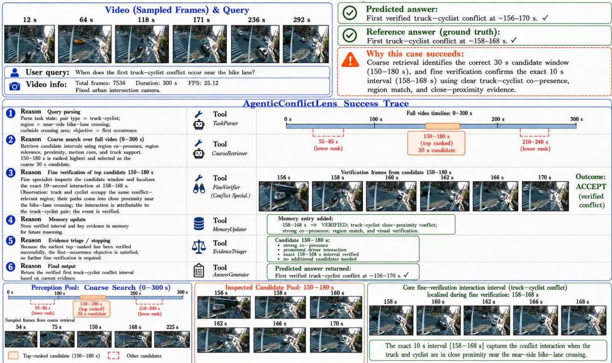  
Figure 2: Success case: coarse retrieval selects 150–180 s and fine verification localizes the verified truck–cyclist conflict to approximately 158–168 s near the bike lane.

Table 10: Main query-driven participant-level conflict-localization results on Bellevue (60 annotated hours) and NYC DOT (36 annotated hours). Frames, multimodal calls, and runtime are reported per query for the 30-minute video; runtime is in minutes. Inspect % denotes the fraction of the video sent for detailed inspection.
<table><tr><td></td><td colspan="2">Retrieval / Localization</td><td>Pair Quality</td><td colspan="4">Efficiency</td></tr><tr><td>Method</td><td>Exist. F1 ↑</td><td>tIoU ↑</td><td>Pair Acc. ↑</td><td>Inspect %↓</td><td>Frames ↓</td><td>Calls ↓</td><td>Runtime ↓</td></tr><tr><td>Bellevue</td><td></td><td></td><td></td><td></td><td></td><td></td><td></td></tr><tr><td>High-risk trajectory intervals Pu and Joshi [2008]</td><td>0.74</td><td>0.66</td><td>0.86</td><td>100.0</td><td>45216</td><td>0</td><td>9.8</td></tr><tr><td>Uniform sampled clip conflict search Zhang et al. [2025]</td><td>0.59</td><td>0.45</td><td>0.60</td><td>62.2</td><td>28124</td><td>224</td><td>6.7</td></tr><tr><td>Top retrieved conflict clips Wang et al. [2025]</td><td>0.62</td><td>0.57</td><td>0.64</td><td>23.5</td><td>10626</td><td>96</td><td>3.8</td></tr><tr><td>Memory-selected conflict clips Yin et al. [2026]</td><td>0.76</td><td>0.63</td><td>0.63</td><td>23.0</td><td>10400</td><td>88</td><td>3.5</td></tr><tr><td>Tool-selected conflict clips Lin et al. [2026]</td><td>0.73</td><td>0.71</td><td>0.75</td><td>19.1</td><td>8636</td><td>76</td><td>3.1</td></tr><tr><td>AGENTICCONFLICTLENS</td><td>0.84</td><td>0.77</td><td>0.85</td><td>8.7</td><td>3934</td><td>42</td><td>1.6</td></tr><tr><td>NYC DOT</td><td></td><td></td><td></td><td></td><td></td><td></td><td></td></tr><tr><td>High-risk trajectory intervals Pu and Joshi [2008]</td><td>0.71</td><td>0.64</td><td>0.80</td><td>100.0</td><td>45216</td><td>0</td><td>10.5</td></tr><tr><td>Uniform sampled clip conflict search Zhang et al. [2025]</td><td>0.60</td><td>0.44</td><td>0.61</td><td>59.7</td><td>26994</td><td>215</td><td>7.9</td></tr><tr><td>Top retrieved conflict clips Wang et al. [2025]</td><td>0.57</td><td>0.59</td><td>0.69</td><td>29.4</td><td>13294</td><td>112</td><td>4.6</td></tr><tr><td>Memory-selected conflict clips Yin et al. [2026]</td><td>0.70</td><td>0.61</td><td>0.62</td><td>25.9</td><td>11711</td><td>104</td><td>4.2</td></tr><tr><td>Tool-selected conflict clips Lin et al. [2026]</td><td>0.74</td><td>0.63</td><td>0.72</td><td>22.7</td><td>10264</td><td>92</td><td>3.8</td></tr><tr><td>AGENTICCONFLICTLENS</td><td>0.80</td><td>0.73</td><td>0.81</td><td>11.9</td><td>5381</td><td>54</td><td>2.1</td></tr></table>

## 2.5 Additional Query Breakdowns

Table 11 shows that performance decreases as queries become less constrained. Scoped queries are easiest because they provide both temporal and participant cues, while open-ended queries are hardest because the system must search without knowing the conflict time or participant pair. Across all difficulty levels, AGENTICCONFLICTLENS achieves the highest F1 on both datasets. The gains are largest for actor-conditioned and open-ended queries, showing that query-conditioned routing, memory, and verification are most useful when the search space is broad.

Table 11: Conflict-existence F1 by query difficulty on Bellevue and NYC DOT.
<table><tr><td>Method</td><td>Scoped</td><td>Actor-cond.</td><td>Open-ended</td><td>Overall</td></tr><tr><td>Bellevue</td><td></td><td></td><td></td><td></td></tr><tr><td>High-risk trajectory intervals Pu and Joshi [2008]</td><td>0.80</td><td>0.74</td><td>0.64</td><td>0.74</td></tr><tr><td>Uniform sampled clip conflict search Zhang et al. [2025]</td><td>0.65</td><td>0.58</td><td>0.48</td><td>0.59</td></tr><tr><td>Top retrieved conflict clips Wang et al. [2025]</td><td>0.68</td><td>0.61</td><td>0.51</td><td>0.62</td></tr><tr><td>Memory-selected conflict clips Yin et al. [2026]</td><td>0.82</td><td>0.76</td><td>0.67</td><td>0.76</td></tr><tr><td>Tool-selected conflict clips Lin et al. [2026]</td><td>0.79</td><td>0.73</td><td>0.64</td><td>0.73</td></tr><tr><td>AGENTICCONFLICTLENS</td><td>0.88</td><td>0.84</td><td>0.76</td><td>0.84</td></tr><tr><td>NYC DOT</td><td></td><td></td><td></td><td></td></tr><tr><td>High-risk trajectory intervals Pu and Joshi [2008]</td><td>0.77</td><td>0.70</td><td>0.61</td><td>0.71</td></tr><tr><td>Uniform sampled clip conflict search Zhang et al. [2025]</td><td>0.66</td><td>0.59</td><td>0.50</td><td>0.60</td></tr><tr><td>Top retrieved conflict clips Wang et al. [2025]</td><td>0.63</td><td>0.56</td><td>0.47</td><td>0.57</td></tr><tr><td>Memory-selected conflict clips Yin et al. [2026]</td><td>0.76</td><td>0.70</td><td>0.60</td><td>0.70</td></tr><tr><td>Tool-selected conflict clips Lin et al. [2026]</td><td>0.80</td><td>0.74</td><td>0.65</td><td>0.74</td></tr><tr><td>AGENTICCONFLICTLENS</td><td>0.84</td><td>0.80</td><td>0.72</td><td>0.80</td></tr></table>

Table 12: Conflict-existence F1 by participant family on the combined Bellevue and NYC DOT real-world evaluation.
<table><tr><td>Method</td><td>Auto-Ped. ↑</td><td>Auto-Cyclist ↑</td><td>Auto-Auto ↑</td><td>Bus/Truck ↑</td></tr><tr><td>High-risk trajectory intervals Pu and Joshi [2008]</td><td>0.72</td><td>0.66</td><td>0.75</td><td>0.70</td></tr><tr><td>Uniform sampled clip conflict search Zhang et al. [2025]</td><td>0.63</td><td>0.54</td><td>0.60</td><td>0.58</td></tr><tr><td>Top retrieved conflict clips Wang et al. [2025]</td><td>0.62</td><td>0.54</td><td>0.59</td><td>0.57</td></tr><tr><td>Memory-selected conflict clips Yin et al. [2026]</td><td>0.72</td><td>0.65</td><td>0.70</td><td>0.68</td></tr><tr><td>Tool-selected conflict clips Lin et al. [2026]</td><td>0.76</td><td>0.68</td><td>0.74</td><td>0.71</td></tr><tr><td>AGENTICCONFLICTLENS</td><td>0.83</td><td>0.76</td><td>0.82</td><td>0.79</td></tr></table>

## 2.5.1 Participant and Conflict-Type Breakdowns

Table 12 shows that AGENTICCONFLICTLENS maintains the highest F1 across all participant families. Performance is strongest for auto–pedestrian and auto–auto conflicts, while auto–cyclist cases are harder because cyclists are smaller, less frequent, and more affected by occlusion and tracking noise. SSAM-style trajectory scoring remains competitive for auto–auto interactions, but AGENTICCONFLICTLENS performs better for vulnerable road users and larger-vehicle conflicts by combining participant-aware search with traffic-specific verification.

## 2.6 Additional Experimental Details

The main paper reports the principal experimental results. Here, we provide additional analyses using the same 36 hours of real-world NYC DOT fixed-camera video from the three intersections included in the main evaluation. No additional dataset is introduced. Unless otherwise stated, the analyses use the same videos, queries, backbone, output schema, prompts, thresholds, and inference configuration as the main evaluation. We examine two complementary properties of the system on these real-world recordings: the effect of context-adaptive conflict localization and the spatial organization of verified conflicts across the three NYC DOT sites.

## 2.6.1 Adaptive Conflict Localization: Recovery Checks

We analyze the same 36-hour real-world NYC DOT evaluation data to examine whether the context-adaptive proximity threshold in Eq. (7) improves conflict-candidate localization relative to fixed pair-type thresholds. The comparison uses the same three NYC DOT intersections, denoted Sites A–C, and changes only the proximity-thresholding strategy.

Recovery improvement. Replacing fixed pair-type thresholds with the context-adaptive rule increases the number of recovered candidate conflict interactions by approximately 48% at Site A, 47% at Site B, and 49% at Site C. The similar relative improvement across the three real-world NYC sites, despite substantial differences in interaction frequency, indicates that the adaptive rule responds to local interaction context rather than relying on site-specific threshold tuning.

Exposure normalization. Raw recovery counts depend on traffic exposure because denser intersections contain more road-user encounters and therefore more opportunities for interaction. We therefore normalize recovered candidate interactions by road-user co-presence opportunities. The adaptive improvement remains after normalization (Fig. 4), indicating that the gain is not explained solely by differences in traffic volume across the NYC DOT sites.

Composition of recovered interactions. The additional candidate interactions recovered by the adaptive rule are not distributed uniformly across participant classes. Cross-type interactions involving vehicles and vulnerable road users show the largest relative improvement (Fig. 5). This pattern suggests that a single fixed proximity criterion is less effective across heterogeneous interaction geometries, particularly for participant pairs with substantially different sizes, speeds, and movement patterns.

## 2.6.2 Hotspot Zone Profiles

We next analyze the spatial organization of the verified conflict interactions produced from the same 36-hour real-world NYC DOT evaluation data. Applying the severity-weighted conflict-density formulation in Eq. (11) identifies twelve hotspot zones across the three intersections: four at Site A, six at Site B, and two at Site C. The zones are extracted from the severity-weighted field of verified conflicts using a common normalized density threshold.

Two zone families. Across the three NYC DOT sites, the identified hotspots separate into two broad behavioral families. Through-traffic corridors occur along dominant vehicle paths and contain predominantly same-type vehicle interactions, corresponding mainly to merging–following conflicts in the typology of Appendix 1.1.4. Crossing zones occur around crosswalks and turning areas and contain predominantly cross-type interactions, including vehicle– pedestrian and bicycle–pedestrian encounters, corresponding mainly to crossing-path and yielding conflicts. These spatial patterns indicate that the density peaks correspond to distinct traffic-interaction mechanisms rather than simply regions of high road-user activity.

Movement profiles. Per-participant movement statistics within the identified hotspot zones (Fig. 6) provide additional kinematic support for this separation. Vehicle-dominated through-traffic corridors exhibit higher speeds and longer straight-line trajectories, whereas crossing zones contain lower-speed motion and larger heading changes. Thus, the two zone families are also distinguishable from their underlying movement characteristics, independently of the conflict-type labels used to describe them.

Hotspot zone extraction. Hotspot zones are defined as connected components of the super-level set

$$
\Omega _ { \gamma } = \{ { \bf x } : \tilde { D } ( { \bf x } ) \geq \gamma \} ,
$$

using a common normalized density threshold $\gamma$ and discarding components below a minimum area. Each retained component is summarized by its spatial extent and peak-density location (arg max $\tilde { D }$ within the component). Figure 7 renders the normalized verified-conflict density field directly over the three real-world NYC DOT camera views, making the resulting spatial structure visually interpretable. Because $\tilde { D }$ is normalized independently for each intersection, the same thresholding procedure is applied consistently across Sites A–C. The resulting zones provide a compact spatial summary of the verified conflict interactions observed in the real-world NYC DOT evaluation data.

Video (Sampled Frames) & Query 75 s 150 s 225 s  

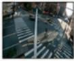

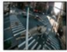

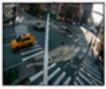

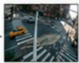

User query: When does the first turning auto-cyclist conflict occur near the right-side crosswalk?

Video info: Total frames: 7536 Duration: 300 s FPS: 25.12 Fixed urban intersection camera.

## ① Reason Query parsing

## ② Reason Coarse search over full video (0-300 s)

Parse task state: pair type = auto-cyclist; region = right-side crosswalk / turning area; objective = first occurrence.

Retrieve candidate intervals using coarse co-presence and region relevance. \~128-132 s ranks higher due to clearer co-presence and region match, while \~168–173 s shows weaker cyclist evidence and is ranked lower.

## ③Reason Fine verification of top candidate \~128-132 s

Inspect with fine-grained specialist using real frames Observation: ordinary co-presence; non-closing motion; no visible response attribubatle to the auto-cyclist pair.

## ④ Reason Memory update

Store rejected candidate and reason in memory to avoid repeated verification

Remaining candidate \~168-173 s has weak / fragmented cyclist evidence in coarse retrieval and does not reach promotion threshold. No further fine verification is triggered

## ⑤Reason Evidence triage / stopping

## AgenticConflictLens Failure Trace

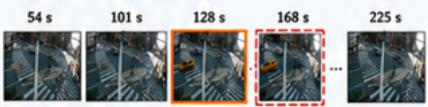

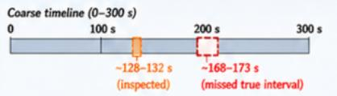

Controller outputs the negative result based on current verified evidence.

## Perception Pool: Coarse Search (0-300 s)

## ⑥ Reason Final output

Inspected false candidate (128-132 s)

Sampled frames from coarse retrieval

No verified conflict found. X

Reference answer:   
First verified turning auto-cyclist conflict   
at \~168–173 s. √

Missed true interval (168-173 s)

Localization failure occurred because the true interval had weak / fragmented cyclist evidence during coarse retrieval, so a nearby earlier interval was prioritized.

## Diagnosis (root cause):

Tool

Tool

TaskParser

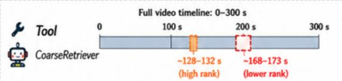

Tool

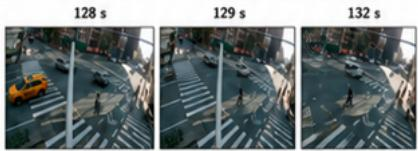

Tool

MemoryUpdater

EvidenceTriager

Outcome:REJECT(not a conflict)

Tool

Memory entry added: 128-132 s → REJECTED: ordinary co-presence, non-closing motion, no attributable response.

Candidate \~168-173 s:

• Weak cyclist evidence in coarse search

• Below promotion threshold

AnswerGenerator

• Not selected for verification

Predicted answer returned: No verified conflict found. X

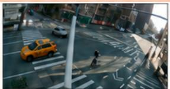

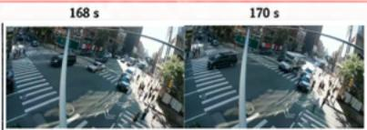

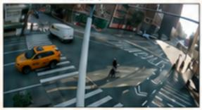

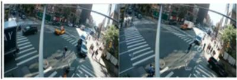  
Figure 3: Failure case: a higher-ranked 128–132 s candidate is correctly rejected, while the true turning auto–cyclist conflict at approximately 168–173 s remains below the coarse promotion threshold and is never verified.

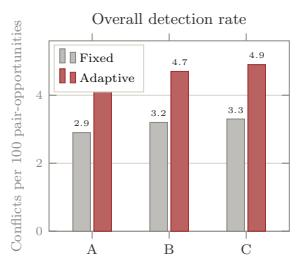

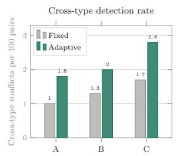  
Figure 4: Exposure-normalized candidate conflict-interaction recovery under fixed and context-adaptive proximity thresholds on the same 36-hour real-world NYC DOT evaluation data at Sites A–C.

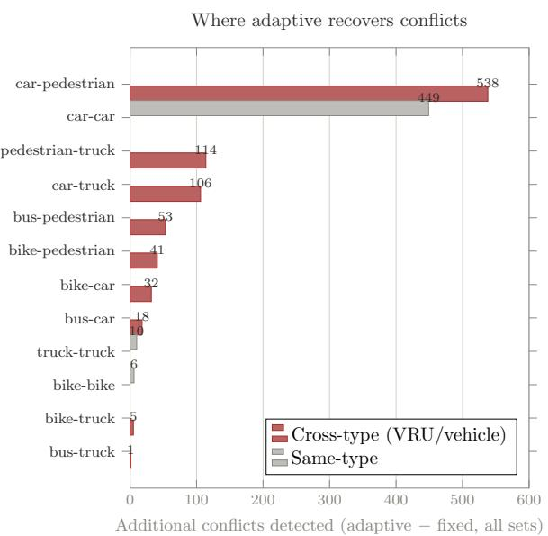  
Figure 5: Additional candidate conflict interactions recovered by the context-adaptive proximity rule on the same 36-hour real-world NYC DOT evaluation data, grouped by participant-pair family.

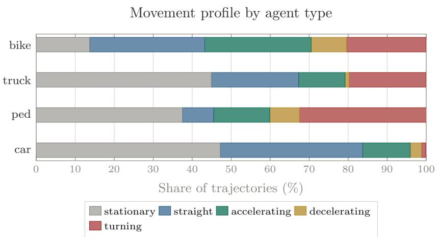  
Figure 6: Movement profiles by participant type within verified-conflict hotspot zones identified from the same 36-hour real-world NYC DOT evaluation recordings.

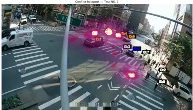

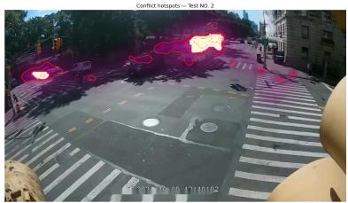

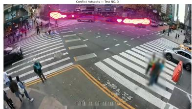  
Figure 7: Severity-weighted verified-conflict density $\tilde { D } \left( \mathrm { E q . } \left( 1 1 \right) \right)$ over the real-world NYC DOT camera views at Sites A–C. Iso-density contours identify four, six, and two hotspot zones, respectively, from the same 36-hour NYC DOT evaluation data.