# Location Matters: Sparse Latent-Variance Attacks for Face Privacy against Difusion Personalization

Shuting Yang1, Shuxin Li2, Linyan Dai3, Xinwei Zhang3, Dong Huang1,

Renyang Liu1,∗, See-Kiong Ng1

1National University of Singapore 2Nanyang Technological University 3The Hong Kong Polytechnic University

## Abstract

Text-to-image difusion models can learn and reproduce an individual’s identity from only a few reference photos, cre- ating risks of unauthorized and misleading content genera- tion. Proactive defenses address this risk by adding adver- sarial perturbations to facial images before release, thereby disrupting identity acquisition during downstream personal- ization. However, existing methods typically rely on dense L∞-bounded perturbations, whose accumulated distortions can become visible around facial structures. Recent meth- ods improve protected-image quality, but often at the cost of reduced protection efectiveness. In this paper, we pro- pose Sparse Encoder Attack on Latent Variance (SEAL), a sparse adversarial protection framework that modifies only 5% of the spatial locations in a facial image. SEAL combines a diferentiable top-k masking scheme that jointly optimizes perturbation locations and values with a variance-oriented objective over the frozen VAE encoder’s latent distribution to disrupt identity-consistent representations. A saliency-guided dispersion penalty further discourages perturbation concen- tration in perceptually salient facial regions. Experiments on CelebA-HQ and VGGFace2 show that SEAL achieves the best protected-image quality among the compared methods, exceeding 41 dB PSNR with 0.97 SSIM and at most 0.07 LPIPS, while reducing identity similarity to at most 0.15 af- ter difusion personalization. These results demonstrate that sparse location optimization enables strong identity protec- tion while preserving high visual quality. Code and data are available at https://github.com/Lvxan/SEAL.

## 1 Introduction

Text-to-image difusion models [9, 23] have demonstrated remarkable capabilities in generating photorealistic images from natural language descriptions. Personalization tech- niques, such as DreamBooth [24] and Textual Inversion [6], further enable these models to reproduce a specific individua from only a few reference photos. While this capability facil- itates customized content creation, it also lowers the barrier to unauthorized identity replication. An adversary can col- lect publicly available facial images, personalize a difusion model to the depicted individual, and generate misleading or harmful content involving that person [22]. This risk moti-vates proactive protection mechanisms that prevent released facial images from being used to learn and reproduce an individual’s identity.

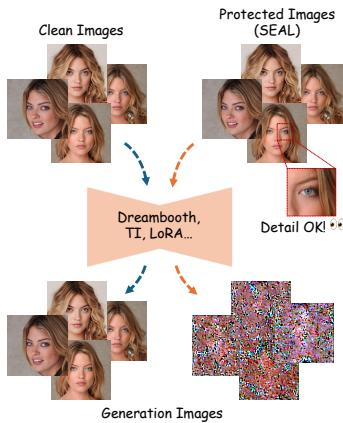

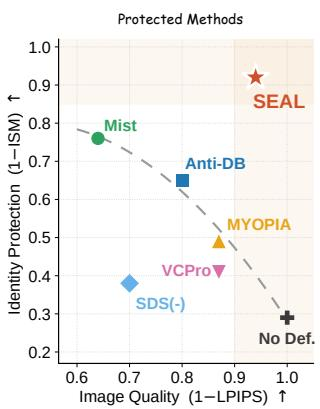  
Figure 1: By modifying only a small fraction of pixels, SEAL preserves the visual appearance of the protected face image while disrupting identity reproduction after difusion person- alization. Compared with existing protection methods, SEAL achieves both high image quality and strong protection ef- fectiveness.

A common proactive strategy is to add bounded adver- sarial perturbations to facial images before their release, such that personalized models fine-tuned on these pro- tected images fail to reproduce the target identity. Early ap- proaches construct such perturbations by maximizing the difusion denoising loss, as in AdvDM [17], or by shifting image representations toward a predefined latent target, as in Mist [16]. Anti-DreamBooth [28] instead directly maximizes the DreamBooth training loss to interfere with per- sonalization. More recent methods, including PID [15] and Variance as a Catalyst [32], manipulate the mean or vari-ance of the VAE encoder’s latent distribution, revealing that disrupting latent statistics can efectively impair identity ac- quisition across diferent prompts. Collectively, these studies establish adversarial perturbation as a viable defense against unauthorized difusion personalization.

However, most existing methods apply dense perturbations across every pixel, and the accumulated distortions can be- come perceptible around visually sensitive facial structures.

Recent works have sought to improve perceptual quality: VCPro [20] uses concept masks to guide a regional adversarial objective, whereas MYOPIA [30] exploits local information to conceal perturbation artifacts. However, these improvements in visual quality are accompanied by reduced protection efectiveness. Overall, existing methods exhibit a pronounced trade-of between protection and visual qual- ity. As shown in Figure 1, methods that achieve stronger protection often rely on dense perturbations that noticeably degrade image quality, whereas visual-friendly methods pre- serve quality at the cost of reduced protection efectiveness. Achieving strong protection while maintaining high visual quality therefore remains an open challenge.

To address this challenge, we propose Sparse Encoder Attack on Latent Variance (SEAL), a sparse perturbation framework for proactive face privacy protection. Instead of distributing perturbations densely across the entire im- age, SEAL jointly optimizes a bounded perturbation δ and a binary mask m that determines the perturbed pixel lo-cations. To handle the discrete pixel-selection process, we adapt the diferentiable top-k masking mechanism of Sparse-PGD [36], which jointly optimizes perturbation values and spatial locations under a fixed support budget. Within the se- lected sparse support, SEAL maximizes a Laplace objective over the variance of the VAE encoder distribution, follow- ing prior evidence that disrupting latent statistics can inter- fere with the acquisition of subject-specific identity information [15, 32]. However, sparse optimization may concentrate perturbations around salient facial structures, making local artifacts noticeable even when the overall perturbation support is small. We therefore introduce a saliency-guided dispersion regularizer that penalizes high local perturbation density in perceptually salient facial regions. Together, these components allow SEAL to allocate a limited perturbation budget to locations that efectively disrupt personalization while preserving the visual quality of the protected image.

We evaluate SEAL on CelebA-HQ [11] and VGGFace2 [1] using Stable Difusion v2.1 personalized with DreamBooth under two primary inference prompts. Quantitatively, with only 5% of pixels modified, SEAL achieves $\mathrm { L P I P S } \le 0 . 0 7$ on both datasets, while keeping the identity similarity at most 0.15 under both prompts and raising the face detection failure rate to 0.93 under a photo of sks person. This improvement is mainly due to the way the locations of the perturbations are placed. Ablation experiments show that when the 5% locations are chosen at random rather than optimized, ISM rises from 0.07 to 0.68. Qualitatively, as shown in Figure 3, the protected images preserve high visual quality in facial- detail regions, while DreamBooth generations under difer- ent prompts are severely disrupted. Our main contributions are as follows:

• We propose SEAL, a sparse perturbation approach to proactive face identity protection from difusion person- alization that modifies only a small fraction of the pixels in each protected image.

• We develop a joint optimization framework that combines diferentiable top-k pixel selection with a latent-variance disruption objective, enabling perturbation values and lo-cations to be optimized simultaneously under an $L _ { 0 }$ sup- port budget and an $L _ { \infty }$ magnitude constraint.

• We introduce a saliency-guided dispersion regularizer that discourages perturbation clustering in perceptually salient facial regions while retaining the protection ca- pacity of the sparse perturbation.

• Extensive experiments on CelebA-HQ and VGGFace2 demonstrate that SEAL achieves the best protected-image quality and the lowest identity similarity among the com- pared methods, while maintaining competitive computa- tional cost.

## 2 Related Work

## 2.1 Personalized Text-to-Image Generation

Text-to-image difusion models have become a dominant paradigm for image synthesis, with latent difusion mod- els [23] improving computational eficiency by performing denoising in a compressed latent space. Beyond generic gen- eration, personalization techniques adapt pretrained difu- sion models to reproduce a specific subject or visual concept from only a few reference images. Textual Inversion [6] learns a new token embedding to represent the target visual concept, whereas DreamBooth [24] fine-tunes the generative model to bind a unique identifier to the target subject. Custom Difusion [13] enables multi-concept customization, and LoRA [10] reduces fine-tuning cost. When applied to hu-man faces, however, such personalization capabilities raise serious privacy and security concerns, as publicly available photographs can be exploited to generate misleading or unau- thorized depictions of specific individuals [22].

## 2.2 Image Protection Against Personalization

To mitigate unauthorized personalization, most protection methods add adversarial perturbations to images before re- lease to disrupt their use in downstream difusion person- alization, though a separate line instead pursues privacy on the model side by training identity-decoupled personalized models [2]. These input-side methods difer primarily in the model component or training objective targeted during perturbation optimization. AdvDM [17] maximizes the difusion denoising loss, while PhotoGuard [25] introduces an encoder attack that shifts the latent representation toward a prede- fined target. Mist [16] combines denoising and latent-target objectives to disrupt both the image representation and the denoising process. Other methods manipulate the latent dis- tribution produced by the VAE encoder: PID [15] jointly perturbs its mean and log-variance, whereas Variance as a Cata- lyst [32] develops distribution-oriented objectives, including a Laplace-based loss, to amplify latent variance and disrupt identity acquisition. Personalization-aware methods instead incorporate the downstream training process into perturba- tion optimization. Anti-DreamBooth [28] simulates Dream-Booth fine-tuning and maximizes its training loss, while MetaCloak [18] employs meta-learning and transformation-aware optimization to improve perturbation transferability and robustness. Several recent works further focus on the visual quality of protected images. SDS(-) [31] minimizes the semantic loss to produce more natural-looking pertur- bations. MYOPIA [30] combines just-noticeable-diference constraints with expectation over transformations to regulate perturbation location and intensity while improving robust- ness. Latent Difusion Unlearning [4] constructs trajectory- shifted perturbations in latent space by alternating denois- ing and inversion, thereby improving the visual quality of protected images. VCPro [20] employs selective adversarial perturbations and a relaxed optimization objective to im-prove the trade-of between perturbation visibility and con- cept protection. Despite these advances, these methods treat perturbation placement as a visual or region-level constraint, leaving pixel-level support selection outside the optimiza- tion objective that governs protection efectiveness. Sparse $L _ { 0 }$ -constrained attacks such as Sparse-PGD [36] show that adversarial efects can be achieved by modifying only a small subset of pixels. Building on this sparse optimiza- tion principle, SEAL combines diferentiable pixel selection with latent-variance disruption and saliency-guided disper- sion regularization for proactive face identity protection.

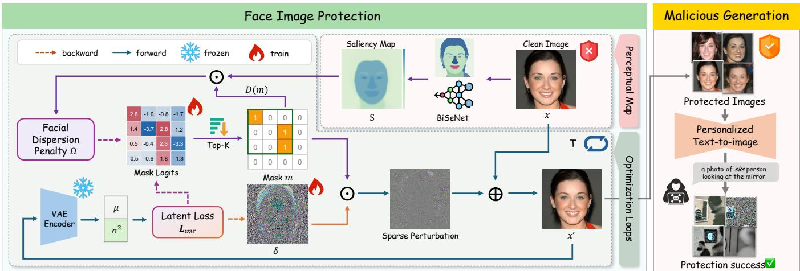  
Figure 2: Overview of SEAL. Given a clean image x, SEAL jointly optimizes a sparse binary mask m and a bounded perturbation δ to disrupt the VAE latent variance. A saliency-guided dispersion regularizer discourages the selected pixels from clustering in perceptually salient facial regions.

## 3 Method

## 3.1 Problem Formulation

Given a facial image $x \in [ 0 , 1 ] ^ { 3 \times H \times W }$ , the defender releases a protected image $\overline { { x } } ^ { \prime }$ obtained by adding a perturbation $\delta \in$ $\mathbb { R } ^ { \frac { 1 } { 3 } \times H \times W }$ bounded by $\| \delta \| _ { \infty } \leq \dot { \epsilon }$ . Protection succeeds when $x ^ { \prime }$ stays visually indistinguishable from $x$ while a model personalized on $x ^ { \prime }$ fails to reproduce the identity. As the surrogate we use the frozen VAE encoder ${ \mathcal { E } } _ { \theta }$ of a latent difusion model [23], which maps an image to a diagonal Gaussian with mean $\mu ( \cdot )$ and variance $\sigma ^ { 2 } ( \cdot )$

Attacker. The attacker collects publicly available facial im- ages of a target individual and fine-tunes a difusion model on them with a personalization algorithm such as Dream- Booth [24], whose customized prompt binds a unique identifier such as $\mathrm { \Omega ^ { 6 6 } s k s ^ { 7 } }$ to the subject. The personalized model is then queried to render that individual under arbitrary prompts and contexts.

Defender. The defender may modify images only before release and has no control over their subsequent collection or use. The defender also has no access to the attacker’s model, personalization algorithm, training hyperparameters, identifier token, or inference prompts, and must therefore construct the protection on an accessible surrogate model.

## 3.2 Overview

SEAL inherits the setting of Sec. 3.1 and adds a restric- tion: rather than letting δ act on every pixel, it confines the perturbation to k spatial locations selected by a binary mask $\dot { m } \in \{ 0 , 1 \} ^ { H \times W }$ , shared across the three color channels. The released image is therefore $x ^ { \prime } = \mathrm { c l i p } ( x + \delta \odot m , 0 , 1 )$ . We fur- ther construct a perceptual saliency map $S ( x ) \stackrel { \prime } { \in } [ 0 , 1 ] ^ { H \times W }$ in which larger values indicate facial regions where per- turbations are more visually conspicuous. The conceptual optimization objective is:

$$
\begin{array} { r l } { \displaystyle \operatorname* { m a x } _ { \delta , m } } & { \mathcal { L } _ { \mathrm { v a r } } ( x ^ { \prime } ) - \lambda \Omega ( m , S ( x ) ) , } \\ { \mathrm { s . t . ~ } } & { \| \delta \| _ { \infty } \leq \epsilon , \qquad \| m \| _ { 0 } = k . } \end{array}\tag{1}
$$

Here, ${ \mathcal { L } } _ { \mathrm { v a r } }$ disrupts the latent distribution of the protected im- age, while Ω discourages perturbation concentration in per-ceptually salient facial regions. Visual fidelity is controlled jointly by the sparse support, the perturbation-magnitude bound, and the saliency-guided dispersion term. Eq. (1) cap- tures the desired trade-of, while the normalized mask-update rule used in optimization is specified in Sec. 3.5.

As illustrated in Figure 2, SEAL consists of three com- ponents. First, we adopt a Laplace-based objective over the VAE latent variance to disrupt the identity acquisition during personalization (Sec. 3.3). Second, we adapt a diferentiable top-k masking mechanism to jointly optimize the perturbation values and their spatial support under an $L _ { 0 }$ budget (Sec. 3.4). Third, we introduce a saliency-guided dispersion regularizer that discourages sparse perturbations from con- centrating in perceptually salient facial regions (Sec. 3.5).

## 3.3 Latent Variance Disruption

The frozen VAE encoder E maps a protected image $x ^ { \prime }$ to a di- agonal Gaussian posterior parameterized by its mean $\mu ( x ^ { \prime } )$ and variance $\sigma ^ { 2 } ( \dot { { \boldsymbol { x } } } ^ { \prime } )$ . During difusion personalization, the encoded latent provides the image-side training signal from which the model learns subject-specific information. Prior work has shown that manipulating the latent statistics of pro- tected images can impair identity acquisition during person- alization [15, 32]. We therefore maximize the latent variance of $x ^ { \prime }$ to increase uncertainty in the encoded representation and disrupt the identity-consistent latent signal used for per- sonalization.

Specifically, we adopt the Laplace-based objective from Variance as a Catalyst [32]:

$$
\mathcal { L } _ { \mathrm { v a r } } ( x ^ { \prime } ) = \sum _ { j } \frac { \left| \sigma _ { j } ^ { 2 } ( x ^ { \prime } ) - \mu _ { 0 } \right| } { b } ,\tag{2}
$$

where $j$ indexes all spatial and channel dimensions of the latent variance, and $\mu _ { 0 }$ and b are the location and scale parameters, respectively. Following [32], we set $\mu _ { 0 } = 0$ and $b = 1$ . Since $\ \sigma _ { j } ^ { 2 } ( x ^ { \prime } ) \ \geq 0$ , Eq. (2) is equivalent to maximizing the total latent variance. Its derivative with respect to $\sigma _ { j } ^ { 2 }$ is $1 / b$ almost everywhere, providing a non-saturating opti- mization signal across latent dimensions. When the encoder parameterizes the posterior using log-variance, we recover the variance as $\sigma ^ { 2 } \stackrel { . } { = } \exp ( \log \sigma ^ { 2 } )$ before evaluating Eq. (2).

## 3.4 Diferentiable Sparse Masking

The cardinality constraint $\| m \| _ { 0 } = k$ is discrete and non- diferentiable, preventing direct gradient-based optimization of the binary mask. We address this by introducing con- tinuous mask logits $\ell \in \mathbb { R } ^ { H \times W }$ and adapting the difer- entiable top-k masking mechanism of Sparse-PGD [36]. In the forward pass, we compute element-wise soft scores $\hat { m } _ { i } = \left( 1 + e ^ { - \ell _ { i } } \right) ^ { - 1 }$ and project them to a binary mask by retaining the top-k entries:

$$
m = \mathrm { T o p K } ( \hat { m } , k ) ,\tag{3}
$$

where $\mathrm { T o p K } ( \hat { m } , k )$ returns a binary mask whose k largest entries are one and whose remaining entries are zero. The resulting hard mask determines the spatial support of the perturbation $\delta \odot m$

Since the top-k projection is non-diferentiable, we em-ploy a straight-through estimator (STE). The forward pass uses the hard mask $m ,$ , whereas the backward pass approxi- mates its gradient using the soft mask mˆ . Because one spatial mask value is shared across the three color channels, the ap- proximate gradient of ${ \mathcal L } _ { \mathrm { v a r } }$ with respect to $\ell _ { i }$ is

$$
\frac { \partial \mathcal { L } _ { \mathrm { v a r } } } { \partial \ell _ { i } } \approx \frac { 1 } { 3 } \left( \sum _ { c = 1 } ^ { 3 } \frac { \partial \mathcal { L } _ { \mathrm { v a r } } } { \partial ( \delta _ { c , i } m _ { i } ) } \delta _ { c , i } \right) \hat { m } _ { i } ( 1 - \hat { m } _ { i } ) .\tag{4}
$$

At each iteration, the perturbation $\delta$ is updated using a projected gradient-ascent step [19]:

$$
\delta \gets \Pi _ { [ - \epsilon , \epsilon ] } \left( \delta + \alpha \cdot \mathrm { s i g n } ( \nabla _ { \delta } \mathcal { L } _ { \mathrm { v a r } } ) \right) ,\tag{5}
$$

where α is the perturbation step size and $\Pi _ { [ - \epsilon , \epsilon ] }$ denotes the element-wise projection onto the $L _ { \infty }$ constraint. The mask logits are updated via gradient ascent:

$$
\ell \gets \ell + \sqrt { H W } \beta \cdot g _ { \ell } ,\tag{6}
$$

where $\beta$ is the mask step size and $g _ { \ell }$ is defined in Sec. 3.5.

To prevent the optimization from becoming trapped when the mask stabilizes prematurely, we employ patience-based reinitialization. If the hard mask m remains unchanged for $P$ consecutive iterations, both $\ell$ and $\delta$ are randomly reini- tialized. We keep the perturbation with the highest objective ${ \mathcal { L } } _ { \mathrm { v a r } } - \lambda \Omega$ across all iterations as the released protection.

## 3.5 Saliency-Guided Dispersion

The sparse mask learned in Sec. 3.4 tends to concentrate perturbations in regions that yield strong latent disruption. For facial images, these regions may coincide with percep- tually sensitive structures, such as the eyes, nose, and mouth, making local perturbation artifacts more conspicuous. To counteract this efect, we introduce a saliency-guided disper- sion penalty that discourages high local perturbation density in salient facial regions.

Saliency map. We parse x using a BiSeNet-based face parser [34] with the 19-class CelebAMask-HQ taxonomy [14]. Studies of face viewing show that gaze is pri-marily allocated to internal facial features, particularly the eyes, nose, and mouth, with the eyes playing a preferential role in guiding fixations and face identification [7, 8]. Based on these findings, we construct the saliency map $S ( x )$ by assigning each semantic class a fixed weight $w _ { c } \in [ 0 , 1 ]$ where larger values impose stronger dispersion penalties on perceptually salient regions: 1.0 for the eyes, 0.9 for the nose and mouth, 0.8 for the skin, 0.02 for the hair, and 0.0 for the background. The weighted label map is Gaussian-smoothed and min-max normalized to [0, 1] to reduce boundary artifacts, with the complete class-to-weight mapping reported in Table 5 in the Appendix.

Dispersion penalty. We measure the local density of the mask m using a normalized $K \times K$ mean-pooling kernel W, whose entries equal $1 / K ^ { 2 }$

$$
D ( m ) = m * \mathbf { W } ,\tag{7}
$$

where $^ *$ denotes convolution with padding that preserves the spatial resolution. Thus, $D ( m ) _ { i } \ \in \ [ 0 , \bar { 1 } ]$ represents the fraction of selected pixels within the local neighborhood centered at location i.

The dispersion penalty is defined as:

$$
\Omega ( m , S ) = \frac { 1 } { H W } \sum _ { i } \mathrm { R e L U } ( D ( m ) _ { i } \cdot S _ { i } - \tau ) ,\tag{8}
$$

where $\tau$ is a density threshold. The penalty remains zero when the saliency-weighted local density does not exceed $\tau$ and increases with violations above the threshold.

Gradient-balanced optimization. Since Ω depends only on the mask, the perturbation $\delta$ is updated using ${ \mathcal { L } } _ { \mathrm { v a r } }$ as in Eq. (5). For the mask logits, directly combining the two raw gradients can cause the update to be dominated by the term with the larger gradient magnitude. We therefore normalize the two gradient components independently before combin- ing them:

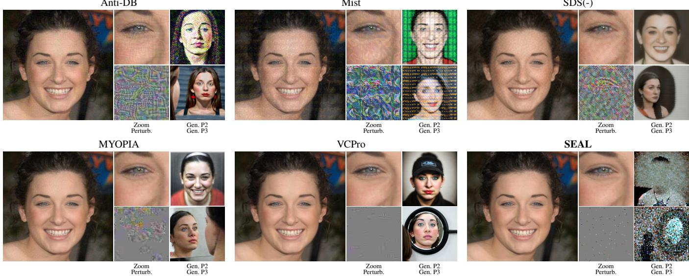  
Figure 3: Qualitative comparison. Each method shows the protected image, a magnified crop with its perturbation pattern, and DreamBooth generations under two prompts. P2: a dslr portrait ofsks person; P3: a photo ofsks person looking at the mirror.

$$
g _ { \ell } = \frac { \nabla _ { \ell } \mathcal { L } _ { \mathrm { v a r } } } { \Vert \nabla _ { \ell } \mathcal { L } _ { \mathrm { v a r } } \Vert _ { 2 } + \eta } - \lambda \frac { \nabla _ { \ell } \Omega } { \Vert \nabla _ { \ell } \Omega \Vert _ { 2 } + \eta } ,\tag{9}
$$

where $\eta > 0$ is a small constant for numerical stability. For Ω, the gradient is propagated through the hard mask with a straight-through estimator that treats the mask as an identity map of ℓ, bypassing the sigmoid so that the dispersion gradi-ent does not vanish once the logits saturate. After normaliza- tion, λ controls the relative contribution of latent disruption and saliency-guided dispersion to the mask update.

The complete optimization procedure is provided in Al- gorithm 1 in Appendix A.

## 4 Experiments

## 4.1 Setup

Datasets. We evaluate SEAL on VGGFace2 [1] and CelebA-HQ [11]. Following Anti-DreamBooth [28], we select 50 identities from each dataset, using 4 images per iden- tity as the target set to be protected. Ablation studies and additional experiments use a 10-identity subset to reduce computational cost. All images are resized to 512 × 512 for both perturbation generation and model fine-tuning.

Baselines. We compare against five representative protec- tion methods: Anti-DreamBooth [28] (Anti-DB), Mist [16], SDS(-) [31], MYOPIA [30], and VCPro [20]. These baselines cover both established protection methods and recent quality- aware approaches. For a fair comparison, we set ϵ = 0.05 for all methods except MYOPIA, whose original upper bound $( \epsilon = 0 . 5 )$ is retained because its internal magnitude con- trol prevents the realized perturbation from saturating this nominal budget.

Metrics. We evaluate along two dimensions: the image quality of protected images and the protection efectiveness against personalized generation. For image quality, we mea- sure the distortion between protected and clean images using PSNR, SSIM [29], LPIPS [35], and DISTS [5]. For protection efectiveness, we assess the identity fidelity and perceptual quality of DreamBooth-generated images using four metrics: ISM is the ArcFace [3] identity similarity between generated and reference facial images, FDFR is the fraction of gen- erated images for which no face is detected, SER-FIQ [27] measures generated-face quality, and BRISQUE [21] mea-sures no-reference image quality.

Implementation details. We optimize the Laplace loss in Eq. (2) for T=300 iterations with sparsity ratio r=0.05. The saliency map is obtained via BiSeNet [34] face parsing. We use Stable Difusion v2.1 [23] as the target model and fine-tune with DreamBooth [24] for 1000 steps. For each protected identity, we generate 32 images per evaluation prompt. The full prompt list is given in Appendix B. All experiments are conducted on NVIDIA A100 GPUs. Full hyperparame- ters are provided in Appendix B.3.

## 4.2 Main Results

Quantitative results. Table 1 compares all methods on VGGFace2 and CelebA-HQ under two inference prompts. With only 5% of pixels modified, SEAL achieves the best protected-image quality across all four metrics on both datasets. Under P1, SEAL attains FDFR = 0.93 and ISM ≤ 0.11, indicating a high face-detection failure rate and low target-identity similarity. However, baselines face a pro- nounced trade-of: methods with dense perturbations intro- duce substantial artifacts, while those preserving image qual- ity provide negligible identity disruption. Under prompt P2, SEAL achieves the lowest ISM on both datasets (≤ 0.15), indicating the lowest target-identity fidelity among the com- pared methods. Extended results under other prompts are reported in Appendix C.4.

<table><tr><td></td><td></td><td colspan="4">Image Quality</td><td colspan="4">Protection (P1)</td><td colspan="4">Protection (P2)</td></tr><tr><td>Dataset</td><td>Method</td><td>SSIM↑ PSNR↑ LPIPS↓ DISTS↓</td><td></td><td></td><td></td><td>BRISQUE↑ SER-FIQ↓ FDFR↑ ISM↓</td><td></td><td></td><td></td><td>BRISQUE↑ SER-FIQ↓ FDFR↑ ISM↓</td><td></td><td></td><td></td></tr><tr><td rowspan="7">VGGFace2</td><td>No Def.</td><td></td><td></td><td></td><td></td><td>17.34</td><td>0.75</td><td>0.01</td><td>0.67</td><td>8.60</td><td>0.72</td><td>0.01</td><td>0.49</td></tr><tr><td>Anti-DB</td><td>0.90</td><td>34.52</td><td>0.21</td><td>0.18</td><td>35.26</td><td>0.35</td><td>0.32</td><td>0.35</td><td>40.28</td><td>0.40</td><td>0.43</td><td>0.27</td></tr><tr><td>Mist</td><td>0.74</td><td>28.62</td><td>0.38</td><td>0.38</td><td>20.59</td><td>0.47</td><td>0.12</td><td>0.22</td><td>32.84</td><td>0.44</td><td>0.23</td><td>0.19</td></tr><tr><td>SDS(-)</td><td>0.74</td><td>29.87</td><td>0.31</td><td>0.34</td><td>40.84</td><td>0.75</td><td>0.00</td><td>0.62</td><td>47.16</td><td>0.77</td><td>0.00</td><td>0.54</td></tr><tr><td>MYOPIA</td><td>0.92</td><td>34.35</td><td>0.11</td><td>0.22</td><td>31.25</td><td>0.72</td><td>0.00</td><td>0.55</td><td>54.28</td><td>0.77</td><td>0.02</td><td>0.51</td></tr><tr><td>VCPro</td><td>0.90</td><td>36.40</td><td>0.16</td><td>0.17</td><td>21.47</td><td>0.71</td><td>0.01</td><td>0.59</td><td>18.02</td><td>0.73</td><td>0.02</td><td>0.44</td></tr><tr><td>SEAL</td><td>0.97</td><td>41.08</td><td>0.07</td><td>0.07</td><td>76.89</td><td>0.06</td><td>0.93</td><td>0.11</td><td>34.43</td><td>0.50</td><td>0.33</td><td>0.15</td></tr><tr><td rowspan="7"></td><td>No Def.</td><td></td><td></td><td></td><td></td><td>19.78</td><td>0.75</td><td>0.00</td><td>0.71</td><td>8.38</td><td>0.73</td><td>0.02</td><td>0.47</td></tr><tr><td>Anti-DB</td><td>0.90</td><td>34.34</td><td>0.20</td><td>0.19</td><td>35.46</td><td>0.31</td><td>0.40</td><td>0.35</td><td>39.83</td><td>0.40</td><td>0.45</td><td>0.24</td></tr><tr><td>Mist</td><td>0.75</td><td>28.56</td><td>0.36</td><td>0.39</td><td>17.75</td><td>0.56</td><td>0.05</td><td>0.24</td><td>32.93</td><td>0.49</td><td>0.10</td><td>0.16</td></tr><tr><td>CelebA-HQ SDS(-)</td><td>0.74</td><td>29.81</td><td>0.30</td><td>0.35</td><td>37.70</td><td>0.76</td><td>0.00</td><td>0.62</td><td>41.31</td><td>0.77</td><td>0.00</td><td>0.52</td></tr><tr><td>MYOPIA</td><td>0.91</td><td>33.83</td><td>0.13</td><td>0.24</td><td>31.98</td><td>0.70</td><td>0.00</td><td>0.51</td><td>57.68</td><td>0.77</td><td>0.02</td><td>0.49</td></tr><tr><td>VCPro</td><td>0.92</td><td>37.40</td><td>0.13</td><td>0.17</td><td>34.72</td><td>0.72</td><td>0.01</td><td>0.59</td><td>18.28</td><td>0.73</td><td>0.02</td><td>0.42</td></tr><tr><td>SEAL</td><td>0.97</td><td>41.03</td><td>0.06</td><td>0.07</td><td>81.18</td><td>0.06</td><td>0.93</td><td>0.08</td><td>35.68</td><td>0.47</td><td>0.38</td><td>0.10</td></tr></table>

Table 1: Comparison of protection methods on VGGFace2 and CelebA-HQ. ↑/↓ indicates higher/lower is better. Best in bold, second best underlined. P1: a photo of sks person; P2: a dslr portrait of sks person.

Qualitative results. Figure 3 shows visual comparisons of protected images and their DreamBooth generations. Our protected images are nearly indistinguishable from the origi- nals: the sparse perturbation leaves 95% of pixels untouched, and the saliency-guided dispersion penalty prevents visible clustering on facial regions. Baselines, by contrast, introduce noticeable texture distortions or color shifts. Although our protected images are barely altered, the faces in our genera- tions are unrecognizable or cannot be detected, whereas base- line generations often still reveal the target identity. Addi- tional qualitative comparisons are provided in Appendix C.4.

## 4.3 Uncontrolled Conditions

In real-world scenarios, adversaries may use unknown mod- els, obtain only a subset of protected images, or apply image pre-processing before fine-tuning. We evaluate transferabil- ity and partial protection below; additional pre-processing results are provided in Appendix C.3.

Transferability. To assess cross-model transferability, we generate protected images using the VAE of SD 2.1 as the surrogate and test protection performance on diferent target models and personalization methods. As shown in Figure 4, these results establish transferability across both target model and personalization changes.

Protected-image ratio. In practice, adversaries may col- lect images from diverse sources, mixing protected and un- protected ones. We evaluate protection efectiveness when only a subset of the DreamBooth training images per iden- tity are protected. As shown in Table 2, protection remains efective at 50% (FDFR = 0.69). Even at 25%, our method still outperforms quality-oriented baselines under full pro- tection (FDFR ≤ 0.02 in Table 1).

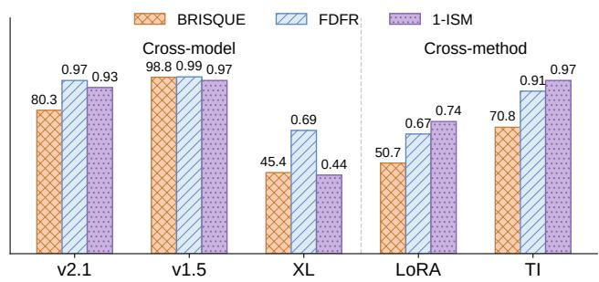

Figure 4: Cross-model and cross-method transferability on CelebA-HQ. Bars are rescaled to a common range (taller = better). Prompt: a photo of sks person.
<table><tr><td colspan="2">Ratio BRISQUE↑ SER-FIQ↓1 FDFR ↑</td></tr><tr><td>100%</td><td>67.64 0.07 0.93</td></tr><tr><td>75%</td><td>59.78 0.12 0.88</td></tr><tr><td>50%</td><td>48.71 0.31 0.69</td></tr><tr><td>25%</td><td>30.51 0.59 0.33</td></tr></table>

Table 2: Protection under diferent protected-image ratios on CelebA-HQ. Prompt: a photo of sks person.

## 4.4 Eficiency Analysis

Table 3 reports the wall-clock time and peak GPU mem- ory required to protect one four-image identity set for SEAL and the baselines. SEAL optimizes perturbations by back- propagating only through a frozen VAE encoder, yielding a lightweight protection procedure. It requires approximately 70 seconds and 9 GB of GPU memory, corresponding to about one-sixth of the time and half the memory used by Anti-DB. At a similar computational cost to SDS(-), SEAL achieves better protected-image quality and lower identity similarity on both datasets (Table 1).

<table><tr><td>Method</td><td>GPU Mem. (GB)</td><td>Time (s)</td></tr><tr><td>Anti-DB</td><td>~17</td><td>~420</td></tr><tr><td>Mist</td><td>~11</td><td>~120</td></tr><tr><td>SDS(-)</td><td>~9</td><td>~70</td></tr><tr><td>MYOPIA</td><td>~18</td><td>~590</td></tr><tr><td>VCPro</td><td>~20</td><td>~100</td></tr><tr><td>SEAL</td><td>~9</td><td>~70</td></tr></table>

Table 3: Eficiency comparison. Time and GPU memory are measured for protecting one four-image identity set at 512 × 512 resolution on a single NVIDIA A100.

## 4.5 Ablation Study

Unless otherwise specified, all ablation experiments are con- ducted on CelebA-HQ with default hyperparameters. Additional ablation studies on dispersion weight λ, density threshold τ, and optimization steps T are provided in Appendix C.2

Component ablation. Table 4 reports the results. Replac- ing the learned top-k mask with a random mask degrades ISM from 0.07 to 0.68, showing that learned mask placement is critical under a sparse budget. The Laplace-based (LA) loss achieves ISM 0.07, outperforming the mean-squared- error (MSE) loss at 0.37 and the Lagrange Entropy (LE) loss [32] at 0.25; both alternative objectives are defined in Appendix C.1. Removing the saliency penalty improves pro- tection, reducing ISM to 0.02, while leaving global LPIPS nearly unchanged. Since global LPIPS can obscure local dis- tortion, we additionally report F-LPIPS: a facial mask is ob- tained by applying SAM [12] to the clean image and then ap- plied to the protected image to compute mean LPIPS within the facial region. The lower F-LPIPS of the full model shows that the saliency term reduces facial distortion by dispersing perturbations away from salient regions, at a modest cost in protection strength. As Figure 5 shows, the mask without the dispersion penalty concentrates around the eyes and nose, while the full model distributes the selected locations more broadly across less salient regions.

<table><tr><td colspan="6">Top-k Saliency LA|F-LPIPS↓ LPIPS ↓ ISM↓</td></tr><tr><td>w/o Saliency</td><td>√</td><td>V</td><td>0.05</td><td>0.06</td><td>0.02</td></tr><tr><td>Random Mask</td><td></td><td>√ √</td><td>0.03</td><td>0.05</td><td>0.68</td></tr><tr><td>MSE Loss</td><td>√</td><td>√</td><td>0.04</td><td>0.07</td><td>0.37</td></tr><tr><td>LE Loss</td><td>√</td><td>√</td><td>0.03</td><td>0.06</td><td>0.25</td></tr><tr><td>Full model</td><td>√</td><td>√ L</td><td>0.03</td><td>0.07</td><td>0.07</td></tr></table>

Table 4: Component ablation on CelebA-HQ. Prompt: a photo of sks person.

Sparsity ratio. We vary the sparsity ratio r from 2% to 10% to investigate the trade-of between image quality and protection strength. Figure 6 visualizes the trade-of between visibility cost (LPIPS) and protection efectiveness (ISM) and full metrics are provided in Table 6 in the appendix. At r=5%, ISM drops to 0.07 while LPIPS remains at only 0.07, indicating an efective operating point that balances both protection efectiveness and protected-image quality.

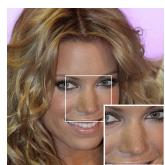  
(a) w/o Sal.

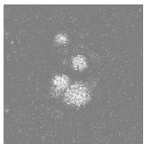  
(b) Mask

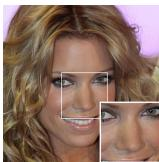  
(c) Full

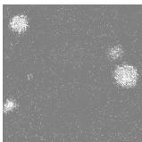  
(d) Mask

Figure 5: Efect of the saliency-guided dispersion penalty. (ab) Without the penalty, selected locations concentrate around the eyes and nose. (c-d) With the penalty, the selected locations are distributed more broadly across less salient regions.  
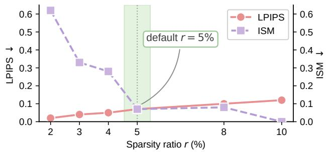  
Figure 6: Trade-of between protected-image distortion (LPIPS) and protection efectiveness (ISM) across sparsity ratios. The default setting r=5% provides a balanced operating point. Prompt: a photo ofsks person.

## 5 Conclusion

In this paper, we propose SEAL, an L0-constrained sparse perturbation framework for face privacy protection. SEAL modifies only a small fraction of pixels and targets the VAE encoder’s latent variance to achieve strong identity disruption under a tight perturbation budget. A saliency-guided disper- sion penalty further suppresses perceptible concentration in perceptually salient facial regions. Comprehensive experi- ments on CelebA-HQ and VGGFace2 demonstrate that, with only 5% of pixels perturbed, SEAL attains the best protected- image quality and the lowest identity similarity among the compared baselines. By optimizing where the sparse per- turbation lands, SEAL achieves strong protection and high image quality together.

Limitations. SEAL targets fine-tuning-based personaliza- tion, in which the protected images pass through the VAE encoder during training. Like other protections that target the VAE encoder, it does not afect encoder-based personal- ization methods such as IP-Adapter FaceID [33]. Smoothing pre-processing, such as JPEG compression, Gaussian blur, and resizing, removes most of the sparse perturbation and largely restores identity similarity (Table 8 in the appendix), whereas mild additive noise is tolerated. This vulnerability is shared by pixel-level protective perturbations in general [26], and improving robustness to such transformations is left for future work.

## References

[1] Qiong Cao, Li Shen, Weidi Xie, Omkar M. Parkhi, and Andrew Zisserman. VGGFace2: A dataset for recog- nising faces across pose and age. In FG, pages 67–74, 2018. 2, 5, 10

[2] Linyan Dai, Xinwei Zhang, Haoyang Li, Qingqing Ye, and Haibo Hu. IDDM: Identity-decoupled personalized difusion models with a tunable privacy-utility trade- of, 2026. URL https://arxiv.org/abs/2604.00903. 2

[3] Jiankang Deng, Jia Guo, Niannan Xue, and Stefanos Zafeiriou. ArcFace: Additive angular margin loss for deep face recognition. In CVPR, pages 4690–4699, 2019. 5, 11

[4] Naresh Kumar Devulapally, Shruti Agarwal, Tejas Gokhale, and Vishnu Suresh Lokhande. Latent difu- sion unlearning: Protecting against unauthorized per- sonalization through trajectory shifted perturbations. In ACM MM, pages 11376–11384, 2025. 3

[5] Keyan Ding, Kede Ma, Shiqi Wang, and Eero P. Simon-celli. Image quality assessment: Unifying structure and texture similarity. IEEE Transactions on Pattern Analysis and Machine Intelligence, 44(5):2567–2581, 2022. 5, 11

[6] Rinon Gal, Yuval Alaluf, Yuval Atzmon, Or Patashnik, Amit Haim Bermano, Gal Chechik, and Daniel Cohen- Or. An image is worth one word: Personalizing text- to-image generation using textual inversion. In ICLR, 2023. 1, 2

[7] Nicole Han, Puneeth Chakravarthula, and Miguel Eck-stein. Peripheral facial features guiding eye movements and reducing fixational variability. Journal of Vision, 21(8):7, 08 2021. doi: 10.1167/jov.21.8.7. 4

[8] Roy S Hessels. How does gaze to faces support faceto-face interaction? A review and perspective. Psychonomic Bulletin & Review, 27(5):856–881, 2020. 4

[9] Jonathan Ho, Ajay Jain, and Pieter Abbeel. Denoising difusion probabilistic models. In NeurIPS, volume 33, pages 6840–6851, 2020. 1

[10] Edward J. Hu, Yelong Shen, Phillip Wallis, Zeyuan Allen-Zhu, Yuanzhi Li, Shean Wang, Lu Wang, and Weizhu Chen. LoRA: Low-rank adaptation of large language models. In ICLR, 2022. 2

[11] Tero Karras, Timo Aila, Samuli Laine, and Jaakko Lehtinen. Progressive growing of GANs for improved quality, stability, and variation. In ICLR, 2018. 2, 5, 10

[12] Alexander Kirillov, Eric Mintun, Nikhila Ravi, Hanzi Mao, Chloe Rolland, Laura Gustafson, Tete Xiao, Spencer Whitehead, Alexander C Berg, Wan-Yen Lo, Piotr Dollár, and Ross Girshick. Segment anything. In ICCV, pages 4015–4026, 2023. 7

[13] Nupur Kumari, Bingliang Zhang, Richard Zhang, Eli Shechtman, and Jun-Yan Zhu. Multi-concept cus- tomization of text-to-image difusion. In CVPR, pages 1931–1941, 2023. 2

[14] Cheng-Han Lee, Ziwei Liu, Lingyun Wu, and Ping Luo. MaskGAN: Towards diverse and interactive facial im- age manipulation. In CVPR, pages 5549–5558, June 2020. 4

[15] Ang Li, Yichuan Mo, Mingjie Li, and Yisen Wang. PID: Prompt-independent data protection against latent difusion models. In ICML, volume 235, pages 28421– 28447, 2024. 1, 2, 4

[16] Chumeng Liang and Xiaoyu Wu. Mist: Towards im-proved adversarial examples for difusion models, 2023. URL https://arxiv.org/abs/2305.12683. 1, 2, 5, 10

[17] Chumeng Liang, Xiaoyu Wu, Yang Hua, Jiaru Zhang, Yiming Xue, Tao Song, Zhengui Xue, Ruhui Ma, and Haibing Guan. Adversarial example does good: Pre- venting painting imitation from difusion models via adversarial examples. In ICML, volume 202, pages 20763–20786, 2023. 1, 2

[18] Yixin Liu, Chenrui Fan, Yutong Dai, Xun Chen, Pan Zhou, and Lichao Sun. MetaCloak: Preventing unau- thorized subject-driven text-to-image difusion-based synthesis via meta-learning. In CVPR, pages 24219– 24228, 2024. 2

[19] Aleksander Madry, Aleksandar Makelov, Ludwig Schmidt, Dimitris Tsipras, and Adrian Vladu. Towards deep learning models resistant to adversarial attacks. In ICLR 2018. 4

[20] Xiaoyue Mi, Fan Tang, You Wu, Juan Cao, Peng Li, and Yang Liu. Visual-friendly concept protection via se- lective adversarial perturbations. In AAAI, volume 40, pages 39033–39041, 2026. 2, 3, 5, 10

[21] Anish Mittal, Anush Krishna Moorthy, and Alan C. Bovik. No-reference image quality assessment in the spatial domain. IEEE Transactions on Image Processing, 21(12):4695–4708, 2012. 5, 11

[22] Yiting Qu, Xinyue Shen, Xinlei He, Michael Backes, Savvas Zannettou, and Yang Zhang. Unsafe difusion: On the generation of unsafe images and hateful memes from text-to-image models. In ACM CCS, pages 3403– 3417, 2023. 1, 2

[23] Robin Rombach, Andreas Blattmann, Dominik Lorenz, Patrick Esser, and Björn Ommer. High-resolution image synthesis with latent difusion models. In CVPR, pages 10684–10695, 2022. 1, 2, 3, 5

[24] Nataniel Ruiz, Yuanzhen Li, Varun Jampani, Yael Pritch, Michael Rubinstein, and Kfir Aberman. Dream- Booth: Fine tuning text-to-image difusion models for subject-driven generation. In CVPR, pages 22500– 22510, 2023. 1, 2, 3, 5

[25] Hadi Salman, Alaa Khaddaj, Guillaume Leclerc, Andrew Ilyas, and Aleksander Madry. Raising the cost of malicious AI-powered image editing. In ICML, volume 202, pages 29894–29918, 2023. 2

[26] Ruiqing Sun, Xingshan Yao, Zhijing Wu, Tian Lan, Chenhao Cui, Huiyang Zhao, Jialing Shi, Chen Yang, and Xianling Mao. Do protective perturbations really

protect portrait privacy under real-world image trans- formations?, 2026. URL htt s://arxiv.or /abs/2604. 23688. 7, 12

[27] Philipp Terhorst, Jan Niklas Kolf, Naser Damer, Florian Kirchbuchner, and Arjan Kuijper. SER-FIQ: Unsuper-vised estimation of face image quality based on stochas- tic embedding robustness. In CVPR, pages 5651–5660, June 2020. 5, 11

[28] Thanh Van Le, Hao Phung, Thuan Hoang Nguyen, Quan Dao, Ngoc N. Tran, and Anh Tran. Anti-DreamBooth: Protecting users from personalized text- to-image synthesis. In ICCV, pages 2116–2127, 2023. 1, 2, 5, 10

[29] Zhou Wang, Alan C. Bovik, Hamid R. Sheikh, and Eero P. Simoncelli. Image quality assessment: From error visibility to structural similarity. IEEE Transactions on Image Processing, 13(4):600–612, 2004. 5, 11

[30] Zhihao Wu, Yushi Cheng, Tianyang Sun, Xiaoyu Ji, and Wenyuan Xu. MYOPIA: Protecting face privacy from malicious personalized text-to-image synthesis via un- learnable examples. In AAAI, volume 39, pages 905– 913, 2025. 2, 3, 5, 10

[31] Haotian Xue, Chumeng Liang, Xiaoyu Wu, and Yongxin Chen. Toward efective protection against difusion-based mimicry through score distillation. In ICLR, 2024. 2, 5, 10

[32] Jiachen Yang, Yusong Wang, Yanmei Fang, Yunshu Dai, and Fangjun Huang. Variance as a catalyst: Efi-cient and transferable semantic erasure adversarial at- tack for customized difusion models. In ICML, volume 267, pages 71275–71301, 2025. 1, 2, 4, 7, 11

[33] Hu Ye, Jun Zhang, Sibo Liu, Xiao Han, and Wei Yang. IP-Adapter: Text compatible image prompt adapter for text-to-image difusion models, 2023. URL https://arxiv.org/abs/2308.06721. 7

[34] Changqian Yu, Jingbo Wang, Chao Peng, Changxin Gao, Gang Yu, and Nong Sang. BiSeNet: Bilateral segmentation network for real-time semantic segmen- tation. In ECCV, pages 325–341, 2018. 4, 5, 10

[35] Richard Zhang, Phillip Isola, Alexei A. Efros, Eli Shechtman, and Oliver Wang. The unreasonable ef- fectiveness of deep features as a perceptual metric. In CVPR, pages 586–595, 2018. 5, 11

[36] Xuyang Zhong and Chen Liu. Sparse-PGD: A unified framework for sparse adversarial perturbations genera- tion. IEEE Transactions on Pattern Analysis and Machine Intelligence, 48(3):3056–3069, 2026. 2, 3, 4

## Appendix Overview

This appendix provides the algorithmic, experimental, empir- ical details and reports additional results that further support our findings. It is organized as follows:

• Appendix A: the complete optimization algorithm.

• Appendix B: the experimental setup, including datasets, baselines, implementation details, the generation protocol and evaluation metrics.

• Appendix C: additional experiments, including ablation studies, robustness to image pre-processing, cross-model and cross-method transferability, and qualitative results.

## A Algorithm

Algorithm 1 details the complete optimization procedure of SEAL.

Algorithm 1: SEAL   
Require: Image x, VAE encoder $\mathcal { E } _ { \theta } .$ , perturbation budget   
ϵ, sparsity ratio r, step sizes $\alpha , \beta ,$ dispersion weight λ,   
density threshold τ, kernel size K, max steps T, patience   
$P$   
1: $k \gets \lfloor r \cdot H \cdot W \rfloor$   
2: Initialize δ ∼ Uniform $\left( - \epsilon , \epsilon \right) , \ell \sim \mathcal { N } ( 0 , 1 )$   
3: Compute saliency map $\dot { S } \gets \mathrm { B i S e N e t } ( x )$   
4: Build kernel $\mathbf { W } \dot { { \bf \Phi } }  \frac { \mathbb I } { K ^ { 2 } } \mathbf { 1 } _ { K \times K }$   
5: $p \gets 0 ; m _ { \mathrm { p r e v } } \gets \mathbf { 0 } ; \hat { x } ^ { \star } \gets x ; J ^ { \star } \gets - \infty$   
6: for $t = 1$ to T do   
7: $\hat { m } \gets \mathrm { s i g } ( \ell ) ; m \gets \mathrm { T o p K } ( \hat { m } , k )$   
8: $x ^ { \prime } \gets \mathrm { c l i p } ( x + \delta \odot m , 0 , 1 )$   
9: $( \mu ^ { \prime } , \sigma ^ { \prime } ^ { 2 } )  \mathcal { E } _ { \theta } ( x ^ { \prime } )$   
10: Compute ${ \mathcal { L } } _ { \mathrm { v a r } }$ via Eq. (2)   
11: Compute Ω via Eq. (8) using STE on m   
12: $J \gets \overline { { \mathcal { L } } } _ { \mathrm { v a r } } - \lambda \Omega$   
13: if $J > J ^ { \star }$ then   
14: $J ^ { \star } \gets J ; \ x ^ { \star } \gets x ^ { \prime }$   
15: end if   
16: $\delta \gets \Pi _ { [ - \epsilon , \epsilon ] } ( \delta + \alpha \cdot \mathrm { s i g n } ( \nabla _ { \delta } \mathcal { L } _ { \mathrm { v a r } } ) )$   
17: $g _ { \ell } \gets$ balanced direction via Eq. (9)   
18: $\ell \gets \ell + \sqrt { H W } \beta \cdot g \_$   
19: if $m = m _ { \mathrm { p r e v } }$ then   
20: $p \gets p + 1$   
21: else   
22: $p \gets 0$   
23: end if   
24: if $\cdot _ { p \geq P }$ then   
25: Reinitialize δ, ℓ; $p \gets 0$   
26: end if   
27: mprev ← m   
28: end for   
29: return $x ^ { \star }$ , the iterate with the highest $\mathcal { L } _ { \mathrm { v a r } } - \lambda \Omega$

## B Experimental Setup

## B.1 Datasets

We conduct experiments on two widely used face datasets, CelebA-HQ [11] and VGGFace2 [1], following prior privacy- protection work [20, 28]. CelebA-HQ is a high-quality ver-sion of CelebA consisting of 30,000 celebrity face images, while VGGFace2 is a large-scale dataset with over 3.3 million images from 9,131 identities. From each dataset we select 50 identities for the main comparison and 10 identities for ad- ditional experiments; for each identity we use 4 images as the target set to be protected and reserve an additional set of clean images as identity references for evaluation.

## B.2 Baselines

We compare against five representative protection methods that span adversarial optimization against DreamBooth and quality-aware protection: Anti-DreamBooth [28], Mist [16], SDS(-) [31], MYOPIA [30], and VCPro [20]. For a fair com-parison, we set the $L _ { \infty }$ perturbation budget to $\epsilon = 0 . 0 5$ for all methods except $\mathbf { M Y O P I A } ,$ , for which we retain its original nominal bound $( \epsilon = 0 . 5 )$ together with its JND-based mag- nitude control. The remaining hyperparameters follow each method’s oficial implementation:

• Mist and SDS(-): 100 optimization steps with PGD step size α = 1.

• VCPro: 1000 adversarial optimization steps with PGD step size α = 1.

• Anti-DreamBooth: 50 training steps, with 3 model finetuning steps and 6 adversarial PGD steps, a checkpointing interval of 10, a surrogate learning rate of $5 \times 1 0 ^ { - 7 }$ , and PGD step size $5 \times 1 0 ^ { - 3 }$

• MYOPIA: 10 training steps, with 3 model fine-tuning steps and 100 adversarial PGD steps, a checkpointing interval of 10, a surrogate learning rate of $5 \times 1 0 ^ { - 7 }$ , and PGD step size $5 \times 1 0 ^ { - 3 }$

## B.3 Implementation Details

Perturbation optimization. The $L _ { \infty }$ bound on individual perturbed pixels is $\epsilon = 0 . 0 5 ,$ , with a PGD step size of $\alpha =$ 0.25. The default sparsity ratio $r = 0 . 0 5$ yields an $L _ { 0 }$ budget of $\mathbf { \ddot { k } } = \lfloor 0 . 0 5 \times 5 1 \bar { 2 } \times 5 1 \bar { 2 } \rfloor = 1 3 , 1 0 \bar { 7 }$ pixels. The mask logits are updated with step size $\beta = 0 . 2 5$ , and the patience-based reinitialization threshold is $P = 3$ . For the saliency-guided dispersion penalty, the local density is estimated with a $7 \times 7$ mean-pooling kernel, the density threshold is $\tau = 0 . 1 5 ,$ and the dispersion weight is $\lambda = 0 . 5$

Saliency class weights. The saliency map $S ( x )$ is obtained from BiSeNet face parsing [34], which labels each pixel with one of 19 semantic classes. Each class is assigned a fixed perceptual weight $w \in [ 0 , 1 ]$ , with the complete class-to- weight mapping listed in Table 5.

DreamBooth fine-tuning. We fine-tune with DreamBooth using prior preservation: the instance prompt is $\mathbf { \ddot { a } }$ photo of sks person” and the class (prior) prompt is “a photo of person”, with 200 class images and a prior-loss weight of 1.0. Training uses a learning rate of $5 \times 1 0 ^ { - 7 }$ , a batch size of $^ { 2 , }$ 1000 steps, text-encoder training enabled, and bf16 precision. All images are resized to $5 1 \bar { 2 } \times 5 1 2$

<table><tr><td>ID Class</td><td>w</td><td>ID Class</td><td>w</td></tr><tr><td>0</td><td>Background 0.00</td><td>10 Nose</td><td>0.90</td></tr><tr><td>1</td><td>Skin</td><td>0.80 11</td><td>Mouth 0.90</td></tr><tr><td>2</td><td>L. eyebrow</td><td>0.70 12</td><td>Upper lip 0.90</td></tr><tr><td>3</td><td>R. eyebrow</td><td>0.70 13</td><td>Lower lip 0.90</td></tr><tr><td>4</td><td>L. eye</td><td>1.00 14</td><td>Neck 0.50</td></tr><tr><td>5</td><td>R. eye</td><td>1.00 15</td><td>Necklace 0.10</td></tr><tr><td>6</td><td>Eyeglasses</td><td>0.60 16</td><td>Cloth 0.05</td></tr><tr><td>7</td><td>L. ear</td><td>0.10 17</td><td>Hair 0.02</td></tr><tr><td>8</td><td>R. ear</td><td>0.10 18</td><td>Hat 0.10</td></tr><tr><td>9</td><td>Earring</td><td>0.10</td><td></td></tr></table>

Table 5: Complete BiSeNet class-to-weight mapping used by the saliency-guided dispersion penalty. Higher weights w more strongly penalize perturbation concentration in that region.

## B.4 Generation Protocol

For every method, subject, and prompt, personalized images are generated using the DDPMScheduler shipped with the SD 2.1-base checkpoint, with 100 inference steps, a guid- ance scale of 7.5, a resolution of $5 1 2 \times 5 1 2$ , and shared random seeds across methods. Evaluation uses the following six prompts, referenced as P1 to P6:

• P1: “a photo of sks person”

$\mathbf { P 2 } ; \mathbf { \tilde { \mu } _ { 4 } }$ dslr portrait of sks person”

• P3: “a photo of sks person looking at the mirror”

• P4: “a photo of sks person in front of eifel tower”

• P5: “a close-up photo of sks person, high details”

• P6: “a photo of sks person stand in front of the table holding a knife”

## B.5 Evaluation Metrics

We report metrics along two dimensions: the image quality of the protected image and the protection efectiveness against personalized generation.

Image quality measures the distortion between a protected image and its clean counterpart. PSNR and SSIM [29] quantify pixel- and structure-level fidelity (higher is better), whereas LPIPS [35] and DISTS [5] measure deep perceptual and structure–texture distance (lower is better).

Protection efectiveness evaluates the DreamBooth-generated images in terms of identity and perceptual quality. ISM (Identity Score Metric) is the ArcFace [3] cosine similarity between generated and reference faces; a lower value means less of the target identity is reproduced. FDFR (Face Detection Failure Rate) is the fraction of generated images in which a face detector fails to locate any face; a higher value indicates stronger protection. SER-FIQ [27] is a no-reference face image quality score, for which a lower value reflects less recognizable generated faces. BRISQUE [21] is a no-reference image quality metric, for which higher values indicate more artifacts in the generated images.

## C Additional Experiments and Results

## C.1 Loss Function

The component ablation compares our default optimiza- tion objective in Eq. (2) against two alternative variancedisruption losses, all evaluated within the same sparse frame- work (top-k mask, saliency penalty, $r = 0 . 0 5 )$ .

MSE loss. This variant maximizes the squared deviation between the latent variance of the clean and protected images:

$$
\mathcal { L } _ { \mathrm { M S E } } = \sum _ { j } \left( \sigma _ { \mathrm { c l e a n } , j } ^ { 2 } - \sigma _ { j } ^ { 2 } \right) ^ { 2 } ,\tag{10}
$$

where $\sigma _ { \mathrm { c l e a n } , j } ^ { 2 }$ and $\sigma _ { j } ^ { 2 }$ are the j-th latent variance components of the clean image x and the protected image $x ^ { \prime } { \mathrm { . } }$ , respectively.

Lagrange Entropy (LE) loss. Following [32], the LE loss combines an entropy term on the latent variance with a soft normalization constraint:

$$
\mathcal { L } _ { \mathrm { { L E } } } = - \sum _ { j } \sigma _ { j } ^ { 2 } \log \bigl ( \sigma _ { j } ^ { 2 } + \varepsilon \bigr ) + \lambda _ { c } \left( \sum _ { j } \sigma _ { j } ^ { 2 } - 1 \right) ^ { 2 } ,\tag{11}
$$

where $\varepsilon = 1 0 ^ { - 8 }$ ensures numerical stability and $\lambda _ { c } = 0 . 1$ weights the constraint that softly normalizes the total latent variance.

## C.2 Additional Ablation Studies

Sparsity ratio. Table 6 reports the full metrics across spar- sity ratios. Image quality degrades approximately linearly with r: PSNR decreases by roughly 2 dB for every 2% increase in the ratio, and SSIM drops from 0.99 at r=2% to 0.93 at r=10%. Protection, by contrast, exhibits a pronounced phase transition between r=4% and r=5%: ISM drops from 0.28 to 0.07, FDFR jumps from 0.73 to 0.97, and SER-FIQ falls from 0.26 to 0.06, indicating that 5% of spatial locations is the critical budget at which the sparse per- turbation becomes suficient to disrupt identity acquisition.

<table><tr><td colspan="3">Image Quality</td><td colspan="3">Protection</td></tr><tr><td></td><td>r (%) SSIM↑ LPIPS↓</td><td></td><td>BRISQUE↑</td><td>SER-FIQ↓</td><td>FDFR↑ ISM↓</td></tr><tr><td>2</td><td>0.99</td><td>0.02</td><td>26.68</td><td>0.67</td><td>0.16 0.62</td></tr><tr><td>3</td><td>0.98</td><td>0.04</td><td>43.62</td><td>0.33 0.61</td><td>0.33</td></tr><tr><td>4</td><td>0.98</td><td>0.05</td><td>53.26</td><td>0.26 0.73</td><td>0.28</td></tr><tr><td>5</td><td>0.97</td><td>0.07</td><td>80.27</td><td>0.06 0.97</td><td>0.07</td></tr><tr><td>8</td><td>0.95</td><td>0.10</td><td>90.93</td><td>0.12 0.85</td><td>0.08</td></tr><tr><td>10</td><td>0.93</td><td>0.12</td><td>121.43</td><td>0.01</td><td>1.00 0.00</td></tr></table>

Table 6: Efect of sparsity ratio r on CelebA-HQ. Prompt: a photo of sks person.

Hyperparameter sensitivity. Figure 7 shows the LPIPS– ISM trade-of as we vary the dispersion weight λ, the density threshold τ, and the number of optimization steps T. LPIPS (perceptual cost) stays nearly flat throughout, so tuning these hyperparameters afects protection (ISM) at almost no perceptual cost. The dispersion weight λ shows a non-monotonic trend: $\lambda = 0$ (no penalty) yields the strongest raw protection because the mask freel clusters on the most efective loca- tions, but a weak penalty $( \lambda = 0 . 1 )$ disturbs mask optimiza- tion without a clear dispersion signal and weakens protec- tion, which recovers for $\lambda \geq 0 . 5$ . We adopt $\lambda = 0 . 5 .$ , which restores near-maximal protection while dispersing perturba- tions away from salient regions; the spatial efect is visualized in Fig. 5 of the main text. Protection is largely insensitive to τ over [0.05, 0.5], while ISM falls sharply between $T = 1 0 0$ and $T = 3 0 0$ and changes little beyond it, so we set $T = 3 0 0$ as the default.

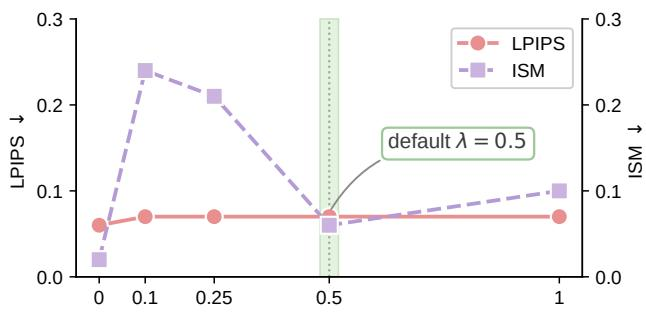

(a) Dispersion weight λ  
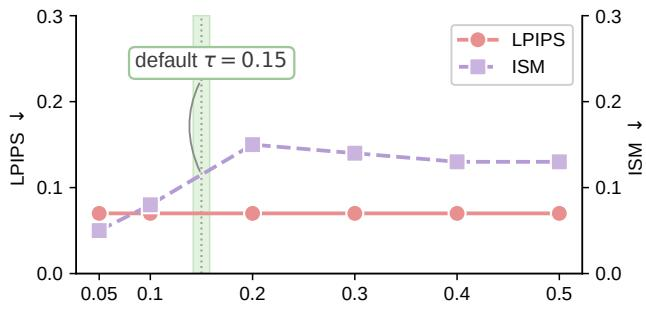

(b) Density threshold τ  
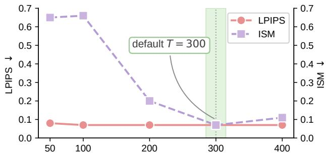  
(c) Optimization steps $T$  
Figure 7: Hyperparameter sensitivity on CelebA-HQ (prompt: a photo of sks person). LPIPS $( \downarrow ,$ perceptual cost) and ISM (↓, protection) versus (a) the dispersion weight $\lambda ,$ (b) the density threshold τ, and (c) the number of optimization steps $T ;$ the default setting is highlighted in each panel.

## C.3 Uncontrolled Conditions

Transferability. Complementing the quantitative transfer results in the main text (Fig. 4), Fig. 8 shows qualitative generations when the protected images, optimized on the SD 2.1 surrogate, are used to personalize unseen backbones and methods. Across cross-backbone (SD 1.5, SDXL) and cross-method (LoRA, Textual Inversion) settings, the target identity is never faithfully reconstructed, confirming that our protection does not overfit to the surrogate model. Table 7 quantifies this: protection transfers strongly to the SD 1.5 backbone and to the LoRA and Textual Inversion personaliz- ers $\mathrm { ( I S M } \le 0 . 2 6 \mathrm { ) }$ . SDXL is the strictest of these settings, as it replaces the SD 2.1 encoder with a retrained VAE operating at a diferent latent scale; even there, 69% of the generations contain no detectable face.

<table><tr><td>Setting</td><td>Target</td><td>FDFR↑ ISM↓</td></tr><tr><td>Surrogate</td><td>SD 2.1</td><td>0.97 0.07</td></tr><tr><td rowspan="2">Cross-backbone</td><td>SD 1.5</td><td>0.99 0.03</td></tr><tr><td>SDXL</td><td>0.69 0.56</td></tr><tr><td rowspan="2">Cross-method</td><td>LoRA</td><td>0.67 0.26</td></tr><tr><td>Textual Inversion</td><td>0.91 0.03</td></tr></table>

Table 7: Quantitative cross-model and cross-method transferability on CelebA-HQ (prompt: a photo of sks person). Protection is optimized on the SD 2.1 surrogate and evalu- ated on unseen backbones and personalization methods.

Image Pre-processing. We evaluate common image pre-processing that an adversary or platform might apply be- fore fine-tuning. Table 8 reports results on VGGFace2 under JPEG compression, Gaussian blur, additive Gaussian noise, downsam lin round-tri , and center cro -resize, for both our default setting and the denser λ=0 variant. Additive noise, which does not selectively erase the sparse perturba- tion, is tolerated well (default ISM = 0.13 at σ=2), whereas smoothing transforms (JPEG, blur, resize) remove part of the localized signal. The λ=0 variant attains stronger raw protection (no transform: ISM 0.00 vs. 0.09) and slightly better noise tolerance, but under smoothing transforms both settings converge, reflecting a general trade-of between im- perceptibility and robustness rather than an efect specific to λ. This degradation under smoothing is consistent with prior findings that pixel-level protective perturbations are broadly vulnerable to real-world image transformations [26], and im-proving such robustness remains an open direction.

## C.4 Additional Quantitative and Qualitative Results

Table 9 extend the main comparison (Table 1) to prompts P3– P6, reporting protection efectiveness on both datasets. Fig. 9 compares our method against baselines on three identities: for each method we show the protected image, a zoomed crop, the perturbation residual, and two DreamBooth generations. Our perturbation is the least conspicuous in the zoom and residual, yet the generated identity is still fully disrupted. Fig. 10 further illustrates the breadth of our protection across eight identities from CelebA-HQ and VGGFace2 under six evaluation prompts.

<table><tr><td rowspan="2">Transform</td><td rowspan="2">Param</td><td colspan="3">Default</td><td colspan="3"> $\lambda = 0$ </td></tr><tr><td>BRISQUE↑</td><td>FDFR↑</td><td>ISM↓</td><td>BRISQUE↑</td><td>FDFR↑</td><td>ISM↓</td></tr><tr><td>None</td><td>一</td><td>82.34</td><td>0.89</td><td>0.09</td><td>102.16</td><td>1.00</td><td>0.00</td></tr><tr><td rowspan="3">JPEG</td><td> $q = 8 5$ </td><td>15.15</td><td>0.03</td><td>0.66</td><td>14.33</td><td>0.02</td><td>0.63</td></tr><tr><td> $q = 7 5$ </td><td>17.39</td><td>0.03</td><td>0.66</td><td>17.21</td><td>0.03</td><td>0.62</td></tr><tr><td> $q = 5 5$ </td><td>22.39</td><td>0.03</td><td>0.66</td><td>22.41</td><td>0.03</td><td>0.65</td></tr><tr><td rowspan="3">Blur</td><td> $r = 1$ </td><td>37.55</td><td>0.08</td><td>0.67</td><td>37.03</td><td>0.10</td><td>0.65</td></tr><tr><td> $r = 2$ </td><td>57.69</td><td>0.05</td><td>0.66</td><td>57.92</td><td>0.06</td><td>0.66</td></tr><tr><td> $r = 3$ </td><td>69.22</td><td>0.05</td><td>0.64</td><td>68.32</td><td>0.05</td><td>0.65</td></tr><tr><td rowspan="3">Gauss. noise</td><td> $\sigma = 2$ </td><td>62.92</td><td>0.92</td><td>0.13</td><td>74.83</td><td>1.00</td><td>0.00</td></tr><tr><td> $\sigma = 4$ </td><td>42.47</td><td>0.51</td><td>0.35</td><td>52.15</td><td>0.77</td><td>0.24</td></tr><tr><td> $\sigma = 8$ </td><td>6.05</td><td>0.03</td><td>0.66</td><td>5.44</td><td>0.02</td><td>0.64</td></tr><tr><td rowspan="2">Resize Crop</td><td> $s = 0 . 5$ </td><td>44.57</td><td>0.08</td><td>0.67</td><td>43.78</td><td>0.08</td><td>0.66</td></tr><tr><td> $\rho = 0 . 9$ </td><td>23.94</td><td>0.07</td><td>0.64</td><td>22.62</td><td>0.08</td><td>0.64</td></tr></table>

Table 8: Image pre-processing on VGGFace2 for the default and λ = 0 settings. Prompt: a photo of sks person.

<table><tr><td></td><td></td><td colspan="4">Protection (P3)</td><td colspan="4">Protection (P4)</td></tr><tr><td>Dataset</td><td>Method</td><td>BRISQUE↑ SER-FIQ↓ FDFR↑</td><td></td><td></td><td>ISM↓</td><td>BRISQUE↑ SER-FIQ↓ FDFR↑ ISM↓</td><td></td><td></td><td></td></tr><tr><td rowspan="8">VGGFace2</td><td>No Def.</td><td>20.26</td><td>0.58</td><td>0.02</td><td>0.42</td><td>22.14</td><td>0.53</td><td>0.26</td><td>0.22</td></tr><tr><td>Anti-DB</td><td>35.44</td><td>0.27</td><td>0.36</td><td>0.24</td><td>39.26</td><td>0.28</td><td>0.43</td><td>0.11</td></tr><tr><td>Mist</td><td>27.19</td><td>0.26</td><td>0.48</td><td>0.12</td><td>28.04</td><td>0.36</td><td>0.66</td><td>0.09</td></tr><tr><td>SDS(-)</td><td>46.72</td><td>0.58</td><td>0.07</td><td>0.40</td><td>23.40</td><td>0.51</td><td>0.23</td><td>0.19</td></tr><tr><td>MYOPIA</td><td>50.93</td><td>0.59</td><td>0.04</td><td>0.40</td><td>36.44</td><td>0.45</td><td>0.38</td><td>0.19</td></tr><tr><td>VCPro</td><td>17.10</td><td>0.58</td><td>0.03</td><td>0.42</td><td>22.43</td><td>0.55</td><td>0.18</td><td>0.21</td></tr><tr><td>SEAL</td><td>39.86</td><td>0.23</td><td>0.50</td><td>0.10</td><td>21.51</td><td>0.24</td><td>0.54</td><td>0.09</td></tr><tr><td>No Def.</td><td>19.27</td><td>0.58</td><td>0.03</td><td>0.44</td><td>23.46</td><td>0.54</td><td>0.22</td><td>0.16</td></tr><tr><td rowspan="8">CelebA-HQ</td><td>Anti-DB</td><td>37.49</td><td>0.27</td><td>0.46</td><td>0.21</td><td>39.75</td><td>0.28</td><td>0.45</td><td>0.07</td></tr><tr><td>Mist</td><td>27.75</td><td>0.33</td><td>0.24</td><td>0.13</td><td>30.85</td><td>0.33</td><td>0.68</td><td>0.07</td></tr><tr><td>SDS(-)</td><td>41.62</td><td>0.58</td><td>0.08</td><td>0.36</td><td>21.04</td><td>0.47</td><td>0.38</td><td>0.09</td></tr><tr><td>MYOPIA</td><td>53.15</td><td>0.62</td><td>0.06</td><td>0.40</td><td>37.68</td><td>0.41</td><td>0.52</td><td>0.11</td></tr><tr><td>VCPro</td><td>17.18</td><td>0.57</td><td>0.05</td><td>0.41</td><td>23.62</td><td>0.52</td><td>0.24</td><td>0.13</td></tr><tr><td>SEAL</td><td>37.76</td><td>0.21</td><td>0.56</td><td>0.08</td><td>20.75</td><td>0.24</td><td>0.54</td><td>0.05</td></tr><tr><td></td><td></td><td>Protection (P5)</td><td></td><td></td><td></td><td></td><td></td><td></td></tr><tr><td rowspan="2"></td><td colspan="5">BRISQUE↑ SER-FIQ↓</td><td colspan="4">Protection (P6) SER-FIQ↓ FDFR↑</td></tr><tr><td></td><td></td><td></td><td>FDFR↑</td><td>ISM↓</td><td>BRISQUE↑</td><td></td><td></td><td>ISM↓ 0.28</td></tr><tr><td rowspan="7">VGGFace2</td><td>No Def.</td><td>14.47</td><td>0.63</td><td>0.13</td><td>0.48</td><td>22.74</td><td>0.64</td><td>0.32</td><td></td></tr><tr><td>Anti-DB</td><td>43.57</td><td>0.09</td><td>0.88</td><td>0.19</td><td>36.91</td><td>0.31</td><td>0.40</td><td>0.12</td></tr><tr><td>Mist</td><td>34.72</td><td>0.32</td><td>0.54</td><td>0.13</td><td>30.52</td><td>0.38</td><td>0.37</td><td>0.10</td></tr><tr><td>SDS(-)</td><td>50.62</td><td>0.73</td><td>0.08</td><td>0.57</td><td>45.38</td><td>0.52</td><td>0.23</td><td>0.20</td></tr><tr><td>MYOPIA</td><td>50.18</td><td>0.71</td><td>0.20</td><td>0.51</td><td>47.51</td><td>0.51</td><td>0.21</td><td>0.20</td></tr><tr><td>VCPro</td><td>32.24</td><td>0.60</td><td>0.16</td><td>0.41</td><td>26.53</td><td>0.63</td><td>0.34</td><td>0.25</td></tr><tr><td>SEAL</td><td>44.46</td><td>0.31</td><td>0.79</td><td>0.15</td><td>30.15</td><td>0.31</td><td>0.44</td><td>0.10</td></tr><tr><td rowspan="7"></td><td>No Def.</td><td>15.89</td><td>0.66</td><td>0.19</td><td>0.47</td><td>21.49</td><td>0.63</td><td>0.42</td><td>0.22</td></tr><tr><td>Anti-DB</td><td>48.16</td><td>0.05</td><td>0.96</td><td>0.11</td><td>38.02</td><td>0.27</td><td>0.51</td><td>0.07</td></tr><tr><td>Mist</td><td>34.67</td><td>0.38</td><td>0.47</td><td>0.13</td><td>34.25</td><td>0.33</td><td>0.56</td><td>0.06</td></tr><tr><td>CelebA-HQ SDS(-)</td><td>47.68</td><td>0.75</td><td>0.14</td><td>0.55</td><td>40.13</td><td>0.37</td><td>0.52</td><td>0.09</td></tr><tr><td>MYOPIA</td><td>52.54</td><td>0.76</td><td>0.17</td><td>0.52</td><td>49.34</td><td>0.40</td><td>0.48</td><td>0.12</td></tr><tr><td>VCPro</td><td>42.94</td><td>0.62</td><td>0.29</td><td>0.36</td><td>24.26</td><td>0.62</td><td>0.51</td><td>0.18</td></tr><tr><td>SEAL</td><td>45.88</td><td>0.27</td><td>0.84</td><td>0.09</td><td>27.29</td><td>0.28</td><td>0.48</td><td>0.06</td></tr></table>

Table 9: Protection efectiveness under additional prompts on VGGFace2 and CelebA-HQ. P3: a photo ofsks person looking at the mirror; P4: a photo of sks person in front of eifel tower; P5: a close-up photo of sks person, high details; P6: a photo of sks person stand infront ofthe table holding a knife.

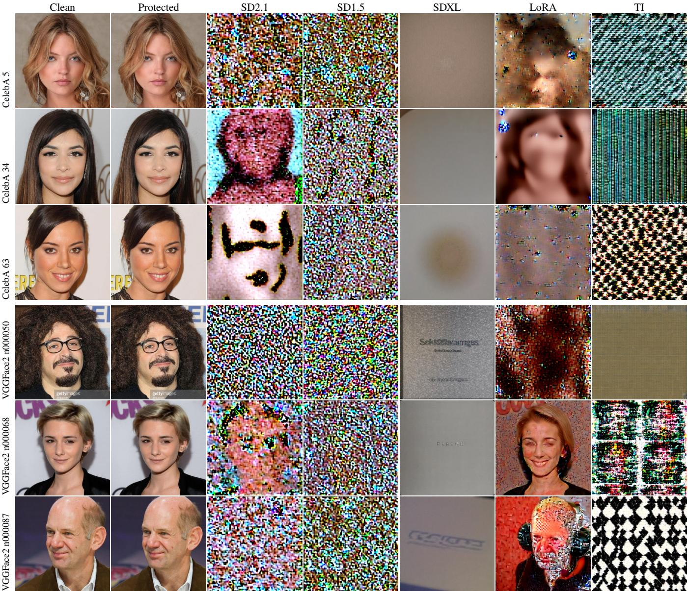  
Figure 8: Cross-model and cross-method transferabilit on CelebA-HQ and VGGFace2. Columns: clean image, our protected image, and personalized generations under the surrogate (SD 2.1), two unseen backbones (SD 1.5, SDXL), and two unseen personalization methods (LoRA, Textual Inversion). All generations use the prompt “a photo of sks person”. The protected identity fails to be reproduced across all settings.

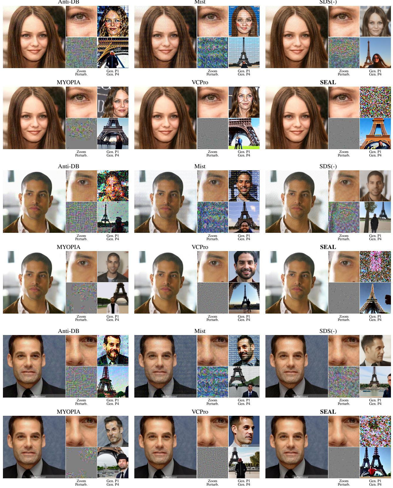  
Figure 9: Per-method qualitative comparison on three identities. For each method we show the protected image, a zoomed crop, the perturbation residual, and two DreamBooth generations: Gen P1 (“a photo of sks person”) and Gen P4 (“a photo of sks person in front of eifel tower”). Compared with baselines, our perturbation is the least visible in the zoom and residual while still preventing identity reproduction.

Gen. P4

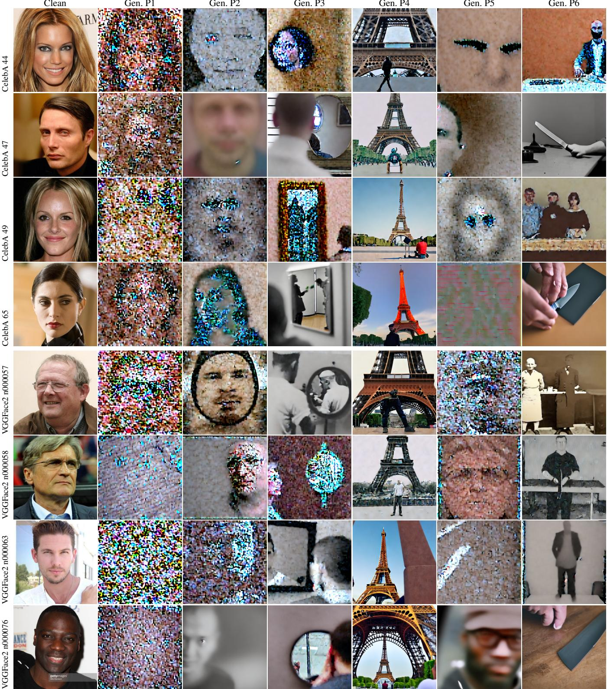  
Figure 10: Additional qualitative results of our method across identities from CelebA-HQ and VGGFace2. Columns: clean image, and DreamBooth generations under six prompts. P1: “a photo of sks person”; P2: “a dslr portrait of sks person”; P3: “a photo of sks person looking at the mirror”; P4: “a photo of sks person in front of eifel tower”; P5: “a close-up photo of sks person, high details”; P6: “a photo of sks person stand in front of the table holding a knife”. Protection holds consistently across identities and prompts.